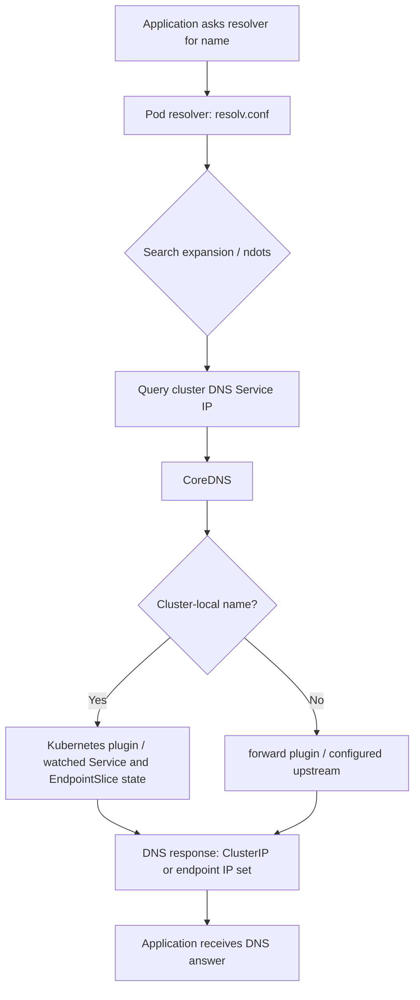
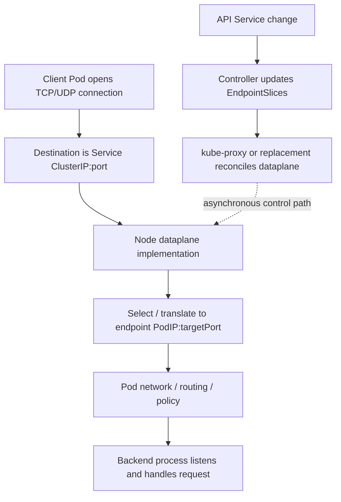

# Unit 2 — Services, kube-proxy, cluster DNS

**Target file:** `02-services-kube-proxy-and-cluster-dns.md` | **Module:** M04 | **Unit:** 2 | **Estimated time:** 10–14 hours (reading 4–5 h, labs 5–7 h, review 1–2 h) | **Prerequisites:** Linux shell, TCP/IP, DNS, HTTP, basic Pods/Deployments/Services, and M03 production Kubernetes operations.

**Core tools:** `kubectl`, `kind`, Docker, `curl`, `getent` or `nslookup`, `dig` if installed, shell, YAML editor. **Awareness:** `iptables-save`, `nft`, `ipvsadm`, `conntrack`, `tcpdump`, CoreDNS metrics, policy engines. **Last reviewed:** 2026-10-28 (authoring date; not a claim that every upstream source was reviewed today). **Kubernetes/tool baseline assumed:** Kubernetes APIs `v1` and EndpointSlice `discovery.k8s.io/v1`; use the Kubernetes version bundled by a currently supported kind release and record it locally. kube-proxy nftables mode, topology-aware routing, CoreDNS Corefile details, and tool availability are `[VERIFY]` against the actual cluster and cited documentation. **Safety:** destructive experiments belong only in a throwaway local cluster; never run the fault-injection steps against a shared or production cluster.

> **Authenticity note:** This lesson was authored against the official documentation listed in §2.14 where cited. Version- and environment-dependent behavior is marked `[VERIFY]`. Commands are instructional; no claim is made that a live cluster or these labs were executed during authoring. Replace dynamic values by capturing them from your own cluster.

## 2.0 Why this matters in production

A scoring API may run as several replaceable Pods. Clients need a stable way to find it while Pods scale, restart, move nodes, or become unready. A Kubernetes **Service** supplies a stable logical endpoint; **EndpointSlices** describe the current backend set; a service-proxy/dataplane implementation makes packets reach a selected backend; **cluster DNS** maps human-usable names to Service addresses or endpoint addresses.

These are separate systems and therefore separate failure domains:

- DNS can return the correct ClusterIP while the application is down.
- A Service can exist but have no usable endpoints because its selector matches no Pods or all matching Pods are unready.
- EndpointSlices can be correct while a node dataplane is stale or broken.
- A TCP connection can succeed while an HTTP request fails.
- `kubectl port-forward` can work even when the normal ClusterIP path is broken because it uses a different forwarding path.

For an ML platform, the same distinction applies to a FastAPI model-scoring API, an internal feature service, Postgres/Redis dependencies, an ETL worker calling external APIs, and a metrics endpoint. Name resolution and routing must be tested independently, measured, and owned.

Scope boundary: M03 introduced Service basics, readiness, probes, and graceful shutdown. This unit deepens endpoint membership and dataplane behavior. Ingress is Unit 3; load-balancer implementation is Unit 4; NetworkPolicy is Unit 5; Cilium/eBPF internals are Unit 9. Stateful identity links to M05; packaging to M06; rollout analysis to M08; workload identity to M09; SLOs to M10; observability to M11; multi-cluster to M14; egress economics to M15.

## 2.1 Learning objectives

By the end, you should be able to:

1. Explain each common Service type and choose one without confusing discovery with proxying.
2. Trace `port` → `targetPort`, selector → EndpointSlice, DNS query → answer, and ClusterIP → endpoint packet path.
3. Inspect Pod resolver configuration and explain search domains and `ndots`.
4. Determine whether kube-proxy is present, identify its mode where possible, and inspect available dataplane evidence without assuming tools exist.
5. Inspect CoreDNS objects, configuration, logs, readiness, and available metrics.
6. Measure DNS query amplification, latency, endpoint propagation, and Service request success without inventing benchmark results.
7. Diagnose intermittent DNS/Service failures using competing hypotheses and discriminating tests.
8. Apply safe rollback, CI validation, policy, and SRE/security practices.

## 2.2 Concept map and vocabulary

| Term | Meaning | Operational question |
|---|---|---|
| Service | Stable virtual endpoint for a logical backend | Does it select the intended Pods and expose the intended port? |
| ClusterIP | Virtual IP allocated to a normal Service | Which dataplane maps it to endpoints? |
| EndpointSlice | Scalable set of endpoint addresses/ports associated with a Service | Are the current endpoints correct and ready? |
| kube-proxy | Common Kubernetes component that watches Service state and programs node dataplane rules | Is it running, and which mode is active? |
| Dataplane | Packet-processing rules or implementation that forwards traffic | Does the ClusterIP map to the right endpoint? |
| CoreDNS | DNS server commonly deployed for cluster service discovery | Is it ready, synced, and able to reach upstream resolvers? |
| Corefile | CoreDNS configuration file | Which plugins and zones are configured in this cluster? |
| Search list | Suffixes a resolver may append to an unqualified name | Is a query generating extra DNS requests? |
| `ndots` | Resolver option controlling when a name is first tried as absolute versus search-expanded | Is `ndots:5` amplifying external lookups? |
| Conntrack | Linux connection-tracking state used by NAT/firewall datapaths | Are entries, insertions, or memory under pressure? |
| Headless Service | Service with `clusterIP: None`; DNS returns endpoint addresses instead of a virtual IP | Does the client understand multiple records and endpoint lifecycle? |

**Request and control flows are not the same.**

DNS lookup path (conceptual; resolver retries/search behavior depends on libc/tool and configuration):



Service traffic path (DNS is not in the packet path after the address is known):



A successful DNS response proves only that a resolver answered. A reachable ClusterIP, a completed TCP handshake, and a successful application request are progressively stronger but distinct checks.

## 2.3 Level 1 — Beginner

### Why Services exist

Pod IPs are implementation details. A Deployment replacement may create a new Pod with a different IP. Hard-coding Pod IPs in clients couples the client to lifecycle details. A Service name and virtual IP provide a stable logical target while Kubernetes updates backend membership.

### Service types

| Type | Behavior | Common use | Limits / cautions |
|---|---|---|---|
| `ClusterIP` | Allocates a cluster-internal virtual IP by default | Internal APIs, feature service, metrics | Not automatically reachable from outside the cluster; routing depends on dataplane and endpoints |
| `NodePort` | Exposes a port on eligible nodes and normally also has a ClusterIP | Specific external-access patterns or local experiments | Can expand exposure; firewall and node routing matter; not a complete production load-balancer design |
| `LoadBalancer` | Requests an external load-balancer implementation through the cluster/provider integration | Provider-supported external entry point | `kind` does not automatically supply a cloud load balancer; implementation belongs to Unit 4 |
| `ExternalName` | Returns a DNS CNAME to another DNS name | Alias to an external hostname | Does not proxy or create a TCP tunnel; clients must handle target name, TLS SNI/certificates, and HTTP Host correctly |
| Headless (`clusterIP: None`) | No virtual ClusterIP; DNS can return endpoint addresses | Stateful discovery and clients that need individual endpoints | Client must handle multiple answers, changes, readiness, and retries; not a virtual-IP load-balancing substitute |

Examples of Service types (apply individually only after reviewing names and namespaces):

```yaml
apiVersion: v1
kind: Service
metadata:
  name: scoring
  namespace: ml-demo
spec:
  type: ClusterIP
  selector:
    app: scoring
  ports:
    - name: http
      port: 80
      targetPort: http
```

`port` is the Service port; `targetPort` is the port on each endpoint. Here the named target port `http` must be declared by the selected Pods. `containerPort` is descriptive metadata: it does **not** open a socket. The process must actually bind to the expected interface and port.

```yaml
apiVersion: v1
kind: Service
metadata:
  name: scoring-nodeport
  namespace: ml-demo
spec:
  type: NodePort
  selector:
    app: scoring
  ports:
    - name: http
      port: 80
      targetPort: http
      # Omit nodePort to let the API server allocate one from its configured range.
```

`LoadBalancer` is the concept only here; the following asks for an implementation and will not create a cloud load balancer in a plain kind cluster:

```yaml
apiVersion: v1
kind: Service
metadata:
  name: scoring-external
  namespace: ml-demo
spec:
  type: LoadBalancer
  selector:
    app: scoring
  ports:
    - name: http
      port: 80
      targetPort: http
```

```yaml
apiVersion: v1
kind: Service
metadata:
  name: partner-api-alias
  namespace: ml-demo
spec:
  type: ExternalName
  externalName: api.example.test
```

`ExternalName` emits a CNAME response; it does not connect to `api.example.test` on behalf of the client. A TLS client may still send the wrong SNI or validate a certificate for the alias instead of the canonical target.

Headless Service example:

```yaml
apiVersion: v1
kind: Service
metadata:
  name: feature-store
  namespace: ml-demo
spec:
  clusterIP: None
  selector:
    app: feature-store
  ports:
    - name: grpc
      port: 50051
      targetPort: grpc
```

A headless Service can be used with StatefulSets for stable per-Pod identities; see M05. StatefulSet `serviceName`, Pod hostname/subdomain, and readiness/publishing settings must be designed together. Check current DNS documentation before relying on records for unready Pods.

### Selectors and endpoints

A selector such as `app: scoring` matches Pod labels. For a Service with a selector, Kubernetes controllers create and update EndpointSlices for matching Pods. Readiness affects whether endpoints are considered ready for ordinary routing; do not infer health merely from the existence of a Pod.

```bash
kubectl get pods -n ml-demo -o wide
kubectl get svc -n ml-demo
kubectl get endpointslices -n ml-demo \
  -l kubernetes.io/service-name=scoring -o wide
kubectl describe svc scoring -n ml-demo
```

Interpretation:

- `get pods -o wide`: Pod phase, node, Pod IP, and other columns; `Running` does not prove the application accepts requests.
- `get svc`: Service type, ClusterIP, and exposed ports; it does not prove endpoints work.
- `get endpointslices`: backend addresses, ports, address family, and readiness conditions; inspect all slices associated with the Service.
- `describe svc`: selector, ports, events, and endpoint summary. An empty endpoint list often points to selector mismatch, no matching Pods, or readiness issues.
- Legacy `Endpoints` remains visible in some tooling, but EndpointSlice (`discovery.k8s.io/v1`) is the scalable API. A Service can have multiple slices; consumers must aggregate them.

### DNS names and search behavior

A common Service FQDN is:

`<service>.<namespace>.svc.cluster.local`

`cluster.local` is common, not universal. Use the actual cluster domain where known. A Pod often has search entries resembling:

```text
search ml-demo.svc.cluster.local svc.cluster.local cluster.local
nameserver <cluster-dns-service-ip>
options ndots:5
```

The exact nameserver, search list, and options depend on cluster configuration. Inspect the actual Pod:

```bash
kubectl exec -n ml-demo deploy/client -- cat /etc/resolv.conf
```

- Short name `scoring` normally searches the Pod namespace first.
- Namespace-qualified `scoring.ml-demo` is useful across namespaces.
- FQDN `scoring.ml-demo.svc.cluster.local` explicitly identifies the Service, but confirm the cluster domain.
- A trailing dot (`scoring.ml-demo.svc.cluster.local.`) marks an absolute DNS name to conventional resolvers. Some applications may mishandle a trailing dot when using the value for HTTP Host or TLS validation; use it as a resolver input deliberately, not blindly in application URLs.
- `ndots:5` means names with fewer than five dots may be tried with search suffixes before the resolver tries the name as absolute, depending on resolver implementation. It is not a universal guarantee of identical query ordering.

### Guided beginner lab: a Service with two backends

This lab is fully local and uses an isolated namespace in a throwaway kind cluster. In WSL2, run Docker/kind/kubectl in the same environment where the Docker daemon and kubeconfig are configured. `localhost` inside a Pod is that Pod's network namespace, not Windows or WSL2 localhost.

1. Create and verify a dedicated cluster:

```bash
kind create cluster --name m04-u2 --wait 120s
kubectl cluster-info --context kind-m04-u2
kubectl get nodes -o wide
```

If it already exists, verify the context before continuing. Do not use a shared context.

2. Create `service-lab.yaml`:

```yaml
apiVersion: v1
kind: Namespace
metadata:
  name: ml-demo
---
apiVersion: apps/v1
kind: Deployment
metadata:
  name: scoring
  namespace: ml-demo
spec:
  replicas: 2
  selector:
    matchLabels:
      app: scoring
  template:
    metadata:
      labels:
        app: scoring
    spec:
      containers:
        - name: web
          image: hashicorp/http-echo:1.0.0
          args: ["-listen=:8080", "-text=scoring-backend"]
          ports:
            - name: http
              containerPort: 8080
          resources:
            requests:
              cpu: 10m
              memory: 16Mi
            limits:
              cpu: 200m
              memory: 64Mi
---
apiVersion: v1
kind: Service
metadata:
  name: scoring
  namespace: ml-demo
spec:
  type: ClusterIP
  selector:
    app: scoring
  ports:
    - name: http
      port: 80
      targetPort: http
---
apiVersion: v1
kind: Pod
metadata:
  name: client
  namespace: ml-demo
  labels:
    app: client
spec:
  restartPolicy: Never
  containers:
    - name: client
      image: busybox:1.36.1
      command: ["sh", "-c", "sleep 36000"]
      resources:
        requests:
          cpu: 10m
          memory: 8Mi
        limits:
          cpu: 100m
          memory: 32Mi
```

The image tags are examples, not a supply-chain endorsement. For reproducible work, pin reviewed image digests and verify availability in your environment. Apply and wait:

```bash
kubectl apply -f service-lab.yaml
kubectl rollout status -n ml-demo deploy/scoring --timeout=120s
kubectl wait -n ml-demo --for=condition=Ready pod/client --timeout=120s
```

3. Capture state and test:

```bash
mkdir -p evidence-m04-u2/lab-a
kubectl get pods -n ml-demo -o wide | tee evidence-m04-u2/lab-a/pods-before.txt
kubectl get svc scoring -n ml-demo -o yaml | tee evidence-m04-u2/lab-a/service-before.yaml
kubectl get endpointslices -n ml-demo -l kubernetes.io/service-name=scoring -o yaml \
  | tee evidence-m04-u2/lab-a/slices-before.yaml
kubectl describe svc scoring -n ml-demo
kubectl exec -n ml-demo client -- cat /etc/resolv.conf
kubectl exec -n ml-demo client -- nslookup scoring 2>/dev/null || \
  kubectl exec -n ml-demo client -- getent hosts scoring
kubectl exec -n ml-demo client -- sh -c 'i=0; while [ "$i" -lt 10 ]; do wget -qO- http://scoring/ || exit 1; i=$((i+1)); done'
```

If BusyBox lacks a particular utility, use `getent hosts` if present, or use an ephemeral diagnostic image already approved for the lab. Expected patterns: Service has a ClusterIP; EndpointSlice lists two endpoint addresses and the named port resolves to `8080`; each request returns `scoring-backend`. The addresses are dynamically allocated.

4. Observe endpoint lifecycle:

```bash
kubectl scale -n ml-demo deploy/scoring --replicas=3
kubectl rollout status -n ml-demo deploy/scoring --timeout=120s
kubectl get endpointslices -n ml-demo -l kubernetes.io/service-name=scoring -w
```

In a second terminal, stop the watch with Ctrl-C after the endpoint count changes. Save after-state:

```bash
kubectl get pods -n ml-demo -o wide | tee evidence-m04-u2/lab-a/pods-after.txt
kubectl get endpointslices -n ml-demo -l kubernetes.io/service-name=scoring -o yaml \
  | tee evidence-m04-u2/lab-a/slices-after.yaml
```

Endpoint membership updates asynchronously: Pod readiness and controller updates precede proxy/dataplane reconciliation. A watch is evidence of API object change, not a precise measurement of packet-level convergence. For a replacement test, delete one scoring Pod and watch the Deployment recreate it; do not delete the namespace.

5. Cleanup:

```bash
kubectl delete namespace ml-demo --wait=true
kind delete cluster --name m04-u2
```

If preserving the cluster for later labs, skip cluster deletion and use each lab's cleanup section. Never run the cleanup command against a context you did not create for this course.

## 2.4 Level 2 — Intermediate

### kube-proxy and Service dataplane

In common configurations, kube-proxy watches Service and EndpointSlice state and reconciles node-level rules. It is not normally a userspace process proxying every packet. Depending on mode and cluster architecture, packet handling may use netfilter rules, IPVS, nftables, or an alternative dataplane that replaces kube-proxy. Kubernetes documentation notes that some network implementations provide their own Service proxy. [Kubernetes: Services, Load Balancing, and Networking](https://kubernetes.io/docs/concepts/services-networking/)

| Mode | General mechanism | Useful inspection | Caveats |
|---|---|---|---|
| iptables | Programs netfilter/iptables rules for Service translation and endpoint selection | `iptables-save`, `iptables -t nat -S` when available and permitted | Rules can be extensive; exact chains vary by release/configuration |
| IPVS | Uses Linux IP Virtual Server machinery with supporting rules/state | `ipvsadm -Ln` if installed; relevant netfilter rules may also exist | Availability/configuration depends on Kubernetes and kernel/tooling; do not infer mode solely from a tool being installed |
| nftables | Programs nftables rules in supported Kubernetes configurations | `nft list ruleset` if installed and permitted | `[VERIFY]` support and exact behavior for the actual Kubernetes version/distribution |
| kube-proxy absent / replacement | CNI or another dataplane handles Service routing | Check kube-proxy DaemonSet/config and the selected implementation's official docs | Do not assume all eBPF dataplanes behave identically; detailed Cilium coverage is Unit 9 |

Identify rather than assume:

```bash
kubectl -n kube-system get ds,pods -o wide | grep -i kube-proxy || true
kubectl -n kube-system get cm kube-proxy -o yaml 2>/dev/null
kubectl version
kubectl get nodes -o wide
```

The ConfigMap may be absent, named differently, or not expose the effective runtime state. Corroborate with Pod arguments/logs, node rules, and distribution docs. If kube-proxy is absent, determine which component owns Service translation.

**Safe rule-inspection preflight (run on WSL2/Linux host):**

```bash
docker ps --format '{{.Names}}' | grep '^m04-u2-' || true
NODE="$(docker ps --format '{{.Names}}' | grep '^m04-u2-' | head -n 1)"
printf 'Candidate node container: %s\n' "$NODE"
test -n "$NODE" || { echo "No m04-u2 kind node found; stop."; exit 1; }
docker exec "$NODE" sh -c 'command -v iptables-save || true; command -v nft || true; command -v ipvsadm || true'
```

This identifies a node container, but the first node may not host the source Pod or have the expected rules. Map Pods to nodes with `kubectl get pods -o wide`, then choose the matching kind node. If a tool is present:

```bash
# Run only the applicable command inside the selected kind node container:
docker exec "$NODE" sh -c 'iptables-save -t nat 2>/dev/null | grep -E "KUBE-SVC|KUBE-SEP" | head -n 80'
docker exec "$NODE" sh -c 'nft list ruleset 2>/dev/null | head -n 120'
docker exec "$NODE" sh -c 'ipvsadm -Ln 2>/dev/null | head -n 120'
```

These are read-only inspections; errors can mean the tool/table is absent, permission is insufficient, or that mode is not used. Do not install tools into or mutate a node merely to make a command work. A reliable fallback is to compare the live Service and EndpointSlice objects with kube-proxy logs/configuration and the implementation's documentation; this proves intended API state, **not** packet-level forwarding. A diagnostic container with host networking/privileges may provide more visibility but has elevated risk and is optional.

To trace a real mapping, capture `kubectl get svc scoring -o wide`, `kubectl get endpointslices -l kubernetes.io/service-name=scoring -o yaml`, then search the relevant node's rule dump for the captured ClusterIP and endpoint IP/port. Do not copy a dynamic IP from an example. A rules dump alone does not prove packets traverse the rule, the backend listener is healthy, or return traffic succeeds. NAT state can interact with conntrack; observe counters and actual requests.

### Session affinity and traffic policy

```yaml
apiVersion: v1
kind: Service
metadata:
  name: scoring-sticky
  namespace: ml-demo
spec:
  selector:
    app: scoring
  sessionAffinity: ClientIP
  ports:
    - name: http
      port: 80
      targetPort: http
```

`sessionAffinity: ClientIP` asks Kubernetes Service proxying to prefer the same endpoint for a client IP for the configured affinity timeout behavior. It is not application-session storage, a guarantee across every topology/change, or a substitute for statelessness and external session storage. NAT may cause multiple clients to appear under one source IP.

Traffic policies affect different directions:

- `externalTrafficPolicy: Cluster` (common default for applicable Service types) can route externally received traffic to endpoints on other nodes; source address preservation depends on path and implementation.
- `externalTrafficPolicy: Local` restricts external traffic to node-local endpoints, which can preserve source IP in supported paths but can drop traffic sent to nodes with no local endpoint. Load balancer health checks and node selection matter.
- `internalTrafficPolicy: Local` asks internal traffic to use node-local endpoints; if none exist, traffic may be dropped rather than falling back to a remote endpoint. Availability and exact support must be checked for the cluster version.

`[VERIFY]` semantics against the cluster's Kubernetes version and provider/dataplane documentation. Do not set a policy from memory without modeling source, destination, node locality, health checks, and failure behavior.

### CoreDNS architecture and Pod DNS configuration

CoreDNS is commonly deployed in `kube-system` behind a cluster DNS Service. Workload Pods typically query that Service IP. CoreDNS's Corefile controls zones and plugins; never assume all clusters ship the same Corefile.

```bash
kubectl -n kube-system get deploy,pods,svc,cm | grep -i coredns
kubectl -n kube-system get deploy coredns -o yaml
kubectl -n kube-system get svc kube-dns -o yaml
kubectl -n kube-system get cm coredns -o yaml
kubectl -n kube-system logs deploy/coredns --tail=200
kubectl -n kube-system get endpointslices -l kubernetes.io/service-name=kube-dns -o wide
```

The Service is often named `kube-dns` even when CoreDNS is the implementation. Confirm actual names first.

Common CoreDNS plugins (their presence/configuration is not universal):

- `kubernetes`: serves cluster records from Kubernetes objects and watches endpoint data; CoreDNS documents that it watches EndpointSlices.
- `forward`: forwards queries to upstream resolvers.
- `cache`: caches responses; a cache hit can lower upstream query count without reducing client queries.
- `loop`: detects certain forwarding-loop configurations and can stop CoreDNS to avoid runaway loops.
- `ready`: exposes readiness for plugins that report readiness.
- `health`: provides a process health endpoint; process health is not identical to correct DNS answers.

Official plugin docs: [kubernetes](https://coredns.io/plugins/kubernetes/), [forward](https://coredns.io/plugins/forward/), [cache](https://coredns.io/plugins/cache/), [loop](https://coredns.io/plugins/loop/), [ready](https://coredns.io/plugins/ready/), [health](https://coredns.io/plugins/health/). Plugin configuration and metrics endpoints must be verified from the live Corefile and deployment arguments.

DNS policies:

- `ClusterFirst` (the default when not explicitly overridden) sends cluster-domain queries to cluster DNS and relies on cluster DNS forwarding for non-cluster names.
- `Default` inherits node resolver configuration; it is not the default Pod policy.
- `ClusterFirstWithHostNet` is the appropriate cluster-DNS policy for `hostNetwork` Pods where cluster DNS is intended; otherwise host-networked Pods with `ClusterFirst` may fall back to `Default`. `[VERIFY]` against platform/version documentation.
- `None` tells Kubernetes not to supply the usual policy-derived resolver configuration; provide `dnsConfig` yourself.

Example override to add a search domain or option while retaining cluster DNS policy:

```yaml
apiVersion: v1
kind: Pod
metadata:
  name: dns-client
  namespace: ml-demo
spec:
  dnsPolicy: ClusterFirst
  dnsConfig:
    options:
      - name: ndots
        value: "2"
  restartPolicy: Never
  containers:
    - name: client
      image: busybox:1.36.1
      command: ["sh", "-c", "sleep 36000"]
      resources:
        requests:
          cpu: 10m
          memory: 8Mi
        limits:
          cpu: 100m
          memory: 32Mi
```

This is an experiment, not a universal recommendation. Recreate the Pod/Deployment to test changed DNS configuration; do not assume an existing Pod's resolver file changes in place. DNS configuration merges with policy-derived values according to Kubernetes behavior; inspect the resulting `/etc/resolv.conf`. Validate DNS from the same namespace and image as the workload because resolver libraries differ.

### Lab B — kube-proxy/dataplane rule inspection

The complete Lab B is in §2.10. Use the same isolated `m04-u2` cluster created for Lab A or recreate it. First record the active mode/configuration; then inspect the node hosting a source Pod. If no rules tools are present, save object-level evidence and label the result “control-plane/object evidence only.” Never claim packet-level proof from an EndpointSlice dump.

## 2.5 Level 3 — Advanced

### `ndots:5`, search expansion, and query amplification

With `ndots:5`, a name with fewer than five dots may be attempted with search suffixes before an absolute lookup, depending on resolver behavior. For example, an external hostname with two dots can be tried as:

```text
api.example.test.ml-demo.svc.cluster.local
api.example.test.svc.cluster.local
api.example.test.cluster.local
api.example.test
```

The exact order, stopping behavior, retries, and query count depend on resolver implementation, negative caching, search list, and the server's response. This can increase latency and DNS traffic when search-expanded names receive negative answers. Do not treat the illustrative sequence as guaranteed for every libc, language runtime, or DNS tool.

Two mitigation options:

1. Use a trailing-dot absolute name for resolver tests or applications that safely support it, e.g. `api.example.test.`. It avoids search suffix expansion in conventional resolver behavior, but application URL/Host/SNI handling must be tested.
2. Use a scoped `dnsConfig.options` override, such as `ndots: "2"`, only after observing actual resolver behavior and testing internal short names. A lower `ndots` can change resolution order and may break assumptions about short-name discovery. Do not change cluster-wide defaults without measurement.

### Reproducible measurement method

For each experiment, record:
- Resolver image and implementation (`cat /etc/resolv.conf`, `ldd --version` if available, or image documentation).
- Query input, suffix list, `ndots`, sample count, cache state/conditions, elapsed time, success/negative/timeout counts.
- Client queries versus CoreDNS upstream queries. These are not equivalent when caching is active.
- Packet capture location and visibility, if available; capturing on a node may not show the same view as inside a Pod.
- Warm-up and measurement sequence; repeat enough samples to estimate p50/p95/p99 rather than drawing conclusions from one request.

`tcpdump` is optional and may not exist in the node image. Check `command -v tcpdump`; do not add privileged containers just to force packet capture. Alternate evidence includes CoreDNS metrics/logs if enabled, but these may aggregate requests and can be affected by cache hits, scrape intervals, and label cardinality. If no reliable per-query observation is available, report the experiment as inconclusive rather than fabricating counts.

### NodeLocal DNSCache

NodeLocal DNSCache is an optional architecture in which a node-local caching DNS agent serves Pod queries, potentially reducing central DNS hops and conntrack pressure for DNS traffic. It can improve tail latency in some environments, but adds a node-level component, config/iptables integration, rollout risks, and another failure domain. A kind/WSL2 lab may not faithfully represent host-networking and node-local behavior. `[VERIFY]` compatibility and install instructions for the target Kubernetes version and network implementation; this is not a mandatory dependency for this unit.

### CoreDNS scaling and autoscaling

Scaling CoreDNS may help if CPU, request concurrency, packet loss, or replica availability is the bottleneck. It will not fix a bad search list, unreachable upstream resolver, broken Service dataplane, or an application that issues redundant queries. Inspect:
- Replica availability, restarts, readiness, requests/limits, CPU/memory, and scheduling.
- Query rates, response codes, latency, cache hit/miss behavior where metrics exist.
- Upstream resolver latency/reachability and network path.
- Whether replicas are spread across nodes and protected against disruptions.
- Whether clients retry aggressively and amplify load.

The `cluster-proportional-autoscaler` is a pattern for adjusting DNS replica count relative to cluster size/resource signals. Verify its current maintenance status, configuration, and suitability before adoption; do not deploy it solely because a cluster is growing. Resource sizing must be based on measured query load and headroom, not a universal Pods-per-node formula.

### Conntrack and UDP DNS failure modes

Linux conntrack tracks flows and NAT state in applicable datapaths. DNS commonly uses UDP but can also use TCP; UDP has no transport handshake, and retransmissions, tuple reuse, NAT, asymmetric paths, and state expiry can complicate diagnosis. Conntrack pressure can correlate with intermittent DNS or Service failures, but correlation alone does not prove causation.

Look for multiple pieces of evidence: `nf_conntrack_count` approaching `nf_conntrack_max`, insertion failures/drops in available kernel counters, kernel logs, elevated DNS timeouts, and a reproducible load relationship. Paths, permissions, kernel modules, and metric names vary: `[VERIFY]`. Raising limits without measuring memory cost, table pressure, timeout behavior, and node workload can worsen resource exhaustion.

### EndpointSlice scaling and propagation

EndpointSlices group endpoints by combinations such as address family, protocol, port, and Service. Kubernetes documents a default maximum of 100 endpoints per slice in current documentation, configurable by controller-manager flags up to 1000; `[VERIFY]` the target distribution's configuration. Slices reduce the cost of updating a single unbounded Endpoints object, but there can be multiple slices and temporary duplicate representation during updates. Consumers should aggregate and deduplicate appropriately.

Measure propagation rather than guessing:
1. Timestamp the action (scale, readiness transition, or Pod replacement).
2. Watch EndpointSlices and record the first API-visible change.
3. Record when the Service request begins reaching the new endpoint or stops reaching the removed endpoint.
4. Repeat with controlled sample sizes and report median and tail values, acknowledging polling interval and request distribution error.

Readiness and connection draining are different. Marking a Pod unready affects endpoint eligibility; it does not forcibly terminate every established TCP connection or implement application shutdown. A long-lived connection can outlive endpoint membership changes. Use preStop/graceful shutdown and application-level draining appropriate to the workload (M03 Unit 5).

### Topology-aware routing and kube-proxy-less operation

Topology-aware routing tries to keep traffic near endpoints based on topology information. Support, hints/traffic distribution behavior, prerequisites, and fallback behavior are version- and implementation-sensitive. `[VERIFY]` current Kubernetes docs and the actual cluster configuration. A single-node or small kind cluster cannot prove multi-zone availability or production topology behavior.

Some CNIs implement Service translation through an eBPF dataplane and can operate without kube-proxy. This changes the owner and observability of the dataplane, not the need to reason about Services, endpoints, DNS, and policy. Unit 9 covers Cilium details. Never infer that all eBPF implementations have the same semantics or troubleshooting commands.

### IPVS versus iptables: make a measured decision

Do not repeat the stale claim that IPVS is categorically faster at every scale. Benchmark the actual kernel, Kubernetes release, ruleset, endpoint count, connection churn, packet size, protocol mix, CPU, tail latency, and failure recovery. Compare not only steady-state throughput but reconciliation time, operational tooling, debugging familiarity, support status, and upgrade path. Record test setup and confidence intervals; use the production-like workload and rollback plan. The default choice should minimize operational risk unless evidence demonstrates a meaningful bottleneck.

### Selectorless Service and manually managed EndpointSlice

A Service without a selector is useful for an externally managed or separately managed backend, but Kubernetes does not automatically infer endpoints from arbitrary external systems. An operator/controller or an administrator must own the EndpointSlice lifecycle. The Service port must match the endpoint port mapping; EndpointSlice address type must match the addresses; use the Service-name label and a distinct `endpointslice.kubernetes.io/managed-by` value.

Example (replace the documentation-only IP with a reachable address you own in a private lab; do not use a public or sensitive target):

```yaml
apiVersion: v1
kind: Service
metadata:
  name: external-feature-api
  namespace: ml-demo
spec:
  ports:
    - name: http
      port: 8080
      targetPort: 8080
---
apiVersion: discovery.k8s.io/v1
kind: EndpointSlice
metadata:
  name: external-feature-api-manual-1
  namespace: ml-demo
  labels:
    kubernetes.io/service-name: external-feature-api
    endpointslice.kubernetes.io/managed-by: "training.example/manual-endpoints"
addressType: IPv4
ports:
  - name: http
    protocol: TCP
    port: 8080
endpoints:
  - addresses:
      - "192.0.2.10"
    conditions:
      ready: true
```

`192.0.2.10` is a documentation-only TEST-NET address and will not provide a working backend. Replace it only with a lab endpoint you control. Validate schema with `kubectl apply --dry-run=server -f file.yaml` against the target cluster before applying. A typo, stale address, or wrong port silently directs clients to a nonworking backend. Do not set `ready: true` unless the endpoint is actually ready.

### Advanced trade-off table

| Option | Benefit | Cost | Risk | Choose when |
|---|---|---|---|---|
| DNS cache/tuning | May reduce repeated upstream work or search expansion | More config and measurement complexity | Stale/negative caching or changed short-name behavior | Measurements identify query amplification or upstream load |
| Scale CoreDNS | More capacity and replica availability | CPU/memory and scheduling cost | Does not fix upstream or client-side cause | CoreDNS is demonstrated bottleneck and headroom is needed |
| Change Service dataplane mode | May fit platform capabilities or operational model | Migration/compatibility testing and runbook changes | Service outage or changed routing semantics | Supported, measured need with canary and rollback |
| Topology-aware routing | Potential locality/latency gains | Topology prerequisites and reduced endpoint choices | Uneven load or locality-related unavailability | Production topology and failure modes are understood |
| Manual EndpointSlices | Connect selectorless Service to external/managed backends | Explicit lifecycle ownership | Stale/incorrect endpoints | Backend is outside normal Pod selector management and ownership is automated |

## 2.6 Level 4 — Expert

### Conntrack exhaustion diagnosis and sizing

Run checks on the relevant Linux node, not inside an ordinary application Pod. A kind node is a container; access to its kernel view and tools depends on the host/kernel and node image.

```bash
# On a Linux host or inside a selected kind node if tools/permissions permit:
cat /proc/sys/net/netfilter/nf_conntrack_count 2>/dev/null || true
cat /proc/sys/net/netfilter/nf_conntrack_max 2>/dev/null || true
grep -E 'nf_conntrack|conntrack' /proc/slabinfo 2>/dev/null | head
dmesg 2>/dev/null | grep -i conntrack | tail -n 30
command -v conntrack || true
command -v nstat || true
```

These paths/counters are environment-dependent `[VERIFY]`; missing files do not prove no conntrack is in use. If `conntrack -S` or `nstat` is available, save output before and during a controlled test. Correlate insertion failures/drops and table occupancy with the time of failures. Estimate capacity from observed concurrent flows and timeouts, then evaluate memory implications and node sizing. Do not raise `nf_conntrack_max` as a first response without confirming the pressure source and available memory. On managed platforms, use supported node telemetry and provider runbooks instead of modifying host sysctls ad hoc.

### DNS incident matrix

| Symptom | Competing hypotheses | Discriminating tests | Root-cause evidence | Mitigation and prevention |
|---|---|---|---|---|
| CoreDNS CrashLoopBackOff / no ready replicas | Bad Corefile, bad upstream config, resource pressure, API sync problem, image/runtime issue | `describe pod`, previous logs, ConfigMap diff, events, resource metrics, readiness endpoint if configured | Reproducible config parse/loop error, OOM event, or API connectivity failure | Roll back known-good Corefile; restore replicas; staged validation and alerting |
| Upstream DNS timeout/unreachable | Upstream down, egress policy/firewall, routing, wrong stub domain, overloaded resolver | Query upstream from permitted test location; inspect CoreDNS logs/metrics and network path | Timeout reproduces to configured resolver while cluster-local answers work | Restore reachable upstream or revert stub config; define resolver ownership and synthetic checks |
| `loop` detection | Forwarding points back to CoreDNS or cyclic stub configuration | Inspect Corefile, node resolver, upstream addresses, logs | Loop plugin reports detected loop and config path explains recursion | Remove loop; validate Corefile and resolver graph before rollout |
| NXDOMAIN storm / search expansion | Wrong name, bad namespace, high `ndots`, application retries | Inspect Pod `resolv.conf`; compare short, namespace-qualified, FQDN and trailing-dot queries; query metrics | Search-expanded misses dominate and absolute query succeeds | Fix application name or scope tuning; add query-count test and CI policy |
| DNS works by IP, not name | CoreDNS path, search list, wrong name/namespace, CNAME/TLS issue | Query `kubernetes.default.svc...`, target name, and test TCP by IP separately | DNS answer/error plus object/config evidence | Correct name/DNS policy/upstream; do not confuse TLS failure with DNS |
| Intermittent failure under load | CoreDNS saturation, conntrack pressure, UDP loss, upstream overload, retry amplification, node dataplane issue | Correlate query rate, p95/p99, CoreDNS resources, conntrack counters, packet evidence, direct upstream checks | Time-aligned counter/latency changes and repeatable discriminating test | Mitigate bottleneck, reduce amplification with bounded backoff, scale only if measured, post-incident review |

### Service CIDR exhaustion and planning

Service IPs are allocated from a configured Service CIDR (or ranges, depending on distribution/dual-stack design). Symptoms can include failure to allocate ClusterIPs for new Services, API errors/events, or address-pool exhaustion. Do not assume a universal command to inspect configuration: kubeadm, managed Kubernetes, and other distributions expose it differently. `[VERIFY]` the distribution-specific API-server flags/config and dual-stack allocation model.

Changing a live Service CIDR is a major cluster operation because existing Service IPs, control-plane configuration, routes/firewalls, DNS, clients, and external dependencies may assume the old range. Plan address space alongside Pod CIDRs, node networks, VPN/on-prem ranges, and connected VPCs; assign an owner, document allocations, monitor capacity, and test migration/recreation strategy before growth forces a change.

### Corefile change blast radius

1. Export the live Deployment, Service, ConfigMap, replica count, and relevant events/logs.
2. Review the exact Corefile and plugin versions; validate syntax with the supported CoreDNS build/tooling where possible.
3. Stage in an isolated cluster with internal and external synthetic lookups; include failure/negative answers and upstream timeout behavior.
4. Roll out with controlled scope where the platform supports it; do not assume every distribution reloads a ConfigMap identically. Verify reload/restart behavior `[VERIFY]`.
5. Watch ready replicas, error/timeout rate, DNS latency, and user-facing request success.
6. Roll back the saved ConfigMap/deployment state if criteria are breached; verify with several probes from separate namespaces.
7. Avoid changing every resolver path at once. CoreDNS is a cluster dependency and bad config can affect all workloads.

### Custom stubs and split-horizon DNS

Custom stubs can route a private zone to an internal resolver, but precedence and forwarding can create loops, leak internal names, or make public/private versions inconsistent. Document zone ownership, intended resolver path, privacy classification, timeout behavior, and fallback. Test from the actual Pod network with representative private and public names. Do not treat a cluster-local Corefile as a replacement for authoritative DNS governance. DNS responses are not application authorization; protect endpoints independently.

### DNS SLOs and synthetic probes

Useful SLIs:
- **User-facing:** successful representative application requests, end-to-end lookup-plus-connect success, and latency of critical internal dependencies.
- **Diagnostic:** DNS query success/timeout/NXDOMAIN rate, resolution latency, CoreDNS ready replica ratio, upstream latency, EndpointSlice propagation time, conntrack pressure, and query rate.

Illustrative SLO only: “Over a rolling 28-day window, at least 99.9% of synthetic lookups for a defined set of critical internal names complete successfully within 250 ms from each designated probe namespace.” The target, names, sample cadence, exclusions, and timeout must be chosen from user impact and baseline data; it is not a universal standard. Probe from multiple namespaces/nodes where practical. Separate cache-hit tests from cold/uncached tests, avoid alerting on one isolated NXDOMAIN for an intentionally absent name, and alert on sustained user-impacting failure rather than only a high CPU signal.

### Policy-as-code for `dnsConfig`

A lightweight CI script can detect risky resolver overrides without requiring an installed policy engine. Example requires `yq` v4 and scans rendered YAML files for Pod templates with custom `dnsConfig` options; it fails unless an explicit annotation documents the reason.

```bash
#!/usr/bin/env bash
# check-dnsconfig.sh
# Usage: ./check-dnsconfig.sh rendered-manifests.yaml
set -euo pipefail
file="${1:-}"
if [[ -z "$file" || ! -f "$file" ]]; then
  echo "usage: $0 <rendered-manifests.yaml>" >&2
  exit 2
fi
command -v yq >/dev/null || { echo "yq v4 is required" >&2; exit 2; }

# This intentionally flags any dnsConfig on Pod/Deployment/StatefulSet/DaemonSet
# for human review. It is a guardrail, not a complete Kubernetes schema validator.
if yq -e '
  select(
    (.kind == "Pod" and .spec.dnsConfig != null) or
    ((.kind == "Deployment" or .kind == "StatefulSet" or .kind == "DaemonSet")
      and .spec.template.spec.dnsConfig != null)
  ) |
  (
    (.metadata.annotations."platform.example/dnsconfig-rationale" // "") == "" and
    (
      (.kind == "Pod" and .spec.dnsConfig != null) or
      (.spec.template.spec.dnsConfig != null)
    )
  )
' "$file" >/dev/null; then
  echo "ERROR: custom dnsConfig requires platform.example/dnsconfig-rationale annotation" >&2
  exit 1
fi
echo "DNS config guardrail passed (custom configurations still require review)."
```

Because `yq` behavior for multi-document YAML and the precise policy expression should be tested against your pinned version, validate this script with positive and negative fixtures before making it a release gate. It intentionally flags custom settings for review rather than declaring them unsafe. Optional policy engines (Kyverno, Gatekeeper, or equivalent) can enforce richer rules, but versions, schemas, and policy APIs are `[VERIFY]`; do not assume one is installed.

### Fleet operations and safe dataplane changes

Assign explicit owners for cluster DNS, Service CIDR, CNI/dataplane, and workload resolver overrides. Standardize Service templates, named ports, DNS policy, endpoint readiness, dashboards, and runbooks. Maintain a compatibility matrix covering Kubernetes, CNI, kube-proxy mode, CoreDNS, kernel, node OS, and policy components. Require reviewed change plans, maintenance/canary scope, baseline evidence, abort criteria, rollback commands, and post-change synthetic probes. Avoid per-team `ndots` drift and manual node-rule edits.

For a kube-proxy mode/configuration change: (1) verify supported versions and upgrade path; (2) capture current config, Service request success/latency, rule state, conntrack, and endpoint counts; (3) test in an isolated cluster and then a limited canary; (4) define explicit abort thresholds and rollback; (5) verify ClusterIP, NodePort/external paths where applicable, UDP/TCP, session affinity, traffic policies, and failure behavior; (6) communicate and hand off the runbook. Never prescribe mode changes in a beginner lab.

### Runbook: “DNS is intermittently failing”

**Alert:** DNS synthetic failures/timeouts or end-to-end requests breach threshold.

1. **Triage:** confirm scope by namespace, node, name, and time. Check `kubectl -n kube-system get pods,svc,endpointslices`, CoreDNS events/logs, Pod `resolv.conf`, and current upstream/stub config.
2. **Separate layers:** query a known cluster name; query the failing name; compare FQDN/trailing-dot with short name; test backend by IP/port from an authorized client; check application TLS/HTTP separately.
3. **Measure:** inspect CoreDNS resources/replicas/metrics, upstream timeouts, query rate and NXDOMAIN rate; if node-level access exists, correlate conntrack counters and packet evidence. Do not infer conntrack root cause from a timeout alone.
4. **Mitigate:** revert the last DNS config change if correlated; restore unavailable replicas; fix resolver reachability or name/search config. Scale CoreDNS only when evidence shows capacity pressure. Avoid global `ndots` changes during an incident unless tested and approved.
5. **Verify:** run several probes from affected and unaffected namespaces; check internal and external names; verify end-to-end dependency requests.
6. **Follow up:** save timeline, config diff, query evidence, affected workloads, rollback result, and prevention actions.

### Runbook: “Service ClusterIP has no working endpoints”

**Alert:** Service request fails or endpoint availability check returns zero.

1. Confirm correct context and namespace. `kubectl get svc <name> -n <ns> -o yaml`; inspect selector and ports.
2. Compare selector labels with `kubectl get pods -n <ns> --show-labels`; inspect readiness, events, and process listener.
3. Inspect all EndpointSlices with `kubectl get endpointslices -n <ns> -l kubernetes.io/service-name=<name> -o yaml`; check addresses, readiness conditions, port names/numbers, address family.
4. If endpoints exist, resolve DNS separately, then test ClusterIP from a client Pod. Check Service `port`/`targetPort` and application listener; inspect dataplane rules only with the correct node/mode/tools.
5. Use Pod IP direct tests as a diagnostic comparison, not as a substitute for Service-path validation. `kubectl port-forward` is also not proof that ClusterIP routing works.
6. Mitigate selector/port/readiness errors through a reviewed manifest change; restore the last known-good version if routing regressed. Do not manually edit node rules as an ad hoc fix.
7. Verify multiple requests, endpoint propagation, and readiness/draining behavior; record cause and prevention.

## 2.7 SRE lens

### Service/DNS SLIs and capacity

| SLI | Type | How to measure | Interpretation |
|---|---|---|---|
| Representative DNS success rate | User-impact proxy / diagnostic | Synthetic internal and external names from workload namespaces | A resolver success does not prove target application health |
| DNS resolution latency p50/p95/p99 | Diagnostic, sometimes user-facing | Timed lookups with controlled cache conditions | Tail latency can matter more than average |
| NXDOMAIN/timeout/SERVFAIL rates | Diagnostic | CoreDNS metrics/logs and client probes | High NXDOMAIN may be legitimate or search-expansion noise |
| CoreDNS availability | Dependency health | Ready replicas, restart rate, synthetic probes | Healthy process alone does not prove correct answers |
| Service request success/latency | User-facing | HTTP/gRPC synthetic request through Service name and ClusterIP | Includes DNS, routing, transport, and application layers |
| Endpoint propagation time | Diagnostic / rollout health | Timestamp endpoint update and first observed traffic behavior | API visibility and dataplane convergence are distinct |
| Conntrack occupancy/failures | Diagnostic | Node/kernel counters and logs where available | Needs correlation with failures, not isolated threshold interpretation |

An illustrative SLO might target 99.9% success for a defined synthetic set over 28 days with a 250 ms DNS budget. Define the measurement location, query set, exclusions, timeout, and alert windows before adopting it. User-facing request success should remain the primary impact signal.

### Failure modes and blast radius

- CoreDNS unavailable or misconfigured: cluster name resolution may fail broadly; cached records and direct-IP access can mask symptoms temporarily.
- Upstream resolver outage: external names or stub zones may fail while cluster-local names continue to work.
- Selector/readiness/port error: one Service or a group sharing a bad template fails.
- Node dataplane failure: Services routed through affected nodes may fail even when DNS and EndpointSlices look correct.
- Conntrack pressure: several protocols/Services can fail together depending on affected nodes and path.
- CIDR planning failure: new Service creation or network integration can fail and require disruptive cluster-level remediation.
- Application listener/shutdown issue: endpoints can be present while requests fail or existing connections are terminated unexpectedly.

### Capacity and cost

Measure CoreDNS QPS, CPU, memory, cache effectiveness, upstream latency, and replica spread. Search suffix expansion can multiply queries per logical lookup; retries can amplify load. Conntrack capacity consumes kernel memory and varies with traffic/timeout patterns. Endpoint count affects API object volume and reconciliation work. Avoid complexity such as multiple independent resolver overrides unless a measured requirement justifies the operational burden. Use bounded exponential backoff with jitter at the application layer; unlimited or synchronized retries can turn a partial DNS outage into a query storm.

## 2.8 Security lens

| Threat / failure | Control | Verification |
|---|---|---|
| Accidental NodePort/LoadBalancer exposure | Default to ClusterIP; review Service type, firewall and provider exposure | `kubectl get svc -A -o wide`; inspect manifests and provider firewall/LB inventory |
| DNS spoofing/poisoning or untrusted resolver | Trust only approved resolver paths; protect node/network boundaries; consider DNS transport/security according to architecture | Inspect `dnsPolicy`, `nameservers`, upstream config, and network controls; test from an authorized Pod |
| SSRF into internal endpoints | Application egress controls, allowlists, URL validation, metadata endpoint protections | Run security tests from the workload and review NetworkPolicy/CNI enforcement; DNS alone is not a control |
| DNS-based data exfiltration | Egress monitoring, query-volume anomaly detection, approved resolver path, workload restrictions | Review query logs/metrics if enabled and test alerting with a controlled benign pattern |
| Split-horizon/stub misconfiguration | Zone ownership, explicit forwarding graph, loop review, private/public collision tests | Test representative names from intended namespaces and verify answer source |
| Corefile or node-rule tampering | RBAC least privilege, change review, audit logs, restricted node access | `kubectl auth can-i update configmap/coredns -n kube-system`; review audit policy and access logs |
| ClusterIP/name mistaken for identity | Application authentication/authorization and workload identity | Attempt unauthorized application access; verify authn/authz at service layer |
| NetworkPolicy assumed to work without enforcement | Confirm CNI implements policy and test allowed/denied paths | Apply a scoped test policy in a throwaway namespace; verify enforcement; Unit 5 covers full design |

Standard Kubernetes DNS does not provide encrypted DNS or application identity by default. Names and ClusterIPs are discovery/routing abstractions, not authorization. NetworkPolicy behavior depends on a policy-capable network implementation and correct policy; application-level controls remain necessary. M09 covers secrets/identity, Unit 5 covers NetworkPolicy.

## 2.9 Production checklist

### Local lab checks

- [ ] Confirm the intended context and cluster: `kubectl config current-context`, `kubectl get nodes -o wide`.
- [ ] Save Kubernetes/kind versions: `kubectl version`, `kind version`, `docker version`.
- [ ] Verify Service selector matches expected labels: `kubectl get svc <svc> -n <ns> -o yaml` and `kubectl get pods -n <ns> --show-labels`.
- [ ] Verify endpoint addresses/ports/readiness: `kubectl get endpointslices -n <ns> -l kubernetes.io/service-name=<svc> -o yaml`.
- [ ] Verify `port` and `targetPort` by making an application request from a client Pod; do not rely on `containerPort`.
- [ ] Verify DNS from the workload namespace and inspect resolver file: `kubectl exec -n <ns> <pod> -- cat /etc/resolv.conf`; query a known internal name and a controlled external name.
- [ ] Save CoreDNS Deployment/Service/ConfigMap/logs and readiness evidence before experiments.
- [ ] Identify kube-proxy presence/mode and save the applicable rule evidence or state why packet-level inspection is unavailable.
- [ ] Measure endpoint propagation and confirm application graceful shutdown separately from endpoint removal.
- [ ] Run synthetic DNS and Service request probes; record latency, success/error, cache conditions, and sample count.
- [ ] Validate custom `dnsConfig` through CI guardrails and schema validation.
- [ ] Test cleanup and recovery instructions before fault injection.

### Production-only checks

- [ ] Document Service CIDR and Pod CIDR ownership, available capacity, overlap analysis, and dual-stack plan; use distribution-specific config inspection `[VERIFY]`.
- [ ] Review all NodePort/LoadBalancer Services and exposure/firewall inventory.
- [ ] Verify CoreDNS replica availability, resource requests/limits, topology/disruption protection, upstreams, and operational ownership.
- [ ] Verify endpoint readiness, graceful termination, connection draining, and long-lived client behavior under rollout.
- [ ] Maintain compatibility matrix for Kubernetes, CNI/dataplane, kube-proxy mode, kernel, CoreDNS, and policy components.
- [ ] Keep a known-good Corefile/config snapshot, tested rollback, staged validation, canary scope, and explicit abort criteria.
- [ ] Review SLOs, synthetic probe placement, alert thresholds, escalation, and incident handoff.
- [ ] Confirm RBAC/audit controls for CoreDNS configuration and node dataplane access.
- [ ] Require a reviewed ADR for resolver tuning, CoreDNS scaling, manual EndpointSlices, Service CIDR changes, or dataplane mode changes.
- [ ] Ensure CI validates manifests, selectors/ports, DNS overrides, and required EndpointSlice ownership automation.

## 2.10 Hands-on lab set

All labs use a throwaway `kind` cluster, zero-budget local resources, and test workloads only. In WSL2, Docker containers (kind nodes), Pods, WSL2, and Windows have distinct network namespaces and loopback contexts. `localhost` in a Pod refers to that Pod; `localhost` in a kind node refers to the node container; Windows localhost forwarding is not proof of Pod-to-Service routing. `kind` runs Kubernetes nodes in containers and explicitly warns against depending on node-image internals. A local test cannot prove managed-cloud load balancer, multi-zone topology, or provider firewall behavior.

| ID | Lab | Level | Time | Primary evidence |
|---|---|---|---:|---|
| A | Service routing and EndpointSlice lifecycle | L1–L2 | 45–60 min | Service/Pod/slice state before and after scale |
| B | kube-proxy/dataplane rule inspection | L2–L4 | 45–75 min | Active mode evidence and rule/object mapping |
| C | `ndots` query-count experiment | L3 | 60–90 min | Resolver config, sample counts/latency, measurement caveats |
| D | CoreDNS failure and recovery | L2–L4 | 45–75 min | Saved state, fault timeline, recovery probes |

### Lab A — Service routing and EndpointSlice lifecycle

**Goal/level/time:** Prove Service DNS, ClusterIP routing, selector membership, and asynchronous endpoint updates; L1–L2; 45–60 minutes.

**Prerequisites/tools:** `kind`, Docker, `kubectl`, shell, `curl` or `wget`; isolated cluster. Use §2.3's `service-lab.yaml` and steps 1–5. If starting fresh, create `kind create cluster --name m04-u2 --wait 120s` and confirm context. Do not point at a shared cluster.

**Safety and fidelity:** No public endpoint or privileged Pod. The kind dataplane is a local simulation, not proof of managed-cloud behavior. The example images should be pinned to reviewed digests for a reproducible supply-chain exercise.

**Steps:** Apply manifest, wait for two scoring replicas and client Pod, capture Service and EndpointSlice YAML, inspect `/etc/resolv.conf`, resolve `scoring`, and send ten requests. Save `pods-before.txt`, `service-before.yaml`, `slices-before.yaml`, and request output under `evidence-m04-u2/lab-a/`. Scale to three replicas, watch EndpointSlices, save after-state, then optionally delete one scoring Pod and observe replacement.

**Expected pattern:** Service gets a dynamic ClusterIP; EndpointSlice addresses match current ready scoring Pods and expose port 8080 for the named `http` target port; HTTP responses contain `scoring-backend`. Exact IPs and object suffixes vary.

**What happened:** DNS resolves the Service name to a virtual IP. The dataplane forwards connections to an endpoint address/port. The API controller updates EndpointSlices as replicas become ready; node routing reconciliation follows asynchronously. DNS resolution alone is not an application health check.

**Failure cases:** Empty slices → inspect selector/labels/readiness. Name fails → inspect namespace, resolver config, CoreDNS, and Service DNS name. Name resolves but request fails → test ClusterIP and endpoint port/listener; inspect dataplane. `wget` missing → use `curl` if present or another approved client image.

**Evidence:** Save cluster/version/context, Service YAML, Pod labels/IPs, EndpointSlice before/after, resolver file, lookup output, ten-request output, and a short timeline.

**Cleanup/idempotency:** `kubectl delete namespace ml-demo --wait=true`; delete cluster only if dedicated: `kind delete cluster --name m04-u2`. To rerun, recreate cluster or namespace and reapply manifest.

**Stretch:** Mark one backend unready via a controlled test app, record endpoint condition change, and compare it with an existing keep-alive connection. Explain why readiness is not connection draining.

### Lab B — kube-proxy/dataplane rule inspection

**Goal/level/time:** Identify the active Service dataplane and trace a real ClusterIP-to-endpoint mapping; L2–L4; 45–75 minutes.

**Prerequisites/tools:** Lab A cluster, `docker`, `kubectl`; optional `iptables-save`, `nft`, `ipvsadm`, `conntrack`. Do not install missing tools into a kind node or change mode during this lab.

1. Record context, Kubernetes version, nodes, kube-proxy objects, and config:

```bash
mkdir -p evidence-m04-u2/lab-b
kubectl config current-context | tee evidence-m04-u2/lab-b/context.txt
kubectl version | tee evidence-m04-u2/lab-b/kubernetes-version.txt
kubectl -n kube-system get ds,pods,cm -o wide | tee evidence-m04-u2/lab-b/kube-system.txt
kubectl -n kube-system get cm kube-proxy -o yaml > evidence-m04-u2/lab-b/kube-proxy-config.yaml 2>&1 || true
kubectl get svc scoring -n ml-demo -o wide | tee evidence-m04-u2/lab-b/service.txt
kubectl get endpointslices -n ml-demo -l kubernetes.io/service-name=scoring -o yaml \
  > evidence-m04-u2/lab-b/endpointslices.yaml
kubectl get pods -n ml-demo -o wide | tee evidence-m04-u2/lab-b/pods.txt
```

2. Map the source/backend Pod's `NODE` column to its kind node container. List candidate node containers:

```bash
docker ps --format '{{.Names}}' | grep '^m04-u2-' | tee evidence-m04-u2/lab-b/kind-nodes.txt
```

Select the exact node container from the Pod placement and inspect available tools:

```bash
NODE='<replace-with-the-matching-kind-node-container-name>'
docker exec "$NODE" sh -c 'command -v iptables-save || true; command -v nft || true; command -v ipvsadm || true'
```

3. Run only the command that corresponds to available evidence:

```bash
docker exec "$NODE" sh -c 'iptables-save -t nat 2>/dev/null' \
  > evidence-m04-u2/lab-b/iptables-nat.txt
docker exec "$NODE" sh -c 'nft list ruleset 2>/dev/null' \
  > evidence-m04-u2/lab-b/nft-ruleset.txt
docker exec "$NODE" sh -c 'ipvsadm -Ln 2>/dev/null' \
  > evidence-m04-u2/lab-b/ipvs.txt
```

If the command is unavailable or not applicable, preserve its error and mark the rule view unavailable. These commands are read-only. If you cannot identify the actual mode, do not guess. Use the Service/EndpointSlice state and kube-proxy logs/config as control-plane evidence and note the limitation. A privileged diagnostic container is optional and outside the core path.

4. Capture the actual ClusterIP and endpoint IP/port from saved objects; search the applicable rule dump for those values. Compare Service `port` with endpoint target port. If a rule set does not contain a recognizable literal mapping, record the observed chain/translation and consult the implementation-specific docs rather than inventing an explanation.

**Expected pattern:** Depending on implementation, a rule dump may expose Service and endpoint chains, nftables objects, or IPVS virtual/real servers. If absent, this may be a different dataplane, a wrong node, insufficient visibility, or a different implementation. Do not infer packet behavior from tool presence alone.

**What happened:** The Service/EndpointSlice API describes intended backends. A service proxy/dataplane reconciles node rules to translate ClusterIP traffic. NAT/conntrack may preserve per-flow translation state. A rule dump alone does not prove the selected packet traversed that rule or that return traffic and application handling succeed.

**Troubleshooting:** Check source Pod's node, node container name, mode evidence, permissions, and command availability. Compare live objects with the selected node's rules. Test repeated HTTP requests separately.

**Evidence:** `context.txt`, `kubernetes-version.txt`, `kube-system.txt`, config (redact sensitive data), Service, EndpointSlices, Pods, node list, rule dumps/errors, and a short mapping explanation.

**Cleanup/re-run:** No cluster mutation is required. Remove evidence only when no longer needed. Re-run after endpoint scale to compare intended state and rule changes.

**Stretch:** Repeat after scaling from two to three endpoints; measure elapsed time from EndpointSlice update to successful requests reaching the new endpoint. Do not claim an endpoint was selected unless the response identifies it.

### Lab C — `ndots` query-count experiment

**Goal/level/time:** Observe resolver search expansion and determine whether a scoped `ndots` override is justified; L3; 60–90 minutes.

**Prerequisites/tools:** throwaway kind cluster, `kubectl`, shell; `dig` or `nslookup` if available; optional `tcpdump` or CoreDNS metrics. Do not require a real public domain. Use a controlled name under the reserved `.test` namespace only if your local test resolver can provide documented responses; `.test` is not expected to resolve publicly. If external DNS is unavailable, the test still demonstrates search behavior against negative answers but cannot represent a real upstream hostname's behavior.

1. Use a disposable client Pod in `ml-demo` with `dnsPolicy: ClusterFirst` and no override. Capture resolver implementation/image and `/etc/resolv.conf`:

```bash
kubectl exec -n ml-demo client -- cat /etc/resolv.conf \
  | tee evidence-m04-u2/lab-c-resolv-before.txt
kubectl get pod client -n ml-demo -o yaml \
  > evidence-m04-u2/lab-c-client-before.yaml
kubectl exec -n ml-demo client -- sh -c 'command -v nslookup || true; command -v dig || true; command -v getent || true'
```

2. Choose a test input and document its DNS behavior. Prefer a controlled local test zone/resolver you own. If testing `api.example.test`, explicitly record that it may return NXDOMAIN or timeout in your environment; do not call it an external successful name by assumption. If your client image supports `nslookup`, run a fixed sample count and save timestamps/output. Example command shape:

```bash
# Example only: behavior depends on the installed resolver tool.
kubectl exec -n ml-demo client -- sh -c '
  i=0
  while [ "$i" -lt 20 ]; do
    date -u +%FT%TZ
    nslookup api.example.test || true
    i=$((i+1))
  done
' | tee evidence-m04-u2/lab-c-queries-before.txt
```

3. If you can observe DNS traffic safely, capture from a location that can see the relevant packets and document that location. Check tool availability first; packet capture may require privileges and may not be possible in a stock kind node. Do not add a privileged Pod for the core lab. If CoreDNS metrics/logs are available, record relevant counters before/after, their labels, scrape interval, and whether they count cache hits or only upstream requests. If neither method is available, state “query count not directly observable” and use resolver output as limited evidence.

4. Create a new Pod with a scoped override, for example:

```yaml
apiVersion: v1
kind: Pod
metadata:
  name: dns-client-ndots2
  namespace: ml-demo
spec:
  dnsPolicy: ClusterFirst
  dnsConfig:
    options:
      - name: ndots
        value: "2"
  restartPolicy: Never
  containers:
    - name: client
      image: busybox:1.36.1
      command: ["sh", "-c", "sleep 36000"]
      resources:
        requests:
          cpu: 10m
          memory: 8Mi
        limits:
          cpu: 100m
          memory: 32Mi
```

Apply, inspect `/etc/resolv.conf`, and repeat the same query procedure. Also compare a trailing-dot input where supported. Do not assume the Pod's resolver config changes in place.

5. Record at least 20 samples per condition (more if practical), elapsed time, success/error, client-side query count and upstream count if separately observable. Compare medians and p95 only if sample size and measurement method justify them. Repeat once to assess variability. Cache warm-up, negative caching, retries, resolver implementation, capture point, and CoreDNS scrape interval are measurement errors to discuss.

**Expected pattern:** The resolver file should show the scoped option if accepted. Query count and latency may differ, but no numeric result is prescribed. A cached negative or positive response can make upstream query count lower than client lookup count.

**What happened:** `ndots` changes when a resolver attempts a name as absolute versus search-expanded. A trailing dot normally suppresses search expansion for that input. Neither is universally best; short Service names and application URL/TLS handling must still work.

**Troubleshooting:** Missing `nslookup`/`dig` → use available `getent` or a reviewed diagnostic image; document that resolver implementations differ. No external DNS → use controlled negative-answer test and do not claim upstream performance results. No capture/metrics → report query count as unobserved, not guessed.

**Evidence:** resolver files before/after, Pod YAML, image/resolver details, raw samples, count method, timing summary, cache conditions, limitations, and decision record.

**Cleanup/re-run:** `kubectl delete pod dns-client-ndots2 -n ml-demo`; delete the lab namespace/cluster only if dedicated.

**Stretch:** Build a tiny controlled DNS zone in an isolated environment and compare short name, FQDN, and trailing-dot query behavior without public DNS dependence.

### Lab D — CoreDNS failure and recovery

**Goal/level/time:** Demonstrate a reversible DNS outage and prove recovery; L2–L4; 45–75 minutes.

**Safety warning:** **Do not run this lab against production or a shared cluster.** Scaling CoreDNS to zero can break name resolution for every workload in the cluster. Use only the dedicated `kind-m04-u2` cluster. Confirm the context before each destructive command. Stop if the cluster is not disposable or the original state cannot be saved.

1. Inspect and save original state:

```bash
kubectl config current-context
kubectl -n kube-system get deploy,pods,svc,cm | grep -i coredns
mkdir -p evidence-m04-u2/lab-d
kubectl -n kube-system get deploy coredns -o yaml \
  > evidence-m04-u2/lab-d/coredns-deployment-before.yaml
kubectl -n kube-system get svc kube-dns -o yaml \
  > evidence-m04-u2/lab-d/kube-dns-service-before.yaml
kubectl -n kube-system get cm coredns -o yaml \
  > evidence-m04-u2/lab-d/coredns-config-before.yaml
kubectl -n kube-system logs deploy/coredns --tail=200 \
  > evidence-m04-u2/lab-d/coredns-logs-before.txt 2>&1 || true
ORIGINAL_REPLICAS="$(kubectl -n kube-system get deploy coredns -o jsonpath='{.spec.replicas}')"
printf '%s\n' "$ORIGINAL_REPLICAS" | tee evidence-m04-u2/lab-d/original-replicas.txt
test -n "$ORIGINAL_REPLICAS" || { echo "Could not capture replicas; stop."; exit 1; }
```

If names differ, discover actual names and adjust. Do not proceed if the Deployment/config cannot be saved.

2. Baseline: from a client Pod, resolve a known cluster name and save output. For example:

```bash
kubectl exec -n ml-demo client -- nslookup scoring 2>&1 \
  | tee evidence-m04-u2/lab-d/dns-before.txt
kubectl -n kube-system get pods -o wide | grep -i coredns \
  | tee evidence-m04-u2/lab-d/pods-before.txt
kubectl -n kube-system get endpointslices -l kubernetes.io/service-name=kube-dns -o yaml \
  > evidence-m04-u2/lab-d/dns-endpoints-before.yaml
```

If `nslookup` is missing, use another installed resolver tool. Record whether the Service request succeeds as a separate check.

3. Inject a time-limited fault. Stop condition: if name-resolution failure does not appear within 60 seconds, restore immediately and do not escalate the fault. The scoped action is reversible:

```bash
# DESTRUCTIVE IN THIS DISPOSABLE CLUSTER ONLY:
kubectl -n kube-system scale deploy/coredns --replicas=0
kubectl -n kube-system rollout status deploy/coredns --timeout=30s || true
```

Scaling to zero is the deliberate fault; do not edit/delete the Corefile. Wait briefly, then attempt the same name lookup with a bounded timeout if the client supports it. Save output. Some local setups may still resolve from caches or have different DNS paths; document observed behavior.

4. Restore immediately:

```bash
kubectl -n kube-system scale deploy/coredns --replicas="$ORIGINAL_REPLICAS"
kubectl -n kube-system rollout status deploy/coredns --timeout=120s
kubectl -n kube-system get pods -o wide | grep -i coredns
kubectl -n kube-system get endpointslices -l kubernetes.io/service-name=kube-dns -o wide
```

5. Verify recovery with at least three probes: a known cluster-local Service name, an application request through the Service, and an external/controlled name if the environment supports it. Save logs after recovery and timestamp each step. A direct Pod IP test can distinguish DNS failure from backend reachability, but does not prove the normal ClusterIP path works unless that path is tested independently.

**Expected pattern:** When CoreDNS is unavailable, uncached DNS lookups typically fail or time out; existing cache state and local environment can change symptoms. After restoring replicas and readiness/endpoints, lookups should recover. Do not promise a specific error string.

**What happened:** The fault removes the DNS server endpoints, not the backend Service endpoints. CoreDNS availability and Service routing are distinct layers.

**Troubleshooting:** If Deployment name differs, discover it; if replicas do not return, restore the saved replica count and inspect events/logs; if DNS still fails after readiness returns, inspect Corefile, Service EndpointSlices, resolver config, and upstreams. If recovery cannot be confirmed within two minutes, stop experiments and use the saved manifest/config for recovery.

**Evidence:** original replicas, Deployment/Service/ConfigMap YAML, logs before/after, DNS outputs, endpoint state, timestamps, request tests, and a short incident timeline.

**Cleanup/re-run:** Restore the captured replica count and confirm readiness before doing anything else. Remove only the evidence directory when done; optionally delete the dedicated kind cluster. Never delete a cluster-wide DNS component as a casual troubleshooting step.

**Stretch:** In a disposable branch, validate a Corefile change in a second kind cluster and write a rollback checklist; do not alter production DNS.

### Cross-lab interpretation exercise

For each failure, classify the strongest evidence level reached:

1. DNS answer exists.
2. ClusterIP is reachable.
3. TCP connection succeeds.
4. Application request succeeds.
5. Endpoint update has propagated to intended traffic behavior.

Record what each test proves and what it does not. A successful `kubectl port-forward` is diagnostic access through a separate path; it does not establish normal ClusterIP dataplane health.

## 2.11 Self-check questions

1. **A Service resolves to a ClusterIP but HTTP fails. Is DNS healthy enough to declare the application healthy?**  
   **Answer:** No. DNS proves only name resolution. Test ClusterIP reachability, EndpointSlices, target port/listener, TCP, and HTTP. **Tempting wrong answer:** DNS is the first hop, so a correct answer seems to imply the whole request path is correct.

2. **Why use a Service instead of hard-coding a Pod IP?**  
   **Answer:** Pods are replaceable; the Service and endpoint membership decouple clients from Pod lifecycle. **Tempting wrong answer:** Pod IPs look stable while a Pod is running, but that stability does not survive replacement/rescheduling.

3. **What does `ndots:5` imply for an external name with fewer than five dots?**  
   **Answer:** Depending on resolver behavior, search-expanded candidates may be tried before an absolute query, increasing query count/latency. Inspect the actual resolver and measure. **Tempting wrong answer:** Treating `ndots` as a universal fixed count of DNS packets; retries, caching, and resolver implementation matter.

4. **A Pod is unready and disappears from EndpointSlices. Are all established TCP connections guaranteed to close?**  
   **Answer:** No. Endpoint eligibility changes do not equal connection draining or application shutdown. **Tempting wrong answer:** Assuming removal from the routing set retroactively terminates existing flows.

5. **How do you verify kube-proxy's active mode?**  
   **Answer:** Correlate kube-proxy presence/arguments/config/logs with applicable node rules and version/distribution docs. A tool being installed does not prove it is active. **Tempting wrong answer:** Assuming all clusters use iptables because that is familiar or because `iptables` exists.

6. **A ClusterIP has no endpoints. What do you inspect first?**  
   **Answer:** Service selector, Pod labels/readiness, EndpointSlices, then named targetPort and process listener. **Tempting wrong answer:** Restarting kube-proxy before checking the declarative objects.

7. **CoreDNS Pods are Ready but external names time out; internal names work. What is a strong next hypothesis?**  
   **Answer:** Upstream resolver reachability/configuration or a stub/forwarding issue; inspect Corefile, logs/metrics, and the configured upstream path. **Tempting wrong answer:** Equating readiness with correctness for every zone and upstream.

8. **Intermittent DNS failures coincide with high conntrack occupancy. Is conntrack proven to be the root cause?**  
   **Answer:** No. Correlate counter failures/drops and reproduce under controlled load; test upstream, CoreDNS capacity, and network path. **Tempting wrong answer:** Correlation is compelling but not discriminating evidence.

9. **Why is changing the Service CIDR during an incident risky?**  
   **Answer:** Existing Service IP assumptions and cluster/network configuration can be affected; it is a cluster-level operation requiring a planned migration. **Tempting wrong answer:** Treating the CIDR like an ordinary adjustable pool setting.

## 2.12 Evidence artifacts

Use `evidence-m04-u2/` locally. Save only sanitized outputs; never save credentials, tokens, secrets, or customer data.

| Suggested filename | Contents |
|---|---|
| `cluster-context-version.txt` | Current context, `kubectl version`, kind version, node list |
| `lab-a/pods-before.txt`, `lab-a/pods-after.txt` | Pod labels/IPs/node placement before/after |
| `lab-a/service-before.yaml` | Service selector, ClusterIP, ports |
| `lab-a/slices-before.yaml`, `lab-a/slices-after.yaml` | EndpointSlice membership and ports |
| `lab-a/resolv.conf.txt`, `lab-a/requests.txt` | Resolver config and request results |
| `lab-b/kube-system.txt`, `lab-b/kube-proxy-config.yaml` | Proxy presence/config evidence; redact sensitive details |
| `lab-b/iptables-nat.txt`, `lab-b/nft-ruleset.txt`, `lab-b/ipvs.txt` | Applicable rule evidence or explicit unavailable status |
| `lab-c-resolv-before.txt`, `lab-c-resolv-after.txt` | Resolver config before/after |
| `lab-c-queries-before.txt`, `lab-c-queries-after.txt` | Raw samples and output |
| `lab-c-measurement-notes.md` | Query-count method, sample size, latency summary, caching and visibility limitations |
| `lab-d/coredns-deployment-before.yaml`, `lab-d/coredns-config-before.yaml` | Saved original state |
| `lab-d/coredns-logs-before.txt`, `lab-d/coredns-logs-after.txt` | Logs around the fault |
| `lab-d/timeline.md` | Fault start, observed failure, restoration, successful probes |
| `policy-check-output.txt` | CI guardrail output and tool version |
| `dns-design-decision.md` | Why tuning/scaling is or is not justified; risks and rollback |

For every result, label dynamic values, the execution context (Pod, kind node, WSL2, or Windows), and whether it is control-plane evidence, dataplane evidence, or application-level evidence.

## 2.13 Common interview and design-review questions

### 1. A Service has no endpoints after a rollout. How do you diagnose it?

**Model answer:** Confirm namespace/context; inspect Service selector and port mapping; compare selector against Pod labels; inspect Pod readiness/events; inspect all EndpointSlices and endpoint conditions; confirm the process binds to the expected port. If slices are correct but ClusterIP fails, compare direct Pod-IP testing with Service testing and inspect the actual node dataplane/mode. Mitigate the earliest proven configuration error, use a known-good rollback if user impact is ongoing, and verify request success plus endpoint propagation. Restarting kube-proxy first is not justified without evidence.

### 2. External hostname lookup count and latency suddenly increase. What is your sequence?

**Model answer:** Capture the workload's `/etc/resolv.conf`, resolver implementation, exact hostname, and request timing. Compare short/FQDN/trailing-dot forms; inspect `ndots`, search domains, NXDOMAIN/timeout rates, and client retry behavior. Separate client query count from CoreDNS upstream count because caching changes the relationship. Review recent image, DNS policy, or Corefile changes. If search expansion is proven, test a scoped override or application FQDN change and validate internal short names before rollout. Do not lower `ndots` globally without a measured benefit and rollback plan.

### 3. CoreDNS is Ready but names fail. What does Ready fail to prove?

**Model answer:** Readiness proves only the configured readiness criteria. It does not prove every zone, upstream, or application lookup works. Check the failing name's zone, Corefile plugins, CoreDNS logs/metrics, Service EndpointSlices, upstream resolver reachability, stub forwarding and loop risks, Pod `dnsPolicy`/`dnsConfig`, and search expansion. Test known internal and external names separately from the affected namespace. Roll back the last Corefile/stub change if correlated; verify with synthetic probes before closing the incident.

### 4. DNS failures are intermittent under load. How do you distinguish CoreDNS saturation from conntrack or upstream failure?

**Model answer:** Establish a timestamped failure window and correlate user-facing request success, DNS p95/p99, CoreDNS CPU/memory/restarts/QPS, upstream timeout/error metrics, node conntrack occupancy and insertion failures, and packet evidence if safely available. Compare internal names with external names and query from different nodes/namespaces. A healthy internal zone with external timeouts points toward upstream/stub behavior; rising CoreDNS latency with resource pressure supports saturation; conntrack needs counter evidence and node correlation. Mitigate the proven bottleneck, avoid synchronized retries, canary changes, and record post-incident actions.

### 5. How would you choose or change Service dataplane mode or DNS design?

**Model answer:** Start from measured user impact and constraints, not a blanket “IPVS is faster” or “eBPF is always better” claim. Inventory Kubernetes/CNI/kernel versions, current mode, endpoints, connection churn, topology, tooling, support status, and rollback options. Benchmark the real workload and include steady-state, endpoint churn, failover, observability, and upgrade tests. For DNS, compare query amplification, cache behavior, upstream dependency, and SLO impact before tuning or scaling. Canary in a disposable environment and limited production scope, monitor request success/latency and error budget, and revert on predefined thresholds. Document owner, compatibility matrix, runbook, and change approval.

## 2.14 Sources and verification notes

### Official sources

The following official pages were consulted as references for this lesson; access date for the pages listed below: **2026-10-28**. The page contents can change; version-specific behavior must still be checked against the actual cluster.

1. Kubernetes, **Services, Load Balancing, and Networking** — https://kubernetes.io/docs/concepts/services-networking/  
   Service abstraction, proxy implementations, and networking concepts.
2. Kubernetes, **Service** — https://kubernetes.io/docs/concepts/services-networking/service/  
   Service types, selectors, ports, selectorless Services, headless behavior, and related API semantics.
3. Kubernetes, **EndpointSlices** — https://kubernetes.io/docs/concepts/services-networking/endpoint-slices/  
   EndpointSlice API, labels, address types, scaling and ownership. Documentation notes that slices can temporarily duplicate endpoint representations during updates.
4. Kubernetes, **DNS for Services and Pods** — https://kubernetes.io/docs/concepts/services-networking/dns-pod-service/  
   DNS records, search domains, Pod DNS policies and `dnsConfig`, headless Services, and StatefulSet-related names.
5. Kubernetes, **Debugging DNS Resolution** — https://kubernetes.io/docs/tasks/administer-cluster/dns-debugging-resolution/  
   Recommended DNS troubleshooting steps and CoreDNS inspection.
6. Kubernetes, **kube-proxy** — https://kubernetes.io/docs/reference/command-line-tools-reference/kube-proxy/  
   kube-proxy command/configuration reference; verify the exact options supported by the deployed version.
7. Kubernetes, **Pod DNS Config** (within DNS for Services and Pods) — https://kubernetes.io/docs/concepts/services-networking/dns-pod-service/#pod-dns-config  
   Resolver configuration options and merge behavior.
8. CoreDNS, **kubernetes plugin** — https://coredns.io/plugins/kubernetes/  
   Kubernetes object watch and DNS serving behavior.
9. CoreDNS, **forward plugin** — https://coredns.io/plugins/forward/  
   Upstream forwarding and health-check behavior.
10. CoreDNS, **cache plugin** — https://coredns.io/plugins/cache/  
    DNS response caching behavior.
11. CoreDNS, **loop plugin** — https://coredns.io/plugins/loop/  
    Forwarding-loop detection.
12. CoreDNS, **ready plugin** — https://coredns.io/plugins/ready/ and **health plugin** — https://coredns.io/plugins/health/  
    Readiness and process health endpoints; do not conflate them with end-to-end DNS correctness.
13. kind, **Quick Start** — https://kind.sigs.k8s.io/docs/user/quick-start/  
    Local cluster creation, node image selection, and cleanup.
14. kind, **Node Image design** — https://kind.sigs.k8s.io/docs/design/node-image/  
    Warns that node-image internals are implementation details; do not rely on them as a portable contract.
15. kind, **Configuration** — https://kind.sigs.k8s.io/docs/user/configuration/  
    Local cluster configuration including IP family.
16. Linux resolver behavior: `resolv.conf(5)` — https://man7.org/linux/man-pages/man5/resolv.conf.5.html  
    Search list and `ndots` behavior; validate against the actual resolver implementation used by the workload.

### Verification status and limitations

- **Claims checked against official sources:** Service and headless-Service semantics, EndpointSlice role/labels, DNS naming/search configuration, `dnsPolicy` concepts, CoreDNS plugin purposes, and kind's local-node-image caveat are grounded in the Kubernetes, CoreDNS, kind, and Linux documentation linked above.
- **Environment-dependent claims requiring local verification:** active kube-proxy mode; availability and behavior of iptables/IPVS/nftables tools; exact Corefile, CoreDNS replica count and metrics; Service/Pod/cluster CIDRs; resolver implementation and query ordering; NodeLocal DNSCache compatibility; traffic-policy/topology behavior; kernel conntrack counters; managed-provider behavior; image tags and digests. Use `[VERIFY]` checks described in the relevant sections before relying on them.
- **Tests the learner must execute:** all four labs, query-count measurement, dataplane rule inspection, CoreDNS fault injection and recovery, CI policy fixtures, and production checklist verification. No lab is claimed as executed during authoring.
- **Known limits:** kind/WSL2 is useful for learning API behavior and local routing but does not establish managed-cloud load-balancer, multi-zone, provider firewall, or production kernel behavior. If packet capture or rule tools are unavailable, the lesson explicitly falls back to object-level evidence and does not call it packet-level proof. DNS latency/query results are intentionally learner-measured; no benchmark values are fabricated.
- **Version-sensitive items marked `[VERIFY]`:** nftables mode support, topology-aware routing/traffic distribution, traffic-policy semantics for the deployed release, CoreDNS reload behavior, NodeLocal DNSCache compatibility, conntrack paths/counters, distribution-specific Service CIDR inspection, and optional policy-engine APIs.

### Final implementation review checklist

Before adopting any manifest or operational change in a real environment:

- [ ] Confirm the Kubernetes API schema with `kubectl apply --dry-run=server -f <manifest>` in a compatible non-production cluster.
- [ ] Pin images to reviewed versions/digests and scan them according to your supply-chain process.
- [ ] Validate Service selectors, named ports, endpoint addresses, address family, and DNS names.
- [ ] Run every lab from the expected context and capture evidence without secrets.
- [ ] Treat unavailable commands as unavailable evidence; do not infer dataplane mode from tool presence.
- [ ] Verify DNS and application request behavior separately.
- [ ] For any production change, record owner, baseline, canary scope, rollback, stop condition, synthetic probes, and escalation path.
