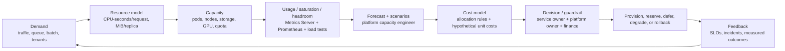

# Unit 1 — Platform Capacity Forecasting and Headroom

**Target file:** `01-platform-capacity-forecasting-and-headroom.md`  
**Module/unit:** Stage 2E — Production DevOps & Platform Engineering / M15 / Unit 1  
**Estimated study time:** 22–30 hours (reading 7–9 h; labs 12–16 h; review and decision defence 3–5 h)  
**Prerequisites:** Stages 0–2D and M01–M14; working knowledge of Python, pytest, Linux, Kubernetes/kind, resource requests/limits, HPA, SLOs, Prometheus basics, load testing, storage retention, quotas, and multi-region/DR concepts.  
**Core tools:** Metrics Server, `kubectl top`, HPA reuse, CSV/Python capacity model, pytest, local synthetic data.  
**Awareness:** Prometheus recording rules and `predict_linear`, Grafana, statsmodels, VPA recommendations, node provisioning and capacity commitments.  
**Last reviewed:** 2026-11-03  
**Tool baseline assumed:** Python 3.11+ [VERIFY]; pytest current supported release [VERIFY]; Kubernetes/kind versions compatible with the learner's M03–M14 lab [VERIFY]; Metrics Server release compatible with that cluster [VERIFY]; Prometheus/Grafana versions from the M11 lock/configuration [VERIFY]. Commands and metric names are version-sensitive where marked.  
**Stack profile required:** Cap-Core. Cap+Obs is optional for observability labs. Cap+Scale is not required.  
**Footprint:** Cap-Core should be small relative to the learner's existing kind cluster; actual CPU, memory, and disk use must be measured. Cap+Obs adds Prometheus/Grafana and can be material on an 8 GB machine — **measure yours** and start it only for Labs 6–7.  
**Prices used:** hypothetical cost units only.

> **Completion outcome:** You can produce a reproducible demand-to-resource forecast, derive defensible headroom by workload tier and failure domain, compare forecast models against a naive baseline, translate the result into node capacity and hypothetical unit economics, and operate a review/report/runbook without confusing a simulation with production evidence.

## Table of contents

- [Prerequisite handoff](#prerequisite-handoff)
- [Cross-module map and scope boundary](#cross-module-map-and-scope-boundary)
- [Learning contract and running example](#learning-contract-and-running-example)
- [Unit 1 — Platform capacity forecasting and headroom](#unit-1--platform-capacity-forecasting-and-headroom)
  - [1.0 Why this matters in production](#10-why-this-matters-in-production)
  - [1.1 Learning objectives](#11-learning-objectives)
  - [1.2 Concept map and vocabulary](#12-concept-map-and-vocabulary)
  - [1.3 Level 1 — Beginner](#13-level-1--beginner)
  - [1.4 Level 2 — Intermediate](#14-level-2--intermediate)
  - [1.5 Level 3 — Advanced](#15-level-3--advanced)
  - [1.6 Level 4 — Expert](#16-level-4--expert)
  - [1.7 SRE lens](#17-sre-lens)
  - [1.8 Security lens](#18-security-lens)
  - [1.9 Production checklist](#19-production-checklist)
  - [1.10 Hands-on lab set](#110-hands-on-lab-set)
  - [1.11 Self-check questions](#111-self-check-questions)
  - [1.12 Evidence artifacts](#112-evidence-artifacts)
  - [1.13 Common interview and design-review questions](#113-common-interview-and-design-review-questions)
  - [1.14 Sources and verification notes](#114-sources-and-verification-notes)

## Prerequisite handoff

*M10 Unit 6 taught the theory and failure patterns of capacity (Little's Law, the latency knee, queueing, N−1 headroom, retry amplification, backlog catch-up) and a first forecasting script; M11 Units 9 and 13 taught saturation observation, capacity reports, and load testing. This unit builds the **forecasting and headroom program** on those foundations: demand and resource modeling, forecasting methods with uncertainty and back-testing, headroom policy by failure mode and lead time, capacity reviews, and the link to cost — without re-deriving queueing theory.*

## Cross-module map and scope boundary

| Prior/later module | What is reused or handed off |
|---|---|
| M10 Unit 6 | Capacity theory and first forecast are assumed; this unit governs the forecast/headroom program. |
| M10 Units 8–9 | Operational readiness and error-budget policy provide review and incident context; not re-taught. |
| M11 Units 9 and 13 | Saturation signals, capacity reports, load tests, and resource-per-unit-of-work evidence are inputs. |
| M11 Unit 12 | Telemetry cost/cardinality are technical levers; M15 owns the financial model. |
| M03 Units 2, 6, 7 | Requests/limits, autoscaling/right-sizing, quotas, node pools, taints, and placement are assumed. HPA is reused, not re-taught. |
| M05/M07 | Storage/retention/orphan cleanup and quota/service-limit governance are applied. |
| M08 | Canary/blue-green rollout surge is included in headroom. Detailed release review is M15 Unit 7. |
| M13/M14 | DR, standby, failover, multi-region capacity, and quota parity inform scenarios. |
| M15 Units 3–6 and 8–12 | Budgets, allocation, idle cleanup, trade-offs, spot/preemptible, node provisioning, KEDA, OpenCost, and GPU economics are taught later. |
| M16/M17 | Golden paths/showback and broader capstone are forward references only. |

## Learning contract and running example

The running example is a hypothetical multi-team data/ML platform with an online inference API, batch ETL, stream consumers, ML training, notebooks, platform services, PostgreSQL/object storage, and two regions. All data and prices in examples are synthetic. The unit's job is not to decide every FinOps policy: it establishes the capacity evidence and the forecast-to-cost interface used by later M15 units.

Use these evidence labels consistently:

- `[MEASURED-LOCAL]`: output actually collected from the learner's local lab.
- `[SYNTHETIC]`: generated data with a documented seed and ground truth.
- `[ILLUSTRATIVE]`: invented numeric example used to explain a calculation.
- `[HYPOTHETICAL]`: invented cost unit or node catalog value, not a provider SKU.
- `[ASSUMPTION]`: policy/model input that requires an owner and review date.
- `[VERIFY]`: version, metric, API, compatibility, or external behavior not confirmed for the learner's exact installation.

No cloud account, paid service, real billing data, real cloud resource, or GPU is required. Never create billable resources merely to observe cost. Budget alerts are not guaranteed spending caps; billing data can be delayed; leaked credentials can create resources before an alert fires. Read-only-first is the default. Any optional real-cloud validation must be separately approved, time-bounded, and torn down with evidence.

### Stack profiles

| Profile | Components | Use |
|---|---|---|
| **Cap-Core** | Existing kind cluster, Metrics Server, HPA reuse, worksheet/Python scripts/tests | Required path and all synthetic forecasting/headroom labs. |
| **Cap+Obs** | Cap-Core plus minimal M11 Prometheus/Grafana | Optional Labs 6–7. Start only for those labs; measure footprint; stop afterwards. |
| **Cap+Scale** | Later kwok/bin-packing simulation | Not required in this unit. No real node provisioning. |

Recommended lifecycle: complete Labs 1–5 and 8–10 with Cap-Core; only then start Cap+Obs for Labs 6–7. Stop optional monitoring components after evidence capture using the M11 stack's documented commands. Do not guess Helm release names or namespace names; use the names in the learner's existing M11 manifests. If the stack cannot fit, use the synthetic fallback.

# Unit 1 — Platform capacity forecasting and headroom

**Target file:** `01-platform-capacity-forecasting-and-headroom.md` | **Estimated time:** 22–30 hours | **Prerequisites:** M01–M14 foundations listed above.

**Core tools:** Metrics Server, `kubectl top`, HPA reuse, transparent worksheet/CSV/Python model, pytest | **Awareness:** Prometheus forecasting/recording rules, Grafana, statsmodels, VPA recommendations, node provisioning/commitments | **Last reviewed:** 2026-11-03 | **Tool baseline assumed:** Python 3.11+ [VERIFY], pytest current [VERIFY], Kubernetes/kind/Metrics Server compatible versions [VERIFY], Prometheus/Grafana per M11 [VERIFY] | **Stack profile required:** Cap-Core; Cap+Obs for observability labs | **Footprint:** measure yours; optional observability stack may be material on 8 GB | **Prices used:** hypothetical cost units only

### 1.0 Why this matters in production

A service can have enough nominal CPU and still fail its latency SLO because memory, connections, network, quota, or a downstream dependency becomes the bottleneck. A forecast based on averages can miss a weekly batch peak or the loss of a node, while a forecast that extrapolates a one-off launch spike can create long-lived excess capacity. Autoscaling reacts to observed signals but cannot instantly obtain quota, storage, IP space, or a suitable GPU. Capacity planning connects measured demand, SLO-tested capacity, failure scenarios, lead time, and cost before a release or incident forces the decision.

### 1.1 Learning objectives

By completion, the learner can:

1. [L1] Define capacity at an SLO and distinguish offered demand, completed work, utilization, saturation, and headroom.
2. [L1] Explain requests, usage, limits, raw node capacity, and allocatable without conflating them.
3. [L1] Collect local resource snapshots and explain the limitations of Metrics Server and `kubectl top`.
4. [L2] Convert load-test evidence into CPU-seconds/request, memory-per-replica, replica, and node estimates.
5. [L2] Build and test a bin-packing model with node overhead, pod-density constraints, and stranded CPU/memory.
6. [L2] Generate reproducible synthetic demand and compare simple forecasts on time-ordered hold-outs.
7. [L3] Evaluate ETS/Holt–Winters and ARIMA-family methods, intervals, anomalies, and forecast errors against seasonal-naive.
8. [L3] Derive headroom by tier from failure, forecast error, lead time, burst, rollout, and maintenance scenarios without double-counting.
9. [L4] Operate a forecast review, risk register, weekly report, lead-time alert, and incident runbook with accountable owners.
10. [L4] Defend capacity and hypothetical cost decisions while communicating uncertainty and simulation limits.

### 1.2 Concept map and vocabulary



| Term | Precise definition | Common misconception |
|---|---|---|
| Capacity at SLO | Maximum sustained completed work rate while agreed latency/error/quality SLOs remain satisfied under stated conditions. | It is not the sum of machine CPU specifications. |
| Offered demand | Work arriving or being offered, whether or not the system completes it. | Successful throughput is not always demand; rejected/dropped work matters. |
| Utilization | Used resource divided by a clearly defined available/allocatable resource over a stated window. | One average percentage describes all bottlenecks. |
| Saturation | Evidence that demand is pressing against a constrained resource, often visible as queueing, throttling, pressure, or rising latency. | High utilization alone always means failure. |
| Headroom | **Capacity at SLO − expected peak demand**, in a compatible unit and comparable time window. | Any unused capacity is waste. |
| Request | Scheduler reservation used for placement and resource accounting. | A request is measured usage. |
| Usage | Resource actually consumed over a measurement interval. | A `kubectl top` snapshot is a long-term percentile. |
| Limit | Runtime upper constraint for a container resource where applicable. | The scheduler reserves the limit rather than the request. |
| Allocatable | Node capacity available to pods after system/kubelet reservations and other node-level deductions. DaemonSet pod requests also consume allocatable when scheduled. | Raw node capacity is fully available to application pods. |
| Forecast horizon | Future period the model predicts. | A model accurate for one hour is necessarily useful for a quarter. |
| Prediction interval | Range intended to express forecast uncertainty under model assumptions. | It is a guarantee that actual demand stays inside the range. |
| Stranded capacity | CPU or memory left unusable for the intended workload mix because resource shapes, pod density, or placement constraints do not fit. | Free CPU can always be used if memory is exhausted, or vice versa. |
| Seasonal-naive | Forecast repeats the value from the corresponding prior seasonal period. | It is simplistic and therefore never a useful baseline. |

#### Resource-planning matrix

| Resource | Demand signal | Capacity unit | Key failure mode | Data source | Owner |
|---|---|---|---|---|---|
| CPU | Requests/s, CPU-seconds/request, throttling | cores or millicores | latency knee, throttling | load test, cAdvisor/Prometheus [VERIFY] | service owner |
| Memory | working set, peak per replica, OOM history | bytes/MiB/GiB | OOM kill, eviction | Metrics Server snapshot, kubelet metrics [VERIFY] | service owner |
| Disk/storage | bytes written, retention, compaction, IOPS | bytes, IOPS, throughput | full volume, latency | storage metrics, application reports | data/platform owner |
| Network | ingress/egress, packet rate, cross-region transfer | bytes/s, packets/s | saturation, egress bottleneck | node/CNI/provider metrics [VERIFY] | platform owner |
| GPU | queue depth, GPU-hours/model, memory | GPU count, memory, GPU-hours | long queue, OOM, unavailable device | scheduler/device telemetry [VERIFY] | ML platform owner |
| Pods/nodes | replicas, pending pods, allocatable | count | unschedulable workload | Kubernetes API | platform owner |
| IP addresses | pods/services/LB allocations | addresses/prefixes | pod/service creation blocked | CNI/IPAM metrics [VERIFY] | network/platform owner |
| API/service quota | requests to external control plane | quota units | provisioning or launch blocked | service quota APIs/reports [VERIFY] | platform owner |
| DB connections | active/waiting connections, pool utilization | connections | pool exhaustion | PostgreSQL metrics [VERIFY] | database owner |

The bottleneck can move: after CPU is added, memory may constrain; after replicas increase, database connections or IP addresses may constrain; after compute is right-sized, storage I/O or network may dominate. Forecast each material resource separately.

#### Requests, usage, limits, and allocatable

- **Requests** are used by the scheduler for placement and by Kubernetes accounting. They represent what a workload asks the scheduler to reserve.
- **Usage** is observed consumption. A workload may use less or more than its request, subject to runtime constraints and node pressure.
- **Limits** constrain runtime consumption for resources with limit semantics; CPU limits can throttle, and memory limits can lead to OOM termination.
- **Raw capacity** is the node's nominal resource inventory. **Allocatable** is what Kubernetes exposes for pods after system/kubelet reservations. DaemonSet requests are then part of the scheduled pod requests consuming allocatable.
- For a node, a planning approximation is:
  `application allocatable budget = node allocatable − DaemonSet requests − other resident pod requests`.
  Keep the accounting boundary explicit; do not subtract DaemonSets twice if your source metric already reports remaining allocatable.

#### Capacity planning loop

1. Measure demand, resource use, saturation, and completed work.
2. Model resource per unit of work using load tests and production-like evidence.
3. Forecast by resource, service, tier, region, and horizon.
4. Set headroom against failure domains, uncertainty, bursts, and lead time.
5. Secure capacity: existing allocatable, quotas, storage, IPs, or approved procurement.
6. Verify by load/soak/failover test and compare predicted with observed.
7. Review errors, incidents, cost, assumptions, and decisions; feed the result back.

#### Worked example — synthetic inference demand

All numbers below are `[ILLUSTRATIVE]`, not measured production values.

- Peak offered demand: 240 requests/s.
- Tested sustainable throughput per replica while meeting the latency SLO: 40 requests/s/replica.
- Target operating utilization: 0.70 `[ASSUMPTION]`.
- Required replicas = `ceil(240 / (40 × 0.70)) = ceil(8.571...) = 9 replicas`.
- Each replica request: 0.5 CPU core and 768 MiB memory `[ILLUSTRATIVE]`.
- Total application requests: 4.5 CPU cores and 6,912 MiB.
- Suppose a hypothetical node has 4 allocatable CPU cores and 8,192 MiB allocatable memory before DaemonSet requests; DaemonSets consume 0.25 CPU and 512 MiB per node `[ILLUSTRATIVE]`. Two such nodes provide 7.5 CPU cores and 15,360 MiB for application pods after DaemonSets, but maximum pod density and failure tolerance still need checking.
- CPU request headroom is not simply `7.5 − 4.5`; it must survive the selected node/zone failure and fit pods after scheduling constraints.
- If the hypothetical cost model assigns 3 hypothetical cost units/node-hour, two nodes over 720 hours cost `2 × 3 × 720 = 4,320 hypothetical cost units/month`. This is a model output, not a cloud price.

The result establishes a transparent starting estimate under stated assumptions. It does not prove real capacity, latency, node availability, or provider cost. Only load tests and environment-specific validation can establish SLO capacity.

### 1.3 Level 1 — Beginner

#### First principles: what capacity tells you

Capacity is a service-level property: the maximum sustained work the system can complete while meeting its SLOs. A nominal machine can advertise CPU and memory, but the application may hit a database connection pool, lock contention, memory pressure, storage latency, a network limit, a GPU queue, or an external quota first.

Demand is offered work. If 1,000 requests arrive and 850 succeed while 150 are rejected or time out, completed throughput is not a safe substitute for demand. Record arrivals, completions, failures, queue depth, and latency together.

Utilization must name its denominator and window. For example, `CPU usage / CPU allocatable` differs from `CPU requests / CPU allocatable`. Saturation is about inability to absorb additional work without queueing, throttling, pressure, or SLO degradation. A low average can coexist with a damaging short peak.

**Headroom definition:** `headroom = capacity at SLO − expected peak demand`. Both terms must use the same unit (for example, requests/s) and comparable interval/conditions. If capacity is 300 requests/s at the latency SLO and expected peak demand is 240 requests/s, headroom is 60 requests/s. This is not equivalent to 20% of raw CPU.

Plan CPU, memory, disk/IOPS/throughput, network, GPU, nodes, pods, IP addresses, API/service quotas, and database connections. Different workload types stress different dimensions. Batch ETL may be throughput- and storage-bound; inference may be latency- and memory-bound; training may be GPU-memory and queue-bound; notebooks may be idle for long periods but create unpredictable GPU demand.

Demand growth has several shapes:

- Organic trend: gradual increase in requests, tenants, or data.
- Seasonality: daily, weekly, monthly, or yearly repetition.
- Step change: a launch, migration, new tenant, or architecture change.
- Batch cycle: a scheduled peak that repeats at a known window.
- Data growth: retained data, indexes, checkpoints, backups, and compaction.
- Incident spike and recovery: retry storms, backlog catch-up, or replay after an outage.

Inputs include historical usage percentiles, request volume, queue depth/backlog, load-test resource-per-request, release and campaign calendars, tenant/business forecasts, batch windows, storage retention/compaction behavior, and quota/service constraints.

#### Metrics Server and `kubectl top`

Metrics Server exposes recent resource usage for Kubernetes resource metrics consumers. It is suitable for a current operational snapshot, not a long historical series. It does not by itself provide weeks of history, percentiles over past peaks, forecast intervals, or SLO-tested capacity.

Safe local workflow (use your existing M03/M11 cluster and namespace names):

```bash
kubectl config current-context
kubectl get nodes
kubectl get pods -A
kubectl top nodes
kubectl top pods -A --containers
kubectl describe node <node-name>
```

If `kubectl top` reports that metrics are unavailable, inspect whether Metrics Server is installed and ready using your existing lab's manifests. Do not install an arbitrary version without checking compatibility. `[VERIFY]` Metrics Server flags, TLS settings, and Kubernetes compatibility vary by release.

Read the output as a recent snapshot. Compare it with requests/allocatable and workload behavior; do not infer a p95 or a monthly peak from one observation. Save timestamp, context, namespace, and command with any evidence. Avoid including secrets or tenant-identifying labels.

#### HPA is not a capacity plan

Reuse M03 Unit 6: HPA adjusts replica count in response to configured metrics and behavior. It can react to demand within its configured bounds and metric/scale response time. It cannot guarantee node capacity, quota increases, storage, IP availability, GPU availability, or a regional failover reserve. HPA is a control loop, not a forecast or procurement process.

#### Starter worksheet

Use a CSV with columns such as:

```csv
workload,peak_demand_rps,capacity_per_replica_rps,target_utilization,cpu_request_cores,memory_request_mib,replicas,node_shape,cost_units_per_node_hour,assumption_owner
inference,240,40,0.70,0.5,768,9,hyp-node-small,3,platform-team
```

Every assumption needs a unit, source/evidence, owner, confidence, and review date. Separate observed values from model assumptions. Monetary values are hypothetical cost units only.

**Beginner mistakes → symptom → fix**

| Mistake | Symptom | Fix |
|---|---|---|
| Sizing from average usage | peak latency or queue growth | use peak windows and percentiles; test the SLO knee |
| Treating request as usage | apparent waste or hidden contention | report requests, usage, limits, and allocatable separately |
| Treating `kubectl top` as history | forecast based on one moment | use M11 historical telemetry or synthetic time series |
| Using CPU as the only dimension | pods pending despite spare CPU | inspect memory, pod density, IPs, storage, quotas, connections |
| Assuming HPA creates nodes | pending replicas | model node and quota lead time separately |

### 1.4 Level 2 — Intermediate

#### Demand-to-resource model

Use M11 Unit 13 load-test evidence to estimate resource per unit of work. For a test interval:

- `CPU-seconds/request = total CPU-seconds consumed / completed requests` (use offered requests as an alternate denominator when failures are material; report both).
- `CPU cores needed = arrival rate (requests/s) × CPU-seconds/request / target CPU utilization`.
- `replicas = ceil(CPU cores needed / CPU request per replica)` only if CPU is the active bottleneck and the test validates that replica count against the SLO.
- Memory per replica is not generally additive per request; measure a stable working set and peak under the target concurrency, including startup and batch windows.
- Efficiency drift: compare CPU-seconds/request, MiB/replica, bytes processed/core-second, and cost units/job across releases. A code change can worsen efficiency even if traffic is unchanged.

A load test is useful only if workload mix, payload sizes, concurrency, cache state, data shape, dependency behavior, and SLO measurements are documented. Do not extrapolate beyond tested conditions without uncertainty.

#### Bottleneck diagnosis

| Signal | Likely bottleneck | Confirm with | Possible response |
|---|---|---|---|
| CPU throttling + latency | CPU limit/request or compute | cgroup/container metrics [VERIFY], load test | tune requests/limits, optimize code, add replicas |
| OOM/eviction | memory | working set, OOM events, node pressure | memory request/limit, reduce concurrency, split workload |
| high disk latency/queue | I/O | storage metrics [VERIFY] | storage class/tuning, batch shaping |
| network saturation | network | interface/CNI telemetry [VERIFY] | traffic shaping, placement, network capacity |
| GPU queue wait | GPU supply or scheduling | queue wait, device telemetry [VERIFY] | schedule windows, concurrency policy, suitable devices |
| Pending pods, `Too many pods` | pod density/IP | scheduler events, CNI/IPAM | node/pod CIDR design |
| external API throttling | service quota | API responses/quota report | quota plan, rate limit, backoff |
| DB pool exhaustion | connections | pool wait/active connections | pool sizing, query efficiency, DB capacity |

#### Pods-to-nodes and bin packing

A node catalog is a model, not a cloud SKU. Each hypothetical shape needs allocatable CPU/memory, maximum pods, per-node DaemonSet/system overhead, and hypothetical cost units/hour. Place indivisible pods while satisfying both CPU and memory and pod-density limits. A greedy bin-packer is a planning approximation; actual Kubernetes scheduling also considers topology, affinity, taints, volume constraints, extended resources, and scheduler plugins.

A pod may fit CPU but not memory; unused CPU is then stranded. Conversely, memory may remain while CPU is exhausted. Small nodes can have a larger overhead fraction because system and DaemonSet costs are paid per node. Large nodes may reduce that overhead but concentrate failure impact.

#### Runnable Cap-Core model

Create `capacity_model.py`:

```python
from dataclasses import dataclass
from math import ceil
from typing import Iterable

@dataclass(frozen=True)
class NodeShape:
    name: str
    alloc_cpu: float
    alloc_mem_mib: int
    daemon_cpu: float
    daemon_mem_mib: int
    max_pods: int
    cost_units_per_hour: float

@dataclass(frozen=True)
class Workload:
    name: str
    replicas: int
    cpu_request: float
    mem_request_mib: int

def validate(shape: NodeShape, workloads: Iterable[Workload]) -> None:
    if shape.alloc_cpu <= 0 or shape.alloc_mem_mib <= 0:
        raise ValueError("node allocatable resources must be positive")
    if shape.max_pods <= 0 or shape.daemon_cpu < 0 or shape.daemon_mem_mib < 0:
        raise ValueError("invalid node limits or overhead")
    if shape.daemon_cpu >= shape.alloc_cpu or shape.daemon_mem_mib >= shape.alloc_mem_mib:
        raise ValueError("daemon overhead must leave positive application capacity")
    for w in workloads:
        if w.replicas < 0 or w.cpu_request <= 0 or w.mem_request_mib <= 0:
            raise ValueError(f"invalid workload: {w.name}")

def pack(shape: NodeShape, workloads: Iterable[Workload]) -> dict:
    workloads = list(workloads)
    validate(shape, workloads)
    pods = [(w.name, w.cpu_request, w.mem_request_mib)
            for w in workloads for _ in range(w.replicas)]
    # First-fit decreasing by dominant normalized resource.
    pods.sort(key=lambda p: max(p[1] / (shape.alloc_cpu - shape.daemon_cpu),
                                p[2] / (shape.alloc_mem_mib - shape.daemon_mem_mib)),
              reverse=True)
    bins = []
    for name, cpu, mem in pods:
        if cpu > shape.alloc_cpu - shape.daemon_cpu or mem > shape.alloc_mem_mib - shape.daemon_mem_mib:
            raise ValueError(f"pod {name} cannot fit on this node shape")
        placed = False
        for b in bins:
            if (b["cpu"] + cpu <= shape.alloc_cpu - shape.daemon_cpu
                and b["mem"] + mem <= shape.alloc_mem_mib - shape.daemon_mem_mib
                and b["pods"] < shape.max_pods):
                b["cpu"] += cpu; b["mem"] += mem; b["pods"] += 1
                placed = True
                break
        if not placed:
            bins.append({"cpu": cpu, "mem": mem, "pods": 1})
    total_cpu = len(bins) * (shape.alloc_cpu - shape.daemon_cpu)
    total_mem = len(bins) * (shape.alloc_mem_mib - shape.daemon_mem_mib)
    used_cpu = sum(p[1] for p in pods)
    used_mem = sum(p[2] for p in pods)
    return {
        "node_shape": shape.name, "nodes": len(bins), "pods": len(pods),
        "requested_cpu": round(used_cpu, 3), "requested_mem_mib": used_mem,
        "app_cpu_capacity": round(total_cpu, 3), "app_mem_capacity_mib": total_mem,
        "stranded_cpu": round(total_cpu - used_cpu, 3),
        "stranded_mem_mib": total_mem - used_mem,
        "cpu_request_utilization": round(used_cpu / total_cpu, 4) if total_cpu else 0,
        "memory_request_utilization": round(used_mem / total_mem, 4) if total_mem else 0,
        "hypothetical_cost_units_per_hour": len(bins) * shape.cost_units_per_hour,
    }

if __name__ == "__main__":
    shape = NodeShape("hyp-small", 4.0, 8192, 0.25, 512, 20, 3.0)
    workloads = [Workload("inference", 9, 0.5, 768),
                 Workload("stream", 3, 0.25, 512)]
    print(pack(shape, workloads))
```

Create `test_capacity_model.py`:

```python
import pytest
from capacity_model import NodeShape, Workload, pack

def test_empty_workload_needs_no_nodes():
    s = NodeShape("hyp", 4, 8192, .2, 256, 20, 2)
    assert pack(s, [])["nodes"] == 0

def test_pod_density_creates_additional_node():
    s = NodeShape("hyp", 8, 16384, .2, 256, 2, 2)
    result = pack(s, [Workload("tiny", 3, .1, 128)])
    assert result["nodes"] == 2

def test_unfit_pod_is_rejected():
    s = NodeShape("hyp", 2, 2048, .2, 256, 10, 2)
    with pytest.raises(ValueError):
        pack(s, [Workload("large", 1, 3, 512)])

def test_invalid_replica_count_is_rejected():
    s = NodeShape("hyp", 4, 8192, .2, 256, 10, 2)
    with pytest.raises(ValueError):
        pack(s, [Workload("bad", -1, .2, 128)])
```

Run in a clean local folder:

```bash
python -m venv .venv
. .venv/bin/activate
python -m pip install pytest
python -m pytest -q
python capacity_model.py
```

The model uses first-fit decreasing and one node shape at a time. It does not emulate the Kubernetes scheduler or prove placement feasibility under affinity, topology, storage, or failure-domain constraints. Extend it to compare node shapes and include an explicit N−1 scenario.

#### Current headroom measurement and PromQL

Metrics Server and Prometheus are different data paths. `kubectl top` is a short-window resource snapshot. Prometheus can retain historical series if scrape targets and retention are configured. Do not assume every metric exists.

Examples below are **query patterns**, not guaranteed drop-in queries:

```promql
# kube-state-metrics: pod CPU requests by namespace [VERIFY]
sum by (namespace) (kube_pod_container_resource_requests{resource="cpu", unit="core"})

# kube-state-metrics: node allocatable CPU [VERIFY]
sum(kube_node_status_allocatable{resource="cpu", unit="core"})

# cAdvisor/kubelet: container CPU usage rate [VERIFY]
sum by (namespace, pod) (rate(container_cpu_usage_seconds_total[5m]))

# kube-state-metrics: memory requests [VERIFY]
sum by (namespace) (kube_pod_container_resource_requests{resource="memory", unit="byte"})

# cAdvisor/kubelet: working set [VERIFY]
sum by (namespace, pod) (container_memory_working_set_bytes)
```

Metric names/labels vary by exporter and version. Confirm actual series using Prometheus `/api/v1/label/__name__/values` or the UI's metric browser before using a query. `kube-state-metrics` must be installed for Kubernetes object-state metrics; cAdvisor/kubelet scrape configuration must expose container metrics. For p95/p99, retain a histogram or pre-aggregated time series with a valid aggregation strategy; do not calculate a percentile from a single current sample.

A useful dashboard has:
1. Demand and completed work by service.
2. Usage percentiles and requests/allocatable by resource.
3. Per-node pressure and pending pods.
4. Forecast range, headroom by failure domain, and lead time.
5. Stranded CPU/memory and model confidence/data freshness.

Cap+Obs optional recording rule example (verify source metrics and labels first):

```yaml
groups:
- name: capacity-daily
  interval: 5m
  rules:
  - record: namespace:container_cpu_usage_cores:sum
    expr: sum by (namespace) (rate(container_cpu_usage_seconds_total{container!=""}[5m]))
```

This is a pre-aggregation example, not a complete daily-peak rule. Retain suitable time series and use a scheduled report/query to calculate daily maxima/percentiles. Raw high-cardinality series and short retention may not preserve the history needed for quarterly forecasts.

#### Simple forecast methods

| Method | Captures | Strength | Failure mode | Data needed | Appropriate use |
|---|---|---|---|---|---|
| Linear trend/regression | average direction over time | transparent, cheap | ignores seasonality/step changes; spike distorts slope | ordered history | stable trend, short baseline |
| Seasonal-naive | repeats matching prior season | strong baseline for stable weekly pattern | fails after regime change or unusual events | at least one seasonal cycle | weekly traffic with recurring pattern |
| Moving average | local level | smooths noise | lags trend/step; window choice matters | recent observations | stable short-term smoothing |
| Holt–Winters/ETS | level, trend, seasonality | useful for recurring seasonal series | needs enough cycles; sensitive to structural changes | regular series | stable seasonal demand |
| ARIMA family | autocorrelation/differencing patterns | flexible time-series model | tuning/diagnostics/maintenance; weak with abrupt events | regular series and diagnostics | justified where baseline leaves structure |

Never extrapolate a temporary launch spike blindly. Flag the event, compare with normal demand, and use a separate scenario until the new baseline is established.

#### Headroom policy and calculator

Headroom must be tied to failure mode and time to add capacity. Consider: N−1 node/zone, upper forecast error, burst, rollout surge, maintenance drain, model uncertainty, autoscaler reaction, quota lead time, storage/IP/GPU constraints. There is no universal safe percentage.

Avoid double-counting. Use either:
- **Scenario/max method:** model mutually exclusive or overlapping scenarios (normal peak, node loss, rollout, burst) and choose the maximum required capacity across scenarios. Good when risks overlap or describe the same demand.
- **Sum method:** add explicitly independent allowances only when they are measured in the same resource unit and are not already included in forecast or scenario capacity. Good when independent buffers are intentionally stacked and the rationale is documented.

A simple worksheet:

| Component | Input | Formula / interpretation | Overlap check |
|---|---|---|---|
| Forecast peak | upper forecast bound, requests/s | demand planning baseline | excludes one-off anomalies unless modeled |
| N−1 | largest failure-domain capacity lost | recompute schedulable capacity after loss | do not add lost node twice |
| Forecast error | upper residual bound | peak forecast + residual allowance | do not add if upper forecast already includes it |
| Burst | observed peak-to-baseline uplift | scenario peak | may overlap seasonal peak |
| Rollout | surge replicas / blue-green overlap | additional pod requests | include only if rollout coincides with peak |
| Maintenance | nodes unavailable during drain | recompute remaining capacity | may overlap N−1 |
| Lead time | time to secure capacity | forecast demand through lead-time horizon | not itself a resource percentage |

#### Pattern catalogue

| Pattern | When to use | When NOT to use |
|---|---|---|
| Seasonal-naive baseline | stable weekly cycles | no repeatable seasonality |
| Service-level forecast then roll-up | heterogeneous workloads and local bottlenecks | telemetry too sparse/noisy to support per-service models |
| Scenario-based headroom | overlapping failures, launches, and maintenance | when scenario definitions hide independent risks |
| Resource-per-request model | stable workload mix and valid load-test evidence | payload/concurrency mix changed materially |
| Percentile-based right-sizing | representative history includes peaks/startup | history misses batch windows or incidents |
| Separate baseline and burst capacity | stable base plus variable demand | when burst capacity is not actually available |

#### Anti-pattern catalogue

| Bad practice | How it wastes money or harms reliability | Corrected practice |
|---|---|---|
| Average-only sizing | misses peaks and failure-domain loss | percentiles, peak windows, N−1, SLO tests |
| Forecasting only cluster totals | hides service-level bottlenecks | forecast services/resources then roll up |
| Treating HPA as capacity planning | scales pods into no available nodes | model node/quota/storage/IP lead time |
| Forecasting from one `kubectl top` | no historical context | use time series and documented windows |
| Adding every buffer mechanically | double-counts burst, rollout, and forecast error | scenario model with overlap register |
| Trusting VPA recommendation blindly | may miss startup or rare peak behavior | review against SLO, peaks, OOM, and load test |
| Using a complex model without baseline | adds operational cost without value | compare rolling-origin results with seasonal-naive |

### 1.5 Level 3 — Advanced

#### Decomposition and model choice

A useful conceptual decomposition is:

`observed demand(t) = trend(t) + seasonality(t) + event effect(t) + residual(t)`

The trend is long-run direction; seasonality is recurring structure; event effect captures known launches/migrations/incidents; residual is unexplained variation. A launch step can be a permanent regime change or a temporary event. An incident spike should not be treated as normal future demand unless the recovery/replay behavior is expected to recur.

Exponential smoothing updates a level estimate using recent observations. Holt adds trend. Holt–Winters/ETS adds seasonal structure. ARIMA-family methods model autocorrelation and differencing; they require diagnostics and careful handling of stationarity/seasonality. They are not automatically better than transparent baselines. `statsmodels` APIs and parameter behavior are `[VERSION-SENSITIVE]`; use its current official documentation only after recording the installed version.

Optional library experiment:

```bash
python -m pip install statsmodels  # optional; record exact resolved version
python -c "import statsmodels; print(statsmodels.__version__)"
```

```python
# Optional extension; input must be a regular, time-ordered series.
import pandas as pd
from statsmodels.tsa.holtwinters import ExponentialSmoothing

series = pd.read_csv("synthetic_metrics.csv", parse_dates=["timestamp"])
y = series.set_index("timestamp")["requests_per_second"].asfreq("h")
train = y.iloc[:-168]             # last 168 hourly observations held out
fit = ExponentialSmoothing(
    train, trend="add", seasonal="add", seasonal_periods=168,
    initialization_method="estimated"
).fit(optimized=True)
forecast = fit.forecast(168)
print(forecast.head())
```

This example assumes hourly data and a weekly seasonal period of 168. Confirm that the series is regular, non-missing, and contains enough complete seasonal cycles. If the dependency is unavailable or the model fails diagnostics, use the pure-Python linear and seasonal-naive baselines; do not block Cap-Core completion.

#### Regression with drivers and multi-resource forecasts

For CPU demand, a simple driver model is:

`CPU cores(t) ≈ requests_per_second(t) × CPU_seconds_per_request / target_utilization`

The traffic forecast and CPU/request estimate both have uncertainty. Tenant count, active users, data volume, experiment count, and batch size can be drivers, but correlation is not proof of causation. Validate relationships across releases and workload mixes.

Forecast CPU, memory, storage, GPU, network, DB connections, pod/IP capacity, and service quotas separately when their dynamics differ. Forecasting each service then rolling up preserves local bottleneck signals but increases model count and noise. Forecasting only a cluster aggregate is simpler but can conceal a service approaching exhaustion. Use service-level forecasts for critical tiers and roll up for aggregate planning.

#### Prediction intervals and rolling-origin back-testing

A forecast is a distribution/range, not a promise. One simple empirical interval uses residuals from prior rolling-origin forecasts: calculate the absolute or signed error distribution by horizon, then add a chosen residual quantile to the point forecast. The selected quantile is a risk policy, not a universal constant. A critical inference API may choose a more conservative bound than an interruptible backfill job. Example: use the 90th residual percentile `[ILLUSTRATIVE]`; this is a teaching assumption, not a recommended standard.

Use time-ordered rolling-origin evaluation:
1. Train on the earliest window.
2. Forecast the next horizon.
3. Move the origin forward while preserving chronology.
4. Aggregate errors by horizon and resource.
5. Compare every model with seasonal-naive on identical hold-outs.

Random shuffling leaks future information into training and makes time-series scores optimistic.

For actuals \(y_i\), forecasts \(\hat y_i\), and \(n\) observations:

- `MAE = mean(|y_i − ŷ_i|)` — interpretable in the original unit.
- `RMSE = sqrt(mean((y_i − ŷ_i)^2))` — penalizes large errors more heavily.
- `MAPE = mean(|(y_i − ŷ_i) / y_i|) × 100%` — undefined at zero and unstable near zero; do not silently drop zeros.
- `sMAPE = mean(2 × |y_i − ŷ_i| / (|y_i| + |ŷ_i|)) × 100%` — denominator is zero when both are zero; conventions vary, so state the implementation.

Percentage metrics can overemphasize low-volume periods. Report absolute error in resource units and peak-window error alongside percentage metrics. Avoid averaging percentages across heterogeneous services without a defensible weighting rule.

**Model decision rule:** a model that does not beat seasonal-naive on relevant hold-outs is not worth the added operating complexity unless a separately documented business constraint justifies it.

#### Anomaly handling and scenarios

Classify each event as:
- Exclude from training but preserve as a labeled stress test.
- Flag and retain if it represents a recurring operational risk.
- Model as an explicit event/step if the change is permanent or planned.

A bounded rolling-median detector can flag candidate anomalies: compare a point with the median of a preceding window and flag if deviation exceeds a documented robust threshold. Do not automatically delete it; an anomaly may be the exact failure mode capacity planning must survive.

Build low/base/high scenarios using explicit drivers: tenant onboarding, launch adoption, data growth, migration, and batch frequency. Probabilities can remain qualitative where evidence is insufficient. Keep the scenario assumptions separate from measured data.

#### Batch, data, ML, and notebook specifics

- **Batch window:** `required throughput = data volume ÷ processing window`. `[ILLUSTRATIVE]` 3.6 TiB over 6 hours requires 0.6 TiB/hour, or 614.4 GiB/hour using 1 TiB = 1,024 GiB. This is the minimum average throughput before retries, skew, setup, and safety margin.
- **Catch-up after outage:** if backlog volume is \(B\), normal arrival rate is \(\lambda\), and desired drain window is \(T\), service throughput must exceed arrivals by enough to drain backlog: `required processing rate = λ + B/T`. Validate against M10 Unit 6 assumptions; do not re-derive queueing theory.
- **Storage:** retained data, indexes, replicas, backups, and checkpoints all grow. Compaction may create a sawtooth: usage rises, compaction temporarily needs extra space, then drops. A straight line through the sawtooth may overpredict or miss peak free-space exhaustion.
- **Telemetry:** series cardinality and retention influence storage and query load; M11 Unit 12 owns technical telemetry levers. Include log growth and cardinality in the capacity forecast, not merely compute.
- **Training:** estimate experiment count × GPU-hours/model, queue-wait SLO, checkpoint write volume, and allowed concurrency. GPU count alone does not represent GPU memory fit or queue fairness.
- **Notebooks:** model diurnal active sessions, idle timeout policy, and uncertain GPU attachment. Do not assume every provisioned notebook is active continuously.

#### Headroom derivation from first principles

For each tier and resource, create scenarios instead of blindly adding every allowance. Example scenario set `[ILLUSTRATIVE]`:

| Scenario | Required capacity calculation | Why it exists |
|---|---|---|
| Normal peak | upper forecast demand | expected peak uncertainty |
| N−1 node | demand after largest node loss | node failure tolerance |
| N−1 zone | surviving-zone load after failover | zone failure tolerance |
| Release overlap | baseline + rollout/canary surge | temporary duplicate capacity |
| Maintenance | demand on remaining nodes while draining | upgrades and repairs |
| Lead-time window | forecast demand at date capacity can arrive | quota/procurement delay |
| Burst | observed burst factor applied to relevant baseline | short spikes |

Choose the maximum required capacity among scenarios when risks overlap. Sum allowances only if independent and not already represented in the scenario demand. For multi-region failover, calculate surviving-region load explicitly: if region A normally handles 60 units and B 40 units, A cannot be assumed to absorb B unless tested capacity and quota support 100 units at the tier's degraded SLO.

Capacity lead time includes autoscaler response, quota request, IP allocation, storage procurement, database scaling, GPU availability, and change approvals. Any example durations must be labeled `[ILLUSTRATIVE]`; never infer a provider lead time. Alert when predicted exhaustion date is earlier than `lead time + safety margin`, not merely because a short linear projection slopes upward.

#### Headroom by tier and right-sizing

| Tier | Headroom rationale | Policy shape |
|---|---|---|
| Tier-0 inference | strict latency/availability, bursty arrivals, high impact | larger scenario reserve, tested N−1, conservative rollout/maintenance policy |
| Stream processing | backlog and catch-up obligations | reserve based on arrival + drain requirement and queue-wait SLO |
| Scheduled ETL | deadline-bound, often deferrable | smaller baseline reserve may be acceptable if schedule can move and backlog is bounded |
| ML training | expensive, interruptible only if checkpoint-safe | queue-wait/concurrency target; separate flexible capacity |
| Notebooks/dev | diurnal and idle-prone | scheduled/scale-down policy with user-visible restart expectations |
| Platform services | control-plane dependencies | protect enough capacity to keep the platform operable during incidents |

CPU overcommit can be a deliberate policy when bursts are understood and throttling is measured. Memory is less forgiving: memory pressure can cause OOM/eviction and is not safely treated like compressible CPU demand. M03 requests/limits/QoS rules apply.

Right-sizing is a capacity source, not a blind optimization. Derive candidate CPU requests from percentiles over windows that include peaks (p95/p99 are candidate evidence, not universal mandates). Memory needs working-set peak plus justified margin, startup spikes, and OOM history. VPA recommendations are inputs, not decisions. Re-run M11 load/soak tests and verify SLOs before/after. Roll back if latency, error rate, throttling, OOM, or queue wait crosses the approved guardrail. Recompute after releases; M15 Unit 7 owns the detailed release review.

#### Node-shape decision table

All shapes and cost units below are `[HYPOTHETICAL]`.

| Shape | Allocatable CPU | Allocatable memory | DaemonSet CPU/memory | Pod cap | Cost units/node-hour | Benefit | Risk |
|---|---:|---:|---:|---:|---:|---|---|
| small | 4 cores | 8,192 MiB | 0.25 core / 512 MiB | 20 | 3 | smaller failure blast radius | overhead is a larger fraction |
| large | 8 cores | 32,768 MiB | 0.35 core / 768 MiB | 40 | 5 | better packing for large pods | larger per-node failure concentration |

Do not compare cost per node alone. Compare cost per SLO-compliant request/job, stranded CPU/memory, node count, failure-domain survival, and pod-density fit. Larger nodes may reduce overhead but increase blast radius. Actual node shapes must be derived from verified environment data; these are not real instance types.

#### Advanced trade-off table

| Option | Benefit | Cost (hypothetical units) | Risk | Choose when |
|---|---|---|---|---|
| More small nodes | smaller failure unit, flexible placement | higher per-node overhead | fragmentation and node count overhead | workload pods are small and fault isolation matters |
| Fewer large nodes | less overhead, potentially better packing | fewer nodes × larger unit cost | larger blast radius | workloads fit large shapes and failure testing passes |
| More headroom | absorbs uncertainty/failure | explicit hypothetical capacity cost | can become idle if policy is stale | SLO impact of shortage exceeds carrying cost |
| Right-size requests | frees schedulable capacity | engineering/test effort | throttling/OOM if wrong | representative data and rollback exist |
| Complex forecast model | may capture structure | compute, maintenance, review burden | model drift and false confidence | beats naive baseline and changes a decision |
| Flexible/interruptible capacity | can fit variable workloads | checkpoint/retry engineering | interruption and availability risk | jobs are restartable and fallback exists |

#### Defended-decision exercise

A team proposes reducing inference replicas because average CPU usage is low. Defend or reject the proposal using: peak-window p95/p99, memory working set, CPU throttling, load-test SLO, N−1 capacity, startup surge, database connections, and rollback thresholds. Your answer must state which evidence is missing and what experiment would resolve it. A percentage reduction without evidence is not an acceptable answer.

### 1.6 Level 4 — Expert

#### Capacity-management program

Operate a recurring program, not a one-off spreadsheet:

- Weekly automated report: top saturated resources, requests-versus-usage slack, forecast range, time-to-exhaustion, stranded capacity, data quality, and forecast accuracy.
- Monthly service review: demand drivers, forecast residuals, resource efficiency, headroom policy, upcoming launches, and quota/long-lead items.
- Quarterly architecture/finance review: regional failure scenarios, stable baseline versus variable peak, capacity commitments as concepts, cost of headroom, and major assumptions.
- Event-driven review: launch, migration, new tenant, model rollout, region failover, sustained forecast miss, or capacity incident.

#### Capacity risk register template

| Resource/service | Exhaustion range | Upper bound | Time to exhaustion | Lead time + margin | Failure domain | Owner | Mitigation | Status / next review |
|---|---|---|---|---|---|---|---|---|
| inference CPU / region-A | `[SYNTHETIC]` 18–25 days | `[SYNTHETIC]` 25 days | 18 days | `[ASSUMPTION]` 21 days | node/zone | inference owner | pre-scale or reduce rollout overlap | amber / weekly |

The filled row is synthetic and demonstrates format only. The register should link to the data window, model version, and decision record.

#### Weekly report: required fields

1. Report timestamp, source freshness, missing-data warnings, model version.
2. Top resource constraints by service and region.
3. Forecast point and interval by horizon.
4. Headroom by tier and failure scenario.
5. Requests versus usage percentiles; node/pod fragmentation.
6. Quota, IP, DB connection, storage, and GPU constraints.
7. Forecast accuracy by horizon versus seasonal-naive.
8. Actions, owners, due dates, and escalation status.

Cap-Core can generate this from synthetic CSV. Cap+Obs may add Prometheus queries after verifying metrics. Never imply that a local report is a cloud bill or a production capacity guarantee.

#### Predicted-exhaustion alerting

Prometheus `predict_linear` performs linear extrapolation over a range vector; it does not understand weekly seasonality, launches, or regime changes. Use it only for monotonic gauges with adequate history and validate against fixtures. A local equivalent can regress recent values, estimate time to a defined threshold, and require the forecast date to be earlier than lead time plus margin. Add suppression/annotation for known events and route alerts to a human-owned ticket; do not automatically delete or scale down resources.

#### Commitment planning concepts

Stable baseline demand may be a candidate for a committed/reserved capacity strategy; variable peaks may need flexible capacity. This is an awareness-level concept only. No provider discount, term, or pricing fact is stated here.

Use hypothetical cost units:

| Scenario | Average baseline units | Peak units | Flexible units needed | Hypothetical baseline commitment | Utilization of commitment | Unused exposure |
|---|---:|---:|---:|---:|---:|---:|
| low | 40 | 55 | 15 | 50 | 80% | 10 |
| base | 50 | 80 | 30 | 50 | 100% | 0 |
| high | 60 | 110 | 50 | 50 | 100% | 0 |

`[HYPOTHETICAL]` A commitment sized at 50 units appears fully utilized in base/high scenarios but has 10 units of unused exposure in the low scenario. If a migration reduces baseline to 30, unused exposure rises. Calculate total cost using locally defined hypothetical unit rates and explicit period; never insert real discounts. Compare regret: cost paid for unused committed capacity versus cost of flexible capacity under each scenario.

#### Multi-region, stateful, and long-lead resources

Forecast each region independently. For failover, calculate whether the surviving region can absorb the failed region's critical workload while meeting a tier-appropriate degraded SLO. Include quota parity, IP ranges, database replicas, object replication, cross-region network, and operational readiness. Active-active or warm standby is not free.

Storage, databases, IP space, and GPUs may be unavailable even when budget exists. A reservation is a way to reduce supply uncertainty; flexible capacity preserves choice but may not be available at the required time. Provider-specific reservation mechanics are awareness-only `[VERIFY]`.

#### Launch and incident plan

For launches and migrations, document demand scenarios, pre-scaling decision, change freeze window, quota confirmation, rollback trigger, and named decision owner. Coordinate with M10 error-budget/incident policy. If SLO burn is elevated, do not run an efficiency experiment that reduces safety margin.

#### Forecast-model operations (“MLOps-lite”)

Treat the forecast as a versioned pipeline:

`metrics/data → schema and freshness validation → feature/model build → rolling back-test → forecast report → human review → decision record → observed outcome`

Store input window, seed, code version, model parameters, baseline score, forecast horizon, interval method, and owner. CI should test units, monotonicity/shape invariants, missing data, no future leakage, and model-vs-baseline acceptance. Detect drift by tracking error by horizon/resource. Prefer simple models; complexity must earn its maintenance burden.

#### Organizational dynamics and Goodhart's law

Capacity hoarding occurs when teams reserve more than they need because they fear future scarcity. A capacity bank or fair-share model can make unused reservations visible, but must protect critical headroom and avoid punishing teams for legitimate peaks. Chargeback can encourage efficiency but may also incentivize teams to under-request and harm reliability. If utilization becomes a target, teams may pad requests to protect themselves or starve safety headroom to appear efficient. Measure outcomes and exceptions, not a single utilization score.

#### Incident diagnosis catalogue

| Symptom | Hypothesis | Test | Root cause pattern | Fix | Prevention |
|---|---|---|---|---|---|
| launch spike forecast for months | event treated as trend | compare event-labelled and normal windows | no event classification | model step/event separately | release calendar in forecast pipeline |
| peak arrives despite low average | average-only headroom | inspect peak and SLO timeline | wrong statistic/window | percentile/scenario policy | review peak windows and N−1 |
| pods pending on small nodes | DaemonSet overhead omitted | recalc allocatable and per-node overhead | raw capacity used | update node model | inventory system/DaemonSet requests |
| launch blocked by quota | lead time omitted | compare request date and quota approval | capacity model ended at compute | escalate quota early | quota risk register |
| MAPE looks excellent off-peak | near-zero denominators dominate | inspect absolute peak error | metric aggregation flaw | MAE/RMSE and peak error | publish metric caveats |
| one node loss causes throttling | N−1 not funded/tested | simulate node loss | no failure-domain reserve | add/test resilient capacity | scheduled N−1 exercise |
| commitment unused after migration | commitment sized to peak | compare baseline before/after | variable demand treated as stable | re-evaluate exposure | migration scenario in review |
| storage pages during compaction | sawtooth ignored | inspect free-space during compaction | linear trend misses transient peak | include compaction workspace | storage peak/retention test |

#### Runbook: forecasted capacity exhaustion

| Phase | Operator action |
|---|---|
| Trigger | Forecast upper bound crosses exhaustion threshold before lead time + margin; or saturation/SLO alert fires. |
| Decide | Validate data freshness, metric source, model version, event labels, current SLO, and affected failure domain. |
| Act | Choose bounded action: pre-scale within approved quota, move deferrable batch, pause non-critical experiments, request quota, or invoke degraded-mode plan. Do not auto-delete or scale down critical resources. |
| Verify | Confirm scheduling, resource pressure, latency/error SLO, queue drain, and headroom after action. |
| Communicate | Notify service/platform owner and incident channel with evidence, assumptions, decision, and next update. |
| Follow-up | Back-test miss, update assumptions/model, create owner/due date, and record whether the action changed cost or reliability. |

Every automation needs an allowlist, maximum change, rate limit, audit log, dry-run, rollback, alert, and human escalation.

### 1.7 SRE lens

#### SLIs, SLOs, and KPIs

| KPI | Calculation | Window/owner | Interpretation | Gaming/misread risk |
|---|---|---|---|---|
| Forecast error | MAE/RMSE by resource and horizon | weekly; capacity owner | how wrong the forecast is | aggregate hides peak error |
| Headroom attainment | intervals with measured capacity ≥ policy requirement / eligible intervals | daily/weekly; platform owner | whether reserve existed | lower target can make score look good |
| Time to provision | request timestamp to usable capacity | per event; platform owner | actual lead time | excludes quota approval or validation |
| Data completeness | valid expected samples / expected samples | daily; observability owner | trustworthiness of forecast input | high completeness can still be biased |
| Capacity incident share | capacity-attributed incidents / all incidents | monthly; SRE | capacity's reliability impact | attribution politics |
| Unit efficiency | CPU-seconds/request, bytes/core-second, GPU-hours/model | per release/job; service owner | efficiency trend | mix changes distort comparisons |
| Cost of headroom | reserve units × hypothetical unit cost per unit-period | monthly; platform + finance | explicit resilience carrying cost | model allocation may differ from invoice |
| Forecast drift | rolling error versus baseline/control band | weekly; capacity owner | model degradation | alerting on noisy short windows |

SLOs remain service-level outcomes: latency, availability, error rate, freshness, queue wait, and batch deadline attainment. Capacity KPIs explain risk; they do not replace SLOs.

**Failure modes and blast radius:** a false positive can trigger unnecessary pre-scaling or commitments; a false negative can cause overload; a bad right-sizing recommendation can create throttling/OOM; an alert storm can hide real exhaustion; a faulty automation can remove capacity during a critical event. Use human approval for high-impact actions and cap automation's blast radius.

**Cost and capacity notes:** report measured resource units separately from hypothetical cost units. For example, `2 nodes × 3 hypothetical cost units/node-hour × 720 hours = 4,320 hypothetical cost units/month` `[HYPOTHETICAL]`. This is only a model; allocation, utilization, shared overhead, and invoice reconciliation are later M15 topics.

### 1.8 Security lens

| Threat | Control | Concrete negative test |
|---|---|---|
| Over-privileged capacity identity | read-only metrics/report identity; separate narrowly scoped scale identity | attempt a write with report identity; expect authorization denied |
| Capacity/cost data exposure | restrict dashboards and exports; aggregate tenant data; redact identifiers | access report as unauthorized test principal; expect denial |
| Autoscaling abuse / denial-of-wallet | min/max replicas, quota, rate limits, anomaly alerts, approval for exceptional scale | synthetic demand spike must not exceed configured model ceiling |
| Cryptomining/unauthorized growth | workload admission, resource quotas, image provenance, workload ownership | submit an unowned workload fixture; it must be rejected or flagged |
| Leaked credentials | no credentials in lab; secret scanning; short-lived identity in real systems | scan workspace and confirm no test secret is committed |
| Label/ownership tampering | admission validation and immutable/audited ownership metadata | mutate required owner label; policy/report must reject or flag it |
| Unsafe scale-down/cleanup | dry-run, allowlist, PDB/SLO checks, human gate, rollback | simulate a critical workload target; automation must refuse scale-down |

The local lab does not validate cloud IAM, provider billing protections, real attack detection, GPU isolation, or enterprise policy enforcement. Do not paste real credentials or billing exports into the lab.

### 1.9 Production checklist

- [ ] Capacity is defined as sustained work at a named SLO and workload mix.
- [ ] Offered demand, completed work, rejected work, and backlog are measured separately.
- [ ] CPU, memory, storage/I/O, network, GPU, pods/nodes, IPs, quotas, and DB connections are considered.
- [ ] Requests, usage, limits, raw capacity, and allocatable are separately reported.
- [ ] Data freshness, missing intervals, label changes, and event annotations are checked.
- [ ] Forecast uses a seasonal-naive baseline and time-ordered hold-outs.
- [ ] Prediction interval and error by horizon are published.
- [ ] Launches/incidents are flagged, excluded with rationale, or explicitly modelled.
- [ ] Headroom rationale covers N−1, burst, forecast error, rollout, maintenance, and lead time.
- [ ] Overlap/double-counting is documented in a scenario matrix.
- [ ] Quota, IP, storage, DB, and GPU availability constraints are reviewed.
- [ ] Right-sizing is load-tested against SLO and has rollback thresholds.
- [ ] Node model includes allocatable, DaemonSets, pod density, fragmentation, and failure domains.
- [ ] Cost uses only hypothetical units in this learning environment and is not represented as an invoice.
- [ ] Forecast owner, service owner, platform owner, finance partner, cadence, and due dates are assigned.
- [ ] Alerts have lead-time logic, false-positive handling, escalation, and no unsafe automatic deletion.
- [ ] N−1/failover and rollout scenarios have evidence.
- [ ] Cleanup is scoped to lab-created resources and verified.

### 1.10 Hands-on lab set

All ten labs are required as learning outcomes. Labs 1–5 and 8–10 use Cap-Core; Labs 6–7 document Cap+Obs with a synthetic fallback. Each lab is safe to rerun. Run them in order so later evidence reuses earlier outputs.

#### Master lab table

| ID | Goal | Profile | Main evidence |
|---|---|---|---|
| L1 | Capacity and unit-economics worksheet | Cap-Core | CSV, assumptions, model output, tests |
| L2 | Synthetic metrics generator | Cap-Core | deterministic 4–8 week series, ground truth |
| L3 | Forecast bake-off | Cap-Core; library optional | rolling-origin metrics, intervals, baseline comparison |
| L4 | Headroom derivation | Cap-Core | tested scenario calculator and sensitivity |
| L5 | Cluster fragmentation/node-shape comparison | Cap-Core | shape comparison and recommendation |
| L6 | Capacity dashboard and weekly report | Cap+Obs optional | dashboard/query/report or synthetic fallback |
| L7 | Predicted-exhaustion alert | Cap+Obs optional | rule/fixtures or local equivalent |
| L8 | Commitment-vs-on-demand model | Cap-Core | hypothetical scenario/regret table |
| L9 | Capacity review and scenario plan | Cap-Core | filled review, risk register, scenario plan |
| L10 | Right-sizing and safety review | Cap-Core; Cap+Obs optional | recommendation, load-test evidence, rollback |

#### Shared workspace bootstrap

Create an isolated workspace; do not create or edit files in the supplied repository.

```bash
mkdir -p ~/m15-unit1-labs/{data,outputs,tests,docs}
cd ~/m15-unit1-labs
python3 -m venv .venv
. .venv/bin/activate
python -m pip install --upgrade pip
python -m pip install pytest
```

Save all lab files under this workspace. Add a `README.md` recording Python version, OS, cluster context, profile, commands, seed, and cleanup. If kind is not running, do not create a larger cluster solely for this unit; synthetic Cap-Core labs are still valid.

#### L1 — Capacity and unit-economics worksheet

- **Goal:** Trace demand → per-replica requests → replicas/pods → hypothetical nodes → utilization/stranded resources → headroom → hypothetical cost.
- **Profile/prerequisites:** Cap-Core; Python and CSV; M03 requests/limits; M11 load-test results (synthetic fallback permitted).
- **Inputs/files:** `capacity_model.py`, `test_capacity_model.py`, `data/workloads.csv`, `data/node_catalog.csv`, `docs/assumptions.csv`.
- **Steps:** (1) Create workload rows for inference, stream, ETL, training, and notebooks. (2) Record peak demand and resource-per-unit-of-work with evidence labels. (3) Define two hypothetical node shapes with allocatable CPU/memory, DaemonSet overhead, pod cap, and hypothetical cost units/hour. (4) Run the model and tests. (5) Calculate headroom by compatible unit and period. (6) Record every assumption's owner/confidence/review date.
- **Assumptions:** node shapes and cost units are `[HYPOTHETICAL]`; resource demands are `[SYNTHETIC]` unless collected locally.
- **Expected evidence:** model reports nodes, requested CPU/memory, application capacity, stranded CPU/memory, utilization, and hypothetical cost units/hour.
- **Verification:** `python -m pytest -q`; inspect dimensional units; verify no monetary amount lacks the hypothetical label.
- **Cleanup/stop-start:** no cluster required; deactivate `.venv` when done. Rerun overwrites only files in this lab workspace.
- **Stretch:** add N−1 node loss and compare two node shapes.
- **Fidelity caveat:** greedy packing is not Kubernetes scheduling; hypothetical costs are not provider prices.

#### L2 — Synthetic metrics generator

- **Goal:** Generate 4–8 weeks of deterministic hourly time series with trend, daily/weekly seasonality, noise, a launch step, incident spike, and storage sawtooth.
- **Profile/prerequisites:** Cap-Core; Python standard library.
- **Inputs/files:** `generate_metrics.py`; output `data/synthetic_metrics.csv`; `docs/ground-truth.md`.
- **Steps:** use a fixed seed; generate 56 days hourly `[ILLUSTRATIVE]`; include columns `timestamp_utc,requests_per_second,cpu_seconds_per_request,memory_mib,queue_depth,storage_gib,event_label`; write event start/end and expected shape to ground truth; run generator twice and compare hashes.
- **Assumptions:** UTC timestamps, hourly sampling, seed fixed in source, units documented; all observations synthetic.
- **Expected evidence:** identical output for same seed; launch step and incident spike are labeled; storage shows periodic compaction sawtooth.
- **Verification:** assert row count, monotonic timestamps, non-negative values, expected event labels, and deterministic hash.
- **Cleanup/stop-start:** pure Python; remove only `data/synthetic_metrics.csv` if regenerating; no cluster.
- **Stretch:** create a second seed and compare forecast stability.
- **Fidelity caveat:** synthetic shape tests pipeline logic, not real demand distributions or production forecast accuracy.

Example starter generator:

```python
import csv, math, random
from datetime import datetime, timedelta, timezone

SEED = 20261103
HOURS = 56 * 24
rng = random.Random(SEED)
start = datetime(2026, 1, 5, tzinfo=timezone.utc)

with open("data/synthetic_metrics.csv", "w", newline="") as f:
    fields = ["timestamp_utc", "requests_per_second", "cpu_seconds_per_request",
              "memory_mib", "queue_depth", "storage_gib", "event_label"]
    w = csv.DictWriter(f, fieldnames=fields); w.writeheader()
    for h in range(HOURS):
        t = start + timedelta(hours=h)
        daily = 1 + 0.18 * math.sin(2 * math.pi * (t.hour / 24))
        weekly = 1 + (0.25 if t.weekday() < 5 else -0.10)
        trend = 80 + 0.12 * h
        launch = 35 if h >= 24 * 28 else 0
        incident = 90 if 24 * 35 <= h < 24 * 35 + 5 else 0
        noise = rng.gauss(0, 4)
        rps = max(0, (trend + launch + incident + noise) * daily * weekly)
        storage = 500 + 0.8 * h - (18 if h % (24 * 7) >= 24 * 6 else 0)
        label = "launch" if h == 24 * 28 else "incident" if incident else "normal"
        w.writerow({
            "timestamp_utc": t.isoformat(),
            "requests_per_second": round(rps, 3),
            "cpu_seconds_per_request": round(0.012 + rng.random() * 0.002, 5),
            "memory_mib": round(900 + rps * 1.2, 2),
            "queue_depth": round(max(0, (rps - 160) * 2), 2),
            "storage_gib": round(storage, 2),
            "event_label": label
        })
```

This is a starter exercise: document event windows precisely in `ground-truth.md`; a single event label at the first launch hour marks the step's onset, not its full duration.

#### L3 — Forecast bake-off

- **Goal:** Compare linear trend, seasonal-naive (same hour last week), and optional Holt–Winters/ETS using rolling-origin hold-outs.
- **Profile/prerequisites:** Cap-Core; L2 data; optional `statsmodels` only after the baseline.
- **Inputs/files:** `forecast_bakeoff.py`, `data/synthetic_metrics.csv`, `outputs/forecast_scores.csv`, `docs/forecast-method.md`.
- **Steps:** (1) Keep chronology; reserve final 7 days as a hold-out. (2) Create multiple rolling origins. (3) Fit linear trend only on each training window. (4) Seasonal-naive uses `y[t-168]` for hourly weekly seasonality. (5) Optional ETS uses training data only. (6) Calculate MAE, RMSE, MAPE with zero handling, and sMAPE with stated convention. (7) Build residual interval by horizon. (8) Compare normal-only training with event-flagged/step-aware training.
- **Assumptions:** hourly regular series; weekly period 168; event labels are ground truth; all forecast outputs are estimates.
- **Expected evidence:** scores by model and horizon, residual distribution, peak-window error, and written decision whether complexity beats seasonal-naive.
- **Verification:** assert no train index is later than forecast origin; report zero/near-zero counts; check forecast arrays align with actual timestamps.
- **Cleanup/stop-start:** no services; keep outputs for L4/L9.
- **Stretch:** compare base/high/low scenarios and a driver regression.
- **Fidelity caveat:** the synthetic process is known to the learner and easier than production regime changes; intervals are empirical and not guarantees.

#### L4 — Headroom derivation

- **Goal:** Derive headroom by tier from N−1, forecast error, lead time, burst, deployment surge, maintenance, and uncertainty.
- **Profile/prerequisites:** Cap-Core; L1/L3 outputs.
- **Inputs/files:** `headroom.py`, `data/headroom_inputs.csv`, `outputs/headroom_sensitivity.csv`.
- **Steps:** (1) Define each scenario in requests/s, cores, MiB, nodes, or time — never mix units. (2) Calculate demand at the end of the lead-time horizon. (3) Recompute capacity after largest node/zone loss. (4) Add rollout/maintenance only when not already represented. (5) Compare max-of-scenarios with sum-of-independent-allowances. (6) vary each assumption and record sensitivity.
- **Assumptions:** scenario probabilities may be qualitative; lead times are learner assumptions, not provider facts.
- **Expected evidence:** per-tier minimum capacity, headroom in named units, overlap matrix, and sensitivity table.
- **Verification:** tests for zero demand, invalid negative values, and scenario overlap; arithmetic independently recalculated.
- **Cleanup/stop-start:** pure Python; no cluster.
- **Stretch:** add multi-zone and quota parity scenario.
- **Fidelity caveat:** local scenario model does not prove actual failover or capacity supply.

#### L5 — Cluster fragmentation and node-shape comparison

- **Goal:** Compare at least two hypothetical node shapes with CPU/memory fit, DaemonSet overhead, pod density, stranded capacity, node count, and hypothetical cost.
- **Profile/prerequisites:** Cap-Core; L1 model.
- **Inputs/files:** `node_catalog.csv`, `workloads.csv`, `fragmentation.py`, `outputs/node_shape_comparison.csv`.
- **Steps:** (1) Use the hypothetical small/large shapes from Level 3. (2) Pack identical workloads. (3) compute overhead fraction per node and stranded CPU/memory. (4) simulate loss of one node. (5) recommend a shape for inference and a separate shape for batch if justified.
- **Assumptions:** catalog values are hypothetical; bin-packing algorithm is approximate.
- **Expected evidence:** node counts, fit failures, stranded resources, cost units/hour, N−1 result, blast-radius discussion.
- **Verification:** unit tests for pod density, oversized pods, zero pods, and resource arithmetic.
- **Cleanup/stop-start:** no cluster; no external services.
- **Stretch:** add topology/taint constraints to the simulator.
- **Fidelity caveat:** not the Kubernetes scheduler; no real provider SKU or price.

#### L6 — Capacity dashboard and weekly report

- **Goal:** Report requested vs allocatable vs usage percentiles, headroom, saturation, and stranded capacity.
- **Profile/prerequisites:** Cap+Obs optional; M11 minimal stack; L1/L2 data.
- **Inputs/files:** dashboard JSON or provisioning source, PromQL query file, `weekly_report.py`, tests, synthetic fallback CSV.
- **Steps:** (1) First run synthetic fallback and verify report. (2) If laptop capacity permits, start the existing M11 minimal Prometheus/Grafana stack. (3) inspect available metric names and labels. (4) adapt queries only to confirmed metrics. (5) export dashboard-as-code and report. (6) stop the optional stack using M11's documented commands.
- **Assumptions:** kube-state-metrics/cAdvisor availability is `[VERIFY]`; metrics are not guaranteed in Cap-Core.
- **Expected evidence:** dashboard/report plus metric-source inventory and freshness warnings.
- **Verification:** report tests on fixture CSV; PromQL checked in UI/API; compare requests and usage units.
- **Cleanup/stop-start:** start only M11 minimal profile; stop Prometheus/Grafana after evidence; do not delete M11 shared namespace.
- **Stretch:** add forecast interval and top-5 risk list.
- **Fidelity caveat:** local metrics and synthetic prices do not represent cloud billing or production retention.

#### L7 — Predicted-exhaustion alert

- **Goal:** Implement lead-time-aware exhaustion alert using `predict_linear` or local regression; test sawtooth and step-change fixtures.
- **Profile/prerequisites:** Cap+Obs optional; L2 time series; L6 metrics if using Prometheus.
- **Inputs/files:** `capacity_alert.py`; optional `capacity.rules.yml`, `capacity.rules.test.yml`; fixtures `sawtooth.csv`, `step_change.csv`.
- **Steps:** (1) Define the threshold and resource unit. (2) Estimate exhaustion date with sufficient history. (3) alert only if date is earlier than lead time plus margin. (4) annotate event windows. (5) if using Prometheus, run `promtool test rules` using a version compatible with the installed Prometheus [VERIFY]. (6) inspect false positives around compaction sawtooth and step changes.
- **Assumptions:** local equivalent may be used if Prometheus is too heavy; `predict_linear` is not seasonal forecasting.
- **Expected evidence:** alert logic, fixtures, test output, lead-time rationale, false-positive/negative review.
- **Verification:** tests assert no alert for temporary sawtooth that recovers and alert for sustained threshold crossing before lead-time boundary.
- **Cleanup/stop-start:** stop Cap+Obs after tests; keep rule files in workspace.
- **Stretch:** add forecast residual interval to the alert.
- **Fidelity caveat:** fixture tests validate rule logic only; they do not establish actual provider provisioning time.

#### L8 — Commitment-vs-on-demand strategy model

- **Goal:** Compare stable baseline commitment concepts with flexible capacity across low/base/high scenarios.
- **Profile/prerequisites:** Cap-Core; Python/CSV; L1/L3 forecast scenarios.
- **Inputs/files:** `commitment_model.py`, `data/demand_scenarios.csv`, `outputs/commitment_regret.csv`.
- **Steps:** (1) Define a hypothetical baseline capacity quantity and hypothetical cost units per unit-period. (2) define low/base/high demand. (3) calculate commitment coverage, utilization, flexible remainder, unused exposure, and regret. (4) simulate migration lowering baseline. (5) document why no provider discount or term is assumed.
- **Assumptions:** all rates and quantities are hypothetical; period is explicitly named (e.g., model-month).
- **Expected evidence:** scenario table and recommendation that states sensitivity to forecast error.
- **Verification:** tests for utilization bounds and unused exposure; recalculate all rows by hand.
- **Cleanup/stop-start:** no service; keep model outputs.
- **Stretch:** compare commitment sizes under a wider forecast interval.
- **Fidelity caveat:** conceptual economics only; no provider contract, discount, or commercial term is represented.

#### L9 — Capacity review and scenario plan

- **Goal:** Produce a filled capacity review for the running platform, with base/high/low scenarios, risks, owners, dates, and multi-region/failover considerations.
- **Profile/prerequisites:** Cap-Core; L1–L5 and L8 outputs.
- **Inputs/files:** `docs/capacity-review.md`, `docs/capacity-risk-register.csv`, `docs/decision-record.md`.
- **Steps:** (1) State current capacity and evidence window. (2) publish forecast range by service/resource. (3) identify bottlenecks and headroom by tier. (4) calculate N−1 and region failover arithmetic. (5) list quota/storage/IP/DB constraints. (6) assign action owners and due dates. (7) record decisions and reversibility.
- **Assumptions:** synthetic values must be labelled; owner names may be role names rather than personal data.
- **Expected evidence:** completed review, scenario plan, risk register, decision record, and action list.
- **Verification:** every action has an owner/date; every forecast has units/horizon; every risk has mitigation/status.
- **Cleanup/stop-start:** no services; review files remain in workspace.
- **Stretch:** conduct a mock monthly review with a peer.
- **Fidelity caveat:** document is a practice review, not an approved production capacity commitment.

#### L10 — Right-sizing recommendation and safety review

- **Goal:** Recommend resource requests from percentiles and test the change without violating SLOs.
- **Profile/prerequisites:** Cap-Core; M11 load-test method; historical/synthetic usage window; VPA recommendation optional.
- **Inputs/files:** `docs/right-sizing-review.md`, before/after load-test outputs, rollback criteria.
- **Steps:** (1) collect CPU p95/p99 and memory working-set peaks across normal, peak, startup, and batch windows. (2) inspect OOM/throttling/eviction history. (3) compare requests and VPA recommendation if available. (4) propose a bounded change. (5) run identical before/after load profile. (6) compare latency/error/throughput/queue wait and failure behavior. (7) revert if any approved guardrail fails.
- **Assumptions:** percentiles and safety margins are workload-specific; VPA data may not be available; all results are local/synthetic unless measured.
- **Expected evidence:** recommendation with uncertainty, test protocol, before/after results, SLO evaluation, rollback decision.
- **Verification:** same workload profile and duration; no hidden changes; compare peak and tail metrics, not just averages.
- **Cleanup/stop-start:** revert lab-only manifests; do not modify shared platform defaults; stop load generator.
- **Stretch:** repeat under one-node-loss or rolling-update scenario.
- **Fidelity caveat:** local kind results cannot prove cloud network, storage, GPU, or managed-service performance.

### 1.11 Self-check questions

1. **A service handles 200 requests/s at its latency SLO and forecast peak is 160 requests/s. What is headroom?**  
   **Answer:** 40 requests/s, assuming same workload mix and time window. **Tempting wrong answer:** 20% because that is a ratio, not the requested absolute headroom.
2. **Why is `kubectl top pods` insufficient for a monthly forecast?**  
   **Answer:** It is a recent snapshot/short window, not retained historical percentiles or a forecast. **Tempting wrong answer:** it reports CPU and memory, so it must be enough.
3. **A pod requests 1 CPU, uses 200m now, and has a 2 CPU limit. What do these mean?**  
   **Answer:** Scheduler reservation is 1 CPU; current usage is 200m; runtime ceiling is 2 CPU; none equals node allocatable. **Tempting wrong answer:** scheduler reserves 2 CPU because that is the limit.
4. **Why use seasonal-naive in a forecast bake-off?**  
   **Answer:** It is a strong transparent baseline for repeating seasonality; complexity must demonstrate improvement. **Tempting wrong answer:** a simple method cannot be competitive.
5. **Why can MAPE be misleading for off-peak data?**  
   **Answer:** Near-zero actual values make percentage errors unstable or undefined and can dominate interpretation. **Tempting wrong answer:** percentages are always comparable across all series.
6. **When should headroom allowances be summed versus modeled as scenarios?**  
   **Answer:** Sum only independent, non-overlapping allowances; use max/scenario when risks overlap or represent alternative failure conditions. **Tempting wrong answer:** adding every buffer is always safer.
7. **A node has spare CPU but a pod cannot schedule due to memory. Is CPU headroom usable?**  
   **Answer:** Not for that pod shape; memory is the binding resource and CPU is stranded for this placement. **Tempting wrong answer:** total free resources should be enough.
8. **Why does quota lead time belong in capacity planning?**  
   **Answer:** compute may be available but cannot be provisioned until quota approval; the lead time can exceed autoscaler response. **Tempting wrong answer:** autoscaling handles all capacity constraints.
9. **A sophisticated model has lower overall MAE but misses peak demand more often than seasonal-naive. What next?**  
   **Answer:** evaluate peak-window/horizon risk and SLO impact; do not deploy based on aggregate MAE alone. **Tempting wrong answer:** lower aggregate error automatically wins.
10. **What does the hypothetical cost of headroom represent?**  
    **Answer:** modeled carrying cost for resilience capacity over a stated period, not necessarily invoice cost. **Tempting wrong answer:** it is the exact cloud bill.

### 1.12 Evidence artifacts

Save these under the isolated learner workspace; do not upload or copy them into the supplied repository as part of this unit.

| Artifact | Required contents / acceptance criteria |
|---|---|
| `README.md` | prerequisites, environment, profile, run commands, seed, start/stop, cleanup |
| `docs/assumptions.csv` | value, unit, evidence, owner, confidence, review date, impact if wrong |
| `data/synthetic_metrics.csv` + `docs/ground-truth.md` | seed, UTC, interval, units, trend/seasonality/events/anomaly labels |
| `capacity_model.py` + tests | validated inputs, node/replica model, stranded resources, test output |
| `outputs/capacity-worksheet.csv` | demand-to-resource-to-node-to-headroom-to-hypothetical-cost trace |
| `forecast_bakeoff.py` + `outputs/forecast_scores.csv` | rolling origins, seasonal-naive baseline, metrics, intervals, anomaly treatment |
| `headroom.py` + tests | tier scenarios, overlap matrix, sensitivity results |
| `outputs/node_shape_comparison.csv` | shape, node count, overhead, fragmentation, hypothetical cost, N−1 |
| L6 dashboard/query/report or synthetic fallback | metric-source inventory, freshness, report tests |
| L7 rule/local alert and fixtures | sawtooth and step-change tests, lead-time rationale |
| `commitment_model.py` + output | low/base/high, coverage, utilization, unused exposure, regret |
| `docs/capacity-review.md` | filled review, forecast range, bottlenecks, headroom, actions, owners/dates |
| `docs/capacity-risk-register.csv` | exhaustion range, upper bound, lead time, failure domain, owner, mitigation |
| `docs/decision-record.md` | options, assumptions, decision, rejected alternatives, review date |
| `docs/right-sizing-review.md` | percentile evidence, VPA input if available, safety review, rollback criteria |
| before/after load-test evidence | same profile; latency/error/throughput/queue and SLO comparison |
| `docs/cleanup-verification.md` | lab resources stopped/removed and scope confirmed |
| `docs/reflection.md` | what is simulated and what cannot be inferred about production |

**Definition of done:** all ten labs have evidence; tests run and results are recorded honestly; a naive baseline is compared; headroom is derived by resource/tier/failure domain; one filled review and risk register exist; a right-sizing change has before/after SLO evidence or a documented synthetic fallback; cleanup is verified; and the learner can defend the decision and uncertainty without claiming production proof.

### 1.13 Common interview and design-review questions

1. **How would you forecast capacity for a launch with little history?**  
   **Model answer:** Start with analogous workloads and a transparent driver model (expected tenants/traffic × measured resource per request). Build low/base/high scenarios, load-test representative traffic and payloads, include launch uncertainty and rollback triggers, and preserve a conservative headroom policy until post-launch evidence replaces assumptions. Do not pretend a short history supports a precise seasonal model.
2. **How do you choose headroom for a critical service and justify its cost?**  
   **Model answer:** Define capacity at the SLO, forecast an upper demand range, test N−1 node/zone and rollout/maintenance scenarios, include actual capacity lead time and quota constraints, then compare the hypothetical carrying cost of reserve with the impact of an SLO breach. Record the tier-specific rationale and review it after incidents and demand changes.
3. **When is a sophisticated forecast model not worth operating?**  
   **Model answer:** When it does not beat seasonal-naive on relevant rolling hold-outs, does not improve peak-window decisions, or adds maintenance/monitoring burden disproportionate to decision value. Retain the simpler model unless a separately documented constraint justifies complexity.
4. **How do you convert workload demand into node requirements while handling fragmentation and N−1?**  
   **Model answer:** Derive resource per unit of work from load tests, calculate replicas at a target utilization, pack per-pod CPU/memory requests into node allocatable after system/DaemonSet overhead, enforce pod density and placement constraints, quantify stranded resources, then recompute after the largest failure-domain loss. Validate with scheduler events and load/failover tests.
5. **What do you do after a forecast miss or optimization-induced capacity incident?**  
   **Model answer:** Stabilize service first and stop the risky optimization; verify data freshness, model version, demand/event labels, and resource bottleneck; restore the last known safe requests/capacity; protect SLOs; communicate impact and decisions; then back-test the miss, update assumptions, add regression tests and ownership, and review whether automation's blast radius was acceptable.

### 1.14 Sources and verification notes

#### Source hierarchy and verification discipline

This document follows the supplied M15 curriculum contract and the unit-specific prompt. Standard engineering explanations are distinguished from synthetic examples. No provider prices, discount levels, free-tier limits, real instance types, or provider lead times are used. Tool behavior and metric names must be checked against the learner's installed versions.

#### Official documentation to consult

- Kubernetes documentation: **Resource Metrics Pipeline**, **Metrics Server**, and `kubectl top` command reference — confirm installation requirements and snapshot semantics for the installed Kubernetes/Metrics Server combination `[VERIFY]`.
- Kubernetes documentation: **Horizontal Pod Autoscaling** — reuse behavior and metric requirements; do not treat HPA as node provisioning `[VERIFY]`.
- Kubernetes documentation: **Nodes / Node Status / Allocatable Resources** and **Resource Management for Pods and Containers** — requests, limits, allocatable, CPU throttling, memory pressure `[VERIFY]`.
- Prometheus documentation: **Querying basics**, **recording rules**, `predict_linear`, and **Unit testing rules with promtool** — confirm exact syntax and installed version `[VERSION-SENSITIVE]`.
- Prometheus Operator/kube-state-metrics documentation — metric names and labels for requests/allocatable are exporter/version dependent `[VERIFY]`.
- Python documentation: `csv`, `datetime`, `random`, `statistics`, and `unittest` modules — standard-library implementation details.
- pytest documentation — test discovery and assertion behavior for the installed version `[VERIFY]`.
- *Forecasting: Principles and Practice* — time-series decomposition, exponential smoothing, forecast accuracy, and time-series cross-validation.
- statsmodels documentation: Exponential Smoothing / Holt–Winters and ARIMA APIs — optional extension only; exact API/version `[VERIFY]`.

Canonical URLs are intentionally not reproduced here because the learner's installed versions and source references have not been independently verified in this artifact. Use the official documentation sites and record the exact pages/versions consulted in the learner's evidence notes.

#### Claim register

| Claim | Basis/source | Status | Caveat |
|---|---|---|---|
| `kubectl top` is a recent resource snapshot, not a long-term history store | Kubernetes resource metrics and kubectl documentation | `[VERIFY]` against installed version | Metrics Server availability/configuration differs |
| HPA is reactive scaling, not full capacity governance | Kubernetes HPA documentation and M03 handoff | Standard engineering explanation | Behavior depends on metrics, bounds, and controller configuration |
| Node allocatable differs from raw capacity | Kubernetes node/resource management documentation | `[VERIFY]` against cluster | System reservations vary |
| Prometheus `predict_linear` extrapolates a linear trend | Prometheus function documentation | `[VERIFY]` against installed version | Not seasonal forecasting; gauge suitability matters |
| Seasonal-naive is a baseline for recurring seasonality | Forecasting: Principles and Practice | Standard forecasting method | Requires repeatable season and stable regime |
| Hypothetical node/cost examples | Explicit calculations in this document | `[HYPOTHETICAL]` / `[ILLUSTRATIVE]` | Not provider specifications or prices |
| Synthetic forecast performance | Deterministic learner-generated data | `[SYNTHETIC]` | Cannot establish production accuracy |
| PromQL metric names and labels | kube-state-metrics/cAdvisor/Kubernetes exporters | `[VERIFY]` | Must inspect actual series before use |
| statsmodels API | statsmodels official documentation | `[VERSION-SENSITIVE]` | Optional; record installed version |

#### Open verification items before a production adaptation

- Confirm exact Kubernetes, kind, Metrics Server, Prometheus, Grafana, kube-state-metrics, and cAdvisor metric versions/configuration.
- Confirm actual resource metric names/labels and retention window before running PromQL.
- Confirm HPA metric source and scaling bounds from the existing M03 lab.
- Confirm the M11 minimal stack's start/stop commands and measured footprint.
- Confirm statsmodels API if the optional ETS extension is used.
- Confirm all capacity lead times, quotas, storage constraints, and cost inputs from approved authoritative sources before any real production decision.

**Audit note:** This document covers M15 Unit 1 only, preserves the required handoff and headings 1.0–1.14, includes ten distinct labs and local-first fallbacks, and uses hypothetical cost units only. The Python snippets are teaching implementations; they must be copied into the learner workspace and executed there. No Kubernetes cluster, Prometheus rule, `promtool` fixture, or pytest run is claimed to have been executed while authoring this document. Version-sensitive metrics and APIs are explicitly marked for verification.
