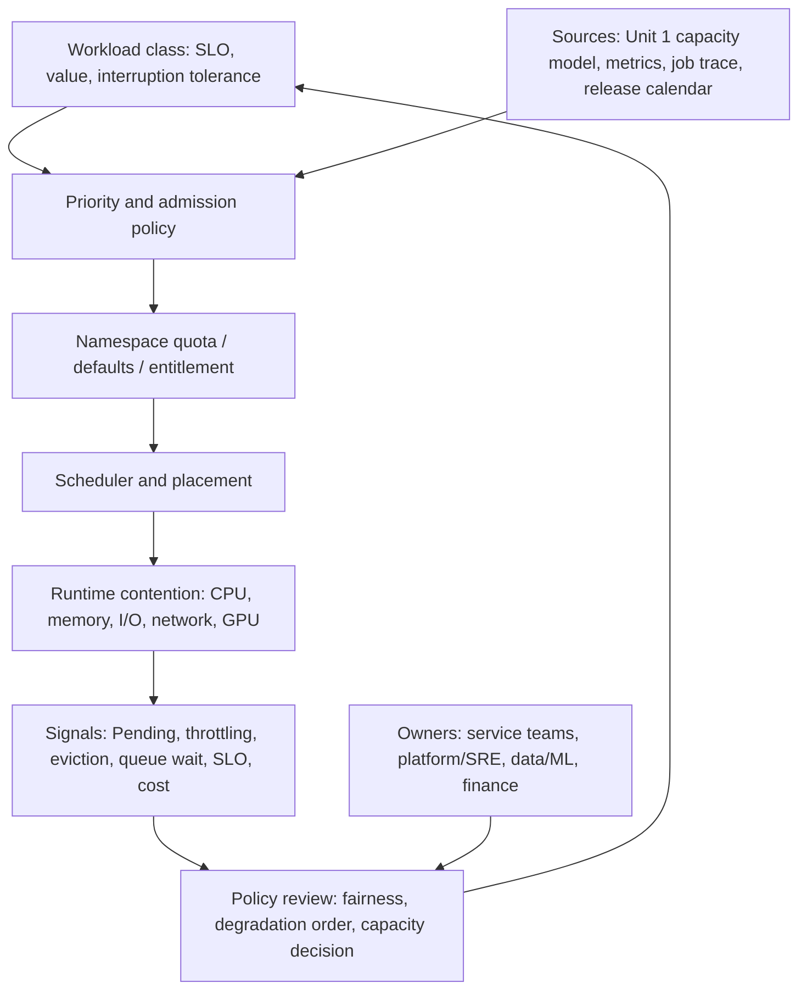

# Unit 2 — Workload priorities, quotas, and resource contention

**Target file:** `02-workload-priorities-quotas-and-resource-contention.md`  
**Stage:** Stage 2E — Production DevOps & Platform Engineering  
**Subfolder:** `15-Platform-Capacity-Compute-Economics-and-FinOps/`  
**Module:** M15 | **Unit:** 2  
**Estimated study time:** 24–32 hours (reading 6–8 h; labs 14–18 h; review 4–6 h)  
**Prerequisites:** Stages 0–2D and M01–M14; local `kind`, `kubectl`, Python 3.11+ `[VERIFY]`, Kubernetes resource requests/limits, QoS, ResourceQuota/LimitRange, HPA/VPA, placement, SLOs, saturation and checkpointing.  
**Core tools:** `kind`, `kubectl`, Python standard library, YAML manifests, local synthetic traces and tests.  
**Optional tools:** Prometheus/Grafana and `promtool` (Cap+Obs); Kueue on kind only after compatibility/footprint verification `[VERIFY]`; Kyverno or ValidatingAdmissionPolicy only after API/schema verification `[VERIFY]`.  
**Last reviewed:** 2026-11-03  
**Tool baseline assumed:** use the Kubernetes/kind version already selected in M03 `[VERIFY]`; Python 3.11+ `[VERIFY]`; Metrics Server and Prometheus versions from M11 `[VERIFY]`; `promtool` must match the installed Prometheus release `[VERIFY]`. PriorityClass-scoped ResourceQuota is documented as stable in Kubernetes v1.17; verify the actual API server schema, supported resource keys and any priority-class admission configuration before use.  
**Stack profile:** Cap-Core required; Cap+Obs optional; Kueue extension optional only after compatibility and footprint verification.  
**Footprint:** Cap-Core uses the existing small kind cluster and local scripts. A 4-core/8-GB/30-GB machine is a planning assumption, not a guarantee. Measure yours; finish Cap-Core first. Start optional observability only for its lab and stop it afterwards. Kueue and Prometheus/Grafana are not prerequisites for any required result.  
**Prices used:** hypothetical cost units only.

> **Completion outcome:** Design and operate a fair, SLO-aware contention policy for a shared data/ML platform. You will produce tested PriorityClass, quota, LimitRange and admission-policy artifacts; run safe preemption and noisy-neighbor experiments; quantify checkpoint/preemption waste; compare static quotas, DRF-style allocation and borrowing; detect starvation and quota hoarding; and defend whether vanilla Kubernetes controls are sufficient or a batch queueing system is justified.

## Table of contents

- [Prerequisite handoff](#prerequisite-handoff)
- [Cross-module handoff map](#cross-module-handoff-map)
- [Workspace and safety contract](#workspace-and-safety-contract)
- [Unit 2 — Workload priorities, quotas, and resource contention](#unit-2--workload-priorities-quotas-and-resource-contention)
  - [2.0 Why this matters in production](#20-why-this-matters-in-production)
  - [2.1 Learning objectives](#21-learning-objectives)
  - [2.2 Concept map and vocabulary](#22-concept-map-and-vocabulary)
  - [2.3 Level 1 — Beginner](#23-level-1--beginner)
  - [2.4 Level 2 — Intermediate](#24-level-2--intermediate)
  - [2.5 Level 3 — Advanced](#25-level-3--advanced)
  - [2.6 Level 4 — Expert](#26-level-4--expert)
  - [2.7 SRE lens](#27-sre-lens)
  - [2.8 Security lens](#28-security-lens)
  - [2.9 Production checklist](#29-production-checklist)
  - [2.10 Hands-on lab set](#210-hands-on-lab-set)
  - [2.11 Self-check questions](#211-self-check-questions)
  - [2.12 Evidence artifacts](#212-evidence-artifacts)
  - [2.13 Common interview and design-review questions](#213-common-interview-and-design-review-questions)
  - [2.14 Sources and verification notes](#214-sources-and-verification-notes)

## Prerequisite handoff

*M03 Unit 2 taught requests/limits, QoS classes, ResourceQuota/LimitRange, and right-sizing; M03 Unit 6 taught HPA/VPA; M03 Unit 7 taught taints, affinity, and placement; M11 Unit 9 taught saturation signals and noisy-neighbor detection. This unit teaches how to **govern contention for shared capacity as an economic and fairness problem**: priority classes and preemption, quota design as a budgeting mechanism, queueing and fair-share for batch/ML, overcommit policy, and contention incident response — without re-teaching those objects' basics.*

## Cross-module handoff map

| Module | Reuse / handoff |
|---|---|
| M15 Unit 1 | Use its demand/capacity/headroom model and explicit assumptions; do not redo forecasting. |
| M03 Unit 2 | Reuse requests/limits, QoS, `ResourceQuota`, `LimitRange`, and right-sizing. |
| M03 Unit 6 | HPA/VPA are reused as mechanisms, not re-taught. |
| M03 Unit 7 | Reuse placement, taints/tolerations, affinity, and dedicated pools. |
| M11 Unit 9 | Reuse saturation/noisy-neighbor signals and dashboards. |
| M10 | Align priority/degradation order with SLOs, error budgets, and incident policy. |
| M13 Unit 4 | Checkpointing/idempotency mitigate preemption waste. |
| M12 Units 8/11 | Reuse admission policy and namespace-vending/generation patterns. |
| M15 Unit 3 | Spending guardrails are later; quotas are a capacity/budget proxy here. |
| M15 Unit 4 | Showback/chargeback is later; this unit provides allocation inputs only. |
| M15 Units 8–12 | Spot, node provisioning, KEDA, OpenCost, and GPU economics are later; interfaces only. |
| M16 | Developer-platform self-service and tenant onboarding are future integration points. |

## Workspace and safety contract

All required work is local-first. No cloud account, paid service, real billing export, GPU, cloud IAM, or billable resource is needed. Monetary values are hypothetical cost units (HCU) only. A quota is not a spend cap; it is not even a physical-capacity reservation. A local `kind` cluster is a scheduling experiment, not proof of managed-cloud behavior.

**Evidence labels:** `[MEASURED-LOCAL]` means collected from the learner's own cluster; `[SYNTHETIC]` means generated with a fixed seed; `[ILLUSTRATIVE]` means an invented teaching number; `[HYPOTHETICAL]` means a model-only cost unit/rate; `[ASSUMPTION]` means a policy choice requiring an owner/review date; `[VERIFY]` means cluster/version/provider behavior not confirmed. Keep these labels in every report.

**Running example:** one multi-tenant data/ML platform with an online inference API, platform-critical services, stream consumers, scheduled ETL, notebooks/analytics, ML training, best-effort backfill/CI, and team namespaces. Use the same workload classes throughout. Unit 1 supplies demand, headroom, and capacity inputs; this unit decides how scarce shared capacity is governed.

Use a learner-owned workspace, separate from the supplied repository:

```text
workload-contention-lab/
├── README.md
├── manifests/
│   ├── namespaces.yaml
│   ├── priority-classes.yaml
│   ├── quotas.yaml
│   ├── priority-scoped-quotas.yaml
│   ├── limit-ranges.yaml
│   ├── preemption-batch.yaml
│   ├── preemption-online.yaml
│   ├── noisy-neighbor.yaml
│   ├── placeholder.yaml
│   ├── explicit-in-quota-pod.yaml
│   ├── in-quota-but-unschedulable.yaml
│   ├── over-quota-pod.yaml
│   └── invalid-resource-request.yaml
├── policies/
│   ├── priority-policy.md
│   ├── priority-policy.json
│   └── admission-policy.yaml        # optional verified cluster policy
├── rules/
│   └── contention-alerts.yml        # Cap+Obs optional
├── simulator/
│   ├── admission_check.py
│   ├── contention_report.py
│   ├── placeholder_model.py
│   ├── checkpoint_cost.py
│   ├── fair_share.py
│   ├── quota_report.py
│   └── starvation.py
├── tests/
│   ├── admission_cases.json
│   ├── contention-alerts.test.yml   # Cap+Obs optional
│   ├── test_admission_check.py
│   ├── test_contention_report.py
│   ├── test_placeholder_model.py
│   ├── test_checkpoint_cost.py
│   ├── test_fair_share.py
│   ├── test_quota_report.py
│   ├── test_policy_doc.py
│   └── test_starvation.py
├── data/
│   ├── quota-samples.csv
│   └── contention-evidence.csv
└── reports/
    ├── quota-hoarding.md
    ├── contention-drill.md
    ├── fair-share-comparison.md
    ├── starvation-review.md
    ├── cleanup-verification.md
    └── adr.md
```

Before any cluster command, verify `kubectl config current-context` and confirm it is the disposable M03/M11 kind context. Record `kind get clusters`, `kubectl get nodes` and local disk/memory. Do not run destructive commands against an unknown context. Lab cleanup must target only `m15-contention-lab` and lab-owned cluster-scoped objects. Do not use `kubectl delete all --all` or delete shared namespaces. If a cluster-scoped PriorityClass is created, delete only the named lab classes after confirming no other workload references them.

**Profiles**

- **Cap-Core (required):** small existing kind cluster, standard Kubernetes resources, Python standard library, synthetic job traces, manifests and tests.
- **Cap+Obs (optional):** minimal Prometheus/Grafana and `promtool`; start only for Lab 4, then stop using the M11 profile's documented teardown.
- **Kueue extension (optional):** install only if current compatibility, API versions and laptop footprint are verified. The Python simulator is the required path and remains the fallback.
- **No GPU:** GPU is a simulated resource vector in the fair-share model. Extended-resource names such as `nvidia.com/gpu` are `[VERIFY]` and are not required.

---

## Unit 2 — Workload priorities, quotas, and resource contention

### 2.0 Why this matters in production

A shared cluster is a finite pool, but tenants do not have equal latency objectives, interruption tolerance or business impact. During contention, an online inference rollout can remain Pending while batch jobs occupy schedulable capacity; alternatively, an over-broad “critical” priority policy can repeatedly evict useful work and create a preemption storm. Quotas can prevent one namespace from requesting unlimited resources, but they do not guarantee that admitted pods can be scheduled. A production program therefore needs explicit entitlements, priority semantics, fairness, interruption economics, observability and an agreed degradation order—not just more replicas or larger nodes.

### 2.1 Learning objectives

By the end of this unit, the learner can:

1. **[L1]** Distinguish PriorityClass, QoS/node-pressure behavior and ResourceQuota, and explain what each does not guarantee.
2. **[L1]** Explain scheduler preemption, PDB caveats, workload classes and the risks of priority abuse.
3. **[L2]** Design team namespaces, quotas, LimitRange defaults and allowed-priority mappings from Unit 1 capacity and approved share policy.
4. **[L2]** Diagnose admission rejection versus scheduler Pending, and measure online SLO impact and batch interruption cost.
5. **[L2]** Build a safe local contention experiment and detect noisy-neighbor behavior.
6. **[L3]** Compare static quotas, weighted fair share/DRF-style allocation, borrowing and batch queueing.
7. **[L3]** Quantify CPU/memory overcommit, preemption waste, checkpoint cadence, starvation and hypothetical pool economics.
8. **[L4]** Operate policy-as-code, alerts, runbooks, incident drills, exception expiry and a monthly governance review.
9. **[L4]** Decide when vanilla Kubernetes controls are sufficient and when a job-level scheduler is justified.
10. **[L4]** Defend fairness and reliability trade-offs while stating the limits of local simulation and each fairness metric.

### 2.2 Concept map and vocabulary



| Term | Precise definition | Common misconception |
|---|---|---|
| PriorityClass | Cluster-scoped Kubernetes object assigning a numeric scheduling priority to pods that reference it. | It reserves CPU/memory or guarantees immediate placement. |
| Preemption | Scheduler behavior that may remove lower-priority pods so a pending higher-priority pod can fit. | It always succeeds or always chooses the same victim set. |
| QoS class | Classification based on container resource requests/limits; influences kubelet node-pressure handling. | It is the same thing as scheduling priority. |
| ResourceQuota | Namespace-scoped admission accounting/limits for configured resource and object-count keys. | It reserves physical capacity or limits exact invoice spend. |
| LimitRange | Namespace policy for defaults and min/max constraints on container/pod resources. | It automatically fixes every quota design. |
| PDB | Availability budget for voluntary disruptions; preemption interaction has caveats and is not absolute protection. | It guarantees a pod cannot be preempted. |
| Fair share | Policy allocating scarce resources among tenants according to declared weights/entitlements. | Equal CPU time is fair for all CPU:memory:GPU mixes. |
| DRF | Dominant Resource Fairness, a multi-resource allocation fairness concept. | A universal objective that captures every business priority. |
| Borrowing | Temporary use of another tenant/queue's unused entitlement under defined policy. | Borrowed capacity is permanently guaranteed. |
| Starvation | Work waits indefinitely or unacceptably long because competing work continually wins. | Low utilization is the only sign of unfairness. |
| Overcommit | Policy allowing aggregate requests/limits/usage expectations to exceed a chosen capacity baseline. | Free capacity without reliability consequences. |
| Preemption waste | Work lost or repeated because a job is interrupted before durable progress/checkpoint. | Only the pod restart count matters. |

**Control-plane comparison**

| Mechanism | What it controls | What it does not guarantee | Main failure mode |
|---|---|---|---|
| PriorityClass | Scheduling order and potential preemption | Capacity, quota, runtime isolation, SLO | Everyone claims highest priority |
| QoS / kubelet pressure | Runtime classification and node-pressure behavior | Scheduling order or tenant fairness | Misreading eviction/throttling behavior |
| ResourceQuota | Namespace admission ceilings for configured keys | Physical capacity or successful scheduling | Admission succeeds but pods remain Pending |
| LimitRange | Defaults and per-object min/max constraints | Correct team entitlement by itself | Defaults mismatch accounting assumptions |
| PDB | Voluntary disruption budget and some preemption decisions | Absolute protection against all disruption | Availability assumptions exceed actual guarantees |
| Dedicated pool / taints | Placement isolation when configured correctly | Infinite capacity or perfect isolation | Pool fragmentation/under-utilization |
| Batch queue scheduler | Job admission, queueing, borrowing and scheduler-specific policies | Automatic organizational agreement or universal fairness | Added control-plane complexity / misconfiguration |

#### Workload-class matrix

| Class | Business/SLO objective | Interruption tolerance | Priority intent | Quota/fair-share policy | Owner |
|---|---|---|---|---|---|
| Platform-critical services | Cluster control, DNS, ingress, metrics, GitOps | Very low | Protected platform class; system-critical only for genuine system components | Dedicated platform entitlement and conservative reserve | Platform/SRE |
| Online inference API | Latency and availability SLO | Very low | `online` | Reserved team share; burst policy; bounded replicas | Inference owner |
| Stream consumer | Backlog/catch-up objective | Low–medium | `online` or `batch-high` by SLO | Queue-aware share and recovery headroom | Streaming owner |
| Scheduled ETL | Deadline and completion | Medium | `batch-high` | Scheduled entitlement; checkpoint/retry | Data platform |
| Analytics/notebooks | Interactive response and team fairness | Medium | `batch-low` | Team quota, idle controls later in M15 | Analytics owner |
| ML training | Completion, throughput, GPU/CPU queue wait | Medium if checkpointed | `batch-high` or `batch-low` by deadline | Multi-resource fair share; queueing interface to Unit 12 | ML platform |
| Backfill / CI | Best-effort throughput | High | `best-effort` | Borrowable capacity; bounded concurrency | Team/CI owner |

#### Example PriorityClass policy

All names/values are `[ASSUMPTION]` and values are `[ILLUSTRATIVE]`, not defaults or universal recommendations.

| Class | Value | Intended use | Allowed namespace/owner | Preemption intent |
|---|---:|---|---|---|
| `platform-critical` | 900000 `[ILLUSTRATIVE]` | Approved platform services only | `platform-system`, platform owner | May preempt lower tenant work when justified |
| `online` | 500000 `[ILLUSTRATIVE]` | Latency-critical inference/stream service | Approved online namespaces | May preempt batch under policy |
| `batch-high` | 200000 `[ILLUSTRATIVE]` | Deadline-bound ETL/training | Approved data/ML namespaces | Can preempt lower batch where configured |
| `batch-low` | 50000 `[ILLUSTRATIVE]` | Analytics/notebooks | Approved team namespaces | Usually yields to higher work |
| `best-effort` | 0 `[ILLUSTRATIVE]` | Backfill/CI | Approved tenant namespaces | May be interrupted; no completion guarantee |

Do not allow tenants to use `system-cluster-critical` or `system-node-critical`. These are reserved for appropriate Kubernetes/system components `[VERIFY]`. A `PriorityClass` value is relative ordering, not a percentage or resource allocation. `globalDefault` should be deliberately controlled; multiple/default semantics are version/API-sensitive `[VERIFY]`. `preemptionPolicy: Never` is intended to stop a priority class's pods from preempting other pods while still allowing them to be preempted by higher-priority pods; verify installed-version semantics `[VERIFY]`.

#### Worked example: apparent spare CPU, but pod remains Pending

Assume a local cluster `[ILLUSTRATIVE]` has 8 allocatable CPU cores, 24 GiB allocatable memory and 20 pod slots. Existing pods request 5 CPU cores and 22 GiB memory. A new pod requests 2 CPU cores and 4 GiB memory. CPU appears to have 3 cores free, but memory has only 2 GiB free, so the pod cannot fit. It may remain Pending with `Insufficient memory`. Other reasons include pod-count exhaustion, taints/tolerations, node affinity, topology constraints and fragmentation across nodes. This is a local placement problem, not necessarily a cluster-wide CPU shortage.

### 2.3 Level 1 — Beginner

#### Why contention occurs

Contention happens when multiple workloads compete for a finite resource pool. It can arise because total requests exceed schedulable capacity; bursts overlap; one workload has an unusual CPU:memory shape; node pools are isolated; or placement constraints prevent otherwise free resources from being used. A cluster-wide shortage means aggregate usable capacity is insufficient. A local placement/fragmentation problem means capacity exists in aggregate but not in a node or topology shape where a particular pod can fit.

Workloads have different business value. An inference API may need low latency and tolerate almost no queueing. A training job may run for hours but can checkpoint. A backfill may wait. A platform DNS component may be essential to every other workload. Fairness does not mean treating all work identically; it means using an explicit, reviewed allocation policy rather than accidental first-come behavior.

#### Brief Kubernetes recap — M03 Unit 2 reuse

- **Requests** influence scheduler placement and accounting; they are not observed usage.
- **Limits** constrain runtime use where applicable. CPU limits can throttle; memory limits can result in OOM termination.
- **QoS classes** (`Guaranteed`, `Burstable`, `BestEffort`) are derived from resource settings and influence node-pressure handling. They are not priority classes.
- **Node-pressure eviction** is kubelet behavior under conditions such as memory or disk pressure. Exact ordering/details depend on Kubernetes version and pod properties `[VERIFY]`.
- **CPU throttling** slows a container when it reaches its CPU quota; **memory OOM/eviction** can terminate a process. Memory is not generally throttled in the same way as CPU.

Do not infer universal eviction order from a simplified mnemonic. Consult the installed-version node-pressure eviction documentation.

#### PriorityClass and scheduler preemption

A `PriorityClass` is cluster-scoped. A pod selects it with `spec.priorityClassName`. The `value` is an integer used for relative priority ordering. `globalDefault` controls default assignment behavior for pods without an explicit class; exact behavior and constraints are `[VERIFY]`. `preemptionPolicy` controls whether pods in that class may preempt lower-priority pods; field availability and semantics are `[VERIFY]`.

If a high-priority pod cannot be scheduled, the scheduler may consider preempting lower-priority pods on a node where removing them makes the pending pod schedulable. Preemption is constrained by resource fit, affinity/topology and other scheduling rules; it is not a universal “kill the lowest priority anywhere” mechanism. A PDB can influence victim selection, but protection during preemption is best-effort and version-sensitive `[VERIFY]`. Never promise that a PDB prevents all preemption.

#### PriorityClass fields and safety boundaries

- `value` is a relative integer priority: larger values sort ahead of smaller values. It is not a percentage, entitlement, or reservation. The current Kubernetes documentation describes built-in system classes separately; keep them reserved and verify the installed version.
- `globalDefault: true` assigns the class to newly created Pods that omit `priorityClassName`; current Kubernetes documentation allows only one PriorityClass with `globalDefault: true`. Existing Pods are not retroactively changed. Treat default changes as a policy migration, not a harmless edit. `[VERIFY]` against your cluster version.
- `preemptionPolicy: Never` prevents Pods in that class from preempting other Pods; those Pods may still be preempted by higher-priority Pods. This feature is documented as stable since Kubernetes v1.24; verify the installed version. `[VERIFY]`
- `PriorityClass` is cluster-scoped. Protect create/update permission and enforce namespace-to-class allow-lists. A malicious or careless tenant with high priority can cause other Pods to be evicted or delayed.

#### Preemption and PDB behavior

| Situation | Expected behavior | Caveat / verification |
|---|---|---|
| Pending higher-priority Pod has no feasible node | Scheduler may search for a node where removing lower-priority Pods makes it feasible | Preemption is node-feasibility constrained; it does not remove arbitrary Pods across the cluster. |
| PDB would be violated by a candidate victim set | Scheduler attempts to prefer victims that do not violate a PDB | PDB respect during preemption is best-effort; if no feasible alternative exists, a PDB may still be violated `[VERIFY]`. |
| Victim receives termination grace period | Preemptor can remain Pending while victims terminate | A preemption event does not mean the preemptor is already Running. Record both timestamps. |
| `preemptionPolicy: Never` | Pod can be prioritized in the scheduling queue without preempting lower-priority Pods | It can still wait/starve and can itself be preempted by a higher-priority Pod. `[VERIFY]` |
| Pod has a PDB but no suitable alternate victim exists | Scheduler may proceed with a PDB-violating preemption | Never advertise PDB as an absolute lock or as a substitute for capacity. |

#### Three independent axes

1. **Priority:** scheduling order and possible scheduler preemption.
2. **QoS / kubelet node-pressure behavior:** runtime classification and pressure response.
3. **ResourceQuota:** namespace aggregate admission limits for configured keys.

Confusing these axes creates incidents. A high-priority pod can be rejected at admission due to quota. A pod admitted within quota can remain Pending due to physical capacity. A Guaranteed pod is not automatically higher scheduling priority. A PDB is not a quota.

#### ResourceQuota as a budget proxy

A quota can constrain aggregate requests/limits such as `requests.cpu`, `requests.memory`, `limits.cpu`, `limits.memory`; object counts such as pods and Jobs; storage requests; and extended resources such as GPUs. Extended-resource keys such as `requests.nvidia.com/gpu` depend on device plugin/resource naming and are `[VERIFY]`. PriorityClass-scoped ResourceQuota is a supported Kubernetes scope (documented as stable since v1.17) through `spec.scopeSelector.matchExpressions`; however, the allowed resource keys are limited and the actual API server/admission configuration must be checked. For this scope, current docs list `pods`, CPU/memory, ephemeral-storage and corresponding request/limit keys; GPU extended resources are not in that supported list. If the installed API/schema does not support the scope, use team namespace quotas plus admission policy mapping namespaces to allowed priority classes.

Quota is an admission accounting limit. It does not reserve node capacity, guarantee pod scheduling, or cap an invoice. Aggregate namespace quotas may exceed physical cluster capacity if an explicitly approved overcommit policy allows it.

#### Observe contention

Use existing M11 Unit 9 metrics and events:

```bash
kubectl get pods -A --field-selector=status.phase=Pending
kubectl describe pod <pending-pod> -n <namespace>
kubectl describe quota -n <namespace>
kubectl get events -A --sort-by=.lastTimestamp
kubectl top nodes
kubectl top pods -A
kubectl describe node <node>
```

Look for `Insufficient cpu`, `Insufficient memory`, pod-count limits, taints, affinity, `FailedScheduling`, preemption events, throttling, OOM/restarts, evictions, queue wait and quota utilization. `kubectl top` is a recent snapshot, not a historical series. Prometheus metric names from kube-state-metrics/cAdvisor/custom exporters are `[VERIFY]`; do not assume a metric exists because an example query uses it.

### 2.4 Level 2 — Intermediate

#### Design namespaces, quotas and LimitRange defaults

Use namespaces as team/environment boundaries when they align with ownership and policy. Derive quota from M15 Unit 1 capacity model multiplied by approved entitlement/share policy. Document team owner, expected demand, allowed priority classes, interruption tolerance, escalation path and review date.

Example quota design: cluster allocatable capacity available to tenant workloads is 40 CPU cores and 160 GiB memory `[ILLUSTRATIVE]`, after system reservations and platform overhead. Three team namespaces have these request quotas and observed requests:

| Team / namespace | CPU request quota | Memory request quota | Current requests (CPU / memory) | Cluster capacity | Risk / policy note |
|---|---:|---:|---:|---:|---|
| Inference / `team-inference` | 18 cores | 64 GiB | 12 cores / 48 GiB | 40 cores / 160 GiB | Protected entitlement; keep failover/headroom reserve outside the team quota. |
| Data ETL / `team-etl` | 20 cores | 80 GiB | 14 cores / 56 GiB | Same cluster | Batch may borrow unused physical capacity only under an explicit reclaim/preemption policy. |
| ML + analytics / `team-ml` | 18 cores | 80 GiB | 8 cores / 32 GiB | Same cluster | GPU is governed separately; CPU/memory quota is not a GPU entitlement. |

Aggregate CPU request quota is 56 cores against 40 allocatable cores: `56 / 40 = 1.40×` quota-to-capacity overcommit `[ILLUSTRATIVE]`. Aggregate memory quota is 224 GiB against 160 GiB: `224 / 160 = 1.40×`. Actual requests in this snapshot are 34 cores and 136 GiB, so current admitted requests fit; that does not guarantee that every future quota-admitted Pod will schedule. A no-overcommit policy would keep aggregate entitlements within a tenant-available budget after platform reserve and failure headroom, not simply equal raw node capacity.

**LimitRange defaults** can apply default requests/limits to containers that omit them and enforce min/max constraints. Quota accounting depends on the configured quota keys and whether defaults apply to the object. Do not say all pods without explicit resources bypass all quotas. Test the exact configured keys and admission behavior on the installed cluster.

Illustrative manifest set (save as separate files in the workspace):

```yaml
# manifests/namespaces.yaml
apiVersion: v1
kind: Namespace
metadata:
  name: m15-contention-lab
  labels:
    owner: platform-lab
    purpose: m15-unit2
---
apiVersion: v1
kind: Namespace
metadata:
  name: m15-contention-team-a
  labels:
    owner: team-a
    purpose: m15-unit2
```

```yaml
# manifests/priority-classes.yaml
apiVersion: scheduling.k8s.io/v1
kind: PriorityClass
metadata:
  name: m15-batch-low
value: 500
globalDefault: false
preemptionPolicy: PreemptLowerPriority
description: "Lab-only low-priority batch work; illustrative value."
---
apiVersion: scheduling.k8s.io/v1
kind: PriorityClass
metadata:
  name: m15-online
value: 5000
globalDefault: false
preemptionPolicy: PreemptLowerPriority
description: "Lab-only online workload; illustrative value."
```

```yaml
# manifests/quotas.yaml
apiVersion: v1
kind: ResourceQuota
metadata:
  name: team-a-budget
  namespace: m15-contention-team-a
spec:
  hard:
    requests.cpu: "4"
    requests.memory: 4Gi
    limits.cpu: "8"
    limits.memory: 8Gi
    pods: "12"
    count/jobs.batch: "6"
```

```yaml
# manifests/limit-ranges.yaml
apiVersion: v1
kind: LimitRange
metadata:
  name: container-defaults
  namespace: m15-contention-team-a
spec:
  limits:
    - type: Container
      defaultRequest:
        cpu: 100m
        memory: 128Mi
      default:
        cpu: 500m
        memory: 512Mi
      min:
        cpu: 50m
        memory: 64Mi
      max:
        cpu: "2"
        memory: 2Gi
```

Apply only after verifying the current context:

```bash
kubectl config current-context
kubectl apply -f manifests/namespaces.yaml
kubectl apply -f manifests/priority-classes.yaml
kubectl apply -f manifests/quotas.yaml
kubectl apply -f manifests/limit-ranges.yaml
kubectl describe quota team-a-budget -n m15-contention-team-a
kubectl describe limitrange container-defaults -n m15-contention-team-a
```

If the context is not the disposable lab cluster, stop. The manifests are examples for a learner-owned cluster; values are not production recommendations.

#### Quota is not a guarantee

A pod can pass admission because namespace quota has room, then remain Pending because no node has a fitting CPU/memory shape or placement. Conversely, a pod can be rejected at admission before scheduling because the namespace has exhausted a configured quota key. Diagnose the stage:

- **Admission rejection:** API response/event indicates quota exceeded or policy denied.
- **Admitted but Pending:** pod object exists; scheduler events explain no fit or placement constraint.
- **Running but unhealthy:** runtime contention, throttling, OOM, I/O/network pressure or SLO failure.

#### Priority-scoped ResourceQuota (where supported)

The Kubernetes ResourceQuota documentation describes the `PriorityClass` scope and `scopeSelector` match expressions. This is different from using `scopes: [PriorityClass]` with an invented field: use the documented `scopeSelector` form and inspect the API server version/schema first. `[VERIFY]`

```yaml
# manifests/priority-scoped-quotas.yaml — apply only in the lab namespace
apiVersion: v1
kind: ResourceQuota
metadata:
  name: online-class-budget
  namespace: m15-contention-team-a
spec:
  hard:
    pods: "4"
    requests.cpu: "2"
    requests.memory: 2Gi
    limits.cpu: "4"
    limits.memory: 4Gi
  scopeSelector:
    matchExpressions:
      - scopeName: PriorityClass
        operator: In
        values: ["m15-online"]
---
apiVersion: v1
kind: ResourceQuota
metadata:
  name: batch-low-class-budget
  namespace: m15-contention-team-a
spec:
  hard:
    pods: "8"
    requests.cpu: "3"
    requests.memory: 4Gi
    limits.cpu: "5"
    limits.memory: 6Gi
  scopeSelector:
    matchExpressions:
      - scopeName: PriorityClass
        operator: In
        values: ["m15-batch-low"]
```

**Important limits:** the priority scope controls matching Pods in the namespace; it does not reserve node capacity. The supported resource-key set is restricted by Kubernetes documentation and does not include arbitrary GPU extended-resource names. Keep GPU quotas in the ordinary namespace quota where supported and verify the device plugin's resource name. If this scope is rejected by the API server, do not keep changing YAML at random: record the schema result and use the team-quota + admission-allow-list fallback.

```bash
kubectl explain resourcequota.spec.scopeSelector --api-version=v1
kubectl get --raw /openapi/v3/apis/core/v1 | grep -n 'scopeSelector'
kubectl apply --dry-run=server -f manifests/priority-scoped-quotas.yaml
```

The `grep` is a quick inspection aid, not a complete schema validator. Prefer `kubectl explain` and server-side dry-run; if the cluster exposes a different OpenAPI endpoint, inspect its served schema instead.

#### Preemption experiment and layered protection

Measure pending/scheduling latency, online latency/error proxy, batch completion, preemptions, retries and estimated lost work. Record PDB state and behavior, but do not treat it as absolute protection.

Layered protection for critical workloads may include priority, suitable requests/QoS, PDB, anti-affinity/topology spread, dedicated node pool/taints, quota entitlement and admission restrictions. Each addresses a different failure mode; none alone guarantees availability.

For patient backfill, `preemptionPolicy: Never` can prevent those pods from preempting lower-priority pods while allowing higher-priority pods to preempt them; verify version semantics `[VERIFY]`. Such work can still starve indefinitely under sustained high-priority demand.

#### CPU and memory overcommit

CPU requests influence scheduling and CPU shares under contention; CPU limits can throttle. Runtime/cgroup behavior depends on Kubernetes and container runtime versions `[VERIFY]`. CPU limits can contain noisy neighbors but can also introduce latency via throttling. Evaluate with SLO and throttling evidence; neither “always set limits” nor “never set limits” is a sound universal rule.

Memory is different: memory pressure can result in OOM kills or eviction; it cannot generally be throttled in the same way as CPU. Tier-0 memory policy should be conservative. Batch may tolerate controlled bursting only if restart/checkpoint/retry costs and node-pressure behavior are understood.

| Dimension | CPU overcommit | Memory overcommit |
|---|---|---|
| Typical contention symptom | Throttling, run queue, latency | OOM, eviction, process restart |
| Possible control | Requests/shares, limits, concurrency | Requests/limits, isolation, workload sizing |
| Risk | Latency degradation | Abrupt termination and data/work loss |
| Policy stance | May be measured and class-specific | Conservative for critical services |
| Health indicators | Throttle ratio, CPU pressure, SLO | OOM/eviction, memory pressure, restart rate |

I/O and network do not have a general-purpose cross-tenant fair-share scheduler in vanilla Kubernetes for every disk/network resource `[VERIFY]`. Mitigations include dedicated pools, storage classes, workload shaping, external queues, and CNI bandwidth controls/annotations where supported `[VERIFY]`.

#### Pattern catalogue

| Pattern | Use when | Do not use when | Guardrail |
|---|---|---|---|
| Team namespace quotas | Clear ownership and team entitlement | Shared namespace has no ownership mapping | Review quota-to-capacity ratio |
| Priority tiers | Different business/SLO classes exist | Teams cannot agree on allowed use | Admission allow-list and audit |
| Dedicated critical pool | Critical workload isolation is justified | Pool would be mostly stranded and no resilience need | Track idle/headroom and N−1 |
| Borrowing unused quota | Demand peaks at different times | Borrowed capacity is mistaken for guarantee | Reclaim/priority policy and queue visibility |
| Checkpointed preemptible batch | Work is restartable and interruption-tolerant | No checkpoint/idempotency and expensive restart | Measure lost work and retry storm |
| Queue-based job admission | Many batch jobs and fairness/wait SLO matter | Few simple workloads | Operational owner and scheduler lifecycle |

#### Anti-pattern catalogue

| Bad practice | Failure/economic impact | Correct practice |
|---|---|---|
| Every tenant uses highest priority | Preemption loses meaning; churn and starvation | Namespace-to-class allow-list and approval |
| Quota equals physical capacity in dashboards | Admitted pods can remain Pending | Show quota and allocatable capacity separately |
| CPU usage used as only fairness metric | Memory/GPU-heavy tenants are misrepresented | Multi-resource vectors and DRF-style analysis |
| No LimitRange/defaulting tests | Requests/accounting assumptions become inconsistent | Test omitted and explicit resource fields |
| Preempt long jobs without checkpoints | Repeated work and HCU waste | Checkpoint, idempotency and interruption-aware policy |
| Unlimited Jobs/replicas | Resource exhaustion and denial-of-wallet | Object quotas, concurrency ceilings and alerts |
| Reclaim all unused quota automatically | Peak demand or reserved recovery capacity may be removed | Review owner, seasonality and exception before reclaim |

#### Four intermediate experiments

1. Priority/preemption/PDB with measured online SLO proxy and batch completion.
2. Priority-scoped quota only if installed API supports it and official schema confirms it `[VERIFY]`; otherwise team quota plus admission policy.
3. Noisy namespace detected, attributed and mitigated.
4. `kubectl` and optional PromQL reports for requests versus usage per namespace. Cap-Core fallback uses `kubectl describe`, events and local CSV.

### 2.5 Level 3 — Advanced

#### Fair-share models

**Static quotas** are easy to explain and audit: each team has a fixed entitlement. They can strand capacity when one team is idle while another is queued. **Weighted fair share** allocates according to declared weights, often over time or a queue's eligible demand. **Dominant Resource Fairness (DRF)** is a multi-resource fairness concept that considers each tenant's dominant share—the largest fraction of any resource it consumes relative to cluster capacity. CPU-only fairness is inadequate when one tenant consumes CPU-heavy jobs and another consumes memory or GPU-heavy jobs.

Primary reference: A. Ghodsi et al., *Dominant Resource Fairness: Fair Allocation of Multiple Resource Types*, NSDI 2011 `[VERIFY]` citation and formal assumptions before implementing a production algorithm. DRF does not automatically encode latency criticality, deadlines, business value, locality, gang scheduling or every organizational notion of fairness.

#### Batch queueing systems

- **Kueue:** Kubernetes job queueing/admission with `ClusterQueue`, `LocalQueue`, cohort borrowing/lending and workload admission concepts; exact APIs/features/version compatibility `[VERIFY]`.
- **YuniKorn:** scheduler for resource scheduling and queue hierarchy/fairness concepts; verify current project status and integration details `[VERIFY]`.
- **Volcano:** batch scheduling features including gang scheduling and queue/resource management; verify current feature set and compatibility `[VERIFY]`.

These projects are not interchangeable. Vanilla `ResourceQuota` and `PriorityClass` alone do not provide all job-level queue admission, quota borrowing/lending, gang scheduling or queue wait-time policy. Adopt a queueing system when many batch/ML jobs compete, distributed training needs gang scheduling, team fairness is measurable, job admission/wait SLOs matter, quota borrowing is needed, or cost ceilings per queue are required. Account for control-plane complexity, upgrades, scheduler ownership, debugging, migration and support.

Decision tree:

```text
Are workloads mostly services with clear namespace ownership?
  ├─ Yes → Start with ResourceQuota + LimitRange + PriorityClass + admission policy.
  │         Is contention rare and explainable?
  │           ├─ Yes → Keep vanilla controls; review monthly.
  │           └─ No → Are job-level queueing, borrowing, gang scheduling or wait SLOs needed?
  │                    ├─ No → Improve entitlement, placement, capacity and policy.
  │                    └─ Yes → Evaluate Kueue / YuniKorn / Volcano separately.
  └─ No → Are many batch jobs competing for shared multi-resource capacity?
            ├─ Yes → Build trace/simulator evidence, then pilot a queueing scheduler.
            └─ No → Clarify ownership and workload boundaries first.
```

#### Fair-share simulator — deterministic job-trace model

Save as `simulator/fair_share.py`. This required Cap-Core simulator uses a discrete time-step job trace with CPU, memory and GPU resource vectors. GPU is a numeric simulated resource; no device plugin or physical GPU is needed. It compares: (1) static per-tenant caps (unused entitlement can be stranded), (2) DRF-inspired greedy ordering by current dominant share divided by weight, and (3) static entitlements with FIFO borrowing of unused global capacity after eligible in-quota jobs. This is an educational approximation, **not canonical DRF**, a Kubernetes scheduler, or Kueue's admission algorithm.

```python
from dataclasses import dataclass
import random

RESOURCES = ("cpu", "memory", "gpu")
SEED = 20261103
CAPACITY = {"cpu": 10.0, "memory": 16.0, "gpu": 2.0}
WEIGHTS = {"inference": 2.0, "etl": 2.0, "ml": 6.0}

@dataclass(frozen=True)
class Job:
    job_id: str
    tenant: str
    arrival: int
    duration: int
    request: dict
    deadline: int | None = None
    checkpointable: bool = False

def make_jobs(seed=SEED):
    rng = random.Random(seed)
    specs = [
        ("i-1", "inference", 0, 3, {"cpu": 2, "memory": 2, "gpu": 0}, 4, False),
        ("e-1", "etl", 0, 5, {"cpu": 2, "memory": 4, "gpu": 0}, 7, True),
        ("m-1", "ml", 0, 4, {"cpu": 2, "memory": 4, "gpu": 1}, 7, True),
        ("e-2", "etl", 1, 4, {"cpu": 2, "memory": 3, "gpu": 0}, 7, True),
        ("i-2", "inference", 1, 3, {"cpu": 2, "memory": 2, "gpu": 0}, 5, False),
        ("m-2", "ml", 1, 4, {"cpu": 2, "memory": 4, "gpu": 1}, 7, True),
        ("e-3", "etl", 4, 2, {"cpu": 2, "memory": 3, "gpu": 0}, 8, True),
    ]
    jobs = []
    for job_id, tenant, arrival, duration, request, deadline_slack, checkpointable in specs:
        actual_arrival = arrival + rng.randint(0, 1)
        jobs.append(Job(job_id, tenant, actual_arrival, duration, request,
                        actual_arrival + deadline_slack, checkpointable))
    return jobs

JOBS = make_jobs()

def validate(capacity, weights, jobs):
    if any(r not in capacity or capacity[r] <= 0 for r in RESOURCES):
        raise ValueError("each resource capacity must be positive")
    if not weights or any(w <= 0 for w in weights.values()):
        raise ValueError("tenant weights must be positive")
    seen = set()
    for job in jobs:
        if job.job_id in seen:
            raise ValueError("job_id values must be unique")
        seen.add(job.job_id)
        if job.tenant not in weights or job.arrival < 0 or job.duration <= 0:
            raise ValueError(f"invalid job metadata: {job.job_id}")
        if job.deadline is not None and job.deadline < job.arrival:
            raise ValueError("deadline cannot precede arrival")
        if any(job.request.get(r, 0) < 0 for r in RESOURCES):
            raise ValueError("job resource requests must be non-negative")
        if not any(job.request.get(r, 0) > 0 for r in RESOURCES):
            raise ValueError("job must request at least one resource")
        if any(job.request.get(r, 0) > capacity[r] for r in RESOURCES):
            raise ValueError(f"job {job.job_id} exceeds total capacity")

def _used(running):
    out = {r: 0.0 for r in RESOURCES}
    for job, finish in running:
        for r in RESOURCES:
            out[r] += job.request.get(r, 0.0)
    return out

def _fits(request, available):
    return all(request.get(r, 0.0) <= available[r] + 1e-9 for r in RESOURCES)

def _tenant_used(running, tenant):
    out = {r: 0.0 for r in RESOURCES}
    for job, finish in running:
        if job.tenant == tenant:
            for r in RESOURCES:
                out[r] += job.request.get(r, 0.0)
    return out

def _dominant_share(tenant_used, capacity, weight):
    return max(tenant_used[r] / capacity[r] for r in RESOURCES) / weight

def jain_index(values):
    values = list(values)
    if not values or any(v < 0 for v in values):
        raise ValueError("provide non-negative comparable values")
    denominator = len(values) * sum(v * v for v in values)
    return (sum(values) ** 2 / denominator) if denominator else 0.0

def percentile(values, fraction):
    values = sorted(values)
    if not values or not 0 <= fraction <= 1:
        return 0.0
    position = (len(values) - 1) * fraction
    lower = int(position)
    upper = min(lower + 1, len(values) - 1)
    weight = position - lower
    return values[lower] * (1 - weight) + values[upper] * weight

def simulate(policy, capacity=CAPACITY, weights=WEIGHTS, jobs=JOBS, max_time=200):
    if policy not in {"static", "drf-inspired", "borrowing"}:
        raise ValueError("policy must be static, drf-inspired, or borrowing")
    validate(capacity, weights, jobs)
    if max_time <= 0:
        raise ValueError("max_time must be positive")
    total_weight = sum(weights.values())
    entitlement = {t: {r: capacity[r] * weights[t] / total_weight for r in RESOURCES}
                   for t in weights}
    waiting, running, completed = [], [], []
    started = {}
    resource_hours = {t: {r: 0.0 for r in RESOURCES} for t in weights}
    max_arrival = max((j.arrival for j in jobs), default=0)
    horizon = max_time

    for now in range(max_time):
        still_running = []
        for job, finish in running:
            if finish <= now:
                completed.append((job, finish))
            else:
                still_running.append((job, finish))
        running = still_running
        waiting.extend(j for j in jobs if j.arrival == now)

        while waiting:
            used = _used(running)
            available = {r: capacity[r] - used[r] for r in RESOURCES}
            tenant_usage = {t: _tenant_used(running, t) for t in weights}

            def can_fit_global(job):
                return _fits(job.request, available)

            def can_fit_entitlement(job):
                return all(tenant_usage[job.tenant][r] + job.request.get(r, 0.0)
                           <= entitlement[job.tenant][r] + 1e-9 for r in RESOURCES)

            if policy == "static":
                candidates = [j for j in waiting if can_fit_global(j) and can_fit_entitlement(j)]
                candidates.sort(key=lambda j: (j.arrival, j.job_id))
            elif policy == "drf-inspired":
                candidates = [j for j in waiting if can_fit_global(j)]
                candidates.sort(key=lambda j: (
                    _dominant_share(tenant_usage[j.tenant], capacity, weights[j.tenant]),
                    j.arrival, j.job_id))
            else:
                # Borrowing: serve jobs within their own entitlement first (FIFO).
                # If none fit, lend currently unused aggregate capacity FIFO.
                own = [j for j in waiting if can_fit_global(j) and can_fit_entitlement(j)]
                borrow = [j for j in waiting if can_fit_global(j) and not can_fit_entitlement(j)]
                candidates = (sorted(own, key=lambda j: (j.arrival, j.job_id))
                              or sorted(borrow, key=lambda j: (j.arrival, j.job_id)))

            if not candidates:
                break
            job = candidates[0]
            waiting.remove(job)
            started[job.job_id] = now
            running.append((job, now + job.duration))

        # Charge one tick of resource-time to jobs running during [now, now+1).
        for job, finish in running:
            for r in RESOURCES:
                resource_hours[job.tenant][r] += job.request.get(r, 0.0)

        if not waiting and not running and now >= max_arrival:
            horizon = max(1, now)
            break

    for job, finish in running:
        if finish <= horizon:
            completed.append((job, finish))

    finished = {job.job_id: finish for job, finish in completed}
    started_wait = {j.job_id: started[j.job_id] - j.arrival for j in jobs if j.job_id in started}
    wait_times = {j.job_id: started_wait.get(j.job_id, max(0, horizon - j.arrival)) for j in jobs}
    completion_times = {job.job_id: finish - job.arrival for job, finish in completed}
    unfinished = [j.job_id for j in jobs if j.job_id not in finished]
    deadline_misses = [j.job_id for j in jobs if j.deadline is not None and
                       (finished.get(j.job_id, horizon + 1) > j.deadline)]

    demand_norm = {t: 0.0 for t in weights}
    delivered_norm = {t: 0.0 for t in weights}
    for job in jobs:
        for r in RESOURCES:
            demand_norm[job.tenant] += job.request.get(r, 0.0) * job.duration / capacity[r]
    for tenant in weights:
        delivered_norm[tenant] = sum(resource_hours[tenant][r] / capacity[r] for r in RESOURCES)
    satisfaction = {t: min(1.0, delivered_norm[t] / demand_norm[t]) if demand_norm[t] else 0.0
                    for t in weights}
    utilization = {r: sum(resource_hours[t][r] for t in weights) /
                   (capacity[r] * max(1, horizon)) for r in RESOURCES}
    return {
        "policy": policy, "horizon": horizon, "completed_jobs": len(finished),
        "total_jobs": len(jobs), "unfinished_jobs": unfinished,
        "start_times": started, "wait_times": wait_times,
        "completion_times": completion_times, "deadline_misses": deadline_misses,
        "mean_wait": sum(wait_times.values()) / len(wait_times) if wait_times else 0.0,
        "wait_p50": percentile(wait_times.values(), 0.50),
        "wait_p95": percentile(wait_times.values(), 0.95),
        "mean_completion_time": (sum(completion_times.values()) / len(completion_times)
                                 if completion_times else 0.0),
        "max_wait": max(wait_times.values(), default=0),
        "utilization": utilization,
        "resource_hours_by_tenant": resource_hours,
        "entitlement_satisfaction": satisfaction,
        "jain_fairness": jain_index(satisfaction.values()),
        "starved_jobs": [j.job_id for j in jobs if j.job_id not in started or wait_times[j.job_id] > 10],
    }

if __name__ == "__main__":
    for policy in ("static", "drf-inspired", "borrowing"):
        result = simulate(policy)
        print(policy, "completed", result["completed_jobs"], "/", result["total_jobs"],
              "mean_wait", round(result["mean_wait"], 2),
              "wait_p95", round(result["wait_p95"], 2),
              "mean_completion", round(result["mean_completion_time"], 2),
              "deadline_misses", result["deadline_misses"],
              "starved", result["starved_jobs"],
              "Jain", round(result["jain_fairness"], 3),
              "utilization", result["utilization"])
```

Create `tests/test_fair_share.py`:

```python
import pytest
from simulator.fair_share import CAPACITY, WEIGHTS, JOBS, Job, SEED, make_jobs, simulate, jain_index

def test_all_policies_are_deterministic_and_bounded():
    for policy in ("static", "drf-inspired", "borrowing"):
        a, b = simulate(policy), simulate(policy)
        assert a == b
        assert all(0 <= value <= 1.000001 for value in a["utilization"].values())

def test_seed_reproduces_same_job_trace():
    assert make_jobs(SEED) == make_jobs(SEED)
    assert make_jobs(SEED) != make_jobs(SEED + 1)

def test_dynamic_policies_reduce_wait_and_complete_more_than_static():
    static = simulate("static")
    drf = simulate("drf-inspired")
    borrowing = simulate("borrowing")
    assert drf["completed_jobs"] >= static["completed_jobs"]
    assert borrowing["completed_jobs"] >= static["completed_jobs"]
    assert drf["mean_wait"] < static["mean_wait"]
    assert borrowing["mean_wait"] < static["mean_wait"]
    assert drf["wait_times"]["m-2"] < borrowing["wait_times"]["m-2"]
    assert borrowing["wait_times"]["e-2"] < drf["wait_times"]["e-2"]

def test_trace_reports_wait_completion_deadlines_and_fairness():
    result = simulate("drf-inspired")
    assert result["completed_jobs"] <= result["total_jobs"]
    assert result["mean_wait"] >= 0
    assert result["mean_completion_time"] >= 0
    assert result["wait_p95"] >= result["wait_p50"]
    assert 0 <= result["jain_fairness"] <= 1
    assert "inference" in result["entitlement_satisfaction"]
    assert isinstance(result["starved_jobs"], list)
    assert isinstance(result["deadline_misses"], list)

def test_invalid_policy_and_oversized_job_rejected():
    with pytest.raises(ValueError):
        simulate("unknown")
    huge = [Job("x", "ml", 0, 2, {"cpu": 99, "memory": 1, "gpu": 0})]
    with pytest.raises(ValueError):
        simulate("drf-inspired", CAPACITY, WEIGHTS, huge)

def test_invalid_deadline_rejected():
    bad = [Job("bad", "ml", 3, 2, {"cpu": 1, "memory": 1, "gpu": 0}, deadline=2)]
    with pytest.raises(ValueError):
        simulate("drf-inspired", CAPACITY, WEIGHTS, bad)

def test_jain_rejects_empty_and_negative_values():
    with pytest.raises(ValueError):
        jain_index([])
    with pytest.raises(ValueError):
        jain_index([1, -0.1])
```

Run `python simulator/fair_share.py` and `python -m pytest -q tests/test_fair_share.py`. The report must include per-resource utilization, mean/p50/p95/max wait, completion time, deadline misses, completion count, unfinished/starved job IDs, per-tenant resource-hours, normalized entitlement satisfaction and Jain's index. In this trace, `e-1` requests 4 memory units while the static ETL entitlement is 3.2; the indivisible job cannot fit its strict share even when aggregate capacity is free. That is an intentional demonstration of fragmentation/entitlement sizing, not a general recommendation to overcommit. The satisfaction ratio is a simulator-defined comparable outcome; it is not a universal fairness definition. Jain's index measures normalized demand satisfaction over this trace, not latency fairness; inspect queue wait and deadline misses separately. DRF-inspired ordering and FIFO borrowing may produce different job order even when total completion counts match. Optional Kueue-on-kind is only an extension after compatibility/footprint verification; the simulator is the required path.

#### Overcommit, tiered pools and economics

A tiered platform may have a stable/dedicated pool for critical workloads, a general pool and an interruptible batch pool (spot details deferred to Unit 8). Reuse M03 Unit 7 taints/tolerations and affinity. Hypothetical example:

| Pool | Intended workload | Hypothetical cost | Idle/headroom concern | Failure-domain concern |
|---|---|---:|---|---|
| Critical | Inference/platform | 20 HCU/node-hour `[HYPOTHETICAL]` | Reserve can be stranded | Keep replicas across independent domains |
| General | ETL/notebooks | 12 HCU/node-hour `[HYPOTHETICAL]` | Shared contention | Avoid one noisy tenant dominating |
| Batch | Backfill/CI | 6 HCU/node-hour `[HYPOTHETICAL]` | Can be reclaimed/paused | Jobs must checkpoint/retry |

These are synthetic rates, not provider prices or SKUs. Include stranded/idle headroom and failure-domain impact in the decision; cheap batch capacity is not free if lost work, retries or queue delay rise.

**Priority inversion and starvation:** under sustained higher-priority demand, lower-priority jobs can wait indefinitely. Aging, guaranteed minimum share and non-preemptible windows are scheduler/policy concepts; vanilla Kubernetes does not automatically implement all of them. Priority abuse (“everything is critical”) destroys differentiation. Use M12 admission policy to map namespaces to allowed classes; ValidatingAdmissionPolicy/Kyverno syntax and versions are `[VERIFY]`. Negative test: tenant namespace attempts `system-cluster-critical` or a platform-only class and admission denies it.

**Preemption waste and checkpoint economics**

A simple model:

\[
\text{lost-work HCU} =
\text{progress lost (resource-hours)} \times
\text{hypothetical HCU per resource-hour}
\]

If a job loses 2.5 CPU-hours `[ILLUSTRATIVE]` at 0.4 HCU/CPU-hour `[HYPOTHETICAL]`, lost-work cost is 1.0 HCU `[HYPOTHETICAL]`, excluding restart and recovery overhead. A general job may use a vector of CPU-hours, GiB-hours and GPU-hours with separate hypothetical rates; do not multiply incompatible units by one rate.

Checkpoint cadence trades checkpoint overhead against expected lost work. Shorter intervals reduce work lost per interruption but consume time/storage and can increase I/O contention. Estimate using observed checkpoint duration and measured interruption history where available; never present assumed interruption rates as measured facts. The `controller.kubernetes.io/pod-deletion-cost` annotation may influence pod deletion selection in specific controller contexts; it is awareness-only `[VERIFY]` and does not replace priority or checkpointing.

**Autoscaling interaction:** pending high-priority pods may trigger node scale-up (Unit 9) while low-priority pods may be preempted first. The order depends on scheduler, autoscaler and configuration; verify. Placeholder overprovisioning uses low-priority pods to hold spare capacity and yields it when real work arrives. Measure placement latency improvement against hypothetical cost of held headroom. Feasibility and behavior are `[VERIFY]`; use simulator fallback if timing is noisy.

**Quota and cost:** quota × hypothetical unit rate is a rough upper-bound proxy for a reserved entitlement, not an invoice or exact spend cap. Quota can remain unused; node overhead and shared resources complicate attribution; real spend may include storage, network, support, licensing and other non-compute charges. Unit 3 develops budget alerts; Unit 4 develops allocation/showback.

A rough capacity-exposure proxy can be written as:

`HCU proxy = Σ(resource quota × hypothetical HCU per resource-unit-period) + explicitly allocated shared overhead`.

Example `[ILLUSTRATIVE]`: 10 CPU cores × 0.5 HCU/core-hour × 720 hours = 3,600 HCU for the CPU entitlement component `[HYPOTHETICAL]`. This is **not** a bill, exact maximum spend, or hard spending cap: quotas govern configured Kubernetes resources, not every storage/network/license/control-plane charge; actual usage can be below quota; and the unit rate is a teaching assumption. Use this only as an input to M15 Units 3–4.

#### Trade-off table

| Option | Fairness benefit | Utilization effect | Reliability risk | Operational cost | Choose when |
|---|---|---|---|---|---|
| Static quotas | Predictable entitlements | May strand idle share | Low surprise, but rigid during bursts | Low | Few teams, stable demand |
| Weighted share / DRF-style | Multi-resource comparison | Can improve sharing | Metric may not reflect SLO/value | Medium | Mixed CPU/memory/GPU demand |
| Borrowing/lending | Uses idle entitlement | Often improves utilization | Borrower may wait when lender returns | Medium | Peaks are asynchronous |
| Queueing scheduler | Job admission, queue fairness, gang scheduling | Can improve batch utilization | Added control plane and scheduler failure modes | High | Many competing batch/ML jobs |
| Dedicated pool | Isolation for critical work | Can strand headroom | Pool failure/concentration | Medium | Strong isolation/SLO case |

**Defended decision exercise:** compare static quotas, DRF-style simulation and a queueing system for the running platform. State workload mix, number of tenants/jobs, fairness objective, wait-time SLO, gang needs, HCU assumptions, failure modes, scheduler ownership and rollback. Do not choose a scheduler because it is fashionable.

### 2.6 Level 4 — Expert

#### Operate the contention governance program

Run a monthly review and event-driven review after incidents, launches, major releases, quota changes and DR exercises. The review should answer: who receives capacity when scarce; what is shed first; what can be interrupted; what minimum share is protected; who approves exceptions; and what evidence retires an exception.

**Policy-as-code:** version PriorityClass and quota definitions in the learner workspace/Git; require review; restrict allowed classes with admission policy; generate quotas from approved team entitlements using the M12 Unit 11 namespace-vending pattern. This task does not modify the supplied repository. Integrate with M16 golden paths later.

**Quota governance:** owner sets quota from Unit 1 capacity and approved entitlement; platform/SRE validates cluster feasibility; service owner accepts SLO/degradation; finance reviews hypothetical allocation inputs. Self-service increases should include request reason, duration, workload/priority, forecast, approval, audit record and expiry. Review unused quota; do not automatically reclaim it without considering seasonality, reserved recovery capacity and owner confirmation. Departed teams' entitlements should expire through an audited offboarding process.

**Multi-cluster:** quotas are normally configured/enforced per cluster. Cross-cluster fairness/global entitlement requires a higher-level policy/control plane. Reuse M14 as awareness; do not imply a Kubernetes namespace quota is globally shared.

**ML/GPU interface:** Unit 12 covers GPU economics/sharing. This unit defines governance inputs: GPU quota, job priority, gang scheduling needs, long-running job checkpointing and queue wait-time SLO. Simulated GPU vectors are sufficient here.

#### Quota utilization / hoarding report template and filled example

| Team | Resource | Quota | Requests p95 / peak | Usage p95 / peak | Sample freshness | Owner status | Review result |
|---|---|---:|---:|---:|---|---|---|
| `team-etl` | CPU cores | 20 `[ILLUSTRATIVE]` | 11 `[SYNTHETIC]` | 7.5 `[SYNTHETIC]` | 2 h `[SYNTHETIC]` | active | Review possible unused share; do not reclaim automatically. |
| `team-legacy` | Memory GiB | 16 `[ILLUSTRATIVE]` | 0 `[SYNTHETIC]` | 0 `[SYNTHETIC]` | 96 h `[SYNTHETIC]` | departed | Verify ownership/offboarding and stale telemetry before expiry. |
| *(missing team label)* | CPU cores | 4 `[ILLUSTRATIVE]` | 2 `[SYNTHETIC]` | 1 `[SYNTHETIC]` | 1 h `[SYNTHETIC]` | unknown | Data-quality/security review; do not allocate or reclaim from this row. |

Required report columns: `team,resource,quota,requests,usage,sample_time,owner_status`. Add `data_quality_status`, `requests_to_quota_ratio`, `usage_to_quota_ratio`, `review_action`, `review_owner`, and `review_due`. Handle zero quota, missing labels, deleted teams, stale samples and denominator-zero explicitly. “Unused” is a review signal, not proof that the share is reclaimable; seasonality, recovery reserve and upcoming releases matter.

#### Priority policy template and filled example

| Field | Filled synthetic example |
|---|---|
| Class | `online` `[ASSUMPTION]` |
| Business objective | Meet inference latency/availability SLO |
| Allowed namespaces | `team-inference` only |
| Owner / approver | Inference service owner / platform SRE |
| Priority value | 500000 `[ILLUSTRATIVE]` |
| Preemption behavior | May preempt `batch-low`; PDB behavior best-effort |
| Resource entitlement | 18 CPU cores / 64 GiB request quota `[ILLUSTRATIVE]` |
| Interruption tolerance | Low; deployment surge tested |
| Degradation order | Preserve online service; defer notebooks/backfill first `[ASSUMPTION]` |
| Exception | Ticket, reason, approver, expiry, rollback |
| Review cadence | Monthly and after a capacity incident |

Every production class must have an explicit namespace allow-list, owner, SLO/tolerance, quota/share, preemption policy, expiry process and negative test. `system-cluster-critical` and `system-node-critical` are reserved for appropriate Kubernetes/system components; do not expose them to tenant teams.

#### Architecture decision record (ADR) template and filled example

**Template:** Context and problem; constraints; options; decision; consequences; security/reliability impact; rollout and rollback; acceptance criteria; owners; review date.

**Filled example `[ILLUSTRATIVE]`:**

- **Context:** three teams share a platform; online inference and ETL compete during release windows.
- **Options:** A) namespace `ResourceQuota` + `LimitRange` + PriorityClass + admission allow-list; B) add a job-level batch queueing system with borrowing/gang policy.
- **Decision:** start with A and run the seeded fair-share simulator; revisit B only if measured queue wait, borrowing demand or gang scheduling needs justify it.
- **Consequences:** simpler control plane and existing M03 familiarity; no native job-level borrowing or gang scheduling guarantee.
- **Rollout:** lab namespace first, server-side dry-run, positive/negative admission tests, one team pilot.
- **Rollback:** re-apply last reviewed manifests; disable new admission rule only through approved change; keep known-good quotas.
- **Acceptance:** online SLO proxy remains within guardrail, batch wait SLO is visible, unauthorized priority tests deny, no quota admission is mistaken for scheduling.
- **Stakeholder notes:** inference owner accepts bounded batch preemption; ETL owner accepts checkpoint requirement; platform SRE owns class policy; finance reviews HCU proxy only.

#### Contention incident runbook template and risk register

**Runbook template:** Trigger → confirm context and impact → collect pod events/priority/quota/LimitRange/node fit/queue metrics → classify admission vs scheduling vs runtime contention → choose bounded mitigation → verify online SLO and batch recovery → communicate → post-incident action/owner/date.

| Risk | Early signal | Preventive control | Negative test / response | Owner |
|---|---|---|---|---|
| Priority abuse | tenant uses unapproved class | namespace-to-class allow-list and audit | tenant submits platform/system class; deny | Platform security |
| Starvation | oldest low-priority queue age grows | minimum share/aging at queue layer | seeded trace demonstrates bounded wait | Batch owner |
| Preemption storm | repeated victims/retries in short window | rate/concurrency limits, checkpointing, alert | synthetic event-rate fixture fires | SRE |
| Quota overcommit | aggregate quota/capacity ratio rises | approved ratio and review gate | test admission success + scheduler Pending | Platform capacity owner |
| Missing defaults | Pods omit requests while quota keys require them | LimitRange and admission tests | create Pod without resources; inspect defaulting/accounting | Namespace vending owner |
| Scheduler/admission mismatch | quota-admitted Pods remain Pending | quota and node capacity dashboards kept separate | submit in-quota Pod with impossible nodeSelector | Platform SRE |
| Unsafe automation | unexpected quota/preemption/scale change | least privilege, dry-run, kill switch, rollback | freeze flag blocks simulated mutation | Automation owner |

#### Operational KPIs

| KPI | Formula / measurement | Unit and window | Owner | Interpretation / gaming risk |
|---|---|---|---|---|
| Pending time by priority | scheduled timestamp − pod creation timestamp; group by class | seconds; p50/p95 daily | Platform | Exclude unschedulable pods and the metric looks better |
| Preemption rate | preempted pods ÷ scheduled workload pods | % per day/week | Platform/SRE | Count only successful events and miss repeated churn |
| Preemption waste | lost resource-hours × HCU/resource-hour | HCU/week | Workload owner | Understate by ignoring retries/recovery |
| Online SLO under batch pressure | online latency/error SLI during batch-active windows | SLO window | Inference owner | Correlation alone does not prove causation |
| Batch wait/completion SLO | job start − enqueue; completion − deadline | seconds / % on-time | Data/ML | Exclude failed/cancelled jobs |
| CPU throttling ratio | throttled periods / total periods or throttled time / elapsed time; define exporter semantics | ratio; 5m/1h | Platform | Metric definition differs by exporter `[VERIFY]` |
| Memory OOM/eviction rate | OOM/eviction events per workload-hour | events/hour | SRE | Restart counts alone can hide cause |
| Quota utilization | configured quota usage / hard quota by key | ratio; daily | Team owner | High utilization may be healthy; low use may be reserved |
| Fairness index | Jain index over normalized entitlement satisfaction | 0–1; weekly | Platform + teams | A single scalar hides deadlines and criticality |
| Starvation duration | enqueue to start for lowest-priority cohort | seconds/hours | Batch owner | Completed-only data hides still-waiting jobs |
| Quota decision lead time | approval to effective quota change | hours/days | Platform | Fast approvals may bypass review |
| Headroom/preemption HCU | held capacity + lost work under HCU model | HCU/week | FinOps/platform | Not equivalent to invoice |

#### Alert examples and Cap-Core fallback

Metric names and labels depend on exporters/configuration and are `[VERIFY]`. These are query patterns; verify the actual series before installing alerts.

```yaml
# Illustrative PrometheusRule. Replace metric names/labels only after inspection.
apiVersion: monitoring.coreos.com/v1
kind: PrometheusRule
metadata:
  name: m15-contention-alerts
  namespace: monitoring
spec:
  groups:
    - name: m15-contention
      rules:
        - alert: M15HighPriorityPodsPending
          expr: sum(kube_pod_status_phase{phase="Pending",namespace=~"m15-contention-.*"}) > 0
          for: 5m
          labels:
            severity: warning
          annotations:
            summary: "Lab high-priority workload remains Pending"
        - alert: M15QuotaNearExhaustion
          expr: (kube_resourcequota{type="used"} / kube_resourcequota{type="hard"}) > 0.85
          for: 10m
          labels:
            severity: warning
          annotations:
            summary: "Lab quota usage is near the illustrative threshold"
```

The example above requires metric-label validation and is not a universal drop-in: kube-state-metrics metric families/labels may differ; division by zero and matching hard/used series must be handled; PriorityClass is not necessarily exposed as a pod label. Add a custom recording rule/exporter if priority grouping is needed. The 0.85 threshold and durations are `[ILLUSTRATIVE]`, not universal recommendations. A preemption-storm alert requires a verified event/exporter metric; otherwise use event-derived report counts. Test rules with `promtool test rules` and fixtures matching the actual labels. Cap-Core fallback: periodically capture `kubectl get events`, Pending pods, quota descriptions and synthetic event CSV; run a Python threshold/report test.

#### Runbook: online workload Pending due to contention

1. **Trigger:** high-priority online pod remains Pending beyond the service's approved scheduling objective, or online SLO degrades during batch activity.
2. **Inspect:** confirm cluster/context; pod events; priority class; namespace quota; LimitRange defaults; requests; node allocatable; taints/affinity/topology; pod slots; autoscaler state; quota/IP/service limits.
3. **Decide:** distinguish admission denial, scheduler fit, missing capacity, bad placement and runtime pressure. Confirm whether preemption is allowed and whether batch is checkpoint-safe.
4. **Act:** shed/pause approved batch work, preempt only under policy, scale the correct pool through approved process, or request a time-bounded quota increase. Do not blindly raise all quotas.
5. **Verify:** online latency/error SLO, pod placement, batch restart/checkpoint state, queue backlog and N−1/headroom.
6. **Communicate:** owner, affected tenants, actions, estimated lost work in HCU, next update.
7. **Follow up:** preserve events/forecast, identify policy gap, update tests/runbook and review exception expiry.

#### Monthly governance review agenda

1. Compare each team's entitlement, requests, usage, queue wait, SLO impact and borrowed capacity.
2. Review pending high-priority Pods, preemption rate/waste, starvation duration, throttling and eviction trends.
3. Reconcile quota and PriorityClass changes with approved owners, expiry and exception records.
4. Review departed teams, stale labels and possible quota hoarding; require owner confirmation before reclaiming.
5. Check upcoming launches, batch windows, failover drills and node-pool changes against Unit 1 headroom.
6. Decide whether vanilla controls remain sufficient or whether job-level queueing/gang scheduling is justified by evidence.
7. Record decisions, dissent, rollback revision, due dates and next review.

#### Contention incident drill matrix

| Drill | Injected condition | Success criteria | Failure criteria | Rollback / evidence |
|---|---|---|---|---|
| Batch flood delays inference | Remove/incorrectly assign batch priority in a lab namespace | Online Pod schedules within the lab objective; batch resumes from checkpoint | Online remains Pending without diagnosis or SLO proxy stays degraded | Restore reviewed PriorityClass/quotas; retain events and timestamps |
| Preemption storm | Repeatedly submit bounded higher-priority lab Pods | Alert fires; admission/concurrency is frozen; batch retry rate stabilizes | Unbounded retry/preemption loop or lost work unmeasured | Stop lab submitter; re-apply known-good policy; capture victim list |
| Quota change error | Apply an intentionally too-small lab quota | Admission rejection is distinguished from scheduler Pending; rollback restores expected admission | Production-like resources affected or no rollback evidence | Re-apply prior quota manifest; retain API response and diff |
| Priority abuse | Tenant submits `platform-critical` or a system class | Admission negative test denies; audit record identifies namespace | Unauthorized Pod admitted | Disable lab policy test; restore allow-list; preserve audit output |
| Long job preempted without checkpoint | Preempt synthetic job at known progress point | Lost resource-hours/HCU calculated; checkpoint cadence recommendation recorded | Job progress/waste unknown or checkpoint recovery fails | Stop test; restart from last durable checkpoint fixture |

#### Policy change control

Every quota or priority change should include: requester; workload/namespace; business reason; SLO and interruption contract; Unit 1 demand/headroom evidence; current and proposed values; effect on aggregate quota-to-capacity ratio; preemption/degradation impact; approver; expiry/review date; positive/negative tests; rollback; audit record. Emergency changes are time-boxed and reviewed after stabilization.

#### Other runbooks

- **Preemption storm:** freeze nonessential batch admission; inspect priority mapping, retry rates and repeated victim selection; verify checkpoints; cap concurrency; restore queue slowly; validate online SLO and batch recovery.
- **Quota misconfiguration:** stop rollout of quota change; compare generated manifest with approved entitlement; restore last known-good manifest; verify admission and Pending state; audit who changed it.
- **Priority abuse:** identify namespace/class use; deny new unauthorized pods through admission; preserve audit logs; contact owner; revoke exception only with change control; retest positive/negative policy cases.
- **Starvation:** quantify oldest waiting job and wait-time distribution; inspect sustained high-priority load; apply approved minimum share/aging simulation/non-preemptible window; verify high-priority SLO remains within policy.

#### Incident analysis: required scenarios

Use the chain `symptom → hypotheses → evidence → root cause → immediate mitigation → prevention → owner`.

| Scenario | Evidence / likely root cause | Immediate mitigation | Prevention / owner |
|---|---|---|---|
| Everyone selects highest PriorityClass | Pod inventory, audit logs, namespace/class map; admission policy absent | Deny new unauthorized class use; review critical exceptions | Allow-list, owner approval, expiry; platform |
| Batch jobs without explicit priority fill cluster and delay inference rollout | Pod specs/default class, creation order, scheduler events | Pause batch admission; deploy approved online workload | Explicit default policy and admission validation; batch/platform |
| Quota set but no LimitRange/default policy | Pods missing requests, quota keys and admission results | Apply tested defaults after reviewing impact | Test omitted/explicit resource cases; namespace vending owner |
| Near-complete job preempted without checkpoint | Job progress, restart history, checkpoint age | Resume from last durable state; pause further interruption | Checkpoint cadence and interruption contract; ML/data owner |
| Aggregate quotas 3× physical capacity | Sum hard quota vs allocatable/headroom; many Pending pods | Freeze increases; prioritize by agreed policy | Approved overcommit ratio, dashboard, periodic review; platform |
| Tenant uses system-critical class | Pod spec, audit, admission logs | Deny unauthorized usage; assess platform impact | Admission allow-list and negative test; security/platform |
| Low-priority work starves for weeks | Queue age, start-time distribution, priority demand | Apply approved fair-share/minimum share | Aging/guarantee policy at queue layer; batch owner |
| Departed team hoards unused quota | Ownership inventory, stale labels, low usage history | Confirm owner status; time-box and reclaim via approval | Offboarding automation and expiry; platform/FinOps |

**Organizational risks:** fairness depends on chosen outcome; incentives can game utilization, quota use and priority. A team may inflate requests to protect capacity, label work critical, or avoid submitting queue wait data. Use transparent dashboards, exception records, a neutral dispute process and Goodhart-aware review. Do not equate utilization with value or fairness.

### 2.7 SRE lens

#### SLIs/SLOs and degradation order

The platform policy must document a business-approved degradation order. Example `[ASSUMPTION]`: preserve platform control-plane dependencies and online inference; protect stream consumers enough to meet backlog recovery; defer analytics/notebooks; pause best-effort backfill/CI; checkpoint and reschedule training/ETL according to deadlines. The real order depends on business impact, dependencies and M10 error-budget policy. Do not infer it from class names alone.

Measure online latency/error SLO during batch-active windows, pending time by priority, batch wait/completion SLO, preemption rate/waste, CPU throttling, memory pressure/OOM/eviction, quota utilization, fairness and starvation. A metric is a leading indicator; service SLO remains the outcome.

#### Blast radius and rollback

A wrong priority change can evict many jobs; a wrong quota can reject deployments or admit too much demand; an over-aggressive controller can create retry storms. Bound replicas, Jobs, concurrency and preemption scope. Keep a known-good policy revision, change approval and kill switch for automation. Roll back by applying the previous reviewed manifest, not by broad deletion.

#### Contention incident drill: filled example

**Drill:** batch flood delays inference rollout `[ILLUSTRATIVE]`.

- **Trigger:** inference pod Pending for 180 seconds `[ILLUSTRATIVE]`; online latency proxy breaches test threshold.
- **Hypotheses:** batch jobs have equal/higher priority; quota/LimitRange mismatch; no node fit; dedicated pool taint mismatch; autoscaler unavailable.
- **Evidence:** pod events, PriorityClass, namespace quota, node allocatable, workload requests and batch queue depth.
- **Root cause for this synthetic drill:** batch jobs were admitted with an unintended default priority and consumed memory headroom.
- **Mitigation:** stop new batch submissions, allow approved online class, checkpoint and pause batch jobs; do not increase all quotas.
- **Verification:** inference schedules and latency proxy recovers; batch resumes from checkpoint; no unauthorized class remains.
- **Success criteria:** online scheduling objective and SLO proxy restored; lost work quantified; policy regression test fails before fix and passes after.
- **Rollback:** revert only lab-owned priority/quota manifests; preserve event evidence.

### 2.8 Security lens

| Threat | Control | Concrete negative test |
|---|---|---|
| Tenant priority escalation | Namespace-to-class allow-list; admission policy; audit | Tenant attempts `platform-critical` and system-critical class; request must be denied |
| Unbounded Jobs/replicas (denial-of-wallet/resource exhaustion) | Object-count quotas, pod quota, concurrency ceilings, bounded HPA | Submit synthetic Job above allowed count; admission rejects |
| Quota bypass/default mismatch | LimitRange defaults and explicit admission validation | Pod omits requests; test actual default/quota accounting; invalid resource rejected |
| Tampered owner/team labels | Trusted namespace metadata, admission immutability/allow-list, inventory reconciliation | Change `owner` label; report flags unknown/mismatch |
| Cryptomining/unauthorized workload | Image provenance, runtime monitoring, ownership and anomaly review | Add unowned synthetic workload; system flags it for investigation, not automatic accusation |
| Over-privileged quota automation | Scoped service account, least privilege, audit, separate read/write identities | Report identity attempts quota patch; RBAC denies |
| Unsafe automated preemption/scale-down | Approval, blast-radius cap, freeze switch and rollback | Set incident/freeze flag; automation recommendation must be blocked |

A usage spike alone does not prove cryptomining or malicious behavior. Local labs do not prove cloud IAM correctness, runtime threat detection, managed scheduler isolation, real billing protection or resistance to a determined attacker. Do not use real credentials.

### 2.9 Production checklist

- [ ] Priority classes have explicit meaning, owner and allowed users.
- [ ] System-critical classes are reserved; tenant negative tests deny use.
- [ ] Namespace quota and LimitRange defaults are tested for omitted and explicit resources.
- [ ] Quota is not represented as a physical capacity guarantee or exact spend cap.
- [ ] Aggregate quota-to-capacity ratio is visible and approved.
- [ ] Admission rejection is distinguished from admitted-but-Pending pods.
- [ ] Preemption/PDB behavior is tested and caveats documented.
- [ ] Critical workloads have layered protection, not priority alone.
- [ ] Batch interruption, checkpointing and idempotency are addressed.
- [ ] CPU throttling and memory pressure/OOM/eviction are observable.
- [ ] I/O/network contention has an explicit mitigation/ownership plan.
- [ ] Noisy-neighbor and Pending-work alerts are validated against fixtures.
- [ ] Fairness, queue wait and starvation are measured over time.
- [ ] Quota increases/exceptions have approval, owner, expiry, rollback and audit trail.
- [ ] Security negative tests pass.
- [ ] Cost examples use HCU and do not imply exact bills.
- [ ] Cleanup is scoped and evidence capture is verified.

### 2.10 Hands-on lab set

#### Master lab table

| Lab | Title | Profile | Primary evidence |
|---:|---|---|---|
| 1 | Priority, preemption, and PDB effects | Cap-Core | Preemption notes and measured workload outcomes |
| 2 | Quota-by-priority where supported and LimitRange defaults | Cap-Core | Quota/default manifests and admission tests |
| 3 | Priority-class admission guardrail | Cap-Core | Policy and positive/negative tests |
| 4 | Noisy-namespace contention incident | Cap-Core; Cap+Obs optional | Before/after report and alert tests |
| 5 | Overprovisioning placeholder pods | Cap-Core | Placement-latency versus HCU report |
| 6 | Preemption-waste calculator and checkpoint cadence | Cap-Core | Tested calculator and sensitivity analysis |
| 7 | Fair-share simulator: static quotas vs DRF vs borrowing | Cap-Core; Kueue optional | Seeded trace, metrics and tests |
| 8 | Quota utilization and hoarding report | Cap-Core | Report, missing-data tests and approval workflow |
| 9 | Priority policy document and ADR | Cap-Core | Filled policy, ADR and stakeholder notes |
| 10 | Starvation and aging exercise | Cap-Core | Wait-time trace, mitigation comparison and recommendation |

**Shared setup and cleanup**

```bash
# In learner-owned workspace only
mkdir -p workload-contention-lab/{manifests,policies,rules,simulator,tests,data,reports}
cd workload-contention-lab
kind get clusters
kubectl config current-context
kubectl get nodes
```

If a suitable cluster is not available, use the M03 documented disposable kind cluster. Do not guess the cluster name or install version-incompatible components. For labs that create the namespace, apply `manifests/namespaces.yaml` and confirm labels/owner. Cap-Core Labs 3, 6–10 and the simulator fallbacks for Labs 4–5 remain executable without a cluster. Do not create a new kind cluster if local resources are insufficient; record that cluster-specific evidence was skipped and complete the synthetic path. Cleanup:

```bash
# Confirm the context and exact lab namespace before deleting.
kubectl config current-context
kubectl get namespace m15-contention-lab
kubectl delete namespace m15-contention-lab --wait=true
# Delete only named lab PriorityClass objects, after checking references.
kubectl get pods -A -o custom-columns=NS:.metadata.namespace,NAME:.metadata.name,PRIORITY:.spec.priorityClassName
kubectl delete priorityclass m15-batch-low m15-online
```

If a command reports an object does not exist, record that; do not broaden the deletion. Stop optional Cap+Obs via M11's documented profile teardown and verify its pods/containers are stopped. No cloud resources are created.

#### Lab 1 — Priority, preemption, and PDB effects (Cap-Core; required)

- **Goal:** fill schedulable capacity with low-priority batch work, then submit a higher-priority online Pod and observe preemption/PDB behavior.
- **Profile:** Cap-Core; no Prometheus or cloud account required.
- **Prerequisites:** learner-owned disposable kind cluster, `kubectl`, existing M03 knowledge of requests/limits and node allocatable.
- **Assumptions:** `registry.k8s.io/pause:3.10` is available or can be pulled; priority values below are lab-only `[ILLUSTRATIVE]`; only one selected worker node is targeted so another node cannot make the online Pod fit.
- **Files:** `manifests/namespaces.yaml`, `manifests/priority-classes.yaml`, `manifests/preemption-batch.yaml`, `manifests/preemption-online.yaml`.

First verify the context and choose one worker node. Do not label the control-plane node if it is tainted unless you deliberately remove no taints; do not remove taints for this lab.

```bash
kubectl config current-context
kind get clusters
kubectl get nodes -o wide
kubectl describe node <worker-node> | sed -n '/Allocatable:/,/System Info:/p'
kubectl label node <worker-node> m15-contention-target=true --overwrite
```

Apply the namespace and the two named lab classes from the shared setup. The priority classes are cluster-scoped; check they do not already exist and are not used by other workloads.

`manifests/preemption-batch.yaml`:

```yaml
apiVersion: apps/v1
kind: Deployment
metadata:
  name: batch-fill
  namespace: m15-contention-lab
  labels:
    app.kubernetes.io/managed-by: m15-unit2-lab
spec:
  replicas: 3
  selector:
    matchLabels:
      app: batch-fill
  template:
    metadata:
      labels:
        app: batch-fill
    spec:
      nodeSelector:
        m15-contention-target: "true"
      priorityClassName: m15-batch-low
      terminationGracePeriodSeconds: 1
      containers:
        - name: pause
          image: registry.k8s.io/pause:3.10
          resources:
            requests:
              cpu: "1"
              memory: 512Mi
            limits:
              cpu: "1"
              memory: 512Mi
---
apiVersion: policy/v1
kind: PodDisruptionBudget
metadata:
  name: batch-fill-pdb
  namespace: m15-contention-lab
spec:
  minAvailable: 2
  selector:
    matchLabels:
      app: batch-fill
```

`manifests/preemption-online.yaml`:

```yaml
apiVersion: v1
kind: Pod
metadata:
  name: online-test
  namespace: m15-contention-lab
  labels:
    app: online-test
spec:
  nodeSelector:
    m15-contention-target: "true"
  priorityClassName: m15-online
  terminationGracePeriodSeconds: 1
  containers:
    - name: pause
      image: registry.k8s.io/pause:3.10
      resources:
        requests:
          cpu: "2"
          memory: 1Gi
        limits:
          cpu: "2"
          memory: 1Gi
```

Run in stages:

```bash
kubectl apply -f manifests/namespaces.yaml
kubectl apply -f manifests/priority-classes.yaml
kubectl apply -f manifests/preemption-batch.yaml
kubectl get pods -n m15-contention-lab -o wide -w
# In a second terminal, after batch pods are Running:
kubectl describe pdb batch-fill-pdb -n m15-contention-lab
kubectl apply -f manifests/preemption-online.yaml
kubectl get pod online-test -n m15-contention-lab -w
kubectl describe pod online-test -n m15-contention-lab
kubectl get events -n m15-contention-lab --sort-by=.lastTimestamp
kubectl get pods -n m15-contention-lab -o wide
```

**Capacity tuning:** three 1-CPU batch Pods and one 2-CPU online Pod are only an initial `[ILLUSTRATIVE]` shape. Read the selected node's allocatable CPU/memory and current requests first. If all batch replicas cannot schedule, reduce their count/request; if the online Pod fits without preemption, increase batch occupancy only enough to make the online Pod infeasible before preemption. Never create unbounded replicas. Keep all four workloads on the same labelled worker for this experiment.

**Expected output `[ILLUSTRATIVE]`:** the online Pod may be scheduled after one or more lower-priority batch Pods are preempted, or it may remain Pending with a scheduler reason. Record actual behavior; do not assume success. The PDB `minAvailable: 2` is not an absolute block: scheduler respect for PDB during preemption is best-effort `[VERIFY]`.

**Measurements:** capture Pod creation and `PodScheduled` condition timestamps; count preempted/restarted batch Pods; record batch completion/retry/checkpoint state. A `pause` container measures scheduler placement only, not application latency. If the M11 demo service/load generator is available, run the same bounded online load profile before/during/after batch pressure and record p95/p99 latency and error rate as the online SLO proxy. Otherwise explicitly mark application SLO as “not measured”.

| Measure | Expected direction | Observed result (learner fills) |
|---|---|---|
| Online scheduling delay | lower after preemption than indefinite Pending | `[MEASURED-LOCAL]` |
| Batch replicas available | may decrease | `[MEASURED-LOCAL]` |
| Preemption events | 0 before online Pod; possibly >0 after | `[MEASURED-LOCAL]` |
| Batch lost work | depends on checkpoint age | `[MEASURED-LOCAL]` or `[SYNTHETIC]` |
| Online p95/p99 | only if M11 service/load test is used | `[MEASURED-LOCAL]` / not measured |

**Acceptance/tests:** show one of (a) observed preemption and online scheduling or (b) a well-evidenced Pending reason; document PDB status and caveat; record expected-versus-observed table; prove cleanup only targets lab objects. **Troubleshooting:** check nodeSelector, node label, allocatable resources, requests, pod slots, taints, quota, and whether another node was eligible. A PDB may influence victim selection but cannot guarantee protection.

**Cleanup:**

```bash
kubectl delete pod online-test -n m15-contention-lab --ignore-not-found
kubectl delete deployment batch-fill -n m15-contention-lab --ignore-not-found
kubectl delete pdb batch-fill-pdb -n m15-contention-lab --ignore-not-found
kubectl delete namespace m15-contention-lab --wait=true
kubectl get pods -A -o custom-columns=NS:.metadata.namespace,NAME:.metadata.name,PC:.spec.priorityClassName | grep -E 'm15-online|m15-batch-low' || true
kubectl delete priorityclass m15-online m15-batch-low --ignore-not-found
kubectl label node <worker-node> m15-contention-target- 2>/dev/null || true
```

Delete the PriorityClasses only after confirming no non-lab Pod references them. **Stretch:** repeat with checkpoint-aware batch jobs and compare lost work. **Fidelity caveat:** kind scheduling, termination, metrics, CNI and node allocatable differ from production; the pause workload does not prove a managed-cloud SLO.

#### Lab 2 — Quota-by-priority where supported and LimitRange defaults (Cap-Core; required)

**Goal:** distinguish quota admission from scheduler capacity and test default resources.  
**Prerequisites:** lab namespace, Kubernetes API schema inspection.  
**Files:** `quotas.yaml`, `limit-ranges.yaml` from Level 2; add test pods with omitted resources and explicit requests.

```bash
kubectl config current-context
kubectl explain resourcequota.spec.scopeSelector --api-version=v1
kubectl apply -f manifests/namespaces.yaml
kubectl apply -f manifests/priority-classes.yaml
kubectl delete limitrange container-defaults -n m15-contention-team-a --ignore-not-found
kubectl apply -f manifests/quotas.yaml
# First attempt without defaults; capture whether quota rejects or admits it.
kubectl run omitted-before-defaults --image=registry.k8s.io/pause:3.10 -n m15-contention-team-a
kubectl describe quota team-a-budget -n m15-contention-team-a
# Apply defaults, then create a second Pod and inspect the injected requests/limits.
kubectl apply -f manifests/limit-ranges.yaml
kubectl run omitted-after-defaults --image=registry.k8s.io/pause:3.10 -n m15-contention-team-a
kubectl get pod omitted-after-defaults -n m15-contention-team-a -o yaml
kubectl describe quota team-a-budget -n m15-contention-team-a
```

Apply `manifests/priority-scoped-quotas.yaml` only after the server-side dry-run succeeds. Test at least four cases: (1) omitted requests receive LimitRange defaults; (2) an explicit in-quota Pod is admitted; (3) a Pod using `m15-online` consumes the online-scope quota but not the batch-scope quota; (4) a Pod exceeding its class quota is rejected at admission. A fifth Pod with a deliberately impossible `nodeSelector` should be admitted within quota but remain Pending, demonstrating the difference between admission and scheduling. Priority-scoped ResourceQuota is documented as stable since Kubernetes v1.17, but verify your cluster's served schema and allowed resource keys `[VERIFY]`; if unsupported, use team namespace quota plus Lab 3 admission controls. GPU extended resources are not assumed to be supported by the PriorityClass scope.  
**Expected output:** LimitRange defaults visible on admitted pod; quota usage changes according to configured keys; over-quota admission denied; a separate in-quota pod may remain Pending.  

```bash
kubectl apply --dry-run=server -f manifests/priority-scoped-quotas.yaml
kubectl apply -f manifests/priority-scoped-quotas.yaml
kubectl run omitted-resources --image=registry.k8s.io/pause:3.10 -n m15-contention-team-a
kubectl get pod omitted-resources -n m15-contention-team-a -o yaml
kubectl describe quota -n m15-contention-team-a
kubectl apply -f manifests/in-quota-but-unschedulable.yaml
kubectl describe pod in-quota-but-unschedulable -n m15-contention-team-a
# Explicit resource request, expected to be admitted if quota remains.
kubectl apply -f manifests/explicit-in-quota-pod.yaml
# Negative tests: API validation error and quota admission rejection are distinct.
kubectl apply -f manifests/invalid-resource-request.yaml
kubectl apply -f manifests/over-quota-pod.yaml
```

`in-quota-but-unschedulable.yaml` should request a small amount below the remaining quota and set a nodeSelector label that no node has. The Pod object should be admitted but stay Pending with a scheduler placement reason. For an over-quota negative test, submit a Pod whose request exceeds the remaining quota and capture the API rejection; do not rely only on `kubectl get pods`.

`manifests/in-quota-but-unschedulable.yaml` (expected to be admitted, then remain Pending because no node has this label):

```yaml
apiVersion: v1
kind: Pod
metadata:
  name: in-quota-but-unschedulable
  namespace: m15-contention-team-a
spec:
  nodeSelector:
    m15-node-does-not-exist: "true"
  containers:
    - name: pause
      image: registry.k8s.io/pause:3.10
      resources:
        requests:
          cpu: 100m
          memory: 128Mi
```

`manifests/over-quota-pod.yaml` (expected quota admission rejection; adjust only if the current hard quota is different):

```yaml
apiVersion: v1
kind: Pod
metadata:
  name: over-quota-pod
  namespace: m15-contention-team-a
spec:
  containers:
    - name: pause
      image: registry.k8s.io/pause:3.10
      resources:
        requests:
          cpu: "10"
          memory: 12Gi
```

`manifests/explicit-in-quota-pod.yaml`:

```yaml
apiVersion: v1
kind: Pod
metadata:
  name: explicit-in-quota-pod
  namespace: m15-contention-team-a
spec:
  containers:
    - name: pause
      image: registry.k8s.io/pause:3.10
      resources:
        requests:
          cpu: 100m
          memory: 128Mi
        limits:
          cpu: 500m
          memory: 512Mi
```

`manifests/invalid-resource-request.yaml` (expected API validation failure):

```yaml
apiVersion: v1
kind: Pod
metadata:
  name: invalid-resource-request
  namespace: m15-contention-team-a
spec:
  containers:
    - name: pause
      image: registry.k8s.io/pause:3.10
      resources:
        requests:
          cpu: "not-a-kubernetes-quantity"
```

`manifests/over-quota-pod.yaml` should request more than the remaining `requests.cpu`/memory or the applicable priority-scoped hard limit. Apply it and capture the API server rejection. Do not use `--force` or delete unrelated Pods to make the test pass. Compare three separate outcomes: (a) omitted resources before defaults, (b) defaults injected and quota charged, and (c) an in-quota but unschedulable Pod. The result for (a) depends on the exact configured quota keys and admission behavior; record what your cluster actually does rather than asserting a universal bypass.
**Acceptance/tests:** omitted/explicit/invalid/exhausted cases; assert API response and pod state separately.  
**Cleanup:** delete only lab namespaces and manifests; preserve reports.  
**Stretch:** compare team quota with a verified priority scope in a disposable cluster.  
**Fidelity caveat:** API schema and admission behavior are version-sensitive; kind does not prove managed-cluster policy behavior.

#### Lab 3 — Priority-class admission guardrail (Cap-Core; required)

**Goal:** map namespaces/teams to allowed PriorityClasses and block tenant escalation.  
**Prerequisites:** M12 policy/admission knowledge; Kubernetes admission mechanism verified `[VERIFY]`.  
**Files:** `policies/priority-policy.md` and optional ValidatingAdmissionPolicy/Kyverno manifest only after schema/version verification. Required fallback: a deterministic Python admission simulator that reads namespace-to-allowed-class mapping and returns allow/deny.

Example policy data:

```json
{
  "platform-system": ["platform-critical"],
  "m15-contention-team-a": ["batch-low", "best-effort"],
  "m15-contention-online": ["online"]
}
```

Test cases: authorized online namespace uses `online` (allow); team A uses `batch-low` (allow); team A uses `platform-critical` (deny); tenant uses `system-cluster-critical` (deny); unknown namespace/class (deny by default).  
**Commands:** apply the verified policy or run `python simulator/admission_check.py tests/admission_cases.json`; inspect audit/event result.  

Create `simulator/admission_check.py`:

```python
import json
import sys
from pathlib import Path

SYSTEM_CLASSES = {"system-cluster-critical", "system-node-critical"}

def decide(namespace, priority_class, policy):
    if not namespace:
        return False, "namespace is required"
    if not priority_class:
        priority_class = policy.get("default_class", "best-effort")
    allowed = set(policy.get("allowed", {}).get(namespace, []))
    if priority_class in SYSTEM_CLASSES and priority_class not in allowed:
        return False, "system-critical PriorityClass is reserved"
    if priority_class not in allowed:
        return False, "PriorityClass is not allowed in this namespace"
    return True, "allowed by namespace policy"

def main(policy_path, cases_path):
    policy = json.loads(Path(policy_path).read_text(encoding="utf-8"))
    cases = json.loads(Path(cases_path).read_text(encoding="utf-8"))
    failed = 0
    for case in cases:
        allowed, reason = decide(case.get("namespace"), case.get("priority_class"), policy)
        expected = case["expected"]
        ok = allowed is expected
        failed += not ok
        print(json.dumps({"case": case["name"], "allowed": allowed,
                          "expected": expected, "reason": reason, "pass": ok}))
    return 1 if failed else 0

if __name__ == "__main__":
    if len(sys.argv) != 3:
        raise SystemExit("usage: python simulator/admission_check.py policies/priority-policy.json tests/admission_cases.json")
    raise SystemExit(main(sys.argv[1], sys.argv[2]))
```

`policies/priority-policy.json`:

```json
{
  "default_class": "best-effort",
  "allowed": {
    "platform-system": ["platform-critical"],
    "m15-contention-team-a": ["batch-low", "best-effort"],
    "m15-contention-online": ["online"]
  }
}
```

`tests/admission_cases.json`:

```json
[
  {"name":"online-approved","namespace":"m15-contention-online","priority_class":"online","expected":true},
  {"name":"team-a-batch-approved","namespace":"m15-contention-team-a","priority_class":"batch-low","expected":true},
  {"name":"team-a-platform-forbidden","namespace":"m15-contention-team-a","priority_class":"platform-critical","expected":false},
  {"name":"tenant-system-class-forbidden","namespace":"m15-contention-team-a","priority_class":"system-cluster-critical","expected":false},
  {"name":"unknown-namespace-denied","namespace":"unknown-team","priority_class":"best-effort","expected":false}
]
```

Run:

```bash
python simulator/admission_check.py policies/priority-policy.json tests/admission_cases.json
```

For automated unit tests, create `tests/test_admission_check.py`:

```python
from simulator.admission_check import decide

POLICY = {"default_class": "best-effort", "allowed": {
    "team-a": ["batch-low", "best-effort"],
    "online": ["online"]}}

def test_allowed_class():
    assert decide("team-a", "batch-low", POLICY)[0] is True

def test_unapproved_class_denied():
    assert decide("team-a", "platform-critical", POLICY)[0] is False

def test_system_class_denied_for_tenant():
    assert decide("team-a", "system-node-critical", POLICY)[0] is False

def test_unknown_namespace_denied():
    assert decide("missing", "best-effort", POLICY)[0] is False

def test_missing_class_uses_explicit_default_only_if_allowed():
    assert decide("team-a", "", POLICY)[0] is True
```

This simulator is the required Cap-Core fallback. A production admission policy must use trusted namespace identity/labels and prevent tenants from modifying the trust source. A policy that trusts user-supplied Pod labels is not an authorization boundary.
**Expected output:** positive cases allowed, negative cases denied with reason and policy owner.  
**Acceptance/tests:** positive and negative tests, including system-critical attempt; exception requires named approver and expiry.  
**Cleanup:** remove only lab policy object/file and test namespace resources.  
**Stretch:** generate allowed-class policy from a synthetic namespace-vending record.  
**Fidelity caveat:** fallback simulator tests policy logic, not Kubernetes admission webhook/API behavior; real policy schema is `[VERIFY]`.

#### Lab 4 — Noisy-namespace contention incident (Cap-Core; Cap+Obs optional)

**Goal:** generate a local noisy-neighbor event, detect, attribute and mitigate it.  
**Prerequisites:** disposable kind; Cap+Obs only if using Prometheus; synthetic baseline.  
**Setup:** create a CPU/memory stress workload only with bounded requests/limits and small replica count. Record before state using `kubectl top`, events, quota and Pending pods. Do not use an unbounded stress container.  
**Steps:** apply synthetic noisy workload; observe requests versus usage, pending time/events, CPU throttling and OOM/eviction where available; apply approved quota/concurrency/priority/placement change; compare online SLO proxy and batch progress. Optional PromQL patterns should be validated against actual kube-state-metrics/cAdvisor/custom exporter series `[VERIFY]`. Use `promtool test rules` with matching fixtures for sustained high-priority Pending, quota near exhaustion and preemption storm if Cap+Obs is active.  
**Expected output:** before/after report with resource units, timestamps, SLO proxy, queue progress and mitigation. Cap-Core fallback is event/report CSV plus Python threshold tests.  

Create `simulator/contention_report.py` for the Cap-Core fallback. Input rows are synthetic or manually captured local measurements with fields `phase,namespace,cpu_requested,cpu_used,pending_pods,throttled_ratio,evictions,online_p95_ms,batch_completed`:

```python
import csv
from pathlib import Path

def compare(rows):
    by_phase = {row["phase"]: row for row in rows}
    if not {"before", "incident", "after"}.issubset(by_phase):
        raise ValueError("need before, incident and after rows")
    for row in rows:
        for key in ("cpu_requested", "cpu_used", "pending_pods", "throttled_ratio",
                    "evictions", "online_p95_ms", "batch_completed"):
            value = float(row[key])
            if value < 0:
                raise ValueError(f"{key} must be non-negative")
    return {
        "incident_cpu_use_ratio": float(by_phase["incident"]["cpu_used"]) /
            max(float(by_phase["incident"]["cpu_requested"]), 1e-9),
        "incident_pending": int(float(by_phase["incident"]["pending_pods"])),
        "after_online_p95_ms": float(by_phase["after"]["online_p95_ms"]),
        "after_batch_completed": int(float(by_phase["after"]["batch_completed"])),
        "online_p95_recovered": float(by_phase["after"]["online_p95_ms"]) <=
            float(by_phase["before"]["online_p95_ms"]),
    }

def read_rows(path):
    with Path(path).open(newline="", encoding="utf-8") as f:
        return list(csv.DictReader(f))

if __name__ == "__main__":
    print(compare(read_rows("data/contention-evidence.csv")))
```

`data/contention-evidence.csv` (all rows `[SYNTHETIC]`):

```csv
phase,namespace,cpu_requested,cpu_used,pending_pods,throttled_ratio,evictions,online_p95_ms,batch_completed
before,online,2,1,0,0.01,0,80,4
incident,noisy,1,0.9,2,0.35,0,220,1
after,online,2,1.1,0,0.03,0,90,3
```

`tests/test_contention_report.py`:

```python
import pytest
from simulator.contention_report import compare

ROWS = [
 {"phase":"before","namespace":"online","cpu_requested":"2","cpu_used":"1","pending_pods":"0","throttled_ratio":"0.01","evictions":"0","online_p95_ms":"80","batch_completed":"4"},
 {"phase":"incident","namespace":"noisy","cpu_requested":"1","cpu_used":"0.9","pending_pods":"2","throttled_ratio":"0.35","evictions":"0","online_p95_ms":"220","batch_completed":"1"},
 {"phase":"after","namespace":"online","cpu_requested":"2","cpu_used":"1.1","pending_pods":"0","throttled_ratio":"0.03","evictions":"0","online_p95_ms":"90","batch_completed":"3"},
]

def test_incident_comparison_detects_recovery():
    result = compare(ROWS)
    assert result["incident_pending"] == 2
    assert result["online_p95_recovered"] is False  # 90 ms is above the 80 ms baseline
    assert result["after_batch_completed"] == 3

def test_missing_phase_rejected():
    with pytest.raises(ValueError):
        compare(ROWS[:2])
```

The sample rows above are `[SYNTHETIC]`; p95 latency is a proxy only when the same load profile and application are used. Do not treat this CSV as a real Prometheus export or a billing record.

Run `python -m pytest -q tests/test_contention_report.py` and `python simulator/contention_report.py` from the workspace root. The script expects `data/contention-evidence.csv` and prints a before/incident/after comparison.
**Acceptance/tests:** detect the synthetic incident; correct owner attribution; no unauthorized scale-up; after mitigation online proxy recovers without hiding batch loss.  

Create `manifests/noisy-neighbor.yaml` as a bounded CPU-only test workload (the image tag is `[VERIFY]` for your registry):

```yaml
apiVersion: apps/v1
kind: Deployment
metadata:
  name: noisy-neighbor
  namespace: m15-contention-team-a
  labels:
    app.kubernetes.io/managed-by: m15-unit2-lab
spec:
  replicas: 2
  selector:
    matchLabels:
      app: noisy-neighbor
  template:
    metadata:
      labels:
        app: noisy-neighbor
    spec:
      containers:
        - name: cpu-loop
          image: busybox:1.36
          command: ["/bin/sh", "-c", "while true; do :; done"]
          resources:
            requests:
              cpu: 100m
              memory: 64Mi
            limits:
              cpu: 500m
              memory: 128Mi
```

Run the bounded experiment and record output; do not increase replicas beyond two for this exercise:

```bash
kubectl apply -f manifests/noisy-neighbor.yaml
kubectl rollout status deployment/noisy-neighbor -n m15-contention-team-a --timeout=90s
kubectl top pods -n m15-contention-team-a --containers
kubectl get pods -n m15-contention-team-a --field-selector=status.phase=Pending
kubectl get events -n m15-contention-team-a --sort-by=.lastTimestamp
kubectl describe quota team-a-budget -n m15-contention-team-a
# Mitigation: reduce the lab noise workload, then capture the same signals again.
kubectl scale deployment/noisy-neighbor -n m15-contention-team-a --replicas=1
kubectl top pods -n m15-contention-team-a --containers
kubectl get events -n m15-contention-team-a --sort-by=.lastTimestamp
```

`busybox` CPU looping is bounded by the container CPU limit and replica count; it is not a production load generator. If the cluster does not have Metrics Server, use scheduler events and the synthetic CSV fallback. Do not install a new metrics stack just for Cap-Core.
**Cleanup:** delete only named lab workloads/namespace; stop optional Cap+Obs via M11 teardown.  
**Stretch:** add stale-data alert and test false positive/negative cases.  
**Fidelity caveat:** local resource pressure is noisy and hardware-dependent; metric names and labels are `[VERIFY]`.

**Optional Cap+Obs alert files:** use custom normalized `m15_*` metrics emitted by a learner-owned adapter/report job. These names are not built-in Kubernetes metrics. If you derive them from kube-state-metrics/cAdvisor, inspect the exact installed exporter and label schema first `[VERIFY]`.

`rules/contention-alerts.yml`:

```yaml
groups:
  - name: m15-contention
    rules:
      - alert: M15HighPriorityPodsPending
        expr: m15_pending_pods_by_priority{priority_class="online"} > 0
        for: 5m
        labels:
          severity: warning
        annotations:
          summary: "Online-class pods remain pending"
      - alert: M15QuotaNearExhaustion
        expr: m15_quota_used_ratio > 0.85
        for: 10m
        labels:
          severity: warning
        annotations:
          summary: "Namespace quota use is above the illustrative threshold"
      - alert: M15PreemptionStorm
        expr: rate(m15_preemption_events_total[5m]) > 0.01
        for: 3m
        labels:
          severity: warning
        annotations:
          summary: "Preemption event rate is above the illustrative threshold"
      - alert: M15UnauthorizedPriorityClass
        expr: m15_unauthorized_priority_pods > 0
        for: 1m
        labels:
          severity: critical
        annotations:
          summary: "A namespace is using an unapproved PriorityClass"
      - alert: M15LowPriorityStarvation
        expr: m15_oldest_low_priority_wait_seconds > 3600
        for: 3m
        labels:
          severity: warning
        annotations:
          summary: "Low-priority work has exceeded the illustrative wait threshold"
```

`tests/contention-alerts.test.yml`:

```yaml
rule_files:
  - rules/contention-alerts.yml
evaluation_interval: 1m
tests:
  - interval: 1m
    input_series:
      - series: 'm15_pending_pods_by_priority{priority_class="online"}'
        values: '0 0 1 1 1 1 1 1 1 1'
      - series: 'm15_quota_used_ratio{namespace="team-a"}'
        values: '0.80 0.90 0.90 0.90 0.90 0.90 0.90 0.90 0.90 0.90 0.90 0.90 0.90'
      - series: 'm15_preemption_events_total{namespace="team-b"}'
        values: '0 1 2 3 4 5 6 7 8 9 10 11 12 13 14'
      - series: 'm15_unauthorized_priority_pods{namespace="team-c"}'
        values: '0 1 1 1 1 1 1 1 1 1 1 1 1'
      - series: 'm15_oldest_low_priority_wait_seconds{queue="backfill"}'
        values: '0 0 0 1200 1800 2400 3000 3600 4200 4800 5400 6000 6600'
    alert_rule_test:
      - eval_time: 7m
        alertname: M15HighPriorityPodsPending
        exp_alerts:
          - exp_labels:
              priority_class: online
              severity: warning
            exp_annotations:
              summary: "Online-class pods remain pending"
      - eval_time: 11m
        alertname: M15QuotaNearExhaustion
        exp_alerts:
          - exp_labels:
              namespace: team-a
              severity: warning
            exp_annotations:
              summary: "Namespace quota use is above the illustrative threshold"
      - eval_time: 8m
        alertname: M15PreemptionStorm
        exp_alerts:
          - exp_labels:
              namespace: team-b
              severity: warning
            exp_annotations:
              summary: "Preemption event rate is above the illustrative threshold"
      - eval_time: 2m
        alertname: M15UnauthorizedPriorityClass
        exp_alerts:
          - exp_labels:
              namespace: team-c
              severity: critical
            exp_annotations:
              summary: "A namespace is using an unapproved PriorityClass"
      - eval_time: 11m
        alertname: M15LowPriorityStarvation
        exp_alerts:
          - exp_labels:
              queue: backfill
              severity: warning
            exp_annotations:
              summary: "Low-priority work has exceeded the illustrative wait threshold"
```

Run with a `promtool` binary matching the installed Prometheus version:

```bash
promtool check rules rules/contention-alerts.yml
promtool test rules tests/contention-alerts.test.yml
```

The test series are synthetic fixtures, not Kubernetes exporter output. The `0.85`, `0.01/s`, and `for` durations are `[ILLUSTRATIVE]`; calibrate from SLOs and observed baselines. A real adapter must export the normalized metric contract or use verified recording rules. Cap-Core fallback: export `kubectl get events`, Pending Pods, quota descriptions and timestamps to CSV; produce a before/after report without Prometheus. Do not add an unbounded load generator or automatic scale action.

#### Lab 5 — Overprovisioning placeholder pods (Cap-Core; required)

**Goal:** test low-priority placeholder pods holding spare schedulable capacity and yielding to real work.  
**Prerequisites:** Lab 1 PriorityClasses; a cluster with measurable placement timing.  
**Files:** `manifests/placeholder.yaml` with a small bounded Deployment using `m15-batch-low`; real online test pod uses `m15-online`.  
**Steps:** measure online pod scheduling latency without placeholders; create placeholder workload that requests a controlled amount of spare CPU/memory; repeat online placement; inspect events and whether placeholders are preempted; calculate held-headroom HCU = held node-equivalent × hypothetical HCU/node-hour × hours.  
**Expected output:** comparison table with p50/p95 placement latency, placeholder replicas preempted, held capacity and HCU.  
**Acceptance/tests:** at least three repeated runs; report median and spread; if actual timing is too noisy, run a simulator fallback with deterministic placement delays.  
**Cleanup:** delete only placeholder Deployment and lab pods.  
**Stretch:** model autoscaler interaction and node scale-up delay.  
**Fidelity caveat:** placeholder behavior depends on scheduler/priority configuration `[VERIFY]`; local timing is not a cloud scale-up benchmark.

`manifests/placeholder.yaml` (apply only after Lab 1's PriorityClasses exist):

```yaml
apiVersion: apps/v1
kind: Deployment
metadata:
  name: capacity-placeholders
  namespace: m15-contention-lab
  labels:
    app.kubernetes.io/managed-by: m15-unit2-lab
spec:
  replicas: 2
  selector:
    matchLabels:
      app: capacity-placeholder
  template:
    metadata:
      labels:
        app: capacity-placeholder
    spec:
      nodeSelector:
        m15-contention-target: "true"
      priorityClassName: m15-batch-low
      containers:
        - name: pause
          image: registry.k8s.io/pause:3.10
          resources:
            requests:
              cpu: 250m
              memory: 256Mi
            limits:
              cpu: 250m
              memory: 256Mi
```

Measure at least three online Pod placements without placeholders, then three with placeholders. Use the same node selector and request size. Capture creation-to-`PodScheduled` time from Pod JSON; do not compare runs with different cluster load. Example sequence (repeat the create/capture/delete cycle three times for each condition):

```bash
# Recreate the lab namespace/class and target-node label if Lab 1 cleanup removed them.
kubectl apply -f manifests/namespaces.yaml
kubectl apply -f manifests/priority-classes.yaml
kubectl label node <worker-node> m15-contention-target=true --overwrite
# Baseline: no placeholder deployment running.
kubectl delete deployment capacity-placeholders -n m15-contention-lab --ignore-not-found
kubectl apply -f manifests/preemption-online.yaml
kubectl get pod online-test -n m15-contention-lab -o json > reports/online-baseline-1.json
kubectl get pod online-test -n m15-contention-lab -o jsonpath='{.metadata.creationTimestamp}{" "}{.status.conditions[?(@.type=="PodScheduled")].lastTransitionTime}{"\n"}'
kubectl delete pod online-test -n m15-contention-lab --wait=true
# Placeholder condition. Ensure the Deployment is Ready before creating online-test.
kubectl apply -f manifests/placeholder.yaml
kubectl rollout status deployment/capacity-placeholders -n m15-contention-lab --timeout=90s
kubectl apply -f manifests/preemption-online.yaml
kubectl get pod online-test -n m15-contention-lab -o json > reports/online-placeholder-1.json
kubectl get pod online-test -n m15-contention-lab -o jsonpath='{.metadata.creationTimestamp}{" "}{.status.conditions[?(@.type=="PodScheduled")].lastTransitionTime}{"\n"}'
kubectl get events -n m15-contention-lab --sort-by=.lastTimestamp
```

Delete/recreate `online-test` between runs; record the exact start/end timestamps and whether placeholder Pods were preempted. If `online-test` is not scheduled, inspect node fit and priority; do not claim a latency improvement. If timing is too noisy, use this deterministic fallback `simulator/placeholder_model.py`:

```python
def compare(scale_up_delay_seconds, placeholder_schedule_seconds,
            held_node_equivalents, hcu_per_node_hour, held_hours):
    values = (scale_up_delay_seconds, placeholder_schedule_seconds,
              held_node_equivalents, hcu_per_node_hour, held_hours)
    if any(v < 0 for v in values):
        raise ValueError("inputs must be non-negative")
    return {
        "without_placeholders_seconds": scale_up_delay_seconds,
        "with_placeholders_seconds": placeholder_schedule_seconds,
        "placement_seconds_saved": max(0, scale_up_delay_seconds - placeholder_schedule_seconds),
        "held_headroom_hcu": held_node_equivalents * hcu_per_node_hour * held_hours,
    }

if __name__ == "__main__":
    # Every input below is an assumption for a simulator, not a measurement.
    print(compare(30, 1.5, 0.5, 3.0, 0.5))
```

`tests/test_placeholder_model.py`:

```python
import pytest
from simulator.placeholder_model import compare

def test_cost_and_latency_arithmetic():
    r = compare(30, 1.5, 0.5, 3.0, 0.5)
    assert r["placement_seconds_saved"] == pytest.approx(28.5)
    assert r["held_headroom_hcu"] == pytest.approx(0.75)

def test_negative_inputs_rejected():
    with pytest.raises(ValueError):
        compare(-1, 1, 1, 1, 1)
```

The sample model output is `[ILLUSTRATIVE]`: 0.5 node-equivalent × 3 HCU/node-hour × 0.5 hour = 0.75 HCU `[HYPOTHETICAL]`. Compare the placement-latency benefit with headroom cost, placeholder scheduling churn, autoscaler interaction, and failure-domain reserve. Placeholders do not create physical nodes or replace Unit 9 node provisioning.

Cleanup: `kubectl delete pod online-test -n m15-contention-lab --ignore-not-found` and `kubectl delete deployment capacity-placeholders -n m15-contention-lab --ignore-not-found`. Keep the namespace and PriorityClasses only if another lab still needs them; otherwise use the scoped cleanup sequence from Lab 1.

#### Lab 6 — Preemption-waste calculator and checkpoint cadence (Cap-Core; required)

**Goal:** implement a tested calculator with compatible units and HCU.  
**Profile/prerequisites:** Cap-Core; Python 3.11+ `[VERIFY]`; basic rates, durations and unit conversion.  
**File:** `simulator/checkpoint_cost.py`:

Create `simulator/checkpoint_cost.py` with the complete functions below.

```python
def lost_work_cost(progress_resource_hours, hcu_per_resource_hour):
    if progress_resource_hours < 0 or hcu_per_resource_hour < 0:
        raise ValueError("inputs must be non-negative")
    return progress_resource_hours * hcu_per_resource_hour

def expected_lost_work_hours(checkpoint_interval_hours, interruption_rate_per_hour, job_hours):
    if checkpoint_interval_hours <= 0 or interruption_rate_per_hour < 0 or job_hours < 0:
        raise ValueError("interval must be positive; rate and job hours non-negative")
    # Expected interruption count = rate × job duration.
    # Conditional lost progress per interruption = interval / 2 under a
    # uniform-within-checkpoint-cycle assumption.
    return interruption_rate_per_hour * job_hours * checkpoint_interval_hours / 2

def checkpoint_overhead_fraction(checkpoint_duration_hours, interval_hours):
    if checkpoint_duration_hours < 0 or interval_hours <= 0:
        raise ValueError("duration non-negative; interval positive")
    if checkpoint_duration_hours >= interval_hours:
        raise ValueError("checkpoint duration must be shorter than interval")
    return checkpoint_duration_hours / interval_hours

def expected_total_hcu(job_hours, interval_hours, interruption_rate_per_hour,
                       checkpoint_duration_hours, recovery_hours_per_interrupt,
                       hcu_per_resource_hour):
    if job_hours < 0 or recovery_hours_per_interrupt < 0:
        raise ValueError("job and recovery hours must be non-negative")
    if hcu_per_resource_hour < 0:
        raise ValueError("rate must be non-negative")
    overhead = job_hours * checkpoint_overhead_fraction(
        checkpoint_duration_hours, interval_hours)
    lost = expected_lost_work_hours(interval_hours, interruption_rate_per_hour, job_hours)
    recovery = interruption_rate_per_hour * job_hours * recovery_hours_per_interrupt
    return (overhead + lost + recovery) * hcu_per_resource_hour
```

Add tests for zero rate, zero interval, negative values, checkpoint duration equal/greater than interval, and HCU arithmetic. Compare 15/30/60-minute intervals `[ILLUSTRATIVE]` under explicitly assumed interruption rates `[ASSUMPTION]`; include checkpoint overhead and recovery time. Do not describe assumptions as measured interruption rates.  
**Expected output:** sensitivity table and recommendation for ETL or training.  

Run the tests and produce a sensitivity table with the exact units below:

```bash
python -m pytest -q tests/test_checkpoint_cost.py
python - <<'PY'
from simulator.checkpoint_cost import (
    expected_lost_work_hours, checkpoint_overhead_fraction, expected_total_hcu
)
job_hours = 8.0
interruption_rate = 0.02  # interruptions/hour [ASSUMPTION], not a measurement
checkpoint_duration = 2 / 60  # hours [ASSUMPTION]
hcu_rate = 0.4  # HCU/resource-hour [HYPOTHETICAL]
for interval in (0.25, 0.5, 1.0):
    lost = expected_lost_work_hours(interval, interruption_rate, job_hours)
    overhead = job_hours * checkpoint_overhead_fraction(checkpoint_duration, interval)
    total = expected_total_hcu(job_hours, interval, interruption_rate,
                               checkpoint_duration, 0.1, hcu_rate)
    print(interval, "h", "lost_resource_hours=", round(lost, 4),
          "checkpoint_overhead_hours=", round(overhead, 4),
          "total_HCU=", round(total, 4))
PY
```

Expected output is a three-row table for 0.25 h, 0.5 h and 1.0 h intervals; values depend on the explicitly stated assumptions. Do not interpret the assumed interruption rate as measured history.
**Acceptance:** tests pass; units are explicit; recommendation balances checkpoint overhead and lost work.  
**Cleanup:** no cluster resources; retain script/test output.  
**Stretch:** extend to CPU/GPU resource vectors and retry recovery.  


`tests/test_checkpoint_cost.py`:

```python
import pytest
from simulator.checkpoint_cost import (
    lost_work_cost, expected_lost_work_hours,
    checkpoint_overhead_fraction, expected_total_hcu
)

def test_zero_interruption_has_no_expected_lost_work():
    assert expected_lost_work_hours(1.0, 0.0, 8.0) == 0.0

def test_expected_lost_work_uses_uniform_checkpoint_age_assumption():
    assert expected_lost_work_hours(1.0, 0.02, 8.0) == pytest.approx(0.08)

def test_cost_arithmetic():
    assert lost_work_cost(2.5, 0.4) == pytest.approx(1.0)

def test_invalid_interval_and_negative_values_rejected():
    with pytest.raises(ValueError):
        expected_lost_work_hours(0, 0.1, 8)
    with pytest.raises(ValueError):
        lost_work_cost(-1, 0.4)

def test_checkpoint_duration_must_be_shorter_than_interval():
    with pytest.raises(ValueError):
        checkpoint_overhead_fraction(0.5, 0.5)

def test_total_hcu_nonnegative():
    assert expected_total_hcu(8, 0.5, 0.02, 0.25, 0.1, 0.4) >= 0
```

The module above includes `expected_total_hcu`, so the test import works without copying a second fragment. Compare 15/30/60-minute intervals by converting minutes to hours (`0.25`, `0.5`, `1.0`). Keep interruption rate and checkpoint/recovery duration explicitly `[ASSUMPTION]`. Report overhead hours, expected lost resource-hours, recovery hours and total HCU separately. The model assumes interruptions are independent and their occurrence within a checkpoint interval is uniform; correlated failures, retries and storage contention are not represented.

**Fidelity caveat:** simple uniform timing model is an approximation; real interruption processes may be correlated or nonstationary.

#### Lab 7 — Fair-share simulator: static quotas vs DRF vs borrowing (Cap-Core; Kueue optional)

**Goal:** compare static quotas, DRF-inspired allocation and borrowing on a deterministic multi-tenant trace.  
**Profile/prerequisites:** Cap-Core; Python 3.11+ `[VERIFY]`; Level 3 fair-share concepts.  
**Files:** `simulator/fair_share.py`, `tests/test_fair_share.py`; no physical GPU or cluster required.  
**Steps:** use the supplied synthetic tenants with CPU/memory/GPU vectors; extend to job arrivals, durations, deadlines and checkpointability; use fixed seed; calculate utilization, wait time, completion time, starvation, per-tenant allocation and Jain index over normalized entitlement satisfaction. Run tests. Optional Kueue-on-kind extension only after verifying current docs/API compatibility/footprint; simulator remains mandatory.  
**Expected output:** CSV/Markdown comparison with per-resource utilization, queue wait percentiles, completed jobs, starved jobs, fairness index and policy assumptions.  

```bash
python simulator/fair_share.py
python -m pytest -q tests/test_fair_share.py
```

Export or copy the three policy results into `reports/fair-share-comparison.md`. Include `mean_wait`, `max_wait`, `mean_completion_time`, `completed_jobs`, `unfinished_jobs`, `starved_jobs`, per-resource utilization, per-tenant `resource_hours_by_tenant`, `entitlement_satisfaction`, and `jain_fairness`. The fixed seed is `20261103`; rerun `make_jobs(SEED)` twice to confirm reproducibility. GPU is a numeric simulated resource only.
**Acceptance/tests:** deterministic repeated run; no allocation exceeds capacity; zero/negative inputs rejected; GPU simulated without hardware.  
**Cleanup:** no external scheduler; uninstall only optional Kueue resources created for this lab using its documented teardown.  
**Stretch:** compare a Kueue cohort borrowing configuration with simulator assumptions.  
**Fidelity caveat:** DRF-inspired greedy model is not canonical DRF or a production scheduler; Kueue/YuniKorn/Volcano feature availability is `[VERIFY]`.

#### Lab 8 — Quota utilization and hoarding report (Cap-Core; required)

**Goal:** report entitlement versus actual requests/usage and identify potential hoarding without auto-reclaiming.  
**Profile/prerequisites:** Cap-Core; Python 3.11+ `[VERIFY]`; CSV basics and namespace/team ownership concepts.  
**Files:** `simulator/quota_report.py`, `tests/test_quota_report.py`, `data/quota-samples.csv`.  
**Input:** synthetic CSV columns `team,resource,quota,requests,usage,sample_time,owner_status`.  
**Steps:** calculate requests/quota and usage/quota ratios per resource/window; report stale samples, missing owner labels, deleted teams, zero quota and missing data; flag unused quota as “review” rather than “reclaim”; include approval workflow.  
**Expected output:** `reports/quota-hoarding.md` with filled synthetic example, warnings and owner/action.  
**Acceptance/tests:** tests for missing namespace labels, deleted teams, zero quota, stale samples and denominator-zero behavior; no automatic mutation.  
**Cleanup:** remove generated temporary CSV if not retained as evidence.  
**Stretch:** add seasonal history and exception expiry.  
**Fidelity caveat:** synthetic request/usage data is not an invoice and unused entitlement may be reserved for peak/recovery.

Create `simulator/quota_report.py`:

```python
import csv
from datetime import datetime, timezone, timedelta
from pathlib import Path

REQUIRED = {"team", "resource", "quota", "requests", "usage", "sample_time", "owner_status"}

def build_report(rows, as_of, max_age_hours=24, low_ratio=0.25):
    if max_age_hours < 0 or not 0 <= low_ratio <= 1:
        raise ValueError("invalid report thresholds")
    output = []
    cutoff = as_of - timedelta(hours=max_age_hours)
    for row in rows:
        team = (row.get("team") or "").strip()
        resource = (row.get("resource") or "").strip()
        warnings = []
        if not team:
            warnings.append("missing team/namespace label")
        if not resource:
            warnings.append("missing resource")
        try:
            quota = float(row["quota"])
            requests = float(row["requests"])
            usage = float(row["usage"])
            sample_time = datetime.fromisoformat(row["sample_time"].replace("Z", "+00:00"))
        except (KeyError, ValueError, TypeError) as exc:
            output.append({"team": team or "UNKNOWN", "resource": resource or "UNKNOWN",
                           "status": "invalid-data", "warnings": [str(exc)]})
            continue
        if min(quota, requests, usage) < 0:
            raise ValueError("quota, requests and usage must be non-negative")
        if sample_time.tzinfo is None:
            sample_time = sample_time.replace(tzinfo=timezone.utc)
        stale = sample_time < cutoff
        if stale:
            warnings.append("stale sample")
        if row.get("owner_status") == "deleted":
            warnings.append("owner/team marked deleted; verify offboarding")
        if quota == 0:
            req_ratio = usage_ratio = None
            warnings.append("zero quota; utilization ratio is undefined")
            status = "zero-quota-review"
        else:
            req_ratio, usage_ratio = requests / quota, usage / quota
            status = "review-not-reclaim" if (req_ratio < low_ratio and usage_ratio < low_ratio) else "within-review-band"
        if not team or not resource or stale or row.get("owner_status") == "deleted":
            status = "data-quality-review"
        output.append({"team": team or "UNKNOWN", "resource": resource or "UNKNOWN",
                       "quota": quota, "requests": requests, "usage": usage,
                       "requests_ratio": req_ratio, "usage_ratio": usage_ratio,
                       "sample_time": sample_time.isoformat(), "stale": stale,
                       "owner_status": row.get("owner_status", "unknown"),
                       "status": status, "warnings": warnings})
    return output

def read_csv(path):
    with Path(path).open(newline="", encoding="utf-8") as f:
        reader = csv.DictReader(f)
        missing = REQUIRED - set(reader.fieldnames or [])
        if missing:
            raise ValueError(f"missing CSV columns: {sorted(missing)}")
        return list(reader)

def render_markdown(report):
    lines = ["# Quota utilization review", "", "Unused quota is a review signal, not an automatic reclaim instruction.", "",
             "| Team | Resource | Quota | Requests ratio | Usage ratio | Status | Warnings |",
             "|---|---|---:|---:|---:|---|---|"]
    for row in report:
        req = "n/a" if row.get("requests_ratio") is None else f"{row['requests_ratio']:.1%}"
        use = "n/a" if row.get("usage_ratio") is None else f"{row['usage_ratio']:.1%}"
        lines.append(f"| {row['team']} | {row['resource']} | {row.get('quota', 'n/a')} | {req} | {use} | {row['status']} | {'; '.join(row['warnings'])} |")
    return "\n".join(lines) + "\n"

if __name__ == "__main__":
    from datetime import datetime, timezone
    rows = read_csv("data/quota-samples.csv")
    report = build_report(rows, datetime.now(timezone.utc))
    Path("reports").mkdir(exist_ok=True)
    Path("reports/quota-hoarding.md").write_text(render_markdown(report), encoding="utf-8")
    print("wrote reports/quota-hoarding.md")
```

`tests/test_quota_report.py`:

```python
from datetime import datetime, timezone, timedelta
import pytest
from simulator.quota_report import build_report

AS_OF = datetime(2026, 11, 3, 12, tzinfo=timezone.utc)

def row(**updates):
    base = {"team": "team-a", "resource": "cpu", "quota": "10", "requests": "2",
            "usage": "1", "sample_time": "2026-11-03T11:00:00+00:00", "owner_status": "active"}
    base.update(updates)
    return base

def test_low_usage_is_review_not_automatic_reclaim():
    result = build_report([row()], AS_OF)[0]
    assert result["status"] == "review-not-reclaim"

def test_missing_team_and_deleted_owner_are_data_quality_review():
    a = build_report([row(team=""), row(owner_status="deleted")], AS_OF)
    assert a[0]["status"] == "data-quality-review"
    assert a[1]["status"] == "data-quality-review"

def test_zero_quota_has_no_division_by_zero():
    result = build_report([row(quota="0")], AS_OF)[0]
    assert result["requests_ratio"] is None
    assert result["status"] == "zero-quota-review"

def test_stale_sample_is_flagged():
    old = (AS_OF - timedelta(hours=48)).isoformat()
    result = build_report([row(sample_time=old)], AS_OF)[0]
    assert result["stale"] is True
    assert result["status"] == "data-quality-review"

def test_negative_values_rejected():
    with pytest.raises(ValueError):
        build_report([row(requests="-1")], AS_OF)
```

Example input `data/quota-samples.csv`:

```csv
team,resource,quota,requests,usage,sample_time,owner_status
team-etl,cpu,20,11,7.5,2026-11-03T10:00:00+00:00,active
team-legacy,memory_gib,16,0,0,2026-10-30T12:00:00+00:00,deleted
,cpu,4,2,1,2026-11-03T11:00:00+00:00,unknown
```

Run `python -m pytest -q tests/test_quota_report.py` and `python simulator/quota_report.py`. The script intentionally prints a review report; it never patches or deletes a quota. The sample timestamp is a fixture, not a real system observation. Set `as_of` from the current UTC time when running your own report.

```bash
python -m pytest -q tests/test_quota_report.py
python simulator/quota_report.py
cat reports/quota-hoarding.md
```

Before any real quota reclamation, open a review ticket containing the team owner, historical peak/seasonality, upcoming launch/DR requirement, requested change, approval, expiry, and rollback. The script has no Kubernetes client and cannot mutate a quota.

#### Lab 9 — Priority policy document and architecture decision record (Cap-Core; required)

**Goal:** create a stakeholder-reviewed policy and ADR.  
**Profile/prerequisites:** Cap-Core; completion of Labs 1–3 and familiarity with service SLOs and Unit 1 capacity assumptions.  
**Files:** `policies/priority-policy.md`, `reports/adr.md`. Include classes, meanings, allowed namespaces, SLO/tolerance, preemption, degradation order, quota approach, ownership, exception process, expiry/review cadence, rollback and acceptance criteria. Compare at least two options: (A) static namespace quotas + PriorityClass; (B) queue scheduler with borrowing/fair-share. Reserve system-critical classes.  
**Expected output:** filled policy and ADR with synthetic stakeholder-agreement notes clearly labelled `[ASSUMPTION]`.  
**Acceptance:** no generic “everything critical”; each class has owner and allowed users; rollback and measurable success criteria exist.  
**Cleanup:** documents are learner workspace artifacts; no repository change.  
**Stretch:** add policy-as-code CI validation.  
**Fidelity caveat:** a signed-off document is a governance artifact, not proof the scheduler enforces it until negative tests pass.

Use this minimum policy record (copy into `policies/priority-policy.md`):

```markdown
# Shared-platform priority policy
- Policy owner / approver:
- Effective date / review date:
- Cluster(s) and namespaces in scope:
- Workload classes and their SLO / interruption contract:
- PriorityClass name / illustrative value / allowed namespaces:
- Reserved system classes: `system-cluster-critical` and `system-node-critical` are not tenant-selectable; any system exception is explicitly authorized:
- Quota and LimitRange mapping:
- Preemption and PDB caveats:
- Degradation order (first shed → last protected):
- Checkpoint/idempotency requirements:
- Exception request, approver, expiry and audit record:
- Metrics, alerts and success criteria:
- Rollback revision and kill switch:
- Stakeholder agreement / unresolved objections:
```

**Filled synthetic policy example:**

| Workload | Class | Allowed namespace | SLO / tolerance | Quota/share policy | Degradation action |
|---|---|---|---|---|---|
| Inference API | `online` | `team-inference` | latency/availability critical; low interruption tolerance | bounded reserved share; no casual overcommit of memory | preserve; shed batch first |
| Stream consumer | `batch-high` or `online` by declared backlog SLO | `team-stream` | backlog/catch-up objective | queue-aware entitlement | throttle input or pause lower batch |
| Scheduled ETL | `batch-high` | `team-etl` | deadline-bound; checkpoint/retry required | scheduled share; approved borrowing | defer noncritical partitions |
| Notebook/analytics | `batch-low` | `team-analytics` | interactive but not platform-critical | team quota and fair share | suspend idle/low-value sessions by policy |
| Backfill/CI | `best-effort` | approved team namespaces | interruptible | borrow unused capacity; bounded object count | pause/resume first |

**ADR acceptance:** select one policy option, state why alternatives were rejected, name owners, define a rollback, and include measurable acceptance criteria. Stakeholder notes are `[ASSUMPTION]` in this lab; do not invent actual approvals.

```bash
mkdir -p policies reports tests
# Save the completed policy and ADR in the paths above.
python -m pytest -q tests/test_policy_doc.py
```

The test file is a completeness gate, not an admission-enforcement test; enforcement remains Lab 3.

Create `tests/test_policy_doc.py` to validate that the policy draft is not missing mandatory sections:

```python
from pathlib import Path

def test_priority_policy_has_required_sections():
    text = Path("policies/priority-policy.md").read_text(encoding="utf-8").lower()
    required = ["policy owner", "allowed namespaces", "slo", "preemption",
                "degradation order", "exception", "expiry", "rollback",
                "metrics", "review date"]
    missing = [item for item in required if item not in text]
    assert not missing, f"missing policy sections: {missing}"

def test_system_classes_are_explicitly_reserved():
    text = Path("policies/priority-policy.md").read_text(encoding="utf-8")
    assert "system-cluster-critical" in text
    assert "system-node-critical" in text
```

Run `mkdir -p policies reports tests`, write the policy and ADR templates/examples above to `policies/priority-policy.md` and `reports/adr.md`, then run `python -m pytest -q tests/test_policy_doc.py`. The test checks document completeness; Lab 3 positive/negative tests verify enforcement logic.

#### Lab 10 — Starvation and aging exercise (Cap-Core; required)

**Goal:** show low-priority jobs starving under sustained high-priority arrivals; compare a mitigation.  
**Profile/prerequisites:** Cap-Core; Python 3.11+ `[VERIFY]`; understanding of queue wait and priority.  
**File:** `simulator/starvation.py` should use deterministic job records (`arrival`, `priority`, `duration`, `resource_units`) and a fixed seed for generated traces. Simulate strict priority, reserved minimum share, and aging. Clearly label aging as simulator/policy behavior; do not claim vanilla Kubernetes implements it automatically.  
**Steps:** create a trace with sustained high-priority demand; record low-priority wait and starvation duration; apply one mitigation; recalculate high-priority SLO proxy and total utilization.  
**Expected output:** wait-time distribution, maximum starvation duration, completed jobs, utilization and recommendation.  
**Acceptance/tests:** reproducible trace; no negative wait; low-priority starvation is detected; mitigation improves bounded wait without violating high-priority policy in the synthetic scenario.  
**Cleanup:** no cluster mutation; delete only lab-generated trace if not retained.  
**Stretch:** compare non-preemptible windows and weighted fair share.  
**Fidelity caveat:** simulation does not model all scheduler plugins, locality, gang constraints or real workload runtime.

Create `simulator/starvation.py`:

```python
from dataclasses import dataclass

@dataclass(frozen=True)
class Job:
    job_id: str
    arrival: int
    priority: int
    duration: int
    units: int = 1

def simulate(jobs, capacity=1, policy="strict", aging_after=3, max_time=100):
    if capacity <= 0 or max_time <= 0 or aging_after <= 0:
        raise ValueError("capacity, max_time and aging_after must be positive")
    if policy not in {"strict", "aging", "reserved"}:
        raise ValueError("policy must be strict, aging, or reserved")
    ids = [j.job_id for j in jobs]
    if len(ids) != len(set(ids)):
        raise ValueError("job ids must be unique")
    for j in jobs:
        if j.arrival < 0 or j.duration <= 0 or j.units <= 0 or j.units > capacity:
            raise ValueError("invalid job timing/resource request")
    waiting, running, starts, finishes = [], [], {}, {}
    busy_unit_ticks = 0
    for now in range(max_time):
        still = []
        for job, end in running:
            if end <= now:
                finishes[job.job_id] = end
            else:
                still.append((job, end))
        running = still
        waiting.extend(j for j in jobs if j.arrival == now)
        while waiting:
            used = sum(j.units for j, _ in running)
            free = capacity - used
            if policy == "reserved":
                aged_low = [j for j in waiting if j.priority == 0 and now - j.arrival >= aging_after]
                candidates = aged_low or waiting
                candidates = sorted(candidates, key=lambda j: (j.priority, j.arrival, j.job_id))
            elif policy == "aging":
                # This lab policy ages only the low-priority cohort; high-priority
                # jobs retain their declared priority so the low cohort can catch up.
                candidates = sorted(waiting, key=lambda j: (-(j.priority +
                    ((now-j.arrival)//aging_after if j.priority == 0 else 0)),
                    j.arrival, j.job_id))
            else:
                candidates = sorted(waiting, key=lambda j: (-j.priority, j.arrival, j.job_id))
            candidate = next((j for j in candidates if j.units <= free), None)
            if candidate is None:
                break
            waiting.remove(candidate)
            starts[candidate.job_id] = now
            running.append((candidate, now + candidate.duration))
        busy_unit_ticks += sum(job.units for job, _ in running)
        if not waiting and not running and now >= max((j.arrival for j in jobs), default=0):
            break
    for job, end in running:
        if end <= max_time:
            finishes[job.job_id] = end
    waits = {job_id: starts[job_id] - next(j.arrival for j in jobs if j.job_id == job_id)
             for job_id in starts}
    low_jobs = [j for j in jobs if j.priority == 0]
    high_jobs = [j for j in jobs if j.priority > 0]
    low_waits = [waits.get(j.job_id, max_time - j.arrival) for j in low_jobs]
    high_waits = [waits.get(j.job_id, max_time - j.arrival) for j in high_jobs]
    horizon = min(max_time, max((finishes.get(j.job_id, max_time) for j in jobs), default=1))
    utilization = busy_unit_ticks / (capacity * max(1, horizon))
    return {"starts": starts, "finishes": finishes, "waits": waits,
            "unfinished": [j.job_id for j in jobs if j.job_id not in finishes],
            "max_low_wait": max(low_waits, default=None),
            "max_high_wait": max(high_waits, default=None),
            "utilization": utilization,
            "completed": len(finishes), "total": len(jobs)}

if __name__ == "__main__":
    trace = [Job("low-1", 0, 0, 2)] + [Job(f"high-{i}", i, 10, 2) for i in range(20)]
    for policy in ("strict", "aging", "reserved"):
        print(policy, simulate(trace, policy=policy))
```

`tests/test_starvation.py`:

```python
import pytest
from simulator.starvation import Job, simulate

TRACE = [Job("low-1", 0, 0, 2)] + [Job(f"high-{i}", i, 10, 2) for i in range(20)]

def test_strict_priority_can_starve_low_job():
    result = simulate(TRACE, policy="strict", max_time=8)
    assert "low-1" not in result["starts"]
    assert result["max_low_wait"] >= 8

def test_aging_eventually_promotes_old_low_job():
    result = simulate(TRACE, policy="aging", aging_after=2, max_time=30)
    assert "low-1" in result["starts"]

def test_reserved_policy_bounds_low_job_wait_in_fixture():
    result = simulate(TRACE, policy="reserved", aging_after=2, max_time=30)
    assert "low-1" in result["starts"]
    assert result["utilization"] > 0
    assert result["max_high_wait"] is not None

def test_invalid_job_and_policy_rejected():
    with pytest.raises(ValueError):
        simulate([Job("bad", 0, 1, 1, 2)], capacity=1)
    with pytest.raises(ValueError):
        simulate(TRACE, policy="automatic")
```

The `aging` and `reserved` policies are simulator/policy experiments, not automatic vanilla Kubernetes scheduler features. Compare strict priority with at least one mitigation. Report low-priority wait, maximum low-priority wait, high-priority wait, unfinished jobs, completion count and total utilization (derive utilization from the trace and capacity). Recommend a mitigation only if it improves low-priority wait without breaching the synthetic high-priority scheduling objective.

Run:

```bash
python simulator/starvation.py
python -m pytest -q tests/test_starvation.py
```

Record the strict, aging and reserved-policy outputs in `reports/starvation-review.md`, including `max_low_wait`, `max_high_wait`, `unfinished`, `completed`, and `utilization`. The trace is a synthetic policy experiment. The low-priority aging behavior is implemented in this simulator only; do not present it as a built-in Kubernetes scheduler feature.

#### Lab execution matrix: acceptance and verification

| Lab | Required tests / negative tests | Verification method | Cleanup / stop |
|---:|---|---|---|
| 1 | Preemption condition; Pending reason; PDB caveat recorded | Pod events, scheduling timestamps, victim count | Lab namespace + named PriorityClasses only |
| 2 | Omitted/explicit/invalid/exhausted quota cases | API response, pod state, quota description | Lab namespaces and manifests |
| 3 | Authorized allow; tenant/system-critical deny | Admission response or simulator test | Lab policy object/files |
| 4 | Incident detected and mitigated; no unbounded scale | Before/after report, optional promtool | Lab workloads; stop Cap+Obs |
| 5 | Placement timing repeated; fallback deterministic | Timing report and HCU calculation | Placeholder Deployment |
| 6 | Zero/negative/boundary arithmetic | Unit tests | No runtime; retain evidence |
| 7 | Capacity bounds, deterministic output, starvation/fairness | Unit tests and seeded report | Stop optional Kueue |
| 8 | Missing labels, deleted team, zero quota, stale sample | Report tests | Remove only temp files |
| 9 | Policy completeness and rollback | Review checklist and ADR | No cluster mutation |
| 10 | Starvation detection and mitigation comparison | Simulator tests and trace report | No cluster mutation |

### 2.11 Self-check questions

1. **How are PriorityClass, QoS and ResourceQuota different?**  
   **Answer:** Priority influences scheduling/preemption; QoS influences node-pressure behavior; quota limits namespace admission accounting. **Tempting wrong answer:** all are “priority” controls because they affect resource outcomes.

2. **A namespace has quota remaining. Why can its pod still be Pending?**  
   **Answer:** Quota admission is not physical capacity; scheduler may find no node fitting CPU/memory/pod slots/placement. **Tempting wrong answer:** quota is mistaken for reserved capacity.

3. **Does a PDB guarantee that a lower-priority pod cannot be preempted?**  
   **Answer:** No. PDB interaction during preemption is best-effort/version-sensitive `[VERIFY]`. **Tempting wrong answer:** PDB is interpreted as an absolute availability lock.

4. **Why is memory overcommit generally riskier than CPU overcommit?**  
   **Answer:** CPU contention often manifests as throttling/latency; memory pressure can cause OOM termination or eviction. **Tempting wrong answer:** both are just percentages of utilization.

5. **Why is CPU-only fairness inadequate for a data/ML platform?**  
   **Answer:** Teams consume different CPU, memory and GPU vectors; dominant share can differ. **Tempting wrong answer:** CPU is the most visible resource, so it is assumed representative.

6. **How can low-priority work starve even when the cluster is highly utilized?**  
   **Answer:** Sustained higher-priority demand continually wins; queue age and wait-time distribution reveal starvation. **Tempting wrong answer:** high utilization is treated as proof of fair sharing.

7. **How do you calculate preemption waste?**  
   **Answer:** Lost resource-hours since durable checkpoint × hypothetical HCU/resource-hour, with recovery/retry overhead considered separately. **Tempting wrong answer:** counting restarts ignores completed-but-not-checkpointed work.

8. **When should a team adopt a batch queueing system?**  
   **Answer:** When job-level admission, borrowing, gang scheduling, team fairness or wait-time SLOs justify extra operational complexity. **Tempting wrong answer:** assuming a scheduler is automatically more advanced and therefore better.

9. **Does a quota × HCU rate equal the bill?**  
   **Answer:** No; it is a rough proxy. Actual cost includes unused entitlement, shared overhead, storage/network and allocation rules. **Tempting wrong answer:** quota is mistaken for actual consumption and invoice spend.

10. **Why should priority classes be allow-listed?**  
    **Answer:** Otherwise all tenants can claim criticality and priority loses meaning; unauthorized system-critical use can affect platform stability. **Tempting wrong answer:** letting each team self-classify is assumed to be fair.

### 2.12 Evidence artifacts

Save in the learner workspace, not the supplied repository:

| Artifact | Acceptance criterion | Verification |
|---|---|---|
| `README.md` | Prerequisites, Cap-Core/Cap+Obs/Kueue profiles, commands, start/stop and cleanup | Follow it from a clean shell |
| PriorityClass manifests + policy | Meaning, owner, allowed namespaces, illustrative values | `kubectl get priorityclass -o yaml`; review |
| Namespaces, ResourceQuota, LimitRange | Team entitlement and tested defaults | `kubectl describe quota/limitrange`; admission tests |
| Preemption/PDB notes | Expected-versus-observed outcomes and caveats | Events, pod timestamps, PDB state |
| Admission guardrail + tests | Positive and negative cases including system-critical denial | Policy engine or simulator test output |
| Noisy-neighbor data/report | Before/after resource, pending, SLO and batch evidence | Timestamped report; alert fixture tests |
| Placeholder latency/cost report | Repeated timing and HCU assumptions | Script output and assumptions register |
| Checkpoint calculator/tests | Boundary validation and cadence sensitivity | Unit test output |
| Fair-share simulator/trace | Seeded trace, metrics, per-tenant allocation and fairness | Reproducible run and tests |
| Quota hoarding report/tests | Missing/stale/zero/deleted-team handling | Test output and approval workflow |
| Filled policy + ADR | At least two options, stakeholder notes, rollback | Review record |
| Starvation experiment | Wait-time and mitigation trade-off | Seeded trace and test output |
| Runbooks/risk register/checklist | Owners, triggers, rollback, review cadence | Tabletop review |
| Cleanup verification | Only lab-owned objects removed; optional stack stopped | `kubectl get` and process/container check |
| Simulation reflection | Explicitly lists what local experiments do not prove | Written review |

**Definition of done:** all ten labs have reproducible evidence; scripts are deterministic and tested; positive and negative admission tests pass; quota admission is distinguished from scheduling; preemption/PDB caveats are documented; the simulator compares static/DRF-inspired/borrowing policies; starvation and preemption waste are quantified; policy and ADR have owners/rollback; security tests pass; all costs are HCU; cleanup is verified; and the learner can explain local-simulation limits. Reading alone is not completion. No commit/upload to the supplied repository is required.

### 2.13 Common interview and design-review questions

1. **Why did a high-priority pod remain Pending even though the namespace had quota?**  
   Quota only controls admission for configured keys. Inspect pod events, resource requests, node allocatable, memory, pod slots, taints, affinity/topology, PVCs, quotas and autoscaler state. A quota-admitted pod can remain Pending because no node can fit it. Priority does not reserve capacity; preemption may not find a feasible victim/node.

2. **How would you design priorities and quotas for online inference, ETL, notebooks and ML training?**  
   Begin with SLOs, business impact and interruption tolerance. Give inference a protected but bounded entitlement and allowed `online` class; platform components receive platform-owned classes; ETL/training use checkpoint-aware batch classes and fair-share/queue admission; notebooks receive team quotas and idle policy; backfill/CI are best-effort. Apply LimitRange defaults, admission allow-lists, object quotas, failure-domain placement and a documented degradation order. Review actual demand against Unit 1 capacity/headroom.

3. **When would you choose static quotas, DRF-style fair share or a batch scheduler?**  
   Static quotas fit a small number of stable teams and are easy to audit. DRF-style analysis helps compare heterogeneous CPU/memory/GPU use but does not encode every deadline/SLO. A batch scheduler is justified by many competing jobs, job-level admission, borrowing, gang scheduling or wait-time SLOs. Pilot with seeded traces and operational ownership; do not add a control plane without evidence.

4. **How do you measure and reduce preemption waste without compromising online SLOs?**  
   Record preemption events, job progress, checkpoint age, restart/recovery time and resource-hours lost; multiply by hypothetical rates only for a model. Tune checkpoint cadence from measured checkpoint overhead and interruption patterns. Keep online priority bounded and test online latency/error during batch pressure. Pause or shed batch under approved policy; verify recovery and backlog catch-up.

5. **How would you diagnose and prevent priority abuse, starvation and a preemption storm?**  
   Correlate pod class, namespace, audit events, Pending time, preemption rate, retries and queue age. Restrict class use through admission policy; reserve system-critical classes; define exception owners/expiry; alert on sustained preemption and starvation; apply fair-share/minimum-share/aging at an appropriate queue layer. Freeze unsafe automation, preserve evidence, restore the last known-good policy and review organizational incentives.

### 2.14 Sources and verification notes

**Primary documentation to consult and verify against installed versions:**

- Kubernetes: **Pod Priority and Preemption** / PriorityClass — field semantics, preemption behavior, `globalDefault`, `preemptionPolicy`, system classes `[VERIFY]`.
- Kubernetes: **ResourceQuota** — supported quota keys, scopes and priority-scoped behavior `[VERIFY]`; do not use unverified fields.
- Kubernetes: **LimitRange** — defaulting/min/max and interaction with configured quota keys `[VERIFY]`.
- Kubernetes: **PodDisruptionBudget** — voluntary disruptions and preemption interaction; PDB protection during preemption is best-effort/version-sensitive `[VERIFY]`.
- Kubernetes: **Pod QoS Classes**, **Resource Management for Pods and Containers**, **Node-pressure Eviction**, **Scheduler Preemption** — runtime and scheduling distinctions; avoid universal eviction-order claims.
- Kubernetes: **Metrics Server** and `kubectl top` — recent metrics semantics, not historical forecasting.
- Prometheus: **Querying**, **Recording Rules**, **Unit Testing Rules with promtool** — metric names/labels/exporters and test syntax `[VERIFY]`.
- Kueue official documentation — `ClusterQueue`, cohorts/borrowing, admission and version compatibility `[VERIFY]`.
- YuniKorn and Volcano official documentation — scheduler scope, queue/fairness/gang features and current project status `[VERIFY]`.
- Ghodsi et al., **Dominant Resource Fairness: Fair Allocation of Multiple Resource Types**, NSDI 2011 — primary DRF reference; verify formal assumptions and citation.
- Jain, Chiu and Hawe, **A Quantitative Measure of Fairness and Discrimination for Resource Allocation in Shared Computer Systems** — primary Jain fairness index reference; verify formula/context.
- M12 admission-policy documentation (ValidatingAdmissionPolicy/Kyverno) — API versions and policy syntax `[VERIFY]`.
- M03 Units 2/6/7, M10, M11 Unit 9, M13 Unit 4, M14 — repository-local prerequisites and interfaces.

Official documentation was consulted on 2026-11-03 for Kubernetes Pod Priority and Preemption, ResourceQuota (including PriorityClass scope), LimitRange, PDB behavior, Prometheus `promtool` rule testing, Kueue ClusterQueue/cohort borrowing, and the DRF primary paper. The links below support the general claims stated; they do not prove that the learner's installed cluster or exporter has the same version/configuration. No local Kubernetes cluster or Prometheus server was available for an integration test while authoring this artifact. Inspect the installed API schema and versioned docs before applying version-sensitive objects.

#### Claim register

| Claim | Source/derivation | Verification status | Caveat |
|---|---|---|---|
| PriorityClass controls relative scheduling priority and possible preemption | Kubernetes Pod Priority and Preemption docs | `[VERIFY]` installed version | Does not reserve capacity |
| ResourceQuota is namespace admission accounting; PriorityClass scopeSelector is documented as stable since v1.17 | Kubernetes Resource Quotas docs | Official docs consulted; cluster schema `[VERIFY]` | Scope limits supported resource keys; does not guarantee scheduling |
| LimitRange can supply defaults and constraints | Kubernetes LimitRange docs | `[VERIFY]` version/schema | Quota accounting depends on configured keys |
| PDB is not absolute protection from preemption | Kubernetes PDB and preemption docs | `[VERSION-SENSITIVE]` | Best-effort behavior; test actual version |
| CPU limits can throttle; memory pressure can OOM/evict | Kubernetes resource and node-pressure docs | `[VERIFY]` runtime/version | Do not generalize every eviction ordering |
| Vanilla Kubernetes does not provide universal cross-tenant I/O/network fair-share | Kubernetes core feature boundary; implementation varies | `[VERIFY]` CNI/storage stack | CNI plugins/storage systems may add controls |
| DRF compares dominant shares across multiple resource types | Ghodsi et al. primary paper | `[VERIFY]` formal assumptions | Fairness objective is not identical to business value |
| Jain index formula | Jain, Chiu and Hawe primary reference | `[VERIFY]` chosen outcome vector | Metric depends on normalized values |
| Kueue/YuniKorn/Volcano provide distinct batch scheduling capabilities | Project documentation | `[VERIFY]` status/version/features | Not interchangeable; operational burden differs |
| HCU quota/cost arithmetic is only a proxy | Explicit synthetic calculation | Not a real invoice | Shared costs and non-compute charges omitted |

**Version-sensitive verification list**

| Item | How to verify |
|---|---|
| Kubernetes version and API resources | `kubectl version`; `kubectl api-resources`; `kubectl explain priorityclass.spec`; inspect OpenAPI schema |
| `PriorityClass` fields and system classes | Official versioned docs plus `kubectl get priorityclass -o yaml` |
| PDB/preemption behavior | Reproduce on disposable cluster; compare official versioned docs; do not infer from one run |
| Priority-scoped ResourceQuota | Inspect ResourceQuota API schema and official docs; if uncertain, use team quota + admission fallback |
| Extended GPU resource names | Inspect installed device plugin docs and node allocatable; GPU not required |
| kube-state-metrics/cAdvisor metrics | Inspect scrape targets and Prometheus metric browser; confirm exact labels |
| Prometheus alert syntax | Run matching fixtures with `promtool test rules` for installed version |
| Kueue/YuniKorn/Volcano APIs and compatibility | Official project release docs and kind/Kubernetes compatibility matrix |
| ValidatingAdmissionPolicy/Kyverno syntax | Installed Kubernetes CRDs/API schema and policy-engine version docs |

**Canonical official/primary references consulted:**

- Kubernetes, [Pod Priority and Preemption](https://kubernetes.io/docs/concepts/scheduling-eviction/pod-priority-preemption/) — PriorityClass, scheduling order, `preemptionPolicy`, preemption feasibility, PDB best-effort behavior, and QoS interaction.
- Kubernetes, [Resource Quotas](https://kubernetes.io/docs/concepts/policy/resource-quotas/) — namespace accounting, quota scopes, PriorityClass `scopeSelector`, supported resource keys and priority-class consumption controls.
- Kubernetes, [Limit Ranges](https://kubernetes.io/docs/concepts/policy/limit-range/) — defaults and min/max constraints.
- Kubernetes, [Specifying a Disruption Budget for your Application](https://kubernetes.io/docs/tasks/run-application/configure-pdb/) — PDB semantics.
- Kubernetes, [Pod QoS Classes](https://kubernetes.io/docs/concepts/workloads/pods/pod-qos/) and [Node-pressure Eviction](https://kubernetes.io/docs/concepts/scheduling-eviction/node-pressure-eviction/) — runtime pressure behavior.
- Kubernetes, [Resource Metrics Pipeline](https://kubernetes.io/docs/tasks/debug/debug-cluster/resource-metrics-pipeline/) and [`kubectl top`](https://kubernetes.io/docs/reference/kubectl/generated/kubectl_top/) — metrics source/limitations.
- Prometheus, [Unit testing for rules](https://prometheus.io/docs/prometheus/latest/configuration/unit_testing_rules/) — `promtool test rules` fixture format.
- Kueue, [ClusterQueue](https://kueue.sigs.k8s.io/docs/concepts/cluster_queue/) — cohorts and borrowing semantics; exact version/configuration `[VERIFY]`.
- Ghodsi et al., [Dominant Resource Fairness: Fair Allocation of Multiple Resource Types](https://www.usenix.org/legacy/event/nsdi11/tech/full_papers/Ghodsi.pdf) — primary DRF reference.
- Jain, Chiu and Hawe, [A Quantitative Measure of Fairness and Discrimination for Resource Allocation in Shared Computer Systems](https://www.cse.wustl.edu/~jain/papers/ftp/fairness.pdf) `[VERIFY]` canonical availability.
- YuniKorn and Volcano official project documentation — awareness only; project status, supported features and compatibility remain `[VERIFY]` and were not independently validated in this review.

**Integrity statement:** All invented quantities and policy thresholds are labelled `[ILLUSTRATIVE]`, `[HYPOTHETICAL]` or `[ASSUMPTION]`. Every monetary amount is a hypothetical cost unit. No provider prices, discounts, free-tier limits, real instance types, GPU specifications or commercial terms are asserted. Sample outputs are illustrative unless the learner executes the commands. Local `kind` experiments do not prove production-cloud behavior. The supplied repository is not modified by this document.


---

## Artifact audit note

This is M15 Unit 2 only. It uses the previous generated Unit 2 document as a baseline, compares the previous and current Unit 2 generation prompts (the current revision changes formatting/line breaks but does not change the substantive requirements), incorporates the M15 curriculum prompt, aligns the running example with the generated Unit 1 prerequisite and its prompt, and follows the Stage 2E/M15 folder ordering in the supplied roadmap. The exact prerequisite handoff is retained verbatim. The supplied repository and all other source/generated files are left untouched.

**Prompt compliance map:** Pass A — exact target, scope and verbatim handoff; Pass B — 2.0–2.14, four learning levels, ten labs, templates, runbooks, checklists and evidence; Pass C — PriorityClass/QoS/Quota separation, PDB best-effort caveat and schema-checked PriorityClass quota scope; Pass D — PromQL/custom metric contract, alert fixtures, Python validation and deterministic tests; Pass E — fairness, starvation, security and governance; Pass F — HCU-only hypothetical economics; Pass G — beginner-to-expert teaching sequence, exact workspace tree, acceptance criteria and cleanup.

Authoring-time validation completed in an isolated temporary directory: all 15 fenced Python blocks passed syntax parsing; all 16 fenced YAML blocks and all 3 fenced JSON blocks parsed; 33 Python unit tests passed; the admission, fair-share, starvation, quota-report, contention-report and placeholder-model local CLIs ran successfully. `kubectl`, `kind` and `promtool` were not installed in the authoring environment, so no server-side Kubernetes dry-run, live scheduler/preemption test, or Prometheus rule execution is claimed. Those checks remain learner-workspace steps and must use the exact installed versions. No live cluster, Kueue installation, or cloud behavior is claimed.
