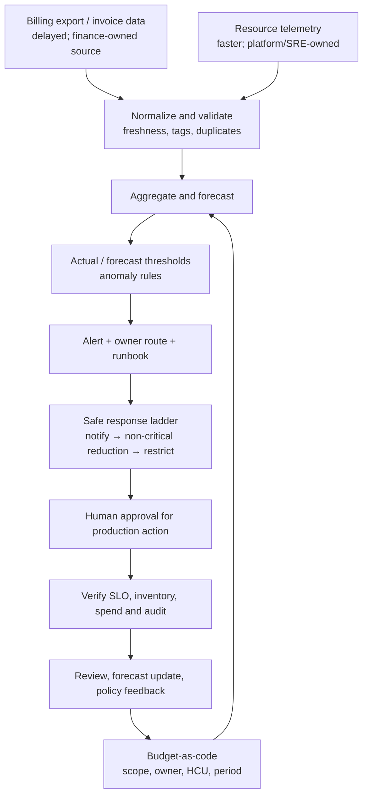

# Unit 3 — Cloud Budget Alerts and Spending Guardrails

**Target file:** `03-cloud-budget-alerts-and-spending-guardrails.md`  
**Stage / module / unit:** Stage 2E — Production DevOps & Platform Engineering / M15 / Unit 3  
**Estimated study time:** 26–34 hours (reading 7–9 h; implementation and labs 15–19 h; review and decision defence 4–6 h)  
**Prerequisites:** Stages 0–2D and M01–M14; Python 3.11+, Git, CSV/JSON, `kind`/`kubectl` familiarity, SLOs/error budgets, M03 ResourceQuota/LimitRange/HPA concepts, M07 governance/tagging, M09 credential hygiene, M10 incident response/safe automation, M11 Prometheus/Alertmanager patterns, and M15 Units 1–2.  
**Core tools:** Python standard library, CSV/JSON, budgets-as-code JSON, `unittest` or pytest, synthetic billing and usage signals.  
**Awareness:** AWS Budgets, Google Cloud Budgets, Azure Cost Management budgets, FinOps Foundation framework, FOCUS, Prometheus/Alertmanager/`promtool`, Kubernetes policy/admission tools.  
**Last reviewed:** 2026-11-03  
**Tool baseline assumed:** Python 3.11+ `[VERIFY]`; M11 Prometheus/Grafana and matching `promtool` versions if Cap+Obs is selected `[VERIFY]`; Kubernetes/kind from M03/M11 for optional policy demonstrations `[VERIFY]`; provider budget features must be rechecked for the target account and service.  
**Stack profile required:** Cap-Core for all required work; Cap+Obs is optional for Lab 4 only.  
**Footprint:** Cap-Core is a local Python workspace and synthetic files; no cluster is required for the core implementation. Cap+Obs reuses the M11 stack and may be material on an 8 GB machine. Measure your own CPU, memory and disk; start optional services only for their lab and stop them afterwards.  
**Prices used:** hypothetical cost units (HCU) only. No real prices, currency quotations, discounts, free-tier limits or provider commercial terms appear.

> **Completion outcome:** Build a deterministic synthetic billing pipeline, validate budgets-as-code, calculate actual and forecast spend, detect planted anomalies, expose owner-routed alert signals, implement preventive guardrail analogues and a safe response simulator, quantify price-volume-mix variance, and operate a governed response process without provisioning billable cloud resources.

## Table of contents

- [Prerequisite handoff and scope](#prerequisite-handoff-and-scope)
- [Running example and evidence labels](#running-example-and-evidence-labels)
- [Workspace and safety contract](#workspace-and-safety-contract)
- [Unit 3 — Cloud budget alerts and spending guardrails](#unit-3--cloud-budget-alerts-and-spending-guardrails)
  - [3.0 Why this matters in production](#30-why-this-matters-in-production)
  - [3.1 Learning objectives](#31-learning-objectives)
  - [3.2 Concept map and vocabulary](#32-concept-map-and-vocabulary)
  - [3.3 Level 1 — Beginner](#33-level-1--beginner--foundations)
  - [3.4 Level 2 — Intermediate](#34-level-2--intermediate--working-practice)
  - [3.5 Level 3 — Advanced](#35-level-3--advanced--production-engineering)
  - [3.6 Level 4 — Expert](#36-level-4--expert--operating-at-scale-and-under-failure)
  - [3.7 SRE lens](#37-sre-lens)
  - [3.8 Security lens](#38-security-lens)
  - [3.9 Production checklist](#39-production-checklist)
  - [3.10 Hands-on lab set](#310-hands-on-lab-set)
  - [3.11 Self-check questions](#311-self-check-questions)
  - [3.12 Evidence artifacts](#312-evidence-artifacts)
  - [3.13 Common interview and design-review questions](#313-common-interview-and-design-review-questions)
  - [3.14 Sources and verification notes](#314-sources-and-verification-notes)

## Prerequisite handoff and scope

This unit applies prior DevOps/SRE knowledge to the engineering side of FinOps. It does not re-teach Kubernetes requests, limits, ResourceQuota, LimitRange, HPA, IAM basics, Prometheus fundamentals or incident-command fundamentals.

| Prior / later module | Reuse and boundary |
|---|---|
| M07 Units 5–7 | Reuse account/project structure, organization policy, allowed resource/region controls, tagging/TTL and governance. Unit 3 adds budget and anomaly routing. |
| M07 Unit 8 | Reuse cleanup safety and inventory-before/after practices. Detailed orphan detection and cleanup automation belong to M15 Unit 5. |
| M09 | Reuse credential hygiene. Suspected credential compromise is a security incident; budget alerts are not the credential-response mechanism. |
| M10 Unit 5 | Reuse incident roles, postmortems and blameless follow-up. |
| M10 Unit 7 | Reuse safe automation, staged action, blast-radius limits and rollback. |
| M10 Unit 6 and M15 Unit 1 ([`01-platform-capacity-forecasting-and-headroom.md`](./01-platform-capacity-forecasting-and-headroom.md)) | Reuse SLO, capacity, headroom, demand forecast and lead-time context. Unit 3 adds financial telemetry and budget forecasts. |
| M11 | Reuse Prometheus/Alertmanager patterns, saturation signals, telemetry cost/cardinality, `promtool` testing and local paging simulation. Billing freshness is a separate clock from resource telemetry freshness. |
| M15 Unit 2 ([`02-workload-priorities-quotas-and-resource-contention.md`](./02-workload-priorities-quotas-and-resource-contention.md)) | Reuse ResourceQuota/LimitRange, priority, max-replica controls and contention concepts. Unit 3 adds budget scopes and policy guardrails. |
| M15 Unit 4 ([`04-cost-allocation-by-team-project-and-workload.md`](./04-cost-allocation-by-team-project-and-workload.md)) | Minimal owner/team/project labels are introduced for alert routing only. Allocation models, shared-cost allocation and showback are deferred. |
| M15 Unit 5 ([`05-idle-resource-detection-and-automated-cleanup.md`](./05-idle-resource-detection-and-automated-cleanup.md)) | Budget guardrails can flag suspicious idle spend; inventory and safe cleanup are deferred. |
| M15 Unit 9 ([`09-karpenter-and-cluster-autoscaler-node-provisioning.md`](./09-karpenter-and-cluster-autoscaler-node-provisioning.md)) | Autoscaler ceilings and node-count guardrails are later applied in depth. |
| M15 Unit 10 ([`10-event-driven-autoscaling-with-keda.md`](./10-event-driven-autoscaling-with-keda.md)) | HPA/KEDA runaway-scaling guardrails are later applied in depth. |
| M15 Unit 11 ([`11-kubernetes-cost-visibility-with-opencost.md`](./11-kubernetes-cost-visibility-with-opencost.md)) | OpenCost/Prometheus usage signals complement billing data; detailed Kubernetes cost visibility is deferred. |
| M13/M14 | Reuse backup, snapshot, replication, standby and cross-region transfer context. |
| M16/M17 | Forward reference only: cost-aware golden paths and portal showback (M16), then integrated governance capstone (M17). |

**This unit teaches:** budget concepts, actual/forecast thresholds, billing-data lag, synthetic billing, anomaly detection, budget governance, safe engineering guardrails, cost incident response and the interface between financial and operational telemetry.

**This unit defers:** detailed cost allocation/showback (Unit 4); idle inventory/cleanup (Unit 5); cost/reliability optimization (Unit 6); release cost gates (Unit 7); spot economics (Unit 8); node provisioning (Unit 9); KEDA (Unit 10); OpenCost (Unit 11); GPU economics (Unit 12); accounting/tax/chargeback policy and procurement decisions. This is not a finance/accounting course or legal advice.

## Running example and evidence labels

Use one hypothetical multi-team data/ML platform throughout:

- Online inference API: bursty request volume, latency and availability SLOs.
- Batch ETL: scheduled processing windows and growing data volumes.
- Stream consumers: queue-driven scaling and backlog recovery.
- ML training: longer-running jobs, checkpointing and possible GPU demand.
- Notebooks and analytics: interactive but often idle.
- Platform services: CI runners, registry, observability, GitOps and secrets.
- Stateful services: PostgreSQL and object storage, including backups and retention.
- Two regions: primary and standby, with replication and cross-region transfer.
- Teams/projects: inference, data platform, ML platform and shared platform.

All example account names, services, dates, usage, rates, thresholds, alerts, incident timelines and results are synthetic or illustrative. Cost is computed as synthetic usage multiplied by a hypothetical rate card; totals are not arbitrary hard-coded bills.

| Label | Meaning |
|---|---|
| `[SYNTHETIC]` | Generated local data with a documented seed and separate ground-truth manifest. |
| `[ILLUSTRATIVE]` | Invented teaching number or threshold; not a provider default or universal recommendation. |
| `[HYPOTHETICAL]` | HCU rate, budget or cost assumption used only for calculation. |
| `[ASSUMPTION]` | Policy/model input requiring an owner, rationale and review date. |
| `[VERIFY]` | Provider, API, schema, version, feature or metric detail not verified for the learner's exact environment. |
| `[MEASURED — YOUR ENVIRONMENT]` | A result the learner actually measures locally; never pre-fill it with a model-generated result. |

## Workspace and safety contract

All required labs run locally. No cloud account, paid service, real billing export, cloud credential, customer identifier, GPU or billable resource is needed or permitted. HCU is a pedagogical unit, not a currency and not convertible into a provider price.

Suggested learner-owned workspace (separate from the supplied repository):

```text
budget-guardrails-lab/
├── README.md
├── budgets/
│   ├── budgets.json
│   ├── schema-notes.md
│   └── validate_budgets.py
├── synthetic/
│   ├── rate_card.json
│   ├── generate_billing.py
│   ├── ground_truth.json
│   ├── sample_billing.csv
│   └── usage_signals.csv
├── engine/
│   ├── budget_engine.py
│   ├── forecast.py
│   ├── anomaly_detection.py
│   └── variance_analysis.py
├── guardrails/
│   ├── policy-contract.json
│   ├── response_simulator.py
│   └── safety_config.json
├── observability/
│   ├── budget_rules.yml
│   └── budget_rules_test.yml
├── runbooks/
│   ├── cost-anomaly.md
│   ├── runaway-cost-incident.md
│   └── postmortem-template.md
├── tests/
│   └── test_budget_guardrails.py
└── evidence/
    ├── test-results.txt
    ├── budget-report.json
    ├── anomaly-evaluation.json
    ├── guardrail-negative-tests.md
    └── incident-drill.md
```

The required implementation uses one standard-library Python module (`budget_guardrails.py`) as a cohesive executable reference. After tests pass, learners may split it into the suggested modules without changing behavior. JSON is used for budgets-as-code instead of YAML because Python's standard library can parse and validate it without installing a dependency; this is a justified equivalent. Optional Prometheus rules remain YAML.

**Safe setup**

```bash
mkdir -p budget-guardrails-lab/{budgets,synthetic,engine,guardrails,observability,runbooks,tests,evidence}
cd budget-guardrails-lab
python3 --version
python3 -m venv .venv
. .venv/bin/activate
python -m pip --version
```

**Shared lab execution envelope (applies to all ten labs)**

- **Footprint:** Cap-Core is Python/CSV/JSON and should fit the stated laptop baseline; measure disk and memory before generating additional copies. Cap+Obs reuses the M11 minimal Prometheus/Grafana stack and is optional; do not start it unless the machine has headroom.
- **Start/stop:** Cap-Core starts only the virtual environment and Python process. Stop by exiting the virtual environment and ensuring no Python process remains. Cap+Obs starts only the existing M11 profile; stop it with the M11 teardown instructions and verify its components are stopped. No cluster or cloud resource is created by the required path.
- **Context/isolation guard:** run `pwd` and confirm the learner-owned `budget-guardrails-lab` directory before writing/removing files. If an optional M11 component is involved, confirm the exact pre-existing lab context and release/namespace from the learner's own M11 README; never guess names.
- **Hazard labels:** Labs 1–6 and 8–10 are local file/synthetic-data exercises. Lab 7 is a simulated fault/automation test only. Lab 4 may start optional local observability components. No lab issues destructive cloud/Kubernetes commands.
- **Dry-run and abort:** response simulation defaults to dry-run; production/system-critical targets are protected. Abort if the workspace path is unexpected, the optional stack belongs to another exercise, a test attempts network/cloud access, or a cleanup target is broader than this workspace. Preserve evidence before deleting temporary files.

Python 3.11+ is assumed; verify your version. No package installation is required for Cap-Core. `python -m unittest` is the no-extra-dependency test runner. Never paste a real billing export into Git, an issue or a public notebook. Never store credentials or account identifiers in this workspace. Cleanup removes only this learner-owned directory; it does not touch Kubernetes, cloud resources or other repository files.

---

## Unit 3 — Cloud budget alerts and spending guardrails

### 3.0 Why this matters in production

A shared data/ML platform can incur variable usage from inference bursts, batch retries, queue backlogs, autoscaling, storage growth and cross-region transfer. A monthly budget notification may arrive only after usage has been incurred and billing data processed, so a runaway workload can continue between the event and the alert. Conversely, an automated response that stops a production database to reduce spend can turn a cost signal into an availability or data-integrity incident. A reliable practice combines preventive policy, operational telemetry, lag-aware financial alerts, named owners and a safe human-led response ladder.

### 3.1 Learning objectives

By the end of this unit, the learner can:

1. **[L1]** Explain the FinOps operating model, budget scope, actual versus forecast thresholds and why an alert is not a spending cap.
2. **[L1]** Generate deterministic synthetic billing rows whose HCU cost is usage multiplied by a documented hypothetical rate card.
3. **[L2]** Define and validate scoped budgets-as-code with owner, period, thresholds, route, escalation and expiring exceptions.
4. **[L2]** Calculate MTD spend, spend ratio, burn rate, linear forecast, seasonal forecast and alert payloads while handling delayed data.
5. **[L2]** Detect planted anomalies using day-over-day, week-over-week and rolling median/MAD methods; score precision, recall and time-to-detect.
6. **[L3]** Design layered preventive, detective and corrective controls with reliability, security, uncertainty and blast-radius constraints.
7. **[L3]** Implement local negative tests for region/resource restrictions, required metadata, replica ceilings and oversized requests.
8. **[L3]** Demonstrate a safe response ladder with dry-run, allow-list, production exclusions, kill switch, action cap, audit and idempotency.
9. **[L4]** Operate budget ownership, exception expiry, cost-anomaly SLOs, review cadence, incident response and automation governance.
10. **[L4]** Defend the limitations of billing alerts, forecasts, synthetic data and cost-only optimization, including service-SLO risk.

### 3.2 Concept map and vocabulary



The diagram has two data clocks. Resource telemetry can reveal a pod, queue or node increase quickly; billing exports reflect billing processing and can lag. Neither source is complete by itself. A financial alert should carry the billing dataset's latest usage date and freshness note. A usage alert is an operational proxy, not a financial ledger.

| Term | Precise definition | Common misconception |
|---|---|---|
| FinOps | Cross-functional operational practice for maximizing technology value through collaboration, timely data and financial accountability. | A finance-only cost-cutting team. |
| Inform | Framework phase for understanding current usage, cost and business context. | A one-time dashboard project. |
| Optimize | Framework phase for identifying changes that improve value, usage or rates. | Reduce every resource regardless of SLO. |
| Operate | Framework phase for implementing changes and continuously measuring outcomes. | Automate every cost action without approval. |
| Crawl / Walk / Run | Maturity shorthand for starting with small scope and increasing sophistication when business value justifies it. | Every capability must reach Run maturity. |
| Budget | Planned spend target for a defined scope and period. | A hard stop on usage or a guaranteed cap. |
| Budget scope | Account, project, service, environment, team, tag or workload boundary, subject to source-data quality. | Every provider exposes every scope. |
| Actual threshold | Trigger based on cost accumulated to date relative to budget. | It predicts the final period cost. |
| Forecast threshold | Trigger based on estimated period-end cost. | It is a guaranteed final bill. |
| Burn rate | Average or short-window cost accumulation per unit time. | A forecast without a defined window. |
| Billing lag | Delay between resource usage and its appearance in a billing dataset or alert evaluation. | A fixed universal 24-hour delay. |
| Billing freshness | Age of the latest usage date available at evaluation time. | The time the export file was last downloaded. |
| Allocated cost | Cost assigned to a scope using an allocation model. | The provider invoice's direct measurement of team spend. |
| Amortized cost | Cost representation that spreads eligible upfront/commitment amounts over time under a defined convention. | Always equal to cash paid in the period. |
| Anomaly | Material deviation from an expected cost/usage pattern for a defined scope and window. | Any large value is automatically malicious. |
| Preventive control | Policy that blocks or constrains an action before it creates usage. | A budget email. |
| Detective control | Mechanism that identifies a condition after or while it occurs. | A guarantee the condition is contained. |
| Corrective control | Action that changes or stops a running system to mitigate a condition. | Safe merely because it is automated. |
| Price-volume-mix (PVM) | Variance decomposition attributing total cost change to rate, quantity and service mix under an explicit convention. | A unique decomposition independent of method. |
| Denial of wallet | Abuse or compromise that causes unapproved resource consumption and financial loss. | Only a billing-team problem. |
| FOCUS | FinOps Open Cost and Usage Specification for normalizing cost and usage datasets. | A guarantee that a synthetic CSV is conformant. |
| FOCUS-like | Teaching schema inspired by normalized billing data, without claiming conformance. | A certified FOCUS implementation. |
| Goodhart's law | When a measure becomes a target, behavior can shift to optimize the measure rather than the outcome. | A reason not to measure anything. |
| Cost anomaly SLO | Defined objective for detecting, acknowledging and mitigating a cost event. | A provider notification guarantee. |
| Kill switch | Independently accessible control that disables automated corrective actions. | A substitute for least privilege and testing. |

#### Provider-awareness comparison

This is awareness, not a provider configuration tutorial. Feature names, scopes, evaluation cadence, notification routes, permissions and action semantics change; verify current official documentation for the exact account type and service.

| Provider family | Official feature area | What to understand | What not to assume |
|---|---|---|---|
| AWS | AWS Budgets / Cost Management | Cost and usage budgets, actual/forecast alert concepts, notification destinations and optional budget actions. | Billing data is instantaneous, notifications are a cap, or every action is suitable for production. |
| Google Cloud | Cloud Billing budgets and alerts | Alerts-only budgets, threshold notifications and programmatic Pub/Sub notifications. | An alerts-only budget prevents usage or message delivery is exactly once/in order. |
| Azure | Cost Management budgets | Actual and forecasted thresholds, recipients and optional action-group integrations at supported scopes. | A notification stops resources; ordinary budget alerts do not stop consumption. |

The FinOps Foundation framework describes **Inform → Optimize → Operate** and uses **Crawl / Walk / Run** as a maturity model. Maturity is a means to achieve outcomes, not a target in itself. Current official wording was checked for this document; re-check before using it in corporate policy.

### 3.3 Level 1 — Beginner — Foundations

#### What a budget actually does

A budget is a planned amount for a scope and period. A synthetic project budget may be 3,000 HCU for a 30-day period. The system compares accumulated cost against that amount and notifies an owner when actual or forecast thresholds are reached.

A budget does not necessarily reject a new VM, pod, managed database or serverless invocation; stop a running job; prevent a leaked credential from creating resources in another project or region; receive every charge when usage occurs; guarantee an email/webhook/message arrives before the next expensive action; or account for every invoice adjustment, credit, refund, tax, support charge or amortization convention in the same way.

| Control class | Example | Primary value | Residual risk |
|---|---|---|---|
| Preventive | Allowed regions/resource types, IAM, quotas, bounded autoscaling, organization policy | Stops or constrains known risky actions before usage | Policy gaps, privileged bypass and propagation delay |
| Detective | Actual/forecast budgets, anomaly detection, inventory audits, usage telemetry | Reveals unexpected behavior and routes evidence | Billing delay, false negatives/positives and delivery failure |
| Corrective | Pause a non-critical schedule, reduce non-critical replicas, quarantine a workload | Limits ongoing impact after a signal | Outage, data loss, backlog or unsafe targeting |

A **budget alert** is detective. A quota or policy can be preventive. Stopping a resource is corrective and must be treated as a potentially production-impacting change.

#### FinOps practice and roles

The FinOps Foundation framework is an operating model and cultural practice, not simply a billing dashboard. Its three iterative phases are:

1. **Inform:** make usage, cost, ownership, freshness and business context visible.
2. **Optimize:** identify options and compare value, reliability, effort and risk.
3. **Operate:** implement approved changes, measure results and repeat.

Crawl/Walk/Run is a maturity lens. A small team may begin with one read-only report, a named owner and a weekly review. It should not buy a large platform or automate production shutdowns merely to appear mature.

| Persona | Responsibilities in this unit |
|---|---|
| Engineering/service owner | Understand demand drivers, own service usage, annotate launches, maintain safe technical limits and respond to alerts. |
| Platform/SRE | Maintain telemetry, budget workflow, alert routing, policy guardrails, incident response and SLO verification. |
| Finance | Own financial planning conventions, budget approval, forecast cadence, invoice interpretation and close. |
| Product/business | Explain launch plans, business value, demand changes and acceptable service trade-offs. |
| FinOps practitioner | Facilitate common definitions, reporting, ownership, collaboration and continuous improvement. |
| Security | Investigate credential compromise/access abuse; protect billing exports and identities. |
| Leadership | Approve risk appetite, budget envelope, exception policy and escalation authority. |

This unit teaches engineering mechanisms. Finance remains responsible for finance-process governance and should be involved in budget definitions and forecast reviews.

#### Cost data: invoice, allocated and amortized views

A billing export is not the same thing as a live resource metric. Depending on provider, export configuration and service, billing rows may be hourly or daily; the available granularity and correction behavior are `[VERIFY]`. Do not assume an hourly export means every usage event is visible immediately.

- **Invoice/billed view:** provider-defined representation used in billing; exact columns and timing depend on provider/export type.
- **Allocated view:** a cost-management model that attributes direct and shared cost to teams, products or workloads. Detailed allocation belongs to Unit 4.
- **Amortized view:** spreads eligible upfront or commitment costs over a period under a documented method. It can differ from cash paid in the period.
- **Operational usage view:** CPU, memory, replicas, requests, bytes transferred, API calls or queue depth. It is often faster but must be translated into cost using a model.

A FOCUS-like synthetic dataset is useful for teaching normalization. It is not FOCUS-conformant unless it passes the specification's schema and semantic requirements. Candidate fields include `usage_date`, `available_at`, `account`, `project`, `service`, `resource_type`, `region`, `usage_quantity`, `usage_unit`, `rate_hcu`, `cost_hcu`, `team`, `owner`, `environment` and `resource_id`.

#### Worked example: actual spend ratio and burn rate

Let \(A\) be month-to-date actual HCU, \(B\) the approved budget in HCU, \(d\) elapsed days and \(D\) total days.

\[
R_A = \frac{A}{B}
\]

If \(A=1{,}260\) HCU and \(B=3{,}000\) HCU, \(R_A=0.42\), or 42%. This is a point-in-time ratio, not an end-of-month forecast.

Average-to-date burn rate:

\[
b_{\text{avg}} = \frac{A}{d}
\]

If 1,260 HCU accumulated over 14 days, average burn is 90 HCU/day. If the last three days accumulated 360 HCU, the short-window burn is 120 HCU/day (360 ÷ 3). The short-window rate shows acceleration while the month-to-date average smooths it. Always label the window; these are different signals.

Zero and missing budgets require explicit behavior. A zero budget is not a valid denominator: return an invalid-budget state and alert the owner. A missing budget is a governance gap, not a ratio of zero. Never silently convert either condition into “within budget.”

#### Worked example: linear forecast and independent thresholds

A simple linear projection is:

\[
F_{\text{linear}} = \frac{A}{d} \times D
\]

With 1,260 HCU after 14 of 30 days, the linear forecast is 2,700 HCU. Forecast ratio is:

\[
R_F = \frac{F}{B} = \frac{2{,}700}{3{,}000} = 0.90
\]

An actual threshold at 70% and forecast threshold at 85% are evaluated independently. Actual is 42%, so the actual threshold has not fired; forecast is 90%, so the forecast threshold has fired.

Linear extrapolation fails when demand is seasonal, a launch is planned, a batch window is pending, billing data is delayed, rates change, a one-time credit/refund occurs or a runaway event changes the slope. It is a baseline, not a prediction oracle.

#### Guided worksheet: trace one cost value

| Field | Example |
|---|---|
| Usage quantity | 100 units `[SYNTHETIC]` |
| Hypothetical rate | 0.08 HCU/unit `[HYPOTHETICAL]` |
| Calculated cost | 8 HCU `[SYNTHETIC]` |
| Usage date | 2026-10-10 `[SYNTHETIC]` |
| Available date | 2026-10-12 `[SYNTHETIC]` |
| Owner | `team-inference` |
| Project | `inference-prod` |
| Region | `region-lab-a` |

The calculation is \(100 \times 0.08 = 8\) HCU. If evaluation date is 2026-10-11, the row is not yet available to the billing-only engine. Operational telemetry may show the workload on 2026-10-10, so it can provide an earlier warning. It must not be reported as an invoice amount.

#### Beginner mistakes

| Mistake | Symptom | Correction |
|---|---|---|
| Treating an 80% alert as a cap | Spend continues after threshold | Add preventive controls and owner-led response. |
| Using export timestamp as usage freshness | Recent file contains old usage rows | Track latest usage date and ingestion time separately. |
| Forecasting with one daily average | Batch/weekday patterns create noise | Compare linear and seasonal forecasts; annotate events. |
| Treating missing owner as a team | Alert routes to nobody/wrong team | Route to `unassigned-cost` and open a metadata defect. |
| Assuming provider feature parity | Scope/notification/action mismatch | Maintain provider-specific verification notes. |
| Stopping production automatically | Cost event becomes outage | Dry-run first; require approval and SLO checks. |

### 3.4 Level 2 — Intermediate — Working Practice

This level builds the complete local workflow. The required path uses Python standard library only. A fixed seed produces repeatable data and a separate ground-truth manifest. Re-running the generator with the same parameters must reproduce the same records.

#### Synthetic billing generator and ground truth

The generator plants six conditions:

1. **Runaway resource growth:** inference usage increases sharply from a labelled date.
2. **Untagged resource:** a row has no owner/team metadata.
3. **Egress spike:** transfer usage rises sharply on a planted date.
4. **New region/service:** a service appears in a region not present in the normal baseline.
5. **Billing lag:** rows become available two days after usage; this is `[ILLUSTRATIVE]`, not a provider guarantee.
6. **Expected launch event:** ETL usage rises on an annotated launch date and should not be treated as unexplained by default.

The ground-truth manifest is separate from detector input. The detector must not read labels from the manifest when producing alerts; the evaluator uses the manifest only after detection to score results.

#### Budgets-as-code

The reference uses JSON as a standard-library equivalent to YAML. A budget definition includes unique ID, scope field/value, period and HCU amount, actual and forecast thresholds, owner, notification route, escalation target, runbook reference and exemptions with rationale, approver and expiry.

The validator rejects unknown routes, empty owners, malformed periods, negative budgets, unsorted/out-of-range thresholds, duplicate IDs and exemptions without expiry. Parent and child scopes are independent views. Do not add parent and child totals together: the same usage can appear in both views. Detailed allocation rules belong to Unit 4.

Example `budgets/budgets.json`:

```json
{
  "routes": {
    "finops-primary": "local://finops-inbox",
    "inference-owner": "local://team-inference",
    "unassigned-cost": "local://platform-triage"
  },
  "budgets": [
    {
      "id": "platform-monthly",
      "scope": {"field": "account", "value": "lab-account"},
      "period": "2026-10",
      "amount_hcu": 600,
      "actual_thresholds": [0.70, 0.90, 1.00],
      "forecast_thresholds": [0.85, 1.00],
      "owner": "platform-finops",
      "route": "finops-primary",
      "escalation": "platform-on-call",
      "runbook": "runbooks/cost-anomaly.md",
      "exemptions": []
    },
    {
      "id": "inference-monthly",
      "scope": {"field": "project", "value": "inference-prod"},
      "period": "2026-10",
      "amount_hcu": 300,
      "actual_thresholds": [0.75, 0.95],
      "forecast_thresholds": [0.90, 1.05],
      "owner": "team-inference",
      "route": "inference-owner",
      "escalation": "inference-on-call",
      "runbook": "runbooks/cost-anomaly.md",
      "exemptions": []
    }
  ]
}
```

All amounts and thresholds are `[ILLUSTRATIVE]`. Route strings are local simulator destinations, not real email addresses or cloud notification endpoints.

#### Complete local implementation

Save the following as `budget_guardrails.py`. It implements deterministic generation, budget validation, MTD/forecast calculations, anomaly detection/scoring, PVM decomposition, guardrail checks and safe response simulation. It has no cloud SDK and makes no network calls.

```python
#!/usr/bin/env python3
import argparse
import csv
import json
import math
import random
import statistics
from collections import defaultdict
from datetime import date, datetime, timedelta, timezone
from pathlib import Path

RATES = {
    "inference": (0.08, "request_unit"),
    "etl": (0.015, "compute_unit"),
    "training": (0.12, "accelerator_unit"),
    "transfer": (0.01, "transfer_unit")
}
FIELDS = [
    "usage_date", "available_at", "account", "project", "environment",
    "team", "owner", "service", "resource_type", "region",
    "usage_quantity", "usage_unit", "rate_hcu", "cost_hcu",
    "resource_id", "tags_present"
]

def read_json(path):
    return json.loads(Path(path).read_text(encoding="utf-8"))

def write_json(path, value):
    target = Path(path)
    target.parent.mkdir(parents=True, exist_ok=True)
    target.write_text(json.dumps(value, indent=2, sort_keys=True) + "\n", encoding="utf-8")

def month_bounds(period):
    try:
        year, month = (int(x) for x in period.split("-"))
        first = date(year, month, 1)
    except (ValueError, TypeError):
        raise ValueError("period must use YYYY-MM")
    next_month = date(year + 1, 1, 1) if month == 12 else date(year, month + 1, 1)
    return first, next_month - timedelta(days=1)

def validate_budgets(config):
    errors, seen = [], set()
    routes, budgets = config.get("routes", {}), config.get("budgets", [])
    if not isinstance(routes, dict) or not routes:
        errors.append("routes must be a non-empty object")
    if not isinstance(budgets, list) or not budgets:
        return errors + ["budgets must be a non-empty list"]
    required = ("id", "scope", "period", "amount_hcu", "actual_thresholds",
                "forecast_thresholds", "owner", "route", "escalation", "runbook", "exemptions")
    allowed_scopes = {"account", "project", "environment", "team", "owner", "region"}
    for i, b in enumerate(budgets):
        label = f"budgets[{i}]"
        missing = [key for key in required if key not in b]
        if missing:
            errors.append(f"{label}: missing {','.join(missing)}")
            continue
        if not b["id"] or b["id"] in seen:
            errors.append(f"{label}: id must be non-empty and unique")
        seen.add(b["id"])
        scope = b["scope"]
        if not isinstance(scope, dict) or scope.get("field") not in allowed_scopes or not scope.get("value"):
            errors.append(f"{label}: malformed or unsupported scope")
        try:
            month_bounds(b["period"])
        except ValueError as exc:
            errors.append(f"{label}: {exc}")
        amount = b["amount_hcu"]
        if not isinstance(amount, (int, float)) or isinstance(amount, bool) or amount < 0:
            errors.append(f"{label}: amount_hcu must be non-negative")
        for key in ("actual_thresholds", "forecast_thresholds"):
            values = b[key]
            if not isinstance(values, list) or not values:
                errors.append(f"{label}: {key} must be a non-empty list")
            elif (any(not isinstance(v, (int, float)) or not 0 < v <= 2 for v in values)
                  or values != sorted(set(values))):
                errors.append(f"{label}: {key} must be strictly increasing values in (0, 2]")
        if not b["owner"]:
            errors.append(f"{label}: owner is required")
        if b["route"] not in routes:
            errors.append(f"{label}: unknown notification route")
        if not b["escalation"] or not b["runbook"]:
            errors.append(f"{label}: escalation and runbook are required")
        if not isinstance(b["exemptions"], list):
            errors.append(f"{label}: exemptions must be a list")
        else:
            for j, ex in enumerate(b["exemptions"]):
                for key in ("scope_value", "reason", "approver", "expires_on"):
                    if not ex.get(key):
                        errors.append(f"{label}.exemptions[{j}]: {key} is required")
                if ex.get("expires_on"):
                    try:
                        date.fromisoformat(ex["expires_on"])
                    except ValueError:
                        errors.append(f"{label}.exemptions[{j}]: expires_on must be YYYY-MM-DD")
    return errors

def generate(month, seed, outdir):
    first, last = month_bounds(month)
    rng, rows, signals = random.Random(seed), [], []
    events = {
        "launch": first + timedelta(days=14),
        "runaway": first + timedelta(days=17),
        "untagged": first + timedelta(days=19),
        "egress": first + timedelta(days=21),
        "new_region": first + timedelta(days=24)
    }
    for offset in range((last - first).days + 1):
        day = first + timedelta(days=offset)
        weekday = 1.18 if day.weekday() < 5 else 0.72
        jitter = rng.uniform(0.96, 1.04)
        profiles = [
            ("inference", "inference-prod", "production", "team-inference", "owner-inference", "api", "region-lab-a", 100 * weekday * jitter),
            ("etl", "data-prod", "production", "team-data", "owner-data", "batch", "region-lab-a", 420 * weekday * jitter * (1.65 if day == events["launch"] else 1.0)),
            ("training", "ml-prod", "production", "team-ml", "owner-ml", "training", "region-lab-a", 55 * (1.0 if day.weekday() in (1, 3, 5) else 0.25) * jitter),
            ("transfer", "shared-platform", "production", "team-platform", "owner-platform", "network", "region-lab-a", 125 * weekday * jitter)
        ]
        if day >= events["runaway"]:
            item = profiles[0]
            profiles[0] = (*item[:-1], item[-1] * 2.25)
        if day == events["egress"]:
            item = profiles[3]
            profiles[3] = (*item[:-1], item[-1] * 15.0)
        if day == events["untagged"]:
            profiles.append(("transfer", "unknown-project", "production", "", "", "network", "region-lab-a", 240.0))
        if day == events["new_region"]:
            profiles.append(("training", "ml-prod", "production", "team-ml", "owner-ml", "training", "region-lab-b", 35.0))
        for index, item in enumerate(profiles):
            service, project, env, team, owner, kind, region, quantity = item
            rate, unit = RATES[service]
            cost = round(quantity * rate, 4)
            rid = f"{service}-{project}-{day.isoformat()}-{index}"
            row = {
                "usage_date": day.isoformat(), "available_at": (day + timedelta(days=2)).isoformat(),
                "account": "lab-account", "project": project, "environment": env,
                "team": team, "owner": owner, "service": service, "resource_type": kind,
                "region": region, "usage_quantity": round(quantity, 4), "usage_unit": unit,
                "rate_hcu": rate, "cost_hcu": cost, "resource_id": rid,
                "tags_present": bool(team and owner)
            }
            rows.append(row)
            signals.append({"observed_at": day.isoformat(), "resource_id": rid,
                            "service": service, "region": region,
                            "usage_quantity": round(quantity, 4), "tags_present": bool(team and owner)})
    root = Path(outdir)
    root.mkdir(parents=True, exist_ok=True)
    with (root / "sample_billing.csv").open("w", newline="", encoding="utf-8") as f:
        writer = csv.DictWriter(f, fieldnames=FIELDS)
        writer.writeheader()
        writer.writerows(rows)
    with (root / "usage_signals.csv").open("w", newline="", encoding="utf-8") as f:
        cols = ["observed_at", "resource_id", "service", "region", "usage_quantity", "tags_present"]
        writer = csv.DictWriter(f, fieldnames=cols)
        writer.writeheader()
        writer.writerows(signals)
    write_json(root / "rate_card.json", {k: {"rate_hcu": v[0], "unit": v[1]} for k, v in RATES.items()})
    write_json(root / "ground_truth.json", {
        "seed": seed, "period": month, "billing_delay_days": 2,
        "events": [
            {"id": "expected-launch", "type": "expected_event", "start": events["launch"].isoformat(), "end": events["launch"].isoformat()},
            {"id": "runaway-inference", "type": "cost_anomaly", "start": events["runaway"].isoformat(), "end": last.isoformat()},
            {"id": "untagged-resource", "type": "metadata_anomaly", "start": events["untagged"].isoformat(), "end": events["untagged"].isoformat()},
            {"id": "egress-spike", "type": "cost_anomaly", "start": events["egress"].isoformat(), "end": events["egress"].isoformat()},
            {"id": "new-region", "type": "governance_anomaly", "start": events["new_region"].isoformat(), "end": events["new_region"].isoformat()}
        ]
    })
    return {"rows": len(rows), "period": month, "seed": seed, "outdir": str(root)}

def load_rows(path):
    with Path(path).open(newline="", encoding="utf-8") as f:
        rows = list(csv.DictReader(f))
    result, seen, duplicates = [], set(), 0
    for row in rows:
        key = (row["resource_id"], row["usage_date"])
        if key in seen:
            duplicates += 1
            continue
        seen.add(key)
        for key_name in ("usage_quantity", "rate_hcu", "cost_hcu"):
            row[key_name] = float(row[key_name])
        row["tags_present"] = str(row["tags_present"]).lower() == "true"
        result.append(row)
    return result, duplicates

def daily_totals(rows):
    totals = defaultdict(float)
    for row in rows:
        totals[row["usage_date"]] += row["cost_hcu"]
    return dict(totals)

def seasonal_forecast(daily, period_end):
    if not daily:
        return 0.0
    observed = [(date.fromisoformat(k), v) for k, v in daily.items()]
    weekday_values, all_values = defaultdict(list), []
    for day, value in observed:
        weekday_values[day.weekday()].append(value)
        all_values.append(value)
    fallback = statistics.mean(all_values)
    latest = max(day for day, _ in observed)
    projected, cursor = 0.0, latest + timedelta(days=1)
    while cursor <= period_end:
        values = weekday_values.get(cursor.weekday(), [])
        projected += statistics.mean(values) if values else fallback
        cursor += timedelta(days=1)
    return sum(daily.values()) + projected

def budget_report(billing_path, budgets_path, as_of_text):
    config = read_json(budgets_path)
    errors = validate_budgets(config)
    if errors:
        raise ValueError("invalid budgets-as-code: " + "; ".join(errors))
    as_of = date.fromisoformat(as_of_text)
    rows, duplicates = load_rows(billing_path)
    reports = []
    for budget in config["budgets"]:
        start, end = month_bounds(budget["period"])
        if not start <= as_of <= end:
            raise ValueError(f"{budget['id']}: as_of must be inside its budget period")
        selected = [r for r in rows if start.isoformat() <= r["usage_date"] <= as_of.isoformat()
                    and r["available_at"] <= as_of.isoformat()
                    and (budget["scope"]["value"] == "ALL"
                         or r.get(budget["scope"]["field"]) == budget["scope"]["value"])]
        actual = round(sum(r["cost_hcu"] for r in selected), 4)
        daily = daily_totals(selected)
        latest = max(daily, default=None)
        elapsed = 0 if latest is None else (date.fromisoformat(latest) - start).days + 1
        days = (end - start).days + 1
        amount = budget["amount_hcu"]
        actual_ratio = None if amount == 0 else actual / amount
        linear = None if amount == 0 or elapsed == 0 else actual / elapsed * days
        seasonal = None if amount == 0 else seasonal_forecast(daily, end)
        forecast_ratio = None if seasonal is None else seasonal / amount
        drivers = defaultdict(float)
        for row in selected:
            drivers[row["service"]] += row["cost_hcu"]
        alerts = []
        if actual_ratio is not None:
            alerts += [{"type": "actual", "threshold": t} for t in budget["actual_thresholds"] if actual_ratio >= t]
            alerts += [{"type": "forecast", "threshold": t} for t in budget["forecast_thresholds"]
                       if forecast_ratio is not None and forecast_ratio >= t]
        reports.append({
            "budget_id": budget["id"], "owner": budget["owner"], "route": budget["route"],
            "route_target": config["routes"][budget["route"]], "scope": budget["scope"],
            "period": budget["period"], "as_of": as_of.isoformat(), "budget_hcu": amount,
            "status": "invalid_zero_budget" if amount == 0 else ("no_data" if not selected else "evaluated"),
            "mtd_actual_hcu": actual, "actual_ratio": actual_ratio,
            "average_burn_hcu_per_observed_day": None if elapsed == 0 else round(actual / elapsed, 4),
            "linear_forecast_hcu": None if linear is None else round(linear, 4),
            "seasonal_forecast_hcu": None if seasonal is None else round(seasonal, 4),
            "forecast_ratio": None if forecast_ratio is None else round(forecast_ratio, 4),
            "top_drivers": [{"service": k, "cost_hcu": round(v, 4)}
                            for k, v in sorted(drivers.items(), key=lambda x: x[1], reverse=True)[:3]],
            "latest_usage_date": latest,
            "billing_freshness_days": None if latest is None else (as_of - date.fromisoformat(latest)).days,
            "missing_owner_rows": sum(1 for r in selected if not r["owner"]),
            "metadata_exception_route": config["routes"].get("unassigned-cost"),
            "suspected_anomaly": ("missing owner metadata" if any(not r["owner"] for r in selected)
                                  else ("new region observed" if any(r["region"] != "region-lab-a" for r in selected)
                                        else "correlate top driver with operational usage signals")),
            "duplicate_rows_ignored": duplicates,
            "data_note": "Rows are filtered by available_at; missing recent usage may reflect simulated billing lag.",
            "alerts": alerts, "runbook": budget["runbook"], "escalation": budget["escalation"]
        })
    return {"reports": reports, "generated_at": datetime.now(timezone.utc).isoformat(timespec="seconds").replace("+00:00", "Z")}

def governance_flags(billing_path, as_of_text, allowed_regions=("region-lab-a",)):
    as_of = date.fromisoformat(as_of_text)
    rows, _ = load_rows(billing_path)
    rows = [r for r in rows if r["available_at"] <= as_of.isoformat()
            and r["usage_date"] <= as_of.isoformat()]
    flags = []
    for row in rows:
        if not row["owner"] or not row["team"]:
            flags.append({"date": row["usage_date"], "type": "missing_owner",
                          "resource_id": row["resource_id"], "route": "unassigned-cost"})
        if row["region"] not in allowed_regions:
            flags.append({"date": row["usage_date"], "type": "new_region",
                          "resource_id": row["resource_id"], "region": row["region"]})
    return flags

def anomaly_flags(billing_path, as_of_text):
    as_of = date.fromisoformat(as_of_text)
    rows, _ = load_rows(billing_path)
    rows = [r for r in rows if r["available_at"] <= as_of.isoformat() and r["usage_date"] <= as_of.isoformat()]
    daily, flags = daily_totals(rows), []
    for day_text in sorted(daily):
        day, current = date.fromisoformat(day_text), daily[day_text]
        previous = daily.get((day - timedelta(days=1)).isoformat())
        prior_week = daily.get((day - timedelta(days=7)).isoformat())
        history = [v for d, v in daily.items() if date.fromisoformat(d) < day]
        history = [daily[d] for d in sorted(daily) if date.fromisoformat(d) < day][-7:]
        median = statistics.median(history) if history else None
        mad = statistics.median([abs(v - median) for v in history]) if history else None
        robust_z = None if median is None else (0.0 if mad == 0 and current <= median
                    else (999.0 if mad == 0 else 0.6745 * (current - median) / mad))
        methods = []
        if previous and current / previous >= 1.8:
            methods.append("day_over_day")
        if prior_week and current / prior_week >= 1.8:
            methods.append("week_over_week")
        if robust_z is not None and robust_z >= 3.0:
            methods.append("rolling_median_mad")
        if methods:
            flags.append({"date": day_text, "cost_hcu": round(current, 4), "methods": methods,
                          "robust_z": round(robust_z, 4) if robust_z is not None else None})
    return flags

def score_anomalies(flags, truth_path, billing_path=None, as_of_text=None):
    truth = read_json(truth_path)
    events = [e for e in truth["events"] if e["type"] == "cost_anomaly"]
    observed_through = None
    if billing_path and as_of_text:
        as_of = date.fromisoformat(as_of_text)
        eligible, _ = load_rows(billing_path)
        eligible = [r for r in eligible if r["available_at"] <= as_of.isoformat()]
        observed_through = max((date.fromisoformat(r["usage_date"]) for r in eligible), default=date.min)
    positive = set()
    for event in events:
        cursor, end = date.fromisoformat(event["start"]), date.fromisoformat(event["end"])
        if observed_through is not None:
            end = min(end, observed_through)
        while cursor <= end:
            positive.add(cursor.isoformat())
            cursor += timedelta(days=1)
    def metrics(predicted):
        tp = len(predicted & positive)
        fp = len(predicted - positive)
        fn = len(positive - predicted)
        return {"tp_days": tp, "fp_days": fp, "fn_days": fn,
                "precision": round(tp / (tp + fp), 4) if tp + fp else 0.0,
                "recall": round(tp / (tp + fn), 4) if tp + fn else 0.0}
    predicted = {f["date"] for f in flags}
    ttd = {}
    for event in events:
        first = next((d for d in sorted(predicted) if event["start"] <= d <= event["end"]), None)
        ttd[event["id"]] = None if first is None else (
            date.fromisoformat(first) - date.fromisoformat(event["start"])
        ).days
    methods = ("day_over_day", "week_over_week", "rolling_median_mad")
    by_method = {
        method: metrics({f["date"] for f in flags if method in f.get("methods", [])})
        for method in methods
    }
    return {**metrics(predicted), "time_to_detect_days": ttd, "by_method": by_method,
            "caveat": "Day-level synthetic scoring does not prove production detector quality."}

def pvm_decompose(v0, v1, m0, m1, p0, p1):
    services = sorted(set(m0) | set(m1) | set(p0) | set(p1))
    if v0 < 0 or v1 < 0 or not math.isclose(sum(m0.values()), 1.0, abs_tol=1e-8) or not math.isclose(sum(m1.values()), 1.0, abs_tol=1e-8):
        raise ValueError("volumes must be non-negative and mixes must sum to 1")
    if any(s not in p0 or s not in p1 for s in services):
        raise ValueError("missing rate")
    base = v0 * sum(m0[s] * p0[s] for s in services)
    new = v1 * sum(m1[s] * p1[s] for s in services)
    volume = (v1 - v0) * sum(m0[s] * p0[s] for s in services)
    mix = v1 * sum((m1[s] - m0[s]) * p0[s] for s in services)
    rate = v1 * sum(m1[s] * (p1[s] - p0[s]) for s in services)
    if not math.isclose(volume + mix + rate, new - base, abs_tol=1e-7):
        raise ArithmeticError("PVM components do not reconcile")
    return {"base_cost_hcu": round(base, 4), "new_cost_hcu": round(new, 4),
            "volume_effect_hcu": round(volume, 4), "mix_effect_hcu": round(mix, 4),
            "rate_effect_hcu": round(rate, 4), "total_variance_hcu": round(new - base, 4)}

def validate_request(req, policy):
    errors = []
    for label in policy["required_labels"]:
        if not req.get("labels", {}).get(label):
            errors.append(f"missing required label: {label}")
    if req.get("region") not in policy["allowed_regions"]:
        errors.append("region is not allowed")
    if req.get("resource_type") not in policy["allowed_resource_types"]:
        errors.append("resource type is not allowed")
    if req.get("cpu_millicores", 0) > policy["max_cpu_millicores"]:
        errors.append("CPU request exceeds policy ceiling")
    replicas = req.get("hpa_max_replicas")
    if not isinstance(replicas, int) or replicas < 1:
        errors.append("HPA max replicas must be a finite positive integer")
    elif replicas > policy["max_replicas"]:
        errors.append("HPA max replicas exceeds policy ceiling")
    return errors

def verify_first_resource_readiness(evidence):
    required = ("budget_defined", "owner", "route", "runbook", "guardrails",
                "inventory_baseline", "teardown_plan", "cleanup_evidence")
    missing = [key for key in required if not evidence.get(key)]
    return {"ready": not missing, "missing": missing}

def simulate_response_ladder(resource, config):
    if config.get("kill_switch", False):
        return {"steps": [], "executed_actions": [],
                "blocked": "kill switch enabled"}
    steps = [
        {"stage": "notify", "action": "notify_owner", "decision": "planned",
         "owner": resource.get("owner", "unassigned")},
        {"stage": "reduce_noncritical", "action": "pause_schedule",
         "decision": "planned" if resource.get("noncritical", False) else "human_review_required"},
        {"stage": "restrict_new_creation", "action": "deny_new_creation",
         "decision": "recommendation_only"}
    ]
    safe = (resource.get("id") in config["allowlist"]
            and resource.get("environment") in config["allowed_environments"]
            and not resource.get("protected", False))
    steps.append({
        "stage": "stop_nonproduction", "action": "stop_nonproduction",
        "decision": ("dry_run" if config.get("dry_run", True) else "simulated_action")
                    if safe else "blocked"
    })
    executed = [] if config.get("dry_run", True) or not safe else [
        {"resource": resource["id"], "action": "stop_nonproduction"}
    ]
    return {"steps": steps, "executed_actions": executed,
            "production_action_requires_human_approval": True}

def simulate_response(resources, config, bug_inject=False, seen_keys=None):
    audit, planned = [], []
    key = config.get("idempotency_key", "budget-guardrails-demo-v1")
    seen_keys = seen_keys if seen_keys is not None else set()
    if config.get("kill_switch", False):
        return {"actions": [], "planned_actions": [], "audit": [{"result": "blocked", "reason": "kill switch enabled"}]}
    if key in seen_keys:
        return {"actions": [], "planned_actions": [], "audit": [{"result": "blocked", "reason": "duplicate idempotency key"}], "idempotency_key": key}
    seen_keys.add(key)
    candidates = [r for r in resources if r["environment"] == "production"][:1] if bug_inject else resources
    for resource in candidates:
        reason = None
        if resource["id"] not in config["allowlist"]:
            reason = "resource is not allow-listed"
        elif resource["environment"] not in config["allowed_environments"]:
            reason = "environment is excluded"
        elif resource.get("protected", False):
            reason = "resource is protected"
        elif len(planned) >= config["max_actions"]:
            reason = "action cap reached"
        if reason:
            audit.append({"resource": resource["id"], "result": "blocked", "reason": reason})
        else:
            planned.append({"resource": resource["id"], "action": "stop_nonproduction"})
            audit.append({"resource": resource["id"], "result": "dry_run" if config["dry_run"] else "simulated_action"})
    notifications = [{"owner": next((r.get("owner", "unassigned") for r in resources
                                     if r["id"] == item["resource"]), "unassigned"),
                      "resource": item["resource"], "intent": "notify_owner"}
                     for item in planned]
    return {"actions": [] if config["dry_run"] else planned, "planned_actions": planned,
            "notifications": notifications, "audit": audit, "idempotency_key": key}

def main():
    parser = argparse.ArgumentParser(description="Local synthetic budget and guardrail lab")
    sub = parser.add_subparsers(dest="command", required=True)
    gen = sub.add_parser("generate")
    gen.add_argument("--month", default="2026-10")
    gen.add_argument("--seed", type=int, default=17)
    gen.add_argument("--outdir", default="synthetic")
    rep = sub.add_parser("report")
    rep.add_argument("--billing", default="synthetic/sample_billing.csv")
    rep.add_argument("--budgets", default="budgets/budgets.json")
    rep.add_argument("--as-of", required=True)
    rep.add_argument("--out", default="evidence/budget-report.json")
    ano = sub.add_parser("anomaly")
    ano.add_argument("--billing", default="synthetic/sample_billing.csv")
    ano.add_argument("--ground-truth", default="synthetic/ground_truth.json")
    ano.add_argument("--as-of", required=True)
    ano.add_argument("--out", default="evidence/anomaly-evaluation.json")
    args = parser.parse_args()
    if args.command == "generate":
        print(json.dumps(generate(args.month, args.seed, args.outdir), indent=2))
    elif args.command == "report":
        result = budget_report(args.billing, args.budgets, args.as_of)
        write_json(args.out, result)
        print(json.dumps(result, indent=2))
    elif args.command == "anomaly":
        flags = anomaly_flags(args.billing, args.as_of)
        result = {"flags": flags,
                  "governance_flags": governance_flags(args.billing, args.as_of),
                  "evaluation": score_anomalies(flags, args.ground_truth, args.billing, args.as_of)}
        write_json(args.out, result)
        print(json.dumps(result, indent=2))

if __name__ == "__main__":
    main()
```

#### Representative command sequence

Save the budgets JSON above, then run:

```bash
python budget_guardrails.py generate --month 2026-10 --seed 17 --outdir synthetic
python budget_guardrails.py report --billing synthetic/sample_billing.csv --budgets budgets/budgets.json --as-of 2026-10-24 --out evidence/budget-report.json
python budget_guardrails.py anomaly --billing synthetic/sample_billing.csv --ground-truth synthetic/ground_truth.json --as-of 2026-10-28 --out evidence/anomaly-evaluation.json
```

The report includes MTD actual, spend ratio, average burn, linear and weekday-seasonal forecast, forecast ratio, top drivers, latest usage date, billing freshness, missing-owner count and independent threshold states. Run the commands to capture `[MEASURED — YOUR ENVIRONMENT]` output. Do not copy a representative output and label it measured.

#### Seasonal forecast method and limitations

The reference engine groups observed daily totals by weekday, averages each weekday's observed values, then projects those means from the latest available usage date through the end of the budget period. If a weekday has no sample, it falls back to the overall observed daily mean. This is simple and auditable. It also makes billing lag visible: the latest observed usage date may be earlier than the evaluation date.

It is not a full seasonal time-series model. It does not infer holidays, event regressors, rate changes or persistent incidents. A production process should use longer history, event regressors, prediction intervals and rolling-origin back-tests. Compare it with linear and naive baselines.

#### Alert payload contract

```json
{
  "alert_type": "forecast_threshold",
  "budget_id": "inference-monthly",
  "scope": {"field": "project", "value": "inference-prod"},
  "owner": "team-inference",
  "route": "inference-owner",
  "current_spend_hcu": 810.0,
  "budget_hcu": 1100.0,
  "actual_ratio": 0.7364,
  "forecast_hcu": 1240.0,
  "forecast_ratio": 1.1273,
  "top_drivers": ["inference", "transfer"],
  "suspected_anomaly": "runaway inference usage",
  "data_freshness": "latest usage date is 2 days old",
  "uncertainty": "billing rows may be delayed; forecast is not a guarantee",
  "runbook": "runbooks/cost-anomaly.md",
  "timestamp": "synthetic evaluation timestamp"
}
```

This schema example has `[ILLUSTRATIVE]` values. A production notification adapter should render this contract and attach a stable alert fingerprint. Never include raw sensitive tags or account identifiers in a broad notification channel. Missing owners must route to an explicit unassigned queue.

#### Anomaly-detection bake-off

Compare three simple detectors:

- **Day-over-day:** current daily cost divided by previous day's cost. Fast, but sensitive to weekday/weekend changes and zero baselines.
- **Week-over-week:** current daily cost divided by the same weekday one week earlier. Controls some weekly seasonality but can miss a new event if the previous week was already abnormal.
- **Rolling median/MAD:** compare current cost with the median and median absolute deviation of a preceding window. More robust to isolated outliers than mean/standard deviation, but a short or contaminated history can still fail.

\[
\text{Precision} = \frac{TP}{TP + FP}, \qquad
\text{Recall} = \frac{TP}{TP + FN}
\]

TP is a correctly flagged positive day, FP an unlabelled day flagged, and FN a labelled event day missed. Time-to-detect is days between ground-truth event start and first alert. The evaluator scores planted cost-anomaly days only; the CLI emits untagged and new-region conditions separately through `governance_flags()` so they are not incorrectly mixed into the cost-anomaly denominator. Never use ground-truth labels in a live detector. Annotate the expected launch, but do not suppress unrelated service/region alerts.

#### Prometheus / Alertmanager integration (optional Cap+Obs)

Export two bounded-cardinality gauges from a local exporter:

- `budget_spend_ratio{budget_id,owner,scope_type}` — MTD actual divided by approved budget.
- `forecast_ratio{budget_id,owner,scope_type}` — forecast divided by budget.

Do not label metrics with raw resource IDs, user IDs, arbitrary tag values or unbounded strings. These names are custom exporter contracts, not built-in Prometheus metrics.

```yaml
groups:
  - name: synthetic-budget-guardrails
    rules:
      - alert: BudgetActualThreshold
        expr: budget_spend_ratio >= 0.90
        for: 15m
        labels:
          severity: warning
        annotations:
          summary: "Synthetic budget actual threshold crossed"
      - alert: BudgetForecastThreshold
        expr: forecast_ratio >= 1.00
        for: 10m
        labels:
          severity: warning
        annotations:
          summary: "Synthetic forecast is at or above budget"
```

Thresholds and durations are `[ILLUSTRATIVE]`. A complete Cap+Obs lab must include fixture metrics, a `promtool test rules` file and an owner-route test. Use `promtool` matching the installed Prometheus release `[VERIFY]`. Cap-Core fallback: a deterministic Python test maps the same ratios to an alert payload. Prometheus is not a financial ledger and does not fix billing-data lag.

Example `observability/budget_rules_test.yml` (verify this syntax with the `promtool` matching your installed Prometheus version):

```yaml
rule_files:
  - budget_rules.yml
evaluation_interval: 1m
tests:
  - interval: 1m
    input_series:
      - series: 'budget_spend_ratio{budget_id="platform-monthly",owner="platform-finops",scope_type="account"}'
        values: '0.91+0x20'
      - series: 'forecast_ratio{budget_id="platform-monthly",owner="platform-finops",scope_type="account"}'
        values: '1.05+0x20'
    alert_rule_test:
      - eval_time: 16m
        alertname: BudgetActualThreshold
        exp_alerts:
          - exp_labels:
              budget_id: platform-monthly
              owner: platform-finops
              scope_type: account
              severity: warning
            exp_annotations:
              summary: "Synthetic budget actual threshold crossed"
      - eval_time: 11m
        alertname: BudgetForecastThreshold
        exp_alerts:
          - exp_labels:
              budget_id: platform-monthly
              owner: platform-finops
              scope_type: account
              severity: warning
            exp_annotations:
              summary: "Synthetic forecast is at or above budget"
```

This fixture is a test example, not a claim that `promtool` was run in the authoring environment. A local route test must separately assert that the `owner` label selects the intended receiver.

### 3.5 Level 3 — Advanced — Production Engineering

#### Layered control architecture

Use five layers. Each reduces a different failure mode; none is sufficient alone.

| Layer | Control | Failure mode reduced | Residual risk |
|---|---|---|---|
| 1. Preventive ceilings | IAM, allowed regions/resource types, quotas, max replicas, policy-as-code, account/project restrictions | Unbounded or unauthorized resource creation | Privileged bypass, policy gaps, new service types and propagation |
| 2. Actual/forecast budget alerts | Budget scopes, threshold policies, owner routes | Slow recognition of spend against plan | Billing delay and notification failure |
| 3. Anomaly detection | Seasonality-aware baseline, new-region/service and egress rules | Fast unusual growth inside a monthly budget | False positives/negatives, incomplete labels and baseline drift |
| 4. Inventory and idle audits | Resource inventory, TTL/ownership, idle signals | Persistent orphan or forgotten resources | False positives such as DR standby, maintenance or legal hold |
| 5. Human review and safe response | Runbook, approval, non-production-first action, SLO verification | Uncontrolled corrective action | Human delay, unclear ownership and insufficient context |

A budget threshold can be crossed by a legitimate launch. A cost can remain below budget while one service is anomalous. A budget can be exhausted in a new region not covered by the expected scope. Combine actual thresholds, forecast thresholds, anomaly detection, resource telemetry and preventive policy.

#### Hierarchical budgets and scope design

A useful hierarchy is:

`organization/account → project/environment → team/service → workload`

Use broad scopes for leadership visibility and narrower scopes for diagnosis. Broad scopes answer “are we within the approved envelope?” Narrow scopes answer “which driver changed?” Narrow scopes can create alert noise and ownership maintenance; broad scopes can hide a team or service spike. Unit 4 defines the allocation model and shared-cost rules. Unit 3 only needs stable routing metadata such as owner, team and environment.

When parent and child budgets overlap, the same cost may be represented in both. Do not add them together. Treat the parent as a roll-up view and child budgets as diagnostic views. Shared platform costs remain visible as a separate scope until Unit 4 establishes allocation rules.

#### Billing lag and two-clock monitoring

For every financial dataset, track:

- `usage_date`: when the resource was used;
- `available_at` or ingestion timestamp: when the row became available;
- `evaluated_at`: when the alert engine evaluated the data;
- `latest_usage_date`: newest usage date represented;
- `freshness_days`: evaluation date minus latest usage date.

Operational telemetry should separately track observation time and ingestion time. A billing report that refreshed recently can still contain old usage. The lab's two-day lag is an illustrative injection only.

**Worked lag scenario:** a synthetic workload starts growing on October 18. Resource telemetry shows the workload and replica count on October 18. The billing row becomes available on October 20 under the lab's two-day delay. A billing-only alert cannot fire on a row it has not received. The operational signal may alert earlier, but it cannot claim an invoice cost. Correlate both streams, preserve the freshness note and ask the owner to inspect the workload.

#### Forecast selection and uncertainty

A forecast is a model output conditioned on data and assumptions. Evaluate it against a baseline and back-test it.

| Method | Strength | Failure mode | Use |
|---|---|---|---|
| Linear extrapolation | Transparent, low-data baseline | Misleading under seasonality, launches, one-time charges or changed slope | Early warning and comparison baseline |
| Weekday seasonal average | Captures recurring weekly shape | Short history, holidays and changing mix can distort | Stable recurring workloads |
| Rolling median/MAD | Robust to isolated outliers | Baseline contamination and trend shifts | Short-window anomaly detection |
| Regression with drivers | Explains demand-related spend | Requires stable, measured drivers and careful validation | Mature service with request/job/GB drivers |
| Time-series model with intervals | Can model trend/seasonality and uncertainty | History requirements, complexity and drift | Production forecast after baseline evaluation |

A production process should use rolling-origin back-testing: train only on data available before each forecast origin, predict the next horizon, compare to actuals and repeat. Compare at minimum with a naive baseline such as “same weekday last week” or “current average burn.” Track forecast error by scope and horizon. MAPE can be unstable when actual values approach zero; include MAE or a scale-aware metric and state denominator behavior.

For uncertainty, produce a range when data supports it. If a 90% prediction interval is \([L,U]\), a threshold alert may fire when the upper bound crosses budget even if the point forecast does not. Empirical coverage must be back-tested; a nominal 90% interval is not automatically calibrated.

#### Price-volume-mix variance decomposition

Suppose total cost is:

\[
C = V \sum_i m_i p_i
\]

where \(V\) is total usage volume, \(m_i\) is service \(i\)'s share of volume, and \(p_i\) is its hypothetical HCU rate per unit. Interactions mean the decomposition is order-dependent. This unit uses a sequential convention:

1. Volume effect at baseline mix and baseline rates.
2. Mix effect at new volume and baseline rates.
3. Rate effect at new volume and new mix.

Synthetic example:

| Input | Baseline | New period |
|---|---:|---:|
| Total usage volume | 1,000 units | 1,200 units |
| Inference mix | 70% | 60% |
| Transfer mix | 30% | 40% |
| Inference rate | 0.08 HCU/unit | 0.09 HCU/unit |
| Transfer rate | 0.02 HCU/unit | 0.025 HCU/unit |

Baseline cost:

\[
1{,}000 \times (0.70 \times 0.08 + 0.30 \times 0.02) = 62.00\ \text{HCU}
\]

New cost:

\[
1{,}200 \times (0.60 \times 0.09 + 0.40 \times 0.025) = 76.80\ \text{HCU}
\]

- Volume effect: \((1,200-1,000)\times(0.70\times0.08+0.30\times0.02)=+12.40\) HCU.
- Mix effect: \(1,200\times((0.60-0.70)\times0.08+(0.40-0.30)\times0.02)=-7.20\) HCU.
- Rate effect: \(1,200\times(0.60\times(0.09-0.08)+0.40\times(0.025-0.02))=+9.60\) HCU.

Reconciliation: \(12.40 - 7.20 + 9.60 = 14.80\) HCU, equal to \(76.80 - 62.00\) HCU. These are `[HYPOTHETICAL]` inputs and outputs. Another decomposition ordering can allocate interaction terms differently; document the convention rather than claiming unique attribution.

#### Hidden-cost audit

| Cost category | Local/synthetic signal | Likely blind spot | Owner / control |
|---|---|---|---|
| Egress and cross-region transfer | Bytes by region pair and service | Billing export may aggregate or arrive late | Network/platform; region policy and anomaly alert |
| Cross-zone transfer | Synthetic bytes by zone pair | Service telemetry may omit billing semantics | Platform; verify provider mapping |
| NAT/gateway processing | Bytes and connection counts through gateway analog | Unit rates and billing dimensions vary | Network owner; inventory and usage review |
| Load balancers | Count, provisioned time and request volume | Shared load balancer attribution | Platform; inventory and Unit 4 allocation |
| Logs/metrics ingestion | Bytes ingested, series count, retention | Cardinality and retention effects | Observability owner; M11 telemetry-cost controls |
| API requests | Request count by service/operation | Retries and control-plane calls hidden in app totals | Service owner; rate and retry budget |
| Snapshots/backups/retention | Stored bytes, snapshot age and retention class | Legal hold and recovery requirements | Data owner; M05 retention policy |
| Idle IP/resource analogs | Allocated-but-unused inventory | DR, maintenance and reserved standby can look idle | Platform; exception-aware inventory (Unit 5) |
| New region/service | Resource inventory by region/type | Scope not included in existing budget | Cloud governance; deny-by-default allow-list |
| Serverless/autoscaling burst | Invocation, concurrency, replica and queue metrics | Cost may grow faster than daily billing view | Service/platform; bounded concurrency and HPA/KEDA ceiling |

Do not insert rates for these categories. A signal can show growth without proving an invoice amount; use HCU only when the lab's rate card supplies a hypothetical conversion.

#### Cloud budget actions versus custom automation

Provider-native budget actions and custom automation are not interchangeable. A provider may offer a specific action integration or notification channel, but exact scopes, supported resource types, permissions, timing and failure semantics vary. Treat each as `[VERIFY]` until confirmed in official documentation for the target provider and account.

Custom automation gives control over targeting and workflow but creates security and reliability risk. A cost controller that can stop arbitrary resources is a high-impact identity. It should not hold broad administrator permissions. Prefer read-only reporting first, then a narrowly scoped non-production action with an explicit allow-list.

#### Safe response ladder

1. **Notify:** send an alert with scope, spend, forecast, freshness, top drivers, owner and runbook.
2. **Reduce non-critical load:** pause or reduce approved batch work, or lower a non-critical schedule after owner review.
3. **Restrict new creation:** enforce a scoped policy or freeze new non-essential resource creation through an approved change.
4. **Stop non-production only:** only for explicitly allow-listed resources, after dry-run and approval policy.
5. **Production-impacting action:** requires explicit human approval, incident/change record, service-owner involvement and rollback/compensation plan. The local simulator must never perform a production action.

Required safeguards: dry-run/report-only default; explicit allow-list; deny-list and protected-resource exclusions; scope restriction; per-run action cap; kill switch; audit log; idempotency; timeout; owner notification; production approval; post-action verification; rollback/compensation plan. A malformed selector or bug must fail closed.

#### Preventive guardrail contract

The local policy analogue checks allowed regions, allowed resource types, required owner/team/environment labels, maximum CPU request, finite HPA maximum replicas and a replica ceiling. This is a policy contract and Python test harness, not a provider or Kubernetes admission manifest. Use M07 organization policy and M12 admission-policy knowledge for real implementation, and verify the installed policy engine's API/schema before authoring a cluster policy. Negative tests deny an oversized request, an unbounded HPA maximum and an untagged namespace.

### 3.6 Level 4 — Expert — Operating at Scale and Under Failure

#### Governed spend-control operating model

Every in-scope account/project/environment/workload must have a named technical owner and finance partner; a budget or documented time-bounded exception; actual and forecast thresholds with rationale; a notification route and escalation target; a runbook and known-good policy revision; a source-of-truth billing dataset and freshness indicator; an inventory/usage signal independent of the billing export; an SLO/capacity guardrail for any optimization action; and an expiry/review process for exceptions.

An exception requires requestor, approver, reason, scope, start date, end date, review date and expiry reminder. It must not silently become permanent. Budget review should identify exceptions expiring soon and scopes with no owner or no budget.

#### Spend-anomaly SLOs and KPIs

Define timestamps precisely:

- **Time to detect (TTD):** first reliable signal timestamp minus event start timestamp. Event start may be known only in a synthetic drill; in production it is often estimated.
- **Time to acknowledge (TTA):** first owner acknowledgement minus alert delivery timestamp.
- **Time to mitigate (TTM):** verified containment timestamp minus acknowledgement timestamp.
- **Financial freshness:** evaluation timestamp minus latest represented usage timestamp.
- **Budget ownership coverage:** spend in scopes with a valid owner and budget divided by total in-scope spend, using a documented denominator.
- **Untagged spend ratio:** untagged HCU divided by total HCU, or untagged rows divided by all rows; state which.
- **Forecast error:** actual minus forecast, normalized by a stated denominator and horizon.
- **Anomaly precision/recall:** measured on labelled synthetic incidents, not inferred from a few live alerts.
- **Guardrail denial rate:** denied requests divided by evaluated requests; high rates can indicate either good control or broken policy.
- **Automation safety:** protected-resource action attempts blocked, duplicate actions prevented, audit completeness and rollback success.

Do not set universal targets. Establish a baseline, classify business impact and calibrate objectives with engineering, finance and product.

#### Governance cadence

| Cadence | Owner(s) | Activity | Output |
|---|---|---|---|
| Daily | Service owner / platform on-call | Review critical anomaly alerts, new region/service, billing freshness and unassigned cost | Triage notes and assigned incident/defect |
| Weekly | Engineering + FinOps | Review actual/forecast deltas, top drivers, launch annotations, false positives and exceptions | Updated forecast, action backlog and owner assignments |
| Monthly | Finance + engineering leads | Reconcile budget view with billing/invoice convention, review variance and forecast accuracy | Month-end variance report and next-period budget |
| Quarterly | Leadership, finance, platform, security | Review scopes, risk appetite, policy exceptions, access, automation and maturity | Approved policy changes, exception renewals and roadmap |

Financial close, accruals, tax, credits/refunds and commitment purchasing are awareness-level interfaces. Finance owns accounting treatment. Engineering documents usage drivers and technical assumptions.

#### Multi-account, multi-cloud and normalized views

A normalized schema can simplify cross-provider reporting, but it does not erase semantic differences. Provider datasets may differ in billing period, currency, commitment coverage, discounts, credits, resource identifiers, tag timing and amortization. FOCUS is the named standard to investigate. This lab CSV is **FOCUS-like illustrative**, not conformant. Verify the currently ratified FOCUS version and provider export mapping before claiming conformance.

A robust ingestion pipeline validates schema version, required fields, nullability, duplicate keys, usage dates, negative/credit rows and cost arithmetic. Preserve source-specific fields alongside normalized fields. Do not overwrite the provider's raw export. Treat billing exports as sensitive business data and restrict access.

#### Eight organizational failure scenarios

| # | Symptom | Hypotheses | Evidence to inspect | Safe immediate action | Root cause / prevention / verification |
|---:|---|---|---|---|---|
| 1 | 100% budget alert arrives after monthly spend is incurred | Threshold evaluated on delayed billing rows; expensive action happened between evaluations | Usage date, available date, event time, operational telemetry, alert delivery log | Contain through approved operational controls; do not assume budget action reverses charges | Alert-only detective control treated as cap. Add preventive ceilings and faster usage signals; replay event and verify earlier detection. |
| 2 | Billing lag hides a runaway job | Export delayed, ingestion stalled or rows missing | Latest usage date, pipeline watermark, job/queue/replica growth, retry rate | Pause only approved non-critical work; preserve job state/evidence | Billing freshness not monitored. Alert on freshness and correlate operational telemetry; test delayed-row fixtures. |
| 3 | Leaked credentials create resources in an unmonitored region | Credential compromise, permissive IAM, region not allow-listed, scope gap | Identity audit logs, new-region inventory, resource creation events, credential use | Follow M09 security incident process; revoke/disable compromised credentials through authorized process, then inventory and contain | Identity and region guardrails missing. Use least privilege, short-lived identity, region restrictions and negative tests. Do not wait for budget alert. |
| 4 | Automated budget action stops a production database | Broad identity, unsafe selector, no production exclusion or approval | Automation audit log, target set, policy revision, database health, timeline | Stop automation with kill switch; restore service through incident runbook and approved recovery | Corrective action lacked blast-radius controls. Dry-run, allow-list, protected resources, production approval and bug-injection test. |
| 5 | Missing tags prevent anomaly routing | New resource path, tag mutation, namespace vending gap, missing owner mapping | Untagged rows, resource inventory, admission logs, ownership registry | Route to `unassigned-cost` triage; assign owner before automated action | Metadata treated as optional. Enforce required labels and monitor untagged ratio; negative-test untagged creation. |
| 6 | Copied thresholds create persistent alert noise | Thresholds copied across services with different seasonality/scale; no event annotation | Alert history, per-scope forecast error, launch calendar, precision/recall | Tune only after preserving events and confirming no real anomaly is masked | No calibration or owner review. Use labelled replay, scope-specific thresholds and expiry; run threshold evaluation. |
| 7 | Cross-region replication change causes unmonitored transfer spend | DR change, replication fan-out, region-pair scope missing | Bytes by source/destination, replication config diff, billing category and M14 runbook | Verify DR intent and replication correctness; throttle only if approved and safe for RPO/RTO | Cost review omitted transfer path. Add region-pair telemetry and change annotation; test new-region/egress fixture. |
| 8 | Sandbox account has no budget | Account/project vending did not create budget, owner missing, exception untracked | Inventory of accounts/projects, budget registry, ownership records, policy audit | Freeze new nonessential sandbox creation until owner and budget/exception are assigned | Budget provisioning not part of account lifecycle. Add budget/owner gate to M07 vending; run first-resource verifier. |

For every incident, separate proximate cause from systemic contributor. Do not blame an individual for following a workflow that lacked ownership, safe defaults or observability.

#### Cost automation lifecycle

Use staged enablement:

1. **Report-only:** calculate candidate action and record why it would be taken.
2. **Non-production simulation:** use synthetic resources and test allow-list, deny-list and kill switch.
3. **Non-production canary:** only in an approved isolated environment, with rollback and owner notification.
4. **Production recommendation:** produce a change proposal; do not execute automatically.
5. **Production action:** requires explicit approval, scoped identity, change record, time limit, SLO guardrails and post-action verification.

Every change needs rollback or compensation. A stop action may lose ephemeral state; a scale-down can cause latency or backlog; deletion can cause data loss. The required lab simulator only demonstrates non-production action decisions and cannot call cloud or Kubernetes APIs.

#### Denial-of-wallet and abuse

Potential causes include leaked credentials, unbounded autoscaling/serverless concurrency, retry storms, excessive egress, unauthorized GPU/region usage and cryptomining. Cost data is a signal, not proof of malicious behavior. Controls include least-privilege identities, short-lived credentials, MFA where appropriate, resource/region allow-lists, bounded concurrency, quota, network egress policy, image provenance, audit logs, anomaly rules and incident escalation.

If credential compromise is suspected, revoke/disable credentials first through the established security process, preserve audit evidence, inventory and remediate unauthorized resources. Do not rely on a budget notification as the security response.

#### Commitment, credit and invoice awareness

Reserved/committed-use purchasing, enterprise discounts, credits, refunds, support charges, taxes and amortization can change how usage views reconcile to invoice totals. This unit teaches the distinction only. It does not recommend a purchase, calculate a real discount or give accounting advice. A commitment decision requires separate demand-risk analysis and finance/procurement approval; do not infer savings from a synthetic rate card.

#### Operational templates

These are copyable templates for the learner's workspace. The filled values are synthetic. Do not use them as an approved production policy without owner and finance review.

**1. Budget ownership and escalation table**

| Scope ID | Scope | Technical owner | Finance partner | Primary route | Escalation | Review cadence | Runbook |
|---|---|---|---|---|---|---|---|
| `platform-monthly` | account `lab-account` | `platform-finops` | `finance-partner-platform` | `finops-primary` | `platform-on-call` | weekly/monthly | `runbooks/cost-anomaly.md` |
| `inference-monthly` | project `inference-prod` | `team-inference` | `finance-partner-product` | `inference-owner` | `inference-on-call` | daily/weekly | `runbooks/cost-anomaly.md` |
| `unassigned-cost` | missing/unknown owner | platform triage | FinOps duty owner | `unassigned-cost` | platform manager | daily until resolved | `runbooks/cost-anomaly.md` |

The owner is accountable for investigation and technical action; the finance partner owns budget-process coordination. A route must resolve to a tested destination. A generic unassigned queue is a deliberate safety net, not a permanent owner.

**2. Cost-anomaly response runbook template**

```markdown
# Cost anomaly runbook

- Scope / budget ID:
- Alert fingerprint:
- Trigger type: actual | forecast | anomaly | new-region | missing-owner | freshness
- Evaluation timestamp:
- Latest usage date:
- Billing freshness:
- Current actual / approved budget (HCU):
- Forecast / forecast ratio:
- Top service/resource/region drivers:
- Known launch, DR or batch annotation:
- Technical owner / finance partner:
- Incident commander (if declared):

## Decide
- Is this a financial-data delay, usage spike, metadata gap or security incident?
- Is the service SLO or capacity headroom at risk?
- Is the scope covered by a valid budget and owner?

## Act
- Notify owner:
- Approved non-critical reduction:
- Restrict new creation:
- Security response required:
- Production action approval/change record:

## Verify
- Billing and operational signals:
- Service SLO / queue / data freshness:
- Inventory and resource state:
- Audit record and rollback:

## Communicate
- Known facts:
- Uncertainty / data gaps:
- Next update time:
- Stakeholders notified:

## Follow-up
- Root cause:
- Regression fixture:
- Owner and due date:
- Exception expiry / policy change:
```

**3. Runaway-cost incident timeline**

| Timestamp | Event / evidence | Decision or action | Owner | Verification |
|---|---|---|---|---|
| `09:00` `[SYNTHETIC]` | Resource telemetry shows inference replicas rising | Alert opened | SRE | Replica trend captured |
| `09:04` `[SYNTHETIC]` | Billing export latest usage date is stale | Mark financial data delayed; do not infer zero spend | FinOps on-call | Freshness note attached |
| `09:08` `[SYNTHETIC]` | Inference owner acknowledges | Compare rollout, retry rate and request volume | Service owner | Change history checked |
| `09:14` `[SYNTHETIC]` | Retry amplification suspected | Pause only approved non-critical batch schedule; no production stop | Incident commander | Inference SLO and batch backlog checked |
| `09:25` `[SYNTHETIC]` | Retry rate returns to baseline | Keep budget/anomaly watch active | SRE | Operational signal stable |
| `Next billing refresh` | Delayed billing rows arrive | Reconcile usage window and update forecast | FinOps | Financial freshness restored |

All timestamps above are `[ILLUSTRATIVE]`, not measured response performance. In the learner's drill, record actual local timestamps and label them `[MEASURED — YOUR ENVIRONMENT]`.

**4. Blameless postmortem template**

```markdown
# Cost incident postmortem

- Incident ID:
- Date / affected scope:
- Service and business impact:
- Incident commander:
- Technical owner / finance partner:
- Detection source and billing freshness:

## Summary
What happened, for how long, and what was affected?

## Impact
- Service SLO / data freshness:
- Resource/usage impact:
- Financial view (HCU only for this lab):
- Customer/internal impact:

## Timeline
Use the incident timeline table; distinguish observed time from estimated event start.

## Root cause and contributing factors
- Proximate technical cause:
- Missing/late telemetry or billing data:
- Policy/ownership gap:
- Human/system workflow factors:

## What went well / what was difficult
Avoid blame; describe system behavior.

## Corrective and preventive actions
| Action | Owner | Due date | Verification test | Rollback |
|---|---|---|---|---|

## Follow-up
- Budget/forecast changes:
- Detector fixture:
- Guardrail/policy update:
- Exception expiry:
- SLO and reliability review:
```

**5. Time-bounded budget exception request**

```json
{
  "request_id": "exception-2026-10-launch-01",
  "scope": {"field": "project", "value": "data-prod"},
  "requested_by": "team-data",
  "approver": "engineering-director",
  "finance_partner": "finance-partner-data",
  "reason": "approved synthetic launch rehearsal",
  "start_date": "2026-10-14",
  "expires_on": "2026-10-18",
  "review_date": "2026-10-17",
  "temporary_threshold_change_hcu": 120,
  "service_slo_guardrail": "ETL completion objective remains met",
  "rollback_plan": "restore approved budget thresholds after expiry",
  "status": "approved"
}
```

All identifiers, dates and HCU values are `[ILLUSTRATIVE]`. Exceptions need an approver, rationale, scope, start/end/expiry and review. An expired exception must not remain active by default.

**6. First-resource safety checklist and verifier contract**

Before any separately approved future real-cloud activity, the owner must confirm read-only billing access first; budget and notification routes configured before resource creation; MFA and no root-user operation; least-privilege identity; allowed region/resource list; inventory baseline; teardown plan; alert-lag awareness; and cleanup verification. This unit itself does not create cloud resources.

```json
{
  "budget_defined": true,
  "owner": true,
  "route": true,
  "runbook": true,
  "guardrails": true,
  "inventory_baseline": true,
  "teardown_plan": true,
  "cleanup_evidence": true
}
```

The reference function `verify_first_resource_readiness()` fails closed if any field is false or absent. This is a local evidence gate, not certification of provider configuration.

**7. Automation change approval and rollback record**

```markdown
# Cost automation change record

- Change ID:
- Requested by / owner:
- Approver:
- Scope and environment:
- Proposed action:
- Trigger and evidence:
- Dry-run report attached: yes/no
- Explicit allow-list:
- Protected-resource deny-list:
- Maximum actions per run:
- Kill-switch location and operator:
- Idempotency key strategy:
- Notification route:
- Production approval required: yes
- SLO/capacity guardrails:
- Start time / expiry:
- Rollback or compensation:
- Post-action verification:
- Audit-log location:
- Rollback owner:
```

A production action is not approved by a budget threshold alone. If rollback cannot restore state safely, the action needs a stronger review or must remain report-only.

**8. Budget review cadence**

| Cadence | Owner | Required input | Decision/output |
|---|---|---|---|
| Daily | Service owner / platform on-call | Critical anomalies, freshness, new region/service, unassigned spend | Triage and incident/defect owner |
| Weekly | Engineering + FinOps | Actual/forecast deltas, drivers, launch annotations, false positives, exceptions | Forecast update and action backlog |
| Monthly | Finance + engineering leads | Billing/invoice convention, actual-vs-plan variance, forecast accuracy | Close report and next-period budget |
| Quarterly | Leadership, finance, platform, security | Scope coverage, risk appetite, access, exception and automation review | Approved policy and maturity roadmap |

**9. KPI and SLO definition record**

| KPI | Numerator / denominator or timestamp rule | Window | Owner | Guardrail |
|---|---|---|---|---|
| Financial freshness | Evaluation timestamp minus latest usage date | Each evaluation | FinOps pipeline | Alert if stale beyond the locally approved objective |
| TTD | First reliable detection minus estimated event start | Per incident | SRE | Report uncertainty in event start |
| TTA | First owner acknowledgement minus delivery | Per incident | Service owner | Delivery is not acknowledgement |
| TTM | Verified containment minus acknowledgement | Per incident | Incident commander | Containment must preserve service/data integrity |
| Ownership coverage | HCU with valid owner / in-scope HCU | Monthly | FinOps/platform | Generic catch-all owner is not true accountability |
| Forecast MAE | Mean absolute error across forecast origins | By scope/horizon | FinOps analyst | Report bias and baseline comparison |
| Alert precision | TP / (TP + FP) on labelled replay | Monthly/release | SRE/FinOps | Maintain false-negative review too |

**10. Cost anomaly claim/verification register template**

| Claim | Source/derivation | Verification status | Last checked | Caveat / next action |
|---|---|---|---|---|
| Example: budget alert is not a cap | Provider official docs | Checked / `[VERIFY]` | YYYY-MM-DD | Verify scope and action integration |
| Example: synthetic export is FOCUS-like only | Local schema design | Not a conformance claim | YYYY-MM-DD | Run schema validation before claiming conformance |

**11. Hidden-cost checklist and 12. production-readiness checklist**

Use the hidden-cost audit table in Section 3.5 and the verifiable production checklist in Section 3.9. For each item record `owner`, `signal`, `blind spot`, `control`, `last reviewed` and `evidence link`. Do not add provider rates to this unit.

### 3.7 SRE lens

#### SLIs, SLOs and KPIs

Cost signals must be paired with service health. A cost optimization is not successful if it saves HCU while violating latency, availability, data freshness, recovery or operational toil objectives.

| Measure | Formula / method | Unit and window | Owner | How it can be gamed or misread |
|---|---|---|---|---|
| Financial freshness | Evaluation time − latest usage date | Hours/days, each evaluation | FinOps data pipeline | File timestamp can look fresh while usage rows are old. |
| Budget variance | Actual HCU − budget HCU for same scope/period | HCU and percentage, MTD and close | Finance + scope owner | Scope changes or credits can create apparent improvement. |
| Forecast error | Actual − forecast; report MAE and signed bias by horizon | HCU, daily/weekly/month-end | FinOps analyst | One aggregate hides bad scopes and offsetting errors. |
| Ownership coverage | HCU with valid owner / total in-scope HCU | Percentage, monthly | Platform + FinOps | Assigning all spend to a generic owner inflates coverage. |
| Untagged spend | Untagged HCU / total HCU | Percentage, daily/weekly | Platform | Missing rows can make the ratio appear better. |
| Anomaly precision/recall | TP/(TP+FP), TP/(TP+FN) on labelled replay | Per detector/window | SRE/FinOps | Ground truth may omit unknown anomalies. |
| TTD / TTA / TTM | Event start→detect; delivery→ack; ack→verified mitigation | Minutes/hours per incident | Incident commander | Event start is often estimated; timestamp definitions matter. |
| Alert delivery | Delivered alerts / generated alerts | Percentage per month | Platform observability | Delivered webhook may not be read or acknowledged. |
| Guardrail denial rate | Denied requests / evaluated requests | Percentage, weekly | Platform security | High rate may indicate good enforcement or broken policy. |
| SLO guardrail | Latency/error/availability/data freshness before and after action | Existing SLO window | Service owner/SRE | Cost improvement may silently degrade quality. |
| Safe automation | Protected attempts blocked; duplicate actions prevented; audit coverage | Count/rate per drill | Platform security | A test that never reaches the deny path is not evidence. |

#### Severity and escalation

Set severity from expected business impact, scope, spend velocity, confidence, billing freshness and service risk—not from one ratio alone. A 100% threshold with stale data may be less urgent than a smaller but rapidly growing egress anomaly tied to a compromised identity. A forecast crossing during an approved launch may need owner acknowledgement and tracking rather than a page. A new region or unknown owner may be a governance/security signal even if total HCU is small.

#### Runbook: cost anomaly

Use the exact sequence **trigger → decide → act → verify → communicate → follow-up**.

1. **Trigger:** actual/forecast threshold, anomaly rule, new region/service, missing owner or billing-freshness SLO breach.
2. **Decide:** confirm scope, time window, freshness, top driver, known launch/DR event, confidence and service impact. Determine whether this is cost drift, operational runaway, metadata failure or security incident.
3. **Act:** notify owner; contain only approved non-critical work; invoke M09 security response for credential compromise; require human approval for production-impacting action.
4. **Verify:** confirm resource behavior, billing/usage trend, service SLO, queue/backlog, data integrity, inventory and action audit.
5. **Communicate:** state what is known, uncertain, data freshness, owner, actions and next update.
6. **Follow-up:** write a blameless postmortem, update detector/guardrail, add regression fixture and review exceptions.

#### Cost and capacity notes

Use M15 Unit 1's capacity forecast and headroom to determine whether reducing capacity is safe. Use M15 Unit 2's quota/priority controls to limit unbounded workloads. Cost control should not consume reliability headroom required for N−1, peak demand, failover, backlog catch-up or batch windows. Evaluate reductions against peak and failure scenarios, not just average utilization.

### 3.8 Security lens

| Threat / abuse case | Risk | Mitigation | Verification / negative test |
|---|---|---|---|
| Over-privileged cost-controller identity | Can stop or mutate resources outside scope | Separate read-only reporter and narrow action identity; scoped roles; production approval | Attempt to modify protected production resource; authorization must deny. |
| Exposed billing export | Business-sensitive usage/project patterns leak | Private storage, encryption, least-privilege readers, retention and audit | Unapproved identity cannot list/read export location. |
| Label/owner tampering | Alerts route to wrong team or hide spend | Trusted metadata, admission validation, ownership registry reconciliation | Submit missing/altered owner/team; reject or route to unassigned triage. |
| Leaked credentials | Unauthorized resource creation and spend | M09 credential hygiene, short-lived identity, MFA, rotation/revocation, audit | Simulate compromise; verify incident path disables identity and inventories resources. |
| Unapproved region/service | Spend outside monitored scope or data policy | Region/resource allow-lists; new-region detection; account policy | Disallowed region/service request is denied. |
| Autoscaling abuse / denial of wallet | Replicas, concurrency or retries grow without bounds | HPA/KEDA maxima, quotas, retry budgets, rate limits and queue protection | HPA with no finite maximum or above ceiling is denied. |
| Unauthorized GPU use / cryptomining | Expensive/prohibited workload consumes capacity | Approved workload identity, image policy, GPU quota/queue, runtime signals and investigation | Unowned GPU-labelled workload is flagged/denied; usage alone does not prove maliciousness. |
| Automation selector bug | Production/system-critical resource is stopped | Dry-run, allow-list, protected labels, action cap, kill switch and audit | Bug injection selects production database; simulator blocks it. |
| Notification route tampering | Alerts redirected or suppressed | Route registry with change review and audit | Unknown route in budgets-as-code fails validation. |
| Sensitive tags in alert payload | Customer/project secrets disclosed | Allow-list payload fields; redact raw tag values | Secret-like synthetic tag is absent from notification output. |

**Not covered:** provider IAM implementation, legal/privacy compliance, full runtime threat detection, actual billing access controls or proof against a determined attacker. Local negative tests prove only local policy logic.

### 3.9 Production checklist

Every item must be verified by a command, query, report, policy file, test or review record.

- [ ] Every in-scope account/project/environment has an owner and a budget or approved time-bounded exception.
- [ ] Each budget has period, scope, actual/forecast thresholds, route, escalation and runbook.
- [ ] Missing budget and zero-budget conditions are explicit and tested.
- [ ] Budget hierarchy avoids summing overlapping parent/child views.
- [ ] Usage date, ingestion/available timestamp, evaluation timestamp and freshness are retained.
- [ ] Billing delay is paired with an independent operational usage signal.
- [ ] Synthetic rate card derives cost as quantity × hypothetical HCU rate.
- [ ] Ground-truth labels are separate from detector inputs.
- [ ] Actual and forecast thresholds are evaluated independently.
- [ ] Linear and seasonal forecasts are compared with a naive baseline and back-tested before production use.
- [ ] Alert payload contains scope, owner, current spend, budget, forecast, drivers, freshness, uncertainty and runbook.
- [ ] Missing owner routes to an explicit unassigned queue.
- [ ] New region/service, egress spike and untagged-resource checks are tested.
- [ ] Prometheus labels are bounded and rule fixtures match exporter contract.
- [ ] Preventive policy denies unapproved region/resource, missing labels, oversized request and unbounded HPA maximum.
- [ ] Corrective automation defaults to dry-run and has allow-list, exclusions, kill switch, cap, audit and idempotency.
- [ ] Production/system-critical resources are excluded from automatic stop actions.
- [ ] Production action requires explicit approval, change record and SLO verification.
- [ ] Security tests cover credentials, billing-export access, label tampering and unknown routes.
- [ ] Budget review cadence, exception expiry and month-end reconciliation have named owners.
- [ ] Cost reductions are evaluated against latency, availability, data freshness, recovery and capacity headroom.
- [ ] No real price, credential, account ID or sensitive billing data is stored in the lab.
- [ ] Local cleanup is verified and no cloud resources were created.

### 3.10 Hands-on lab set

All ten labs are required and Cap-Core compatible. Cap+Obs is optional for Lab 4. Use the same synthetic period, seed, HCU rate card and evidence labels across labs. Every lab is safe to re-run and uses no real cloud operations.

#### Shared implementation files and setup

Create the workspace shown earlier. Save the complete code in Section 3.4 as `budget_guardrails.py`. Save the budgets JSON example as `budgets/budgets.json`. For policy labs, save this local contract as `guardrails/policy-contract.json`:

```json
{
  "allowed_regions": ["region-lab-a"],
  "allowed_resource_types": ["api", "batch", "training", "network"],
  "required_labels": ["team", "owner", "environment"],
  "max_cpu_millicores": 2000,
  "max_replicas": 12
}
```

These values are `[ILLUSTRATIVE]`. The policy contract is a local test input, not a provider or Kubernetes API schema.

Run the generator:

```bash
python budget_guardrails.py generate --month 2026-10 --seed 17 --outdir synthetic
```

#### Lab 1 — Synthetic billing export and planted anomalies

- **Goal:** Generate deterministic daily billing rows and a separate event manifest.
- **Prerequisites:** Cap-Core workspace, Python 3.11+.
- **Profile / time:** Cap-Core; 60–90 minutes.
- **Assumptions:** October 2026 is synthetic; seed 17; two-day billing availability delay is illustrative; HCU rates are not provider rates.
- **Setup:** Save `budget_guardrails.py`; run the shared generator command.
- **Steps:** (1) Inspect `synthetic/rate_card.json`. (2) Inspect `sample_billing.csv`; verify `cost_hcu = usage_quantity × rate_hcu`. (3) Inspect `usage_signals.csv`; confirm observation date is separate from billing availability. (4) Inspect `ground_truth.json` separately and identify runaway, untagged, egress, new-region, delay and launch conditions. (5) Re-run with seed 17 into a temporary directory and compare hashes.
- **Expected result:** `[SYNTHETIC]` same seed/parameters reproduce the same row sequence and event dates; each cost derives from the rate card.
- **Verification tests:** non-zero row count; required columns; `available_at >= usage_date`; cost arithmetic; launch annotation; untagged and new-region rows.
- **Saved evidence:** `evidence/lab1-generator.md`, rate card, CSV, ground truth and hashes.
- **Cleanup:** remove only the temporary comparison directory; preserve evidence.
- **Stretch:** add a synthetic service with a new HCU rate and make unknown rates fail closed.
- **Fidelity caveat:** no provider export or FOCUS conformance is claimed; all rows/rates are synthetic.

#### Lab 2 — Budgets-as-code and validator

- **Goal:** Define scoped budgets and reject incomplete/unsafe policy.
- **Prerequisites:** Lab 1; JSON editing.
- **Profile / time:** Cap-Core; 90–120 minutes.
- **Assumptions:** JSON is the standard-library equivalent to YAML; route destinations are local labels.
- **Setup:** Save the example as `budgets/budgets.json`.
- **Steps:** (1) Add a project budget for `data-prod`. (2) Add an exemption with scope value, reason, approver and expiry. (3) Call `validate_budgets(read_json(...))`. (4) Remove owner and verify failure. (5) Set route to `unknown-route`. (6) Reverse threshold order. (7) Remove exemption expiry. (8) Compare account/project reports without summing overlapping totals.
- **Expected result:** valid budgets return an empty error list; malformed variants return actionable errors.
- **Verification tests:** missing owner, malformed scope, unknown route, invalid period, threshold order/range, negative amount, duplicate ID and exemption without expiry.
- **Saved evidence:** `evidence/lab2-validation.txt`, approved synthetic budgets and negative-test table.
- **Cleanup:** restore the known-good JSON from the saved copy.
- **Stretch:** add a schema version and migration test.
- **Fidelity caveat:** validator is a local policy contract, not a provider budget API validator.

#### Lab 3 — Budget engine and forecast bake-off

- **Goal:** Calculate MTD actual, burn rate, linear forecast, seasonal forecast and independent thresholds.
- **Prerequisites:** Labs 1–2.
- **Profile / time:** Cap-Core; 2–3 hours.
- **Assumptions:** as-of date is inside the budget month; rows are filtered by `available_at`; no currency conversion exists.
- **Setup / command:**

```bash
python budget_guardrails.py report --billing synthetic/sample_billing.csv --budgets budgets/budgets.json --as-of 2026-10-24 --out evidence/budget-report.json
```

- **Steps:** (1) Recalculate MTD HCU manually for one scope. (2) Verify average burn uses observed elapsed days. (3) Recalculate linear forecast and ratio. (4) Recalculate weekday seasonal forecast from daily totals. (5) Verify actual and forecast thresholds independently. (6) Set budget amount to zero and verify `invalid_zero_budget` with null ratios. (7) Compare an as-of date before and after delayed rows become available.
- **Expected result:** report contains actual, budget, ratios, burn, forecasts, drivers, latest usage date, freshness, missing-owner count and alert thresholds.
- **Verification tests:** partial period, no rows, zero budget, duplicate rows, missing owner, delayed rows, exact threshold boundary, month-length boundary and overspend.
- **Saved evidence:** report JSON, manual calculation worksheet and `evidence/lab3-forecast-comparison.md`.
- **Cleanup:** no external service; retain synthetic report/source.
- **Stretch:** add rolling-origin back-testing and compare linear, weekday seasonal and same-weekday-naive errors.
- **Fidelity caveat:** seasonal estimator is deliberately simple, not a calibrated production forecast.

#### Lab 4 — Prometheus/Alertmanager integration and billing-lag demonstration

- **Goal:** Compare billing-derived alerts with faster operational signals and test owner routing.
- **Prerequisites:** Lab 3; optional M11 minimal Prometheus/Alertmanager stack and matching `promtool`.
- **Profile / time:** Cap-Core fallback required; Cap+Obs optional; 90–150 minutes.
- **Assumptions:** metric names are custom exporter contracts; Prometheus and `promtool` versions must match `[VERIFY]`.
- **Setup:** Export `budget_spend_ratio` and `forecast_ratio`; save the rules in Section 3.4 to `observability/budget_rules.yml`.
- **Steps:** (1) Create synthetic metrics with bounded labels `budget_id`, `owner`, `scope_type`. (2) Create fixtures below/above thresholds. (3) Run `promtool test rules observability/budget_rules_test.yml` if available. (4) Route `team-inference` to a local receiver/pager simulation. (5) Compare usage observation date with billing `available_at`. (6) If Cap+Obs is unavailable, use a Python assertion mapping the same ratios to the alert contract.
- **Expected result:** operational usage signal can precede billing-only signal; report states financial freshness.
- **Verification tests:** threshold boundary, missing owner, unknown route, duplicate fingerprint and notification-failure simulation.
- **Saved evidence:** `evidence/lab4-rule-test.txt`, fixture, alert payload and lag timeline.
- **Cleanup:** stop optional M11 components using existing documented teardown; verify pods/containers stopped. Do not guess Helm release or namespace names.
- **Stretch:** test Alertmanager grouping/inhibition without dropping a critical alert.
- **Fidelity caveat:** Prometheus is not a ledger; metric and route contracts must match installed versions.

#### Lab 5 — Anomaly-detection bake-off

- **Goal:** Compare day-over-day, week-over-week and rolling median/MAD on planted events.
- **Prerequisites:** Lab 1; basic statistics.
- **Profile / time:** Cap-Core; 2 hours.
- **Assumptions:** ground truth is evaluator-only; launch day is expected and should be annotated.
- **Setup / command:**

```bash
python budget_guardrails.py anomaly --billing synthetic/sample_billing.csv --ground-truth synthetic/ground_truth.json --as-of 2026-10-28 --out evidence/anomaly-evaluation.json
```

- **Steps:** (1) Inspect flagged dates. (2) Calculate TP/FP/FN against labelled cost-anomaly windows. (3) Compute precision, recall and time-to-detect. (4) Investigate launch-day false positive and annotate it without suppressing unrelated services/regions. (5) Change window/threshold and record trade-off. (6) Test quiet period, zero baseline, missing day and persistent anomaly.
- **Expected result:** comparative evaluation, not a universal winning detector. Expected launch may be a false positive; document it.
- **Verification tests:** labelled replay, precision/recall edge cases, false-positive/negative fixtures and deterministic output.
- **Saved evidence:** `evidence/lab5-anomaly-evaluation.md` with confusion counts and detector parameters.
- **Cleanup:** no external service; retain labelled replay output.
- **Stretch:** add seasonal baseline and confidence band; evaluate on held-out synthetic period.
- **Fidelity caveat:** synthetic event labels are known by construction; real incidents rarely have perfect ground truth.

#### Lab 6 — Preventive guardrails with negative tests

- **Goal:** Deny disallowed regions/resources, missing metadata, oversized requests and unbounded HPA maxima.
- **Prerequisites:** M07 governance, M12 admission policy, M15 Unit 2.
- **Profile / time:** Cap-Core; 2 hours.
- **Assumptions:** local JSON policy contract is executable reference; no provider or cluster policy is applied.
- **Setup:** Save `guardrails/policy-contract.json` from shared setup.
- **Steps:** (1) Valid request with allowed region/type/labels/CPU/finite HPA max → allow. (2) Change region to `region-lab-b` → deny. (3) Remove `owner` → deny. (4) Exceed CPU ceiling → deny. (5) Set HPA max to null or above ceiling → deny. (6) Map each local rule to the M07/M12 mechanism that would enforce it.
- **Expected result:** positive case passes; all negative cases fail with specific reasons.
- **Verification tests:** assert `validate_request` returns no errors for valid case and errors for each negative case.
- **Saved evidence:** `evidence/lab6-guardrail-negative-tests.md`.
- **Cleanup:** restore policy JSON; no cluster resources touched.
- **Stretch:** implement a verified admission policy in disposable kind only after checking API/schema and M12 conventions.
- **Fidelity caveat:** Python simulation proves local logic only, not provider organization policy or Kubernetes admission.

#### Lab 7 — Safe automated-response ladder and bug injection

- **Goal:** Simulate notify → reduce non-critical load/pause schedule → deny new creation → stop non-production, with production protection.
- **Prerequisites:** M10 Unit 7 safe automation; Lab 6.
- **Profile / time:** Cap-Core; 2–3 hours.
- **Assumptions:** resources are synthetic dictionaries; module has no cloud/Kubernetes API calls.
- **Setup:** Create safety config with `dry_run: true`, `kill_switch: false`, narrow allow-list, allowed environments `dev/test/sandbox`, production/system-critical exclusions and `max_actions: 2`.
- **Steps:** (1) Run report-only with sandbox workload and production database. (2) Verify only allow-listed sandbox action is proposed. (3) Enable kill switch; verify no action. (4) Set dry-run false only in simulator; verify result remains simulated. (5) Inject selector bug targeting production; verify block. (6) Repeat idempotency key in an extended harness and verify no duplicate. (7) Exceed action cap and verify later candidates are blocked.
- **Expected result:** production/protected resources are never acted upon; dry-run default; audit explains every decision.
- **Verification tests:** dry-run, allow-list, deny-list, kill switch, cap, production bug injection, idempotency and owner notification.
- **Saved evidence:** `evidence/lab7-safety-tests.md`, audit JSON and approval/rollback record.
- **Cleanup:** reset config to dry-run and kill switch enabled; no external resource exists.
- **Stretch:** add approval token and expiry.
- **Fidelity caveat:** tests local decision logic, not distributed locking, IAM, provider delivery or rollback guarantees.

#### Lab 8 — Hidden-cost checklist and security review

- **Goal:** Identify cost categories and security controls hidden by aggregate budget totals.
- **Prerequisites:** Labs 1 and 6; M09/M11/M13/M14.
- **Profile / time:** Cap-Core; 90–120 minutes.
- **Assumptions:** measurements and conversions are synthetic HCU; no actual prices.
- **Setup:** Create `evidence/lab8-hidden-cost-security.md`.
- **Steps:** (1) Review egress/cross-region, gateway/NAT, load balancer, logs/metrics, API calls, backups/snapshots/retention and idle-resource analogs. (2) For each, name local signal, blind spot, owner and control. (3) Inspect synthetic labels for untagged rows and sensitive-value leakage. (4) Write least-privilege access matrix for raw export, normalized report and notification channel. (5) Add a negative test that an unauthorized identity cannot read the export in a local policy review/simulator.
- **Expected result:** completed hidden-cost/security checklist with explicit unmeasured categories.
- **Verification tests:** each category has signal/owner/control; missing owner and sensitive tag flagged; raw data absent from broad alert payload.
- **Saved evidence:** `evidence/lab8-hidden-cost-security.md`.
- **Cleanup:** remove only temporary synthetic files not in evidence.
- **Stretch:** add region-pair egress anomaly and route to network owner.
- **Fidelity caveat:** no provider rate mapping or actual transfer billing is measured.

#### Lab 9 — Price-volume-mix variance and runaway-cost incident drill

- **Goal:** Reconcile synthetic actual-versus-plan variance and run a cost incident tabletop.
- **Prerequisites:** PVM example in Section 3.5; M10 incident response.
- **Profile / time:** Cap-Core; 2–3 hours.
- **Assumptions:** rates/quantities are hypothetical; timestamps are synthetic unless recorded by learner.
- **Setup:** Use PVM inputs in Section 3.5 and save timeline to `evidence/incident-drill.md`.
- **Steps:** (1) Run `pvm_decompose` or calculate effects manually. (2) Verify effects sum to total variance. (3) Trigger synthetic runaway-inference event. (4) Record detection, acknowledgement, decision, mitigation and verification timestamps. (5) Conduct blameless review and assign actions/owners/due dates. (6) Check service SLO and headroom before recommending reduction.
- **Expected result:** PVM reconciliation equals total variance; timeline identifies data freshness and service impact; postmortem has prevention actions.
- **Verification tests:** known PVM case, zero-volume boundary, invalid mix sum, missing rate and no reconciliation residual.
- **Saved evidence:** PVM worksheet, incident timeline and postmortem.
- **Cleanup:** reset synthetic scenario to baseline; no live system modified.
- **Stretch:** add an approved launch scenario and compare with unexplained cost spike.
- **Fidelity caveat:** drill is synthetic; timings are `[MEASURED — YOUR ENVIRONMENT]` only if learner records them.

#### Lab 10 — First-resource safety verifier and real-cloud transition note

- **Goal:** Verify a future environment is ready for read-only budget observation before resource creation.
- **Prerequisites:** M07 governance, M09 credential hygiene, M10 change control.
- **Profile / time:** Cap-Core; 90 minutes.
- **Assumptions:** verifier checks local evidence only; no cloud account accessed.
- **Setup:** Create checklist/verifier contract requiring budget, owner, route, runbook, policy labels/quotas, inventory baseline, teardown plan and cleanup evidence.
- **Steps:** (1) Run verifier against completed workspace. (2) Remove route and confirm failure. (3) Remove inventory baseline and confirm failure. (4) Restore evidence and confirm pass. (5) Write a transition note: read-only billing access first; MFA; no root use; least-privilege identity; budget/notification before any resource creation; allowed regions/types; inventory before/after; alert-lag awareness; teardown proof. (6) State that this course does not instruct or require billable resources.
- **Expected result:** readiness report blocks transition if a prerequisite is missing.
- **Verification tests:** missing budget, owner, route, guardrail, inventory, teardown plan and cleanup evidence fail closed.
- **Saved evidence:** `evidence/first-resource-safety-check.md` and transition note.
- **Cleanup:** no cloud resource created; remove only temporary fixture.
- **Stretch:** integrate verifier into local CI for policy changes.
- **Fidelity caveat:** local verifier cannot certify provider IAM, budget setup, notification delivery or export access.

#### Shared cleanup and isolation verification

Cap-Core cleanup is limited to `budget-guardrails-lab/`. Before removing it, verify current directory and inspect exact target:

```bash
pwd
test -f budget_guardrails.py
find evidence -maxdepth 1 -type f -print
```

Copy evidence to the learner's intended location, then remove only the workspace if desired. Do not run cloud delete commands. If Cap+Obs was used, follow the existing M11 teardown procedure and verify the exact lab components are stopped. Do not delete shared namespaces, clusters, dashboards or Prometheus data.

#### Required standard-library tests

Save the following as `tests/test_budget_guardrails.py`. It tests the actual functions from `budget_guardrails.py`; it does not call any cloud API.

```python
import csv
import json
import tempfile
import unittest
from pathlib import Path

from budget_guardrails import (
    generate, read_json, validate_budgets, budget_report, load_rows,
    pvm_decompose, validate_request, simulate_response, anomaly_flags,
    score_anomalies, simulate_response_ladder, governance_flags
)

class BudgetGuardrailsTests(unittest.TestCase):
    def setUp(self):
        self.tmp = tempfile.TemporaryDirectory()
        self.root = Path(self.tmp.name)
        generate("2026-10", 17, self.root / "synthetic")
        self.billing = self.root / "synthetic" / "sample_billing.csv"
        self.truth = self.root / "synthetic" / "ground_truth.json"
        self.config = {
            "routes": {"finops": "local://finops"},
            "budgets": [{
                "id": "all-month", "scope": {"field": "account", "value": "lab-account"},
                "period": "2026-10", "amount_hcu": 600,
                "actual_thresholds": [0.7, 0.9, 1.0],
                "forecast_thresholds": [0.85, 1.0],
                "owner": "platform", "route": "finops", "escalation": "on-call",
                "runbook": "runbooks/cost-anomaly.md", "exemptions": []
            }]
        }
        self.budgets = self.root / "budgets.json"
        self.budgets.write_text(json.dumps(self.config), encoding="utf-8")

    def tearDown(self):
        self.tmp.cleanup()

    def test_generator_is_deterministic(self):
        second = self.root / "second"
        generate("2026-10", 17, second)
        self.assertEqual(self.billing.read_bytes(), (second / "sample_billing.csv").read_bytes())
        self.assertEqual(self.truth.read_bytes(), (second / "ground_truth.json").read_bytes())

    def test_cost_is_quantity_times_rate(self):
        rows, _ = load_rows(self.billing)
        for row in rows:
            self.assertAlmostEqual(row["usage_quantity"] * row["rate_hcu"], row["cost_hcu"], places=3)

    def test_ground_truth_contains_required_events(self):
        kinds = {event["type"] for event in read_json(self.truth)["events"]}
        self.assertTrue({"expected_event", "cost_anomaly", "metadata_anomaly", "governance_anomaly"} <= kinds)

    def test_budgets_valid(self):
        self.assertEqual(validate_budgets(self.config), [])

    def test_missing_owner_and_unknown_route_fail(self):
        bad = json.loads(json.dumps(self.config))
        bad["budgets"][0]["owner"] = ""
        bad["budgets"][0]["route"] = "missing"
        errors = validate_budgets(bad)
        self.assertTrue(any("owner" in e for e in errors))
        self.assertTrue(any("route" in e for e in errors))

    def test_threshold_order_and_period_fail(self):
        bad = json.loads(json.dumps(self.config))
        bad["budgets"][0]["actual_thresholds"] = [0.9, 0.7]
        bad["budgets"][0]["period"] = "2026-13"
        self.assertGreaterEqual(len(validate_budgets(bad)), 2)

    def test_exception_requires_expiry(self):
        bad = json.loads(json.dumps(self.config))
        bad["budgets"][0]["exemptions"] = [{"scope_value": "x", "reason": "test", "approver": "owner"}]
        self.assertTrue(any("expires_on" in e for e in validate_budgets(bad)))

    def test_report_exposes_lag_and_forecasts(self):
        report = budget_report(self.billing, self.budgets, "2026-10-24")["reports"][0]
        self.assertIsNotNone(report["latest_usage_date"])
        self.assertGreaterEqual(report["billing_freshness_days"], 0)
        self.assertIsNotNone(report["linear_forecast_hcu"])
        self.assertIsNotNone(report["seasonal_forecast_hcu"])

    def test_zero_budget_is_explicit_not_divide_by_zero(self):
        bad = json.loads(json.dumps(self.config))
        bad["budgets"][0]["amount_hcu"] = 0
        self.budgets.write_text(json.dumps(bad), encoding="utf-8")
        report = budget_report(self.billing, self.budgets, "2026-10-24")["reports"][0]
        self.assertEqual(report["status"], "invalid_zero_budget")
        self.assertIsNone(report["actual_ratio"])

    def test_duplicate_rows_are_ignored(self):
        with self.billing.open(newline="", encoding="utf-8") as f:
            rows = list(csv.DictReader(f))
        duplicate_path = self.root / "duplicates.csv"
        with duplicate_path.open("w", newline="", encoding="utf-8") as f:
            writer = csv.DictWriter(f, fieldnames=rows[0].keys())
            writer.writeheader()
            writer.writerows(rows + [rows[0]])
        parsed, duplicates = load_rows(duplicate_path)
        self.assertEqual(duplicates, 1)
        self.assertEqual(len(parsed), len(rows))

    def test_anomaly_evaluation_returns_metrics(self):
        flags = anomaly_flags(self.billing, "2026-10-28")
        score = score_anomalies(flags, self.truth, self.billing, "2026-10-28")
        self.assertIn("precision", score)
        self.assertIn("recall", score)
        self.assertIn("runaway-inference", score["time_to_detect_days"])
        self.assertIn("day_over_day", score["by_method"])
        self.assertIn("rolling_median_mad", score["by_method"])

    def test_pvm_reconciles(self):
        result = pvm_decompose(
            1000, 1200, {"inference": 0.7, "transfer": 0.3},
            {"inference": 0.6, "transfer": 0.4},
            {"inference": 0.08, "transfer": 0.02},
            {"inference": 0.09, "transfer": 0.025}
        )
        self.assertAlmostEqual(
            result["volume_effect_hcu"] + result["mix_effect_hcu"] + result["rate_effect_hcu"],
            result["total_variance_hcu"], places=4
        )
        self.assertAlmostEqual(result["total_variance_hcu"], 14.80, places=2)

    def test_invalid_pvm_mix_fails(self):
        with self.assertRaises(ValueError):
            pvm_decompose(100, 120, {"a": 0.7}, {"a": 1.0}, {"a": 1}, {"a": 2})

    def test_policy_allows_valid_request(self):
        policy = {"allowed_regions": ["region-lab-a"], "allowed_resource_types": ["api"],
                  "required_labels": ["team", "owner", "environment"],
                  "max_cpu_millicores": 2000, "max_replicas": 12}
        request = {"region": "region-lab-a", "resource_type": "api", "cpu_millicores": 500,
                   "hpa_max_replicas": 4,
                   "labels": {"team": "inference", "owner": "team-inference", "environment": "test"}}
        self.assertEqual(validate_request(request, policy), [])

    def test_policy_denies_region_label_cpu_and_unbounded_hpa(self):
        policy = {"allowed_regions": ["region-lab-a"], "allowed_resource_types": ["api"],
                  "required_labels": ["team", "owner", "environment"],
                  "max_cpu_millicores": 2000, "max_replicas": 12}
        request = {"region": "region-lab-b", "resource_type": "api", "cpu_millicores": 4000,
                   "hpa_max_replicas": None, "labels": {"team": "x", "environment": "test"}}
        errors = validate_request(request, policy)
        self.assertTrue(any("region" in e for e in errors))
        self.assertTrue(any("owner" in e for e in errors))
        self.assertTrue(any("CPU" in e for e in errors))
        self.assertTrue(any("finite" in e for e in errors))

    def test_dry_run_never_executes(self):
        resources = [{"id": "sandbox-1", "environment": "sandbox", "protected": False}]
        config = {"dry_run": True, "kill_switch": False, "allowlist": ["sandbox-1"],
                  "allowed_environments": ["sandbox"], "max_actions": 1}
        result = simulate_response(resources, config)
        self.assertEqual(result["actions"], [])
        self.assertEqual(len(result["planned_actions"]), 1)

    def test_production_bug_injection_is_blocked(self):
        resources = [{"id": "prod-db", "environment": "production", "protected": True}]
        config = {"dry_run": False, "kill_switch": False, "allowlist": ["sandbox-1"],
                  "allowed_environments": ["sandbox"], "max_actions": 1}
        result = simulate_response(resources, config, bug_inject=True)
        self.assertEqual(result["actions"], [])
        self.assertEqual(result["audit"][0]["result"], "blocked")

    def test_kill_switch_blocks_all_actions(self):
        config = {"dry_run": False, "kill_switch": True, "allowlist": ["sandbox-1"],
                  "allowed_environments": ["sandbox"], "max_actions": 1}
        result = simulate_response([{"id": "sandbox-1", "environment": "sandbox"}], config)
        self.assertEqual(result["planned_actions"], [])
        self.assertEqual(result["audit"][0]["reason"], "kill switch enabled")

    def test_missing_owner_and_new_region_are_visible(self):
        report = budget_report(self.billing, self.budgets, "2026-10-28")["reports"][0]
        self.assertGreater(report["missing_owner_rows"], 0)
        rows, _ = load_rows(self.billing)
        self.assertTrue(any(row["region"] == "region-lab-b" for row in rows))

    def test_egress_spike_and_launch_are_in_ground_truth(self):
        truth = read_json(self.truth)
        ids = {event["id"] for event in truth["events"]}
        self.assertIn("egress-spike", ids)
        self.assertIn("expected-launch", ids)
        rows, _ = load_rows(self.billing)
        spike_day = "2026-10-22"
        transfer = [r for r in rows if r["usage_date"] == spike_day and r["service"] == "transfer"]
        self.assertTrue(transfer)
        self.assertGreater(transfer[0]["usage_quantity"], 300)

    def test_governance_detector_finds_untagged_and_new_region(self):
        flags = governance_flags(self.billing, "2026-10-28")
        kinds = {item["type"] for item in flags}
        self.assertIn("missing_owner", kinds)
        self.assertIn("new_region", kinds)

    def test_billing_lag_is_two_days_in_synthetic_data(self):
        report = budget_report(self.billing, self.budgets, "2026-10-24")["reports"][0]
        self.assertEqual(report["billing_freshness_days"], 2)

    def test_empty_billing_file_returns_no_data(self):
        empty = self.root / "empty.csv"
        with empty.open("w", encoding="utf-8") as f:
            f.write(",".join(["usage_date", "available_at", "account", "project", "environment",
                              "team", "owner", "service", "resource_type", "region",
                              "usage_quantity", "usage_unit", "rate_hcu", "cost_hcu",
                              "resource_id", "tags_present"]) + "\\n")
        report = budget_report(empty, self.budgets, "2026-10-24")["reports"][0]
        self.assertEqual(report["status"], "no_data")

    def test_launch_day_is_not_ground_truth_cost_anomaly(self):
        score = score_anomalies(
            [{"date": "2026-10-15"}], self.truth, self.billing, "2026-10-18"
        )
        self.assertEqual(score["fp_days"], 1)

    def test_idempotency_prevents_duplicate_simulated_action(self):
        resources = [{"id": "sandbox-1", "environment": "sandbox", "owner": "team-a"}]
        config = {"dry_run": False, "kill_switch": False, "allowlist": ["sandbox-1"],
                  "allowed_environments": ["sandbox"], "max_actions": 1,
                  "idempotency_key": "same-operation"}
        seen = set()
        first = simulate_response(resources, config, seen_keys=seen)
        second = simulate_response(resources, config, seen_keys=seen)
        self.assertEqual(len(first["actions"]), 1)
        self.assertEqual(second["actions"], [])
        self.assertIn("duplicate", second["audit"][0]["reason"])

    def test_action_cap_and_owner_notification_intent(self):
        resources = [
            {"id": "sandbox-a", "environment": "sandbox", "owner": "team-a"},
            {"id": "sandbox-b", "environment": "sandbox", "owner": "team-b"}
        ]
        config = {"dry_run": True, "kill_switch": False,
                  "allowlist": ["sandbox-a", "sandbox-b"],
                  "allowed_environments": ["sandbox"], "max_actions": 1}
        result = simulate_response(resources, config)
        self.assertEqual(len(result["planned_actions"]), 1)
        self.assertEqual(result["notifications"][0]["owner"], "team-a")
        self.assertIn("action cap", result["audit"][1]["reason"])

    def test_first_resource_readiness_fails_closed(self):
        from budget_guardrails import verify_first_resource_readiness
        result = verify_first_resource_readiness({
            "budget_defined": True, "owner": True, "route": True, "runbook": True,
            "guardrails": True, "inventory_baseline": False,
            "teardown_plan": True, "cleanup_evidence": True
        })
        self.assertFalse(result["ready"])
        self.assertEqual(result["missing"], ["inventory_baseline"])

    def test_first_resource_readiness_passes_complete_evidence(self):
        from budget_guardrails import verify_first_resource_readiness
        evidence = {key: True for key in (
            "budget_defined", "owner", "route", "runbook", "guardrails",
            "inventory_baseline", "teardown_plan", "cleanup_evidence"
        )}
        self.assertTrue(verify_first_resource_readiness(evidence)["ready"])

    def test_response_ladder_is_ordered_and_production_is_blocked(self):
        resource = {"id": "prod-db", "environment": "production",
                    "owner": "db-team", "protected": True, "noncritical": False}
        config = {"dry_run": True, "kill_switch": False, "allowlist": [],
                  "allowed_environments": ["sandbox"]}
        result = simulate_response_ladder(resource, config)
        self.assertEqual(
            [step["stage"] for step in result["steps"]],
            ["notify", "reduce_noncritical", "restrict_new_creation", "stop_nonproduction"]
        )
        self.assertEqual(result["steps"][-1]["decision"], "blocked")
        self.assertEqual(result["executed_actions"], [])

if __name__ == "__main__":
    unittest.main()
```

Run:

```bash
python -m unittest discover -s tests -v
```

Expected: all test cases pass. This is an expected acceptance target, not a claimed execution result. Record the actual test output in `evidence/test-results.txt`. If a test fails, fix the implementation and rerun; do not edit the expected result to match a defect.

### 3.11 Self-check questions

**1. A budget reaches 100%. What does that prove?**  
**Answer:** The budget evaluation found accumulated cost at or above the threshold for the configured scope and period, using the available billing data and cost convention. It does not prove usage stopped or that every charge is present.  
**Why the wrong answer is tempting:** “The provider blocks further usage” sounds like a budget is a quota. It confuses a detective alert with a preventive control.

**2. Billing file was refreshed five minutes ago, but latest usage date is two days old. Is the data fresh?**  
**Answer:** File ingestion may be fresh, but represented usage is stale. Report both ingestion time and latest usage date.  
**Why the wrong answer is tempting:** A recent file timestamp is easy to observe, but it is not the same as usage freshness.

**3. MTD actual is 40% of budget but forecast is 110%. Which alert should fire?**  
**Answer:** Forecast threshold can fire independently while actual threshold remains below its threshold.  
**Why the wrong answer is tempting:** Waiting for actual spend to reach 100% discards early-warning value.

**4. Why is a zero budget not treated as a zero spend ratio?**  
**Answer:** Division by zero is undefined; zero budget may mean intentionally disallowed spend or missing configuration. It needs explicit policy and owner handling.  
**Why the wrong answer is tempting:** “Any positive spend is infinity, page everyone” avoids designing an actionable invalid-budget state.

**5. Why combine budget alerts with operational telemetry?**  
**Answer:** Billing data may lag, while resource/usage telemetry can reveal a growing workload earlier. Operational telemetry is not an invoice ledger, so correlate both.  
**Why the wrong answer is tempting:** Metrics are faster, but they do not contain the provider's full billing semantics.

**6. A launch causes a known ETL cost increase. Should the detector suppress all alerts for that day?**  
**Answer:** Annotate the expected ETL change and evaluate that scope, but continue detecting unrelated services, regions and unexpected deviations.  
**Why the wrong answer is tempting:** Muting the whole account is simple but creates a blind spot.

**7. Why does PVM require a stated convention?**  
**Answer:** Volume, mix and rate interact; the order used to allocate interaction effects changes component attribution. The chosen sequential convention must reconcile to total variance.  
**Why the wrong answer is tempting:** The total variance is fixed, but component attribution is not independent of the chosen convention.

**8. What must be true before an automated budget action can stop a resource?**  
**Answer:** It must be explicitly allow-listed and in scope, dry-run-tested, protected resources excluded, action cap and kill switch present, audit/idempotency enabled, owner notified, and production action explicitly approved with rollback and SLO verification.  
**Why the wrong answer is tempting:** A crossed budget threshold is a signal, not sufficient authorization.

**9. Why can cost reduction create a reliability incident?**  
**Answer:** Reducing replicas, headroom, retention or replication can degrade latency, availability, recovery or backlog completion. Evaluate service SLOs and failure modes before and after.  
**Why the wrong answer is tempting:** Lower resource use looks efficient when the delivered business outcome is ignored.

**10. What is the correct response to a suspected leaked cloud credential that is creating spend?**  
**Answer:** Follow the security incident process, revoke/disable the compromised credential through the authorized path, preserve audit evidence, inventory and contain unauthorized resources, then update guardrails.  
**Why the wrong answer is tempting:** Waiting for a budget alert is too slow and does not address identity compromise.

### 3.12 Evidence artifacts

Save the following learner-created outputs under the lab workspace. Use only synthetic records and HCU values.

| Artifact | Required file/output | Acceptance criterion |
|---|---|---|
| Workspace instructions | `README.md` | Prerequisites, profile, generation/report/test commands, safety and cleanup are reproducible. |
| Rate card | `synthetic/rate_card.json` | Every service has unit and HCU rate; no provider price. |
| Synthetic billing | `synthetic/sample_billing.csv` | Deterministic, schema-valid; each cost equals quantity × rate. |
| Usage signals | `synthetic/usage_signals.csv` | Faster operational observation clock represented separately from billing availability. |
| Ground truth | `synthetic/ground_truth.json` | Runaway, untagged, egress, new-region, delay and launch events labelled separately from detector input. |
| Budgets-as-code | `budgets/budgets.json` | Scope, period, amount, actual/forecast thresholds, owner, route, escalation, runbook and expiry-capable exceptions. |
| Validator evidence | `evidence/lab2-validation.txt` | Positive and negative cases pass/fail as expected. |
| Budget report | `evidence/budget-report.json` | MTD, burn, linear/seasonal forecast, ratios, drivers, freshness and alert states. |
| Forecast comparison | `evidence/lab3-forecast-comparison.md` | Manual arithmetic and forecast limitations documented. |
| Alert evidence | `evidence/lab4-rule-test.txt` | Prometheus rule test or Cap-Core equivalent, owner route and lag timeline. |
| Anomaly evaluation | `evidence/anomaly-evaluation.json` | Precision, recall, false positives/negatives and time-to-detect from labelled synthetic events. |
| Guardrail negative tests | `evidence/lab6-guardrail-negative-tests.md` | Disallowed region, untagged namespace, oversized request and unbounded/oversized HPA maximum denied. |
| Automation safety | `evidence/lab7-safety-tests.md` | Dry-run, allow-list, production bug injection, kill switch, action cap, audit and idempotency evidence. |
| Hidden-cost/security review | `evidence/lab8-hidden-cost-security.md` | Each category has signal, blind spot, owner and control; billing data protection reviewed. |
| PVM reconciliation | `evidence/pvm-reconciliation.json` | Volume + mix + rate effects equal total variance. |
| Incident drill | `evidence/incident-drill.md` | Timeline, TTD/TTA/TTM, freshness, owner, mitigation, SLO verification and blameless actions. |
| Safety verifier | `evidence/first-resource-safety-check.md` | Missing prerequisites fail closed; transition note is read-only-first. |
| Cleanup proof | `evidence/cleanup-verification.md` | Only lab-owned files/components removed; no cloud resources created. |

**Definition of done:** all ten labs have reproducible evidence; code and tests pass locally; negative tests prove guardrail behavior; anomaly evaluation reports misses and false alarms; all PVM effects reconcile; incident drill includes SLO verification; every budget/exception has an owner and expiry; and learner can explain why a budget is not a hard cap. Reading alone is not completion.

### 3.13 Common interview and design-review questions

**1. Why are cloud budget alerts insufficient to prevent a runaway cost event?**  
**Model answer:** A budget is generally a detective financial control. Its evaluation depends on billing data availability, scope, cost convention and notification delivery. Usage can continue while the event is processed or while an owner responds. I would combine preventive IAM/organization policy, region/resource allow-lists, quota and bounded autoscaling with operational telemetry, actual/forecast budget alerts, anomaly detection and a safe incident response ladder. I would monitor data freshness and alert delivery separately and never claim the budget is a hard cap unless a narrowly scoped provider feature is verified for the exact use case.

**2. How would you design budget scopes and owner routing for a multi-team data/ML platform?**  
**Model answer:** Start with a top-level account or organization budget for governance, then project/environment and service/team scopes for diagnosis. Every scope needs an owner, route, escalation target, period, actual and forecast thresholds, and runbook. Parent and child budgets overlap, so I would not sum their totals. I would route missing or invalid owner metadata to an unassigned queue and measure its HCU share. Detailed allocation and shared-cost rules belong to Unit 4; a tag alone does not prove exact team cost.

**3. How would you forecast spend and detect anomalies when billing data is delayed and workloads are seasonal?**  
**Model answer:** Preserve usage date, ingestion/available timestamp and evaluation timestamp. Establish a transparent linear baseline and a same-weekday or weekday-seasonal forecast, then back-test with rolling origins against a naive baseline. Add operational usage telemetry for earlier signals, while labelling it as a proxy rather than a bill. Use seasonality-aware anomaly rules and launch/DR annotations; evaluate precision, recall and time-to-detect on labelled replay. Track freshness and forecast error by scope and horizon, and publish uncertainty rather than a single authoritative number.

**4. What safeguards would you require before automating a cost response?**  
**Model answer:** Begin report-only. Use an explicit allow-list, protected-resource deny-list, scope restriction, narrow identity, dry-run, kill switch, per-run action cap, audit log, idempotency key, timeout, owner notification and post-action verification. Never stop production from a budget signal alone. Production action requires human approval, change/incident record, service owner, SLO guardrail and rollback/compensation plan. Inject a malformed selector and prove a production database remains untouched.

**5. How do you balance budget compliance with reliability and business value?**  
**Model answer:** Budget is one constraint, not the objective. Pair cost/unit-economics measures with latency, availability, data freshness, recovery, backlog and capacity headroom. Understand whether variance is rate, volume or workload mix; confirm whether demand is a planned launch or a defect; then prioritize options by business value, SLO risk, reversibility and evidence. A cost reduction that creates an outage or shifts spend to an unmonitored scope is not an optimization. Engineering owns usage and technical controls; finance owns financial-process governance; product and leadership arbitrate business trade-offs.

### 3.14 Sources and verification notes

#### Official sources consulted

The following official/primary sources were consulted for terminology and implementation caveats. Provider capabilities must be rechecked for the exact account, region, scope and service before adoption.

1. **FinOps Foundation — Framework Overview:** principles, personas, phases, scopes and capabilities.  
   <https://www.finops.org/framework/>
2. **FinOps Foundation — FinOps Phases:** Inform, Optimize and Operate lifecycle.  
   <https://www.finops.org/framework/phases/>
3. **FinOps Foundation — FinOps Maturity Model:** Crawl, Walk and Run maturity framing.  
   <https://www.finops.org/framework/maturity-model/>
4. **FinOps Foundation — What is FinOps?:** collaborative operational practice.  
   <https://www.finops.org/introduction/what-is-finops/>
5. **AWS Cost Management — Managing your costs with AWS Budgets:** budget notifications and billing-delay caveat.  
   <https://docs.aws.amazon.com/cost-management/latest/userguide/budgets-managing-costs.html>
6. **AWS Cost Management — Best practices for AWS Budgets:** budget refresh and actual/forecast notification considerations.  
   <https://docs.aws.amazon.com/cost-management/latest/userguide/budgets-best-practices.html>
7. **Google Cloud Billing — Create, edit, or delete budgets and budget alerts:** alerts-only budget behavior and scope.  
   <https://cloud.google.com/billing/docs/how-to/budgets>
8. **Google Cloud Billing — Set up programmatic notifications:** Pub/Sub notification payload and delivery caveats, including at-least-once and possible delivery failure.  
   <https://cloud.google.com/billing/docs/how-to/budgets-programmatic-notifications>
9. **Microsoft Learn — Tutorial: Create and manage budgets:** actual and forecasted alert concepts; ordinary budget notifications do not affect resources or stop consumption.  
   <https://learn.microsoft.com/en-us/azure/cost-management-billing/costs/tutorial-acm-create-budgets>
10. **Prometheus documentation — Alerting rules:** alert expressions, labels and `for` behavior.  
    <https://prometheus.io/docs/prometheus/latest/configuration/alerting_rules/>
11. **Prometheus documentation — `promtool`:** command-line validation and rule-test workflow.  
    <https://prometheus.io/docs/prometheus/latest/command-line/promtool/>
12. **FOCUS — What is FOCUS?:** specification overview and release information.  
    <https://focus.finops.org/what-is-focus/>
13. **FOCUS project specification repository:** normative artifacts and release history.  
    <https://github.com/FinOps-Open-Cost-and-Usage-Spec/FOCUS_Spec>
14. **Kubernetes — Resource Quotas:** namespace quota behavior and distinction between quota admission and successful scheduling.  
    <https://kubernetes.io/docs/concepts/policy/resource-quotas/>
15. **Kubernetes — Horizontal Pod Autoscaling:** autoscaling behavior and replica control context.  
    <https://kubernetes.io/docs/concepts/workloads/autoscaling/horizontal-pod-autoscale/>

#### Provider-awareness caveats

- **AWS Budgets:** official documentation describes notification/update delays. Do not treat a threshold notification as instantaneous. Budget actions and supported scopes must be verified separately.
- **Google Cloud Budgets:** alerts-only budgets do not automatically cap usage. Programmatic Pub/Sub notifications can be delivered at least once, may be duplicated or out of order, and can fail if topic permissions/configuration are wrong. Build idempotent consumers and monitor delivery.
- **Azure Cost Management budgets:** actual and forecast threshold alerts are documented. The official tutorial states ordinary notifications do not affect resources or stop consumption. Action-group capabilities and supported scopes require separate verification.
- **Provider parity:** these services are not feature-equivalent. Do not copy a configuration or notification assumption from one provider to another.
- **FOCUS:** the official site currently identifies FOCUS 1.4 as the latest ratified specification as of the date checked for this document. The synthetic CSV is only FOCUS-like; no conformance is claimed.
- **FinOps framework:** Inform → Optimize → Operate and Crawl/Walk/Run were checked against current FinOps Foundation pages. Recheck wording before incorporating into corporate policy.

#### `[VERIFY]` implementation checklist

| Item | What to verify | Where / how |
|---|---|---|
| Provider budget scope | Account/project/subscription, service, tag and environment support | Current provider budget documentation and read-only configuration review |
| Budget evaluation | Update cadence, billing delay, threshold evaluation, forecast horizon and alert delivery | Official docs; test only in an approved pre-existing environment |
| Provider budget actions | Supported action types, scope, permissions, timing, failure semantics and rollback | Official action docs; no action is enabled by this course |
| AWS notifications | Current SNS/email destinations and notification limits | AWS Budgets documentation |
| Google Pub/Sub | Payload schema, at-least-once delivery, ordering, permissions and quota behavior | Google Cloud programmatic notification documentation |
| Azure action groups | Supported scopes, action types, evaluation and notification semantics | Microsoft Learn budget/action-group documentation |
| Prometheus rules | Syntax and `promtool` matching installed Prometheus | `promtool --version`; official Prometheus docs |
| Alertmanager routing | Matcher syntax, receiver behavior, grouping and inhibition | Installed Alertmanager docs and local route test |
| Kubernetes preventive policy | ResourceQuota/LimitRange/HPA/admission syntax | `kubectl version`, `kubectl explain`, OpenAPI schema and M12 examples |
| FOCUS schema | Ratified version, columns, semantic requirements and provider mapping | FOCUS official release/specification artifacts |
| Python baseline | Python 3.11+ availability and deterministic behavior | `python3 --version`; run local tests |
| Billing data | Usage date, availability timestamp, duplicate semantics, credit/refund and cost convention | Provider export schema and data contract; preserve raw source |

#### Claim / verification register

| Claim | Source / derivation | Verification status | Caveat |
|---|---|---|---|
| FinOps is cross-functional | FinOps Foundation framework/introduction | Checked against official pages | Local role split is an operating recommendation. |
| FinOps phases are Inform, Optimize, Operate | FinOps Foundation phases | Checked against official page | Wording can evolve. |
| Crawl/Walk/Run is maturity framing | FinOps Foundation maturity model | Checked against official page | Not every capability needs Run maturity. |
| Budget is planned target for scope/period | General FinOps practice/provider concepts | Standard engineering explanation | Scope availability differs by provider. |
| Budget alerts do not inherently stop spend | Google Cloud and Azure official docs; AWS delay caveat | Checked against official pages | Provider-specific action/spend-limit features may exist; verify separately. |
| Billing data can lag resource usage | AWS Budgets docs; Google notification docs | Checked against official pages | Exact delay varies by service/export and is not universal. |
| Pub/Sub messages may be duplicated/out of order | Google Cloud programmatic notifications | Checked against official page | Consumer must be idempotent; delivery can fail. |
| Azure ordinary budget alerts do not stop consumption | Microsoft Learn budget tutorial | Checked against official page | Separate action integrations need scope-specific review. |
| AWS budget data is not instantaneous | AWS Budgets best practices | Checked against official page | Do not generalize a fixed delay. |
| FOCUS normalizes cost/usage datasets | FOCUS official site/repository | Checked against official pages | This unit's CSV is not FOCUS-conformant. |
| FOCUS 1.4 latest ratified on review date | FOCUS official release page | Checked 2026-11-03 | Recheck; provider exports can lag specification versions. |
| Prometheus alert rules support expressions and `for` | Prometheus official docs | Checked against official page | Exact version/rule fixture needs local validation. |
| `promtool test rules` is available | Prometheus official CLI docs | Checked against official page | Use matching installed binary. |
| ResourceQuota is namespace-scoped accounting/admission | Kubernetes official docs | Checked against official page | Does not reserve physical capacity or guarantee scheduling. |
| HPA adjusts replica count from metrics | Kubernetes official docs | Checked against official page | Metric source, max replicas and controller behavior must be configured. |
| HCU is a teaching-only unit | Unit policy | Defined here | Not currency, provider rate or invoice amount. |
| Two-day billing delay | Synthetic generator assumption | `[ILLUSTRATIVE]` | Not a provider guarantee. |
| HCU rate card | Synthetic generator constants | `[HYPOTHETICAL]` | Never substitute for real price. |
| Linear forecast | Section 3.3 formula | Derived | Fails under seasonality, events and changing slope. |
| Weekday seasonal forecast | Section 3.4 reference implementation | Derived | Short history and event effects can bias results. |
| Rolling median/MAD detector | Section 3.4 implementation | Derived | Short/contaminated baseline and trend shifts can fail. |
| Precision/recall evaluation | Confusion counts vs synthetic ground truth | Derived | Ground truth is synthetic and incomplete by design. |
| PVM decomposition | Sequential volume → mix → rate convention | Derived and reconciled | Component attribution changes with ordering. |
| JSON budgets-as-code equivalent | Standard-library implementation choice | Design decision | YAML is also valid with parser/schema explicitly installed/tested. |
| Local policy contract proves provider enforcement | Not claimed | Not applicable | It proves only local policy logic. |
| Local simulation proves real cloud spend behavior | Not claimed | Not applicable | Provider behavior, billing data and IAM remain external. |
| Budget alerts guarantee notification | Not claimed | Not applicable | Delivery and ingestion can fail. |
| Cost reduction is successful if spend falls | Not claimed | Not applicable | Must preserve SLO, capacity, recovery and business value. |

### Unit 3 roadmap-coverage audit

| Requirement group | Status (PASS / PARTIAL / BLOCKED) | Evidence location | Remaining caveat |
|---|---|---|---|
| Source/tree alignment | PASS | Prerequisite handoff and source notes | Roadmap and M15 prompt inspected; repository files untouched. |
| Mandatory sections | PASS | Sections 3.0–3.14 in required order | Markdown structure rechecked during final audit. |
| L1–L4 curriculum | PASS | Sections 3.3–3.6 | Provider implementation remains awareness/verification only. |
| Ten labs | PASS | Section 3.10, Labs 1–10 | Cap+Obs lab requires learner's installed M11 stack for live rule testing. |
| Synthetic billing and HCU-only economics | PASS | Sections 3.3–3.4 and Lab 1 | Learner must run generator to create measured evidence. |
| Forecasts and anomaly detection | PARTIAL | Sections 3.3–3.5 and Labs 3–5 | Seasonal forecast is intentionally simple; calibrated intervals and rolling-origin back-test remain production extensions. |
| Guardrails and negative tests | PASS | Sections 3.5, 3.8 and Lab 6 | Local harness does not prove cloud policy or Kubernetes admission enforcement. |
| Automation safety | PARTIAL | Sections 3.5–3.6, Lab 7 and security table | Simulator is local-only; learner must add/run full idempotency and notification tests before any real adapter. No real action adapter is included by design. |
| Incident scenarios | PASS | Section 3.6 eight-scenario table; Section 3.7 runbook | Incident times are synthetic until measured locally. |
| Security/SRE/governance | PASS | Sections 3.6–3.9 and Labs 8–10 | Cloud IAM, data-store access and provider security controls require human verification. |
| Sources and claim register | PASS | Section 3.14 | Provider docs/schema must be rechecked at implementation time. |
| Local cleanup and evidence | PASS | Workspace contract, Lab cleanup, Section 3.12 | Learner must record actual cleanup evidence; no cleanup command is run by this document. |

**Authoring-environment validation performed:** the embedded Python module and test file passed `py_compile`; **29 standard-library unit tests passed**; the generator, budget-report and anomaly CLI commands each exited successfully; the generator produced 126 synthetic billing rows for seed 17; all five JSON code blocks and both YAML code blocks parsed successfully; the 15 required section headings, ten labs, exactly five interview questions, balanced code fences and internal Markdown anchors were checked. These results are from the authoring environment and must be rerun by the learner on their own machine. The synthetic anomaly bake-off intentionally exposes detector limitations: on this seed the combined detector had precision 0.75 and recall 0.3333; the per-method scores are in the generated anomaly report and demonstrate why false negatives must be reviewed rather than hidden.

**Audit status:** `DRAFT-AUDITED — requires learner execution and human verification`. The source-derived scope, section structure, ten-lab plan, cost-safety rules and evidence requirements are represented. The Python reference implementation has been executed and tested in the authoring environment, but the learner must rerun it locally and preserve their own evidence. Optional Prometheus/`promtool`, Kubernetes, cloud-provider IAM, billing and budget-action integrations are not claimed as executed here.

**Human sign-off requirements:** confirm Python version and test results; validate optional `promtool` rules with installed version; review provider budget scope and notification semantics in current official docs; validate FOCUS schema claims against exact release; and obtain security/finance/service-owner approval before real-cloud integration. AI self-audit does not replace a human running every lab. All cost values are hypothetical HCU; no real prices, discounts, provider limits or savings claims are asserted. Example outputs and incident timings are synthetic/illustrative, not captured from a real bill or production incident. Local policy simulation does not reproduce cloud IAM or provider action behavior. No cost-reduction measure should be trusted until its effect on reliability has been measured in the learner's own environment.
