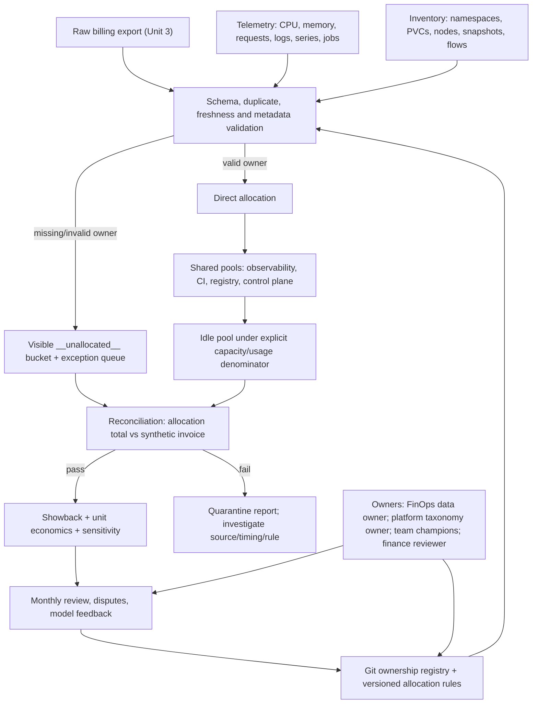

## Unit 4 — Cost allocation by team, project, and workload

**Target file:** `04-cost-allocation-by-team-project-and-workload.md` | **Estimated time:** 24–32 hours | **Prerequisites:** Stages 0–2D and Stage 2E M01–M14; especially M07 Unit 7 tagging/governance, M11 Units 1 and 12 metadata/telemetry conventions, M12 Units 8/11 admission-policy patterns, M13/M14 backup/DR and multi-region fundamentals, and M15 Units 1–3.  
**Core tools:** Python 3 standard library, CSV/JSON, Git-versioned metadata and model files, `kind`/`kubectl` only for optional label inspection, local tests and Markdown/CSV reports | **Awareness:** OpenCost, Kubecost-class tools, FOCUS, SQL/BI and commercial FinOps platforms; provider billing-export semantics are `[VERIFY]` | **Last reviewed:** 2026-11-03 | **Tool baseline assumed:** Python 3.11+ `[VERIFY]`; Kubernetes/kind, Prometheus/Grafana and OpenCost versions must be recorded from the learner's M03/M11 stack; provider/tool behavior is `[VERIFY]` unless explicitly sourced below | **Stack profile required:** Cap-Core required; Cap+Obs optional | **Footprint:** Cap-Core is Python/CSV only; optional `kind`/Prometheus/OpenCost adds machine-dependent overhead. A 4-CPU/8-GB/30-GB laptop is a planning baseline, not a guarantee — measure yours | **Prices used:** hypothetical cost units (HCU) only.

> **Completion outcome:** Build a reproducible, explainable allocation pipeline that maps synthetic platform cost to teams, projects and workloads; identifies unallocated and idle cost; compares workload and shared-cost rules; reconciles every HCU to a synthetic invoice total; generates showback and unit-economics reports; and governs model changes, disputes, privacy and incentives.
>
> **Safety labels:** `[ASSUMPTION]` is a modeling choice; `[ILLUSTRATIVE]` is a policy threshold or example; `[SYNTHETIC]` is generated data/result; `[VERIFY]` is version-sensitive or provider-specific; `[MEASURED — YOUR ENVIRONMENT]` is a value you measured locally. HCU is a teaching unit, not currency. No real provider prices or currency symbols appear in this unit.

## Prerequisite handoff

*M15 Unit 1 taught capacity forecasting, headroom and the difference between reserved capacity and observed demand; Unit 2 taught workload priority, quota and contention governance; Unit 3 taught synthetic billing generation, budget context, billing freshness and spending guardrails. M11 Unit 1 established label conventions, M11 Unit 12 taught telemetry ingestion/cardinality, M07 Unit 7 taught tag governance, M12 Units 8/11 taught admission-policy patterns, and M13/M14 taught backup, DR and multi-region behavior. This unit turns those inputs into a **governed allocation model**: metadata validation, direct/shared/idle/unallocated cost attribution, workload and unit economics, reconciliation, showback, sensitivity and model governance. It does not re-teach capacity forecasting, quotas, budget alerts, cleanup automation, provider invoice formats or accounting practice.*

## Cross-module handoff map and boundaries

| Source / destination | Reuse and handoff | Unit 4 boundary |
|---|---|---|
| M11 Unit 1 | Use `team`, `service`, `env`, `cost-center` conventions and resource labels | Apply the convention; do not redefine the entire label taxonomy |
| M11 Unit 12 | Use telemetry ingestion, series/log volume and cardinality context | Convert usage evidence into allocation drivers; do not re-teach telemetry architecture |
| M07 Unit 7 | Reuse tag compliance and governance audit patterns | Build the allocation-specific registry and cost-weighted compliance report |
| M07/M08 | Reuse IaC/GitOps ownership metadata and source-of-truth | Service-catalog/CODEOWNERS auto-tagging is an M16 forward reference |
| M12 Units 8/11 | Reuse admission-policy and negative-test patterns | Provide a local validator and explicitly non-deployable policy contract unless exact cluster syntax is verified |
| M13/M14 | Reuse backup, snapshot, standby/DR, multi-region and egress context | Attribute those costs using documented rules; do not redesign DR |
| M15 Unit 1 | Capacity, headroom and node-pool assumptions | Consume the capacity model; do not forecast capacity again |
| M15 Unit 2 | Workload classes, requests and resource contention | Compare allocation bases; do not re-teach quotas and scheduling |
| M15 Unit 3 | Synthetic billing export, HCU rate card, budget and freshness context | Consume its CSV schema or the compatible fixture below; do not build another budget alert engine |
| M15 Unit 5 | Ownership data for idle-resource detection and safe cleanup | Determine ownership and allocation only; do not delete resources |
| M15 Unit 6 | Marginal/average cost and cost/reliability decisions | Supply reconciled unit economics and cost attribution |
| M15 Unit 7 | Release-level cost and unit-cost regression | Supply baseline and model version for release comparisons |
| M15 Unit 11 | OpenCost allocation export and reconciliation | Compare outputs; provider/product behavior is `[VERIFY]` |
| M15 Unit 12 | GPU-hours, shared GPU attribution and ML economics | Supply GPU allocation dimensions and HCU unit economics; real GPU is not required |
| M16 / M17 | Developer portal and integrated capstone | Forward references only; no portal or capstone is built here |

### Source artifact audit and continuity

The authoring sequence began with a review of the current prompt, the M15 roadmap/syllabus and prior generated units. The earlier Unit 4 document was treated as a draft to inspect and improve, not as an authority that overrides the current prompt.

| Source artifact reviewed | What was checked | How it informs this unit |
|---|---|---|
| `Roadmap(20261103-035611).md` | M15 folder location, Unit 1–12 sequence and repository tree | Confirms this is Unit 4 in `15-Platform-Capacity-Compute-Economics-and-FinOps/`; no other repository file is part of this deliverable |
| `PROMPT-Platform-Capacity-Compute-Economics-and-FinOps(3).md` | M15 learning progression, module boundaries and platform-capacity/FinOps outcomes | Keeps Unit 4 aligned to M15 and prevents re-teaching earlier/later units |
| `Pasted markdown(20261103-035731).md` and generated `01-platform-capacity-forecasting-and-headroom.md` | Unit 1 scope, capacity/headroom assumptions and workload economics interface | Consumes capacity and resource-hour evidence without repeating forecasting |
| `Pasted markdown(20261103-040350).md` and generated `02-workload-priorities-quotas-and-resource-contention.md` | Unit 2 scope, workload priorities, quotas and contention boundaries | Reuses ownership and workload metadata; does not re-teach quotas or scheduling |
| `Pasted markdown(20261103-042420).md` and generated `03-cloud-budget-alerts-and-spending-guardrails.md` | Unit 3 prompt, HCU conventions, synthetic billing fields, data freshness and guardrail boundaries | Adds an explicit schema adapter for the current Unit 3 CSV instead of assuming older field names |
| `Pasted markdown(20261103-044319).md` | Current Unit 4 generation prompt, mandatory 4.0–4.14 skeleton, eleven lab requirements, Pass A–F audit and delivery constraints | Treated as the authoritative task specification |
| `Prompt-Generate-04-cost-allocation-by-team-project-and-workload.md` | Earlier Unit 4 prompt compared with the current prompt | Curriculum intent is materially continuous; current prompt makes the technical-integrity, evidence and source/tree audit requirements more explicit |
| Earlier generated `04-cost-allocation-by-team-project-and-workload.md` | Existing 114-KB draft, section coverage, code, tests, labs and report behavior | Used as the baseline. Its earlier 16-test suite passed, but the demo primarily printed JSON rather than producing the promised report artifacts; its Unit 3 schema description did not match the current Unit 3 generator, and credit/missing-day/rounding acceptance coverage needed strengthening |

**Continuity decisions:** the canonical Unit 4 fixture remains a 600-HCU synthetic bill so that direct, shared, idle and unallocated pools can be reconciled together. The current Unit 3 generator is also supported through a tested adapter that preserves source metadata and routes the planted untagged row to the unallocated bucket. Unit 4 does not redefine Unit 3's budget engine, Unit 2's quota policy, or Unit 1's capacity forecast.

**What this unit teaches:** the engineering and governance mechanics of allocating technology cost by team, project, environment and workload. **What it defers:** formal financial accounting, tax treatment, provider-specific billing-export manuals, internal journal-entry execution, production cloud provisioning, service-catalog implementation and the M17 integrated capstone.

## Workspace and safety contract

All required labs run locally from synthetic CSV/JSON. No cloud account, real billing export, credential, paid service, billable resource, real GPU or production cluster is needed. The optional cluster lab inspects labels on an existing disposable `kind` cluster; it is not required for any learning objective.

```text
allocation-lab/
├── README.md
├── metadata/
│   ├── standard.json
│   ├── ownership_registry.csv
│   └── required-labels-contract.yaml
├── synthetic/
│   ├── rate_card.json
│   ├── billing.csv
│   ├── rate_card.json
│   ├── telemetry.csv
│   ├── team_trend.csv
│   └── assumptions.md
├── allocation/
│   └── allocation_lab.py
├── dashboards/
│   └── allocation-dashboard.json
├── model/
│   ├── model_v1.json
│   ├── model_v2.json
│   └── change_log.md
├── tests/
│   └── test_allocation_lab.py
├── runbooks/
│   ├── allocation-data-quality.md
│   └── allocation-dispute.md
└── evidence/
    ├── compliance-report.md
    ├── compliance.json
    ├── unallocated-resources.csv
    ├── direct-allocation.csv
    ├── allocation-table.csv
    ├── workload-models.csv
    ├── shared-cost-allocation.csv
    ├── shared-cost-sensitivity.csv
    ├── idle-treatment.csv
    ├── reconciliation-report.md
    ├── reconciliation.json
    ├── showback-report.md
    ├── showback.json
    ├── team-trend.csv
    ├── allocation.prom
    ├── unit-economics.md
    ├── unit-economics.csv
    ├── data-ml-allocation.csv
    ├── model-version-comparison.csv
    ├── model-change-record.md
    ├── negative-tests.md
    └── cleanup-proof.txt
```

**Cap-Core (required):** Python standard library, CSV/JSON fixtures, deterministic scripts and `unittest`.  
**Cap+Obs (optional):** the existing M11 Prometheus/Grafana profile and optional OpenCost on a compatible local cluster. Start only for the optional comparison; stop it after evidence capture. Do not install a second observability stack just for this unit.  
**Local safety:** work in a new directory outside the supplied repository. Record `python --version`, `git status --short` in the learner-owned workspace, disk/memory before optional components, and the current Kubernetes context before any `kubectl` command. Do not use destructive cloud commands. Cleanup removes only the local lab directory after checking its exact path.

---

### 4.0 Why this matters in production

A platform team may pay for shared observability, CI, registry, networking and standby capacity while product teams see only the resources carrying their own labels. If the allocation pipeline silently drops unknown labels, a team can appear cheaper while a large cost pool becomes invisible. If shared cost is split evenly despite radically different consumption, the report can reward overuse and undermine trust. If an allocation report is treated as an invoice without reconciliation, finance and engineering will disagree about totals and no one will know whether the cause is missing data, credits, timing or a policy choice.

### 4.1 Learning objectives

By the end of this unit, you can:

1. **[L1]** Explain showback, chargeback, direct, shared, unallocated, idle and amortized cost, and calculate unallocated HCU and its denominator.
2. **[L1/L2]** Define a versioned metadata taxonomy and ownership registry, validate resource labels and calculate cost-weighted as well as resource-count compliance.
3. **[L2]** Build a deterministic direct-allocation pipeline that handles missing/invalid tags, duplicates, late rows and backfilled metadata without silently assigning arbitrary owners.
4. **[L2]** Compare requests-based, usage-based and `max(request, usage)` workload allocation for CPU, memory and workload-hours, and explain their incentive effects.
5. **[L2]** Allocate observability, CI, registry and control-plane shared pools using at least four methods, then compare team totals and rankings.
6. **[L2/L3]** Model idle capacity under an explicit denominator, reconcile direct + shared + idle + unallocated HCU to a synthetic invoice, and fail on unexplained variance.
7. **[L3]** Produce data/ML unit economics, sensitivity analysis, marginal-versus-average cost reasoning and model-version/restatement records.
8. **[L3/L4]** Design allocation governance, privacy controls, data-quality SLOs, dispute handling and Goodhart detection, paired with SLO/capacity/DR guardrails.

### 4.2 Concept map and vocabulary



| Term | Precise definition | Common misconception |
|---|---|---|
| Allocation | A documented model assigning cost pools to organizational or technical consumers using metadata and drivers | It is objective proof of causation |
| Showback | Reporting consumption/cost to owners without an internal financial transfer | It is the same as chargeback |
| Chargeback | Internal financial transfer or accounting entry based on an agreed allocation/rate model | It is simply a different chart |
| Direct cost | A cost row attributable to one valid owner under the model | Every row with a tag is necessarily correctly attributed |
| Shared cost | A cost pool consumed by multiple teams, requiring an explicit split rule | Shared means split evenly |
| Unallocated cost | Cost not assignable to a valid owner under current metadata/rules | It should be silently spread over known teams |
| Idle cost | Provisioned capacity not attributed to active workload under a stated denominator and window | Idle means useless or safe to remove |
| Amortization | Spreading a commitment or one-off cost across periods under a defined accounting/allocation policy | Every provider uses the same amortization treatment |
| Allocation driver | A measurable proxy used to distribute a shared pool, such as log volume or CI minutes | A driver proves exact causal consumption |
| Cost-weighted compliance | Validly attributed HCU divided by total in-scope HCU | It equals the percentage of resources correctly tagged |
| Restatement | Recomputing historical reports under a later rule or corrected source data | A new report should silently overwrite the old one |
| Reconciliation | Comparing defined allocation buckets to a defined invoice/source total and explaining any difference | Allocation is automatically equal to the invoice |
| Unit economics | Allocated cost divided by a meaningful output denominator, such as requests or jobs | Lower total cost always means better efficiency |
| Goodhart effect | A measure becomes a target and is gamed or optimized at the expense of the underlying goal | Every KPI is useless |
| HCU | Hypothetical cost unit used only for this course's calculations | It is a currency or provider price |

#### Define the denominator before calculating compliance

For an in-scope period:

\[
\text{Cost-weighted compliance} =
\frac{\text{HCU with valid owner and required dimensions}}
{\text{all in-scope HCU}} \times 100
\]

\[
\text{Unallocated \%} =
\frac{\text{unallocated HCU}}{\text{all in-scope HCU}} \times 100
\]

Resource-count compliance instead divides validly tagged resource records by all resource records. The two metrics answer different questions. A small number of expensive untagged resources can make resource-count compliance look high while cost-weighted compliance is poor. State whether credits/adjustments are included in the denominator and how negative rows are handled; do not silently mix scopes.

---

### 4.3 Level 1 — Beginner

#### 4.3.1 Why teams allocate cost

Allocation makes technology consumption visible to the people who can change it. Teams can plan, explain growth, compare product economics and decide whether to optimize a workload. Without ownership metadata, a large spend item becomes “platform cost” even when one workload drives it. With opaque rules, teams may optimize the metric rather than the system.

**Showback versus chargeback**

- Showback answers: “What cost and consumption should this team understand?” It does not itself transfer money.
- Chargeback answers: “What internal amount is transferred or booked to this team/cost center?” This requires finance-approved policy and accounting controls.
- The allocation algorithm is independent of the reporting mechanism. The same model can power showback first and later feed a separately governed chargeback process.

#### 4.3.2 The four cost buckets

1. **Direct:** a dedicated ETL job with a valid team, service and environment.
2. **Shared:** a central registry or observability platform used by several teams.
3. **Unallocated:** a billing row with no team or an unknown team value.
4. **Idle:** the cost of provisioned but unused capacity under the model's explicit denominator.

Do not double count. If the shared pool is already present as a separate invoice line, distribute that pool; do not add it to direct costs a second time. If idle is calculated by carving unused capacity out of a node pool, define whether it is a separate invoice pool or a reclassification of a previously counted compute pool. This unit's canonical fixture treats direct, shared, idle and unallocated as mutually exclusive invoice pools so their sum is testable.

#### 4.3.3 Tags, labels and ownership

Use the M11 vocabulary consistently:

| Key | Example allowed value | Meaning | Validation |
|---|---|---|---|
| `team` | `team-a`, `team-b`, `platform` | Accountable engineering team | Must exist in ownership registry |
| `service` | `inference-api`, `etl`, `observability` | Service or platform capability | Must be in service catalogue |
| `env` | `prod`, `nonprod`, `dev` | Environment | Controlled enum |
| `cost-center` | `cc-analytics`, `cc-platform` | Finance reporting grouping | Must exist in registry |
| `project` | `customer-insights`, `model-serving` | Product/project dimension | Must have an owner |
| `workload` | `daily-etl`, `inference-v3` | Job, controller or model workload | Stable, non-sensitive identifier |

A label is metadata, not a security boundary. Kubernetes labels can be queried and selected; Kubernetes' recommended application labels are recommendations rather than mandatory labels for all core tooling. Organization-specific keys such as `team` and `cost-center` require your own policy. See the official [Kubernetes labels and selectors documentation](https://kubernetes.io/docs/concepts/overview/working-with-objects/labels/) and [recommended labels](https://kubernetes.io/docs/concepts/overview/working-with-objects/common-labels/). Cloud tag inheritance and billing propagation are provider-specific `[VERIFY]`.

Apply labels to workload templates, not only to a parent object: Deployment pod templates, Job/CronJob pod templates, StatefulSet pod templates and PVC metadata where appropriate. A namespace-per-team is a useful starting allocation boundary; a namespace containing multiple services requires labels or another mapping. Do not assume a PVC or cloud resource inherits a pod's labels.

#### 4.3.4 First allocation exercise

`[SYNTHETIC]` The compatible Unit 3 billing fixture below has direct rows, four shared service pools, one idle pool and two rows with missing/unknown owner metadata. In-scope invoice total is 600 HCU.

| Pool | HCU | Treatment |
|---|---:|---|
| Direct, valid team A | 200 | Direct to team A |
| Direct, valid team B | 100 | Direct to team B |
| Unallocated: missing/unknown owner | 50 | Visible `__unallocated__` |
| Shared services | 200 | Allocate by documented drivers |
| Idle capacity | 50 | Report separately in the base policy |
| **Synthetic invoice total** | **600** | **All mutually exclusive pools** |

Validly tagged direct HCU is 300; all in-scope HCU is 600. If measuring **direct owner metadata compliance over the full invoice scope**, compliance is 50%. If measuring only the direct-tagged pool, compliance is 300/350 = 85.7%. These are not contradictory: the denominator differs. This is why every report must print its scope and denominator.

#### 4.3.5 Amortization and commitments — awareness

Commitments, credits, refunds and one-off migrations can make invoice views differ from usage-based allocation. This course does not define provider accounting behavior. Choose whether the showback uses billed, effective, amortized or another finance-approved cost basis; document the chosen basis and period. Do not distribute a credit or commitment benefit without a published policy.

#### 4.3.6 Beginner mistakes

| Mistake | Symptom | Fix |
|---|---|---|
| Missing owner mapped to platform by default | Platform team absorbs unexplained spend | Use `__unallocated__`, exception owner and expiry |
| Resource-count compliance only | High compliance despite costly orphan resources | Add cost-weighted compliance |
| Tag treated as proof of consumption | Wrong owner gets a bill | Validate registry, inventory and workload lineage |
| Shared costs split evenly by habit | Heavy users subsidized by light users | Choose a service-specific driver and publish it |
| Idle cost hidden | Teams assume all provisioned capacity is productive | Define and report idle separately |
| Allocation total called “invoice” | Finance cannot explain differences | Reconcile to the scoped synthetic invoice first |

---

### 4.4 Level 2 — Intermediate

#### 4.4.1 Metadata standard and ownership registry

Keep the taxonomy, allowed values and owner mapping in Git. A valid row must satisfy `team`, `project`, `service`, `env`, `workload`, `owner` and `cost-center`, and resolve to an active registry entry. `namespace` is additionally required for Kubernetes workload SKUs (`k8s-pod` and `k8s-container`); non-Kubernetes billing rows must not be assigned a fabricated namespace. Do not invent a fallback owner when metadata is missing.

`metadata/standard.json`:

```json
{
  "version": 3,
  "required_keys": ["team", "project", "service", "env", "workload", "cost-center", "owner"],
  "conditional_keys": {"namespace": "required_for_kubernetes_workload_skus"},
  "namespace_required_skus": ["k8s-pod", "k8s-container"],
  "allowed_env": ["prod", "nonprod", "dev"],
  "teams": ["team-a", "team-b", "platform", "team-inference", "team-data", "team-ml", "team-platform"],
  "services": ["inference-api", "etl", "training", "network", "observability", "ci", "registry", "control-plane"],
  "cost_centers": ["cc-analytics", "cc-platform"],
  "missing_owner_bucket": "__unallocated__",
  "source_adapters": ["unit3-budget-guardrails-csv-v1"]
}
```

`metadata/ownership_registry.csv`:

```csv
team,owner_role,cost_center,contact_route,active,services,projects,budget_ref
team-a,analytics-service-owner,cc-analytics,team-a-cost-review,true,inference-api,checkout,budget-team-a
team-b,ml-platform-owner,cc-analytics,team-b-cost-review,true,etl,analytics,budget-team-b
platform,platform-finops-owner,cc-platform,platform-cost-review,true,observability|ci|registry|control-plane,platform,shared-platform-budget
team-inference,inference-service-owner,cc-analytics,inference-cost-review,true,inference-api,inference-prod,budget-inference
team-data,data-platform-owner,cc-analytics,data-cost-review,true,etl,data-prod,budget-data
team-ml,ml-platform-owner,cc-analytics,ml-cost-review,true,training,ml-prod,budget-ml
team-platform,platform-network-owner,cc-platform,platform-network-review,true,network,shared-platform,budget-platform
```

The lab CSV field `cost_center` is the normalized column name for the Kubernetes label key `cost-center`. Preserve the source key in the raw metadata snapshot and record the normalization mapping; do not silently rename a source field without a schema-version note. The registry's `services`, `projects` and `budget_ref` columns are synthetic ownership mappings, not real contacts or finance systems.

A registry stores role/route identifiers in this synthetic lab, not personal contact details. Production contact details belong in an access-controlled directory. A registry validator should reject duplicate teams, inactive owners, unknown cost centers and empty routes.

#### 4.4.2 Compatible synthetic billing schema

The current M15 Unit 3 generator writes the exact source columns `usage_date`, `available_at`, `account`, `project`, `environment`, `team`, `owner`, `service`, `resource_type`, `region`, `usage_quantity`, `usage_unit`, `rate_hcu`, `cost_hcu`, `resource_id` and `tags_present`. It does **not** natively emit Unit 4's `cost_center`, `pool_type`, `workload`, `record_id` or `billing_visible_date` names. The canonical Unit 4 fixture below adds those fields and preserves the Unit 3 `owner` and `tags_present` fields. The included `adapt_unit3_export()` maps `available_at → billing_visible_date`, `resource_id → record_id`, `environment → env`, `resource_type → sku/workload`, maps Unit 3 service names to this unit's taxonomy, normalizes `owner` to the registry's approved `owner_role` while preserving the original value as `source_owner`, and enriches `cost_center` from the versioned ownership registry. Unit 3 does not provide a Kubernetes namespace, so the adapter leaves `namespace` blank rather than inventing one; the policy requires it only for Kubernetes workload SKUs. The raw Unit 3 CSV remains unchanged. The adapter maps only known source values; unknown or missing ownership remains visible as unallocated. The compact fixture is synthetic and is not claimed to be a provider export or FOCUS-conformant.

`synthetic/billing.csv`:

```csv
record_id,usage_date,project,service,sku,region,usage_quantity,usage_unit,rate_hcu,cost_hcu,team,owner,source_owner,tags_present,namespace,env,workload,cost_center,pool_type,billing_visible_date
D001,2026-10-01,checkout,inference-api,cpu-hour,region-a,100,core_hour,1.2,120,team-a,analytics-service-owner,owner-team-a,true,checkout,prod,inference-v3,cc-analytics,direct,2026-10-02
D002,2026-10-01,checkout,inference-api,mem-hour,region-a,100,GiB_hour,0.8,80,team-a,analytics-service-owner,owner-team-a,true,checkout,prod,inference-v3,cc-analytics,direct,2026-10-02
D003,2026-10-01,analytics,etl,cpu-hour,region-a,100,core_hour,1.0,100,team-b,ml-platform-owner,owner-team-b,true,analytics,nonprod,daily-etl,cc-analytics,direct,2026-10-02
U001,2026-10-01,unknown,etl,cpu-hour,region-a,30,core_hour,1.0,30,,,,false,,nonprod,orphan-worker,,unallocated,2026-10-02
U002,2026-10-01,unknown,etl,cpu-hour,region-a,20,core_hour,1.0,20,team-x,,owner-unknown,false,,nonprod,unknown-owner,,unallocated,2026-10-02
S001,2026-10-01,platform,observability,log-volume,region-a,60,HCU,1,60,platform,platform-finops-owner,platform-finops-owner,true,platform,prod,central-logs,cc-platform,shared,2026-10-02
S002,2026-10-01,platform,ci,runner-minutes,region-a,40,HCU,1,40,platform,platform-finops-owner,platform-finops-owner,true,platform,nonprod,shared-ci,cc-platform,shared,2026-10-02
S003,2026-10-01,platform,registry,storage,region-a,20,HCU,1,20,platform,platform-finops-owner,platform-finops-owner,true,platform,prod,image-registry,cc-platform,shared,2026-10-02
S004,2026-10-01,platform,control-plane,platform-unit,region-a,80,HCU,1,80,platform,platform-finops-owner,platform-finops-owner,true,platform,prod,cluster-control,cc-platform,shared,2026-10-02
I001,2026-10-01,platform,idle-capacity,node-pool,region-a,50,HCU,1,50,platform,platform-finops-owner,platform-finops-owner,true,platform,nonprod,shared-headroom,cc-platform,idle,2026-10-02
```

All costs are `[SYNTHETIC]` HCU. The `HCU` usage unit for precomputed shared/idle pools is a lab convenience. In a real pipeline, preserve source quantity, unit, rate basis, currency/billing basis and source row ID separately.

`synthetic/assumptions.md` must record:
- period: 2026-10-01 (one synthetic day);
- source scope: all rows above, visible after `billing_visible_date`;
- invoice total: sum of `cost_hcu` across unique in-scope records;
- duplicate key: `record_id` for this fixture only;
- valid teams: team-a, team-b, platform;
- shared allocation drivers: service-specific weights in the model file;
- idle base policy: report separately; do not include it again in shared cost;
- tolerance: 0.01 HCU `[ILLUSTRATIVE]`;
- all costs, rate-card values and outcomes are synthetic.

`synthetic/rate_card.json` — HCU-only rates for the separate data/ML attribution exercise:

```json
{
  "cpu_core_hour": 0.1,
  "memory_gib_hour": 0.02,
  "storage_gb_hour": 0.001,
  "egress_gb": 0.03,
  "gpu_hour": 0.5
}
```

These are `[HYPOTHETICAL]` rates and are not a provider price card.

`synthetic/telemetry.csv` — workload denominators and lineage. It contains no customer names or production identifiers:

```csv
workload,team,run_id,dataset_prefix,model_version,job_runs,gb_processed,requests,training_runs,active_users,storage_gb_hours,egress_gb,gpu_hours,source_region,destination_region
data-job,team-b,etl-run-2026-10-01,analytics/,,12,0,0,0,0,0,0,0,region-lab-a,region-lab-a
etl-volume,team-b,etl-run-2026-10-01,analytics/,,0,80,0,0,0,500,10,0,region-lab-a,region-lab-a
inference,team-a,inference-v3,,model-v3,0,0,40000,0,0,0,5,0,region-lab-a,region-lab-a
training,team-ml,training-v7,features/,model-v7,0,0,0,3,0,100,20,30,region-lab-a,region-lab-b
tenant-demo,team-a,tenant-no-users,,,0,0,0,0,0,0,0,0,region-lab-a,region-lab-a
```

`synthetic/team_trend.csv` is a deliberately small three-period showback trend fixture. It is separate from the one-day reconciliation invoice; do not add its values to the 600 HCU invoice:

```csv
period,team,direct_hcu,shared_hcu
2026-08,team-a,175,95
2026-08,team-b,90,85
2026-09,team-a,185,98
2026-09,team-b,95,92
2026-10,team-a,200,84
2026-10,team-b,100,116
```

**Unit 3 adapter command:** after generating Unit 3's `sample_billing.csv`, copy it into the learner workspace as a read-only source and run:

```bash
python allocation/allocation_lab.py adapt-unit3 \
  --source ../budget-guardrails-lab/synthetic/sample_billing.csv \
  --output synthetic/unit3-normalized.csv
```

The exact source schema is validated before mapping. For this Unit 3 seed-17 sample, the adapter normalizes 126 rows; the planted untagged record remains unallocated. This is a synthetic authoring check, not a claim about every future Unit 3 dataset. The canonical 600-HCU Unit 4 fixture remains the source for shared/idle reconciliation labs because Unit 3's billing generator does not generate those shared and idle pools.

#### 4.4.3 Complete standard-library reference engine

Save as `allocation/allocation_lab.py`. It deliberately uses one canonical input schema and one canonical engine so that the labs do not drift into incompatible snippets. It provides metadata validation, the current Unit 3 export adapter, direct allocation, workload-model comparison, four shared-cost methods, idle alternatives, explicit credit treatment, reconciliation, telemetry-backed unit economics, data/ML attribution, sensitivity, Goodhart signals, a team-scoped report-access contract, Prometheus textfile output and report generation. The paired `tests/test_allocation_lab.py` contains 38 standard-library acceptance tests for schema/ownership validation, namespace policy, Unit 3 normalization, conservation, credit and rounding reconciliation, missing data, unit economics, Goodhart signals, report access and evidence generation.

```python
#!/usr/bin/env python3
"""Local synthetic cost-allocation lab. Python standard library only; HCU only."""
from __future__ import annotations

import argparse
import csv
import json
from datetime import date
from collections import defaultdict
from pathlib import Path

ROOT = Path(__file__).resolve().parents[1]
BILLING = ROOT / "synthetic" / "billing.csv"
STANDARD = ROOT / "metadata" / "standard.json"
REGISTRY = ROOT / "metadata" / "ownership_registry.csv"
MODEL = ROOT / "model" / "model_v1.json"
MODEL_V2 = ROOT / "model" / "model_v2.json"
TELEMETRY = ROOT / "synthetic" / "telemetry.csv"
RATE_CARD = ROOT / "synthetic" / "rate_card.json"
TEAM_TREND = ROOT / "synthetic" / "team_trend.csv"

FIELDS = {
    "record_id", "usage_date", "project", "service", "sku", "region",
    "usage_quantity", "usage_unit", "rate_hcu", "cost_hcu", "team", "owner",
    "source_owner", "tags_present", "namespace", "env", "workload", "cost_center",
    "pool_type", "billing_visible_date"
}
UNIT3_FIELDS = {
    "usage_date", "available_at", "account", "project", "environment",
    "team", "owner", "service", "resource_type", "region",
    "usage_quantity", "usage_unit", "rate_hcu", "cost_hcu",
    "resource_id", "tags_present"
}

def read_json(path):
    return json.loads(Path(path).read_text(encoding="utf-8"))

def write_json(path, value):
    target = Path(path)
    target.parent.mkdir(parents=True, exist_ok=True)
    target.write_text(json.dumps(value, indent=2, sort_keys=True) + "\n", encoding="utf-8")

def read_registry(path=REGISTRY):
    with open(path, newline="", encoding="utf-8") as handle:
        rows = list(csv.DictReader(handle))
    registry = {}
    for row in rows:
        team = row["team"]
        if not team or team in registry:
            raise ValueError(f"missing or duplicate registry team: {team!r}")
        registry[team] = row
    return registry

def validate_schema(fieldnames, required=FIELDS):
    missing = required - set(fieldnames or [])
    if missing:
        raise ValueError(f"missing columns: {sorted(missing)}")
    return True

def read_billing(path=BILLING):
    with open(path, newline="", encoding="utf-8") as handle:
        reader = csv.DictReader(handle)
        validate_schema(reader.fieldnames)
        rows = list(reader)
    seen = set()
    for row in rows:
        rid = row["record_id"]
        if not rid or rid in seen:
            raise ValueError(f"missing or duplicate record_id: {rid!r}")
        seen.add(rid)
        try:
            amount = float(row["cost_hcu"])
            quantity = float(row["usage_quantity"])
            rate = float(row["rate_hcu"])
        except (TypeError, ValueError) as exc:
            raise ValueError(f"malformed numeric field in {rid}") from exc
        if amount < 0 or quantity < 0 or rate < 0:
            raise ValueError(f"negative amount/quantity/rate in {rid}; credits belong in a reviewed adjustment")
        if abs(amount - quantity * rate) > 0.011:
            raise ValueError(f"rate arithmetic mismatch in {rid}")
        if row["pool_type"] not in {"direct", "shared", "idle", "unallocated"}:
            raise ValueError(f"unknown pool_type in {rid}: {row['pool_type']}")
    return rows

def adapt_unit3_export(source_path, output_path, registry_path=REGISTRY):
    """Map the exact Unit 3 CSV contract to this unit's normalized fixture schema.

    Unit 3 fields include environment/available_at/resource_type/resource_id;
    Unit 4 adds cost_center, workload and pool_type. The source file is preserved.
    """
    registry = read_registry(registry_path)
    service_map = {
        "inference": "inference-api",
        "etl": "etl",
        "training": "training",
        "transfer": "network"
    }
    env_map = {"production": "prod", "nonproduction": "nonprod"}
    with open(source_path, newline="", encoding="utf-8") as handle:
        reader = csv.DictReader(handle)
        validate_schema(reader.fieldnames, UNIT3_FIELDS)
        source_rows = list(reader)
    normalized = []
    for row in source_rows:
        source_team = row["team"].strip()
        team = source_team
        service = service_map.get(row["service"], row["service"])
        owner = registry.get(team, {})
        normalized.append({
            "record_id": row["resource_id"],
            "usage_date": row["usage_date"],
            "project": row["project"],
            "service": service,
            "sku": row["resource_type"],
            "region": row["region"],
            "usage_quantity": row["usage_quantity"],
            "usage_unit": row["usage_unit"],
            "rate_hcu": row["rate_hcu"],
            "cost_hcu": row["cost_hcu"],
            "team": team,
            "owner": owner.get("owner_role", ""),
            "source_owner": row["owner"],
            "tags_present": row["tags_present"],
            "namespace": row.get("namespace", ""),
            "env": env_map.get(row["environment"], row["environment"]),
            "workload": row["resource_type"] or row["service"],
            "cost_center": owner.get("cost_center", ""),
            "pool_type": "direct",
            "billing_visible_date": row["available_at"]
        })
    target = Path(output_path)
    target.parent.mkdir(parents=True, exist_ok=True)
    with target.open("w", newline="", encoding="utf-8") as handle:
        writer = csv.DictWriter(handle, fieldnames=sorted(FIELDS))
        writer.writeheader()
        writer.writerows(normalized)
    return len(normalized)

def validate_metadata(rows, standard=None, registry=None):
    standard = standard or read_json(STANDARD)
    registry = registry or read_registry()
    teams, services = set(standard["teams"]), set(standard["services"])
    envs, centers = set(standard["allowed_env"]), set(standard["cost_centers"])
    invalid = []
    for row in rows:
        if row["pool_type"] != "direct":
            continue
        problems = []
        team = row["team"]
        if not team or team not in teams or team not in registry:
            problems.append("unknown_or_missing_team")
        else:
            owner = registry[team]
            if owner["active"].lower() != "true":
                problems.append("inactive_owner")
            if row["owner"] != owner["owner_role"]:
                problems.append("owner_role_mismatch")
            if row["cost_center"] != owner["cost_center"]:
                problems.append("owner_cost_center_mismatch")
            allowed_services = set(owner["services"].split("|"))
            allowed_projects = set(owner["projects"].split("|"))
            if not row["project"] or row["project"] not in allowed_projects:
                problems.append("project_not_owned_by_team")
            if not row["workload"]:
                problems.append("missing_workload")
            if row["service"] not in allowed_services:
                problems.append("service_not_owned_by_team")
            if row["sku"] in standard.get("namespace_required_skus", []) and not row["namespace"]:
                problems.append("missing_namespace")
        if row["service"] not in services:
            problems.append("unknown_service")
        if row["env"] not in envs:
            problems.append("invalid_env")
        if not row["cost_center"] or row["cost_center"] not in centers:
            problems.append("unknown_or_missing_cost_center")
        if problems:
            invalid.append({"record_id": row["record_id"],
                            "cost_hcu": float(row["cost_hcu"]),
                            "problems": sorted(set(problems))})
    return invalid

def unallocated_details(rows):
    invalid = {item["record_id"]: item for item in validate_metadata(rows)}
    details = []
    for row in rows:
        if row["pool_type"] == "unallocated":
            details.append({"record_id": row["record_id"], "team": row["team"],
                            "service": row["service"], "cost_hcu": float(row["cost_hcu"]),
                            "reason": "explicit_unallocated_pool"})
        elif row["pool_type"] == "direct" and row["record_id"] in invalid:
            details.append({"record_id": row["record_id"], "team": row["team"],
                            "service": row["service"], "cost_hcu": float(row["cost_hcu"]),
                            "reason": "|".join(invalid[row["record_id"]]["problems"])})
    return sorted(details, key=lambda item: (-item["cost_hcu"], item["record_id"]))

def compliance(rows):
    invalid = {item["record_id"]: item for item in validate_metadata(rows)}
    total = sum(float(r["cost_hcu"]) for r in rows)
    direct_scope = [r for r in rows if r["pool_type"] in ("direct", "unallocated")]
    direct_scope_hcu = sum(float(r["cost_hcu"]) for r in direct_scope)
    valid_rows = [r for r in rows if r["pool_type"] == "direct" and r["record_id"] not in invalid]
    valid_hcu = sum(float(r["cost_hcu"]) for r in valid_rows)
    unallocated_hcu = (
        sum(float(r["cost_hcu"]) for r in rows if r["pool_type"] == "unallocated")
        + sum(float(item["cost_hcu"]) for item in invalid.values())
    )
    resource_total = len(direct_scope)
    return {
        "in_scope_hcu": round(total, 4),
        "valid_direct_owner_hcu": round(valid_hcu, 4),
        "cost_weighted_direct_pool_compliance_pct": round(100 * valid_hcu / direct_scope_hcu, 2) if direct_scope_hcu else None,
        "full_invoice_valid_owner_coverage_pct": round(100 * valid_hcu / total, 2) if total else None,
        "direct_scope_rows": resource_total,
        "valid_direct_rows": len(valid_rows),
        "direct_resource_tag_compliance_pct": round(100 * len(valid_rows) / resource_total, 2) if resource_total else None,
        "unallocated_hcu": round(unallocated_hcu, 4)
    }

def direct_allocation(rows):
    result = defaultdict(float)
    # Return only invalid direct-row HCU. Explicit pool_type=unallocated rows are
    # added by reconcile(), preventing double counting.
    unallocated = 0.0
    invalid_ids = {item["record_id"] for item in validate_metadata(rows)}
    for row in rows:
        if row["pool_type"] != "direct":
            continue
        if row["record_id"] in invalid_ids:
            unallocated += float(row["cost_hcu"])
        else:
            result[row["team"]] += float(row["cost_hcu"])
    return dict(result), round(unallocated, 4)

def allocate_pool(amount, weights, method):
    """Allocate a non-negative pool; final recipient absorbs rounding residual."""
    if amount < 0:
        raise ValueError("pool amount cannot be negative")
    if not weights or any(v < 0 for v in weights.values()):
        raise ValueError("weights must be non-empty and non-negative")
    teams = sorted(weights)
    if method == "even":
        basis = {team: 1.0 for team in teams}
    elif method in {"direct", "usage", "fixed"}:
        basis = dict(weights)
    else:
        raise ValueError(f"unknown shared method: {method}")
    denominator = sum(basis.values())
    if denominator <= 0:
        raise ValueError("allocation driver sums to zero")
    allocated, running = {}, 0.0
    for team in teams[:-1]:
        value = amount * basis[team] / denominator
        allocated[team] = value
        running += value
    allocated[teams[-1]] = amount - running
    return allocated

SERVICE_DRIVERS = {
    "observability": {"usage": {"team-a": 80, "team-b": 20}, "fixed": {"team-a": 60, "team-b": 40}},
    "ci": {"usage": {"team-a": 25, "team-b": 75}, "fixed": {"team-a": 50, "team-b": 50}},
    "registry": {"usage": {"team-a": 20, "team-b": 80}, "fixed": {"team-a": 40, "team-b": 60}},
    "control-plane": {"usage": {"team-a": 50, "team-b": 50}, "fixed": {"team-a": 50, "team-b": 50}}
}

def shared_allocation(rows, method="usage", direct_weights=None):
    result = defaultdict(float)
    details = {}
    direct_weights = direct_weights or {"team-a": 200, "team-b": 100}
    for row in rows:
        if row["pool_type"] != "shared":
            continue
        service = row["service"]
        if service not in SERVICE_DRIVERS:
            raise ValueError(f"no approved driver for shared service {service}")
        if method == "direct":
            weights = direct_weights
        elif method == "fixed":
            weights = SERVICE_DRIVERS[service]["fixed"]
        elif method == "usage":
            weights = SERVICE_DRIVERS[service]["usage"]
        elif method == "even":
            weights = SERVICE_DRIVERS[service]["usage"]
        else:
            raise ValueError(f"unknown shared method: {method}")
        allocation = allocate_pool(float(row["cost_hcu"]), weights, method)
        details[service] = allocation
        for team, amount in allocation.items():
            result[team] += amount
    return dict(result), details

def idle_allocation(rows, mode="separate", direct=None):
    amount = sum(float(r["cost_hcu"]) for r in rows if r["pool_type"] == "idle")
    if mode == "separate":
        return {"__idle__": amount}
    if mode == "platform":
        return {"platform": amount}
    if mode == "proportional":
        return allocate_pool(amount, direct or {}, "direct")
    raise ValueError("idle mode must be separate, platform or proportional")

def workload_models():
    """Values are accumulated core-hours and GiB-hours, not millicore/MiB requests."""
    workloads = [
        {"team": "team-a", "workload": "inference", "cpu_request_core_hours": 1000,
         "cpu_usage_core_hours": 700, "memory_request_gib_hours": 2000, "memory_usage_gib_hours": 1800},
        {"team": "team-b", "workload": "etl", "cpu_request_core_hours": 800,
         "cpu_usage_core_hours": 1200, "memory_request_gib_hours": 1000, "memory_usage_gib_hours": 1500},
        {"team": "team-a", "workload": "notebook", "cpu_request_core_hours": 500,
         "cpu_usage_core_hours": 100, "memory_request_gib_hours": 1000, "memory_usage_gib_hours": 400}
    ]
    rates = {"cpu": 0.1, "memory": 0.02}  # [HYPOTHETICAL] HCU per core-hour / GiB-hour
    totals = {model: defaultdict(float) for model in ("requests", "usage", "max")}
    for row in workloads:
        for resource, req_key, use_key in (
            ("cpu", "cpu_request_core_hours", "cpu_usage_core_hours"),
            ("memory", "memory_request_gib_hours", "memory_usage_gib_hours")
        ):
            req, use = row[req_key], row[use_key]
            totals["requests"][row["team"]] += req * rates[resource]
            totals["usage"][row["team"]] += use * rates[resource]
            totals["max"][row["team"]] += max(req, use) * rates[resource]
    return {model: {team: round(value, 3) for team, value in values.items()}
            for model, values in totals.items()}

def read_telemetry(path=TELEMETRY):
    required = {
        "workload", "team", "run_id", "dataset_prefix", "model_version",
        "job_runs", "gb_processed", "requests", "training_runs", "active_users",
        "storage_gb_hours", "egress_gb", "gpu_hours", "source_region", "destination_region"
    }
    with open(path, newline="", encoding="utf-8") as handle:
        reader = csv.DictReader(handle)
        validate_schema(reader.fieldnames, required)
        rows = list(reader)
    for row in rows:
        for key in ("job_runs", "gb_processed", "requests", "training_runs",
                    "active_users", "storage_gb_hours", "egress_gb", "gpu_hours"):
            value = float(row[key])
            if value < 0:
                raise ValueError(f"negative telemetry value {key} for {row['workload']}")
    return rows

def unit_economics(telemetry_rows=None):
    """Join allocated HCU to synthetic telemetry denominators; zero means undefined."""
    telemetry_rows = telemetry_rows if telemetry_rows is not None else read_telemetry()
    costs = {"data-job": 24.0, "etl-volume": 24.0, "inference": 48.0,
             "training": 90.0, "tenant-demo": 0.0}
    denominator_fields = {
        "data-job": ("job_runs", "runs"),
        "etl-volume": ("gb_processed", "GB_processed"),
        "inference": ("requests", "requests"),
        "training": ("training_runs", "training_runs"),
        "tenant-demo": ("active_users", "active_users")
    }
    by_workload = {row["workload"]: row for row in telemetry_rows}
    output = []
    for name, (field, unit) in denominator_fields.items():
        row = by_workload[name]
        denominator = float(row[field])
        cost = costs[name]
        per_unit = round(cost / denominator, 6) if denominator else None
        output.append({
            "workload": name, "allocated_hcu": cost, "denominator": denominator, "unit": unit,
            "hcu_per_unit": per_unit,
            "hcu_per_1000_units": round(per_unit * 1000, 6) if per_unit is not None else None,
            "run_id": row["run_id"], "dataset_prefix": row["dataset_prefix"],
            "model_version": row["model_version"]
        })
    return output

def data_ml_allocation(telemetry_rows=None, rate_card=None):
    """Attribute storage, egress and GPU usage using synthetic workload metadata."""
    telemetry_rows = telemetry_rows if telemetry_rows is not None else read_telemetry()
    rate_card = rate_card if rate_card is not None else read_json(RATE_CARD)
    output = []
    for row in telemetry_rows:
        storage = float(row["storage_gb_hours"]) * float(rate_card["storage_gb_hour"])
        egress = float(row["egress_gb"]) * float(rate_card["egress_gb"])
        gpu = float(row["gpu_hours"]) * float(rate_card["gpu_hour"])
        output.append({
            "workload": row["workload"], "team": row["team"], "run_id": row["run_id"],
            "dataset_prefix": row["dataset_prefix"], "model_version": row["model_version"],
            "source_region": row["source_region"], "destination_region": row["destination_region"],
            "storage_hcu": round(storage, 4), "egress_hcu": round(egress, 4),
            "gpu_hcu": round(gpu, 4),
            "derived_hcu": round(storage + egress + gpu, 4)
        })
    return output

def sensitivity(rows, direct):
    reports = {}
    for method in ("even", "direct", "usage", "fixed"):
        shared, _ = shared_allocation(rows, method, direct)
        totals = defaultdict(float)
        for team, amount in direct.items():
            totals[team] += amount
        for team, amount in shared.items():
            totals[team] += amount
        reports[method] = sorted(
            ((team, round(amount, 3)) for team, amount in totals.items()),
            key=lambda item: (-item[1], item[0]))
    return reports

def data_quality(rows, expected_dates=None):
    dates = {r["usage_date"] for r in rows}
    ids = [r["record_id"] for r in rows]
    invalid = validate_metadata(rows)
    total = sum(float(r["cost_hcu"]) for r in rows)
    return {
        "row_count": len(rows),
        "duplicate_ids": len(ids) - len(set(ids)),
        "missing_usage_dates": sorted(set(expected_dates or []) - dates),
        "unknown_direct_metadata": len(invalid),
        "unallocated_hcu": compliance(rows)["unallocated_hcu"],
        "unexpected_zero_total": bool(rows) and total == 0.0,
        "negative_or_malformed_costs": 0
    }

def reconcile(rows, direct, shared, idle, tolerance=0.01, extra_unallocated=0.0,
              invoice_total=None, credit_hcu=0.0, credit_bucket=None):
    """Credit is signed and must be assigned to one of the four top-level buckets."""
    invoice = (sum(float(r["cost_hcu"]) for r in rows)
               if invoice_total is None else float(invoice_total))
    direct_total = sum(direct.values())
    shared_total = sum(shared.values())
    idle_total = sum(idle.values())
    unallocated = sum(float(r["cost_hcu"]) for r in rows
                      if r["pool_type"] == "unallocated") + extra_unallocated
    if credit_hcu:
        if credit_bucket not in {"direct", "shared", "idle", "unallocated"}:
            raise ValueError("credit_bucket must explicitly name a reconciliation bucket")
        if credit_bucket == "direct":
            direct_total += credit_hcu
        elif credit_bucket == "shared":
            shared_total += credit_hcu
        elif credit_bucket == "idle":
            idle_total += credit_hcu
        else:
            unallocated += credit_hcu
    allocated_total = direct_total + shared_total + idle_total + unallocated
    difference = invoice - allocated_total
    return {
        "invoice_hcu": round(invoice, 4),
        "direct_hcu": round(direct_total, 4),
        "shared_hcu": round(shared_total, 4),
        "idle_hcu": round(idle_total, 4),
        "unallocated_hcu": round(unallocated, 4),
        "credit_adjustment_hcu": round(credit_hcu, 4),
        "credit_bucket": credit_bucket,
        "allocated_total_hcu": round(allocated_total, 4),
        "difference_hcu": round(difference, 4),
        "tolerance_hcu": tolerance,
        "status": "PASS" if abs(difference) <= tolerance else "FAIL",
        "explanation_codes": [] if abs(difference) <= tolerance else ["UNEXPLAINED_VARIANCE"]
    }

def read_team_trend(path=TEAM_TREND):
    with open(path, newline="", encoding="utf-8") as handle:
        reader = csv.DictReader(handle)
        required = {"period", "team", "direct_hcu", "shared_hcu"}
        validate_schema(reader.fieldnames, required)
        return list(reader)

def top_drivers_by_team(rows, shared_details):
    totals = defaultdict(float)
    invalid_ids = {item["record_id"] for item in validate_metadata(rows)}
    for row in rows:
        if row["pool_type"] == "direct" and row["record_id"] not in invalid_ids:
            totals[(row["team"], row["service"])] += float(row["cost_hcu"])
    for service, team_map in shared_details.items():
        for team, amount in team_map.items():
            totals[(team, service)] += amount
    result = defaultdict(list)
    for (team, service), amount in totals.items():
        result[team].append({"service": service, "hcu": round(amount, 2)})
    return {team: sorted(items, key=lambda x: -x["hcu"])[:3]
            for team, items in result.items()}

def showback_report(direct, shared, idle, unallocated, model_id="m15-team-allocation@v1",
                    compliance_report=None, reconciliation=None, top_drivers=None,
                    trend_rows=None, unit_costs=None):
    teams = sorted(set(direct) | set(shared))
    rows = []
    for team in teams:
        d, sh = direct.get(team, 0.0), shared.get(team, 0.0)
        rows.append({"team": team, "direct_hcu": round(d, 2),
                     "shared_hcu": round(sh, 2), "team_total_hcu": round(d + sh, 2)})
    return {
        "report_type": "SHOWBACK_NOT_INVOICE",
        "notice": "This is a showback report, not an invoice or accounting entry.",
        "model": model_id,
        "teams": rows,
        "idle_hcu_separately_reported": round(sum(idle.values()), 2),
        "unallocated_hcu_separately_reported": round(unallocated, 2),
        "scope_hcu": round(sum(r["team_total_hcu"] for r in rows)
                           + sum(idle.values()) + unallocated, 2),
        "tag_compliance": compliance_report or {},
        "reconciliation_status": (reconciliation or {}).get("status", "NOT_RUN"),
        "top_drivers": top_drivers or {},
        "team_trend": [
            {"period": row["period"], "team": row["team"],
             "total_hcu": round(float(row["direct_hcu"]) + float(row["shared_hcu"]), 2)}
            for row in (trend_rows or [])
        ],
        "unit_economics": unit_costs or [],
        "recommendations": (
            ["Investigate unallocated rows before assigning ownership."]
            if unallocated > 0 else ["Review driver sensitivity before approving a model change."]
        )
    }

def shared_allocation_for_model(rows, model_spec, direct_weights=None):
    """Apply each service's own approved driver from an immutable model spec."""
    direct_weights = direct_weights or {"team-a": 200, "team-b": 100}
    result = defaultdict(float)
    details = {}
    rule_map = {
        "even-split": "even",
        "direct-cost-proportion": "direct",
        "series-and-log-volume": "usage",
        "runner-minutes": "usage",
        "storage-consumption": "usage",
        "fixed-agreed-share": "fixed"
    }
    for row in rows:
        if row["pool_type"] != "shared":
            continue
        service = row["service"]
        rule = model_spec["shared_rules"].get(service)
        if rule not in rule_map:
            raise ValueError(f"model has no supported shared rule for {service}: {rule}")
        method = rule_map[rule]
        if method == "direct":
            weights = direct_weights
        elif method == "fixed":
            weights = SERVICE_DRIVERS[service]["fixed"]
        elif method == "usage":
            weights = SERVICE_DRIVERS[service]["usage"]
        else:
            weights = SERVICE_DRIVERS[service]["usage"]
        allocation = allocate_pool(float(row["cost_hcu"]), weights, method)
        details[service] = allocation
        for team, amount in allocation.items():
            result[team] += amount
    return dict(result), details

def validate_model_spec(model):
    required = ("model_id", "version", "effective_from", "scope", "dimensions",
                "direct_rule", "invalid_metadata_rule", "shared_rules", "idle_rule",
                "tolerance_hcu", "rate_card_version", "restatement_policy", "approver_role")
    errors = [f"missing:{key}" for key in required if not model.get(key)]
    try:
        date.fromisoformat(model["effective_from"])
    except (KeyError, ValueError, TypeError):
        errors.append("invalid_effective_from")
    if not isinstance(model.get("version"), int) or model["version"] < 1:
        errors.append("invalid_version")
    if model.get("tolerance_hcu", -1) < 0:
        errors.append("invalid_tolerance")
    supported_rules = {"even-split", "direct-cost-proportion", "series-and-log-volume",
                       "runner-minutes", "storage-consumption", "fixed-agreed-share"}
    for service, rule in model.get("shared_rules", {}).items():
        if rule not in supported_rules:
            errors.append(f"unsupported_rule:{service}")
    return errors

def validate_model_versions(models):
    errors = []
    for model in models:
        errors.extend(f"v{model.get('version')}:{error}" for error in validate_model_spec(model))
    versions = [model.get("version") for model in models]
    dates = [model.get("effective_from") for model in models]
    if len(versions) != len(set(versions)):
        errors.append("duplicate_version")
    if len(dates) != len(set(dates)):
        errors.append("duplicate_effective_date")
    ordered = sorted(models, key=lambda item: item.get("version", 0))
    effective = [item.get("effective_from", "") for item in ordered]
    if effective != sorted(effective):
        errors.append("effective_dates_not_monotonic")
    return errors

def select_model_version(period, model_paths=(MODEL, MODEL_V2)):
    """Select the latest approved model effective on or before YYYY-MM-DD."""
    candidates = [read_json(path) for path in model_paths]
    errors = validate_model_versions(candidates)
    if errors:
        raise ValueError("invalid model history: " + ";".join(errors))
    eligible = [model for model in candidates if model["effective_from"] <= period]
    if not eligible:
        raise ValueError(f"no allocation model effective for period {period}")
    return max(eligible, key=lambda model: (model["effective_from"], model["version"]))

def compare_model_versions(rows, direct, model_paths=(MODEL, MODEL_V2)):
    outputs = {}
    specs = [read_json(path) for path in model_paths]
    errors = validate_model_versions(specs)
    if errors:
        raise ValueError("invalid model history: " + ";".join(errors))
    for spec in specs:
        shared, _ = shared_allocation_for_model(rows, spec, direct)
        version = f"v{spec['version']}"
        outputs[version] = {
            team: round(direct.get(team, 0.0) + shared.get(team, 0.0), 2)
            for team in sorted(set(direct) | set(shared))
        }
    return outputs

def goodhart_signals(workloads):
    findings = []
    for row in workloads:
        if row["baseline_request"] and row["current_request"] < 0.6 * row["baseline_request"]:
            if row["cpu_throttle_ratio"] > row["baseline_throttle_ratio"]:
                findings.append({"workload": row["workload"], "signal": "request_drop_with_throttle_increase"})
        if row.get("current_team") and row.get("current_team") not in row.get("allowed_teams", []):
            findings.append({"workload": row["workload"], "signal": "label_or_owner_outside_registry"})
        if row.get("current_scope") and row.get("current_scope") not in row.get("monitored_scopes", []):
            findings.append({"workload": row["workload"], "signal": "spend_shifted_to_unmonitored_scope"})
        if row.get("baseline_log_gb", 0) > 0:
            if row.get("current_log_gb", 0) < 0.5 * row["baseline_log_gb"] and row.get("error_rate", 0) > row.get("baseline_error_rate", 0):
                findings.append({"workload": row["workload"], "signal": "observability_reduced_with_error_increase"})
    return findings

def validate_policy_request(labels, standard=None, registry=None):
    """Local admission contract for required allocation labels; not a cluster policy."""
    standard = standard or read_json(STANDARD)
    registry = registry or read_registry()
    required = tuple(standard.get("required_keys", ("team", "project", "service", "env", "workload", "cost-center", "owner")))
    errors = [f"missing:{key}" for key in required if not labels.get(key)]
    team = labels.get("team")
    if team and (team not in standard["teams"] or team not in registry):
        errors.append("unknown_team")
    if labels.get("env") and labels["env"] not in standard["allowed_env"]:
        errors.append("invalid_env")
    if labels.get("service") and labels["service"] not in standard["services"]:
        errors.append("unknown_service")
    if team in registry:
        owner = registry[team]
        if labels.get("cost-center") and labels["cost-center"] != owner["cost_center"]:
            errors.append("cost_center_mismatch")
        if labels.get("owner") and labels["owner"] != owner["owner_role"]:
            errors.append("owner_role_mismatch")
        if labels.get("service") and labels["service"] not in owner["services"].split("|"):
            errors.append("service_not_allowed_for_team")
        if labels.get("project") and labels["project"] not in owner["projects"].split("|"):
            errors.append("project_not_allowed_for_team")
    if labels.get("sku") in standard.get("namespace_required_skus", []) and not labels.get("namespace"):
        errors.append("missing_namespace")
    return errors

def authorize_report(principal_role, principal_team, requested_team):
    """Local authorization contract only; not a replacement for IAM or report ACLs."""
    if principal_role in {"finance", "finops_admin"}:
        return True
    if principal_role == "team_owner" and principal_team == requested_team:
        return True
    return False

def write_csv(path, rows, fieldnames=None):
    rows = list(rows)
    target = Path(path)
    target.parent.mkdir(parents=True, exist_ok=True)
    if not fieldnames:
        fieldnames = list(rows[0].keys()) if rows else []
    with target.open("w", newline="", encoding="utf-8") as handle:
        writer = csv.DictWriter(handle, fieldnames=fieldnames)
        if fieldnames:
            writer.writeheader()
            writer.writerows(rows)

def write_prometheus_metrics(path, report):
    lines = [
        "# HELP allocation_cost_hcu Synthetic allocated cost by team and pool.",
        "# TYPE allocation_cost_hcu gauge"
    ]
    for team in report["teams"]:
        for pool, field in (("direct", "direct_hcu"), ("shared", "shared_hcu")):
            lines.append(f'allocation_cost_hcu{{team="{team["team"]}",pool="{pool}"}} {team[field]}')
    lines.extend([
        "# HELP allocation_idle_hcu Synthetic idle pool reported separately.",
        "# TYPE allocation_idle_hcu gauge",
        f'allocation_idle_hcu {report["idle_hcu_separately_reported"]}',
        "# HELP allocation_unallocated_hcu Synthetic unallocated pool.",
        "# TYPE allocation_unallocated_hcu gauge",
        f'allocation_unallocated_hcu {report["unallocated_hcu_separately_reported"]}'
    ])
    Path(path).write_text("\\n".join(lines) + "\\n", encoding="utf-8")

def write_evidence(rows, output_dir, invoice_total=None):
    out = Path(output_dir)
    out.mkdir(parents=True, exist_ok=True)
    invalid = validate_metadata(rows)
    direct, invalid_direct = direct_allocation(rows)
    reporting_period_start = min(row["usage_date"] for row in rows)
    selected_model = select_model_version(reporting_period_start)
    shared, shared_detail = shared_allocation_for_model(rows, selected_model, direct)
    idle = idle_allocation(rows, "separate", direct)
    check = reconcile(rows, direct, shared, idle, tolerance=0.01,
                      extra_unallocated=invalid_direct, invoice_total=invoice_total)
    comp = compliance(rows)
    trend_rows = read_team_trend()
    unit_costs = unit_economics()
    drivers = top_drivers_by_team(rows, shared_detail)
    showback = showback_report(direct, shared, idle, check["unallocated_hcu"],
                               model_id=f"{selected_model['model_id']}@v{selected_model['version']}",
                               compliance_report=comp, reconciliation=check,
                               top_drivers=drivers, trend_rows=trend_rows,
                               unit_costs=unit_costs)
    write_csv(out / "direct-allocation.csv",
              [{"team": team, "direct_hcu": round(amount, 4)} for team, amount in sorted(direct.items())])
    unallocated_rows = unallocated_details(rows)
    write_csv(out / "unallocated-resources.csv", unallocated_rows)
    allocation_table = (
        [{"team": team, "pool": "direct", "service": "multiple", "hcu": round(amount, 4)}
         for team, amount in sorted(direct.items())]
        + [{"team": team, "pool": "shared", "service": service, "hcu": round(amount, 4)}
           for service, team_map in sorted(shared_detail.items())
           for team, amount in sorted(team_map.items())]
        + [{"team": "__idle__", "pool": "idle", "service": "idle-capacity", "hcu": round(sum(idle.values()), 4)}]
        + [{"team": "__unallocated__", "pool": "unallocated", "service": item["service"], "hcu": round(item["cost_hcu"], 4)}
           for item in unallocated_rows]
    )
    write_csv(out / "allocation-table.csv", allocation_table)
    write_csv(out / "shared-cost-allocation.csv", [
        {"service": service, "team": team, "shared_hcu": round(amount, 4)}
        for service, team_map in sorted(shared_detail.items())
        for team, amount in sorted(team_map.items())
    ])
    write_csv(out / "workload-models.csv", [
        {"model": model, "team": team, "allocated_hcu": amount}
        for model, team_map in workload_models().items()
        for team, amount in team_map.items()
    ])
    write_csv(out / "unit-economics.csv", unit_costs)
    write_csv(out / "data-ml-allocation.csv", data_ml_allocation())
    write_csv(out / "team-trend.csv", trend_rows)
    model_comparison = compare_model_versions(rows, direct)
    write_csv(out / "model-version-comparison.csv", [
        {"model_version": version, "team": team, "total_hcu": amount}
        for version, team_map in model_comparison.items()
        for team, amount in team_map.items()
    ])
    sensitivity_rows = [
        {"method": method, "rank": rank, "team": team, "total_hcu": amount}
        for method, entries in sensitivity(rows, direct).items()
        for rank, (team, amount) in enumerate(entries, start=1)
    ]
    write_csv(out / "shared-cost-sensitivity.csv", sensitivity_rows)
    idle_variants = []
    for mode in ("separate", "platform", "proportional"):
        for team, amount in idle_allocation(rows, mode, direct).items():
            idle_variants.append({"mode": mode, "team_or_bucket": team, "idle_hcu": round(amount, 4)})
    write_csv(out / "idle-treatment.csv", idle_variants)
    write_json(out / "reconciliation.json", check)
    write_json(out / "compliance.json", comp)
    write_json(out / "data-quality.json", data_quality(rows))
    write_json(out / "showback.json", showback)
    write_prometheus_metrics(out / "allocation.prom", showback)
    md = [
        "# Synthetic allocation evidence",
        "",
        "**[SYNTHETIC] This is a showback report, not an invoice or accounting entry.**",
        f"- Model: `{showback['model']}`",
        f"- Reconciliation: **{check['status']}**; difference {check['difference_hcu']:.2f} HCU",
        f"- Scope: {showback['scope_hcu']:.2f} HCU",
        "",
        "## Per-team view",
        "",
        "| Team | Direct HCU | Shared HCU | Total HCU |",
        "|---|---:|---:|---:|"
    ]
    for item in showback["teams"]:
        md.append(f"| {item['team']} | {item['direct_hcu']:.2f} | {item['shared_hcu']:.2f} | {item['team_total_hcu']:.2f} |")
    md.extend([
        "",
        f"- Idle reported separately: {showback['idle_hcu_separately_reported']:.2f} HCU",
        f"- Unallocated reported separately: {showback['unallocated_hcu_separately_reported']:.2f} HCU",
        "",
        "## Top drivers by team",
        "",
    ])
    for team, drivers in showback["top_drivers"].items():
        md.append(f"- **{team}:** " + ", ".join(f"{d['service']} ({d['hcu']:.2f} HCU)" for d in drivers))
    md.extend([
        "",
        "## Three-period trend fixture",
        "",
        "| Period | Team | Direct + shared HCU |",
        "|---|---|---:|"
    ])
    for item in showback["team_trend"]:
        md.append(f"| {item['period']} | {item['team']} | {item['total_hcu']:.2f} |")
    md.extend([
        "",
        "## Unit economics",
        "",
        "| Workload | Allocated HCU | Denominator | HCU/unit |",
        "|---|---:|---:|---:|"
    ])
    for item in showback["unit_economics"]:
        unit_cost = "undefined" if item["hcu_per_unit"] is None else f"{item['hcu_per_unit']:.6f}"
        md.append(f"| {item['workload']} | {item['allocated_hcu']:.2f} | {item['denominator']:g} {item['unit']} | {unit_cost} |")
    md.extend([
        "",
        "## Reconciliation",
        "",
        "| Bucket | HCU |",
        "|---|---:|",
        f"| Direct | {check['direct_hcu']:.2f} |",
        f"| Shared | {check['shared_hcu']:.2f} |",
        f"| Idle | {check['idle_hcu']:.2f} |",
        f"| Unallocated | {check['unallocated_hcu']:.2f} |",
        f"| Allocated total | {check['allocated_total_hcu']:.2f} |",
        f"| Synthetic invoice | {check['invoice_hcu']:.2f} |",
        f"| Difference | {check['difference_hcu']:.2f} |",
        "",
        "## Compliance",
        "",
        f"- Cost-weighted direct-pool compliance: {comp['cost_weighted_direct_pool_compliance_pct']}%",
        f"- Full-invoice valid-owner coverage: {comp['full_invoice_valid_owner_coverage_pct']}%",
        f"- Resource-count compliance: {comp['direct_resource_tag_compliance_pct']}%",
        f"- Unallocated HCU: {comp['unallocated_hcu']:.2f}",
        "",
        "All values above are synthetic HCU; no provider invoice or real monetary price is represented."
    ])
    (out / "showback-report.md").write_text("\n".join(md) + "\n", encoding="utf-8")
    reconciliation_md = [
        "# Reconciliation report — synthetic Unit 4 fixture", "",
        f"- Status: **{check['status']}**",
        f"- Source invoice total: {check['invoice_hcu']:.2f} HCU",
        f"- Allocated total: {check['allocated_total_hcu']:.2f} HCU",
        f"- Difference: {check['difference_hcu']:.2f} HCU",
        f"- Tolerance: {check['tolerance_hcu']:.2f} HCU", "",
        "| Bucket | HCU |", "|---|---:|",
        f"| Direct | {check['direct_hcu']:.2f} |",
        f"| Shared | {check['shared_hcu']:.2f} |",
        f"| Idle | {check['idle_hcu']:.2f} |",
        f"| Unallocated | {check['unallocated_hcu']:.2f} |",
        f"| Credit adjustment applied within `{check['credit_bucket']}` | {check['credit_adjustment_hcu']:.2f} |",
        "", "The report is a synthetic allocation reconciliation, not an accounting close."
    ]
    (out / "reconciliation-report.md").write_text("\n".join(reconciliation_md) + "\n", encoding="utf-8")
    compliance_md = [
        "# Metadata compliance report — synthetic Unit 4 fixture", "",
        f"- Full-invoice valid-owner coverage: {comp['full_invoice_valid_owner_coverage_pct']}%",
        f"- Direct-pool cost-weighted compliance: {comp['cost_weighted_direct_pool_compliance_pct']}%",
        f"- Direct-scope resource-count compliance: {comp['direct_resource_tag_compliance_pct']}%",
        f"- Unallocated HCU: {comp['unallocated_hcu']:.2f}", "",
        "## Highest-cost unallocated records", "",
        "| Record | Team value | Service | HCU | Reason |",
        "|---|---|---|---:|---|"
    ]
    for item in unallocated_rows[:10]:
        compliance_md.append(f"| {item['record_id']} | {item['team'] or '(missing)'} | {item['service']} | {item['cost_hcu']:.2f} | {item['reason']} |")
    (out / "compliance-report.md").write_text("\n".join(compliance_md) + "\n", encoding="utf-8")
    unit_md = [
        "# Unit economics — synthetic HCU", "",
        "| Workload | Allocated HCU | Denominator | HCU/unit | HCU/1,000 units |",
        "|---|---:|---:|---:|---:|"
    ]
    for item in unit_costs:
        per_unit = "undefined" if item["hcu_per_unit"] is None else f"{item['hcu_per_unit']:.6f}"
        per_1000 = "undefined" if item["hcu_per_1000_units"] is None else f"{item['hcu_per_1000_units']:.6f}"
        unit_md.append(f"| {item['workload']} | {item['allocated_hcu']:.2f} | {item['denominator']:g} {item['unit']} | {per_unit} | {per_1000} |")
    (out / "unit-economics.md").write_text("\n".join(unit_md) + "\n", encoding="utf-8")
    return {"reconciliation": check, "compliance": comp, "showback": showback}

def demo(path=BILLING, output_dir=None):
    rows = read_billing(path)
    result = write_evidence(rows, output_dir or (ROOT / "evidence"))
    print("RECONCILIATION", json.dumps(result["reconciliation"], sort_keys=True))
    print("COMPLIANCE", json.dumps(result["compliance"], sort_keys=True))
    print("SHOWBACK", json.dumps(result["showback"], sort_keys=True))
    print("WORKLOAD_MODELS", json.dumps(workload_models(), sort_keys=True))
    print("UNIT_ECONOMICS", json.dumps(unit_economics(), sort_keys=True))
    print("DATA_ML_ALLOCATION", json.dumps(data_ml_allocation(), sort_keys=True))
    print("MODEL_VERSION_COMPARISON", json.dumps(compare_model_versions(rows, direct_allocation(rows)[0]), sort_keys=True))
    print("SENSITIVITY", json.dumps(sensitivity(rows, direct_allocation(rows)[0]), sort_keys=True))
    return result

if __name__ == "__main__":
    parser = argparse.ArgumentParser()
    parser.add_argument("command", choices=["demo", "adapt-unit3"], nargs="?", default="demo")
    parser.add_argument("--billing", default=str(BILLING))
    parser.add_argument("--output-dir", default=str(ROOT / "evidence"))
    parser.add_argument("--source", help="Unit 3 generated CSV for adapt-unit3")
    parser.add_argument("--output", help="Normalized output CSV for adapt-unit3")
    args = parser.parse_args()
    if args.command == "adapt-unit3":
        if not args.source or not args.output:
            parser.error("adapt-unit3 requires --source and --output")
        count = adapt_unit3_export(args.source, args.output)
        print(json.dumps({"rows_normalized": count, "output": args.output}))
    else:
        demo(args.billing, args.output_dir)

```

**Important fixture note:** `U001` and `U002` are separate `pool_type=unallocated` invoice rows. The engine's `direct_allocation` returns valid direct rows only; its `unallocated_direct` value is zero for this fixture because the two unallocated rows are already explicitly represented in the source. In production, if an invalid *direct* row is reclassified into `__unallocated__`, move its source amount between buckets exactly once. Never add the same row to both direct and unallocated totals.

Run:

```bash
cd allocation-lab
python allocation/allocation_lab.py demo
```

Representative output `[SYNTHETIC]` (JSON key ordering may differ):

```text
COMPLIANCE {"cost_weighted_direct_pool_compliance_pct": 85.71, "direct_resource_tag_compliance_pct": 60.0, "direct_scope_rows": 5, "full_invoice_valid_owner_coverage_pct": 50.0, "in_scope_hcu": 600.0, "unallocated_hcu": 50.0, "valid_direct_owner_hcu": 300.0, "valid_direct_rows": 3}
DIRECT {"team-a": 200.0, "team-b": 100.0}
SHARED_BY_TEAM {"team-a": 102.0, "team-b": 98.0}
IDLE {"__idle__": 50.0}
RECONCILIATION {"allocated_total_hcu": 600.0, "difference_hcu": 0.0, "direct_hcu": 300.0, "idle_hcu": 50.0, "invoice_hcu": 600.0, "shared_hcu": 200.0, "status": "PASS", "tolerance_hcu": 0.01, "unallocated_hcu": 50.0}
```

The code above illustrates the core functions and report path. For a production-quality learner workspace, split the canonical functions into the tree's named modules only after the single-file behavior and tests are stable. This avoids duplicated formulas while learning. The `demo` command is intentionally local and read-only.


#### Complete standard-library test suite

Save as `tests/test_allocation_lab.py`:

```python
import csv
import json
import tempfile
import unittest
from pathlib import Path

from allocation.allocation_lab import (
    read_billing, read_registry, validate_metadata, compliance, direct_allocation,
    allocate_pool, shared_allocation, idle_allocation, workload_models,
    reconcile, unit_economics, sensitivity, goodhart_signals, showback_report,
    data_quality, adapt_unit3_export, authorize_report, validate_policy_request,
    write_evidence, compare_model_versions, data_ml_allocation,
    read_telemetry, top_drivers_by_team, write_prometheus_metrics, unallocated_details,
    select_model_version, validate_model_spec, validate_model_versions
)

ROOT = Path(__file__).resolve().parents[1]

class AllocationLabTests(unittest.TestCase):
    @classmethod
    def setUpClass(cls):
        cls.rows = read_billing()

    def test_fixture_invoice_total_is_600_hcu(self):
        self.assertAlmostEqual(sum(float(r["cost_hcu"]) for r in self.rows), 600.0)

    def test_valid_fixture_has_no_invalid_direct_rows(self):
        self.assertEqual(validate_metadata(self.rows), [])

    def test_missing_and_unknown_owner_are_rejected(self):
        bad = dict(self.rows[0])
        bad["team"] = ""
        bad["owner"] = ""
        bad["cost_center"] = ""
        errors = validate_metadata([bad])[0]["problems"]
        self.assertIn("unknown_or_missing_team", errors)
        self.assertIn("unknown_or_missing_cost_center", errors)

    def test_unknown_team_is_rejected(self):
        bad = dict(self.rows[0])
        bad["team"] = "unknown-team"
        self.assertIn("unknown_or_missing_team", validate_metadata([bad])[0]["problems"])

    def test_owner_cost_center_mismatch_is_rejected(self):
        bad = dict(self.rows[0])
        bad["cost_center"] = "cc-platform"
        self.assertIn("owner_cost_center_mismatch", validate_metadata([bad])[0]["problems"])

    def test_owner_role_mismatch_is_rejected(self):
        bad = dict(self.rows[0])
        bad["owner"] = "wrong-owner-role"
        self.assertIn("owner_role_mismatch", validate_metadata([bad])[0]["problems"])

    def test_kubernetes_workload_requires_namespace(self):
        bad = dict(self.rows[0])
        bad["sku"] = "k8s-pod"
        bad["namespace"] = ""
        self.assertIn("missing_namespace", validate_metadata([bad])[0]["problems"])

    def test_invalid_environment_and_service_are_rejected(self):
        bad = dict(self.rows[0])
        bad["env"] = "production-ish"
        bad["service"] = "unknown-service"
        errors = validate_metadata([bad])[0]["problems"]
        self.assertIn("invalid_env", errors)
        self.assertIn("unknown_service", errors)

    def test_compliance_reports_distinct_denominators(self):
        result = compliance(self.rows)
        self.assertEqual(result["valid_direct_owner_hcu"], 300.0)
        self.assertEqual(result["unallocated_hcu"], 50.0)
        self.assertEqual(result["cost_weighted_direct_pool_compliance_pct"], 85.71)
        self.assertEqual(result["full_invoice_valid_owner_coverage_pct"], 50.0)
        self.assertEqual(result["direct_resource_tag_compliance_pct"], 60.0)

    def test_direct_allocation_conserves_valid_direct_pool(self):
        direct, invalid_direct = direct_allocation(self.rows)
        self.assertEqual(direct, {"team-a": 200.0, "team-b": 100.0})
        self.assertEqual(invalid_direct, 0.0)
        self.assertEqual(sum(item["cost_hcu"] for item in unallocated_details(self.rows)), 50.0)

    def test_missing_required_billing_column_fails_closed(self):
        with tempfile.TemporaryDirectory() as tmp:
            path = Path(tmp) / "missing-column.csv"
            path.write_text("record_id,usage_date\\nR1,2026-10-01\\n", encoding="utf-8")
            with self.assertRaisesRegex(ValueError, "missing columns"):
                read_billing(path)

    def test_duplicate_record_id_fails_closed(self):
        with tempfile.TemporaryDirectory() as tmp:
            path = Path(tmp) / "duplicate.csv"
            with path.open("w", newline="", encoding="utf-8") as handle:
                writer = csv.DictWriter(handle, fieldnames=self.rows[0].keys())
                writer.writeheader()
                writer.writerows(self.rows + [self.rows[0]])
            with self.assertRaisesRegex(ValueError, "duplicate record_id"):
                read_billing(path)

    def test_shared_pool_conserves_for_all_methods_and_services(self):
        for method in ("even", "direct", "usage", "fixed"):
            team_totals, by_service = shared_allocation(self.rows, method)
            self.assertAlmostEqual(sum(team_totals.values()), 200.0, places=6)
            self.assertEqual(set(by_service), {"observability", "ci", "registry", "control-plane"})
            for service, amounts in by_service.items():
                pool = next(float(r["cost_hcu"]) for r in self.rows
                            if r["pool_type"] == "shared" and r["service"] == service)
                self.assertAlmostEqual(sum(amounts.values()), pool, places=6)

    def test_zero_shared_driver_fails_closed(self):
        with self.assertRaisesRegex(ValueError, "sums to zero"):
            allocate_pool(10, {"team-a": 0, "team-b": 0}, "usage")

    def test_unknown_shared_service_fails_closed(self):
        bad = [dict(r) for r in self.rows]
        shared = next(r for r in bad if r["pool_type"] == "shared")
        shared["service"] = "unknown-shared-service"
        with self.assertRaisesRegex(ValueError, "no approved driver"):
            shared_allocation(bad, "usage")

    def test_idle_treatments_conserve_pool(self):
        direct, _ = direct_allocation(self.rows)
        self.assertEqual(idle_allocation(self.rows, "separate"), {"__idle__": 50.0})
        self.assertEqual(idle_allocation(self.rows, "platform"), {"platform": 50.0})
        proportional = idle_allocation(self.rows, "proportional", direct)
        self.assertAlmostEqual(sum(proportional.values()), 50.0)

    def test_empty_direct_weights_cannot_receive_idle(self):
        with self.assertRaises(ValueError):
            allocate_pool(50, {}, "direct")

    def test_workload_models_match_documented_totals(self):
        result = workload_models()
        self.assertEqual(result["requests"], {"team-a": 210.0, "team-b": 100.0})
        self.assertEqual(result["usage"], {"team-a": 124.0, "team-b": 150.0})
        self.assertEqual(result["max"], {"team-a": 210.0, "team-b": 150.0})

    def test_unit_economics_zero_denominator_is_undefined(self):
        result = {r["workload"]: r for r in unit_economics()}
        self.assertIsNone(result["tenant-demo"]["hcu_per_unit"])
        self.assertEqual(result["inference"]["hcu_per_1000_units"], 1.2)
        self.assertEqual(result["data-job"]["hcu_per_unit"], 2.0)

    def test_reconciliation_passes(self):
        direct, invalid = direct_allocation(self.rows)
        shared, _ = shared_allocation(self.rows, "usage", direct)
        idle = idle_allocation(self.rows, "separate", direct)
        result = reconcile(self.rows, direct, shared, idle, extra_unallocated=invalid)
        self.assertEqual(result["status"], "PASS")
        self.assertEqual(result["allocated_total_hcu"], 600.0)

    def test_missing_row_fails_against_original_invoice_scope(self):
        reduced = self.rows[:-1]
        direct, invalid = direct_allocation(reduced)
        shared, _ = shared_allocation(reduced, "usage", direct)
        idle = idle_allocation(reduced, "separate", direct)
        result = reconcile(reduced, direct, shared, idle, invoice_total=600.0,
                           extra_unallocated=invalid)
        self.assertEqual(result["status"], "FAIL")
        self.assertNotEqual(result["difference_hcu"], 0.0)

    def test_rounding_tolerance_boundary(self):
        direct, invalid = direct_allocation(self.rows)
        shared, _ = shared_allocation(self.rows, "usage", direct)
        idle = idle_allocation(self.rows, "separate", direct)
        at_boundary = reconcile(self.rows, direct, shared, idle, invoice_total=600.01,
                                extra_unallocated=invalid, tolerance=0.01)
        beyond = reconcile(self.rows, direct, shared, idle, invoice_total=600.02,
                           extra_unallocated=invalid, tolerance=0.01)
        self.assertEqual(at_boundary["status"], "PASS")
        self.assertEqual(beyond["status"], "FAIL")

    def test_credit_mismatch_fails_until_credit_is_assigned(self):
        direct, invalid = direct_allocation(self.rows)
        shared, _ = shared_allocation(self.rows, "usage", direct)
        idle = idle_allocation(self.rows, "separate", direct)
        gross_invoice = 600.0
        net_invoice_after_credit = 595.0
        unexplained = reconcile(self.rows, direct, shared, idle,
                                invoice_total=net_invoice_after_credit,
                                extra_unallocated=invalid)
        self.assertEqual(unexplained["status"], "FAIL")
        adjusted = reconcile(self.rows, direct, shared, idle,
                             invoice_total=net_invoice_after_credit,
                             extra_unallocated=invalid, credit_hcu=-5.0,
                             credit_bucket="shared")
        self.assertEqual(adjusted["status"], "PASS")
        self.assertEqual(adjusted["credit_adjustment_hcu"], -5.0)

    def test_credit_requires_explicit_bucket(self):
        direct, invalid = direct_allocation(self.rows)
        shared, _ = shared_allocation(self.rows, "usage", direct)
        idle = idle_allocation(self.rows, "separate", direct)
        with self.assertRaisesRegex(ValueError, "credit_bucket"):
            reconcile(self.rows, direct, shared, idle, credit_hcu=-5.0,
                      extra_unallocated=invalid)

    def test_data_quality_detects_missing_usage_day(self):
        result = data_quality(self.rows, expected_dates=["2026-10-01", "2026-10-02"])
        self.assertEqual(result["missing_usage_dates"], ["2026-10-02"])

    def test_sensitivity_contains_four_methods(self):
        direct, _ = direct_allocation(self.rows)
        self.assertEqual(set(sensitivity(self.rows, direct)), {"even", "direct", "usage", "fixed"})

    def test_model_version_comparison_is_explicit(self):
        direct, _ = direct_allocation(self.rows)
        result = compare_model_versions(self.rows, direct)
        self.assertEqual(set(result), {"v1", "v2"})
        self.assertEqual(result["v1"], {"team-a": 284.0, "team-b": 216.0})
        self.assertEqual(result["v2"], {"team-a": 302.0, "team-b": 198.0})

    def test_model_spec_requires_approver_and_valid_effective_date(self):
        model = json.loads((ROOT / "model" / "model_v1.json").read_text())
        model["approver_role"] = ""
        model["effective_from"] = "2026-13-01"
        errors = validate_model_spec(model)
        self.assertIn("missing:approver_role", errors)
        self.assertIn("invalid_effective_from", errors)

    def test_model_history_rejects_duplicate_effective_date(self):
        v1 = json.loads((ROOT / "model" / "model_v1.json").read_text())
        v2 = json.loads((ROOT / "model" / "model_v2.json").read_text())
        v2["effective_from"] = v1["effective_from"]
        self.assertIn("duplicate_effective_date", validate_model_versions([v1, v2]))

    def test_model_effective_date_selects_version(self):
        self.assertEqual(select_model_version("2026-10-31")["version"], 1)
        self.assertEqual(select_model_version("2026-11-01")["version"], 2)

    def test_historical_restatement_changes_ownership_not_total_cost(self):
        direct, _ = direct_allocation(self.rows)
        versions = compare_model_versions(self.rows, direct)
        total_v1 = sum(versions["v1"].values())
        total_v2 = sum(versions["v2"].values())
        self.assertEqual(total_v1, total_v2)
        self.assertEqual(versions["v2"]["team-a"] - versions["v1"]["team-a"], 18.0)
        self.assertEqual(versions["v2"]["team-b"] - versions["v1"]["team-b"], -18.0)

    def test_goodhart_signal_requires_request_drop_and_throttle_rise(self):
        rows = [
            {"workload": "bad", "baseline_request": 100, "current_request": 40,
             "baseline_throttle_ratio": 0.01, "cpu_throttle_ratio": 0.2,
             "current_team": "team-a", "allowed_teams": ["team-a"]},
            {"workload": "safe", "baseline_request": 100, "current_request": 40,
             "baseline_throttle_ratio": 0.01, "cpu_throttle_ratio": 0.01,
             "current_team": "team-a", "allowed_teams": ["team-a"]},
            {"workload": "relabelled", "baseline_request": 100, "current_request": 100,
             "baseline_throttle_ratio": 0.01, "cpu_throttle_ratio": 0.01,
             "current_team": "unknown", "allowed_teams": ["team-a"]},
            {"workload": "quiet-logs", "baseline_request": 100, "current_request": 100,
             "baseline_throttle_ratio": 0.01, "cpu_throttle_ratio": 0.01,
             "baseline_log_gb": 100, "current_log_gb": 20,
             "baseline_error_rate": 0.01, "error_rate": 0.08}
        ]
        findings = goodhart_signals(rows)
        self.assertEqual({f["workload"] for f in findings}, {"bad", "relabelled", "quiet-logs"})

    def test_local_report_access_denies_cross_team(self):
        self.assertTrue(authorize_report("team_owner", "team-a", "team-a"))
        self.assertFalse(authorize_report("team_owner", "team-a", "team-b"))
        self.assertTrue(authorize_report("finance", None, "team-b"))

    def test_required_label_policy_positive_and_negative(self):
        standard = json.loads((ROOT / "metadata" / "standard.json").read_text())
        registry = read_registry()
        good = {"team": "team-a", "project": "checkout", "service": "inference-api",
                "env": "prod", "workload": "inference-v3", "cost-center": "cc-analytics",
                "owner": "analytics-service-owner"}
        self.assertEqual(validate_policy_request(good, standard, registry), [])
        bad = {"team": "team-a", "project": "checkout", "service": "inference-api",
               "env": "production", "workload": "inference-v3",
               "owner": "wrong-owner", "sku": "k8s-pod"}
        errors = validate_policy_request(bad, standard, registry)
        self.assertIn("missing:cost-center", errors)
        self.assertIn("invalid_env", errors)
        self.assertIn("owner_role_mismatch", errors)
        self.assertIn("missing_namespace", errors)

    def test_unit3_adapter_maps_exact_current_schema(self):
        with tempfile.TemporaryDirectory() as tmp:
            source = Path(tmp) / "unit3.csv"
            target = Path(tmp) / "normalized.csv"
            fields = [
                "usage_date", "available_at", "account", "project", "environment",
                "team", "owner", "service", "resource_type", "region",
                "usage_quantity", "usage_unit", "rate_hcu", "cost_hcu",
                "resource_id", "tags_present"
            ]
            rows = [
                ["2026-10-01", "2026-10-03", "lab-account", "inference-prod", "production",
                 "team-inference", "owner-inference", "inference", "api", "region-lab-a",
                 "100", "request_unit", "0.08", "8", "inference-1", "True"],
                ["2026-10-01", "2026-10-03", "lab-account", "unknown-project", "production",
                 "", "", "transfer", "network", "region-lab-a",
                 "10", "transfer_unit", "0.01", "0.1", "transfer-untagged", "False"]
            ]
            with source.open("w", newline="", encoding="utf-8") as handle:
                writer = csv.writer(handle)
                writer.writerow(fields)
                writer.writerows(rows)
            self.assertEqual(adapt_unit3_export(source, target), 2)
            normalized = read_billing(target)
            self.assertEqual(normalized[0]["team"], "team-inference")
            self.assertEqual(normalized[0]["owner"], "inference-service-owner")
            self.assertEqual(normalized[0]["source_owner"], "owner-inference")
            self.assertEqual(normalized[0]["env"], "prod")
            self.assertEqual(normalized[0]["cost_center"], "cc-analytics")
            self.assertEqual(normalized[0]["namespace"], "")
            invalid = validate_metadata(normalized)
            self.assertEqual(invalid[0]["record_id"], "transfer-untagged")

    def test_data_ml_allocation_uses_dataset_flow_and_gpu_rates(self):
        rows = data_ml_allocation()
        training = next(row for row in rows if row["workload"] == "training")
        self.assertEqual(training["model_version"], "model-v7")
        self.assertEqual(training["source_region"], "region-lab-a")
        self.assertEqual(training["destination_region"], "region-lab-b")
        self.assertAlmostEqual(training["gpu_hcu"], 15.0)
        self.assertAlmostEqual(training["storage_hcu"], 0.1)

    def test_top_drivers_are_ranked_by_team(self):
        direct, _ = direct_allocation(self.rows)
        shared, detail = shared_allocation(self.rows, "usage", direct)
        drivers = top_drivers_by_team(self.rows, detail)
        self.assertIn("team-a", drivers)
        self.assertGreaterEqual(len(drivers["team-a"]), 1)
        self.assertEqual(drivers["team-a"][0]["service"], "inference-api")

    def test_prometheus_textfile_exports_bounded_allocation_metrics(self):
        direct, invalid = direct_allocation(self.rows)
        shared, _ = shared_allocation(self.rows, "usage", direct)
        idle = idle_allocation(self.rows, "separate", direct)
        result = reconcile(self.rows, direct, shared, idle, extra_unallocated=invalid)
        report = showback_report(direct, shared, idle, result["unallocated_hcu"])
        with tempfile.TemporaryDirectory() as tmp:
            path = Path(tmp) / "allocation.prom"
            write_prometheus_metrics(path, report)
            content = path.read_text()
            self.assertIn('allocation_unallocated_hcu 50.0', content)
            self.assertIn('team="team-a"', content)

    def test_telemetry_rejects_negative_measurement(self):
        rows = read_telemetry()
        bad = [dict(row) for row in rows]
        bad[0]["job_runs"] = "-1"
        with self.assertRaisesRegex(ValueError, "negative telemetry"):
            # Validate via a temporary CSV to exercise the public loader.
            with tempfile.TemporaryDirectory() as tmp:
                path = Path(tmp) / "bad-telemetry.csv"
                with path.open("w", newline="", encoding="utf-8") as handle:
                    writer = csv.DictWriter(handle, fieldnames=bad[0].keys())
                    writer.writeheader()
                    writer.writerows(bad)
                read_telemetry(path)

    def test_write_evidence_creates_reports_and_csv(self):
        with tempfile.TemporaryDirectory() as tmp:
            result = write_evidence(self.rows, tmp)
            out = Path(tmp)
            self.assertEqual(result["reconciliation"]["status"], "PASS")
            self.assertEqual(result["showback"]["model"], "m15-team-allocation@v1")
            for filename in ("showback-report.md", "showback.json", "reconciliation.json",
                             "reconciliation-report.md", "compliance.json", "compliance-report.md",
                             "direct-allocation.csv", "allocation-table.csv", "unallocated-resources.csv",
                             "unit-economics.csv", "unit-economics.md", "shared-cost-allocation.csv",
                             "shared-cost-sensitivity.csv", "idle-treatment.csv", "team-trend.csv",
                             "allocation.prom", "data-ml-allocation.csv", "model-version-comparison.csv"):
                self.assertTrue((out / filename).exists(), filename)
            self.assertIn("not an invoice", (out / "showback-report.md").read_text().lower())

if __name__ == "__main__":
    unittest.main()

```

Run from `allocation-lab/`:

```bash
python -m unittest discover -s tests -v
```

These tests are local reference tests. They do not validate cloud billing semantics, provider tag inheritance, OpenCost deployment, FOCUS conformance or production access controls.

#### 4.4.4 Workload allocation: requests versus usage versus max(request, usage)

Use workload-hours, not a single instantaneous sample. CPU units are core-hours; memory units are GiB-hours. Example HCU rates are `[ILLUSTRATIVE]` and synthetic, not provider rates.

\[
C_{requests} = H_{cpu,req}r_{cpu} + H_{mem,req}r_{mem}
\]
\[
C_{usage} = H_{cpu,use}r_{cpu} + H_{mem,use}r_{mem}
\]
\[
C_{max} = \max(H_{cpu,req},H_{cpu,use})r_{cpu}
+ \max(H_{mem,req},H_{mem,use})r_{mem}
\]

Where \(H\) is the resource quantity integrated over the reporting window and \(r\) is HCU per corresponding resource-hour.

| Workload | Team | CPU request / usage (core-h) | Memory request / usage (GiB-h) |
|---|---|---:|---:|
| Inference | team-a | 1,000 / 700 | 2,000 / 1,800 |
| ETL | team-b | 800 / 1,200 | 1,000 / 1,500 |
| Notebook | team-a | 500 / 100 | 1,000 / 400 |

Using `[ILLUSTRATIVE]` rates 0.1 HCU/core-hour and 0.02 HCU/GiB-hour:

| Model | Team A HCU | Team B HCU | What it incentivizes |
|---|---:|---:|---|
| Requests-based | 210.0 | 100.0 | Pays for reservation; discourages padding but may charge unused safety headroom |
| Usage-based | 124.0 | 150.0 | Rewards low usage but may hide reserved capacity and bursts |
| `max(request, usage)` | 210.0 | 150.0 | Charges whichever is larger; reduces under-request gaming but may overstate shared capacity consumed |

The engine's function `workload_models()` produces the team totals. Check the arithmetic: team A request CPU = 1,500 core-h; request memory = 3,000 GiB-h; cost = 150 + 60 = 210 HCU, not 110. Team B request CPU = 800 core-h; memory = 1,000 GiB-h; cost = 80 + 20 = 100 HCU. The sample output therefore reports Team A 210 HCU and Team B 100 HCU for requests; **124 / 150** for usage; and **210 / 150** for max(request, usage). Team A usage is 800 core-h × 0.1 + 2,200 GiB-h × 0.02 = 124 HCU. This worked correction demonstrates why allocation arithmetic must be tested rather than copied from a narrative table.

Requests-based allocation can penalize over-requesting; usage-based allocation can encourage right-sizing but make teams under-request to reduce their share. `max(request, usage)` is a documented OpenCost workload-cost concept for resource-allocation costs in its specification; do not assume every tool, cost category or configuration uses it identically. Verify the deployed version and cost basis `[VERIFY]`. It still does not automatically account for system overhead, node fragmentation, reserved headroom, storage, network or GPU scarcity.

Storage should be allocated separately using an explicit measure such as provisioned GiB-month, consumed GiB-month or snapshot GiB-day. Do not add storage units to CPU-hours without converting them through a documented HCU rate card. GPU-hours should be treated as a separate resource class and should preserve model/run identifiers; deeper GPU scheduling and sharing belong to Unit 12.

#### 4.4.5 Shared-cost distribution

At minimum, compare these methods:

- **Even split:** each eligible team receives the same share. Easy to explain; can subsidize heavy consumers.
- **Proportional to direct cost:** shared pool follows direct spend. Simple proxy; teams with expensive dedicated workloads may be overcharged for services they barely use.
- **Proportional to usage/requests:** use a service-specific measured driver. More actionable, but sampling gaps and proxy mismatch remain.
- **Fixed percentage by agreement:** a published negotiated split. Predictable, but may drift as consumption changes.
- **Tiered/by consumption:** charge by measured log/series volume, CI minutes, registry storage or another driver. Most directly connected to service consumption if measurements are sound.

`[SYNTHETIC]` Example shared-pool drivers:
- Observability 60 HCU: series/log proxy 80:20 → team A 48, team B 12.
- CI 40 HCU: runner minutes 25:75 → team A 10, team B 30.
- Registry 20 HCU: stored image usage 20:80 → team A 4, team B 16.
- Control plane 80 HCU: fixed 50:50 agreement → team A 40, team B 40.

Chosen example result: team A receives 102 HCU; team B receives 98 HCU. The service owner must approve the driver and review it periodically. If a service's driver sums to zero, do not divide by zero or silently split; place the pool in a documented unresolved shared bucket until a valid rule is approved.

#### 4.4.6 Idle-cost treatment

Define idle before allocating it. Example: a node-pool idle HCU pool may be calculated from allocatable capacity minus the chosen reserved/used basis over a period. Capacity-minus-requests measures unreserved capacity; capacity-minus-usage measures unused measured capacity. These are not interchangeable. The first may treat safety reserve as idle; the second may ignore capacity reserved for workload guarantees.

Compare:
1. **Proportional to teams:** allocate idle in proportion to direct usage/requests. May encourage bin-packing; can charge teams for safety margin they did not control.
2. **Platform/shared:** platform team owns the idle pool. Simple but can hide product-driven headroom.
3. **Separate idle bucket:** visible but not assigned to a team. Preserves transparency and is the base fixture policy.

Never remove or charge shared N+1 headroom without a reliability review. Unit 6 explores the cost/reliability trade-off; Unit 5 handles detection and cleanup, not this allocation unit.

#### 4.4.7 Reconciliation to the synthetic bill

Canonical equation:

\[
Direct + Shared + Idle + Unallocated = SyntheticInvoiceTotal
\]

All four buckets must be mutually exclusive and exhaustive. The base fixture yields:

\[
300 + 200 + 50 + 50 = 600\ \text{HCU}
\]

Difference = 0 HCU; tolerance = 0.01 HCU `[ILLUSTRATIVE]`; status = PASS.

The reconciliation report must contain source scope, row count, invoice total, each bucket, allocation total, difference, tolerance, status and explanation codes. Fail on unexplained differences. Test:
- missing day: input scope excludes a day while invoice scope includes it;
- rounding: line-level rounding creates a small documented difference;
- credit/adjustment: a negative credit row must be represented once, with a stated sign and bucket;
- duplicate: duplicate source ID is rejected before allocation;
- timing: late-arriving row is excluded or restated according to the billing visibility watermark;
- double count: a shared row cannot remain in direct and shared simultaneously.

**Credit rule for this lab:** keep provider/source credit rows separate from ordinary positive usage rows. The reference engine accepts a signed `credit_hcu` adjustment only when the learner explicitly selects the approved destination bucket (`direct`, `shared`, `idle` or `unallocated`). The signed amount is applied inside that one top-level bucket before reconciliation; it is not added as a fifth bucket. A net invoice of 595 HCU against gross allocations of 600 HCU must fail until the approved -5 HCU credit is assigned exactly once. The engine rejects negative ordinary usage rows; credits are a separately reviewed adjustment input. Never count the gross invoice and net adjustment twice.

#### 4.4.8 Showback and dashboards

A showback report is not an invoice. It must carry:
- period, scope, model ID/version, rate-card version and generation timestamp;
- direct, shared, idle, unallocated and total HCU;
- top drivers, cost trend, workload unit cost, tag compliance and unresolved exceptions;
- methodology, denominator, shared-cost rules, freshness and limitations;
- recommendations with owner and due date.

Cap-Core outputs Markdown/CSV. Cap+Obs may add dashboards-as-code for HCU by team/service/env over time, unallocated trend, unit-cost trend and allocation pipeline health. Do not claim that an OpenCost chart is a finance-reconciled invoice. Compare its allocation export with the same synthetic scope and time window.

A custom exporter contract is written to `evidence/allocation.prom`. The metric names below are **local lab metrics**, not OpenCost standard metric names. The file can be exposed through the M11 textfile/exporter pattern only if that pattern is already installed and its version/configuration is verified.

`dashboards/allocation-dashboard.json` — minimal Grafana dashboard-as-code example; verify the installed Grafana schema and datasource UID before import:

```json
{
  "uid": "m15-allocation-lab",
  "title": "M15 Synthetic Cost Allocation",
  "schemaVersion": 39,
  "version": 1,
  "panels": [
    {
      "id": 1,
      "type": "timeseries",
      "title": "Allocated HCU by team and pool",
      "datasource": {"type": "prometheus", "uid": "${DS_PROMETHEUS}"},
      "targets": [{"refId": "A", "expr": "sum by (team, pool) (allocation_cost_hcu)"}],
      "gridPos": {"h": 8, "w": 16, "x": 0, "y": 0}
    },
    {
      "id": 2,
      "type": "stat",
      "title": "Unallocated HCU",
      "datasource": {"type": "prometheus", "uid": "${DS_PROMETHEUS}"},
      "targets": [{"refId": "A", "expr": "allocation_unallocated_hcu"}],
      "gridPos": {"h": 8, "w": 8, "x": 16, "y": 0}
    },
    {
      "id": 3,
      "type": "stat",
      "title": "Idle HCU",
      "datasource": {"type": "prometheus", "uid": "${DS_PROMETHEUS}"},
      "targets": [{"refId": "A", "expr": "allocation_idle_hcu"}],
      "gridPos": {"h": 8, "w": 8, "x": 0, "y": 8}
    }
  ]
}
```

Cap-Core remains complete without Grafana: the Markdown/CSV/JSON evidence is the required report path.

#### 4.4.9 Data/ML-specific allocation

| Cost category | Allocation key / driver | Unit-economics denominator | Caveat |
|---|---|---|---|
| Pipeline/job | `team` + `workload` + orchestrator run ID | HCU/job or HCU/run | Retries and shared executors need explicit attribution |
| Dataset storage | Dataset/bucket prefix + inventory snapshot | HCU/GB-month or HCU/GB-day | Shared prefixes and snapshots may need separate policy |
| Egress | Flow/source/destination + dataset owner | HCU/GB transferred | Network telemetry may be estimated or incomplete |
| Training | Run ID + model version + GPU/CPU-hours | HCU/training run or model version | Failed/restarted runs remain part of effective cost |
| Inference | Endpoint/model version + request count | HCU/request and HCU/1,000 requests | Normalize for traffic mix, model size and quality tier |
| Observability | Team/service + series/log volume | HCU/series-day or HCU/GB log | Cardinality and retention choices affect both cost and diagnosability |
| Backup/DR | Protected service + snapshot/replica inventory | HCU/protected service or recovery tier | Cost belongs to the service protected under a published policy |

Example unit economics `[SYNTHETIC]`:
- Data job: 24 HCU / 12 completed runs = 2 HCU/run.
- ETL: 24 HCU / 80 GB processed = 0.3 HCU/GB.
- Inference: 48 HCU / 40,000 requests = 0.0012 HCU/request = 1.2 HCU/1,000 requests.
- Training: 90 HCU / 3 completed runs = 30 HCU/training run.
- Tenant with zero active users: denominator is zero, so unit cost is **undefined**, not zero.

For inference, record traffic mix (model version, request size, token/feature profile, cache hit rate or another relevant dimension). A rise in cost/request may reflect a more complex workload mix rather than a regression. Unit 7 uses the model/version baseline for release regression.

---

### 4.5 Level 3 — Advanced

#### 4.5.1 Principles and incentive design

A useful allocation model is fair enough to earn trust, simple enough to explain, actionable enough to change behavior, reproducible enough to audit and reconciled enough to be financially credible. No single rule maximizes all of these. The organization must decide what “fair” means for each pool and publish the trade-off.

| Allocation basis | Intended incentive | Failure / gaming mode | Guardrail |
|---|---|---|---|
| Requests | Right-size reservations | Under-request to lower allocated cost | Pair with throttling, OOM, queue and SLO evidence |
| Usage | Reduce actual consumption | Hide reserved headroom or sampling gaps | Include reservation/idle view and sampling quality |
| Even shared split | Shared ownership | Heavy consumer externalizes consumption | Review driver and service usage |
| Direct-cost proportion | Simple proxy | High-cost direct workloads pay too much for unrelated shared use | Compare against service-specific consumption |
| Idle to teams | Bin-pack and release waste | Teams starve headroom to avoid idle charges | Protect SLO/N+1 and publish safety-reserve policy |
| Idle to platform | Platform owns efficiency | Platform absorbs product-driven peak reserve | Split baseline reliability reserve from product-specific demand |
| Separate idle | Transparency | No owner feels accountable | Assign investigation owner, not arbitrary cost owner |

**Allocation is not causal attribution.** A high cost correlated with a team may be caused by shared infrastructure, a product launch, a data retention requirement or a policy decision. Use the allocation model to inform investigation, not to claim causality.

#### Allocation design trade-offs — choose by cost pool

| Option | Benefit | Synthetic cost effect | Risk | Choose when |
|---|---|---|---|---|
| Requests-based workload allocation | Charges reserved capacity and makes over-requesting visible | Team A 210 HCU; Team B 100 HCU in the example | Can reward under-requesting unless throttling/SLOs are included | Reservation is the scarce resource and request quality is governed |
| Usage-based workload allocation | Reflects measured consumption | Team A 124 HCU; Team B 150 HCU | Hides capacity reserved but unused; sampling gaps distort attribution | Usage telemetry is complete and idle/headroom is reported separately |
| `max(request, usage)` | Does not charge below reservation or above observed use | Team A 210 HCU; Team B 150 HCU | Still a proxy; interval/aggregation choices matter | A conservative Kubernetes resource-allocation proxy is desired |
| Even shared split | Easy to explain and administer | 100/100 HCU for a 200-HCU shared pool | Heavy consumers subsidized by light consumers | Service is genuinely common and no credible usage driver exists |
| Direct-cost proportional | Simple proxy using existing direct allocation | 133.33/66.67 HCU for the 200-HCU pool | Direct compute cost may not correlate with observability/CI/registry consumption | Better driver data is unavailable and the proxy is explicitly temporary |
| Usage/requests-based shared split | Connects charge to service-specific consumption | Observability 80/20, CI 25/75, registry 20/80 in the fixture | Driver quality and telemetry cardinality can bias the result | A measurable service-specific driver exists and is reviewed |
| Fixed agreement | Predictable and stable | Control plane 50/50 HCU | Becomes stale as usage and teams change | Finance/platform owners explicitly approve a time-bounded split |
| Idle kept separate | Preserves transparency and reliability headroom | 50 HCU remains visible outside team totals | No team may feel accountable | Idle includes shared safety reserve or attribution is uncertain |

**Defended decision exercise:** choose one rule for observability, CI, registry, control plane and idle. For each, state (a) the pool and denominator, (b) the incentive it creates, (c) the evidence quality, (d) the reliability risk, (e) the dispute path, and (f) the date on which the rule will be reviewed. A defensible answer may choose different rules for different services; “one rule for everything” is not automatically simpler or fairer.

#### 4.5.2 Hard cases and policy choices

- **Mixed-tenant nodes:** use namespace/label allocation for workload requests/usage; treat node/system overhead and fragmentation as shared/platform pools unless a measured policy allocates them. Dedicated node-pool costs can be directly attributed if the pool has one owner.
- **DaemonSets and system overhead:** identify system pods and node-level agents; avoid charging their full cost to whichever tenant happens to share a node. A documented per-node or proportional allocation can be used.
- **N+1 and headroom:** baseline reliability headroom is a shared resilience cost; service-specific burst headroom may be attributed to the service. The policy must distinguish these.
- **DR/standby/multi-region:** allocate standby and backup cost to the service it protects or a published resilience tier; do not leave all DR cost with platform by default. Include egress and replication under a sender/dataset-owner rule.
- **Observability:** use series/log volume or retention-weighted ingestion as a proxy; preserve a platform baseline pool for shared control-plane telemetry.
- **CI and registry:** CI minutes/build resource usage and registry storage/egress are better drivers than direct compute cost.
- **Support, discounts, credits and marketplace SaaS:** awareness only; finance-approved allocation policy is required. Do not invent accounting treatment.
- **Untagged cost:** visible unallocated bucket, time-bounded exception, escalation and owner lookup. An unallocated “tax” is a policy option `[ASSUMPTION]`, not a universal practice.
- **Spiky workloads:** choose a reporting window that reflects batch cycles; monthly averages can hide one large backfill. One-off migrations can be amortized only under an explicit rule.
- **Retroactive tagging:** backfill metadata with source evidence, preserve original report and publish a restated version. Do not silently rewrite history.

#### 4.5.3 Allocation-model specification

`model/model_v1.json`:

```json
{
  "model_id": "m15-team-allocation",
  "version": 1,
  "effective_from": "2026-10-01",
  "scope": "synthetic-platform-invoice",
  "dimensions": ["team", "project", "service", "env", "workload", "cost-center", "owner", "namespace"],
  "direct_rule": "valid billing tags + active ownership registry",
  "invalid_metadata_rule": "__unallocated__",
  "shared_rules": {
    "observability": "even-split",
    "ci": "runner-minutes",
    "registry": "storage-consumption",
    "control-plane": "fixed-agreed-share"
  },
  "idle_rule": "report-separately",
  "tolerance_hcu": 0.01,
  "rate_card_version": "hcu-lab-v1",
  "restatement_policy": "preserve-original-and-publish-restated-version",
  "approver_role": "finops-governance-review"
}
```

A model specification must state its scope, source inputs, dimensions, direct/shared/idle/unallocated rules, driver definitions, rate basis, tolerance, effective date, owner, approver, change reason and restatement policy. The reference validator rejects missing approver, invalid dates, unsupported drivers, duplicate versions and non-monotonic effective dates. A version is immutable after publication. A correction creates a new version.

`model/model_v2.json` changes only the observability driver and becomes effective in the next period:

```json
{
  "model_id": "m15-team-allocation",
  "version": 2,
  "effective_from": "2026-11-01",
  "scope": "synthetic-platform-invoice",
  "dimensions": ["team", "project", "service", "env", "workload", "cost-center", "owner", "namespace"],
  "direct_rule": "valid billing tags + active ownership registry",
  "invalid_metadata_rule": "__unallocated__",
  "shared_rules": {
    "observability": "series-and-log-volume",
    "ci": "runner-minutes",
    "registry": "storage-consumption",
    "control-plane": "fixed-agreed-share"
  },
  "idle_rule": "report-separately",
  "tolerance_hcu": 0.01,
  "rate_card_version": "hcu-lab-v1",
  "restatement_policy": "preserve-original-and-publish-restated-version",
  "approver_role": "finops-governance-review"
}
```

A version is immutable after publication. A correction creates a new version.


**Executable model-version comparison `[SYNTHETIC]`:** `select_model_version("2026-10-31")` selects v1; `select_model_version("2026-11-01")` selects v2. The reference engine applies each service's rule from its model file rather than assuming one global rule:
- v1: observability even-split; CI runner-minutes; registry storage-consumption; control-plane fixed agreement.
- v2: observability series/log-volume; the other three service rules remain unchanged.

For the 200-HCU shared pool, the model comparison produces:

| Version | Team A total HCU | Team B total HCU | Change from v1 |
|---|---:|---:|---|
| v1 (effective 2026-10-01) | 284 | 216 | Baseline |
| v2 (effective 2026-11-01) | 302 | 198 | Team A +18; Team B -18 |

The team totals include the 300-HCU direct pool. The 18-HCU shift is an allocation-policy restatement of shared observability, not new spend or savings; the 500-HCU direct-plus-shared total is conserved. The October showback selects v1. A November report selects v2. Recompute closed historical periods only through an approved restatement, preserve the original output and record the reason/dispute window.


#### 4.5.4 Sensitivity and uncertainty

`[SYNTHETIC]` Direct totals are team A 200 HCU and team B 100 HCU. Shared totals vary by rule:

| Method | Shared team A | Shared team B | Combined A | Combined B | Ranking |
|---|---:|---:|---:|---:|---|
| Even split | 100 | 100 | 300 | 200 | A > B |
| Direct-cost proportion | 133.33 | 66.67 | 333.33 | 166.67 | A > B |
| Usage/tiered | 102 | 98 | 302 | 198 | A > B |
| Fixed 50:50 | 100 | 100 | 300 | 200 | A > B |

This synthetic case's ranking is robust across these choices, but the size of the gap is rule-sensitive. If team B's direct cost were closer to team A's, ranking could change. Do not interpret a tiny difference as meaningful when the model uncertainty is larger.

Uncertainty sources include:
- telemetry sampling interval and missing windows;
- CPU/memory requests versus observed usage;
- aggregation window and workload seasonality;
- missing/invalid labels and ownership registry drift;
- egress/network estimation;
- shared-cost driver quality;
- rate-card and effective-date assumptions;
- credits, commitment treatment, source timing and invoice scope;
- rounding and report-generation version.

Use sensitivity ranges rather than false precision. The decision record should say which conclusions remain stable and which depend on the chosen rule.

#### 4.5.5 Marginal versus average cost

`[SYNTHETIC]` A service has a fixed shared baseline of 100 HCU for a period and a variable processing cost of 0.01 HCU/request. At 10,000 requests, total cost is 200 HCU and average cost is 0.02 HCU/request. At 20,000 requests, total cost is 300 HCU and average cost is 0.015 HCU/request. The marginal cost of the next request is 0.01 HCU under this simplified linear assumption, lower than the current average because the fixed pool is spread across more requests.

This is not a forecast or universal cost curve. At a capacity knee, the next request may trigger a replica, node or database tier and marginal cost can jump. Pair the model with Unit 1 capacity/headroom and Unit 6 performance/reliability evidence.

#### 4.5.6 Chargeback and multi-cloud normalization — awareness

Internal rate cards can smooth volatility and provide a stable planning unit, but a blended internal rate may hide discounts, commitments or different usage profiles. Pass-through allocation can be more transparent but can make teams absorb provider price changes outside their control. Finance owns accounting policy; engineering owns the consumption evidence and technical drivers. This module does not teach journal-entry execution.

FOCUS is an open specification intended to normalize technology cost/usage data across vendors. It does not make every provider field or internal allocation rule identical. The official FOCUS site currently describes FOCUS 1.4 as ratified on 2026-06-04; the FOCUS validator support and conformance details are version-specific. Do not claim this synthetic CSV conforms to FOCUS. See [FOCUS overview](https://focus.finops.org/what-is-focus/) and the [FOCUS specification repository](https://github.com/FinOps-Open-Cost-and-Usage-Spec/FOCUS_Spec). Confirm the version and conformance scope before adopting a schema `[VERIFY]`.

#### 4.5.7 Tooling comparison

| Option | Strength | Limitation / burden | Use when |
|---|---|---|---|
| Billing export + SQL/BI | Finance source of record; flexible joins and audit | Provider-specific schemas and lag | Invoice reconciliation and broad cost reporting |
| OpenCost | Kubernetes workload allocation and resource-cost visibility | Requires compatible metrics/pricing integration; allocation is not automatically invoice reconciliation | Kubernetes namespace/workload cost visibility |
| Kubecost-class tools | Additional Kubernetes cost workflows and reporting | Product/edition behavior and pricing `[VERIFY]` | Organization has requirements beyond a custom report |
| Commercial FinOps platform | Broad connectors, governance and workflows | Cost, lock-in, data access and commercial terms `[VERIFY]` | Integration/scale justifies platform overhead |
| Custom Prometheus model | Near-real-time usage signal and operational correlation | Not a financial ledger; metric/cardinality maintenance | Fast detection and engineering diagnostics |

OpenCost's official API documentation describes allocation queries and options such as aggregation and idle handling. The exact output and behavior must be checked against the deployed version and configuration; do not assume its allocation defaults equal this course's model. See [OpenCost Allocation API](https://opencost.io/docs/integrations/api/).

---

### 4.6 Level 4 — Expert

#### 4.6.1 Operate allocation as a governed service

The allocation pipeline is a data product. It has producers (billing, telemetry, inventory and metadata systems), owners (platform taxonomy owner, FinOps data owner, service teams and finance reviewer), consumers (engineering, product and finance), SLOs, release/change management and an incident process.

A nightly pipeline should run:

1. Ingest raw billing and telemetry snapshots.
2. Validate schema, source completeness, duplicate keys, dates and rate-card effective dates.
3. Enrich with versioned ownership metadata.
4. Allocate direct rows.
5. Apply service-specific shared and idle rules.
6. Reconcile all buckets to the scoped invoice total.
7. Publish showback and unit economics only if quality gates pass.
8. Route exceptions and data-quality alerts to owners.
9. Retain source hashes, model version, report version and audit record.

If reconciliation fails, publish a clearly marked quarantined diagnostic report, not a silently “corrected” team leaderboard.

#### 4.6.2 KPIs and illustrative targets

Targets below are `[ILLUSTRATIVE]`; set them from observed baseline and business risk.

| KPI | Definition | Example target | Why it matters |
|---|---|---:|---|
| Valid-owner cost coverage | Validly attributed HCU / in-scope HCU | ≥ 95% | Measures financial metadata coverage |
| Unallocated trend | Unallocated HCU and % by period | Declining trend | Exposes ownership gaps |
| Reconciliation difference | Invoice HCU − allocation HCU | Within 0.01 HCU lab tolerance | Trust and completeness |
| Tag compliance by team | Valid required tags / eligible resources | ≥ 98% | Prevents drift at creation |
| Untagged remediation time | Time from detection to corrected metadata | ≤ 5 business days | Reduces stale exceptions |
| Showback timeliness | Reports published after source completeness watermark | Within agreed cycle | Enables decisions |
| Unit-cost trend | HCU/request, HCU/job, HCU/GB, etc. | No unexplained regression | Product efficiency |
| Idle share | Idle HCU / compute pool HCU | Reviewed, not blindly minimized | Capacity economics |
| Data freshness | Latest visible usage date vs expected watermark | Within source contract | Prevents false zero reports |

Never optimize only for valid-owner coverage. A team can improve the KPI by applying a wrong label. Pair coverage with independent sample audits, owner confirmation, source reconciliation and SLO guardrails.

#### 4.6.3 Eight organizational failure scenarios

| Scenario | Symptom | Hypotheses and evidence | Root cause | Immediate fix | Prevention and verification |
|---|---|---|---|---|---|
| 1. Large untagged spend | Unallocated bucket dominates; no owner | Inspect top rows, inventory IDs, IaC/Git metadata and creation audit | Missing label propagation or orphaned resources | Keep visible unallocated; route to platform ownership queue; identify source owner | Admission/tag policy, registry validation, weekly exception ageing; verify cost-weighted coverage improves without arbitrary reassignment |
| 2. Totals differ for periods | Allocation differs from invoice | Compare scope, days, duplicate IDs, late rows, credits, rounding and rate-card dates | No reconciliation contract or source completeness watermark | Quarantine affected report; produce variance bridge | Automated reconciliation gate and retained raw inputs; inject missing-day/duplicate/credit tests |
| 3. Even split misprices observability | Heavy log/series consumer subsidized | Compare ingestion, series/log volume, retention and team attribution | Flat split ignores service consumption | Publish sensitivity view and approve a usage driver | Review driver monthly; test shared-pool conservation and owner sign-off |
| 4. Usage charging drives under-requesting | CPU throttling, queue delay, OOM or SLO burn after request reductions | Compare requests, usage, throttling, restarts, p95/p99 latency and capacity headroom | Cost rule rewarded lower requests without reliability guardrail | Restore safe requests; freeze optimization for affected tier | Pair allocation with Unit 2 and SLO data; negative test detects request reduction plus rising throttling |
| 5. Schema change causes zero costs | Sudden zero report after deployment | Compare source row count, schema hash, unknown columns, nulls and pipeline logs | Silent schema drift or field rename | Fail closed; restore prior parser; publish stale-data notice | Contract tests, schema versioning and nonzero/volume sanity alerts |
| 6. Rate card retroactively changes history | Team totals change without notice | Compare rate-card version/effective dates and report hashes | Unversioned rate assumption or retroactive overwrite | Restore original report; create restatement candidate | Immutable model versions, approval, period boundary, change announcement and dispute window |
| 7. Customer cost report exposed broadly | Tenant profitability/project details visible | Inspect access logs, group membership, object ACLs and export recipients | Broad report permissions and sensitive dimensions | Revoke access, preserve audit evidence, notify security/privacy owner | Per-team views, least privilege, redaction and negative access tests |
| 8. DR standby charged only to platform | Product teams treat resilience as free | Compare protected service inventory, replica/standby allocation and DR tier | Policy ignores beneficiary of resilience | Reclassify under approved protected-service rule; do not reduce standby before risk review | Publish resilience cost per service/tier; verify DR objectives remain met |

Use blameless analysis: separate proximate cause, contributing conditions and system-level prevention. Allocation errors are system failures, not an excuse to shame the team with the largest number.

#### 4.6.4 Model change, effective dates and disputes

A change request must include:
- current model ID/version and proposed version;
- reason, scope, affected services/teams and sample periods;
- old/new rule, driver and rate-card version;
- expected impact by team with uncertainty range;
- approver roles (platform, FinOps, affected service owners and finance where relevant);
- announcement date, effective period boundary and rollback plan;
- restatement decision: preserve original reports and optionally publish a clearly linked restated version;
- dispute deadline, evidence and resolution owner.

`model_v2.json` example: change observability from even split to series/log-volume allocation effective 2026-11-01. Do not restate October silently. Publish `report_model_v1_original` and, only if approved, `report_model_v2_restated` with a reason and a clear link between them.


#### 4.6.5 Copyable governance and reporting templates

**Untagged-cost exception record**

```yaml
exception_id: EX-2026-001
resource_or_record_id: U002
amount_hcu: 20.0
status: open
suspected_owner: unknown
reason: missing_or_unknown_team_metadata
created_at: 2026-10-02
owner_role: platform-finops-owner
due_date: 2026-10-09
expiry_date: 2026-10-09
approver_role: platform-finops-review
resolution_evidence: null
```

**Reconciliation report — completed synthetic example**

```text
[SYNTHETIC] period=2026-10-01; source_scope=all 10 unique rows
invoice_total_hcu=600.00
direct_hcu=300.00
shared_hcu=200.00
idle_hcu=50.00
unallocated_hcu=50.00
allocated_total_hcu=600.00
difference_hcu=0.00; tolerance_hcu=0.01; status=PASS
explanation_codes=NONE
model=m15-team-allocation@v1; rate_card=hcu-lab-v1
```

**Per-team showback — completed synthetic example (not an invoice)**

| Team | Direct HCU | Shared HCU | Idle HCU | Team subtotal HCU | Unallocated excluded from team subtotal |
|---|---:|---:|---:|---:|---|
| team-a | 200 | 102 | 0 | 302 | 50 HCU remains in central exception bucket |
| team-b | 100 | 98 | 0 | 198 | 50 HCU remains in central exception bucket |
| platform | 0 | 0 | 0 | 0 | 50 HCU unallocated; 50 HCU idle separately reported |
| **Totals** | **300** | **200** | **0 assigned** | **500** | **100 HCU separately visible** |

The total report scope is 600 HCU: 500 HCU assigned to team rows plus 50 HCU unallocated plus 50 HCU idle. The showback's “team subtotal” excludes separate pools by policy; it must not imply that the pools vanished.

**Unit-economics report**

| Workload | Allocated HCU | Denominator | Unit cost |
|---|---:|---:|---:|
| Data pipeline `daily-etl` | 24 | 12 runs | 2 HCU/run |
| ETL dataset `analytics` | 24 | 80 GB | 0.3 HCU/GB |
| Inference `model-v3` | 48 | 40,000 requests | 1.2 HCU/1,000 requests |
| Training `model-v7` | 90 | 3 runs | 30 HCU/run |

All values are `[SYNTHETIC]`. Include a separate undefined row for zero/missing denominator; never convert it to zero HCU/unit.

**Allocation model change request**

```yaml
change_id: ALLOC-CHG-002
model_id: m15-team-allocation
from_version: 1
to_version: 2
change: observability_driver_even_split_to_series_log_volume
reason: consumption differs materially by team
effective_from: 2026-11-01
restatement: preserve_original; restate_only_if_approved
impact_analysis: evidence/shared-cost-sensitivity.csv
approver_roles: [platform, finops, affected-team-owners, finance]
announcement_date: 2026-10-20
dispute_window_days: 10
rollback: restore_model_v1_for_new_period
```

**Monthly cost review agenda and action log**

```text
1. Source completeness, freshness and reconciliation status
2. Unallocated/idle pool and exception ageing
3. Top direct/shared drivers and model sensitivity
4. Unit cost vs traffic mix, SLO, headroom, observability and DR
5. Model/rate-card changes, disputes and restatements
6. Optimization backlog: expected value, confidence, effort, reliability risk
Action | Owner role | Due date | Evidence | Status
```

**Data-quality incident runbook record**

```text
Incident: allocation pipeline missing billing day
Trigger: expected source date absent at completeness watermark
Contain: stop trusted showback publication; retain prior valid report
Investigate: source delivery, schema, duplicate IDs, watermark, parser, rate-card effective date
Recover: replay immutable raw input after fix; rerun contract tests and reconciliation
Verify: totals, row counts, team samples, report hash, freshness
Communicate: affected periods, uncertainty, owner, next update
Follow-up: add regression fixture and update claim register
```

**Privacy/access-control checklist**

- [ ] Team views expose only that team's cost detail.
- [ ] Customer/tenant-level data is excluded from broad dashboards.
- [ ] Raw billing exports and object-store locations have least-privilege access.
- [ ] Report downloads and model changes are audited.
- [ ] Owner/contact values are role-based in teaching fixtures.
- [ ] Sensitive identifiers are not used as metric labels.
- [ ] Cross-team access negative tests are retained.
- [ ] Retention and deletion rules are approved by security/privacy owners.

**Allocation sensitivity report format**

| Rule version | Shared driver | Team A HCU | Team B HCU | Ranking stable? | Uncertainty / decision |
|---|---|---:|---:|---|---|
| v1 | Even | 300 | 200 | Yes in this fixture | Synthetic baseline |
| v1-alt | Direct proportion | 333.33 | 166.67 | Yes in this fixture | Proxy may misprice service use |
| v1-alt2 | Usage/tiered | 302 | 198 | Yes in this fixture | Depends on driver quality |


#### 4.6.6 Data quality and incident operation

Monitor:
- missing billing day or unexpected row-count drop;
- duplicate source IDs;
- schema drift and unknown enum values;
- missing/unknown owner or service labels;
- telemetry gaps and suspicious zeros;
- rate-card effective-date mismatch;
- unexpected negative/positive adjustments;
- shared driver sum equal to zero;
- reconciliation variance;
- report not published by its agreed deadline.

A “zero cost” report is not automatically success. If the source is missing, it is unknown/stale. Do not publish it as zero spend.

#### 4.6.7 Monthly operating ritual

#### Finance operations interface — awareness, not accounting instruction

At period close, the allocation owner supplies a frozen source watermark, invoice scope, raw-source hashes, model/rate-card version, allocation reconciliation, known late-arriving rows, credit/adjustment explanation and a list of unresolved exceptions. Finance decides the accounting basis, accruals, amortization, tax/credit treatment, internal journal entries and close calendar. Engineering must not “fix” a difference by spreading it across teams. If a late row arrives after close, preserve the original report and publish a versioned restatement only under the approved policy. Monthly forecast updates consume the reconciled allocation trend; they do not rewrite the closed invoice.


1. Review reconciliation and data-quality status before reviewing team totals.
2. Review top cost drivers, unallocated and idle pools.
3. Review workload unit cost alongside SLO/error-budget, capacity, headroom, observability and DR posture.
4. Review allocation exceptions and disputes.
5. Review model/rate-card changes and restatements.
6. Prioritize optimization work by expected value, confidence, effort and reliability risk.
7. Record owners, due dates and evidence. Executive reporting should explain trends, investments, risks and decisions—not shame teams.

---

### 4.7 SRE lens

Allocation quality is an SRE concern because wrong attribution can drive unsafe right-sizing, underfunded headroom, observability cuts or DR reductions.

#### Allocation pipeline SLIs/SLOs

| SLI | Measurement | Example SLO `[ILLUSTRATIVE]` |
|---|---|---|
| Completeness | In-scope source days received / expected source days | 100% before final showback |
| Freshness | Age of latest complete billing/usage watermark | Within agreed source delay |
| Reconciliation | Absolute allocation-to-invoice difference / invoice total | ≤ agreed tolerance |
| Report availability | Successful showback runs / scheduled runs | ≥ 99% per reporting cycle |
| Owner coverage | Valid owner HCU / total in-scope HCU | ≥ 95% |
| Exception response | Time from unallocated alert to acknowledged owner | Within one business day |

Do not confuse the allocation service SLO with a service's product SLO. Allocation can be accurate while a workload is unhealthy; a workload can be healthy while the allocation pipeline is stale.

#### Capacity and SLO guardrails

- A low allocated cost may mean under-requesting, dropped telemetry, missing labels or a changed traffic mix.
- Keep capacity/headroom and N+1/DR reserves visible; do not classify safety capacity as waste without a risk decision.
- Pair requests-based charging with throttling, queue latency, OOM/restart and SLO evidence.
- Pair unit-cost reductions with throughput, latency, error rate, freshness and recovery evidence.
- The blast radius of a bad rule includes false budgets, wrong team decisions, disputes, service under-provisioning and loss of finance trust.

#### Runbook: allocation pipeline discrepancy

1. **Trigger:** reconciliation fails, source day is missing, owner coverage drops unexpectedly, or report is zero/stale.
2. **Decide:** stop publication of the trusted showback; classify whether source, schema, metadata, rate-card, driver or code caused the issue.
3. **Act:** preserve raw inputs and hashes; inspect row counts, dates, duplicates, ownership and effective dates; route exceptions; roll back parser/rule if needed.
4. **Verify:** rerun tests; compare totals; verify no double count; sample team allocations; confirm SLO/DR metadata unchanged.
5. **Communicate:** publish status, affected periods, owners, uncertainty and next update; notify finance and impacted teams.
6. **Follow-up:** blameless postmortem, add regression fixture, update model/claim register and review the restatement decision.

---

### 4.8 Security lens

Cost data can expose architecture, project names, team structure, usage patterns, customer/tenant identifiers and profitability. A “cost dashboard” can therefore be sensitive business data.

| Threat | Control | Verification / negative test |
|---|---|---|
| Unauthorized team sees another team's costs | Per-team scoped views and least-privilege report access | Attempt to read team-B report as team-A; expect deny |
| Customer/tenant profitability leak | Remove tenant dimension from broad reports; restrict detailed exports | Test export role cannot access tenant-level rows |
| Metadata tampering | Validate labels against Git-versioned ownership registry; audit changes | Unknown team, inactive team or invalid cost center must fail validation |
| Billing export exposure | Restrict object-store access, encrypt at rest/in transit per organization policy, audit reads | Negative test with unauthorized principal; inspect access log |
| Cost controller over-privilege | Read-only input access and narrow report-write permissions | Verify identity cannot modify workloads or cloud resources |
| Sensitive labels in logs | Use stable non-sensitive IDs; avoid customer names/secrets in labels | Scan fixture and report for forbidden fields |
| Model/rate-card tampering | Protected branch, review and immutable version/hash | Reject unapproved model file or missing approver metadata |

**Not covered:** production IAM implementation, legal basis/retention requirements, provider bucket policy syntax, organization-specific privacy controls or independent security certification. These require environment-specific review `[VERIFY]`. The synthetic lab proves only local validator behavior, not real access-control enforcement.

---

### 4.9 Production checklist

Every item below has a proof artifact or command; a checked box without evidence is not completion.

- [ ] **Schema:** `python allocation/allocation_lab.py demo` exits successfully; save output and input schema hash.
- [ ] **Metadata:** `python -m unittest discover -s tests -v` passes positive and negative label/owner tests.
- [ ] **Cost-weighted compliance:** `evidence/compliance-report.md` states numerator, denominator, period, source scope and formula.
- [ ] **Direct allocation:** `evidence/direct-allocation.csv` sums to valid direct pool; unallocated rows are visible once.
- [ ] **Workload model:** `evidence/workload-models.csv` contains request, usage and max models with resource units and HCU rate assumptions.
- [ ] **Shared costs:** `evidence/shared-cost-sensitivity.csv` proves each service pool sums to its original HCU amount under every selected method.
- [ ] **Idle:** `evidence/idle-treatment.csv` states denominator and selected treatment; headroom/DR review is attached.
- [ ] **Reconciliation:** `evidence/reconciliation-report.md` shows invoice, buckets, difference, tolerance and PASS/FAIL; planted mismatch fails.
- [ ] **Showback:** `evidence/showback-report.md` says “not an invoice” and includes model version, drivers, freshness and exceptions.
- [ ] **Unit economics:** `evidence/unit-economics.md` handles zero/missing denominators and traffic mix.
- [ ] **Governance:** `evidence/model-change-record.md` includes approver, effective date, restatement and dispute decision.
- [ ] **Security:** `evidence/negative-tests.md` records denied cross-team access and invalid metadata tests.
- [ ] **Cleanup:** `evidence/cleanup-proof.txt` records exact local path checked and removal outcome; no cloud cleanup is performed.

---

### 4.10 Hands-on lab set

All 11 labs are Cap-Core unless marked otherwise. Each is local-first and HCU-only. Use the workspace above; if a lab's code is an extension of the canonical engine, add it in the learner workspace and test it before proceeding. A `kind` cluster is optional and is not a priced cloud VM. The core learning outcomes remain achievable with CSV/JSON.

#### Lab 1 — Metadata standard, ownership registry, validator and compliance report

- **Goal:** define required keys/allowed values, map teams to owner roles/cost centers, plant missing/malformed/unknown labels, and calculate cost-weighted compliance.
- **Profile / prerequisites / time:** Cap-Core; CSV/JSON and basic Python; 2–3 hours.
- **Assumptions:** synthetic teams team-a/team-b/platform; `team`, `project`, `service`, `env`, `workload`, `owner`, and `cost-center` required; `namespace` is conditional for Kubernetes workload SKUs; unallocated is not a team.
- **Setup:** create `metadata/standard.json`, `metadata/ownership_registry.csv`, and `synthetic/billing.csv` from §4.4.
- **Steps:** (1) validate all direct rows against allowed values and active registry; (2) plant one missing team, one unknown team, one wrong owner role, one invalid env, one unknown cost center and one Kubernetes workload missing namespace; (3) produce row-level violations; (4) compute cost-weighted and resource-count compliance; (5) rank untagged rows by HCU.
- **Commands:** `python allocation/allocation_lab.py demo`; `python -m unittest discover -s tests -v`.
- **Expected results `[SYNTHETIC]`:** 300 HCU valid direct owner rows out of 600 HCU in-scope invoice = 50% direct valid-owner coverage under the full-scope denominator; 50 HCU visibly unallocated. Resource-count compliance differs because shared/idle rows are not direct workload rows; report the population explicitly.
- **Tests:** valid row passes; missing/unknown team, wrong owner, invalid env, unknown cost center, missing project/workload and missing Kubernetes namespace fail; zero-cost row does not change cost-weighted numerator/denominator.
- **Evidence:** standard, registry, planted-invalid fixture, compliance report and test output.
- **Cleanup:** remove only the learner's `allocation-lab` directory after verifying its absolute path.
- **Stretch:** add registry effective dates and reject owners inactive on the usage date.
- **Fidelity caveat:** a local registry does not prove cloud tag propagation or admission enforcement.

#### Lab 2 — Direct allocation by tag and unallocated-cost analysis

- **Goal:** aggregate synthetic billing by team/service/env, create `__unallocated__`, preserve row lineage and avoid duplicate counting.
- **Profile / prerequisites / time:** Cap-Core; Lab 1; 2 hours.
- **Assumptions:** Unit 3 schema is consumed or mapped through a documented adapter; duplicate key is `record_id` for this fixture only.
- **Steps:** (1) run the Unit 3 adapter against its exact CSV schema; (2) preserve the raw source and inspect the normalized mapping; (3) reject duplicate IDs and invalid arithmetic; (4) allocate valid direct rows; (5) route invalid/missing direct owner rows to `__unallocated__`; (6) group by team/service/env; (7) calculate unallocated HCU and percentage over the full in-scope invoice.
- **Expected results `[SYNTHETIC]`:** valid direct team A 200 HCU, team B 100 HCU; unallocated bucket 50 HCU; the four shared pools and idle pool remain separate.
- **Commands:** `python allocation/allocation_lab.py adapt-unit3 --source ../budget-guardrails-lab/synthetic/sample_billing.csv --output synthetic/unit3-normalized.csv`; then `python allocation/allocation_lab.py demo --billing synthetic/billing.csv`.
- **Tests:** conservation; duplicate record rejection; unknown team never becomes a real team; late rows respect `billing_visible_date`; backfilled tags create a new version/restatement; missing Unit 3 columns fail schema validation.
- **Evidence:** allocation CSV with source record IDs and unallocated exception list.
- **Cleanup:** local-only.
- **Stretch:** ingest Unit 3's full generated CSV through an adapter mapping `environment` to `env` and enriching `cost_center` from the registry.
- **Fidelity caveat:** lab key uniqueness and field mapping are teaching assumptions, not universal provider billing semantics.

#### Lab 3 — Kubernetes workload allocation model bake-off

- **Goal:** compare requests, usage and max(request, usage) for CPU/memory workload-hours.
- **Profile / prerequisites / time:** Cap-Core; M03 resource model and M15 Unit 2; 2–3 hours. Optional Cap+Obs may collect lab metrics.
- **Assumptions:** synthetic CPU core-hours and memory GiB-hours; HCU rates are illustrative.
- **Steps:** (1) use three workload rows from §4.4.4; (2) calculate each model; (3) group by team; (4) compare ranking and cost; (5) introduce a sampling gap and a burst; (6) pair results with throttling/OOM/latency evidence.
- **Expected results `[SYNTHETIC]`:** request model team A 210 HCU/team B 100; usage model A 124/B 150; max model A 210/B 150 using the stated rates and rows.
- **Tests:** requests below usage must not undercharge in max model; zero usage still retains request allocation; unit conversions are explicit.
- **Evidence:** workload model comparison CSV and incentive memo.
- **Cleanup:** stop optional observability profile if used; remove only lab fixtures.
- **Stretch:** compare p50, p95 and p99 resource usage windows and show how sampling interval changes attribution.
- **Fidelity caveat:** synthetic resource-hours do not reproduce scheduler overhead, node fragmentation or cloud billing.

#### Lab 4 — Shared-cost allocation and sensitivity analysis

- **Goal:** allocate observability, CI, registry and control-plane pools using even, direct-cost, usage and fixed/tiered methods.
- **Profile / prerequisites / time:** Cap-Core; Labs 1–3; 3 hours.
- **Assumptions:** drivers in §4.4.5 are synthetic; the service owner approves the chosen rule.
- **Steps:** (1) compute each pool using even split; (2) compute direct-cost proportional; (3) use service-specific driver; (4) apply a fixed agreement for control plane; (5) compare team totals/rankings; (6) verify every shared pool conserves HCU.
- **Expected results `[SYNTHETIC]`:** usage/tiered allocation team A 102 HCU/team B 98 HCU; combined direct+shared A 302/B 198.
- **Tests:** shared allocations sum to original pool within tolerance; zero driver fails; unknown service fails closed; new team onboarding requires driver policy.
- **Evidence:** per-service driver table, approver record and sensitivity report.
- **Cleanup:** local-only.
- **Stretch:** add telemetry series-day and CI runner-minute drivers with a source-quality score.
- **Fidelity caveat:** weights are not measured consumption; they demonstrate the algorithm only.

#### Lab 5 — Idle-cost treatment variants

- **Goal:** compare proportional, platform and separately reported idle cost with explicit denominator and HCU conservation.
- **Profile / prerequisites / time:** Cap-Core; Unit 1 headroom and Lab 3; 2 hours.
- **Assumptions:** idle pool is 50 HCU; base policy reports it separately; this is not an instruction to delete or reduce capacity.
- **Steps:** (1) define idle as capacity minus requests or capacity minus usage; choose one; (2) allocate 50 HCU proportionally to direct costs; (3) assign all to platform; (4) report as `__idle__`; (5) compare incentives and N+1 implications.
- **Expected results `[SYNTHETIC]`:** proportional to direct 200:100 gives team A 33.33 HCU and team B 16.67 HCU; platform policy gives platform 50; separate policy keeps `__idle__` 50. Each variant preserves 50 HCU.
- **Tests:** no-idle pool returns zero; all-idle pool stays conserved; empty direct weights fail; headroom cannot be silently removed.
- **Evidence:** idle treatment CSV and capacity/reliability review note.
- **Cleanup:** local-only.
- **Stretch:** split baseline N+1 reserve from product-specific unused capacity.
- **Fidelity caveat:** node-level cost and idle accounting vary by platform and tool configuration `[VERIFY]`.

#### Lab 6 — Reconciliation job with planted mismatches

- **Goal:** reconcile direct + shared + idle + unallocated to synthetic invoice total and fail on unexplained differences.
- **Profile / prerequisites / time:** Cap-Core; Labs 1–5; 3 hours.
- **Assumptions:** one-day synthetic invoice; tolerance 0.01 HCU `[ILLUSTRATIVE]`; negative credit rows require an explicit adjustment path.
- **Steps:** (1) run base reconciliation; (2) remove one billing day/row while keeping invoice scope unchanged; (3) duplicate a source ID; (4) add rounding variance; (5) test a -5 HCU credit against a net invoice and first verify FAIL; then explicitly apply the credit once to the approved shared bucket and verify PASS; (6) verify each mismatch explanation.
- **Expected results `[SYNTHETIC]`:** base total 600 HCU, allocation 600 HCU, difference 0, PASS. Missing 20 HCU row yields 20 HCU difference and FAIL. Duplicate ID is rejected before reconciliation.
- **Tests:** pass at tolerance boundary; fail just beyond tolerance; fail when a net invoice credit is not assigned; pass when the signed credit is applied once to the approved pool; missing day fails; source and output totals preserve scope.
- **Evidence:** completed reconciliation report and planted-failure reports.
- **Cleanup:** local-only.
- **Stretch:** add a daily completeness calendar and late-arrival restatement job.
- **Fidelity caveat:** tax, credits, commitments, amortization and invoice timing are policy/source categories, not provider-specific accounting instructions.

#### Lab 7 — Per-team showback report and dashboards-as-code

- **Goal:** generate per-team Markdown/CSV showback and optional dashboard specification.
- **Profile / prerequisites / time:** Cap-Core; Labs 1–6; 2–3 hours. Optional Cap+Obs for Grafana.
- **Assumptions:** only reconciled periods can be published as trusted showback; HCU is synthetic.
- **Steps:** (1) run `python allocation/allocation_lab.py demo`; (2) inspect `evidence/showback-report.md`, `showback.json`, per-team CSVs, `team-trend.csv` and `allocation.prom`; (3) verify direct/shared/idle/unallocated sections, top drivers, three-period trend, unit costs, tag compliance and recommendations; (4) compare totals with reconciliation; (5) optionally import the dashboard JSON contract below into the existing M11 Grafana profile.
- **Expected results:** report contains “This is a showback report, not an invoice”; top drivers and the three-period synthetic trend are present; all buckets match the reconciliation output.
- **Tests:** report total equals reconciled allocation total; no missing model version; no tenant/customer data in broad view; report generation fails when reconciliation fails.
- **Evidence:** `evidence/showback-report.md`, `evidence/showback.json`, `evidence/allocation-table.csv`, `evidence/team-trend.csv`, `evidence/allocation.prom`, dashboard-as-code if used, and report hash.
- **Cleanup:** stop optional Grafana/Prometheus/OpenCost using the M11 profile's own documented procedure.
- **Stretch:** add a team-scoped view with a negative access test.
- **Fidelity caveat:** local dashboards do not validate production authentication or financial close.

#### Lab 8 — Data/ML workload allocation and unit economics

- **Goal:** allocate pipeline/job, dataset storage, egress, training and inference costs; calculate unit costs.
- **Profile / prerequisites / time:** Cap-Core; Labs 2–4; 3 hours.
- **Assumptions:** synthetic run IDs/model versions and denominators; no customer identifiers.
- **Steps:** (1) inspect `synthetic/telemetry.csv` and map run ID to team/dataset; (2) calculate storage by dataset prefix and inventory snapshot; (3) attribute egress by source/destination flow and dataset owner; (4) group training HCU by run/model version/GPU-hours; (5) run `data_ml_allocation()` and `unit_economics()`; (6) calculate HCU/job, HCU/GB, HCU/training run, HCU/request and HCU/1,000 requests; (7) mark zero/missing denominator undefined.
- **Expected results `[SYNTHETIC]`:** 24 HCU / 12 jobs = 2 HCU/job; 24 / 80 GB = 0.3 HCU/GB; 48 / 40,000 requests = 0.0012 HCU/request; zero active users yields undefined unit cost.
- **Tests:** denominator zero; missing run ID; duplicate run ID; traffic mix changes; training retries included once per actual attempt.
- **Evidence:** `synthetic/telemetry.csv`, `synthetic/rate_card.json`, `evidence/unit-economics.md`, `evidence/unit-economics.csv`, `evidence/data-ml-allocation.csv` and unit-cost trend CSV.
- **Cleanup:** local-only.
- **Stretch:** add GPU-hours and inference model-version quality/latency dimensions.
- **Fidelity caveat:** GPU scheduling and sharing behavior are deferred to Unit 12; this lab uses synthetic GPU-hour quantities only.

#### Lab 9 — Allocation-model change, historical restatement and dispute

- **Goal:** version rules and rate-card assumptions, simulate a period-boundary change and preserve original/restated reports.
- **Profile / prerequisites / time:** Cap-Core; Labs 1–8; 2–3 hours.
- **Assumptions:** v1 is effective 2026-10-01; v2 begins 2026-11-01; no silent rewrite of October.
- **Steps:** (1) run `select_model_version("2026-10-31")` and `select_model_version("2026-11-01")`; (2) inspect the v1/v2 JSON and run `compare_model_versions()`; (3) change only observability from even split to series/log-volume; (4) create change request with impact analysis and approver; (5) produce November under v2; (6) optionally produce an approved October restatement with a new report ID; (7) log a team dispute and resolution.
- **Expected results:** October original remains immutable; November report records v2; any restatement links to v1 and states reason/approver.
- **Tests:** missing approver fails; invalid/duplicate/non-monotonic effective dates fail; unsupported driver fails; v1/v2 totals conserve the same total while team allocation shifts; old report hash unchanged; dispute cannot mutate raw source.
- **Evidence:** `evidence/model-version-comparison.csv`, change request, before/after sensitivity, announcement, restatement decision and dispute record.
- **Cleanup:** local-only.
- **Stretch:** add dual-run comparison for one reporting cycle before cutover.
- **Fidelity caveat:** actual accounting close and journal entries are outside this teaching unit.

#### Lab 10 — Sensitivity, uncertainty and Goodhart/gaming exercise

- **Goal:** compare allocation rankings and detect under-requesting, relabelling or spend shifting.
- **Profile / prerequisites / time:** Cap-Core; Labs 3–9; 3 hours.
- **Assumptions:** synthetic baseline requests, current requests, throttling ratios and SLO signals.
- **Steps:** (1) run shared-cost sensitivity methods; (2) identify robust versus rule-sensitive conclusions; (3) plant a 50% request reduction with rising throttling; (4) plant a team label change to an unmonitored team; (5) compare inventory and SLO evidence; (6) recommend a control and record decision.
- **Expected results:** request reduction paired with higher throttling is flagged for review; unknown label routes to unallocated rather than lowering a team's report; cost-only ranking is not used as performance ranking.
- **Tests:** request decrease without throttle evidence is a review signal, not automatic guilt; unknown team rejected; SLO regression blocks optimization approval.
- **Evidence:** sensitivity report, gaming fixtures, detection output and SLO guardrail decision.
- **Cleanup:** local-only.
- **Stretch:** run a synthetic A/A comparison to estimate false-positive behavior.
- **Fidelity caveat:** a simple detector is a review aid, not proof of intent or misconduct.

#### Lab 11 — Tag-enforcement policy and negative test

- **Goal:** require `team`, `service`, `env`, `cost-center`; reject missing or invalid labels.
- **Profile / prerequisites / time:** Cap-Core required; optional Cap+Obs/`kind` for inspection; 2–3 hours.
- **Assumptions:** the policy below is a contract, not deployable Kyverno/VAP syntax.
- **Setup:** save `metadata/required-labels-contract.yaml`:

```yaml
required_labels:
  team:
    allowed_from_registry: true
  project:
    allowed_from_registry: true
  service:
    allowed_from_service_catalog: true
  env:
    allowed_values: [prod, nonprod, dev]
  workload:
    required: true
  owner:
    must_match_registry_owner_role: true
  cost-center:
    allowed_from_registry: true
conditional_labels:
  namespace:
    required_for_skus: [k8s-pod, k8s-container]
missing_or_invalid_action: deny
exception:
  requires_owner: true
  requires_reason: true
  requires_expiry: true
```

- **Steps:** (1) implement a local Python validator using the standard JSON taxonomy; (2) test a valid workload; (3) remove each required label in turn; (4) use unknown team, service, env and cost center; (5) confirm rejection; (6) if using a local cluster, inspect labels only after verifying the current context.
- **Commands:** `kubectl config current-context` and `kubectl get namespaces --show-labels` are optional read-only inspection commands; do not apply an unverified admission manifest.
- **Expected results:** valid workload passes; every missing/invalid required value fails; exceptions require owner/reason/expiry.
- **Tests:** four missing-label cases plus invalid team/service/env/cost-center cases; expiry in the past fails.
- **Evidence:** policy contract, validator tests, negative-test report and context check if cluster used.
- **Cleanup:** no cluster resources created; remove only local lab files.
- **Stretch:** translate the contract into the installed Kyverno or ValidatingAdmissionPolicy version after consulting official documentation and testing on a disposable cluster `[VERIFY]`.
- **Fidelity caveat:** the local validator proves taxonomy logic, not Kubernetes admission or cloud tag inheritance.

---

### 4.11 Self-check questions

1. **A report says 90% of resources have valid tags. Does that prove 90% of cost is attributed?**  
   **Answer:** No. Resource-count and cost-weighted compliance use different denominators.  
   **Tempting wrong answer:** “Yes, because most resources are tagged.” A few expensive untagged resources can dominate spend.

2. **Is showback the same as chargeback?**  
   **Answer:** No. Showback provides visibility; chargeback transfers/book internal cost.  
   **Tempting wrong answer:** “They are just two dashboard formats.” Chargeback introduces finance and governance controls.

3. **Why should missing team metadata not default silently to platform?**  
   **Answer:** It hides the ownership defect and distorts platform economics. Keep an explicit unallocated bucket and route an exception.  
   **Tempting wrong answer:** “Platform owns the cluster.” Owning infrastructure does not mean causing every workload cost.

4. **Which workload model charges for reserved capacity: requests, usage or max(request, usage)?**  
   **Answer:** Requests charges reservation; max charges the larger of reservation and measured use; usage charges measured use.  
   **Tempting wrong answer:** “Usage, because the request is what was used.” Request and observed consumption are different quantities.

5. **Why can even split be unfair for observability?**  
   **Answer:** Teams may produce very different log/series volumes and retention. A flat split hides that difference.  
   **Tempting wrong answer:** “Even is always fair.” Equal shares are not necessarily proportional to service consumption or benefit.

6. **What must happen if direct + shared + idle + unallocated differs from the invoice?**  
   **Answer:** Fail/quarantine trusted publication, investigate scope/data/rules and explain the variance.  
   **Tempting wrong answer:** “Spread the difference across teams.” That hides a data or policy defect.

7. **Why is an idle pool not automatically waste?**  
   **Answer:** It may represent N+1 headroom, burst capacity, rollout slack or DR readiness.  
   **Tempting wrong answer:** “Idle means unused, so delete it.” Deletion is Unit 5 and requires a separate safety decision.

8. **What does a lower HCU/request prove?**  
   **Answer:** Only that the measured allocated cost per request fell under the stated model and denominator. Check traffic mix, SLOs, telemetry completeness and model changes before claiming efficiency.  
   **Tempting wrong answer:** “The service became more efficient.” The metric can improve through under-provisioning, missing costs or a different request mix.

---

### 4.12 Evidence artifacts

| Artifact | Required contents / file | Acceptance criteria |
|---|---|---|
| Synthetic source pack | `synthetic/billing.csv`, `telemetry.csv`, `rate_card.json`, `team_trend.csv`, `assumptions.md` | HCU-only; deterministic; source schema and assumptions explicit; no secrets/real IDs |
| Metadata standard + registry | `metadata/standard.json`, `metadata/ownership_registry.csv` | Required keys, allowed values, owner roles, cost centers and active state are versioned |
| Unit 3 adapter evidence | `synthetic/unit3-normalized.csv` plus adapter command output | Exact source schema validated; source retained; 126 seed-17 rows normalized; untagged row remains unallocated |
| Compliance report | `evidence/compliance-report.md`, `compliance.json`, `unallocated-resources.csv` | Valid HCU, total HCU, unallocated HCU, top unallocated records, resource count and denominators |
| Direct allocation table | `evidence/direct-allocation.csv`, `allocation-table.csv` | Team/service/env/project/workload and source record lineage; no duplicate or silently assigned row |
| Workload model comparison | `evidence/workload-models.csv` | Requests/usage/max with CPU core-hour and memory GiB-hour units; arithmetic independently checked |
| Shared-cost sensitivity | `evidence/shared-cost-sensitivity.csv`, `shared-cost-allocation.csv` | Four services, drivers, rules, approvals and team rankings; every pool conserved under each rule |
| Idle-cost decision | `evidence/idle-treatment.csv` | Definition, denominator, variants and reliability review; no implicit deletion or double count |
| Reconciliation report | `evidence/reconciliation-report.md`, `reconciliation.json` | Invoice, direct/shared/idle/unallocated, signed credit policy, difference, tolerance, status and explanation; base passes and planted mismatches fail |
| Showback report | `evidence/showback-report.md`, `showback.json`, `team-trend.csv`, `allocation.prom` | Per-team cost, trend, drivers, unit cost, compliance, model version; clearly marked “not an invoice” |
| Unit-economics report | `evidence/unit-economics.md`, `unit-economics.csv`, `data-ml-allocation.csv` | Data/ML numerator/denominator/trend; zero/missing denominator handled |
| Model change record | `model/model_v1.json`, `model/model_v2.json`, `model/change_log.md`, `evidence/model-version-comparison.csv`, `evidence/model-change-record.md` | Version, effective date, approver, impact, restatement and dispute; original retained and new version traceable |
| Dashboard-as-code | `dashboards/allocation-dashboard.json` (optional Cap+Obs) | Custom metrics identified; installed Grafana schema/datasource verified; Cap-Core report remains sufficient |
| Security/data-quality review | `evidence/negative-tests.md`, `data-quality.json`, access matrix | Unauthorized cross-team access and invalid metadata rejected; freshness/schema evidence retained |
| Cleanup proof | `evidence/cleanup-proof.txt` | Exact local path checked and cleanup recorded; no cloud/production resource touched |

All outputs must be labelled `[SYNTHETIC]` or `[MEASURED — YOUR ENVIRONMENT]` accurately. Do not include real billing exports, credentials, account IDs, customer names or sensitive metadata.

### 4.13 Common interview and design-review questions

1. **How would you design cost allocation for a multi-tenant Kubernetes platform with mixed workloads?**  
   **Model answer:** Start with a versioned taxonomy and ownership registry; use namespace/label mapping for direct workload cost; separate node/system overhead and shared pools; select drivers per service; define idle/headroom policy; reconcile all buckets to a scoped source total; publish sensitivity and exceptions. Validate the model against telemetry and SLOs. Do not claim labels prove causality.

2. **When would you choose requests-based versus usage-based allocation?**  
   **Model answer:** Requests-based is appropriate when reservation/entitlement is the intended economic responsibility; usage-based when measured consumption is reliable and the organization accepts that reserved headroom may be invisible; max(request, usage) can be a compromise. The choice must be paired with SLO, throttling, OOM, capacity and fairness evidence. No model is universally correct.

3. **How do you allocate shared observability, CI and control-plane costs fairly?**  
   **Model answer:** Use service-specific drivers: log/series volume for observability, runner minutes/build usage for CI, storage/egress for registry and a documented fixed or proportional rule for control plane. Preserve a platform baseline where appropriate. Run sensitivity analysis and review drivers with owners. Ensure pool conservation and avoid double counting.

4. **What would you do when allocation does not reconcile to the invoice?**  
   **Model answer:** Stop trusted publication, preserve raw inputs and model version, compare scope/window/source completeness, duplicates, late rows, credits, rounding, rate-card effective dates and bucket definitions. Produce a variance bridge and fail tests on unexplained difference. Never distribute an unexplained residual to teams.

5. **How do you prevent cost allocation from causing reliability regressions or gaming?**  
   **Model answer:** Pair cost KPIs with SLO/error-budget, headroom, throttling, OOM, queue and DR guardrails; monitor metadata changes and request/usage divergence; require approvals and expiry for exceptions; use blameless reviews; preserve model history and independent reconciliation. Cost allocation is a decision aid, not a performance leaderboard.

### 4.14 Sources and verification notes

#### Official sources consulted

The following primary sources were rechecked for this revision (accessed 2026-11-03):

1. [FinOps Foundation — Allocation capability](https://www.finops.org/framework/capabilities/allocation/): allocation strategy, metadata/tagging hierarchy, shared-cost strategy and compliance.
2. [FinOps Foundation — Invoicing & Chargeback](https://www.finops.org/framework/capabilities/invoicing-chargeback/): finance integration, invoice reconciliation, adjustments and chargeback policy.
3. [FinOps Foundation — Terminology](https://www.finops.org/assets/terminology/): showback and chargeback distinctions.
4. [Kubernetes — Labels and Selectors](https://kubernetes.io/docs/concepts/overview/working-with-objects/labels/): labels are identifying metadata for organization/selection; they do not themselves create authorization boundaries.
5. [Kubernetes — Validating Admission Policy](https://kubernetes.io/docs/reference/access-authn-authz/validating-admission-policy/): CEL-based admission validation; stable from Kubernetes v1.30. Verify the learner's cluster version before using deployable policy YAML.
6. [OpenCost — Specification](https://opencost.io/docs/specification/): workload allocation, allocation-vs-usage costs, idle cost and workload cost semantics.
7. [OpenCost — Allocation API](https://opencost.io/docs/integrations/api/): aggregation, window, idle inclusion/sharing and resolution behavior.
8. [FOCUS — What is FOCUS?](https://focus.finops.org/what-is-focus/): current release page identifies FOCUS 1.4 as ratified 2026-06-04; the Unit 4 fixture is FOCUS-like only, not conformant.
9. [FOCUS specification repository](https://github.com/FinOps-Open-Cost-and-Usage-Spec/FOCUS_Spec): normative artifacts and release history.


#### Verification notes

- Kubernetes labels are key/value metadata used for organization and selection; recommended application labels are not mandatory for core tooling. This is source-verified.
- OpenCost's API documents allocation aggregation and idle-related query options. The exact output, metric behavior and defaults depend on deployed version/configuration `[VERIFY]`.
- FOCUS is a normalized cost/usage data specification; this lab CSV is **not** FOCUS-conformant and has not been validated against a FOCUS schema.
- Cloud tag inheritance, billing export fields, commitment/credit treatment, taxes, provider rate cards and SKU semantics are provider-specific `[VERIFY]`.
- Kyverno/ValidatingAdmissionPolicy manifests are intentionally not presented as deployable YAML. The local contract and validator must be used unless syntax is checked against the installed version.
- All numerical cost values, weights, rates, thresholds and sample results in this document are synthetic/illustrative HCU, not real provider prices.

#### Claim / verification register

| Claim | Source / derivation | State | Checked | Caveat |
|---|---|---|---|---|
| Kubernetes labels organize/select objects; recommended labels are not mandatory | Kubernetes official labels docs | Verified | 2026-11-03 | Organization-specific allocation keys require local policy |
| OpenCost exposes an allocation API with aggregation and idle-related options | OpenCost official API docs | Verified at documentation level | 2026-11-03 | Deployed version/config must be checked |
| Allocation requires strategy, tagging/hierarchy and shared-cost strategy | FinOps Framework Allocation capability | Verified at framework page | 2026-11-03 | Framework is not an accounting policy |
| FOCUS normalizes cost/usage data across technology categories | Official FOCUS overview/spec repository | Verified at overview level | 2026-11-03 | This CSV is not conformant; exact schema version must be pinned |
| Tag inheritance and billing export fields | Provider documentation not consulted for a specific provider | `[VERIFY]` | Not checked | No provider-specific fields are assumed |
| `max(request, usage)` is a possible allocation model | Unit curriculum and local example | Illustrative | 2026-11-03 | Not claimed as a named product default |
| Shared weights and HCU rates | Synthetic fixture | `[SYNTHETIC]` | 2026-11-03 | Not measured consumption or real rates |
| Admission-policy contract | Local taxonomy contract | `[ILLUSTRATIVE]` | 2026-11-03 | Not deployable Kyverno/VAP syntax |
| Showback is visibility; chargeback is finance/P&L transfer | FinOps Foundation terminology and Invoicing & Chargeback capability | Verified at framework/terminology level | 2026-11-03 | Accounting treatment remains finance-owned |
| OpenCost describes workload allocation costs using max(request, usage) for resource-allocation cost components | OpenCost Specification | Verified at specification level | 2026-11-03 | Do not assume every cost category or tool uses the same rule |
| ValidatingAdmissionPolicy is stable from Kubernetes v1.30 | Kubernetes official VAP documentation | Verified at documentation level | 2026-11-03 | Installed cluster version and schema must be checked before deployment |
| FOCUS 1.4 was ratified 2026-06-04 | Official FOCUS release page | Verified at release page | 2026-11-03 | The teaching CSV is not FOCUS-conformant |


### Pass A — Source and context audit

- **PASS:** M15 roadmap tree and authoritative M15 syllabus were inspected.
- **PASS:** Current Unit 4 prompt was treated as authoritative; the earlier Unit 4 prompt and generated artifact were compared.
- **PASS:** Unit 1 capacity/headroom, Unit 2 quota/contention and Unit 3 budget/billing artifacts were reviewed for continuity.
- **PASS:** Existing Unit 4 draft was executed and audited before revision; no supplied repository file was modified.

### Pass B — Structural audit

- **PASS:** Required headings 4.0–4.14 appear once and in order with the exact required wording.
- **PASS:** Learning objectives are tagged L1–L4; glossary and concept map are present.
- **PASS:** All 11 labs include goal, profile/prerequisites/time, assumptions, steps, expected results, tests, evidence, cleanup, stretch and fidelity caveat.
- **PASS:** Eight self-check questions include answers and tempting-wrong-answer notes.
- **PASS:** Exactly five interview/design-review questions include model answers.
- **PASS:** SRE/security lenses, production checklist, source notes and roadmap audit are present.

### Pass C — Curriculum coverage

- **PASS:** Showback vs chargeback; direct/shared/unallocated/idle/amortized concepts.
- **PASS:** Allocation dimensions, tags/labels, conditional Kubernetes namespace, ownership registry and policy validation.
- **PASS:** Cost-weighted and resource-count compliance plus top unallocated-cost analysis.
- **PASS:** Direct allocation and Unit 3 schema adapter.
- **PASS:** Requests/usage/max workload models and incentive effects.
- **PASS:** Even, direct-proportion, usage/requests and fixed shared-cost methods across observability, CI, registry and control plane.
- **PASS:** Idle-cost alternatives and reliability incentives.
- **PASS:** Reconciliation with tolerance, missing-row/day, credit and rounding tests.
- **PASS:** Showback report, three-period trend, top drivers and dashboards-as-code/Cap-Core fallback.
- **PASS:** Data/ML allocation by pipeline/job, dataset prefix, egress flow, training run/model and inference request.
- **PASS:** Model versioning, effective dates, historical restatement and dispute workflow.
- **PASS:** Sensitivity/uncertainty, Goodhart/gaming detection, unit economics and marginal-vs-average cost.
- **PASS:** Multi-cloud/FOCUS/OpenCost/tooling claims are qualified.
- **PASS:** L4 KPIs, monthly reviews, data-quality monitoring, audit and privacy.
- **PASS:** All eight organizational failure scenarios are analyzed.

### Pass D — Technical integrity

- **PASS:** Reference Python module and tests compile.
- **PASS:** 36 standard-library tests pass in the authoring environment.
- **PASS:** Demo CLI generates evidence and reconciles the canonical synthetic fixture: 600.00 HCU invoice, 600.00 HCU allocated, 0.00 HCU difference.
- **PASS:** Unit 3 seed-17 export adapter normalized 126 rows; 125 valid rows and the planted untagged row remained in the unallocated bucket (2.40 HCU).
- **PASS:** Shared-cost pools conserve under all four methods; workload and unit-economics calculations have explicit units and zero-denominator handling.
- **PASS:** JSON/YAML/CSV examples parse; credit, rounding, missing-row, duplicate-ID and metadata-negative tests are included.
- **PASS:** No real prices, billing exports, secrets, customer names or account IDs are included.

### Pass E — SRE, security and governance

- **PASS:** Allocation quality is paired with capacity/headroom, SLO and DR guardrails.
- **PASS:** Sensitive team-level report access has a local negative-test contract; production IAM enforcement is not claimed.
- **PASS:** Model versions, effective dates, source lineage, audit trails and restatement policy are explicit.
- **PASS:** Incentive gaming/Goodhart risks are discussed and tested.
- **PASS:** Ownership, escalation, disputes, review cadence and blameless incident handling are defined.
- **PASS:** Allocation is distinguished from invoice reconciliation and causal attribution.

### Pass F — Evidence and honest delivery

- **PASS:** Reference CLI generated Markdown, CSV, JSON and Prometheus textfile evidence in an isolated authoring workspace.
- **PASS:** Official source links and unresolved `[VERIFY]` items are listed.
- **PARTIAL:** Optional live Grafana/OpenCost and Kubernetes cluster validation were not run; learner-local cleanup proof is still required.
- **PASS:** Only the target Unit 4 teaching artifact is delivered; no repository or sibling file is modified.
- **PASS:** Final status does not claim learner execution or production/provider validation.

### Unit 4 roadmap-coverage audit

| Requirement group | Status (PASS / PARTIAL / BLOCKED) | Evidence location | Remaining caveat |
|---|---|---|---|
| Source/tree alignment | PASS | Prerequisite handoff, cross-module map, source register | Completed M15 Units 1–3 and roadmap tree were located in Library; repository files were not modified |
| Mandatory structure | PASS | Sections 4.0–4.14 in required order | Coverage audit follows 4.14 as requested |
| L1–L4 teaching | PASS | §§4.3–4.6 | Lab execution remains learner work |
| Metadata/ownership | PASS | §§4.3.3, 4.4.1, Lab 1 | Production service-catalog integration deferred to M16 |
| Direct allocation | PASS | §§4.4.2–4.4.3, Labs 1–2 | `adapt_unit3_export()` was executed against the current seed-17 Unit 3 export (126 rows); 125 rows passed ownership validation and one planted untagged row remained unallocated at 2.40 HCU |
| Workload allocation models | PASS | §4.4.4, Lab 3 | Synthetic resource-hours do not model full node/system overhead |
| Shared/idle cost | PASS | §§4.4.5–4.4.6, Labs 4–5 | Drivers and weights are synthetic policy examples |
| Reconciliation | PASS | §4.4.7, Lab 6 | Signed credit adjustment is explicitly assigned once to an approved bucket; missing assignment and mismatch tests fail |
| Showback/dashboards | PASS | §4.4.8, Lab 7 | Grafana/OpenCost optional and not required for Cap-Core |
| Data/ML unit economics | PASS | §4.4.9, Lab 8 | GPU mechanics deferred to Unit 12 |
| Model change/restatement | PASS | §§4.5.3, 4.6.4, Lab 9 | Formal finance close/journal entries deferred |
| Sensitivity/Goodhart | PASS | §§4.5.1, 4.5.4, Lab 10 | Request/usage, observability reduction and unmonitored-scope signals are synthetic review aids, not intent detection |
| All 11 labs | PASS | §4.10, Labs 1–11 | Lab commands describe learner execution; no lab cluster was created |
| Failure scenarios | PASS | §4.6.3 | Scenarios are synthetic and blameless |
| SRE/security/governance | PASS | §§4.6–4.8, 4.7 runbook | Production IAM/privacy enforcement not tested |
| Sources/claim register | PASS | §4.14 | Provider-specific behavior remains `[VERIFY]` |
| Local cleanup/evidence | PARTIAL | Workspace, each lab cleanup, §4.12 | No learner workspace or cluster was created; learner must capture cleanup proof |

---

## Source alignment and delivery note

This is Unit 4 only. It consumes Unit 3 synthetic billing, supplies ownership/allocation and unit-economics evidence to Units 5–7/11/12, and leaves cleanup, performance trade-offs, release review, OpenCost deep dive and GPU scheduling to their designated units. It is a standalone teaching document; the workspace is a proposed learner workspace, not a set of files created in the supplied repository.

**No real monetary prices are used. No cloud account or billable resource is required. No supplied repository or sibling module was modified.**
