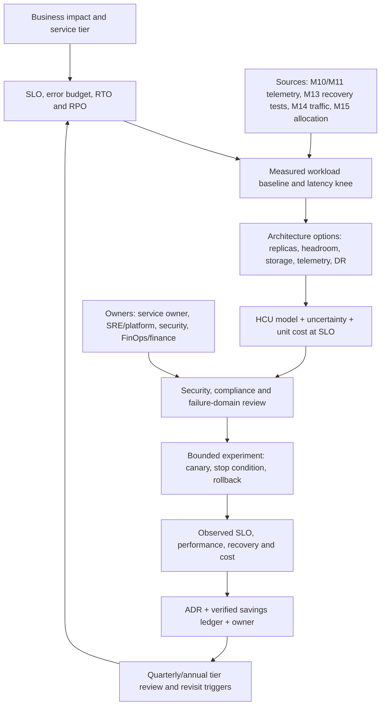

# Unit 6 — Cost, reliability, and performance trade-offs

**Stage:** Stage 2E — Production DevOps & Platform Engineering  
**Subfolder:** `15-Platform-Capacity-Compute-Economics-and-FinOps/`  
**Module:** M15 — Platform Capacity, Compute Economics and FinOps  
**Target file:** `06-cost-reliability-and-performance-tradeoffs.md`  
**Estimated study time:** 28–36 hours (reading 7–9 h; hands-on labs 16–21 h; review 5–6 h)  
**Prerequisites:** Stages 0–2D and Stage 2E M01–M14; especially M10 SLOs, error budgets, availability, queueing and incident response; M11 observability, saturation, profiling and load testing; M13 backup/restore and DR; M14 multi-region operations; M15 Units 1–5.  
**Core tools:** Python 3 standard library, CSV/JSON, `unittest`, local worksheets, existing `kind`/`kubectl` environment where useful.  
**Awareness:** Prometheus/Grafana, OpenCost, KEDA, node autoscalers, GPU-sharing and model-optimization tools. Use existing M11 tooling only; verify current compatibility before optional installation.  
**Last reviewed:** 2026-11-03  
**Tool baseline assumed:** Python 3.11+ syntax `[VERIFY]`; `kind`, Kubernetes, `kubectl`, Metrics Server and Prometheus versions are inherited from M03/M11 and must be recorded from the learner's environment `[VERIFY]`. No version-specific API, flag or metric is required by the Cap-Core path.  
**Stack profile required:** Cap-Core required; Cap+Obs optional; Cap+Scale optional and not required.  
**Footprint:** Cap-Core is Python/CSV/worksheet-first and uses the existing local cluster only where needed. Cap+Obs adds the existing M11 observability stack. On an approximately 4-CPU/8-GB laptop, sequence components and measure CPU, memory and disk before/after; **measure yours**.  
**Prices used:** hypothetical cost units (HCU) only. No real prices, currency symbols, provider quotes or billable cloud resources.

> **Completion outcome:** Build and defend a reliability-aware efficiency program. Compare designs using explicit assumptions, measured local performance, HCU unit economics, service tiers, rollback evidence and accountable decision records. You will learn why the cheapest design is not automatically the least expensive design after failures, latency, recovery, security and developer waiting time are considered.

## Contents

- [Prerequisite handoff and scope](#prerequisite-handoff-and-scope)
- [6.0 Why this matters in production](#60-why-this-matters-in-production)
- [6.1 Learning objectives](#61-learning-objectives)
- [6.2 Concept map and vocabulary](#62-concept-map-and-vocabulary)
- [6.3 Level 1 — Beginner](#63-level-1--beginner)
- [6.4 Level 2 — Intermediate](#64-level-2--intermediate)
- [6.5 Level 3 — Advanced](#65-level-3--advanced)
- [6.6 Level 4 — Expert](#66-level-4--expert)
- [6.7 Failure modes and troubleshooting](#67-failure-modes-and-troubleshooting)
- [6.8 Security, reliability, and cost guardrails](#68-security-reliability-and-cost-guardrails)
- [6.9 Metrics and verification](#69-metrics-and-verification)
- [6.10 Hands-on lab set](#610-hands-on-lab-set)
- [6.11 Self-check questions](#611-self-check-questions)
- [6.12 Evidence artifacts](#612-evidence-artifacts)
- [6.13 Common interview and design-review questions](#613-common-interview-and-design-review-questions)
- [6.14 Sources and verification notes](#614-sources-and-verification-notes)

---

## Prerequisite handoff and scope

### Verbatim cross-module handoff

> M10 Unit 1 taught availability, reliability, serial/parallel composition and the qualitative cost of additional “nines”; M10 Unit 2 taught freshness SLOs and stream-versus-micro-batch decisions; M10 Unit 6 taught Little’s Law, queueing, latency knees, N−1 headroom, retry amplification and backlog catch-up; M10 Unit 9 taught error-budget policy. M11 Units 7, 9, 10, 12 and 13 taught diagnostic drills, saturation, profiling, telemetry cost and load/soak testing. M13 taught backup/restore, RPO/RTO, immutability and DR; M14 taught multi-region overhead, replication and standby capacity. M15 Units 1–5 provide the capacity/headroom, workload-priority, budget, allocation and idle-resource evidence consumed here. This unit turns those inputs into **measured cost/reliability/performance decisions**; it does not re-teach their foundations.

### What this unit teaches, reuses and defers

| Boundary | Included here |
|---|---|
| Teaches | Trade-off reasoning; HCU models; SLO-tier cost policy; cost per successful unit of work at SLO; availability/performance/observability/resilience/security/deployment/velocity/scalability trade-offs; expected loss; reversibility; optimization ROI; governance; ten experiments. |
| Reuses | M10 availability and error budgets; M11 telemetry, profiling and load-test methods; M13 recovery objectives; M14 multi-region costs; M15 Unit 1 headroom, Unit 2 priorities/quotas, Unit 3 guardrails, Unit 4 allocation, Unit 5 verified savings and cleanup controls. |
| Defers | Detailed release-gate implementation (Unit 7), spot/preemptible execution (Unit 8), node provisioning (Unit 9), KEDA (Unit 10), OpenCost deployment (Unit 11), GPU fleet scheduling/sharing implementation (Unit 12), golden paths (M16), integrated capstone (M17). |

### Running example

Use one synthetic data/ML platform throughout:

- `inference-api`: interactive, bursty, latency-sensitive.
- `batch-etl`: scheduled jobs with completion/freshness deadlines.
- `stream-consumer`: queue-driven workload with backlog catch-up.
- `training`: checkpointed ML training with GPU demand.
- `notebooks`: interactive, often idle-prone developer environments.
- `platform-services`: CI, registry, GitOps, secrets and observability.
- `state-store`: PostgreSQL/object-storage-like state with backup and replication requirements.
- `multi-region`: a simulated standby/failover footprint.

No actual cloud resources, provider price lists, private billing exports or real credentials are needed. All cost values are HCU. HCU demonstrates comparative reasoning; it cannot predict a provider invoice.

### Evidence labels

- `[ASSUMPTION]` — a modeling input that must be reviewed.
- `[ILLUSTRATIVE]` — a sample policy or threshold, not a universal default.
- `[SYNTHETIC]` — generated data or a simulated outcome.
- `[MEASURED — YOUR ENVIRONMENT]` — a value the learner actually measured.
- `[VERIFY]` — version-, provider- or tool-specific behavior to check before adoption.

---

## 6.0 Why this matters in production

Infrastructure cost is not a separate finance concern that begins after architecture is complete. Replicas, headroom, storage performance, observability retention, deployment overlap, security controls, recovery capability and developer waiting time are architectural decisions with economic consequences. Removing one of these controls can reduce a monthly allocation while increasing latency, incident probability, data-loss exposure or time to recover.

A useful decision therefore asks: **what is the least costly design that meets the service's business impact, SLO, security, compliance and recovery requirements?** It does not ask only which instance, pod count or retention setting has the lowest nominal cost. This unit teaches a repeatable evidence loop: define the service tier, establish a measured baseline, model options in HCU, run a bounded experiment, verify SLOs, record the decision and revisit it when assumptions change.

## 6.1 Learning objectives

By the end of this unit, you can:

1. **[L1]** Explain the cost/reliability/performance trade-off triangle and the additional security and developer-velocity dimensions.
2. **[L1/L2]** Translate a service tier, user impact, SLO, RTO and RPO into explicit capacity, observability, deployment and recovery policies.
3. **[L2]** Compare single-instance, replicated, simulated multi-AZ and simulated multi-region designs using availability arithmetic and correlated-failure caveats.
4. **[L2]** Find a measured latency knee and calculate cost per successful request at SLO rather than relying on hourly cost.
5. **[L2]** Measure the effect of telemetry reduction on time-to-localize while protecting security and compliance evidence.
6. **[L2/L3]** Model backup/replication, blue-green overlap, security-tool overhead, developer wait time and autoscaling lag in HCU.
7. **[L3]** Use expected-loss ranges, incident-impact models, staged reversible changes and optimization ROI without false precision.
8. **[L3/L4]** Design workload-class utilization policies and a reliability-aware FinOps–SRE optimization portfolio.
9. **[L4]** Govern service tiers, exceptions, ADRs, error-budget arbitration, cost-of-reliability reporting and joint reviews.
10. **[L4]** Diagnose the seven required cost-induced incident patterns and define preventive controls plus verification metrics.

## 6.2 Concept map and vocabulary

### Decision flow



### Glossary

| Term | Precise definition | Common misconception |
|---|---|---|
| Trade-off | A decision where changing one design dimension changes benefits, costs or risks in other dimensions. | Every decision can optimize all dimensions without constraints. |
| SLO | A target for a user-visible service-level indicator over a stated window. | A dashboard average is automatically an SLO. |
| Error budget | The allowed unreliability implied by an SLO over its measurement window. | A budget that can be spent without governance. |
| Service tier | A business-impact classification that determines SLO, recovery, security and operational expectations. | A price band or a label chosen by engineering alone. |
| Marginal cost | The additional cost caused by one more unit of capacity or work under stated assumptions. | Average cost divided by total workload. |
| Latency knee | The measured load region where a small increase in offered load causes a disproportionate latency/queue increase. | A universal utilization percentage. |
| Headroom | Capacity intentionally kept available for variance, failure, rollout and scale-out delay. | Waste that should always be eliminated. |
| Correlated failure | Failure events that are not independent because they share a cause or dependency. | Two replicas always provide independent protection. |
| Common dependency | A component used by multiple otherwise redundant paths, such as shared DNS, identity, database or network. | Replicas remove every single point of failure. |
| Cost per request at SLO | Cost divided by successful requests that meet the defined SLO during the same measurement window. | Cost per hour or cost per attempted request. |
| RPO | Maximum acceptable data-loss interval, expressed as time. | Restore duration. |
| RTO | Target maximum time to restore service after disruption. | Backup frequency. |
| Expected loss | A simplified probability-weighted impact model over a defined period. | A precise forecast or a replacement for tail-risk judgment. |
| Real option | The value of preserving the ability to change a decision later. | A financial derivative required for every engineering decision. |
| HCU | Hypothetical cost unit used for teaching comparisons. | A currency or a provider rate. |
| Realized savings | A reduction verified against an agreed baseline after the change, net of relevant new costs. | A recommendation or forecast shown on a dashboard. |
| Goodhart's law | When a measure becomes a target, behavior can change in ways that make the measure less useful. | A reason to avoid metrics entirely. |

### The trade-off model

The triangle is a teaching aid, not a physical law. In many designs, lower cost is achieved by consuming reliability margin or performance margin. For example, fewer replicas reduce baseline capacity cost but can increase failure sensitivity and queueing. Larger instances may reduce latency but increase idle capacity. Higher telemetry retention costs more but can reduce diagnostic uncertainty and incident duration. Security and developer velocity add further dimensions: scanners consume compute and CI time; faster CI may require more runners; removing a security gate may reduce build time while increasing supply-chain exposure.

A decision must therefore name its constraints. Security, compliance, data durability and minimum recoverability are often hard constraints rather than negotiable objectives.

### Where the levers sit

| Dimension | Common levers | Hidden cost or risk |
|---|---|---|
| Reliability | Replicas, failure-domain spread, headroom, backup/immutability, DR standby, on-call coverage, slower safer rollout | Idle capacity, replication, operational complexity, duplicated state |
| Performance | Larger compute, faster storage/network, caching, batching, warm pools, lower utilization | More spend, cache invalidation, consistency complexity, queueing shifted elsewhere |
| Cost | Right-sizing, scheduling, spot for eligible work, scale-to-zero, retention tiers, commitments, sampling | Lost headroom, interruption, cold starts, less diagnostic evidence |
| Security | Scanners, policy engines, runtime sensors, isolation, audit retention | CPU/memory and pipeline-time overhead |
| Developer velocity | More CI runners, build caches, preview environments, on-demand sandboxes | Infrastructure spend, environment sprawl, contention, cleanup burden |

### Service-tier definition

A service tier must be based on user impact and operational requirements, not only its monthly budget.

| Tier | Example workload | Required decision inputs | Typical policy direction `[ILLUSTRATIVE]` |
|---|---|---|---|
| Tier 0 / critical | Authentication, payment-like or critical inference path | User impact, latency/error SLO, RTO/RPO, legal/security obligations, dependency map | More headroom, tested failover, conservative rollout, strong telemetry, restricted spot/scale-to-zero |
| Tier 1 / important | Customer-facing batch API or core stream processing | Freshness/completion SLO, peak profile, recovery window | Measured headroom, replicas where justified, scheduled recovery drills |
| Tier 2 / standard | Internal data product or scheduled ETL | Deadline, backlog catch-up, data reproducibility | Flexible scheduling, batch-oriented utilization, tested restore |
| Tier 3 / best effort | Experiment, preview, exploratory notebook | Owner, TTL, checkpoint/rebuild ability, data retention | Quotas, TTL, interruptible capacity where eligible, explicit data-loss acceptance |

Do not infer a tier from the workload name. A batch pipeline may be business-critical if its deadline feeds a regulatory or customer commitment.

---

## 6.3 Level 1 — Beginner

### 6.3.1 SLO-driven spending

An SLO expresses the service outcome users care about: request success, latency, freshness, completion time or availability. Infrastructure spending is justified when it protects an outcome that matters. A replica that does not reduce a real failure mode may be unnecessary. A replica that protects a critical path from a common node failure may be essential. The service owner must identify the user impact and the accountable risk owner.

The qualitative cost of additional “nines” is usually increasing marginal effort: each additional reliability increment may require more isolation, redundancy, testing, automation and operational coverage. This is a qualitative decision principle; this course does not assign a universal HCU cost to an availability percentage.

### 6.3.2 Utilization is not the objective

High utilization can reduce idle cost, but it also reduces the capacity available for bursts, failures and scale-out delay. As the system approaches its measured latency knee, queueing and tail latency may increase sharply. Average utilization can hide short peaks, correlated demand, batch cycles and retry amplification.

A workload target must be measured by class:

- Online critical services: preserve margin below the measured latency knee.
- Stateless scalable services: choose a target based on repeatable load tests and scale-out delay.
- Batch: higher utilization may be acceptable if deadlines and backlog catch-up remain healthy.
- GPU: utilization must be evaluated alongside queue wait, job completion and quality SLOs.

No universal utilization target is prescribed.

### 6.3.3 Marginal analysis

Ask what the next unit of capacity buys and what it costs.

**Example A — extra replica.** `[SYNTHETIC][ILLUSTRATIVE]` A service costs 12 HCU per period with two replicas. A third replica adds 6 HCU per period. If the third replica materially reduces the probability of a user-visible outage for a Tier 0 path, it may be justified. If the service is a replayable offline job with a long deadline, a checkpoint/retry design may be cheaper and equally acceptable.

**Example B — instance size and latency.** `[SYNTHETIC]` Resource profile A costs 8 HCU per hour and has p95 latency 240 ms under the tested load. Profile B costs 11 HCU per hour and has p95 latency 150 ms. If the SLO is 200 ms, A fails and B passes. The 3 HCU increment is not “waste”; it buys SLO compliance. If the SLO were 300 ms, the larger profile might not be needed.

**Example C — telemetry and diagnosis.** `[SYNTHETIC]` A high-retention policy costs 9 HCU per period and a reduced policy costs 5 HCU. If the reduced policy increases time-to-localize from 20 to 60 minutes, the 4 HCU saving must be compared with incident duration, engineering effort, evidence obligations and user impact. The decision is not “always retain everything”; it is “retain enough of the right evidence.”

**Example D — headroom and utilization.** `[ILLUSTRATIVE]` A 100-unit capacity pool has 25 units of spare capacity at the expected peak. Removing 10 units increases utilization but reduces the ability to absorb a node loss or burst. Check whether the remaining headroom still meets the N−1 and scale-out assumptions from Unit 1.

**Example E — warm capacity and autoscaling.** `[SYNTHETIC]` Keeping 2 warm replicas costs 4 HCU per period. Scaling from zero saves those 4 HCU but creates a cold-start interval. For an interactive path, that interval may violate latency SLO. For a nightly job with a flexible start window, scale-to-zero may be appropriate.

### 6.3.4 Availability arithmetic: first principles

If a component has availability \(A\), its unavailability is \(U = 1-A\). For two truly independent redundant components in parallel, the simplified system availability is:

\[
A_{\text{parallel}} = 1 - (1-A_1)(1-A_2)
\]

For two serial dependencies, both must work:

\[
A_{\text{serial}} = A_1 A_2
\]

These equations require explicit assumptions. Independence is often false. Replicas may share a database, DNS, identity provider, network, deployment pipeline, bad configuration or regional control plane. A correlated event can defeat every replica simultaneously. Use this arithmetic to compare a simplified model, not to claim production availability.

**Worked example — replicas.** `[ASSUMPTION][SYNTHETIC]` Let one replica have modeled availability 0.99. Two independent replicas in parallel give:

\[
1-(1-0.99)^2 = 1-0.0001 = 0.9999
\]

That is a model result of 99.99%, not a production prediction. If both replicas share a dependency with availability 0.995 in series, the simplified end-to-end result is:

\[
0.9999 \times 0.995 = 0.9949005
\]

The shared dependency dominates the result. The correct next action may be to improve the dependency, not add a third application replica.

### 6.3.5 Cost of an additional nine

First define the number of availability nines in the simplified model:

\\[
N = -\\log_{10}(1-A)
\\]

where \(A\) is availability as a fraction. The modeled cost per additional nine over a chosen period is:

\\[
C_{\\text{per nine}} = \\frac{C_2-C_1}{N_2-N_1}
\\]

where \(C_1,C_2\) are HCU costs for the same period and \(N_1,N_2\) are modeled nines. This ratio is descriptive, not a procurement rule.

`[ILLUSTRATIVE][SYNTHETIC]` Suppose the baseline design costs 100 HCU/period and models 99.9% availability (three nines). A more redundant design costs 145 HCU/period and models 99.99% availability (four nines). The incremental cost is 45 HCU/period for one modeled additional nine, so the ratio is 45 HCU per additional modeled nine per period. The team must ask which failure mode is covered, whether the service tier requires that protection, and what impact a failure would have. If the replicas share a dependency, the modeled availability may be overstated. This calculation is not a universal procurement metric and does not establish production availability.

### 6.3.6 Architecture Decision Record (ADR)

Use this template for every material trade-off:

```markdown
# ADR-NNN: <decision title>
- Status: proposed | accepted | rejected | superseded
- Date / owner / approvers:
- Service and tier:
- User impact and SLO:
- RTO / RPO / security / compliance constraints:
- Measured baseline (window, workload, p50/p95/p99, errors, saturation):
- Decision:
- Alternatives considered:
- Assumptions register (value, unit, evidence, confidence, owner):
- HCU model (period, scope, inclusions, exclusions):
- Expected effect and uncertainty range:
- Stop condition and rollback:
- Observed effect after rollout:
- Risks and dissent:
- Revisit date and triggers:
```

An ADR is not a substitute for evidence. It makes the assumptions, accountable owner and future review explicit.

### 6.3.7 L1 trade-off explorer

The required explorer varies replica count, headroom, utilization target and resource size. It reports:

- hypothetical HCU per period;
- simplified availability estimate with independence assumptions;
- latency estimate based on the learner's measured latency knee;
- whether the candidate meets a declared tier;
- sensitivity when availability assumptions, load, price units or headroom change.

Do not invent a latency knee. Measure it in Lab 3. Until then, mark the latency input `[ASSUMPTION]` and do not use the result as a production recommendation.

---

## 6.4 Level 2 — Intermediate

### 6.4.1 Cost versus availability

Compare four architecture classes:

1. **Single instance:** lowest baseline footprint, but one component failure removes service.
2. **N replicas:** tolerates some instance failures if replicas are independent, spread and backed by adequate capacity.
3. **Simulated multi-AZ:** model separate failure domains and zone-level common dependencies. A local `kind` cluster does not create real zones.
4. **Simulated multi-region:** model independent regional capacity, replication, traffic steering, data consistency and failover. A worksheet is not a regional DR test.

The decision rule is **choose the least costly design that meets the service tier**. Do not choose the cheapest design overall if it fails the business-impact requirement.

### 6.4.2 Cost versus performance

Run a repeatable workload at multiple replica/resource sizes. Record offered load, successful throughput, p50/p95/p99 latency, errors, CPU/memory observations, queue depth where available, and HCU model inputs. Repeat each candidate; random noise, cache warm-up, background work and host contention can distort results.

Calculate:

\[
\text{Cost/request at SLO} =
\frac{\text{HCU consumed in the measurement window}}
{\text{successful requests meeting the SLO in that window}}
\]

Requests that fail or violate the SLO must not be counted as successful work. If a candidate fails the SLO, label its cost/request-at-SLO as not acceptable rather than celebrating its low hourly cost.

**Three-point example.** `[SYNTHETIC][ILLUSTRATIVE]`

| Candidate | HCU/hour | Successful requests/hour | SLO-compliant requests/hour | p95 latency | Cost per SLO-compliant request |
|---|---:|---:|---:|---:|---:|
| Small | 4 | 100,000 | 60,000 | 280 ms | 0.0000667 HCU |
| Medium | 6 | 120,000 | 115,000 | 180 ms | 0.0000522 HCU |
| Large | 9 | 150,000 | 148,000 | 140 ms | 0.0000608 HCU |

Assume the SLO is p95 below 200 ms. Small fails; medium and large pass. Medium has lower HCU per compliant request in this synthetic sample. Large may still be selected if additional peak headroom, burst tolerance or future demand matters, but that must be stated and measured.

### 6.4.3 Cost versus observability

Telemetry has multiple cost drivers: event volume, label cardinality, retention, replication, query load and export. Reduction options include sampling, retention tiers, removing unused high-cardinality dimensions and reducing duplicate events. Before reducing telemetry:

1. Define the incident question the data must answer.
2. Run a time-to-localize drill with a planted fault.
3. Record whether the fault can be identified and how long diagnosis takes.
4. Apply a candidate reduction in a synthetic dataset or isolated local stack.
5. Repeat the same drill.
6. Preserve security, audit, compliance and incident evidence that policy requires.

Do not reduce security logs, audit records or required evidence merely because their volume is high. A cost-saving proposal must be reviewed by the relevant risk owner.

### 6.4.4 Cost versus data resilience

Compare backup frequency, retention, immutability and replication against RPO/RTO. A shorter RPO may require more frequent snapshots or replication; a shorter RTO may require warm capacity, tested automation or a standby environment. Costs are not only storage: include network transfer, restore compute, test environments and operational effort.

**Worked example — RPO/RTO.** `[SYNTHETIC][ASSUMPTION]`

| Policy | Backup/replication model | HCU/period | Tested restore duration | Modeled data-loss window |
|---|---|---:|---:|---:|
| A | Daily backup, restore on demand | 8 | 5 hours | Up to 24 hours |
| B | Frequent backup plus replicated standby | 21 | 45 minutes | Up to 15 minutes |

Policy A is not acceptable if the service tier requires a 1-hour RPO or 1-hour RTO. Policy B appears to meet those objectives in this synthetic example, but only a restore/failover test can establish observed behavior. A backup job succeeding is not proof that restoration succeeds.

### 6.4.5 Cost versus deployment safety

Canary and blue-green rollout reduce the blast radius of a release by exposing a small or separate slice of capacity before full promotion. A simplified blue-green rollout may temporarily require 2× capacity while old and new environments coexist. Actual designs vary: shared databases, traffic percentages, autoscaling, storage and warm-up may change the multiplier.

**Worked example — blue-green overlap.** `[SYNTHETIC][ILLUSTRATIVE]` A service baseline costs 10 HCU/hour. During a 30-minute overlap, old and new environments both run at full modeled capacity. Incremental capacity cost is:

\[
10\ \text{HCU/hour} \times 0.5\ \text{hour} = 5\ \text{HCU}
\]

If rollback requires the old environment to remain warm for the full overlap, that cost is part of the safety design. Compare 5 HCU with the release risk and the recovery time it buys; do not remove rollback capacity without a risk decision.

### 6.4.6 Cost versus security

Measure local CPU/memory and pipeline-time overhead for scanners, policy checks and runtime sensors where the tools are already available. The measurement is an engineering input, not permission to disable the control. A material change to a security control requires a threat model, compensating control, security owner approval, expiry/revisit date and negative test. If the scanner is slow, optimize caching, parallelism, incremental scanning or runner capacity before removing coverage.

### 6.4.7 Cost versus developer velocity

Infrastructure cost is not the only cost. A CI queue may make engineers wait; preview environments may shorten feedback loops but increase temporary compute; build caches may consume storage while reducing repeated work.

**Worked example — developer wait time.** `[ASSUMPTION][SYNTHETIC]` Ten engineers each lose 20 minutes per workday waiting for a constrained CI queue. At an assumed internal value of 0.2 HCU per engineer-minute, the modeled wait cost is:

\[
10 \times 20 \times 0.2 = 40\ \text{HCU/workday}
\]

If an additional runner costs 12 HCU/workday and reduces measured waiting by 70%, the modeled recovered time is 28 HCU/workday. The net benefit is 16 HCU/workday before considering maintenance and runner utilization. The 0.2 HCU/minute input is an assumption, not a real labor rate.

### 6.4.8 Cost versus scalability

Autoscaling trades idle headroom against scale-out delay. A workload can have a low average load but a sharp arrival burst. If scale-out takes longer than the time to violate the SLO, pre-warmed capacity or scheduled pre-scaling may be justified. Check pending pods, quota, node provisioning lag, image pull time, startup time, readiness and downstream capacity. More replicas do not help if the database or queue consumer is the bottleneck.

### 6.4.9 Service-tier cost-policy matrix

| Policy dimension | Tier 0 / critical | Tier 1 / important | Tier 2 / standard | Tier 3 / best effort |
|---|---|---|---|---|
| SLO | Strict user-facing latency/availability | Customer or business deadline | Internal completion/freshness | Best effort |
| Headroom | N−1 and burst evidence required | Measured peak and scale-out margin | Deadline/backlog margin | Minimal bounded reserve |
| Priority/quotas | Protected priority; controlled emergency quota | High priority with fair-share | Normal quota | Preemptible/backfill class |
| Node pools | Stable dedicated or protected pool where justified | General stable pool | Flexible pool | Spot/interruptible eligible after Unit 8 review |
| Spot eligibility | Normally excluded unless architecture proves safe | Case-by-case | Replayable work only | Preferred candidate if interruption-safe |
| Backup/DR | Tested, immutable, tier-approved | Defined RPO/RTO and restore test | Recoverability matched to data value | Rebuild/replay may be acceptable |
| Observability | Full diagnostic coverage for critical path | Sufficient for incident diagnosis | Tiered retention | Minimal but adequate evidence |
| Deployment | Canary/rollback capacity | Progressive rollout | Standard safe rollout | Faster rollout if recovery is simple |
| Recovery drills | Highest cadence by risk | Scheduled | Periodic | Rebuild test |
| Exception owner | Business/service owner + SRE + security | Service owner + SRE | Team owner | Team owner |

All entries are policy examples `[ILLUSTRATIVE]`; organizations must define the actual tiers and approve exceptions.

### 6.4.10 Combined L2 lab outcome

The learner must build the matrix and explorer, choose one bounded change (for example, reduce headroom by a small amount in a local throwaway service), run a repeatable load test, compare SLO and resource behavior, calculate HCU delta, and create an ADR. A saving is accepted only if the SLO and recovery constraints remain satisfied.

---

## 6.5 Level 3 — Advanced

### 6.5.1 Expected-value analysis with risk

A simplified expected-loss model is:

\[
EL = P(\text{event in period}) \times I(\text{impact if event occurs})
\]

Both probability and impact are assumptions unless supported by a credible evidence base. The model can omit correlated events, rare catastrophic outcomes, legal consequences, reputational damage, nonlinear dependencies and risk aversion. Use low/base/high scenarios and show which assumptions change the recommendation.

**Worked example — expected loss.** `[ASSUMPTION][SYNTHETIC]`

| Scenario | Annual event probability | HCU impact/event | Expected loss |
|---|---:|---:|---:|
| Low | 0.01 | 100 | 1 HCU/year |
| Base | 0.05 | 400 | 20 HCU/year |
| High | 0.10 | 1,000 | 100 HCU/year |

A standby design costing 30 HCU/year is not justified by the low case on expected value alone, but may be justified by the base/high case, a hard RTO requirement or tail-risk tolerance. Expected value does not eliminate tail risk and does not replace business-impact judgment.

### 6.5.2 Downtime and incident impact model

Use a transparent formula:

\[
\text{Impact} =
(V_m \times T \times F) + E_r + P_e
\]

Where:

- \(V_m\) = assumed lost value per minute (HCU/minute);
- \(T\) = incident duration (minutes);
- \(F\) = affected fraction (0–1);
- \(E_r\) = recovery effort (HCU);
- \(P_e\) = any explicitly assumed penalty (HCU).

`[ASSUMPTION][ILLUSTRATIVE]` If \(V_m=3\), \(T=40\), \(F=0.5\), recovery effort is 20 HCU and penalty is 0, then impact is \(3×40×0.5+20=80\) HCU. This excludes second-order effects unless they are explicitly added. Never present the result as an actual outage valuation.

### 6.5.3 Real options and reversibility

When uncertainty is high, prefer changes that can be reversed quickly:

- schedule a non-critical workload instead of deleting its environment;
- reduce headroom in measured 10% steps instead of a single large cut;
- reduce retention only after legal/security review and restore of diagnostic coverage;
- use a canary before fleet-wide right-sizing;
- preserve a fallback until the new design has passed its observation window.

Irreversible changes—deleting data, removing redundancy, dropping audit evidence—require stronger evidence and explicit risk-owner approval. A staged change must have a stop condition, a tested rollback and a named decision owner.

### 6.5.4 Performance engineering is cost engineering

Profile the hot path and normalize by completed work:

- CPU-seconds/request or CPU-seconds/job;
- memory peak per concurrent request;
- bytes transferred per request;
- database queries per request;
- queue wait and service time;
- cache hit ratio with correctness checks.

Potential improvements include algorithmic complexity, caching, batching, serialization reduction, query/index tuning and avoiding repeated work. These improvements can compound across replicas. Include the cost of new complexity, cache invalidation, memory use, operational support and correctness risk.

For ML inference, quantization, distillation, smaller models, batching and caching are awareness-level levers here. Tool-specific accuracy, hardware support and performance claims are `[VERIFY]`; evaluate quality and latency together. GPU utilization alone is insufficient if queue wait or job completion SLO deteriorates.

**ROI model:**

\[
ROI_{\text{net}} =
(\Delta R \times C_r \times L) - C_e - C_o
\]

Where \(\Delta R\) is verified resource reduction per period, \(C_r\) is HCU per resource-period, \(L\) is useful lifetime in periods, \(C_e\) is engineering effort in HCU and \(C_o\) is ongoing operational cost in HCU. Avoid counting both a capacity reduction and the same cost allocation reduction as separate savings.

**Worked example — optimization ROI.** `[SYNTHETIC][ASSUMPTION]` A hot-path change reduces normalized CPU consumption by 0.002 CPU-seconds/request. At 2,000,000 successful requests per month, modeled reduction is 4,000 CPU-seconds/month. A synthetic rate card converts that to 18 HCU/month. Over a six-month useful life, gross modeled savings are 108 HCU. Engineering effort is 30 HCU and new cache operations cost 6 HCU over the same period. Net predicted benefit is 72 HCU. After rollout, measure actual resource consumption and unit cost; record realized savings separately from the 72 HCU prediction.

### 6.5.5 Architectural cost drivers

| Driver | Cost mechanism | Reliability/performance consequence | Decision question |
|---|---|---|---|
| Chatty services | More calls and cross-zone/region traffic | Fan-out latency and dependency amplification | Can calls be batched or co-located safely? |
| Synchronous fan-out | Slowest dependency controls response | Tail latency and cascading failure | Can work be asynchronous or cached? |
| Over-replication/data duplication | More compute/storage/replication | Better isolation or availability, but more consistency work | Which failure mode does each copy cover? |
| Always-on pipelines | Continuous compute even at low demand | Lower freshness lag, potentially higher cost | Does freshness SLO require streaming or can micro-batch work? |
| Unbounded retention | Storage and indexing grow continuously | Larger search/restore burden | What is the legal and operational retention requirement? |
| Multi-tenancy | Shared overhead amortized across tenants | Noisy-neighbor and isolation risk | Is shared operation worth the blast-radius trade? |
| Materialize vs recompute | Storage cost vs repeated compute | Faster reads vs stale/duplicated data | What is the lifetime read/write ratio? |
| Partitioning/compaction/file sizing | Small files and poor partitioning increase operations | Query latency and maintenance pressure | What layout minimizes total compute + storage + operational cost? |
| Replication vs RPO | More copies and transfer | Better recovery, more consistency/egress complexity | What RPO does the business actually require? |
| GPU sharing | Better utilization, shared queue | Queue wait, interference, isolation concerns | Is throughput or per-job latency the objective? |
| Training time vs accuracy | More compute and experiment duration | Better model quality may improve product outcomes | What is the marginal accuracy value per HCU? |
| Inference cost vs latency/quality | Model size, batching, caching and hardware | Queueing, quality drift, cold starts | What is the cost per quality-compliant prediction? |

### 6.5.6 Utilization targets by workload class

Do not copy one utilization threshold across all workloads. Online critical services need enough headroom for bursts and failure; stateless scalable services can operate nearer a measured knee if scale-out is fast and dependencies have capacity; batch may use higher utilization if deadlines and backlog catch-up remain healthy; GPU systems must pair utilization with queue wait and completion SLO.

Any numeric target must be `[ILLUSTRATIVE]`, derived from the local load test and adjusted for variance, startup spikes, scale-out lag and failure-domain loss.

### 6.5.7 Headroom, autoscaling and commitment economics

Compare three choices:

1. **Always-on headroom:** pays for idle capacity but protects against burst and failure while autoscaling catches up.
2. **Reactive autoscaling:** reduces idle capacity but introduces detection, scheduling, provisioning, image-pull, startup and readiness delay.
3. **Known-event pre-scaling:** temporarily increases capacity before a predictable launch, batch window or event.

**Worked example — headroom versus scale-out lag.** `[ASSUMPTION][SYNTHETIC]` Warm capacity costs 5 HCU per event window. Without it, the workload may breach its SLO for 8 minutes while new capacity becomes ready. If the assumed user impact is 2 HCU/minute and 50% of traffic is affected, modeled impact is \(8×2×0.5=8\) HCU. The 5 HCU warm pool is economically defensible under these assumptions. If the workload is replayable batch with a flexible deadline, the same warm pool may not be justified.

Commitments/discount programs are conceptual awareness only. A predictable baseline may justify a commitment while uncertain peaks remain flexible, but actual contract terms and provider break-even points must be verified separately. Use demand uncertainty and regret analysis from Unit 1; do not invent discounts or commercial terms.

### 6.5.8 Reliability-aware efficiency program

1. Define SLO and service tier before the optimization.
2. Freeze risky cost experiments when the error budget is exhausted, subject to the organization's jointly approved policy.
3. Canary the change and compare the same workload window.
4. Verify latency, errors, saturation, recovery and security controls.
5. Record expected versus observed HCU and unit-cost effect.
6. Update the Unit 5 verified savings ledger without double counting.
7. Review jointly with service owner, SRE/platform and FinOps/finance.

### 6.5.9 Optimization anti-patterns

| Anti-pattern | Why it looks attractive | Hidden risk | Evidence required | Safer alternative |
|---|---|---|---|---|
| Right-size to p50 only | Low average resource use | Peak throttling/OOM and SLO failure | p95/p99, startup and month-end peaks | Percentile + peak-window sizing and load test |
| Remove replicas to meet budget | Immediate capacity reduction | Failure-domain fragility | Failure analysis, N−1 and dependency map | Optimize hot path or eligible batch first |
| Sample away incident evidence | Lower telemetry volume | Longer diagnosis and audit gaps | Time-to-localize drill, retention policy | Tiered sampling with protected evidence |
| Scale-to-zero on critical path | No idle replicas | Cold-start latency | Cold-start distribution and SLO | Warm minimum or scheduled pre-scale |
| Use spot for stateful primary | Lower nominal compute | Interruption/data integrity | Checkpoint, failover and restore test | Use interruption-tolerant workers only |
| Cut DR tests | Saves test effort | Restore/failover may be broken | Restore and failover evidence | Risk-based drills with clear cadence |
| Disable security tooling | Faster CI | Supply-chain or policy exposure | Threat model and control coverage | Optimize pipeline execution and caching |
| Optimize instance price while egress dominates | Visible unit price reduction | Total cost rises elsewhere | Cost-driver and traffic-flow analysis | Optimize architecture and data movement |
| Cut cost while incident cost rises | Savings ledger looks positive | Net economic harm | Incident-attributed cost and SLO trend | Net benefit including failure impact |

### 6.5.10 Sustainability awareness

Efficiency can reduce unnecessary compute and data movement, but this unit does not calculate carbon impact. Carbon-aware scheduling methods, emissions factors and tool behavior are awareness topics; claims and tool-specific details require `[VERIFY]`. Do not invent energy or carbon savings.

---

## 6.6 Level 4 — Expert

### 6.6.1 Cost-reliability policy and ADR governance

A mature program defines policy by service tier and obtains approval from the service owner, SRE/platform, security/compliance and finance stakeholders as appropriate. Tier assignments should be reviewed quarterly or annually as a proposed governance cadence `[ILLUSTRATIVE]`, and sooner when user impact, architecture, regulation, dependencies or recovery requirements change.

**Exception example:** A team requests Tier 0 reliability while holding a Tier 3 budget. The exception record must show the HCU gap between the requested policy and funded baseline, the unmitigated risks, user/business impact, compensating controls, accountable approver, expiry date and escalation path. Do not quietly relabel the service to make the budget appear compliant.

Report the cost of reliability per service/tier: headroom, replicas, replication, DR, observability, security, deployment overlap and on-call coverage. Use Unit 5's verified savings ledger to rank optimization proposals by savings, risk, effort, confidence and reversibility.

### 6.6.2 Metrics and organizational dynamics

A shared FinOps–SRE dashboard should include cost per successful unit of work at SLO, headroom cost share, incidents attributed to cost cuts, predicted versus realized ROI, forecast-versus-actual savings accuracy, SLO/error-budget health, diagnostic time and data/ML unit-cost trend.

Error budgets are a governance input, not a universal automatic switch. When reliability is healthy, the organization may permit bounded, reversible cost experiments. When the budget is exhausted, reliability normally takes precedence under a policy agreed by service and business owners. A risk exception must be explicit.

**Goodhart risk:** if teams are rewarded only for high utilization or lower total HCU, they may under-provision, reduce observability, shift costs to another scope or defer maintenance. Pair cost measures with SLOs, security, recovery and customer outcomes. Maintain psychological safety: teams must be able to report that an optimization caused an incident without hiding the evidence.

### 6.6.3 Five case-style decision exercises

Each case is synthetic. Learners must state service tier, assumptions, HCU model, reliability/performance/security consequences, sensitivity, recommendation, dissenting argument and revisit trigger.

#### Case A — Cut replicas, use spot, or reduce telemetry?

- **Tier:** inference-api Tier 0.
- **Assumptions:** `[ASSUMPTION]` two replicas cost 20 HCU/period; a third costs 10 HCU; shifting eligible background preprocessing to spot-like interruptible capacity saves 4 HCU but may interrupt; telemetry reduction saves 3 HCU but may weaken diagnosis.
- **Options:** remove a replica; move only replayable preprocessing; reduce non-critical telemetry; optimize request CPU.
- **Recommendation:** preserve critical replicas and required telemetry; profile the hot path first; move only checkpointed/replayable preprocessing after interruption tests.
- **Dissent:** a third replica may be unnecessary if measured failure-domain and load evidence show sufficient capacity.
- **Sensitivity/revisit:** revisit after a new load test, dependency redesign, error-budget trend or verified failure-domain change.

#### Case B — Retain expensive DR standby?

- **Tier:** Tier 0 state-store.
- **Assumptions:** `[SYNTHETIC]` standby costs 30 HCU/period; a cold restore costs 8 HCU per test and takes 5 hours in the model; the business RTO is 1 hour.
- **Recommendation:** retain warm standby or redesign recovery until tested evidence demonstrates an alternative meeting RTO/RPO. A cold restore that takes 5 hours does not meet the stated 1-hour RTO.
- **Dissent:** standby may be redesigned to a smaller warm footprint if failover and scale-up are tested.
- **Revisit:** after a successful recovery architecture test or a formal change to business impact/RTO.

#### Case C — Move batch work off-peak?

- **Tier:** Tier 2 batch-etl.
- **Assumptions:** `[ASSUMPTION]` workload is replayable; freshness deadline has a 6-hour window; off-peak scheduling reduces contention and has no real provider price implication in this HCU model.
- **Recommendation:** schedule within the deadline if upstream freshness, downstream dependencies and backlog catch-up remain safe.
- **Dissent:** moving work may create a large synchronized burst or delay consumers.
- **Revisit:** after a month-end/peak-cycle test and backlog recovery measurement.

#### Case D — Shared GPUs or dedicated GPUs?

- **Tier:** Tier 1 training.
- **Assumptions:** `[SYNTHETIC]` dedicated allocation costs 40 HCU per training window; shared allocation costs 28 HCU but increases queue wait from 10 to 35 minutes.
- **Recommendation:** choose shared capacity only if queue wait and completion SLO remain within target and isolation is adequate. Use dedicated allocation for latency-critical or interference-sensitive workloads.
- **Dissent:** a dedicated GPU may be wasteful when jobs are bursty and queue tolerance is high.
- **Revisit:** when job mix, queue SLO, utilization or model-training deadline changes.

#### Case E — Pre-scale before a known launch?

- **Tier:** Tier 0 inference-api.
- **Assumptions:** `[ASSUMPTION]` pre-scaling costs 12 HCU for the event; reactive scale-out may take 7 minutes; forecast demand is uncertain.
- **Recommendation:** pre-scale to a bounded level based on a rehearsal and maintain a cap; verify downstream database/egress capacity. Do not scale without an upper bound.
- **Dissent:** pre-scaling can waste capacity if launch demand is low; a canary ramp may be safer.
- **Revisit:** immediately after the launch, compare forecast, actual traffic, SLO and realized HCU.

### 6.6.4 Required L4 incident analyses

Use the incident sequence **symptoms → impact → evidence → immediate response → root cause → fix → prevention → verification metric**.

#### Incident 1 — Headroom cut by 30%; first traffic spike breaches SLO

- **Symptoms:** latency and errors rise during the first burst; queues grow; replicas cannot absorb load.
- **Impact:** user SLO breach and error-budget burn; `[SYNTHETIC]` incident-impact model exceeds the HCU savings from the headroom cut.
- **Evidence:** pre/post headroom model, peak traffic trace, pending pods, saturation, load-test baseline, rollout and quota history.
- **Immediate response:** restore the previous capacity/headroom; stop further cost experiments; stabilize the service.
- **Root cause:** headroom was treated as waste and reduced without peak/failure-domain testing.
- **Fix:** derive headroom from peak variance, N−1, scale-out lag and release surge.
- **Prevention:** staged 10% reductions with automatic stop and rollback; review Unit 1 assumptions.
- **Verification:** SLO attainment, peak latency, error-budget burn and headroom attainment after repeated peak tests.

#### Incident 2 — Telemetry sampling cut; next incident takes 3× longer to localize

- **Symptoms:** dashboards lack the dimension needed to isolate the failing dependency; engineers rely on manual logs.
- **Impact:** in this source scenario, time-to-localize is 3× longer; this is a scenario detail, not a general statistic.
- **Evidence:** before/after sampling configuration, diagnostic drill timings, missing series/logs/traces, incident timeline.
- **Immediate response:** restore the minimum diagnostic telemetry and preserve incident evidence.
- **Root cause:** sampling was optimized by volume without testing diagnostic questions.
- **Fix:** tier telemetry; retain critical signals and audit/security evidence; reduce duplicate or unused data first.
- **Prevention:** run the same planted-fault drill before approving telemetry cuts.
- **Verification:** time-to-localize, fault-identification success and required-evidence coverage.

#### Incident 3 — DR standby removed; regional event has no fallback

- **Symptoms:** primary region is unavailable and failover target is missing or unready.
- **Impact:** service outage exceeds RTO; recovery may require rebuild and restore.
- **Evidence:** DR inventory, cost ADR, last restore/failover test, replication lag and runbook.
- **Immediate response:** invoke approved recovery plan; protect data; communicate recovery estimates.
- **Root cause:** standby cost was removed without revising business-approved RTO/RPO.
- **Fix:** restore a tested standby or formally change recovery objectives with business approval.
- **Prevention:** make DR resources exempt from idle cleanup; require restore/failover evidence before changes.
- **Verification:** observed RTO/RPO and successful recovery drill.

#### Incident 4 — Right-sizing on average causes peak throttling

- **Symptoms:** CPU throttling, memory pressure or OOM during peak/month-end load.
- **Impact:** latency and completion SLOs fail; retries may amplify demand.
- **Evidence:** p50/p95/p99 usage, peak windows, startup spikes, throttling/OOM events and changed requests/limits.
- **Immediate response:** roll back resource requests/limits; stabilize HPA and downstream dependencies.
- **Root cause:** average usage was treated as a safe capacity requirement.
- **Fix:** use representative peaks and load tests; coordinate request changes with utilization-based HPA targets.
- **Prevention:** require a percentile/peak review and rollback threshold for right-sizing.
- **Verification:** throttling, OOM, p95/p99 latency and SLO attainment.

#### Incident 5 — Scale-to-zero on interactive path causes cold-start latency violations

- **Symptoms:** first requests after idle periods exceed latency SLO; readiness and initialization are slow.
- **Impact:** user-visible timeout and retry amplification.
- **Evidence:** cold-start latency distribution, replica history, request arrivals, startup/readiness events.
- **Immediate response:** restore warm minimum replicas or route to a warm fallback.
- **Root cause:** idle-cost policy ignored cold-start behavior and interactive latency.
- **Fix:** retain warm capacity or redesign startup path; schedule scale-to-zero only for tolerant workloads.
- **Prevention:** cold-start test under the SLO and tier policy review.
- **Verification:** p95/p99 cold-start latency and first-request success.

#### Incident 6 — CI security scanners disabled; supply-chain issue slips through

- **Symptoms:** pipeline becomes faster but a vulnerable or untrusted dependency/artifact passes.
- **Impact:** security exposure, remediation work and potential downstream compromise.
- **Evidence:** pipeline configuration diff, scanner logs, artifact provenance and threat model.
- **Immediate response:** contain affected artifacts, restore required checks, rotate/revoke affected credentials if indicated by the incident response process.
- **Root cause:** scanner time was optimized as a build metric without security-risk ownership.
- **Fix:** restore required security controls; optimize caching, parallel execution and runner capacity.
- **Prevention:** security approval and negative tests for any control change.
- **Verification:** required scan coverage, policy pass rate and pipeline duration tracked together.

#### Incident 7 — Instance price optimized while egress dominates

- **Symptoms:** compute unit price falls but total platform cost rises or stays flat.
- **Impact:** architecture becomes more complex without meaningful total-cost reduction.
- **Evidence:** cost-driver breakdown, traffic flow, cross-region replication, NAT/network and service call topology.
- **Immediate response:** stop further instance-size changes; isolate dominant transfer paths.
- **Root cause:** optimization focused on a visible compute line while data movement dominated total cost.
- **Fix:** reduce unnecessary cross-region traffic, fan-out, duplicate transfer or misplaced processing where safe.
- **Prevention:** require cost-driver decomposition before approving an optimization.
- **Verification:** HCU per GB transferred, egress share and total cost per successful unit of work at SLO.

### 6.6.5 Limits and honesty

- All availability, expected-loss and incident-impact models depend on assumptions and may omit correlated failures, common dependencies and nonlinear effects.
- Measure system behavior after each change; do not treat a model output as a guarantee.
- Every service has different user impact, workload shape, security obligations and recovery objectives.
- HCU models teach comparative reasoning and cannot predict real provider invoices.
- Local `kind` and synthetic load tests do not establish production-scale behavior or real failure-domain independence.
- A model does not replace an accountable service/business owner or risk approver.

---

## 6.7 SRE lens

### Failure modes and troubleshooting

| Symptom | Likely hypothesis | Evidence/test | Corrective action |
|---|---|---|---|
| Lower hourly cost but worse cost/request | Candidate fails SLO or completes less work | Compare compliant throughput, errors and HCU in same window | Reject or redesign candidate |
| Replicas increase but availability barely improves | Common dependency dominates | Dependency map and serial/parallel model | Improve shared dependency or failure-domain isolation |
| Low average CPU but high p99 latency | Burstiness, queueing or another bottleneck | Open-loop load test, queue depth, CPU throttling, DB latency | Find bottleneck; do not size from average |
| Telemetry cost falls but diagnosis slows | Critical dimensions were sampled away | Repeat planted-fault diagnostic drill | Restore critical telemetry and tier the rest |
| DR cost falls but restore exceeds RTO | Standby/restore path not tested | Restore/failover exercise | Restore tested recovery capability |
| HPA adds replicas but latency stays high | Downstream dependency or node capacity bottleneck | Pending pods, DB connections, queue and node saturation | Scale or protect the actual bottleneck |
| CI is faster but risk rises | Security control removed | Pipeline diff, scanner coverage and threat review | Restore controls; optimize execution |
| Compute savings do not reduce total spend | Egress/storage/telemetry/shared pool dominates | Cost-driver decomposition | Optimize dominant cost driver |
| GPU utilization rises but completion worsens | Queue wait/interference increased | Queue wait and completion SLO | Dedicated pool or admission control |
| Savings forecast differs from realized | Workload mix, baseline or allocation changed | Reconcile before/after windows and Unit 4/5 ledger | Restate forecast; avoid double counting |

---

### Metrics and verification

All metrics require a declared scope, time window, owner and limitation. A metric without its denominator can be gamed.

| Metric | Formula / definition | Unit | Source and window | Owner | Limitation |
|---|---|---|---|---|---|
| Cost per successful request at SLO | HCU in window ÷ successful requests meeting SLO | HCU/request | Cost allocation + request SLI; same window | Service owner + FinOps | Excludes unmodeled shared costs unless allocated |
| Cost per completed batch/job | HCU attributable to job ÷ completed jobs meeting deadline | HCU/job | Job labels, synthetic rate card, completion records | Data platform | Job complexity and data volume may differ |
| Cost per training run | HCU attributable to run ÷ completed valid run | HCU/run | Training metadata and allocation | ML platform | Accuracy/quality must be considered |
| Cost per prediction | HCU inference allocation ÷ valid predictions meeting quality/latency policy | HCU/prediction | Inference telemetry and allocation | ML service owner | Quality thresholds can change denominator |
| Headroom cost | Cost of provisioned reserve not consumed under defined model | HCU/period | Capacity model and allocation | Platform/SRE | Reserve can be insurance, not waste |
| Headroom cost share | Headroom HCU ÷ total service HCU | % | Capacity + allocation model | Platform/FinOps | Depends on reserve attribution rules |
| Availability/SLO attainment | Good events ÷ eligible events | % | SLI telemetry over SLO window | Service owner/SRE | Event definitions and dependency coverage matter |
| p50/p95/p99 latency | Percentile of request latency distribution | ms | Load/production telemetry | Service owner | Sampling and histogram quality matter |
| Measured latency knee | Load point where latency/queue growth changes materially | requests/s or workload unit | Repeatable open-loop load test | Performance owner | Environment-specific; not portable |
| Saturation/utilization | Resource use relative to defined capacity/request | % plus peak/variance | Metrics Server/Prometheus; peak window | Platform | Average alone hides bursts and bottlenecks |
| Error-budget burn | Observed bad events relative to allowed bad events | ratio/time | SLO system | SRE/service owner | Depends on SLO window and event model |
| Cost of cost-cut incident | Assumed/verified incident impact attributable to change | HCU | Postmortem + impact model | Service owner + finance | Causality and indirect impact may be uncertain |
| Diagnostic time / MTTR | Time from incident start/detection to localization or restoration; state which | minutes | Incident timeline/drill | SRE | MTTR definitions vary; do not mix localization with recovery |
| Optimization ROI | Verified savings minus engineering and ongoing cost | HCU over lifetime | Savings ledger + workload data | FinOps + engineering | Baseline drift and double counting |
| Predicted vs realized ROI | Realized net benefit ÷ predicted net benefit, with both values shown | ratio | ADR and savings ledger | FinOps | Undefined if predicted benefit is zero/negative |
| Forecast-vs-actual savings accuracy | Compare predicted and realized HCU delta with stated error formula | HCU or % | Savings ledger | FinOps | Workload mix and allocation changes confound comparison |
| Rollout/rollback overhead | Extra HCU and duration caused by overlap/rollback reserve | HCU, minutes | Deployment events and capacity model | Release owner | Architecture-dependent |
| Recovery time | Observed restore/failover completion time | minutes/hours | Restore/DR drill | DR owner | Test environment may differ from production |
| Restore-test success | Successful verified restores ÷ attempted restores | % | Backup/restore evidence | Data owner | A successful job without application validation is insufficient |

### Verification method

- Compare the same workload, time window and SLO definition before/after.
- Repeat tests and report range/variance, not only the best run.
- Include an A/A baseline or equivalent sanity check to estimate measurement noise.
- Check offered load as well as successful throughput.
- Preserve negative results; do not remove failed runs without a documented reason.
- Validate HCU arithmetic independently and reconcile the saving through Unit 4/5 allocation logic.
- Treat the measured latency knee as environment-specific.

### Goodhart guardrail

Never reward a team for utilization alone. A team can increase utilization by removing headroom, lowering requests, reducing observability or delaying maintenance. Pair utilization and total spend with unit cost at SLO, error-budget health, recovery test success, security coverage and customer outcomes.

---

---

## 6.8 Security lens

### Security and safety controls

| Risk | Control | Negative test |
|---|---|---|
| Denial-of-wallet through runaway autoscaling | Quotas, replica ceilings, alerting and bounded scale policies | Inject synthetic demand; verify model never exceeds declared cap |
| Over-privileged optimization identity | Least privilege, scoped roles, short-lived credentials, audit | Verify read-only report identity cannot mutate or delete resources |
| Cost data exposure | Role-based access and aggregation/redaction | Unauthorised team cannot read another team's detailed cost rows |
| Cleanup removes DR or legal-hold resource | Explicit exclusions, owner confirmation, quarantine and approval | Plant DR/legal-hold record; verify it is excluded from action set |
| Telemetry reduction removes security evidence | Protected audit/security retention and risk-owner approval | Attempt policy that drops protected class; validator must fail |
| Cost pressure disables security scanner | Threat-model approval and policy-as-code | Negative test proves required scanner gate cannot be bypassed silently |
| Rollback capacity removed | Preserve rollback reserve and test recovery | Simulate failed rollout; verify prior version can be restored within SLO |

### Optimization safety ladder

1. **Model only:** no resource/configuration changes.
2. **Report-only:** produce recommendation and evidence.
3. **Local simulation:** run the candidate on throwaway resources.
4. **Canary:** limited production exposure after approval.
5. **Controlled rollout:** expand only after SLO and security checks pass.
6. **Governed automation:** only after false-positive, rollback, audit and blast-radius tests pass.

Do not jump from a spreadsheet recommendation directly to fleet-wide automation.

---

## 6.9 Production checklist

### Production decision checklist

Before a production optimization is approved, verify every item:

- [ ] Service tier, business impact, SLO/SLI and error-budget policy are documented.
- [ ] RTO/RPO, data-retention and recovery obligations are documented.
- [ ] Baseline includes representative peak windows, variance, seasonality and failure conditions.
- [ ] Workload and dependency maps include shared dependencies and failure domains.
- [ ] Capacity/headroom rationale comes from Unit 1 and quota/priority policy from Unit 2.
- [ ] HCU model is separated from actual provider pricing and lists inclusions/exclusions.
- [ ] Cost per successful unit of work at SLO is calculated.
- [ ] Security and compliance owners have reviewed any proposed control change.
- [ ] Backup/restore evidence exists before reducing resilience or retention.
- [ ] Telemetry remains sufficient to diagnose the change and preserve required evidence.
- [ ] Change is staged/canary-based with a named stop condition and tested rollback.
- [ ] Post-change load/soak tests cover latency, errors, saturation and recovery.
- [ ] Error-budget state is checked before a risky experiment.
- [ ] ADR records decision, alternatives, assumptions, owners, approvals, expiry/revisit date and triggers.
- [ ] Unit 5 savings ledger records identified, forecast and realized savings separately.
- [ ] Duplicate savings claims and cost shifts between teams/scopes are checked.
- [ ] Joint FinOps–SRE review is complete.
- [ ] Any exception is time-bounded and has an accountable approver.

---

## 6.10 Hands-on lab set

### Lab workspace and common safety contract

Create a learner-owned workspace **outside the supplied repository**:

```text
lab-cost-reliability/
├── README.md
├── data/
│   ├── workload-scenarios.csv
│   ├── service-tiers.csv
│   └── telemetry-policy.csv
├── models/
│   ├── tradeoff_model.py
│   ├── assumptions.md
│   ├── availability.csv
│   ├── expected_loss.csv
│   └── roi.csv
├── experiments/
│   ├── load-test-results.csv
│   ├── diagnostic-drill.csv
│   ├── rollout-overlap.csv
│   └── staged-reduction.csv
├── decisions/
│   ├── ADR-001.md
│   ├── ADR-002.md
│   └── case-review.md
├── reports/
│   ├── tier-policy-matrix.md
│   ├── joint-review.md
│   └── final-checklist.md
└── tests/
    └── test_tradeoff_model.py
```

**Cap-Core:** Python standard library, CSV/Markdown worksheets and `unittest`.  
**Cap+Obs:** use the existing M11 Prometheus/Grafana profile only for the telemetry or load-observation lab; start it only when needed and stop it afterwards.  
**Cap+Scale:** optional simulation only; no node provider or real autoscaler provisioning is required.

Before using Kubernetes:

```bash
kubectl config current-context
kubectl get nodes
```

Confirm the context is the disposable local lab. Measure local resources using your operating-system tools (`free -h`, `df -h`, or equivalent) and record `[MEASURED — YOUR ENVIRONMENT]`. If the machine is constrained, complete the Python/worksheet path and skip optional components. Never run a destructive command against an unknown context.

#### Shared synthetic assumptions

The following are teaching inputs, not measured facts:

| Input | Value | Label |
|---|---:|---|
| Base replica cost | 5 HCU/replica-period | `[SYNTHETIC]` |
| Resource-size multiplier | 1.0, 1.4, 1.8 | `[ILLUSTRATIVE]` |
| Per-period baseline workload | 1,000,000 offered requests | `[SYNTHETIC]` |
| Target p95 latency | 200 ms | `[ILLUSTRATIVE]` |
| Baseline modeled component availability | 0.99 | `[ASSUMPTION]` |
| Warm capacity scale-out delay | 7 minutes | `[ASSUMPTION]` |
| HCU rate | Declared per lab; no currency | `[SYNTHETIC]` |

Replace synthetic values only with values generated by the lab or measured locally. Do not substitute real provider prices.

### Shared Python model

Save the following as `models/tradeoff_model.py`:

```python
"""Small, assumption-explicit HCU models for the M15 Unit 6 labs."""
from __future__ import annotations

from dataclasses import dataclass
from math import isfinite
from typing import Iterable


def _positive(name: str, value: float, *, allow_zero: bool = False) -> float:
    if not isfinite(value) or value < 0 or (value == 0 and not allow_zero):
        raise ValueError(f"{name} must be {'non-negative' if allow_zero else 'positive'}")
    return value


def parallel_availability(availability: Iterable[float]) -> float:
    """Availability of independent parallel components; independence is an assumption."""
    values = list(availability)
    if not values:
        raise ValueError("at least one component is required")
    if any(not isfinite(x) or x < 0 or x > 1 for x in values):
        raise ValueError("availability values must be between 0 and 1")
    unavailability = 1.0
    for value in values:
        unavailability *= (1.0 - value)
    return 1.0 - unavailability


def serial_availability(availability: Iterable[float]) -> float:
    """Availability of serial dependencies; all must be available."""
    values = list(availability)
    if not values:
        raise ValueError("at least one component is required")
    if any(not isfinite(x) or x < 0 or x > 1 for x in values):
        raise ValueError("availability values must be between 0 and 1")
    result = 1.0
    for value in values:
        result *= value
    return result


def cost_per_slo_success(hcu: float, successful_slo_work: int) -> float:
    _positive("hcu", hcu, allow_zero=True)
    if successful_slo_work <= 0:
        raise ValueError("successful_slo_work must be positive")
    return hcu / successful_slo_work


def expected_loss(probability: float, impact_hcu: float) -> float:
    if not isfinite(probability) or not 0 <= probability <= 1:
        raise ValueError("probability must be between 0 and 1")
    _positive("impact_hcu", impact_hcu, allow_zero=True)
    return probability * impact_hcu


def incident_impact(value_per_minute: float, minutes: float,
                    affected_fraction: float, recovery_hcu: float,
                    penalty_hcu: float = 0.0) -> float:
    _positive("value_per_minute", value_per_minute, allow_zero=True)
    _positive("minutes", minutes, allow_zero=True)
    _positive("recovery_hcu", recovery_hcu, allow_zero=True)
    _positive("penalty_hcu", penalty_hcu, allow_zero=True)
    if not isfinite(affected_fraction) or not 0 <= affected_fraction <= 1:
        raise ValueError("affected_fraction must be between 0 and 1")
    return (value_per_minute * minutes * affected_fraction
            + recovery_hcu + penalty_hcu)


def blue_green_overlap_hcu(base_hcu_per_hour: float,
                           overlap_minutes: float,
                           extra_capacity_factor: float = 1.0) -> float:
    _positive("base_hcu_per_hour", base_hcu_per_hour, allow_zero=True)
    _positive("overlap_minutes", overlap_minutes, allow_zero=True)
    _positive("extra_capacity_factor", extra_capacity_factor, allow_zero=True)
    return base_hcu_per_hour * (overlap_minutes / 60.0) * extra_capacity_factor


def net_roi_hcu(gross_savings_hcu: float, engineering_hcu: float,
                ongoing_hcu: float = 0.0) -> float:
    for name, value in (("gross_savings_hcu", gross_savings_hcu),
                        ("engineering_hcu", engineering_hcu),
                        ("ongoing_hcu", ongoing_hcu)):
        _positive(name, value, allow_zero=True)
    return gross_savings_hcu - engineering_hcu - ongoing_hcu


@dataclass(frozen=True)
class Candidate:
    name: str
    replicas: int
    size_multiplier: float
    hcu_per_replica_period: float
    modeled_component_availability: float

    def cost_hcu(self) -> float:
        if self.replicas < 1:
            raise ValueError("replicas must be >= 1")
        _positive("size_multiplier", self.size_multiplier)
        _positive("hcu_per_replica_period", self.hcu_per_replica_period,
                  allow_zero=True)
        return (self.replicas * self.size_multiplier
                * self.hcu_per_replica_period)

    def independent_availability(self) -> float:
        return parallel_availability(
            [self.modeled_component_availability] * self.replicas
        )
```

Save the following as `tests/test_tradeoff_model.py`:

```python
import unittest
from models.tradeoff_model import (
    Candidate, blue_green_overlap_hcu, cost_per_slo_success,
    expected_loss, incident_impact, net_roi_hcu,
    parallel_availability, serial_availability,
)


class TradeoffModelTests(unittest.TestCase):
    def test_two_independent_replicas(self):
        self.assertAlmostEqual(parallel_availability([0.99, 0.99]), 0.9999)

    def test_serial_dependency_reduces_result(self):
        self.assertAlmostEqual(serial_availability([0.9999, 0.995]), 0.9949005)

    def test_invalid_availability_rejected(self):
        with self.assertRaises(ValueError):
            parallel_availability([1.1])

    def test_empty_availability_rejected(self):
        with self.assertRaises(ValueError):
            serial_availability([])

    def test_cost_per_slo_success(self):
        self.assertAlmostEqual(cost_per_slo_success(6, 120000), 0.00005)

    def test_zero_slo_success_rejected(self):
        with self.assertRaises(ValueError):
            cost_per_slo_success(6, 0)

    def test_expected_loss(self):
        self.assertAlmostEqual(expected_loss(0.05, 400), 20)

    def test_probability_bounds(self):
        with self.assertRaises(ValueError):
            expected_loss(1.2, 400)

    def test_incident_impact(self):
        self.assertAlmostEqual(incident_impact(3, 40, 0.5, 20), 80)

    def test_blue_green_overlap(self):
        self.assertAlmostEqual(blue_green_overlap_hcu(10, 30), 5)

    def test_roi(self):
        self.assertAlmostEqual(net_roi_hcu(108, 30, 6), 72)

    def test_candidate_cost_and_availability(self):
        c = Candidate("medium", 2, 1.4, 5, 0.99)
        self.assertAlmostEqual(c.cost_hcu(), 14)
        self.assertAlmostEqual(c.independent_availability(), 0.9999)

    def test_invalid_replica_count(self):
        c = Candidate("bad", 0, 1, 5, 0.99)
        with self.assertRaises(ValueError):
            c.cost_hcu()


if __name__ == "__main__":
    unittest.main()
```

Run from the workspace root:

```bash
python -m unittest discover -s tests -v
```

Expected result is 13 passing tests if the files are saved exactly as shown. This is an expected result, not a claim that the tests have been executed in your environment.

### Lab 1 — Trade-off explorer

**Goal:** Compare replica count, headroom, utilization target and resource size against HCU, simplified availability and latency measured at the local latency knee.  
**Profile:** Cap-Core.  
**Prerequisites:** Python 3 and the shared model above.  
**Inputs:** Create `models/assumptions.md` listing replica cost, size multipliers, component availability assumption, workload volume, SLO and latency-knee measurement.  
**Steps:**

1. Create candidate rows for 1, 2 and 3 replicas and size multipliers 1.0, 1.4 and 1.8.
2. Use `Candidate.cost_hcu()` and `Candidate.independent_availability()` to calculate modeled outputs.
3. Add a headroom field and a measured latency estimate from Lab 3. Do not use a made-up knee as a measured result.
4. Mark a candidate feasible only if it meets the declared tier and measured SLO.
5. Re-run with component availability changed by ±0.005 and workload volume changed by ±20% `[ILLUSTRATIVE]`.
6. Write `reports/tradeoff-explorer.md` with the cheapest feasible candidate and the assumptions that could reverse the choice.

**Tests:** Positive—candidate with enough replicas passes the simplified model; negative—zero replicas and availability outside 0–1 are rejected.  
**Stop/rollback:** No service configuration changes occur in this lab. Stop if the learner cannot identify the source of the latency input; mark the candidate “not evaluated.”  
**Cleanup:** Retain the worksheet and model; remove only generated temporary files.  
**Stretch:** Add a common-dependency availability factor and show how it changes the ranking.  
**Pass criteria:** Every candidate has units, assumptions, cost, modeled availability, measured/assumed latency label and tier pass/fail.  
**Fidelity caveat:** Availability independence and latency mapping are simplified models, not production guarantees.

### Lab 2 — Availability-versus-cost arithmetic for four designs

**Goal:** Compare single instance, N replicas, simulated multi-AZ and simulated multi-region.  
**Profile:** Cap-Core; no actual zone or region is created.  
**Inputs:** Use component availability 0.99 `[ASSUMPTION]`; shared dependency 0.995 `[ASSUMPTION]`; assign HCU costs to each design in a worksheet.  
**Steps:**

1. Calculate single-instance availability.
2. Calculate two- and three-replica parallel availability.
3. Add the shared dependency in series.
4. Model multi-AZ as replicas split across two hypothetical zones; then add a zone-level correlated-failure scenario.
5. Model multi-region with an assumed regional independence factor, replication lag and failover time.
6. Compare each option to a synthetic Tier 0 requirement and Tier 2 requirement.
7. Run two sensitivities: one zone failure and a shared database failure.
8. Select the cheapest design that meets the stated tier; document what cannot be concluded.

**Tests:** Positive—two independent 0.99 components produce 0.9999 in the simplified formula. Negative—show that shared dependency 0.995 reduces the combined result.  
**Stop/rollback:** Worksheet-only. Stop if the model is being interpreted as an actual SLA.  
**Cleanup:** Save the calculation and assumptions; no cluster teardown required.  
**Stretch:** Add a failure-mode table with correlated common causes.  
**Pass criteria:** Four distinct designs, HCU comparison, serial/parallel arithmetic, two sensitivity cases and a defended tier decision.  
**Fidelity caveat:** Local simulations do not create independent failure domains.

### Lab 3 — Cost per request at SLO

**Goal:** Run a repeatable local workload at multiple capacity points, identify the latency knee and calculate HCU per SLO-compliant request.  
**Profile:** Cap-Core; Cap+Obs optional.  
**Prerequisites:** A disposable local demo service or an existing M11 load-test service. Do not load-test a shared or production service.  
**Steps:**

1. Choose at least three capacity points: small, medium and large. Record replicas/resource requests and the host environment.
2. Use the existing M11 load-test method. If its command depends on a version-specific tool, verify that tool's current help/documentation `[VERIFY]`; do not copy unverified flags.
3. Use an open-loop arrival pattern where feasible; record offered requests, successful requests, errors, p50/p95/p99, CPU/memory and queue behavior.
4. Run an A/A baseline twice to estimate measurement noise.
5. Repeat each capacity point at least three times; record warm-up and cool-down intervals.
6. Plot p95/p99 against offered load and identify the region where latency increases disproportionately.
7. Calculate HCU per successful request meeting the SLO. Exclude SLO failures from the compliant denominator.
8. Select a utilization target below the measured knee with an explicit margin justified by observed variance and scale-out delay.

**Tests:** Positive—medium candidate meets the latency objective and has compliant throughput. Negative—small candidate that breaches p95 is marked infeasible even if hourly HCU is lowest.  
**Stop/rollback:** Stop the load immediately if host saturation makes results meaningless, the demo service becomes unresponsive, errors exceed the lab threshold, or the test deadline is reached. Restore baseline replica/resource settings.  
**Cleanup:** Stop the load generator, restore the original local manifest, verify readiness and remove only lab-created resources.  
**Stretch:** Repeat with a burst and compare warm capacity against reactive scale-out.  
**Pass criteria:** A/A comparison, repeats, latency knee, SLO pass/fail, resource measurements, HCU/request-at-SLO and rollback record.  
**Fidelity caveat:** Laptop contention and `kind` networking differ from production; the knee is local to the test environment.

### Lab 4 — Telemetry-cutting experiment

**Goal:** Compare telemetry volume/retention/sampling HCU against time-to-localize and fault-identification success.  
**Profile:** Cap-Core using a synthetic drill; Cap+Obs optional if the existing M11 stack is available.  
**Inputs:** Three synthetic telemetry policies: full, moderate sampling, reduced retention. Define which security/audit evidence is protected and excluded from reduction.  
**Steps:**

1. Plant a known fault in a synthetic service or fixture (for example, dependency latency or a queue backlog).
2. Give the learner the same incident prompt and baseline evidence set; time the localization task.
3. Record the diagnosis, confidence, evidence used and elapsed minutes.
4. Apply the candidate telemetry reduction to the synthetic dataset or isolated local stack.
5. Repeat the same drill without changing the fault or prompt.
6. Calculate HCU change from synthetic event volume × declared HCU/event rate × retention window.
7. Compare diagnostic time and fault identification; reject a reduction that removes required security/compliance evidence or makes the fault unidentifiable.

**Tests:** Positive—learner identifies the planted fault in both policy runs. Negative—deliberately remove a critical diagnostic dimension and verify the drill flags loss of diagnosability.  
**Stop/rollback:** Stop if protected evidence would be removed; restore the baseline policy.  
**Cleanup:** Restore original telemetry settings; stop optional M11 components and verify they are stopped.  
**Stretch:** Design a tiered retention policy for online, batch and audit telemetry.  
**Pass criteria:** Before/after HCU, diagnostic time, fault identification, protected-evidence policy and recommendation.  
**Fidelity caveat:** Synthetic telemetry does not reproduce real incident complexity or regulatory obligations.

### Lab 5 — Blue-green/canary capacity cost

**Goal:** Calculate temporary overlap, rollout and rollback capacity and test whether the extra capacity is justified.  
**Profile:** Cap-Core; optional local deployment simulation.  
**Inputs:** Baseline 10 HCU/hour, 30-minute overlap and a full 2× blue-green scenario `[SYNTHETIC][ILLUSTRATIVE]`.  
**Steps:**

1. Calculate overlap HCU using `blue_green_overlap_hcu`.
2. Model 10%, 25% and 50% canary traffic shares with resource use measured or clearly assumed.
3. Include old-version capacity, new-version warm-up, rollback reserve and quota constraints.
4. Model a justified case: critical service with high rollback value.
5. Model a case where a smaller canary or rolling strategy is preferable because full duplication cannot fit the local quota.
6. Record rollout risk reduction as a qualitative, evidence-based assessment; do not invent a probability reduction.

**Tests:** Positive—30-minute overlap at 10 HCU/hour and one extra full-capacity copy yields 5 HCU incremental cost. Negative—reject negative overlap duration or unbounded capacity factor.  
**Stop/rollback:** If local quota or host headroom is exhausted, stop the rollout simulation and return to baseline.  
**Cleanup:** Remove only the lab release/namespace after verifying context and resource names.  
**Stretch:** Add storage/connection duplication and shared-database risks.  
**Pass criteria:** HCU overlap calculation, quota check, rollback reserve, two defended rollout strategies and evidence.  
**Fidelity caveat:** A worksheet or `kind` rollout does not prove production traffic shifting or failure isolation.

### Lab 6 — Service-tier cost-policy matrix and ADRs

**Goal:** Produce a matrix for inference, batch, stream and training services; record material decisions and one exception.  
**Profile:** Cap-Core.  
**Steps:**

1. Define four synthetic services with business impact, SLO, RTO and RPO.
2. Map each to headroom, workload priority/quota, node-pool intent, spot eligibility, backup/DR, telemetry retention, deployment strategy and recovery drill.
3. Create ADR-001 for a Tier 0 replica/headroom decision and ADR-002 for a Tier 2 batch scheduling decision.
4. Create an exception request for a service asking for Tier 0 with a Tier 3 budget. Quantify HCU gap and risk.
5. Require an approver, expiry date, compensating controls and revisit trigger.
6. Review the matrix with simulated roles: service owner, SRE/platform and FinOps/finance.

**Tests:** Positive—every service has an owner and tier-linked policy. Negative—matrix validator/peer review rejects missing RTO/RPO for a critical tier and an exception without expiry.  
**Stop/rollback:** No production changes. If assumptions cannot be supported, mark them unresolved instead of approving.  
**Cleanup:** Retain ADRs and matrix as evidence; no cluster resources created.  
**Stretch:** Add an automated policy check for forbidden spot use on a stateful primary.  
**Pass criteria:** Four services, complete policy dimensions, two ADRs and one time-bounded exception.  
**Fidelity caveat:** The matrix is governance design; it does not prove that the selected infrastructure can meet the policy.

### Lab 7 — Expected-value analysis for three decisions

**Goal:** Compare adding replicas, adding multi-region standby and buying faster storage.  
**Profile:** Cap-Core.  
**Steps:**

1. For each decision, define annual event probability and impact in low/base/high scenarios; label every input `[ASSUMPTION]`.
2. Calculate expected loss with `expected_loss`.
3. Add incremental HCU cost and compute net expected benefit for each scenario.
4. Add non-quantified constraints such as RTO, legal retention, security and tail risk.
5. Identify the evidence that would change the recommendation (incident history, restore test, measured storage latency, dependency map).
6. Explain why expected-value arithmetic does not remove tail risk or replace an accountable business decision.

**Tests:** Positive—probability 0.05 × 400 HCU impact equals 20 HCU expected loss. Negative—probability outside 0–1 is rejected.  
**Stop/rollback:** Worksheet-only; stop if assumptions are being described as measured event rates.  
**Cleanup:** Save scenario range and recommendation.  
**Stretch:** Add regret analysis under three demand scenarios.  
**Pass criteria:** Three decisions, ranges, costs, sensitivity, evidence triggers and caveats.  
**Fidelity caveat:** Expected loss is a simplified model, not a statistical forecast.

### Lab 8 — Staged headroom/replica reduction with automatic rollback

**Goal:** Reduce a throwaway local service's headroom or replica target in 10% steps and prove a stop/rollback path.  
**Profile:** Cap-Core; optional local `kind` service.  
**Prerequisites:** Lab 3 baseline and a disposable namespace/service.  
**Steps:**

1. Save the original manifest and current replica/resource settings.
2. Define stop thresholds before the experiment: p95 above the SLO, error ratio above the lab threshold, readiness failure, saturation above the learner's measured limit or test deadline.
3. Reduce the modeled headroom by 10% of the original reserve; do not remove a whole replica if that would violate the minimum replica policy.
4. Run the same load test and record expected versus observed values.
5. Repeat one step only if all stop checks pass.
6. Plant a regression (for example, reduce a resource request below the measured safe baseline in the throwaway workload).
7. Run the rollback script or documented controller procedure and prove the original settings are restored.
8. Record error-budget effect as a simulated policy check; do not claim a local test consumes a real production error budget.

**Tests:** Positive—safe step passes and evidence is recorded. Negative—planted regression triggers rollback and the original manifest hash/settings match.  
**Stop/rollback:** Roll back immediately on any declared threshold breach, failed readiness, test timeout or unexpected resource.  
**Cleanup:** Verify baseline service readiness; remove only lab-created resources.  
**Stretch:** Implement a small Python controller that compares measured values with the declared stop thresholds.  
**Pass criteria:** 10% steps, baseline comparison, stop conditions, planted regression and successful rollback evidence.  
**Fidelity caveat:** This is a local safety exercise, not authorization to tune production automatically.

### Lab 9 — Optimization ROI model

**Goal:** Profile a local hot path, improve it and calculate net HCU benefit using CPU-seconds/request or an equivalent normalized measure.  
**Profile:** Cap-Core.  
**Steps:**

1. Choose a deterministic local demo operation and record input size, output correctness and workload volume.
2. Measure baseline elapsed CPU time over repeated runs using the same machine and data. Label actual values `[MEASURED — YOUR ENVIRONMENT]`.
3. Make one controlled change: cache repeated pure computation, batch small operations, reduce serialization or improve algorithmic complexity.
4. Re-run correctness tests and the same workload; compare CPU-seconds/request and latency.
5. Convert measured resource reduction to HCU using a synthetic rate card and declared useful lifetime.
6. Subtract engineering effort and ongoing operations cost with `net_roi_hcu`.
7. Separate predicted savings from realized savings and list uncertainty sources.

**Tests:** Positive—output correctness is unchanged and normalized CPU use improves beyond measurement noise. Negative—if latency, correctness or SLO degrades, reject the optimization.  
**Stop/rollback:** Revert the code change if correctness or SLO guardrails fail.  
**Cleanup:** Preserve baseline and optimized versions; delete temporary profiling outputs only.  
**Stretch:** Estimate compounding savings across multiple replicas and include cache memory/operations overhead.  
**Pass criteria:** Profile, before/after measure, correctness test, HCU model, engineering cost and uncertainty statement.  
**Fidelity caveat:** Local CPU measurements are not portable across hardware and do not prove cloud compute savings.

### Lab 10 — Joint FinOps–SRE review and case-study set

**Goal:** Run a simulated cross-functional review using unit cost, SLO, error-budget state, headroom cost and optimization status.  
**Profile:** Cap-Core.  
**Steps:**

1. Build a review table with service, tier, cost per SLO-compliant unit, headroom HCU, SLO state, error-budget state, risk, optimization status and owner.
2. Assign roles: service owner, SRE/platform and FinOps/finance.
3. Review the five cases from Level 4; each role must state evidence, assumptions, recommendation and dissent.
4. Record decisions, owners, expiry dates and verification metrics in ADRs.
5. Create a follow-up plan with 30-day/quarterly review checkpoints `[ILLUSTRATIVE]`.
6. Reconcile proposed savings with Unit 5's verified ledger; reject duplicate or unverified claims.

**Tests:** Positive—every accepted action has an owner, SLO check, stop condition and revisit trigger. Negative—reject an action that cuts DR, security or protected telemetry without risk-owner approval.  
**Stop/rollback:** No real resources are changed. Pause the review if cost estimates lack assumptions or a service tier is disputed.  
**Cleanup:** Retain the dashboard/table, decision log and follow-up plan. Stop any optional observability stack and verify it is stopped.  
**Stretch:** Create a portfolio score using savings, risk, effort, confidence and reversibility; explain why the score does not replace judgment.  
**Pass criteria:** Complete review table, five case decisions, alternative views, owners, follow-up verification and cleanup proof.  
**Fidelity caveat:** This is a simulated governance review, not a substitute for finance approval or a production architecture review.

---

## 6.11 Self-check questions

### Questions

1. A service's average CPU is low, but p99 latency rises sharply during a launch. What should you inspect before reducing capacity?
2. Two replicas each have modeled availability 0.99. What is the simplified parallel availability under independence, and why may it be misleading?
3. A candidate has the lowest HCU/hour but violates the p95 SLO. Should it win the cost comparison?
4. A telemetry policy saves HCU but makes a planted fault impossible to localize. What evidence is required before accepting the reduction?
5. Why is expected loss \(P \times I\) not sufficient to approve removal of DR standby?
6. What makes a cost optimization reversible, and why is reversibility valuable under uncertainty?
7. A CI scanner adds pipeline time. What should be evaluated before disabling it?
8. Why can high GPU utilization be a misleading success metric?
9. What is the difference between predicted and realized savings?
10. A service's error budget is exhausted. Should an optimization experiment proceed because it has positive modeled ROI?

### Answer key and tempting wrong answers

1. Inspect offered load, p95/p99, queue depth, throttling, downstream latency, burst variance and the measured latency knee. *Tempting but wrong:* average CPU is low, therefore capacity is excessive.
2. \(1-(0.01×0.01)=0.9999\). It may mislead because replicas can share a database, network, identity, region or bad deployment. *Tempting but wrong:* two pods guarantee four nines.
3. No. It is not an SLO-compliant candidate. Calculate cost per successful request meeting SLO. *Tempting but wrong:* lowest hourly cost always means most efficient.
4. Run identical before/after diagnostic drills, record time-to-localize and fault-identification success, preserve protected audit/security evidence and get risk-owner approval. *Tempting but wrong:* lower telemetry volume is automatically better.
5. Expected-value assumptions may omit tail risk, legal consequences and hard RTO/RPO constraints. A restore/failover test is needed. *Tempting but wrong:* a low average expected loss proves DR is unnecessary.
6. A reversible change has a tested path back, bounded blast radius, retained prior configuration/data and explicit stop conditions. *Tempting but wrong:* every infrastructure change can be undone instantly.
7. Measure scanner overhead, threat model, coverage, alternative optimizations, compensating controls and security-owner approval. *Tempting but wrong:* build duration is the only CI KPI.
8. Queue wait, job completion time, interference and deadline may worsen even as utilization rises. *Tempting but wrong:* maximizing utilization maximizes useful throughput.
9. Predicted savings are model outputs; realized savings are measured after implementation against an agreed baseline and reconciled for new costs and workload mix. *Tempting but wrong:* an approved recommendation counts as realized savings.
10. Usually pause risky cost experiments under exhausted error budget unless a jointly approved policy and accountable exception explicitly permit the bounded action. *Tempting but wrong:* positive HCU ROI overrides reliability policy.

---

## 6.12 Evidence artifacts

Retain the following under `lab-cost-reliability/`:

| Artifact | Acceptance evidence |
|---|---|
| `README.md` | Prerequisites, stack profile, run instructions, safety and cleanup |
| `data/workload-scenarios.csv` | Synthetic workload definitions, units and seed/source notes |
| `models/assumptions.md` | Owner, value, unit, label, evidence, confidence and impact if wrong |
| `models/tradeoff_model.py` | Reusable HCU and availability calculations |
| `tests/test_tradeoff_model.py` | Positive, negative, boundary and invalid-input tests |
| `models/availability.csv` | Four architecture classes and sensitivity analysis |
| `experiments/load-test-results.csv` | A/A baseline, repeats, latency distributions and resource measurements |
| `reports/cost-per-request.md` | Cost per successful request at SLO and knee analysis |
| `experiments/diagnostic-drill.csv` | Telemetry before/after diagnosis time and fault identification |
| `experiments/rollout-overlap.csv` | Canary/blue-green overlap and rollback capacity |
| `reports/tier-policy-matrix.md` | Tier policies across all required dimensions |
| `decisions/ADR-001.md`, `ADR-002.md` | Trade-off decisions, assumptions, approval, stop and revisit |
| `models/expected_loss.csv` | Low/base/high scenarios for three decisions |
| `experiments/staged-reduction.csv` | 10% steps, stop checks, expected/observed and rollback proof |
| `models/roi.csv` | Profiled improvement, HCU savings, engineering and ongoing cost |
| `reports/joint-review.md` | Unit cost, SLO, error budget, headroom and optimization status |
| `decisions/case-review.md` | Five defended case decisions and dissenting views |
| `reports/final-checklist.md` | Production guardrails and cleanup verification |

Do not store secrets, real billing exports, production identifiers, private provider pricing or customer data.

### Definition of done

The unit is complete only when:

- all ten labs have evidence, tests, stop conditions and cleanup records;
- the learner can explain every HCU assumption and model limitation;
- the latency knee is based on a repeatable local test or explicitly marked as not measured;
- all seven incident scenarios have diagnosis, correction, prevention and verification metrics;
- at least two ADRs and one time-bounded exception are complete;
- the service-tier matrix covers all required policy dimensions;
- the joint review includes five case studies and alternative views;
- predicted savings are separated from verified realized savings;
- no repository file has been changed by the learner labs.

---

## 6.13 Common interview and design-review questions

### 1. How do you decide whether to add replicas or optimize the hot path?

**Senior answer:** Start with user impact and the service tier. Establish a measured baseline under representative peak and failure conditions. Map the failure mode that replicas address and check shared dependencies; replicas do not solve a common database or network failure. Profile CPU-seconds/request and latency to see whether an algorithmic or query improvement can reduce demand across every replica. Compare HCU per successful request at SLO, not only hourly cost. Choose the lowest-cost option that meets the SLO and recovery constraints, then canary, verify and record an ADR.

### 2. How would you defend a high-headroom design to finance?

**Senior answer:** Translate headroom into the failure and demand scenarios it protects: peak variance, N−1, scale-out delay, rollout overlap and downstream limits. Show the HCU cost of the reserve and the measured SLO behavior near the latency knee. Present alternative tiers and the consequence of reducing reserve. Avoid claiming the reserve guarantees availability. Use a reversible experiment only if the error budget and rollback policy allow it. The decision is a business-risk choice, not an argument that idle capacity is inherently good.

### 3. When is it safe to reduce telemetry?

**Senior answer:** Define the diagnostic and audit questions first. Run a repeatable time-to-localize drill with a planted fault before and after the candidate reduction. Measure fault-identification success, diagnosis time, volume and HCU. Protect security, compliance and incident evidence. Reduce duplicate or low-value telemetry before removing signals needed to distinguish dependencies. Require an owner and revisit trigger, and roll back if diagnosis degrades beyond the agreed guardrail.

### 4. Why is expected-loss analysis insufficient for a DR decision?

**Senior answer:** Probability and impact are uncertain and may omit correlated regional failures, tail risk, legal consequences and nonlinear business effects. Expected value is one input, not a guarantee. Compare it with hard RTO/RPO, restore-test results, dependency concentration and the business's risk appetite. A cheaper cold-restore design is not acceptable if it demonstrably misses the required RTO. The accountable business owner approves the residual risk.

### 5. How do you govern an optimization portfolio without incentivizing unsafe cost cutting?

**Senior answer:** Score proposals by verified savings potential, risk, effort, confidence and reversibility, but do not let the score override service-tier constraints. Pair unit-cost metrics with SLO/error-budget health, recovery success, security coverage and incidents attributed to cost cuts. Require an ADR, owner, expiry/revisit trigger, canary, stop condition and rollback. Reconcile savings through the Unit 5 ledger and prevent double counting. Maintain psychological safety so teams report negative outcomes and update the model.

---

## 6.14 Sources and verification notes

### Source-derived curriculum requirements

The required L1–L4 progression, trade-off domains, seven incident scenarios, ten labs, ten worked examples, service-tier matrix, HCU-only rule and cross-module handoffs are derived from the M15 syllabus-generation prompt and the attached Unit 6 generation prompt. The Unit 6 prompt is the immediate authoring contract; the M15 syllabus prompt is the curriculum source of truth.

The generated Unit 1–5 artifacts were used as continuity references for terminology, evidence labels, local lab profiles, HCU discipline and the prerequisite boundaries. The accessible `Roadmap.md`/complete repository tree was not available in the retrieved Library results; therefore, the sequence stated here is based on the M15 syllabus and attached Unit 6 prompt, not a verified live repository listing.

### Official documentation consulted

- Kubernetes, **Resource Management for Pods and Containers** — requests, limits and scheduling behavior: https://kubernetes.io/docs/concepts/configuration/manage-resources-containers/
- Kubernetes, **Autoscaling Workloads** — horizontal and vertical scaling concepts: https://kubernetes.io/docs/concepts/workloads/autoscaling/
- Kubernetes, **Disruptions** — voluntary/involuntary disruption and resilience considerations: https://kubernetes.io/docs/concepts/workloads/pods/disruptions/
- Prometheus, **Querying basics** — PromQL instant/range query semantics: https://prometheus.io/docs/prometheus/latest/querying/basics/
- kind, **Quick Start** — local cluster behavior, contexts and resource considerations: https://kind.sigs.k8s.io/docs/user/quick-start/

### Claim and verification register

| Claim or implementation area | Source/derivation | Status and caveat |
|---|---|---|
| Kubernetes requests affect scheduling; limits constrain runtime resources | Kubernetes resource-management documentation | Official concept checked; exact behavior depends on resource and version |
| HPA is a controller that adjusts replicas based on observed metrics | Kubernetes autoscaling documentation | Official concept checked; actual metrics availability/configuration must be verified |
| Pod disruptions and replica spread affect resilience | Kubernetes disruption documentation | Official concept checked; PDBs do not constrain every form of voluntary disruption |
| PromQL supports instant and range queries | Prometheus querying documentation | Official concept checked; actual metric names depend on exporters/rules |
| `kind` runs local Kubernetes nodes as containers | kind Quick Start | Official concept checked; does not simulate independent cloud zones/regions |
| Prometheus metric names, histogram buckets and exporter availability | Existing M11 stack | `[VERIFY]` against the learner's installed M11 configuration |
| KEDA, OpenCost, Karpenter, Cluster Autoscaler and GPU-sharing options | Later M15 units | Awareness/forward reference; `[VERIFY]` version, compatibility, APIs and feature support |
| Model quantization, distillation, batching and GPU sharing performance | Framework/hardware-specific | Awareness only; no universal performance claim is made |
| Provider prices, commitments, discounts, quotas and billing terms | Not used | No provider commercial terms or real prices are included |
| HCU examples and availability/expected-loss models | Explicit synthetic assumptions and equations in this unit | Pedagogical models only; not invoice or production-SLA predictions |

### Verification items before real adoption

1. Confirm the exact Kubernetes, `kind`, Metrics Server and Prometheus versions inherited from M03/M11.
2. Confirm metric names, histogram buckets, labels and exporter coverage before writing PromQL.
3. Confirm HPA behavior and metric availability in the actual cluster.
4. Confirm the applicable PDB, scheduling, disruption and autoscaling semantics for the installed Kubernetes version.
5. Verify any KEDA/OpenCost/Karpenter/Cluster Autoscaler/GPU feature against current official documentation before use.
6. Obtain finance-approved provider rates and contract terms outside this course before converting HCU into a real budget.
7. Obtain security, compliance and data-owner approval before changing telemetry, backup, retention or scanner policies.

**Final limitation:** this document provides a local-first engineering method for comparing cost, reliability and performance. It does not certify production availability, predict real invoices, approve risk exceptions or replace a service owner's decision.
