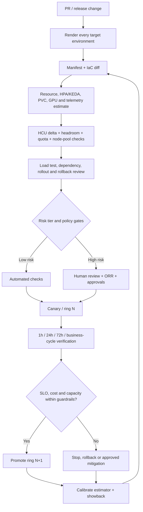
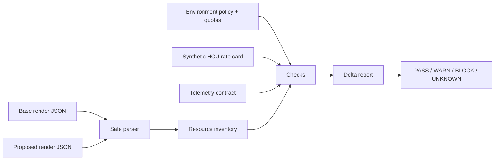

# Unit 7 — Capacity and Cost Review for Production Releases

**Target file:** `07-capacity-and-cost-review-for-production-releases.md`  
**Stage:** Stage 2E — Production DevOps & Platform Engineering  
**Subfolder:** `15-Platform-Capacity-Compute-Economics-and-FinOps/`  
**Module:** M15 | **Unit:** 7  
**Estimated study time:** 30–40 hours (reading 8–10 h; implementation and labs 17–23 h; review and decision defence 5–7 h)  
**Prerequisites:** Stages 0–2D and Stage 2E M01–M14; M02 CI/CD; M03 requests/limits, HPA, PDBs and placement; M06 Helm/Kustomize render matrices; M07 IaC plan analysis and quota governance; M08 progressive delivery and release evidence; M10 capacity failure modes, ORR, error budgets and incident response; M11 telemetry cardinality and load/soak testing; M12 policy-as-code and security; M13/M14 recovery and multi-region operations; M15 Units 1–6.  
**Core tools:** Python 3.11+ `[VERIFY]`, standard library, JSON manifest fixtures, synthetic IaC plan JSON, Git diffs, CSV/JSON evidence, `unittest`, local CI simulation.  
**Optional tools:** Existing M03/M11 `kind` cluster, Helm, Kustomize, Prometheus/Grafana and the M11 load-test harness; use only versions already validated in the learner's environment.  
**Awareness:** Infracost-style estimation `[VERIFY]`, policy engines, GitOps ring promotion, service catalog integration (M16 forward reference), provider billing/rate-card feeds.  
**Last reviewed:** 2026-11-03  
**Tool baseline assumed:** Python 3.11+ syntax `[VERIFY]`; Kubernetes/kind, Helm/Kustomize, Prometheus and load-test versions inherited from M03/M06/M11 and must be recorded before optional use. No provider API, CI vendor, GitOps controller or policy-engine version is assumed.  
**Stack profile required:** Cap-Core required; Cap+Obs optional for load-test and telemetry labs; Cap+Scale is not required.  
**Footprint:** Cap-Core is local Python/JSON/CSV and Git; it requires no cluster. Cap+Obs reuses the existing M11 stack and can be material on an 8-GB laptop. Run one optional component at a time, measure CPU/memory/disk before and after, and stop it after evidence capture — **measure yours**.  
**Prices used:** hypothetical cost units (HCU) only. No real prices, currency symbols, discounts, free-tier limits, provider commercial terms or billable resources are required.

> **Completion outcome:** Build a repeatable release capacity-and-cost review. You will compare rendered manifests and IaC plans, estimate maximum autoscaling and rollout footprints, check quota and node-pool ceilings, quantify telemetry and platform overhead, detect efficiency regressions without overreacting to noise, create a launch capacity plan, verify actual-versus-predicted behavior, and promote releases through evidence-based rings. Every estimate remains an estimate until post-release measurements confirm it.

## Contents

- [Prerequisite handoff and scope](#prerequisite-handoff-and-scope)
- [7.0 Why this matters in production](#70-why-this-matters-in-production)
- [7.1 Learning objectives](#71-learning-objectives)
- [7.2 Concept map and vocabulary](#72-concept-map-and-vocabulary)
- [7.3 Level 1 — Beginner](#73-level-1--beginner)
- [7.4 Level 2 — Intermediate](#74-level-2--intermediate)
- [7.5 Level 3 — Advanced](#75-level-3--advanced)
- [7.6 Level 4 — Expert](#76-level-4--expert)
- [7.7 SRE lens: release failure modes and response](#77-sre-lens-release-failure-modes-and-response)
- [7.8 Security lens](#78-security-lens)
- [7.9 Production review checklist and decision templates](#79-production-review-checklist-and-decision-templates)
- [7.10 Hands-on lab set](#710-hands-on-lab-set)
- [7.11 Self-check questions](#711-self-check-questions)
- [7.12 Evidence artifacts](#712-evidence-artifacts)
- [7.13 Common interview and design-review questions](#713-common-interview-and-design-review-questions)
- [7.14 Sources and verification notes](#714-sources-and-verification-notes)

---

## Prerequisite handoff and scope

### What this unit consumes

| Source | Existing capability consumed | Unit 7 extension |
|---|---|---|
| M02 / M06 | CI pipelines; Helm/Kustomize rendering and environment overlays | Render base and proposed release artifacts consistently before estimation |
| M03 Units 2, 4–7 | Requests/limits, quotas, HPA, PDB, rolling updates, placement and node pools | Calculate release-time minimum/maximum footprint and quota/node-pool feasibility |
| M07 Unit 4 / Unit 7 | IaC plan-risk analysis, service limits and quota governance | Extend plan analysis with HCU cost deltas and release policy checks |
| M08 Units 9–13 | Release health, flags/shadow/canary, migrations/backfills and evidence | Add capacity/cost evidence and ring promotion gates |
| M10 Units 6, 8–10 | Capacity theory, queueing, ORR, error budgets, freeze windows and on-call | Convert forecast and operational policy into release gates |
| M11 Units 12–13 | Telemetry cardinality, open-loop load tests, latency distributions and soak tests | Add cardinality review and noise-aware efficiency regression checks |
| M12 Units 8/11 | Admission/CI policy, security and negative tests | Apply deterministic release rules while keeping exceptions auditable |
| M13/M14 | Backup/DR, regional capacity, replication and ring rollout | Include recovery, regional parity and cross-region effects in release review |
| M15 Units 1–6 | Forecast/headroom, priorities/quotas, budgets, allocation, idle-resource evidence and reliability/performance trade-offs | Consume these outputs; do not rebuild them |

### What Unit 7 teaches, reuses and defers

- **Teaches:** pre-release capacity and cost prediction; rendered manifest and IaC plan diffs; max autoscaling footprint; quota and node-pool checks; noise-aware per-release efficiency; rollout/rollback capacity; telemetry cost review; launch planning; post-release verification; ring promotion; release governance and learning loops.
- **Reuses:** Unit 1 capacity forecast and headroom model; Unit 2 priority/quota rules; Unit 3 synthetic HCU rate card and budget/guardrail context; Unit 4 ownership/allocation and unit-cost baseline; Unit 5 telemetry/idle-resource evidence and scale-down safety; Unit 6 cost/reliability/performance decision framework.
- **Defers:** spot/preemptible implementation (Unit 8), node provisioning implementation (Unit 9), KEDA implementation (Unit 10), OpenCost deployment (Unit 11), GPU scheduling/sharing implementation (Unit 12), service catalog/golden paths (M16), and the integrated capstone (M17).

The authoritative Unit 7 curriculum prompt does not supply a separate verbatim Unit 7 handoff paragraph. The handoff above is therefore a source-aligned summary, not a quotation. Do not treat it as verbatim source text.

### Running platform example

Use one synthetic data/ML platform throughout:

- `inference-api`: customer-facing, latency-sensitive and bursty.
- `batch-etl`: scheduled, deadline-bound data processing.
- `stream-consumer`: queue-driven workload with backlog and freshness SLOs.
- `training`: checkpointed ML training with variable GPU demand.
- `notebooks`: interactive environments with idle and GPU-allocation risk.
- `platform-services`: CI runners, registry, GitOps, secrets and observability.
- `state-store`: database/object-storage-like dependencies with connection, storage and recovery limits.
- `regions/rings`: simulated canary and expansion groups, not real cloud regions.

### Evidence labels and cost contract

- `[ASSUMPTION]` — an input chosen for a model; state its owner and why it is plausible.
- `[ILLUSTRATIVE]` — a sample threshold or policy, not a universal recommendation.
- `[SYNTHETIC]` — generated fixture or simulated result.
- `[MEASURED — YOUR ENVIRONMENT]` — actually measured by the learner on their own machine or cluster.
- `[VERIFY]` — version-, provider-, API-, tool- or policy-specific behavior that must be checked.
- HCU is a comparative teaching unit. It is not currency, a provider rate, an invoice, or a quote.

### Workspace and safety contract

All required work runs in a learner-owned directory outside the supplied repository, for example `./lab-release-capacity-cost/`. The Cap-Core path uses local JSON fixtures and Python only. Optional cluster work must use a disposable local context that the learner verifies before applying or deleting anything. No real credentials, production identifiers, private rate cards, real billing exports, paid tools, cloud accounts or billable resources are required.

---

## 7.0 Why this matters in production

A release changes more than application code. A one-line default can increase replicas. A model update can increase memory per inference replica. A new metric label can multiply time series. A PVC can reserve more storage. A CronJob can overlap with another batch window. A shadow deployment can run two model versions. A blue-green cutover can temporarily require both versions to fit. A new dependency can become the actual bottleneck even when the new service itself has ample CPU.

These are release defects when they create an unreviewed capacity shortfall, unit-cost regression, quota breach, dependency overload, security gap or rollback failure. They deserve the same review discipline as correctness, latency, availability and security regressions.

The central question is not “did the manifest change?” It is:

> **Given the expected workload, service tier, headroom policy, quota, scaling bounds, rollout strategy and downstream dependencies, can this release be deployed, operated and rolled back while meeting its SLO and an understood cost envelope?**

A PR-time estimator can identify known resource deltas and policy violations. It cannot fully predict live traffic, controller timing, node availability, provider billing, cache behavior, contention, network transfer or realized cost. Therefore the review is a closed loop:

1. Render and inspect the proposed release.
2. Estimate resource, quota, rollout and HCU deltas.
3. Validate capacity and dependencies against the forecast.
4. Run load/soak and policy tests appropriate to risk.
5. Approve, reject or time-bound an exception.
6. Deploy progressively with stop and rollback conditions.
7. Compare actual behavior at 1h, 24h, 72h and after a representative business cycle.
8. Calibrate the estimator and feed incidents into new tests.

## 7.1 Learning objectives

By the end of this unit, you can:

1. **[L1]** Explain why release changes to replicas, requests, limits, dependencies, telemetry, data, storage, traffic, images, models and IaC can change capacity and cost.
2. **[L1/L2]** Distinguish requests, limits, observed usage and provisioned capacity in every review table.
3. **[L2]** Build a manifest-diff estimator that calculates min/current/max workload footprint, PVC/GPU totals, HCU deltas, headroom, quota and autoscaler-ceiling checks.
4. **[L2]** Extend an IaC plan-risk analyzer using synthetic plan JSON and fail safely on malformed or unsupported resources.
5. **[L2]** Compare per-release CPU-seconds/request, memory/replica, throughput and p95 using repeated, noise-aware measurements and an A/A false-positive check.
6. **[L2/L3]** Produce a launch capacity plan including replicas, nodes, database connections, quotas, downstream capacity, pre-warming, load shedding and post-event scale-down.
7. **[L2/L3]** Calculate rolling surge, PDB-related disruption constraints, canary/blue-green overlap, migration load and rollback capacity.
8. **[L2/L3]** Estimate telemetry cardinality/log-volume effects without removing security, compliance or incident evidence.
9. **[L3]** Design risk-based review tiers, role-based approvals, expiring exceptions, policy-as-code checks and GitOps ring promotion.
10. **[L3/L4]** Distinguish justified total-cost growth from unit-cost regression and connect release deltas to team showback.
11. **[L4]** Operate release governance using estimator accuracy, pre-production catch rate, post-release deviation, developer experience and incident feedback.
12. **[L4]** Diagnose the eight required release incidents and turn at least one root cause into a regression test.

## 7.2 Concept map and vocabulary

### Release review flow



### Vocabulary

| Term | Meaning | Important distinction |
|---|---|---|
| Rendered manifest | Concrete Kubernetes object configuration after template/overlay evaluation | A source template alone may not reveal environment-specific replicas or values |
| Resource request | Scheduling reservation declared for a container/pod | Not observed consumption and not the same as a limit |
| Resource limit | Runtime enforcement boundary for a resource | Not a reservation or forecast of actual usage |
| Observed usage | Measured CPU, memory, I/O, connections or traffic over a window | Must include representative peaks and startup behavior |
| Provisioned capacity | Capacity available from nodes, pools, quotas, storage or managed services | May exceed requests; may be unavailable in a given failure domain |
| HPA maximum footprint | Maximum requested resources implied by an autoscaler's upper replica bound | Current replicas alone understate potential demand |
| KEDA ScaledObject | KEDA custom resource that configures event-driven scaling | Its fields/defaults are version-sensitive; inspect the installed CRD `[VERIFY]` |
| Rollout surge | Temporary extra pods permitted while updating a Deployment | `maxSurge` is a Deployment strategy setting, not a PDB setting |
| PDB | Policy limiting selected voluntary pod evictions | Does not guarantee availability and does not prevent involuntary failure |
| Quota | Namespace-level aggregate consumption constraint | Does not create node capacity or reserve capacity for the namespace |
| Node-pool ceiling | Maximum modeled/provisioned capacity available to a workload class | Autoscaler maximums cannot exceed compatible pool/quota supply |
| Cardinality | Number of distinct time series created by metric/label combinations | An unbounded identifier label can multiply series dramatically |
| Unit cost | HCU per successful request, completed job, prediction or other useful output | Total cost may rise while unit cost improves |
| Estimator accuracy | Difference between predicted and observed resource/cost delta | Accuracy is meaningful only when baseline, scope and time window match |
| Ring promotion | Controlled expansion from one deployment cohort to the next | A ring advances only after evidence from the previous ring is accepted |
| Exception | Time-bounded, owned approval to proceed outside a policy | An exception is not an invisible bypass |

### Resource quantities must never be conflated

| Quantity | What it answers | Typical evidence |
|---|---|---|
| Request | What does the scheduler account for when placing the pod? | Rendered Pod template `resources.requests` |
| Limit | What runtime ceiling is configured? | Rendered Pod template `resources.limits` |
| Usage | What did the workload actually consume? | Metrics/load test over a stated window |
| Allocatable/provisioned capacity | What can the cluster/node pool offer after system reservations and constraints? | Node allocatable, pool model, quota and provider constraints |

A release estimator should report all four as separate columns or explicitly state that a category is unknown. It must not replace a missing request with zero or pretend a request is a measured usage value. Kubernetes uses requests for scheduling decisions and enforces limits at runtime; see the [Kubernetes resource-management documentation](https://kubernetes.io/docs/concepts/configuration/manage-resources-containers/).

---

## 7.3 Level 1 — Beginner

### 7.3.1 Why releases change cost and capacity

Review every category below. A release can touch one or several at once.

| Release change | Capacity/cost effect | Evidence to inspect |
|---|---|---|
| New service | Adds pods, requests, networking, telemetry and dependencies | Rendered manifests, service map, owner/tier |
| Higher replica count | Raises reserved CPU/memory and pod/IP use | Base/proposed replica count and per-pod requests |
| Larger CPU/memory requests | Raises scheduler-accounted demand; may alter HPA utilization behavior | Requests, limits, observed percentiles and HPA target |
| New dependency | Adds calls, connections, retries and failure coupling | Dependency graph, connection budget, timeout/retry policy |
| More metrics/labels/logs/traces | Raises ingestion, storage, query and retention load | Cardinality/volume estimate and telemetry policy |
| More data/storage | Increases PVC, object, backup, compaction and retention footprint | PVC requests, storage class, data-growth plan |
| New traffic pattern | Changes peak concurrency, cache behavior and downstream load | Forecast scenarios, open-loop test and traffic mix |
| HPA/KEDA changes | Changes minimum/maximum replicas and scale-out behavior | Min/max, triggers, cooldowns, quotas and pool ceiling |
| New PVC/StorageClass | Adds storage request and potentially different performance/retention semantics | `requests.storage`, class and policy |
| New node/pool/GPU need | May require scarce capacity or special placement | Node selectors, tolerations, GPU extended-resource request, pool ceiling |
| Cross-region replication/egress | Adds transfer, replica and failure-domain requirements | Data flow, region/ring count, replication factor |
| CronJob/background job | Adds scheduled concurrency, CPU, memory, storage and downstream peaks | Schedule, `parallelism`, overlap/concurrency policy |
| Larger container image | Increases registry/storage and image-pull time/network during rollout | Image digest/size inventory, pull concurrency and cache behavior |
| Larger ML model | Increases load/warm-up time and memory/GPU requirement | Model artifact size, per-replica memory, latency/throughput test |
| New managed/IaC resource | Adds an infrastructure resource and possibly a dependency or quota | IaC plan, resource catalog and unknown-field report |

### 7.3.2 Lightweight pre-production checklist

Before production, the reviewer must see:

1. **Capacity delta:** requests, limits, pods, replicas, storage, GPU and any declared capacity change.
2. **Cost delta:** synthetic HCU delta and the version of the hypothetical rate card.
3. **Headroom after release:** compare maximum release footprint with the Unit 1 forecast/headroom policy.
4. **Quota/limits:** namespace and cluster quota, storage quota, GPU quota and node-pool ceiling.
5. **Scaling behavior:** min/max replicas, triggers, scale-up lag, scale-down behavior and bounded autoscaler maximums.
6. **Rollback capacity:** old and new versions must fit during the rollback window.
7. **Observability cost:** metric label cardinality, log volume, trace sampling and retention changes.
8. **Downstream capacity:** database connections, queue throughput, external API limits, storage and feature/online stores.
9. **Security/policy:** resource ownership, approved labels, security tooling, image provenance and policy exceptions.
10. **Post-release verification:** actual-versus-predicted checks at 1h, 24h, 72h and a representative business cycle.

### 7.3.3 Where the review fits existing gates

- **ORR — M10 Unit 8:** operational readiness, ownership, runbooks, dependencies and support coverage.
- **Error-budget gate — M10 Unit 9:** whether the service has reliability margin for a risky change or whether a freeze applies.
- **Release health — M08 Unit 9:** health signals and progressive rollout decisions.
- **Release evidence — M08 Unit 13:** test and approval artifacts retained with the release.

The capacity/cost review adds evidence to these gates; it does not replace them.

### 7.3.4 First PR-time estimate: a worked example

`[SYNTHETIC]` Base release:

- Deployment replicas: 4.
- Each pod requests CPU 500m and memory 512Mi.
- PVC: 100Gi.
- GPU requests: 0.

Proposed release:

- Deployment replicas: 6.
- Each pod requests CPU 750m and memory 768Mi.
- PVC: 200Gi.
- A new one-pod `training-worker` Job requests 1 CPU core, 4Gi memory and 1 GPU; it has a bounded `parallelism: 1`.

Calculations:

| Resource | Base | Proposed | Delta | Quantity type |
|---|---:|---:|---:|---|
| CPU requests | 4 × 0.5 = 2 cores | (6 × 0.75) + 1 = 5.5 cores | +3.5 cores (+175%) | Requested |
| Memory requests | 4 × 0.5 = 2 GiB | (6 × 0.75) + 4 = 8.5 GiB | +6.5 GiB (+325%) | Requested |
| PVC request | 100 GiB | 200 GiB | +100 GiB (+100%) | Requested storage |
| GPU | 0 | 1 | +1 | Requested extended resource |
| Pods | 4 | 6 Deployment + 1 Job = 7 | +3 | Maximum planned pods |

For the training Job, the fixture also declares limits of 2 CPU cores, 8Gi memory and 1 GPU. The Deployment's per-pod limits are 1 CPU core and 1Gi memory. This makes the aggregate request and limit totals independently visible.

This does not prove the application uses those amounts. It is a reservation/plan comparison. Limits and observed usage must be reviewed separately.

### 7.3.5 Synthetic HCU estimate

`[SYNTHETIC][ILLUSTRATIVE]` Rate card for one review period:

| Resource | HCU rate |
|---|---:|
| CPU request | 1.00 HCU / requested core / period |
| Memory request | 0.50 HCU / requested GiB / period |
| PVC storage request | 0.02 HCU / requested GiB / period |
| GPU request | 4.00 HCU / requested GPU / period |

Base HCU = (2 × 1.00) + (2 × 0.50) + (100 × 0.02) = **5.00 HCU/period**.  
Proposed HCU = (5.5 × 1.00) + (8.5 × 0.50) + (200 × 0.02) + (1 × 4.00) = **17.75 HCU/period**.  
Delta = 17.75 − 5.00 = **+12.75 HCU/period**.

This model prices requested CPU/memory, requested PVC capacity and GPU count using a synthetic rate card. It does not include real provider billing, network, image registry, support, tax, discounts, shared platform overhead or actual utilization. If a resource type has no rate-card entry, report `UNKNOWN` and mark the total incomplete; never treat it as zero.

### 7.3.6 HPA/KEDA: why current replicas are not enough

`[SYNTHETIC]` A Deployment currently runs 3 replicas, each requesting 500m CPU and 1Gi memory. An HPA allows 2–10 replicas. The current request footprint is 1.5 CPU cores and 3Gi memory. The maximum possible request footprint is 5 CPU cores and 10Gi memory. A release review that checks only current replicas understates the upper bound by 3.5 CPU cores and 7Gi memory.

For an HPA, inspect the target reference, `minReplicas`, `maxReplicas` and behavior. The [Kubernetes HPA documentation](https://kubernetes.io/docs/concepts/workloads/autoscaling/horizontal-pod-autoscale/) describes the controller loop and scaling behavior. For KEDA, inspect the `ScaledObject` and its installed CRD/version. KEDA field defaults and generated HPA behavior are version-sensitive `[VERIFY]`; the estimator should require an explicit bounded maximum in its policy input rather than assuming a default.

### 7.3.7 L1 first review decision

A release is not ready merely because its HCU delta is small. It must also fit the forecast, quota, node-pool capacity, downstream dependency limits, rollout overlap and rollback reserve. Conversely, a large total-cost increase can be justified by product growth if cost per successful request or prediction improves and SLOs remain healthy.

---

## 7.4 Level 2 — Intermediate

### 7.4.1 Manifest-diff estimator architecture

The estimator is a deterministic CI helper, not a Kubernetes scheduler or billing engine.



**Recommended inputs:**

- rendered base and proposed object lists for each environment;
- namespace quota and node-pool capacity policy;
- synthetic rate card with version and effective period;
- telemetry contract (metric names, label dimensions/cardinality, log volume and trace sampling);
- optional image inventory and dependency-capacity metadata;
- Unit 1 forecast/headroom snapshot and Unit 2 priority/quota policy.

**Important parser boundary:** the runnable Cap-Core reference implementation below consumes JSON-serialized Kubernetes objects (JSON is a supported serialization form for Kubernetes API objects). Helm and Kustomize commonly render YAML: [Helm `template`](https://helm.sh/docs/helm/helm_template/) renders chart templates locally, while [`kubectl kustomize`](https://kubernetes.io/docs/reference/kubectl/generated/kubectl_kustomize/) builds Kustomize resources. Helm local rendering is not full server-side validation. Convert YAML to JSON using a pinned, safe YAML parser in your actual CI environment, or use a separately validated normalizer. Do not use an ad-hoc YAML parser or unsafe object construction. The estimator deliberately rejects unsupported or incomplete inputs rather than silently returning a false zero.

### 7.4.2 Quantities and workload bounds

- CPU: `500m` = 0.5 core; `2` = 2 cores.
- Memory/storage: normalize to GiB for HCU arithmetic; preserve original string in evidence.
- GPU: extended resource requests such as `nvidia.com/gpu` are integer device counts. The actual resource name is cluster/device-plugin specific `[VERIFY]`.
- Deployment/StatefulSet: static replicas unless an HPA/KEDA bound targets it.
- HPA: calculate both minimum and maximum replica request footprints.
- KEDA: read the ScaledObject and associated target; require explicit maximum for a complete estimate `[VERIFY]` installed schema/defaults.
- Job: use configured parallelism as the concurrent pod estimate; completion count is total work, not necessarily concurrent work.
- CronJob: inspect schedule, `concurrencyPolicy`, job parallelism and overlap. `Allow` can create overlapping Jobs; without a declared maximum concurrent run count the peak is unknown.
- DaemonSet: pod count depends on eligible nodes and placement. If node count/eligible-node count is unknown, mark footprint incomplete.
- PVC: sum requested storage by StorageClass; performance tier, snapshots and provider backing capacity remain separate concerns.

### 7.4.3 Cap-Core reference estimator

Create `lab-release-capacity-cost/release_estimator.py` with this code. It intentionally supports a bounded subset of workload kinds and normalized JSON inputs. Unsupported kinds, init-container accounting, missing requests, missing rate-card entries, unknown node counts and unbounded autoscalers are explicit findings. Extend only after adding tests for the relevant Kubernetes semantics.

```python
from __future__ import annotations

import json
import math
import re
from decimal import Decimal, InvalidOperation
from pathlib import Path
from typing import Any

CPU_MILLI = Decimal("0.001")
GIB = Decimal(1024) ** 3


def read_json(path: str | Path) -> Any:
    """Read JSON data only; never eval or execute input files."""
    try:
        return json.loads(Path(path).read_text(encoding="utf-8"))
    except (OSError, json.JSONDecodeError) as exc:
        raise ValueError(f"cannot safely read JSON input {path}: {exc}") from exc


def objects(value: Any) -> list[dict]:
    if isinstance(value, dict) and "items" in value:
        value = value["items"]
    if isinstance(value, dict):
        value = [value]
    if not isinstance(value, list) or any(not isinstance(x, dict) for x in value):
        raise ValueError("manifest input must be an object, list of objects, or List.items")
    return value


def cpu_cores(value: Any) -> Decimal:
    if value is None:
        raise ValueError("CPU quantity missing")
    raw = str(value).strip()
    try:
        if raw.endswith("m"):
            return Decimal(raw[:-1]) * CPU_MILLI
        result = Decimal(raw)
    except InvalidOperation as exc:
        raise ValueError(f"unsupported CPU quantity: {value}") from exc
    if not result.is_finite() or result < 0:
        raise ValueError(f"invalid CPU quantity: {value}")
    return result


def gibibytes(value: Any) -> Decimal:
    if value is None:
        raise ValueError("storage/memory quantity missing")
    raw = str(value).strip()
    units = {
        "Ki": Decimal(1024), "Mi": Decimal(1024) ** 2,
        "Gi": Decimal(1024) ** 3, "Ti": Decimal(1024) ** 4,
        "K": Decimal(1000), "M": Decimal(1000) ** 2,
        "G": Decimal(1000) ** 3, "T": Decimal(1000) ** 4,
    }
    match = re.fullmatch(r"([0-9]+(?:\.[0-9]+)?)(Ki|Mi|Gi|Ti|K|M|G|T)?", raw)
    if not match:
        raise ValueError(f"unsupported byte quantity: {value}")
    number = Decimal(match.group(1))
    multiplier = units.get(match.group(2) or "", Decimal(1))
    result = number * multiplier / GIB
    if not result.is_finite() or result < 0:
        raise ValueError(f"invalid byte quantity: {value}")
    return result


def resource_totals(pod_spec: dict, policy: dict) -> tuple[dict, dict, list[str]]:
    """Return requests, limits and findings for one pod template."""
    findings: list[str] = []
    containers = pod_spec.get("containers")
    if not isinstance(containers, list) or not containers:
        return {}, {}, ["UNKNOWN: missing or empty containers list"]
    if pod_spec.get("initContainers"):
        findings.append("UNKNOWN: initContainers require Kubernetes effective-request calculation")
    requests = {"cpu_cores": Decimal(0), "memory_gib": Decimal(0), "gpu": Decimal(0)}
    limits = {"cpu_cores": Decimal(0), "memory_gib": Decimal(0), "gpu": Decimal(0)}
    for index, container in enumerate(containers):
        if not isinstance(container, dict):
            findings.append(f"UNKNOWN: container[{index}] is not an object")
            continue
        resources = container.get("resources") or {}
        req = resources.get("requests") or {}
        lim = resources.get("limits") or {}
        for key, parser, target in (
            ("cpu", cpu_cores, "cpu_cores"),
            ("memory", gibibytes, "memory_gib"),
        ):
            if key not in req:
                findings.append(f"BLOCK: container[{index}] missing requests.{key}")
            else:
                try:
                    requests[target] += parser(req[key])
                except ValueError as exc:
                    findings.append(f"UNKNOWN: {exc}")
            if key in lim:
                try:
                    limits[target] += parser(lim[key])
                except ValueError as exc:
                    findings.append(f"UNKNOWN: {exc}")
            elif policy.get("require_limits", False):
                findings.append(f"BLOCK: container[{index}] missing limits.{key}")
            else:
                findings.append(f"WARN: container[{index}] has no limits.{key}; aggregate configured limits are partial")
        gpu_keys = {k for k in set(req) | set(lim) if "/gpu" in k or k.endswith(".com/gpu")}
        for key in gpu_keys:
            try:
                req_gpu = Decimal(str(req.get(key, "0")))
                lim_gpu = Decimal(str(lim.get(key, "0")))
                if req_gpu < 0 or lim_gpu < 0 or not req_gpu.is_finite() or not lim_gpu.is_finite():
                    raise ValueError("invalid GPU quantity")
                requests["gpu"] += req_gpu
                limits["gpu"] += lim_gpu
            except (InvalidOperation, ValueError):
                findings.append(f"UNKNOWN: unsupported GPU quantity for {key}")
    return requests, limits, findings


def _pod_spec(kind: str, spec: dict) -> dict | None:
    if kind in {"Deployment", "StatefulSet", "ReplicaSet", "DaemonSet", "Job"}:
        return ((spec.get("template") or {}).get("spec"))
    if kind == "CronJob":
        return (((spec.get("jobTemplate") or {}).get("spec") or {}).get("template") or {}).get("spec")
    if kind == "Pod":
        return spec
    return None


def _autoscaler_bounds(docs: list[dict], target_kind: str, target_name: str,
                       target_namespace: str) -> tuple[int, int] | None:
    for obj in docs:
        kind = obj.get("kind")
        spec = obj.get("spec") or {}
        metadata = obj.get("metadata") or {}
        autoscaler_namespace = metadata.get("namespace", "default")
        if autoscaler_namespace != target_namespace:
            continue
        if kind == "HorizontalPodAutoscaler":
            ref = spec.get("scaleTargetRef") or {}
            if ref.get("kind") == target_kind and ref.get("name") == target_name:
                if "maxReplicas" not in spec:
                    raise ValueError(f"unbounded/invalid HPA for {target_name}: maxReplicas missing")
                return int(spec.get("minReplicas", 1)), int(spec["maxReplicas"])
        if kind == "ScaledObject":
            ref = spec.get("scaleTargetRef") or {}
            ref_kind = ref.get("kind", "Deployment")
            if ref_kind == target_kind and ref.get("name") == target_name:
                if "maxReplicaCount" not in spec:
                    raise ValueError(f"unbounded KEDA ScaledObject for {target_name}: maxReplicaCount missing")
                return int(spec.get("minReplicaCount", 0)), int(spec["maxReplicaCount"])
    return None


def analyze(manifest_input: Any, policy: dict, rate_card: dict,
            telemetry: dict | None = None) -> dict:
    docs = objects(manifest_input)
    result = {
        "status": "COMPLETE", "gate_status": "PASS", "resources": {}, "namespaces": {},
        "namespace_count": 0, "storage_by_class": {},
        "workloads": [], "findings": [], "unsupported": [], "hcu": None,
        "rate_card_version": rate_card.get("version", "UNSPECIFIED"),
        "telemetry": None,
    }
    totals = {k: Decimal(0) for k in (
        "cpu_cores", "memory_gib", "gpu", "storage_gib", "pods",
        "limit_cpu_cores", "limit_memory_gib", "limit_gpu")}
    by_ns: dict[str, dict] = {}
    autoscaler_docs = docs
    known_non_workloads = {"Service", "Namespace", "ConfigMap", "Secret", "ServiceAccount", "ResourceQuota",
                           "LimitRange", "HorizontalPodAutoscaler", "ScaledObject", "PodDisruptionBudget",
                           "PersistentVolumeClaim", "StorageClass", "PriorityClass", "ServiceMonitor",
                           "PodMonitor", "PrometheusRule", "NetworkPolicy", "IngressClass", "Role",
                           "RoleBinding", "ClusterRole", "ClusterRoleBinding", "Endpoints", "EndpointSlice",
                           "CustomResourceDefinition"}
    for obj in docs:
        kind = obj.get("kind")
        meta = obj.get("metadata") or {}
        name = meta.get("name", "<unnamed>")
        namespace = meta.get("namespace", "default")
        spec = obj.get("spec") or {}
        if not isinstance(spec, dict):
            result["findings"].append(f"UNKNOWN: {kind}/{name} has malformed spec")
            result["status"] = "INCOMPLETE"
            continue
        if kind == "Service":
            if spec.get("type", "ClusterIP") == "LoadBalancer":
                result["findings"].append(f"UNKNOWN: Service {name} type LoadBalancer has external cost not modeled")
                result["status"] = "INCOMPLETE"
            continue
        if kind in {"Ingress", "Gateway"}:
            result["findings"].append(f"UNKNOWN: {kind} {name} may create/consume external networking resources not modeled")
            result["status"] = "INCOMPLETE"
            continue
        if kind == "PersistentVolumeClaim":
            storage = ((spec.get("resources") or {}).get("requests") or {}).get("storage")
            try:
                value = gibibytes(storage)
                totals["storage_gib"] += value
                ns = by_ns.setdefault(namespace, {k: Decimal(0) for k in totals})
                ns["storage_gib"] += value
                sc = spec.get("storageClassName", "<default-or-unknown>")
                result["storage_by_class"][sc] = str(
                    Decimal(result["storage_by_class"].get(sc, "0")) + value
                )
                result["workloads"].append({"kind": kind, "name": name, "namespace": namespace,
                                            "storage_gib": str(value), "storage_class": sc})
            except ValueError as exc:
                result["findings"].append(f"UNKNOWN: PVC {name}: {exc}")
                result["status"] = "INCOMPLETE"
            continue
        pod_spec = _pod_spec(kind, spec) if isinstance(kind, str) else None
        if pod_spec is None:
            if kind not in known_non_workloads:
                result["unsupported"].append(f"{kind}/{name}")
                result["findings"].append(f"UNKNOWN: unsupported resource kind {kind}/{name}")
                result["status"] = "INCOMPLETE"
            continue
        if not isinstance(pod_spec, dict):
            result["findings"].append(f"UNKNOWN: {kind}/{name} has no supported pod template")
            result["status"] = "INCOMPLETE"
            continue
        bounds = None
        if kind in {"Deployment", "StatefulSet", "ReplicaSet"}:
            try:
                bounds = _autoscaler_bounds(autoscaler_docs, kind, name, namespace)
            except (ValueError, TypeError) as exc:
                result["findings"].append(f"BLOCK: {exc}")
                result["status"] = "BLOCKED"
        if kind == "Pod":
            low = high = 1
        elif kind == "DaemonSet":
            node_count = policy.get("eligible_node_count")
            if node_count is None:
                result["findings"].append(f"UNKNOWN: DaemonSet {name} requires eligible_node_count")
                result["status"] = "INCOMPLETE"
                low = high = 0
            else:
                low = high = int(node_count)
        elif kind == "CronJob":
            job_spec = (spec.get("jobTemplate") or {}).get("spec") or {}
            parallelism = int(job_spec.get("parallelism", 1))
            concurrency = spec.get("concurrencyPolicy", "Allow")
            explicit_max = policy.get("cronjob_max_concurrent", {}).get(f"{namespace}/{name}")
            if concurrency == "Allow" and explicit_max is None:
                result["findings"].append(f"UNKNOWN: CronJob {name} may overlap; declare cronjob_max_concurrent")
                result["status"] = "INCOMPLETE"
                low = high = 0
            else:
                runs = int(explicit_max) if explicit_max is not None else 1
                low = high = parallelism * runs
        elif kind == "Job":
            low = high = int(spec.get("parallelism", 1))
        elif bounds is not None:
            low, high = bounds
        else:
            replicas = int(spec.get("replicas", 1))
            low = high = replicas
        if low < 0 or high < low:
            result["findings"].append(f"BLOCK: invalid replica bounds for {kind}/{name}")
            result["status"] = "BLOCKED"
            continue
        req, lim, findings = resource_totals(pod_spec, policy)
        result["findings"].extend(f"{kind}/{name}: {f}" for f in findings)
        if any(f.startswith("BLOCK:") for f in findings):
            result["status"] = "BLOCKED"
        if any(f.startswith("UNKNOWN:") for f in findings):
            result["status"] = "INCOMPLETE"
        per_pod = req
        max_values = {k: v * high for k, v in per_pod.items()}
        min_values = {k: v * low for k, v in per_pod.items()}
        for key in ("cpu_cores", "memory_gib", "gpu"):
            totals[key] += max_values[key]
        totals["pods"] += high
        max_limits = {k: v * high for k, v in lim.items()}
        for source_key, total_key in (("cpu_cores", "limit_cpu_cores"),
                                      ("memory_gib", "limit_memory_gib"),
                                      ("gpu", "limit_gpu")):
            totals[total_key] += max_limits[source_key]
        ns = by_ns.setdefault(namespace, {k: Decimal(0) for k in totals})
        for key in ("cpu_cores", "memory_gib", "gpu", "pods"):
            ns[key] += max_values.get(key, Decimal(0)) if key != "pods" else Decimal(high)
        for key in ("limit_cpu_cores", "limit_memory_gib", "limit_gpu"):
            ns[key] += max_limits[key.replace("limit_", "")]
        if policy.get("require_priority_class"):
            if not pod_spec.get("priorityClassName"):
                result["findings"].append(f"BLOCK: {kind}/{name} missing priorityClassName")
                result["status"] = "BLOCKED"
        result["workloads"].append({
            "kind": kind, "name": name, "namespace": namespace,
            "min_replicas_or_pods": low, "max_replicas_or_pods": high,
            "requests_per_pod": {k: str(v) for k, v in req.items()},
            "limits_per_pod": {k: str(v) for k, v in lim.items()},
            "max_requests": {k: str(v) for k, v in max_values.items()},
            "max_limits": {k: str(v) for k, v in max_limits.items()},
        })
    result["resources"] = {k: str(v) for k, v in totals.items()}
    result["namespaces"] = {ns: {k: str(v) for k, v in vals.items()} for ns, vals in by_ns.items()}
    result["namespace_count"] = len(by_ns)

    # HCU uses requested maxima and PVC requests. Unknown rate keys make the estimate incomplete.
    rate_keys = {"cpu_core_period": totals["cpu_cores"], "memory_gib_period": totals["memory_gib"],
                 "storage_gib_period": totals["storage_gib"], "gpu_period": totals["gpu"]}
    hcu = Decimal(0)
    missing_rates = []
    for key, quantity in rate_keys.items():
        if key not in rate_card:
            if quantity:
                missing_rates.append(key)
        else:
            try:
                rate = Decimal(str(rate_card[key]))
                if not rate.is_finite() or rate < 0:
                    raise ValueError
                hcu += rate * quantity
            except (InvalidOperation, ValueError):
                missing_rates.append(key)
    incomplete_inputs = any(
        finding.startswith("UNKNOWN:") or "missing requests." in finding
        or "maxReplicas missing" in finding or "maxReplicaCount missing" in finding
        for finding in result["findings"]
    )
    if missing_rates:
        result["findings"].append("UNKNOWN: missing/invalid HCU rates: " + ", ".join(missing_rates))
        result["status"] = "INCOMPLETE"
    if missing_rates or incomplete_inputs:
        result["hcu"] = None
    else:
        result["hcu"] = str(hcu)

    for namespace, quota in (policy.get("namespace_quotas") or {}).items():
        used = by_ns.get(namespace, {k: Decimal(0) for k in totals})
        for key in ("cpu_cores", "memory_gib", "storage_gib", "gpu", "pods",
                    "limit_cpu_cores", "limit_memory_gib", "limit_gpu"):
            if key in quota and used.get(key, Decimal(0)) > Decimal(str(quota[key])):
                result["findings"].append(
                    f"BLOCK: namespace {namespace} {key} {used.get(key)} exceeds quota {quota[key]}"
                )
                result["status"] = "BLOCKED"
    pool = policy.get("node_pool") or {}
    for key in ("cpu_cores", "memory_gib", "gpu"):
        cap = pool.get(key)
        if cap is not None and totals[key] > Decimal(str(cap)):
            result["findings"].append(f"BLOCK: cluster/node-pool {key} {totals[key]} exceeds ceiling {cap}")
            result["status"] = "BLOCKED"
    if telemetry is not None:
        result["telemetry"] = analyze_telemetry(telemetry, policy, rate_card)
        result["findings"].extend(result["telemetry"].get("findings", []))
    # Preserve the strongest result: BLOCKED outranks INCOMPLETE, which outranks COMPLETE.
    if any("BLOCK:" in f for f in result["findings"]):
        result["status"] = "BLOCKED"
        result["gate_status"] = "BLOCK"
    elif any("UNKNOWN:" in f for f in result["findings"]):
        result["status"] = "INCOMPLETE"
        result["gate_status"] = "UNKNOWN"
    elif any("WARN:" in f for f in result["findings"]):
        result["status"] = "COMPLETE_WITH_WARNINGS"
        result["gate_status"] = "WARN"
    else:
        result["status"] = "COMPLETE"
        result["gate_status"] = "PASS"
    return result


def analyze_telemetry(contract: dict, policy: dict, rate_card: dict) -> dict:
    findings = []
    total_series = 0
    for metric in contract.get("metrics", []):
        product = 1
        for label in metric.get("labels", []):
            name = label.get("name")
            cardinality = label.get("cardinality")
            if not isinstance(cardinality, int) or cardinality < 1:
                findings.append(f"UNKNOWN: metric {metric.get('name')} label {name} cardinality missing/invalid")
                continue
            if name in policy.get("forbidden_metric_labels", []):
                findings.append(f"BLOCK: forbidden high-cardinality label {name} on {metric.get('name')}")
            product *= cardinality
        total_series += product
    log_gib = Decimal(str(contract.get("log_gib_per_period", 0)))
    if log_gib < 0 or not log_gib.is_finite():
        findings.append("UNKNOWN: invalid log_gib_per_period")
    max_series = policy.get("max_metric_series")
    if max_series is not None and total_series > int(max_series):
        findings.append(f"BLOCK: estimated metric series {total_series} exceeds policy {max_series}")
    max_log_gib = policy.get("max_log_gib_per_period")
    if max_log_gib is not None and log_gib > Decimal(str(max_log_gib)):
        findings.append(f"BLOCK: log volume {log_gib} GiB exceeds policy {max_log_gib} GiB")
    telemetry_hcu = None
    telemetry_unknown = any(x.startswith("UNKNOWN:") for x in findings)
    if "telemetry_100k_series_period" in rate_card and "log_gib_period" in rate_card and not telemetry_unknown:
        telemetry_hcu = (Decimal(total_series) / Decimal(100000)
                         * Decimal(str(rate_card["telemetry_100k_series_period"]))
                         + log_gib * Decimal(str(rate_card["log_gib_period"])))
    elif total_series or log_gib:
        if not any("telemetry HCU rate missing" in x for x in findings):
            findings.append("UNKNOWN: telemetry HCU rate missing")
    return {"series_estimate": total_series, "log_gib_per_period": str(log_gib),
            "hcu": str(telemetry_hcu) if telemetry_hcu is not None else None,
            "findings": findings,
            "blocked": any(x.startswith("BLOCK:") for x in findings)}


def compare(base: dict, proposed: dict) -> dict:
    keys = ("cpu_cores", "memory_gib", "storage_gib", "gpu", "pods",
            "limit_cpu_cores", "limit_memory_gib", "limit_gpu")
    delta = {}
    for key in keys:
        before = Decimal(base["resources"][key])
        after = Decimal(proposed["resources"][key])
        delta[key] = {"base": str(before), "proposed": str(after), "delta": str(after - before)}
    if base.get("hcu") is not None and proposed.get("hcu") is not None:
        delta["hcu"] = {"base": base["hcu"], "proposed": proposed["hcu"],
                         "delta": str(Decimal(proposed["hcu"]) - Decimal(base["hcu"]))}
    base_classes = base.get("storage_by_class", {})
    proposed_classes = proposed.get("storage_by_class", {})
    delta["storage_by_class"] = {}
    for storage_class in sorted(set(base_classes) | set(proposed_classes)):
        before = Decimal(base_classes.get(storage_class, "0"))
        after = Decimal(proposed_classes.get(storage_class, "0"))
        delta["storage_by_class"][storage_class] = {"base": str(before), "proposed": str(after),
                                                   "delta": str(after - before)}
    if base.get("telemetry") is not None and proposed.get("telemetry") is not None:
        bt, pt = base["telemetry"], proposed["telemetry"]
        telemetry_delta = {
            "series_estimate": pt["series_estimate"] - bt["series_estimate"],
            "log_gib_per_period": str(Decimal(pt["log_gib_per_period"]) - Decimal(bt["log_gib_per_period"]))}
        if bt.get("hcu") is not None and pt.get("hcu") is not None:
            telemetry_delta["hcu"] = {"base": bt["hcu"], "proposed": pt["hcu"],
                                       "delta": str(Decimal(pt["hcu"]) - Decimal(bt["hcu"]))}
        delta["telemetry"] = telemetry_delta
    return delta
```

**Important implementation limitations:** the reference estimator is a learning implementation, not a complete Kubernetes semantic engine. It does not calculate effective init-container requests, pod overhead, ephemeral storage, topology/affinity fit, scheduler scoring, sidecar injection, admission mutation, volume expansion behavior, network/egress, image pull concurrency, runtime usage, actual HPA control-loop timing, KEDA trigger semantics, custom resources, provider billing or all CronJob overlap cases. It intentionally marks several cases incomplete. Production use requires a schema-aware parser, API-version-aware normalization, a reviewed resource catalog, exact installed CRD schemas and more tests.

### 7.4.4 Estimator test suite

Save as `test_release_estimator.py` in the same directory. The tests below cover core arithmetic and the planted-regression categories. Add fixtures for every new resource kind before extending support.

```python
import unittest
import tempfile
from pathlib import Path
from release_estimator import analyze, compare, cpu_cores, gibibytes, read_json

RATE = {"cpu_core_period": 1, "memory_gib_period": 0.5,
        "storage_gib_period": 0.02, "gpu_period": 4,
        "telemetry_100k_series_period": 0.1, "log_gib_period": 0.01}
POLICY = {"require_limits": False, "namespace_quotas": {},
          "node_pool": {"cpu_cores": 100, "memory_gib": 200, "gpu": 8},
          "forbidden_metric_labels": ["user_id", "email"],
          "max_metric_series": 100000, "max_log_gib_per_period": 100}

def deployment(replicas=2, cpu="500m", memory="512Mi", name="api"):
    return {"apiVersion": "apps/v1", "kind": "Deployment",
            "metadata": {"name": name, "namespace": "team-a"},
            "spec": {"replicas": replicas, "template": {"spec": {
                "containers": [{"name": "app", "resources": {
                    "requests": {"cpu": cpu, "memory": memory},
                    "limits": {"cpu": "1", "memory": "1Gi"}}}]}}}}

class EstimatorTests(unittest.TestCase):
    def test_cpu_and_memory_quantity_units(self):
        self.assertEqual(cpu_cores("500m"), 0.5)
        self.assertEqual(gibibytes("512Mi"), 0.5)

    def test_replica_default_or_count_regression(self):
        before = analyze([deployment(2)], POLICY, RATE)
        after = analyze([deployment(4)], POLICY, RATE)
        self.assertEqual(compare(before, after)["pods"]["delta"], "2")

    def test_request_increase_regression(self):
        before = analyze([deployment(2, "500m")], POLICY, RATE)
        after = analyze([deployment(2, "1")], POLICY, RATE)
        self.assertEqual(compare(before, after)["cpu_cores"]["delta"], "1.000")

    def test_hpa_maximum_footprint(self):
        docs = [deployment(2), {"apiVersion": "autoscaling/v2", "kind": "HorizontalPodAutoscaler",
                "metadata": {"name": "api-hpa", "namespace": "team-a"},
                "spec": {"scaleTargetRef": {"kind": "Deployment", "name": "api"},
                         "minReplicas": 2, "maxReplicas": 10}}]
        result = analyze(docs, POLICY, RATE)
        self.assertEqual(result["resources"]["pods"], "10")
        self.assertEqual(result["resources"]["cpu_cores"], "5.000")

    def test_unbounded_hpa_is_blocked(self):
        docs = [deployment(), {"kind": "HorizontalPodAutoscaler", "metadata": {"name": "bad", "namespace": "team-a"},
                "spec": {"scaleTargetRef": {"kind": "Deployment", "name": "api"}}}]
        result = analyze(docs, POLICY, RATE)
        self.assertEqual(result["status"], "BLOCKED")
        self.assertTrue(any("maxReplicas missing" in x for x in result["findings"]))

    def test_pvc_storage_regression(self):
        pvc = {"kind": "PersistentVolumeClaim", "metadata": {"name": "data", "namespace": "team-a"},
               "spec": {"storageClassName": "standard", "resources": {"requests": {"storage": "50Gi"}}}}
        result = analyze([pvc], POLICY, RATE)
        self.assertEqual(result["resources"]["storage_gib"], "50")

    def test_cronjob_concurrency_uses_explicit_bound(self):
        cron = {"kind": "CronJob", "metadata": {"name": "etl", "namespace": "team-a"},
                "spec": {"schedule": "0 * * * *", "concurrencyPolicy": "Allow",
                         "jobTemplate": {"spec": {"parallelism": 2, "template": {"spec": {
                           "containers": [{"name": "job", "resources": {"requests": {
                             "cpu": "1", "memory": "1Gi"}}}]}}}}}}
        policy = {**POLICY, "cronjob_max_concurrent": {"team-a/etl": 3}}
        result = analyze([cron], policy, RATE)
        self.assertEqual(result["resources"]["pods"], "6")

    def test_cronjob_allow_without_bound_is_unknown(self):
        cron = {"kind": "CronJob", "metadata": {"name": "etl"}, "spec": {
            "schedule": "*/5 * * * *", "concurrencyPolicy": "Allow",
            "jobTemplate": {"spec": {"template": {"spec": {"containers": [
                {"name": "job", "resources": {"requests": {"cpu": "1", "memory": "1Gi"}}}]}}}}}}
        result = analyze([cron], POLICY, RATE)
        self.assertEqual(result["status"], "INCOMPLETE")

    def test_gpu_request_is_counted(self):
        obj = deployment()
        obj["spec"]["template"]["spec"]["containers"][0]["resources"]["requests"]["nvidia.com/gpu"] = "1"
        result = analyze([obj], POLICY, RATE)
        self.assertEqual(result["resources"]["gpu"], "2")

    def test_keda_maximum_footprint(self):
        docs = [deployment(1), {"kind": "ScaledObject", "metadata": {"name": "api-scale", "namespace": "team-a"},
                "spec": {"scaleTargetRef": {"name": "api", "kind": "Deployment"},
                         "minReplicaCount": 1, "maxReplicaCount": 5}}]
        result = analyze(docs, POLICY, RATE)
        self.assertEqual(result["resources"]["pods"], "5")

    def test_autoscaler_in_another_namespace_does_not_match(self):
        docs = [deployment(2), {"kind": "HorizontalPodAutoscaler",
                "metadata": {"name": "api-hpa", "namespace": "team-b"},
                "spec": {"scaleTargetRef": {"kind": "Deployment", "name": "api"},
                         "minReplicas": 2, "maxReplicas": 20}}]
        result = analyze(docs, POLICY, RATE)
        self.assertEqual(result["resources"]["pods"], "2")

    def test_aggregate_limits_are_separate_from_requests(self):
        result = analyze([deployment(2)], POLICY, RATE)
        self.assertEqual(result["resources"]["cpu_cores"], "1.000")
        self.assertEqual(result["resources"]["limit_cpu_cores"], "2")
        self.assertEqual(result["resources"]["limit_memory_gib"], "2")

    def test_storage_totals_are_grouped_by_class(self):
        pvc = {"kind": "PersistentVolumeClaim", "metadata": {"name": "data", "namespace": "team-a"},
               "spec": {"storageClassName": "fast", "resources": {"requests": {"storage": "10Gi"}}}}
        result = analyze([pvc], POLICY, RATE)
        self.assertEqual(result["storage_by_class"]["fast"], "10")

    def test_quota_violation_blocks(self):
        policy = {**POLICY, "namespace_quotas": {"team-a": {"cpu_cores": 0.5}}}
        result = analyze([deployment(2)], policy, RATE)
        self.assertEqual(result["status"], "BLOCKED")

    def test_high_cardinality_user_id_label_blocks(self):
        telemetry = {"metrics": [{"name": "http_requests_total", "labels": [
            {"name": "service", "cardinality": 5}, {"name": "user_id", "cardinality": 50000}]}]}
        result = analyze([], POLICY, RATE, telemetry)
        self.assertTrue(result["telemetry"]["blocked"])

    def test_benign_manifest_change_does_not_change_resource_delta(self):
        before = deployment(2)
        after = deployment(2)
        after["spec"]["template"]["spec"]["containers"][0]["image"] = "api:v2"
        self.assertEqual(compare(analyze([before], POLICY, RATE),
                                 analyze([after], POLICY, RATE))["cpu_cores"]["delta"], "0.000")

    def test_log_volume_regression_is_flagged(self):
        telemetry = {"metrics": [], "log_gib_per_period": 150}
        result = analyze([], POLICY, RATE, telemetry)
        self.assertTrue(result["telemetry"]["blocked"])
        self.assertTrue(any("log volume" in x for x in result["telemetry"]["findings"]))

    def test_unknown_telemetry_cardinality_marks_incomplete(self):
        telemetry = {"metrics": [{"name": "metric_x", "labels": [{"name": "route"}]}]}
        result = analyze([], POLICY, RATE, telemetry)
        self.assertEqual(result["status"], "INCOMPLETE")
        self.assertIsNone(result["telemetry"]["hcu"])

    def test_load_balancer_service_cost_is_unknown(self):
        service = {"kind": "Service", "metadata": {"name": "external", "namespace": "team-a"},
                   "spec": {"type": "LoadBalancer"}}
        result = analyze([service], POLICY, RATE)
        self.assertEqual(result["status"], "INCOMPLETE")

    def test_telemetry_delta_is_compared(self):
        base = analyze([], POLICY, RATE, {"metrics": [{"name": "requests", "labels": [{"name": "service", "cardinality": 10}]}], "log_gib_per_period": 10})
        proposed = analyze([], POLICY, RATE, {"metrics": [{"name": "requests", "labels": [{"name": "service", "cardinality": 20}]}], "log_gib_per_period": 20})
        delta = compare(base, proposed)["telemetry"]
        self.assertEqual(delta["series_estimate"], 10)
        self.assertEqual(delta["log_gib_per_period"], "10")

    def test_unknown_kind_is_not_zero(self):
        result = analyze([{"kind": "UnknownOperator", "metadata": {"name": "x"}, "spec": {}}], POLICY, RATE)
        self.assertEqual(result["status"], "INCOMPLETE")
        self.assertTrue(result["unsupported"])

    def test_missing_limits_block_when_policy_requires_them(self):
        obj = deployment()
        del obj["spec"]["template"]["spec"]["containers"][0]["resources"]["limits"]
        policy = {**POLICY, "require_limits": True}
        result = analyze([obj], policy, RATE)
        self.assertEqual(result["status"], "BLOCKED")
        self.assertEqual(result["gate_status"], "BLOCK")

    def test_optional_missing_limits_are_warning_not_silent_zero(self):
        obj = deployment()
        del obj["spec"]["template"]["spec"]["containers"][0]["resources"]["limits"]
        result = analyze([obj], POLICY, RATE)
        self.assertEqual(result["gate_status"], "WARN")
        self.assertTrue(any("WARN:" in f for f in result["findings"]))

    def test_read_json_does_not_evaluate_code_like_string(self):
        with tempfile.TemporaryDirectory() as tmp:
            path = Path(tmp) / "input.json"
            payload = '"__import__(\'os\').system(\'echo unsafe\')"'
            path.write_text(payload, encoding="utf-8")
            self.assertEqual(read_json(path), "__import__('os').system('echo unsafe')")

    def test_malformed_quantity_rejected(self):
        with self.assertRaises(ValueError):
            cpu_cores("1bananas")

if __name__ == "__main__":
    unittest.main()
```

Run from the isolated workspace root (the source modules are under `src/`, so add that directory to the import path):

```bash
# Linux / WSL2
PYTHONPATH=src python -m unittest discover -s tests -v

# PowerShell
Set-Item Env:PYTHONPATH "src"
python -m unittest discover -s tests -v
```

Expected outcome: 25 manifest-estimator tests pass when the code blocks are saved exactly as shown. This is an expected learner result, not a claim that the learner's cluster or environment was tested by reading this document.

### 7.4.4.1 Running the manifest estimator from a local CLI

Save this as `src/compare_release.py` beside `release_estimator.py`. It compares base and proposed JSON manifests with the same policy and rate card.

```python
import argparse
import json
from release_estimator import read_json, analyze, compare

parser = argparse.ArgumentParser()
parser.add_argument("--base", required=True)
parser.add_argument("--proposed", required=True)
parser.add_argument("--policy", required=True)
parser.add_argument("--rate-card", required=True)
args = parser.parse_args()
policy = read_json(args.policy)
rate_card = read_json(args.rate_card)
base = analyze(read_json(args.base), policy, rate_card)
proposed = analyze(read_json(args.proposed), policy, rate_card)
report = {"base_status": base["status"], "base_gate_status": base["gate_status"],
          "proposed_status": proposed["status"], "proposed_gate_status": proposed["gate_status"],
          "base_findings": base["findings"], "proposed_findings": proposed["findings"],
          "delta": compare(base, proposed)}
print(json.dumps(report, indent=2))
if base["gate_status"] == "UNKNOWN":
    raise SystemExit(4)  # baseline is not complete enough for a reliable diff
if proposed["gate_status"] == "BLOCK":
    raise SystemExit(2)
if proposed["gate_status"] == "UNKNOWN":
    raise SystemExit(3)
if proposed["gate_status"] == "WARN":
    raise SystemExit(1)  # requires human acknowledgement
```

Example invocation from the workspace root:

```bash
python src/compare_release.py --base fixtures/base/prod.json \
  --proposed fixtures/proposed/prod.json --policy policy/prod.json \
  --rate-card policy/rate-card.json
```

Exit codes are a local contract for this sample CLI: 0 pass, 1 warning requiring acknowledgement, 2 block, 3 unknown proposed input, 4 unknown baseline. A production CI pipeline should preserve the JSON report as an artifact and map these outcomes to its own status model.

### 7.4.5 HPA/KEDA maximum and quota calculation

`[SYNTHETIC]` An API has 2–10 replicas. Each replica requests 0.75 CPU and 768Mi memory. The HPA maximum implies 7.5 CPU cores and 7.5Gi memory. The namespace also runs 1 CPU core and 2Gi of other workloads. Its proposed aggregate becomes 8.5 CPU and 9.5Gi. If its CPU request quota is 8 cores, the release must be blocked or the quota/capacity plan must be explicitly revised. Increasing quota does not create node capacity; verify both quota and pool supply.

A node-pool ceiling check compares the maximum release request footprint against allocatable capacity after system/DaemonSet overhead, existing workloads, failure reserve and other teams' commitments. A release may pass namespace quota but still be unschedulable because the pool has insufficient CPU, memory, GPU, IPs or compatible placement. Kubernetes [ResourceQuota](https://kubernetes.io/docs/concepts/policy/resource-quotas/) constrains aggregate namespace consumption; it does not reserve node capacity.

### 7.4.6 IaC plan cost/limit estimate

M07 Unit 4's plan-risk analysis is extended by mapping supported resource types to a synthetic rate-card catalog. The input is a **normalized synthetic plan JSON**, not a provider's actual invoice or an unrestricted executable plan.

Example fixture:

```json
{
  "format": "synthetic-plan-v1",
  "resources": [
    {"address": "module.api.compute", "type": "compute_pool", "count": 2,
     "attributes": {"cpu_cores": 4, "memory_gib": 16}},
    {"address": "module.db.storage", "type": "block_storage", "count": 1,
     "attributes": {"storage_gib": 500}}
  ]
}
```

`[SYNTHETIC]` Catalog: compute pool = 1.0 HCU/core-period + 0.5 HCU/GiB-period; block storage = 0.02 HCU/GiB-period. The compute resource contributes 2 × ((4 × 1.0) + (16 × 0.5)) = 24 HCU. Storage contributes 500 × 0.02 = 10 HCU. Estimated total = 34 HCU/period. The plan analyzer must flag unknown resource types, missing attributes, missing catalog entries, malformed JSON and quota excess. It must not run shell commands, import modules from plan data or evaluate arbitrary expressions.

Optional Infracost-style tooling is awareness only `[VERIFY]`; pricing data source, supported resource coverage and API requirements change. The core course uses the synthetic catalog.

### 7.4.7 Load-test-based per-release efficiency

A release can increase CPU per request even if the total traffic remains unchanged. Compare the same workload and environment for base/proposed versions:

- CPU-seconds/request = CPU seconds consumed ÷ successful requests.
- Memory/replica at reference load = memory working set per ready replica at a stated load.
- p95 latency = 95th percentile of request latency over the test window.
- Throughput = successful work per second, with errors and SLO violations reported separately.

Use repeated runs, warm-up, stable load and an A/A comparison. An A/A test runs the same build/configuration as both sides to estimate how much apparent change measurement noise creates. If A/A frequently trips the gate, fix the harness or threshold before trusting A/B results.

`[ILLUSTRATIVE]` A proposed release is flagged when CPU-seconds/request increases by more than 10% **and** the increase exceeds two times the baseline median absolute deviation (MAD). The 10% and 2× values are teaching thresholds, not universal. p95 must also satisfy the service SLO. A candidate that is cheaper but fails its SLO is not an efficiency win.

### 7.4.8 Release capacity plan

For a planned traffic increase:

1. Forecast low/base/high demand from Unit 1 and record forecast uncertainty.
2. Convert offered traffic to CPU, memory, replicas, queue throughput and database connections using measured resource-per-request/job.
3. Check quotas, node pools, IPs, GPU and storage against the maximum required footprint.
4. Include rollout surge, warm-up, image pulls, cache cold-start, connection ramp and migration/backfill load.
5. Pre-scale or pre-warm according to a schedule with a named owner and verification step.
6. Verify downstream database connection limits, queue throughput, external API limits and storage IOPS/throughput.
7. Define load shedding/degradation, retry limits, backpressure and rollback criteria.
8. Staff the event and define freeze windows if risk warrants them.
9. After the event, scale down to the approved steady-state level and verify the reduction; Unit 5's idle-resource controls provide the cleanup context.

### 7.4.9 Rollout and rollback capacity

**Rolling update:** for a Deployment with desired replicas `R` and `maxSurge = S`, a simplified peak pod count during rollout is approximately `R + S`. Percentages are rounded according to Kubernetes API behavior; verify the installed version. The [Kubernetes Deployment documentation](https://kubernetes.io/docs/concepts/workloads/controllers/deployment/) defines `maxSurge` and `maxUnavailable`. This is a planning bound, not a guarantee that every pod can schedule. Terminating pods can continue consuming resources after they stop counting as available, so actual transient resource use can exceed `R + S` until termination grace periods complete; include this tail where the workload's shutdown behavior makes it material.

`[SYNTHETIC]` R=8, each pod requests 0.5 CPU and 1Gi memory, `maxSurge=25%`. 25% of 8 = 2 surge pods. Peak planned count = 10 pods, requiring 5 CPU cores and 10Gi memory for that workload during the surge. The old version must remain available until the new version has passed health verification and the rollback window closes.

**PDB interaction:** a PDB constrains voluntary evictions through the Eviction API. It does not guarantee availability during involuntary failures and does not directly replace Deployment `maxSurge`/`maxUnavailable` rollout settings. During a workload-controller rolling upgrade, pods made unavailable by the rollout count against the disruption budget, but the Deployment/StatefulSet controller is not itself limited by the PDB; node drains using the Eviction API can be blocked. The [Kubernetes disruptions guide](https://kubernetes.io/docs/concepts/workloads/pods/disruptions/) explains this boundary. A PDB can therefore block a node drain during the same release window, leaving old/new pods competing for capacity. Model both rollout surge and maintenance/drain effects.

**Canary:** calculate the capacity for the stable version plus canary replicas. Do not assume traffic percentage equals resource percentage: warm-up, cache duplication, model load and request mix may be nonlinear.

**Blue-green:** calculate old + new environment capacity over the overlap duration. Do not assume every blue-green deployment doubles every resource: shared data stores, traffic split, scaling and architecture determine the actual multiplier.

**Migrations/backfills:** include one-off CPU, memory, storage, database connections, queue throughput and lock/IO effects. A migration may be the highest load in the release, not the application rollout.

### 7.4.10 Observability cost impact

Prometheus creates a time series for each unique metric-name/label-value combination. Cardinality is multiplicative across label dimensions. A user ID, email address, request ID or other unbounded identifier should not be a metric label. Use bounded dimensions (route template, status class, region, service tier) where they answer an operational question. See Prometheus [metric and label naming guidance](https://prometheus.io/docs/practices/naming/).

`[SYNTHETIC]` Metric dimensions: service=5, environment=3, status=4 produce 5 × 3 × 4 = 60 series. Adding user_id with 50,000 values can produce 60 × 50,000 = 3,000,000 series. At a synthetic rate of 0.1 HCU per 100,000 series-period, that is 3.0 HCU/period instead of 0.00006 HCU/period, a 2.99994 HCU increase in this simplified model. This does not include scrape interval, sample retention, replication, index/query overhead or other telemetry costs.

Also review:

- log bytes/event × event rate × retention;
- trace sampling rate and span volume;
- histogram bucket count and label combinations;
- new dashboards/recording rules and query load;
- telemetry retention and security/audit evidence requirements.

Never remove required audit/security or incident evidence merely to reduce spend. Ask the security/compliance owner before changing protected telemetry.

### 7.4.11 Post-release verification

Compare predicted and observed behavior at 1h, 24h, 72h and after a representative business cycle. Include:

- actual CPU/memory requests, usage and saturation;
- actual replica counts, HPA/KEDA behavior and scaling delay;
- latency, errors, throughput and SLO status;
- cost per successful request/job/prediction and total HCU delta;
- telemetry series/log/trace volume;
- quota, node-pool and dependency headroom;
- rollback reserve and temporary rollout capacity;
- post-event scale-down completion.

`[ILLUSTRATIVE]` A 15% predicted-versus-observed deviation triggers investigation. Tune the threshold using measurement noise, service criticality and historical error. A threshold is not a universal production standard.

### 7.4.12 L2 release-PR planted regression lab

The synthetic release PR must contain all of the following and prove that each is detected:

1. replica default/count increase;
2. CPU/memory request increase;
3. missing/unbounded HPA maximum;
4. new PVC/storage request;
5. CronJob concurrency increase or unbounded overlap;
6. GPU request added;
7. high-cardinality metric label added;
8. log/telemetry volume increase.

Also include a benign image-tag/documentation-only change that must not create a blocking resource regression. Fix every defect, rerun the same tests, and show that the gate passes. Preserve both failing and passing evidence.

---

### 7.4.13 Synthetic IaC plan estimator reference

Save as `src/iac_estimator.py`. The input is the deliberately small normalized schema shown below; unsupported types remain unknown. This script never shells out or evaluates plan-provided text.

```python
import json
from decimal import Decimal, InvalidOperation
from pathlib import Path

CATALOG_VERSION = "synthetic-iac-catalog-v1"
CATALOG = {
    "compute_pool": {"cpu_core_period": Decimal("1.0"), "memory_gib_period": Decimal("0.5")},
    "block_storage": {"storage_gib_period": Decimal("0.02")},
}
REQUIRED = {
    "compute_pool": ("cpu_cores", "memory_gib"),
    "block_storage": ("storage_gib",),
}


def estimate_plan(path: str, quotas: dict) -> dict:
    try:
        plan = json.loads(Path(path).read_text(encoding="utf-8"))
    except (OSError, json.JSONDecodeError) as exc:
        raise ValueError(f"invalid plan JSON: {exc}") from exc
    if not isinstance(plan, dict) or plan.get("format") != "synthetic-plan-v1":
        raise ValueError("unsupported plan format")
    rows, unknown, totals = [], [], {"cpu_cores": Decimal(0), "memory_gib": Decimal(0), "storage_gib": Decimal(0)}
    hcu = Decimal(0)
    resources = plan.get("resources")
    if not isinstance(resources, list):
        raise ValueError("resources must be a list")
    for row in resources:
        if not isinstance(row, dict):
            unknown.append("malformed resource row")
            continue
        kind, address = row.get("type"), row.get("address", "<unknown>")
        if kind not in CATALOG:
            unknown.append(f"unsupported resource type: {kind} at {address}")
            continue
        try:
            count = Decimal(str(row.get("count", 1)))
            attrs = row.get("attributes") or {}
            if not count.is_finite() or count < 0 or count != count.to_integral_value():
                raise ValueError("count must be a non-negative integer")
            missing = [key for key in REQUIRED[kind] if key not in attrs]
            if missing:
                raise ValueError("missing attributes: " + ", ".join(missing))
            row_hcu = Decimal(0)
            for field, rate_key in (("cpu_cores", "cpu_core_period"),
                                    ("memory_gib", "memory_gib_period"),
                                    ("storage_gib", "storage_gib_period")):
                if field in attrs:
                    quantity = Decimal(str(attrs[field]))
                    if not quantity.is_finite() or quantity < 0:
                        raise ValueError(f"invalid {field}")
                    totals[field] += quantity * count
                    row_hcu += quantity * count * CATALOG[kind][rate_key]
            hcu += row_hcu
            rows.append({"address": address, "type": kind, "count": int(count), "hcu": str(row_hcu)})
        except (InvalidOperation, ValueError, KeyError) as exc:
            unknown.append(f"invalid resource {address}: {exc}")
    violations = []
    for key, ceiling in quotas.items():
        if key in totals and totals[key] > Decimal(str(ceiling)):
            violations.append(f"{key} {totals[key]} exceeds {ceiling}")
    return {"catalog_version": CATALOG_VERSION, "rows": rows,
            "totals": {k: str(v) for k, v in totals.items()},
            "hcu": str(hcu) if not unknown else None,
            "unknown": unknown, "quota_violations": violations,
            "status": "BLOCK" if violations else ("UNKNOWN" if unknown else "PASS")}


if __name__ == "__main__":
    import argparse
    parser = argparse.ArgumentParser()
    parser.add_argument("plan_json")
    args = parser.parse_args()
    print(json.dumps(estimate_plan(args.plan_json, {"cpu_cores": 32, "memory_gib": 128,
                                                     "storage_gib": 2000}), indent=2))
```

Synthetic fixture `fixtures/iac/proposed.json`:

```json
{
  "format": "synthetic-plan-v1",
  "resources": [
    {"address": "module.api.compute", "type": "compute_pool", "count": 2,
     "attributes": {"cpu_cores": 4, "memory_gib": 16}},
    {"address": "module.db.storage", "type": "block_storage", "count": 1,
     "attributes": {"storage_gib": 500}}
  ]
}
```

Expected result for this fixture: CPU 8 cores, memory 32GiB, storage 500GiB, HCU 34.00 per period, status `PASS` under the sample quota. This output is `[SYNTHETIC]`; execute the script to confirm your copy. Add tests for malformed JSON, unsupported resource, missing catalog entry/attribute, negative count and quota violation before using it in CI.

### 7.4.14 Noise-aware efficiency gate reference

Save as `src/efficiency_gate.py`. The gate compares medians and median absolute deviation (MAD). The tolerance and multiplier are policy inputs, not universal values. The same baseline is compared with an independent A/A sample before a proposed build is evaluated.

```python
from statistics import median


def mad(values):
    center = median(values)
    return median([abs(x - center) for x in values])


def summarize(values):
    if not values:
        raise ValueError("measurement sample cannot be empty")
    return {"median": median(values), "mad": mad(values), "n": len(values)}


def metric_regressed(base, candidate, tolerance=0.10, noise_multiple=2.0):
    b, c = summarize(base), summarize(candidate)
    threshold = max(abs(b["median"]) * tolerance, b["mad"] * noise_multiple)
    delta = c["median"] - b["median"]
    return {"base_median": b["median"], "candidate_median": c["median"],
            "delta": delta, "threshold": threshold,
            "regressed": delta > threshold}


def evaluate(base, aa, proposed, p95_slo_ms, tolerance=0.10):
    aa_cpu = metric_regressed(base["cpu_seconds_per_request"],
                              aa["cpu_seconds_per_request"], tolerance)
    if aa_cpu["regressed"]:
        return {"status": "INCONCLUSIVE", "reason": "A/A baseline exceeds noise gate",
                "aa": aa_cpu}
    cpu = metric_regressed(base["cpu_seconds_per_request"],
                           proposed["cpu_seconds_per_request"], tolerance)
    memory = metric_regressed(base["memory_mib_per_replica"],
                              proposed["memory_mib_per_replica"], tolerance)
    p95 = summarize(proposed["p95_ms"])["median"]
    throughput = summarize(proposed["successful_rps"])["median"]
    base_throughput = summarize(base["successful_rps"])["median"]
    slo_failed = p95 > p95_slo_ms
    throughput_regressed = throughput < base_throughput * (1 - tolerance)
    flags = []
    if cpu["regressed"]: flags.append("CPU_SECONDS_PER_REQUEST")
    if memory["regressed"]: flags.append("MEMORY_PER_REPLICA")
    if throughput_regressed: flags.append("THROUGHPUT")
    if slo_failed: flags.append("P95_SLO")
    return {"status": "BLOCK" if flags else "PASS", "flags": flags,
            "aa": aa_cpu, "cpu": cpu, "memory": memory,
            "p95_median_ms": p95, "p95_slo_ms": p95_slo_ms,
            "throughput_median_rps": throughput,
            "base_throughput_median_rps": base_throughput}


if __name__ == "__main__":
    # [SYNTHETIC] Demonstration data. Replace only with comparable repeated runs.
    base = {"cpu_seconds_per_request": [0.0040, 0.0041, 0.0039],
            "memory_mib_per_replica": [480, 482, 478],
            "p95_ms": [148, 151, 150], "successful_rps": [980, 1000, 990]}
    aa = {"cpu_seconds_per_request": [0.0040, 0.00405, 0.00402]}
    proposed = {"cpu_seconds_per_request": [0.0046, 0.0045, 0.0047],
                "memory_mib_per_replica": [481, 480, 482],
                "p95_ms": [153, 155, 154], "successful_rps": [995, 1005, 1000]}
    print(evaluate(base, aa, proposed, p95_slo_ms=200))
```

For the sample, the A/A CPU sample should remain within baseline noise; the proposed CPU-seconds/request change should be flagged while p95 remains under the synthetic 200ms SLO. If A/A returns `INCONCLUSIVE`, do not promote the proposed result to a blocking gate until the test harness is stable.

### 7.4.15 Post-release verification report generator

Save as `src/post_release_report.py`. It compares a prediction with observations at the named checkpoints. A zero predicted value is handled explicitly instead of dividing by zero.

```python
from datetime import datetime, timezone


def deviation(predicted, actual):
    if predicted == 0:
        return {"absolute": actual, "relative": None,
                "status": "REVIEW" if actual != 0 else "MATCH"}
    relative = abs(actual - predicted) / abs(predicted)
    return {"absolute": actual - predicted, "relative": relative}


def build_report(prediction, observations, threshold=0.15):
    required = {"1h", "24h", "72h"}
    if not required.issubset(observations):
        raise ValueError("1h, 24h and 72h checkpoints are mandatory")
    rows = []
    for checkpoint, actual in observations.items():
        row = {"checkpoint": checkpoint, "metrics": {}, "flags": []}
        timestamp = actual.get("timestamp")
        try:
            parsed_timestamp = datetime.fromisoformat(str(timestamp).replace("Z", "+00:00"))
            if parsed_timestamp.tzinfo is None:
                raise ValueError("timestamp must include a timezone")
        except ValueError:
            row["flags"].append("UNKNOWN:timestamp")
        units = actual.get("units") or {}
        for metric, predicted in prediction.items():
            if metric not in actual:
                row["flags"].append(f"UNKNOWN:{metric}")
                continue
            if metric not in units or not units[metric]:
                row["flags"].append(f"UNKNOWN_UNIT:{metric}")
                continue
            result = deviation(float(predicted), float(actual[metric]))
            result["unit"] = units[metric]
            row["metrics"][metric] = result
            if result.get("relative") is not None and result["relative"] > threshold:
                row["flags"].append(f"DEVIATION:{metric}")
            if result.get("status") == "REVIEW":
                row["flags"].append(f"ZERO_BASELINE:{metric}")
        rows.append(row)
    return {"generated_at": datetime.now(timezone.utc).isoformat(timespec="seconds"),
            "threshold_illustrative": threshold, "rows": rows}


if __name__ == "__main__":
    predicted = {"cpu_cores": 8, "replicas": 8, "p95_ms": 180, "telemetry_series": 50000}
    units = {"cpu_cores": "cores", "replicas": "pods", "p95_ms": "ms", "telemetry_series": "series"}
    observed = {
        "1h": {"timestamp": "2026-11-03T13:00:00Z", "units": units,
               "cpu_cores": 9.6, "replicas": 8, "p95_ms": 190, "telemetry_series": 51000},
        "24h": {"timestamp": "2026-11-04T12:00:00Z", "units": units,
                "cpu_cores": 8.8, "replicas": 8, "p95_ms": 178, "telemetry_series": 50500},
        "72h": {"timestamp": "2026-11-06T12:00:00Z", "units": units,
                "cpu_cores": 8.1, "replicas": 8, "p95_ms": 176, "telemetry_series": 50000},
    }
    import json
    print(json.dumps(build_report(predicted, observed), indent=2))
```

### 7.4.16 Ring promotion and exception validation

A generic ring gate consumes evidence; it does not call a GitOps API. Save as `src/ring_gate.py`:

```python
from datetime import datetime, timezone

REQUIRED = ("slo_pass", "capacity_pass", "unit_cost_pass", "dependency_pass", "telemetry_pass", "report_complete")


def ring_decision(evidence: dict, exception: dict | None = None, now: datetime | None = None) -> dict:
    missing = [key for key in REQUIRED if key not in evidence]
    failed = [key for key in REQUIRED if key in evidence and evidence[key] is not True]
    if not missing and not failed:
        return {"decision": "PROMOTE", "reason": "all ring evidence passed"}
    if exception:
        now = now or datetime.now(timezone.utc)
        try:
            expiry = datetime.fromisoformat(exception["expires_at"].replace("Z", "+00:00"))
        except (KeyError, ValueError, AttributeError):
            expiry = None
        valid = bool(exception.get("owner") and exception.get("scope")
                     and exception.get("compensating_controls") and expiry
                     and expiry.tzinfo is not None and expiry > now
                     and exception.get("approved") is True)
        if valid:
            return {"decision": "PROMOTE_WITH_EXCEPTION", "reason": "valid scoped exception",
                    "missing": missing, "failed": failed}
    return {"decision": "BLOCK", "missing": missing, "failed": failed}


if __name__ == "__main__":
    good = {key: True for key in REQUIRED}
    print(ring_decision(good))
```

A real policy engine must authenticate approvers and validate exception scope; this JSON example only tests the decision contract. Include tests for missing evidence, every failed boolean, valid unexpired exception, missing owner, expired exception and forged/unapproved exception.

### 7.4.17 Expected output and manual cross-checks

For the synthetic manifest example in §7.3.4, a complete estimator report should contain at least:

```json
{
  "base": {"cpu_cores": 2, "memory_gib": 2, "storage_gib": 100, "gpu": 0, "pods": 4,
           "limit_cpu_cores": 4, "limit_memory_gib": 4, "limit_gpu": 0},
  "proposed": {"cpu_cores": 5.5, "memory_gib": 8.5, "storage_gib": 200, "gpu": 1, "pods": 7,
               "limit_cpu_cores": 8, "limit_memory_gib": 14, "limit_gpu": 1},
  "delta": {"cpu_cores": 3.5, "memory_gib": 6.5, "storage_gib": 100, "gpu": 1, "pods": 3,
            "limit_cpu_cores": 4, "limit_memory_gib": 10, "limit_gpu": 1},
  "hcu": {"base": 5.0, "proposed": 17.75, "delta": 12.75}
}
```

This is a hand-calculated expected shape, not output from a cluster. Independently recompute one resource and one HCU row by hand before trusting the report. The reference code's supported workload subset and HCU calculation are intentionally narrower than full Kubernetes semantics.


### 7.4.18 Twelve worked examples — end-to-end review arithmetic

The following examples make the twelve required review artifacts explicit. All numbers are `[SYNTHETIC]` or `[ILLUSTRATIVE]` and exist only to teach the calculation.

**Example 1 — Base/proposed resource delta.** Four pods × 500m CPU × 512Mi memory require 2 CPU cores and 2GiB memory. Six pods × 750m CPU × 768Mi require 4.5 cores and 4.5GiB; a separate one-pod training Job adds 1 CPU, 4GiB and 1 GPU. Proposed totals are 5.5 CPU cores, 8.5GiB, 1 GPU and 7 pods. A PVC changes from 100Gi to 200Gi (+100Gi). The Deployment and Job limits are summed separately from their requests.

**Example 2 — HPA maximum footprint.** Two to ten replicas at 500m CPU and 1Gi memory mean 1–5 CPU cores and 2–10Gi memory. If current replicas are 3, the current request footprint is only 1.5 CPU/3Gi. Capacity review uses the maximum plus rollout overlap, not current count alone.

**Example 3 — HCU delta.** Using the synthetic rate card in §7.3.5, base HCU is 5.00 and proposed HCU is 17.75 per period. The delta is +12.75 HCU. A missing rate-card row changes the result to `UNKNOWN`; it must not be interpreted as free.

**Example 4 — Headroom after release.** `[SYNTHETIC]` Unit 1 says the service has 40 CPU cores of SLO-tested capacity and the high forecast peak is 30 cores, so headroom is 10 cores. The proposed release adds 5.5 cores at its modeled maximum, leaving 4.5 cores. If the tier's reviewed N−1/forecast reserve is 8 cores, the release leaves a 3.5-core deficit and is blocked until capacity or the design changes. This is a capacity-model result, not observed usage.

**Example 5 — Quota and node-pool ceiling.** A namespace currently uses 1 CPU core and 2Gi memory. Proposed HPA max adds 7.5 cores and 7.5Gi, making totals 8.5 cores and 9.5Gi. A namespace CPU quota of 8 cores is exceeded by 0.5. If the node-pool's remaining allocatable CPU after existing reservations and required headroom is 8 cores, it is also short by 0.5. Passing quota would not fix a pool-capacity failure, and increasing quota would not create nodes.

**Example 6 — Rollout surge and rollback.** Eight replicas each request 500m CPU and 1Gi memory. With `maxSurge=25%`, the simplified peak is 10 pods, 5 CPU cores and 10Gi. The old version remains included until the new version passes verification. A blue-green scenario must separately calculate old + new capacity and overlap duration; do not automatically apply a 2× multiplier to every resource if shared dependencies or partial traffic make the actual footprint different.

**Example 7 — Telemetry/cardinality cost.** A metric with service=5, env=3 and status=4 has 60 series. Adding user_id with 50,000 values can create 3,000,000 series. With a synthetic 0.1 HCU per 100,000 series-period, the simplified telemetry HCU rises from 0.00006 to 3.0 per period. A policy should block the unbounded identifier label before production and preserve required audit evidence separately.

**Example 8 — Efficiency regression with noise.** Base CPU-seconds/request samples are 0.0040, 0.0041 and 0.0039; proposed samples are 0.0046, 0.0045 and 0.0047. The median rises from 0.0040 to 0.0046 (+15%). With `[ILLUSTRATIVE]` 10% tolerance and baseline MAD 0.0001, the threshold is max(0.0004, 0.0002)=0.0004; observed increase 0.0006 exceeds it. If p95 moves from 150ms to 154ms under a 200ms SLO, the efficiency regression is flagged even though latency still passes. A/A must first show the harness is stable.

**Example 9 — Launch capacity plan.** `[ASSUMPTION][SYNTHETIC]` High launch demand is 1,400 requests/s and measured CPU cost is 0.004 CPU-seconds/request. CPU demand is 1,400 × 0.004 = 5.6 cores. At a planned 70% target utilization, requested capacity is 5.6/0.70 = 8 cores; with 1-core pods, plan 8 replicas at forecast peak and keep HPA max at a separately approved 12. If each replica opens 10 DB connections, maximum application connections are 120. Add 40 existing connections = 160 against a synthetic DB limit of 200, leaving 40 connections of margin. A test at 1.5× the 1,000 requests/s base (1,500 requests/s) is `[ILLUSTRATIVE]`; justify it from the high forecast and forecast error, not as a universal test multiplier. Pre-warm before launch, verify DB/queue capacity, and schedule scale-down with an owner.

**Example 10 — Post-release deviation.** `[SYNTHETIC]` Predicted CPU is 8 cores. Actual is 9.6 at 1h (+20%), 8.8 at 24h (+10%) and 8.1 at 72h (+1.25%). With a 15% `[ILLUSTRATIVE]` threshold, the 1h checkpoint flags investigation. The team checks startup surge, traffic mix, sidecars and autoscaling, then recalibrates the estimate if the deviation persists. The report also checks p95, error ratio, unit cost, telemetry and DB connections.

**Example 11 — Ring promotion.** `[SYNTHETIC]` Ring N serves 5% of traffic. Predicted incremental HCU is 2.0; observed is 2.1 (+5%). p95 is 180ms against a 200ms SLO; errors, dependency saturation and telemetry remain inside policy; evidence is complete. Ring N+1 can be considered. If evidence is missing or SLO fails, promotion is blocked even if HCU is lower than expected.

**Example 12 — Platform overhead.** `[SYNTHETIC]` A sidecar adds 40m CPU and 64Mi memory per pod. At 2,000 pods this is 80 CPU cores and 128Gi memory. A node agent adds 250m CPU per node; at 40 nodes it adds 10 CPU cores. Multiply measured per-instance overhead by fleet count, add uncertainty and compare with the security/reliability benefit before approving a platform-wide rollout.

### 7.4.19 Minimal test snippets for the additional gates

These tests are small contract tests. They complement, rather than replace, the larger lab fixtures.

`tests/test_iac_estimator.py`:

```python
import json
import tempfile
import unittest
from pathlib import Path
from iac_estimator import estimate_plan

class IaCEstimatorTests(unittest.TestCase):
    def run_plan(self, payload):
        with tempfile.TemporaryDirectory() as tmp:
            path = Path(tmp) / "plan.json"
            path.write_text(json.dumps(payload), encoding="utf-8")
            return estimate_plan(str(path), {"cpu_cores": 32, "memory_gib": 128, "storage_gib": 2000})

    def test_valid_plan(self):
        result = self.run_plan({"format": "synthetic-plan-v1", "resources": [
            {"type": "compute_pool", "count": 2, "attributes": {"cpu_cores": 4, "memory_gib": 16}}]})
        self.assertEqual(result["status"], "PASS")
        self.assertEqual(result["hcu"], "24.0")

    def test_unknown_resource_is_not_zero(self):
        result = self.run_plan({"format": "synthetic-plan-v1", "resources": [{"type": "mystery", "count": 1}]})
        self.assertEqual(result["status"], "UNKNOWN")
        self.assertIsNone(result["hcu"])

    def test_malformed_plan_json_rejected(self):
        with tempfile.TemporaryDirectory() as tmp:
            path = Path(tmp) / "bad.json"
            path.write_text("not-json", encoding="utf-8")
            with self.assertRaises(ValueError):
                estimate_plan(str(path), {})

    def test_quota_violation(self):
        with tempfile.TemporaryDirectory() as tmp:
            path = Path(tmp) / "plan.json"
            path.write_text(json.dumps({"format": "synthetic-plan-v1", "resources": [
                {"type": "compute_pool", "count": 2, "attributes": {"cpu_cores": 4, "memory_gib": 16}}]}))
            result = estimate_plan(str(path), {"cpu_cores": 4})
            self.assertEqual(result["status"], "BLOCK")

if __name__ == "__main__":
    unittest.main()
```

`tests/test_efficiency_gate.py`:

```python
import unittest
from efficiency_gate import evaluate

BASE = {"cpu_seconds_per_request": [0.0040, 0.0041, 0.0039],
        "memory_mib_per_replica": [480, 482, 478],
        "p95_ms": [148, 151, 150], "successful_rps": [980, 1000, 990]}
AA = {"cpu_seconds_per_request": [0.0040, 0.00405, 0.00402]}

class EfficiencyTests(unittest.TestCase):
    def test_planted_cpu_regression_blocks(self):
        proposed = {"cpu_seconds_per_request": [0.0046, 0.0045, 0.0047],
                    "memory_mib_per_replica": [481, 480, 482],
                    "p95_ms": [153, 155, 154], "successful_rps": [995, 1005, 1000]}
        self.assertEqual(evaluate(BASE, AA, proposed, 200)["status"], "BLOCK")

    def test_aa_noise_is_inconclusive_not_release_failure(self):
        result = evaluate(BASE, {"cpu_seconds_per_request": [0.005, 0.0051, 0.0052]}, BASE, 200)
        self.assertEqual(result["status"], "INCONCLUSIVE")

    def test_benign_candidate_passes(self):
        self.assertEqual(evaluate(BASE, AA, BASE, 200)["status"], "PASS")

    def test_p95_slo_breach_blocks(self):
        proposed = {"cpu_seconds_per_request": [0.0040, 0.0041, 0.0039],
                    "memory_mib_per_replica": [480, 482, 478],
                    "p95_ms": [240, 250, 245], "successful_rps": [980, 1000, 990]}
        self.assertIn("P95_SLO", evaluate(BASE, AA, proposed, 200)["flags"])

if __name__ == "__main__":
    unittest.main()
```

For the post-release report, test at least: 1h/24h/72h are required; a 20% CPU deviation flags under a 15% threshold; a 2% benign variance does not flag; a missing metric returns `UNKNOWN`; a zero predicted value does not divide by zero. For ring promotion, test every required evidence boolean, missing evidence, valid exception, missing owner and expired exception. These tests are short by design; each is a required acceptance test in Labs 6–8.


### 7.4.20 Configuration snippets to inspect during a release review

These are illustrative Kubernetes object shapes. Validate them against the target cluster's API schema and installed versions before use. They are examples for review, not a complete production deployment.

Deployment with bounded rollout surge and explicit requests/limits:

```yaml
apiVersion: apps/v1
kind: Deployment
metadata:
  name: inference-api
  namespace: team-a
  labels:
    app: inference-api
    team: team-a
spec:
  replicas: 4
  strategy:
    type: RollingUpdate
    rollingUpdate:
      maxSurge: 25%
      maxUnavailable: 0
  selector:
    matchLabels:
      app: inference-api
  template:
    metadata:
      labels:
        app: inference-api
    spec:
      containers:
        - name: api
          image: example.invalid/inference-api:review-only
          resources:
            requests:
              cpu: 500m
              memory: 512Mi
            limits:
              cpu: "1"
              memory: 1Gi
```

HPA with explicit bounds:

```yaml
apiVersion: autoscaling/v2
kind: HorizontalPodAutoscaler
metadata:
  name: inference-api
  namespace: team-a
spec:
  scaleTargetRef:
    apiVersion: apps/v1
    kind: Deployment
    name: inference-api
  minReplicas: 2
  maxReplicas: 10
  metrics:
    - type: Resource
      resource:
        name: cpu
        target:
          type: Utilization
          averageUtilization: 65
```

PDB for voluntary disruptions (not a substitute for Deployment rollout settings):

```yaml
apiVersion: policy/v1
kind: PodDisruptionBudget
metadata:
  name: inference-api
  namespace: team-a
spec:
  minAvailable: 2
  selector:
    matchLabels:
      app: inference-api
```

PVC and CronJob shapes to include in the resource review:

```yaml
apiVersion: v1
kind: PersistentVolumeClaim
metadata:
  name: batch-cache
  namespace: team-a
spec:
  accessModes: ["ReadWriteOnce"]
  storageClassName: standard
  resources:
    requests:
      storage: 200Gi
---
apiVersion: batch/v1
kind: CronJob
metadata:
  name: hourly-etl
  namespace: team-a
spec:
  schedule: "0 * * * *"
  concurrencyPolicy: Forbid
  jobTemplate:
    spec:
      parallelism: 2
      template:
        spec:
          restartPolicy: Never
          containers:
            - name: etl
              image: example.invalid/etl:review-only
              resources:
                requests:
                  cpu: "1"
                  memory: 1Gi
```

Review notes: the HPA's maximum is a potential resource request footprint; the CronJob schedule and concurrency policy determine whether runs overlap; PVC storage is a request, not a complete estimate of provisioned storage performance or provider charges. Do not infer that the sample `example.invalid` image is a deployable image.

### 7.4.21 Simple policy-as-code contract

The following Cap-Core validator illustrates deterministic policy checks on an already normalized release report. It is not a deployable admission policy and it does not authenticate approvals; production systems must validate identity and authorization outside this function.

```python
from datetime import datetime, timezone


def validate_release(record: dict, policy: dict, now: datetime | None = None) -> list[str]:
    findings = []
    now = now or datetime.now(timezone.utc)
    if not record.get("team") or not record.get("owner"):
        findings.append("BLOCK: team and owner are required")
    if not record.get("requests_present", False):
        findings.append("BLOCK: CPU and memory requests are required")
    if record.get("replicas_max") is None:
        findings.append("BLOCK: bounded autoscaling maximum is required")
    elif record["replicas_max"] > policy["max_replicas_by_tier"].get(record.get("tier"), 0):
        findings.append("BLOCK: replica maximum exceeds tier policy")
    if record.get("max_request_cpu_cores", 0) > policy.get("max_cpu_cores", float("inf")):
        findings.append("BLOCK: maximum CPU request exceeds policy")
    if record.get("quota_pass") is not True:
        findings.append("BLOCK: quota check did not pass")
    if record.get("node_pool_pass") is not True:
        findings.append("BLOCK: node-pool ceiling check did not pass")
    if record.get("requires_approval"):
        approval = record.get("approval") or {}
        try:
            expiry = datetime.fromisoformat(approval["expires_at"].replace("Z", "+00:00"))
        except (KeyError, ValueError, AttributeError):
            expiry = None
        if (not approval.get("owner") or not approval.get("approved_by") or not expiry
                or expiry.tzinfo is None or expiry <= now):
            findings.append("BLOCK: approval owner/approver/expiry is missing or invalid")
    return findings
```

Add negative tests for missing team/owner, missing requests, missing replica max, tier ceiling breach, quota/pool failure and expired approval. A policy engine should distinguish policy rejection from unknown input; a release with unsupported resource types must not silently pass.


`tests/test_post_release_ring_policy.py`:

```python
import unittest
from datetime import datetime, timezone
from post_release_report import build_report
from ring_gate import ring_decision, REQUIRED
from policy_check import validate_release

class ReleaseGovernanceTests(unittest.TestCase):
    def test_post_release_deviation_flags(self):
        predicted = {"cpu_cores": 8}
        observed = {
            "1h": {"timestamp": "2029-01-01T01:00:00Z", "units": {"cpu_cores": "cores"}, "cpu_cores": 9.6},
            "24h": {"timestamp": "2029-01-02T00:00:00Z", "units": {"cpu_cores": "cores"}, "cpu_cores": 8.1},
            "72h": {"timestamp": "2029-01-04T00:00:00Z", "units": {"cpu_cores": "cores"}, "cpu_cores": 8.0}}
        report = build_report(predicted, observed, threshold=0.15)
        self.assertIn("DEVIATION:cpu_cores", report["rows"][0]["flags"])
        self.assertEqual(report["rows"][2]["flags"], [])

    def test_post_release_requires_all_primary_checkpoints(self):
        with self.assertRaises(ValueError):
            build_report({"cpu_cores": 1}, {"1h": {}, "24h": {}})

    def test_post_release_missing_timestamp_or_unit_is_unknown(self):
        observed = {key: {"cpu_cores": 2} for key in ("1h", "24h", "72h")}
        report = build_report({"cpu_cores": 1}, observed)
        self.assertIn("UNKNOWN:timestamp", report["rows"][0]["flags"])
        self.assertIn("UNKNOWN_UNIT:cpu_cores", report["rows"][0]["flags"])

    def test_post_release_zero_baseline_is_reviewed_without_division_error(self):
        observed = {key: {"timestamp": "2029-01-01T00:00:00Z",
                          "units": {"telemetry_series": "series"}, "telemetry_series": 10}
                    for key in ("1h", "24h", "72h")}
        report = build_report({"telemetry_series": 0}, observed)
        self.assertIn("ZERO_BASELINE:telemetry_series", report["rows"][0]["flags"])

    def test_ring_missing_evidence_blocks(self):
        self.assertEqual(ring_decision({"slo_pass": True})["decision"], "BLOCK")

    def test_ring_promotes_only_when_all_evidence_passes(self):
        evidence = {key: True for key in REQUIRED}
        self.assertEqual(ring_decision(evidence)["decision"], "PROMOTE")
        evidence["slo_pass"] = False
        self.assertEqual(ring_decision(evidence)["decision"], "BLOCK")

    def test_ring_exception_must_be_owned_and_unexpired(self):
        evidence = {key: False for key in REQUIRED}
        now = datetime(2029, 1, 1, tzinfo=timezone.utc)
        good = {"owner": "service-owner", "scope": "ring-N-only",
                "compensating_controls": "manual rollback", "approved": True,
                "expires_at": "2030-01-01T00:00:00Z"}
        self.assertEqual(ring_decision(evidence, good, now)["decision"], "PROMOTE_WITH_EXCEPTION")
        bad = {**good, "expires_at": "2028-01-01T00:00:00Z"}
        self.assertEqual(ring_decision(evidence, bad, now)["decision"], "BLOCK")
        no_owner = {**good, "owner": ""}
        self.assertEqual(ring_decision(evidence, no_owner, now)["decision"], "BLOCK")

    def test_policy_rejects_expired_approval(self):
        now = datetime(2029, 1, 1, tzinfo=timezone.utc)
        record = {"team": "team-a", "owner": "owner", "requests_present": True,
                  "replicas_max": 4, "max_request_cpu_cores": 2,
                  "quota_pass": True, "node_pool_pass": True,
                  "requires_approval": True,
                  "approval": {"owner": "owner", "approved_by": "approver",
                               "expires_at": "2028-01-01T00:00:00Z"}}
        policy = {"max_replicas_by_tier": {"tier-1": 10}, "max_cpu_cores": 8}
        self.assertTrue(any("approval" in x for x in validate_release(record, policy, now)))

    def test_policy_rejects_missing_owner_and_unbounded_max(self):
        record = {"tier": "tier-1", "requests_present": True, "replicas_max": None,
                  "quota_pass": True, "node_pool_pass": True}
        policy = {"max_replicas_by_tier": {"tier-1": 10}, "max_cpu_cores": 8}
        findings = validate_release(record, policy)
        self.assertTrue(any("team and owner" in x for x in findings))
        self.assertTrue(any("bounded autoscaling" in x for x in findings))

if __name__ == "__main__":
    unittest.main()
```

Run all reference tests with `python -m unittest discover -v`. The tests validate the example decision contracts only; they do not authenticate an approver, call a GitOps controller or query a live cluster.


## 7.5 Level 3 — Advanced

### 7.5.1 Risk-based review depth

| Review class | Example | Required evidence | Approval path `[ILLUSTRATIVE]` |
|---|---|---|---|
| Low | Documentation, image tag patch with unchanged resource/telemetry contract | Deterministic CI checks and no resource delta | Automated checks + service owner |
| Moderate | Request change within approved envelope; bounded replica increase | Manifest diff, quota/headroom, dependency check, post-release plan | Service owner + platform/SRE |
| High | Tier 0 service, HPA max increase, GPU model change, new region, large telemetry or data migration | Full load/soak evidence, capacity plan, rollout/rollback, security review, ORR update | Service owner + platform/SRE + FinOps; security/finance as relevant |
| Critical exception | Exceeds approved tier envelope or threatens a hard dependency limit | Risk record, compensating controls, expiry, rollback, business impact | Named business/service owner and required control owners |

Automate deterministic arithmetic and policy checks. Keep human review for business value, risk appetite, data correctness, security posture and exception approval.

### 7.5.2 Review evidence packet

A production review packet includes:

- release/PR identifier and rendered manifest/IaC diff;
- resource delta for CPU, memory, storage, GPU, pods and replicas;
- HPA/KEDA min/max footprint and node-pool/autoscaler ceiling;
- synthetic HCU delta and rate-card version;
- Unit 1 forecast, headroom after release and uncertainty;
- namespace/cluster quotas and storage/GPU limits;
- downstream database, queue, external API and feature-store capacity;
- load-test/soak results, latency knee, A/A baseline and noise analysis;
- rollout surge, PDB/maintenance constraints, canary/blue-green and rollback capacity;
- telemetry cardinality, logs, traces and retention impact;
- security tooling overhead, policy changes and threat-model notes;
- service tier, SLO/error-budget state and ORR evidence;
- stop conditions, rollback procedure, owner and post-release verification schedule.

### 7.5.3 Thresholds, approvals and expiring exceptions

A threshold is a configurable policy input, not an immutable universal law. Example `[ILLUSTRATIVE]` approval triggers:

- projected maximum CPU or memory request footprint rises more than 15%;
- projected HCU per successful unit rises more than 10% beyond measured noise;
- a Tier 0 service changes its replica minimum, maximum, model memory or rollout strategy;
- a release consumes more than 20% of the remaining quota/headroom envelope;
- a new telemetry dimension is unbounded or a protected log/audit policy changes;
- a new region, node pool, GPU class, database tier or storage class is introduced.

Example approval matrix:

| Change | Service owner | Platform/SRE | FinOps | Security/compliance | Finance |
|---|---|---|---|---|---|
| Within tier envelope | Approve | Automated review | Notify | As needed | No |
| Capacity/quota threshold exceeded | Approve | Approve | Review HCU | As needed | If material |
| Unit-cost regression beyond tolerance | Explain/approve | Review SLO/performance | Review allocation | As needed | If material |
| Telemetry/security evidence change | Approve | Review operability | Review HCU | Approve | No |
| New region/platform/major migration | Approve | Approve | Approve forecast | Approve relevant controls | As required |

An exception must have an owner, rationale, service, scope, compensating controls, approvers, expiry timestamp, rollback plan and revisit trigger. An expired exception is invalid. An approval annotation is evidence only if policy validates its identity and scope; a free-form label is not cryptographic authorization.

### 7.5.4 Cost regression versus justified growth

Total HCU can rise because a feature is used more, a new region is opened, more customers are served or data volume increases. That can be healthy. The reviewer must compare:

- total HCU;
- cost per successful request/job/prediction;
- latency/error/freshness SLO;
- quality/correctness and business outcome;
- workload mix and traffic volume;
- shared-cost allocation assumptions.

`[SYNTHETIC]` Base release: 1,000,000 successful requests at 100 HCU = 0.0001 HCU/request. Proposed: 1,500,000 successful requests at 120 HCU = 0.00008 HCU/request. Total cost rises 20%, but cost per request improves 20%. If SLO and quality remain acceptable, the total increase may be justified. Conversely, if cost rises 20% and requests remain flat, the unit-cost regression requires explanation.

### 7.5.5 Multi-environment and regional impact

A release may render different values for development, staging, production and regional overlays. Always compare each environment, not only the default chart values. For multi-region releases, model:

- per-region replica and headroom requirements;
- regional quota and node-pool parity;
- data replication and egress;
- traffic distribution and failover surge;
- rollout ring capacity and rollback path;
- regional dependencies and data gravity.

`[SYNTHETIC]` If a service requires 6 replicas in each of 3 regions, the fleet baseline is 18 replicas. A canary ring with 2 extra replicas per region adds 6 replicas during overlap. Do not multiply blindly if regions have different traffic or failover policies; model each region and the failover scenario.

### 7.5.6 Capacity-related release failure modes

| Failure mode | Why it occurs | Detection evidence | Mitigation |
|---|---|---|---|
| Thundering herd on restart | Cold cache and simultaneous downstream reconnects | Connection rate, queue depth, DB active connections, retry rate | Stagger startup, warm cache, bounded retries and backoff |
| Autoscaler lag | Demand rises faster than metrics/controller/node provisioning | Pending pods, scale events, readiness time, quota lead time | Pre-scale, warm capacity, bounded event plan and load shedding |
| Node-pool exhaustion | Max pool or compatible node supply is insufficient | Pending pods, pool ceiling, allocatable and placement constraints | Adjust plan/approved pool capacity before release; do not assume autoscaler can exceed ceiling |
| Image-pull storm | Many nodes/pods pull large image simultaneously | Pull latency, registry saturation, cache/mirror metrics | Pre-pull, use validated registry mirror/cache, stagger rollout |
| HPA flapping after request change | Utilization target is relative to requests; changed denominator shifts behavior | HPA desired/current replicas, metrics and request diff | Recalculate HPA target and run load test; preserve explicit bounds |
| Quota exhaustion mid-rollout | Old + new + surge exceed namespace or cluster quota | Quota usage, pending pods, admission errors | Include rollout peak and rollback reserve in pre-release calculation |
| PDB blocks node drain | Voluntary eviction budget is exhausted while surge pods compete for capacity | PDB status, drain events, pending replacement pods | Sequence maintenance and rollout; add capacity or revise PDB through risk review |
| GPU scarcity | New model/job needs devices not available in pool | Pending GPU pods, allocatable extended resources, queue wait | Validate GPU quota/pool, use approved fallback or defer release |
| DB connection ceiling exceeded | More replicas or shadow traffic multiply connection pools | Max/active connections, pool wait, connection errors | Calculate connections per replica × max replicas; pool/proxy/limit review |
| Unbounded HPA/KEDA maximum | Max field missing or not enforced by policy | Manifest/policy check | Block until explicit bound and capacity compatibility are provided |
| Rollback version no longer fits | Old version was scaled down or new version consumed its reserve | Rollback dry-run, quota and capacity forecast | Preserve rollback capacity until verification and rollback window close |

### 7.5.7 Launch planning and cost of delay

For a high-traffic launch:

- forecast low/base/high scenarios and forecast error;
- select a test multiplier from the forecast uncertainty and service tier;
- pre-scale/pre-warm on a schedule and verify readiness;
- test downstream database, queue and external API capacity;
- define freeze window, on-call coverage and escalation;
- define load shedding/degradation and rollback criteria;
- set a post-event scale-down time, owner and verification metric.

A test at 1.5–2× expected peak is only an `[ILLUSTRATIVE]` starting point when justified by forecast error and business risk. It is not a universal load-test multiplier. Use Unit 6 expected-value analysis to compare the HCU cost of temporary capacity with the impact of delay or SLO failure; label all impact assumptions.

### 7.5.8 ML release specifics

Review:

- model artifact size, load time, memory/VRAM and per-replica concurrency;
- inference throughput, p95/p99 latency and cost per quality-compliant prediction;
- GPU request count/type and availability (device resource names/metrics `[VERIFY]`);
- batch size, concurrency, queue wait and cold-start behavior;
- A/B/shadow traffic and simultaneous model copies;
- training pipeline cost per run, checkpoint and artifact storage;
- feature-store/online-store connection, read/write and cache demand.

A shadow model can nearly double inference capacity in a simplified full-duplicate scenario, but actual cost depends on traffic mirroring, batching, hardware sharing and model size. Do not assert a fixed multiplier without measuring the actual topology.

### 7.5.9 Data pipeline release specifics

Review:

- new CronJob schedule and overlapping windows;
- maximum concurrent Jobs and pod parallelism;
- backfill volume, throughput and catch-up time;
- freshness SLO and downstream consumer lag;
- storage growth, retention and compaction sawtooth;
- replication/egress and data locality;
- database connection pools, write throughput, queue partitions and external API limits.

A new schedule can create a peak that is larger than the average daily workload. Model the overlap with other jobs and known business-cycle events.

### 7.5.10 Policy-as-code and GitOps

A release CI/admission policy can enforce:

- required CPU/memory requests and team/service/owner labels;
- per-tier maximum replicas and request ceilings;
- bounded HPA/KEDA maximums;
- namespace quota and node-pool capacity compatibility;
- approved PriorityClass for the service tier;
- approval annotation/label with owner and expiry;
- telemetry cardinality constraints for reviewed metric contracts.

Policy should fail closed for missing critical fields but distinguish `BLOCK` from `UNKNOWN` so unsupported inputs are not misreported as compliant. Negative tests must include missing ownership, missing maxReplicas, expired approval, over-quota request, unapproved GPU use and an attempted bypass.

GitOps integration should publish the review report as a PR check/comment and preserve the exact rendered artifact and policy version. For ring promotion, ring N+1 cannot proceed until ring N has evidence for SLO, capacity, unit cost and dependency health. A local simulation demonstrates gate logic, not the behavior of a particular GitOps controller.

### 7.5.11 Feedback and estimator calibration

After each release:

1. Compare predicted and observed resource deltas using the same environment and workload window.
2. Record prediction error by resource type and service tier.
3. Investigate missing sources (admission defaults, sidecars, CronJob overlap, HPA maximum, image pulls, telemetry labels, downstream connections).
4. Update the estimator only with a test that reproduces the missed case.
5. Re-run the planted-regression and benign-change corpora.
6. Version the estimator, policy and HCU rate card independently.
7. Review false positives and false negatives with platform and service owners.

### 7.5.12 Security and privacy

Treat manifests, IaC plan JSON, PR metadata, labels, rate cards and CI artifacts as untrusted inputs. Use safe parsers, schema validation, size limits, no `eval`, no shell interpolation from untrusted values, least-privilege CI identities and protected artifacts. Never expose internal rate cards, customer identifiers or private billing details in public PR comments. The `user_id` label regression is both a cardinality and privacy problem.

---

## 7.6 Level 4 — Expert

### 7.6.1 Release governance program

A mature release review program standardizes inputs, policy versions, service tiers, ownership, exception paths and post-release feedback across hundreds of services. It does not attempt to force every service into one identical numeric threshold.

Governance metrics include:

- percentage of releases with automated capacity/cost checks;
- manifest/IaC estimator accuracy by resource type;
- regressions caught pre-production versus first detected in production;
- post-release deviation rate;
- cost per successful unit and total HCU trend;
- time added to CI and developer feedback experience;
- exception rate, expired exception count and override audit coverage;
- capacity/cost incidents attributed to releases;
- proportion of deviations that result in estimator/policy calibration.

Tune thresholds from historical false-positive/false-negative data. Avoid blocking harmless changes because of noisy metrics. Conversely, do not suppress repeated false negatives because a gate is inconvenient.

### 7.6.2 Large-change and platform-overhead review

Require architecture-level review for migrations, new regions, new service meshes, policy engines, observability agents, node agents, provider/instance-generation changes and major runtime upgrades.

Measure or simulate:

- per-pod sidecar CPU/memory;
- per-node DaemonSet CPU/memory;
- telemetry series/log/trace increase;
- control-plane or data-plane traffic where measurable;
- rollout/rollback overhead;
- fleet-wide capacity and HCU impact.

`[SYNTHETIC]` A new sidecar adds 40m CPU and 64Mi memory per pod. Across 2,000 pods this is 80 CPU cores and 128GiB memory. A node agent adds 250m CPU per node; across 40 nodes it adds 10 CPU cores. These totals can change headroom and node count. They are example inputs, not measured universal overhead values.

Create an ADR that compares the benefit (security, reliability, observability or developer productivity) with the fleet-wide resource impact and alternative designs.

### 7.6.3 Release calendar and shared capacity

A platform capacity calendar should expose launches, large migrations, model retrains, regional rollouts, storage migrations and batch peaks. Two teams can each pass an isolated capacity review and still exceed shared capacity if their releases overlap. Coordinate shared node pools, quotas, registry capacity, database migrations and scarce GPU windows. Use freeze windows only when justified by risk and business commitments; publish the owner and exception path.

### 7.6.4 Post-incident learning

A capacity/cost incident must produce a blameless timeline and an action item that changes the system. Examples:

- a new manifest fixture catches the config default that doubled replicas;
- a telemetry contract test rejects unbounded user IDs;
- a rollout calculator includes blue-green overlap;
- a dependency budget test checks DB connections at HPA maximum;
- a ring gate blocks promotion when 24-hour unit cost deviates beyond policy.

Track recurrence and test effectiveness. A postmortem without a changed guardrail is incomplete when the root cause was a missing deterministic check.

### 7.6.5 Showback/chargeback and ownership

Every release HCU delta needs an owner, service, environment, project/team and rate-card version. Unit 4's allocation model provides the attribution baseline. Pre-release cost forecasts should appear in the owning team's showback context, with a clear distinction between direct cost, shared allocation and unknown/unallocated cost. Do not invent chargeback rules or financial accounting policy in an engineering gate.

### 7.6.6 Scale and automation

At scale, standardize:

- render matrices and normalized object schemas;
- versioned resource catalogs and synthetic/approved rate cards;
- shared CI actions and test fixtures;
- service-tier policy defaults and exception workflows;
- review report schema and evidence retention;
- service catalog metadata (M16 forward reference);
- dashboards for predicted/actual delta and false-positive rates.

Keep the estimator modular. Resource catalog, telemetry contract, policy, and rate card should be independently versioned. A single opaque score makes it hard to debug a false positive or explain a finance-impacting change.

### 7.6.7 Vendor/provider changes

Provider price/SKU/region changes and instance-generation migrations can change cost or capacity even when application manifests do not change. Treat these as planned infrastructure releases: verify provider announcements and official pricing sources, update a private rate card through controlled review, rerun models and retain the effective date. Do not place real rates in public course fixtures or claim a synthetic HCU delta is a provider invoice delta.

### 7.6.8 Limits and honesty

- PR-time estimates cannot fully predict runtime traffic, autoscaling dynamics, provider charges, discounts, egress, shared overhead or dependency effects.
- Requests are scheduling declarations, limits are enforcement settings, observed usage is measured behavior and provisioned capacity is a separate supply constraint.
- HCU is not a real invoice estimate.
- Local `kind` tests do not prove cloud-region independence, provider node availability, production throughput or real billing.
- A good gate can miss a defect or flag a benign change. Use A/A tests, evidence and human review.
- No single threshold, approval matrix or service tier applies to every organization.

### 7.6.9 Required organizational incident scenarios

Each case below follows **symptoms → impact → evidence → immediate mitigation → root cause → corrective fix → prevention/gate → verification metric**. Incident facts and quantities are synthetic examples, not claims about a real company.

#### Incident 1 — Configuration default doubles replicas and requests

- **Symptoms:** a release changes a default replica/request value; pending pods appear and other teams' workloads cannot schedule.
- **Impact:** shared pool contention, delayed deployments and possible SLO burn for unrelated services.
- **Evidence:** rendered base/proposed diff, request totals, HPA bounds, quota usage, node allocatable and pending-pod events.
- **Immediate mitigation:** stop rollout or roll back the faulty configuration; preserve capacity for critical services.
- **Root cause:** review inspected source values but did not compare fully rendered environment manifests.
- **Corrective fix:** make environment render diff mandatory; require resource ownership and bounded replicas.
- **Prevention/gate:** planted fixture for default change and aggregate pool-ceiling check.
- **Verification:** zero unreviewed request deltas; pending pods and quota rejections remain within the approved baseline.

#### Incident 2 — User-ID metric label creates a hypothetical 10× telemetry spike

- **Symptoms:** series count and telemetry ingestion rise sharply after a release; the cost signal is noticed only in a later billing cycle.
- **Impact:** `[SYNTHETIC]` telemetry HCU increases 10× in this scenario; query performance and data exposure risk may also worsen.
- **Evidence:** metric/label diff, estimated cardinality, series count trend, log/trace volume and delayed cost report.
- **Immediate mitigation:** remove or replace the unbounded identifier label; preserve required audit/security evidence through approved channels.
- **Root cause:** telemetry was excluded from the release review and delayed billing obscured the early signal.
- **Corrective fix:** use bounded route/status/service dimensions; add a telemetry contract and cardinality budget.
- **Prevention/gate:** reject user IDs, emails and request IDs as metric labels; test the telemetry fixture in CI.
- **Verification:** series growth versus estimate, label policy violations and telemetry HCU per service.

#### Incident 3 — Blue-green capacity exhausts quota during cutover

- **Symptoms:** new environment cannot schedule while old version is still serving; quota admission errors occur mid-cutover.
- **Impact:** partial release, stalled promotion and reduced rollback options.
- **Evidence:** old+new pod footprint, `maxSurge`, quota usage, pool capacity, rollout timeline and database connections.
- **Immediate mitigation:** pause cutover; retain old service; restore quota/capacity only through approved process.
- **Root cause:** steady-state capacity was estimated, but temporary overlap was omitted.
- **Corrective fix:** model old+new environment and rollback reserve over overlap duration.
- **Prevention/gate:** rollout calculator and quota negative test for blue-green peak.
- **Verification:** cutover and rollback dry-run fit within approved quota and node-pool ceilings.

#### Incident 4 — Launch pre-scale is never removed

- **Symptoms:** replicas remain elevated after launch demand returns to normal.
- **Impact:** avoidable HCU spend and reduced shared capacity for other workloads.
- **Evidence:** launch plan, autoscaler history, replica count, post-event schedule and Unit 5 idle-resource report.
- **Immediate mitigation:** scale to the approved steady-state level after checking SLO and workload health.
- **Root cause:** pre-scale plan had an owner for increasing capacity but no verified scale-down action.
- **Corrective fix:** pair every pre-scale action with a time, owner, safe lower bound and verification.
- **Prevention/gate:** post-event cleanup ticket/automation and release evidence requirement.
- **Verification:** post-event replicas and HCU return to approved range within the stated window.

#### Incident 5 — Autoscaler maximum exceeds node-pool ceiling

- **Symptoms:** HPA/KEDA requests more pods but nodes cannot be provisioned; scale-up stalls during launch.
- **Impact:** latency, queue wait or freshness SLO breach despite autoscaler activity.
- **Evidence:** autoscaler max replicas, per-pod requests, node-pool max, quota, pending pods and scale events.
- **Immediate mitigation:** use approved load shedding/degradation or pre-approved alternate pool; do not blindly raise limits.
- **Root cause:** HPA/KEDA maximum was reviewed independently from node-pool and quota supply.
- **Corrective fix:** compare max replicas × requests with node-pool allocatable and quota after headroom.
- **Prevention/gate:** cross-system ceiling check; require a bounded maximum and pool compatibility.
- **Verification:** no scale target exceeds the compatible capacity envelope; scale-out time remains within SLO budget.

#### Incident 6 — Database connection limit exceeded

- **Symptoms:** application replicas become ready but requests fail or wait for database connections.
- **Impact:** customer latency/error increase and possible retry amplification against the database.
- **Evidence:** connection pool per replica × maximum replicas, database max/active connections, queue depth, retries and release timeline.
- **Immediate mitigation:** cap application concurrency/replicas or apply load shedding; protect database availability.
- **Root cause:** release review modeled application pods but omitted downstream dependency capacity.
- **Corrective fix:** add a dependency capacity contract and connection budget to the release plan.
- **Prevention/gate:** negative test where max replicas × pool size exceeds DB connection budget.
- **Verification:** active/max connections, pool wait time and database SLO under reference load.

#### Incident 7 — Shadow model doubles inference/GPU footprint unnoticed

- **Symptoms:** GPU/CPU usage rises after model deployment while user-facing traffic appears unchanged.
- **Impact:** `[SYNTHETIC]` shadow path approximately doubles a modeled portion of inference work for a month; queue wait and cost per prediction worsen.
- **Evidence:** shadow traffic ratio, model replicas, GPU requests, inference throughput, queue wait and team allocation.
- **Immediate mitigation:** reduce or stop shadow traffic under approved experiment policy; preserve required comparison data.
- **Root cause:** model rollout was reviewed for quality but not for duplicate serving capacity.
- **Corrective fix:** include shadow/A-B concurrency and per-model resource profiles in release review.
- **Prevention/gate:** shadow budget, expiry and HCU/latency checks; alert on duplicate model fleet.
- **Verification:** cost per quality-compliant prediction, GPU allocation/usage gap and experiment expiry compliance.

#### Incident 8 — Estimator ignores HPA maximum

- **Symptoms:** PR report shows a small resource delta, but the workload scales far beyond the reviewed footprint.
- **Impact:** quota/pool exhaustion and SLO risk during burst.
- **Evidence:** estimator report, HPA/ScaledObject object, actual replicas, node-pool capacity and test fixture.
- **Immediate mitigation:** cap autoscaler maximum or pause rollout until capacity is confirmed.
- **Root cause:** estimator counted static Deployment replicas only.
- **Corrective fix:** join autoscaler target references to workloads and calculate min/max request footprint.
- **Prevention/gate:** HPA/KEDA maximum regression corpus, explicit unbounded-max block and schema tests.
- **Verification:** estimator maximum equals independently calculated max-replica × per-pod request in regression fixtures.

---

### 7.6.10 Governance metrics — formula, source, owner and limitation

Use a consistent release cohort, environment and measurement window. Do not combine values from incomparable workload mixes.

| Metric | Formula / definition | Unit | Source / window | Owner | Limitation |
|---|---|---|---|---|---|
| Automated review coverage | Releases with completed capacity/cost checks ÷ eligible releases | % | CI/release records; weekly/monthly | Platform engineering | High coverage does not prove checks are correct |
| Estimator resource accuracy | sum(abs(predicted - actual)) / sum(actual) for a resource type over comparable releases | % error | Manifest estimate + post-release data; release cohort | Platform + service owners | Undefined/unstable when actual denominator is near zero; segment by resource |
| Pre-production catch share | Regressions caught before production ÷ (pre-production catches + production-detected regressions) | % | Gate findings + incident/post-release records; monthly/quarterly | SRE | Depends on consistent definition of a regression and detection source |
| Post-release deviation rate | Releases exceeding approved prediction-deviation threshold ÷ verified releases | % | 1h/24h/72h/business-cycle reports | Release engineering | Thresholds and missing reports can bias the result |
| Cost per successful request | HCU allocated to service ÷ successful requests meeting SLO | HCU/request | Unit 4 allocation + request SLI; same window | Service owner + FinOps | Shared cost allocation and request mix affect numerator/denominator |
| Cost per completed job | HCU allocated to job ÷ jobs completed within deadline | HCU/job | Job metadata + allocation; per batch window | Data platform | Job size/volume may differ; normalize by GB/records when needed |
| Total release HCU delta | Proposed HCU estimate − base HCU estimate | HCU/period | Estimator + rate-card version; per PR | FinOps/platform | Synthetic HCU is comparative, not an invoice |
| Unit-cost delta | Proposed HCU/useful unit ÷ base HCU/useful unit − 1 | % | Cost and SLI data; same window | FinOps + service owner | Must compare the same successful/quality-compliant unit |
| Headroom after release | SLO-tested capacity − high forecast demand after release | CPU/GiB/connections/etc. | Unit 1 forecast + proposed max footprint; release review | Capacity owner | Different resource dimensions cannot be collapsed into one number |
| Quota/pool violations | Count of quota or node-pool checks that fail | count | Estimator/policy output; per PR | Platform | A pass does not prove actual scheduler placement |
| Autoscaler max-to-capacity ratio | Maximum requested footprint ÷ compatible allocatable capacity after reserve | ratio | HPA/KEDA + pool model; per release | Platform/SRE | Capacity must be scoped to placement, failure domain and resource type |
| CPU-seconds/request | CPU seconds consumed ÷ successful requests | CPU-s/request | M11 load/production telemetry; repeated test window | Performance owner | Requires comparable traffic mix and successful request denominator |
| Memory per replica | Working-set memory ÷ ready replicas at reference load | MiB/replica | Metrics/load test; steady-state + startup | Service owner | Peak/working set and memory accounting method matter |
| p95 latency and SLO outcome | 95th percentile latency; compare with service SLO | ms / pass-fail | Histogram/load test/SLI; stated window | SRE/service owner | Histogram bucket resolution and sampling affect quantile accuracy |
| Telemetry cardinality delta | Proposed estimated/observed series − base series | series | Telemetry contract/Prometheus; per release and retention window | Observability owner | Series count alone omits sample rate, retention and query cost |
| Log/trace volume delta | Proposed bytes/events/spans per period − base | GiB/period or spans/s | Pipeline/collector counters; per release | Observability owner | Compression, retention and replication change stored volume |
| Rollout temporary capacity | Peak rollout footprint − steady-state footprint; record duration | CPU/GiB/pods and minutes | Deployment config + rollout events | Release owner | Controller behavior and scheduling can differ from estimate |
| Rollback capacity availability | Rollback version's required footprint ≤ reserved compatible capacity | pass/fail and resource units | Capacity model + rollback rehearsal | Service owner + SRE | A paper check is weaker than a rehearsed rollback |
| Dependency headroom | (dependency limit − predicted post-release demand) ÷ dependency limit | ratio / connections / queue units | DB/queue/API metrics and pool config; peak window | Dependency owner | Limits, poolers and shared clients must be included |
| Exception rate | Releases using exceptions ÷ eligible releases | % | Approval records; monthly/quarterly | Governance owner | Low rate can reflect under-reporting rather than good policy |
| Expired exception count | Open exceptions whose expiry is in the past | count | Exception registry; daily/weekly | Policy owner | Requires reliable expiry and owner data |
| CI time added | Median pipeline duration with review checks − baseline median | seconds/minutes | CI telemetry; comparable pipeline cohorts | Developer productivity/platform | Pipeline cache, runner load and queue time confound comparisons |
| Calibration closure rate | Deviations with a completed estimator/policy change ÷ deviations requiring calibration | % | Post-release follow-up; monthly | Platform engineering | Closing a ticket is not proof the regression test works |
| Post-event scale-down completion | Events with verified return to approved steady state ÷ events requiring pre-scale | % | Release plan + actual replicas/HCU; per event | Service owner | Must not scale down below current demand or recovery reserve |

### Goodhart and incentive guardrails

- High review coverage can be gamed by checking a box without meaningful inputs; sample review quality and false negatives.
- Aggregate estimator accuracy can hide poor GPU or PVC estimates; publish per-resource and per-tier accuracy.
- Lower total HCU can be achieved by moving cost to a shared pool; reconcile allocation and showback.
- Higher utilization can be achieved by starving headroom; pair it with SLOs, error budget and N−1 checks.
- A low exception rate can mean teams stopped recording exceptions; audit policy bypasses and owner interviews.
- Faster CI can be achieved by skipping tests; pair duration with detection quality and incident outcomes.

No single KPI should be used as an individual performance target without balancing SLO, correctness, security, recovery and developer experience.


## 7.7 SRE lens: release failure modes and response

### Release gate decision model

| Gate result | Meaning | Action |
|---|---|---|
| PASS | All required deterministic checks pass and evidence is complete | Continue to next approval/release stage |
| WARN | Risk is bounded but needs human acknowledgement or observation | Require owner and recorded rationale; do not silently ignore |
| BLOCK | Known policy, quota, SLO, capacity or security violation | Stop promotion until corrected or formally excepted |
| UNKNOWN | Input unsupported, missing, stale or not measurable | Do not treat as zero or pass; obtain evidence or restrict scope |

### Stop and rollback conditions

Before deployment, write exact conditions. Examples `[ILLUSTRATIVE]`:

- p95 latency exceeds service SLO for the approved evaluation window;
- error ratio or error-budget burn exceeds release policy;
- pending pods or quota rejections appear beyond the reviewed bound;
- DB connections exceed the reserved budget;
- HPA/KEDA max behavior diverges from reviewed configuration;
- telemetry series/log volume exceeds approved forecast;
- new version fails readiness or correctness checks;
- rollback version cannot fit the reserved capacity.

Rollback must be executable and preserve the old version's capacity until the verification window closes. A rollback plan that assumes the old pods can be recreated after their capacity has been consumed is not a rollback plan.

### Runbook snippet — release capacity/cost alert

1. **Trigger:** a post-release checkpoint shows capacity/HCU deviation, pending pods, dependency saturation, SLO breach or telemetry growth beyond the reviewed envelope.
2. **Decide:** identify the release/ring, compare predicted and observed values, check error-budget state, determine whether the issue is a known regression or unknown input, and consult the service owner.
3. **Act:** pause ring promotion; apply the documented mitigation (cap traffic/replicas, restore prior configuration, stop shadow traffic or roll back) within the approved blast radius.
4. **Verify:** confirm SLO recovery, dependency headroom, pod readiness, quota/pool state and resource/cost trend; retain evidence.
5. **Communicate:** notify service owner, on-call, platform/SRE, FinOps and security if telemetry or protected data is involved; state impact and next update time.
6. **Follow up:** create a postmortem/action item, add a regression fixture or estimator correction, and verify post-event scale-down.

### Anti-patterns

| Anti-pattern | Apparent benefit | Hidden risk | Detection evidence | Safer alternative |
|---|---|---|---|---|
| Review source values, not rendered manifests | Faster PR review | Environment overlays/defaults hide replica/request changes | Rendered diff per environment | Render base and proposed consistently |
| Count current replicas only | Smaller estimate | HPA/KEDA maximum is ignored | Max replica footprint | Calculate min/current/max |
| Treat missing rate as zero | Always produces a number | False confidence and understated cost | Unknown-rate report | Incomplete estimate; require catalog entry |
| Gate on total HCU alone | Simple threshold | Penalizes successful growth and ignores unit economics | Cost per successful unit | Pair total with unit cost and SLO |
| Use one load-test run | Fast pipeline | Noise creates false positives/negatives | A/A and repeat variance | Repeat and compare robust statistics |
| Ignore rollout overlap | Steady-state capacity looks sufficient | Quota exhaustion during cutover | Surge/blue-green model | Model old+new+surge+rollback |
| Ignore downstream capacity | App looks healthy | Database/queue becomes bottleneck | Dependency budgets and load test | Include dependency capacity contract |
| Add unbounded metric labels | Easy debugging context | Cardinality and privacy risk | Telemetry contract | Bounded dimensions; logs/traces for IDs |
| Remove rollback reserve early | Frees capacity | Failed release cannot be reverted safely | Rollback dry-run | Keep reserve until verification closes |
| Treat approval label as approval | Easy exception workflow | Forged/stale bypass | Identity, scope, expiry validation | Authenticated approval record and audit |
| Never scale down launch capacity | Avoids manual work | Cost leak and shared-pool contention | Post-event replica/HCU report | Owned scale-down with verification |

---

## 7.8 Security lens

### Threat model for release estimators

| Asset | Threat | Required control |
|---|---|---|
| CI runner | Malicious manifest/plan triggers code execution or resource exhaustion | Data-only parsing, input size limits, no `eval`, no shell execution from input |
| HCU rate card | Internal pricing/rate assumptions leak to public PRs | Private artifact access, redacted public summaries, version and access audit |
| CI credentials | Estimator receives unnecessary cluster/cloud permissions | Read-only, scoped identity; no production mutation permission |
| Release metadata | Forged owner/approval labels bypass policy | Verify identity and approval provenance, scope and expiry |
| Telemetry contract | User/customer identifiers become metric labels | Forbidden-label policy, privacy review and negative tests |
| IaC plan | Sensitive values appear in plan output | Secret redaction, secure artifact storage and retention policy |
| Post-release report | Customer identifiers or private cost details are exposed | Team-scoped access, aggregation and redaction |

### Security negative tests

- malformed JSON does not crash open or execute code;
- unsupported resource kind is reported as unknown;
- missing rate-card entry does not become zero;
- user ID/email label is blocked;
- approval without owner or expiry is rejected;
- expired exception is rejected;
- CI identity cannot apply/delete resources;
- public PR output does not reveal private rate card values.

Do not reduce required security scans, audit logs, trace evidence or policy checks as a cost optimization without a documented threat review and accountable approval.

---

## 7.9 Production review checklist and decision templates

### Production release checklist

- [ ] Base and proposed manifests are rendered for every target environment using the same tool/version/values.
- [ ] Rendered objects and IaC plan are schema-validated; unsupported kinds/fields are reported as unknown.
- [ ] Requests, limits, observed usage and provisioned/allocatable capacity are separate in the report.
- [ ] HPA/KEDA min/max, CronJob overlap, Job parallelism, PVCs, GPUs, pods and namespaces are included.
- [ ] HCU rate-card version, units, effective period, assumptions and exclusions are recorded.
- [ ] Unit 1 forecast/headroom remains sufficient after maximum release and rollout footprint.
- [ ] Namespace quota, cluster/pool ceiling, placement, IP and GPU constraints are checked.
- [ ] Downstream database connections, queue throughput, external API limits and storage throughput are checked.
- [ ] Load/soak evidence includes repeat runs, A/A noise analysis, throughput, CPU/request, memory/replica and p95/SLO.
- [ ] Rolling surge, PDB/drain interactions, canary/blue-green overlap, migration/backfill and rollback capacity are checked.
- [ ] Telemetry cardinality, logs, traces, retention and protected audit/security evidence are reviewed.
- [ ] Security controls, image provenance, CI permissions, rate-card privacy and approval provenance are checked.
- [ ] ORR, error-budget, release-health and release-evidence gates are satisfied.
- [ ] Stop conditions, load shedding, rollback steps, owner and on-call coverage are explicit.
- [ ] Any exception has rationale, compensating controls, authenticated approver, owner and expiry.
- [ ] Post-release 1h/24h/72h and business-cycle verification is scheduled.
- [ ] Post-event scale-down has an owner and measurable completion check.
- [ ] Showback/chargeback metadata is present and cost deltas are not double-counted.

### Reusable PR/release review template

```markdown
# Release Capacity and Cost Review
- Release/PR ID:
- Service / owner / team / project:
- Environment / region / ring:
- Service tier / business impact:
- SLOs / error-budget state:
- Base render reference / proposed render reference:
- IaC plan reference / plan schema version:
- Estimator version / policy version / HCU rate-card version:

## Resource delta
| Resource | Base | Proposed min | Proposed max | Delta | Type (request/limit/usage/capacity) |
|---|---:|---:|---:|---:|---|

## Capacity and economics
- HCU delta and known exclusions:
- Unit-cost delta (successful request/job/prediction):
- Forecast/headroom after release:
- Namespace/cluster quota status:
- Node-pool/autoscaler ceiling status:
- GPU/storage/IP constraints:
- Downstream DB/queue/API/feature-store budget:

## Rollout and operations
- Rolling surge / PDB / canary / blue-green footprint:
- Rollback capacity retained until:
- Migration/backfill impact:
- Pre-scale/pre-warm schedule and owner:
- Load shedding/degradation:
- Stop conditions and rollback steps:

## Observability and security
- Metric/label cardinality delta:
- Log/trace volume and retention delta:
- Security tooling/policy impact:
- Sensitive fields redacted:

## Evidence and approvals
- Load-test / A-A / soak evidence:
- ORR / release-health / error-budget links:
- Review decision: PASS | WARN | BLOCK | UNKNOWN
- Approvers and timestamps:
- Exception owner / expiry / compensating controls:

## Post-release verification
- 1h owner / metrics:
- 24h owner / metrics:
- 72h owner / metrics:
- Business-cycle checkpoint:
- Predicted vs actual deviation:
- Scale-down verification:
- Estimator/policy follow-up:
```

### Approval policy example

| Risk class | Criteria `[ILLUSTRATIVE]` | Required review |
|---|---|---|
| Low | No material resource, SLO, dependency or telemetry change | Automated checks + service owner |
| Medium | Bounded request/replica/storage change within forecast and quota | Service owner + platform/SRE |
| High | Tier 0, large max replica change, new region/GPU, major telemetry or migration | Service owner + platform/SRE + FinOps + security as relevant |
| Material exception | Exceeds approved quota/headroom/tier policy | Business owner and required control owners; expiry mandatory |

### Exception record template

```markdown
# Release Policy Exception
- Exception ID:
- Service / release / environment:
- Policy rule and measured deviation:
- Business rationale:
- Risk and affected SLO/dependency:
- Compensating controls:
- Owner:
- Approvers:
- Created at / expires at:
- Rollback/stop condition:
- Revisit trigger:
- Evidence links:
- Closure outcome:
```

### ADR template

```markdown
# ADR-NNN: Release capacity/cost decision
- Status: proposed | accepted | rejected | superseded
- Date / owner / approvers:
- Service tier / SLO / error-budget state:
- Base and proposed resource model:
- Assumptions and evidence labels:
- Alternatives considered:
- HCU and unit-cost model:
- Quota/headroom/dependency analysis:
- Rollout/rollback analysis:
- Security and telemetry impact:
- Decision and dissent:
- Stop condition / rollback:
- Post-release verification window:
- Revisit date and triggers:
```

### Post-release verification report template

```markdown
# Post-release capacity and cost verification
- Release / service / owner / ring:
- Predicted baseline and forecast version:
- Observed workload window and environment:

| Checkpoint | CPU request/usage | Memory request/usage | Replicas | p95 | Error/SLO | Unit HCU | Telemetry | Dependency |
|---|---:|---:|---:|---:|---|---:|---:|---|
| 1h | | | | | | | | |
| 24h | | | | | | | | |
| 72h | | | | | | | | |
| Business cycle | | | | | | | | |

- Predicted vs actual deviation:
- Deviation threshold and rationale:
- Scale-down complete? Evidence:
- Rollback/incident? Evidence:
- Estimator calibration action:
- Owner / due date:
```

---

## 7.10 Hands-on lab set

### Common lab contract

Create the workspace outside the supplied repository:

```text
lab-release-capacity-cost/
├── README.md
├── fixtures/
│   ├── base/
│   ├── proposed/
│   ├── benign/
│   ├── telemetry/
│   └── iac/
├── policy/
│   ├── quotas.json
│   ├── node-pools.json
│   ├── rate-card.json
│   └── approval-policy.json
├── src/
│   ├── release_estimator.py
│   ├── iac_estimator.py
│   ├── efficiency_gate.py
│   ├── post_release_report.py
│   ├── ring_gate.py
│   └── policy_check.py
├── tests/
├── experiments/
├── decisions/
└── reports/
```

**Cap-Core:** Python/JSON/CSV/Git only; all required labs can be completed without a cluster.  
**Cap+Obs:** start the existing M11 Prometheus/Grafana stack only for Labs 3 and 6 if useful. Stop it after evidence capture.  
**Optional kind validation:** use only a disposable local context. Check `kubectl config current-context` and `kubectl get nodes` before any apply/delete. Never use production or a shared cluster.  
**Cleanup rule:** remove only resources created by the learner's lab and verify their names/namespace/context first. No cleanup command should be copied to an unknown cluster.

#### Lab 1 — Manifest-diff resource estimator

**Outcome:** calculate per-environment base/proposed resource totals and deltas, including static and autoscaled replicas, PVCs, GPU, CronJob concurrency, quota and node-pool ceilings.  
**Profile:** Cap-Core.  
**Start/stop:** Cap-Core; no cluster or optional service is started.  
**Assumption register:** Assumptions: normalized JSON fixtures are complete for supported kinds; HCU rate-card version and quota/pool values are declared; unknown resources remain unknown.
**Inputs:** synthetic base/proposed JSON manifests, telemetry contract, namespace quota, node-pool policy and HCU rate card.  
**Steps:**

1. Save the reference implementation and tests from §7.4.3–§7.4.4.
2. Create base and proposed fixtures for Deployment, HPA, PVC, CronJob and a GPU workload.
3. Add the eight planted regressions listed in §7.4.12.
4. Add benign changes (image digest update with unchanged resource contract; annotation/documentation change; label value change that does not alter telemetry cardinality).
5. Run base and proposed analysis for each environment.
6. Compare requests, limits, storage, GPU, pod count and HCU; preserve `UNKNOWN` for unsupported inputs.
7. Verify namespace quota and node-pool ceiling checks.
8. Fix each planted defect and rerun until the gate passes.

**Positive tests:** expected resource delta and HCU arithmetic; bounded HPA maximum; benign fixture does not block.  
**Negative tests:** missing HPA maximum; quota violation; unknown resource kind; malformed quantity; unbounded CronJob overlap; forbidden `user_id` label.  
**Stop/rollback:** no cluster mutation; stop if the input schema is ambiguous and report unknown rather than guessing.  
**Cleanup:** retain fixtures/reports; remove temporary generated files only.  
**Evidence:** `manifest-diff.json`, test output, eight regression results, benign-change result, HCU version and unknown-field report.  
**Pass criteria:** every required planted regression is flagged; benign changes pass; no unknown input is converted to zero.  
**Fidelity limitation:** JSON fixtures validate the estimator's model, not full Helm/Kustomize or Kubernetes API semantics.

#### Lab 2 — IaC plan cost/limit estimator

**Outcome:** calculate synthetic HCU delta and quota/limit checks from normalized IaC plan JSON.  
**Profile:** Cap-Core.  
**Start/stop:** Cap-Core; no cluster or provider CLI is started.  
**Assumption register:** Assumptions: the synthetic plan schema and resource catalog are allow-listed; counts and quantities have explicit units; no real provider prices are included.
**Inputs:** synthetic plan schema, resource catalog, HCU rate card and quota policy.  
**Steps:**

1. Create one valid plan, one resource-increase plan and one quota-violating plan.
2. Add an unsupported resource type and a missing catalog entry.
3. Add malformed JSON and unexpected nested values.
4. Map only allow-listed resource types/attributes to HCU.
5. Reject negative counts, missing units and unknown catalog entries.
6. Compare base/proposed totals and generate a risk report.
7. Add tests proving the parser never evaluates expressions or executes shell commands.

**Positive tests:** known resources map to expected HCU; plan within quota passes.  
**Negative tests:** malformed JSON, unknown type, missing rate, quota excess and string resembling code are safely rejected/reported.  
**Stop/rollback:** no IaC apply and no provider API calls.  
**Cleanup:** remove temporary fixtures only.  
**Evidence:** plan fixtures, catalog version, report, tests and unsupported-resource list.  
**Pass criteria:** all known resources are estimated; all unknowns remain explicit; no input execution occurs.  
**Fidelity limitation:** a synthetic plan schema is not a provider plan format or an invoice.

#### Lab 3 — Per-release efficiency regression gate

**Outcome:** compare base/proposed CPU-seconds/request, memory/replica, p95 and throughput with noise-aware tests.  
**Profile:** Cap-Core; Cap+Obs optional.  
**Start/stop:** Cap-Core; optionally start the existing M11 minimal observability stack for measurements, then stop it using the M11 runbook.  
**Assumption register:** Assumptions: base/proposed use the same workload mix, offered load, warm-up, machine and test window; record sample count, SLO and noise threshold.
**Inputs:** repeated baseline/proposed measurements from M11 Unit 13 harness or a deterministic local equivalent.  
**Steps:**

1. Capture an A/A baseline by running the same build/config twice.
2. Run at least three repeats for base and proposed under the same offered load and input mix.
3. Record CPU seconds, successful requests, memory per ready replica, p95, errors and throughput.
4. Calculate median and MAD for each metric.
5. Apply an `[ILLUSTRATIVE]` regression tolerance and require the change to exceed measured noise.
6. Plant a CPU/request regression and verify it is caught.
7. Add a benign/noise fixture and verify it does not block.
8. Reject any candidate that breaches its SLO even if its resource cost is lower.

**Positive tests:** planted regression is detected; SLO-compliant improvement passes.  
**Negative tests:** A/A noise should not produce a stable false positive; p95 SLO breach blocks.  
**Stop/rollback:** stop load if the host or service saturates beyond the declared test limit; restore original local settings.  
**Cleanup:** stop generator and optional observability stack; record process/service stopped.  
**Evidence:** raw runs, A/A report, median/MAD calculation, gate result and SLO outcome.  
**Pass criteria:** planted regression caught and benign change accepted with reproducible evidence.  
**Fidelity limitation:** laptop load-test values do not establish production-scale performance.

#### Lab 4 — Launch capacity plan and simulated event

**Outcome:** produce a forecast-based launch plan and prove pre-scale, dependency and post-event scale-down logic.  
**Profile:** Cap-Core; Cap+Obs optional for measurement.  
**Start/stop:** Cap-Core; optionally start the existing M11 stack for metrics, then stop it after the run; do not add new heavy services.  
**Assumption register:** Assumptions: demand scenarios, CPU-seconds/request, forecast error, DB limit, queue capacity, pre-scale lead time and scale-down deadline are explicitly recorded.
**Inputs:** low/base/high demand, resource-per-request, node/quota ceilings, database connection budget, queue capacity and event calendar.  
**Steps:**

1. Define a synthetic launch event with expected peak and forecast error.
2. Convert traffic to CPU and replicas using measured CPU-seconds/request.
3. Add memory, DB connections, queue throughput, storage and quota constraints.
4. Set a pre-scale/pre-warm schedule and owner.
5. Define a load-shedding/degradation path and stop/rollback criteria.
6. Run a local test at the selected multiplier; if using 1.5–2×, justify it from forecast uncertainty and label it `[ILLUSTRATIVE]`.
7. Simulate the event and capture SLO/latency/saturation/dependency evidence.
8. Scale down to the approved steady-state level and verify replica/HCU return.

**Example expected result `[SYNTHETIC]`:** at 1,500 offered requests/s, 1,492 requests/s complete successfully; error ratio is 0.53%; p95 is 188ms against a 200ms SLO; CPU is 6.1 cores against 8 requested cores; database connections are 160/200; queue lag is 4 seconds; no pods remain pending. After demand returns to baseline, the plan returns replicas from 8 to 4 within the declared 15-minute scale-down window. These are fixture values, not measured results; replace them with your test output and retain the raw run.

**Positive tests:** capacity plan fits all ceilings and event remains within SLO in the synthetic run.  
**Negative tests:** DB connections exceed the budget; node-pool max is below required replicas; scale-down is omitted.  
**Stop/rollback:** stop the local test at the declared SLO or host-saturation threshold.  
**Cleanup:** restore original local workload settings; verify temporary replicas/jobs are gone.  
**Evidence:** forecast scenarios, pre-scale plan, load output, dependency budget, rollback plan and scale-down proof.  
**Pass criteria:** plan, test, dependency review and scale-down evidence all complete.  
**Fidelity limitation:** synthetic launch tests do not predict real event demand.

#### Lab 5 — Rollout capacity calculation

**Outcome:** calculate rolling surge, PDB/maintenance interaction, canary/blue-green overlap, rollback and migration/backfill demand.  
**Profile:** Cap-Core; optional disposable kind validation.  
**Start/stop:** Cap-Core with the existing disposable kind cluster for validation; verify current context before use and stop/clean up the lab namespace afterwards. If local resources cannot support kind, use the simulator fallback and mark the cluster-validation part incomplete.  
**Assumption register:** Assumptions: rendered replica/request values, rollout settings, PDB, quota, pool supply, termination grace period and migration load are declared.
**Inputs:** base/proposed replicas and requests, maxSurge/maxUnavailable, PDB, quota, node pool, migration workload and HCU rate card.  
**Steps:**

1. Calculate steady-state footprint.
2. Calculate peak rolling update pods from desired replicas and maxSurge.
3. Add canary/blue-green overlap as a separate scenario.
4. Model PDB constraints on voluntary node drains; do not treat PDB as a Deployment rollout setting.
5. Include old-version rollback capacity and data migration/backfill resource demand.
6. Create a quota-exhaustion fixture and identify why rollout stalls.
7. Adjust the rollout or capacity plan and verify both new-version promotion and old-version rollback fit.

**Positive tests:** rollout and rollback fit within the declared capacity envelope.  
**Negative tests:** blue-green overlap exceeds quota; PDB blocks a simulated drain; old version has no rollback reserve.  
**Stop/rollback:** do not apply to a shared cluster; stop if context is not the disposable lab.  
**Cleanup:** delete only lab-named resources after context verification; confirm no pending pods remain.  
**Evidence:** rollout calculations, PDB assumptions, quota report and rollback proof.  
**Pass criteria:** every rollout mode has a bounded capacity and rollback plan.  
**Fidelity limitation:** local validation does not reproduce all controller/provider scheduling behavior.

#### Lab 6 — Post-release verification report generator

**Outcome:** generate a report for predicted versus observed values at 1h, 24h, 72h and a business-cycle checkpoint.  
**Profile:** Cap-Core; Cap+Obs optional.  
**Start/stop:** Cap-Core; optionally start the existing M11 stack for sample telemetry, then stop it after capture.  
**Assumption register:** Assumptions: checkpoint timestamps, units, baseline, workload window, HCU allocation method and deviation threshold are consistent.
**Inputs:** synthetic or local observed JSON with resource usage, replicas, HPA/KEDA status, SLO, unit cost, telemetry and dependency health.  
**Steps:**

1. Define a report schema with predicted values, actual values, units, environment and timestamp.
2. Add 1h/24h/72h and business-cycle records.
3. Calculate absolute and relative deviations; handle zero baseline safely.
4. Add `[ILLUSTRATIVE]` thresholds and a noise allowance.
5. Plant a 20% resource deviation and an SLO breach; verify flags.
6. Add a benign 2% variance and verify it does not automatically page.
7. Calculate estimator accuracy by resource type and write calibration recommendations.
8. Include scale-down status and dependency health.

**Positive tests:** report is complete and deviation math is correct.  
**Negative tests:** missing timestamp/units, zero denominator, SLO breach and planted deviation are handled explicitly.  
**Stop/rollback:** no production telemetry connection is required; stop if data contains private identifiers.  
**Cleanup:** retain synthetic report; delete any accidental sensitive test data.  
**Evidence:** schema, fixture, generated report, test output and estimator accuracy table.  
**Pass criteria:** all checkpoints are represented and planted deviations are flagged without benign noise paging.  
**Fidelity limitation:** synthetic values are not production measurements.

#### Lab 7 — Ring-promotion gate

**Outcome:** simulate ring N and N+1 promotion with capacity/cost/SLO evidence.  
**Profile:** Cap-Core.  
**Start/stop:** Cap-Core; no cluster or GitOps controller is started.  
**Assumption register:** Assumptions: ring identity, evidence schema, pass/fail rules, exception owner/scope and expiry are supplied as synthetic inputs.
**Inputs:** ring policy, report from Lab 6, release identity and exception record.  
**Steps:**

1. Define ring N as the first cohort and ring N+1 as the next cohort.
2. Require ring N evidence for SLO, capacity, unit cost, dependency health and report completeness.
3. Simulate successful promotion.
4. Simulate SLO regression, cost/capacity regression and missing evidence; each must block.
5. Simulate a valid exception with owner and expiry.
6. Attempt a bypass with an expired or missing owner; reject it.
7. Preserve the decision and evidence hash/reference.

**Positive tests:** complete passing ring N report promotes.  
**Negative tests:** SLO fail, cost/capacity fail, missing evidence and expired exception block.  
**Stop/rollback:** simulation only; do not trigger a real GitOps sync.  
**Cleanup:** retain gate inputs and outputs.  
**Evidence:** ring decision table, positive/negative tests and exception record.  
**Pass criteria:** ring N+1 is impossible without passing ring N evidence or a valid exception.  
**Fidelity limitation:** gate logic is generic and does not claim Argo CD/Flux/controller integration.

#### Lab 8 — Review checklist, approval policy and policy-as-code

**Outcome:** validate required labels/requests, tier ceilings, HPA/KEDA bounds, quota/pool capacity and expiring approvals.  
**Profile:** Cap-Core.  
**Start/stop:** Cap-Core; local policy simulation only, no admission controller is installed.  
**Assumption register:** Assumptions: tier ceilings, required labels, quota/pool limits, approval identity and expiry rules are explicit policy inputs.
**Inputs:** synthetic policy JSON and release report.  
**Steps:**

1. Define service tiers and configurable `[ILLUSTRATIVE]` thresholds.
2. Require owner/team/service labels and resource requests.
3. Require explicit HPA/KEDA maxima and check them against node-pool limits.
4. Validate namespace quota and PriorityClass policy.
5. Validate approval owner, scope and expiry.
6. Add a valid exception path with compensating controls.
7. Add negative tests for missing/expired approval, over-quota request, missing owner and bypass attempt.

**Positive tests:** compliant release and valid in-scope exception pass.  
**Negative tests:** missing requests/labels, unbounded HPA, quota excess and expired approval block.  
**Stop/rollback:** no policy is installed into a shared cluster; local CI simulation only.  
**Cleanup:** keep policy and test reports; remove temporary files.  
**Evidence:** policy version, approval matrix, test results and exception.  
**Pass criteria:** every required rule has positive and negative coverage.  
**Fidelity limitation:** policy JSON is not a deployable Kyverno/OPA/Kubernetes admission policy.

#### Lab 9 — Platform-overhead review

**Outcome:** estimate fleet-wide sidecar/agent/policy-engine overhead and defend an architecture decision.  
**Profile:** Cap-Core; Cap+Obs optional for measurement.  
**Start/stop:** Cap-Core; optionally start only an already-installed local agent/observability component for measurement, then stop it; otherwise use labelled synthetic values.  
**Assumption register:** Assumptions: per-pod/per-node overhead, fleet count, confidence/range, HCU rate and security/reliability benefit are recorded.
**Inputs:** before/after per-pod/per-node CPU and memory measurements or clearly labelled synthetic values; fleet size; HCU rate card.  
**Steps:**

1. Measure baseline pod/node resource use with the optional component absent.
2. Enable one local sidecar/agent only if already available and safe; otherwise use synthetic fixture.
3. Measure per-pod and per-node overhead over a stable window.
4. Multiply by fleet pod/node count and calculate HCU impact.
5. Add uncertainty and sensitivity for fleet growth.
6. Compare benefit, operational burden and alternative designs.
7. Write an ADR and post-change verification plan.

**Positive tests:** arithmetic matches per-instance overhead × fleet size.  
**Negative tests:** missing measurement or unlabelled assumption is rejected as a measured claim.  
**Stop/rollback:** stop optional agent/stack if host footprint becomes unsafe; restore baseline.  
**Cleanup:** stop optional components and verify process/pod removal.  
**Evidence:** measurement method, overhead table, sensitivity, ADR and rollback.  
**Pass criteria:** measured and assumed values are separated and a defensible decision is recorded.  
**Fidelity limitation:** local per-instance overhead may differ from production fleet behavior.

#### Lab 10 — Capacity-incident postmortem and new automated check

**Outcome:** turn a release-caused contention incident into a regression test or CI gate.  
**Profile:** Cap-Core.  
**Start/stop:** Cap-Core; no cluster or production system is changed.  
**Assumption register:** Assumptions: incident timeline, faulty release fixture, shared capacity ceiling, impact model and action owner are synthetic and labelled.
**Inputs:** synthetic incident timeline, faulty manifest, capacity/quota data and existing Lab 1 estimator.  
**Steps:**

1. Simulate a release that doubles replicas/requests and exceeds a shared capacity envelope.
2. Record timeline, impact, detection gaps, contributing factors, mitigation and recovery.
3. Write a blameless root-cause analysis.
4. Convert the root cause into a fixture and automated test.
5. Prove the test fails against the original faulty release.
6. Apply the fix and prove the test passes.
7. Run a benign fixture and prove it remains passing.
8. Assign an owner, due date and follow-up verification metric.

**Positive tests:** corrected release passes and benign fixture remains green.  
**Negative tests:** original faulty fixture fails for the expected reason.  
**Stop/rollback:** simulation only; no production resource changes.  
**Cleanup:** verify all lab resources are removed and report retained.  
**Evidence:** postmortem, timeline, action item, failing/passing test output and cleanup record.  
**Pass criteria:** one prevention action is automated and has an owner.  
**Fidelity limitation:** synthetic incident facts are not a real production postmortem.

---

## 7.11 Self-check questions

### Questions

1. Why is a rendered manifest diff more useful than comparing only Helm values or source templates?
2. A Deployment currently has 3 replicas and an HPA maximum of 12. Which footprint should the release capacity gate use, and why?
3. Explain the difference between requests, limits, observed usage and provisioned capacity.
4. A release increases total HCU by 20% but successful requests by 50%. What unit-economics calculation would you inspect before calling it a regression?
5. Why does a PDB not replace `maxSurge`/`maxUnavailable` in a Deployment rollout plan?
6. How can adding `user_id` to a metric label create a telemetry cost and privacy problem?
7. What does an A/A check tell you, and what should happen if it frequently trips the efficiency gate?
8. Why can a release pass namespace quota and still fail to schedule?
9. What evidence is required before promoting ring N+1?
10. Why must an estimator report unsupported resources as unknown instead of zero?

### Answer key and tempting wrong answers

1. Rendering resolves environment overlays, defaults and chart/patch logic into the actual objects proposed for deployment. *Tempting but wrong:* source values always equal the final object configuration.
2. Use the maximum bounded footprint (12 replicas × per-pod requests), plus rollout surge and other overlap. *Tempting but wrong:* current replica count is enough because the autoscaler may not scale up.
3. Requests are scheduler-accounted reservations; limits are configured runtime ceilings; usage is observed consumption; provisioned capacity is available supply after reservations/constraints. *Tempting but wrong:* a request is the amount the app uses.
4. Compare HCU per successful request: proposed total cost divided by proposed successful requests versus base. *Tempting but wrong:* any total HCU increase is bad.
5. Deployment rolling update fields control ReplicaSet rollout behavior; PDB constrains voluntary evictions through the Eviction API and may affect drains/maintenance. *Tempting but wrong:* PDB is the rollout surge controller.
6. Each distinct user ID multiplies label combinations/time series and exposes an identifier in telemetry. *Tempting but wrong:* more labels only make dashboards more detailed.
7. It estimates false positives caused by measurement noise using identical builds/configs. If it frequently trips, fix test stability, load comparability or threshold calibration before trusting it. *Tempting but wrong:* raise the threshold until all tests pass.
8. Quota is not node capacity; placement, allocatable resources, node-pool max, IPs, GPU, affinity and shared workloads can still block scheduling. *Tempting but wrong:* quota pass means scheduler can place every pod.
9. Ring N must provide complete SLO, capacity, unit-cost, dependency, rollout and telemetry evidence; exceptions must be owned, scoped and unexpired. *Tempting but wrong:* ring N has no crash, so promote.
10. Zero falsely implies a known absence of cost/resource use and can understate risk. Unknown preserves the fact that the estimator lacks evidence. *Tempting but wrong:* a missing field is probably zero.

---

## 7.12 Evidence artifacts

Retain these in the isolated workspace:

| Artifact | Required contents |
|---|---|
| `README.md` | Tool versions, stack profile, safety rules, run/cleanup instructions |
| `fixtures/base/` and `fixtures/proposed/` | Rendered JSON fixtures for each environment |
| `fixtures/benign/` | Non-regression fixtures |
| `fixtures/telemetry/` | Metric labels, cardinality and log-volume contracts |
| `fixtures/iac/` | Synthetic base/proposed plan JSON |
| `policy/quotas.json` | Namespace quotas and cluster/pool ceilings |
| `policy/rate-card.json` | HCU rates, units, owner, version and assumptions |
| `src/release_estimator.py` | Safe manifest analyzer and resource diff |
| `tests/test_release_estimator.py` | Positive, negative, boundary and planted-regression tests |
| `reports/manifest-diff.json` | Resource/HCU delta and unknown findings |
| `src/iac_estimator.py` and tests | Synthetic IaC plan analyzer and unsupported resource handling |
| `experiments/efficiency-runs.csv` | Repeated base/proposed measurements and A/A data |
| `reports/efficiency-gate.md` | CPU/request, memory/replica, p95, throughput and gate decision |
| `reports/launch-capacity-plan.md` | Forecast, pre-scale, quota, dependencies, rollback and scale-down |
| `reports/rollout-capacity.md` | Surge, PDB, canary, blue-green, migration and rollback calculations |
| `reports/post-release-1-24-72h.md` | Predicted versus actual, deviation flags and estimator accuracy |
| `reports/ring-promotion.md` | Ring N evidence and N+1 gate decision |
| `policy/approval-policy.json` | Tier/role thresholds and exception rules |
| `decisions/ADR-*.md` | Material architecture/release decisions |
| `reports/platform-overhead.md` | Per-pod/per-node measurement, fleet model and decision memo |
| `reports/postmortem.md` | Timeline, root cause, action items and new automated check |
| `reports/cleanup-verification.md` | Context, resources removed, optional services stopped and final check |

### Definition of done

- all ten labs are completed with positive and negative evidence;
- all eight planted manifest regressions are detected and benign fixtures are not blocked;
- IaC estimator handles unknowns safely;
- A/A noise behavior is documented and a planted efficiency regression is caught;
- launch, rollout and rollback capacity are calculated;
- 1h/24h/72h/business-cycle verification report is generated;
- ring promotion and approval policy have bypass-negative tests;
- platform-overhead review has a decision memo;
- one incident action item becomes an automated test;
- HCU assumptions, units, rate-card version and exclusions are explicit;
- no real provider price, credentials, production identifier or billable resource was used;
- no supplied repository file was modified.

---

## 7.13 Common interview and design-review questions

### 1. How would you build a PR-time capacity and cost estimator that does not create false confidence?

**Senior answer:** Render the exact base and proposed manifests for each target environment, normalize them into a versioned schema, and calculate static plus bounded autoscaling footprints. Include PVCs, GPU, CronJob concurrency, quotas, node-pool ceilings and rollout overlap. Keep requests, limits, usage and provisioned capacity separate. Use a synthetic/approved rate card with units and unknown handling. The estimator should fail closed on missing critical bounds, expose unsupported resource kinds, and preserve a machine-readable report. It is a pre-release estimate only; actual usage, autoscaler behavior and billing must be checked after deployment.

### 2. Why should a release gate compare cost per successful request instead of only total cost?

**Senior answer:** Total cost grows with successful demand and product adoption. Unit cost normalizes for useful output and reveals whether the service became more or less efficient. I would compare total HCU, cost per successful request/job/prediction, latency, error rate, quality and workload mix. A total increase with improved unit economics can be justified; a unit-cost increase beyond measurement noise needs explanation and possibly profiling or rollback.

### 3. How do you model rollout capacity and avoid losing rollback capability?

**Senior answer:** Calculate steady-state requests, rolling `maxSurge`, old/new overlap, canary or blue-green footprint, migration/backfill load, quota and compatible node-pool capacity. Separately model PDB effects on voluntary node drains; a PDB is not a Deployment rollout controller and cannot prevent involuntary failure. Retain old-version capacity until the new version has passed SLO/health verification and the rollback window closes. Test both forward rollout and rollback under the same capacity constraints.

### 4. How do you stop a telemetry cost regression without weakening incident response or privacy?

**Senior answer:** Review metric/label contracts, calculate series combinations, log volume, trace sampling and retention before release. Reject unbounded identifiers such as user IDs in metric labels. Keep security/audit evidence protected and use logs/traces with controlled access for high-cardinality diagnostic identifiers. Validate the estimate after deployment and track cardinality, ingestion and query load. Cost reduction cannot silently remove required evidence.

### 5. What makes an efficiency regression gate trustworthy?

**Senior answer:** Same workload, same environment, representative offered load, warm-up, repeated runs and an A/A check. Compare robust summaries such as medians and MAD, use a configurable tolerance marked as policy, and require the change to exceed measurement noise. Track CPU-seconds/request, memory/replica, throughput and p95/SLO. Preserve failed runs. If A/A trips often, the harness or threshold is not ready for blocking CI.

### 6. How do you design release review at hundreds-of-services scale?

**Senior answer:** Standardize rendered inputs, schema, estimator versions, tier metadata, HCU rate-card versions, review reports and CI policy. Automate deterministic checks; require humans for business risk and exceptions. Use service catalog ownership as a forward integration, not an undocumented source of truth. Measure pre-production catches, production misses, post-release deviations, CI time, exception rate and false positives. Feed postmortems into regression fixtures and review thresholds periodically.

---

## 7.14 Sources and verification notes

### Source-derived requirements

The Unit 7 learning scope, L1–L4 progression, eight incident scenarios, ten labs, twelve worked examples/artifacts, review template, approval/exception policy, post-release report, metrics and zero-budget constraints are derived from the attached Unit 7 generation prompt and the authoritative M15 syllabus-generation prompt. The supplied Roadmap tree places Unit 7 between Units 6 and 8. Generated Units 1–6 were used as continuity references for terminology, HCU discipline, stack profiles, evidence labels and handoff boundaries.

### Official documentation consulted

- Kubernetes, **Resource Management for Pods and Containers** — requests and limits: [official documentation](https://kubernetes.io/docs/concepts/configuration/manage-resources-containers/)
- Kubernetes, **Horizontal Pod Autoscaling** — HPA control loop and scaling behavior: [official documentation](https://kubernetes.io/docs/concepts/workloads/autoscaling/horizontal-pod-autoscale/)
- Kubernetes, **Deployments** — rolling update, `maxSurge` and `maxUnavailable`: [official documentation](https://kubernetes.io/docs/concepts/workloads/controllers/deployment/)
- Kubernetes, **Disruptions** — voluntary/involuntary disruptions and PDB limitations: [official documentation](https://kubernetes.io/docs/concepts/workloads/pods/disruptions/)
- Kubernetes, **Resource Quotas** — namespace aggregate quotas and storage: [official documentation](https://kubernetes.io/docs/concepts/policy/resource-quotas/)
- Helm, **`helm template`** — local rendering and its limits: [official documentation](https://helm.sh/docs/helm/helm_template/)
- Kubernetes, **`kubectl kustomize`** — building Kustomize resources: [official documentation](https://kubernetes.io/docs/reference/kubectl/generated/kubectl_kustomize/)
- Prometheus, **Metric and label naming** — high-cardinality label warning: [official documentation](https://prometheus.io/docs/practices/naming/)
- Prometheus, **Histograms and summaries** — latency distribution and histogram considerations: [official documentation](https://prometheus.io/docs/practices/histograms/)

### Claim and verification register

| Claim / implementation area | Basis | Status / limitation |
|---|---|---|
| Requests influence scheduler placement; limits are enforced at runtime | Kubernetes resource-management docs | Official concept checked; exact runtime behavior depends on resource/runtime/version |
| HPA controls workload replicas from observed metrics and has configured bounds | Kubernetes HPA docs | Official concept checked; exact API schema and metric availability must match cluster version |
| `maxSurge` and `maxUnavailable` govern Deployment rolling update behavior | Kubernetes Deployment docs | Official concept checked; percentages/rounding and defaults must be verified against installed version |
| PDBs constrain voluntary evictions, not involuntary disruptions | Kubernetes disruption docs | Official concept checked; PDB does not replace rollout strategy settings |
| ResourceQuota is aggregate namespace policy and is separate from node capacity | Kubernetes ResourceQuota docs | Official concept checked; resource keys and feature behavior are version-specific |
| Helm `template` renders locally but does not perform all server-side validation | Helm docs | Official behavior checked; rendered output still requires API/schema validation |
| `kubectl kustomize` builds KRM resources from a kustomization | Kubernetes docs | Official command checked; version and plugin behavior must be recorded |
| Unique metric/label combinations create time series; high-cardinality labels are risky | Prometheus naming docs | Official guidance checked; actual ingestion/storage cost depends on deployment configuration |
| HPA/KEDA target parsing and defaults | Installed CRDs and versions | `[VERIFY]`; core estimator requires explicit maxima and avoids assuming provider/tool defaults |
| YAML-to-JSON normalizer | Chosen local CI implementation | `[VERIFY]` exact parser, version, safe-load behavior and schema validation |
| Prometheus metric names and histogram buckets | M11 instrumentation | `[VERIFY]` actual exporter and scrape configuration |
| IaC plan fields and provider resource catalog | Synthetic plan schema in this unit | Not a real provider plan schema; optional tool coverage `[VERIFY]` |
| HCU rates, thresholds and incident quantities | Explicit synthetic examples | Not real prices, invoices, provider statistics or incident data |
| Ring promotion and GitOps integration | Generic gate design | Controller-specific behavior `[VERIFY]`; no Argo CD/Flux implementation is claimed |

### Verification before real adoption

1. Record the actual Python, Kubernetes/kind, Helm/Kustomize, Prometheus and load-test versions used.
2. Validate rendered objects against the target cluster API schema and admission policy; local template rendering alone does not prove server acceptance.
3. Inspect installed HPA/KEDA CRDs and controller behavior; verify explicit min/max semantics and metrics availability.
4. Verify ResourceQuota keys, PVC/storage-class behavior, PDB semantics and rollout configuration against the deployed Kubernetes version.
5. Confirm exact metric names, labels, histogram buckets and cardinality behavior from the M11 stack.
6. Obtain approved internal rate-card/provider data through finance/security-controlled processes if real budgeting is later required; do not place private rates in public artifacts.
7. Obtain service-owner, platform/SRE, security/compliance and finance approvals required by the organization's own policy.

**Final limitation:** This unit teaches a local-first release review method. It does not certify production capacity, predict provider invoices, guarantee an SLO, replace an ORR or authorize a production release. HCU values and lab results are synthetic unless the learner labels and records a real measurement from their own environment.

---

## Authoring and source-audit note

The attached Unit 7 prompt contains a conflict in its final audit subsection: the main task/output contract requests the complete Unit 7 teaching document, while the final “Audit E” asks to verify a standalone copy-paste prompt artifact. This document follows the outer user request and the prompt's main task: it delivers the teaching document named `07-capacity-and-cost-review-for-production-releases.md`. It does not reproduce the prompt as the deliverable.

The supplied Roadmap file `Roadmap(20261103-035611).md` was available and its Stage 2E/M15 subtree was inspected. The M15 syllabus prompt and generated Units 1–6 were available in the current working files and were used for continuity. No repository file was modified; this file is a standalone output artifact.
