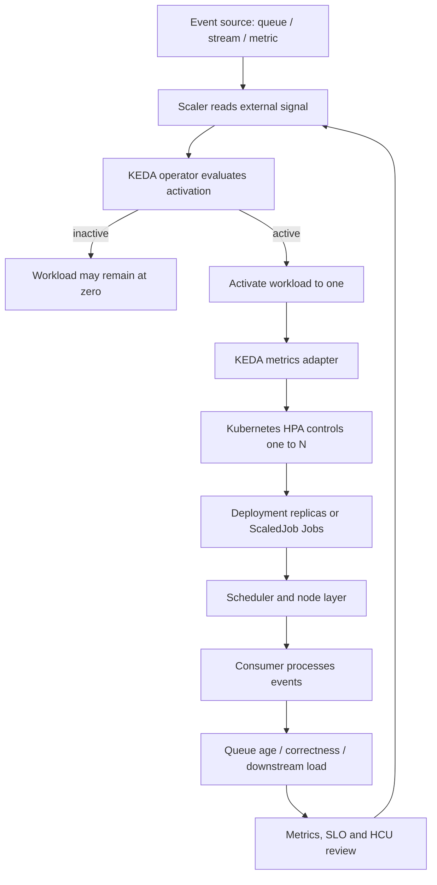
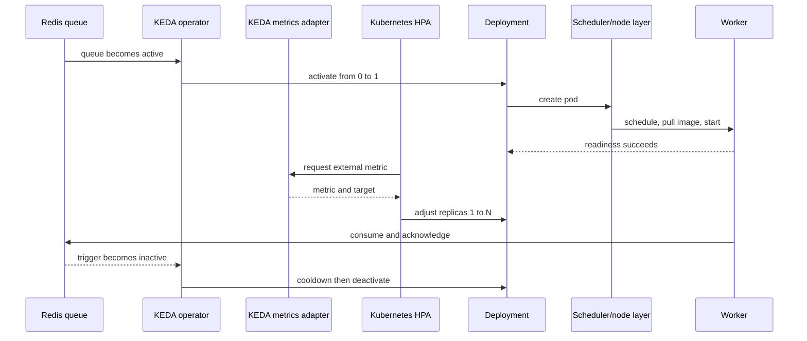

# Unit 10 — Event-driven autoscaling with KEDA

**Stage:** Stage 2E — Production DevOps & Platform Engineering  
**Subfolder:** `15-Platform-Capacity-Compute-Economics-and-FinOps/`  
**Module:** M15 — Platform Capacity, Compute Economics and FinOps  
**Target file:** `10-event-driven-autoscaling-with-keda.md`  
**Estimated time:** 34–46 hours (concepts/examples 9–12 h; labs 18–25 h; review/design defence 7–9 h)  
**Prerequisites:** Stages 0–2D and Stage 2E M01–M14; M03 Units 2, 5, 6 and 7; M08 Unit 8; M09 identity/secrets; M10 Unit 6; M11 Units 9, 11 and 13; M13 Unit 4; M15 Units 1–9.  
**Core tools:** Python 3 standard library, `unittest`, JSON/CSV, `kind`, `kubectl`, local Redis, KEDA 2.21.0 `[VERSION-SENSITIVE]`.  
**Optional tools:** Helm, Prometheus/`promtool` from M11, local policy validator and Redis Streams.  
**Awareness:** Kafka, RabbitMQ, cloud queues, external scalers, managed event sources and GPU-serving platforms. Provider-specific behavior is `[VERIFY]`.  
**Last reviewed:** 2026-11-03  
**Tool baseline:** KEDA 2.21.0; official docs say KEDA 2.21 is tested with Kubernetes 1.34–1.36. Confirm the exact kind node image, Kubernetes API server, Helm and CRD compatibility before installation. Record local Python/container runtime versions.  
**Stack profile:** Cap+Scale for the local KEDA/Redis path; Cap-Core simulator is the guaranteed path; Cap+Obs is optional for Prometheus labs.  
**Footprint:** Python simulator is small. kind + Redis + KEDA consumes additional local CPU, memory and disk; Prometheus is optional and should run only for its lab. Measure actual usage.  
**Prices used:** hypothetical cost units (HCU) only. No real prices, currency values, provider discounts, free-tier limits, quotas or provider lead times are asserted.

> **Completion outcome:** Design and operate event-driven pod/Job autoscaling for data and ML workloads. Derive queue targets from measured throughput and freshness objectives; understand KEDA's relationship with HPA; use Redis, cron, Prometheus and metrics-api patterns; distinguish ScaledObject from ScaledJob; engineer safe scale-to-zero; bound replicas by downstream capacity and cost; test missing-signal failure modes; and govern KEDA as a platform capability. Local experiments do not prove external-provider behavior.

## Contents

- [Prerequisite handoff and scope](#prerequisite-handoff-and-scope)
- [Running example, evidence labels and safety contract](#running-example-evidence-labels-and-safety-contract)
- [10.0 Why this matters in production](#100-why-this-matters-in-production)
- [10.1 Learning objectives](#101-learning-objectives)
- [10.2 Concept map and vocabulary](#102-concept-map-and-vocabulary)
- [10.3 Level 1 — Beginner](#103-level-1--beginner)
- [10.4 Level 2 — Intermediate](#104-level-2--intermediate)
- [10.5 Level 3 — Advanced](#105-level-3--advanced)
- [10.6 Level 4 — Expert](#106-level-4--expert)
- [10.7 Failure modes and incident scenarios](#107-failure-modes-and-incident-scenarios)
- [10.8 Security, reliability and cost guardrails](#108-security-reliability-and-cost-guardrails)
- [10.9 Metrics, SLOs and governance](#109-metrics-slos-and-governance)
- [10.10 Hands-on lab set](#1010-hands-on-lab-set)
- [10.11 Self-check questions](#1011-self-check-questions)
- [10.12 Evidence artifacts](#1012-evidence-artifacts)
- [10.13 Interview and design-review questions](#1013-interview-and-design-review-questions)
- [10.14 Sources and verification notes](#1014-sources-and-verification-notes)
- [Appendix A — Simulator and tests](#appendix-a--simulator-and-tests)
- [Appendix B — Runbooks and templates](#appendix-b--runbooks-and-templates)
- [Appendix C — Final audit](#appendix-c--final-audit)
- [Appendix D — Fourteen worked examples](#appendix-d--fourteen-worked-examples-and-decision-walkthroughs)

---

## Prerequisite handoff and scope

### Mandatory handoff statement — reproduce verbatim

> M03 Unit 6 taught HPA (CPU/memory and custom metrics), VPA, and mentioned KEDA and queue-driven scaling as Awareness; M10 Unit 6 taught backlog catch-up arithmetic; M13 Unit 4 and M11 Unit 11 covered consumer lag and freshness monitoring. This unit teaches **KEDA** — event-driven scaling of workloads from external signals, including scale-to-zero and batch-job-per-event — as a cost and capacity tool, with its architecture, scalers, failure modes, security, and economics. It does not re-teach HPA basics; it explains how KEDA builds on HPA.

### Teach, reuse and defer

| Source | Reuse or boundary |
|---|---|
| M03 Unit 6 | Reuse HPA/VPA foundations; explain KEDA activation and HPA integration, not HPA from zero. |
| M10 Unit 6 | Reuse queueing, arrival/service rates, backlog catch-up and retry amplification. |
| M11 Unit 11 | Reuse consumer lag/freshness monitoring; do not re-teach streaming observability. |
| M11 Unit 13 | Measure per-replica throughput and scale-out behavior through controlled tests. |
| M13 Unit 4 | Reuse idempotency, checkpointing, restore and duplicate-delivery controls. |
| M08 Unit 8 | Reuse “no data is not zero”; test missing metrics explicitly. |
| M15 Units 1–3 | Consume capacity/headroom, quotas and spending guardrails. |
| M15 Unit 4 | Reuse team/workload labels and HCU attribution; detailed allocation remains there. |
| M15 Unit 5 | Reuse safe non-production scheduling and cleanup patterns. |
| M15 Unit 8 | Reuse spot eligibility and interruption tolerance. |
| M15 Unit 9 | KEDA scales pods/Jobs; node provisioning is separate. Pending pods may still lack nodes. |
| M15 Unit 11 | This unit creates replica-hour/HCU evidence; OpenCost installation and reconciliation belong to Unit 11. |
| M15 Unit 12 | Mention GPU cold-start components; detailed GPU economics belongs to Unit 12. |
| M16/M17 | Golden paths and integrated capstone are forward references only. |

### Running data/ML platform example

Use the same hypothetical platform throughout:

- `inference-api`: latency-sensitive and bursty.
- `batch-etl`: deadline-bound and restartable.
- `stream-consumer`: queue-driven with a freshness objective.
- `training-job`: long-running ML job with checkpoint/resume.
- `notebooks`: interactive workloads with idle periods.
- `metadata-db`: shared dependency with finite connection capacity.
- `platform-services`: observability, registry, GitOps and system services.
- `gpu-worker`: synthetic GPU consumer with node, image and model cold-start components.

### Evidence labels

| Label | Meaning |
|---|---|
| `[ASSUMPTION]` | Model input selected by learner; record owner and review date. |
| `[ILLUSTRATIVE]` | Example policy or threshold, not a universal recommendation. |
| `[SYNTHETIC]` | Generated data, simulated event or model output. |
| `[HYPOTHETICAL]` | HCU rate/cost input; not currency or provider quote. |
| `[MEASURED — YOUR ENVIRONMENT]` | Actually measured locally, with timestamp/environment. |
| `[VERIFY]` | Version-, provider-, API-, field- or metric-specific detail requiring confirmation. |
| `[VERSION-SENSITIVE]` | Syntax/behavior tied to a specific release. |

**HCU is not money.** It is a normalized teaching unit. Never write a real currency, provider rate, discount or claimed saving in this unit.

### Zero-budget and safety contract

1. No real cloud resources, credentials, paid queues, production secrets or billable services are required.
2. All workloads and queue data are synthetic and local.
3. Use a learner-owned directory outside the supplied repository, e.g. `./lab-keda/`.
4. Before Kubernetes mutation, assert the current context and namespace. Use only a disposable cluster such as `kind-m15-keda`.
5. If the context is not exactly the expected lab context, stop. Never run apply/delete/uninstall against an ambiguous context.
6. Python simulator is the guaranteed Cap-Core path. Cap+Scale uses local kind, Redis and KEDA. Prometheus is optional.
7. KEDA 2.21 is documented as tested with Kubernetes 1.34–1.36; verify exact kind node image and compatibility before installation.
8. Every fault injection must target only a lab-created component and have an abort/restore condition.
9. Default automation is report-only/dry-run. Never delete data-bearing resources to save cost.
10. Do not expose Redis, Prometheus or test workloads publicly.
11. Local timings are not cloud/provider latency guarantees.
12. Stop optional components after each lab and verify cleanup.

---

## 10.0 Why this matters in production

A queue consumer can be overloaded while CPU utilization remains moderate. Work may wait in Redis, Kafka, RabbitMQ or another event source while the consumer waits on a database, object store, rate-limited API or network call. CPU can therefore be a lagging or incomplete signal for event-driven work.

If a consumer stays permanently provisioned, idle periods consume capacity. If it scales down too aggressively, the next burst waits for polling, scheduling, image pulls and application startup. If it scales up without a ceiling, a producer bug can turn a backlog into a database connection storm and an unexpected capacity incident. KEDA connects external event signals to Kubernetes scaling, but it does not make downstream systems infinitely scalable and it does not provision nodes.

The engineering problem is not simply “make replicas follow queue length.” It is to choose a signal that represents work, derive a target from measured throughput and freshness objectives, bound the maximum by downstream capacity, preserve correctness during scale-in, and decide whether scale-to-zero is compatible with the workload's latency or freshness SLO.

## 10.1 Learning objectives

1. **[L1]** Explain why queue depth, message age, consumer lag and event rate can be better scaling signals than CPU for asynchronous workers.
2. **[L1]** Describe KEDA's operator, metrics adapter, ScaledObject, ScaledJob and authentication objects.
3. **[L1/L2]** Trace 0↔1 activation separately from HPA-managed 1↔N scaling.
4. **[L2]** Configure a local Redis list ScaledObject and validate the installed CRD before applying it.
5. **[L2]** Use cron, Prometheus and metrics-api triggers while explaining signal/no-data limitations.
6. **[L2/L3]** Choose Deployment consumer versus ScaledJob based on task duration, correctness, startup overhead and retry semantics.
7. **[L3]** Derive a target queue value from measured per-replica throughput and freshness objective.
8. **[L3]** Bound `maxReplicaCount` using database connections, API quotas, broker partitions, CPU/memory and cost ceilings.
9. **[L3]** Design fallback for missing metrics, scaler errors, stale signals and authentication failures.
10. **[L3/L4]** Operate KEDA with tenant isolation, policy-as-code, SLOs, runbooks, upgrade rings and HCU economics.

## 10.2 Concept map and vocabulary

### Control flow



KEDA observes triggers and manages workload scaling. Kubernetes schedules pods. Unit 9's node autoscaler provisions nodes when feasible pending pods require capacity. The event source, KEDA, HPA, scheduler, node provisioning and application startup are separate components with separate failure modes.

### Architecture sequence



### Glossary

| Term | Definition | Misconception |
|---|---|---|
| Event-driven autoscaling | Capacity follows an external work signal such as queue depth or lag. | It is not automatically CPU scaling. |
| KEDA | Kubernetes Event-driven Autoscaling; CNCF Graduated project. | Not a broker or node autoscaler. |
| Scaler | Component that reads a specific event source/metric. | Scalers do not share identical semantics. |
| ScaledObject | Connects a scalable target to triggers and replica bounds. | Not the application Deployment. |
| ScaledJob | Creates Kubernetes Jobs based on event demand. | Not simply a Deployment with short-lived pods. |
| TriggerAuthentication | Namespaced scaler credential configuration. | Does not make credentials safe to share. |
| ClusterTriggerAuthentication | Cluster-scoped reusable authentication configuration. | Cluster scope is not automatically appropriate. |
| Activation | KEDA decision to move between zero and one replica. | Not the same as HPA scaling. |
| HPA | Kubernetes controller adjusting replicas using metrics. | KEDA does not replace the HPA controller. |
| Queue depth | Count of pending items. | Does not reveal message age or work cost. |
| Queue age | Age of oldest pending message or defined age distribution. | Not equivalent to count. |
| Consumer lag | Difference between produced and consumed progress. | Units are broker-specific. |
| Arrival rate (λ) | Work items arriving per unit time. | A queue count is not an arrival rate. |
| Service rate (μ) | Work completed per replica per unit time. | Peak benchmark rate is not sustainable capacity. |
| Catch-up time | Time to drain backlog while arrivals continue. | Not backlog/service rate unless arrivals are zero. |
| Cold start | Delay from activation to Ready worker able to process. | Pod creation time is not first successful work. |
| HCU | Hypothetical cost unit. | Not currency or invoice. |

### Scaler selection

| Scaler family | Useful for | Limitation |
|---|---|---|
| Redis list | Local queue-depth lab. | Count does not reveal age or per-message cost. |
| Redis Streams | Stream processing/consumer groups. | Pending entries and acknowledgements require application correctness. |
| Kafka | Partition/consumer lag. | Partition count constrains useful concurrency. |
| RabbitMQ | Queue depth/message work. | Ack, queue mode and connection semantics matter. |
| Cloud queues | Managed event sources. | Identity, API limits, latency and billing are not locally tested. |
| Prometheus | Queue age, in-flight work, lag-time, request rate. | Empty/stale/error signals must be distinguished. |
| Cron | Known active time windows. | Not a periodic job scheduler. |
| Metrics API | Custom internal metric. | Requires maintained metric contract. |
| CPU/memory | Resource pressure. | Often lags queue growth; requests must be valid. |
| Database scaler | Query-derived work. | Query load/permissions can create feedback loops. |

### Important ScaledObject fields

| Field | Meaning | Engineering interpretation |
|---|---|---|
| `scaleTargetRef` | Target resource. | Must be in authorized namespace/ownership boundary. |
| `minReplicaCount` | Minimum replica count; zero may enable scale-to-zero. | Zero only if cold-start and SLO permit. |
| `maxReplicaCount` | Maximum passed to generated HPA. | Capacity/cost ceiling; derive from downstream budgets. |
| `pollingInterval` | Trigger polling interval. | Not end-to-end reaction time. |
| `cooldownPeriod` | Wait after last active trigger before scale-to-zero. | HPA handles 1↔N. |
| `triggers[].type` | Scaler type. | Must exist in selected release. |
| `triggers[].metadata` | Scaler-specific parameters. | Validate exact schema for scaler/version. |
| `triggers[].metricType` | HPA metric type such as `AverageValue` or `Value` for supported scalers. | Changes replica arithmetic. |
| `advanced.horizontalPodAutoscalerConfig.behavior` | HPA behavior passthrough. | Tune only after load testing. |
| `fallback` | Replica behavior after repeated scaler errors for supported ScaledObjects. | Not universal; not supported for ScaledJobs. |

### Simplified queue arithmetic

For a queue metric using `AverageValue`, a useful teaching approximation is:

\[
R_{\text{raw}}=\left\lceil\frac{Q}{T}\right\rceil
\]

where \(Q\) is queue length and \(T\) is target messages per replica. Then:

\[
R_{\text{bounded}}=\min(R_{\max},\max(R_{\min},R_{\text{raw}}))
\]

This is a **teaching model**, not a universal KEDA guarantee. Actual behavior depends on scaler, metric type, activation, HPA behavior, current replicas, multiple metrics, fallback and versions. KEDA's specification demonstrates that `AverageValue` and `Value` can produce different replica calculations.

For backlog \(B\), arrival rate \(\lambda\), service rate per replica \(\mu\), and replicas \(R\):

\[
t_{\text{catch-up}}=\frac{B}{R\mu-\lambda}
\]

If \(R\mu\leq\lambda\), the backlog does not drain under the steady-rate assumptions. Queue depth is not freshness: track oldest-message age and wait-time distribution too.


---

## 10.3 Level 1 — Beginner: foundations and architecture

### Why CPU can be the wrong leading signal

Imagine `stream-consumer` receives 600 events over a short period. Each event causes a database read and write. If the database is slow, the worker may spend much of its time blocked on I/O. CPU can remain low while queue age rises. A CPU-based HPA may not add replicas quickly enough, or may add replicas without considering that the database is already saturated.

A queue signal answers: **how much work is waiting?** A lag-time signal answers: **how late is the work?** An arrival-rate signal answers: **how quickly is new work entering?** A service-rate signal answers: **how much work can each worker actually complete?**

These are not interchangeable:

- Queue depth is a count.
- Queue age is a duration.
- Consumer lag may be offsets, bytes, records or time depending on the system.
- Arrival and service rates are rates.
- Freshness is a data/user contract, not a raw metric.

### Scale-to-zero: cost benefit and operational price

When no work exists, zero replicas can reduce idle compute consumption. But a new event waits for activation and startup:

\[
t_{\text{first-success}} =
t_{\text{poll}}+t_{\text{activation}}+t_{\text{schedule}}+
t_{\text{node}}+t_{\text{image}}+t_{\text{startup}}+
t_{\text{ready}}+t_{\text{process}}
\]

Some stages may overlap in a real system. Measure the critical path instead of blindly summing every duration.

**Decision rule:** scale-to-zero is a candidate for asynchronous, deadline-tolerant work. For a tier-0 latency-sensitive consumer, retain warm capacity unless a measured end-to-end cold-start test proves the SLO.

### ScaledObject versus ScaledJob

| Design | Use when | Avoid when |
|---|---|---|
| Deployment + ScaledObject | Long-lived pool processes many messages; connection reuse matters; workers drain safely. | One event is a long isolated execution and scale-in could terminate valuable work. |
| Job + ScaledJob | Work is finite; each Job handles a bounded event/batch and exits; retry/completion are explicit. | Startup overhead is large, tasks are tiny, or Job creation overwhelms the control plane. |

A Deployment consumer amortizes startup and connection costs. A ScaledJob isolates completion/retry but creates more Kubernetes objects and requires careful history, concurrency and idempotency policies.

### First-principles example

`[SYNTHETIC]` A queue contains 240 messages. A controlled test measured a sustainable service rate of 12 messages/minute per replica. The chosen target is 60 messages per replica.

\[
R=\lceil240/60\rceil=4
\]

If the downstream database can safely support only three consumers, four is not safe. With three replicas, aggregate service is 36 messages/minute. If arrivals continue at 8/minute, net drain is 28/minute and catch-up is \(240/28\approx8.57\) minutes. If freshness requires five minutes, the design is infeasible under these assumptions.

### Guided worksheet

Create `target-worksheet.csv`:

```csv
workload,queue_depth,arrival_per_min,service_per_replica_per_min,target_messages_per_replica,min_replicas,max_replicas,downstream_safe_replicas
stream-consumer,240,8,12,60,0,6,3
```

For each row calculate raw target, bounded target, net catch-up rate, catch-up time, binding cap and freshness feasibility.

### Common beginner mistakes

| Mistake | Symptom | Fix |
|---|---|---|
| Scale only on CPU | Queue age rises while CPU looks low. | Use a work-oriented signal. |
| Treat queue depth as freshness | Old messages hidden in modest queue. | Track oldest-message age and wait-time percentiles. |
| Set max replicas “very high” | DB connections/API calls surge. | Derive max from downstream capacity. |
| Assume scale-to-zero is free | First event misses deadline. | Include cold-start in the SLO/cost decision. |
| Treat missing metrics as zero | Broken query appears idle. | Separate zero, empty, stale and error. |
| Scale down without draining | Duplicate/lost work. | Graceful termination, idempotency and ack discipline. |
| Create a second HPA | Controllers fight over target. | One scaling owner per target. |

---

## 10.4 Level 2 — Intermediate: practical data/ML scaling patterns

### Pattern A — Redis list consumer

KEDA 2.21's Redis list scaler documents trigger type `redis` and metadata including `address`, `listName`, `listLength` and `activationListLength`. Verify the exact schema against the installed CRD.

```yaml
apiVersion: keda.sh/v1alpha1
kind: ScaledObject
metadata:
  name: stream-consumer
  namespace: keda-lab
  labels:
    team: data-platform
    service: stream-consumer
    environment: lab
spec:
  scaleTargetRef:
    name: stream-consumer
  minReplicaCount: 0
  maxReplicaCount: 3
  pollingInterval: 10
  cooldownPeriod: 60
  triggers:
    - type: redis
      metricType: AverageValue
      metadata:
        address: redis.keda-lab.svc.cluster.local:6379
        listName: work-items
        listLength: "20"
        activationListLength: "0"
```

This example uses unauthenticated Redis only inside an isolated disposable lab. Do not copy this security posture into a shared or production environment. In real use, configure authentication and network restrictions; keep credentials out of inline YAML and Git.

- `listLength` is a scaling target, not a queue-age SLO.
- `activationListLength` controls activation from zero for this scaler.
- Replica calculation depends on metric type and HPA semantics.
- A Redis list does not automatically provide Redis Streams/Kafka pending-entry semantics.
- A consumer must acknowledge only after required work is durable and idempotent.

### Pattern B — Cron baseline plus queue bursts

The cron scaler defines an active time window with `timezone`, `start`, `end` and `desiredReplicas`. It is not a recurring task scheduler. Use Kubernetes CronJob or a workflow scheduler for “run every 15 minutes.”

```yaml
apiVersion: keda.sh/v1alpha1
kind: ScaledObject
metadata:
  name: batch-consumer-hours
  namespace: keda-lab
spec:
  scaleTargetRef:
    name: batch-consumer
  minReplicaCount: 0
  maxReplicaCount: 5
  cooldownPeriod: 90
  triggers:
    - type: cron
      metadata:
        timezone: Asia/Kolkata
        start: "0 8 * * 1-5"
        end: "0 20 * * 1-5"
        desiredReplicas: "1"
    - type: redis
      metricType: AverageValue
      metadata:
        address: redis.keda-lab.svc.cluster.local:6379
        listName: batch-work
        listLength: "25"
        activationListLength: "0"
```

KEDA exposes trigger metrics to the HPA; multiple triggers are not independent replica setters. Inspect the generated HPA and test the installed release's composition. Do not assume “the maximum wins” without testing the exact metric types and behavior.

Timezone/DST hazards:

- Store the business timezone explicitly; do not rely on node local time.
- A daylight-saving transition can skip or repeat a wall-clock time.
- Test normal weekday, outside-hours, midnight-spanning and DST cases using a deterministic clock fixture.
- A missed cron window must not strand queued work; the queue trigger should still activate it.
- Cron is a capacity baseline, not a queue trigger replacement.

### Pattern C — Prometheus scaler

Example query:

```promql
sum(stream_consumer_backlog{service="stream-consumer"})
```

The query must return a scalar or single-element vector in the form required by the scaler. The metric must have a documented unit and aggregation.

```yaml
triggers:
  - type: prometheus
    metricType: AverageValue
    metadata:
      serverAddress: http://prometheus.monitoring.svc.cluster.local:9090
      query: sum(stream_consumer_backlog{service="stream-consumer"})
      threshold: "40"
      activationThreshold: "0"
      ignoreNullValues: "false"
```

`ignoreNullValues: "false"` is a deliberate fail-closed signal choice for this example: KEDA's Prometheus scaler docs describe empty-result handling and the error behavior when the endpoint is lost. It does not by itself guarantee a safe replica count. Pair it with a tested fallback and non-zero minimum for critical workloads where scale-to-zero is unsafe.

| State | Meaning | Safe interpretation |
|---|---|---|
| Numeric zero | Valid observation of no work, if source freshness/labels are valid. | Potentially inactive. |
| Positive value | Valid observation of work. | Scale according to target/bounds. |
| Empty vector | No matching time series/result. | Unknown unless metric contract proves otherwise. |
| Timeout/endpoint down | Source failed. | Error state; use tested fallback/preserve capacity. |
| Stale sample | Last successful sample is old. | Signal unhealthy, not “no work.” |

An empty vector can be caused by metric rename, label mismatch, scrape gap or missing series. A valid zero can still be stale if the sample is old.

### Pattern D — ScaledJob for finite work

Use ScaledJob when each unit of work is a bounded execution that starts, processes, records completion and exits. Its `maxReplicaCount` is tied to Jobs created per polling period and running jobs; it is not a permanent Deployment replica count.

Illustrative structure; verify the full schema against the installed CRD:

```yaml
apiVersion: keda.sh/v1alpha1
kind: ScaledJob
metadata:
  name: batch-task
  namespace: keda-lab
spec:
  pollingInterval: 10
  maxReplicaCount: 3
  successfulJobsHistoryLimit: 2
  failedJobsHistoryLimit: 3
  jobTargetRef:
    backoffLimit: 1
    template:
      spec:
        restartPolicy: Never
        containers:
          - name: worker
            image: local/keda-task-worker:dev
            imagePullPolicy: IfNotPresent
            command: ["python", "-m", "worker"]
  triggers:
    - type: redis
      metadata:
        address: redis.keda-lab.svc.cluster.local:6379
        listName: batch-work
        listLength: "1"
```

Do not assume one Job equals one event unless the application contract implements that mapping. Define whether a Job processes one message, a batch or a partition.

Correctness checklist:

- Stable idempotency key per logical work item.
- Durable progress/checkpoint for long tasks.
- Acknowledge only after output commit.
- Bounded retries/backoff and a DLQ/quarantine path.
- Concurrency cap protects downstream.
- Job history and TTL policy reviewed.
- Duplicate processing tested; exactly-once is not claimed unless the full system proves it.

### Pattern E — CPU HPA versus queue-driven KEDA

Compare two isolated variants with identical consumer image, resource requests, downstream service, input trace and duration:

- A: CPU-driven HPA.
- B: queue-driven KEDA.
- Never let both controllers manage the same target simultaneously.

Record time-to-first-Ready, queue-age p50/p95/max, catch-up, replica-hours, DB connections, flapping and HCU. Do not claim KEDA always wins. Queue signals are often more direct for asynchronous work, but poor targets, slow polling, bad metrics, DB saturation or slow node provisioning can make outcomes worse.

### Target derivation and calibration

Let \(S\) be freshness budget (minutes), \(L\) measured p95 activation-to-ready latency, \(P\) processing budget, and \(\mu\) sustainable messages/minute/replica.

\[
T\leq\mu\times\max(0,S-L-P)
\]

This is a design derivation, not a KEDA field formula. Example `[SYNTHETIC]`: \(S=5\), \(L=1.2\), \(P=0.8\), \(\mu=15\). Then \(T\leq15(5-1.2-0.8)=45\) messages/replica. Use a lower target if payload cost varies, arrivals are bursty or the p95 estimate is uncertain. If \(S-L-P\leq0\), scale-to-zero cannot meet the freshness budget under these assumptions.

### Authentication and HPA ownership

KEDA supports direct auth references, `TriggerAuthentication` and `ClusterTriggerAuthentication`. Prefer namespaced authentication when one workload/team owns the credential. Cluster-scoped auth is a broader trust boundary and needs explicit platform/security approval.

Never put passwords/connection strings in trigger metadata, commit real Secret manifests, expose secrets in logs/metric labels, allow cross-tenant secret references or let two HPAs control one target. KEDA 2.21 admission-webhook docs describe checks for a target already managed by another HPA/ScaledObject. Review webhook failure policy and RBAC; webhooks do not replace governance.

---

## 10.5 Level 3 — Advanced: reliability, security and economics

### Signal design

Use separate signals for separate questions:

- backlog count: amount of pending work;
- oldest-message age: freshness;
- arrival rate: demand slope;
- per-replica service rate: capacity calibration;
- consumer lag: stream progress, with broker-specific units;
- in-flight work: scale-in safety;
- downstream saturation: whether adding consumers is safe.

Do not combine incompatible units without a documented formula. A queue count and a queue age cannot be combined by taking their maximum. If using KEDA scaling modifiers, define a dimensionally valid composite signal and test each input missing.

### Downstream-capacity-based `maxReplicaCount`

Example `[SYNTHETIC]`:

- DB connection budget available to this consumer: 48.
- Reserve for maintenance/failover/other clients: 12.
- One replica can open up to 6 connections.
- Safety factor for reconnect overlap: 1.2.

\[
R_{\text{db}}=\left\lfloor\frac{48-12}{6\times1.2}\right\rfloor=5
\]

Then:

\[
R_{\max}=\min(R_{\text{db}},R_{\text{api}},R_{\text{cpu}},R_{\text{memory}},R_{\text{broker}},R_{\text{budget}})
\]

A replica ceiling is not a throughput guarantee. If backlog grows at max, alert, throttle producers, protect downstream, use DLQ/degraded mode or escalate. Do not silently raise max.

### Broker partition and concurrency constraints

For partitioned streams, consumers beyond useful partition concurrency may remain idle or add no throughput. Exact behavior depends on broker, partition assignment and consumer-group semantics `[VERIFY]`.

Ask: maximum useful concurrency; partition count; per-partition ordering requirement; DB connection pool per consumer; write contention under scale-out; hot partition risk. Total lag can hide one hot partition; partition-level lag and oldest-record age may be necessary.

### Scale-in correctness and graceful termination

Kubernetes graceful pod termination typically sends a termination signal and waits within the configured grace period before forceful termination. KEDA docs warn that a Deployment replica selected for scale-down may be processing a long-running message; HPA does not know which replica is safest to remove.

A worker should:

1. Stop accepting new messages after termination begins.
2. Finish or checkpoint in-flight work within the grace period.
3. Commit durable output.
4. Acknowledge only after required commit succeeds.
5. Close connections and exit.
6. If work cannot finish, allow lease/visibility timeout or explicit requeue per broker contract.
7. Make retry safe with idempotency.

`preStop`, `terminationGracePeriodSeconds`, queue visibility timeout, acknowledgement semantics and application shutdown code must be designed together. A long grace period delays forceful termination; it does not prove correctness.

### Failure behavior: zero, empty, stale and error

| Condition | Required response |
|---|---|
| Valid zero with fresh timestamp/expected labels | Allow idle behavior only if tier permits zero. |
| Empty vector | Alert; do not equate with no work. |
| Stale sample | Mark signal unhealthy; preserve safe capacity or use fallback. |
| Timeout/endpoint down | Use tested fallback for supported ScaledObjects; alert. |
| Authentication failure | Detect auth-specific error; restore credential without logging secret. |
| KEDA operator down | Existing replicas may continue; new decisions may stop. |
| Metrics API unavailable | Diagnose APIService/adapter; avoid competing adapters. |

KEDA 2.21 ScaledObject spec documents fallback for supported `Value` and `AverageValue` triggers, except CPU/memory, and only for ScaledObjects—not ScaledJobs. Verify the exact combination. Fallback supplies replica behavior after scaler errors; it does not guarantee backlog drain.

Illustrative critical-consumer fallback fragment:

```yaml
spec:
  minReplicaCount: 1
  maxReplicaCount: 5
  fallback:
    failureThreshold: 3
    replicas: 2
    behavior: currentReplicasIfHigher
```

This is not a universal policy. `minReplicaCount: 1` already avoids zero. Confirm the metric type is supported and the fallback count is within downstream capacity.

### Multi-trigger composition and flapping

Combining cron baseline and queue trigger can express “one worker during business hours, more when backlog grows.” But triggers feed HPA metric calculations; they are not independent replica setters. Inspect generated HPA and test cases where one trigger is high, another is zero, one errors, or activation starts from zero. Tune HPA behavior only after load tests.

Flapping can result from noisy signals, bursty queue drains, short cooldown or scale-down before the next batch. Stabilization dampens noise but must not hide a real spike.

### Scale-to-zero economics

Compare three strategies: scale-to-zero, minimum-one and always-on. Let \(r\) be HCU/replica-hour `[HYPOTHETICAL]`, \(h\) total hours, \(u\) active fraction and \(R_a\) active replicas.

\[
C_{\text{zero}}=R_a(uh)r+C_s
\]
\[
C_{\text{min1}}=(h+(R_a-1)uh)r
\]
\[
C_{\text{always}}=R_a h r
\]

\(C_s\) is a modelled startup overhead, not a provider fee. This compute-only model excludes delayed-work impact, node idle capacity, queue retention and downstream retries. Add an explicit SLO penalty/eligibility rule rather than pretending those are automatically HCU compute costs.

Scale-to-zero is not “free” if the first event misses freshness or latency objectives. Compare warm-capacity HCU against expected SLO/retry/customer impact.

### Denial-of-wallet feedback loop

```text
Producer retry storm -> backlog rises -> KEDA adds replicas
 -> DB/API concurrency rises -> downstream latency/errors rise
 -> consumer retries increase -> backlog grows faster
```

Guardrails: producer rate limit/backoff; queue retention/DLQ; KEDA max; namespace quota; per-replica concurrency/connection caps; DB/API limits; alert when backlog grows at max; workload ownership; approved pause/kill switch for non-critical consumers. Never delete queued data as a cost response.

### Multi-cluster and GPU interface

KEDA is generally operated per cluster. Decide queue location, replication, regional consumers, duplicate-delivery prevention and standby recovery time. A standby scaled to zero saves idle capacity but increases recovery time; warm standby costs more HCU but may improve RTO.

A GPU worker's first useful event can wait for KEDA activation, pod scheduling, GPU node availability (Unit 9), driver/device readiness, image pull, model load and warm-up. Simulated GPU timing is not real GPU performance; Unit 12 owns GPU economics.

---

## 10.6 Level 4 — Expert: operating KEDA as a platform capability

### Golden-path consumer contract

A platform template should include:

- supported scaler allow-list;
- `team`, `service`, `environment`, `tier` and `cost-owner` labels;
- signal name, unit, query and freshness contract;
- target derivation worksheet and measured throughput;
- explicit min/max replica bounds;
- downstream concurrency/connection budget;
- scale-to-zero approval based on tier;
- tested fallback for critical ScaledObjects where supported;
- namespaced TriggerAuthentication by default;
- graceful termination and idempotency;
- readiness/liveness probes and resource requests;
- queue age, backlog, arrival/service rate and replica-hours metrics;
- alerts for scaler errors, cap saturation and zero replicas with backlog;
- owner, on-call route, rollback and review record.

### Tier policy

| Tier | Example | Scale-to-zero default | Required control |
|---|---|---|---|
| Tier 0 | Customer-facing or strict freshness path | Disabled unless explicit approval and measured proof. | Warm minimum, tested fallback, paging, downstream budget. |
| Tier 1 | Important asynchronous pipeline | Conditional. | Queue-age alert, bounded max, retries/DLQ, cold-start test. |
| Tier 2 | Batch with deadline slack | Candidate. | Catch-up proof, deadline alert, max cap and idempotency. |
| Tier 3 | Development/test | Usually suitable if restartable. | Schedule/queue policy, cleanup and owner label. |

These are governance defaults, not universal Kubernetes/KEDA behavior.

### Ownership model

| Team | Owns | Approves/reviews |
|---|---|---|
| Application | Consumer correctness, idempotency, service-rate measurement, probes, queue semantics and SLO. | Target, termination and retry policy. |
| Platform | KEDA install, CRDs, operator RBAC, scaler catalog, admission, upgrades and metrics API. | New scaler, cluster auth and cluster-wide max policy. |
| Security | Secret handling, RBAC, tenant boundaries, egress and audit. | Cluster auth and cross-namespace references. |
| FinOps | HCU model, workload labels, replica-hour trend and cost review. | Rate assumptions and material cost exceptions. |
| SRE/on-call | SLOs, alerts, incident response and rollback. | Scale-to-zero for critical workloads. |

### Policy-as-code requirements

Validate: max exists and is below tier ceiling; Tier-0 min is not zero without exception; target is authorized and same namespace; owner/tier labels exist; scaler type is allow-listed; inline secrets prohibited; cluster auth approved; critical workload has tested fallback or documented alternative; no second HPA owner; change record accompanies target/trigger/bounds/poll/cooldown changes.

Mandatory negative tests: over-limit max, Tier-0 zero min, forbidden scaler, inline secret, foreign target and duplicate HPA owner must be rejected.

### Upgrade and CRD governance

KEDA 2.21.0 release notes identify breaking changes, including service-account token audience enforcement associated with **CVE-2026-77524** for affected bound-token/Vault authentication paths. Before upgrading those integrations, review the release migration guidance and validate token audiences in a rehearsal environment. Do not generalize this impact to unrelated API-key or Vault-token configurations; determine the authentication method actually in use.

1. Read release notes and breaking changes.
2. Confirm KEDA/Kubernetes compatibility.
3. Export ScaledObjects, ScaledJobs and authentication resources.
4. Rehearse CRD and chart/manifest upgrade in isolated cluster.
5. Run schema validation and scaler tests.
6. Test scale-to-zero, fallback, ScaledJob, empty Prometheus result and auth failure.
7. Roll out lab → non-critical → representative production → fleet.
8. Monitor scaler errors, HPA conditions, queue age, cold-start and replica-hours.
9. Keep rollback plan; CRD rollback needs special care.
10. Record versions and evidence.

KEDA 2.21.0 release notes include breaking changes. Do not assume a minor release requires no migration work.

### External metrics API conflict

KEDA exposes external metrics through Kubernetes API aggregation. Another adapter may also be installed. Inspect APIService ownership and service availability; do not assume multiple adapters can own the same API group/version.

```bash
kubectl get apiservice
kubectl describe apiservice v1beta1.external.metrics.k8s.io
kubectl get --raw /apis/external.metrics.k8s.io/v1beta1
kubectl get hpa -A
kubectl describe hpa <generated-hpa-name> -n <namespace>
kubectl get scaledobject -A
kubectl describe scaledobject <name> -n <namespace>
kubectl get pods -n keda
kubectl logs -n keda deploy/keda-operator --since=15m
```

Confirm the actual registered APIService/resource names before running. Never delete an APIService to “see if it fixes KEDA.”

### Operating policy

Pair cost KPIs with correctness and reliability:

- queue age/freshness attainment;
- event-to-first-success latency;
- backlog catch-up after burst;
- successful/failed/duplicate rate;
- scaler signal health;
- time at max while backlog grows;
- replica-hours per workload;
- HCU per 1,000 completed messages;
- idle replica-hours;
- cold-start penalty count;
- DB connections per replica;
- cost per successful unit at agreed SLO.

Replica-hours are not an invoice. OpenCost and billing reconciliation belong to Unit 11.


---

## 10.7 Failure modes and organizational incident scenarios

For each incident follow: **symptoms → impact → evidence → mitigation → root cause → fix → prevention → verification**. All figures are `[SYNTHETIC]`.

### Incident 1 — Prometheus query returns no data

- **Symptoms:** queue grows while consumer remains at zero; scaler reports error or query returns empty vector.
- **Impact:** freshness objective breached.
- **Evidence:** query history, metric rename, scrape health, ScaledObject/HPA conditions, queue age.
- **Mitigation:** restore approved warm minimum or known-good signal; preserve queue.
- **Root cause:** metric/label changed; query returns no series.
- **Fix:** version metric contract, add query tests, configure tested error handling.
- **Prevention:** canary query validation and no-data alert.
- **Verification:** zero replicas with non-empty queue remains zero during test; scaler error rate recovers.

### Incident 2 — Unbounded scale-out exhausts database connections

- **Symptoms:** producer bug creates `[SYNTHETIC]` 50,000-message backlog; replicas and DB connections rise.
- **Impact:** consumer and unrelated services fail; retries amplify backlog.
- **Evidence:** replica timeline, queue depth/age, DB connections, per-replica pool, HPA max, producer retries.
- **Mitigation:** enforce approved cap, throttle producer, reduce concurrency and protect DB headroom. Do not delete queue.
- **Root cause:** max bound missing/too high; no downstream budget derivation.
- **Fix:** derive max from DB/API/broker/node/budget constraints.
- **Prevention:** admission policy requiring max, owner labels and denial-of-wallet drill.
- **Verification:** DB connections remain below safe budget while backlog growth is bounded/visible.

### Incident 3 — External metrics API conflict

- **Symptoms:** HPA reports unknown external metrics; KEDA metric requests fail; another adapter also registers external metrics.
- **Impact:** scaling stops or remains stale.
- **Evidence:** APIService list/conditions, endpoints, adapter pods, HPA events, operator logs.
- **Mitigation:** identify APIService owner and restore intended service; do not delete cluster-wide resources blindly.
- **Root cause:** overlapping adapter ownership or broken APIService backend.
- **Fix:** choose one supported ownership architecture and document installation order.
- **Prevention:** adapter inventory and cluster-level change approval.
- **Verification:** APIService Available and HPA metric fetch succeeds.

### Incident 4 — Unsafe scale-in terminates a consumer mid-message

- **Symptoms:** duplicate processing, missing output, expired lease or repeated retry after replica reduction.
- **Impact:** delayed/incorrect data and duplicate side effects.
- **Evidence:** termination timestamps, worker logs, ack history, idempotency keys, output commit.
- **Mitigation:** stop further scale-in or retain warm replicas; reconcile with idempotency keys.
- **Root cause:** worker did not drain/checkpoint safely.
- **Fix:** SIGTERM drain, bounded in-flight work, commit-before-ack and idempotent output.
- **Prevention:** forced scale-in integration test; reuse M13 Unit 4 contract.
- **Verification:** no lost logical work; duplicate side effects are prevented by idempotency.

### Incident 5 — Cold-start SLO failure

- **Symptoms:** first event after idle takes `[SYNTHETIC]` 90 seconds or more; later events are fast.
- **Impact:** latency/freshness SLO breach on first burst.
- **Evidence:** event arrival, activation, pod create, schedule, image pull, readiness and first success.
- **Mitigation:** raise warm minimum; preserve queue durability.
- **Root cause:** scale-to-zero policy ignored end-to-end cold-start path.
- **Fix:** warm capacity, smaller image/startup or approved fallback.
- **Prevention:** cold-start SLO test; zero scaling requires tier approval.
- **Verification:** p95 event-to-first-success meets freshness objective.

### Incident 6 — GPU batch delay

- **Symptoms:** GPU consumer scaled to zero; first batch waits `[SYNTHETIC]` 12 minutes for node/image/model.
- **Impact:** batch deadline missed.
- **Evidence:** KEDA activation, Pending reason, Unit 9 node timeline, driver/image/model readiness.
- **Mitigation:** route eligible work to warm pool or deadline-safe queue.
- **Root cause:** cost review considered pod only, not node and model initialization.
- **Fix:** warm minimum or scheduled pre-warm, image/model cache and measured startup budget.
- **Prevention:** Unit 12 GPU economics review.
- **Verification:** p95 batch-start latency and deadline attainment; synthetic values stay labelled.

### Incident 7 — Tenant targets another team's workload

- **Symptoms:** tenant-created ScaledObject references workload owned by another team.
- **Impact:** unauthorized scaling, instability and cost disputes.
- **Evidence:** audit event, owner labels, namespace, target reference and RBAC.
- **Mitigation:** pause unauthorized ScaledObject by approved procedure; preserve target/data.
- **Root cause:** no target-ownership validation and broad tenant permissions.
- **Fix:** namespace RBAC and admission policy requiring authorized same-namespace target.
- **Prevention:** negative policy tests and audit alert.
- **Verification:** unauthorized attempt denied and recorded; valid owner changes pass.

### Incident 8 — Cooldown flapping doubles hypothetical cost

- **Symptoms:** replicas repeatedly scale down to zero/reactivate; `[SYNTHETIC]` replica-hours rise and queue age oscillates.
- **Impact:** startup churn, unstable freshness and higher HCU.
- **Evidence:** trigger timeline, queue length/age, activation events, cooldown and replica trajectory.
- **Mitigation:** adjust approved cooldown or warm minimum; do not suppress real scale-up.
- **Root cause:** cooldown too short for burst cadence and processing variability.
- **Fix:** calibrate using arrival gaps and startup cost.
- **Prevention:** burst replay test and cooldown change review.
- **Verification:** fewer scale direction changes while queue-age SLO remains satisfied.

---

## 10.8 Security, reliability and cost guardrails

| Threat | Control | Negative test |
|---|---|---|
| Tenant creates expensive ScaledObject | Require max, allowed scaler and tier policy. | Submit max above cap; reject. |
| Tenant scales another team's workload | Same-namespace target and owner validation; RBAC. | Target foreign workload; reject. |
| Secret exposed in YAML/Git | TriggerAuthentication/secret reference and scanning. | Inline password field; reject. |
| Cluster-wide credential reuse | Prefer namespaced TriggerAuthentication. | Unapproved cluster auth reference; reject. |
| KEDA operator over-privileged | Review chart/manifests RBAC and namespace scope. | Remove non-required permission in lab; detect dependency. |
| Scaler egress abused | NetworkPolicy/egress allow-list. | Attempt unapproved endpoint. |
| External metrics API tampered | Protect APIService with RBAC/audit. | Tenant attempts APIService mutation; deny. |
| Denial-of-wallet | Max, quotas, downstream caps, rate limits and alerts. | Bounded storm; verify ceilings. |
| Credential rotation breaks scaler | Rotation runbook and auth alert. | Rotate lab credential; detect and recover. |

### Guardrail hierarchy

1. **Application:** bounded concurrency, retries and producer rate limit.
2. **Queue:** retention, poison-message handling, DLQ and delivery attempts.
3. **KEDA:** min/max, activation, polling/cooldown and fallback.
4. **Kubernetes:** ResourceQuota, LimitRange, priority and namespace ownership.
5. **Downstream:** DB connection budget, API rate limits, broker concurrency.
6. **Node layer:** Unit 9 node pool ceilings, quota and capacity controls.
7. **Financial:** HCU rate card, replica-hour anomaly and owner review.
8. **Incident response:** approved pause/kill switch for non-critical workloads; never delete queued data as a cost response.

Reliability rules: a scaler failure must not silently mean “no work”; critical workloads need measured scale-to-zero approval; backlog at max is a capacity incident, not permission to raise max; node provisioning is separate; scale-in must preserve correctness; accept cost reductions only after SLO/correctness/downstream/HCU review.

---

## 10.9 Metrics, SLOs and governance

Every metric needs definition, unit, source, window, owner and limitation.

| Metric | Formula/meaning | Unit | Source/window | Owner | Limitation |
|---|---|---|---|---|---|
| Queue depth | Current pending items. | messages | Broker/Redis, point and trend. | App | Does not show age/work cost. |
| Oldest-message age | Now minus enqueue time of oldest pending item. | seconds | Queue instrumentation. | App/SRE | Needs reliable timestamp. |
| Queue wait p95 | p95 enqueue-to-start delay. | seconds | Consumer telemetry. | App/SRE | Sampling/clock skew. |
| Consumer lag | Produced minus consumed position. | broker-specific | Broker metrics. | Streaming | Not comparable without normalization. |
| Arrival rate | New messages/window. | messages/min | Producer/queue. | App | Long windows hide bursts. |
| Per-replica service rate | Successful completions/replica-time. | messages/min/replica | Load test + telemetry. | App | Payload/dependency-sensitive. |
| Catch-up time | \(B/(R\mu-\lambda)\), if denominator positive. | minutes | Derived. | SRE | Assumes stable rates. |
| Time-to-first-pod | Activation to pod creation. | seconds | KEDA/Kubernetes events. | Platform | Running is not Ready. |
| Time-to-ready | Activation to first Ready worker. | seconds | KEDA/pod conditions. | Platform/App | Ready is not first success. |
| Event-to-first-success | Enqueue to successful completion. | seconds | Queue + application trace. | App/SRE | Best end-to-end cold-start measure. |
| Replica count | Active replicas. | replicas | Deployment/HPA. | Platform | Count is not throughput. |
| Replica-hours | \(\int R(t)dt\). | replica-hours | Replica time series. | FinOps | Not invoice cost. |
| Scaler error rate | Errors / polls. | ratio | KEDA logs/metrics `[VERIFY]`. | Platform | Separate source/config errors. |
| ScaledObject readiness | CR condition state. | state | KEDA status. | Platform | Does not prove app correctness. |
| Max saturation | Time at max while backlog grows. | seconds | HPA + queue. | SRE/App | Max may be intentionally conservative. |
| Zero replicas with backlog | Intervals where replicas=0 and backlog>0. | intervals | Queue + Deployment. | SRE | Align timestamps. |
| HPA metric availability | External metric fetch/unknown state. | state | HPA/APIService. | Platform | Does not reveal app bottleneck. |
| Duplicate/retry/DLQ rate | Duplicate/retry/DLQ items / total. | ratio | Consumer/broker. | App | Needs stable message identity. |
| DB connection saturation | Active/available connections. | ratio | DB metrics. | DB owner | Pool/server counts differ. |
| HCU per 1,000 completions | HCU / successful messages × 1,000. | HCU/1k | Replica-hours × HCU rate / completions. | FinOps/App | Synthetic until approved rate card. |
| Flapping rate | Scale direction changes/window. | changes/hour | Replica timeline. | Platform | Define filtering. |
| Tenant policy violations | Denied non-compliant KEDA changes. | count | Admission/audit. | Security | Denials do not prove no abuse. |

### Conceptual alert rules

Metric names below are lab-owned placeholders, not guaranteed KEDA metric names. Map to verified metrics and labels.

```yaml
groups:
  - name: keda-workload-safety
    rules:
      - alert: ZeroReplicasWithBacklog
        expr: (workload_replicas == 0) and (queue_depth > 0)
        for: 1m
        labels:
          severity: critical
      - alert: MaxReplicasWithGrowingBacklog
        expr: (workload_replicas >= workload_max_replicas) and (rate(queue_depth[5m]) > 0)
        for: 5m
        labels:
          severity: warning
      - alert: QueueAgeSLOBurn
        expr: queue_oldest_message_age_seconds > queue_freshness_budget_seconds
        for: 2m
        labels:
          severity: critical
```

Use `promtool check rules` and `promtool test rules` with the same Prometheus release as the test environment. A no-data case must not be misclassified as zero.

### Governance cadence

| Review | Cadence | Evidence |
|---|---|---|
| Target/max review | On onboarding and material throughput/dependency change. | Load test, target worksheet, downstream budget. |
| Scale-to-zero eligibility | On onboarding and SLO/tier change. | Cold-start distribution and freshness result. |
| Replica-hour anomaly | Weekly or agreed FinOps cadence. | Replica-hours, HCU model, completions and SLO. |
| KEDA/CRD upgrade | Each planned upgrade. | Release notes, compatibility, rehearsal, rollback. |
| Tenant isolation | Periodic and after policy change. | RBAC, admission tests, audit samples. |
| Incident review | After scaler/backlog/correctness/cost incident. | Timeline, queue/replica trace and actions. |

---

## 10.10 Hands-on lab set — eleven mandatory labs

### Shared preflight and workspace

All labs are local-first. Cap-Core is Appendix A's Python simulator. Cap+Scale uses kind, Redis and KEDA. Cap+Obs adds Prometheus only for Labs 5 and 11.

```bash
mkdir -p "$HOME/lab-keda"/{manifests,src,tests,evidence,reports}
cd "$HOME/lab-keda"
python --version
kubectl version --client
kind version
helm version
docker version
kubectl config current-context
kubectl cluster-info
```

Use only installed tools. Expected context is `kind-m15-keda`; if it differs, stop. Check cluster names before creation:

```bash
kind get clusters
```

KEDA 2.21 is tested with Kubernetes 1.34–1.36. Select a kind node image that matches a compatible Kubernetes release and your kind version; do not guess its tag:

```bash
export KEDA_LAB_CONTEXT="kind-m15-keda"
export KEDA_LAB_NODE_IMAGE="<VERIFY_KIND_NODE_IMAGE_FOR_KUBERNETES_1_34_TO_1_36>"
kind create cluster --name m15-keda --image "$KEDA_LAB_NODE_IMAGE"
kubectl config use-context "$KEDA_LAB_CONTEXT"
kubectl config current-context
kubectl cluster-info
```

Install KEDA only after checking compatibility:

```bash
kubectl apply --server-side -f \
  https://github.com/kedacore/keda/releases/download/v2.21.0/keda-2.21.0.yaml
kubectl get pods -n keda
kubectl get crd | grep keda
```

Official docs also describe Helm. If using Helm, verify chart version and values rather than assuming chart version equals app version.

Every lab requires: exact context guard; scope; assumption list; preflight; positive and negative test; abort criteria; evidence; cleanup and cleanup verification. Local timings are `[MEASURED — YOUR ENVIRONMENT]`, not cloud benchmarks.

### Lab 1 — Install KEDA and Redis queue consumer

**Goal:** observe local Redis list consumer scale 0→N→0. **Profile:** Cap+Scale. **Assumptions:** Redis unauthenticated only inside isolated lab; synthetic queue. **Fidelity:** kind is not cloud infrastructure.

1. Verify context is exactly `kind-m15-keda`; create namespace `keda-lab`.
2. Deploy lab Redis and expose port 6379 only as a cluster service.
3. Build/load a local worker image; it logs idempotency key and acknowledges only after successful processing.
4. Deploy worker with zero replicas and Redis endpoint `redis.keda-lab.svc.cluster.local:6379`.
5. Apply the Redis ScaledObject from 10.4 after server-side dry-run.
6. Insert a bounded batch; observe ScaledObject, HPA, pods, logs and queue drain.
7. Record time-to-first-Ready, first-success, replica timeline and queue depth.

**Evidence:** manifest, CR status, generated HPA, queue/replica trace, worker logs.  
**Tests:** zero backlog allows scale-down; positive backlog activates; max is respected; ack follows successful processing.  
**Abort:** wrong context, worker crash loop, unbounded queue or external network dependency.  
**Cleanup:** remove only `keda-lab` resources after context check; verify namespace and KEDA lab objects are gone.

### Lab 2 — Derive and validate target value

**Goal:** measure service rate and derive target from freshness. **Profile:** Cap-Core or Cap+Scale. **Assumptions:** same payload mix and downstream behavior across runs. **Fidelity:** local benchmark applies only to tested machine/workload.

1. Run one consumer with fixed synthetic batch; record successful completions/time/errors.
2. Repeat at several concurrency levels; identify throughput knee.
3. Use sustainable rate, not peak.
4. Derive target from freshness budget minus cold-start and processing budget.
5. Test undersized/oversized target; compare age, catch-up, replica-hours and HCU.

**Evidence:** throughput worksheet, assumption register, trace, target and sensitivity.  
**Tests:** units correct; zero remaining freshness budget flags scale-to-zero infeasible; max checked against downstream.  
**Abort:** unstable machine, variable payload or external dependency.  
**Cleanup:** stop producer/worker and clear only lab queue.

### Lab 3 — CPU HPA versus queue KEDA

**Goal:** compare two isolated variants under identical burst. **Profile:** Cap+Scale; Cap+Obs optional. **Assumptions:** same image, resource requests, downstream, input trace and duration. **Fidelity:** local signals do not represent production/provider behavior.

1. Run CPU-HPA variant; record queue/replica trace.
2. Remove it after evidence capture.
3. Run KEDA queue variant with same trace.
4. Compare time-to-first-Ready, queue-age p50/p95/max, catch-up, DB connections, replica-hours, flapping and HCU.

**Evidence:** side-by-side table and architecture decision record.  
**Tests:** no dual HPA ownership; assumptions identical; HCU rate identical.  
**Abort:** variants overlap or producer unbounded.  
**Cleanup:** remove lab variant and verify no generated HPA remains.

### Lab 4 — Cron plus queue triggers and DST

**Goal:** configure daytime baseline and queue burst scaling. **Profile:** Cap+Scale or deterministic Cap-Core schedule model. **Assumptions:** non-production worker. **Fidelity:** accelerated schedule tests do not prove all controller/timezone runtime behavior.

1. Configure cron with explicit IANA timezone.
2. Combine with queue trigger on disposable target.
3. Inspect generated HPA/ScaledObject.
4. Test weekday, outside-hours, midnight-spanning and DST fixture.
5. Verify queue activation outside cron window and installed-version multi-trigger semantics.

**Evidence:** cron fixtures, manifest, HPA and timezone decision.  
**Tests:** invalid timezone caught; start/end not identical; queue activates outside baseline.  
**Abort:** target not lab-owned or context mismatch.  
**Cleanup:** remove only lab resources after context verification.

### Lab 5 — Prometheus empty-result fail-safe

**Goal:** distinguish valid zero, positive, empty, stale and endpoint failure. **Profile:** Cap+Obs + Cap+Scale; simulator fallback. **Assumptions:** metric contract defines queue depth/freshness. **Fidelity:** local Prometheus failure is not every remote backend failure.

1. Publish valid positive metric and verify scaling.
2. Publish numeric zero and verify intended idle behavior.
3. Remove series to produce empty vector.
4. Stop only lab-created Prometheus after context/namespace check.
5. Inspect ScaledObject/HPA/operator logs and fallback.
6. Restore Prometheus and verify recovery.

**Evidence:** query outputs, signal states, status, replica counts and fault timeline.  
**Tests:** empty is not treated as proof of no work; endpoint failure detected; fallback/keep-capacity verified; backlog durable.  
**Abort:** shared Prometheus target or data risk.  
**Cleanup:** restore Prometheus and remove only lab resources.

### Lab 6 — ScaledJob for batch events

**Goal:** compare finite Job work with Deployment consumers. **Profile:** Cap+Scale or Cap-Core model. **Assumptions:** tasks finite and idempotent. **Fidelity:** local task does not prove provider queue semantics.

1. Create bounded task records with unique idempotency keys.
2. Validate ScaledJob schema server-side.
3. Observe Job creation/completion/retry/history.
4. Inject failure before output commit and after commit-before-ack.
5. Compare Deployment consumer scale-in behavior.

**Evidence:** Job timeline, results, duplicate/retry report, concurrency cap.  
**Tests:** no duplicate side effects; failed task retryable; max concurrency bounded.  
**Abort:** Job count exceeds ceiling or output is not idempotent.  
**Cleanup:** stop producer, reconcile queue and remove only test Jobs.

### Lab 7 — Downstream capacity, policy and tenant isolation

**Goal:** derive max from DB budget and reject unsafe tenant objects. **Profile:** Cap-Core; optional admission-policy test. **Assumptions:** DB and policy values synthetic. **Fidelity:** local validator is not production admission unless deployed/tested on target API version.

1. Calculate DB cap from available/reserved connections, per-replica pool and safety factor.
2. Add API, broker, CPU/memory, node, quota and HCU caps; choose minimum.
3. Validate compliant object.
4. Submit invalid max, Tier-0 zero min, inline secret, forbidden scaler, foreign target and duplicate HPA owner.
5. If using ValidatingAdmissionPolicy, verify API/schema first.

**Evidence:** worksheet, policy source and positive/negative tests.  
**Tests:** invalid cases rejected; compliant case passes; policy never raises max automatically.  
**Abort:** shared/production namespace or context ambiguity.  
**Cleanup:** remove lab policy and namespace only.

### Lab 8 — Denial-of-wallet drill

**Goal:** bounded producer storm with replica/downstream/cost guardrails. **Profile:** Cap-Core or Cap+Scale. **Assumptions:** storm/HCU synthetic. **Fidelity:** no real provider billing.

1. Capture baseline queue/replica/DB state.
2. Run bounded producer burst with hard message count and timeout.
3. Verify max replicas and DB connection cap.
4. Alert when backlog grows at max.
5. Throttle producer/pause non-critical source.
6. Drain backlog and verify no messages deleted; calculate HCU/completion.

**Evidence:** incident timeline, queue/replica trace, DB budget, HCU report.  
**Tests:** storm bounded; max holds; no auto-delete; alert fires; throttle halts growth.  
**Abort:** machine saturation, external endpoint or queue beyond test ceiling.  
**Cleanup:** stop producer, drain/preserve queue as documented and verify no process remains.

### Lab 9 — External metrics APIService conflict

**Goal:** diagnose external metrics ownership and unknown HPA metrics. **Profile:** Cap+Scale if another adapter already exists safely; otherwise Cap-Core analysis. **Assumptions:** APIService inventory available. **Fidelity:** if no safe second adapter exists, mark ANALYZED, NOT EXECUTED.

1. Inspect `kubectl get apiservice`.
2. Identify external metrics APIService and backing service.
3. Inspect conditions/endpoints, HPA events and KEDA logs.
4. Map intended adapter owner and conflicting installation.
5. Write remediation and rollback. Reproduce only in disposable cluster if safely available.

**Evidence:** APIService inventory, decision tree, HPA conditions.  
**Tests:** no APIService deletion without ownership evidence; remediation identifies impacted workloads.  
**Abort:** shared cluster or unclear owner.  
**Cleanup:** restore original state and verify APIService availability.

### Lab 10 — Scale-to-zero HCU model

**Goal:** compare zero, minimum-one and always-on. **Profile:** Cap-Core. **Assumptions:** all rates synthetic/HCU. **Fidelity:** model is not invoice or impact valuation.

1. Define window, active fraction and replica profile.
2. Calculate replica-hours for each strategy.
3. Apply hypothetical HCU rate.
4. Add cold-start penalty or SLO eligibility.
5. Sensitize active fraction, startup frequency, warm minimum and rate.
6. Decide tier eligibility.

**Evidence:** model, sensitivity, assumptions and decision memo.  
**Tests:** zero idle time has no idle replica-hours in zero strategy; min-one retains warm cost; always-on remains constant; no real currency.  
**Abort:** model value presented as real price/impact.  
**Cleanup:** retain report in evidence only.

### Lab 11 — Observability and alert tests

**Goal:** validate scaler error, max-with-growing-backlog, zero-with-backlog and ScaledObject readiness. **Profile:** optional Cap+Obs; Cap-Core fallback. **Assumptions:** lab-owned synthetic metric names. **Fidelity:** lab metric contract is not KEDA metric-name guarantee.

1. Define metric contract with units/labels.
2. Generate positive, zero, empty and stale fixtures.
3. Write alert rules.
4. Run `promtool check rules` and `promtool test rules` if installed.
5. Test no-data transition and owner routing.
6. Mark KEDA metric names `[VERIFY]` until checked in installed release.

**Evidence:** metric contract, rule file, test output and cleanup.  
**Tests:** positive fires; no-data is not zero; alert clears after recovery; owner labels exist.  
**Abort:** shared Prometheus or real alert route.  
**Cleanup:** remove lab rules and stop optional Prometheus; verify no test alert remains.


---

## Appendix D — Fourteen worked examples and decision walkthroughs

All numbers in this section are `[SYNTHETIC]` or `[HYPOTHETICAL]`. They are calculation exercises, not production measurements.

### Example 1 — Queue target

Queue depth \(Q=240\), target \(T=60\) messages/replica:

\[
R=\lceil240/60\rceil=4
\]

If min=0 and max=6, the simplified target is four. This does not prove four is safe; check DB/API/broker capacity.

### Example 2 — Catch-up with arrivals

Backlog \(B=240\), arrival \(\lambda=8\)/min, service \(\mu=12\)/min/replica, replicas \(R=3\):

\[
t=240/(3\times12-8)=240/28=8.57\text{ min}
\]

The no-arrival shortcut \(240/36=6.67\) minutes would understate catch-up time.

### Example 3 — Catch-up is impossible

Backlog 900, arrival 30/min, service 10/min/replica, replicas 3:

\[
R\mu-\lambda=3(10)-30=0
\]

The queue does not drain. More replicas help only if service capacity scales and the downstream is not the bottleneck.

### Example 4 — Derive a freshness target

Freshness budget 5 min, p95 cold-start 1.2 min, processing allowance 0.8 min, service 15 messages/min/replica:

\[
T\leq15(5-1.2-0.8)=45
\]

Choose target at or below 45, then test with representative payloads and bursts.

### Example 5 — DB connection ceiling

Available 48 connections, reserve 12, per-replica pool 6, safety factor 1.2:

\[
R_{\text{db}}=\lfloor(48-12)/(6\times1.2)\rfloor=5
\]

A max of 12 derived from queue demand would be unsafe even if nodes could schedule the pods.

### Example 6 — Choose the binding cap

DB cap=5, API cap=4, broker useful concurrency=8, CPU cap=10, namespace quota=6, budget cap=3:

\[
R_{\max}=\min(5,4,8,10,6,3)=3
\]

The budget cap binds. The design should alert when three replicas cannot drain backlog.

### Example 7 — Scale-to-zero compute HCU

Active 6 hours, 3 replicas, HCU rate 0.4 per replica-hour:

\[
C=6\times3\times0.4=7.2\text{ HCU}
\]

This is active compute only. It excludes cold-start penalty and node idle capacity.

### Example 8 — Minimum-one versus zero

Window 24 h, active fraction 25%, active replicas=3, rate=0.4 HCU/replica-hour.

- Zero strategy: \(24\times0.25\times3=18\) replica-hours; cost 7.2 HCU.
- Minimum-one strategy: warm replica 24 h plus two extra replicas for 6 h = 36 replica-hours; cost 14.4 HCU.
- Always-on three replicas: 72 replica-hours; cost 28.8 HCU.

Minimum-one costs more compute than zero but can protect first-event latency. The decision needs the SLO, not compute alone.

### Example 9 — Empty result versus zero

Case A: Prometheus returns `0`; sample is fresh and labels are correct. This may mean no backlog. Case B: query returns an empty vector after a metric rename. This means no matching series, not proof of no work. The correct response to B is signal-health alert/fallback, not an automatic scale-to-zero decision.

### Example 10 — Multiple trigger composition

Cron requests a daytime baseline of one replica; queue signal implies four replicas under the chosen target. Inspect generated HPA and confirm the desired composition in the installed release. Do not manually set Deployment replicas at the same time. If cron is inactive and queue is empty, confirm the activation policy before accepting zero.

### Example 11 — ScaledJob concurrency

Queue length 40, target one item per Job, maxReplicaCount 5. The desired number of Jobs is bounded by the configured max for the polling period and existing/running Jobs according to ScaledJob strategy. Do not claim 40 Jobs will be created. Inspect the exact strategy and count in the installed release.

### Example 12 — Cold-start budget fails

Freshness budget 60 seconds; measured p95 activation-to-first-success is 95 seconds. Scale-to-zero cannot satisfy the stated freshness SLO under the measured test. Keep a warm minimum, reduce cold-start or redesign the SLA; do not tune queue target to hide the cold-start.

### Example 13 — Replica-hour calculation

Replica samples: minute 0 → 0 replicas; minute 10 → 2; minute 40 → 1; minute 70 → 0.

Piecewise replica-minutes = \(10(0)+30(2)+30(1)=90\). Replica-hours = \(90/60=1.5\). At 0.4 HCU/replica-hour, the synthetic cost is 0.6 HCU.

### Example 14 — Retry amplification and safe response

A producer sends 100 events/minute. Consumer service is 90/minute at the current replica count, so backlog grows by 10/minute. A downstream timeout causes retries that add 15 extra attempts/minute. Effective arrival becomes 115/minute and backlog grows by 25/minute. Adding consumers may worsen DB pressure. First cap retry concurrency, protect the dependency, then increase replicas only within the safe downstream budget.

---

## 10.11 Self-check questions

1. **Why can CPU remain low while a queue consumer is behind?**  
   **Answer:** The worker may wait on I/O, DB or API while work accumulates. Queue age/depth or lag can be more direct.  
   **Tempting wrong answer:** “CPU always rises with backlog.” That assumes CPU-bound processing.

2. **What is the difference between KEDA activation and HPA scaling?**  
   **Answer:** KEDA handles 0↔1 activation/deactivation; HPA handles 1↔N using KEDA-exposed metrics.  
   **Tempting wrong answer:** “KEDA replaces HPA.” KEDA integrates with/manages an HPA for ScaledObjects.

3. **Queue 300, target 50 messages/replica: simplified raw target?**  
   **Answer:** \(\lceil300/50\rceil=6\), then apply bounds and downstream constraints.  
   **Tempting wrong answer:** “Six is guaranteed.” Real behavior depends on metric type, activation and HPA config.

4. **When is catch-up impossible under steady-rate assumptions?**  
   **Answer:** When \(R\mu\leq\lambda\).  
   **Tempting wrong answer:** “Any positive replica count drains backlog.”

5. **Why is empty Prometheus vector not numeric zero?**  
   **Answer:** It may indicate missing series due to rename, label mismatch or scrape gap.  
   **Tempting wrong answer:** “No series means no work.”

6. **What determines `maxReplicaCount`?**  
   **Answer:** Narrowest safe bound across DB, API, broker, CPU/memory, nodes, quota and budget.  
   **Tempting wrong answer:** “Largest number the cluster can schedule.”

7. **When is ScaledJob preferable?**  
   **Answer:** Finite independently retryable work with explicit completion, when object/startup overhead is acceptable.  
   **Tempting wrong answer:** “Always, because Jobs finish.”

8. **Main risk of cron + queue triggers?**  
   **Answer:** Metrics compose through KEDA/HPA; exact behavior, targets and activation must be verified.  
   **Tempting wrong answer:** “Cron sets replicas and queue adds more.”

9. **Why doesn't max replicas cap the whole bill?**  
   **Answer:** It bounds one workload's replicas; node costs, other workloads, retries, storage, network and external dependencies remain.  
   **Tempting wrong answer:** “Replica max equals spend cap.”

10. **What must a worker do during scale-in?**  
    **Answer:** Stop fetching, drain/checkpoint, commit output, ack after durable success and make retries idempotent.  
    **Tempting wrong answer:** “Termination grace makes work safe.”

11. **When should tier-0 scale to zero?**  
    **Answer:** Only with approval and measured proof cold-start/fallback meet SLO; otherwise warm capacity.  
    **Tempting wrong answer:** “Zero is always efficient.”

12. **Why can adding replicas make the system slower?**  
    **Answer:** More consumers may overload DB/API, increase lock contention and retries, reducing service rate.  
    **Tempting wrong answer:** “Throughput always scales linearly.”

---

## 10.13 Common interview and design-review questions

### 1. Explain KEDA architecture and how it differs from HPA.

**Model answer:** HPA adjusts replicas based on metrics. KEDA adds event-source integration through scalers and custom resources. The operator handles 0↔1 activation; KEDA exposes scaler metrics and HPA controls 1↔N. KEDA complements rather than replaces HPA. I inspect generated HPA, ScaledObject conditions, metrics API and scaler logs.

### 2. How would you choose between queue depth and queue age?

**Model answer:** Queue depth estimates pending work; age is closer to freshness. Track both, measure service rate and derive target from SLO. Consider arrival rate, payload heterogeneity and downstream saturation.

### 3. Derive a target for a freshness SLO.

**Model answer:** Measure p95 activation-to-ready and sustainable per-replica service rate. Subtract startup and processing budget from freshness objective, derive conservative backlog target, then back-test bursts and downstream constraints.

### 4. What do you do when Prometheus returns an empty vector?

**Model answer:** Do not treat it as zero. Distinguish numeric zero, empty, stale and error. Verify labels/metric lifecycle, alert on missing data and configure tested fallback or warm minimum for critical workloads.

### 5. How do you set safe max replicas?

**Model answer:** Calculate caps from DB connections, API quotas, broker partitions, CPU/memory, node capacity, namespace quota and budget; choose the minimum. Test backlog-at-max. Throttle/degrade safely rather than automatically raising max.

### 6. When use ScaledJob instead of Deployment?

**Model answer:** ScaledJob fits finite independently retryable work. Deployment consumer is often better for continuous high-volume processing because it amortizes startup and connections. Decide based on task duration, startup overhead, idempotency, retries and object churn.

### 7. Prevent duplicate/lost messages during scale-in?

**Model answer:** Stop fetching on termination, finish/checkpoint in-flight work, commit before ack, use idempotency keys and align lease/visibility timeout with processing/shutdown. Test forced scale-in at multiple lifecycle points.

### 8. Cost/reliability trade-off of scale-to-zero?

**Model answer:** Zero reduces idle replica-hours but adds activation/cold-start latency. Compare HCU with event-to-first-success, freshness SLO, retries and customer impact. Keep warm minimum for strict tiers.

### 9. Diagnose HPA unknown metrics?

**Model answer:** Inspect HPA conditions/events, APIService availability, external metrics discovery, KEDA metrics server, operator logs and scaler health. Check competing adapters. Do not delete APIService without ownership analysis.

### 10. Govern tenant-created ScaledObjects?

**Model answer:** RBAC limits who can create/update. Admission enforces max, allowed scaler, owner labels, same-namespace target, no inline secrets, tier restrictions and auth scope. Negative tests prove invalid objects are rejected.

---

## 10.12 Evidence artifacts

Save evidence outside the curriculum repository, e.g. `$HOME/lab-keda/evidence/`:

- `versions.txt` — Python, kind, Kubernetes, kubectl, Helm, KEDA and Prometheus versions.
- `compatibility-check.md` — KEDA/Kubernetes compatibility and CRD notes.
- `context-preflight.txt` — expected context and cluster identity.
- `redis-scaledobject.yaml`, `scaledjob.yaml` — no secrets.
- `schema-validation.txt` — server-side dry-run.
- `consumer-source/` — worker, producer and tests.
- `queue-trace.csv` — backlog, arrivals, service rate and oldest age.
- `target-derivation.csv` — freshness, measured throughput and target.
- `hpa-vs-keda.csv` — same workload trace comparison.
- `cron-dst-tests.txt` — timezone/DST fixtures.
- `prometheus-empty-query-report.md` — zero, empty, stale and unavailable cases.
- `scaledjob-correctness.md` — idempotency, retries, duplicate/lost-work checks.
- `max-replica-capacity-worksheet.csv` — DB/API/broker/node/cost caps.
- `policy-positive-negative-tests.txt` — tenant/security validation.
- `denial-of-wallet-timeline.csv` — bounded storm, caps, alert and recovery.
- `external-metrics-apiservice-analysis.md` — executed or explicitly analysis-only.
- `scale-to-zero-hcu-model.csv` — zero/min-one/always-on sensitivity.
- `alert-rule-tests.txt` — promtool or simulator results.
- `runbooks/` — scaler error, max backlog, APIService conflict, termination and cost incident.
- `cleanup-verification.txt` — cluster/resource removal.
- `post-incident-review.md` — failure, root cause and verification.

Do not retain real secrets, production identifiers, private billing data or customer event payloads.

---

## Appendix A — Simulator and tests

This simulator is the guaranteed Cap-Core path. It models selected equations and guardrails; it is **not** an implementation of KEDA or HPA.

Save as `keda_model.py`:

```python
from dataclasses import dataclass
from math import ceil, floor
from typing import Optional


@dataclass(frozen=True)
class QueueSnapshot:
    backlog: int
    arrival_per_min: float
    service_per_replica_per_min: float

    def validate(self):
        if self.backlog < 0 or self.arrival_per_min < 0:
            raise ValueError("backlog and arrival must be non-negative")
        if self.service_per_replica_per_min <= 0:
            raise ValueError("service rate must be positive")


def desired_replicas(queue_length, target_per_replica, minimum, maximum):
    if queue_length < 0 or target_per_replica <= 0:
        raise ValueError("invalid queue or target")
    if minimum < 0 or maximum < 0 or minimum > maximum:
        raise ValueError("invalid replica bounds")
    return min(maximum, max(minimum, ceil(queue_length / target_per_replica)))


def catch_up_minutes(snapshot: QueueSnapshot, replicas: int) -> Optional[float]:
    snapshot.validate()
    if replicas < 0:
        raise ValueError("replicas cannot be negative")
    net = replicas * snapshot.service_per_replica_per_min - snapshot.arrival_per_min
    if net <= 0:
        return None
    return 0.0 if snapshot.backlog == 0 else snapshot.backlog / net


def downstream_replica_cap(available, reserved, per_replica, safety=1.0):
    if min(available, reserved, per_replica) < 0 or per_replica == 0 or safety <= 0:
        raise ValueError("invalid connection inputs")
    return floor(max(0, available - reserved) / (per_replica * safety))


def safe_max(*caps):
    if not caps or any(c < 0 for c in caps):
        raise ValueError("caps must be non-negative")
    return min(caps)


def replica_hours(samples):
    if len(samples) < 2:
        return 0.0
    ordered = sorted(samples)
    minutes = 0.0
    for (t0, r0), (t1, _) in zip(ordered, ordered[1:]):
        if t1 < t0 or r0 < 0:
            raise ValueError("invalid sample")
        minutes += (t1 - t0) * r0
    return minutes / 60.0


def hcu(replica_hour_count, rate):
    if replica_hour_count < 0 or rate < 0:
        raise ValueError("HCU inputs cannot be negative")
    return replica_hour_count * rate


def freshness_target(freshness_budget, cold_start, processing_budget, service_rate):
    if service_rate <= 0:
        raise ValueError("service rate must be positive")
    remaining = freshness_budget - cold_start - processing_budget
    return 0 if remaining <= 0 else floor(remaining * service_rate)


def signal_state(value, stale=False, error=False):
    if error:
        return "ERROR"
    if stale:
        return "STALE"
    if value is None:
        return "EMPTY"
    if value == 0:
        return "VALID_ZERO"
    if value > 0:
        return "VALID_POSITIVE"
    raise ValueError("metric cannot be negative")


if __name__ == "__main__":
    q = QueueSnapshot(240, 8, 12)
    r = desired_replicas(240, 60, 0, 6)
    safe = safe_max(5, 4, 6, 3)
    print({
        "raw_replicas": r,
        "catch_up_minutes_at_safe_max": round(catch_up_minutes(q, safe), 2),
        "db_cap": downstream_replica_cap(48, 12, 6, 1.2),
        "safe_max": safe,
    })
```

Save as `test_keda_model.py`:

```python
import unittest
from keda_model import (
    QueueSnapshot, desired_replicas, catch_up_minutes,
    downstream_replica_cap, safe_max, replica_hours, hcu,
    freshness_target, signal_state,
)


class ModelTests(unittest.TestCase):
    def test_target_rounds_up(self):
        self.assertEqual(desired_replicas(101, 50, 0, 10), 3)

    def test_min_bound(self):
        self.assertEqual(desired_replicas(0, 10, 1, 5), 1)

    def test_max_bound(self):
        self.assertEqual(desired_replicas(1000, 10, 0, 4), 4)

    def test_invalid_target(self):
        with self.assertRaises(ValueError):
            desired_replicas(10, 0, 0, 4)

    def test_invalid_bounds(self):
        with self.assertRaises(ValueError):
            desired_replicas(10, 2, 5, 4)

    def test_catch_up(self):
        self.assertAlmostEqual(
            catch_up_minutes(QueueSnapshot(240, 8, 12), 3), 240 / 28
        )

    def test_catch_up_impossible_equal_rate(self):
        self.assertIsNone(catch_up_minutes(QueueSnapshot(240, 24, 12), 2))

    def test_catch_up_impossible_overloaded(self):
        self.assertIsNone(catch_up_minutes(QueueSnapshot(240, 30, 12), 2))

    def test_empty_backlog(self):
        self.assertEqual(catch_up_minutes(QueueSnapshot(0, 1, 12), 1), 0.0)

    def test_db_cap(self):
        self.assertEqual(downstream_replica_cap(48, 12, 6, 1.2), 5)

    def test_safe_max(self):
        self.assertEqual(safe_max(5, 4, 6, 3), 3)

    def test_replica_hours(self):
        self.assertAlmostEqual(replica_hours([(0, 0), (10, 2), (40, 1), (70, 0)]), 1.5)

    def test_hcu(self):
        self.assertAlmostEqual(hcu(10, 0.4), 4.0)

    def test_scale_to_zero_compute_hcu(self):
        self.assertAlmostEqual(hcu(4 * 3, 0.4), 4.8)

    def test_minimum_one_strategy_compute_hcu(self):
        # 24 warm replica-hours + 2 extra replicas for 6 active hours.
        replica_hours_total = 24 + (2 * 6)
        self.assertAlmostEqual(hcu(replica_hours_total, 0.4), 14.4)

    def test_freshness_target(self):
        self.assertEqual(freshness_target(5, 1.2, 0.8, 15), 45)

    def test_no_freshness_budget(self):
        self.assertEqual(freshness_target(2, 1.2, 0.8, 15), 0)

    def test_signal_states_distinct(self):
        self.assertEqual(signal_state(0), "VALID_ZERO")
        self.assertEqual(signal_state(None), "EMPTY")
        self.assertEqual(signal_state(0, stale=True), "STALE")
        self.assertEqual(signal_state(None, error=True), "ERROR")

    def test_negative_metric_rejected(self):
        with self.assertRaises(ValueError):
            signal_state(-1)


if __name__ == "__main__":
    unittest.main()
```

Run:

```bash
python -m unittest -v
python keda_model.py
```

Expected representative output:

```text
{
  'raw_replicas': 4,
  'catch_up_minutes_at_safe_max': 8.57,
  'db_cap': 5,
  'safe_max': 3
}
```

The simplified raw target is four; the final safe maximum is three because the minimum of independent caps is three.


---

## 10.14 Sources and verification notes

### Official sources consulted

1. **KEDA 2.21 — Scaling Deployments, StatefulSets and Custom Resources.** Activation, scaling phases, thresholds, long-running execution and HPA ownership:  
   https://keda.sh/docs/2.21/concepts/scaling-deployments/
2. **KEDA 2.21 — ScaledObject specification.** Target, polling, cooldown, min/max, fallback, HPA behavior and metric types:  
   https://keda.sh/docs/2.21/reference/scaledobject-spec/
3. **KEDA 2.21 — Redis Lists scaler.** `listName`, `listLength`, `activationListLength`, environment references and authentication:  
   https://keda.sh/docs/2.21/scalers/redis-lists/
4. **KEDA 2.21 — Prometheus scaler.** Query requirements, thresholds and `ignoreNullValues`:  
   https://keda.sh/docs/2.21/scalers/prometheus/
5. **KEDA 2.21 — Scaling Jobs / ScaledJob specification.** Job-per-event pattern, concurrency, scaling strategies and history:  
   https://keda.sh/docs/2.21/concepts/scaling-jobs/  
   https://keda.sh/docs/2.21/reference/scaledjob-spec/
6. **KEDA 2.21 — Authentication.** TriggerAuthentication and ClusterTriggerAuthentication:  
   https://keda.sh/docs/2.21/concepts/authentication/
7. **KEDA 2.21 — Deploying KEDA.** Official installation methods and compatibility note:  
   https://keda.sh/docs/2.21/deploy/
8. **KEDA release page.** KEDA 2.21.0 release notes and breaking-change notice:  
   https://github.com/kedacore/keda/releases
9. **CNCF KEDA project page.** Project maturity and graduation date:  
   https://www.cncf.io/projects/keda/
10. **Kubernetes — Pod lifecycle.** Graceful termination and stop signals:  
    https://kubernetes.io/docs/concepts/workloads/pods/pod-lifecycle/
11. **Kubernetes — Horizontal Pod Autoscaling.** HPA metric semantics and behavior:  
    https://kubernetes.io/docs/tasks/run-application/horizontal-pod-autoscale/
12. **Prometheus — Recording and alerting rules.** Rule validation with `promtool`:  
    https://prometheus.io/docs/prometheus/latest/configuration/recording_rules/
13. **Redis — Streams.** Consumer groups, pending entries and acknowledgement:  
    https://redis.io/docs/latest/develop/data-types/streams/
14. **kind — Quick Start.** Local cluster model and commands:  
    https://kind.sigs.k8s.io/docs/user/quick-start/

### Version and behavior verification register

| Item | Status | Learner must verify |
|---|---|---|
| KEDA project maturity | CNCF project page lists Graduated status. | Recheck if statement reused later. |
| KEDA release | 2.21.0 surfaced as current release at review time. | Recheck latest stable release before installation. |
| KEDA/Kubernetes compatibility | KEDA 2.21 docs state tested with Kubernetes 1.34–1.36. | Verify exact Kubernetes and kind node image. |
| KEDA CRD API group | Example uses `keda.sh/v1alpha1`. | Confirm installed CRD versions and schema. |
| Redis scaler | `redis` trigger and list metadata documented. | Verify release and Redis connection/auth behavior. |
| Prometheus scaler | `ignoreNullValues` behavior documented. | Test empty vector, endpoint error, stale series and fallback. |
| Fallback | ScaledObject spec documents supported metric types and ScaledJob exclusion. | Verify exact trigger/metric type combination. |
| ScaledJob | Current spec consulted. | Validate full schema, strategy and history semantics. |
| Cron timezone | KEDA cron docs describe IANA timezone and active window. | Verify timezone database and DST behavior. |
| Multiple triggers | Metrics flow through KEDA/HPA. | Inspect generated HPA and test all trigger combinations. |
| HPA external metrics API | Kubernetes/KEDA architecture docs consulted. | Inspect actual APIService registrations and ownership. |
| Metric names | App metrics in examples are illustrative. | Confirm KEDA and Prometheus metric names from installed release. |
| Admission webhook | KEDA webhook docs consulted. | Verify deployment, failure policy and Kubernetes API support. |
| Redis Streams | Redis official docs consulted. | Verify ack, pending, retry and trimming semantics for selected Redis version. |
| Provider scalers | Not tested locally. | Verify identity, latency, quota, cost and trigger semantics separately. |
| Node provisioning | Deferred to M15 Unit 9. | Confirm node capacity, quota and provisioning latency separately. |
| GPU startup | Deferred to M15 Unit 12. | Measure node, driver, image and model initialization separately. |

### Known limitations

- No cloud account, cloud credential, paid queue or billable resource is used.
- HCU is a comparative model, not a real rate or invoice.
- Sample timings, queues, rates, replica counts and incidents are synthetic/illustrative unless measured by the learner.
- Local Redis does not prove Kafka, RabbitMQ, SQS, Azure Queue, database or provider-specific scaler behavior.
- kind does not reproduce managed-cloud node provisioning or provider capacity scarcity.
- Local Prometheus failure does not reproduce every remote metrics backend failure mode.
- Local ScaledJob tests do not prove exactly-once processing.
- External metrics API conflict is analysis-only if a second adapter is not safely available.
- No live KEDA controller, kind cluster, Redis service, Prometheus server or `promtool` was installed/executed during authoring.
- Appendix A is a teaching model, not a KEDA/HPA implementation.

---

## Appendix B — Runbooks and templates

### B.1 KEDA consumer design review

```text
Workload:
Owner/team:
Service tier:
Queue/event source:
Signal name and unit:
Signal freshness contract:
Queue age/freshness SLO:
Measured per-replica service rate:
Measurement window and payload mix:
Cold-start p50/p95/max:
Target derivation:
minReplicaCount:
maxReplicaCount:
Downstream DB/API/broker limits:
Node capacity assumptions (Unit 9):
Scale-to-zero decision and approver:
Fallback behavior and test evidence:
Termination/idempotency design:
Retry/DLQ policy:
Authentication resource and owner:
Allowed scaler type:
Dashboards and alerts:
HCU model assumptions:
Rollback/pause procedure:
Review date:
```

### B.2 Target-value worksheet

```text
Freshness budget (minutes):
Cold-start p95 (minutes):
Processing budget (minutes):
Remaining = freshness - cold-start - processing:
Measured sustainable service rate (messages/min/replica):
Derived target = floor(remaining × service rate):
Payload variability adjustment:
Burst/arrival-rate assumptions:
Chosen target and reason:
Burst test result:
SLO result:
Owner and approval:
```

### B.3 Backlog catch-up worksheet

```text
Backlog B (messages):
Arrival rate λ (messages/min):
Per-replica service μ (messages/min/replica):
Replica count R:
Aggregate service R × μ:
Net drain R × μ - λ:
Catch-up = B / net drain:
If net drain <= 0, explain infeasibility:
Oldest-message age:
Freshness budget:
Does catch-up meet freshness objective?
Limiting dependency:
```

### B.4 Downstream capacity and max-replica worksheet

```text
Database connection budget:
Reserved connections:
Connections per replica:
Safety factor:
DB cap:
API quota cap:
Broker useful concurrency cap:
CPU/memory cap:
Namespace quota cap:
Node capacity cap (Unit 9):
HCU/budget cap:
Chosen maxReplicaCount = minimum of all caps:
Owner approval:
Alert when at max and backlog grows:
Producer throttle/degraded mode:
```

### B.5 Scale-to-zero / min-one / always-on model

```text
Observation window (hours):
Active fraction:
Active replicas:
Warm minimum:
HCU per replica-hour [HYPOTHETICAL]:
Scale-to-zero replica-hours:
Minimum-one replica-hours:
Always-on replica-hours:
Cold-start frequency:
Cold-start p95:
Freshness/latency penalty:
Warm capacity decision:
Sensitivity variables:
Decision and approver:
```

### B.6 ScaledObject change-review template

```text
Change ID:
Workload/namespace:
Current trigger and target:
Proposed trigger and target:
Why change is needed:
Evidence window:
Expected replica trajectory:
maxReplicaCount before/after:
Downstream budget before/after:
Cold-start/freshness impact:
Failure/no-data behavior:
Generated HPA diff reviewed:
Policy-as-code tests passed:
Rollback:
Approvers:
Post-change verification:
```

### B.7 Runbook — scaler error or empty Prometheus query

**Trigger:** ScaledObject scaler error, empty query, stale metric or HPA unknown external metric.

1. **Immediate checks:** context, ScaledObject conditions, KEDA operator health, trigger endpoint, query result and metric freshness.
2. **Safe actions:** keep/restore approved warm capacity; use tested fallback for supported metric types; preserve queue.
3. **Prohibited actions:** do not equate empty vector with zero; do not delete queue; do not remove APIService without ownership review.
4. **Escalation:** application metric owner, platform KEDA owner and observability owner.
5. **Rollback/fallback:** restore known-good query/trigger; revert metric rename; keep approved minimum.
6. **Verification:** queue age and event-to-first-success recover; ScaledObject/HPA healthy.
7. **Evidence:** query output, labels, scaler logs, HPA conditions, change ID and recovery time.

### B.8 Runbook — max replicas reached while backlog grows

**Trigger:** replicas equal max and queue depth/age continues increasing.

1. **Immediate checks:** arrival rate, service rate, downstream saturation, DB connections, API quota, broker partitions and node capacity.
2. **Safe actions:** protect DB/API, throttle producer, pause non-critical source, use approved degraded mode.
3. **Prohibited actions:** do not automatically increase max; do not discard queued messages.
4. **Escalation:** app owner, DB/API owner, SRE and platform.
5. **Rollback/fallback:** revert recent producer/consumer release; use last approved target; retain safe capacity.
6. **Verification:** backlog slope negative; DB/API below safe cap; freshness recovers.
7. **Evidence:** replica timeline, queue trace, downstream graph, HCU estimate and incident record.

### B.9 Runbook — external metrics API conflict

**Trigger:** HPA unknown external metrics or APIService unavailable.

1. **Immediate checks:** `kubectl get apiservice`, conditions, backing service endpoints, HPA events and KEDA metrics server.
2. **Safe actions:** identify APIService owner; restore intended adapter; preserve safe workload minimum.
3. **Prohibited actions:** do not delete APIService or adapter deployments without dependency analysis.
4. **Escalation:** cluster platform and metrics adapter owner.
5. **Rollback/fallback:** restore previous adapter configuration.
6. **Verification:** APIService Available; metrics query succeeds; HPA condition clears.
7. **Evidence:** APIService inventory, events, logs and change record.

### B.10 Runbook — safe consumer termination

**Trigger:** scale-in, rollout or node drain may terminate worker with in-flight work.

1. **Immediate checks:** in-flight count, processing duration, queue lease/visibility timeout, checkpoint age and grace period.
2. **Safe actions:** stop new messages; finish/checkpoint; commit durable output; acknowledge after commit.
3. **Prohibited actions:** do not acknowledge before durable output; do not claim exactly-once without proof.
4. **Escalation:** app owner and data correctness owner if ack/progress is ambiguous.
5. **Rollback/fallback:** pause scale-in or keep warm replica; allow safe retry using idempotency.
6. **Verification:** logical work reconciles; no lost message; duplicate side effects prevented.
7. **Evidence:** idempotency key, output commit, ack timestamp and termination log.

### B.11 Runbook — denial-of-wallet incident

**Trigger:** unexpected replica growth, event storm, anomalous replica-hours or HCU rate.

1. **Immediate checks:** producer rate, queue growth, max replicas, HPA, DB/API saturation and owner.
2. **Safe actions:** enforce cap, throttle producer, pause non-critical workload and protect dependencies.
3. **Prohibited actions:** do not delete data-bearing queues or raise max without review.
4. **Escalation:** SRE, platform, app owner, security and FinOps.
5. **Rollback/fallback:** revert faulty producer; use last known-good consumer policy; retain safe capacity.
6. **Verification:** producer rate normalizes, backlog drains and HCU rate stabilizes.
7. **Evidence:** timeline, producer identity, replica-hours, queue trace, policy action and postmortem.

### B.12 Tenant isolation and security review

```text
[ ] Tenant creates KEDA objects only in its namespace.
[ ] Target workload is in authorized namespace.
[ ] Owner/team labels match target ownership.
[ ] maxReplicaCount is present and below tier cap.
[ ] Tier-0 scale-to-zero requires approval.
[ ] Trigger type is allow-listed.
[ ] No inline secret/token/connection string.
[ ] TriggerAuthentication scope is appropriate.
[ ] ClusterTriggerAuthentication has platform/security approval.
[ ] ScaledObject does not compete with another HPA.
[ ] KEDA operator RBAC reviewed.
[ ] External metrics APIService protected.
[ ] Audit events retained and routed.
[ ] Positive and negative admission tests pass.
```

### B.13 KEDA upgrade/CRD rehearsal checklist

```text
[ ] Current KEDA release notes reviewed.
[ ] Kubernetes compatibility checked.
[ ] CRD schema changes reviewed.
[ ] ScaledObject and ScaledJob manifests exported.
[ ] TriggerAuthentication resources reviewed.
[ ] Test cluster created and context guarded.
[ ] Redis scale-to-zero test passed.
[ ] Prometheus empty-result and endpoint-error tests passed.
[ ] Fallback behavior verified.
[ ] ScaledJob concurrency/retry tests passed.
[ ] Admission webhooks and RBAC checked.
[ ] Generated HPA and external metrics API checked.
[ ] Rollback and CRD recovery plan reviewed.
[ ] Upgrade ring and owner approvals recorded.
```

### B.14 Post-incident review

```text
Incident:
Date/time:
Affected workload/team:
Service/data impact:
SLO impact:
Trigger/scaler state:
Queue/backlog timeline:
Replica timeline:
Downstream saturation:
Detection gap:
Immediate mitigation:
Root cause:
Contributing factors:
Corrective changes:
Preventive policy/test:
Verification evidence:
HCU impact (hypothetical or measured local only):
Owner:
Due date:
Review date:
```

---

## Appendix C — Final audit and sign-off

### Audit A — Source and scope

| Check | Result | Evidence |
|---|---|---|
| Stage 2E/M15 folder position inspected | PASS | Unit 10 is between Unit 9 and Unit 11 in supplied roadmap. |
| Authoritative M15 syllabus Unit 10 inspected | PASS | L1–L4 and handoff requirements used. |
| Latest Unit 10 prompt inspected | PASS | Exact filename, 11 labs, eight incidents, 14 worked examples and audit requirements followed. |
| Neighboring-unit boundaries respected | PASS | Unit 9 node provisioning, Unit 11 OpenCost and Unit 12 GPU are referenced, not duplicated. |
| Mandatory handoff included verbatim | PASS | Included above. |
| Only Unit 10 artifact created | PASS | Standalone output; no sibling file modified. |

### Audit B — Curriculum coverage

| Requirement | Result |
|---|---|
| Mandatory Unit 10.0–10.14 structure | PASS |
| L1 foundations/architecture | PASS |
| L2 Redis, cron/DST, Prometheus, ScaledJob, HPA comparison | PASS |
| L3 failure, max bounds, correctness, economics, security | PASS |
| L4 governance, ownership, upgrade and golden path | PASS |
| Eight organizational incidents | PASS |
| Eleven distinct labs | PASS |
| Fourteen worked examples | PASS |
| Operational runbooks/templates | PASS |
| Metrics with definition, unit, source, window, owner and limitation | PASS |
| 12 self-check questions with answer keys | PASS |
| 10 interview/design-review questions | PASS |
| Evidence artifacts and sources | PASS |

### Audit C — Safety and authenticity

| Requirement | Result |
|---|---|
| No real cloud resources or paid services required | PASS |
| No real prices/currency values | PASS |
| HCU and synthetic assumptions labelled | PASS |
| Version-sensitive KEDA claims sourced or marked | PASS |
| Empty query distinguished from numeric zero | PASS |
| Downstream capacity part of max policy | PASS |
| Tenant isolation includes negative tests | PASS |
| Fault injection bounded and context-guarded | PASS |
| Local Redis not claimed to prove provider behavior | PASS |
| Scale-in correctness/idempotency addressed | PASS |

### Audit D — Execution limitations

- KEDA 2.21.0 and its official docs were checked at authoring time.
- KEDA 2.21 docs state tested compatibility with Kubernetes 1.34–1.36; learner must verify exact kind node image and cluster version.
- No live kind cluster, KEDA operator, Redis, Prometheus or `promtool` was installed/executed while authoring.
- Appendix A simulator is standard-library Python and not KEDA/HPA source code.
- Lab 9 may be analysis-only when a second adapter is not safely available.
- Sample outputs and incident figures are synthetic/illustrative.
- No provider-specific scaler or production credential was tested.

### Audit E — Adversarial review

| Objection | Resolution |
|---|---|
| Which values are invented? | Scenario numbers are labelled synthetic/illustrative/hypothetical; no prices quoted. |
| Does queue length prove freshness? | No; queue age and wait-time distribution are separate. |
| Can KEDA create nodes? | No; Unit 9 owns node provisioning. |
| Does fallback guarantee backlog drain? | No; it supplies supported scaler-error replica behavior and still needs SLO/capacity tests. |
| Does empty Prometheus result mean zero? | No; treated as missing signal absent proof otherwise. |
| Does max replicas cap all spend? | No; it is one guardrail among quotas, dependencies and financial controls. |
| Does PDB/grace guarantee message correctness? | No; drain, checkpoint, commit, ack and idempotency are application responsibilities. |
| Does local Redis prove SQS/Kafka semantics? | No; provider behavior needs separate verification. |
| Does replica-hour equal invoice cost? | No; HCU is a teaching model and OpenCost is Unit 11. |
| Does local test prove production safety? | No; staging, dependency tests and target SLO verification remain necessary. |

### Human verification checklist

- [ ] Current KEDA stable release and breaking changes.
- [ ] Kubernetes/KEDA compatibility and installed CRD schema.
- [ ] Exact Redis scaler fields and authentication path.
- [ ] Prometheus `ignoreNullValues` and fallback behavior.
- [ ] ScaledJob schema, scaling strategy and history semantics.
- [ ] Cron timezone and DST behavior.
- [ ] Multiple-trigger/HPA metric composition.
- [ ] External metrics APIService ownership and availability.
- [ ] Admission webhook failure policy and RBAC.
- [ ] Application termination, idempotency and broker acknowledgement.
- [ ] Measured per-replica throughput, cold-start and freshness.
- [ ] Downstream capacity and max-replica ceiling.
- [ ] HCU model replaced only with approved financial inputs if a separate real-world model is explicitly authorized.

**Content status:** DRAFT-AUDITED  
**Audit date:** 2026-11-03  
**Auditor:** AI self-audit; human verification required.  
**Unverified:** learner's exact tool versions, kind node image, local metric names, full live-lab execution and provider-specific scaler semantics.

AI self-audit does not replace a human running every lab with installed versions. All monetary values are hypothetical units; no real prices, discounts or provider limits are asserted. Outputs, forecasts, incidents and timings are synthetic unless explicitly measured by the learner. Local Redis/KEDA tests do not reproduce every external provider's latency/failure behavior. Project APIs, metric names and statuses must be re-verified against current official sources. No cost-reduction measure should be trusted until its effect on reliability and correctness has been measured in the target environment.

**Repository safety:** this artifact is standalone. No roadmap, syllabus, README, project or sibling unit was intentionally modified.
