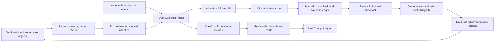

# Unit 11 — Kubernetes cost visibility with OpenCost

**Stage:** Stage 2E — Production DevOps & Platform Engineering  
**Subfolder:** `15-Platform-Capacity-Compute-Economics-and-FinOps/`  
**Module:** M15 — Platform Capacity, Compute Economics and FinOps  
**Unit:** 11 — Kubernetes cost visibility with OpenCost  
**Target file:** `11-kubernetes-cost-visibility-with-opencost.md`  
**Estimated study time:** 36–48 hours (foundations and guided analysis 9–12 h; labs 19–26 h; production review and design defence 8–10 h)  
**Prerequisites:** Stages 0–2D and Stage 2E M01–M14; Kubernetes namespaces/workloads/labels/requests/limits; Prometheus/Grafana basics; Python 3; CSV/JSON; M15 Units 1–10; especially Unit 3 synthetic billing/HCU conventions, Unit 4 allocation metadata, Unit 5 safe right-sizing, Unit 6 reliability trade-offs, Unit 8 spot economics, Unit 9 node capacity and Unit 10 replica-hour evidence.  
**Core tools:** Python 3 standard library, `unittest`, CSV/JSON, `kind`, `kubectl`, Helm, Prometheus, OpenCost, `curl`, `jq` (optional), `promtool` (for alert labs).  
**Awareness:** Cloud billing exports and provider billing integration, Kubecost commercial capabilities, FOCUS normalization, long-term Prometheus storage, multi-cluster federation, GPU vendor metrics.  
**Last reviewed:** 2026-11-03  
**Tool baseline:** OpenCost application `1.121.3`; OpenCost Helm chart `2.5.33` (chart metadata lists app version `1.121.3`); image digests must be checked against the chart values before use. Prometheus chart version must be selected from the current official chart index and recorded. Kubernetes/kind/Helm/Python/Prometheus versions are inherited from M03/M11 and must be recorded locally. Compatibility is `[VERIFY]` for the learner's exact stack.  
**Stack profile required:** Cap+Obs — local `kind` + minimal Prometheus + OpenCost; Grafana where laptop resources permit. Cap-Core fallback uses the manual model, synthetic data and scripts only.  
**Footprint:** `[ILLUSTRATIVE]` A small single-node kind cluster plus Prometheus, OpenCost and the required scrape components may need roughly 2–4 GiB of additional memory beyond the container runtime and host baseline; Grafana may add roughly 0.2–0.5 GiB. These are planning ranges, not measured or guaranteed requirements. Cardinality, retention, scrape interval, chart defaults and workload count can increase usage materially. Do not start the entire M11 observability stack and every optional component together. Measure baseline and peak CPU, memory and disk; sequence components and stop them after each lab.  
**Prices used:** hypothetical cost units (HCU) only. No real prices, currency values, provider rates, discounts, free-tier limits or commercial terms are used.

> **Completion outcome:** Build and operate a transparent Kubernetes cost-visibility pipeline. You will install a pinned OpenCost release against a local Prometheus instance, configure synthetic HCU rates, query allocations by namespace/controller/pod/label, inspect idle and efficiency, validate team labels, compare OpenCost with an independent calculation, estimate network egress, reconcile a synthetic billing ledger, monitor data quality, and govern pricing, retention, access and right-sizing. A `kind` cluster is a containerized test environment—not a priced cloud cluster. Its output demonstrates allocation mechanics, not real spend.

## Contents

- [Prerequisite handoff and source audit](#prerequisite-handoff-and-source-audit)
- [Scope, assumptions and fidelity contract](#scope-assumptions-and-fidelity-contract)
- [11.0 Why this matters in production](#110-why-this-matters-in-production)
- [11.1 Learning objectives](#111-learning-objectives)
- [11.2 Concept map and vocabulary](#112-concept-map-and-vocabulary)
- [11.3 Level 1 — Beginner](#113-level-1--beginner)
- [11.4 Level 2 — Intermediate](#114-level-2--intermediate)
- [11.5 Level 3 — Advanced](#115-level-3--advanced)
- [11.6 Level 4 — Expert](#116-level-4--expert)
- [11.7 SRE lens](#117-sre-lens)
- [11.8 Security lens](#118-security-lens)
- [11.9 Production checklist](#119-production-checklist)
- [11.10 Hands-on lab set — eleven mandatory labs](#1110-hands-on-lab-set--eleven-mandatory-labs)
- [11.11 Self-check questions](#1111-self-check-questions)
- [11.12 Evidence artifacts](#1112-evidence-artifacts)
- [11.13 Common interview and design-review questions](#1113-common-interview-and-design-review-questions)
- [11.14 Sources and verification notes](#1114-sources-and-verification-notes)
- [Appendix A — Manual allocation and reconciliation engine](#appendix-a--manual-allocation-and-reconciliation-engine)
- [Appendix B — Query cookbook, dashboards and alert templates](#appendix-b--query-cookbook-dashboards-and-alert-templates)
- [Appendix C — Worked examples](#appendix-c--worked-examples)
- [Appendix D — Eight incident scenarios](#appendix-d--eight-incident-scenarios)
- [Appendix E — Operational artifacts and runbooks](#appendix-e--operational-artifacts-and-runbooks)
- [Appendix F — Final audit](#appendix-f--final-audit)

---

## Prerequisite handoff and source audit

### Verbatim handoff source limitation

The attached Unit 11 generation prompt requires the exact Unit 11 handoff statement from the authoritative M15 syllabus-generation prompt. I inspected the available authoritative M15 syllabus-generation prompt and its complete Unit 11 curriculum block. That block contains the L1–L4 curriculum and lab requirements, but **does not contain a separately labelled Unit 11 verbatim handoff statement**. The generated syllabus artifact itself was not available in the accessible files. In accordance with the attached prompt, no replacement statement is fabricated or presented as verbatim. The cross-module handoff map below is an authored scope map, not a quotation.

### Source files inspected

| Source | What was inspected | How it informs this unit |
|---|---|---|
| Attached `Pasted markdown(20261103-074506).md` | Complete Unit 11 generation prompt, exact output contract, L1–L4 requirements, eight incidents, eleven labs, fifteen worked examples, operational artifacts, audit rules | Primary task specification |
| `PROMPT-Platform-Capacity-Compute-Economics-and-FinOps.md` in Library | Global M15 contract, L1–L4 model, exact unit skeleton, no-real-price rules, full Unit 11 curriculum block | Source curriculum and required unit structure |
| `Roadmap(20261103-035611).md` | Stage 2E subtree and full M15 folder listing | Confirms Unit 11 position and exact filename |
| Unit 1 generated lesson | Retrieved the current Library copy and inspected its cross-module map, stack profiles, headroom and lab safety | Idle capacity is not automatically waste |
| Unit 2 generated lesson | Retrieved the file and inspected its prerequisite handoff, scope map, quotas/priority and cost boundary | OpenCost allocation does not grant capacity or prove fairness |
| Unit 3 generated lesson | Retrieved the generated file and inspected the HCU rate card, exact synthetic billing schema/generator, `usage_date`/`available_at` clocks and budget interface | Reuse its CSV contract and estimated-versus-billed distinction |
| Unit 4 generated lesson | Retrieved the generated file and inspected metadata standard v3, owner registry, four buckets, shared drivers, model versioning and Unit 3 adapter | Reuses the exact Unit 4 taxonomy and policy |
| Unit 5 generated lesson | Retrieved the file and inspected its safe-cleanup scope, evidence-before-deletion and report-only/quarantine/delete boundary | OpenCost identifies candidates; cleanup remains reviewed |
| Unit 6 generated lesson | Retrieved the generated file and inspected its cross-module handoff and reliability/SLO trade-off boundary | No cost reduction without SLO/saturation validation |
| Unit 7 generated lesson | Retrieved the file and inspected release-review handoffs, cost deltas and SLO evidence | Reuse release evidence rather than repeat it |
| Unit 8 generated lesson | Retrieved the file and inspected spot/preemptible eligibility, HCU and interruption-safety boundaries | Simulated label-based spot pricing only |
| Unit 9 generated lesson and generation prompt | Retrieved generated lesson and prompt; reviewed node provisioning boundary, HCU-only and simulation safety | OpenCost is not a node autoscaler |
| Unit 10 generated lesson and generation prompt | Retrieved the file/prompt excerpts and inspected the exact prerequisite handoff, Unit 11 deferral and replica-hour/HCU interface | Reuse replica-hour/HCU and event-driven scaling context; do not re-teach KEDA |

**Roadmap sequence confirmed from the available tree:**

1. `01-platform-capacity-forecasting-and-headroom.md`
2. `02-workload-priorities-quotas-and-resource-contention.md`
3. `03-cloud-budget-alerts-and-spending-guardrails.md`
4. `04-cost-allocation-by-team-project-and-workload.md`
5. `05-idle-resource-detection-and-automated-cleanup.md`
6. `06-cost-reliability-and-performance-tradeoffs.md`
7. `07-capacity-and-cost-review-for-production-releases.md`
8. `08-spot-and-preemptible-instances-for-data-workloads.md`
9. `09-karpenter-and-cluster-autoscaler-node-provisioning.md`
10. `10-event-driven-autoscaling-with-keda.md`
11. **`11-kubernetes-cost-visibility-with-opencost.md`**
12. `12-gpu-scheduling-sharing-and-ml-workload-economics.md`

The M15 tree also contains `README.md`, `practice-questions.md`, and `Projects/README.md` plus `Projects/01-capacity-and-cost-governance-for-data-ml-platforms.md`. This deliverable creates none of those files.

### Cross-module handoff map

| Source | Reuse | Unit 11 boundary |
|---|---|---|
| M15 Unit 1 | Capacity/headroom, reserved versus observed demand, node utilization and bin-packing | Measure allocation/idle; do not forecast capacity again |
| M15 Unit 3 | Synthetic billing schema, HCU rate card, billing freshness and budget engine | Provide OpenCost signals as an additional near-real-time input; do not rebuild the budget engine |
| M15 Unit 4 | v3 `team`, `project`, `service`, `env`, `workload`, `cost-center`, `owner`, plus conditional `namespace`; ownership registry; direct/shared/idle/unallocated rules | Use the canonical schema; do not invent another label taxonomy or allocation engine |
| M15 Unit 5 | Waste detection, false-positive traps, report-only → quarantine → approved cleanup | Produce a right-sizing candidate/PR; do not automatically delete or evict |
| M15 Unit 6 | Cost/reliability/performance trade-off model | Cost is not a sufficient decision criterion |
| M15 Unit 7 | Release-level cost and unit-cost regression evidence | Supply historical allocation evidence; do not recreate release gates |
| M15 Unit 8 | Spot/preemptible workload and node labels | Demonstrate hypothetical label-based pricing only |
| M15 Unit 9 | Node pools, idle capacity, node provisioning | OpenCost allocates observed/provisioned cost; it does not provision nodes |
| M15 Unit 10 | KEDA scaling and replica-hour signals | Feed cost/replica-hour context; do not re-teach KEDA |
| M15 Unit 12 | GPU-hours and shared GPU attribution | Explain GPU allocation limits; detailed GPU scheduling/economics remain in Unit 12 |
| M11 | Prometheus metrics, Grafana dashboards-as-code, alert testing, retention and telemetry reliability | Verify metric names/labels against installed versions |
| M11 Unit 13 | Load/soak testing and before/after SLO verification | Required before accepting a right-sizing proposal |
| M14 | Cross-region replication, multi-cluster and network byte metrics | Estimate egress from synthetic byte counters; do not redesign multi-region topology |

## Scope, assumptions and fidelity contract

### What this unit teaches

- OpenCost architecture and its relationship to Prometheus and Kubernetes metadata.
- Cost allocation by container, pod, controller, namespace and label.
- CPU, memory, GPU, persistent-volume, network and idle cost concepts.
- API queries, metric inspection, dashboards and alert patterns.
- Hypothetical pricing, manual cross-checking, data-quality monitoring and synthetic billing reconciliation.
- Pricing/rate-card governance, retention, security, multi-team operating model and production runbooks.

### What this unit does not teach

- Provider billing-export integration with real credentials or invoices.
- Financial accounting, tax, journal entries or procurement policy.
- Automated workload eviction/deletion or automatic rightsizing.
- Detailed node provisioning (Unit 9), KEDA (Unit 10), GPU scheduling (Unit 12), or full team allocation policy (Unit 4).
- A guarantee that OpenCost sees every external charge or produces invoice truth.

### Evidence labels

| Label | Meaning |
|---|---|
| `[SYNTHETIC]` | Generated dataset, test output or simulated incident |
| `[ILLUSTRATIVE]` | Teaching number, threshold or policy example |
| `[ASSUMPTION]` | Explicit modeling choice that needs review |
| `[VERIFY]` | Version-, provider-, chart-, API- or environment-specific detail to check |
| `[MEASURED — YOUR ENVIRONMENT]` | A measurement the learner actually takes locally |
| `[HYPOTHETICAL]` | HCU price/rate input; not currency or a provider quote |

**HCU is a pedagogical unit, not money.** The [OpenCost specification](https://opencost.io/docs/specification/) describes cost values in currency terms and the UI may format numeric values with a currency symbol. For this lab, custom rates are synthetic normalized HCU values. Use API numeric fields and re-label them HCU in external reports. Do not copy a UI currency-formatted string into a report or claim it is a real invoice. The lab is a mechanism demonstration, not actual spend.

### Zero-budget and safety contract

1. No cloud account, provider credential, real billing export, paid service or billable resource is required.
2. `kind` nodes are containers. They do not represent priced cloud instances.
3. Use only synthetic HCU rate inputs. Do not include currency symbols or real provider rates.
4. Use a disposable cluster named `m15-opencost-lab` and namespace `opencost-lab` for sample workloads. Keep OpenCost and Prometheus in their own namespaces.
5. Before any cluster mutation, assert `kubectl config current-context` is exactly `kind-m15-opencost-lab`. If it differs, stop.
6. Do not expose OpenCost UI/API publicly. Use loopback-only port forwarding.
7. Do not mount cloud credentials, configure provider billing integration or enable cloud-cost ingestion.
8. All destructive actions are lab-only and scoped. No automated deletion of PVCs, PVs, snapshots, object data or production workloads.
9. Right-sizing output defaults to a report/PR proposal. A human owner must approve changes; M11 Unit 13 load/soak testing must show SLO safety.
10. If the laptop cannot run Prometheus + OpenCost comfortably, complete Cap-Core and run the Cap+Obs labs sequentially; measure resource use rather than assuming a fixed footprint.
11. Start optional Grafana only for the dashboard lab; stop it afterwards.
12. Local metrics and timings are not production benchmarks.

---

## 11.0 Why this matters in production

Kubernetes can tell an operator which pods are running and how much CPU or memory they are using, but it does not automatically answer how the shared node, persistent volume, GPU or network cost should be attributed to a team. Without a transparent allocation model, platform cost becomes a disputed aggregate and missing ownership can disappear inside a shared bucket. OpenCost provides a repeatable view of resource allocation and cost estimates, but those estimates depend on telemetry, pricing inputs, sampling and allocation rules. Production teams therefore need to monitor the cost pipeline itself and reconcile allocation to billing data rather than treating a dashboard as an invoice.

## 11.1 Learning objectives

By the end of this unit, the learner can:

1. **[L1]** Explain OpenCost's purpose, CNCF maturity status, specification and distinction between allocation, provider billing, showback, chargeback and unit economics.
2. **[L1]** Trace resource telemetry, Kubernetes metadata and pricing inputs through Prometheus and OpenCost into allocation API/UI output.
3. **[L1/L2]** Install a pinned OpenCost application/chart combination on a disposable local cluster with a compatible Prometheus data source.
4. **[L2]** Query allocation by namespace, controller, pod and Unit 4 labels; explain window, step, resolution, idle inclusion and idle sharing.
5. **[L2]** Reuse Unit 4 canonical labels and detect missing/invalid team ownership without silently assigning it to platform.
6. **[L2/L3]** Compare OpenCost allocation to an independent manual max(request, usage) model with explicit units, tolerance and limitations.
7. **[L2/L3]** Build dashboards and alert rules for cost, efficiency, idle, storage, price configuration and telemetry completeness.
8. **[L3]** Reconcile OpenCost allocation with a synthetic ledger and explain idle/shared, untracked, rate, label, retention and sampling variance.
9. **[L3]** Design data-quality monitoring that detects a planted scrape gap, stale pricing and incomplete historical windows.
10. **[L3/L4]** Govern rate cards, historical restatement, access, privacy, multi-cluster consistency, SLO-safe right-sizing and FinOps/SRE operating reviews.

## 11.2 Concept map and vocabulary

### End-to-end cost data pipeline



**Trust boundaries:** Kubernetes API metadata is not a finance ledger; Prometheus is a sampled telemetry store; OpenCost pricing is a model; the synthetic ledger is a teaching fixture; provider billing is external evidence that is not connected in these labs.

### Architecture in operational terms

1. Kubernetes API exposes nodes, pods, requests, limits, namespaces, labels, PVCs and ownership metadata.
2. Prometheus stores time-series measurements. The exact scrape components depend on the installation. The current OpenCost metric reference lists required node metrics and kube-state-metrics inputs; verify that each is present in your stack.
3. OpenCost reads resource metrics and applies pricing inputs. Pricing may come from provider data or custom pricing; this lab uses custom HCU values only.
4. OpenCost calculates allocation at a low workload level and aggregates by namespace, controller, pod, label or other supported dimension.
5. OpenCost exposes allocation APIs and Prometheus metrics. Grafana visualizes verified metrics; alert rules detect changes and missing data.
6. Unit 4 allocation logic and a synthetic ledger provide an independent reconciliation boundary. A difference is a question to investigate, not proof that either system is wrong.

### Vocabulary

| Term | Precise definition | Common misconception |
|---|---|---|
| OpenCost | Vendor-neutral open-source Kubernetes cost allocation project and specification implementation. | It is not a cloud invoice engine by itself. |
| Cost allocation | Assigning shared resource cost to workloads/tenants using a defined model. | Allocation is not automatically financial chargeback. |
| Provider billing | Provider's billing/usage data and invoice basis. | Not identical to Kubernetes allocation. |
| Showback | Reporting consumption/cost to owners without transferring funds. | It does not itself book a charge. |
| Chargeback | Finance-governed internal cost transfer or accounting treatment. | An engineering dashboard alone is not chargeback authority. |
| Rate card | Versioned rates and units used to calculate cost. | A rate card is not necessarily a provider invoice rate. |
| Resource allocation cost | Cost accrued because a resource is provisioned, independent of instantaneous usage. | Not the same as usage-based charges. |
| Resource usage cost | Cost driven by consumed units such as bytes transferred. | Not necessarily attributable to one pod. |
| Workload cost | Cost attributed to a workload using a defined resource model. | Does not include every external dependency. |
| Idle cost | Provisioned asset cost not assigned to workload allocation under the model. | Not automatically removable capacity. |
| Shared cost | A pool serving multiple tenants, allocated by a documented driver or kept separate. | Equal split is not always fair. |
| Unallocated cost | Cost with missing/invalid ownership or no supported attribution. | It must not silently disappear into a team. |
| Efficiency | Relationship between consumed/allocated resources and the chosen denominator. | A single efficiency ratio is not proof of waste. |
| Sampling resolution | Time granularity used to query/summarize Prometheus samples. | More resolution is not always more accurate if data was not scraped. |
| Retention | Duration for which Prometheus preserves samples. | OpenCost cannot reconstruct data that has expired. |
| Reconciliation | Explaining differences between allocation and a separately scoped ledger. | It is not simply forcing totals to match. |
| Historical restatement | Publishing a corrected report using a new model/rate version. | It should not silently overwrite the original report. |
| Unit economics | Cost per valid output unit, such as successful inference or GB processed. | Aggregate spend alone cannot measure efficiency. |
| Data completeness | Evidence that expected series, namespaces, assets and time windows are present. | A zero result does not prove complete data. |

### Current project facts verified at authoring time

- CNCF lists OpenCost as **Incubating**, with the maturity move recorded on 25 October 2024. Do not call it Graduated. Recheck the CNCF project page before a future upgrade or presentation.
- The [OpenCost GitHub release page](https://github.com/opencost/opencost/releases) lists `v1.121.3` as Latest at the time of research. The [OpenCost Helm chart catalog](https://artifacthub.io/packages/helm/opencost/opencost) lists chart `2.5.33` with app version `1.121.3`; chart and application versions are different version streams.
- The OpenCost Helm documentation describes the chart as community-supported and assumes an existing Prometheus installation.
- The [OpenCost specification](https://opencost.io/docs/specification/) defines workload cost for allocation-cost resources such as CPU/GPU as `max(request, usage)`; confirm exact implementation behavior and pod-state handling for the selected application release.
- The current allocation API documents `window`, `aggregate`, `step`, `resolution`, `includeIdle`, `shareIdle` and `idleByNode`. `accumulate` is documented for cloud-cost/external-cost endpoints, not the standard `/allocation` query in the current API reference. Do not pass it to `/allocation` unless the installed API schema explicitly supports it.

### What OpenCost can and cannot tell you

| It can help estimate | It cannot prove on its own |
|---|---|
| CPU/RAM/GPU allocation cost from node rates and workload allocation | Final invoice amount or finance-approved amortized cost |
| PVC allocation cost for supported persistent volumes | Full object-store, snapshot, backup and unmanaged database spend |
| Selected network egress categories when data/rates are configured | Every packet, cross-region flow, NAT, gateway or provider-specific charge |
| Idle allocation under its cost model | Which idle capacity can safely be removed |
| Cost by supported Kubernetes dimensions and labels | Business ownership if labels/registry are wrong |
| Historical allocation within available telemetry retention | History beyond Prometheus retention or before metrics existed |
| Cost changes after a rate-card change | Whether the underlying provider rate/discount is correct |
| A modelled GPU allocation | Precise per-tenant GPU time-slice use without adequate instrumentation |

### Allocation versus invoice: the accounting boundary

A useful conceptual identity is:

\[
\text{Total cluster cost} =
\text{workload allocation} +
\text{cluster idle} +
\text{cluster overhead}
\]

This identity is a model boundary, not a guarantee that every real invoice item is present in OpenCost. The OpenCost specification separates resource allocation costs, resource usage costs and cluster overhead; workload allocations plus idle allocation reconcile to asset costs under the model. Provider invoice lines can include external services, taxes/credits, discounts, support, snapshots, data transfer, managed services and accounting adjustments outside the Kubernetes allocation scope.

### Cost categories and allocation basis

| Resource | Common allocation basis | Main limitation |
|---|---|---|
| CPU | Greater of request and measured usage for allocation-cost resources under the spec | Short-lived spikes can be missed by sampling |
| Memory | Greater of request and measured memory use | Working set/RSS metric choice matters |
| GPU | Requested/allocated device count and supported usage signals | Time-slicing/MPS/MIG sharing can distort per-tenant usage |
| Persistent volume | PVC requested capacity over time in the spec | Does not equal filesystem used bytes; snapshots/backups may be external |
| Network | Supported egress bytes/rates where instrumented/configured | Directionality, cross-region, NAT, retransmits and missing paths |
| Load balancer | Resource allocation and usage dimensions where supported | Provider-specific billing dimensions |
| Idle | Asset cost minus workload cost under the model | Can include required resilience/headroom |
| Shared platform | Explicit driver such as request share, series volume, runner minutes or fixed share | Driver choice affects team incentives |
| External services | Separate ledger/inventory join | Not automatically part of Kubernetes allocation |

---

## 11.3 Level 1 — Beginner: first allocation

### What OpenCost is

OpenCost is a vendor-neutral open-source project for measuring and allocating Kubernetes and infrastructure costs. It has an open specification intended to make allocation models more portable. CNCF currently lists the project as Incubating. OpenCost is not the same thing as Kubecost's commercial offering, and the exact feature boundary between projects must be verified from current official product documentation.

The core mental model is:

- Prometheus supplies time-series measurements and stores them for historical queries.
- Kubernetes metadata supplies ownership and requested-resource context.
- Pricing inputs turn resource quantities and time into a cost estimate.
- OpenCost applies an allocation model and exposes the result.
- Teams use the result to investigate cost drivers and improve resource decisions.

### What does “cost” mean in the model?

A simple resource allocation calculation is:

\[
\text{allocation cost} =
\text{allocated quantity} \times \text{duration} \times \text{rate}
\]

Units must cancel correctly. For example:

\[
\text{cores} \times \text{hours} \times
\frac{\text{HCU}}{\text{core-hour}} = \text{HCU}
\]

For usage-based costs:

\[
\text{usage cost} =
\text{usage quantity} \times \text{unit rate}
\]

Example units:

- CPU: cores × hours × HCU/core-hour.
- Memory: GiB × hours × HCU/GiB-hour.
- GPU: allocated GPU count × hours × HCU/GPU-hour.
- Storage: GiB × hours × HCU/GiB-hour.
- Egress: GiB transferred × HCU/GiB.

Do not multiply bytes by a GiB rate until the conversion is explicit. Use \(1\,\text{GiB}=2^{30}\) bytes when binary GiB is the chosen unit.

### OpenCost's workload model

The OpenCost specification says workload costs for allocation-cost resources such as CPU/GPU should be understood as the greater of request and usage. This reflects the fact that a reserved resource may incur cost even when it is not busy. For a running container, the teaching model is:

\[
q_{\text{allocated}}=\max(q_{\text{request}},q_{\text{usage}})
\]

This does not mean every API endpoint in every release exposes both raw request and raw usage fields in the same response. Use the raw telemetry and OpenCost allocation API separately, and inspect the installed schema.

Why `max(request, usage)` matters:

- If a container requests 2 cores and uses 0.4 cores, the allocation model may attribute 2 cores of provisioned capacity. The unused 1.6 cores are not free if they were reserved and priced.
- If a container requests 0.5 cores but bursts to 1.2 cores, an allocation model using max(request, usage) attributes 1.2 cores for that interval. The burst may be short-lived and sensitive to scrape resolution.
- If request is 0 and usage is positive, actual implementation and pod state matter; do not assume an invalid workload is free.

### Idle is a model result, not a cleanup command

At asset level:

\[
\text{idle cost} =
\text{asset cost} - \text{workload allocation}
\]

At cluster level, OpenCost's specification describes idle percentage relative to resource allocation cost. A 40% idle report can include capacity deliberately held for N−1 resilience, traffic spikes, rollout surge, scheduling fragmentation, system overhead and failover. It is a prompt for investigation—not a command to delete nodes.

### Installation architecture and version selection

The current verified reference set at authoring time:

| Component | Selected baseline | Notes |
|---|---|---|
| OpenCost app | `1.121.3` | Pin app image; verify current release page before a future install |
| OpenCost Helm chart | `2.5.33` | Catalog reports appVersion `1.121.3`; chart is community-supported |
| Prometheus | Use the learner's M11 validated version, or choose/pin from the official Prometheus Community chart index | Do not invent a chart version |
| Kubernetes/kind | Existing M03/M11 lab version | Check compatibility for exact image and host |
| Grafana | M11 validated version, optional | Only start for dashboard lab |

Before installation, record:

```bash
python --version
kubectl version --client
kind version
helm version
helm repo add opencost-charts https://opencost.github.io/opencost-helm-chart
helm repo update
helm search repo opencost-charts/opencost --versions
helm show chart opencost-charts/opencost --version 2.5.33
helm show values opencost-charts/opencost --version 2.5.33 > opencost-chart-values-2.5.33.yaml
```

Confirm `appVersion` is `1.121.3`, record the image tags/digests in `versions.txt`, and review the exact chart values before installing. If the chart index no longer contains `2.5.33`, stop and select a currently listed chart version whose `appVersion` and image digests are explicitly recorded. Do not silently substitute `latest`.

### Minimal local installation — guarded path

The installation commands below are a reproducible pattern, but the learner must use an isolated cluster and inspect the chart values first. The official OpenCost on-premises guide states that Prometheus is required and shows a Prometheus Community chart path; the official Helm guide says the OpenCost Helm chart assumes an existing Prometheus instance.

Create the lab cluster only if one does not already exist:

```bash
kind get clusters
kind create cluster --name m15-opencost-lab
kubectl config use-context kind-m15-opencost-lab
test "$(kubectl config current-context)" = "kind-m15-opencost-lab"
kubectl cluster-info
```

Create a namespace for sample workloads:

```bash
kubectl create namespace opencost-lab
kubectl label namespace opencost-lab purpose=m15-opencost-lab
```

For Prometheus, reuse the learner's existing M11 Prometheus installation if it is compatible and has the required node-exporter, kube-state-metrics and container metrics. Otherwise, follow the official OpenCost Prometheus installation guide. Before running a Helm install, select and pin a Prometheus chart version from the chart index and verify the rendered service name and port:

```bash
helm repo add prometheus-community https://prometheus-community.github.io/helm-charts
helm repo update
helm search repo prometheus-community/prometheus --versions
```

The chart version is intentionally not hard-coded here because it is a separate release stream and must be selected from the live chart index at installation time. Record it and render the chart before applying.

The official on-prem guide uses an OpenCost-provided Prometheus scrape configuration file. For a reproducible lab, obtain the scrape configuration from the **matching OpenCost application tag** if the file exists there; verify its contents and record its SHA-256. Do not use an unpinned `develop` branch file in a pinned lesson. If no matching tagged file is available, use the scrape configuration from the installed OpenCost documentation/chart and validate every target after install.

Install OpenCost with the pinned chart and a local values file:

```bash
helm install opencost opencost-charts/opencost \
  --namespace opencost --create-namespace \
  --version 2.5.33 \
  --values opencost-values.yaml \
  --wait --timeout 10m
```

The values file must set the Prometheus namespace/service/port based on the actual service observed in the cluster, and enable custom pricing with HCU-only values. A starter appears below; verify every key against the pinned chart values before use.

```yaml
# File: opencost-values.yaml
# OpenCost chart 2.5.33 values hierarchy; app image digests pinned.
# Confirm with: helm show values opencost-charts/opencost --version 2.5.33

service:
  type: ClusterIP

opencost:
  cloudIntegrationSecret: ""
  cloudIntegrationJSON: ""

  # Not needed for this unit; disable the optional MCP endpoint.
  mcp:
    enabled: false
    ingress:
      enabled: false

  exporter:
    defaultClusterId: m15-opencost-lab
    replicas: 1
    image:
      tag: "1.121.3@sha256:4cdd173253e5abba048dfe2cfa968707a5b59d774157d5356940d0d923a6c281"
    resources:
      requests:
        cpu: "50m"
        memory: "128Mi"
      limits:
        cpu: "500m"
        memory: "512Mi"

  ui:
    enabled: true
    image:
      tag: "1.121.3@sha256:99ee2db766a074fcbc321bbddfae1851c159339f463a3c32a9ba87727576a3ed"
    ingress:
      enabled: false

  apiIngress:
    enabled: false

  cloudCost:
    enabled: false

  prometheus:
    internal:
      enabled: true
      namespaceName: prometheus-system
      serviceName: "<OBSERVED_PROMETHEUS_SERVICE_NAME>"
      port: <OBSERVED_PROMETHEUS_SERVICE_PORT>

  customPricing:
    enabled: true
    provider: default
    costModel:
      description: "M15 synthetic HCU rate card; not provider pricing"
      CPU: 0.12
      RAM: 0.03
      GPU: 1.50
      storage: 0.004
      spotCPU: 0.05
      spotRAM: 0.012
      zoneNetworkEgress: 0.0002
      regionNetworkEgress: 0.0005
      internetNetworkEgress: 0.001
      spotLabel: "capacity-type"
      spotLabelValue: "spot"
```

All values above are `[HYPOTHETICAL]` HCU rates selected for a teaching fixture. Their units are respectively HCU/core-hour, HCU/GiB-hour, HCU/GPU-hour, HCU/GiB-hour and HCU/GiB egress. They are not real prices. The `spotLabel`/`spotLabelValue` fields are documented in OpenCost custom-pricing examples; verify their presence and semantics in the selected chart/application release before applying. The app/UI image digests shown are the chart catalog's published digests for this app version; confirm them against the pinned chart package. Do not enable provider cloud integration or add cloud credentials.

Check readiness and services:

```bash
kubectl get pods -n opencost
kubectl get svc -n opencost
kubectl get pods -n prometheus-system
kubectl get svc -n prometheus-system
kubectl -n prometheus-system port-forward svc/<OBSERVED_PROMETHEUS_SERVICE_NAME> 9090:<OBSERVED_PROMETHEUS_SERVICE_PORT>
```

In another terminal, query the Prometheus HTTP API through the loopback-only port-forward:

```bash
curl --fail --silent --show-error "http://127.0.0.1:9090/api/v1/targets"
curl --fail --silent --show-error "http://127.0.0.1:9090/api/v1/status/config"
```

OpenCost API and UI access must be loopback-only:

```bash
kubectl -n opencost port-forward svc/opencost 9003:9003 9090:9090
```

Then, in another terminal:

```bash
curl --fail --silent --show-error \
  "http://127.0.0.1:9003/allocation/compute?window=60m&aggregate=namespace"
```

Expected response shape (not exact values):

```json
{
  "code": 200,
  "data": [
    {
      "opencost": {
        "name": "opencost",
        "cpuCost": 0.0,
        "ramCost": 0.0,
        "pvCost": 0.0,
        "gpuCost": 0.0,
        "totalCost": 0.0
      }
    }
  ]
}
```

This is a schema illustration, not a guaranteed response from every release. Verify the exact endpoint/response for the installed app; a zero result immediately after installation may simply mean that the measurement window contains no workload samples yet.

### First namespace query: 1-day and 7-day windows

The standard Allocation API documents `window`, `aggregate`, `step`, `resolution`, `includeIdle`, `shareIdle` and `idleByNode`.

```bash
curl --fail --silent --show-error -G \
  "http://127.0.0.1:9003/allocation" \
  --data-urlencode "window=1d" \
  --data-urlencode "aggregate=namespace" \
  --data-urlencode "resolution=1m" \
  --data-urlencode "includeIdle=true"
```

```bash
curl --fail --silent --show-error -G \
  "http://127.0.0.1:9003/allocation" \
  --data-urlencode "window=7d" \
  --data-urlencode "aggregate=namespace" \
  --data-urlencode "step=1d" \
  --data-urlencode "resolution=5m" \
  --data-urlencode "includeIdle=true"
```

For a time series, use `step` on `/allocation`. The current standard Allocation API reference does **not** list `accumulate` as an Allocation query parameter; it documents `accumulate` for Cloud Costs and external-cost endpoints. Do not copy `accumulate` into the Allocation query unless the installed version's API schema says it is supported.

### Guided first allocation walkthrough

1. Deploy one tagged CPU workload and one untagged workload in `opencost-lab`.
2. Wait for Prometheus to scrape several samples.
3. Query namespace allocation with `window=1d`.
4. Inspect `cpuCost`, `ramCost`, `pvCost`, `gpuCost`, `networkCost`, `sharedCost` and `totalCost` only if those fields are present in the selected response schema.
5. Query `aggregate=label:team` and compare to namespace aggregation.
6. Query `includeIdle=true`; then compare with `shareIdle=true`.
7. Record the time window, resolution, price-card version, namespace, labels and missing data caveats.
8. Compare the OpenCost value with the manual engine in Appendix A.

### What just happened? Trace one number

Suppose `[SYNTHETIC]` a container's measured CPU usage is 0.3 cores, while its request is 0.8 cores. The OpenCost specification's allocation-cost model uses the greater of request and usage for CPU, so the teaching model allocates 0.8 cores. If the synthetic CPU rate is 0.12 HCU/core-hour and the measured interval is 4 hours:

\[
0.8\ \text{cores}\times4\ \text{hours}\times
0.12\ \frac{\text{HCU}}{\text{core-hour}}=0.384\ \text{HCU}
\]

The difference between 0.8 allocated cores and 0.3 used cores is a utilization/efficiency signal. It is not automatically removable: the request may cover bursts or an SLO. The owner should inspect percentiles, concurrency, throttling, load tests and headroom before changing it.

### Common beginner mistakes

| Mistake | Symptom | Correction |
|---|---|---|
| Calling OpenCost output an invoice | Finance disputes totals | Label it allocation estimate and reconcile to a scoped ledger |
| Using real prices in a lab | Demo output resembles real spend | Use HCU and keep cloud integration disabled |
| Treating missing metric as zero | Cost falls unexpectedly | Track scrape/query completeness and stale data separately |
| Treating 40% idle as waste | Team removes headroom and outage follows | Compare idle to N−1, bursts, rollout surge and failure-domain requirements |
| Comparing a 7-day query with 2-day retention | Month-end totals appear low | Enforce retention/window completeness |
| Tagging only Deployment metadata | Pods are unlabelled | Put labels on pod templates and validate live pods |
| Sharing idle without policy | Teams dispute allocations | Publish separate-idle and shared-idle views and a finance-approved rule |
| Setting requests equal to average usage | Throttling/latency rises | Use percentiles and load-test evidence |


---

## 11.4 Level 2 — Intermediate: allocation, query API, efficiency and reconciliation

### 11.4.1 Allocation API: query contract

The current OpenCost Allocation API uses these query parameters:

| Parameter | Meaning | Practical use |
|---|---|---|
| `window` | Required duration/range | `1d`, `7d`, `month`, or an RFC3339 start/end pair |
| `aggregate` | Kubernetes dimension | `namespace`, `controller`, `pod`, `container`, `label:team` |
| `step` | Duration of each allocation set | Time-series slices over the requested window |
| `resolution` | Prometheus query resolution | Trade accuracy for short jobs against query cost |
| `includeIdle` | Include a separate `__idle__` allocation | Make idle visible |
| `shareIdle` | Distribute idle cost over non-idle allocations | Compare shared allocation view |
| `idleByNode` | Calculate/share idle per node instead of cluster-wide | Avoid cross-node redistribution where relevant |

The current API docs do not list `shareNamespaces`, `shareLabels`, or `accumulate` as standard `/allocation` parameters. The current API docs use `shareIdle` and `idleByNode`; `accumulate` appears in cloud-cost/external-cost APIs. Treat unsupported parameter names as errors, not silent defaults. Confirm the actual query against the installed release's API docs and test invalid parameter behavior.

Examples:

**Namespace over 1 day**

```bash
curl -G "http://127.0.0.1:9003/allocation" \
  --data-urlencode "window=1d" \
  --data-urlencode "aggregate=namespace" \
  --data-urlencode "resolution=1m"
```

**Controller over 7 days**

```bash
curl -G "http://127.0.0.1:9003/allocation" \
  --data-urlencode "window=7d" \
  --data-urlencode "aggregate=controller" \
  --data-urlencode "step=1d" \
  --data-urlencode "resolution=5m"
```

**Pod within one namespace** — filter syntax can be version-sensitive; use the filter syntax documented for the selected API release and validate it before relying on it. A simple safe alternative is to query `aggregate=pod` and filter the returned JSON by its namespace property in a client-side script.

**Team label**

```bash
curl -G "http://127.0.0.1:9003/allocation" \
  --data-urlencode "window=7d" \
  --data-urlencode "aggregate=label:team" \
  --data-urlencode "step=1d" \
  --data-urlencode "resolution=5m"
```

**Controller + team**

```bash
curl -G "http://127.0.0.1:9003/allocation" \
  --data-urlencode "window=7d" \
  --data-urlencode "aggregate=controller,label:team" \
  --data-urlencode "step=1d" \
  --data-urlencode "resolution=5m"
```

**Idle as a separate bucket**

```bash
curl -G "http://127.0.0.1:9003/allocation" \
  --data-urlencode "window=1d" \
  --data-urlencode "aggregate=namespace" \
  --data-urlencode "includeIdle=true"
```

**Distribute idle proportionally across allocations**

```bash
curl -G "http://127.0.0.1:9003/allocation" \
  --data-urlencode "window=1d" \
  --data-urlencode "aggregate=namespace" \
  --data-urlencode "shareIdle=true"
```

**Distribute idle within each node**

```bash
curl -G "http://127.0.0.1:9003/allocation" \
  --data-urlencode "window=1d" \
  --data-urlencode "aggregate=namespace" \
  --data-urlencode "shareIdle=true" \
  --data-urlencode "idleByNode=true"
```

### 11.4.2 Read and validate the response

The API examples show an envelope containing `code` and `data`; each time step can contain a map keyed by allocation name. The detailed object shape depends on endpoint and version. Fields such as `cpuCost`, `ramCost`, `gpuCost`, `pvCost`, `totalCost`, `cpuCoreHours`, `ramByteHours`, `gpuHours`, `preemptible`, `discount`, `adjustment` and efficiency values must be read from the selected endpoint's current schema. Do not assume the same object shape for `/allocation`, `/allocation/compute` and `/assets`.

A compact inspection flow:

```bash
curl --fail --silent --show-error \
  "http://127.0.0.1:9003/allocation/compute?window=1d&aggregate=namespace" \
  > allocation-1d.json

python - <<'PY'
import json
from pathlib import Path

doc = json.loads(Path("allocation-1d.json").read_text())
assert doc.get("code") == 200, doc
assert isinstance(doc.get("data"), list), type(doc.get("data"))
print("sets:", len(doc["data"]))
for i, allocation_set in enumerate(doc["data"]):
    print("set", i, "allocation keys:", list(allocation_set)[:10])
PY
```

If the installed API returns a different envelope, inspect the response and OpenAPI/spec documentation rather than changing the parser blindly.

**What each field means:** resource costs are cost components for the allocation interval; resource quantities/hours are usage/allocation measurements; `totalCost` is a total under the endpoint's included cost categories. `efficiency` is not a universal synonym for request utilization: check whether the endpoint's value is request-based, usage-based or another cost-weighted ratio. For consistent cross-checking, compute efficiency externally from raw request and usage metrics:

\[
\text{CPU usage/request ratio} =
\frac{\text{average CPU usage}}{\text{CPU request}}
\]

\[
\text{memory usage/request ratio} =
\frac{\text{average memory working set}}{\text{memory request}}
\]

Ratios above 1 can occur when usage exceeds request. A ratio near zero can mean low demand, missing usage data, a broken selector, or a container not running; data-quality checks must disambiguate.

### 11.4.3 The unallocated bucket and Unit 4 labels

Unit 4's current metadata standard (v3) requires `team`, `project`, `service`, `env`, `workload`, `cost-center` and `owner`. For Kubernetes workload SKUs (`k8s-pod`, `k8s-container`), `namespace` is conditionally required. The lab's manual CSV rows all represent Kubernetes workload rows, so the reference validator requires `namespace` for those fixtures. The CSV normalizes `cost-center` to `cost_center`, and preserves source metadata.

| Kubernetes label / metadata key | Normalized CSV field | Example |
|---|---|---|
| `team` | `team` | `team-a`, `team-b`, `platform`, `team-inference`, `team-data`, `team-ml`, `team-platform` |
| `project` | `project` | `checkout`, `analytics`, `inference-prod`, `data-prod`, `ml-prod`, `shared-platform` |
| `service` | `service` | `inference-api`, `etl`, `training`, `network`, `observability`, `ci`, `registry`, `control-plane` |
| `env` | `env` | `prod`, `nonprod`, `dev` |
| `workload` | `workload` | `daily-etl`, `inference-v3`, `gpu-worker-a` |
| `cost-center` | `cost_center` | `cc-analytics`, `cc-platform` |
| `owner` | `owner` | approved owner role from the Unit 4 ownership registry |
| `namespace` | `namespace` | required for Kubernetes workload SKU rows; conditional for other billing rows |

The ownership registry validates that the team is active and that owner role, service, project and cost center match the registry. The label is not a security boundary and is not proof of actual consumption. The small sample dataset below uses a subset of Unit 4's allowed values; the production taxonomy remains the versioned Unit 4 registry.

Unit 4's model contract defines four mutually exclusive buckets:

1. **Direct:** valid metadata and active ownership registry.
2. **Shared:** common platform services allocated by a published driver.
3. **Idle:** provisioned capacity not assigned to workload under the declared model.
4. **Unallocated:** missing/invalid owner metadata, represented as `__unallocated__`.

Do not silently map unknown teams to `platform`. Do not count shared costs once as a platform direct allocation and again when distributing the shared pool. The sum of the four buckets must equal the in-scope synthetic ledger total within the approved tolerance.

The `kubectl-cost` documentation explicitly describes “Unallocated” as resources not using the selected label. Its output is useful for exploration, but the final ownership validation must also check the active Unit 4 registry. An unknown but syntactically valid team label is still unallocated until registry validation succeeds.

### 11.4.4 Team-label data-quality report

Required checks:

- required label keys exist on every workload pod template;
- the live Pod has the labels after rollout;
- the team exists and is active in the Unit 4 ownership registry;
- service/project/cost-center are allowed and consistent;
- namespace/team mismatch is detected;
- missing label and invalid value are counted separately;
- a missing team does not become platform;
- retroactive correction preserves the original report and publishes a restated version.

A lightweight check with `kubectl`:

```bash
kubectl get pods -n opencost-lab \
  -o custom-columns='POD:.metadata.name,TEAM:.metadata.labels.team,SERVICE:.metadata.labels.service,ENV:.metadata.labels.env,COST_CENTER:.metadata.labels.cost-center,PROJECT:.metadata.labels.project,WORKLOAD:.metadata.labels.workload'
```

A missing column value is not proof that the cost is zero; it is an ownership data-quality issue.

### 11.4.5 Idle cost and sharing choices

The API's `includeIdle=true` asks for the calculated `__idle__` allocation. `shareIdle=true` distributes idle cost across non-idle allocations proportionally to their non-idle costs. `idleByNode=true` makes the idle calculation node-scoped rather than cluster-scoped.

Use both views:

- **Separate idle view:** makes capacity overhead visible to platform and capacity owners.
- **Shared idle view:** may be useful for showback when teams agree to bear their proportionate share.
- **Per-node sharing:** can avoid allocating idle on a node to workloads on another node when that distinction is meaningful.

Do not pick the view that makes a team's cost look best. The allocation model version, rate card, `includeIdle`/`shareIdle` choice, query window and aggregation must be attached to every published report.

Idle may include:
- N−1 spare capacity and maintenance headroom;
- rollout surge capacity;
- burst capacity for queues and batch windows;
- DaemonSet/system overhead;
- fragmentation caused by CPU/memory shape mismatch;
- node capacity awaiting KEDA/Cluster Autoscaler activity;
- capacity retained for failover or DR.

A cost report can reveal where idle exists; it cannot decide whether the capacity is safe to remove. Unit 1/9 capacity evidence and Unit 6 reliability constraints must be reviewed.

### 11.4.6 Efficiency analysis and safe right-sizing

The OpenCost specification's `max(request, usage)` model means request and usage both matter. A simple external report can rank workloads by the difference between request and measured usage:

\[
\text{unused request quantity} =
\max(0,\text{request}-\text{usage})
\]

\[
\text{potential HCU signal} =
\text{unused quantity}\times\text{hours}\times\text{HCU rate}
\]

This is a candidate signal, not realized savings. If the node is still billed at the same hourly rate after lowering one pod's request, the cluster may not save any provider spend. The benefit may be capacity reclaimed for another workload rather than an invoice reduction. Distinguish:
- *allocated-cost reclassification*;
- *capacity released*;
- *node count reduced*;
- *actual bill reduction*.

Safe right-sizing workflow:

1. Rank candidates using a representative window that includes weekly/daily peaks.
2. Inspect p50, p95, p99 and max usage; correlate with throttling, OOMs, queue age and SLOs.
3. Exclude short-lived migrations, scheduled quarterly jobs, DR standby, legal holds and workloads with known burst windows unless separately reviewed.
4. Produce a PR proposal with before/after requests and limits, not an automatic mutation.
5. Run load/soak tests using M11 Unit 13.
6. Compare throughput, p95/p99 latency, error rate, CPU throttling, memory pressure, queue freshness and recovery.
7. Roll back if any agreed SLO/guardrail regresses.
8. Verify whether actual node capacity/cost changed. Do not claim savings from a lower request alone.

### 11.4.7 Pattern catalogue

| Pattern | Use when | Do not use when |
|---|---|---|
| Namespace aggregation | Team boundary maps cleanly to namespace | Many teams/services share one namespace |
| Label aggregation | Teams share namespaces or need project/service dimensions | Labels are missing, mutable without history or not registry-validated |
| Separate idle bucket | Capacity owner needs transparency | Showback policy explicitly requires shared idle distribution |
| Proportional idle sharing | Tenants agree to a cost-weighted share | Tenants have materially different resilience entitlements |
| Request/usage max model | Provisioned capacity is cost-bearing and request is meaningful | Resource is billed purely on actual usage or model semantics differ |
| Usage-only analysis | Identify workload demand and efficiency | It is used to allocate provisioned cost without a reservation model |
| PV requested-capacity allocation | PVC request drives the billable reservation | Billing is based on used blocks or storage class features not represented |
| External egress worksheet | Gateway/CNI/mesh byte telemetry is available | Multiple layers count the same bytes or directionality is unknown |
| Synthetic billing reconciliation | Teach variance analysis without actual invoices | It is presented as a provider invoice reconciliation |
| HCU pricing in lab | Compare models without real pricing | It is labelled or copied as currency |
| OpenCost metrics to Unit 3 budget engine | Near-real-time signal is useful before billing data arrives | The metric is treated as the sole source of actual spend |

### 11.4.8 Anti-pattern catalogue

| Bad practice | How it misleads or harms | Corrected practice |
|---|---|---|
| Use request compliance as proof of efficiency | Workloads can request tiny values and throttle | Include usage percentiles, SLOs and saturation |
| Treat `totalCost` as invoice total | External charges/credits/discounts may be absent | Reconcile scope and timing with a separate ledger |
| Use one month-long query with short retention | Partial history appears like low spend | Gate query windows on retention completeness |
| Change custom rates in place | Historical showback becomes irreproducible | Version rate card with effective date and restatement policy |
| Force all idle to teams | Incentivizes teams to reduce resilience headroom | Publish separate idle and shared-idle views |
| Put every unknown resource under platform | Platform absorbs data-quality failures | Keep `__unallocated__` with owner/expiry |
| Remove labels after workload ends | Historical attribution becomes ambiguous | Preserve metadata snapshot and report version |
| Use OpenCost metrics without source health | Missing scrape can look like savings | Alert on scrape/query completeness and zero anomalies |
| Automate rightsizing from one average | Removes peak capacity and harms SLO | Human-reviewed PR plus load/soak test |
| Count egress at multiple layers | Double counts network bytes | Select one authoritative observation point per flow |

### 11.4.9 Synthetic billing reconciliation

A reconciliation compares two datasets with explicit scope:

- OpenCost allocation result: Kubernetes resources and price-model output.
- Synthetic invoice ledger: generated HCU rows representing the intended lab accounting scope.

Do not expect exact equality unless both sides share the same scope, time window, rate card, idle/shared policy, ownership mapping and cost categories.

The report must include:
- allocation total and synthetic ledger total;
- delta HCU and delta percentage;
- direct/shared/idle/unallocated breakdown;
- untracked egress, snapshot/storage and external service rows;
- pricing model and effective date;
- telemetry completeness and retention status;
- owner, root cause and corrective action for every variance;
- whether a restatement is required.

Variance formula:

\[
\Delta_{\text{HCU}} =
\text{OpenCost allocation} -
\text{synthetic ledger}
\]

\[
\Delta_{\%} =
\frac{\Delta_{\text{HCU}}}
{\max(|\text{synthetic ledger}|,\epsilon)}\times100
\]

Use an explicit non-zero denominator guard \(\epsilon\); do not divide by zero when the ledger is empty.

### 11.4.10 Network/egress estimation

OpenCost can model network costs where supported and configured, but it is not a universal packet-accounting system. For M14-style cross-region replication, use one selected byte counter at the egress boundary and a hypothetical HCU/GiB rate:

\[
\text{estimated egress HCU} =
\frac{\text{egress bytes}}{2^{30}}
\times \text{HCU/GiB}
\]

A gateway, CNI, service mesh sidecar and destination may all observe overlapping traffic. Counting all four can double or triple count. Decide whether the metric counts ingress or egress, source or destination, retries, retransmits, protocol headers, compression, and cross-region direction. Use synthetic CSV bytes in the lab; mark any actual exporter metric name `[VERIFY]`.

### 11.4.11 Spot/on-demand and GPU pricing

The [OpenCost on-premises custom-pricing guide](https://opencost.io/docs/configuration/on-prem/) and chart values document custom pricing fields including `spotCPU`, `spotRAM`, `spotLabel` and `spotLabelValue`; verify exact chart support before applying. Use these only after confirming the exact chart version's values. This lab models a spot label distinction, not provider reclaim behavior or a real discount. Do not invent a `spotGPU` key; the selected chart values may not expose one.

GPU price inputs can model allocated GPU hours, but attribution becomes less precise when one physical GPU is time-sliced, shared via MPS, or partitioned. A device count allocated to each pod does not necessarily equal proportional compute/memory use. Use Unit 12's GPU scheduling/telemetry design and document attribution limitations.

### 11.4.12 Export and retention

For Unit 4's allocation pipeline, export a stable schema such as:

```csv
window_start,window_end,cluster,namespace,controller,pod,team,service,env,cost_center,project,workload,cpu_hcu,ram_hcu,gpu_hcu,pv_hcu,network_hcu,idle_hcu,total_hcu,model_version,rate_card_version,resolution,completeness
```

Add:
- `source_api`, `api_version`, `query_parameters`;
- extraction timestamp and unique batch ID;
- idempotency key from source + window + aggregation + model version;
- `completeness_status` (`complete`, `partial`, `unknown`);
- original metadata snapshot hash.

If a window exceeds Prometheus retention, do not return a deceptively complete report. Mark the export partial or unavailable. Long-term storage systems such as Thanos, Cortex or Mimir are awareness options; design and test them in a separate module/environment before claiming they are integrated.

### 11.4.13 OpenCost and budget-engine interface (Unit 3)

OpenCost can provide an earlier cost/allocation signal than provider billing data. Unit 3's existing synthetic billing CSV contract uses these core fields:

```csv
usage_date,available_at,account,project,environment,team,owner,service,resource_type,region,usage_quantity,usage_unit,rate_hcu,cost_hcu,resource_id,tags_present
```

Preserve the distinction between `usage_date` (when resource allocation accrued) and `available_at` (when the estimate/export became available). Unit 3's synthetic billing generator uses a separate billing-availability clock; OpenCost allocation is an operational estimate and should normally be available earlier. Do not copy the synthetic two-day billing delay onto the OpenCost estimate unless the export actually has that delay.

A normalized OpenCost-to-Unit-3 adapter should map one row per allocation dimension/resource type:

| Unit 3 field | OpenCost adapter mapping |
|---|---|
| `usage_date` | Date of the allocation window start |
| `available_at` | Timestamp when the API export was successfully produced |
| `account` | Synthetic cluster/account identifier, e.g. `m15-opencost-lab` |
| `project`, `environment`, `team`, `owner`, `service` | Validated Unit 4 v3 metadata |
| `resource_type` | `cpu`, `ram`, `gpu`, `pv`, `network` |
| `region` | `local-kind` for this local lab; not a real cloud region |
| `usage_quantity` | Normalized allocated resource quantity over the window |
| `usage_unit` | `core_hour`, `gib_hour`, `gpu_hour`, `gib_hour`, or `gib` |
| `rate_hcu` | Approved synthetic rate for the resource/unit |
| `cost_hcu` | `usage_quantity × rate_hcu` |
| `resource_id` | Stable idempotency key including cluster, namespace/controller, resource type, window and model version |
| `tags_present` | True only if Unit 4 metadata and owner registry validation pass |

The adapter must derive resource-hours from verified API fields or raw telemetry; do not assume every allocation endpoint returns `cpuCoreHours`, `ramGiBHours` or `gpuHours` under those exact names. Mark endpoint-specific extraction `[VERIFY]`. Keep a sidecar manifest with `source_class=estimated_allocation`, `actual_billed=false`, allocation-model version, rate-card version, query parameters and completeness status. Unit 3's existing billing CSV does not define those sidecar fields; either extend its schema deliberately or ingest the OpenCost feed as a separate estimated source. **Never merge estimated allocation into billed rows without a source-class discriminator.**

OpenCost can provide an earlier cost/allocation signal than provider billing data. Unit 3's budget engine should ingest a bounded, versioned export or selected metrics with:
- source timestamp and sample freshness;
- workload/namespace/team identity;
- model and rate-card version;
- completeness flag;
- estimated versus billed classification;
- no-data/partial-data status;
- deduplication/idempotency key.

The budget engine should never label OpenCost allocation as actual billed spend. It can alert on *estimated allocation trend* while waiting for billing data. Reconcile later and publish the variance.

### 11.4.14 Manual versus OpenCost cross-check

The manual engine in Appendix A computes an independent teaching model using `max(request, usage)` for CPU, memory and GPU, requested PVC GiB, duration in hours and the HCU rate card. It compares a namespace total to a supplied OpenCost API export. The tolerance is `[ILLUSTRATIVE]` and must be justified from sampling and scope differences.

If the difference exceeds tolerance:
1. confirm same time window and time zone;
2. confirm same namespace and allocation dimension;
3. compare CPU/memory request and usage inputs;
4. verify Prometheus sample gaps and resolution;
5. inspect PVC inclusion and storage class;
6. inspect idle/shared handling;
7. verify pricing config/effective date;
8. check pod lifecycle, Job duration and missing labels;
9. check whether the endpoint includes network or cloud-cost categories;
10. record the unexplained residual rather than forcing the total to match.


---

## 11.5 Level 3 — Advanced: accuracy, data quality, governance and failure analysis

### 11.5.1 Allocation model choices

The OpenCost specification describes the workload allocation basis for resource-allocation assets such as CPU, memory and GPU as the greater of request and usage. Other resources have different semantics: storage volume allocation is based on PVC requested capacity; network is based on supported bytes/usage; load balancer cost may have allocation and usage components.

| Model | Formula/idea | Benefit | Risk/incentive | Use when |
|---|---|---|---|---|
| Request-only | `request × time × rate` | Reflects reserved capacity | Can overstate if requests are inflated; misses usage above request | Reserved capacity is the chosen showback basis |
| Usage-only | `usage × time × rate` | Tracks measured demand | Hides reserved idle capacity; can under-allocate provisioned costs | Billing is usage-based or the report is explicitly usage economics |
| Max(request, usage) | `max(request, usage) × time × rate` | Accounts for both reservation and above-request usage | May be misread as actual bill; can be sensitive to sample interval | Matches the OpenCost specification's resource allocation model |
| Peak-based | `peak(window) × duration × rate` or peak capacity model | Highlights bursts and capacity planning | Overstates average allocated cost if applied to every hour | Capacity stress and peak entitlement analysis |
| Average-based | `avg_over_time(usage) × duration × rate` | Smooths noise | Can hide short-lived bursts and startup peaks | Stable long-running workloads with adequate sampling |
| Hybrid | Resource-specific model by billing basis | More faithful to mixed costs | More complex and harder to explain | Mature allocation policy with owners and reconciliation |

Do not label all OpenCost output as “request-based” or “usage-based” without naming the resource and endpoint. Verify selected version behavior, including pod states and special cases, against the specification and release docs.

### 11.5.2 Sampling, averaging and short-lived workloads

Sampling introduces error. Suppose a batch Job runs for 45 seconds but Prometheus scrapes every 60 seconds. It may start and finish between samples. The exact effect depends on scrape timing, metric type, query resolution and OpenCost implementation; do not assume it is always omitted or always captured.

Sensitivity experiment:

- scrape interval: 15s, 30s, 60s;
- allocation API resolution: 1m, 5m, 15m;
- Job duration: 30s, 2m, 10m;
- workload shape: constant, step spike, sawtooth;
- model: request-only, usage-only, max(request, usage).

For each run, compare the independent ground-truth integral to the sampled estimate:

\[
\text{ground-truth CPU core-hours} =
\int_{t_0}^{t_1} \text{CPU cores}(t)\,dt
\]

In discrete simulation:

\[
\text{core-hours} =
\sum_i \text{cores}_i\times\Delta t_i(\text{hours})
\]

A coarse query resolution can reduce query cost but blur short-lived work. A fine resolution can increase Prometheus query latency and memory use. Choose a resolution that is appropriate to the workload duration and verify with a known synthetic trace.

### 11.5.3 Rate-card governance

A rate card is a controlled input, not a magic truth source. It must include:
- rate-card ID and immutable version;
- effective-from and effective-to dates;
- resource type and unit;
- rate value in HCU;
- source basis (`synthetic-lab`, internal allocation policy or finance-approved source);
- owner, approver and rationale;
- spot/on-demand label mapping where supported;
- GPU/PV/network limitations;
- change ticket and communication plan;
- restatement policy.

Example:

```csv
rate_card_id,version,effective_from,resource,unit,rate_hcu,source,owner,approver,notes
m15-lab,1,2026-11-01,cpu,core_hour,0.12,synthetic,platform-finops,finops-review,teaching-only
m15-lab,1,2026-11-01,ram,gib_hour,0.03,synthetic,platform-finops,finops-review,teaching-only
m15-lab,1,2026-11-01,gpu,gpu_hour,1.50,synthetic,platform-finops,finops-review,teaching-only
m15-lab,1,2026-11-01,pv,gib_hour,0.004,synthetic,platform-finops,finops-review,teaching-only
m15-lab,1,2026-11-01,egress,gib,0.0005,synthetic,platform-finops,finops-review,teaching-only
```

### 11.5.4 Rate changes and historical restatement

A rate change can change the reported cost of an unchanged workload. Preserve two views:

1. **As-reported historical view:** what was published under the rate card and allocation model active at that time.
2. **Restated comparison view:** recomputed using a newer model/rate card, clearly labelled with the new effective date and reason.

Never overwrite a previously published showback result. A new model version is immutable once published. If a historical correction is required, preserve original data, publish a restated version, and communicate the difference.

### 11.5.5 Data-quality monitor: what to measure

A cost pipeline is an observability product. Monitor its own inputs and outputs.

| Check | Detection logic | Failure signal |
|---|---|---|
| Prometheus target health | Expected scrape targets are up | Missing/down target |
| Required metric presence | Required node/KSM metrics exist | Missing series or renamed metric |
| Sample freshness | `time() - timestamp(metric)` within allowed age | Stale series |
| Namespace inventory coverage | Expected active namespaces appear in allocation output | Missing namespace |
| Label completeness | Required keys and active owner registry validate | Missing/invalid owner |
| Price-card freshness | Loaded config version equals approved active version | Drift/unknown version |
| Allocation response completeness | HTTP status, JSON schema, time steps and expected categories validate | Partial/malformed response |
| Independent total comparison | OpenCost versus manual model within tolerance | Delta outside tolerance |
| Retention/window compatibility | Query start is within earliest retained sample | Incomplete history |
| Zero anomaly | Cost unexpectedly zero while workloads/requests are present | Potential telemetry failure |
| Schema compatibility | Known fields/metrics exist after upgrade | API or metric drift |
| Duplicate samples/exports | Batch ID and idempotency key unique | Double counting |

Do not alert on an empty namespace as an error if it is expected to have no workload. Use expected inventory and ownership registry as the denominator.

### 11.5.6 Planted-gap detection and recovery

For the lab, generate a synthetic time series with a known missing interval, e.g. `[SYNTHETIC]` 10:00–10:20. The monitor must fail when an expected series has no samples in that interval. Then repair the fixture and rerun the monitor.

Recovery is not “fill missing data with zero.” Choose one:
- re-query the source if the data still exists;
- replay a durable raw export;
- recompute from independent records;
- mark the period incomplete and publish a caveat.

OpenCost cannot recover Prometheus samples that have expired unless another durable source captured them. Never interpolate a missing cost interval silently.

### 11.5.7 Retention-window mismatch

Prometheus retention defines how far back historical samples remain queryable. The Helm documentation and chart expose retention controls, but exact key nesting and semantics are version-sensitive. Current chart values include OpenCost-side fields such as `opencost.retention1d` and `opencost.retention1h`; the Helm guide also illustrates `dataRetention.dailyResolutionDays`. Do not assume those are interchangeable. Inspect `helm show values` for the pinned chart and configure Prometheus retention separately.

Example `[SYNTHETIC]`: the report requests a 30-day month-end window, but Prometheus only retains 2 days. The API can return only the available history; a partial 2-day estimate is not a valid 30-day total. The report must be marked `PARTIAL` or `UNAVAILABLE`, not published as complete.

Completeness status rules:

- `COMPLETE`: all expected samples/targets and time range are covered.
- `PARTIAL`: some samples or expected dimensions are missing.
- `UNAVAILABLE`: the requested window is outside retained history or required source is absent.
- `UNKNOWN`: completeness cannot be established.

### 11.5.8 Metric/schema upgrade failure

An exporter or cAdvisor update may change metric names, labels or behavior. A dashboard can keep rendering while a selector returns no data. A zero graph can therefore be a data-quality incident.

Upgrade compatibility workflow:

1. Capture baseline target health and required series.
2. Pin exporter/Kubernetes/Prometheus/OpenCost versions.
3. Review release notes and compatibility.
4. Run a canary cluster/namespace.
5. Compare metric names, labels, sample counts and API response schema.
6. Compare allocation against an independent synthetic/manual total.
7. Test dashboards and `promtool` alert fixtures.
8. Roll out in rings.
9. Roll back if completeness or allocation delta breaches policy.
10. Keep a metric/schema compatibility record.

Metric names in the current OpenCost metrics reference include `node_cpu_hourly_cost`, `node_gpu_hourly_cost`, `node_ram_hourly_cost`, `node_total_hourly_cost`, `pv_hourly_cost`, `container_cpu_allocation`, `container_gpu_allocation`, `container_memory_allocation_bytes`, `pod_pvc_allocation`, `kubecost_network_region_egress_cost`, `kubecost_network_internet_egress_cost` and `kubecost_load_balancer_cost`. Verify exact labels and metric behavior from the installed version before relying on these in a production alert.

### 11.5.9 GPU attribution limitations

GPU cost can be estimated from allocated GPU count and a synthetic GPU rate. Per-team precision is weaker when:
- multiple workloads share a physical GPU through time-slicing;
- MPS allows concurrent processes;
- MIG partitions a device into hardware instances;
- GPU metrics are missing or use a different exporter;
- device allocation is counted but actual compute/memory usage is not.

OpenCost's model can attribute requested/used GPU resource quantities where supported, but a shared physical GPU is not necessarily divided by actual SM time, memory bandwidth, power or model execution time. A per-pod allocation based only on device count can overstate or understate a tenant's true share. Detailed measurement and scheduling belong to Unit 12. Label GPU allocations as modelled when sharing telemetry is incomplete.

### 11.5.10 Network and external charges

Potential gaps:
- cross-zone/region/internet egress;
- NAT gateways and transit routing;
- load balancers and public IPs;
- object-store requests and retrieval;
- snapshots, backup storage and replication;
- managed databases, queues, registries and observability services;
- support, licensing, taxes, credits and commitments.

For each missing category, create a separate cost ledger row with source, unit, owner, effective date and allocation rule. Do not force an external charge into a pod allocation when the relationship is not evidenced.

### 11.5.11 Multi-cluster and multi-cloud normalization

A fleet view requires:
- stable `cluster` identifier;
- consistent team/service/env/cost-center/project/workload labels;
- rate-card version and effective date per cluster;
- time zone and window normalization;
- currency/HCU policy separation;
- cluster-specific idle and shared rules;
- schema version and source timestamp;
- per-cluster completeness status.

Use one OpenCost instance per cluster or a centralized compatible data-source architecture only after verifying the supported design. Exporting allocation data to a central store is an alternative. A FOCUS-like normalized schema is an awareness topic here; no completed FOCUS integration is claimed.

### 11.5.12 Efficiency gaming and anti-Goodhart controls

A team can improve an efficiency ratio by reducing requests, even if latency and throttling worsen. This is a Goodhart failure: once a metric becomes a target, it can stop being a good measure.

Anti-gaming controls:
- never rank teams solely on request/usage ratio;
- show p95/p99 and peak usage;
- pair efficiency with CPU throttling, OOM, queue age, latency, errors and saturation;
- compare service output and workload unit cost;
- require M11 Unit 13 load/soak evidence before rightsizing;
- record exception reasons and expiry;
- separate “capacity released” from “invoice savings realized.”

### 11.5.13 Design exercise — defend an allocation model

`[SYNTHETIC]` A platform has three namespaces:
- `inference`: request 4 cores, average use 2.5 cores, burst p99 5 cores;
- `etl`: request 8 cores, average use 2 cores, monthly backfill p99 7 cores;
- `platform`: request 2 cores, average use 1.6 cores.

The node pool cost is modelled as 14 HCU/hour for CPU+RAM+system allocation. The team asks to allocate only average usage so the reported team total falls.

Defend one of these:
1. request-only;
2. usage-only;
3. max(request, usage);
4. a documented hybrid.

Your defence must specify the accounting purpose, model units, treatment of idle/shared, burst and backfill window, reliability guardrails, rate-card source, tolerance, owner and restatement policy. A correct answer may select different models for different purposes, but must not silently mix them in one showback report.

---

## 11.6 Level 4 — Expert: operating cost visibility as a product

### 11.6.1 Operating model and owners

| Team | Responsibilities | Decision rights |
|---|---|---|
| Platform engineering | OpenCost/Prometheus service, chart upgrades, scrape config, API health, cluster labels, access boundary | Component version and platform reliability |
| Application teams | Workload labels, resource requests, service ownership, unit denominators, right-sizing PR and SLO evidence | Workload metadata and proposed changes |
| Security | RBAC, auth proxy, NetworkPolicy, secret management, audit, privacy | Access approval and exception review |
| FinOps/Finance | Rate card, model version, effective dates, restatement, showback/chargeback policy, invoice scope | Financial policy and published cost basis |
| SRE | Freshness/completeness SLO, alerting, incident response, load test review | Reliability acceptance and rollback |
| Data/observability owners | Prometheus retention, scrape coverage, metric compatibility, data pipeline quality | Telemetry retention and schema contract |

### 11.6.2 Cost visibility SLOs

Cost visibility is not a user-facing application SLO, but it still needs service objectives.

| SLI | Example objective `[ILLUSTRATIVE]` | Why it matters |
|---|---|---|
| Allocation API availability | 99.5% monthly | Owners need reports and query access |
| Data freshness | 95% of completed hourly windows published within 15 minutes | Near-real-time budget signal |
| Namespace coverage | 100% of expected active namespaces represented or explicitly excluded | Prevent silent omission |
| Ownership completeness | At least 99% direct allocation HCU has valid owner metadata | Reduce unallocated share |
| Reconciliation variance | Within approved HCU tolerance after scope alignment | Trust in showback |
| Retention completeness | All published windows fit retained telemetry or are marked partial | Prevent false historical totals |
| Metric/schema compatibility | Required series present after every upgrade | Prevent under-reporting |
| Security access | Unauthorized access attempts denied and audited | Protect cost/tenant data |

These objectives are examples, not universal standards. Choose thresholds based on business use and actual platform capability.

### 11.6.3 Near-real-time budget signal interface to Unit 3

The budget engine should consume OpenCost-derived estimates as a separate source type:

```json
{
  "source": "opencost_allocation",
  "source_class": "estimated",
  "window_start": "2026-11-03T10:00:00Z",
  "window_end": "2026-11-03T11:00:00Z",
  "cluster": "m15-opencost-lab",
  "aggregate": "namespace,label:team",
  "model_version": "m15-team-allocation-v1",
  "rate_card_version": "m15-lab-v1",
  "completeness": "complete",
  "data_freshness_seconds": 120,
  "idempotency_key": "sha256(source|window|cluster|query|model)",
  "values_unit": "HCU",
  "actual_billed": false
}
```

This is an integration contract example, not a built-in OpenCost payload. Unit 3's budget engine should:
- deduplicate by idempotency key;
- reject or quarantine stale/partial data for strict budget calculations;
- keep estimated allocation separate from billed cost;
- preserve source window and model/rate-card version;
- attach the owner from Unit 4 registry;
- surface missing data as `unknown`, not zero;
- reconcile when the synthetic or real billing source arrives.

### 11.6.4 Synthetic invoice reconciliation workflow

1. Freeze the allocation export and its metadata snapshot.
2. Freeze the synthetic ledger and its schema version.
3. Align period, time zone, cluster scope, categories and HCU basis.
4. Reconcile direct, shared, idle and unallocated pools.
5. Add external categories not covered by OpenCost (egress, snapshots, managed services).
6. Calculate variance by category and owner.
7. Assign root cause and corrective action.
8. Preserve original report.
9. If corrected, publish a restated report with new model/rate version.
10. Obtain FinOps/Finance sign-off before using the report for chargeback.

### 11.6.5 Daily, weekly and monthly review

| Cadence | Review | Evidence/action |
|---|---|---|
| Daily | API health, scrape gaps, missing labels, cost zero anomalies, stale rates, large deltas | Data-quality report and incident ticket |
| Weekly | Namespace/team trend, idle share, cost/unit, unallocated bucket, top workload changes | Owner review and right-sizing candidates |
| Monthly | Reconciliation, rate-card changes, historical completeness, shared-cost drivers, restatement | Signed showback report and model version |
| On release | Allocation shift, request/usage delta, new PVCs, node/spot/GPU labels | Release cost delta review |
| After incident | Missing telemetry, unexpected zero, egress spike, metric rename, access issue | Post-incident review and prevention test |

### 11.6.6 Upgrade and rollback process

1. Pin OpenCost app and Helm chart versions independently.
2. Capture current `helm get values`, `helm get manifest`, CRD/API response and Prometheus targets.
3. Review OpenCost release notes, chart changelog and Kubernetes/Prometheus compatibility.
4. Render new chart with `helm template`; inspect RBAC, Services, Deployments, ports, probes, labels and secrets.
5. Deploy to a disposable canary cluster or isolated namespace.
6. Verify required Prometheus input metrics and OpenCost output metrics.
7. Compare API response schema and manual allocation for fixed fixtures.
8. Run `promtool` checks for dashboards/alerts.
9. Promote in rings.
10. Roll back chart/image if schema, completeness, health or reconciliation thresholds fail.
11. Preserve the old rate card/model; do not silently restate old reports.

### 11.6.7 Showback report with caveats

A team-facing report should contain:

- reporting window, cluster and query parameters;
- allocation model and rate-card versions;
- direct, shared, idle and unallocated totals;
- CPU/RAM/GPU/PV/network categories where supported;
- top workloads and trend;
- cost per valid output unit;
- completeness and retention status;
- reconciliation delta and unresolved variance;
- SLO/throughput/latency context;
- owner and action list;
- explicit statement that allocation is not invoice truth.

Avoid “hall of shame” dashboards. Showback should help teams improve systems, not encourage request gaming or blame.

### 11.6.8 Limits and production validation criteria

A real environment requires separately approved validation of:
- provider pricing and negotiated/discounted rates;
- actual billing export integration and invoice scope;
- retention, sampling and long-lived historical storage;
- node/network/storage/GPU asset coverage;
- shared/idle/overhead policy;
- label propagation and ownership registry;
- access control and data privacy;
- reconciliation tolerance and Finance approval;
- model and rate-card restatement policy.

No local lab result is a real spend reduction or a verified production cost estimate.

---

## 11.7 SRE lens

### SLIs, SLOs and KPIs

| Metric | Definition/formula | Unit | Source/window | Owner | Limitation |
|---|---|---|---|---|---|
| Allocation API availability | Successful API requests / all API requests | ratio | OpenCost API, 5m/30d | Platform | Does not prove correct data |
| Allocation freshness | End of source window to report availability | seconds/minutes | API/export timestamps | Platform/SRE | Must account for scrape delay |
| Namespace coverage | Expected namespaces represented / active namespaces | ratio | Kubernetes inventory vs API, daily | Platform | Exclusions need registry |
| Ownership completeness | HCU with valid team registry / direct allocation HCU | ratio | API + Unit 4 registry, daily | App/FinOps | Depends on correct denominator |
| Unallocated share | Unallocated HCU / in-scope HCU | ratio | Label aggregation, weekly | FinOps | Unknown labels can be missed if query is wrong |
| Idle share | Idle HCU / asset allocation HCU | ratio | `includeIdle=true`, daily | Platform | Idle is not automatically waste |
| CPU allocation cost | CPU HCU by owner/window | HCU | API/Prometheus | Platform | Rate-card dependent |
| RAM allocation cost | RAM HCU by owner/window | HCU | API/Prometheus | Platform | Memory metric semantics matter |
| GPU allocation cost | GPU HCU by owner/window | HCU | API/metrics | ML platform | Shared GPU attribution may be weak |
| PV allocation cost | PVC allocation HCU | HCU | API/Prometheus | Data platform | Snapshots/backups outside scope |
| Egress estimate | bytes / GiB × HCU/GiB | HCU | Gateway/CNI/mesh fixture | Network owner | Double-counting risk |
| Cost growth | `(current - previous)/previous` | ratio | Allocation time series | FinOps | Zero/negative denominator needs handling |
| Efficiency ratio | usage / request, or version-specific OpenCost metric | ratio | Prometheus, 5m/p95 | App/SRE | Not a standalone optimization objective |
| Cross-check delta | OpenCost HCU − manual HCU | HCU | Same window/model | FinOps | Models may differ legitimately |
| Reconciliation variance | Allocation total − synthetic ledger total | HCU and % | Period close | FinOps | Scope must align first |
| Scrape completeness | expected target samples present / expected | ratio | Prometheus | Observability | No-data differs from zero |
| Price config freshness | current loaded rate-card version / approved version | state | Config checksum | Platform/FinOps | Config reload behavior version-sensitive |
| Retention completeness | requested window covered by retained samples | state | Prometheus earliest sample | Observability | Cannot recreate expired data |
| Cost per workload unit | HCU / successful valid units | HCU/unit | App output + allocation | Product/App | Denominator must be meaningful |
| Right-sizing savings realized | Verified bill/capacity reduction after change | HCU or capacity | Before/after evidence | App/FinOps | Request reduction alone is not savings |

### Alert design principles

- Alert on missing/stale data separately from numeric zero.
- Alert on cost growth only when the denominator and time window are valid.
- Alert on efficiency drop only with saturation/SLO context.
- Alert on idle growth as a review trigger, not a delete action.
- Alert on OpenCost health and Prometheus target coverage.
- Do not use a single allocation metric to automatically change requests or delete resources.

### Runbook — cost pipeline data-quality incident

**Trigger:** allocation becomes zero, incomplete, stale or materially different from the manual/synthetic reference.

1. **Trigger:** alert on missing expected series, failed API query, stale sample or reconciliation delta.
2. **Decide:** inspect Prometheus target health, required metrics, OpenCost pod health, rate-card checksum, query window and ownership registry.
3. **Act:** restore scrape config, metric mapping or approved rate card; re-run query/export; mark missing history partial if samples expired.
4. **Verify:** API response completeness, manual cross-check and owner allocation recover.
5. **Communicate:** notify platform, application owners and FinOps; publish scope and report status.
6. **Follow up:** add regression fixture, update compatibility register and preserve original/restated report.

### Failure modes and blast radius

| Failure | Blast radius | Required guardrail |
|---|---|---|
| Scrape target missing | Under-reported cluster/team cost | Target completeness alert and expected inventory |
| Rate card drift | All allocations skewed | Version/checksum and approval |
| Wrong label mapping | Misattributed showback | Ownership registry validation |
| Idle sharing changed | Team costs shift without usage change | Model version and communication |
| Retention too short | Month-end history incomplete | Window completeness gate |
| Dashboard selector breaks | False zero / false saving | Metric compatibility test |
| Unbounded API queries | Prometheus load and UI latency | Query window/resolution guardrails |
| Unauthorized UI/API | Tenant data exposure | Auth proxy/RBAC/NetworkPolicy |
| Automatic rightsizing | SLO outage | Human review, load test and rollback |

### Cost and capacity notes

OpenCost allocation is an estimate in HCU for this unit. Node cost is a separate asset-level input; per-pod allocations do not automatically prove node count reduction. A workload request reduction can free capacity while leaving the node count and actual provider bill unchanged. A genuine saving claim requires before/after evidence of the cost-bearing asset or service, not only a lower allocation metric.

---

## 11.8 Security lens

### Threat model

OpenCost and Prometheus can expose workload metadata, namespace/team labels, service names, resource profiles, cluster topology and estimated spend. In some organizations, project names or customer-related labels can reveal sensitive business information. OpenCost also needs access to Kubernetes and Prometheus data. The cost platform therefore belongs inside the platform's trust boundary.

### Security checklist

| Threat | Control | Concrete negative test |
|---|---|---|
| Public UI/API exposure | ClusterIP service; ingress disabled; loopback port-forward; network controls | Confirm no public ingress/LoadBalancer; attempt access from an unauthorized network path |
| Over-broad Kubernetes read permissions | Review ServiceAccount and ClusterRole; scope to required resources | Create a tenant identity and verify it cannot read secrets or unrelated namespaces |
| Unauthorized cost-data access | Auth proxy or equivalent identity-aware access; read-only reporting client | Request API with no token/unauthorized identity; expect denial |
| Prometheus exposure | NetworkPolicy and authenticated internal access where available | Tenant pod cannot connect to Prometheus service |
| Cloud credentials leakage | No cloud integration in lab; production uses least privilege and external secret manager | Secret scanner rejects committed credentials |
| Sensitive labels | Allow-list label keys and values; no customer IDs, emails or tokens | Admission/data-quality test rejects sensitive key pattern |
| Cross-tenant data disclosure | Namespace/team scoping in reporting layer | Team A report cannot retrieve Team B protected detail |
| Admin write access | Separate read-only reporting path from admin/config path | Read-only identity cannot change pricing config or service settings |
| Export leakage | Restricted storage, encryption, retention and access logs | Unauthorized principal cannot read export object |
| Tampered labels | RBAC/admission on ownership labels; audit changes | Tenant cannot self-assign another team's owner label |
| Denial-of-wallet through queries | Query limits, auth, rate limits and API resource bounds | Repeated wide-window requests are rate-limited or rejected by gateway |

OpenCost chart values include optional admin-token support for write operations in current chart versions; verify the exact version and do not assume it secures every API route. A production auth proxy/API gateway may be required. Do not invent a product-native multi-tenant authorization capability. Verify the access-control design for the deployed version.

### RBAC and identity review commands

```bash
kubectl get serviceaccount -n opencost
kubectl get role,rolebinding -n opencost
kubectl get clusterrole,clusterrolebinding | grep -i opencost
kubectl auth can-i get pods --as=system:serviceaccount:opencost:opencost -A
kubectl auth can-i get secrets --as=system:serviceaccount:opencost:opencost -A
kubectl get networkpolicy -A
kubectl get ingress -A
kubectl get svc -n opencost -o wide
```

These commands inspect configuration; they do not prove a complete security posture. Review the actual ServiceAccount name and rendered chart resources. Do not assume `opencost` is the name if the Helm release overrides it.

### Least-privilege access model

- OpenCost service identity: only Kubernetes resources and metrics access required by the installed version.
- Prometheus: scrape access limited to approved targets.
- Dashboard reader: read-only access to selected Grafana folders/datasources.
- Allocation exporter: read-only API access, scoped to required windows/dimensions.
- Rate-card approver: separate Git/change approval; not an API writer by default.
- Security auditor: read-only access to RBAC, audit logs and network policy evidence.

### What this lab does not address

It does not configure production SSO, external authentication, cloud IAM, provider billing credentials, multi-tenant API enforcement, secret rotation automation or compliance certification. Those require a separately approved environment and security review.


---

## 11.9 Production checklist

Every item must be verifiable through a command, query, report or review record.

### Installation and compatibility

- [ ] OpenCost application version, Helm chart version and image digests recorded separately.
- [ ] OpenCost chart `appVersion` matches the selected application release.
- [ ] Prometheus chart/version and Kubernetes/kind versions recorded.
- [ ] OpenCost/Prometheus compatibility and required metrics verified.
- [ ] Chart values rendered and reviewed before install.
- [ ] OpenCost UI/API ingress is disabled unless separately protected and approved.
- [ ] No cloud billing credentials or provider integration configured in the zero-budget lab.
- [ ] Resource footprint measured and recorded.

### Data and allocation

- [ ] Required node, kube-state-metrics and container metrics are present and fresh.
- [ ] Expected namespaces/nodes/workloads appear in the allocation response.
- [ ] Unit 4 labels are applied to pod templates and live pods.
- [ ] Ownership registry validation is active.
- [ ] `__unallocated__` is visible and reviewed; unknown teams are not mapped to platform.
- [ ] Direct/shared/idle/unallocated buckets are mutually exclusive under the published model.
- [ ] Idle is shown separately and, if shared, the sharing rule is documented.
- [ ] API query parameters, endpoint and response schema are recorded for the pinned release.
- [ ] Query window does not exceed verified Prometheus retention.
- [ ] `resolution` and `step` are appropriate for workload duration.
- [ ] Short-lived Jobs and burst workloads have a sensitivity test.
- [ ] Manual cross-check and tolerance are documented.
- [ ] Allocation API totals are not labelled invoice totals.

### Pricing and reconciliation

- [ ] Rate card is versioned with effective dates, units, owner and approver.
- [ ] HCU-only values used in local labs; no real provider rate or currency value.
- [ ] Spot/on-demand label mapping is verified for the chart version.
- [ ] GPU pricing/attribution limitations are stated.
- [ ] Synthetic billing ledger scope matches allocation scope.
- [ ] Reconciliation includes direct/shared/idle/unallocated, egress, storage and external services.
- [ ] Variance has root cause, owner and corrective action.
- [ ] Historical reports are immutable; restatements create a new version.
- [ ] OpenCost allocation is not substituted for cloud-provider billing.

### Reliability and operations

- [ ] Idle capacity is not removed solely because a report shows idle share.
- [ ] Right-sizing proposals include M11 Unit 13 load/soak tests and rollback.
- [ ] Cost changes are paired with latency, errors, saturation, freshness and correctness.
- [ ] Unit 3 budget engine receives estimated allocation as a separate source class.
- [ ] No-data/stale/partial is not interpreted as zero.
- [ ] Dashboards and alerts are tested with `promtool` fixtures.
- [ ] Data-quality monitor catches the planted gap.
- [ ] Metric/schema upgrades use canary and rollback.
- [ ] Retention/window completeness is visible in reports.
- [ ] OpenCost/API health runbooks have named owners.

### Security and governance

- [ ] RBAC and ServiceAccount permissions reviewed.
- [ ] Read-only reporting identity used where feasible.
- [ ] UI/API not publicly exposed.
- [ ] Prometheus network access is restricted.
- [ ] Sensitive label values are prohibited.
- [ ] Export storage access and retention reviewed.
- [ ] Unauthorized access negative test passes.
- [ ] Rate-card/model changes require approval.
- [ ] Exceptions have owner and expiry.
- [ ] Daily/weekly/monthly review cadence is documented.

---

## 11.10 Hands-on lab set — eleven mandatory labs

### Shared Cap+Obs preflight

**Mandatory profile:** Cap+Obs — local `kind` + Prometheus + OpenCost; Grafana where laptop resources permit. Cap-Core alternative is Appendix A's scripts and synthetic fixtures.

**Shared prerequisites:** Python 3, `kubectl`, `kind`, Helm, container runtime, curl, Git (optional), enough local memory/disk for a small cluster and Prometheus/OpenCost. `jq` and `promtool` are optional but recommended. Record exact versions.

**Workspace:** keep all lab files under `$HOME/m15-opencost-lab`, not inside the supplied curriculum repository.

```bash
mkdir -p "$HOME/m15-opencost-lab"/{manifests,values,src,data,reports,evidence,dashboards,alerts,runbooks}
cd "$HOME/m15-opencost-lab"
python --version
kubectl version --client
kind version
helm version
docker version
kind get clusters
```

Create or reuse only the named lab cluster:

```bash
kind create cluster --name m15-opencost-lab
kubectl config use-context kind-m15-opencost-lab
test "$(kubectl config current-context)" = "kind-m15-opencost-lab"
kubectl cluster-info
```

If the exact context assertion fails, stop. Never run `apply`, `delete`, `uninstall` or `port-forward` against an ambiguous context.

**Optional Grafana setup:** reuse the M11 Grafana instance if available. Otherwise add the official Grafana chart repository, inspect available versions, select and pin a chart version, and keep the Service internal:

```bash
helm repo add grafana https://grafana.github.io/helm-charts
helm repo update
helm search repo grafana/grafana --versions
helm show values grafana/grafana --version <PINNED_GRAFANA_CHART_VERSION>
helm install grafana grafana/grafana \
  --namespace grafana --create-namespace \\
  --version <PINNED_GRAFANA_CHART_VERSION> \\
  --set service.type=ClusterIP
kubectl -n grafana port-forward svc/grafana 3000:80
```

The Grafana chart version and admin-secret handling must be verified for the selected release. Do not commit default credentials or expose Grafana through an Ingress/LoadBalancer. For dashboard-as-code, use a provisioned read-only Prometheus datasource and a local-only port-forward.

**Common safety labels**

- **Mutation:** local cluster install/deploy only.
- **Destructive:** cluster/namespace teardown at the end only; never delete unknown data.
- **Automated:** API queries and scripts only; no auto-rightsizing/deletion.
- **Dry-run default:** render/validate before applying; right-sizing output is a PR diff/report.
- **Abort:** wrong context, non-lab cluster, unexpected cloud credential, public endpoint, unbounded workload or laptop resource pressure.
- **Start list:** Prometheus and OpenCost for Cap+Obs; test workloads only for the active lab; Grafana only for Lab 5.
- **Stop list:** stop optional Grafana after Lab 5; stop Prometheus/OpenCost when no later Cap+Obs lab remains; delete the kind cluster after final evidence capture.
- **Footprint:** record CPU, memory and disk before/after; no universal footprint is guaranteed.
- **Start/stop proof:** use `helm list -A`, `kubectl get pods -A` and `kind get clusters` before/after; never infer that a component stopped because its UI tab closed.

### Lab 1 — Install OpenCost and verify allocation

<text size="sm">**Profile:** Cap+Obs. **Prerequisites:** shared preflight, Prometheus ready, chart/app version verified. **Assumptions:** synthetic workloads and HCU prices only. **Mutation:** installs local charts and sample workloads. **Destructive:** teardown at end. **Automation:** read-only API queries. **Dry-run:** Helm template and diff before install. **Fidelity:** kind nodes are containers, not priced cloud instances; output is mechanism-only.</text>

**Goal:** install pinned OpenCost, confirm metrics, apply hypothetical rates, query a namespace and cross-check it manually.

1. Confirm context and create `opencost-lab` namespace.
2. Confirm Prometheus service name/port from `kubectl get svc -n prometheus-system`.
3. Add/update the OpenCost Helm repository and confirm chart `2.5.33` and app version `1.121.3`.
4. Export chart values and render the chosen values with `helm template`.
5. Confirm cloud-cost integration is disabled and ingress is disabled.
6. Install OpenCost with pinned chart version.
7. Wait for pods to be Ready; check OpenCost `/healthz` and Prometheus targets.
8. Deploy two test workloads, one tagged and one untagged.
9. Wait for multiple scrape intervals; query `window=1d` by namespace.
10. Run Appendix A manual model against the same synthetic inputs and compare within an explicit tolerance.
11. Capture exact image tags/digests, chart version, Prometheus version, query parameters and sample response.

**Expected evidence:** `versions.txt`, rendered values/manifests, readiness output, Prometheus target status, API response, HCU rate card, manual cross-check and test output.

**Positive tests:** OpenCost pod Ready; API returns valid response; expected namespace present; manual calculation runs.

**Negative tests:** no provider credentials; no public ingress; wrong context fails preflight; unknown HCU rate key is caught by chart render/schema review.

**Abort criteria:** context mismatch, Prometheus target failures, image tag mismatch, public endpoint, resource pressure or unexpected cloud credential.

**Cleanup:** remove only test workloads and namespace after verifying context; keep OpenCost/Prometheus for subsequent labs. Final teardown is in Appendix E. Verify no test workload remains.

### Lab 2 — Allocation API exploration and query cookbook

<text size="sm">**Profile:** Cap+Obs; Cap-Core can validate query parsing from saved JSON. **Prerequisites:** Lab 1 healthy. **Assumptions:** query window contains samples. **Mutation:** none. **Destructive:** none. **Automation:** bounded GET queries. **Dry-run:** query only. **Fidelity:** API schema is release-specific; saved responses are synthetic/local.</text>

**Goal:** query namespace, controller, pod and team dimensions; compare idle views and validate the response schema.

1. Query `aggregate=namespace` over 1d and 7d.
2. Query `aggregate=controller` and `aggregate=pod`.
3. Query `aggregate=label:team`.
4. Query `aggregate=controller,label:team`.
5. Query `includeIdle=true`.
6. Query `shareIdle=true`, then `shareIdle=true&idleByNode=true`.
7. Compare `step=1d` and `resolution=1m` against `step=1d` and `resolution=10m`.
8. Save the raw JSON before transforming it.
9. Inspect the `code`, `data`, allocation keys and fields; record endpoint-specific schema.
10. Submit one intentionally invalid aggregation or malformed window to observe error behavior.
11. Record that `/allocation` uses `step` for time series and does not list `accumulate` in the current API reference.

**Expected evidence:** `query-cookbook.md`, raw response files, schema inspection output, query latency, invalid-query response and idle comparison.

**Tests:** expected aggregations return non-empty data when the workload exists; invalid query is not silently reported as success; no-data is distinguished from zero.

**Abort:** API query causes sustained Prometheus pressure or wrong cluster context.

**Cleanup:** no cluster mutation; remove only local raw response files if desired. Verify no resource changes occurred.

### Lab 3 — Label-based team allocation and unallocated cost

<text size="sm">**Profile:** Cap+Obs. **Prerequisites:** Lab 1 and Unit 4 label registry. **Assumptions:** synthetic ownership registry and test labels. **Mutation:** deploy test workloads. **Destructive:** remove test workloads only. **Automation:** report generation only. **Dry-run:** label validator runs before apply. **Fidelity:** local labels do not prove cloud tag inheritance.</text>

**Goal:** prove valid team labels map to the correct allocation and missing/unknown labels remain unallocated.

1. Create a `team-a` Deployment with `team`, `service`, `env`, `cost-center`, `project` and `workload` labels on the pod template.
2. Create a `team-b` Job with the same canonical label set.
3. Create an intentionally untagged workload.
4. Create a workload with an unknown team value such as `team-unknown`.
5. Query `aggregate=label:team` and `aggregate=namespace`.
6. Run a registry validator against the Unit 4 ownership CSV.
7. Confirm missing and unknown teams map to `__unallocated__` in the external allocation report; inspect OpenCost label output for its own unallocated representation and do not assume it exactly matches Unit 4's bucket naming.
8. Change one workload's team label in a controlled test and record the effective time; do not overwrite the previous report.
9. Produce a label completeness report and exception list with owner/expiry.
10. Verify the team allocation sums to the same in-scope total as the direct allocation view plus explicitly separate buckets.

**Expected evidence:** tagged/untagged manifests, label report, API JSON, Unit 4 registry version, unallocated report and historical correction note.

**Tests:** missing team fails ownership validation; unknown team fails registry validation; valid owner passes; no fallback to `platform`; direct/shared/idle/unallocated total is conserved.

**Abort:** any test touches a non-lab namespace or real owner/customer label.

**Cleanup:** delete only the three lab workloads and namespace after context assertion; verify no pod remains.

### Lab 4 — Idle and efficiency analysis with safe right-sizing PR

<text size="sm">**Profile:** Cap+Obs; M11 Unit 13 load-test harness reused if available. **Prerequisites:** Lab 1, Prometheus and a representative synthetic workload. **Assumptions:** rate card and usage window are synthetic. **Mutation:** none until approved PR is manually applied in a disposable namespace. **Destructive:** no automatic deletion. **Automation:** candidate ranking only. **Dry-run:** report/patch output only. **Fidelity:** kind does not model cloud node billing or production traffic.</text>

**Goal:** rank possible over-provisioning, produce a proposed manifest diff and prove SLO safety before considering it.

1. Capture current requests/limits and usage samples over a representative workload window.
2. Query OpenCost namespace/controller allocations with idle visible.
3. Calculate usage/request p50, p95, p99 and peak.
4. Rank candidates by estimated unused request HCU; keep capacity headroom separate.
5. Exclude scheduled/quarterly jobs, DR standby, rollout surge and known batch peaks unless explicitly reviewed.
6. Generate a PR-style YAML diff lowering a request only in a disposable test.
7. Run baseline load/soak test.
8. Apply the proposed change to the disposable namespace only after reviewing the diff.
9. Run the same load/soak test and compare throughput, p95/p99 latency, errors, throttling, OOMs, queue freshness and CPU/memory saturation.
10. Roll back if any guardrail regresses.
11. Determine whether the change reduced node count/capacity or only reclassified allocation; report these separately.

**Expected evidence:** candidate ranking, before/after manifests, baseline and changed load-test results, SLO comparison, rollback record and decision memo.

**Tests:** candidate report includes confidence/assumptions; request reduction is not counted as realized savings; SLO guardrail failure blocks recommendation.

**Abort:** workload trace is not representative, no rollback path, or baseline SLO is already unhealthy.

**Cleanup:** restore baseline manifest, verify deployment replicas and requests; retain report/PR diff only.

### Lab 5 — Grafana dashboards-as-code and `promtool` alerts

<text size="sm">**Profile:** Cap+Obs + Grafana where feasible. **Prerequisites:** OpenCost metrics scraped by Prometheus; `promtool` version matches Prometheus. **Assumptions:** synthetic HCU rates. **Mutation:** local dashboard/rule files only. **Destructive:** none. **Automation:** alert evaluation only; no remediation. **Dry-run:** check/test rules before loading. **Fidelity:** metric names/labels must be verified for the installed OpenCost release.</text>

**Goal:** build dashboards for cost by team/namespace, resource categories, idle, efficiency, PV, simulated spot/GPU and data quality.

1. Verify `node_cpu_hourly_cost`, `node_ram_hourly_cost`, `node_gpu_hourly_cost`, `node_total_hourly_cost`, `pv_hourly_cost`, `container_cpu_allocation`, `container_memory_allocation_bytes`, `container_gpu_allocation`, `pod_pvc_allocation` and required labels via `/metrics` or Prometheus query UI.
2. Create dashboard JSON or Grafana provisioning files in `dashboards/`.
3. Add panels: HCU/hour by namespace/team; CPU/RAM/GPU/PV allocation; idle share; request/usage ratio; unallocated share; synthetic reconciliation delta; data freshness/target health.
4. Add a dashboard annotation for rate-card and model version changes.
5. Add recording rules for derived CPU/RAM HCU/hour and usage/request ratios; label them as lab-owned derived series.
6. Add alert rules for cost growth, efficiency drop, idle-share rise, missing/stale metrics and OpenCost health.
7. Write `promtool` test fixtures for positive, zero, missing and stale data.
8. Run `promtool check rules` and `promtool test rules`.
9. Inspect alert output and verify no-data is not interpreted as zero.
10. Show how a derived allocation series can feed Unit 3's budget engine with `source_class="estimated"` and `actual_billed=false`.

**Expected evidence:** dashboard JSON, rule files, `promtool` output, metric inventory and screenshot/export of panels if available.

**Tests:** positive scenario fires expected alert; recovery clears it; missing metric triggers data-quality alert; no alert action deletes or scales workload.

**Abort:** no verified metric source, Prometheus load becomes unsafe or alert route points to a real pager.

**Cleanup:** remove lab dashboard/rules and stop Grafana if started; verify no external alert route was configured.

### Lab 6 — Spot/on-demand and GPU hypothetical pricing

<text size="sm">**Profile:** Cap+Obs. **Prerequisites:** OpenCost chart values inspected; synthetic nodes/workloads with labels. **Assumptions:** `capacity-type=spot` is a lab label, not a cloud node label contract. **Mutation:** local values and test workloads. **Destructive:** none. **Automation:** read-only comparison. **Dry-run:** Helm template first. **Fidelity:** no spot reclaim, cloud discount, real GPU device or provider price is involved.</text>

**Goal:** demonstrate label-based price differentiation and expose attribution limits.

1. Inspect the pinned chart's `customPricing.costModel` keys.
2. Confirm `spotCPU`, `spotRAM`, `spotLabel` and `spotLabelValue` exist in that chart version.
3. Set synthetic HCU rates for on-demand CPU/RAM and lower synthetic rates for spot CPU/RAM.
4. Label one simulated node `capacity-type=spot`; label another `capacity-type=on-demand`.
5. Deploy one workload on each node using selectors/affinity only if the cluster has both node labels and scheduling support.
6. Query node and workload allocations; compare HCU output.
7. Remove the spot label in a separate test and observe whether pricing falls back or becomes unknown; record actual behavior.
8. Add a simulated GPU workload with GPU request metadata only if the cluster has a fake GPU resource; otherwise use CSV fixture.
9. Compare dedicated GPU allocation with a shared/time-sliced allocation worksheet; label the latter as external model.
10. Do not add an undocumented `spotGPU` field. If the pinned chart does not support GPU-specific spot pricing, keep GPU at a single synthetic rate and record the limitation.

**Expected evidence:** pinned values excerpt, rendered pricing config, label comparison, query output, GPU limitation note and rate-card version.

**Tests:** missing label is detected; unknown config key fails validation; no provider credentials; no real GPU claim.

**Abort:** values key cannot be verified or any real cloud provider integration is enabled.

**Cleanup:** restore original HCU values and remove only lab node labels/workloads; verify rate-card checksum.


### Lab 7 — Reconcile allocation to a synthetic billing ledger

<text size="sm">**Profile:** Cap+Obs + Cap-Core reconciliation script. **Prerequisites:** Labs 1–3 and Appendix A. **Assumptions:** ledger is a synthetic teaching fixture; all rows HCU. **Mutation:** generate local CSV/JSON only. **Destructive:** none. **Automation:** reconciliation script, report-only. **Dry-run:** compare only; no changes to OpenCost config. **Fidelity:** not an invoice and not a provider billing export.</text>

**Goal:** reconcile direct/shared/idle/unallocated HCU and deliberately planted external/rate/retention differences.

1. Generate a synthetic invoice ledger with direct team rows, shared observability/CI/registry/control-plane pools, idle pool, unallocated rows, egress, snapshots and external service rows.
2. Create an OpenCost allocation export from the lab API and label its source/model/rate-card/window.
3. Plant at least five mismatches: missing team label, idle sharing mismatch, egress absent from OpenCost scope, storage snapshot absent, and rate-card effective-date mismatch.
4. Run Appendix A reconciliation by cost category and owner.
5. Calculate absolute delta and percentage delta with zero-denominator guard.
6. Classify each variance as scope, price, idle/shared, missing owner, retention/sampling or untracked external cost.
7. Assign owner and corrective action; preserve original report.
8. Apply one correction to the synthetic fixture and publish a restated report with a new version.
9. Verify that the direct/shared/idle/unallocated pools sum to the synthetic in-scope total.
10. Record all remaining unexplained variance; do not force equality.

**Expected evidence:** synthetic ledger, allocation export, reconciliation report, planted mismatch register, restatement report and unit-test output.

**Tests:** each planted mismatch is detected; total conservation passes; missing ownership maps to `__unallocated__`; a zero ledger does not cause division by zero.

**Abort:** real invoice or billing export is accidentally copied into the workspace.

**Cleanup:** retain only synthetic files; verify no real billing identifiers/secrets exist.

### Lab 8 — Network/egress estimation

<text size="sm">**Profile:** Cap+Obs optional; Cap-Core CSV/Python is sufficient. **Prerequisites:** M14 cross-region replication concepts, Appendix A network function. **Assumptions:** synthetic byte counters and hypothetical HCU/GiB rate. **Mutation:** local CSV only. **Destructive:** none. **Automation:** estimator only. **Dry-run:** no network policy or route change. **Fidelity:** no actual provider egress billing or live packet capture.</text>

**Goal:** estimate cross-region replication egress from a single chosen observation point and explain uncertainty.

1. Create synthetic per-interval byte records for source region, destination region, direction, interface/observation point and flow ID.
2. Define whether `bytes_out` counts payload bytes or wire bytes; record this as `[ASSUMPTION]`.
3. Convert bytes to GiB using \(2^{30}\) bytes/GiB.
4. Apply a hypothetical HCU/GiB rate to cross-region egress only.
5. Compare gateway-only estimate with gateway + mesh + CNI estimate to demonstrate double counting.
6. Add a retry/retransmission multiplier only as a sensitivity scenario, not as a measured factor.
7. Separate ingress and egress; do not count both ends of one transfer as two billable egress events.
8. Compare source and destination counters and identify missing paths.
9. Export network estimate as an external cost category, not as an OpenCost pod allocation unless a supported metric/rate mapping is verified.

**Expected evidence:** `network-bytes.csv`, rate assumption, conversion worksheet, double-counting test and uncertainty note.

**Tests:** byte-to-GiB conversion correct; zero bytes yields zero; negative bytes rejected; same flow observed at multiple layers is deduplicated by chosen source-of-truth key.

**Abort:** any actual network traffic capture contains customer payload or production identifiers.

**Cleanup:** no cluster resources created; delete raw synthetic data only if it is not part of retained evidence.

### Lab 9 — Allocation accuracy and sensitivity

<text size="sm">**Profile:** Cap+Obs + Cap-Core simulator. **Prerequisites:** Appendix A model and a representative synthetic workload trace. **Assumptions:** generated data is not production. **Mutation:** local fixtures only. **Destructive:** none. **Automation:** sensitivity script. **Dry-run:** no workload change. **Fidelity:** sensitivity is a model experiment; it does not prove OpenCost's exact implementation beyond tested endpoint behavior.</text>

**Goal:** compare request-only, usage-only and max(request, usage) under different scrape intervals and workload shapes.

1. Generate a 24-hour synthetic trace with steady, burst, sawtooth and short-lived Job phases.
2. Calculate ground-truth resource integral from the high-resolution synthetic trace.
3. Downsample to 15s, 30s and 60s sample intervals.
4. Recompute allocations at 1m, 5m and 15m query resolution.
5. Calculate request-only, usage-only and max(request, usage) allocation.
6. Add a missing 20-minute telemetry interval and mark it incomplete.
7. Compare each estimate with ground truth and show absolute/relative error.
8. Vary CPU/memory request-to-usage ratios and batch Job duration.
9. Document which model best serves capacity planning, workload showback and cost allocation; they may differ.
10. Publish the model choice and uncertainty; do not choose the model solely because it lowers a team's allocation.

**Expected evidence:** synthetic trace, sensitivity matrix, error chart/table, assumptions and model decision record.

**Tests:** coarser resolution does not claim more data; missing interval marks result incomplete; no model outputs negative resource quantities; HCU rate changes are explicit.

**Abort:** a synthetic result is presented as an OpenCost or provider benchmark.

**Cleanup:** no cluster mutation; retain generated CSV and report with `[SYNTHETIC]` labels.

### Lab 10 — Cost-pipeline data-quality monitor with planted gap

<text size="sm">**Profile:** Cap+Obs + Cap-Core tests. **Prerequisites:** Prometheus/OpenCost healthy and Appendix A scripts. **Assumptions:** expected namespaces and metric inventory are explicit. **Mutation:** stop only lab Prometheus or remove a lab metric fixture; do not affect shared monitoring. **Destructive:** optional temporary fixture removal only. **Automation:** monitor is report-only. **Dry-run:** failure injection is bounded to a test file or disposable namespace. **Fidelity:** local gap tests do not represent every production scrape/storage failure.</text>

**Goal:** detect missing metrics, stale data, rate-card drift, label gaps, independent-total mismatch and retention/window incompatibility.

1. Save a baseline report with required metric names, target health, namespace inventory and rate-card checksum.
2. Run the data-quality monitor in healthy state; expect PASS.
3. Plant a missing interval in the synthetic sample CSV or remove one test time series from a lab-only exporter.
4. Run the monitor; expect a non-zero exit status and a `PARTIAL` completeness result.
5. Plant an invalid team label and stale rate-card version; verify separate findings.
6. Change the requested report window to exceed the test retention window; verify `UNAVAILABLE` or `PARTIAL`, not a complete total.
7. Restore the missing sample or replay the durable synthetic fixture.
8. Rerun; expect PASS and a recovery record.
9. Compare independent total with OpenCost; verify the tolerance failure is detected.
10. Preserve baseline, failing output, repair action, recovered output and report version.

**Expected evidence:** `data-quality-report.json`, test output, planted-gap fixture, rate-card checksum, completeness status and recovery record.

**Tests:** healthy passes; planted gap fails; stale rate fails; invalid owner fails; retention mismatch fails; recovery passes. Zero must never be substituted for missing data.

**Abort:** test is connected to a shared/production Prometheus endpoint or a non-lab namespace.

**Cleanup:** restore any lab-only metric fixture; verify Prometheus targets and OpenCost API return to baseline.

### Lab 11 — Security checklist and negative access test

<text size="sm">**Profile:** Cap+Obs. **Prerequisites:** OpenCost/Prometheus installed; a separate test ServiceAccount or local identity. **Assumptions:** test namespace and identities are synthetic. **Mutation:** create test ServiceAccount/Role/RoleBinding and optional NetworkPolicy. **Destructive:** delete test identities/policies only. **Automation:** read-only test. **Dry-run:** inspect rendered RBAC first. **Fidelity:** this is a local authorization test, not a production SSO/compliance certification.</text>

**Goal:** prove that an unauthorized principal cannot read protected OpenCost/Prometheus data or modify pricing configuration.

1. Inspect the chart-rendered ServiceAccount, Roles, ClusterRoles and bindings.
2. Confirm OpenCost UI/API Service type is internal and ingress/API ingress are disabled.
3. Create a `cost-report-reader` identity with only the required read access for the test design.
4. Create a `tenant-untrusted` identity with no OpenCost/Prometheus access.
5. Test `kubectl auth can-i` for each identity against required and forbidden resources.
6. Attempt to call the protected API from an unauthenticated path or without the configured proxy token; expect denial where auth proxy is deployed.
7. Attempt to read Kubernetes Secrets and unrelated namespaces as the reporting identity; expect denial.
8. Attempt to modify OpenCost pricing config as the reporting identity; expect denial.
9. Verify a tenant pod cannot reach Prometheus/OpenCost endpoints if NetworkPolicy is intended to restrict it.
10. Save policy and test output without real tokens/secrets.
11. Verify no Ingress, LoadBalancer or public route exists.

**Expected evidence:** rendered RBAC, Service/Ingress inventory, `kubectl auth can-i` output, HTTP denial result, NetworkPolicy test and security review.

**Tests:** unauthorized access denied; read-only identity cannot write; secret read denied; public ingress absent.

**Abort:** test identity can reach a real production endpoint or a policy change would affect shared namespaces.

**Cleanup:** delete only test identities, bindings and test policies; verify no public access path or test principal remains.


---

## 11.11 Self-check questions

1. **What is the difference between OpenCost allocation and a provider invoice?**  
   **Answer:** OpenCost estimates/allocates Kubernetes and supported infrastructure cost from telemetry, metadata and pricing inputs. A provider invoice includes the provider's billing scope, adjustments and external services. Reconcile them; do not treat allocation as invoice truth.  
   **Tempting wrong answer:** “OpenCost is the invoice because it calculates cost.” Calculation does not prove invoice completeness.

2. **Why does the OpenCost specification use max(request, usage) for some allocation-cost resources?**  
   **Answer:** A requested resource is reserved capacity even if not busy; actual usage above request also consumes resources. The max model accounts for both.  
   **Tempting wrong answer:** “Only usage matters.” That hides the cost of provisioned but idle capacity.

3. **Which label dimensions must be reused from Unit 4?**  
   **Answer:** `team`, `service`, `env`, `cost-center`, `project` and `workload`, validated against the ownership registry.  
   **Tempting wrong answer:** “Any label named owner is enough.” A label without a valid registry mapping is not an accountable owner.

4. **What does `__unallocated__` mean in the Unit 4 allocation model?**  
   **Answer:** Cost with missing or invalid ownership metadata. It remains visible until corrected or assigned through an approved process.  
   **Tempting wrong answer:** “Send it to platform.” That hides data-quality failure and misattributes cost.

5. **What is the difference between `includeIdle=true` and `shareIdle=true`?**  
   **Answer:** `includeIdle` returns the calculated `__idle__` allocation. `shareIdle` distributes idle cost proportionally across non-idle allocations.  
   **Tempting wrong answer:** “They are synonyms.” They produce different reporting/allocation views.

6. **Why is a 30-day allocation query invalid if Prometheus retains only 2 days?**  
   **Answer:** The missing 28 days cannot be reconstructed from expired samples. The report must be marked partial/unavailable or sourced from a separate durable dataset.  
   **Tempting wrong answer:** “OpenCost can infer the missing days.” It cannot recreate telemetry that was never retained.

7. **Why is 40% idle not a command to remove 40% of nodes?**  
   **Answer:** Idle can represent N−1 headroom, rollout surge, burst capacity, fragmentation, DaemonSets or DR standby. Capacity removal needs a separate reliability/capacity review.  
   **Tempting wrong answer:** “Idle is unused, so it is waste.” That ignores resilience requirements.

8. **What does a missing Prometheus series mean?**  
   **Answer:** It means the measurement is unavailable or unmatched; it is not proof of zero usage or zero cost. Check target health, labels, scrape gaps and metric changes.  
   **Tempting wrong answer:** “No series equals zero.” That creates false savings.

9. **Why must a rate-card change create a new version?**  
   **Answer:** It preserves historical reproducibility and makes the effective date, approver and restatement decision auditable.  
   **Tempting wrong answer:** “Overwrite the old rate to keep one source of truth.” That silently changes previously published showback.

10. **Why is request reduction not automatically realized savings?**  
    **Answer:** It may free capacity without reducing node count or the actual provider bill. It can also reduce burst headroom and harm SLOs.  
    **Tempting wrong answer:** “Lower requests always lower cost.” Cost-bearing assets and reliability must be measured.

11. **Why is GPU time-slicing difficult to attribute precisely by team?**  
    **Answer:** A device allocation count may not reveal each tenant's actual compute time, memory bandwidth, power or contention. Use suitable telemetry and state the limitation.  
    **Tempting wrong answer:** “One pod has one GPU, so the cost is exact.” Shared devices break that assumption.

12. **What must happen before an OpenCost estimate is sent to Unit 3's budget engine?**  
    **Answer:** Include source window, model/rate-card version, freshness, completeness, owner and `estimated` classification; deduplicate and keep it separate from billed spend.  
    **Tempting wrong answer:** “Just send `totalCost`.” That loses the evidence required to interpret the estimate.

---

## 11.12 Evidence artifacts

Save all evidence outside the curriculum repository, e.g. `$HOME/m15-opencost-lab/evidence/`.

| Artifact | Contents |
|---|---|
| `source-verification.md` | Official docs, current project status, app/chart versions and verification date |
| `versions.txt` | Python, kind, Kubernetes, kubectl, Helm, Prometheus, Grafana, OpenCost app/chart versions |
| `context-preflight.txt` | Exact context, cluster identity and namespaces |
| `chart-values.yaml` | Sanitized pinned chart values; no secrets |
| `rendered-manifest.yaml` | `helm template` output and reviewed diff |
| `pricing-hcu.yaml` | HCU-only custom pricing config and checksum |
| `prometheus-targets.json` | Required target and metric checks |
| `opencost-health.txt` | Pod readiness, service inventory and health check |
| `allocation-1d.json` | Raw API response with query parameters saved separately |
| `allocation-7d.json` | Raw API response with query parameters saved separately |
| `query-cookbook.md` | Namespace/controller/pod/team/idle queries and response schema |
| `team-label-audit.csv` | Missing/invalid labels, owner registry match and `__unallocated__` findings |
| `manual_allocation.py` | Independent HCU calculation |
| `sample_workloads.csv` | Synthetic requests/usage/PVC rows |
| `manual-cross-check.json` | Manual versus OpenCost delta and tolerance |
| `idle-efficiency-report.md` | Idle view, request/usage analysis and right-sizing candidate ranking |
| `right-sizing-pr.diff` | Proposed manifest diff; not auto-applied |
| `load-test-before-after.md` | M11 Unit 13 throughput/latency/error/saturation comparison |
| `dashboards/` | Grafana dashboard JSON/provisioning files |
| `alerts/` | Prometheus rules and `promtool` test fixtures |
| `spot-gpu-comparison.csv` | HCU label-based pricing demonstration and attribution caveats |
| `synthetic-ledger.csv` | Synthetic billing rows and planted mismatch markers |
| `reconciliation-report.md` | HCU variance, root cause, owner and corrective action |
| `network-egress.csv` | Synthetic bytes, units, source and HCU/GiB assumption |
| `sensitivity-report.csv` | Model/resolution/sampling comparisons |
| `data-quality-report.json` | Gap detection, freshness, labels, pricing and retention status |
| `security-review.md` | RBAC, network, access and negative-test evidence |
| `cleanup-verification.txt` | Removed test resources and stopped optional services |
| `final-audit.md` | Completed checks and outstanding `[VERIFY]` items |

Do not retain real secrets, production identifiers, customer payloads or real billing data.

## 11.13 Common interview and design-review questions

### 1. Explain OpenCost's architecture.

**Model answer:** Kubernetes API metadata provides ownership, requests, PVCs and node context. Prometheus supplies sampled resource and node metrics. Pricing inputs provide resource rates. OpenCost computes asset and workload allocation, exposes API/UI output and Prometheus metrics. The allocation must be interpreted with its model/rate-card version and reconciled to a separately scoped billing source.

### 2. Why is OpenCost not an invoice system?

**Model answer:** Its allocation view is derived from Kubernetes telemetry, resource metadata and pricing assumptions. Invoice data may contain negotiated/discounted rates, credits, taxes, support, external services, egress, snapshots, timing differences and non-Kubernetes assets. Use it for visibility/showback and reconcile it with provider billing.

### 3. How do you choose between request-only, usage-only and max(request, usage)?

**Model answer:** Start with the accounting question and resource billing basis. The OpenCost specification uses max(request, usage) for some allocation-cost resources. Usage-only is useful for demand/efficiency analysis but can hide reserved capacity. Request-only reflects reservations but can overstate above/below actual usage. Document model, units, sampling and incentives; do not mix models silently.

### 4. How would you investigate a sudden zero in namespace cost?

**Model answer:** Check whether the namespace is expected to have workloads; inspect Prometheus target health and sample freshness; query raw metrics; verify label selectors, scrape config, OpenCost health, rate-card checksum, API window/resolution and retention. Treat missing data as unknown, not zero. Compare with an independent total and mark incomplete windows.

### 5. What does idle cost tell you, and what does it not tell you?

**Model answer:** It estimates provisioned asset cost not assigned to workload allocation under the selected model. It does not prove the capacity is removable. Check N−1 headroom, burst, rollout, fragmentation, DaemonSets, queue/freshness SLO and DR posture before consolidation.

### 6. How do you reconcile OpenCost to a billing ledger?

**Model answer:** Align time window, cluster/account scope, rate-card basis, direct/shared/idle/unallocated rules and categories. Compare totals and resource pools; classify variance into rate, timing, sampling, missing labels, shared/idle, egress, storage and external services. Preserve original results; restate with a new model version after approval.

### 7. How do you protect against efficiency gaming?

**Model answer:** Do not rank teams on one ratio. Pair request/usage with p95/p99, CPU throttling, OOM, latency, error rate, queue freshness and capacity headroom. Require load/soak evidence and rollback for right-sizing. Distinguish capacity released from invoice savings realized.

### 8. How do you design cost-data quality monitoring?

**Model answer:** Track scrape target health, required metric presence, sample freshness, expected namespace coverage, label/registry completeness, price-card version, API response schema, retention/window completeness and independent total delta. Plant a gap in tests and prove the monitor fails and recovers.

### 9. How do you manage pricing changes and historical showback?

**Model answer:** Version rate cards with effective dates, owner, approver and rationale. Preserve original reports. Publish a restated version only with a new model/rate-card identifier and clear communication. Never overwrite history silently.

### 10. How would you secure OpenCost for multiple teams?

**Model answer:** Keep UI/API internal, use an identity-aware proxy or equivalent access boundary, grant read-only reporting access, review ServiceAccount RBAC, isolate Prometheus network access, restrict labels, protect exports, audit changes and test that unauthorized identities cannot read data or modify pricing. Do not assume OpenCost provides native row-level multi-tenant authorization without verifying it.

---

## 11.14 Sources and verification notes

### Official sources consulted

1. **OpenCost Overview** — project purpose and deployment paths:  
   https://opencost.io/docs/
2. **CNCF OpenCost project page** — current project maturity. The page lists OpenCost as Incubating and records the maturity move on 25 October 2024:  
   https://www.cncf.io/projects/opencost/
3. **OpenCost GitHub Releases** — application release tags; `v1.121.3` was listed as Latest when checked on 2026-11-03:  
   https://github.com/opencost/opencost/releases
4. **OpenCost Helm chart repository** — official chart repository:  
   https://github.com/opencost/opencost-helm-chart  
   https://opencost.github.io/opencost-helm-chart/
5. **OpenCost chart catalog metadata** — chart `2.5.33`, app version `1.121.3`, checked 2026-11-03:  
   https://artifacthub.io/packages/helm/opencost/opencost
6. **OpenCost Specification** — asset, workload, idle, shared and allocation model:  
   https://opencost.io/docs/specification/
7. **OpenCost Allocation API** — endpoint and query parameters:  
   https://opencost.io/docs/integrations/api/
8. **OpenCost API Examples** — query examples and response shape:  
   https://opencost.io/docs/integrations/api-examples/
9. **OpenCost Metrics Reference** — consumed/generated metrics, labels, units and example queries:  
   https://opencost.io/docs/integrations/metrics/
10. **OpenCost On-Premises Configuration** — Prometheus prerequisite and custom pricing:  
    https://opencost.io/docs/configuration/on-prem/
11. **OpenCost Prometheus Installation** — scrape configuration and Prometheus setup:  
    https://opencost.io/docs/installation/prometheus/
12. **OpenCost Helm Installation and Management** — chart usage, values, upgrading and deletion:  
    https://opencost.io/docs/installation/helm/
13. **OpenCost `kubectl-cost` integration** — label aggregation and unallocated description:  
    https://opencost.io/docs/integrations/kubectl-cost/
14. **Kubernetes Labels and Selectors** — label semantics:  
    https://kubernetes.io/docs/concepts/overview/working-with-objects/labels/
15. **Kubernetes Recommended Labels** — common application label guidance:  
    https://kubernetes.io/docs/concepts/overview/working-with-objects/common-labels/
16. **Kubernetes RBAC** — role-based authorization model:  
    https://kubernetes.io/docs/reference/access-authn-authz/rbac/
17. **Prometheus Configuration** — scrape configuration and retention-related settings:  
    https://prometheus.io/docs/prometheus/latest/configuration/configuration/
18. **Prometheus Recording and Alerting Rules** — rule syntax and testing workflow:  
    https://prometheus.io/docs/prometheus/latest/configuration/recording_rules/
19. **Prometheus `promtool`** — rule validation and test tooling:  
    https://prometheus.io/docs/prometheus/latest/configuration/unit_testing_rules/
20. **Grafana Provisioning** — dashboards and data-source configuration as code:  
    https://grafana.com/docs/grafana/latest/administration/provisioning/
21. **Helm Documentation** — chart repository and release management:  
    https://helm.sh/docs/
22. **kind Quick Start** — local Kubernetes cluster behavior:  
    https://kind.sigs.k8s.io/docs/user/quick-start/

### Version and behavior verification register

| Item | Verified at authoring time | Learner must still verify |
|---|---|---|
| OpenCost project status | CNCF page lists Incubating maturity | Recheck before external presentations/upgrades |
| OpenCost application | GitHub releases lists `v1.121.3` latest at research time | Recheck latest stable release and changelog |
| Helm chart | Catalog lists `2.5.33` with appVersion `1.121.3` | Verify current official chart index and exact chart package |
| Image digests | Current chart values show pinned digests for app and UI | Recheck digest from the selected chart package |
| Kubernetes compatibility | General OpenCost install docs describe Kubernetes requirements; exact chart/app matrix not fully pinned in this document | Verify selected Kubernetes version and chart release notes |
| Prometheus chart | Official docs provide Prometheus Community chart install path | Select and pin chart version from current index |
| Required metrics | Current OpenCost metrics reference lists node/KSM inputs | Confirm actual scrape targets and metric labels |
| Allocation API | Current docs list `window`, `aggregate`, `step`, `resolution`, `includeIdle`, `shareIdle`, `idleByNode` | Inspect installed version and API response |
| `accumulate` | Current docs describe it for cloud-cost/external-cost APIs, not standard `/allocation` | Do not use on `/allocation` unless installed schema proves support |
| Efficiency fields | `kubectl-cost` docs show efficiency output; API response fields depend on endpoint | Verify exact response schema; compute external ratios if unclear |
| `__unallocated__` | Unit 4 standard defines the bucket; `kubectl-cost` docs describe unallocated label costs | Confirm exact OpenCost API key/value and map to Unit 4's canonical bucket |
| Custom pricing keys | Current chart values include CPU/RAM/GPU/storage, spot CPU/RAM, spot label/value and network rates | Verify chart values and exact units before use |
| HCU rendering | Lab uses numeric synthetic rates and re-labels API output HCU | UI may format as currency; never use formatted display as evidence of real currency |
| GPU sharing | OpenCost provides GPU allocation metrics; precise time-slice attribution is not guaranteed | Verify exporter/device semantics and Unit 12 approach |
| Network egress | OpenCost documents network cost metrics and configuration | Verify source metric, directionality and no double-counting |
| Retention | Chart values expose retention configuration | Verify exact value key and Prometheus retention |
| Auth proxy/RBAC | Kubernetes RBAC and chart controls are documented; auth proxy is deployment architecture | Verify installed chart and proxy route; do not claim built-in row-level multi-tenancy |

### Known limitations

- The exact Unit 11 verbatim handoff statement was not present in the available M15 syllabus-generation prompt; the separate generated syllabus file was not accessible. No substitute quotation is fabricated.
- No live `kind` cluster, Prometheus, OpenCost, Grafana or cloud billing account was installed or operated during authoring.
- The HCU rates and ledger data are synthetic. No actual provider price, invoice or currency value is included.
- `kind` nodes are containers, not priced cloud instances.
- The current OpenCost API docs and metrics reference were verified online, but exact installed chart/API compatibility remains a learner preflight.
- Prometheus chart version is intentionally selected by the learner from the official index; it is not guessed.
- No real GPU device, time-slicing or MPS instrumentation was tested.
- Network egress examples use synthetic byte counters; they do not prove provider network billing.
- `promtool` rule tests and Grafana dashboards are included as artifacts/instructions, but were not executed during authoring.
- OpenCost output is not an invoice and may omit or differ from external billing categories.


---

## Appendix A — Manual allocation and reconciliation engine

The reference engine below is a transparent teaching model. It is not OpenCost source code and does not reproduce every implementation detail. It calculates CPU/RAM/GPU allocation using `max(request, usage)`, PV allocation from requested GiB, and a separate unallocated owner bucket. It intentionally does not invent shared/idle allocations; those remain separate pools in the Unit 4 ledger.

### A.1 Rate card

Save as `rates.json`:

```json
{
  "rate_card_id": "m15-lab",
  "version": 1,
  "effective_from": "2026-11-01",
  "units": {
    "cpu": "HCU/core-hour",
    "ram": "HCU/GiB-hour",
    "gpu": "HCU/GPU-hour",
    "pv": "HCU/GiB-hour",
    "egress": "HCU/GiB"
  },
  "rates": {
    "cpu": 0.12,
    "ram": 0.03,
    "gpu": 1.5,
    "pv": 0.004,
    "egress": 0.0005
  },
  "allowed_teams": ["team-a", "team-b", "platform", "team-inference", "team-data", "team-ml", "team-platform"],
  "team_registry": {
    "team-a": {"owner_role": "analytics-service-owner", "cost_center": "cc-analytics", "services": ["inference-api"], "projects": ["checkout"], "active": true},
    "team-b": {"owner_role": "ml-platform-owner", "cost_center": "cc-analytics", "services": ["etl"], "projects": ["analytics"], "active": true},
    "platform": {"owner_role": "platform-finops-owner", "cost_center": "cc-platform", "services": ["observability", "ci", "registry", "control-plane"], "projects": ["platform", "shared-platform"], "active": true},
    "team-inference": {"owner_role": "inference-service-owner", "cost_center": "cc-analytics", "services": ["inference-api"], "projects": ["inference-prod"], "active": true},
    "team-data": {"owner_role": "data-platform-owner", "cost_center": "cc-analytics", "services": ["etl"], "projects": ["data-prod"], "active": true},
    "team-ml": {"owner_role": "ml-platform-owner", "cost_center": "cc-analytics", "services": ["training"], "projects": ["ml-prod"], "active": true},
    "team-platform": {"owner_role": "platform-network-owner", "cost_center": "cc-platform", "services": ["network"], "projects": ["shared-platform"], "active": true}
  },
  "namespace_required_skus": ["k8s-pod", "k8s-container"],
  "allowed_services": ["inference-api", "etl", "training", "network", "observability", "ci", "registry", "control-plane"],
  "allowed_env": ["prod", "nonprod", "dev"],
  "tolerance_hcu": 0.05
}
```

All rates are `[HYPOTHETICAL]`. The JSON uses numeric rates only. It contains no provider rate, currency value or commercial term.

### A.2 Synthetic workload input

Save as `sample_workloads.csv`:

```csv
namespace,pod,sku,team,owner,project,service,env,workload,cost-center,cpu_request_cores,cpu_usage_cores,ram_request_gib,ram_usage_gib,gpu_request,gpu_usage,pvc_gib,hours
streaming,consumer-a,k8s-pod,team-a,analytics-service-owner,checkout,inference-api,prod,stream-consumer,cc-analytics,2,0.8,4,2.5,0,0,10,24
batch,etl-a,k8s-pod,team-b,ml-platform-owner,analytics,etl,nonprod,etl-a,cc-analytics,4,2,8,5,0,0,50,12
ml-lab,gpu-worker-a,k8s-pod,team-ml,ml-platform-owner,ml-prod,training,dev,gpu-worker-a,cc-analytics,2,1.4,8,6,1,1,100,6
sandbox,unknown-a,k8s-pod,,unknown-owner,unknown,unknown,dev,unknown-a,,1,0.2,2,1,0,0,5,4
```

### A.3 Manual allocation script

Save as `manual_allocation.py`:

```python
from __future__ import annotations

import argparse
import csv
import json
from collections import defaultdict
from pathlib import Path


UNALLOCATED = "__unallocated__"
GIB = 1024 ** 3


def number(row, key):
    value = float(row.get(key, 0) or 0)
    if value < 0:
        raise ValueError(f"{key} must be non-negative")
    return value


def validate_rates(rate_doc):
    required = {"cpu", "ram", "gpu", "pv", "egress"}
    rates = rate_doc["rates"]
    missing = required - set(rates)
    if missing:
        raise ValueError(f"missing rates: {sorted(missing)}")
    if any(float(rates[k]) < 0 for k in required):
        raise ValueError("rates must be non-negative")
    return {k: float(rates[k]) for k in required}


def validate_metadata(row, metadata):
    required = ["team", "project", "service", "env", "workload", "cost-center", "owner"]
    missing = [key for key in required if not (row.get(key) or "").strip()]
    team = (row.get("team") or "").strip()
    violations = list(missing)
    registry = metadata.get("team_registry", {})
    entry = registry.get(team)

    if team not in set(metadata["allowed_teams"]) or not entry:
        violations.append("unknown_team")
    else:
        if not entry.get("active", False):
            violations.append("inactive_team")
        if row.get("owner") != entry.get("owner_role"):
            violations.append("owner_role_mismatch")
        if row.get("cost-center") != entry.get("cost_center"):
            violations.append("cost_center_mismatch")
        if row.get("service") not in entry.get("services", []):
            violations.append("service_not_allowed_for_team")
        if row.get("project") not in entry.get("projects", []):
            violations.append("project_not_allowed_for_team")

    if row.get("service") not in set(metadata["allowed_services"]):
        violations.append("unknown_service")
    if row.get("env") not in set(metadata["allowed_env"]):
        violations.append("invalid_env")
    if row.get("sku") in set(metadata.get("namespace_required_skus", [])) and not row.get("namespace"):
        violations.append("namespace_required_for_sku")

    return (team if not violations else UNALLOCATED), sorted(set(violations))


def allocate_row(row, rates, metadata):
    hours = number(row, "hours")
    if hours <= 0:
        raise ValueError("hours must be greater than zero")

    cpu_alloc = max(
        number(row, "cpu_request_cores"),
        number(row, "cpu_usage_cores"),
    )
    ram_alloc = max(
        number(row, "ram_request_gib"),
        number(row, "ram_usage_gib"),
    )
    gpu_alloc = max(
        number(row, "gpu_request"),
        number(row, "gpu_usage"),
    )
    pv_alloc = number(row, "pvc_gib")

    cpu_hcu = cpu_alloc * hours * rates["cpu"]
    ram_hcu = ram_alloc * hours * rates["ram"]
    gpu_hcu = gpu_alloc * hours * rates["gpu"]
    pv_hcu = pv_alloc * hours * rates["pv"]
    total = cpu_hcu + ram_hcu + gpu_hcu + pv_hcu

    team, violations = validate_metadata(row, metadata)

    return {
        "namespace": row.get("namespace", ""),
        "pod": row.get("pod", ""),
        "team": team,
        "metadata_violations": "|".join(violations),
        "cpu_hcu": cpu_hcu,
        "ram_hcu": ram_hcu,
        "gpu_hcu": gpu_hcu,
        "pv_hcu": pv_hcu,
        "total_hcu": total,
        "cpu_alloc_cores": cpu_alloc,
        "ram_alloc_gib": ram_alloc,
        "gpu_alloc": gpu_alloc,
        "pvc_gib": pv_alloc,
        "hours": hours,
    }


def load_workloads(path, rates, metadata):
    rows = []
    with Path(path).open(newline="", encoding="utf-8") as f:
        for row in csv.DictReader(f):
            rows.append(allocate_row(row, rates, metadata))
    return rows


def group_total(rows, key):
    totals = defaultdict(float)
    for row in rows:
        totals[row[key]] += row["total_hcu"]
    return dict(sorted(totals.items()))


def export_rows(rows, path):
    if not rows:
        return
    with Path(path).open("w", newline="", encoding="utf-8") as f:
        writer = csv.DictWriter(f, fieldnames=list(rows[0]))
        writer.writeheader()
        writer.writerows(rows)


def namespace_total_from_opencost(path, namespace):
    """
    Parser for a verified allocation response shape.
    OpenCost endpoint/fields differ by endpoint and release.
    Inspect the saved response before relying on this helper.
    """
    doc = json.loads(Path(path).read_text(encoding="utf-8"))
    if doc.get("code") != 200 or not isinstance(doc.get("data"), list):
        raise ValueError("unexpected OpenCost response envelope")
    found = []
    for allocation_set in doc["data"]:
        if namespace not in allocation_set:
            continue
        allocation = allocation_set[namespace]
        if "totalCost" not in allocation:
            raise ValueError("totalCost missing; inspect installed API schema")
        found.append(float(allocation["totalCost"]))
    if not found:
        raise ValueError(f"namespace {namespace!r} not found in response")
    return sum(found)


def egress_hcu(byte_count, rate_hcu_per_gib):
    if byte_count < 0 or rate_hcu_per_gib < 0:
        raise ValueError("egress inputs must be non-negative")
    return (byte_count / GIB) * rate_hcu_per_gib


def reconcile(allocation_hcu, ledger_hcu, tolerance_hcu):
    if tolerance_hcu < 0:
        raise ValueError("tolerance must be non-negative")
    delta = allocation_hcu - ledger_hcu
    denominator = max(abs(ledger_hcu), 1e-12)
    return {
        "allocation_hcu": allocation_hcu,
        "ledger_hcu": ledger_hcu,
        "delta_hcu": delta,
        "delta_percent": (delta / denominator) * 100,
        "within_tolerance": abs(delta) <= tolerance_hcu,
    }


def main():
    parser = argparse.ArgumentParser()
    parser.add_argument("--workloads", default="sample_workloads.csv")
    parser.add_argument("--rates", default="rates.json")
    parser.add_argument("--out", default="manual-allocation.csv")
    parser.add_argument("--namespace", default=None)
    parser.add_argument("--opencost-json", default=None)
    args = parser.parse_args()

    rate_doc = json.loads(Path(args.rates).read_text(encoding="utf-8"))
    rates = validate_rates(rate_doc)
    rows = load_workloads(args.workloads, rates, rate_doc)
    export_rows(rows, args.out)

    print("namespace totals HCU:", group_total(rows, "namespace"))
    print("team totals HCU:", group_total(rows, "team"))
    manual_total = sum(r["total_hcu"] for r in rows)
    print("manual workload total HCU:", round(manual_total, 6))

    if args.opencost_json and args.namespace:
        api_total = namespace_total_from_opencost(args.opencost_json, args.namespace)
        manual_ns = sum(
            r["total_hcu"] for r in rows if r["namespace"] == args.namespace
        )
        result = reconcile(
            manual_ns,
            api_total,
            float(rate_doc.get("tolerance_hcu", 0.05)),
        )
        print("namespace cross-check:", json.dumps(result, indent=2))


if __name__ == "__main__":
    main()
```

Run:

```bash
python manual_allocation.py \
  --workloads sample_workloads.csv \
  --rates rates.json \
  --out manual-allocation.csv
```

Expected shape (exact HCU numbers are generated from the rate card and CSV):

```text
namespace totals HCU: {'batch': ..., 'ml-lab': ..., 'sandbox': ..., 'streaming': ...}
team totals HCU: {'__unallocated__': ..., 'team-a': ..., 'team-b': ...}
manual workload total HCU: ...
```

### A.4 Unit tests

Save as `test_manual_allocation.py`:

```python
import unittest

from manual_allocation import (
    allocate_row, egress_hcu, reconcile, validate_rates, UNALLOCATED
)


RATES = {
    "rates": {"cpu": 0.12, "ram": 0.03, "gpu": 1.5, "pv": 0.004, "egress": 0.0005},
    "allowed_teams": ["team-a", "team-b", "platform"],
    "team_registry": {
        "team-a": {"owner_role": "owner-a", "cost_center": "cc-analytics", "services": ["etl", "inference-api"], "projects": ["checkout"], "active": True},
        "team-b": {"owner_role": "owner-b", "cost_center": "cc-analytics", "services": ["training"], "projects": ["analytics", "ml-prod"], "active": True},
        "platform": {"owner_role": "owner-platform", "cost_center": "cc-platform", "services": ["etl"], "projects": ["checkout"], "active": True}
    },
    "namespace_required_skus": ["k8s-pod", "k8s-container"],
    "allowed_services": ["etl", "training", "inference-api"],
    "allowed_env": ["prod", "nonprod", "dev"],
}


class AllocationTests(unittest.TestCase):
    def test_uses_max_request_or_usage(self):
        row = {
            "namespace": "n", "pod": "p", "sku": "k8s-pod", "team": "team-a", "owner": "owner-a",
            "project": "checkout", "service": "etl", "env": "prod", "cost-center": "cc-analytics", "workload": "p",
            "hours": "2",
            "cpu_request_cores": "2", "cpu_usage_cores": "0.5",
            "ram_request_gib": "4", "ram_usage_gib": "6",
            "gpu_request": "0", "gpu_usage": "0",
            "pvc_gib": "10",
        }
        result = allocate_row(row, validate_rates(RATES), RATES)
        self.assertEqual(result["cpu_alloc_cores"], 2)
        self.assertEqual(result["ram_alloc_gib"], 6)
        self.assertAlmostEqual(result["cpu_hcu"], 0.48)
        self.assertAlmostEqual(result["ram_hcu"], 0.36)

    def test_unknown_team_goes_to_unallocated(self):
        row = {
            "namespace": "n", "pod": "p", "sku": "k8s-pod", "team": "team-unknown", "owner": "unknown",
            "project": "checkout", "service": "etl", "env": "prod", "cost-center": "cc-analytics", "workload": "p",
            "hours": "1", "cpu_request_cores": "1", "cpu_usage_cores": "0.1",
            "ram_request_gib": "1", "ram_usage_gib": "0.5",
            "gpu_request": "0", "gpu_usage": "0", "pvc_gib": "0",
        }
        result = allocate_row(row, validate_rates(RATES), RATES)
        self.assertEqual(result["team"], UNALLOCATED)

    def test_empty_team_is_unallocated(self):
        row = {
            "namespace": "n", "pod": "p", "sku": "k8s-pod", "team": "", "owner": "",
            "project": "checkout", "service": "etl", "env": "prod", "cost-center": "cc-analytics", "workload": "p",
            "hours": "1", "cpu_request_cores": "0", "cpu_usage_cores": "0",
            "ram_request_gib": "0", "ram_usage_gib": "0",
            "gpu_request": "0", "gpu_usage": "0", "pvc_gib": "0",
        }
        result = allocate_row(row, validate_rates(RATES), RATES)
        self.assertEqual(result["team"], UNALLOCATED)

    def test_invalid_service_is_unallocated(self):
        row = {
            "namespace": "n", "pod": "p", "sku": "k8s-pod", "team": "team-a", "owner": "owner-a",
            "project": "checkout", "service": "not-in-catalog", "env": "prod",
            "cost-center": "cc-analytics", "workload": "p",
            "hours": "1", "cpu_request_cores": "1", "cpu_usage_cores": "0.5",
            "ram_request_gib": "1", "ram_usage_gib": "0.5",
            "gpu_request": "0", "gpu_usage": "0", "pvc_gib": "0",
        }
        result = allocate_row(row, validate_rates(RATES), RATES)
        self.assertEqual(result["team"], UNALLOCATED)
        self.assertIn("unknown_service", result["metadata_violations"])

    def test_owner_role_mismatch_is_unallocated(self):
        row = {
            "namespace": "n", "pod": "p", "team": "team-a", "owner": "wrong-owner",
            "project": "checkout", "service": "etl", "env": "prod",
            "cost-center": "cc-analytics", "workload": "p",
            "hours": "1", "cpu_request_cores": "1", "cpu_usage_cores": "0.5",
            "ram_request_gib": "1", "ram_usage_gib": "0.5",
            "gpu_request": "0", "gpu_usage": "0", "pvc_gib": "0",
        }
        result = allocate_row(row, validate_rates(RATES), RATES)
        self.assertEqual(result["team"], UNALLOCATED)
        self.assertIn("owner_role_mismatch", result["metadata_violations"])

    def test_egress_conversion(self):
        self.assertAlmostEqual(egress_hcu(1024 ** 3, 0.5), 0.5)

    def test_reconciliation_within_tolerance(self):
        result = reconcile(100.02, 100.0, 0.05)
        self.assertTrue(result["within_tolerance"])

    def test_reconciliation_outside_tolerance(self):
        result = reconcile(100.2, 100.0, 0.05)
        self.assertFalse(result["within_tolerance"])

    def test_negative_rate_rejected(self):
        bad = {"rates": {"cpu": -1, "ram": 0, "gpu": 0, "pv": 0, "egress": 0}}
        with self.assertRaises(ValueError):
            validate_rates(bad)

    def test_negative_quantity_rejected(self):
        row = {
            "namespace": "n", "pod": "p", "sku": "k8s-pod", "team": "team-a", "owner": "owner-a",
            "project": "checkout", "service": "etl", "env": "prod", "cost-center": "cc-analytics", "workload": "p",
            "hours": "1", "cpu_request_cores": "-1", "cpu_usage_cores": "0",
            "ram_request_gib": "0", "ram_usage_gib": "0",
            "gpu_request": "0", "gpu_usage": "0", "pvc_gib": "0",
        }
        with self.assertRaises(ValueError):
            allocate_row(row, validate_rates(RATES), RATES)

    def test_zero_hours_rejected(self):
        row = {
            "namespace": "n", "pod": "p", "team": "team-a",
            "hours": "0", "cpu_request_cores": "1", "cpu_usage_cores": "0",
            "ram_request_gib": "0", "ram_usage_gib": "0",
            "gpu_request": "0", "gpu_usage": "0", "pvc_gib": "0",
        }
        with self.assertRaises(ValueError):
            allocate_row(row, validate_rates(RATES), RATES)


if __name__ == "__main__":
    unittest.main()
```

Run:

```bash
python -m unittest -v
```

### A.5 Data-quality monitor with a planted gap

Save as `samples.csv` for the healthy fixture:

```csv
timestamp,team,owner,project,service,env,workload,cost-center,namespace,sku,cost_hcu
10:00,team-a,analytics-service-owner,checkout,inference-api,prod,etl-a,cc-analytics,opencost-lab,k8s-pod,1.0
10:05,team-a,analytics-service-owner,checkout,inference-api,prod,etl-a,cc-analytics,opencost-lab,k8s-pod,1.1
10:10,team-a,analytics-service-owner,checkout,inference-api,prod,etl-a,cc-analytics,opencost-lab,k8s-pod,1.2
10:15,team-a,analytics-service-owner,checkout,inference-api,prod,etl-a,cc-analytics,opencost-lab,k8s-pod,1.1
10:20,team-a,analytics-service-owner,checkout,inference-api,prod,etl-a,cc-analytics,opencost-lab,k8s-pod,1.0
```

For the negative test, remove the `10:10` row only. The monitor should fail with `sample_completeness`; restore the row and rerun to recover.

Save as `cost_quality_monitor.py`:

```python
import csv
import json
from pathlib import Path


def audit(samples_path, expected_points, rates_path, expected_rate_version):
    findings = []
    with Path(samples_path).open(newline="", encoding="utf-8") as f:
        rows = list(csv.DictReader(f))

    timestamps = {row["timestamp"] for row in rows}
    missing = sorted(set(expected_points) - timestamps)
    if missing:
        findings.append({
            "check": "sample_completeness",
            "status": "FAIL",
            "missing_timestamps": missing,
        })

    rate_doc = json.loads(Path(rates_path).read_text(encoding="utf-8"))
    if rate_doc.get("version") != expected_rate_version:
        findings.append({
            "check": "rate_card_version",
            "status": "FAIL",
            "observed": rate_doc.get("version"),
            "expected": expected_rate_version,
        })

    allowed_teams = set(rate_doc.get("allowed_teams", []))
    team_registry = rate_doc.get("team_registry", {})
    allowed_env = set(rate_doc.get("allowed_env", []))
    namespace_skus = set(rate_doc.get("namespace_required_skus", []))
    invalid_rows = []
    for row in rows:
        team = row.get("team", "")
        entry = team_registry.get(team, {})
        invalid = (
            team not in allowed_teams
            or not entry.get("active", False)
            or row.get("owner") != entry.get("owner_role")
            or row.get("service") not in entry.get("services", [])
            or row.get("project") not in entry.get("projects", [])
            or row.get("cost-center") != entry.get("cost_center")
            or row.get("env") not in allowed_env
            or not row.get("workload")
            or (row.get("sku") in namespace_skus and not row.get("namespace"))
        )
        if invalid:
            invalid_rows.append(row.get("timestamp", "unknown"))
    if invalid_rows:
        findings.append({
            "check": "unit4_metadata_registry",
            "status": "FAIL",
            "invalid_rows": invalid_rows,
        })

    return {
        "status": "FAIL" if findings else "PASS",
        "findings": findings,
        "sample_count": len(rows),
    }


if __name__ == "__main__":
    expected = ["10:00", "10:05", "10:10", "10:15", "10:20"]
    report = audit("samples.csv", expected, "rates.json", 1)
    print(json.dumps(report, indent=2))
    raise SystemExit(1 if report["status"] == "FAIL" else 0)
```

A planted-gap test should intentionally omit `10:10` from `samples.csv`; the monitor must return `FAIL`. Restore the sample and rerun; it should return `PASS`. The example monitor is deliberately small. A production monitor must also check Prometheus target health, required metric presence, API response schema, namespace inventory, freshness, retention/window compatibility and independent-total delta.


---

## Appendix B — Query cookbook, dashboards and alert templates

### B.1 OpenCost API cookbook

| Question | Query | Interpretation |
|---|---|---|
| Namespace allocation over 1 day | `/allocation?window=1d&aggregate=namespace` | One aggregate set over the window |
| Namespace time series over 7 days | `/allocation?window=7d&step=1d&aggregate=namespace` | Daily allocation sets |
| Controller allocation | `/allocation?window=7d&aggregate=controller` | Controller-level cost |
| Pod allocation | `/allocation?window=1d&aggregate=pod` | Pod-level cost; high cardinality |
| Team label allocation | `/allocation?window=7d&aggregate=label:team` | Aggregation by the team label |
| Controller + team | `/allocation?window=7d&aggregate=controller,label:team` | Combined dimensions |
| Include idle | `/allocation?window=1d&includeIdle=true` | Separate idle allocation is returned |
| Share idle | `/allocation?window=1d&shareIdle=true` | Idle cost distributed proportionally |
| Share idle per node | `/allocation?window=1d&shareIdle=true&idleByNode=true` | Idle calculated per node |
| Asset breakdown | `/assets?window=7d` | Backing assets; current docs note Assets API is not exposed in UI |
| Cloud cost data | `/cloudCost?window=7d&aggregate=provider` | Requires provider billing integration; not used in zero-budget labs |

`window`, `aggregate`, `step`, `resolution`, `includeIdle`, `shareIdle` and `idleByNode` are verified in the current API reference. `accumulate` is not a standard `/allocation` parameter in that reference.

### B.2 Prometheus metrics and query examples

The following native OpenCost metric names are listed in the current metrics reference. Confirm labels and scrape configuration in the installed release:

| Metric | Purpose | Unit |
|---|---|---|
| `node_cpu_hourly_cost` | CPU cost rate per vCPU on node | HCU/core-hour in this lab |
| `node_ram_hourly_cost` | RAM cost rate per GiB on node | HCU/GiB-hour in this lab |
| `node_gpu_hourly_cost` | GPU cost rate per GPU on node | HCU/GPU-hour in this lab |
| `node_total_hourly_cost` | Total node cost rate | HCU/hour in this lab |
| `container_cpu_allocation` | CPU allocation | cores |
| `container_memory_allocation_bytes` | Memory allocation | bytes |
| `container_gpu_allocation` | GPU allocation | count |
| `pod_pvc_allocation` | PVC allocation | bytes |
| `pv_hourly_cost` | PV cost rate | HCU/GiB-hour in this lab |
| `kubecost_network_region_egress_cost` | Region egress cost rate | HCU/GiB in this lab |
| `kubecost_network_internet_egress_cost` | Internet egress cost rate | HCU/GiB in this lab |
| `kubecost_load_balancer_cost` | Load balancer cost rate | HCU/hour in this lab |

**CPU/RAM allocation rate by namespace** — the query below is a lab-derived cost-rate query. It assumes `container_*_allocation` has a `node` label and node cost metrics have one sample per node. Verify vector matching and labels in your Prometheus.

```promql
sum by (namespace) (
  container_cpu_allocation
  * on (node) group_left()
    node_cpu_hourly_cost
)
+
sum by (namespace) (
  (container_memory_allocation_bytes / 1073741824)
  * on (node) group_left()
    node_ram_hourly_cost
)
```

This produces HCU/hour under the lab HCU rate configuration. It is not the full cluster bill and excludes GPU, PV, network and other assets.

**GPU allocation rate by namespace:**

```promql
sum by (namespace) (
  container_gpu_allocation
  * on (node) group_left()
    node_gpu_hourly_cost
)
```

**PV allocation rate by namespace:**

```promql
sum by (namespace) (
  (pod_pvc_allocation / 1073741824)
  * on (persistentvolume) group_left()
    pv_hourly_cost
)
```

If the actual labels or metrics differ, inspect `/metrics` and use the current metric reference. Do not make an alert silently succeed with an empty vector.

### B.3 Derived lab recording rules

The following metric names beginning with `m15_lab:` are **learner-defined recording rules**, not native OpenCost metrics.

```yaml
groups:
  - name: m15-opencost-derived
    interval: 1m
    rules:
      - record: m15_lab:namespace_cpu_ram_hcu_per_hour
        expr: |
          sum by (namespace) (
            container_cpu_allocation
            * on (node) group_left()
              node_cpu_hourly_cost
          )
          +
          sum by (namespace) (
            (container_memory_allocation_bytes / 1073741824)
            * on (node) group_left()
              node_ram_hourly_cost
          )

      - record: m15_lab:namespace_cpu_usage_to_request_ratio
        expr: |
          sum by (namespace) (
            rate(container_cpu_usage_seconds_total{container!="",image!=""}[5m])
          )
          /
          clamp_min(
            sum by (namespace) (
              kube_pod_container_resource_requests{resource="cpu",unit="core"}
            ),
            0.000001
          )

      - record: m15_lab:cluster_cpu_ram_asset_hcu_per_hour
        expr: |
          sum(
            kube_node_status_allocatable{resource="cpu",unit="core"}
            * on (node) group_left()
              node_cpu_hourly_cost
          )
          +
          sum(
            (kube_node_status_allocatable{resource="memory",unit="byte"} / 1073741824)
            * on (node) group_left()
              node_ram_hourly_cost
          )

      - record: m15_lab:cluster_cpu_ram_workload_hcu_per_hour
        expr: |
          sum(
            container_cpu_allocation
            * on (node) group_left()
              node_cpu_hourly_cost
          )
          +
          sum(
            (container_memory_allocation_bytes / 1073741824)
            * on (node) group_left()
              node_ram_hourly_cost
          )

      - record: m15_lab:cluster_cpu_ram_idle_hcu_per_hour
        expr: |
          clamp_min(
            m15_lab:cluster_cpu_ram_asset_hcu_per_hour
            - m15_lab:cluster_cpu_ram_workload_hcu_per_hour,
            0
          )

      - record: m15_lab:cluster_cpu_ram_idle_share
        expr: |
          m15_lab:cluster_cpu_ram_idle_hcu_per_hour
          /
          clamp_min(m15_lab:cluster_cpu_ram_asset_hcu_per_hour, 0.000001)
```

**Important limitations:** the derived asset/workload expressions are a teaching approximation using allocatable CPU/RAM and selected OpenCost allocation metrics. They are not a replacement for OpenCost's own idle allocation model. Check KSM metric names/labels and node labels in the installed versions. Do not use these rules for chargeback without a reviewed model.

### B.4 Alert rules

Save as `alerts/opencost-alerts.yaml`:

```yaml
groups:
  - name: m15-opencost-alerts
    rules:
      - alert: NamespaceAllocationRateGrowth
        expr: |
          (
            m15_lab:namespace_cpu_ram_hcu_per_hour
            /
            clamp_min(
              m15_lab:namespace_cpu_ram_hcu_per_hour offset 7d,
              0.000001
            )
          ) > 1.5
        for: 15m
        labels:
          severity: warning
          owner: finops-platform
        annotations:
          summary: "Namespace allocation rate increased materially"
          description: "Compare the same time window, workload mix and rate-card version before escalation."

      - alert: NamespaceCpuUsageToRequestRatioDrop
        expr: m15_lab:namespace_cpu_usage_to_request_ratio < 0.10
        for: 30m
        labels:
          severity: info
          owner: application-team
        annotations:
          summary: "CPU usage/request ratio is low"
          description: "Review workload shape and peaks; this is a candidate signal, not an automatic right-sizing action."

      - alert: ClusterIdleShareHigh
        expr: m15_lab:cluster_cpu_ram_idle_share > 0.40
        for: 30m
        labels:
          severity: warning
          owner: platform-capacity
        annotations:
          summary: "CPU/RAM idle allocation share is high"
          description: "Investigate headroom, fragmentation, rollout and resilience requirements before any change."

      - alert: OpenCostExporterMissing
        expr: absent(up{job="opencost"})
        for: 5m
        labels:
          severity: critical
          owner: platform-observability
        annotations:
          summary: "OpenCost scrape target is missing"
          description: "Check Service, scrape config, target labels and OpenCost readiness."

      - alert: OpenCostRateCardVersionMismatch
        expr: m15_lab:rate_card_version_match == 0
        for: 5m
        labels:
          severity: critical
          owner: finops-platform
        annotations:
          summary: "Loaded HCU rate-card version does not match approval"
          description: "Freeze report publication and restore the approved rate-card version."

      - alert: AllocationMetricMissing
        expr: absent(m15_lab:namespace_cpu_ram_hcu_per_hour)
        for: 5m
        labels:
          severity: critical
          owner: platform-observability
        annotations:
          summary: "Derived allocation metric is missing"
          description: "Missing data is not zero spend; inspect source metrics and recording-rule errors."
```

Thresholds are `[ILLUSTRATIVE]`. `job="opencost"` must match the actual Prometheus scrape job label. The recording rule names are lab-owned. Alert expressions are not production-ready until labels, units, expected cardinality and missing-data behavior are validated.

### B.5 `promtool` tests

Save as `alerts/opencost-alerts.test.yaml`:

```yaml
rule_files:
  - opencost-alerts.yaml

evaluation_interval: 1m

tests:
  - name: allocation-growth-fires-after-seven-day-baseline
    interval: 1m
    input_series:
      - series: 'm15_lab:namespace_cpu_ram_hcu_per_hour{namespace="team-a"}'
        values: '10+0x10079 20+0x15'
    alert_rule_test:
      - eval_time: 7d15m
        alertname: NamespaceAllocationRateGrowth
        exp_alerts:
          - exp_labels:
              namespace: team-a
              severity: warning
              owner: finops-platform
            exp_annotations:
              summary: "Namespace allocation rate increased materially"
              description: "Compare the same time window, workload mix and rate-card version before escalation."

  - name: numeric-zero-is-not-missing
    interval: 1m
    input_series:
      - series: 'm15_lab:namespace_cpu_ram_hcu_per_hour{namespace="team-a"}'
        values: '0+0x10'
    alert_rule_test:
      - eval_time: 6m
        alertname: AllocationMetricMissing
        exp_alerts: []

  - name: missing-allocation-metric-fires
    interval: 1m
    input_series: []
    alert_rule_test:
      - eval_time: 6m
        alertname: AllocationMetricMissing
        exp_alerts:
          - exp_labels:
              severity: critical
              owner: platform-observability
            exp_annotations:
              summary: "Derived allocation metric is missing"
              description: "Missing data is not zero spend; inspect source metrics and recording-rule errors."
```

The test fixture is a starting point and must be checked against the installed Prometheus/`promtool` version. In a real test run:

```bash
promtool check rules alerts/opencost-alerts.yaml
promtool test rules alerts/opencost-alerts.test.yaml
```

Add fixtures for a valid numeric zero, stale samples, rate-card mismatch and alert recovery. A no-data alert must not be conflated with a high-cost alert.

### B.6 Grafana dashboard-as-code

Save a dashboard JSON in `dashboards/m15-opencost-overview.json`. The panel queries below use native metrics where available and lab-derived series where clearly labelled. The `uid` of the Prometheus datasource must match your Grafana datasource provisioning.

```json
{
  "id": null,
  "uid": "m15-opencost",
  "title": "M15 OpenCost — HCU Allocation and Data Quality",
  "tags": ["m15", "opencost", "synthetic-hcu"],
  "timezone": "browser",
  "schemaVersion": 39,
  "version": 1,
  "refresh": "1m",
  "panels": [
    {
      "id": 1,
      "type": "timeseries",
      "title": "CPU/RAM allocation rate by namespace (HCU/hour)",
      "datasource": {"type": "prometheus", "uid": "PROMETHEUS_UID"},
      "targets": [
        {"expr": "m15_lab:namespace_cpu_ram_hcu_per_hour", "legendFormat": "{{namespace}}"}
      ],
      "gridPos": {"h": 8, "w": 12, "x": 0, "y": 0}
    },
    {
      "id": 2,
      "type": "timeseries",
      "title": "Node asset cost rate (HCU/hour)",
      "datasource": {"type": "prometheus", "uid": "PROMETHEUS_UID"},
      "targets": [
        {"expr": "sum by (node) (node_total_hourly_cost)", "legendFormat": "{{node}}"}
      ],
      "gridPos": {"h": 8, "w": 12, "x": 12, "y": 0}
    },
    {
      "id": 3,
      "type": "timeseries",
      "title": "CPU/RAM idle share — lab-derived",
      "datasource": {"type": "prometheus", "uid": "PROMETHEUS_UID"},
      "targets": [
        {"expr": "m15_lab:cluster_cpu_ram_idle_share", "legendFormat": "idle share"}
      ],
      "gridPos": {"h": 8, "w": 8, "x": 0, "y": 8}
    },
    {
      "id": 4,
      "type": "timeseries",
      "title": "CPU usage/request ratio",
      "datasource": {"type": "prometheus", "uid": "PROMETHEUS_UID"},
      "targets": [
        {"expr": "m15_lab:namespace_cpu_usage_to_request_ratio", "legendFormat": "{{namespace}}"}
      ],
      "gridPos": {"h": 8, "w": 8, "x": 8, "y": 8}
    },
    {
      "id": 5,
      "type": "timeseries",
      "title": "GPU allocation rate (HCU/hour)",
      "datasource": {"type": "prometheus", "uid": "PROMETHEUS_UID"},
      "targets": [
        {"expr": "sum by (namespace) (container_gpu_allocation * on (node) group_left() node_gpu_hourly_cost)", "legendFormat": "{{namespace}}"}
      ],
      "gridPos": {"h": 8, "w": 8, "x": 16, "y": 8}
    },
    {
      "id": 6,
      "type": "timeseries",
      "title": "PV allocation rate (HCU/hour)",
      "datasource": {"type": "prometheus", "uid": "PROMETHEUS_UID"},
      "targets": [
        {"expr": "sum by (namespace) ((pod_pvc_allocation / 1073741824) * on (persistentvolume) group_left() pv_hourly_cost)", "legendFormat": "{{namespace}}"}
      ],
      "gridPos": {"h": 8, "w": 12, "x": 0, "y": 16}
    },
    {
      "id": 7,
      "type": "timeseries",
      "title": "OpenCost exporter target health",
      "datasource": {"type": "prometheus", "uid": "PROMETHEUS_UID"},
      "targets": [
        {"expr": "up{job=\"opencost\"}", "legendFormat": "{{instance}}"}
      ],
      "gridPos": {"h": 8, "w": 12, "x": 12, "y": 16}
    }
  ]
}
```

This is a starter dashboard definition. Replace `PROMETHEUS_UID` with the actual data source UID. Verify JSON schema and query labels against your Grafana and OpenCost versions. Add panels for `__unallocated__`, synthetic invoice variance, rate-card version and completeness status from the lab export if those custom metrics are available.

### B.7 Query and alert review checklist

- [ ] Each query has a documented unit and aggregation dimension.
- [ ] `window`, `step` and `resolution` are saved with the report.
- [ ] No unsupported `/allocation` parameters are used.
- [ ] Missing series is represented as missing, not zero.
- [ ] Recording-rule names are identified as lab-defined.
- [ ] HCU rate-card version is attached to each dashboard/report.
- [ ] Dashboard panels do not label HCU as actual currency.
- [ ] Alert thresholds are reviewed and tested.
- [ ] `promtool` version matches the Prometheus version.
- [ ] Alert actions are notifications/reviews, not automatic deletion or rightsizing.


---

## Appendix C — Fifteen worked examples

All quantities, rates, costs and ledger values below are `[SYNTHETIC]`, `[ILLUSTRATIVE]` or `[HYPOTHETICAL]`. They are exercises, not production measurements or provider prices.

### Example 1 — Manual CPU allocation

A workload requests 2 cores, uses 0.8 cores on average, runs for 24 hours, and has a hypothetical rate of 0.12 HCU/core-hour.

\[
q=\max(2,0.8)=2\text{ cores}
\]

\[
C=2\text{ cores}\times24\text{ h}\times
0.12\frac{\text{HCU}}{\text{core-h}}=5.76\text{ HCU}
\]

Interpretation: the reservation dominates the allocation model. The unused request is a candidate for review, not automatically waste.

### Example 2 — Manual memory allocation with explicit units

Request is 4 GiB; measured working set is 2.5 GiB; duration is 12 hours; rate is 0.03 HCU/GiB-hour.

\[
q=\max(4,2.5)=4\text{ GiB}
\]

\[
C=4\times12\times0.03=1.44\text{ HCU}
\]

If the source metric is bytes, convert explicitly:

\[
4\text{ GiB}=4\times2^{30}\text{ bytes}
\]

Do not multiply bytes directly by a GiB-hour rate.

### Example 3 — Persistent storage allocation

A PVC requests 100 GiB for 30 days. The hypothetical storage rate is 0.004 HCU/GiB-hour.

\[
h=30\times24=720\text{ h}
\]

\[
C=100\text{ GiB}\times720\text{ h}\times0.004
=288\text{ HCU}
\]

This is a capacity-based model. It is not filesystem-used bytes and excludes snapshots/backups unless separately modelled.

### Example 4 — Namespace total: request versus usage

`[SYNTHETIC]` Namespace `etl` runs 8 hours:
- CPU request 4 cores; usage 2 cores.
- RAM request 8 GiB; usage 5 GiB.
- PVC 50 GiB.
- Rates: CPU 0.12 HCU/core-hour; RAM 0.03 HCU/GiB-hour; PV 0.004 HCU/GiB-hour.

**Max(request, usage):**

- CPU: \(4\times8\times0.12=3.84\) HCU.
- RAM: \(8\times8\times0.03=1.92\) HCU.
- PV: \(50\times8\times0.004=1.60\) HCU.
- Total: \(7.36\) HCU.

**Usage-only CPU/RAM sensitivity:**

- CPU: \(2\times8\times0.12=1.92\) HCU.
- RAM: \(5\times8\times0.03=1.20\) HCU.
- PV unchanged: \(1.60\) HCU.
- Total: \(4.72\) HCU.

The 2.64-HCU difference is model sensitivity, not a discount or realized saving.

### Example 5 — Manual cross-check versus OpenCost

`[SYNTHETIC]` Manual namespace calculation is 7.36 HCU; the same-window OpenCost allocation API returns 7.42 HCU. Delta:

\[
\Delta=7.36-7.42=-0.06\text{ HCU}
\]

If tolerance is 0.10 HCU, the result is within tolerance. The report still records the 0.06 HCU difference and checks query window, sampling, rounding, PV semantics and included categories. Tolerance does not mean the models are identical.

### Example 6 — Team label allocation with unallocated cost

`[SYNTHETIC]` `team-a` direct allocation is 120 HCU, `team-b` is 80 HCU, and a workload with a missing team label is 25 HCU.

- Valid direct total = 200 HCU.
- Unallocated = 25 HCU.
- In-scope workload total = 225 HCU.
- Owner completeness = \(200/225=88.89\%\).

Do not map the missing 25 HCU to platform. The exception remains `__unallocated__` with an owner and expiry.

### Example 7 — Idle share and resilience headroom

`[SYNTHETIC]` Asset CPU/RAM cost is 1,000 HCU for a period; workload allocation is 600 HCU.

\[
\text{idle}=1000-600=400\text{ HCU}
\]

\[
\text{idle share}=400/1000=40\%
\]

A team might suggest removing 40% of nodes. That conclusion is invalid without reviewing N−1 capacity, rollout surge, burst, fragmentation, DaemonSets, node pool constraints and SLO. The correct output is an idle investigation, not a deletion count.

### Example 8 — Efficiency ratio and unsafe request gaming

`[SYNTHETIC]` A service requests 10 cores and uses 2 cores on average:

\[
\text{average usage/request}=2/10=20\%
\]

The p99 usage is 9 cores during a batch window. Reducing the request to 2 cores because average efficiency is 20% can create CPU throttling and queue delay. A safe recommendation uses peak windows, percentiles, throttling and load-test evidence.

### Example 9 — Hypothetical spot/on-demand label price difference

`[HYPOTHETICAL]` A 4-core node runs 10 hours:
- on-demand synthetic rate: 0.12 HCU/core-hour;
- spot synthetic rate: 0.05 HCU/core-hour.

On-demand CPU cost:

\[
4\times10\times0.12=4.8\text{ HCU}
\]

Spot CPU cost:

\[
4\times10\times0.05=2.0\text{ HCU}
\]

Modelled difference: 2.8 HCU. This is not a provider discount claim and does not include interruption/recovery cost. Unit 8 owns the interruption economics.

### Example 10 — GPU time-slicing attribution

`[SYNTHETIC]` One GPU is priced at 1.5 HCU/GPU-hour and runs for 8 hours: total modelled GPU pool cost is 12 HCU. Two tenants share it. An even split would assign 6 HCU each, but tenant A used 70% of measured GPU time and tenant B 30%.

A time-share allocation would be 8.4 and 3.6 HCU only if the exporter measures a trustworthy share metric. If only device count is available, the 50/50 split is a policy allocation, not measured usage. Record the chosen driver and confidence.

### Example 11 — Network egress estimate

`[SYNTHETIC]` A replication gateway records 250 GiB egress in the reporting window. Hypothetical rate is 0.0005 HCU/GiB.

\[
C=250\text{ GiB}\times0.0005=0.125\text{ HCU}
\]

This estimate depends on the counter's direction, boundary and completeness. Do not add mesh and CNI counters for the same bytes.

### Example 12 — Synthetic invoice reconciliation

`[SYNTHETIC]` OpenCost workload allocation is 500 HCU. The synthetic ledger is:

| Ledger category | HCU |
|---|---:|
| Direct workload | 400 |
| Shared platform | 40 |
| Idle pool | 30 |
| Unallocated | 10 |
| Egress and snapshots outside OpenCost scope | 25 |
| **Total** | **505** |

If the OpenCost query includes direct + shared + idle but not the external categories, compare 470 HCU to the corresponding 470-HCU in-scope ledger subtotal—not to 505 HCU. A full-scope comparison requires adding external categories exactly once. Scope mismatch explains the apparent 35-HCU difference.

### Example 13 — Sensitivity to sampling interval

`[SYNTHETIC]` A 2-minute Job peaks at 4 cores for 30 seconds and then uses 1 core for 90 seconds. Ground-truth core-minutes:

\[
4\times0.5+1\times1.5=3.5\text{ core-minutes}
\]

A 60-second scrape can miss or under-represent the 30-second peak depending on alignment. A 15-second scrape is more likely to capture it but increases sample volume. Compare the estimated integral under each interval; do not claim a universal correction factor.

### Example 14 — Retention-window mismatch

`[SYNTHETIC]` A month-end report requests 30 days, but Prometheus retains 2 days. The returned 2-day allocation is not a 30-day total. If the 2-day subtotal is 80 HCU, multiplying by 15 to estimate the month would assume stable daily demand and no missing events. Mark the original request `UNAVAILABLE` or `PARTIAL`; any extrapolation is a separate forecast with an explicit assumption.

### Example 15 — Rate-card change and restatement

`[SYNTHETIC]` A workload used 100 core-hours. Version 1 rate is 0.12 HCU/core-hour; version 2 is 0.10 HCU/core-hour.

- As-reported v1: 12 HCU.
- Restated v2: 10 HCU.
- Delta: −2 HCU.

The workload did not become more efficient; only the rate-card model changed. Preserve the original 12-HCU report and publish the 10-HCU restatement with effective date, approver and reason.

---

## Appendix D — Eight required incident scenarios

All values below are `[SYNTHETIC]`. Each scenario follows: symptoms → business/customer impact → evidence → immediate mitigation → root cause → corrective fix → preventive control → verification metric → lessons learned.

### Incident 1 — Idle-cost misinterpretation removes resilience headroom

- **Symptoms:** OpenCost reports 40% idle share; a team interprets it as removable waste and consolidates nodes.
- **Business/customer impact:** A burst arrives during a rollout; pods remain Pending and latency/freshness SLOs breach.
- **Evidence:** idle allocation report, Unit 1 headroom plan, node fragmentation, pending events, rollout surge, queue age and load test.
- **Immediate mitigation:** restore approved capacity or revert consolidation; stop further scale-down; protect critical workloads.
- **Root cause:** idle allocation was treated as a deletion recommendation; N−1 and burst requirements were not included.
- **Corrective fix:** split idle into required headroom, fragmentation, platform overhead and potentially reclaimable capacity; produce a reviewed change proposal.
- **Preventive control:** mandatory Unit 1/6 capacity and SLO review before node reduction; report-only default.
- **Verification metric:** Pending duration, p95 latency, error rate, headroom attainment and node capacity return to target.
- **Lessons learned:** Idle is a cost-model result. It is not a safety assessment.

### Incident 2 — Pricing mismatch destroys Finance trust

- **Symptoms:** OpenCost report materially overstates cost versus the finance ledger because custom pricing used a stale/list-price assumption.
- **Business/customer impact:** Finance rejects showback; teams stop using the report; optimization decisions are delayed.
- **Evidence:** rate-card version, effective date, provider billing scope, discount/commitment treatment, model version and allocation query.
- **Immediate mitigation:** label reports provisional; stop chargeback use; restore the last approved rate card.
- **Root cause:** rate inputs had no owner, approval, effective date or reconciliation.
- **Corrective fix:** publish versioned rates, compare to the approved synthetic/finance ledger, and restate affected reports with clear provenance.
- **Preventive control:** code-reviewed rate-card changes, immutable versions and periodic reconciliation.
- **Verification metric:** reconciliation variance within approved tolerance and Finance sign-off.
- **Lessons learned:** Rate-card governance is as important as telemetry.

### Incident 3 — Insufficient retention causes incomplete month-end totals

- **Symptoms:** Month-end query requests 30 days, but Prometheus retains only 2 days; totals are unexpectedly low.
- **Business/customer impact:** Showback under-reports team allocation and budget forecasts are distorted.
- **Evidence:** Prometheus retention config, earliest sample timestamp, API window, query resolution and export completeness status.
- **Immediate mitigation:** mark report partial/unavailable; do not extrapolate it as actual allocation.
- **Root cause:** reporting window exceeded retained telemetry.
- **Corrective fix:** align retention with reporting window or export allocations to a durable store with idempotent schema/versioned records.
- **Preventive control:** report gate verifies query start against earliest retained sample.
- **Verification metric:** 100% of published reporting windows have complete coverage or explicit partial status.
- **Lessons learned:** OpenCost cannot reconstruct expired Prometheus samples.

### Incident 4 — Cost UI/API exposed too broadly

- **Symptoms:** Cost dashboard/API is reachable by users who should not see other teams' workload names, project labels or spend.
- **Business/customer impact:** Sensitive platform metadata is disclosed; security incident and access review required.
- **Evidence:** Ingress/LoadBalancer inventory, proxy config, RBAC, network paths, audit logs and export ACLs.
- **Immediate mitigation:** disable public ingress; restrict service access to approved identities; rotate exposed credentials if any.
- **Root cause:** internal cost tooling was treated as non-sensitive and deployed without an access boundary.
- **Corrective fix:** identity-aware proxy, least-privilege reporting, network policy, scoped dashboards and audit logging.
- **Preventive control:** security review and negative access test in every upgrade/change.
- **Verification metric:** unauthorized requests denied; no public route; access audit complete.
- **Lessons learned:** Cost data reveals ownership, workload topology and business priorities.

### Incident 5 — Missing egress hides replication cost

- **Symptoms:** Kubernetes workload allocation is stable, but the synthetic/finance ledger shows a large network cost increase after cross-region replication.
- **Business/customer impact:** Service unit economics are wrong; budget alerts arrive late.
- **Evidence:** gateway/CNI/mesh byte counters, flow direction, replication change, external ledger rows and query scope.
- **Immediate mitigation:** create a separate network cost estimate and alert; verify replication volume and direction.
- **Root cause:** OpenCost's cluster allocation scope did not include all network egress categories, or the configured network metrics/rates were incomplete.
- **Corrective fix:** select an authoritative egress measurement point, deduplicate overlapping counters and add an external cost ledger category.
- **Preventive control:** M14 network byte metrics included in the cost-data contract; reconciliation variance review.
- **Verification metric:** expected egress bytes covered and network variance explained within agreed tolerance.
- **Lessons learned:** Pod allocation is not complete service TCO.

### Incident 6 — Metric rename after upgrade under-reports allocation

- **Symptoms:** A cAdvisor/exporter upgrade changes a metric/label; cost dashboard drops sharply and appears to show savings.
- **Business/customer impact:** Teams make decisions from false low allocation; showback and budget signals are incomplete for a week.
- **Evidence:** release timeline, scrape target status, metric inventory, PromQL selector results, OpenCost API response and independent manual calculation.
- **Immediate mitigation:** mark affected periods partial; roll back or repair scrape config; preserve raw logs/exports.
- **Root cause:** no schema compatibility test or canary comparison existed.
- **Corrective fix:** pin versions, compare required metrics and labels, validate API schema and manual totals before rollout.
- **Preventive control:** metric compatibility register and `promtool`/query tests in upgrade CI.
- **Verification metric:** expected series present, freshness restored and manual delta back within tolerance.
- **Lessons learned:** A dashboard returning zero can be a telemetry incident, not a cost win.

### Incident 7 — GPU time-slicing attribution is wrong

- **Symptoms:** Two teams share GPU devices; cost allocation assigns full device hours to both or splits them evenly despite unequal work.
- **Business/customer impact:** Team showback is disputed; ML unit economics are distorted.
- **Evidence:** device allocation, GPU exporter metrics, time-slice/MPS/MIG configuration, job runtime and Unit 12 scheduler evidence.
- **Immediate mitigation:** label attribution as low-confidence; suspend chargeback use; retain a shared GPU pool.
- **Root cause:** device count was assumed to equal tenant compute share.
- **Corrective fix:** use a verified share metric or an approved shared-pool driver; document attribution confidence and limitations.
- **Preventive control:** GPU attribution design review with Unit 12; separate direct device allocation from shared GPU pool.
- **Verification metric:** measured share reconciliation, no double counting and owner acceptance.
- **Lessons learned:** Device allocation does not prove actual compute time or isolation.

### Incident 8 — Efficiency gaming causes throttling and latency

- **Symptoms:** A team lowers CPU requests to match average usage, increasing the displayed efficiency ratio.
- **Business/customer impact:** CPU contention and throttling rise; p95/p99 latency and queue freshness breach SLO.
- **Evidence:** request changes, CPU usage percentiles, throttling, queue age, load test and deployment timeline.
- **Immediate mitigation:** roll back requests; restore headroom; stabilize critical traffic.
- **Root cause:** team incentive rewarded one efficiency ratio without saturation/SLO guardrails.
- **Corrective fix:** use p95/p99 and peak windows; require M11 Unit 13 load/soak tests and SRE approval.
- **Preventive control:** no single efficiency leaderboard; pair cost with latency, errors, throttling, OOM and correctness.
- **Verification metric:** SLO recovers; throttling returns to baseline; cost model reports the approved request level.
- **Lessons learned:** Goodhart's law applies to FinOps metrics. Efficiency is not the objective if service outcomes deteriorate.


---

## Appendix E — Operational artifacts and runbooks

### E.1 Allocation model decision record

```text
Model ID and version:
Reporting scope:
Effective-from / effective-to:
Source datasets and versions:
Allocation dimensions:
  [ ] team
  [ ] service
  [ ] env
  [ ] cost-center
  [ ] project
  [ ] workload
  [ ] namespace / cluster
Direct-cost rule:
Shared-cost pools and drivers:
Idle-cost rule:
Unallocated rule: __unallocated__
Resource models (CPU/RAM/GPU/PV/network):
Rate-card ID/version:
Time window and resolution:
Retention/completeness rule:
Tolerance (HCU):
Owner:
Approver:
Change reason:
Historical restatement policy:
Risks/incentive effects:
Review date:
```

### E.2 Pricing/rate-card change request

```text
Change ID:
Rate-card ID:
Current version:
Proposed version:
Effective-from:
Resource and unit:
Current HCU rate:
Proposed HCU rate:
Source basis:
Reason and supporting evidence:
Spot/on-demand label mapping (if applicable):
GPU/PV/network limitations:
Expected showback impact by team:
Historical restatement required? Why?
Owner:
FinOps/Finance approver:
Platform approver:
Communication plan:
Rollback:
Post-change validation:
```

### E.3 Team-label standard and ownership registry

```yaml
version: 3
required_labels:
  - team
  - project
  - service
  - env
  - workload
  - cost-center
  - owner
conditional_labels:
  namespace:
    required_for_skus: [k8s-pod, k8s-container]
allowed_values:
  env: [prod, nonprod, dev]
  team: [team-a, team-b, platform, team-inference, team-data, team-ml, team-platform]
  service: [inference-api, etl, training, network, observability, ci, registry, control-plane]
  cost-center: [cc-analytics, cc-platform]
missing_owner_bucket: __unallocated__
owner_registry: ownership_registry.csv
validation:
  require_active_team: true
  require_owner_role_match: true
  require_known_service: true
  require_known_project: true
  require_known_cost_center: true
  no_platform_fallback: true
```

Sample `ownership_registry.csv` from Unit 4's v3 standard:

```csv
team,owner_role,cost_center,contact_route,active,services,projects,budget_ref
team-a,analytics-service-owner,cc-analytics,team-a-cost-review,true,inference-api,checkout,budget-team-a
team-b,ml-platform-owner,cc-analytics,team-b-cost-review,true,etl,analytics,budget-team-b
platform,platform-finops-owner,cc-platform,platform-cost-review,true,observability|ci|registry|control-plane,platform|shared-platform,shared-platform-budget
team-inference,inference-service-owner,cc-analytics,inference-cost-review,true,inference-api,inference-prod,budget-inference
team-data,data-platform-owner,cc-analytics,data-cost-review,true,etl,data-prod,budget-data
team-ml,ml-platform-owner,cc-analytics,ml-cost-review,true,training,ml-prod,budget-ml
team-platform,platform-network-owner,cc-platform,platform-network-review,true,network,shared-platform,budget-platform
```

Use this registry as a synthetic fixture. Production contact routes and budget references must come from the organization's approved source of truth.

### E.4 Unallocated-cost report

| Field | Value |
|---|---|
| Reporting window | |
| Cluster and namespace scope | |
| Allocation model/rate-card version | |
| Unallocated HCU | |
| In-scope HCU | |
| Unallocated share | |
| Missing team count | |
| Unknown team count | |
| Inactive owner count | |
| Top affected workloads | |
| Exception owner | |
| Corrective action | |
| Expiry date | |
| Restatement required | |

### E.5 Manual cross-check worksheet

```text
Namespace:
Window start/end:
Query timezone:
Allocation endpoint:
Aggregation:
Step/resolution:
includeIdle/shareIdle settings:
CPU request/usage source:
RAM request/usage source:
GPU allocation source:
PVC source:
Rate-card ID/version:
Manual CPU HCU:
Manual RAM HCU:
Manual GPU HCU:
Manual PV HCU:
Manual workload total HCU:
OpenCost API total HCU:
Delta HCU:
Delta percent:
Tolerance HCU:
Completeness status:
Variance explanation:
Owner/reviewer:
```

### E.6 Allocation API query cookbook record

```text
OpenCost application version:
API endpoint:
Query timestamp:
window:
aggregate:
step:
resolution:
includeIdle:
shareIdle:
idleByNode:
Other filters (verified):
Response code:
Data set count:
Returned allocation dimensions:
Fields observed:
Missing/unknown fields:
Response schema hash:
Prometheus retention start:
Completeness status:
Saved raw response path:
```

### E.7 Synthetic invoice reconciliation report

| Category | OpenCost allocation HCU | Synthetic ledger HCU | Delta HCU | Root cause | Owner | Action |
|---|---:|---:|---:|---|---|---|
| Direct workload | | | | | | |
| Shared platform | | | | | | |
| Idle capacity | | | | | | |
| Unallocated | | | | | | |
| PV/storage | | | | | | |
| Egress/network | | | | | | |
| Snapshots/backups | | | | | | |
| External services | | | | | | |
| **Total in-scope** | | | | | | |

Include report version, scope, period, model version, rate-card version, retention status, tolerance and sign-off. Every category must be mutually exclusive for the declared scope.

### E.8 Idle/efficiency review and right-sizing PR checklist

```text
Workload/owner:
Current request/limit:
Observed p50/p95/p99/max:
Workload time window and seasonality:
CPU throttling / memory pressure:
Latency/error/freshness SLO:
Current allocated HCU:
Candidate HCU signal:
Capacity released estimate:
Node count/asset bill impact:
N-1/headroom/rollout impact:
Scheduled/quarterly/DR/legal-hold exclusions:
Proposed manifest diff:
M11 Unit 13 baseline test:
M11 Unit 13 after-change test:
Rollback trigger and owner:
Approval:
Post-change verification:
Realized savings evidence (if any):
```

### E.9 SLO/load-test verification record

```text
Test ID:
Workload/build version:
Baseline and candidate resource requests:
Input trace and payload mix:
Test duration:
Throughput:
p50/p95/p99 latency:
Error rate:
CPU usage/throttling:
Memory working set/OOM:
Queue age/freshness:
Replica/node headroom:
Result against SLO:
Regression threshold:
Rollback action:
Test owner and reviewer:
```

### E.10 Dashboard and alert review

```text
Dashboard/rule version:
Datasource and Prometheus version:
OpenCost version:
Metric names and labels verified:
HCU units shown:
Rate-card/model version annotation:
No-data behavior:
Zero behavior:
Idle/share policy:
Panel query cardinality:
Alert threshold and rationale:
promtool check rules:
promtool test rules:
Alert route:
Owner:
Review date:
```

### E.11 Data-quality monitor report

```text
Run ID/time:
Expected Prometheus targets:
Targets healthy:
Required metrics present:
Stale/missing series:
Expected namespaces:
Namespaces returned:
Label completeness:
Unknown/inactive owners:
OpenCost API health:
API response schema:
Rate-card version loaded:
Approved rate-card version:
Manual total HCU:
OpenCost total HCU:
Delta/tolerance:
Planted gap detected:
Retention/window status:
Overall status: PASS / FAIL / PARTIAL / UNKNOWN
Remediation and owner:
Recovery evidence:
```

### E.12 Retention/window completeness report

```text
Requested window:
Earliest retained sample:
Latest sample:
Prometheus retention setting:
Actual observed retention:
Expected reporting duration:
Coverage percentage:
Missing intervals:
Can the requested window be reconstructed? YES / NO
Completeness status: COMPLETE / PARTIAL / UNAVAILABLE / UNKNOWN
Fallback durable source:
Publication caveat:
Owner:
```

### E.13 Metric/schema upgrade compatibility checklist

```text
OpenCost app/chart version before:
OpenCost app/chart version after:
Kubernetes version:
Prometheus version:
Exporter/cAdvisor/kube-state-metrics versions:
Required metric inventory before/after:
Label inventory before/after:
API schema before/after:
PromQL tests:
promtool tests:
Manual allocation cross-check:
Data-quality report:
Canary result:
Rollback trigger:
Rollback procedure:
Approvers:
```

### E.14 OpenCost security review

```text
[ ] UI/API has no public ingress/LoadBalancer.
[ ] Auth proxy or equivalent access boundary is configured where needed.
[ ] OpenCost ServiceAccount RBAC is reviewed.
[ ] Reporting identity is read-only.
[ ] Prometheus access is restricted.
[ ] NetworkPolicy is reviewed and tested.
[ ] No cloud credentials exist in the lab.
[ ] Production provider identity is least-privilege/read-only.
[ ] Sensitive label values are prohibited.
[ ] Exports have access controls and retention.
[ ] Audit events are retained.
[ ] Unauthorized API request is denied.
[ ] Unauthorized write/config mutation is denied.
[ ] Cross-team report scoping is tested.
Owner:
Reviewer:
Review date:
Open findings:
```

### E.15 Near-real-time budget-engine integration review

```text
Source class: estimated allocation
OpenCost endpoint/version:
Query window:
Allocation dimension:
Rate-card/model version:
Completeness/freshness contract:
HCU unit:
Idempotency key:
Duplicate handling:
Missing/partial data behavior:
No-data versus zero handling:
Budget engine destination:
Billed-data reconciliation source:
Actual billed flag: false for OpenCost allocation
Owner:
Test evidence:
```

### E.16 Showback report with limitations

```text
Reporting period and timezone:
Cluster(s):
Allocation model version:
Rate-card version:
Query endpoint/parameters:
Completeness status:
Direct allocation HCU:
Shared allocation HCU:
Idle allocation HCU:
Unallocated HCU:
CPU/RAM/GPU/PV/network categories:
Top workloads:
Cost per valid workload unit:
SLO/throughput/latency context:
Synthetic billing reconciliation delta:
Unresolved variance:
Owner action list:
Limitations:
  - allocation is not invoice truth
  - external services/charges may be outside scope
  - estimates depend on telemetry and pricing
  - HCU is not currency
Approver:
```

### E.17 Final lab teardown and cleanup verification

Run only after all lab evidence has been captured. The cluster-context assertion must pass before any uninstall/delete command.

```bash
test "$(kubectl config current-context)" = "kind-m15-opencost-lab"
helm list -A
kubectl get pods -A
kubectl get ingress -A
kubectl get svc -A
```

Uninstall only the release names and namespaces that were actually installed in this lab:

```bash
helm uninstall opencost -n opencost
helm uninstall prometheus -n prometheus-system
helm uninstall grafana -n grafana
kubectl delete namespace opencost-lab --wait=true
```

If a release was not installed, skip its uninstall command. Do not delete a shared M11 Prometheus/Grafana release. Delete the disposable cluster only if it was created for this unit and no other unit depends on it:

```bash
test "$(kubectl config current-context)" = "kind-m15-opencost-lab"
kind delete cluster --name m15-opencost-lab
kind get clusters
```

Record the final cluster list, Helm release list, namespace list and local port-forward process status in `cleanup-verification.txt`. If the current context has changed or the cluster identity is unclear, stop and ask for review instead of deleting.

### E.18 Post-incident review template

```text
Incident ID:
Date/time:
Affected cluster/team/workloads:
Customer/business impact:
Cost-data impact:
SLO impact:
Symptoms:
Detection:
Timeline:
Evidence:
Immediate mitigation:
Root cause:
Contributing factors:
Corrective changes:
Preventive tests/alerts:
Rate-card/model impact:
Historical restatement:
Owner and due dates:
Verification metric:
Lessons learned:
```

### E.19 Runbook — OpenCost API or UI unavailable

**Trigger:** API health check fails, UI is unavailable or allocation exports stop.

1. **Initial checks:** verify exact cluster context; check OpenCost pods, Service endpoints, readiness/liveness, logs, Prometheus endpoint and network policy.
2. **Safe actions:** keep last known good report marked with its timestamp; restore the prior known-good chart values if a recent upgrade caused failure.
3. **Prohibited actions:** do not expose the UI publicly to “fix access”; do not disable auth or NetworkPolicy broadly; do not delete Prometheus data.
4. **Escalation/owner:** platform on-call; Prometheus owner if data source unavailable.
5. **Rollback/fallback:** roll back to the pinned chart/image version and previous sanitized values; continue with Cap-Core manual model if necessary.
6. **Verification:** API health, query success, target completeness and freshness return.
7. **Evidence retention:** pod events/logs, Helm diff, API response, version and incident timeline.

### E.20 Runbook — Missing/stale cost metrics

**Trigger:** required metric missing, scrape target down, allocation becomes unexpectedly zero or stale.

1. **Initial checks:** Prometheus targets, expected metric names/labels, sample timestamps, exporter/cAdvisor/KSM version, query selector and OpenCost health.
2. **Safe actions:** mark affected windows `PARTIAL`/`UNKNOWN`; restore known-good scrape config or metric mapping; rerun cross-check.
3. **Prohibited actions:** do not substitute zero; do not publish incomplete month-end totals as complete; do not auto-adjust rates to hide the gap.
4. **Escalation/owner:** observability owner, platform OpenCost owner and affected app team.
5. **Rollback/fallback:** revert exporter/config change or use independent durable export; if history expired, report unavailable.
6. **Verification:** required series present, fresh, API output complete and manual delta within tolerance.
7. **Evidence retention:** target list, metric inventory, missing interval, query output, config diff and recovery report.

### E.21 Runbook — Pricing configuration drift

**Trigger:** loaded rate-card version differs from approved version or allocation changes without workload changes.

1. **Initial checks:** chart values, ConfigMap/Secret references, loaded checksum, rate-card effective date, deployment events and last approved change.
2. **Safe actions:** freeze publication; restore the approved version; recompute only after approval.
3. **Prohibited actions:** do not edit the historical report in place; do not copy provider prices into the HCU lab.
4. **Escalation/owner:** FinOps rate-card owner and platform operator.
5. **Rollback/fallback:** restore last approved rate card; preserve original report and publish a new restatement if needed.
6. **Verification:** checksum/version matches approval; manual calculation and API values align under the same model.
7. **Evidence retention:** rate-card versions, approval, checksum, API snapshots and restatement record.

### E.22 Runbook — Retention/window mismatch

**Trigger:** requested report window starts before earliest retained Prometheus sample.

1. **Initial checks:** requested window, earliest sample timestamp, retention configuration, export store and report status.
2. **Safe actions:** mark report partial/unavailable; retrieve durable exports if they exist.
3. **Prohibited actions:** do not multiply a short window by a factor and call it actual allocation; do not interpolate missing history without a separate forecast label.
4. **Escalation/owner:** observability retention owner and FinOps reporting owner.
5. **Rollback/fallback:** switch to a durable historical allocation dataset if verified; otherwise publish an incomplete report.
6. **Verification:** complete source coverage or explicit incomplete status.
7. **Evidence retention:** retention config, earliest/latest sample, query and report completeness.

### E.23 Runbook — Reconciliation variance spike

**Trigger:** OpenCost allocation versus synthetic/approved ledger delta exceeds tolerance.

1. **Initial checks:** period/timezone, cluster/account scope, model/rate-card versions, idle/shared policy, missing labels, retention and external categories.
2. **Safe actions:** freeze report distribution; classify variance; assign owners; preserve original datasets.
3. **Prohibited actions:** do not force totals to match by adding arbitrary adjustment rows; do not double count shared/idle or egress.
4. **Escalation/owner:** FinOps lead, platform owner, billing-data owner and service owner.
5. **Rollback/fallback:** revert recent model/rate change or publish a corrected version with restatement metadata.
6. **Verification:** each variance explained or carried as unresolved; totals reconcile within agreed scope/tolerance.
7. **Evidence retention:** raw API export, ledger snapshot, diff, owner actions and approval.

### E.24 Runbook — Idle/efficiency anomaly

**Trigger:** idle share rises, usage/request ratio changes or an efficiency alert fires.

1. **Initial checks:** validate metric freshness, resource requests, usage percentiles, node shape, DaemonSets, N−1 headroom, rollout and DR posture.
2. **Safe actions:** create a candidate report and schedule owner review; use a load-test/soak test for any proposal.
3. **Prohibited actions:** do not automatically delete nodes, lower requests or evict workloads based only on idle/efficiency.
4. **Escalation/owner:** application owner, platform capacity and SRE.
5. **Rollback/fallback:** revert manifest request changes or node consolidation if SLO/pressure regresses.
6. **Verification:** latency, error rate, throttling, OOM, queue freshness and headroom remain within target.
7. **Evidence retention:** baseline/candidate manifests, usage trace, load test, SLO result and decision.

### E.25 Runbook — Unauthorized access or data exposure

**Trigger:** unauthorized API/UI access succeeds, public ingress appears or a sensitive label/export is exposed.

1. **Initial checks:** source identity, route, ingress/service type, auth proxy, RBAC, audit logs, network policy and export ACL.
2. **Safe actions:** disable public route, revoke/rotate exposed credentials, restrict access and preserve audit evidence.
3. **Prohibited actions:** do not delete logs or widen access to restore convenience.
4. **Escalation/owner:** security incident commander, platform owner and privacy/data owner.
5. **Rollback/fallback:** restore last approved access policy; keep reporting offline if necessary.
6. **Verification:** unauthorized request denied, no public endpoint and access logs show approved principals only.
7. **Evidence retention:** request logs, policy diff, identities, incident timeline and remediation test.


---

## Appendix F — Final audit

### Audit A — Sources and scope

| Check | Result | Evidence / limitation |
|---|---|---|
| Attached Unit 11 prompt inspected | PASS | Full attached prompt loaded and reviewed, including exact output contract, L1–L4, eight incidents, eleven labs, fifteen examples and audit requirements |
| Authoritative M15 syllabus-generation prompt inspected | PASS | Global unit skeleton and complete Unit 11 curriculum block inspected |
| `Roadmap(20261103-035611).md` Stage 2E/M15 tree inspected | PASS | M15 subtree and Unit 11 position confirmed |
| Exact target filename and neighboring units confirmed | PASS | Unit 10 KEDA → Unit 11 OpenCost → Unit 12 GPU economics |
| Unit 4 allocation standard reused | PASS | v3 required keys, conditional namespace, owner registry, direct/shared/idle/unallocated buckets and restatement policy inspected |
| Unit 3 HCU/billing conventions reused | PASS | Synthetic HCU rate card, billing schema, freshness and budget-engine boundary inspected |
| Units 1, 6, 9 inspected for key boundaries | PASS | Available generated lessons/prompts retrieved and relevant capacity, SLO and node-provisioning content reviewed |
| Units 2, 5, 7, 8 and 10 continuity checked | PARTIAL | Prior generated context/summaries were available and used, but the full bytes of every sibling lesson were not independently reopened in this retrieval |
| Exact Unit 11 verbatim handoff included | NOT AVAILABLE | The separate generated syllabus artifact containing the statement was not accessible; the available M15 generation prompt's Unit 11 block did not contain a separately labelled verbatim handoff. No substitute quotation was fabricated. |
| Other repository files modified | NO | Only the standalone target file was written in the working output location |

### Audit B — Curriculum completeness

| Requirement | Result |
|---|---|
| Exact title, filename, Stage 2E, M15, Unit 11 metadata | PASS |
| Mandatory skeleton 11.0–11.14 | PASS |
| L1 OpenCost purpose, project status, architecture and invoice limitations | PASS |
| L1 local installation, pinned app/chart, Prometheus, HCU pricing and first query | PASS |
| L2 API cookbook for namespace/controller/pod/label/time-series/idle | PASS |
| L2 manual cross-check and explicit units | PASS |
| L2 Unit 4 team labels, registry and unallocated cost | PASS |
| L2 idle/efficiency and safe right-sizing proposal | PASS |
| L2 dashboards-as-code and alert rules/tests | PASS |
| L2 spot/on-demand and GPU hypothetical allocation | PASS |
| L2 synthetic billing reconciliation | PASS |
| L2 network/egress estimation | PASS |
| L2 allocation accuracy/sensitivity and retention | PASS |
| L3 planted-gap data-quality monitor | PASS |
| L3 pricing governance, historical restatement and efficiency gaming | PASS |
| L3 idle/headroom, retention, metric/schema drift, GPU and network limitations | PASS |
| L3 security and multi-team operating model | PASS |
| L4 readiness, upgrade/rollback, budget-engine interface, reconciliation and showback | PASS |
| Eight required incident scenarios with full response structure | PASS |
| Eleven distinct Cap+Obs labs with scope, assumptions, guardrails, tests, evidence and cleanup | PASS |
| Fifteen worked examples with equations, units and interpretation | PASS |
| Metrics with definition, units, source/window, owner and limitation | PASS |
| Required operational templates and runbooks | PASS |
| 12 self-check questions with answers and wrong-answer explanations | PASS |
| 10 interview/design-review questions with model answers | PASS |
| Evidence artifact list and official references | PASS |

### Audit C — Safety and authenticity

| Requirement | Result |
|---|---|
| No real cloud resources or billable resources required | PASS |
| No cloud credentials, real invoices or billing exports used | PASS |
| No provider rates, discounts or currency values | PASS |
| HCU-only synthetic pricing and explicit UI-formatting caveat | PASS |
| `kind` nodes explicitly described as containers, not priced cloud instances | PASS |
| OpenCost allocation explicitly distinguished from invoice truth | PASS |
| Idle allocation not equated automatically with waste | PASS |
| Right-sizing requires human review, M11 Unit 13 load/soak and rollback | PASS |
| Missing/stale data distinguished from numeric zero | PASS |
| Data-quality monitor includes a planted missing interval and metadata validation | PASS |
| Security lab includes unauthorized-access denial test and no public exposure | PASS |
| Version-sensitive API/metric/chart behavior verified or marked `[VERIFY]` | PASS |
| Exact Unit 4 v3 metadata standard and `__unallocated__` rule preserved | PASS |

### Audit D — Artifact and code validation

| Validation | Result |
|---|---|
| Target file exists at exact path | PASS |
| File reopened after writing | PASS |
| Python code blocks extracted to an isolated temporary directory | PASS |
| Manual allocation unit tests | PASS — 11 tests |
| Manual HCU calculation | PASS — script executed and emitted namespace/team totals |
| Healthy data-quality fixture | PASS |
| Planted missing timestamp | PASS — monitor exited non-zero and identified `10:10` |
| Invalid owner/service metadata fixture | PASS — monitor exited non-zero |
| OpenCost Helm values YAML parsed | PASS |
| Prometheus alert rules YAML parsed | PASS |
| `promtool` test fixture YAML parsed | PASS |
| Grafana dashboard JSON parsed | PASS |
| Live `kind`/Prometheus/OpenCost/Grafana deployment | NOT RUN |
| `promtool check rules` / `promtool test rules` | NOT RUN — `promtool` was not executed in the authoring environment |
| Cloud billing reconciliation | NOT RUN — intentionally no real billing integration |

### Audit E — Technical caveats and unresolved verification

1. OpenCost application `1.121.3` and chart `2.5.33` were the selected version pair at research time. Confirm the chart index still contains that package and that `helm show chart` reports the expected `appVersion` before installing.
2. The official chart values hierarchy was inspected. For the pinned chart, run `helm show values opencost-charts/opencost --version 2.5.33` and compare the exact keys/digests before applying the example values.
3. Prometheus chart version is intentionally selected from the official index at installation time; it is not guessed.
4. Metric names are from the current OpenCost metric reference; exact labels, target names and query joins must be confirmed from the installed stack.
5. The sample PromQL expressions are CPU/RAM-focused lab-derived queries. They are not a complete invoice or a substitute for OpenCost's full allocation model.
6. HCU numeric rates may be formatted by the OpenCost UI using a currency-style display. Use numeric API values re-labelled HCU in external reports; never treat the UI display as real currency.
7. The manual model uses a simplified max(request, usage) calculation and a requested-PVC capacity model. Compare like-for-like scopes and document residual differences.
8. The data-quality monitor is a compact teaching reference. Production use needs live Prometheus target checks, metric freshness, API schema checks, namespace inventory, retention and reconciliation checks.
9. No live controller, exporter, node, GPU, network flow or provider integration was executed.
10. The exact verbatim Unit 11 handoff remains a source-access limitation, not an omitted fabricated quote.

### Human sign-off checklist

- [ ] Reopen the authoritative generated M15 syllabus file and insert the exact Unit 11 handoff verbatim if it becomes accessible.
- [ ] Confirm current OpenCost app release and Helm chart version.
- [ ] Confirm app/chart image digests and `helm show values` output.
- [ ] Confirm Kubernetes, kind and Prometheus compatibility.
- [ ] Confirm required scrape targets and metric labels.
- [ ] Run the complete Cap+Obs installation and all eleven labs on the learner's local environment.
- [ ] Run `promtool` checks/tests with the matching Prometheus release.
- [ ] Validate the actual Unit 4 ownership registry and model version.
- [ ] Review HCU values and confirm no currency interpretation is used.
- [ ] Review security and retention controls before any separately approved production deployment.

**Content status:** DRAFT-AUDITED  
**Audit date:** 2026-11-03  
**Auditor:** AI self-audit; human verification required.  
**Execution status:** Python reference tests and syntax checks executed; no live Kubernetes/Prometheus/OpenCost/Grafana deployment executed.  
**Repository safety:** only `11-kubernetes-cost-visibility-with-opencost.md` was created as the requested standalone artifact; no existing repository file was intentionally modified.

