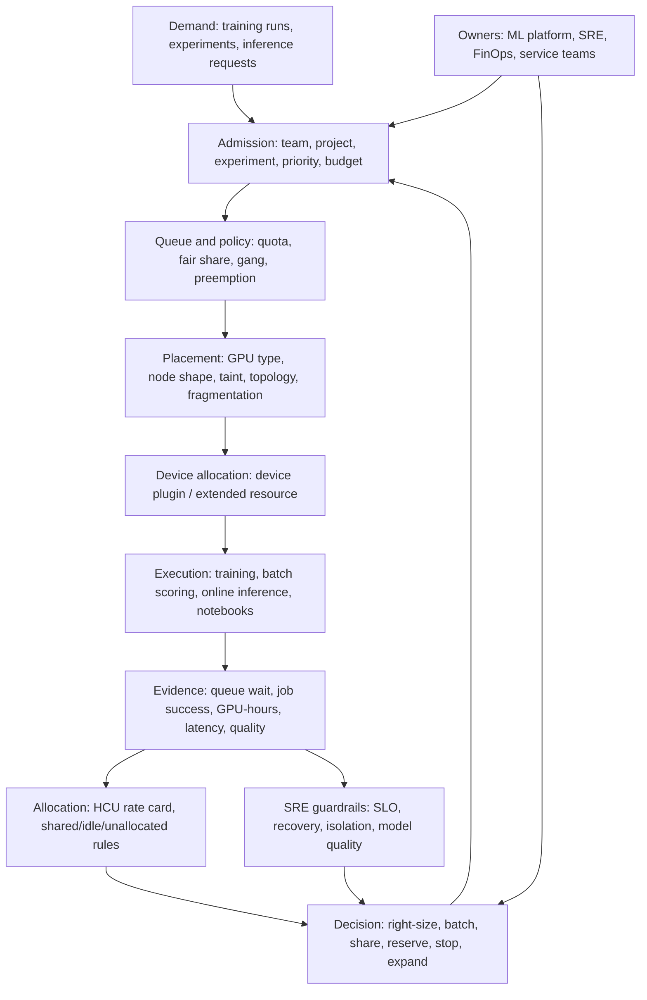
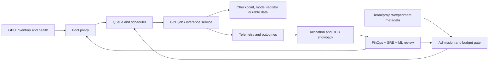

# M15 Unit 12 — GPU Scheduling, Sharing, and ML Workload Economics

**Target file:** `12-gpu-scheduling-sharing-and-ml-workload-economics.md`  
**Stage:** Stage 2E — Production DevOps & Platform Engineering  
**Module:** M15 — Platform Capacity, Compute Economics and FinOps  
**Unit:** 12 of 12  
**Estimated study time:** 30–42 hours, including all core labs and the decision memo  
**Prerequisites:** Stages 0–2D and Stage 2E M01–M14; Kubernetes workloads, requests/limits, labels/taints, quotas, PriorityClasses, Prometheus/Grafana, SLOs, capacity/headroom, checkpoint/recovery, load/soak testing, and M15 Units 1–11  
**Core tools:** Python 3 standard library, `unittest`, `kind`, `kubectl`, local scripts, optional Prometheus/Grafana from M11  
**Awareness:** NVIDIA device plugin/GPU Operator, MIG, MPS, time-slicing, DCGM Exporter, Kueue, Volcano, YuniKorn, Triton, vLLM, TorchServe, KServe, vGPU, GPU orchestration products  
**Last reviewed:** 2026-11-03  
**Tool baseline assumed:** Existing M03/M11 `kind`, Kubernetes, Helm, Prometheus and Grafana versions; record exact installed versions locally. NVIDIA, scheduler and serving-framework versions are deliberately not pinned because they depend on hardware, drivers and compatibility.  
**Stack profile required:** Cap+Scale for the complete lab sequence; Cap-Core is an acceptable fallback for the Python simulations; Cap+Obs is needed only for the optional Prometheus/Grafana exporter integration  
**Footprint:** `[ILLUSTRATIVE]` A Python-only simulator has a small footprint. A local kind cluster plus kwok/fake-node components and Prometheus/Grafana can be material on an 8-GB laptop. Measure your baseline and peak; start one optional component at a time.  
**Prices used:** Hypothetical cost units (HCU) only. No currency, provider prices, discounts, commercial terms or cloud billing data are used.

> **Completion outcome:** Design a GPU-aware platform policy; explain Kubernetes GPU resource discovery and scheduling; simulate placement, fragmentation, gang admission, preemption, fair share and idle waste; evaluate sharing and isolation options; model inference and training unit economics; create admission and experiment-budget guardrails; and defend a production GPU-fleet design using SLO, queue, model-quality and cost evidence.

---

## Prerequisite handoff and scope boundaries

This unit applies prior capacity, scheduling, reliability and FinOps concepts to accelerator-backed workloads. It does not re-teach Kubernetes scheduling, CPU/memory requests, HPA, node provisioning, Prometheus, checkpointing or OpenCost from first principles.

| Prior unit/module | Reuse here | Boundary |
|---|---|---|
| M15 Unit 1 | Demand forecast, uncertainty, headroom, lead time, capacity review | Convert training arrivals and GPU-hours into queue/capacity scenarios; do not rebuild the forecasting program |
| M15 Unit 2 | Priority, quota, preemption, contention, fair-share and DRF-style reasoning | Apply these policies to GPU as a scarce resource |
| M15 Unit 3 | HCU conventions, budget alerts, spending guardrails and freshness | Add per-job/per-experiment GPU caps and approval gates; do not rebuild the budget engine |
| M15 Unit 4 | `team`, `project`, `service`, `env`, `workload`, `cost-center`, `owner`, conditional `namespace`; direct/shared/idle/unallocated buckets | Add `experiment`, `model`, `run_id` and GPU type as workload metadata without creating a competing ownership registry |
| M15 Unit 5 | Report-only → owner notification/quarantine → approved stop | Detect idle notebooks; never infer that a low GPU-utilization sample authorizes termination |
| M15 Unit 6 | Cost/reliability/performance trade-offs | Treat SLO, correctness, quality and isolation as guardrails to optimization |
| M15 Unit 7 | Pre-run review, release gates, shadow/canary and evidence | Gate model deployments that increase GPU demand |
| M15 Unit 8 | Spot eligibility, interruption, checkpoint interval and restart economics | Reuse the checkpoint model; do not re-teach spot capacity |
| M15 Unit 9 | Node provisioning, node pools, capacity ceilings and readiness delay | Include GPU-node provisioning in scale-out time; a pod scaler does not create provider capacity |
| M15 Unit 10 | KEDA/HPA, scale-to-zero, replica bounds and cold starts | Use queue/in-flight signals and add driver/image/model readiness delays |
| M15 Unit 11 | OpenCost allocation, HCU pricing, label attribution and reconciliation | Explain GPU sharing attribution limits; do not duplicate OpenCost installation |
| M03 Unit 7 | Node labels, taints, tolerations, affinity and placement | Reuse placement mechanics |
| M05 Unit 6 / M11 Unit 9 | Data-pipeline throughput, saturation and resource starvation | Detect input-pipeline bottlenecks that leave GPUs waiting |
| M10 Unit 6 | Little's Law, queueing intuition, latency knee and headroom | Use M/M/c-style intuition; do not claim the simulator is a calibrated queueing model |
| M11 Units 9, 12, 13 | Saturation, telemetry/cardinality, load/soak/open-loop tests | Use measured load-test evidence for replicas and latency |
| M12 | Admission, RBAC, node images, drivers, security and patching | Reuse security governance; mark implementation-specific policy fields `[VERIFY]` |
| M13 Units 4–5 | Checkpoint/recovery and durable artifacts | Preserve checkpoint/data integrity through preemption and node failure |
| M14 | Multi-region placement, data gravity, replication and egress | Model HCU trade-offs; do not redesign multi-region operations |
| M16 | Golden paths and developer portal | Forward reference only; no portal is built here |

### Teaching boundary

- **Taught here:** GPU scheduling and economics, fake GPU simulation, sharing/isolation decisions, training/inference cost models, fair share, GPU FinOps, admission policy, runbooks and production governance.
- **Reused:** Kubernetes resource primitives, node provisioning, event-driven autoscaling, checkpoint/recovery, cost allocation and observability.
- **Awareness only:** hardware-specific driver installation, exact GPU SKU capabilities, MIG profiles, MPS deployment, vGPU licensing, DCGM deployment, distributed-training frameworks and commercial GPU schedulers.
- **Deferred:** developer-portal golden paths (M16), full integrated platform capstone (M17), provider purchasing negotiations and production GPU fleet operation.

### Evidence labels

- `[SYNTHETIC]` — generated fixture or simulator output.
- `[ILLUSTRATIVE]` — worked calculation using declared assumptions.
- `[ASSUMPTION]` — a modelling choice that must be reviewed.
- `[VERIFY]` — version-, hardware-, driver-, scheduler- or environment-specific behavior requiring local verification.
- `[MEASURED]` — only for evidence the learner actually measures in their own environment. The document does not claim to have measured a GPU.

---

## 12.0 Why this matters in production

GPU capacity is scarce, coarse-grained and often slow to obtain. A team can have a healthy cloud budget and still miss a launch because compatible devices are unavailable, the queue is fragmented, or node/driver/model startup takes longer than the traffic ramp. Conversely, a platform can pay for GPUs that sit idle in notebooks, wait on a slow input pipeline, or are held by experiments with no owner or spending ceiling. Maximizing utilization without protecting latency, model quality, recovery and tenant isolation can convert a cost problem into an outage. This unit establishes a measurable operating model in which GPU-hours, queue wait, successful outcomes and HCU allocation are reviewed together.

The recurring engineering question is not “How do we keep every GPU busy?” It is:

> **How do we allocate scarce accelerator capacity to the highest-value safe work, with acceptable queue wait and reliability, while making the cost and attribution model transparent?**

---

## 12.1 Learning objectives

By the end of this unit, the learner can:

1. **[L1]** Explain why GPU capacity changes platform economics and distinguish training, batch inference, online inference, notebooks and GPU-assisted data processing.
2. **[L1]** Describe how a Kubernetes device plugin advertises an extended resource and explain the difference between scheduler allocation and actual device computation.
3. **[L1]** Compare dedicated GPUs, time-slicing, MPS, MIG and vGPU without claiming equivalent isolation.
4. **[L2]** Build a fake GPU-node model with 1-, 4- and 8-GPU shapes, labels, taints, quotas and placement constraints.
5. **[L2]** Demonstrate fragmentation, quota rejection, partial-acquisition deadlock and all-or-nothing gang admission.
6. **[L2]** Simulate checkpoint-aware preemption, fair-share allocation, idle detection, inference batching and autoscaling time budgets.
7. **[L2]** Calculate training-run, experiment, model-version and per-1,000-inference costs using HCU and explicit units.
8. **[L3]** Design a GPU capacity policy using queue-wait objectives, demand uncertainty, priority tiers, DRF-style fair share and topology constraints.
9. **[L3]** Defend sharing, isolation, inference optimization and self-host-versus-API decisions using SLO, quality, privacy and cost evidence.
10. **[L4]** Operate GPU admission, budgets, observability, runbooks, driver governance, showback and cost-per-outcome reviews under failure.

---

## 12.2 Concept map and vocabulary

### System model



### Vocabulary

| Term | Precise definition | Common misconception |
|---|---|---|
| GPU device plugin | Node-side integration that advertises vendor hardware as a Kubernetes extended resource | It installs every driver/runtime dependency or makes fake devices compute |
| Extended resource | Integer-valued schedulable resource exposed by a device plugin or another supported mechanism | It is automatically fractional or overcommittable |
| GPU-hours | Number of allocated GPUs multiplied by elapsed wall-clock hours | It is the same as useful GPU compute time |
| GPU utilization | A family of measurements describing activity; compute, memory, power and throughput are different signals | One percentage fully describes efficiency |
| Fragmentation | Free capacity exists in aggregate but cannot satisfy a particular job's placement/shape constraints | Aggregate free GPU count guarantees schedulability |
| Gang scheduling | A workload admission/scheduling policy that coordinates a group so the required minimum set is admitted together | Vanilla independent Pod scheduling automatically gives all-or-nothing distributed-job placement |
| DRF | Dominant Resource Fairness; a multi-resource fairness approach based on each tenant's dominant share | A complete substitute for business priorities and SLO policy |
| Time-slicing | Multiple workloads take turns using a GPU through a configured sharing mechanism | It creates hardware memory isolation |
| MPS | NVIDIA Multi-Process Service; a mechanism for concurrent CUDA process execution with configured sharing controls | It is identical to MIG or a general tenant security boundary |
| MIG | Multi-Instance GPU; supported hardware can be partitioned into GPU instances with hardware-backed resource separation | Every GPU supports every MIG profile |
| vGPU | Virtual GPU technology for supported virtualization environments, with product/hardware/licensing requirements | It is a generic Kubernetes fractional-GPU feature |
| Dynamic batching | Server groups requests into batches to improve throughput, trading some queueing delay for batch formation | Larger batches always improve tail latency |
| KV cache | Cached key/value attention state used by autoregressive LLM inference | It is free memory or unrelated to concurrency |
| Checkpoint | Durable application state that enables a workload to resume from a saved point | A pod restart alone guarantees correct training recovery |
| Idle GPU hour | Allocated GPU capacity with no useful workload progress during the interval, according to an explicit evidence model | One zero-utilization sample proves the GPU can be reclaimed |
| Allocated-vs-used gap | Difference between capacity cost assigned to a workload and a defined usage-based estimate | It is always waste or can be precisely attributed under all sharing methods |
| Cost per outcome | HCU divided by a validated useful result, such as a successful training run or production-quality inference | Lowest total spend or highest utilization is always best |
| Warm capacity | Capacity held ready to avoid startup delay | It is automatically waste |
| Cold start | Delay to make capacity usable after scaling from zero or provisioning a new node | It consists only of pod scheduling time |
| HCU | Hypothetical cost unit used for consistent arithmetic | It is currency or a provider price |

### Four different GPU quantities

Do not collapse these into one number:

1. **Physical capacity:** devices and partitions actually present and healthy.
2. **Allocated capacity:** resources assigned/reserved to workloads.
3. **Observed activity:** telemetry such as compute utilization, memory use and power.
4. **Useful progress:** completed steps, samples, tokens, successful requests or validated model improvements.

A workload may have high allocated capacity and low observed activity because the data loader is slow. It may have high observed activity and poor useful progress because of communication overhead, retry loops or inefficient kernels. The correct response depends on which quantity is constrained.

---

## 12.3 Level 1 — Beginner: GPU economics and the Kubernetes GPU model

### 12.3.1 Why GPU economics differ

GPUs are not interchangeable with generic CPU capacity. They are specialized devices with hardware-specific memory, compute, interconnect, driver and runtime requirements. Capacity is often supplied in coarse device or partition shapes, and a platform may face longer acquisition and readiness delays than it does for ordinary CPU workloads.

The most important economic waste pattern in an ML platform is often **allocated GPU time that produces no useful work**:

- A notebook keeps a GPU allocated overnight after the interactive session ends.
- A training job spends a large share of its wall-clock time waiting for data.
- A distributed job waits for one straggler while other workers remain allocated.
- A model is deployed on an oversized GPU pool for traffic that could be served by a smaller model or CPU.
- A scale-to-zero policy saves idle capacity but violates the cold-start latency objective.

Do not conclude that all idle-looking capacity is removable. A warm inference replica may protect a latency SLO; a training checkpoint may need a short drain window; a spare GPU may be required for failure recovery.

### 12.3.2 Workload classes and their objective functions

| Workload | Dominant objective | Typical scheduling/reliability needs | Economic risk |
|---|---|---|---|
| Training | Useful progress per run and deadline completion | Long-running, checkpointable, sometimes distributed/gang-admitted; interruption-aware | Idle allocated devices, slow data input, poor scaling efficiency, reruns |
| Batch inference/scoring | Throughput and completion deadline | Queue admission, batch size, retry/idempotency | Paying for idle capacity outside batch windows |
| Online inference | Tail latency, availability and cost per successful request | Warm capacity, bounded queues, safe batching, fast scale-out | Cold starts, overprovisioning, latency regressions |
| Notebooks/experiments | Interactive responsiveness and experiment velocity | Per-user quotas, short-lived leases, owner-aware idle review | Unattended notebooks and unbounded experiments |
| GPU-assisted data processing | Throughput per processed unit | Pipeline scheduling and input/output throughput | GPU starvation due to CPU, storage or network bottlenecks |

The same GPU pool should not automatically serve every class. A low-priority research sweep should not be able to preempt production inference, and a latency-critical online endpoint should not be forced to share memory with an untrusted experiment merely to improve average utilization.

### 12.3.3 Kubernetes GPU resource model

Kubernetes does not understand CUDA kernels or model quality. It schedules declared resources and constraints.

A typical NVIDIA deployment uses a device plugin to register an extended resource such as `nvidia.com/gpu`. The device plugin communicates with kubelet; kubelet advertises the healthy device count in Node status; the scheduler places a Pod only when a node can satisfy the request. The runtime/device-plugin path then exposes the allocated device to the container.

Official Kubernetes references:

- Device plugins: https://kubernetes.io/docs/concepts/extend-kubernetes/compute-storage-net/device-plugins/
- Scheduling GPUs: https://kubernetes.io/docs/tasks/manage-gpus/scheduling-gpus/

Important semantics verified in the Kubernetes documentation:

- Extended resources are integer-valued and cannot be overcommitted by the standard extended-resource model.
- GPU resources are specified in `limits`; a limit may be used as the request when no separate request is supplied. If both request and limit are specified, they must be equal; a request without a limit is not valid for this GPU resource pattern.
- Extended-resource quota uses the `requests.` prefix. For `nvidia.com/gpu`, the quota key is `requests.nvidia.com/gpu`.
- This standard model does not imply that a single physical GPU can never be shared by any vendor mechanism. It means Kubernetes' ordinary extended-resource accounting treats the advertised resource as an integer schedulable unit. Vendor time-slicing/MPS configurations may expose a different number/name of schedulable resource tokens; they do not change the underlying hardware into more physical GPUs.

**Illustrative Pod request:**

```yaml
apiVersion: v1
kind: Pod
metadata:
  name: gpu-training-example
  namespace: ml-training
  labels:
    team: team-ml
    project: foundation-model
    experiment: exp-2026-041
    model: encoder-v3
    workload: training
spec:
  restartPolicy: Never
  containers:
    - name: trainer
      image: registry.example.invalid/ml/trainer:<PINNED_TAG>
      resources:
        requests:
          cpu: "4"
          memory: "16Gi"
        limits:
          cpu: "4"
          memory: "16Gi"
          nvidia.com/gpu: 1
```

This manifest is a structural example. Replace the image with an approved image and verify the resource name, runtime, driver, device-plugin configuration and cluster compatibility. The image name is deliberately non-runnable and no GPU is assumed.

### 12.3.4 Placement: labels, selectors, taints and tolerations

A GPU node pool should have:

- a **label** that identifies the intended accelerator class or pool;
- a **taint** that discourages ordinary Pods from consuming expensive accelerator capacity;
- a Pod **node selector/affinity** to select the intended pool;
- a matching **toleration** for approved GPU workloads;
- a quota/admission policy so toleration alone does not grant arbitrary access.

Kubernetes explicitly documents tainting specialized-hardware nodes to keep ordinary Pods away. The example below uses organization-owned keys; it does not claim that `accelerator.example.com/type` is a vendor standard.

```yaml
apiVersion: v1
kind: Pod
metadata:
  name: approved-gpu-job
  namespace: ml-training
spec:
  nodeSelector:
    accelerator.example.com/pool: training-a
  tolerations:
    - key: accelerator.example.com/gpu
      operator: Equal
      value: "true"
      effect: NoSchedule
  containers:
    - name: worker
      image: registry.example.invalid/ml/worker:<PINNED_TAG>
      resources:
        limits:
          nvidia.com/gpu: 1
```

**Two controls are needed:** the taint keeps non-tolerating Pods away; the node selector/affinity keeps a GPU Pod from landing on an unintended general node. Admission policy should add or validate these constraints for approved GPU workloads. A toleration is not an authorization decision.

### 12.3.5 Device plugin, drivers and runtime: what the learner needs to know

A functioning GPU Pod normally depends on a compatible chain:

1. Physical GPU and supported host platform.
2. Host driver compatible with the GPU and user-space libraries.
3. Container runtime integration such as NVIDIA Container Toolkit.
4. Kubernetes device plugin or GPU Operator path.
5. Node labels/device discovery and healthy allocatable resources.
6. Container image with compatible CUDA/framework libraries.
7. Application code that actually uses the allocated device.

This unit does not ask the learner to install or upgrade host drivers. Those operations can disrupt the workstation or node and require a separate compatibility plan. The optional real-GPU appendix is not a prerequisite.

### 12.3.6 GPU sharing and partitioning: first comparison

| Method | Mechanism | Memory/isolation model | Typical decision context | Critical caveat |
|---|---|---|---|---|
| Dedicated GPU | One workload receives the advertised full device | Strongest operational separation of the options listed here, subject to host/container/security configuration | Production inference, large training, sensitive tenants | Can strand capacity if workloads are small or bursty |
| NVIDIA time-slicing | Device-plugin configuration advertises multiple schedulable replicas backed by one GPU; CUDA workloads interleave | NVIDIA's device-plugin documentation states that time-sliced replicas are not isolated from one another in GPU memory/fault domain | Trusted dev/test or interference-tolerant workloads | One workload can affect others; OOM/fault blast radius is shared |
| NVIDIA MPS | Multi-process service coordinates concurrent CUDA processes; plugin support and behavior depend on version | NVIDIA documents per-client memory and compute limits in its MPS device-plugin mode; implementation support/version must be checked | Cooperative workloads with supported hardware/software | Not a substitute for MIG or a blanket security boundary; plugin MPS support has version-specific status and restrictions |
| MIG | Supported GPU hardware is partitioned into GPU instances | NVIDIA documents isolated memory-system paths and resource partitioning on supported GPUs | Workloads needing stronger hardware partitioning and predictable resource slices | Only supported hardware/profiles; reconfiguration has operational constraints |
| vGPU | Virtualization layer exposes virtual GPU devices | Depends on supported hypervisor, GPU, software stack and licensing | Virtualized environments with a supported NVIDIA vGPU stack | Licensing, compatibility and isolation claims must be verified for the exact product |
| Fractional-GPU products | Vendor/platform abstraction over sharing, partitioning or scheduling | Product-specific | Awareness only | Do not assume fractional tokens equal fractional memory or security isolation |

References:

- NVIDIA Kubernetes device plugin: https://github.com/NVIDIA/k8s-device-plugin
- NVIDIA GPU Operator sharing: https://docs.nvidia.com/datacenter/cloud-native/gpu-operator/latest/gpu-sharing.html
- NVIDIA MIG introduction: https://docs.nvidia.com/datacenter/tesla/mig-user-guide/latest/introduction.html
- NVIDIA MIG supported GPUs: https://docs.nvidia.com/datacenter/tesla/mig-user-guide/supported-gpus.html

Do not use time-slicing across mutually untrusted tenants merely because it improves packing. The vendor documentation explicitly warns that time-sliced workloads share the GPU memory/fault domain. MIG is not universally available; MPS and MIG are not interchangeable. Exact behavior must be checked against the installed device-plugin/GPU Operator release and the device model.

### 12.3.7 Laptop-friendly feasibility

The course's required work is possible without a physical GPU:

- Python models fake GPU nodes and fake workload requests.
- A local kind cluster may be used as a context and policy sandbox.
- Optional kwok/fake-node methods may represent simulated node capacity.
- A CPU fake inference server models request queues and batching.
- A fake exporter emits synthetic utilization/memory/power-like values for Prometheus.
- HCU worksheets compare hypothetical costs.

A fake extended resource, patched Node status, or kwok provider is an implementation-specific technique. Do not assume it works on every kind/Kubernetes version. The required simulator is the portable fallback. It demonstrates scheduling and economics only; it does not execute CUDA or allocate real GPU memory.

### Guided first calculation

`[ILLUSTRATIVE]` A training run requests 4 GPUs for 3.5 wall-clock hours.

\[
\text{GPU-hours} = 4\ \text{GPUs} \times 3.5\ \text{hours}
= 14\ \text{GPU-hours}
\]

If the teaching rate is `[HYPOTHETICAL]` 2.4 HCU/GPU-hour:

\[
\text{run allocation} = 14 \times 2.4 = 33.6\ \text{HCU}
\]

This is allocated GPU time under a simplified rate card. It does not measure how many GPU cycles were useful, whether the run met its quality objective, or whether a provider would invoice the same amount.

### Common beginner mistakes

| Mistake | Symptom | Fix |
|---|---|---|
| Treating GPU request as actual GPU use | Allocated device count is mistaken for utilization | Track allocated time and observed activity separately |
| Assuming `nvidia.com/gpu` is always present | Pod remains Pending with an unavailable resource | Inspect Node `capacity`/`allocatable`, device-plugin health and node labels |
| Assuming a taint alone authorizes a tenant | Any Pod with a toleration can enter the pool | Enforce namespace/team/priority policy at admission |
| Using time-slicing for untrusted tenants | One process affects another | Separate trust domains; use supported hardware isolation or dedicated devices |
| Optimizing only utilization | Queue wait, latency or model quality regresses | Pair utilization with outcome and SLO guardrails |
| Treating fake GPUs as hardware | Simulator output is called a benchmark | Label every simulator output `[SYNTHETIC]`; no hardware claim |

---

## 12.4 Level 2 — Intermediate: working scheduling and ML economics

### 12.4.1 Fake GPU cluster model

The required local lab profile is Cap+Scale. Use a disposable kind context and a learner-built Python simulator as the portable scheduling model. If kwok is available and the exact provider method is verified, it may be used to represent fake nodes. Do not patch node status or install a GPU operator merely to complete the core course.

The simulator models:

- node shapes with 1, 4 or 8 fake GPU tokens;
- hypothetical labels such as `gpu.type=a` and `gpu.type=b`;
- a taint that requires an approved toleration;
- pod GPU requests, priority, namespace, owner, experiment and placement requirements;
- namespace/team quotas;
- per-node free-device counts;
- pending reasons: capacity, selector mismatch, missing toleration, quota, or fragmentation.

**Fragmentation example `[SYNTHETIC]`:** two fake nodes each have two free GPU tokens. A job requests four GPUs on one node. Total free tokens equal four, but neither node has four. The job remains pending under a single-node placement requirement. This is not a scheduler defect; the placement constraint cannot be satisfied.

### 12.4.2 ResourceQuota for extended GPU resources

Kubernetes documents the extended-resource quota form:

```yaml
apiVersion: v1
kind: ResourceQuota
metadata:
  name: gpu-team-quota
  namespace: ml-training
spec:
  hard:
    requests.nvidia.com/gpu: "4"
    pods: "20"
```

The key `requests.nvidia.com/gpu` is the documented quota key for an extended resource named `nvidia.com/gpu`. Do not set both `requests.nvidia.com/gpu` and `limits.nvidia.com/gpu` in the quota for the same extended resource. The exact quota counts all non-terminal Pods in the namespace that request the resource; a namespace quota is not a cross-namespace global fairness system.

A quota controls admission consumption, not physical availability. A Pod may pass quota admission and still remain Pending because no node has a compatible GPU, selector, taint, topology or free capacity.

### 12.4.3 Priority and preemption

Kubernetes PriorityClass affects scheduling order and may trigger preemption of lower-priority Pods when the pending Pod cannot otherwise fit. It does not create capacity, guarantee the new Pod will schedule, or preserve the victim's in-memory work. Checkpoint-aware applications must handle termination and resume themselves.

Suggested organizational tiers `[ILLUSTRATIVE]`:

| Tier | Workload | Policy intent |
|---|---|---|
| P0 | Production online inference | Protect latency/availability; only approved emergency preemption |
| P1 | Scheduled retraining with deadline | Queue with checkpoint-aware preemption and deadline visibility |
| P2 | Research and approved experiments | Fair-share, per-experiment caps, preemption allowed |
| P3 | Best-effort exploration | Borrow idle capacity; first to yield; short lease |

Do not let every team create arbitrary high-priority classes. Kubernetes warns that untrusted users who can create high-priority Pods may evict other work. Restrict PriorityClass use through RBAC/admission and namespace quotas.

### 12.4.4 Gang scheduling and partial-acquisition deadlock

A distributed training job may require all \(k\) workers to make useful progress. If independent Pods are scheduled without a gang/admission policy, partial placement can create resource holding:

- Job A acquires 2 of 4 GPUs and waits for 2 more.
- Job B acquires the remaining 2 GPUs and waits for 2 more.
- Neither job can start; both hold capacity.

A gang scheduler coordinates admission so the required minimum set is available before the workload is launched. Volcano documents a gang plugin with an all-or-nothing scheduling policy based on a minimum number of Pods. Kueue provides Workload admission and quota reservation; topology-aware scheduling and admission checks add further constraints. These systems are not drop-in synonyms; evaluate queue semantics, supported job APIs, operational burden and version compatibility before adoption.

Official references:

- Volcano gang plugin: https://volcano.sh/docs/scheduler/plugins/gang/
- Kueue concepts: https://kueue.sigs.k8s.io/docs/concepts/
- Kueue admission: https://kueue.sigs.k8s.io/docs/concepts/admission/
- Apache YuniKorn features: https://yunikorn.apache.org/docs/get_started/core_features/
- Apache YuniKorn gang scheduling: https://yunikorn.apache.org/docs/user_guide/gang_scheduling/
- Apache YuniKorn queue configuration: https://yunikorn.apache.org/docs/user_guide/queue_config/

**Scheduler selection — decision criteria, not a product ranking**

| Candidate | Evaluate when | Design questions |
|---|---|---|
| Kueue | Workload admission, queue quotas, quota reservation, cohorts/fair sharing and admission checks are the primary need | Which workload integrations are supported? How are queue/ClusterQueue policies versioned? How are topology, admission checks and provisioning integrated? |
| Volcano | Gang scheduling and batch-oriented scheduling plugins are central requirements | Which scheduler plugins and job APIs are needed? How does it coexist with the default scheduler? What are upgrade, rollback and observability procedures? |
| YuniKorn | Application-aware scheduling, hierarchical resource queues, queue fairness/order and gang behavior are required | Which shim/schedulerName and application labels are required? How are namespaces mapped to queues? How does it interact with ResourceQuota and other admission controls? |

Do not state that one is universally more mature or easier to operate. Compare current release activity, Kubernetes compatibility, workload API support, GPU extended-resource handling, gang semantics, topology support, RBAC, observability, upgrade cadence, rollback, operator skills and incident burden. Mark maturity/operational burden claims `[VERIFY]` and validate with a disposable proof of concept.

The required lab uses a Python simulator so the learner can reproduce the deadlock and the all-or-nothing fix without installing a batch scheduler.

### 12.4.5 Topology awareness

A multi-GPU job may depend on fast peer communication. NVLink, PCIe, NUMA and network topology affect communication cost, but the scheduler cannot infer the application's best topology unless hardware discovery and topology-aware placement are configured and supported.

At Awareness level:

- tensor-parallel jobs may be sensitive to intra-node GPU interconnect;
- data-parallel jobs may need efficient inter-node communication;
- topology labels and device-plugin information are implementation-specific;
- a fake node model cannot measure NVLink bandwidth, PCIe contention or NCCL performance.

Do not encode a generic label such as `gpu.type=a` and claim it guarantees a particular interconnect.

### 12.4.6 Notebook idle detection and safe culling

A notebook is a user session, not just a Pod. A CPU/GPU utilization threshold alone cannot distinguish a paused interactive session from an abandoned one. Use multiple signals:

- last authenticated user activity;
- kernel activity or execution state;
- GPU activity and memory use when available;
- active jobs or child processes;
- owner/team/project/experiment metadata;
- scheduled session window and explicit keep-alive request.

Reuse Unit 5's sequence:

1. **Report-only:** produce candidate list and evidence window.
2. **Notify:** contact owner and team; provide a grace period.
3. **Quarantine:** remove the session from new scheduling or apply a policy-defined pause while preserving data.
4. **Stop:** only after explicit owner/policy approval and a verified checkpoint/data-preservation check.
5. **Delete:** separate process; never automatically delete PVCs, checkpoints, datasets, model artifacts or notebooks' persistent storage.

### 12.4.7 Inference serving economics

A fake CPU model server can model request service time and batch formation. It does not model GPU kernels. It is useful for understanding the queueing and policy shape:

- fixed batching waits for a known batch size or timeout;
- dynamic batching groups compatible arriving requests;
- continuous/inflight batching is particularly relevant to iterative LLM generation, where completed sequences leave and new requests can join subsequent iterations;
- larger batches may improve throughput but add queueing delay and can hurt tail latency;
- more replicas can reduce queue wait but increase allocated capacity and cost;
- warm replicas reduce cold-start risk but consume idle allocation.

NVIDIA Triton documentation describes dynamic batching as grouping requests for higher throughput while allowing configurable queue delay and maximum batch size. It recommends measuring latency and throughput while tuning. This is an example of a serving-framework capability, not a universal behavior of every server.

Reference: https://docs.nvidia.com/deeplearning/triton-inference-server/user-guide/docs/user_guide/batcher.html

### 12.4.8 Inference autoscaling and scale-out budget

A useful autoscaling signal set includes:

- queue depth or oldest queued-request age;
- in-flight requests;
- request arrival rate and completion throughput;
- p95/p99 latency;
- model-specific GPU activity/memory signals where available;
- replica readiness and model-loaded status.

GPU utilization alone is insufficient. It may be unavailable, stale, saturated, or unrelated to the current model's bottleneck.

End-to-end scale-out time is a sum of stages, with overlap explicitly documented:

\[
T_{\text{ready}} =
T_{\text{decision}} +
T_{\text{node}} +
T_{\text{driver/runtime}} +
T_{\text{image}} +
T_{\text{model}} +
T_{\text{readiness}}
\]

If stages overlap, use a critical-path model rather than blindly summing every duration. Record which stages are serial and which are parallel.

**Scale-to-zero decision:** use it only when the cold-start SLO permits it. For latency-sensitive production inference, a warm minimum may be the safer policy. A CPU fallback or smaller always-warm model may be an alternative.

### 12.4.9 Training economics

\[
\text{GPU-hours per run} =
\text{allocated GPU count} \times \text{wall-clock hours}
\]

Useful progress is not guaranteed to scale linearly with GPU count. Time spent waiting on data, communicating gradients, checkpointing or synchronizing stragglers still consumes allocated GPU-hours.

A useful decomposition is:

\[
T_{\text{run}} =
T_{\text{input}} +
T_{\text{compute}} +
T_{\text{communication}} +
T_{\text{checkpoint}} +
T_{\text{other}}
\]

This is a conceptual partition. Some stages overlap, so do not sum measured component durations unless they are mutually exclusive. If the input pipeline feeds batches more slowly than the accelerator consumes them, improving GPU kernel speed may not improve end-to-end run time. Revisit M05 storage throughput and M11 saturation/load-test evidence.

Efficiency levers such as mixed precision, gradient accumulation, optimized kernels, quantization and compilation are Awareness here. Their exact support and quality/accuracy effects depend on the model, hardware, framework and validation suite `[VERIFY]`.

### 12.4.10 OpenCost GPU allocation and sharing attribution

Reuse Unit 11's HCU rate card and Unit 4 metadata. Add experiment-level dimensions where approved:

- `team`
- `project`
- `service`
- `env`
- `workload`
- `cost-center`
- `owner`
- `namespace` for Kubernetes workload SKUs
- `experiment`
- `model`
- `run_id`
- `gpu_pool` or `gpu_type`

A dedicated GPU assigned to one workload can often be allocated by the device/request and time window. A time-sliced GPU may be shared among multiple Pods. Unless telemetry exposes trustworthy per-tenant device-time or another approved attribution driver, splitting the GPU's cost equally is a policy assumption—not a measured fact.

Possible transparent drivers include:

- observed GPU process time, if reliable and attributable;
- configured time-slice/replica share, if the allocation policy is explicitly accepted;
- requested GPU share, as a reservation-based showback model;
- separate shared-pool cost, when per-tenant attribution is unsupported.

Always publish the driver and its confidence. Do not make a precise chargeback claim from a synthetic signal.

---

## 12.5 Level 3 — Advanced: capacity, cost, scheduling and optimization

### 12.5.1 GPU capacity planning and queue wait

Apply Unit 1's forecasting method to the arrival process for training jobs and their GPU-hours. A simple load estimate is:

\[
\text{average concurrent GPU demand}
\approx
\text{job arrival rate}
\times
\text{mean GPU-hours per job}
\]

Units:

\[
\frac{\text{jobs}}{\text{hour}}
\times
\frac{\text{GPU-hours}}{\text{job}}
=
\text{GPUs}
\]

This is a workload-intensity estimate, not a queue-wait guarantee. It ignores burstiness, job-size distributions, gang constraints, fragmentation, priority, failure reserve and GPU-type compatibility.

**Illustrative example:** `[ILLUSTRATIVE]` If 3 training jobs arrive per hour and each consumes 8 GPU-hours on average, the mean offered load is 24 GPUs. If the pool has 32 compatible GPUs, the simple average load ratio is 75%. That does not imply a safe 75% utilization target: synchronized arrivals, long-running jobs and gang constraints can create high queue wait even when the average is below capacity.

Use M/M/c intuition from M10 Unit 6: as utilization approaches 100%, queue waiting time can rise sharply. Real ML queues are often not Poisson/exponential; they have deadlines, batch arrivals, variable service times and gang requirements. Use the queue model to understand direction, then validate with empirical/synthetic traces and a sensitivity analysis.

### 12.5.2 Queue-wait SLO and headroom

Define separate objectives:

- p50/p90/p99 wait by priority class;
- percentage of scheduled retraining jobs that start before deadline;
- production inference capacity/readiness SLO;
- maximum permitted queue depth/age for experiments;
- recovery time after node or device failure.

A budget does not guarantee that a compatible GPU is available. GPU reservations/commitments, on-demand pools, spot capacity and regional alternatives are Awareness-level purchasing/capacity choices. Do not assume an availability promise, discount, price or quota. Model the decision in HCU and record the capacity risk separately from the financial budget.

### 12.5.3 DRF and GPU fair share

Dominant Resource Fairness extends fair allocation to multiple resource dimensions. For each team, compute its share of each resource relative to cluster capacity, then identify its dominant share. A simplified teaching model can allocate GPU tokens subject to CPU/memory ceilings and team weights. It is not a production DRF scheduler.

Jain's fairness index for non-negative normalized allocations \(x_i\) is:

\[
J(x_1,\ldots,x_n) =
\frac{(\sum_i x_i)^2}{n\sum_i x_i^2}
\]

The value is in \((0,1]\) when at least one allocation is positive; equal allocations yield 1. It measures equality, not whether the allocation is correct, useful or business-prioritized. A production inference team and a research team may legitimately have different entitlements. Use a policy entitlement as the denominator before evaluating conformance.

### 12.5.4 Scheduling policy for ML

A production design combines:

- **Priority:** business criticality and deadlines.
- **Quota:** hard ceilings and team entitlements.
- **Fair share:** borrowing/returning unused entitlement with documented rules.
- **Gang admission:** required worker count admitted together.
- **Backfill:** short jobs fill gaps only if they do not violate reservations/deadlines.
- **Checkpoint-aware preemption:** interruptible jobs save durable progress and resume correctly.
- **Bin-packing:** reduce stranded capacity without increasing blast radius or queue unfairness.
- **Topology awareness:** place communication-sensitive groups only when the topology data and scheduler support it.
- **Pool isolation:** separate hardware classes, trust zones and latency tiers.

An 8-GPU node may reduce inter-node communication for a tightly coupled job but increases fragmentation and failure blast radius. A 1-GPU node shape can improve flexibility and placement options but may increase cross-node communication and operational overhead. Compare using a measured application trace in a supported environment; the course simulator only illustrates shape/packing effects.

### 12.5.5 Sharing and tenant isolation decision matrix

| Option | Utilization opportunity | Memory/isolation characteristics | Interference tolerance | Hardware/software dependency | Use when | Avoid when |
|---|---|---|---|---|---|---|
| Dedicated | Lowest multiplexing opportunity | Workload gets the device token; host/runtime security still matters | Low tolerance | Supported device plugin/runtime | Production criticality, sensitive tenants, large training | Tiny sporadic jobs where idle capacity is unacceptable |
| Time-slicing | Higher access density | NVIDIA device-plugin docs warn replicas share GPU memory/fault domain | Must tolerate interference and shared OOM blast radius | Plugin config/version and supported device | Trusted dev/test or light shared workloads | Untrusted tenants, memory-sensitive workloads, strict latency |
| MPS | Concurrent process execution and configured per-client resource limits | NVIDIA MPS device-plugin behavior has version/status restrictions; not equivalent to MIG | Cooperative workload assumptions | GPU/runtime/plugin compatibility | Compatible cooperative workloads after validation | Security boundary assumptions or unsupported hardware/version |
| MIG | Partitioned hardware instances | Hardware-backed memory/compute separation on supported products | Better isolation/predictability than time-slicing, subject to profile constraints | Supported GPU models/profiles, driver/GPU Operator | Multi-tenant partitioning where supported | Unsupported devices or workload needing full GPU/topology |
| vGPU | Virtualization-level sharing | Depends on certified platform and licensed product configuration | Product-specific | Hypervisor, GPU, driver, licensing | Approved virtualized platform | Unknown licensing/support or unverified tenant boundary |

Time-slicing OOM is a cross-workload blast-radius problem. A workload may consume memory or trigger device-level failure that affects another workload sharing the same physical device. Do not rely on namespace separation as a GPU memory isolation mechanism.

MIG offers stronger hardware partitioning on supported devices, but hardware support and profile options are specific. NVIDIA's current supported-GPU and profile documentation must be checked before designing a pool. Do not copy a profile name from a different card generation.

### 12.5.6 GPU utilization is not one scalar

Define and review separate signals:

| Signal | What it describes | Why it matters | Limitation |
|---|---|---|---|
| SM/compute activity | Activity on streaming multiprocessors | Helps identify compute busy periods | Does not prove useful model progress |
| Framebuffer/memory use | Device memory consumed | Capacity pressure, model/KV-cache fit | Does not indicate bandwidth saturation or memory efficiency |
| Memory bandwidth activity | Traffic through the memory subsystem | Detect memory-bound behavior | Hardware/profile/metric availability varies |
| Power/energy | Device power/energy signals | Capacity/thermal/sustainability context | Availability, sampling and units vary; never infer energy from a fake exporter |
| Queue wait | Time requests/jobs wait before execution | User experience and scheduling efficiency | Requires consistent queue timestamps |
| Work completion | Steps/samples/tokens/requests successfully completed | Outcome-oriented efficiency | Must validate correctness and quality |
| Allocated GPU time | Device time charged/held by a workload | Cost model | Does not prove the device was busy |
| Idle GPU hours | Allocated hours with no useful work by an explicit rule | Waste investigation | A zero sample may mean missing telemetry |

The allocated-vs-used GPU cost gap is a key ML FinOps KPI:

\[
\text{gap}_{HCU} =
\text{allocated GPU cost}_{HCU}
-
\text{usage-based estimate}_{HCU}
\]

The usage-based estimate needs a defined utilization signal, sampling window, attribution model and rate. It is not directly comparable to the allocated cost unless those dimensions match. A negative gap can occur if usage exceeds requested allocation under the selected model; investigate rather than clipping the value silently.

### 12.5.7 Inference optimization levers and guardrails

| Lever | Potential benefit | Paired risk/guardrail |
|---|---|---|
| Dynamic batching | Higher throughput per replica | Queue delay and p99 latency; batch timeout |
| Smaller model | Lower memory and compute demand | Quality, task accuracy, safety and regression evaluation |
| Quantization | Reduced memory/compute footprint | Quality drift, hardware/kernel support, numerical stability |
| Distillation | Smaller serving model | Teacher/student quality gap and retraining burden |
| Pruning | Potentially lower model work | Sparse-kernel support; may not reduce wall time |
| Compiled/optimized kernels | Faster execution where supported | Build complexity, compatibility and reproducibility |
| Response/embedding cache | Avoid repeated work | Staleness, privacy, cache-key correctness and invalidation |
| KV-cache management | Better LLM concurrency/memory use | Context length, eviction and latency trade-offs |
| CPU fallback | Avoid GPU idle capacity for low traffic | CPU saturation, latency and model compatibility |
| Model multiplexing | Better device packing | Noisy neighbor, memory pressure and rollout coupling |
| Scale-to-zero | Reduce idle allocation | Cold-start SLO and queue growth |
| Request routing | Place requests by model, latency or capacity | Routing complexity, fairness and failure-domain coupling |

Every optimization should have a before/after record for quality, p50/p95/p99 latency, throughput, success/error rate, GPU-hours and HCU per successful output. A cost reduction with a quality regression is not a success.

### 12.5.8 Training scaling efficiency

Amdahl's Law provides conceptual intuition: a serial or communication-bound fraction limits the speedup from adding parallel workers. Use a synthetic speedup function in the lab, not a benchmark claim.

For GPU count \(g\), useful progress speedup \(S(g)\), baseline one-GPU time \(T_1\):

\[
T_g = \frac{T_1}{S(g)}
\]

\[
\text{GPU-hours}_g = g \times T_g
\]

\[
\text{parallel efficiency}_g = \frac{S(g)}{g}
\]

\[
\text{cost per progress unit}_g =
\frac{\text{GPU-hours}_g \times r_{GPU}}
{\text{validated progress}}
\]

If \(S(g)\) grows more slowly than \(g\), GPU-hours per completed run can increase. The correct choice may still be a larger GPU count if deadline or opportunity cost dominates; record both time-to-result and HCU per useful progress.

### 12.5.9 LLM economics and self-host-versus-API

LLM serving has memory pressure beyond model weights. KV-cache use grows with concurrent sequences and context, and multi-GPU/multi-node inference can add interconnect and scheduling constraints. Token-based economics should be modeled conceptually:

\[
\text{cost per successful output token} =
\frac{\text{total serving cost}}
{\text{validated output tokens}}
\]

For self-hosting, include accelerator allocation, warm capacity, operations, model updates, safety evaluation, monitoring, networking and failure reserve. For an external API, include request volume, token mix, retry behavior, latency, data/privacy requirements, reliability and vendor dependency. No provider prices or model-performance claims are assumed here.

A break-even model is only as good as the assumed workload, quality and utilization. Run sensitivity analysis on volume, peak-to-average ratio, warm capacity, model size, token mix and engineering burden.

### 12.5.10 Verification and anti-self-deception

Before accepting a cost optimization:

1. Fix the workload mix and traffic/test profile.
2. Record model version, dataset, prompt/evaluation set and quality threshold.
3. Use an open-loop or otherwise controlled load test where appropriate.
4. Capture latency distributions, throughput, failures and queue wait.
5. Record allocated GPU-hours and observed activity separately.
6. Compare identical time windows and rate-card versions.
7. Include cold start, checkpoint, retries and warm capacity.
8. Re-run the result and report variance.
9. Preserve the previous configuration and rollback path.
10. Reject the change if model quality, security, availability or SLO guardrails fail.

---

## 12.6 Level 4 — Expert: production GPU platform operations

### 12.6.1 Platform architecture

A production platform should separate:

- **GPU inventory:** physical devices, partitions, model, driver, health, topology, node and pool.
- **Admission:** approved namespace, owner, project, experiment, model, priority, queue, quota and budget.
- **Scheduling:** placement, gang requirement, topology, fragmentation, priority, fairness and preemption.
- **Execution:** job controller, checkpoint manager, serving runtime, model registry and durable storage.
- **Observability:** hardware telemetry, application progress, queue, SLO and allocation.
- **FinOps:** HCU rate card, GPU-hours, shared pool driver, idle cost, showback and budget.
- **Governance:** security boundary, driver rollout, approval, exception expiry, cost-per-outcome review.



### 12.6.2 Production pool design

Use distinct pools where the workload or trust boundary requires it:

| Pool | Intended workload | Scheduling policy | Reliability policy | Cost policy |
|---|---|---|---|---|
| Online inference | Production endpoints | High priority, warm minimum, bounded replicas | Strict latency/availability SLO | Cost per successful request and warm-idle HCU |
| Training on-demand | Scheduled/critical training | Gang admission, checkpoint, deadline | Protect deadline-critical runs | Pre-run approval and run cap |
| Training interruptible | Restartable training | Lower priority, checkpoint-aware | Resume/fallback | Effective cost includes lost work |
| Research/experiment | Exploratory workloads | Fair-share, quota, queue | Preemptible, owner-tagged | Per-experiment budget and TTL |
| Notebook shared | Interactive use | Per-user quota, session lease | Owner-aware idle policy | Report-only idle detection then approved stop |
| Isolated/sensitive | Restricted workloads | Dedicated or approved partition | Strong isolation and audit | No cross-tenant subsidy without explicit policy |

### 12.6.3 Operating governance

- Every GPU job has a team, owner, project, experiment, model, environment and priority.
- Every large training run has an estimate of GPU-hours and HCU before submission.
- The cost gate uses Unit 3 budget policy and Unit 7 release approval patterns.
- A rate-card change is versioned and effective-dated; historical reports are not silently rewritten.
- Shared GPU allocation uses a published driver and confidence label.
- A team cannot increase its own priority, quota or sharing trust level without approval.
- Idle reports are constructive and owner-oriented, not public shaming.
- Cost-per-outcome is reviewed alongside experiment validity, model quality and production impact.
- Utilization targets are guardrails, not quotas for busywork. Goodhart's law applies: if teams are rewarded for keeping GPUs busy, they may launch unnecessary work.
- Commitment/contract decisions are based on forecast intervals and regret analysis, not a single peak day.
- Driver/device-plugin upgrades use a canary/ring rollout with rollback and workload drain/checkpoint plans.
- Security incident response covers GPU abuse/mining, credential compromise, driver CVEs and tenant-isolation failure.

### 12.6.4 Sustainability — awareness only

Energy and cooling are relevant to GPU platform decisions. Better utilization and faster useful progress may reduce energy per outcome, but the relationship is workload- and infrastructure-dependent. No energy or emissions figure is asserted here. Any sustainability claim requires measured power/energy, a defined boundary and a verified methodology `[VERIFY]`.

### 12.6.5 Simulation limits

The core labs do not model real GPU performance, memory limits, thermal/power behavior, driver compatibility, CUDA kernel execution, device faults, NVLink/PCIe/NCCL bandwidth, time-slicing interference, MIG isolation or provider capacity scarcity. They model the control-plane and economic logic only. A fake `nvidia.com/gpu` token is not a device. A CPU fake model server is not a GPU inference benchmark. A fake exporter is not DCGM.

---

## 12.7 SRE lens: SLIs, SLOs, KPIs and operational response

### 12.7.1 KPI catalogue

| KPI | Formula | Unit | Source/window | Owner | Limitation | Paired guardrail |
|---|---|---|---|---|---|---|
| GPU-hours per run | GPUs × wall-clock hours | GPU-hour | Job start/finish; per run | ML team | Allocation, not utilization | Successful run and quality |
| GPU allocated-vs-used gap | Allocated HCU − usage-estimate HCU | HCU | Allocation + telemetry; daily/weekly | FinOps + ML platform | Depends on attribution driver | Queue wait, SLO, data completeness |
| Idle GPU hours | Allocated hours meeting approved idle predicate | GPU-hour | Job/session and telemetry; rolling window | ML platform | Zero metric may be missing data | Owner activity, queue demand, keep-alive |
| Idle GPU cost | Idle GPU-hours × HCU/GPU-hour | HCU | Rate-card versioned; daily | FinOps | Hypothetical in labs | Headroom and recovery reserve |
| p90 queue wait | 90th percentile of start_time − submit_time | Minutes/hours | Queue controller; per priority | Scheduler owner | Requires consistent timestamps | Deadline completion and fairness |
| Pending jobs by reason | Count grouped by normalized reason | Jobs | Scheduler/queue events; 5m/1h | Platform SRE | Event text is version-specific | Age of oldest pending job |
| Fragmentation index | 1 − usable_free_GPU / total_free_GPU, under a declared placement model | Ratio | Node inventory; 5m/1h | Capacity owner | Must define compatible shape | Pending time and packing safety |
| Job success rate | Successful valid runs / completed runs | % | Job controller + artifact validation; weekly | ML team | Success status may not prove quality | Artifact/checkpoint validation |
| Preemption waste | Lost uncheckpointed GPU-hours | GPU-hour | Job events + checkpoint timestamps | ML platform | Requires correct checkpoint evidence | Recovery success and deadline |
| Inference throughput | Successful requests / second | req/s | Serving telemetry; 1m/5m | Service owner | Mix and payload shape matter | p95/p99 latency and errors |
| Inference cost | Allocated HCU / successful requests × scale | HCU/1,000 req | Allocation + serving counters | FinOps + service owner | Shared pool attribution may be approximate | Quality, SLO and success rate |
| Scale-out time | Ready time − scale trigger time | Seconds/minutes | KEDA/HPA/node/pod/model events | Service SRE | Stages may overlap | Queue age and latency |
| Fair-share conformance | Actual normalized share / approved entitlement | Ratio | Queue/allocation model; daily | Platform governance | Depends on entitlement model | Queue wait and outcome |
| Jain's index | \((\sum x_i)^2/(n\sum x_i^2)\) | Ratio | Normalized team allocations; weekly | FinOps + platform | Equality is not business fairness | Entitlement conformance |
| GPU health | Healthy allocatable devices / expected devices | Ratio/count | Node/device plugin/DCGM; 1m/5m | Hardware SRE | Metrics and API fields vary | Workload placement and recovery |
| Approval bypass | Runs above threshold without approval / runs above threshold | Count/% | Admission/audit log; daily | FinOps governance | Only if gate coverage is complete | Denied request count and exception expiry |

### 12.7.2 Alert principles

- Alert on **queue age and SLO risk**, not utilization alone.
- Alert on a **missing telemetry signal** separately from a numeric zero.
- Alert on **allocated GPU capacity with no progress** only after validating the workload-specific idle predicate.
- Alert on **budget/experiment cap** before a sweep expands beyond its approved ceiling.
- Alert on **device health and plugin registration** before scheduling new jobs to a degraded node.
- Alert on **preemption waste** and checkpoint age, not just restart count.
- Alert on **serving latency and queue age** before GPU saturation becomes a customer incident.

Fake exporter metrics must use a clearly separate prefix such as `m15_sim_gpu_*`. Do not name fake series `DCGM_FI_*` or claim that they are DCGM output. Real DCGM Exporter metric names and runtime availability are hardware/version dependent; consult https://docs.nvidia.com/datacenter/dcgm/latest/reference/dcgm-exporter-metrics.html.

### 12.7.3 Runbook snippet: GPU Pods Pending

**Trigger:** GPU Pod remains Pending beyond the workload's queue-wait warning threshold.

1. **Decide:** determine whether the Pod is blocked by quota, no matching node, no allocatable device, taint/selector mismatch, fragmentation, topology or device-plugin health.
2. **Act safely:** inspect events, namespace quota, node labels/taints, `capacity`/`allocatable`, plugin Pods and queue state. Do not delete other workloads as a first action.
3. **Escalate:** scheduler owner for queue/admission; hardware SRE for device health; team owner for request/selector mismatch.
4. **Verify:** Pod starts, queue age falls, no unrelated workload was displaced, and SLO/priority policy remains satisfied.
5. **Communicate:** report reason, duration, affected jobs, HCU exposure and decision.
6. **Follow up:** add a test/alert for the failure class and retain event/manifest evidence.

---

## 12.8 Security lens

### Threats and controls

| Threat | Control | Negative test/evidence |
|---|---|---|
| Unapproved namespace requests GPU | Admission policy plus namespace allow-list and quota | Submit forbidden request; expect denial before scheduling |
| Tenant self-assigns high priority | Restrict PriorityClass use and creation; quota high-priority Pods | Submit a forbidden class; expect denial |
| Runaway experiment sweep | Per-team and per-experiment job/GPU cap; pre-run HCU estimate gate | Exceed cap; expect rejection and audit event |
| GPU mining/abuse | Compare expected workload identity with GPU activity, process/image provenance and owner | Inject synthetic unexpected activity; alert and contain only the suspect workload |
| Time-slicing cross-tenant impact | Do not share across untrusted tenants without approved isolation guarantees | Attempt prohibited trust-domain sharing; policy rejects |
| Driver/device-plugin compromise | Signed/pinned images where supported, least privilege, staged patching and node-image provenance | Invalid image/version or missing approval fails deployment gate |
| Model/data exposure | RBAC, workload identity, secret handling, dataset access controls and audit | Unapproved service account cannot read protected model/data |
| Credential leakage creates spend | No provider credentials in labs; secret scanning and least privilege in production | Scan workspace and manifests; no secrets retained |
| Unsafe notebook cleanup | Report-only, owner notification, quarantine and explicit stop approval | Target a PVC/checkpoint/data-bearing object; cleanup guard blocks it |
| Rate-card tampering | Versioned reviewed rate card and checksum/approval | Unapproved rate-card version fails publication |
| Allocation-label tampering | Registry validation and immutable audit | Invalid owner/team/project metadata becomes unallocated |
| Admission-policy bypass | Test direct Pod, Job and controller-created Pod paths | Negative test all supported submission paths |

### Policy contract (portable teaching form)

The following is an application-level policy contract for the simulator. It is not a Kubernetes admission policy implementation. Use a verified Gatekeeper, Kyverno, ValidatingAdmissionPolicy or webhook implementation only after checking the exact Kubernetes/policy-tool version and schema `[VERIFY]`.

```json
{
  "approved_namespaces": ["ml-training", "ml-inference", "ml-research"],
  "approved_priorities": ["gpu-production", "gpu-retraining", "gpu-research", "gpu-best-effort"],
  "required_labels": ["team", "owner", "project", "experiment", "model", "workload"],
  "max_gpu_per_job": 8,
  "max_gpu_hours_per_experiment": 64,
  "approval_threshold_hcu": 100,
  "require_approval_above_threshold": true,
  "deny_untrusted_time_slicing": true,
  "deny_cleanup_of_data_bearing_resources": true
}
```

Every number is `[ILLUSTRATIVE]`. This contract is validated by the Python lab code; it does not prove cluster enforcement.

---

## 12.9 Production checklist

### Platform and scheduling

- [ ] GPU inventory records device model, node, pool, driver/runtime, health and supported sharing mode.
- [ ] Node labels and taints are documented and tested.
- [ ] GPU Pods have approved node selectors/affinity and tolerations.
- [ ] Extended resource names and request/limit semantics are verified against the installed plugin/Kubernetes version.
- [ ] Team quotas and priority usage are restricted.
- [ ] Gang requirements and queue/admission policy are explicit for distributed jobs.
- [ ] Fragmentation and topology constraints are visible to the scheduler/queue policy.
- [ ] Preemption behavior is tested with checkpoint/resume and data integrity validation.
- [ ] Backfill does not violate reserved capacity or deadline objectives.

### Reliability and model outcomes

- [ ] Queue-wait SLOs are defined per workload priority.
- [ ] Production inference has a warm-capacity/cold-start decision.
- [ ] Model quality and correctness are guardrails for every optimization.
- [ ] Training checkpoints are durable, versioned and validated.
- [ ] Node/driver/device-plugin failure runbooks are reviewed.
- [ ] Rollback/fallback capacity is documented for launch and CVE scenarios.

### FinOps and governance

- [ ] Every job carries Unit 4 ownership metadata and experiment/model identifiers.
- [ ] HCU rate card is versioned and clearly hypothetical in the labs.
- [ ] Per-run and per-experiment estimates are recorded before submission.
- [ ] Approval thresholds and hard quota limits are distinct.
- [ ] Shared GPU allocation driver and confidence are published.
- [ ] Idle reports follow Unit 5's safe cleanup sequence.
- [ ] GPU cost is paired with useful progress, model quality and SLO.
- [ ] Showback is constructive; no utilization-only “hall of shame.”
- [ ] Commitment decisions use forecast intervals and regret analysis.

### Security and observability

- [ ] Unapproved namespace, priority, pool and sharing requests are denied.
- [ ] Driver/device-plugin images and configuration are reviewed and pinned.
- [ ] Secrets and production identifiers are not stored in evidence.
- [ ] GPU metrics have known units, source, freshness and cardinality controls.
- [ ] Missing telemetry is not interpreted as zero utilization.
- [ ] Prometheus/Grafana dashboards and alert rules are version controlled and tested.
- [ ] GPU abuse/mining detection has a safe containment plan.
- [ ] PVCs, datasets, checkpoints and model artifacts are excluded from automated cleanup.


---

## 12.10 Hands-on lab set — eleven mandatory labs

### Shared workspace and safety contract

Create a workspace outside the repository:

```bash
mkdir -p "$HOME/m15-gpu-lab"/{data,config,results,evidence,logs}
cd "$HOME/m15-gpu-lab"
python3 --version
kubectl config current-context
kind get clusters
```

Use the existing M03/M11 disposable cluster only if it is safe to reuse. Otherwise create a dedicated local cluster:

```bash
cat > kind-gpu-lab.yaml <<'YAML'
kind: Cluster
apiVersion: kind.x-k8s.io/v1alpha4
name: m15-gpu-lab
nodes:
  - role: control-plane
  - role: worker
  - role: worker
YAML

kind create cluster --config kind-gpu-lab.yaml
kubectl cluster-info --context kind-m15-gpu-lab
```

This creates local containers only. It does not create GPU devices or cloud resources. The Python simulator is the authoritative source for fake GPU capacity.

**Context guard before every cluster mutation:**

```bash
test "$(kubectl config current-context)" = "kind-m15-gpu-lab"
```

If the command fails, stop. Do not run destructive commands against an unknown context.

**Common safety rules**

- No cloud account, provider credential, GPU driver installation or paid resource is needed.
- All cost rates and performance values are `[HYPOTHETICAL]` or `[SYNTHETIC]`.
- `kind` nodes are containers, not priced cloud GPU instances.
- The fake resource catalogue is not a device plugin and performs no GPU computation.
- Use only the Python simulator for scheduling/economic results. Optional Kubernetes YAML is a policy/shape example, not a claim of live GPU scheduling.
- Do not install NVIDIA GPU Operator/device plugin on a laptop for the required labs.
- Do not delete namespaces, PVCs, checkpoints, datasets, models or shared M11 services as part of cleanup.
- Save evidence under `evidence/`; do not save credentials, production IDs or real billing data.

**Stack profile sequencing**

| Profile | Components | When to use |
|---|---|---|
| Cap-Core | Python simulator, worksheets, tests | Required fallback; completes all calculations and simulations |
| Cap+Scale | Cap-Core + disposable kind context + optional kwok/fake-node experiment | Required lab profile; no real GPU |
| Cap+Obs | Cap+Scale + minimal Prometheus/Grafana | Lab 5 exporter integration only; stop after evidence capture |

**Footprint rule:** do not start Prometheus, Grafana, kwok and all workloads simultaneously on a constrained laptop. Record CPU, memory and disk before/after each optional component. Stop optional services after the lab.

### Lab 1 — Simulated GPU cluster and scheduling

<badge>Fidelity: simulated control-plane/economic mechanics only</badge>

**Outcome:** create fake 1-, 4- and 8-GPU nodes; test selectors, taints, quotas, pending reasons and fragmentation.

**Prerequisites:** Python 3; `unittest`; Cap+Scale; optional disposable kind cluster.  
**Footprint:** Python-only is small; kind adds container-runtime overhead. Measure yours.  
**Assumptions `[SYNTHETIC]`:** fake GPU type labels `a`/`b`; fake taint `accelerator.example.com/gpu=true:NoSchedule`; no real device or CUDA execution.

**Context guard:** if using kind, verify `kind-m15-gpu-lab` before applying any YAML. The simulator itself does not mutate Kubernetes.

**Steps**

1. Save the simulator from Appendix A as `gpu_economics_lab.py`.
2. Run the scheduler model:

   ```bash
   python gpu_economics_lab.py schedule
   ```

3. Read the node inventory and workload table. Identify:
   - a Pod rejected by the team quota;
   - a Pod blocked by a missing toleration;
   - a Pod that requests a GPU type unavailable on the remaining nodes;
   - a four-GPU request that cannot fit on any single node despite four total free tokens.
4. Change the fake node shape from `1, 4, 8` to `1, 2, 2, 4` in the scenario data and rerun. Record how fragmentation changes.
5. Add a toleration to the simulated Pod and rerun. Then remove the node selector and observe why toleration alone does not ensure correct placement.
6. Compare aggregate free GPU count with largest contiguous per-node free count.

**Expected evidence `[SYNTHETIC]`:** `schedule-before.txt`, `schedule-after.txt`, `fragmentation-notes.md`, `pending-reasons.csv`.

**Tests:** run `python -m unittest -v test_gpu_economics_lab.py`. The suite checks quota enforcement, type matching, taint/toleration, and fragmentation.

**Abort conditions:** stop if you are about to install a real device plugin, change host drivers, patch a shared node, or apply an unreviewed manifest to a non-disposable cluster.

**Cleanup:** the simulator has no persistent state. If a disposable kind cluster was created solely for this unit, retain it for later labs or delete it after final evidence capture using the final cleanup procedure in Appendix D. Do not delete an M11 shared cluster.

**Cleanup verification:** record `kind get clusters`, `kubectl config current-context`, `kubectl get pods -A`, and the simulator workspace contents.

### Lab 2 — Gang-scheduling deadlock and fix

<badge>Fidelity: simulated resource reservation; no real scheduler extension</badge>

**Outcome:** reproduce partial-acquisition deadlock and compare it with all-or-nothing admission.

**Prerequisites:** Lab 1 simulator and tests.  
**Footprint:** Python-only.  
**Assumptions `[SYNTHETIC]`:** four fake GPUs; two distributed jobs each need four workers or two GPUs per worker group, depending on the scenario.

**Steps**

1. Run:

   ```bash
   python gpu_economics_lab.py gang
   ```

2. Inspect the naive scheduler trace. It permits Job A to reserve part of the pool, then Job B to reserve the remainder. Both wait for additional GPUs.
3. Record the held/free GPU counts and the age of each queued job.
4. Run the all-or-nothing mode. The scheduler admits a gang only when the required minimum set is available.
5. Change the minimum gang size and total capacity. Test the boundary where one job fits but two do not.
6. Explain the distinction between:
   - Kubernetes Pod scheduling;
   - queue/workload admission;
   - gang scheduling;
   - elastic training that can legitimately start with fewer workers.

**Optional awareness:** Kueue and Volcano can provide workload/queue admission or gang-related scheduling behavior, but their APIs and semantics differ. Do not install them merely to finish this lab. If you choose to test one, record its exact version and use official installation instructions.

**Expected evidence `[SYNTHETIC]`:** `gang-deadlock-trace.txt`, `gang-fixed-trace.txt`, `gang-comparison.md`.

**Tests:** the simulator test asserts that naive partial allocation can deadlock and gang admission does not partially reserve the group in the model.

**Abort conditions:** stop if an optional scheduler installation would alter a shared cluster or consume the laptop's resource budget.

**Cleanup:** no persistent simulator state. If an optional scheduler was installed in a dedicated disposable cluster, uninstall only the release/namespace created for this lab and verify that no shared workload was touched.

### Lab 3 — Priority, preemption and checkpoint economics

<badge>Fidelity: hypothetical interruption model; not a real reclaim event</badge>

**Outcome:** calculate GPU-hours lost to preemption and compare checkpoint intervals.

**Prerequisites:** Unit 8 checkpoint concepts; Lab 1 simulator.  
**Footprint:** Python-only.  
**Assumptions `[ILLUSTRATIVE]`:** checkpoint cost \(C\), mean time between interruptions \(MTBI\), useful work, restart time and GPU count are inputs.

**Checkpoint approximation reused from Unit 8**

\[
\text{overhead fraction} \approx \frac{C}{\tau} + \frac{\lambda\tau}{2}
\]

where \(C\) is checkpoint duration in hours, \(\tau\) is checkpoint interval in hours, and \(\lambda\) is interruption rate per hour.

A Young/Daly-style conceptual interval is:

\[
\tau^* \approx \sqrt{2C \times MTBI}
\]

This is a teaching approximation. It assumes a simplified interruption process, periodic checkpoints and separately modeled restart cost. It is not a universal optimal interval.

**Steps**

1. Run:

   ```bash
   python gpu_economics_lab.py checkpoint
   ```

2. Record the no-checkpoint control: all useful progress since the previous durable state is at risk.
3. Compare short, medium and long checkpoint intervals.
4. Change checkpoint duration and MTBI; rerun the sensitivity scenario.
5. Include restart overhead and storage write cost as separate inputs if known.
6. Convert lost work to GPU-hours: lost elapsed time × allocated GPU count.
7. State the recovery test needed to prove a checkpoint is valid: restore, continue training, verify optimizer/scheduler state, validate output artifact and compare deterministic run metadata.

**Expected evidence `[SYNTHETIC]`:** `checkpoint-sensitivity.csv`, `preemption-waste.md`, `recovery-test-plan.md`.

**Tests:** positive parameter validation; interval calculation; non-negative overhead; no-checkpoint control.

**Abort conditions:** do not trigger a real preemption or terminate a live training process.

**Cleanup:** no persistent state. Retain only synthetic output.

### Lab 4 — GPU fair-share simulator

<badge>Fidelity: simplified DRF-style model; not a production scheduler</badge>

**Outcome:** compare team entitlement, GPU allocation, queue wait and Jain's fairness index.

**Prerequisites:** Unit 2 fair-share concepts; Python 3.  
**Footprint:** Python-only.  
**Assumptions `[SYNTHETIC]`:** three or more teams; declared weights; fake GPU capacity; optional CPU/memory dimensions; fixed job durations.

**Steps**

1. Run:

   ```bash
   python gpu_economics_lab.py fairshare
   ```

2. Inspect each team's entitlement, demand, allocated GPU tokens and dominant share.
3. Calculate Jain's index from normalized allocations.
4. Change one team's weight and repeat.
5. Add a burst of large jobs from one team. Compare static quota, weighted fair-share and borrowing.
6. Compare low utilization/high wait with high utilization/high wait. Explain why the M/M/c-style intuition is directional only.
7. Run sensitivity cases for capacity, job size, team weights and arrival bursts.

**Expected evidence `[SYNTHETIC]`:** `fairshare-report.json`, `fairness-sensitivity.csv`, `jain-index-notes.md`.

**Tests:** Jain's index is 1 for equal allocations; index is bounded; zero-demand team is handled; quotas are not exceeded; allocation is deterministic for the same seed.

**Abort conditions:** do not represent the simulator as a certified DRF implementation or as proof of a scheduler's production fairness.

**Cleanup:** no persistent state.

### Lab 5 — Fake GPU metrics exporter and idle detection

<badge>Fidelity: fake Prometheus exposition; no DCGM or hardware telemetry</badge>

**Outcome:** emit synthetic utilization/memory/power-like series, detect allocated-but-idle capacity and exercise safe culling.

**Prerequisites:** Lab 1; optional M11 Prometheus/Grafana.  
**Footprint:** Python-only for the exporter; Cap+Obs adds Prometheus/Grafana. Measure yours.  
**Assumptions `[SYNTHETIC]`:** fake metric prefix `m15_sim_gpu_*`; power-like values are arbitrary simulator units and are not watts.

**Steps**

1. Run the one-shot exporter:

   ```bash
   python gpu_economics_lab.py exporter
   ```

2. Start the optional HTTP exporter:

   ```bash
   python gpu_economics_lab.py exporter --serve --port 9400
   ```

3. Verify the local endpoint from another terminal:

   ```bash
   curl --fail --silent http://127.0.0.1:9400/metrics
   ```

4. If Prometheus is already available, add this scrape target to a lab-only configuration and reload it using the M11 procedure:

   ```yaml
   scrape_configs:
     - job_name: m15-sim-gpu
       static_configs:
         - targets: ["host.docker.internal:9400"]
   ```

   The hostname is environment-dependent. In Linux/container networks, use the reachable host address or run the exporter on the same network. Verify target reachability; do not assume `host.docker.internal` exists.

5. Query `m15_sim_gpu_compute_utilization_ratio`, `m15_sim_gpu_memory_used_ratio`, `m15_sim_gpu_allocated`, and `m15_sim_gpu_idle_seconds`.
6. Run the idle report:

   ```bash
   python gpu_economics_lab.py idle
   ```

7. Capture a candidate, then apply the safe sequence: report-only → owner notification/quarantine → approved stop. The simulator's "stop" is a state transition in synthetic data only.
8. Verify that a PVC/checkpoint/data-bearing target is blocked from cleanup.

**Expected evidence `[SYNTHETIC]`:** `fake-exporter.txt`, `idle-report.csv`, `cleanup-dry-run.json`, `prometheus-target-check.txt`.

**Tests:** metric names use `m15_sim_gpu_`; missing signal is not zero; idle threshold requires a full evidence window; data-bearing cleanup is denied.

**Abort conditions:** stop if the exporter is exposed beyond loopback or if the Prometheus configuration belongs to a shared environment you are not authorized to edit.

**Cleanup:** stop the exporter with Ctrl-C; remove only the lab scrape target; stop optional Prometheus/Grafana if this unit started them. Do not stop M11 shared services.

### Lab 6 — Simulated inference serving and scale-out budget

<badge>Fidelity: CPU arithmetic simulation; not a neural-network or GPU benchmark</badge>

**Outcome:** compare batching/replica choices and calculate the end-to-end readiness budget.

**Prerequisites:** M11 Unit 13 load-test concepts; M15 Unit 10 KEDA/HPA handoff.  
**Footprint:** Python-only.  
**Assumptions `[SYNTHETIC]`:** request arrival schedule, service time per item, batch overhead, max batch size, batch wait, replica count and HCU/GPU-hour rate are all declared.

**Steps**

1. Run:

   ```bash
   python gpu_economics_lab.py inference
   ```

2. Compare batch size 1, 4 and 8 with one and multiple replicas.
3. Inspect throughput, mean/p95 simulated latency, queue delay and HCU per 1,000 successful requests.
4. Change the maximum batching delay. Identify the point where throughput benefit violates the latency budget.
5. Calculate the scale-out budget using the scenario inputs:
   - scaler decision;
   - node provisioning;
   - driver/runtime initialization;
   - image pull;
   - model load;
   - readiness and warmup.
6. Compare warm minimum = 1 with scale-to-zero. State the workload SLO that makes one policy preferable.
7. Add a queue-depth or in-flight threshold and define min/max replica bounds. The simulator demonstrates control logic only; it does not execute KEDA/HPA.

**Expected evidence `[SYNTHETIC]`:** `inference-batch-curves.csv`, `scaleout-budget.csv`, `warm-vs-zero-decision.md`.

**Tests:** increasing batch size does not magically reduce every latency; replica count is bounded; stage delays are non-negative; scale-out budget is reproducible.

**Abort conditions:** do not send traffic to a production inference endpoint or load an actual model requiring GPU hardware.

**Cleanup:** no persistent state; stop optional Prometheus exporter if used.

### Lab 7 — ML unit-economics worksheet

<badge>Fidelity: hypothetical HCU rate card and assumed service/quality values</badge>

**Outcome:** compare dedicated GPU, shared GPU, CPU, smaller/quantized model, spot/on-demand and API/self-host choices.

**Prerequisites:** Labs 3 and 6; Unit 3 HCU and Unit 8 spot economics.  
**Footprint:** Python-only.  
**Assumptions `[HYPOTHETICAL]`:** GPU HCU/hour, CPU HCU/hour, sharing allocation factor, useful utilization, model quality acceptance, request volume and interruption overhead are all editable inputs.

**Steps**

1. Run:

   ```bash
   python gpu_economics_lab.py economics
   ```

2. Calculate cost per training run, experiment and model version.
3. Calculate cost per 1,000 successful inferences for:
   - dedicated GPU;
   - shared/time-sliced GPU;
   - CPU inference;
   - smaller/quantized model with an explicitly assumed quality/speed change.
4. Calculate break-even utilization for dedicated GPU versus CPU fleet under the declared rates.
5. Include batching on/off and warm capacity.
6. Add spot interruption and checkpoint/restart overhead using the Unit 8 formula.
7. Change volume, peak-to-average ratio, useful utilization and rate card by ±20% as a sensitivity exercise.
8. Keep model quality and latency as hard acceptance constraints; do not choose a cheaper option that fails them.

**Expected evidence `[SYNTHETIC]`:** `ml-unit-economics.csv`, `break-even-sensitivity.csv`, `assumption-register.md`.

**Tests:** HCU arithmetic, unit conversions, zero-volume guard, non-negative rates, sensitivity monotonicity where mathematically expected.

**Abort conditions:** stop if any rate is replaced by a real provider quote or if assumed quality is described as measured.

**Cleanup:** no persistent state.

### Lab 8 — OpenCost GPU allocation and sharing attribution

<badge>Fidelity: Unit 11 HCU model; synthetic allocation only</badge>

**Outcome:** allocate GPU HCU by team/experiment and compare dedicated versus shared attribution.

**Prerequisites:** Unit 4 metadata standard and Unit 11 OpenCost/HCU conventions.  
**Footprint:** Python-only; optional Unit 11 OpenCost stack is not required.  
**Assumptions `[SYNTHETIC]`:** GPU-hours, HCU/GPU-hour, namespace labels and share drivers are fixture data.

**Steps**

1. Run:

   ```bash
   python gpu_economics_lab.py opencost
   ```

2. Compare:
   - dedicated assignment to one workload;
   - time-share by observed synthetic process time;
   - policy allocation by configured replica share;
   - unallocated cost for missing/invalid metadata.
3. Change the share driver and show how the team totals move.
4. Explain why OpenCost's device-level allocation does not automatically know per-tenant GPU compute time under all sharing modes.
5. Preserve `allocation_model_version`, `rate_card_version`, `source_class=estimated_allocation`, query window and confidence.
6. Reconcile allocated HCU to the independent total. Any residual must be shown, not silently spread.

**Expected evidence `[SYNTHETIC]`:** `gpu-allocation-by-team.csv`, `sharing-driver-comparison.csv`, `reconciliation-notes.md`.

**Tests:** sum of direct + shared + idle + unallocated equals the modeled total within tolerance; invalid owner maps to unallocated; duplicate cost is rejected.

**Abort conditions:** do not connect real billing credentials or claim the output is an invoice.

**Cleanup:** no persistent state. If using Unit 11's OpenCost deployment, do not modify its shared pricing config; create a separate lab-only fixture.

### Lab 9 — Governance guardrails and denial-of-wallet/mining drill

<badge>Fidelity: local policy-contract simulation; no real admission webhook</badge>

**Outcome:** enforce approved namespaces/priorities, job/experiment caps and pre-run approval; detect unexpected GPU consumption safely.

**Prerequisites:** Unit 2 quotas/priorities, Unit 3 budget guardrails, Unit 4 ownership registry and M12 admission concepts.  
**Footprint:** Python-only.  
**Assumptions `[ILLUSTRATIVE]`:** policy contract values are editable; approval threshold is HCU, not currency.

**Steps**

1. Run:

   ```bash
   python gpu_economics_lab.py guardrails
   ```

2. Verify the following negative cases:
   - unapproved namespace requests a GPU;
   - unapproved priority class is used;
   - job exceeds per-job GPU cap;
   - experiment exceeds GPU-hour cap;
   - pre-run estimate exceeds threshold without approval;
   - prohibited sharing mode crosses a trust boundary;
   - cleanup targets a PVC/checkpoint/data-bearing resource.
3. Inject a synthetic mining-like signal: unexpected GPU activity from an unapproved image/owner.
4. Verify the alert and containment recommendation.
5. Confirm containment targets only the suspect workload; do not terminate the whole node/pool without incident-command approval.
6. Record exception owner, expiry and audit ID.

**Expected evidence `[SYNTHETIC]`:** `policy-negative-tests.txt`, `mining-drill-report.md`, `approval-gate-audit.json`.

**Tests:** every forbidden case is denied; approved case is allowed; threshold equality is handled consistently; protected data-bearing resource is never stopped.

**Abort conditions:** stop if the policy contract is being applied to a real cluster without a verified admission implementation and approval.

**Cleanup:** no persistent state; remove only lab fixtures.

### Lab 10 — Training scaling efficiency

<badge>Fidelity: synthetic speedup function; not a benchmark</badge>

**Outcome:** compare 1, 2, 4 and 8 GPU scenarios for time, GPU-hours, efficiency and cost per progress.

**Prerequisites:** Unit 1 capacity model and Lab 7 unit economics.  
**Footprint:** Python-only.  
**Assumptions `[ILLUSTRATIVE]`:** baseline time, serial fraction and overhead coefficients are synthetic.

**Steps**

1. Run:

   ```bash
   python gpu_economics_lab.py scaling
   ```

2. Compare synthetic speedup \(S(g)\), wall-clock time, GPU-hours, parallel efficiency and HCU per fixed unit of progress.
3. Increase the serial fraction and observe diminishing returns.
4. Add communication overhead that grows with GPU count.
5. Choose the GPU count that meets the deadline at acceptable cost per progress.
6. State that a real decision requires a reproducible workload benchmark on the target hardware/network and a model-quality check.

**Expected evidence `[SYNTHETIC]`:** `scaling-efficiency.csv`, `gpu-count-decision.md`, `sensitivity-plot-data.csv`.

**Tests:** speedup is positive and bounded by declared assumptions; efficiency is not mislabeled as measured; GPU-hours use correct units.

**Abort conditions:** do not publish the synthetic curve as a performance result or use it to choose a real GPU SKU.

**Cleanup:** no persistent state.

### Lab 11 — LLM self-host-versus-API decision memo

<badge>Fidelity: decision model only; no external API calls or model benchmarks</badge>

**Outcome:** write an approval-ready decision memo comparing self-hosting with a third-party model API.

**Prerequisites:** Labs 6–7; M13 embedding/vector-store context; security/privacy requirements from M12.  
**Footprint:** Python-only worksheet and document.  
**Assumptions `[HYPOTHETICAL]`:** request/token volume, peak-to-average ratio, self-host GPU-hours, warm capacity, engineering burden, operational overhead and API unit rate are editable. API rates are fictional HCU assumptions, not vendor prices.

**Steps**

1. Run:

   ```bash
   python gpu_economics_lab.py memo
   ```

2. Complete the decision record using the template in Appendix C.
3. Compare total HCU and HCU per successful output under low/base/high demand.
4. Include engineering/on-call burden, latency, privacy/data control, model quality, reliability, rate limits, fallback and exit strategy.
5. State the break-even volume and the sensitivity to utilization and warm capacity.
6. Require approval from the model owner, security/privacy owner, SRE and FinOps owner.

**Expected evidence:** `llm-self-host-vs-api-memo.md`, `decision-sensitivity.csv`, `approval-record.md`.

**Tests:** no real vendor rate is present; assumptions are explicit; privacy and quality are decision gates, not monetized away.

**Abort conditions:** do not call a real API, upload proprietary prompts/data or claim model quality/performance from the worksheet.

**Cleanup:** no persistent state; retain synthetic decision evidence only.

### Lab completion and cleanup verification

The learner should capture:

```bash
python --version
kubectl config current-context
kind get clusters
kubectl get nodes -o wide
kubectl get pods -A
helm list -A
```

Only run the Kubernetes/Helm commands when the relevant local tools exist. Record each lab's evidence directory and note which optional components were started/stopped. Use Appendix D for the final teardown checklist.

---


---

## Appendix A — Runnable Python simulator and tests

The simulator is a teaching reference implementation. It uses only the Python standard library. It models scheduling and economics with synthetic records; it does not emulate Kubernetes internals, a real GPU, a CUDA runtime, a device plugin, DCGM or an inference framework.

### A.1 `gpu_economics_lab.py`

Save the following complete file as `gpu_economics_lab.py` in the lab workspace.

```python
#!/usr/bin/env python3
"""M15 Unit 12 synthetic GPU scheduling and economics simulator.

No GPU, CUDA, Kubernetes API, cloud account, external service or provider
price is used. Every generated result is synthetic or illustrative.
"""
from __future__ import annotations

import argparse
import json
import math
from http.server import BaseHTTPRequestHandler, HTTPServer
from typing import Dict, List, Tuple


HCU_GPU_HOUR = 2.4       # [HYPOTHETICAL]
HCU_CPU_VCPU_HOUR = 0.3  # [HYPOTHETICAL]


def jain_index(values: List[float]) -> float:
    """Jain fairness index for non-negative values."""
    if not values:
        raise ValueError("values must not be empty")
    if any(v < 0 for v in values):
        raise ValueError("values must be non-negative")
    total = sum(values)
    squares = sum(v * v for v in values)
    if squares == 0:
        return 1.0
    return (total * total) / (len(values) * squares)


def schedule_scenario() -> Dict[str, object]:
    """Return a deterministic fake-node scheduling scenario."""
    nodes = [
        {"name": "gpu-a-1", "type": "a", "total": 4, "free": 2, "tainted": True},
        {"name": "gpu-a-2", "type": "a", "total": 4, "free": 2, "tainted": True},
        {"name": "gpu-b-1", "type": "b", "total": 8, "free": 8, "tainted": True},
    ]
    quotas = {"team-a": 4, "team-b": 2, "team-c": 8}
    used = {team: 0 for team in quotas}
    pods = [
        {"name": "gang-four", "team": "team-a", "gpus": 4, "type": "a", "tolerates": True},
        {"name": "notebook-no-toleration", "team": "team-b", "gpus": 1, "type": "b", "tolerates": False},
        {"name": "wrong-type", "team": "team-c", "gpus": 2, "type": "c", "tolerates": True},
        {"name": "small-batch", "team": "team-c", "gpus": 2, "type": "b", "tolerates": True},
        {"name": "quota-exceeded", "team": "team-c", "gpus": 7, "type": "b", "tolerates": True},
    ]

    results = []
    for pod in pods:
        team = pod["team"]
        if used[team] + pod["gpus"] > quotas[team]:
            results.append({"pod": pod["name"], "status": "PENDING", "reason": "quota"})
            continue

        typed = [n for n in nodes if n["type"] == pod["type"]]
        if not typed:
            results.append({"pod": pod["name"], "status": "PENDING", "reason": "selector"})
            continue

        eligible = [n for n in typed if (not n["tainted"] or pod["tolerates"])]
        if not eligible:
            results.append({"pod": pod["name"], "status": "PENDING", "reason": "taint"})
            continue

        fit = next((n for n in eligible if n["free"] >= pod["gpus"]), None)
        if fit is None:
            aggregate = sum(n["free"] for n in eligible)
            reason = "fragmentation" if aggregate >= pod["gpus"] else "insufficient_capacity"
            results.append({"pod": pod["name"], "status": "PENDING", "reason": reason})
            continue

        fit["free"] -= pod["gpus"]
        used[team] += pod["gpus"]
        results.append({
            "pod": pod["name"],
            "status": "SCHEDULED",
            "node": fit["name"],
            "gpus": pod["gpus"],
        })

    return {"nodes": nodes, "quotas": quotas, "used": used, "results": results}


def gang_scenario() -> Dict[str, object]:
    """Show partial-acquisition deadlock and atomic gang admission."""
    total = 4
    naive = {
        "job_a_reserved": 2,
        "job_b_reserved": 2,
        "free": 0,
        "job_a_needed": 2,
        "job_b_needed": 2,
        "status": "DEADLOCK",
    }
    gang = {
        "job_a_admitted": 4,
        "job_b_admitted": 0,
        "free": total - 4,
        "status": "ONE_GANG_ADMITTED_OTHER_QUEUED",
    }
    return {"naive": naive, "gang": gang}


def checkpoint_interval(checkpoint_hours: float, mtbi_hours: float) -> float:
    """Young/Daly-style conceptual interval sqrt(2*C*MTBI)."""
    if checkpoint_hours <= 0 or mtbi_hours <= 0:
        raise ValueError("checkpoint and MTBI must be positive")
    return math.sqrt(2.0 * checkpoint_hours * mtbi_hours)


def checkpoint_overhead(
    interval_hours: float,
    checkpoint_hours: float,
    mtbi_hours: float,
) -> float:
    """Simplified periodic checkpoint overhead approximation."""
    if interval_hours <= 0 or checkpoint_hours < 0 or mtbi_hours <= 0:
        raise ValueError("invalid checkpoint inputs")
    interruption_rate = 1.0 / mtbi_hours
    return checkpoint_hours / interval_hours + interruption_rate * interval_hours / 2.0


def fairshare_scenario() -> Dict[str, object]:
    """A simplified weighted DRF-style bundle allocator.

    Each allocated GPU consumes a declared amount of CPU and memory for that
    tenant. This is not a production DRF scheduler.
    """
    capacity = {"gpu": 12, "cpu": 48, "memory_gib": 192}
    teams = {
        "team-a": {"weight": 1.0, "gpu_demand": 8, "cpu_per_gpu": 2, "mem_per_gpu": 8},
        "team-b": {"weight": 1.0, "gpu_demand": 8, "cpu_per_gpu": 1, "mem_per_gpu": 12},
        "team-c": {"weight": 2.0, "gpu_demand": 8, "cpu_per_gpu": 2, "mem_per_gpu": 16},
    }
    alloc = {team: 0 for team in teams}
    used = {"gpu": 0, "cpu": 0, "memory_gib": 0}

    while True:
        candidates = []
        for team, cfg in teams.items():
            if alloc[team] >= cfg["gpu_demand"]:
                continue
            next_cpu = cfg["cpu_per_gpu"]
            next_mem = cfg["mem_per_gpu"]
            if used["gpu"] + 1 > capacity["gpu"]:
                continue
            if used["cpu"] + next_cpu > capacity["cpu"]:
                continue
            if used["memory_gib"] + next_mem > capacity["memory_gib"]:
                continue
            dominant = max(
                alloc[team] / capacity["gpu"],
                (alloc[team] * cfg["cpu_per_gpu"]) / capacity["cpu"],
                (alloc[team] * cfg["mem_per_gpu"]) / capacity["memory_gib"],
            )
            candidates.append((dominant / cfg["weight"], team))
        if not candidates:
            break
        _, chosen = min(candidates)
        cfg = teams[chosen]
        alloc[chosen] += 1
        used["gpu"] += 1
        used["cpu"] += cfg["cpu_per_gpu"]
        used["memory_gib"] += cfg["mem_per_gpu"]

    normalized = [alloc[t] / teams[t]["weight"] for t in teams]
    return {
        "capacity": capacity,
        "allocations_gpu": alloc,
        "used": used,
        "dominant_shares": {
            t: max(
                alloc[t] / capacity["gpu"],
                (alloc[t] * teams[t]["cpu_per_gpu"]) / capacity["cpu"],
                (alloc[t] * teams[t]["mem_per_gpu"]) / capacity["memory_gib"],
            )
            for t in teams
        },
        "jain_index_on_gpu_per_weight": jain_index(normalized),
        "note": "Simplified DRF-style bundle allocation; not a scheduler implementation.",
    }


def metrics_text() -> str:
    """Synthetic Prometheus exposition; metric names are deliberately namespaced."""
    return """# HELP m15_sim_gpu_allocated Synthetic allocated GPU tokens.
# TYPE m15_sim_gpu_allocated gauge
m15_sim_gpu_allocated{pool="training-a",node="fake-gpu-a"} 1
m15_sim_gpu_allocated{pool="training-a",node="fake-gpu-b"} 1
# HELP m15_sim_gpu_compute_utilization_ratio Synthetic compute activity ratio.
# TYPE m15_sim_gpu_compute_utilization_ratio gauge
m15_sim_gpu_compute_utilization_ratio{node="fake-gpu-a"} 0.82
m15_sim_gpu_compute_utilization_ratio{node="fake-gpu-b"} 0.00
# HELP m15_sim_gpu_memory_used_ratio Synthetic memory use ratio.
# TYPE m15_sim_gpu_memory_used_ratio gauge
m15_sim_gpu_memory_used_ratio{node="fake-gpu-a"} 0.74
m15_sim_gpu_memory_used_ratio{node="fake-gpu-b"} 0.08
# HELP m15_sim_gpu_power_like_units Synthetic arbitrary power-like units, not watts.
# TYPE m15_sim_gpu_power_like_units gauge
m15_sim_gpu_power_like_units{node="fake-gpu-a"} 71
m15_sim_gpu_power_like_units{node="fake-gpu-b"} 4
# HELP m15_sim_gpu_idle_seconds Synthetic time without useful progress.
# TYPE m15_sim_gpu_idle_seconds gauge
m15_sim_gpu_idle_seconds{node="fake-gpu-a"} 0
m15_sim_gpu_idle_seconds{node="fake-gpu-b"} 1800
# HELP m15_sim_gpu_progress_total Synthetic completed work units.
# TYPE m15_sim_gpu_progress_total counter
m15_sim_gpu_progress_total{node="fake-gpu-a"} 940
m15_sim_gpu_progress_total{node="fake-gpu-b"} 0
"""


def idle_scenario(idle_threshold_seconds: int = 900) -> List[Dict[str, object]]:
    """Return idle candidates; a candidate is not an authorization to stop."""
    if idle_threshold_seconds <= 0:
        raise ValueError("idle threshold must be positive")
    rows = [
        {"node": "fake-gpu-a", "allocated": True, "idle_seconds": 0, "progress_delta": 22, "has_active_owner": True},
        {"node": "fake-gpu-b", "allocated": True, "idle_seconds": 1800, "progress_delta": 0, "has_active_owner": False},
        {"node": "fake-gpu-c", "allocated": False, "idle_seconds": 3600, "progress_delta": 0, "has_active_owner": False},
    ]
    for row in rows:
        row["candidate"] = bool(
            row["allocated"]
            and row["idle_seconds"] >= idle_threshold_seconds
            and row["progress_delta"] == 0
            and not row["has_active_owner"]
        )
        row["action"] = "REPORT_ONLY" if row["candidate"] else "NO_ACTION"
    return rows


def inference_scenario() -> List[Dict[str, float]]:
    """Deterministic queue/batch arithmetic, not a model benchmark."""
    arrivals_per_second = 30.0
    per_item_seconds = 0.04
    batch_overhead_seconds = 0.01
    batch_delay_seconds = 0.03
    gpu_rate = HCU_GPU_HOUR
    rows = []
    for batch_size in (1, 4, 8):
        batch_service = batch_overhead_seconds + per_item_seconds * batch_size * 0.75
        capacity_per_replica = batch_size / batch_service
        for replicas in (1, 2, 3):
            capacity = capacity_per_replica * replicas
            stable = capacity > arrivals_per_second
            effective_rate = min(arrivals_per_second, capacity)
            p95_approx = batch_delay_seconds + batch_service
            seconds_for_1000 = 1000.0 / max(effective_rate, 0.001)
            hcu_per_1000 = replicas * gpu_rate * (seconds_for_1000 / 3600.0)
            rows.append({
                "batch_size": float(batch_size),
                "replicas": float(replicas),
                "capacity_req_s": capacity,
                "arrival_req_s": arrivals_per_second,
                "stable_under_assumption": float(stable),
                "p95_latency_seconds_approx": p95_approx,
                "hcu_per_1000": hcu_per_1000,
            })
    return rows


def scaleout_budget(
    decision: float = 10,
    node: float = 240,
    driver: float = 90,
    image: float = 120,
    model: float = 180,
    readiness: float = 30,
) -> Dict[str, float]:
    """Serial critical-path illustration; change for overlapping stages."""
    parts = {
        "decision_seconds": decision,
        "node_provision_seconds": node,
        "driver_runtime_seconds": driver,
        "image_pull_seconds": image,
        "model_load_seconds": model,
        "readiness_seconds": readiness,
    }
    if any(v < 0 for v in parts.values()):
        raise ValueError("scale-out durations must be non-negative")
    parts["serial_total_seconds"] = sum(parts.values())
    return parts


def economics_scenario() -> Dict[str, object]:
    """Illustrative HCU worksheet with fictional throughput/quality assumptions."""
    gpu_rate = HCU_GPU_HOUR
    cpu_rate = HCU_CPU_VCPU_HOUR
    training_gpus = 4
    training_hours = 3.5
    training_cost = training_gpus * training_hours * gpu_rate

    volume = 1000.0
    dedicated_capacity = 40.0
    dedicated_util = 0.50
    shared_capacity = 40.0
    shared_util = 0.50
    shared_cost_fraction = 0.35
    cpu_capacity = 15.0
    cpu_util = 0.70
    cpu_vcpus = 8.0
    smaller_model_capacity = 55.0
    smaller_model_util = 0.60

    dedicated_hcu = gpu_rate * volume / (3600.0 * dedicated_capacity * dedicated_util)
    shared_hcu = dedicated_hcu * shared_cost_fraction
    cpu_hcu = cpu_rate * cpu_vcpus * volume / (3600.0 * cpu_capacity * cpu_util)
    smaller_hcu = gpu_rate * volume / (3600.0 * smaller_model_capacity * smaller_model_util)

    # API rate is fictional and only supports arithmetic demonstration.
    api_hcu_per_1000 = 0.08
    return {
        "training": {
            "gpus": training_gpus,
            "wall_hours": training_hours,
            "gpu_hours": training_gpus * training_hours,
            "hcu": training_cost,
        },
        "inference_hcu_per_1000": {
            "dedicated_gpu": dedicated_hcu,
            "shared_gpu": shared_hcu,
            "cpu_fleet": cpu_hcu,
            "smaller_model_gpu": smaller_hcu,
            "fictional_api": api_hcu_per_1000,
        },
        "assumptions": {
            "gpu_rate_hcu_per_gpu_hour": gpu_rate,
            "cpu_rate_hcu_per_vcpu_hour": cpu_rate,
            "dedicated_capacity_req_s": dedicated_capacity,
            "dedicated_utilization": dedicated_util,
            "shared_cost_fraction": shared_cost_fraction,
            "cpu_capacity_req_s": cpu_capacity,
            "cpu_utilization": cpu_util,
            "cpu_vcpus": cpu_vcpus,
            "smaller_model_capacity_req_s": smaller_model_capacity,
            "smaller_model_utilization": smaller_model_util,
            "api_hcu_per_1000": api_hcu_per_1000,
            "quality": "assumed equal only for arithmetic; must be validated separately",
        },
    }


def opencost_allocation() -> Dict[str, object]:
    """HCU allocation with direct, shared and unallocated buckets."""
    rate = HCU_GPU_HOUR
    direct = {"team-a": 10.0}
    shared_gpu_hours = 12.0
    shares = {"team-a": 0.60, "team-b": 0.40}
    untagged_gpu_hours = 2.0

    direct_hcu = {team: hours * rate for team, hours in direct.items()}
    shared_hcu = {team: shared_gpu_hours * rate * share for team, share in shares.items()}
    unallocated_hcu = untagged_gpu_hours * rate
    total = sum(direct_hcu.values()) + sum(shared_hcu.values()) + unallocated_hcu
    return {
        "direct_hcu": direct_hcu,
        "shared_hcu": shared_hcu,
        "unallocated_hcu": unallocated_hcu,
        "total_hcu": total,
        "shared_driver": "configured synthetic time-share; policy assumption, not measured process time",
        "rate_hcu_per_gpu_hour": rate,
    }


def guardrail_scenario() -> List[Dict[str, object]]:
    """Evaluate positive and negative admission/cost cases."""
    policy = {
        "approved_namespaces": {"ml-training", "ml-inference", "ml-research"},
        "approved_priorities": {"gpu-production", "gpu-retraining", "gpu-research", "gpu-best-effort"},
        "max_gpu_per_job": 8,
        "max_gpu_hours_per_experiment": 64,
        "approval_threshold_hcu": 100.0,
    }
    cases = [
        {"name": "approved-small-run", "namespace": "ml-training", "priority": "gpu-retraining", "gpus": 4, "gpu_hours": 8, "hcu": 76.8, "approved": False, "sharing": "dedicated", "trust_ok": True, "target": "job"},
        {"name": "unapproved-namespace", "namespace": "default", "priority": "gpu-research", "gpus": 1, "gpu_hours": 1, "hcu": 2.4, "approved": False, "sharing": "dedicated", "trust_ok": True, "target": "job"},
        {"name": "job-gpu-cap", "namespace": "ml-training", "priority": "gpu-retraining", "gpus": 9, "gpu_hours": 1, "hcu": 21.6, "approved": False, "sharing": "dedicated", "trust_ok": True, "target": "job"},
        {"name": "experiment-cap", "namespace": "ml-research", "priority": "gpu-research", "gpus": 2, "gpu_hours": 80, "hcu": 384, "approved": False, "sharing": "dedicated", "trust_ok": True, "target": "job"},
        {"name": "approval-missing", "namespace": "ml-training", "priority": "gpu-retraining", "gpus": 4, "gpu_hours": 16, "hcu": 153.6, "approved": False, "sharing": "dedicated", "trust_ok": True, "target": "job"},
        {"name": "untrusted-time-slicing", "namespace": "ml-research", "priority": "gpu-research", "gpus": 1, "gpu_hours": 1, "hcu": 2.4, "approved": True, "sharing": "time-slicing", "trust_ok": False, "target": "job"},
        {"name": "protected-pvc-cleanup", "namespace": "ml-training", "priority": "gpu-retraining", "gpus": 0, "gpu_hours": 0, "hcu": 0, "approved": True, "sharing": "none", "trust_ok": True, "target": "checkpoint-pvc"},
    ]
    results = []
    for case in cases:
        reasons = []
        if case["namespace"] not in policy["approved_namespaces"]:
            reasons.append("namespace_not_approved")
        if case["priority"] not in policy["approved_priorities"]:
            reasons.append("priority_not_approved")
        if case["gpus"] > policy["max_gpu_per_job"]:
            reasons.append("per_job_gpu_cap")
        if case["gpu_hours"] > policy["max_gpu_hours_per_experiment"]:
            reasons.append("experiment_gpu_hour_cap")
        if case["hcu"] > policy["approval_threshold_hcu"] and not case["approved"]:
            reasons.append("approval_required")
        if case["sharing"] == "time-slicing" and not case["trust_ok"]:
            reasons.append("sharing_trust_boundary")
        if case["target"].endswith("pvc"):
            reasons.append("data_bearing_cleanup_blocked")
        results.append({
            "case": case["name"],
            "decision": "DENY" if reasons else "ALLOW",
            "reasons": reasons,
        })
    return results


def speedup_scenario() -> List[Dict[str, float]]:
    """Synthetic diminishing-return curve; not a measured benchmark."""
    baseline_hours = 20.0
    serial_fraction = 0.12
    comm_overhead = 0.025
    rate = HCU_GPU_HOUR
    rows = []
    for gpus in (1, 2, 4, 8):
        ideal_amdahl = 1.0 / (serial_fraction + (1.0 - serial_fraction) / gpus)
        overhead_factor = 1.0 + comm_overhead * math.log2(gpus)
        speedup = ideal_amdahl / overhead_factor
        wall_hours = baseline_hours / speedup
        gpu_hours = gpus * wall_hours
        rows.append({
            "gpus": float(gpus),
            "speedup": speedup,
            "wall_hours": wall_hours,
            "gpu_hours": gpu_hours,
            "parallel_efficiency": speedup / gpus,
            "hcu_per_run": gpu_hours * rate,
            "hcu_per_progress_unit": gpu_hours * rate,
        })
    return rows


def memo_template() -> str:
    return """# LLM self-host-versus-API decision memo [HYPOTHETICAL]

## Decision requested
Select a path for a defined workload and review period.

## Workload and quality
- Requests/day and peak-to-average ratio:
- Input/output token mix:
- Context-length distribution:
- Quality/evaluation threshold:
- p95/p99 latency SLO:
- Availability and recovery objective:

## Self-host assumptions
- Model/runtime and supported hardware:
- GPU-hours and warm-capacity floor:
- Engineering/on-call/patching burden:
- Model update and evaluation burden:
- HCU rate-card version:
- Data/privacy boundary:

## API assumptions
- Fictional HCU per 1,000 requests/tokens:
- Retry/rate-limit behavior:
- Data handling and residency:
- Provider dependency and exit path:

## Comparison
- Low/base/high volume:
- Break-even volume:
- Cost per successful output:
- Latency, quality and reliability:
- Security/privacy:
- Failure and fallback:
- Sensitivity and regret:

## Approval
- Model owner:
- Security/privacy owner:
- SRE owner:
- FinOps owner:
- Decision expiry/review date:
"""


class MetricsHandler(BaseHTTPRequestHandler):
    def do_GET(self):
        if self.path != "/metrics":
            self.send_response(404)
            self.end_headers()
            return
        body = metrics_text().encode("utf-8")
        self.send_response(200)
        self.send_header("Content-Type", "text/plain; version=0.0.4; charset=utf-8")
        self.send_header("Content-Length", str(len(body)))
        self.end_headers()
        self.wfile.write(body)

    def log_message(self, fmt, *args):
        return


def run_server(port: int) -> None:
    if not 1024 <= port <= 65535:
        raise ValueError("port must be between 1024 and 65535")
    server = HTTPServer(("127.0.0.1", port), MetricsHandler)
    print(f"Synthetic exporter listening on http://127.0.0.1:{port}/metrics")
    print("Press Ctrl-C to stop. Metrics are synthetic, not DCGM.")
    try:
        server.serve_forever()
    except KeyboardInterrupt:
        pass
    finally:
        server.server_close()


def emit_json(value: object) -> None:
    print(json.dumps(value, indent=2, sort_keys=True))


def main() -> None:
    parser = argparse.ArgumentParser(description=__doc__)
    sub = parser.add_subparsers(dest="command", required=True)

    sub.add_parser("schedule")
    sub.add_parser("gang")
    sub.add_parser("checkpoint")
    sub.add_parser("fairshare")
    sub.add_parser("idle")
    sub.add_parser("inference")
    sub.add_parser("economics")
    sub.add_parser("opencost")
    sub.add_parser("guardrails")
    sub.add_parser("scaling")
    sub.add_parser("memo")

    exporter = sub.add_parser("exporter")
    exporter.add_argument("--serve", action="store_true")
    exporter.add_argument("--port", type=int, default=9400)

    args = parser.parse_args()
    if args.command == "schedule":
        emit_json(schedule_scenario())
    elif args.command == "gang":
        emit_json(gang_scenario())
    elif args.command == "checkpoint":
        c, mtbi = 0.1, 24.0
        optimal = checkpoint_interval(c, mtbi)
        intervals = [0.5, 1.0, 2.0, optimal, 4.0]
        emit_json({
            "checkpoint_hours": c,
            "mtbi_hours": mtbi,
            "conceptual_interval_hours": optimal,
            "cases": [
                {"interval_hours": t, "overhead_fraction": checkpoint_overhead(t, c, mtbi)}
                for t in intervals
            ],
        })
    elif args.command == "fairshare":
        emit_json(fairshare_scenario())
    elif args.command == "exporter":
        if args.serve:
            run_server(args.port)
        else:
            print(metrics_text(), end="")
    elif args.command == "idle":
        emit_json(idle_scenario())
    elif args.command == "inference":
        emit_json({"rows": inference_scenario(), "scaleout_budget": scaleout_budget()})
    elif args.command == "economics":
        emit_json(economics_scenario())
    elif args.command == "opencost":
        emit_json(opencost_allocation())
    elif args.command == "guardrails":
        emit_json(guardrail_scenario())
    elif args.command == "scaling":
        emit_json(speedup_scenario())
    elif args.command == "memo":
        print(memo_template())


if __name__ == "__main__":
    main()
```

### A.2 `test_gpu_economics_lab.py`

Save this test file beside `gpu_economics_lab.py`.

```python
import unittest

from gpu_economics_lab import (
    checkpoint_interval,
    checkpoint_overhead,
    economics_scenario,
    fairshare_scenario,
    gang_scenario,
    guardrail_scenario,
    idle_scenario,
    inference_scenario,
    jain_index,
    metrics_text,
    opencost_allocation,
    scaleout_budget,
    schedule_scenario,
    speedup_scenario,
)


class GPUEconomicsTests(unittest.TestCase):
    def test_jain_equal_values_is_one(self):
        self.assertAlmostEqual(jain_index([1, 1, 1]), 1.0)

    def test_jain_is_bounded(self):
        value = jain_index([1, 2, 3])
        self.assertGreater(value, 0)
        self.assertLessEqual(value, 1)

    def test_jain_rejects_negative(self):
        with self.assertRaises(ValueError):
            jain_index([1, -1])

    def test_checkpoint_interval(self):
        self.assertAlmostEqual(checkpoint_interval(0.1, 24), math_sqrt(4.8))

    def test_checkpoint_rejects_zero(self):
        with self.assertRaises(ValueError):
            checkpoint_interval(0, 24)

    def test_checkpoint_overhead_nonnegative(self):
        self.assertGreaterEqual(checkpoint_overhead(2, 0.1, 24), 0)

    def test_schedule_exposes_fragmentation(self):
        result = schedule_scenario()
        reasons = {r["pod"]: r.get("reason") for r in result["results"]}
        self.assertEqual(reasons["gang-four"], "fragmentation")

    def test_schedule_exposes_taint(self):
        result = schedule_scenario()
        reasons = {r["pod"]: r.get("reason") for r in result["results"]}
        self.assertEqual(reasons["notebook-no-toleration"], "taint")

    def test_schedule_exposes_selector(self):
        result = schedule_scenario()
        reasons = {r["pod"]: r.get("reason") for r in result["results"]}
        self.assertEqual(reasons["wrong-type"], "selector")

    def test_schedule_exposes_quota(self):
        result = schedule_scenario()
        reasons = {r["pod"]: r.get("reason") for r in result["results"]}
        self.assertEqual(reasons["quota-exceeded"], "quota")

    def test_gang_deadlock_and_fix(self):
        result = gang_scenario()
        self.assertEqual(result["naive"]["status"], "DEADLOCK")
        self.assertEqual(result["gang"]["status"], "ONE_GANG_ADMITTED_OTHER_QUEUED")

    def test_fairshare_respects_capacity(self):
        result = fairshare_scenario()
        self.assertLessEqual(result["used"]["gpu"], result["capacity"]["gpu"])
        self.assertLessEqual(result["used"]["cpu"], result["capacity"]["cpu"])
        self.assertLessEqual(result["used"]["memory_gib"], result["capacity"]["memory_gib"])

    def test_fairshare_has_jain_index(self):
        result = fairshare_scenario()
        self.assertGreater(result["jain_index_on_gpu_per_weight"], 0)
        self.assertLessEqual(result["jain_index_on_gpu_per_weight"], 1)

    def test_fake_metrics_are_namespaced(self):
        text = metrics_text()
        self.assertIn("m15_sim_gpu_compute_utilization_ratio", text)
        self.assertNotIn("DCGM_FI_DEV_GPU_UTIL", text)

    def test_idle_detection_does_not_stop(self):
        rows = idle_scenario()
        candidate = next(r for r in rows if r["node"] == "fake-gpu-b")
        self.assertTrue(candidate["candidate"])
        self.assertEqual(candidate["action"], "REPORT_ONLY")

    def test_inference_scenario_has_multiple_batches(self):
        rows = inference_scenario()
        self.assertEqual({int(r["batch_size"]) for r in rows}, {1, 4, 8})

    def test_scaleout_budget_nonnegative(self):
        result = scaleout_budget()
        self.assertGreater(result["serial_total_seconds"], 0)

    def test_scaleout_rejects_negative(self):
        with self.assertRaises(ValueError):
            scaleout_budget(node=-1)

    def test_economics_uses_hcu_only(self):
        result = economics_scenario()
        self.assertGreater(result["training"]["hcu"], 0)
        self.assertIn("dedicated_gpu", result["inference_hcu_per_1000"])

    def test_opencost_total_reconciles(self):
        result = opencost_allocation()
        total = (
            sum(result["direct_hcu"].values())
            + sum(result["shared_hcu"].values())
            + result["unallocated_hcu"]
        )
        self.assertAlmostEqual(total, result["total_hcu"])

    def test_guardrails_deny_negative_cases(self):
        results = {r["case"]: r for r in guardrail_scenario()}
        self.assertEqual(results["unapproved-namespace"]["decision"], "DENY")
        self.assertEqual(results["job-gpu-cap"]["decision"], "DENY")
        self.assertEqual(results["experiment-cap"]["decision"], "DENY")
        self.assertEqual(results["approval-missing"]["decision"], "DENY")
        self.assertEqual(results["untrusted-time-slicing"]["decision"], "DENY")
        self.assertEqual(results["protected-pvc-cleanup"]["decision"], "DENY")

    def test_guardrails_allow_approved_case(self):
        results = {r["case"]: r for r in guardrail_scenario()}
        self.assertEqual(results["approved-small-run"]["decision"], "ALLOW")

    def test_speedup_scenario_has_four_gpu_counts(self):
        rows = speedup_scenario()
        self.assertEqual([int(r["gpus"]) for r in rows], [1, 2, 4, 8])
        self.assertTrue(all(r["gpu_hours"] > 0 for r in rows))


def math_sqrt(value):
    # Avoid importing math only to express the expected scalar in the test.
    return value ** 0.5


if __name__ == "__main__":
    unittest.main()
```

### A.3 Run the reference suite

```bash
python -m unittest -v test_gpu_economics_lab.py
python gpu_economics_lab.py schedule
python gpu_economics_lab.py gang
python gpu_economics_lab.py checkpoint
python gpu_economics_lab.py fairshare
python gpu_economics_lab.py exporter
python gpu_economics_lab.py idle
python gpu_economics_lab.py inference
python gpu_economics_lab.py economics
python gpu_economics_lab.py opencost
python gpu_economics_lab.py guardrails
python gpu_economics_lab.py scaling
python gpu_economics_lab.py memo
```

Expected properties, not fixed benchmark outputs:

- the four-GPU job can be pending because free devices are fragmented across fake nodes;
- the naive partial-acquisition trace reaches a deadlock state while gang admission does not partially reserve the group;
- the checkpoint interval is positive and changes with checkpoint duration and MTBI;
- fair-share allocations do not exceed the modeled GPU/CPU/memory capacity;
- fake metrics use the `m15_sim_gpu_` prefix and never impersonate DCGM;
- idle detection reports candidates but takes no stop/delete action;
- inference results vary with batch size and replica count;
- the HCU allocation reconciles direct + shared + unallocated buckets to the modeled total;
- policy negative tests deny unapproved, over-cap, over-threshold and data-bearing cleanup cases;
- the speedup curve is explicitly synthetic and is not a hardware benchmark.


---

## 12.11 Self-check questions with answers

### Q1 — Extended resources [L1]

A Pod requests `nvidia.com/gpu: 2` in `limits`. What does Kubernetes know, and what does it not know?

**Answer:** Kubernetes knows the Pod requires two units of the advertised extended resource and can schedule it only where the resource is available. It does not know whether the model uses the GPU efficiently, whether the CUDA runtime is compatible, or whether the workload meets its quality/latency objective.

**Common wrong answer:** “The Pod gets two GPUs and therefore runs faster.” Scheduling assignment is not a performance guarantee.

### Q2 — Request/limit semantics [L1]

Can a Pod specify a GPU request without a GPU limit in the standard Kubernetes GPU scheduling pattern?

**Answer:** No. Kubernetes documents GPU resources in `limits`; if both request and limit are specified they must be equal. A limit alone is treated as the request for this resource pattern.

**Common wrong answer:** “GPU behaves like CPU and can be overcommitted.” The standard extended-resource model is integer-valued and not overcommitted.

### Q3 — Quota [L2]

A namespace should request no more than four `nvidia.com/gpu` units. What quota key is documented?

**Answer:** `requests.nvidia.com/gpu: "4"`.

**Common wrong answer:** `limits.nvidia.com/gpu`. Kubernetes documents the `requests.` prefix for extended-resource quotas.

### Q4 — Fragmentation [L2]

Two nodes each have two free GPUs. A Pod requests four GPUs on one node. Why can it remain Pending?

**Answer:** There are four free GPU tokens in aggregate, but no single node can satisfy the four-GPU placement requirement. The cluster is fragmented for that job shape.

**Common wrong answer:** “The scheduler is broken because total free GPUs equal the request.” Aggregate free count is not sufficient when placement is node-local.

### Q5 — Gang scheduling [L2]

Two distributed jobs each reserve half the available GPUs and wait for the remainder. What is the failure pattern and what control addresses it?

**Answer:** Partial-acquisition deadlock/resource hoarding. Gang admission coordinates the required minimum set so a job is admitted only when the group can make progress.

**Common wrong answer:** “Increase priority.” Priority does not automatically release partial reservations or guarantee all workers start together.

### Q6 — Time-slicing versus MIG [L2]

A team wants to share one physical GPU among untrusted tenants. Is time-slicing equivalent to MIG?

**Answer:** No. NVIDIA documents time-sliced replicas as sharing the GPU memory/fault domain. MIG partitions supported hardware into GPU instances with hardware-backed resource separation. Verify exact hardware/profile support and do not use time-slicing as a tenant security boundary.

**Common wrong answer:** “Each time-slice replica has isolated memory because Kubernetes gives it a separate resource token.” A scheduling token does not create hardware isolation.

### Q7 — Idle notebooks [L2]

A notebook has zero compute utilization for five minutes. Should the platform stop it?

**Answer:** Not based on that signal alone. Validate the full evidence window, kernel/session activity, active jobs, owner keep-alive, persistent data and checkpoint state. Use report-only → notify/quarantine → approved stop.

**Common wrong answer:** “Yes, zero utilization means waste.” A zero metric may be missing telemetry or a legitimate pause.

### Q8 — Queue wait versus utilization [L3]

A GPU pool is at high utilization and training queue wait is growing. Is the correct action always to raise the utilization target?

**Answer:** No. High utilization near capacity can increase queue wait sharply. Inspect burstiness, job size, fragmentation, priority, gang constraints and capacity lead time. Add capacity, change scheduling or reduce demand only after SLO and cost review.

**Common wrong answer:** “Higher utilization is always more efficient.” It can increase deadline misses and recovery risk.

### Q9 — Batching [L2]

Dynamic batching improves throughput but increases p99 latency beyond the SLO. What should be changed?

**Answer:** Tune maximum batch size, batch delay, replica count and routing; consider a latency-sensitive queue or warm capacity. Re-run a controlled load test. Throughput is not the only objective.

**Common wrong answer:** “Increase batch size further to keep GPUs busy.” That may worsen latency.

### Q10 — Checkpoint economics [L3]

Why can checkpointing too frequently increase total cost?

**Answer:** Checkpoint writes consume time and I/O, reducing useful compute. Too-infrequent checkpoints increase expected lost work after interruption. Choose an interval through a model and validate it with recovery tests.

**Common wrong answer:** “Checkpoint as often as possible.” The write overhead can dominate.

### Q11 — GPU-hours [L1]

A job uses six GPUs for two hours and then four GPUs for one hour. How many allocated GPU-hours?

**Answer:** \(6 \times 2 + 4 \times 1 = 16\) GPU-hours.

**Common wrong answer:** “Three wall-clock hours.” GPU-hours include device count.

### Q12 — Jain's index [L3]

Three teams receive normalized shares 1, 1 and 1. What is Jain's index? Does it prove the allocation is fair?

**Answer:** \(J=(3^2)/(3(1+1+1))=1\). It proves equality for those normalized values, not policy fairness. Entitlements, demand, priority and useful outcomes still matter.

**Common wrong answer:** “Index 1 proves the platform's business policy is fair.” It measures equality under the chosen normalization.

### Q13 — OpenCost attribution [L3]

A time-sliced GPU has two Pods but no trustworthy per-process device-time metric. Can the platform charge each team exactly half?

**Answer:** It can adopt an explicit 50/50 policy driver, but it must label it as a policy allocation rather than measured usage. A more accurate driver requires trustworthy telemetry and a documented allocation method.

**Common wrong answer:** “OpenCost automatically knows each tenant's GPU compute share.” Do not claim unsupported attribution.

### Q14 — Scale-out time [L2]

A Pod scaler creates a new inference replica, but the new Pod is not ready for several minutes. What stages must be investigated?

**Answer:** Node provisioning, driver/runtime initialization, image pull, model load, readiness and warmup, plus scaler/controller delay. Some stages may overlap; model the critical path.

**Common wrong answer:** “KEDA/HPA is slow.” The pod scaler does not create a GPU node or load the model.

### Q15 — Approval gate [L3]

A run's estimated cost is above the HCU approval threshold but the team has unused namespace quota. May it run automatically?

**Answer:** Not if the separate pre-run approval policy requires approval. Quota and budget approval are distinct controls.

**Common wrong answer:** “Quota permits it, so it is approved.” Quota limits resource quantity; approval authorizes a spend decision.

### Q16 — Self-host versus API [L3]

Self-hosting appears cheaper in the base scenario. What evidence is still required?

**Answer:** Quality parity, traffic distribution, peak capacity, warm GPU floor, operations burden, latency, privacy, reliability, fallback, model update cadence and sensitivity to utilization. A spreadsheet is not a benchmark.

**Common wrong answer:** “Choose the lower HCU total.” Cost cannot override quality, security or SLO requirements.

---

## 12.12 Evidence artifacts

Keep the following synthetic evidence outside the repository, under the lab workspace's `evidence/` directory:

| Evidence | Required contents |
|---|---|
| Source/version verification | Official URLs, date checked, exact installed versions if any, `[VERIFY]` items |
| Preflight report | OS, Python version, kind context, local cluster list, resource baseline |
| Fake GPU inventory | Node shapes, GPU token counts, type labels, taints and simulator version |
| Scheduling trace | Pod requests, selectors, tolerations, quota, placement/pending reason |
| Fragmentation report | Aggregate free GPUs versus per-node compatible free GPUs |
| Gang trace | Naive partial allocation and all-or-nothing admission trace |
| Preemption/checkpoint report | Checkpoint interval, overhead assumptions, lost GPU-hours and recovery test plan |
| Fair-share report | Team weights, demand, allocations, dominant shares, Jain's index and sensitivity |
| Fake exporter evidence | `/metrics` output, prefix, scrape target state and PromQL result |
| Idle GPU report | Candidate evidence window, owner, progress signal, report-only/quarantine/stop decision |
| Inference report | Batch size, replicas, arrival rate, service assumptions, latency/throughput/cost curves |
| Scale-out budget | Stage durations, overlap/critical path, warm minimum decision |
| ML economics worksheet | Training, experiment, model version, per-1,000-inference HCU and sensitivity |
| OpenCost allocation | Direct/shared/idle/unallocated buckets, driver, rate-card version, residual |
| Governance tests | Negative admission, cap, approval, sharing and protected-cleanup tests |
| Training scaling report | Synthetic speedup, wall time, GPU-hours, efficiency and cost per progress |
| LLM decision memo | Assumptions, quality/privacy gates, break-even and sensitivity |
| Cleanup verification | Cluster list, context, Helm releases, optional service status and evidence inventory |

Never retain secrets, real customer identifiers, provider account IDs, production model prompts or real billing exports.

---

## 12.13 Interview and design-review questions with model answers

### 1. Explain how Kubernetes schedules a GPU Pod.

**Model answer:** A vendor device plugin registers with kubelet and advertises an extended resource such as `nvidia.com/gpu`. The node's allocatable count is exposed through Node status. The Pod requests the resource, usually in `limits`; the scheduler checks resource availability and other constraints such as selectors, affinity and taints. The device plugin/runtime path then exposes the assigned device to the container. This process does not prove CUDA compatibility, model performance or useful utilization.

### 2. Why can a GPU Pod remain Pending when `kubectl describe nodes` shows free GPUs?

**Model answer:** The free resource may be on the wrong node type, tainted without a matching toleration, reserved by quota/priority policy, unhealthy or incompatible with the requested topology. Aggregate free GPU count may be fragmented across nodes. Inspect Pod events, node labels/taints, allocatable counts, quotas, scheduler constraints and device-plugin health.

### 3. When would you adopt gang scheduling?

**Model answer:** When a distributed job requires a minimum group of workers to make progress and partial admission can strand resources. Evaluate job APIs, minimum available workers, queueing, quota reservation, topology, preemption and failure recovery. A simple independent Pod scheduler may be sufficient for single-worker jobs; gang scheduling adds control-plane complexity and must be justified by workload behavior.

### 4. Compare time-slicing, MPS and MIG.

**Model answer:** Time-slicing interleaves workloads but does not provide per-replica memory/fault isolation in NVIDIA's documented device-plugin model. MPS coordinates concurrent processes and can apply resource limits in its supported configuration, but version/hardware restrictions must be checked. MIG partitions supported GPUs into hardware instances with separate resource paths. Select based on trust boundary, memory isolation, interference tolerance, hardware support and operational complexity—not utilization alone.

### 5. How do you prevent idle notebooks from holding GPUs indefinitely?

**Model answer:** Require owner/team/session metadata and a lease. Detect idle candidates using a full window of kernel/session activity, GPU telemetry, active jobs and keep-alive state. Report first, notify owners, quarantine under policy, and stop only after approval and data/checkpoint preservation. Do not delete persistent storage automatically.

### 6. How do you design GPU fair share across teams?

**Model answer:** Define entitlements and priority classes, then apply quotas and a fair-share policy such as DRF-style allocation across GPU, CPU and memory. Permit borrowing only with clear reclaim rules. Track normalized entitlement conformance, queue wait and useful outcomes. Jain's index can expose unequal allocation but cannot decide whether the policy itself is fair.

### 7. What metrics would you use to identify GPU waste?

**Model answer:** Allocated GPU-hours, compute activity, memory use, power where available, work progress, queue wait, job success, data-loader throughput, preemption and idle hours. Compare allocated cost with a usage estimate under a documented attribution driver. Treat missing metrics separately from zero and pair cost with SLO and model quality.

### 8. Why can adding GPUs increase cost per training outcome?

**Model answer:** Parallel speedup may be sublinear because of serial work, communication, stragglers, input bottlenecks and checkpointing. GPU-hours equal GPU count times elapsed time. If time falls less than GPU count rises, total GPU-hours and HCU per completed outcome may increase. Benchmark the target workload and network rather than extrapolating the simulator.

### 9. How would you set an inference batching policy?

**Model answer:** Start with a load-test baseline, tune maximum batch size and delay, and compare throughput, p95/p99 latency, queue age, errors, GPU-hours and cost per successful request. Keep a warm minimum if cold-start violates the SLO. Do not maximize batch size or utilization independently of latency.

### 10. How would you respond to a GPU mining/denial-of-wallet incident?

**Model answer:** Verify the workload identity, image, namespace, owner, submission/audit trail and telemetry. Contain the suspect workload or identity using a scoped action, preserve evidence, protect production inference and checkpoints, then review admission, quotas, secrets and image policy. Do not cordon/terminate the entire GPU pool unless the incident commander approves that blast radius.

### 11. How do you choose between self-hosting and an API?

**Model answer:** Compare validated quality, request/token mix, peak-to-average ratio, warm-capacity floor, operations burden, latency, privacy, reliability, fallback and exit strategy. Calculate low/base/high HCU per successful output and break-even volume. A lower spreadsheet total is not sufficient without quality and security acceptance.

### 12. What does OpenCost tell you about a shared GPU?

**Model answer:** It can contribute allocation information based on available Kubernetes/device/resource and pricing signals, but exact per-tenant compute attribution under time-slicing depends on telemetry and the allocation driver. Publish whether the split is measured, requested-share based or policy based. Reconcile totals and expose unallocated cost.

---

## 12.14 Technical sources and verification notes

### Official technical sources consulted

1. **Kubernetes — Device Plugins:** https://kubernetes.io/docs/concepts/extend-kubernetes/compute-storage-net/device-plugins/  
   Device plugin registration, extended resource naming, integer semantics, non-overcommit behavior, kubelet registration and device health. Verify the exact Kubernetes version and plugin behavior in the target cluster.

2. **Kubernetes — Schedule GPUs:** https://kubernetes.io/docs/tasks/manage-gpus/scheduling-gpus/  
   GPU resource requests/limits pattern and scheduling examples.

3. **Kubernetes — Resource Quotas:** https://kubernetes.io/docs/concepts/policy/resource-quotas/  
   Extended-resource quota semantics, including `requests.nvidia.com/gpu`.

4. **Kubernetes — Taints and Tolerations:** https://kubernetes.io/docs/concepts/scheduling-eviction/taint-and-toleration/  
   Specialized-hardware placement and taint/toleration behavior.

5. **Kubernetes — Pod Priority and Preemption:** https://kubernetes.io/docs/concepts/scheduling-eviction/pod-priority-preemption/  
   PriorityClass, scheduling order, preemption and security warning about untrusted users creating high-priority Pods.

6. **NVIDIA — Kubernetes Device Plugin:** https://github.com/NVIDIA/k8s-device-plugin  
   Time-slicing/MPS configuration, sharing behavior, labels and release-specific limitations. Check the exact release used by the target cluster.

7. **NVIDIA — GPU Operator GPU Sharing:** https://docs.nvidia.com/datacenter/cloud-native/gpu-operator/latest/gpu-sharing.html  
   Time-slicing configuration and restart behavior for configuration changes. Verify version, device-plugin config and hardware.

8. **NVIDIA — MIG Introduction:** https://docs.nvidia.com/datacenter/tesla/mig-user-guide/latest/introduction.html  
   Hardware partitioning concepts and isolation model.

9. **NVIDIA — Supported MIG GPUs:** https://docs.nvidia.com/datacenter/tesla/mig-user-guide/supported-gpus.html  
   Hardware support varies by model/generation; never assume a MIG profile is available.

10. **NVIDIA — DCGM Exporter Metrics:** https://docs.nvidia.com/datacenter/dcgm/latest/reference/dcgm-exporter-metrics.html  
    Metric names, types, labels and runtime availability. A documented metric is not guaranteed to be emitted by every GPU/driver/configuration.

11. **Kueue — Concepts:** https://kueue.sigs.k8s.io/docs/concepts/  
    Workload admission, queueing, quota, preemption and fair sharing.

12. **Kueue — Admission:** https://kueue.sigs.k8s.io/docs/concepts/admission/  
    Quota reservation and admission checks.

13. **Volcano — Gang Plugin:** https://volcano.sh/docs/scheduler/plugins/gang/  
    Gang scheduling and all-or-nothing minimum-worker behavior.

14. **Apache YuniKorn — Features and queue configuration:** https://yunikorn.apache.org/docs/get_started/core_features/ and https://yunikorn.apache.org/docs/user_guide/queue_config/  
    App-aware scheduling, hierarchical queues, resource fairness and gang scheduling. Exact Kubernetes shim, scheduler name, labels and queue semantics must be verified for the chosen release.

15. **Prometheus — Recording Rules:** https://prometheus.io/docs/prometheus/latest/configuration/recording_rules/  
    Recording/alerting rule configuration and `promtool check rules`.

16. **Prometheus — Querying Basics:** https://prometheus.io/docs/prometheus/latest/querying/basics/  
    PromQL instant/range query semantics and data types.

17. **Grafana — Provisioning:** https://grafana.com/docs/grafana/latest/administration/provisioning/  
    Datasource/dashboard provisioning as code. Verify the installed Grafana release and provisioning path.

18. **NVIDIA Triton — Dynamic Batching:** https://docs.nvidia.com/deeplearning/triton-inference-server/user-guide/docs/user_guide/batcher.html  
    Dynamic batching, batch size, queue delay and throughput/latency tuning.

19. **M15 Units 1–11:** prior generated teaching artifacts and handoff tables in this conversation. These are the curriculum source of truth for HCU, ownership, quotas, checkpoint economics, node provisioning, KEDA and OpenCost boundaries.

### Claim register

| Claim | Source/type | Status | Limitation |
|---|---|---|---|
| Kubernetes device plugins advertise extended resources | Kubernetes device plugin docs | Verified against current docs at review time | Exact plugin/runtime/hardware still needs validation |
| Extended resources are integer and non-overcommittable in the standard model | Kubernetes docs | Verified | Vendor sharing may advertise replicas/tokens; physical devices are not multiplied |
| GPU quota uses `requests.<resource>` | Kubernetes ResourceQuota docs | Verified | Check exact resource name and cluster version |
| GPU limits/requests semantics | Kubernetes GPU scheduling docs | Verified | Applies to the documented GPU scheduling pattern |
| Time-sliced replicas share GPU memory/fault domain in NVIDIA plugin docs | NVIDIA device-plugin docs | Verified against consulted docs | Recheck exact plugin release and configuration |
| MPS resource limits and restrictions | NVIDIA device-plugin docs | Version-sensitive | Plugin support status and MIG interaction must be checked |
| MIG provides hardware partitioning on supported GPUs | NVIDIA MIG docs | Verified conceptually | Supported devices/profiles vary |
| Kueue admission reserves quota and uses admission checks | Kueue docs | Verified conceptually | Workload APIs, feature maturity and version are `[VERIFY]` |
| Volcano gang plugin uses minimum-worker/all-or-nothing logic | Volcano docs | Verified conceptually | Scheduler integration and version are `[VERIFY]` |
| YuniKorn supports app-aware scheduling, hierarchical queues, fairness and gang scheduling | Apache YuniKorn docs | Verified conceptually | Shim, queue labels, schedulerName, Kubernetes/GPU support and version are `[VERIFY]` |
| Triton dynamic batching can increase throughput with queue-delay trade-offs | Triton docs | Verified for Triton | Not a universal serving-framework guarantee |
| DCGM metric names | DCGM docs | `[VERIFY]` per hardware/runtime | Metric availability depends on GPU, driver and exporter configuration |
| Fake GPU scheduler outcomes | Appendix A simulator | `[SYNTHETIC]` | Not Kubernetes scheduler behavior |
| HCU rate card and inference capacities | Appendix A constants | `[HYPOTHETICAL]` | Not a provider price or benchmark |
| DRF-style allocation | Appendix A simplified bundle allocator | `[ILLUSTRATIVE]` | Not a complete DRF implementation |
| Queue wait and inference latency | Appendix A formulas | `[SYNTHETIC]` | Not a calibrated queueing/serving model |
| Optional real-GPU procedure | Not executed | `[VERIFY]` | Hardware/driver/WSL2 compatibility must be checked separately |

### Open verification items before a real deployment

- Record exact Kubernetes, kind, kwok, NVIDIA driver, container runtime, device-plugin/GPU Operator and DCGM versions.
- Confirm GPU model, MIG capability, supported profiles and whether a reconfiguration requires workload drain or reboot.
- Confirm device-plugin time-slicing/MPS behavior for the exact release and GPU model.
- Confirm resource names, labels, node taints, tolerations and ResourceQuota keys.
- Confirm Kueue/Volcano/YuniKorn capabilities and API versions before adopting them.
- Confirm actual DCGM metric names, labels, scrape interval, exporter permissions and hardware support.
- Run real model load/quality tests and measure latency, throughput, memory, power and recovery.
- Validate checkpoint correctness under a real application interruption test.
- Reconcile GPU allocation and HCU estimates with the organization's approved billing/allocation system.
- Complete security review for tenant isolation, driver images, model/data access and admission bypass paths.

---

## Appendix B — Twenty worked examples

All values in this appendix are `[ILLUSTRATIVE]` or `[SYNTHETIC]`. HCU is a teaching unit, not currency.

### Example 1 — GPU-hours for a training run

A run uses 4 GPUs for 3.5 hours.

\[
4\ \text{GPUs} \times 3.5\ \text{hours} = 14\ \text{GPU-hours}
\]

Interpretation: the run consumed 14 allocated GPU-hours. It does not prove that all 14 hours were useful compute.

### Example 2 — Training cost

Assume a rate of 2.4 HCU/GPU-hour.

\[
14\ \text{GPU-hours} \times 2.4\ \text{HCU/GPU-hour}
= 33.6\ \text{HCU}
\]

Interpretation: 33.6 HCU is the modeled allocation for this run under the hypothetical rate card. Include checkpoint storage, data pipeline and platform overhead separately if the model requires them.

### Example 3 — Checkpoint and restart effect

A 4-GPU job runs for 10 useful hours, loses 1 hour of uncheckpointed work, and spends 0.25 hours restarting.

\[
\text{effective wall time} = 10 + 1 + 0.25 = 11.25\ \text{hours}
\]

\[
\text{allocated GPU-hours} = 4 \times 11.25 = 45
\]

Without the interruption, the job would have used 40 GPU-hours. The event added 5 GPU-hours. At 2.4 HCU/GPU-hour, the additional allocation is 12 HCU. This ignores storage/network overhead and is not a real spot event.

### Example 4 — Fragmentation

Node A has 2 free GPUs and Node B has 2 free GPUs. A job needs 4 GPUs on one node.

\[
\text{aggregate free} = 2 + 2 = 4
\]

\[
\text{largest single-node free} = 2 < 4
\]

The job cannot fit under the single-node requirement. Add a suitable node, wait for consolidation, use a different topology/job shape, or change the job requirement only if the application supports it.

### Example 5 — Quota and priority

Namespace quota is 4 GPUs. A team has 3 GPUs allocated and submits a 2-GPU Pod.

\[
3 + 2 = 5 > 4
\]

The request exceeds quota by 1 GPU and should be rejected at admission. A higher PriorityClass does not bypass ResourceQuota. A quota-approved Pod may still remain Pending if physical capacity is unavailable.

### Example 6 — Gang-scheduling deadlock

A fake cluster has 4 GPUs. Job A holds 2 and waits for 2; Job B holds 2 and waits for 2.

\[
\text{free GPUs} = 4 - 2 - 2 = 0
\]

Neither job has its required group. All-or-nothing admission reserves the full group for one job or queues both without partial reservation. This is a control-plane simulation, not a live Volcano/Kueue test.

### Example 7 — Queue wait as utilization approaches capacity

A simplified illustrative queue model has offered load rising from 70% to 90% to 97%. Waiting time is nonlinear near saturation; a small increase in utilization can cause a much larger queue delay. Do not infer exact wait from utilization alone. Job duration, burstiness, service-time variance, priority and gang constraints matter. Use a measured/synthetic arrival trace to quantify the local policy.

### Example 8 — DRF-style allocation and Jain's index

Three teams receive normalized GPU shares 2, 2 and 4.

\[
J = \frac{(2+2+4)^2}{3(2^2+2^2+4^2)}
= \frac{64}{72}
\approx 0.889
\]

The index is below 1 because allocations differ. If team C has twice the entitlement, normalize by weight before comparing fairness. A high index is not proof of correct business priorities.

### Example 9 — Idle notebook cost

A notebook holds 1 GPU idle for 12 hours at 2.4 HCU/GPU-hour.

\[
12 \times 2.4 = 28.8\ \text{HCU}
\]

If it is idle for 5 of those hours by the approved evidence rule, candidate idle allocation is:

\[
5 \times 2.4 = 12\ \text{HCU}
\]

Do not stop it from this arithmetic alone. Verify owner/session activity, checkpoint/data safety and the approved grace period.

### Example 10 — Time-slicing versus dedicated/MIG/MPS

Assume two small trusted workloads each need 0.4 of a hypothetical GPU's useful service capacity. A time-sliced pool may increase access density, but it does not create memory isolation in the NVIDIA device-plugin time-slicing model. Dedicated devices may leave capacity unused. MIG may provide hardware partitions if the GPU/profile supports it. MPS may be appropriate for compatible cooperative processes under its documented limitations. Choose based on trust boundary, memory, interference and hardware support—not the synthetic capacity fraction.

### Example 11 — Dynamic batching

Assume a synthetic service can process a batch of 4 in 0.13 seconds and a batch of 8 in 0.25 seconds.

\[
\text{batch-4 capacity} = 4/0.13 \approx 30.77\ \text{requests/s}
\]

\[
\text{batch-8 capacity} = 8/0.25 = 32\ \text{requests/s}
\]

Throughput is similar, but batch-8 may require longer queue formation. Add batch-delay time to the latency budget and validate p95/p99. These are fake-server numbers, not Triton/GPU benchmarks.

### Example 12 — Scale-out time budget

Assume serial stages `[ILLUSTRATIVE]`: scaler decision 10s, node provisioning 240s, driver/runtime 90s, image pull 120s, model load 180s, readiness 30s.

\[
T = 10 + 240 + 90 + 120 + 180 + 30 = 670\ \text{seconds}
\]

That is 11 minutes 10 seconds under a serial assumption. If stages overlap, model the critical path rather than summing blindly. The lesson is to include all readiness dependencies.

### Example 13 — GPU count versus speedup

Assume baseline one-GPU time is 20 hours and synthetic speedup is 1.0, 1.75, 2.8 and 4.0 for 1, 2, 4 and 8 GPUs.

| GPUs | Speedup | Wall time | GPU-hours |
|---:|---:|---:|---:|
| 1 | 1.00 | 20.00 h | 20.00 |
| 2 | 1.75 | 11.43 h | 22.86 |
| 4 | 2.80 | 7.14 h | 28.57 |
| 8 | 4.00 | 5.00 h | 40.00 |

At 2.4 HCU/GPU-hour, HCU per run rises from 48 to 96 across these assumptions. Eight GPUs finish sooner but consume twice the GPU-hours of one GPU. A deadline may justify that cost; the synthetic curve is not a benchmark.

### Example 14 — Spot versus on-demand

Assume useful work \(W=10\) GPU-hours, on-demand rate 3.0 HCU/GPU-hour, spot rate 2.0 HCU/GPU-hour, and interruption/restart overhead adds 20% GPU-hours.

\[
\text{spot effective hours}=10 \times 1.2=12
\]

\[
\text{spot HCU}=12 \times 2.0=24
\]

\[
\text{on-demand HCU}=10 \times 3.0=30
\]

Spot is cheaper in this hypothetical case by 6 HCU. If interruption overhead rises to 60%, spot HCU becomes 32 and loses the modeled advantage. Include deadline and recovery risk.

### Example 15 — Dedicated GPU versus CPU per 1,000 inferences

Assume dedicated GPU rate 2.4 HCU/GPU-hour, capacity 40 requests/s at 50% useful utilization:

\[
\text{HCU}_{GPU} =
\frac{2.4 \times 1000}{3600 \times 40 \times 0.5}
\approx 0.0333
\]

Assume CPU fleet rate 0.3 HCU/vCPU-hour, 8 vCPUs, 15 requests/s at 70% utilization:

\[
\text{HCU}_{CPU} =
\frac{0.3 \times 8 \times 1000}{3600 \times 15 \times 0.7}
\approx 0.0635
\]

Under these fictional assumptions, GPU is cheaper per 1,000 requests. If traffic is very low and the GPU must remain warm, CPU may be cheaper. Model volume and warm-capacity floor.

### Example 16 — Self-host versus API break-even

Assume a fictional API option costs 0.08 HCU per 1,000 requests. Self-host fixed warm capacity costs 12 HCU per review window plus 0.02 HCU per 1,000 requests for marginal operation. Break-even volume \(V\):

\[
12 + 0.02V = 0.08V
\]

\[
V = 12/0.06 = 200
\]

At 200 units of 1,000 requests, the two simplified totals are equal. This excludes engineering, privacy, quality, availability and model updates; those must be evaluated separately. The API rate is invented for arithmetic only.

### Example 17 — GPU allocation by team/experiment

Assume direct allocation of 10 GPU-hours to Team A, shared pool of 12 GPU-hours split 60/40, and 2 untagged GPU-hours. Rate is 2.4 HCU/GPU-hour.

- Direct Team A: \(10 \times 2.4 = 24\) HCU.
- Shared Team A: \(12 \times 0.6 \times 2.4 = 17.28\) HCU.
- Shared Team B: \(12 \times 0.4 \times 2.4 = 11.52\) HCU.
- Unallocated: \(2 \times 2.4 = 4.8\) HCU.

Total = 57.6 HCU. The 60/40 split is a declared policy driver, not measured per-process utilization.

### Example 18 — Pre-run cost gate

A sweep requests 8 GPUs for 12 hours at 2.4 HCU/GPU-hour.

\[
8 \times 12 \times 2.4 = 230.4\ \text{HCU}
\]

If the approval threshold is 100 HCU, the run requires approval. A namespace quota of 8 GPUs does not authorize this spend. The gate should record owner, experiment, estimate, rate-card version, approver and expiry.

### Example 19 — Commitment regret after demand drops

A team plans for a peak demand of 32 GPU-equivalents but the model strategy changes and steady demand falls to 12. A fixed commitment sized to 32 can leave 20 units of unused planned capacity in the scenario. Do not calculate provider penalties or savings without an actual contract. Compare flexible, reserved and mixed capacity under low/base/high demand and record the regret of over- and under-commitment.

### Example 20 — Multi-region placement and data gravity

A model artifact and dataset are local to Region A. Region B has more available GPU capacity, but moving the data adds 6 HCU of hypothetical replication/egress and 1 hour of startup delay. If the remote pool saves only 4 HCU of compute allocation, the net modeled cost is 2 HCU higher before considering latency and data governance. If Region A has no capacity and the launch deadline is at risk, Region B may still be the correct reliability decision. Capacity, data gravity, privacy and cost are separate dimensions.

---

## Appendix C — Reusable operational templates

### C.1 GPU job manifest template

```yaml
apiVersion: batch/v1
kind: Job
metadata:
  name: <JOB_NAME>
  namespace: <APPROVED_NAMESPACE>
  labels:
    team: <TEAM>
    owner: <OWNER_ROLE>
    project: <PROJECT>
    service: <SERVICE>
    env: <ENV>
    workload: training
    experiment: <EXPERIMENT_ID>
    model: <MODEL_VERSION>
    run_id: <RUN_ID>
spec:
  backoffLimit: 1
  template:
    metadata:
      labels:
        team: <TEAM>
        experiment: <EXPERIMENT_ID>
        model: <MODEL_VERSION>
    spec:
      restartPolicy: Never
      priorityClassName: <APPROVED_PRIORITY_CLASS>
      nodeSelector:
        accelerator.example.com/pool: <APPROVED_POOL>
      tolerations:
        - key: accelerator.example.com/gpu
          operator: Equal
          value: "true"
          effect: NoSchedule
      containers:
        - name: trainer
          image: <APPROVED_PINNED_IMAGE>
          resources:
            requests:
              cpu: "<CPU_REQUEST>"
              memory: "<MEMORY_REQUEST>"
            limits:
              cpu: "<CPU_LIMIT>"
              memory: "<MEMORY_LIMIT>"
              nvidia.com/gpu: <GPU_COUNT>
          env:
            - name: CHECKPOINT_URI
              value: <DURABLE_CHECKPOINT_LOCATION>
```

**Review before use:** image provenance, resource name, device plugin, quota, node selector, toleration, priority, checkpoint signal handling, owner metadata, model/data access and approval record. The template is not deployable until placeholders and environment-specific fields are replaced and reviewed.

### C.2 GPU pool design record

```yaml
pool_name: <POOL>
purpose: <ONLINE_INFERENCE|TRAINING|RESEARCH|NOTEBOOK>
gpu_model: <VERIFY>
driver_runtime: <VERIFY>
device_plugin_or_operator: <VERIFY>
node_labels:
  accelerator.example.com/pool: <POOL>
node_taints:
  - key: accelerator.example.com/gpu
    value: "true"
    effect: NoSchedule
sharing_mode: <DEDICATED|TIMESLICING|MPS|MIG|VGPU>
trust_boundary: <TRUSTED_GROUP>
supported_profiles: <VERIFY>
capacity_shape: <1_GPU|4_GPU|8_GPU_OR_OTHER>
failure_reserve: <UNIT1_POLICY_REFERENCE>
queue_wait_slo: <OBJECTIVE>
owner: <TEAM>
approval_record: <CHANGE_ID>
```

### C.3 Team quota and priority matrix

| Team | Namespace | Priority class | GPU quota | Max GPU/job | Experiment cap (GPU-hours) | Borrowing policy | Owner |
|---|---|---|---:|---:|---:|---|---|
| Inference | `ml-inference` | `gpu-production` | Approved value | Approved value | N/A or release gate | Protected | Service owner |
| Data/ML platform | `ml-training` | `gpu-retraining` | Approved value | Approved value | Approved value | Controlled | Platform owner |
| Research | `ml-research` | `gpu-research` | Approved value | Approved value | Approved value | Borrow idle only | Research owner |
| Best effort | `ml-research` | `gpu-best-effort` | Small | Small | Small | First to yield | Experiment owner |

### C.4 Gang scheduling decision record

```text
Workload:
Minimum workers required:
Can the application start with fewer workers?
Per-worker GPU/CPU/memory:
Topology requirement:
Queue and quota:
Preemption behavior:
Checkpoint/resume behavior:
Deadline:
Failure if partial workers start:
Candidate: simple Job / Kueue / Volcano / other
Operational burden:
Version/API verification:
Rollback:
Decision owner:
Review date:
```

### C.5 Fair-share policy and simulator report

```text
Policy version:
Teams and weights:
Resource dimensions:
Capacity:
Entitlement formula:
Borrowing rules:
Reclaim/preemption rules:
Priority overrides:
Starvation threshold:
Queue-wait SLO:
DRF/fair-share implementation:
Jain index and normalization:
Known limitations:
Review cadence:
Approval:
```

### C.6 Checkpoint and preemption review

```text
Job/experiment:
GPU count:
Useful work duration:
Checkpoint interval:
Checkpoint write duration:
MTBI assumption:
Restart duration:
Durable storage location:
Checkpoint integrity test:
Resume test:
Lost-work estimate (GPU-hours):
Spot/preemption eligibility:
Fallback:
Owner and approval:
```

### C.7 Idle GPU report

```text
Candidate ID:
Team / owner / namespace:
Experiment / model:
GPU pool and allocated GPUs:
Evidence window:
Kernel/session activity:
GPU telemetry source and freshness:
Progress delta:
Active child jobs:
Checkpoint status:
PVC/data-bearing resources:
False-positive checks:
Estimated idle GPU-hours:
Estimated HCU and rate-card version:
Action: report-only / notify / quarantine / approved stop
Owner approval:
Next review:
```

### C.8 Inference load-test report

```text
Model/version:
Dataset/evaluation version:
Traffic shape and arrival rate:
Request/token distribution:
Batch size:
Batch delay:
Replica count:
Warm minimum:
Throughput:
p50/p95/p99 latency:
Queue wait:
Error rate:
Quality threshold/result:
GPU-hours:
HCU per 1,000 successful requests:
Cold-start behavior:
Rollback threshold:
```

### C.9 Scale-out time budget

| Stage | Start event | End event | Duration | Overlap? | Evidence source |
|---|---|---|---:|---|---|
| Scaler decision | Signal threshold crossed | Scale recommendation | | | |
| Node provisioning | Node request | Node Ready | | | |
| Driver/runtime | Node Ready | Device plugin healthy | | | |
| Image pull | Pull start | Container created | | | |
| Model load | Load start | Model ready | | | |
| Readiness/warmup | Startup probe begins | Ready for traffic | | | |

### C.10 ML unit-economics worksheet

```text
Workload:
Unit of outcome:
Traffic/experiment volume:
GPU count and hours:
CPU hours:
Rate-card version:
Allocated GPU-hours:
Useful progress:
Retry/preemption overhead:
Checkpoint storage:
Warm capacity:
Batching assumptions:
Quality threshold:
SLO:
Total HCU:
HCU per successful outcome:
Low/base/high sensitivity:
Decision:
```

### C.11 Pre-run cost estimate and approval request

```text
Team / owner:
Project / experiment / model:
Requested GPU type/pool:
GPU count:
Estimated wall-clock hours:
Checkpoint/retry assumption:
Rate-card version:
Estimated GPU-hours:
Estimated HCU:
Approval threshold:
Budget remaining:
Quality/SLO purpose:
Fallback and stop condition:
Approver:
Approval ID:
Expiry:
```

### C.12 GPU allocation/showback report

```text
Window:
Cluster/pool:
Allocation model version:
Rate-card version:
Team/project/experiment:
Direct GPU-hours:
Shared GPU-hours:
Shared driver and confidence:
Idle GPU-hours:
Unallocated GPU-hours:
HCU total:
Reconciliation residual:
Source class: estimated allocation
Actual billed: false
Owner review:
```

### C.13 Driver/device-plugin upgrade checklist

- [ ] GPU model/driver compatibility checked against official vendor matrix.
- [ ] Device-plugin/GPU Operator version pinned and release notes reviewed.
- [ ] Node image and container runtime compatibility checked.
- [ ] MIG/time-slicing/MPS configuration exported and versioned.
- [ ] Workloads checkpointed or drained according to their recovery contract.
- [ ] Canary node/pool selected.
- [ ] Health, allocatable count, metrics and sample workload verified.
- [ ] Rollback image/configuration available.
- [ ] Ring rollout and pause criteria documented.
- [ ] Security/CVE owner and change approval recorded.

### C.14 Security/isolation review

```text
Tenant identities:
Trust domains:
GPU sharing mode:
Memory isolation guarantee:
Cross-tenant fault domain:
Data/model access boundary:
Driver/runtime privileges:
Device plugin permissions:
Node image provenance:
Admission policy:
Negative tests:
Audit log:
Incident response:
Security approval:
```

### C.15 GPU incident postmortem

```text
Incident ID / time window:
Customer/business impact:
Affected pool/workloads:
Symptoms:
Evidence:
Immediate mitigation:
Root cause:
Contributing factors:
Corrective actions:
Preventive controls:
SLO/quality/cost verification:
Owner and due date:
What changed in policy:
```

### C.16 Commitment/demand forecast sensitivity review

```text
Forecast horizon:
Low/base/high GPU demand:
Forecast interval:
Model strategy assumptions:
Capacity lead time:
Flexible/on-demand option:
Spot/interruptible option:
Reserved/commitment option:
Under-commit regret:
Over-commit regret:
Availability risk:
Data gravity/region:
Review date:
Decision and approval:
```

### C.17 LLM self-host-versus-API decision memo

Use the complete template generated by `python gpu_economics_lab.py memo`, then attach the model quality, privacy, SLO and sensitivity evidence. A cost-only comparison is incomplete.

### C.18 Cost-per-outcome review

```text
Outcome definition:
Quality threshold:
Successful outcomes:
Total HCU:
HCU per outcome:
GPU-hours:
Idle GPU-hours:
Queue wait:
Latency/SLO:
Failure/retry/preemption:
Model version:
Dataset/evaluation version:
Comparison baseline:
Goodhart risk:
Decision:
```

---

## Appendix D — Incident scenarios and runbooks

All scenario numbers and traces are `[SYNTHETIC]` or `[ILLUSTRATIVE]`. Each incident follows symptoms → impact → evidence → mitigation → root cause → fix → prevention → verification.

### D.1 Gang-scheduling deadlock

- **Symptoms:** two distributed training jobs each hold part of the available GPU pool; neither reaches its minimum worker count; queue age grows.
- **Impact:** GPU-hours are allocated but no useful progress is made; deadline-bound training misses its window.
- **Evidence:** Pod placement timeline, queue reservation state, free GPUs per node, gang minimum, worker readiness and job progress.
- **Immediate mitigation:** stop additional partial submissions; use the approved queue/admission procedure to release or complete one gang. Preserve checkpoints before terminating workers.
- **Root cause:** independent Pod scheduling permitted partial acquisition without a coordinated minimum-worker admission policy.
- **Corrective fix:** adopt a verified gang scheduler/workload admission pattern or a tested all-or-nothing controller; document minimum worker count and topology.
- **Preventive controls:** queue policy, gang tests, per-team quotas, admission metrics and runbook.
- **Verification metrics:** pending age, GPU allocated-but-no-progress hours, gang admission success, successful job completion.
- **Lessons learned:** high utilization/low free capacity can coexist with zero useful progress.

### D.2 Idle notebook GPU waste

- **Symptoms:** notebook Pods remain allocated across nights/weekends; compute activity and progress are absent; training queue wait increases.
- **Impact:** GPU capacity is unavailable to deadline-bound training and idle HCU accumulates.
- **Evidence:** session activity, kernel activity, progress counters, GPU metrics, owner/lease, child processes and checkpoint/PVC state.
- **Immediate mitigation:** report candidates and notify owners; apply the approved grace period. Do not delete storage.
- **Root cause:** no owner-aware session lease or safe idle-culling policy.
- **Corrective fix:** implement lease metadata, multi-signal detection and report-only → notify/quarantine → approved stop.
- **Preventive controls:** per-user quota, expiry, keep-alive reason, owner escalation and protected-data exclusion.
- **Verification metrics:** idle GPU-hours, false-positive stop rate, training queue wait, notebook owner response.
- **Lessons learned:** idle detection is an evidence problem, not a one-metric threshold.

### D.3 Time-slicing OOM/cross-tenant crash

- **Symptoms:** two Pods share one physical GPU; one workload experiences memory exhaustion or a device-level fault; another tenant's workload fails.
- **Impact:** multiple inference/training requests fail; latency and availability regress; tenant trust is damaged.
- **Evidence:** device-plugin sharing configuration, Pod-to-device mapping, memory telemetry, application logs, Xid/health data where available and tenant identity.
- **Immediate mitigation:** stop scheduling new tenants to the affected shared pool; isolate or move the affected workloads to a dedicated/approved pool; preserve logs.
- **Root cause:** time-slicing was treated as memory-isolated sharing or used across an untrusted boundary.
- **Corrective fix:** separate trust domains; use dedicated devices or supported MIG partitions where justified; validate MPS/MIG/device-plugin support separately.
- **Preventive controls:** admission policy, sharing-mode registry, memory/latency load tests, negative trust-boundary tests.
- **Verification metrics:** cross-tenant failure count, memory pressure, job success, p99 latency, sharing policy violations.
- **Lessons learned:** a scheduler token is not a hardware isolation guarantee.

### D.4 Missing GPU taint

- **Symptoms:** ordinary CPU Pods schedule onto GPU nodes and consume CPU/memory or occupy node slots; GPU workloads become Pending.
- **Impact:** expensive accelerator capacity is stranded or unavailable for approved work.
- **Evidence:** node labels/taints, Pod tolerations, node placement, GPU request distribution and node-pool configuration.
- **Immediate mitigation:** stop admitting new non-GPU Pods to the pool; do not evict unrelated workloads without owner/SRE review.
- **Root cause:** GPU node pool was not tainted or policy did not require selectors/tolerations.
- **Corrective fix:** add approved taints and labels; enforce GPU pool placement in admission templates.
- **Preventive controls:** node-pool conformance test, policy-as-code, drift alert and canary node check.
- **Verification metrics:** non-GPU Pods on GPU nodes, pending GPU Pod age, allocatable GPU occupancy.
- **Lessons learned:** taints prevent accidental use; admission controls enforce authorization.

### D.5 Runaway hyperparameter sweep

- **Symptoms:** a sweep creates hundreds of jobs in a short window; queue and GPU allocation grow beyond plan.
- **Impact:** shared capacity is consumed; production/retraining wait rises; budget/experiment ceiling is exceeded.
- **Evidence:** experiment ID, owner, job creation rate, quota usage, HCU estimate, priority and audit log.
- **Immediate mitigation:** stop further submissions for the experiment; preserve completed artifacts/checkpoints; pause only the offending sweep through an approved control.
- **Root cause:** no per-experiment job cap, GPU-hour cap or pre-run approval gate.
- **Corrective fix:** enforce experiment budgets, concurrency limits and approval thresholds.
- **Preventive controls:** admission validation, budget alerts, rate limits, owner routing and exception expiry.
- **Verification metrics:** GPU jobs created/minute, experiment GPU-hours, queue wait by priority, approval bypass count.
- **Lessons learned:** namespace quota alone may not provide experiment-level governance.

### D.6 Slow inference scale-out

- **Symptoms:** traffic rises, queue/latency grows, and new replicas become ready only after a long delay.
- **Impact:** launch SLO fails and requests time out or queue beyond their deadline.
- **Evidence:** trigger timestamp, HPA/KEDA events, node provisioning, driver/runtime readiness, image pull, model load and readiness timestamps.
- **Immediate mitigation:** preserve a safe warm minimum or route to a validated fallback; cap retries and protect downstream dependencies.
- **Root cause:** scale-out budget included Pod replica creation but omitted node, driver, image, model and warmup stages.
- **Corrective fix:** measure critical-path readiness; pre-pull images, use warm pools, tune model loading or keep a minimum replica count.
- **Preventive controls:** scale-out SLO, launch load test, node capacity review and release gate.
- **Verification metrics:** trigger-to-ready p95, queue age, p99 latency, successful request rate and warm-idle HCU.
- **Lessons learned:** a Pod being created is not the same as inference capacity being ready.

### D.7 Checkpoint interval too long before preemption

- **Symptoms:** a long-running job is interrupted near the end of a large uncheckpointed interval; substantial progress must be repeated.
- **Impact:** GPU-hours and deadline margin are lost; downstream training/model release is delayed.
- **Evidence:** interruption timestamp, last durable checkpoint, checkpoint write time, restart time, allocated GPU count and training progress.
- **Immediate mitigation:** resume from the last valid checkpoint; verify optimizer/scheduler state and output integrity.
- **Root cause:** checkpoint interval was selected without interruption hazard, write overhead and recovery validation.
- **Corrective fix:** model interval using the Unit 8 approximation; validate with a controlled interruption and sensitivity analysis.
- **Preventive controls:** checkpoint age alert, durable storage, periodic restore test and preemption policy.
- **Verification metrics:** lost GPU-hours per preemption, checkpoint age, resume success, deadline completion.
- **Lessons learned:** checkpoint cadence is an economic and correctness control, not just a storage setting.

### D.8 Commitment sized to peak demand

- **Symptoms:** contracted/reserved capacity was sized to a temporary peak; workload mix changes and demand drops.
- **Impact:** planned capacity is underused; flexibility is reduced; finance and platform teams disagree about the forecast.
- **Evidence:** forecast versions, demand distribution, experiment roadmap, model strategy change, utilization and contract assumptions.
- **Immediate mitigation:** do not assume a commitment can be changed; review contract terms with the authorized owner and reforecast future demand.
- **Root cause:** single-peak forecast used as a steady-state demand estimate; model strategy and utilization uncertainty were ignored.
- **Corrective fix:** use low/base/high forecasts, regret analysis and a flexible capacity mix.
- **Preventive controls:** quarterly forecast review, strategy-change trigger, commitment utilization KPI and approval gate.
- **Verification metrics:** forecast error, commitment coverage/utilization, queue wait, unused committed capacity.
- **Lessons learned:** budget availability and GPU capacity availability are different risks.

### D.9 Launch capacity crunch and emergency capacity choice

- **Symptoms:** before a product launch, forecast demand increases, GPU queue wait rises and compatible capacity is unavailable in the preferred pool/region.
- **Impact:** launch inference SLO is at risk; retraining and experiment deadlines slip; emergency capacity may increase HCU or introduce interruption/data-movement risk.
- **Evidence:** Unit 1 demand forecast and uncertainty interval, queue age by priority, GPU type/shape inventory, node provisioning lead time, region/data location, spot interruption assumptions, Unit 3 budget remaining and release gate.
- **Immediate mitigation:** protect production inference first; pause or defer best-effort experiments; compare approved options—on-demand capacity, checkpointable spot capacity, warm capacity from an approved pool, or another region. Use a fallback model/CPU path only if quality and SLO are validated.
- **Root cause:** launch demand and compatible GPU lead time were not included in the capacity review, or the forecast was treated as a point estimate.
- **Corrective fix:** update the forecast, capacity plan and queue policy; use a mixed flexible capacity strategy; pre-stage only the approved warm capacity.
- **Preventive controls:** launch readiness review, queue-wait SLO, uncertainty interval, capacity reservation review, spot fallback test, data gravity/privacy review and Unit 3 HCU budget gate.
- **Verification metrics:** p90 queue wait, launch p99 latency, successful request rate, job deadline completion, scale-out readiness time and incremental HCU.
- **Lessons learned:** budget does not guarantee capacity. Spot, on-demand and another region trade price assumptions, interruption risk, readiness and data movement; no choice is universally best.

### D.10 Model deployment doubles GPU demand

- **Symptoms:** a new model version doubles replica count or per-replica memory; canary rollout consumes more GPU capacity than forecast.
- **Impact:** production pool saturates, other inference models queue, latency/error rate rises and HCU per successful request increases.
- **Evidence:** model artifact/version, canary traffic share, replicas, per-replica memory, batch settings, request mix, GPU allocation, queue age and Unit 7 release evidence.
- **Immediate mitigation:** pause rollout or reduce canary traffic; route to the previous validated model; protect existing production SLOs.
- **Root cause:** capacity estimate used the previous model's memory/throughput profile or omitted concurrent model versions during rollout.
- **Corrective fix:** re-run a representative load test; recalculate per-replica capacity and warm-pool demand; stage deployment with explicit rollback thresholds.
- **Preventive controls:** shadow/canary, model-specific capacity envelope, release gate, concurrency limit, per-model HCU estimate and quality/latency regression test.
- **Verification metrics:** p95/p99 latency, error rate, GPU memory headroom, throughput, model quality, HCU per successful request and queue wait of neighboring services.
- **Lessons learned:** a model release is also a capacity change. Do not silently relax quota or sharing isolation to make a rollout fit.

### D.11 GPU node failure during training

- **Symptoms:** node becomes NotReady or the device plugin marks a GPU unhealthy while a distributed/single-node training job is running.
- **Impact:** worker failure, lost uncheckpointed progress, distributed job stall and possible deadline miss.
- **Evidence:** node conditions/events, device-plugin health, driver/Xid evidence where available, Pod-to-node mapping, last checkpoint timestamp, storage integrity and job progress.
- **Immediate mitigation:** prevent new placement to the affected node; follow the approved cordon/replace procedure; preserve durable checkpoint and logs; resume only after validating the checkpoint.
- **Root cause:** hardware/driver/node fault, maintenance event, unsupported configuration or insufficient checkpoint/recovery coverage.
- **Corrective fix:** replace/repair the node through the hardware SRE process; restore the job from a verified checkpoint; update compatibility or health policy if required.
- **Preventive controls:** health monitoring, checkpoint cadence, periodic restore tests, node drain/maintenance procedure and failure-domain-aware placement.
- **Verification metrics:** device health, healthy allocatable GPU count, checkpoint restore success, lost GPU-hours, job completion and queue wait.
- **Lessons learned:** Kubernetes can mark a device unhealthy for future allocation, but it does not recreate lost in-memory training state.

### D.12 Cold start after scale-to-zero

- **Symptoms:** inference replicas scale to zero during a quiet period; a burst arrives and requests queue while GPU capacity is provisioned and the model loads.
- **Impact:** cold-start latency exceeds the SLO; requests time out or backlog grows before the new replica is ready.
- **Evidence:** scale-to-zero event, first request timestamp, scaler decision, node provisioning, device-plugin readiness, image pull, model load, warmup and readiness probe.
- **Immediate mitigation:** route to an approved fallback or re-establish a warm minimum; bound the queue and reject/ shed load safely if required.
- **Root cause:** cost policy assumed Pod creation time was equivalent to ready inference capacity and did not include node/driver/model initialization.
- **Corrective fix:** measure the critical path; set a warm minimum or scheduled pre-warm window; optimize image/model loading; use CPU fallback only if validated.
- **Preventive controls:** cold-start SLO, burst test, scale-out budget, warm-pool decision and launch gate.
- **Verification metrics:** trigger-to-ready p95, oldest queue age, p99 latency, request success and warm-idle HCU.
- **Lessons learned:** scale-to-zero is a cost/reliability decision. A saved idle GPU-hour can be outweighed by an SLO breach.

### D.13 Driver CVE and ring-based rollout

- **Symptoms:** a driver/runtime vulnerability is disclosed or a compatibility defect requires a driver/device-plugin upgrade.
- **Impact:** GPU nodes may be exposed to compromise or become unstable after an untested upgrade; training and inference can be disrupted.
- **Evidence:** vendor security advisory, affected driver/runtime versions, node inventory, image provenance, active jobs, checkpoint age and canary health.
- **Immediate mitigation:** security owner classifies exposure and blast radius; restrict new sensitive workloads on affected nodes if policy requires; preserve checkpoint and rollback artifacts.
- **Root cause:** fleet version drift, delayed patch process, missing inventory or an untested driver/runtime combination.
- **Corrective fix:** validate the target version on a canary pool; drain/checkpoint workloads; upgrade in rings; pause on health or performance regression; roll back if required.
- **Preventive controls:** driver SBOM/version inventory, CVE alert routing, supported compatibility matrix, staged maintenance windows and tested rollback.
- **Verification metrics:** patched-node coverage, plugin registration, healthy allocatable GPUs, workload success, error rate and recovery time.
- **Lessons learned:** a driver change is a platform release with a blast radius, not a routine package update.

### D.14 GPU abuse/mining or denial-of-wallet

- **Symptoms:** unexpected sustained GPU activity, unknown image/process, unapproved namespace or a sudden experiment/job creation spike.
- **Impact:** capacity is consumed, cost/queue wait rises, security or data exposure may occur and legitimate workloads may miss deadlines.
- **Evidence:** image digest/provenance, service account, owner/team/experiment labels, audit events, admission decision, GPU metrics and process identity where supported.
- **Immediate mitigation:** scope the suspect workload/identity; pause new submissions from that principal; preserve evidence; isolate only the affected workload unless incident command approves a broader action.
- **Root cause:** admission bypass, leaked credential, unreviewed image, missing experiment cap or inadequate monitoring.
- **Corrective fix:** revoke compromised identity, block the image or submission path, enforce approved namespaces/priorities/caps and revalidate ownership metadata.
- **Preventive controls:** least privilege, image provenance, quotas, pre-run HCU gate, audit, anomaly detection and exception expiry.
- **Verification metrics:** unauthorized GPU-hours, blocked submission count, queue wait, legitimate job success and policy bypass rate.
- **Lessons learned:** avoid broad pool termination that harms production; containment must be scoped and evidence-led.

### D.15 Tenant-isolation review after a sharing incident

- **Symptoms:** one tenant's workload affects another tenant through memory pressure, device reset, latency interference or shared failure domain.
- **Impact:** service degradation, data/trust concern, failed training/inference and potential contractual/security exposure.
- **Evidence:** sharing mode/config, GPU model/profile, device-plugin release, tenant trust classification, memory/compute telemetry, workload mapping and incident timeline.
- **Immediate mitigation:** stop new cross-trust sharing; move affected workloads to dedicated or approved isolated capacity; preserve logs and artifacts.
- **Root cause:** time-slicing or another sharing mode was treated as a security boundary without a verified isolation guarantee.
- **Corrective fix:** separate trust domains; use supported MIG partitions or dedicated GPUs where justified; re-evaluate MPS/vGPU support and limitations.
- **Preventive controls:** sharing-mode registry, hardware compatibility review, negative admission tests, tenant isolation approval and periodic revalidation.
- **Verification metrics:** cross-tenant incident count, memory/OOM events, latency variance, policy violations and workload success.
- **Lessons learned:** sharing is a platform security and reliability decision, not merely a packing optimization.

## Appendix F — Optional real-GPU path and observability-as-code

<badge color="warning">Optional only — not required and not verified for the learner's hardware</badge>

This appendix is for a learner who already has a supported GPU, a compatible Linux host/runtime and authorization to administer a disposable Kubernetes cluster. Do not install or change a host driver merely to complete M15. WSL2/NVIDIA support varies by Windows build, WSL kernel, driver, container runtime and Kubernetes distribution.

### F.1 Preflight before touching a real GPU

1. Identify the exact GPU model and host OS.
2. Consult the current NVIDIA driver/CUDA compatibility documentation for that model.
3. Confirm the host driver and container runtime are already working.
4. Run `nvidia-smi` on the host and save the output.
5. Record `kubectl version`, cluster distribution/version and node OS.
6. Confirm the device-plugin/GPU Operator release supports the host driver, Kubernetes version and GPU model.
7. Confirm that the cluster is disposable and no production/shared workload uses it.
8. Take a configuration backup and define a rollback procedure.

Example host checks:

```bash
nvidia-smi
nvidia-smi --query-gpu=name,driver_version,memory.total --format=csv
kubectl version
kubectl get nodes -o wide
```

The query fields may vary by GPU/driver. If a query fails, inspect `nvidia-smi --help` and the official driver documentation rather than guessing field names.

### F.2 Install one supported device-discovery path

Choose exactly one supported path for the test cluster:

- NVIDIA Kubernetes device plugin installed using the official instructions for a pinned release; or
- NVIDIA GPU Operator installed using the official chart/release instructions for a pinned release.

Do not install both independently unless the vendor documentation explicitly describes the intended combined architecture. Do not apply a floating `main` manifest. Download/review the pinned release artifact, verify its checksum/provenance where available, inspect RBAC/privileged permissions, then apply it to the disposable cluster.

Official references:

- https://github.com/NVIDIA/k8s-device-plugin
- https://docs.nvidia.com/datacenter/cloud-native/gpu-operator/latest/

Verify discovery:

```bash
kubectl get pods -A
kubectl describe nodes
kubectl get nodes -o json
```

Confirm that the expected extended resource appears in `capacity` and `allocatable`, that the plugin is healthy, and that the node labels/taints match the approved pool policy. Do not assume `nvidia.com/gpu` appears until the device plugin registers successfully.

### F.3 Minimal smoke Pod

Only after host/runtime/plugin compatibility is verified, use an approved, pinned CUDA runtime image. The tag below is a placeholder, not a recommendation:

```yaml
apiVersion: v1
kind: Pod
metadata:
  name: optional-gpu-smoke
  namespace: gpu-smoke
spec:
  restartPolicy: Never
  containers:
    - name: smoke
      image: nvcr.io/nvidia/cuda:<PINNED_AND_VERIFIED_RUNTIME_TAG>
      command: ["nvidia-smi"]
      resources:
        limits:
          nvidia.com/gpu: 1
```

Create the namespace and Pod only in the disposable cluster. Verify the image's provenance, exact tag and tool availability before use. Capture Pod events, logs, `nvidia-smi` output and node allocatable resources. Delete only this test Pod and namespace after evidence capture.

This smoke test proves only that the container can see the assigned device and report basic information. It does not prove training performance, model correctness, tenant isolation, MIG support or production readiness.

### F.4 Optional NVIDIA time-slicing configuration example

The following is an example of the NVIDIA device-plugin configuration shape. It is not applied by the course and must be checked against the exact plugin/GPU Operator release.

```yaml
version: v1
sharing:
  timeSlicing:
    renameByDefault: true
    failRequestsGreaterThanOne: true
    resources:
      - name: nvidia.com/gpu
        replicas: 2
```

If a supported release uses a ConfigMap-based configuration, follow the vendor's exact ConfigMap name/namespace and installation instructions. Do not assume that applying this YAML alone changes an already-running device plugin. NVIDIA documents that the plugin/operator configuration and restart behavior are release-specific.

**Interpretation:** `replicas: 2` configures two schedulable access tokens per physical GPU for the configured resource. It does not double physical compute, memory capacity or performance. Time-sliced clients share the device memory/fault domain in the documented NVIDIA device-plugin model. Do not use this mode as a security boundary between untrusted tenants.

For MPS, MIG or vGPU, consult the corresponding official guide and hardware support matrix. Do not infer that a time-slicing config can be converted into an MPS/MIG config by changing a single string.

### F.5 Optional DCGM Exporter

If the GPU and driver support it, follow the official DCGM Exporter installation guide for a pinned release:

- https://docs.nvidia.com/datacenter/dcgm/latest/installation/install-dcgm-exporter.html
- https://docs.nvidia.com/datacenter/dcgm/latest/reference/dcgm-exporter-metrics.html

Before using a metric:

- confirm it is enabled in the collector configuration;
- inspect the metric type and unit;
- verify that the GPU/driver supports the field;
- inspect labels and entity granularity;
- confirm scrape freshness and missing-series behavior;
- avoid assuming every documented metric is emitted at runtime.

Never relabel `m15_sim_gpu_*` metrics as DCGM. Keep synthetic and real telemetry in separate jobs/labels/dashboards.

### F.6 Prometheus recording and alert rules for the fake exporter

Save as `m15-sim-gpu-rules.yaml`:

```yaml
groups:
  - name: m15-sim-gpu
    interval: 30s
    rules:
      - record: m15_sim_gpu:allocated_tokens
        expr: sum(m15_sim_gpu_allocated)

      - record: m15_sim_gpu:idle_candidate_count
        expr: count(m15_sim_gpu_idle_seconds >= 900)

      - alert: M15SimGpuExporterMissing
        expr: absent(up{job="m15-sim-gpu"})
        for: 2m
        labels:
          severity: warning
          owner: ml-platform
        annotations:
          summary: "Synthetic GPU exporter is missing"
          description: "Check only the local M15 simulator exporter and scrape target."

      - alert: M15SimGpuAllocatedNoProgress
        expr: |
          (m15_sim_gpu_allocated > 0)
          and on (node)
          (m15_sim_gpu_idle_seconds >= 900)
        for: 2m
        labels:
          severity: warning
          owner: ml-platform
        annotations:
          summary: "Synthetic allocated GPU has no progress"
          description: "This is a lab signal; inspect owner/session evidence before any action."

      - alert: M15SimGpuActivityWithoutAllocation
        expr: |
          (m15_sim_gpu_allocated == 0)
          and on (node)
          (m15_sim_gpu_compute_utilization_ratio > 0.5)
        for: 2m
        labels:
          severity: warning
          owner: ml-platform
        annotations:
          summary: "Synthetic activity exists without allocation"
          description: "Check fake exporter data consistency; do not infer a real mining incident."
```

Check the rule file with the matching Prometheus release:

```bash
promtool check rules m15-sim-gpu-rules.yaml
```

If adding rule tests, use the `promtool test rules` schema from the matching Prometheus version. The course authoring environment did not execute `promtool`; learner execution is separate evidence.

### F.7 Grafana dashboard-as-code queries

Use a provisioned Prometheus datasource and a version-controlled dashboard. Example panel queries:

| Panel | PromQL |
|---|---|
| Allocated fake GPU tokens | `sum(m15_sim_gpu_allocated)` |
| Compute activity by fake node | `m15_sim_gpu_compute_utilization_ratio` |
| Memory ratio by fake node | `m15_sim_gpu_memory_used_ratio` |
| Idle duration | `m15_sim_gpu_idle_seconds` |
| Fake progress counter rate | `rate(m15_sim_gpu_progress_total[5m])` |
| Allocated nodes with long idle duration | `(m15_sim_gpu_allocated > 0) and on(node) (m15_sim_gpu_idle_seconds >= 900)` |

The dashboard title and description must include **SYNTHETIC GPU LAB — NOT HARDWARE TELEMETRY**. Provisioning mechanics are documented at https://grafana.com/docs/grafana/latest/administration/provisioning/. Verify the installed Grafana dashboard schema and provisioning path.

### F.8 Cleanup and rollback

- Delete only the optional smoke Pod and its test namespace.
- Remove only the lab-only exporter scrape target and dashboard.
- Uninstall only the GPU Operator/device plugin release installed for this optional test.
- Restore the previous device-plugin/GPU Operator configuration if it was changed.
- Verify the node returns to the expected health/allocatable state.
- Do not reboot, reconfigure MIG, change host drivers or modify shared GPU pools without a separately approved maintenance plan.
- Record `nvidia-smi`, node allocatable resources, plugin health, release list and cleanup result.

**Optional appendix status:** educational procedure only; not executed and not verified for any specific learner GPU, driver, WSL2 or Kubernetes environment.

---

## Appendix E — Final audit and completion record

### Audit A — Source and scope

| Check | Result | Evidence / limitation |
|---|---|---|
| Attached Unit 12 generation prompt inspected | PASS | Full 685-line prompt reviewed in sections, including L1–L4, 8 incidents, 11 labs, 20 worked examples, artifact list and final audit contract |
| Authoritative M15 syllabus-generation prompt inspected | PASS | Global unit skeleton and complete Unit 12 curriculum block inspected; unrelated syllabus blocks were not re-audited |
| Latest Roadmap Stage 2E/M15 tree inspected | PASS | `Roadmap(20261103-035611).md`, Stage 2E subtree and Unit 12 target position located |
| Exact target filename confirmed | PASS | `12-gpu-scheduling-sharing-and-ml-workload-economics.md` |
| Neighboring units confirmed | PASS | Unit 11 OpenCost → Unit 12 GPU scheduling/economics → Unit 13 practice questions and Unit 14 capstone in syllabus; M15 folder tree places Unit 12 after Unit 11 |
| Units 1–11 continuity reviewed | PARTIAL | Relevant generated artifacts and retrieved handoff/excerpt sections were inspected for capacity, quota/priority, HCU, ownership, cleanup, reliability, release gates, spot/checkpoint, node provisioning, KEDA and OpenCost; not every sibling file was re-opened end-to-end |
| Exact Unit 4 metadata reused | PASS | Team/project/service/env/workload/cost-center/owner and conditional namespace; experiment/model/run_id added as workload-level identifiers |
| Unit 8 checkpoint model reused | PASS | \(C/\tau + \lambda\tau/2\) approximation and \(\tau^* \approx \sqrt{2C \times MTBI}\) are identified as simplified |
| Other repository files modified | NO | Only the standalone target document was written in the output workspace |

### Audit B — Curriculum coverage

| Requirement | Result |
|---|---|
| Mandatory sections 12.0–12.14 | PASS |
| L1 GPU economics/workload classes/Kubernetes resource model/sharing/laptop feasibility | PASS |
| L2 fake nodes, placement, taints, quotas, priority, fragmentation and gang scheduling | PASS |
| L2 notebooks, idle culling, inference batching/scaling, training economics and OpenCost attribution | PASS |
| L3 capacity forecasting, queue wait, DRF/fair share, topology, isolation and optimization | PASS |
| L3 LLM economics, security, observability, allocation and governance | PASS |
| L4 KPIs, runbooks, pool design, fleet governance and sustainability awareness | PASS |
| Eight required incident scenarios | PASS |
| Additional launch crunch, deployment cost increase, node failure, abuse, CVE and cold-start patterns | PASS |
| Eleven distinct mandatory labs | PASS |
| Optional real-GPU appendix | PASS | Appendix F provides a cautious, optional preflight/smoke-test/device-plugin-or-Operator/time-slicing/DCGM path; no hardware compatibility is claimed |
| Twenty worked examples | PASS |
| Operational artifact templates | PASS |
| Metrics/KPIs and paired guardrails | PASS |
| Sixteen self-check questions with answers | PASS |
| Twelve interview/design-review questions with model answers | PASS |
| Evidence artifact list | PASS |
| Technical source list and claim register | PASS |

### Audit C — Authenticity and safety

| Requirement | Result |
|---|---|
| No real GPU required for core labs | PASS |
| No cloud account, billable resources or production credentials | PASS |
| HCU-only hypothetical pricing | PASS |
| Simulated GPU values are not presented as hardware benchmarks | PASS |
| Fake metrics use a separate `m15_sim_gpu_` namespace | PASS |
| Device-plugin, quota and GPU request claims linked to official Kubernetes docs | PASS |
| Time-slicing/MPS/MIG distinctions qualified by official NVIDIA documentation | PASS |
| Kueue/Volcano claims linked to official documentation | PASS |
| DCGM metric availability marked hardware/configuration dependent | PASS |
| Idle cleanup preserves PVCs/checkpoints/data | PASS |
| Cost/utilization paired with SLO, queue wait, quality and outcomes | PASS |
| Negative tests for namespace, cap, approval, trust boundary and protected cleanup | PASS |
| No real currency, provider rate or commercial terms | PASS |

### Audit D — Artifact and code validation

| Validation | Result |
|---|---|
| Target file created at exact path | PASS |
| File reopened after writing | PASS |
| Markdown code fences balanced | TO VERIFY IN FINAL CHECK |
| Python simulator extracted from Markdown | PASS |
| Python simulator imported successfully | PASS |
| Unit tests | PASS — 23 tests |
| Scheduling scenario | PASS — fragmentation, taint and selector pending reasons emitted |
| Gang scenario | PASS — naive deadlock and all-or-nothing outcome emitted |
| Fair-share scenario | PASS — GPU/CPU/memory allocations within simulated capacity |
| Fake metrics | PASS — synthetic prefix used; no DCGM impersonation |
| Idle detection | PASS — one candidate, report-only action |
| Inference simulation | PASS — 9 batch/replica combinations |
| OpenCost HCU allocation | PASS — direct/shared/unallocated total reconciles |
| Guardrail simulation | PASS — six denial cases |
| Scaling-efficiency simulation | PASS — four synthetic GPU-count cases |
| Live kind/kwok/Kueue/Volcano/GPU Operator/Prometheus deployment | NOT RUN |
| Real GPU inference/training or driver validation | NOT RUN |
| Real DCGM metrics | NOT RUN |
| `promtool` execution against a live Prometheus release | NOT RUN |

### Audit E — Human verification before real deployment

- [ ] Confirm local Kubernetes/kind/kwok versions and whether the selected fake-node method is supported.
- [ ] Verify the exact NVIDIA GPU model, driver, runtime and device-plugin/GPU Operator compatibility.
- [ ] Verify MIG profiles and time-slicing/MPS behavior for the exact GPU and software versions.
- [ ] Validate all GPU pool labels, taints, tolerations, quotas and admission rules in a disposable cluster.
- [ ] Validate Kueue/Volcano queue/gang behavior if adopting one.
- [ ] Run actual checkpoint/restore tests for the target training framework.
- [ ] Run controlled inference load tests with model quality and latency gates.
- [ ] Validate DCGM metric names, units and permissions on supported hardware.
- [ ] Reconcile GPU allocation with the approved financial source of truth.
- [ ] Review tenant isolation, model/data access and driver patching with Security.

**Content status:** DRAFT-AUDITED  
**Audit date:** 2026-11-03  
**Auditor:** AI self-audit; human verification required.  
**Execution status:** Python reference simulator imported and 23 tests passed; no live Kubernetes scheduler, GPU, vendor plugin, batch scheduler, Prometheus or provider integration was executed.  
**Repository safety:** only `12-gpu-scheduling-sharing-and-ml-workload-economics.md` was created as the requested standalone artifact; no existing repository file was intentionally modified.
