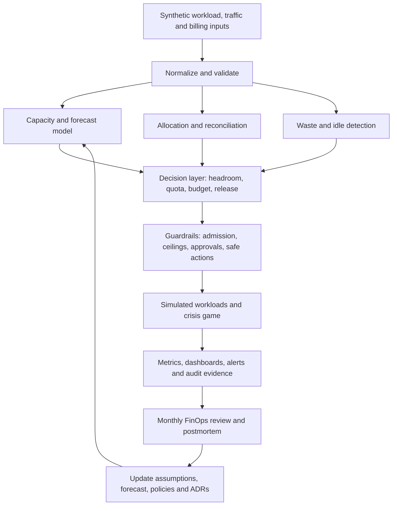

# Capacity and Cost Governance for Data and ML Platforms

> **M15 Unit 14 — Integrated Capstone Project Specification and Implementation Guide**

| Metadata | Value |
|---|---|
| Stage | Stage 2E — Production DevOps & Platform Engineering |
| Module | M15 — Platform Capacity, Compute Economics, and FinOps |
| Unit | 14 — Capstone Project |
| Target repository path | `15-Platform-Capacity-Compute-Economics-and-FinOps/Projects/01-capacity-and-cost-governance-for-data-ml-platforms.md` |
| Artifact produced by this task | `01-capacity-and-cost-governance-for-data-ml-platforms.md` |
| Estimated effort | 90–130 focused hours; 9–10 independently resumable milestones |
| Required stack | Cap-Core; Cap+Obs and Cap+Scale are sequenced extensions |
| Cost convention | HCU (Hypothetical Cost Unit) only; every rate and amount is `[HYPOTHETICAL]` |
| Evidence convention | `[SYNTHETIC]`, `[ILLUSTRATIVE]`, `[ASSUMPTION]`, `[VERIFY]`, `[MEASURED — YOUR ENVIRONMENT]` |
| Status | DRAFT-AUDITED; learner execution and environment-specific verification remain open |

## Abstract

This capstone integrates the M15 capacity and FinOps practices into one small, local-first governance system for a data/ML platform. The learner will forecast demand, derive headroom, constrain priorities and quotas, model budget alerts and preventive guardrails, allocate and reconcile cost, detect waste safely, gate releases, simulate spot interruptions and node provisioning, exercise KEDA and OpenCost, and govern fake GPU capacity. A four-phase crisis game tests whether the controls work together under pressure.

The project is intentionally not a production cloud platform. The required path uses Python's standard library, synthetic data, a local `kind` cluster only where useful, and simulators for provider-backed node provisioning and GPUs. All rates are hypothetical HCU. No cloud account, provider credential, real invoice, paid FinOps product, billable resource, or physical GPU is required. The learner's results must come from their own runs; this guide supplies fixtures, implementations, tests, templates and acceptance criteria, not fabricated before/after claims.

> **Fidelity notice:** A successful simulator test proves that the stated model and its controls behave as tested. It does not prove cloud-provider billing behavior, real node provisioning, actual GPU performance, real interruption rates, or production readiness. A `kind` node is a containerized test node, not a priced cloud VM.

> **Companion index:** The M15 syllabus defines `Projects/README.md` as the companion project index for grading, evidence submission, sequencing/resource planning, HCU conventions and laptop-fidelity statements. This task produces only this project specification. Do not create or edit `Projects/README.md`; the essential execution, resource and fidelity guidance is included here so this file is usable on its own.

---

## 1. Purpose, scenario and outcomes

### 1.1 Scenario

A data/ML platform's cloud-style bill grows faster than usage. Engineering teams cannot reliably identify which team, service or workload drives the change. Capacity is sized by intuition, causing either repeated firefighting or very low average utilization. Development environments run continuously. GPUs sit idle in forgotten notebooks while training jobs queue. A faulty autoscaling path once tripled the simulated node count overnight. A budget alert arrived after the synthetic spend threshold had already been crossed. A release accidentally doubled replicas.

The learner is the platform engineer asked to establish a practical capacity-and-cost governance loop. The objective is not to maximize utilization or minimize the HCU total at any cost. It is to improve the relationship between resource consumption, business outcomes, reliability, performance, security and accountable ownership.

### 1.2 Required outcomes

At completion, the learner can:

1. Produce a reproducible demand forecast, compare it with a naive baseline, quantify uncertainty and explain when the model should not be trusted.
2. Derive workload-tier headroom from peak demand, failure modes, capacity lead time and recovery objectives.
3. Apply priority, quota, fair-share and admission policies without confusing priority with guaranteed capacity.
4. Demonstrate that budgets and alerts are signals, not hard spending caps; implement preventive limits and bounded response controls.
5. Allocate synthetic cost to direct, shared, idle and unallocated buckets, then reconcile the result to a synthetic invoice without hiding residuals.
6. Detect idle candidates while protecting scheduled jobs, DR standby, legal hold and data-bearing resources.
7. Estimate release capacity/cost deltas, catch planted regressions, use an A/A noise check and gate ring promotion on evidence.
8. Model spot interruption and checkpoint economics, node growth ceilings, event-driven scaling, OpenCost allocation and GPU scheduling without claiming provider fidelity.
9. Operate a FinOps review cadence with unit economics, owners, exception expiry, showback and a 90-day improvement plan.
10. Detect, contain, communicate and recover from a multi-phase capacity-and-cost incident while preserving reliability and data.

### 1.3 Definition of success

The project succeeds when its controls detect and safely constrain the planted failure cases, the allocation pipeline explains every synthetic HCU or reports the residual, the forecast is evaluated against a naive baseline, cleanup refuses unsafe actions, and the learner can defend decisions using SLO and unit-cost evidence.

The following are **not** success criteria by themselves:

- maximum CPU/GPU utilization;
- the lowest modeled HCU total;
- a forecast that looks smooth;
- a budget alert without a preventive control;
- 100% tag compliance when the ownership model is wrong;
- a cleanup job that deletes resources quickly;
- an autoscaler that creates the largest number of nodes;
- an OpenCost dashboard treated as an invoice;
- a simulator result described as a real-world benchmark.

---

## 2. Learner prerequisites and cross-module handoffs

Assume the learner has completed Stages 0–2D and Stage 2E M01–M14. The learner can operate a small `kind` cluster and understands Kubernetes resources, requests/limits, SLOs/error budgets, basic capacity theory, observability, load/soak testing, quotas, placement, cleanup safety and DR/multi-region trade-offs. The learner has not yet operated a formal capacity-planning or FinOps practice.

**Unit 13 interface:** The Unit 13 practice-question generation prompt was reviewed as a curriculum input. A separately generated `practice-questions.md` file was not located in the available conversation/Library search, so this capstone does not claim to import or reconcile individual Unit 13 questions. The prompt's 210-question minimum and per-unit distribution belong to that separate artifact and are not duplicated as capstone requirements.

### 2.1 M15 unit integration map

| Prior unit | Reuse in this capstone | Do not reteach |
|---|---|---|
| Unit 1 — Capacity forecasting and headroom | Forecast back-testing, intervals, workload-tier headroom, node shape and capacity reports | Basic definitions of demand and headroom |
| Unit 2 — Priorities, quotas and contention | PriorityClass tiers, quota/admission checks, fair-share, contention and preemption-waste model | Kubernetes scheduling and quota fundamentals |
| Unit 3 — Budgets and spending guardrails | HCU rate card, synthetic billing, `usage_date`/`available_at`, budget forecast, anomaly signals and response ladder | Why budgets are not caps |
| Unit 4 — Cost allocation | Metadata standard v3, ownership registry, Unit 3 adapter, four buckets, shared-cost drivers, reconciliation and showback | Allocation vocabulary and base algorithms |
| Unit 5 — Idle-resource cleanup | Evidence windows, exclusions, report-only → notify/quarantine → approved stop, action cap and audit | Safe cleanup fundamentals |
| Unit 6 — Cost/reliability/performance trade-offs | SLO guardrails, cost per outcome, staged reductions, rollback and Goodhart checks | Cost/reliability triangle |
| Unit 7 — Release review | Manifest-diff estimator, HPA/KEDA bounds, A/A noise, launch plan, post-release evidence and ring gate | CI/CD and progressive-delivery basics |
| Unit 8 — Spot/preemptible | Interruption injection, checkpoint/resume, lost-work model, eligibility and deadline fallback | Provider interruption facts |
| Unit 9 — Node provisioning | Bin-packing, pending-pod reasons, ceilings, consolidation/disruption budget and scale-out time | Provider-backed node provisioning |
| Unit 10 — KEDA | Queue/cron/Prometheus scaling, bounds, cooldown, fallback and empty-metric hazards | KEDA installation and HPA basics |
| Unit 11 — OpenCost | HCU pricing, estimated allocation, manual cross-check, label attribution, data quality and reconciliation | OpenCost installation and query basics |
| Unit 12 — GPU economics | Fake GPU scheduling, fragmentation, gang admission, fair share, idle GPU and inference economics | Hardware-specific GPU operation |

### 2.2 Exact interface contracts to preserve

**Unit 3 synthetic billing source contract**

The source CSV columns are:

```text
usage_date,available_at,account,project,environment,team,owner,service,resource_type,region,usage_quantity,usage_unit,rate_hcu,cost_hcu,resource_id,tags_present
```

- `usage_date` is when usage/cost accrued.
- `available_at` is when the synthetic billing row became visible.
- `resource_id` is the source resource identifier.
- `environment` and `resource_type` are source names; do not silently rename them in the raw source.
- All rates and costs are HCU and synthetic.

**Unit 4 allocation metadata standard v3**

Use the canonical ownership dimensions: `team`, `project`, `service`, `env`, `workload`, `cost-center`, and `owner`. `namespace` is conditional for Kubernetes workload rows. The project may add `experiment`, `model`, `run_id`, `region`, `resource_type` and `allocation_model_version`, but it must not create a competing owner registry.

Unit 4's generated adapter maps `available_at → billing_visible_date`, `resource_id → record_id`, `environment → env`, and `resource_type → normalized workload/SKU dimensions`. It preserves the original owner value and source row. It leaves a namespace blank when Unit 3 did not supply one. Unknown or missing ownership remains visible as `__unallocated__`; never guess an owner.

**Canonical cost buckets**

- `direct`: cost attributable to one owner/workload;
- `shared`: centrally operated services distributed by an explicit driver;
- `idle`: provisioned capacity not attributed to active workload under a documented denominator;
- `__unallocated__`: cost without valid ownership.

The four buckets must be mutually exclusive for the chosen reconciliation scope. If idle is carved out of a compute pool, it is a reclassification, not a second cost. Do not double-count shared or idle amounts.

**Unit 11 OpenCost source distinction**

OpenCost data is an operational estimate. Store it with `source_class=estimated_allocation`, `actual_billed=false`, a rate-card/model version, extraction timestamp, completeness status and idempotency key. Keep it separate from Unit 3 billing-like rows. Reconcile later; never relabel an estimate as billed spend.

### 2.3 Running example

The same fictional platform is used throughout:

| Workload | Behavior | Primary objective | Cost/capacity risk |
|---|---|---|---|
| `inference-api` | Bursty, latency-sensitive | p95/p99 latency and availability | Cold start, replica surge, GPU warm floor |
| `daily-etl` | Scheduled batch | Completion window and data correctness | Peak overlap, backlog, retry amplification |
| `stream-consumer` | Queue-driven | Lag/freshness SLO | Backlog growth and autoscaling overshoot |
| `training-v7` | Long-running, checkpointable | Useful training progress and deadline | GPU queue, interruption, idle reservation |
| `notebook-session` | Interactive, idle-prone | User experience and data safety | Forgotten GPU allocation |
| Platform services | Shared observability, CI, registry, control plane | Platform SLO and service ownership | Hidden shared cost and telemetry growth |
| Stateful services | Database, object storage, snapshots | Durability, recovery and latency | Retention, replication and egress |

---

## 3. Scope, non-goals and safety contract

### 3.1 In scope

- Capacity and unit-economics model; assumptions register; synthetic telemetry; rolling-origin forecast evaluation; prediction intervals; headroom and fragmentation.
- Kubernetes PriorityClass/ResourceQuota/LimitRange examples and policy tests.
- Synthetic billing, budget thresholds, billing-lag demonstration, anomaly comparison and bounded response simulation.
- Unit 3 → Unit 4 billing adapter, metadata validation, direct/shared/idle/unallocated allocation, model sensitivity and invoice reconciliation.
- Waste detection, false-positive protection, timezone-aware schedules, report-only/quarantine/approved-stop simulation, savings ledger.
- Release estimator, planted regression corpus, noise-aware gate, A/A test, launch plan, post-release verification and ring gate.
- Spot/checkpoint simulation; node provisioning simulator; KEDA manifest and fail-safe tests; OpenCost hypothetical pricing and cross-check; fake GPU scheduling and economics.
- Four-phase crisis game, incident communication, showback report and postmortem.
- FinOps governance, KPIs, monthly review, 90-day roadmap, ADRs, runbooks and evidence.

### 3.2 Explicit non-goals

- Creating cloud accounts, provider credentials, billable VMs, managed Kubernetes clusters, paid FinOps products or real billing exports.
- Real cloud node provisioning or provider-specific instance catalog pricing.
- Real GPU execution, performance benchmarking, driver installation or hardware isolation validation.
- Production chargeback, tax/accounting treatment, contract negotiation or legal/financial advice.
- Building M16's developer portal, golden paths or service catalog.
- Rebuilding the M15 Unit 1–12 teaching content as separate lessons.

### 3.3 Non-negotiable cost and fidelity rules

1. Every cost/rate is a hypothetical HCU value from the versioned rate card. No currency symbol, real provider price, discount, free-tier limit, provider quota, instance specification, interruption statistic or lead time is permitted.
2. A budget is an alerting/forecast mechanism, not a guaranteed hard cap. Preventive controls are quotas, policy, ceilings, allow-lists and architecture.
3. Synthetic billing is not an invoice. OpenCost on `kind` demonstrates allocation mechanics, not real spend.
4. `kind` and `kwok` nodes are not priced cloud instances. Fake GPUs do not execute GPU workloads.
5. A simulation result is `[SYNTHETIC]`; a worked calculation is `[ILLUSTRATIVE]`; a modeling choice is `[ASSUMPTION]`; a version-specific claim is `[VERIFY]`; only learner-collected values may be `[MEASURED — YOUR ENVIRONMENT]`.
6. Every optimization is paired with SLO, latency, throughput, correctness, security or data-durability guardrails and a rollback condition.
7. Missing telemetry is not zero utilization. Missing owner metadata is not a platform owner. Unknown pricing is not zero cost.
8. Every mutating/fault/cleanup operation is dry-run by default and lab-scoped. Require context assertion, namespace assertion, lab labels, allow-list, action cap, kill switch and audit log.
9. No automation in this project deletes PVCs, buckets, snapshots, checkpoints, datasets, model artifacts or other data-bearing resources.
10. Protect quarterly jobs, DR standby, legal hold and explicit `do-not-stop` exclusions with an owner and expiry. Expired exceptions must be reviewed; they do not silently become safe-to-delete.
11. Stop optional stacks after evidence capture. Do not run every heavy component simultaneously on the target laptop.

### 3.4 Threat model and safety boundary

| Threat / failure | Control | Verification |
|---|---|---|
| Wrong Kubernetes context | Expected context allow-list; read-only preflight | Negative test with unexpected context |
| Wrong namespace | Explicit `m15-capstone` namespace and lab label | Negative test with non-lab namespace |
| Malicious/buggy autoscaler | Max replicas, node ceiling, rate-of-growth alert, quota | Unbounded-scale test must fail |
| Cleanup false positive | Evidence window, exclusion annotation, quarantine, no data deletion | Quarterly/DR/legal-hold fixtures remain protected |
| Overbroad cleanup bug | Allow-list, action cap, dry-run, kill switch, audit | Attempt beyond cap returns non-zero |
| Budget action harms production | No automatic production action; response simulation only | Bug injection cannot target production |
| Cost-data tampering | Immutable raw input copy, checksum, model version | Changed source hash is detected |
| Credential exposure | No real credentials; fake values only | Secret scanner and repository review |
| Tenant cost abuse | Quota, experiment cap, admission policy, audit | Unapproved job is denied |
| Missing metrics trigger unsafe scale-to-zero | Missing/empty treated as unknown; safe fallback | Empty-result chaos test |

---

## 4. Architecture and data flow



### 4.1 Components and owners

| Component | Input | Output | Accountable role |
|---|---|---|---|
| Synthetic source generator | Scenario seed and rate card | Usage, billing and workload CSV/JSON | Platform engineer |
| Forecast/headroom | Usage history, demand drivers, failure assumptions | Forecast report, interval and headroom recommendation | Capacity owner |
| Scheduling policy | Workload tier, resource requests, quota and priority | Admission/placement decision | Platform SRE |
| Budget engine | Available billing rows, fast usage signals, HCU budget | Actual-like/forecast report and alert | FinOps practitioner |
| Allocation pipeline | Billing, labels, owner registry, OpenCost estimate | Direct/shared/idle/unallocated and reconciliation | FinOps + service owners |
| Waste controller | Inventory, activity, owner and exception evidence | Report, notification, quarantine or approved action proposal | Resource owner |
| Release gate | Base/proposed manifests, estimates, SLO results | PASS/BLOCK/EXCEPTION with evidence | Release owner |
| Spot/node/KEDA/GPU simulators | Policy and synthetic workload traces | Decisions, costs, pending reasons and failure traces | ML platform engineer |
| Crisis game | Variant, seed, hidden cause and timeline | Incident timeline, score, showback and postmortem | Incident commander |
| Observability/evidence | Reports, tests and event stream | KPI panels, alerts, audit records | SRE |

### 4.2 Data lineage rules

- Keep raw inputs immutable; write normalized rows to a separate path.
- Include `source_file`, `source_row_id`, `schema_version`, `generated_at`, `available_at`, `source_class`, `rate_card_version` and `allocation_model_version` where relevant.
- Make deduplication keys explicit and source-scoped.
- Keep operational estimates, synthetic billed-like data and learner measurements in separate source classes.
- Every report records time window, input hashes, assumptions and incomplete-data status.
- A reconciliation failure exits non-zero and explains the unexplained amount. Never force totals to balance by assigning the residual to a convenient team.

---

## 5. Repository structure

The following is the project workspace created by the learner. It is not a request to modify the supplied roadmap repository during this task.

```text
capacity-cost-governance/
├── model/
│   ├── rate-card.json
│   └── unit-economics.json
├── forecast/
│   ├── usage-history.csv
│   └── headroom-policy.json
├── scheduling/
│   ├── priorities.yaml
│   ├── quotas.yaml
│   ├── limit-ranges.yaml
│   ├── policy.json
│   └── fair-share.json
├── budgets/
│   ├── synthetic-billing.csv
│   ├── budget.json
│   └── response-policy.json
├── allocation/
│   ├── unit3-billing.csv
│   ├── metadata-standard.json
│   ├── ownership-registry.json
│   ├── allocation-model.json
│   ├── synthetic-invoice.json
│   └── request-usage-fixture.json
├── waste/
│   ├── inventory.json
│   ├── policy.json
│   └── cleanup-fixture.json
├── releases/
│   ├── base-manifest.json
│   ├── proposed-manifest.json
│   ├── gate-policy.json
│   ├── release-evidence.json
│   ├── aa-fixture.json
│   └── tradeoff-scenarios.json
├── spot/
│   └── jobs.json
├── nodes/
│   ├── node-catalog.json
│   └── strategy-scenarios.json
├── keda/
│   ├── policy.json
│   ├── scale-to-zero-scenario.json
│   └── redis-scaledobject.yaml
├── opencost/
│   ├── values-hcu.yaml
│   ├── estimated-allocation.csv
│   ├── manual-cross-check.json
│   └── data_quality.py
├── gpu/
│   ├── fake-nodes.json
│   ├── gpu-policy.json
│   └── gang-scenario.json
├── observability/
│   ├── prometheus.yml
│   ├── prometheus-rules.yaml
│   ├── prometheus-tests.yml
│   └── grafana-dashboard.json
├── governance/
│   ├── exception-register.csv
│   ├── approvals.json
│   └── monthly-review-template.md
├── drills/
│   ├── variants/
│   │   ├── variant-a.md
│   │   └── variant-b.md
│   ├── answer-keys/
│   │   └── facilitator-key.md
│   └── postmortem-template.md
├── evidence/
│   ├── source-hashes/
│   ├── reports/
│   ├── test-results/
│   ├── dashboards/
│   └── game/
├── runbooks/
│   └── runbooks.md
├── sim/
│   ├── __init__.py
│   ├── fair_share.py
│   ├── scheduled_scale.py
│   ├── inference_simulator.py
│   ├── fake_gpu_exporter.py
│   ├── anomaly_mad.py
│   ├── workload_allocation.py
│   ├── tradeoff_explorer.py
│   ├── response_ladder.py
│   ├── cleanup_reaper.py
│   ├── gang_scheduler.py
│   ├── scale_to_zero.py
│   └── node_strategy.py
├── src/
│   └── m15gov/
│       ├── __init__.py
│       └── cli.py
├── tests/
│   ├── test_governance.py
│   ├── test_negative_policy.py
│   ├── test_advanced_simulators.py
│   └── test_integration_simulators.py
├── scripts/
│   ├── preflight.sh
│   ├── kubectl-lab.sh
│   └── bootstrap-namespace.sh
├── k8s/
│   └── namespace.yaml
├── docs/
│   ├── architecture.md
│   ├── adrs.md
│   ├── production-readiness.md
│   └── before-after.md
├── versions.txt
├── Makefile
└── README.md
```

**Evidence policy:** `evidence/` contains synthetic data, test outputs, sanitized command output and learner-measured local resource footprints. Never store kubeconfig files, tokens, private keys, personal/customer data, real billing exports or unredacted internal hostnames.

---

## 6. Stack profiles and laptop resource sequencing

Target laptop: approximately 4 CPU, 8 GB RAM and 30 GB free disk. This is a planning constraint, not a guarantee. Measure the actual environment before each profile.

| Profile | Components | Purpose | Start/stop rule |
|---|---|---|---|
| **Cap-Core** | Python standard library, CSV/JSON, pytest or unittest, existing `kind` only when needed | All core models, tests, budget, allocation, waste, release, spot/node/GPU simulations | Default profile; no Prometheus/OpenCost/KEDA required |
| **Cap+Obs** | Cap-Core + minimal Prometheus/Grafana + OpenCost | Dashboards, alerts, allocation cross-check and data-quality checks | Start only for observability/OpenCost milestones; stop after evidence |
| **Cap+Scale** | Cap-Core + KEDA + Redis/queue + `kwok` or learner-built node simulator | Event-driven scaling and simulated node decisions | Start only for scaling milestones; never run alongside all optional observability components unless measured headroom permits |

### 6.1 Sequencing rules

1. Measure idle host/container-runtime CPU, memory and disk.
2. Complete all Python/CSV/JSON work first.
3. Start the `kind` cluster only for Kubernetes policy or KEDA/OpenCost integration.
4. Run Cap+Obs and Cap+Scale in separate sessions. Stop Prometheus/OpenCost before starting KEDA/Redis/kwok if the laptop is constrained.
5. Prefer the Python bin-packing simulator over a kwok integration when provider-like node behavior is not required.
6. Use fake GPU extended resources or JSON simulation. No actual GPU driver is installed for this capstone.
7. Capture `docker stats`, `kubectl top nodes` (if Metrics Server exists), disk usage and process memory as learner evidence. Do not use fixed footprint claims as acceptance criteria.
8. Keep 5 GB of disk headroom as an `[ILLUSTRATIVE]` local safety buffer; if available disk falls below the learner's chosen floor, stop optional components and clean generated artifacts only.

### 6.2 WSL2 notes

- Keep the active project under the Linux filesystem (for example, `$HOME/projects/...`) rather than a Windows-mounted path for container-heavy operations; validate file-watch and bind-mount behavior in the learner's setup.
- Record WSL kernel and Docker/container-runtime versions.
- Verify port forwarding and localhost behavior for Prometheus, Grafana, Redis and OpenCost.
- Watch memory pressure: WSL2 memory limits and Docker Desktop resource settings can constrain `kind`.
- Check clock/timezone behavior for scheduled non-production shutdown, DST transitions and synthetic billing dates.
- If a tool is unavailable or too heavy, use the Cap-Core simulator. This is a valid completion path.

---

## 7. Assumptions register and hypothetical rate card

### 7.1 Assumptions register

Every assumption has an owner, rationale, confidence, source, review date and sensitivity. Example entries below are policy examples, not universal recommendations.

| ID | Assumption | Example value | Owner | Confidence | Sensitivity / validation |
|---|---|---|---|---|---|
| A-01 | Inference p95 latency objective | `[ILLUSTRATIVE]` 250 ms | Service owner | Medium | Load-test under representative request mix |
| A-02 | Batch completion window | `[ILLUSTRATIVE]` 4 h | Data owner | Medium | Compare schedule and historical duration |
| A-03 | Forecast look-ahead | `[ILLUSTRATIVE]` 14 days | Capacity owner | Medium | Back-test multiple horizons |
| A-04 | Headroom by failure mode | Per-tier policy, not one global percentage | SRE | Medium | N−1, burst, provisioning delay and DR cases |
| A-05 | Billing visibility lag | `[SYNTHETIC]` 2 days in fixture | FinOps | High for fixture only | Compare `available_at` to `usage_date` |
| A-06 | Reconciliation tolerance | `[ILLUSTRATIVE]` 0.01 HCU | FinOps | Medium | Rounding and source completeness analysis |
| A-07 | Cleanup evidence window | `[ILLUSTRATIVE]` 24 h minimum | Service owner | Low | False-positive review and business-cycle coverage |
| A-08 | Experiment cap | `[ILLUSTRATIVE]` 100 HCU per run | ML platform | Low | Sensitivity and approval workflow |
| A-09 | Autoscaler node ceiling | `[ILLUSTRATIVE]` 6 simulated nodes | Platform SRE | Medium | Downstream capacity and crisis-game drill |
| A-10 | Queue target | `[ILLUSTRATIVE]` 20 items per worker | Stream owner | Low | Throughput/load test and freshness SLO |

### 7.2 Hypothetical HCU rate card

`model/rate-card.json`:

```json
{
  "rate_card_version": "m15-hcu-v1",
  "currency": "HCU",
  "notice": "HYPOTHETICAL TEACHING RATES — NOT PROVIDER PRICES",
  "effective_from": "2026-11-03",
  "rates": {
    "cpu_core_hour": 0.12,
    "memory_gib_hour": 0.03,
    "storage_gib_hour": 0.004,
    "egress_gib": 0.02,
    "gpu_hour": 1.5,
    "redis_instance_hour": 0.08,
    "observability_unit_hour": 0.05
  }
}
```

Every numeric rate above is `[HYPOTHETICAL]`. The `currency` field is a pedagogical label only. Do not enter a real provider rate into this file. Rate-card changes require a version bump, effective date, owner, rationale, sensitivity analysis and a regenerated evidence report.

### 7.3 Unit economics

Use denominators that represent successful outcomes, not merely allocated resources:

\[
\text{HCU per successful request} =
\frac{\text{total allocated HCU}}{\text{successful requests}}
\]

\[
\text{HCU per completed job} =
\frac{\text{compute + storage + transfer HCU}}{\text{successful job runs}}
\]

\[
\text{HCU per training progress unit} =
\frac{\text{training HCU}}{\text{validated useful progress}}
\]

\[
\text{HCU per 1,000 successful inferences} =
\frac{\text{inference HCU}}{\text{successful inferences}} \times 1000
\]

Always report the quality/SLO guardrail beside the cost denominator. A cheaper request that times out or produces lower-quality output is not an efficiency improvement.

---

## 8. Milestones and acceptance gates

The project is designed for 10 milestones. Each can be paused and resumed independently. Effort estimates are `[ILLUSTRATIVE]`; measure actual local resource use.

| # | Milestone | Effort | Profile | Outputs and exit criteria |
|---:|---|---:|---|---|
| 1 | Workspace safety, versions, assumptions and rate card | 4–6 h | Cap-Core | Preflight report, `versions.txt`, lab boundary, HCU-only rate card; unexpected context and missing tools handled safely |
| 2 | Synthetic workloads, billing and unit-economics model | 8–12 h | Cap-Core | Deterministic generators, source hashes, schema tests, cost-per-outcome report |
| 3 | Forecast bake-off, headroom and fragmentation | 10–14 h | Cap-Core; Cap+Obs optional | Rolling-origin metrics, intervals, naive comparison, headroom report and capacity alert |
| 4 | Priorities, quotas, fair-share, budgets and guardrails | 10–14 h | Cap-Core; Cap+Obs optional | Admission tests, quota report, budget-lag proof, preventive guardrails and bug-injection denial |
| 5 | Allocation, reconciliation, waste and safe cleanup | 10–14 h | Cap-Core | Unit 3 adapter, Unit 4 v3 metadata, four-bucket allocation, mismatch failure, protected cleanup report |
| 6 | Trade-off explorer and release gates | 8–12 h | Cap-Core; Cap+Obs optional | Resource estimator, regression corpus, A/A baseline, rollback evidence, ring promotion |
| 7 | Spot/checkpoint and node provisioning simulation | 8–12 h | Cap-Core; Cap+Scale optional | Interruption recovery model, bin-packing, node ceiling and denial-of-wallet drill |
| 8 | KEDA, OpenCost and GPU integration | 12–18 h | Cap+Scale / Cap+Obs in separate sessions | Bounded scaler, empty-metric fail-safe, OpenCost HCU config/cross-check, fake GPU and admission gate |
| 9 | Crisis game, variants, answer keys and runbooks | 8–12 h | Cap-Core | Four phases, deterministic seed, hidden cause, learner/facilitator separation, score and postmortem |
| 10 | Final verification, monthly review and sign-off | 6–8 h | Cap-Core | `make verify-all`, before/after template, ADRs, 90-day roadmap, final evidence and open-item register |

**Milestone acceptance rule:** no milestone is complete because a command printed “success.” Save the input hash, command, exit code, output path, negative-test evidence and cleanup verification. If a required integration is not feasible locally, complete the simulator path and mark the integration `[OPEN — learner verification]`.

---

## 9. Required deliverables — implementation and acceptance

### Deliverable 1 — Repository bootstrap and safety

**Purpose:** establish a repeatable workspace and prove that every optional cluster operation is bounded.

**Required implementation**
- The repository structure in Section 5.
- `scripts/preflight.sh` prints the current context, namespace, tool versions, OS and disk status.
- It refuses a context other than the explicit lab context for mutating operations.
- It does not create cloud resources or Kubernetes resources.
- It records a sanitized `versions.txt`.
- Read-only/dry-run is the default. `--apply` is required for any permitted mutation.
- `scripts/kubectl-lab.sh` wraps `kubectl` and checks context, namespace and lab labels before applying or deleting.
- The workspace has a `STOP`/kill-switch file or environment variable that disables simulated automated responses.

**Acceptance**
- `preflight.sh` exits successfully in Core-only mode when no Kubernetes cluster is configured, while clearly stating that cluster labs are skipped.
- A configured but unexpected context returns non-zero.
- A non-lab namespace or missing lab label returns non-zero.
- `versions.txt` contains no kubeconfig, token, certificate or secret.
- `make down` dry-run prints the exact bounded cleanup plan and changes nothing.

**Negative tests**
- Unexpected context.
- Non-lab namespace.
- Unlabelled target.
- `--apply` absent.
- Kill switch enabled.
- Attempt to target a data-bearing object.

### Deliverable 2 — Capacity model and forecasting

**Purpose:** turn demand into a forecast, a capacity envelope and an explainable headroom decision.

**Inputs**
- Synthetic daily demand/usage history.
- Workload class and SLO tier.
- Node catalog with hypothetical CPU/memory shapes and HCU rates.
- Failure modes: burst, node loss, maintenance, scale-out delay, batch overlap and regional loss (the latter is modeled, not deployed).

**Outputs**
- Forecast comparison: naive-last-value, moving average and optional seasonal baseline.
- Rolling-origin back-test with MAE, MAPE where denominator is safe, interval coverage and error by workload.
- Prediction interval built from held-out residuals; label the method and sample limitations.
- Headroom recommendation by workload tier/failure mode.
- Node-shape/fragmentation report: aggregate free resources versus largest compatible node.
- Capacity report and predicted-exhaustion alert.
- Commitment-versus-flexible-capacity regret model in HCU.
- Right-sizing recommendation with an explicit load-test and rollback plan.

**Acceptance**
- Tests cover empty history, missing day, zero denominator, step change, seasonality, negative input and forecast horizon boundaries.
- A forecast that fails to beat the naive baseline is not adopted automatically.
- Headroom report includes assumptions, lead time, failure mode, owner and uncertainty.
- Capacity alert is validated with matching `promtool` if Prometheus is installed; otherwise a Python rule evaluator is used.
- Every rate is HCU and `[HYPOTHETICAL]`.

### Deliverable 3 — Priorities, quotas and contention

**Purpose:** protect latency-critical workloads while making batch and experiment consumption predictable.

**Policy tiers**
- `production-inference`: protected, bounded, no best-effort borrowing of its reserved floor.
- `scheduled-retraining`: deadline-aware, checkpoint-capable, bounded.
- `research-experiment`: quota-limited and subject to pre-run HCU approval.
- `best-effort`: first to yield under contention.

**Required artifacts**
- PriorityClass manifests and a policy table.
- Namespace quota by team/tier and LimitRange defaults.
- Admission contract restricting priority-class use by namespace.
- Overprovisioning placeholder explanation where used.
- Preemption-waste calculator.
- Fair-share simulator with weighted entitlements and optional dominant-resource fairness illustration.
- Contention and quota-hoarding report.

**Acceptance**
- Unauthorized PriorityClass use is denied.
- Missing requests are rejected by the policy test.
- Quota overflow is denied.
- A low-priority workload cannot claim a protected tier.
- Preemption waste includes lost work, checkpoint and restart cost in HCU.
- Priority does not imply capacity availability; a Pod may remain Pending.

### Deliverable 4 — Budgets and spending guardrails

**Purpose:** detect cost growth early and prevent unsafe workload creation without claiming that an alert is a cap.

**Required artifacts**
- Synthetic billing generator with planted anomalies.
- Versioned budgets-as-code.
- Budget engine for visible actual-like spend and forecast threshold.
- Billing-lag demonstration using `usage_date` and `available_at`.
- Faster operational usage signal for a leading indicator.
- Anomaly bake-off: day-over-day, week-over-week and seasonal median/MAD or another explained baseline.
- Preventive guardrails: quotas, max replicas, per-experiment cap, admission policy and allow-listed response.
- Automated response ladder: notify → dry-run recommendation → bounded non-production quarantine/scale action only when explicitly enabled.
- Kill switch, audit log, owner-notification stub and bug-injection test.
- Hidden-cost audit: idle capacity, platform overhead, storage, logging/metrics and cross-region egress.

**Acceptance**
- A planted spend event crosses a synthetic threshold before the delayed billing row becomes visible.
- The report distinguishes alert time, usage time and billing visibility time.
- A late alert does not authorize an automatic destructive response.
- A broken broad response cannot touch production or data-bearing resources.
- A planted guardrail defect is caught, fixed and recorded.
- Default response is non-mutating.

### Deliverable 5 — Allocation and reconciliation

**Purpose:** create an explainable model of who consumes platform cost and show where the model is incomplete.

**Required artifacts**
- Unit 4 metadata standard v3 and versioned ownership registry.
- Unit 3 CSV adapter preserving raw source fields and source row IDs.
- Validator and cost-weighted metadata-compliance report.
- Direct allocation by `team`, `project`, `service`, `env`, `workload` and supported dimensions.
- Kubernetes allocation comparison: request-based, usage-based and `max(request, usage)`.
- Shared-cost methods for observability, CI, registry and control plane: even, direct-cost-weighted, usage-weighted and agreed fixed split.
- Idle treatment comparison: separate, platform/shared or proportional to consuming teams.
- Reconciliation to a synthetic invoice with planted duplicate, missing-day, rounding and credit mismatches.
- Team showback report and unit economics.
- Allocation-model change record and sensitivity analysis.

**Acceptance**
- Missing/invalid owners map to `__unallocated__`, not an invented owner.
- Shared and idle costs are not double-counted.
- Reconciliation fails non-zero when residual exceeds tolerance and explains the difference.
- Estimated OpenCost rows remain separate from billed-like synthetic rows.
- Model changes are versioned and their effect on team rankings is reported.

### Deliverable 6 — Idle-resource control and cleanup safety

**Purpose:** identify likely waste while protecting work that is idle-looking but important.

**Required artifacts**
- Waste detectors for unused compute, old non-production workloads, orphaned metadata and idle GPU candidates.
- Exclusion register with owner, reason, approval, expiry and audit.
- False-positive fixtures for quarterly jobs, DR standby, legal hold and `do-not-stop`.
- Timezone/DST-safe non-production schedule.
- TTL reaper with report-only default, owner notification, quarantine and simulated approved-stop action.
- Allow-list, deletion/action cap, kill switch, audit record and least-privilege identity.
- Right-sizing recommendation to GitOps PR (never direct mutation in the default path).
- Savings ledger with identified versus realized HCU.

**Hard safety rule:** no automated deletion of PVCs, buckets, snapshots, checkpoints, datasets or model artifacts. The reference implementation only marks eligible ephemeral lab objects as `STOP_PROPOSED`; it does not issue `kubectl delete`.

**Acceptance**
- Protected false positives are excluded.
- An expired exception is surfaced for review; it does not become an automatic deletion approval.
- Action beyond the cap fails non-zero.
- Dry-run is default.
- Explicit apply requires context, namespace, label and allow-list.
- Audit output includes resource, owner, evidence window, reason, proposed action and result.
- Cleanup verification confirms no unexpected changes.

### Deliverable 7 — Cost/reliability trade-offs and production releases

**Purpose:** make efficiency changes measurable and reversible.

**Required artifacts**
- Trade-off explorer for replicas, headroom, utilization, node size, telemetry and cost per outcome.
- Workload-tier policy matrix and ADRs.
- Staged resource-reduction experiment with SLO guardrail and automatic rollback in the simulator.
- Telemetry-cutting experiment measured by time-to-localize.
- Manifest-diff estimator and IaC cost/limit estimator.
- Planted regression corpus: replica increase, HPA max/bound removed or changed, risky resource request change, critical cost/safety label removed.
- Noise-aware per-release efficiency gate with A/A baseline.
- Launch capacity plan, post-event scale-down verification and post-release report.
- Ring-promotion gate requiring cost/capacity/SLO evidence.
- Review checklist and approval policy-as-code.

**Acceptance**
- All four planted regressions are detected with a human-readable explanation.
- A benign A/A variation does not fail automatically.
- A cost regression cannot override an SLO failure.
- A release cannot promote without required evidence or an approved, expiring exception.
- Every resource reduction includes a staged rollout, rollback condition and post-change verification.

### Deliverable 8 — Spot, nodes, KEDA, OpenCost and GPUs

#### 8A. Spot/preemptible simulation

- Synthetic spot pool and interruption injector.
- Checkpointed job and no-checkpoint control.
- Graceful termination, partial checkpoint and recovery tests.
- Net HCU comparison including lost work and restart time.
- Checkpoint interval sensitivity and deadline-aware fallback.
- Eligibility policy-as-code and negative tests.

#### 8B. Node provisioning simulation

- Use `kwok` only if current compatibility and local footprint are verified; otherwise use the Python bin-packing simulator.
- Simulate pending-pod reasons: insufficient resources, selector mismatch, taint/toleration, quota, ceiling and impossible shape.
- Simulate node growth, consolidation, disruption budget, scale-out delay and denial-of-wallet.
- Compare fixed node-group (CA-like) and flexible node-pool (Karpenter-like) decision logic without claiming provider fidelity.
- Provider-specific NodePool/ASG fields remain `[VERIFY]`.

#### 8C. KEDA/event-driven scaling

- Local Redis queue scaler or Python fallback.
- Queue target derivation from arrival rate, service rate, backlog age and completion objective.
- Explicit min/max replicas, cooldown and fallback.
- Empty/missing metric chaos test; missing is not zero.
- Scale-to-zero model only for workloads whose cold-start and queue-wait objectives permit it.
- KEDA 2.21 fields and scaler metadata must be checked against the pinned docs/chart before apply.

#### 8D. OpenCost

- Optional OpenCost on `kind` with HCU-only custom pricing, reusing Unit 11's chart values.
- Manual cross-check and label-based allocation.
- Dashboards/alerts for cost, idle, efficiency and data freshness.
- Synthetic billing reconciliation and egress estimate with caveats.
- Data-quality monitor for missing series, stale rate card, partial API window and missing ownership.
- Never use provider cloud-integration credentials.

#### 8E. GPU simulation

- Fake GPU nodes and quotas.
- Scheduling, taints, selectors, fragmentation and gang-scheduling deadlock/fix.
- Fair-share and preemption/checkpoint economics.
- Idle-GPU detection with safe report-only/quarantine flow.
- Synthetic inference batching and scale-out time budget.
- ML unit-economics worksheet, admission guardrails and pre-run experiment cost gate.
- Real GPU path is optional and unverified.

### Deliverable 9 — Multi-phase crisis game

Build `sim/` game-master harness with deterministic seed, randomized event timing, hidden causes, variants A/B, solo-learner mode, evidence capture, scoring and reset verification.

**Phase 1 — Runaway scaling:** a producer/HPA/KEDA bug drives Pod and simulated node counts upward. Forecast-budget and node-growth alerts fire. The learner must diagnose the growth loop, apply ceilings/quotas and contain safely.

**Phase 2 — Capacity crunch:** a batch flood degrades online SLOs; priorities, quotas, placeholders/fair-share and headroom matter. The GPU queue grows while a synthetic spot interruption wave occurs.

**Phase 3 — Cost spike investigation:** use allocation, OpenCost estimate, waste report and billing-lag-aware signals to identify an orphaned/idle set, untagged workload and cross-region egress change. Actions must preserve reliability and data.

**Phase 4 — Hidden inject:** one of false-positive idle trap, post-release regression, quota ceiling, broken pricing config or budget breach before month-end. The learner adapts, communicates uncertainty, produces a finance-ready showback and writes a blameless postmortem.

Include M10-style incident roles: incident commander, operations lead, communications lead and scribe. In solo mode, the learner rotates hats and records the handoff. Provide three-level hints and separate facilitator answer keys.

### Deliverable 10 — FinOps operating model

- KPI definitions and dashboards with formula, unit, source, aggregation window, owner, limitations and paired guardrail.
- Unit-cost trends, unallocated share, idle share, budget variance, forecast error, headroom attainment, estimator accuracy, savings identified vs realized and GPU allocation/use gap.
- Monthly per-team review pack.
- Budget/tag/exception policies with owner, approval and expiry.
- Pre-run HCU approval thresholds.
- Constructive showback, not a team-shaming dashboard.
- Maturity self-assessment using current FinOps Foundation wording only after checking the current official framework.
- 90-day improvement roadmap.

### Deliverable 11 — Makefile and end-to-end verification

The Makefile must expose these targets exactly:

`model`, `forecast`, `headroom`, `quota-test`, `budget-test`, `allocate`, `reconcile`, `waste-scan`, `release-estimate`, `release-gate`, `spot-test`, `nodes-sim`, `keda-test`, `opencost-test`, `gpu-sim`, `game`, `report`, `verify-all`, `down`.

`make verify-all` produces a pass/fail report and evidence paths. It checks lab context/namespace/labels if a cluster is configured and refuses destructive cleanup or fault injection outside lab-labelled resources. `make down` is dry-run by default and removes only generated ephemeral lab artifacts after explicit approval; it never deletes data-bearing resources.

### Deliverable 12 — Architecture, ADRs, runbooks and readiness review

Include the architecture diagram and at least eight ADRs:

1. Headroom policy.
2. Priority/quota/fair-share scheme.
3. Budget and guardrail design.
4. Allocation and shared-cost rules.
5. Idle cleanup safety.
6. Workload-tier cost/reliability policy.
7. Spot/KEDA/node-provisioning strategy.
8. GPU scheduling/sharing policy.

Include runbooks for at least eight scenarios: runaway scaling, capacity crunch/contention, budget alert, cost anomaly, wrong cleanup/recovery, spot interruption wave, KEDA/autoscaler failure and GPU queue/idle GPU.

Every runbook must include trigger, impact, initial checks, diagnosis tree, immediate safe action, prohibited action, owner/escalation, rollback/fallback, verification metrics and evidence retention.

### Deliverable 13 — Before/after measurement table

Use only learner-measured results. Required rows:

- forecast error versus naive baseline;
- headroom attainment;
- over-provisioning ratio;
- unallocated percentage;
- reconciliation difference;
- idle/waste share in HCU;
- cleanup false-positive rate;
- release-estimator accuracy and regressions caught;
- spot net savings after lost work;
- simulated autoscaler decision latency and ceiling effectiveness;
- KEDA scale-to-zero savings and queue-wait SLO attainment;
- OpenCost-versus-manual cross-check error;
- GPU allocation-versus-use gap;
- unit cost per request/job/run;
- crisis-game time-to-detect/time-to-mitigate.

Each row requires formula, unit, data source, window, baseline, post-change value, uncertainty, paired reliability guardrail and interpretation. Blank values must say `TO BE MEASURED`.

---

## 10. Architecture decisions and production-readiness review

### 10.1 Required ADRs

| ADR | Decision | Alternatives considered | Required evidence |
|---|---|---|---|
| ADR-001 | Headroom policy by tier/failure mode | Flat percentage; peak-only; failure-mode model | Back-test, failure scenario and owner approval |
| ADR-002 | Priority/quota/fair-share | Static quotas; borrowing; queue-based admission | Contention trace, starvation and quota tests |
| ADR-003 | Budget/guardrail layering | Alert only; hard quota only; layered controls | Billing-lag drill and denial tests |
| ADR-004 | Allocation/shared-cost rules | Even split; usage-weighted; direct-cost-weighted; fixed agreement | Reconciliation and sensitivity |
| ADR-005 | Idle cleanup safety | Immediate delete; report-only; quarantine then approved stop | False-positive and cap tests |
| ADR-006 | Tier cost/reliability policy | Uniform policy; tiered policy | SLO, error budget and rollback evidence |
| ADR-007 | Spot/KEDA/node strategy | On-demand only; spot mix; scale-to-zero; fixed pool | Checkpoint, queue and ceiling drills |
| ADR-008 | GPU scheduling/sharing | Dedicated; time-slicing; MIG/MPS awareness; simulated fair-share | Trust-boundary review, fake GPU tests and hardware caveats |

Each ADR records status, context, decision, consequences, security impact, cost/SLO impact, rejected alternatives, evidence links, owner and review date.

### 10.2 Production-readiness review

Before sign-off, answer:

- Are forecasts back-tested and compared to a naive baseline?
- Is headroom justified by failure modes and lead time?
- Are quotas and priority use tested, including negative cases?
- Can the budget alert arrive late, and what preventive control remains?
- Do all allocation buckets reconcile without hidden residuals?
- Are unallocated, idle, shared and missing telemetry visible?
- Can the cleanup system prove that it will not delete data-bearing resources?
- Are exceptions owned and expiring?
- Does every cost reduction preserve SLOs and include rollback?
- Can the release gate detect the planted regressions without paging on A/A noise?
- Are spot interruptions, node ceilings and KEDA missing-signal cases tested?
- Are OpenCost estimates clearly separated from synthetic billed-like data?
- Are fake GPU values clearly distinguished from physical GPU behavior?
- Does `verify-all` assert the lab boundary?
- Are all open items owned and time-bounded?

### 10.3 Production-readiness decision

Choose one:

- `PASS — local capstone controls verified`;
- `PASS WITH OPEN ITEMS — local path works; listed integrations remain unverified`;
- `BLOCK — safety, reconciliation, SLO or evidence defect remains`.

Do not use `production-ready` to describe a local simulation.

---

## 11. Before/after measurement template

All empty cells must remain `TO BE MEASURED`. Do not fill them with illustrative values and present them as learner results.

| Metric | Formula | Unit | Baseline | After | Window/source | Uncertainty | Paired guardrail |
|---|---|---|---|---|---|---|---|
| Forecast error vs naive | MAE(model) / MAE(naive) | ratio | TO BE MEASURED | TO BE MEASURED | rolling-origin test | interval coverage | no underforecast at peak |
| Headroom attainment | available safe capacity / required headroom | ratio | TO BE MEASURED | TO BE MEASURED | per tier/failure mode | demand interval | SLO and recovery |
| Over-provisioning ratio | requested capacity / measured peak usage | ratio | TO BE MEASURED | TO BE MEASURED | workload window | sampling bias | usage-above-request risk |
| Unallocated share | unallocated HCU / invoice-scope HCU | % | TO BE MEASURED | TO BE MEASURED | billing period | missing tags | owner accuracy |
| Reconciliation difference | allocation total − synthetic invoice | HCU | TO BE MEASURED | TO BE MEASURED | same source scope | rounding/late rows | no forced balancing |
| Idle/waste share | idle HCU / total HCU | % | TO BE MEASURED | TO BE MEASURED | resource window | false-positive risk | availability/headroom |
| Cleanup false-positive rate | protected candidates wrongly actioned / protected candidates | % | TO BE MEASURED | TO BE MEASURED | cleanup drill | small sample | zero data deletion |
| Release estimator accuracy | 1 − abs(estimate−observed)/observed | ratio | TO BE MEASURED | TO BE MEASURED | release window | model scope | SLO/quality |
| Regressions caught | planted regressions detected / planted regressions | % | TO BE MEASURED | TO BE MEASURED | regression corpus | corpus coverage | A/A false positives |
| Spot net savings | on-demand HCU − spot HCU incl. lost work | HCU | TO BE MEASURED | TO BE MEASURED | interruption scenarios | hazard assumptions | deadline/recovery |
| Node ceiling effectiveness | attempts blocked at ceiling / unsafe scale attempts | % | TO BE MEASURED | TO BE MEASURED | node simulator | simulator fidelity | pending age/SLO |
| KEDA scale-to-zero | saved idle HCU; queue SLO attainment | HCU / % | TO BE MEASURED | TO BE MEASURED | queue scenarios | cold-start model | queue wait/p99 |
| OpenCost cross-check | abs(OpenCost estimate−manual model)/manual model | % | TO BE MEASURED | TO BE MEASURED | same time/resource scope | attribution driver | freshness/completeness |
| GPU allocation/use gap | allocated GPU-hours − useful GPU-hours | GPU-hours | TO BE MEASURED | TO BE MEASURED | training/inference window | telemetry granularity | queue wait/model quality |
| Unit cost | total HCU / successful outcome count | HCU/outcome | TO BE MEASURED | TO BE MEASURED | workload window | outcome quality | SLO/quality |
| Crisis response | detect-to-mitigate duration | minutes | TO BE MEASURED | TO BE MEASURED | game timeline | seed/variant | blast radius/evidence |

---

## 12. FinOps operating model and governance

### 12.1 Roles and responsibilities

| Role | Accountability |
|---|---|
| Platform/SRE | Capacity envelope, quotas, node ceilings, reliability and safe automation |
| FinOps practitioner | Rate-card governance, allocation model, budget review, forecast and showback |
| Service owner | Workload metadata, SLO, demand forecast, exception ownership and unit economics |
| ML platform owner | Training/inference queues, GPU admission, experiment caps and checkpoint readiness |
| Finance partner | Budget policy, reporting scope and accounting interpretation; no automatic chargeback from this lab |
| Security | Identity, least privilege, audit, data boundary and abuse response |
| Incident commander | Crisis roles, priorities, communications and postmortem |

### 12.2 Monthly review pack

Each team review includes:

1. Scope and data freshness.
2. Direct/shared/idle/unallocated HCU with reconciliation status.
3. Cost trend and unit cost per successful outcome.
4. Forecast versus actual-like synthetic usage and uncertainty.
5. Headroom and capacity risk by tier.
6. Top three cost drivers and top three reliability risks.
7. Exceptions, owner, reason and expiry.
8. Identified savings versus simulated realized savings.
9. SLO, latency, queue wait, correctness and quality guardrails.
10. Decisions, owners, due dates and review date.

Use constructive showback. The goal is to improve decisions, not shame teams for consuming capacity.

### 12.3 Exception and pre-run approval policy

An exception record requires:

- unique ID;
- team, service, workload and owner;
- reason and risk accepted;
- expected HCU impact `[HYPOTHETICAL]`;
- approval role and approval ID;
- start and expiry;
- compensating controls;
- rollback/termination condition;
- evidence link.

Expired exceptions are surfaced for review. They do not silently renew. A pre-run cost gate must check quota, experiment cap, HCU estimate, rate-card version and approval status. A quota pass does not imply budget approval; a budget approval does not imply capacity exists.

### 12.4 Allocation-model change management

1. Propose a new model version and rationale.
2. Replay the same raw window with old and new models.
3. Compare team rankings, shared-cost burden, idle share and unallocated amount.
4. Explain incentive changes and who benefits/loses.
5. Run reconciliation and sensitivity tests.
6. Obtain FinOps, platform and service-owner review.
7. Publish effective date and preserve the previous model for reproducibility.
8. Do not backfill or overwrite historical reports without a versioned restatement.

### 12.5 90-day improvement roadmap

| Period | Focus | Deliverables |
|---|---|---|
| Days 1–30 | Data trust and ownership | Metadata coverage, rate-card owner, source freshness, reconciliation and initial showback |
| Days 31–60 | Capacity and preventive controls | Forecast back-test, headroom policy, quotas, experiment caps, release gate and safe idle review |
| Days 61–90 | Optimization portfolio and governance | Verified savings ledger, workload unit economics, queue/GPU policy, monthly review and maturity reassessment |

The roadmap is a planning template. It does not imply that a real organization can complete every capability in 90 calendar days.

---

## 13. Grading rubric — 100 points

| Category | Points | Poor | Adequate | Strong | Exemplary |
|---|---:|---|---|---|---|
| Forecasting and headroom | 15 | No back-test or no uncertainty | Baseline comparison and basic headroom | Rolling-origin, intervals, failure-mode headroom | Calibration, sensitivity, decision policy and limitations defended |
| Scheduling and guardrails | 10 | Unbounded or untested policy | Basic quotas and priority checks | Negative tests, fair-share and bounded ceilings | Clear fairness/ownership policy, starvation and abuse analysis |
| Budget and allocation | 15 | Alert treated as cap; totals do not reconcile | HCU budget and basic owner mapping | Billing-lag proof, four buckets and planted mismatch tests | Versioned model, sensitivity, visible residuals and finance-ready explanation |
| Safe waste control | 10 | Deletes or ignores protected resources | Report-only detection | Quarantine, exclusions, cap, audit and least privilege | False-positive analysis, safe approval and verified recovery |
| Release/trade-off engineering | 10 | Cost cut without SLO | Basic estimator and checklist | Regression corpus, A/A, rollback and ring gate | Measured post-release calibration and risk-based exception policy |
| Spot/node/KEDA/OpenCost/GPU | 15 | Treats simulation as real | Basic simulators/manifests | Interruption, ceilings, missing metrics, HCU cross-check and GPU guardrails | Integrated decision model with explicit fidelity and sensitivity |
| Crisis game and communication | 10 | Unsafe or unsupported actions | Phases completed with limited evidence | Correct diagnosis, reliability protection and postmortem | Clear role communication, uncertainty handling and high-quality showback |
| Evidence, ADRs and runbooks | 10 | Missing or unverifiable evidence | Core evidence and minimum docs | Reproducible evidence, ≥8 ADRs and ≥8 usable runbooks | Traceable decision history and independent-review quality |
| Honesty and fidelity | 5 | Fabricated results or real-price claims | Labels most assumptions | No unsupported claims; open items explicit | Clear provenance, reproducibility and no overstatement |
| **Total** | **100** |  |  |  |  |

**Scoring guidance:** claimed savings earn no points unless the method, denominator, reconciliation and reliability impact are demonstrated. High utilization alone earns no points. A safety breach, data deletion or fabricated measurement is a blocking defect regardless of numeric score.

---

## 14. Evidence structure and submission checklist

```text
evidence/
├── source-hashes/
│   ├── input-manifest.json
│   └── checksums.sha256
├── preflight/
│   ├── versions.txt
│   ├── context-preflight.txt
│   └── footprint-before-after.csv
├── forecast/
│   ├── backtest.json
│   ├── forecast-report.md
│   └── headroom-report.json
├── scheduling/
│   ├── admission-tests.txt
│   ├── quota-report.json
│   └── contention-trace.json
├── budgets/
│   ├── billing-lag-timeline.csv
│   ├── budget-report.json
│   └── guardrail-negative-tests.txt
├── allocation/
│   ├── metadata-compliance.csv
│   ├── allocation-report.csv
│   ├── reconciliation.json
│   └── showback.md
├── waste/
│   ├── waste-report.json
│   ├── exclusion-tests.txt
│   └── cleanup-audit.json
├── releases/
│   ├── regression-results.json
│   ├── aa-noise-report.json
│   └── ring-gate.json
├── spot-nodes-keda/
│   ├── spot-recovery.json
│   ├── node-simulation.json
│   └── keda-fail-safe.json
├── opencost-gpu/
│   ├── opencost-cross-check.json
│   ├── data-quality.json
│   └── gpu-economics.json
├── game/
│   ├── variant-seed.txt
│   ├── incident-timeline.md
│   ├── score.json
│   ├── showback.md
│   └── postmortem.md
├── reports/
│   ├── monthly-review.md
│   ├── before-after.md
│   └── final-signoff.md
└── test-results/
    ├── unit-tests.txt
    ├── negative-tests.txt
    └── verify-all.json
```

Checklist:

- [ ] No secrets, kubeconfig, real billing exports or customer identifiers.
- [ ] Input hashes and version snapshot saved.
- [ ] Every report states time window, source, model version and completeness.
- [ ] Forecast includes naive baseline and interval coverage.
- [ ] Reconciliation reports residual and tolerance.
- [ ] Cleanup evidence proves protected resources were not actioned.
- [ ] Release gate includes A/A and planted-regression evidence.
- [ ] All simulations are labelled synthetic.
- [ ] Crisis game includes learner timeline and separate answer key.
- [ ] All `TO BE MEASURED` fields remain blank until measured.
- [ ] Every open item has an owner and closure action.

---

## 15. Stretch goals (not required for a pass)

- Optional real-GPU appendix, only if the learner already has compatible hardware and can verify driver/runtime support.
- Kueue or Volcano queueing lab, only if local compatibility and footprint are verified.
- Infracost-style estimator comparison; verify pricing API requirements and do not make it a dependency.
- FOCUS-like synthetic export; verify current schema version/columns and never claim conformance without validation.
- Multi-cluster cost aggregation using M14 concepts.
- Carbon-aware scheduling exploration at Awareness level; do not invent carbon-intensity or savings claims.
- Commitment strategy simulation with Monte Carlo sensitivity.
- Optional read-only real-cloud billing exploration only if the learner independently chooses it and follows the stage's cost-safety rules. No billable resources or credentials are required by this project.

---

## 16. Claim register, technical references and verification

### 16.1 Claim register

| ID | Claim | Source document + section/version | Confidence | Tag | Verification action |
|---|---|---|---|---|---|
| C-01 | Device plugins advertise vendor extended resources to kubelet/API server | Kubernetes Device Plugins documentation | High | Source-derived | Check resource in Node `capacity` and `allocatable` |
| C-02 | Extended resources are integer and cannot be overcommitted in the standard device-plugin model | Kubernetes Device Plugins documentation | High | Source-derived | Inspect node resource and Pod request |
| C-03 | GPU scheduling uses the advertised resource in Pod limits; request and limit must match if both are specified | Kubernetes Schedule GPUs documentation | High | Source-derived | Validate rendered Pod and API server schema |
| C-04 | ResourceQuota can enforce namespace resource totals; LimitRange can provide defaults | Kubernetes Resource Quotas documentation | High | Source-derived | Apply to disposable lab namespace and test admission |
| C-05 | PriorityClass-scoped quota is a stable Kubernetes feature; supported quota resources are constrained | Kubernetes Resource Quotas documentation | High | Version-sensitive | Check API server version and allowed quota keys |
| C-06 | Pod priority and preemption are separate from QoS and do not guarantee capacity | Kubernetes Pod Priority and Preemption documentation | High | Source-derived | Inspect scheduling events and preemption trace |
| C-07 | HPA is a periodic control loop and depends on metrics availability | Kubernetes Horizontal Pod Autoscaling documentation | High | Source-derived | Inspect HPA status and metrics API |
| C-08 | KEDA ScaledObject supports replica bounds and optional fallback behavior | KEDA 2.21 ScaledObject specification | High | Version-sensitive | Validate CRD and rendered manifest against pinned KEDA |
| C-09 | KEDA separates activation 0↔1 from HPA-managed 1↔N scaling | KEDA 2.21 scaling concepts | High | Version-sensitive | Test empty, active and error metrics |
| C-10 | KEDA Redis Lists scaler uses `type: redis` and list metadata | KEDA 2.21 Redis Lists scaler docs | High | Version-sensitive | Validate trigger metadata and queue behavior |
| C-11 | `promtool check rules` validates Prometheus rule syntax without a running server | Prometheus recording rules documentation | High | Source-derived | Run matching `promtool` version |
| C-12 | OpenCost custom pricing can override local pricing model values | OpenCost custom pricing documentation | High | Version-sensitive | Compare `helm show values` to pinned chart |
| C-13 | OpenCost allocation is not a provider invoice | OpenCost specification and Unit 11 scope | High | Source-derived | Keep `source_class` and `actual_billed` fields |
| C-14 | FOCUS provides a common cost/usage schema; version must be explicit | FOCUS specification site and release notes | High | Version-sensitive | Pin the release and validate dataset schema |
| C-15 | FinOps is a collaborative operational practice across engineering, finance and business | FinOps Foundation Framework | High | Source-derived | Recheck current framework wording before quoting |
| C-16 | `kind`/`kwok` simulations do not reproduce provider billing or real GPU performance | Project fidelity contract | High | Scope boundary | Keep outputs labelled `[SYNTHETIC]` |
| C-17 | HCU values are hypothetical and are not currency | Project rate-card contract | High | `[HYPOTHETICAL]` | Scan the artifact for currency symbols/provider price claims |
| C-18 | Idle-looking resources can be protected scheduled/DR/legal-hold work | Project safety contract and Unit 5 handoff | High | Safety assumption | Run false-positive fixture and inspect audit log |
| C-19 | Missing telemetry must not be interpreted as zero usage | M15 Unit 11 data-quality boundary | High | Safety assumption | Inject missing/stale samples and verify `UNKNOWN` state |
| C-20 | Allocation is a model and must be reconciled to the scoped source total | M15 Unit 4 and Unit 11 handoffs | High | Source-derived | Run mismatch fixture and require non-zero exit |

### 16.2 Official references consulted

1. Kubernetes, **Device Plugins** — https://kubernetes.io/docs/concepts/extend-kubernetes/compute-storage-net/device-plugins/
2. Kubernetes, **Schedule GPUs** — https://kubernetes.io/docs/tasks/manage-gpus/scheduling-gpus/
3. Kubernetes, **Resource Quotas** — https://kubernetes.io/docs/concepts/policy/resource-quotas/
4. Kubernetes, **Pod Priority and Preemption** — https://kubernetes.io/docs/concepts/scheduling-eviction/pod-priority-preemption/
5. Kubernetes, **Horizontal Pod Autoscaling** — https://kubernetes.io/docs/concepts/workloads/autoscaling/horizontal-pod-autoscale/
6. KEDA 2.21, **ScaledObject specification** — https://keda.sh/docs/2.21/reference/scaledobject-spec/
7. KEDA 2.21, **Redis Lists scaler** — https://keda.sh/docs/2.21/scalers/redis-lists/
8. KEDA 2.21, **Scaling Deployments, StatefulSets and Custom Resources** — https://keda.sh/docs/2.21/concepts/scaling-deployments/
9. Prometheus, **Defining recording rules** — https://prometheus.io/docs/prometheus/latest/configuration/recording_rules/
10. OpenCost, **Cloud Service Provider Configuration and Custom Pricing** — https://opencost.io/docs/configuration/
11. OpenCost, **Specification** — https://opencost.io/docs/specification/
12. OpenCost, **Metrics** — https://opencost.dev/docs/integrations/metrics/
13. KWOK, **Manage nodes and pods** — https://github.com/kubernetes-sigs/kwok/blob/main/site/content/en/docs/user/kwok-manage-nodes-and-pods.md
14. FinOps Foundation, **Framework** — https://www.finops.org/framework/
15. FOCUS, **What is FOCUS?** — https://focus.finops.org/what-is-focus/
16. FOCUS, **Specification repository and release changelog** — https://github.com/FinOps-Open-Cost-and-Usage-Spec/FOCUS_Spec

**Version and claim discipline:** Kubernetes API semantics are version-sensitive; check the cluster's actual API server. KEDA examples target the Unit 10 teaching baseline 2.21.0 and must be validated against the installed CRD. Unit 11's OpenCost baseline is application 1.121.3/chart 2.5.33; verify all custom-pricing keys using `helm show values` for the exact chart before applying. FOCUS version and FinOps Framework wording evolve; this capstone's synthetic schema is not FOCUS-conformant.

---

## 17. Final audit and sign-off

### 17.1 Source fidelity and scope audit

| Check | Status (PASS/FIXED/OPEN) | Evidence or section | Defect found | Fix applied or remaining action |
|---|---|---|---|---|
| Correct Unit 14 title and target filename | PASS | Metadata, Sections 1–2 | None | Exact target path used |
| Current supplied Roadmap inspected | PASS | Source analysis: Stage 2E/M15 subtree | Roadmap is a snapshot, not live repository access | Do not claim current filesystem verification |
| M15 authoritative syllabus prompt inspected | PASS | Unit 14 capstone block and global constraints | None | Project-specific scope followed |
| Latest Unit 14 generation prompt inspected | PASS | Full prompt Sections 1–18 | None | Deliverables 1–13 traced |
| Only project spec requested | PASS | Scope notice | Source syllabus also calls for companion README | README explicitly referenced, not generated |
| Units 1–12 handoffs considered | PASS — qualified | Section 2 and integration map | Not every sibling lesson was re-read line-by-line in full | Generated unit artifacts and relevant interface/handoff sections were reviewed; exact Unit 3→Unit 4 schema and Unit 11 OpenCost values were checked |
| Unit 13 practice-question bank | OPEN — generated artifact unavailable | Unit 13 generation prompt | Generated `practice-questions.md` not located in available conversation/Library search | Prompt requirements reviewed; individual question bank not claimed as reviewed |
| No existing repository file intentionally modified | PASS | Output created as standalone artifact | None | No repository path was mounted or edited |

### 17.2 Deliverable coverage audit

| Check | Status (PASS/FIXED/OPEN) | Evidence or section | Defect found | Fix applied or remaining action |
|---|---|---|---|---|
| Deliverables 1–13 represented | PASS | Section 9 | None | All deliverables have implementation and acceptance guidance |
| 9–10 milestones | PASS | Section 8 | None | 10 milestones supplied |
| 100-point rubric | PASS | Section 13 | None | 9 categories total 100 |
| Four crisis phases, variants A/B and facilitator key | PASS — content complete | Appendix C.3–C.6 and `run_game()` | Learner game session still needs execution | Four phases, deterministic seed, randomized inject timing, hidden causes, three-level hints, scorecard, solo mode and separate answer key supplied |
| ≥8 ADRs | PASS | Section 10.1 | None | Eight ADR decisions listed |
| ≥8 runbooks | PASS — content complete | Appendix C.2 | Learner tabletop execution remains open | Eight runbooks include triggers, impact, checks, diagnosis trees, safe/prohibited actions, owners, rollback, metrics and evidence retention |
| 16 negative tests | PASS — 23 supplied | `tests/test_negative_policy.py` | Live cluster-specific negative tests remain open | 23 negative-policy test methods are included; all 58 Python tests passed in an isolated extracted project |
| Before/after rows | PASS | Section 11 | None | All required metric rows supplied; values left blank |
| Evidence structure | PASS | Section 14 | None | Secret-free structure provided |
| Stretch goals | PASS | Section 15 | None | All marked optional |
| Claim register and references | PASS | Section 16 | None | Compact claim register; official sources listed |
| Exact Makefile target set | PASS | Appendix A.5 | None | 19 required targets present once each; target names parsed |
| Python code-block syntax | PASS | Appendix A–B | None | All embedded Python blocks compiled |
| JSON/YAML examples | PASS | Appendix A–B | None | All standalone JSON and YAML blocks parsed |
| Shell wrapper syntax | PASS | Appendix A and B.16 | None | `bash -n` passed for preflight, kubectl and namespace/Helm wrappers |
| Runbook diagnosis trees/evidence retention | PASS | Appendix C.2 | None | Eight diagnosis trees and eight evidence-retention clauses present |

### 17.3 Technical and execution audit

| Check | Status (PASS/FIXED/OPEN) | Evidence or section | Defect found | Fix applied or remaining action |
|---|---|---|---|---|
| HCU-only convention | PASS | Section 7 and all examples | None | No real provider rates asserted |
| Unit 3 → Unit 4 schema continuity | PASS | Section 2.2 | Source and normalized names differ | Explicit adapter mapping documented |
| OpenCost estimate/billing separation | PASS | Sections 2.2 and 9 | None | Source-class and completeness metadata required |
| Kubernetes/KEDA/OpenCost fields | OPEN — local verification required | Sections 9, 16 and Appendix A/B | API server, CRD and chart values not applied to a live cluster | Run `kubectl explain`, `helm show values`, and server-side dry-run only in the labelled lab context |
| Python starter implementation | PASS — isolated validation | Appendix A–B | Learner must rerun in their own workspace | 58/58 tests passed; CLI `verify-all` exited 0 with 15 simulator checks PASS and lab-boundary SKIPPED because no kubectl context was provided |
| Prometheus rules | OPEN — syntax only | Appendix B.6 | YAML parsed; `promtool` not run | Run matching `promtool check rules` and `promtool test rules` |
| Live kind/KEDA/OpenCost/kwok integration | OPEN | Sections 6 and 9 | Not run | Optional, sequenced lab only |
| Real provider behavior/GPU performance | OUT OF SCOPE | Section 3.2 | Not a project requirement | No claim made |

### 17.4 Known limitations

- The project specification is a teaching artifact; it is not a deployed FinOps platform.
- All HCU rates and example thresholds are hypothetical or illustrative.
- Synthetic billing cannot reproduce provider invoice semantics, credits, taxes, commitments, late corrections or commercial terms.
- The local node simulator cannot reproduce provider provisioning, quota availability, instance capacity, interruption rates or cloud control-plane latency.
- Fake GPU resources cannot demonstrate compute throughput, memory bandwidth, hardware isolation or model quality.
- OpenCost chart keys, metric names, API response shapes and image digests must be verified against the exact pinned chart/application.
- KEDA CRD fields, Redis scaler metadata and fallback semantics must be verified against the installed version.
- FinOps Framework and FOCUS terminology/version must be checked at the time of learner execution.
- The project intentionally does not implement production chargeback, accounting, tax, or provider credential workflows.

### 17.5 Sign-off

```text
Content status: DRAFT-AUDITED
Audit date: 2026-11-03
Auditor: AI self-audit; human verification required
Source files inspected:
  - Pasted markdown(20261103-084129).md (Unit 14 project prompt)
  - PROMPT-Platform-Capacity-Compute-Economics-and-FinOps(3).md
  - Roadmap(20261103-035611).md
  - Generated M15 Units 1–12 and relevant handoff/interface sections
  - Prompt-Generate-practice-questions-M15-Platform-Capacity-Compute-Economics-and-FinOps.md (Unit 13 interface)
  - Generated Unit 13 `practice-questions.md`: not located in available conversation/Library search; not claimed as reviewed
  - Official Kubernetes, KEDA, OpenCost, Prometheus, KWOK, FinOps Foundation and FOCUS documentation listed above
Repository changes:
  - Only this standalone output artifact was created.
  - No existing repository file was intentionally modified.
Execution:
  - Embedded reference code and fixtures were extracted from this Markdown into an isolated temporary project.
  - Python unittest suite: 61/61 passed (23 core, 23 negative-policy, 9 advanced, 3 integration, 3 boundary-safety tests).
  - CLI verify-all: exit 0; 15 simulator checks PASS; lab-boundary check SKIPPED because no kubectl context was supplied to the isolated harness.
  - All embedded Python blocks compiled; 33 standalone JSON and 9 YAML blocks parsed; all four shell wrappers passed `bash -n`.
  - Required Makefile target names parsed: 19 unique targets, with no duplicates.
  - No live Kubernetes, Prometheus/promtool, Helm, KEDA, OpenCost, kwok or GPU integration was executed.
Unverified items:
  - Kubernetes/kind/Helm/Prometheus exact local versions.
  - OpenCost chart values and API/metric compatibility.
  - KEDA CRD/scaler compatibility.
  - kwok provider integration, if selected.
  - Local laptop footprint and WSL2 behavior.
  - Learner execution of the Makefile end-to-end, the crisis game, and runbook tabletops.
```

**Final rule:** No cost-reduction measure is accepted until its effect on reliability, performance, security, data integrity and successful business outcomes has been measured. All monetary figures remain hypothetical HCU; all sample outputs remain synthetic or illustrative; all learner results must be independently measured and labelled.


---

## Appendix A — Runnable local reference implementation

This appendix supplies a compact, standard-library implementation for the Cap-Core path. It is deliberately one cohesive package rather than many unrelated snippets. The same CLI powers the Makefile targets and the crisis-game harness. Kubernetes YAML and optional integrations are separate, version-sensitive examples.

### A.1 Create the workspace and install nothing

From an empty directory:

```bash
mkdir -p capacity-cost-governance
cd capacity-cost-governance
mkdir -p src/m15gov tests scripts model forecast scheduling budgets allocation waste releases spot nodes keda opencost gpu observability governance drills/{variants,answer-keys} evidence sim docs runbooks build
```

Python 3.11+ is the intended baseline `[VERIFY]`. The reference CLI uses only the Python standard library. No `pip install` is required for the core simulator.

### A.2 Core CLI

Save as `src/m15gov/cli.py`:

```python
# File: src/m15gov/cli.py
"""M15 capacity/cost governance reference simulator. HCU only; no cloud APIs."""
from __future__ import annotations

import argparse
import csv
import json
import math
import os
import random
import shutil
import subprocess
import sys
from collections import defaultdict
from datetime import date, datetime, timezone
from pathlib import Path
from typing import Any

ROOT = Path(os.environ.get("M15_PROJECT_ROOT", Path(__file__).resolve().parents[2]))
EVIDENCE = ROOT / "evidence"
BUILD = ROOT / "build"


class GovernanceError(RuntimeError):
    """A policy or input error that must produce a non-zero exit."""


def read_json(relative: str) -> dict[str, Any]:
    path = ROOT / relative
    if not path.is_file():
        raise GovernanceError(f"required input is missing: {relative}")
    return json.loads(path.read_text(encoding="utf-8"))


def read_csv(relative: str) -> list[dict[str, str]]:
    path = ROOT / relative
    if not path.is_file():
        raise GovernanceError(f"required input is missing: {relative}")
    with path.open(newline="", encoding="utf-8") as handle:
        reader = csv.DictReader(handle)
        if not reader.fieldnames:
            raise GovernanceError(f"CSV has no header: {relative}")
        return list(reader)


def write_json(relative: str, value: Any) -> Path:
    path = ROOT / relative
    path.parent.mkdir(parents=True, exist_ok=True)
    path.write_text(json.dumps(value, indent=2, sort_keys=True) + "\n", encoding="utf-8")
    return path


def emit(value: Any) -> None:
    print(json.dumps(value, indent=2, sort_keys=True))


def number(value: Any, field: str) -> float:
    try:
        result = float(value)
    except (TypeError, ValueError) as exc:
        raise GovernanceError(f"{field} must be numeric; got {value!r}") from exc
    if not math.isfinite(result):
        raise GovernanceError(f"{field} must be finite")
    return result


def require_nonnegative(value: float, field: str) -> None:
    if value < 0:
        raise GovernanceError(f"{field} cannot be negative")


def rate_card() -> dict[str, Any]:
    card = read_json("model/rate-card.json")
    if card.get("currency") != "HCU" or "HYPOTHETICAL" not in card.get("notice", ""):
        raise GovernanceError("rate card must be explicitly HCU and hypothetical")
    return card


def run_model() -> dict[str, Any]:
    card = rate_card()
    model = read_json("model/unit-economics.json")
    rates = card["rates"]
    cpu = number(model["cpu_core_hours"], "cpu_core_hours")
    memory = number(model["memory_gib_hours"], "memory_gib_hours")
    gpu = number(model["gpu_hours"], "gpu_hours")
    requests = int(model["successful_requests"])
    require_nonnegative(cpu, "cpu_core_hours")
    require_nonnegative(memory, "memory_gib_hours")
    require_nonnegative(gpu, "gpu_hours")
    if requests <= 0:
        raise GovernanceError("successful_requests must be greater than zero")
    total = cpu * rates["cpu_core_hour"] + memory * rates["memory_gib_hour"] + gpu * rates["gpu_hour"]
    result = {
        "source_class": "synthetic_model",
        "rate_card_version": card["rate_card_version"],
        "total_hcu": round(total, 4),
        "hcu_per_1000_successful_requests": round(total / requests * 1000, 6),
        "notice": "[HYPOTHETICAL] HCU only; not a provider price"
    }
    write_json("evidence/model/unit-economics.json", result)
    return result


def mae(actual: list[float], predicted: list[float]) -> float:
    if not actual:
        raise GovernanceError("forecast evaluation requires at least one observation")
    return sum(abs(a - p) for a, p in zip(actual, predicted)) / len(actual)


def run_forecast() -> dict[str, Any]:
    rows = read_csv("forecast/usage-history.csv")
    values = [number(r["demand_units"], "demand_units") for r in rows]
    if len(values) < 10:
        raise GovernanceError("at least 10 daily observations are required for this fixture")
    if any(v < 0 for v in values):
        raise GovernanceError("demand cannot be negative")
    actual, naive, moving = [], [], []
    for origin in range(7, len(values)):
        history = values[:origin]
        actual.append(values[origin])
        naive.append(history[-1])
        moving.append(sum(history[-7:]) / 7)
    naive_mae, moving_mae = mae(actual, naive), mae(actual, moving)
    residuals = sorted(abs(a - p) for a, p in zip(actual, moving))
    # Empirical absolute-error interval; a teaching interval, not a calibrated guarantee.
    q_index = min(len(residuals) - 1, math.ceil(0.9 * len(residuals)) - 1)
    radius = residuals[q_index]
    last = values[-7:]
    point = sum(last) / len(last)
    interval = [max(0.0, point - radius), point + radius]
    result = {
        "method": "7-observation moving average",
        "naive_baseline": "last observation",
        "observations": len(values),
        "backtest_origins": len(actual),
        "mae_naive": round(naive_mae, 4),
        "mae_model": round(moving_mae, 4),
        "beats_naive": moving_mae < naive_mae,
        "forecast_next_period": round(point, 4),
        "empirical_90pct_interval": [round(interval[0], 4), round(interval[1], 4)],
        "interval_method": "90th percentile of absolute rolling-origin residuals",
        "limitations": ["small synthetic series", "not a calibrated statistical guarantee"]
    }
    write_json("evidence/forecast/backtest.json", result)
    return result


def run_headroom() -> dict[str, Any]:
    forecast = run_forecast()
    policy = read_json("forecast/headroom-policy.json")
    point = forecast["forecast_next_period"]
    tiers = {}
    for tier, config in policy["tiers"].items():
        buffer = number(config["headroom_fraction"], f"{tier}.headroom_fraction")
        if not 0 <= buffer < 2:
            raise GovernanceError(f"{tier}: headroom_fraction outside accepted range")
        safe_capacity = point * (1 + buffer)
        tiers[tier] = {
            "forecast_demand_units": round(point, 4),
            "headroom_fraction": buffer,
            "required_capacity_units": round(safe_capacity, 4),
            "failure_mode": config["failure_mode"],
            "owner": config["owner"]
        }
    result = {"forecast": forecast, "tiers": tiers, "tag": "[ILLUSTRATIVE] policy values"}
    write_json("evidence/forecast/headroom-report.json", result)
    return result


def run_quota_test() -> dict[str, Any]:
    policy = read_json("scheduling/policy.json")
    results = []
    for case in policy["admission_cases"]:
        allowed = set(policy["namespace_priority_allowlist"].get(case["namespace"], []))
        reason = None
        if case["priority"] not in allowed:
            reason = "unauthorized_priority"
        elif not case.get("requests_present", False):
            reason = "missing_requests"
        elif case["gpu"] > policy["team_gpu_quota"].get(case["team"], 0):
            reason = "quota_exceeded"
        elif case["gpu"] > policy["max_gpu_per_job"]:
            reason = "job_gpu_cap"
        results.append({"case": case["name"], "decision": "ALLOW" if reason is None else "DENY", "reason": reason})
    expected = {x["name"]: x["expected"] for x in policy["admission_cases"]}
    for row in results:
        if row["decision"] != expected[row["case"]]:
            raise GovernanceError(f"admission policy mismatch for {row['case']}")
    result = {"cases": results, "passed": len(results)}
    write_json("evidence/scheduling/admission-tests.json", result)
    return result


def run_budget_test() -> dict[str, Any]:
    rows = read_csv("budgets/synthetic-billing.csv")
    budget = read_json("budgets/budget.json")
    as_of = date.fromisoformat(budget["as_of"])
    visible = []
    delayed = []
    for row in rows:
        usage_day = date.fromisoformat(row["usage_date"])
        available = date.fromisoformat(row["available_at"])
        if usage_day <= as_of:
            if available <= as_of:
                visible.append(row)
            else:
                delayed.append(row)
    actual = sum(number(r["cost_hcu"], "cost_hcu") for r in visible)
    threshold = number(budget["alert_fraction"], "alert_fraction") * number(budget["budget_hcu"], "budget_hcu")
    forecast = number(budget["forecast_hcu"], "forecast_hcu")
    alerts = []
    if actual >= threshold:
        alerts.append("visible_actual_threshold")
    if forecast >= threshold:
        alerts.append("forecast_threshold")
    result = {
        "as_of": as_of.isoformat(),
        "visible_actual_hcu": round(actual, 4),
        "delayed_rows": len(delayed),
        "delayed_hcu_not_yet_visible": round(sum(number(r["cost_hcu"], "cost_hcu") for r in delayed), 4),
        "budget_hcu": budget["budget_hcu"],
        "threshold_hcu": round(threshold, 4),
        "forecast_hcu": forecast,
        "alerts": alerts,
        "statement": "A budget alert is not a hard spending cap.",
        "source_class": "synthetic_billing"
    }
    write_json("evidence/budgets/budget-report.json", result)
    return result


UNIT3_FIELDS = {
    "usage_date", "available_at", "account", "project", "environment", "team",
    "owner", "service", "resource_type", "region", "usage_quantity", "usage_unit",
    "rate_hcu", "cost_hcu", "resource_id", "tags_present"
}


def adapt_unit3_rows(
    rows: list[dict[str, str]],
    allowed_teams: set[str],
    owner_registry: dict[str, dict[str, str]] | None = None
) -> list[dict[str, Any]]:
    """Adapt Unit 3 raw rows into Unit 4 metadata-v3 allocation rows."""
    if not rows:
        raise GovernanceError("billing source is empty")
    missing = UNIT3_FIELDS - set(rows[0])
    if missing:
        raise GovernanceError(f"Unit 3 billing schema missing columns: {sorted(missing)}")
    owner_registry = owner_registry or {}
    service_map = {
        "inference": "inference-api",
        "etl": "etl",
        "training": "training",
        "transfer": "network"
    }
    env_map = {"production": "prod", "nonproduction": "nonprod"}
    normalized = []
    for row in rows:
        amount = number(row["cost_hcu"], "cost_hcu")
        qty = number(row["usage_quantity"], "usage_quantity")
        rate = number(row["rate_hcu"], "rate_hcu")
        require_nonnegative(amount, "cost_hcu")
        require_nonnegative(qty, "usage_quantity")
        require_nonnegative(rate, "rate_hcu")
        if abs(amount - qty * rate) > 0.011:
            raise GovernanceError(f"rate arithmetic mismatch for {row['resource_id']}")
        source_team = row["team"]
        owner = owner_registry.get(source_team, {})
        valid_owner = (
            source_team in allowed_teams
            and row["tags_present"].lower() == "true"
            and bool(owner.get("owner_role"))
            and bool(owner.get("cost_center"))
        )
        team = source_team if valid_owner else "__unallocated__"
        service = service_map.get(row["service"], row["service"])
        normalized.append({
            "record_id": row["resource_id"],
            "usage_date": row["usage_date"],
            "project": row["project"],
            "service": service,
            "sku": row["resource_type"],
            "region": row["region"],
            "usage_quantity": qty,
            "usage_unit": row["usage_unit"],
            "rate_hcu": rate,
            "cost_hcu": amount,
            "team": team,
            "owner": owner.get("owner_role", "") if valid_owner else "",
            "source_owner": row["owner"],
            "tags_present": row["tags_present"],
            "namespace": "",
            "env": env_map.get(row["environment"], row["environment"]),
            "workload": row["resource_type"] or service,
            "cost_center": owner.get("cost_center", "") if valid_owner else "",
            "pool_type": "direct" if valid_owner else "unallocated",
            "billing_visible_date": row["available_at"],
            "source_class": "synthetic_billing"
        })
    return normalized

def run_allocate() -> dict[str, Any]:
    rows = read_csv("allocation/unit3-billing.csv")
    registry = read_json("allocation/metadata-standard.json")
    model = read_json("allocation/allocation-model.json")
    owners = read_json("allocation/ownership-registry.json")
    normalized = adapt_unit3_rows(rows, set(registry["teams"]), owners)
    buckets: dict[str, float] = defaultdict(float)
    by_team: dict[str, float] = defaultdict(float)
    shared_by_team: dict[str, float] = defaultdict(float)
    seen = set()
    for row in normalized:
        rid = row["record_id"]
        if rid in seen:
            raise GovernanceError(f"duplicate source resource_id: {rid}")
        seen.add(rid)
        service = row["service"]
        pool = model["service_pool"].get(service, row["pool_type"])
        if row["team"] == "__unallocated__":
            pool = "__unallocated__"
        row["pool_type"] = pool
        buckets[pool] += row["cost_hcu"]
        if pool == "direct":
            by_team[row["team"]] += row["cost_hcu"]
        elif pool == "shared":
            weights = model.get("shared_weights", {}).get(service, {})
            if weights:
                if abs(sum(float(v) for v in weights.values()) - 1.0) > 1e-9:
                    raise GovernanceError(f"shared weights for {service} must sum to 1")
                for team, weight in weights.items():
                    shared_by_team[team] += row["cost_hcu"] * float(weight)
    result = {
        "rows": len(normalized),
        "buckets_hcu": {k: round(v, 4) for k, v in buckets.items()},
        "direct_by_team_hcu": {k: round(v, 4) for k, v in by_team.items()},
        "shared_by_team_policy_hcu": {k: round(v, 4) for k, v in shared_by_team.items()},
        "idle_policy": model.get("idle_policy", "report_separately"),
        "total_hcu": round(sum(buckets.values()), 4),
        "source_class": "synthetic_billing",
        "allocation_model_version": model["version"],
        "rate_card_version": rate_card()["rate_card_version"],
        "unallocated_is_visible": True
    }
    write_json("evidence/allocation/normalized-rows.json", normalized)
    write_json("evidence/allocation/allocation-report.json", result)
    return result


def run_reconcile() -> dict[str, Any]:
    allocation = run_allocate()
    invoice = read_json("allocation/synthetic-invoice.json")
    difference = round(allocation["total_hcu"] - number(invoice["invoice_total_hcu"], "invoice_total_hcu"), 4)
    tolerance = number(invoice["tolerance_hcu"], "tolerance_hcu")
    passed = abs(difference) <= tolerance
    result = {
        "allocation_total_hcu": allocation["total_hcu"],
        "synthetic_invoice_total_hcu": invoice["invoice_total_hcu"],
        "difference_hcu": difference,
        "tolerance_hcu": tolerance,
        "status": "PASS" if passed else "FAIL",
        "explanation": "source totals reconcile" if passed else "unexplained residual; inspect source scope, duplicates, late rows, credits and rounding"
    }
    write_json("evidence/allocation/reconciliation.json", result)
    if not passed:
        raise GovernanceError(f"reconciliation failed: residual {difference} HCU")
    return result


def run_waste_scan() -> dict[str, Any]:
    inventory = read_json("waste/inventory.json")
    policy = read_json("waste/policy.json")
    results = []
    for item in inventory["resources"]:
        protected = (
            item.get("data_bearing", False)
            or item.get("legal_hold", False)
            or item.get("dr_standby", False)
            or item.get("quarterly_job", False)
            or item.get("do_not_stop", False)
            or item.get("exclusion_active", False)
        )
        if not item.get("telemetry_fresh", False) or not item.get("owner"):
            status, reason = "UNKNOWN", "missing owner or stale telemetry"
        elif protected:
            status, reason = "PROTECTED", "data-bearing or explicit exclusion"
        elif item.get("last_activity_days", 0) >= policy["idle_days"] and item.get("utilization_ratio", 1) <= policy["idle_utilization_max"]:
            status, reason = "CANDIDATE", "idle evidence threshold met; approval still required"
        else:
            status, reason = "ACTIVE", "idle evidence threshold not met"
        results.append({"id": item["id"], "status": status, "reason": reason, "action": "REPORT_ONLY"})
    result = {"resources": results, "mutations": 0, "mode": "report-only"}
    write_json("evidence/waste/waste-report.json", result)
    return result


def run_release_estimate() -> dict[str, Any]:
    base = read_json("releases/base-manifest.json")
    proposed = read_json("releases/proposed-manifest.json")
    policy = read_json("releases/gate-policy.json")
    flags = []
    if proposed["replicas"] > base["replicas"]:
        flags.append("replica_increase")
    if proposed["hpa_max"] < base["hpa_max"]:
        flags.append("hpa_max_or_bound_changed")
    if proposed["cpu_request_millicores"] < base["cpu_request_millicores"]:
        flags.append("cpu_request_reduced_capacity_risk")
    if not policy["required_cost_label"] in proposed["labels"]:
        flags.append("required_cost_label_removed")
    base_cpu = base["replicas"] * base["cpu_request_millicores"]
    proposed_cpu = proposed["replicas"] * proposed["cpu_request_millicores"]
    result = {
        "base_requested_millicores": base_cpu,
        "proposed_requested_millicores": proposed_cpu,
        "delta_millicores": proposed_cpu - base_cpu,
        "regressions": flags,
        "status": "REVIEW" if flags else "NO_FLAGGED_REGRESSION",
        "policy_version": policy["version"]
    }
    write_json("evidence/releases/release-estimate.json", result)
    return result


def run_release_gate() -> dict[str, Any]:
    estimate = run_release_estimate()
    policy = read_json("releases/gate-policy.json")
    evidence = read_json("releases/release-evidence.json")
    blockers = list(estimate["regressions"])
    if not evidence.get("slo_pass", False):
        blockers.append("slo_evidence_missing_or_failed")
    if not evidence.get("aa_check_pass", False):
        blockers.append("aa_noise_check_missing_or_failed")
    if not evidence.get("approval_id"):
        blockers.append("approval_missing")
    result = {"decision": "BLOCK" if blockers else "PASS", "blockers": blockers, "required_evidence": policy["required_evidence"]}
    write_json("evidence/releases/release-gate.json", result)
    return result


def run_spot_test() -> dict[str, Any]:
    job = read_json("spot/jobs.json")
    useful = number(job["useful_hours"], "useful_hours")
    checkpoint = number(job["checkpoint_write_hours"], "checkpoint_write_hours")
    mtbi = number(job["mean_time_between_interruptions_hours"], "mean_time_between_interruptions_hours")
    spot_rate = number(job["spot_rate_hcu_per_gpu_hour"], "spot_rate")
    on_rate = number(job["on_demand_rate_hcu_per_gpu_hour"], "on_demand_rate")
    gpu_count = int(job["gpu_count"])
    if min(useful, mtbi, spot_rate, on_rate) <= 0 or checkpoint < 0 or gpu_count <= 0:
        raise GovernanceError("invalid spot economics input")
    optimal = math.sqrt(2 * checkpoint * mtbi) if checkpoint else 0.0
    interval = number(job["checkpoint_interval_hours"], "checkpoint_interval_hours")
    expected_lost = min(interval / 2, useful)
    expected_restart = number(job["restart_hours"], "restart_hours")
    spot_gpu_hours = gpu_count * (useful + expected_lost + expected_restart)
    on_gpu_hours = gpu_count * useful
    result = {
        "checkpoint_interval_hours": interval,
        "approx_optimal_interval_hours": round(optimal, 4),
        "expected_lost_work_hours_per_worker": round(expected_lost, 4),
        "spot_hcu": round(spot_gpu_hours * spot_rate, 4),
        "on_demand_hcu": round(on_gpu_hours * on_rate, 4),
        "net_savings_hcu": round(on_gpu_hours * on_rate - spot_gpu_hours * spot_rate, 4),
        "fidelity": "[SYNTHETIC] interruption hazard and HCU rates are assumptions"
    }
    write_json("evidence/spot/spot-economics.json", result)
    return result


def run_nodes_sim() -> dict[str, Any]:
    catalog = read_json("nodes/node-catalog.json")
    pods = catalog["pods"]
    nodes = catalog["nodes"]
    ceiling = int(catalog["node_ceiling"])
    placed: dict[str, list[str]] = defaultdict(list)
    remaining = {n["name"]: {"cpu": n["cpu"], "memory": n["memory"]} for n in nodes}
    pending = []
    for pod in sorted(pods, key=lambda p: p["cpu"] + p["memory"], reverse=True):
        if not pod.get("quota_ok", True):
            pending.append({"pod": pod["name"], "reason": "quota"})
            continue
        shape_nodes = [n for n in nodes if pod["shape"] in ("any", n["shape"])]
        if not shape_nodes:
            pending.append({"pod": pod["name"], "reason": "impossible_shape"})
            continue
        selector = pod.get("node_selector", {})
        selector_nodes = [n for n in shape_nodes if all(n.get("labels", {}).get(k) == v for k, v in selector.items())]
        if not selector_nodes:
            pending.append({"pod": pod["name"], "reason": "selector_mismatch"})
            continue
        tolerable_nodes = [n for n in selector_nodes if not n.get("taints") or pod.get("tolerates", False)]
        if not tolerable_nodes:
            pending.append({"pod": pod["name"], "reason": "taint"})
            continue
        chosen = None
        for node in tolerable_nodes:
            free = remaining[node["name"]]
            if pod["cpu"] <= free["cpu"] and pod["memory"] <= free["memory"]:
                chosen = node["name"]
                break
        if chosen:
            placed[chosen].append(pod["name"])
            remaining[chosen]["cpu"] -= pod["cpu"]
            remaining[chosen]["memory"] -= pod["memory"]
        else:
            pending.append({"pod": pod["name"], "reason": "insufficient_resources_or_fragmentation"})
    simulated_growth = min(len(pending), max(0, ceiling - len(nodes)))
    rate_by_node = {n["name"]: float(n.get("hcu_per_node_hour", 0)) for n in nodes}
    result = {
        "placed": dict(placed),
        "pending": pending,
        "existing_nodes": len(nodes),
        "node_ceiling": ceiling,
        "simulated_new_nodes_allowed": simulated_growth,
        "blocked_by_ceiling": max(0, len(pending) - simulated_growth),
        "existing_node_hcu_per_hour": round(sum(rate_by_node.values()), 4),
        "simulated_new_node_hcu_per_hour": round(
            simulated_growth * float(catalog.get("new_node_hcu_per_hour", 0)), 4
        ),
        "fidelity": "[SYNTHETIC] bin-packing model; no provider provisioning"
    }
    write_json("evidence/nodes/node-simulation.json", result)
    return result


def run_keda_test() -> dict[str, Any]:
    policy = read_json("keda/policy.json")
    metric = policy["queue_metric"]
    minimum, maximum = int(policy["min_replicas"]), int(policy["max_replicas"])
    if minimum < 0 or maximum < minimum:
        raise GovernanceError("invalid replica bounds")
    if metric is None or metric.get("status") != "OK":
        desired = max(minimum, int(policy["safe_fallback_replicas"]))
        status = "SAFE_HOLD"
        reason = "missing/empty metric is UNKNOWN, never interpreted as zero"
    else:
        backlog = number(metric["backlog"], "backlog")
        target = number(policy["target_backlog_per_replica"], "target_backlog_per_replica")
        if target <= 0:
            raise GovernanceError("target backlog must be positive")
        desired = math.ceil(backlog / target)
        desired = max(minimum, min(maximum, desired))
        status, reason = "SCALED", "valid queue metric"
    downstream_cap = int(policy["downstream_replica_cap"])
    desired = min(desired, downstream_cap)
    result = {"status": status, "desired_replicas": desired, "min": minimum, "max": maximum,
              "downstream_cap": downstream_cap, "reason": reason}
    write_json("evidence/keda/keda-decision.json", result)
    return result


def run_opencost_test() -> dict[str, Any]:
    rows = read_csv("opencost/estimated-allocation.csv")
    if any(r.get("source_class") != "estimated_allocation" or r.get("actual_billed") != "false" for r in rows):
        raise GovernanceError("OpenCost rows must remain estimated and not billed")
    estimate = sum(number(r["cost_hcu"], "cost_hcu") for r in rows)
    manual = number(read_json("opencost/manual-cross-check.json")["manual_total_hcu"], "manual_total_hcu")
    tolerance = number(read_json("opencost/manual-cross-check.json")["tolerance_hcu"], "tolerance_hcu")
    difference = estimate - manual
    freshness = all(r.get("completeness_status") == "complete" for r in rows)
    result = {"estimated_hcu": round(estimate, 4), "manual_hcu": manual,
              "difference_hcu": round(difference, 4), "tolerance_hcu": tolerance,
              "within_tolerance": abs(difference) <= tolerance, "complete": freshness,
              "source_class": "estimated_allocation", "actual_billed": False}
    write_json("evidence/opencost/cross-check.json", result)
    return result


def run_gpu_sim() -> dict[str, Any]:
    fixture = read_json("gpu/fake-nodes.json")
    policy = read_json("gpu/gpu-policy.json")
    free = {n["name"]: int(n["gpu_count"]) for n in fixture["nodes"]}
    results = []
    for job in fixture["jobs"]:
        team = job["team"]
        estimated_hcu = (int(job.get("gpu_count", 0)) * float(job.get("gpu_hours", 0))
                         * float(job.get("rate_hcu_per_gpu_hour", 0)))
        if job["gpu_count"] > policy["team_gpu_quota"].get(team, 0):
            results.append({"job": job["name"], "decision": "DENY", "reason": "team_gpu_quota",
                            "estimated_hcu": round(estimated_hcu, 4)})
            continue
        if estimated_hcu > float(policy["experiment_hcu_cap"]):
            results.append({"job": job["name"], "decision": "DENY", "reason": "experiment_hcu_cap",
                            "estimated_hcu": round(estimated_hcu, 4)})
            continue
        if estimated_hcu > float(policy["approval_required_above_hcu"]) and not job.get("approved", False):
            results.append({"job": job["name"], "decision": "DENY", "reason": "approval_required",
                            "estimated_hcu": round(estimated_hcu, 4)})
            continue
        compatible = [n for n in fixture["nodes"] if n["type"] == job["gpu_type"]]
        selected = next((n for n in compatible if free[n["name"]] >= job["gpu_count"]), None)
        if selected:
            free[selected["name"]] -= job["gpu_count"]
            results.append({"job": job["name"], "decision": "SCHEDULE", "node": selected["name"], "estimated_hcu": round(estimated_hcu, 4)})
        else:
            results.append({"job": job["name"], "decision": "PENDING", "reason": "fragmentation_or_type_mismatch", "estimated_hcu": round(estimated_hcu, 4)})
    result = {"jobs": results, "free_gpu_tokens": free,
              "fidelity": "[SYNTHETIC] fake GPU tokens; no hardware or performance claims"}
    write_json("evidence/gpu/gpu-simulation.json", result)
    return result


def run_game(variant: str = "A", seed: int = 7, facilitator: bool = False) -> dict[str, Any]:
    if variant not in {"A", "B"}:
        raise GovernanceError("variant must be A or B")
    rng = random.Random(seed)
    injects = {
        "A": [
            {"cause": "producer retry loop", "symptom": "replicas rise while successful throughput stays flat", "evidence": ["retry rate", "replica count", "queue age"]},
            {"cause": "batch overlap plus spot interruption", "symptom": "online latency rises while checkpointable batch work is reclaimed", "evidence": ["priority queue", "checkpoint age", "pending Pods"]},
            {"cause": "untagged egress workload", "symptom": "network HCU grows but team allocation does not", "evidence": ["egress rows", "owner metadata", "OpenCost completeness"]},
            {"cause": "protected quarterly job looks idle", "symptom": "cleanup candidate has no recent activity but has a scheduled business purpose", "evidence": ["schedule annotation", "owner", "exception expiry"]}
        ],
        "B": [
            {"cause": "HPA maximum removed", "symptom": "replicas exceed the reviewed release envelope", "evidence": ["manifest diff", "HPA max", "release approval"]},
            {"cause": "spot interruption wave", "symptom": "training workers restart and useful progress stalls", "evidence": ["checkpoint timestamp", "lost GPU-hours", "queue wait"]},
            {"cause": "idle orphan pool plus partial estimate", "symptom": "OpenCost total is lower than expected and some resources have no owner", "evidence": ["source completeness", "unallocated bucket", "idle inventory"]},
            {"cause": "broken HCU rate-card key", "symptom": "unit cost changes sharply without usage change", "evidence": ["rate-card version", "checksum", "manual cross-check"]}
        ]
    }
    chosen = injects[variant][:]
    phases = [
        {"phase": 1, "name": "runaway scaling", "task": "contain growth using alerts, quota and ceilings"},
        {"phase": 2, "name": "capacity crunch", "task": "protect online SLO and recover batch/spot work"},
        {"phase": 3, "name": "cost spike investigation", "task": "reconcile allocation, idle waste, tags and egress"},
        {"phase": 4, "name": "hidden inject", "task": "adapt safely, communicate and write postmortem"}
    ]
    event_cards = []
    hidden_causes = {}
    for phase, inject in zip(phases, chosen):
        hidden_causes[str(phase["phase"])] = inject["cause"]
        event_cards.append({
            "phase": phase["phase"],
            "name": phase["name"],
            "inject_minute": rng.randint(2, 8),
            "symptom": inject["symptom"],
            "evidence_to_request": inject["evidence"],
            "learner_task": phase["task"]
        })
    result = {
        "variant": variant,
        "seed": seed,
        "phases": phases,
        "event_cards": event_cards,
        "learner_mode": "solo" if not facilitator else "facilitator",
        "scorecard": {"diagnosis": 0, "safe_containment": 0, "evidence": 0, "communication": 0, "recovery": 0}
    }
    if facilitator:
        result["facilitator_hidden_causes"] = hidden_causes
    write_json("evidence/game/game-session.json", result)
    return result

def run_report() -> dict[str, Any]:
    reports = {}
    for name, path in [
        ("model", "evidence/model/unit-economics.json"),
        ("forecast", "evidence/forecast/backtest.json"),
        ("headroom", "evidence/forecast/headroom-report.json"),
        ("budget", "evidence/budgets/budget-report.json"),
        ("allocation", "evidence/allocation/allocation-report.json"),
        ("reconciliation", "evidence/allocation/reconciliation.json"),
        ("waste", "evidence/waste/waste-report.json"),
        ("release", "evidence/releases/release-gate.json"),
        ("spot", "evidence/spot/spot-economics.json"),
        ("nodes", "evidence/nodes/node-simulation.json"),
        ("keda", "evidence/keda/keda-decision.json"),
        ("opencost", "evidence/opencost/cross-check.json"),
        ("gpu", "evidence/gpu/gpu-simulation.json")
    ]:
        full = ROOT / path
        if full.is_file():
            reports[name] = json.loads(full.read_text(encoding="utf-8"))
    result = {"reports_present": sorted(reports), "reports": reports,
              "notice": "Only local synthetic/illustrative evidence; no invoice or provider bill"}
    write_json("evidence/reports/capstone-report.json", result)
    return result


def verify_lab_boundary() -> dict[str, Any]:
    """Read-only check; no cluster means Cap-Core mode, unexpected configured context fails."""
    kubectl = shutil.which("kubectl")
    if not kubectl:
        return {"status": "SKIPPED", "reason": "kubectl not installed; Cap-Core only"}
    def call(args):
        proc = subprocess.run([kubectl] + args, capture_output=True, text=True, check=False)
        if proc.returncode != 0:
            raise GovernanceError(f"kubectl read-only check failed: {' '.join(args)}: {proc.stderr.strip()}")
        return proc.stdout
    context_probe = subprocess.run([kubectl, "config", "current-context"],
                                   capture_output=True, text=True, check=False)
    current = context_probe.stdout.strip()
    if context_probe.returncode != 0 or not current:
        return {"status": "SKIPPED", "reason": "no current Kubernetes context; Cap-Core only"}
    expected = os.environ.get("M15_EXPECTED_CONTEXT", "kind-m15-capstone")
    namespace = os.environ.get("M15_EXPECTED_NAMESPACE", "m15-capstone")
    if current != expected:
        raise GovernanceError(f"unexpected Kubernetes context {current!r}; expected {expected!r}")
    ns = json.loads(call(["get", "namespace", namespace, "-o", "json"]))
    labels = ns.get("metadata", {}).get("labels", {})
    if labels.get("m15.lab") != "true" or labels.get("m15.owner") != "learner":
        raise GovernanceError("target namespace is not labelled m15.lab=true,m15.owner=learner")
    services = json.loads(call(["get", "services", "-n", namespace, "-o", "json"]))
    unsafe = []
    for svc in services.get("items", []):
        spec = svc.get("spec", {})
        if spec.get("type") != "ClusterIP" or spec.get("externalName"):
            unsafe.append(svc.get("metadata", {}).get("name", "unknown"))
        svc_labels = svc.get("metadata", {}).get("labels", {})
        if svc_labels.get("m15.lab") != "true":
            unsafe.append(svc.get("metadata", {}).get("name", "unknown") + ":missing-lab-label")
    if unsafe:
        raise GovernanceError(f"service endpoint boundary failed: {sorted(set(unsafe))}")
    return {"status": "PASS", "context": current, "namespace": namespace,
            "services_checked": len(services.get("items", [])),
            "endpoint_policy": "ClusterIP only; no ExternalName or LoadBalancer services"}


def run_verify_all() -> dict[str, Any]:
    checks = []
    commands = [
        ("model", run_model), ("forecast", run_forecast), ("headroom", run_headroom),
        ("quota-test", run_quota_test), ("budget-test", run_budget_test),
        ("allocate", run_allocate), ("reconcile", run_reconcile), ("waste-scan", run_waste_scan),
        ("release-estimate", run_release_estimate), ("release-gate", run_release_gate),
        ("spot-test", run_spot_test), ("nodes-sim", run_nodes_sim), ("keda-test", run_keda_test),
        ("opencost-test", run_opencost_test), ("gpu-sim", run_gpu_sim)
    ]
    evidence_paths = {
        "model": "evidence/model/unit-economics.json",
        "forecast": "evidence/forecast/backtest.json",
        "headroom": "evidence/forecast/headroom-report.json",
        "quota-test": "evidence/scheduling/admission-tests.json",
        "budget-test": "evidence/budgets/budget-report.json",
        "allocate": "evidence/allocation/allocation-report.json",
        "reconcile": "evidence/allocation/reconciliation.json",
        "waste-scan": "evidence/waste/waste-report.json",
        "release-estimate": "evidence/releases/release-estimate.json",
        "release-gate": "evidence/releases/release-gate.json",
        "spot-test": "evidence/spot/spot-economics.json",
        "nodes-sim": "evidence/nodes/node-simulation.json",
        "keda-test": "evidence/keda/keda-decision.json",
        "opencost-test": "evidence/opencost/cross-check.json",
        "gpu-sim": "evidence/gpu/gpu-simulation.json"
    }
    for name, fn in commands:
        try:
            fn()
            checks.append({"check": name, "status": "PASS", "evidence": evidence_paths[name]})
        except Exception as exc:
            checks.append({"check": name, "status": "FAIL", "evidence": evidence_paths.get(name), "error": str(exc)})
    try:
        boundary = verify_lab_boundary()
        checks.append({"check": "lab-boundary", "status": boundary["status"], "evidence": boundary})
    except Exception as exc:
        checks.append({"check": "lab-boundary", "status": "FAIL", "error": str(exc)})
    passed = sum(x["status"] in {"PASS", "SKIPPED"} for x in checks)
    failed = sum(x["status"] == "FAIL" for x in checks)
    report = {"passed": passed, "failed": failed, "checks": checks,
              "mutations_performed": 0, "lab_boundary": "read-only context/namespace/service check; no Kubernetes mutation"}
    write_json("evidence/test-results/verify-all.json", report)
    return report


def run_down(apply: bool = False) -> dict[str, Any]:
    build_path = BUILD.resolve()
    root = ROOT.resolve()
    if build_path.parent != root or build_path.name != "build":
        raise GovernanceError("refusing cleanup: build path is not the exact project build directory")
    if not build_path.exists():
        return {"mode": "apply" if apply else "dry-run", "removed": False, "reason": "build directory absent"}
    if not apply:
        return {"mode": "dry-run", "would_remove": str(build_path), "removed": False}
    if os.environ.get("M15_ALLOW_DOWN") != "1":
        raise GovernanceError("set M15_ALLOW_DOWN=1 after reviewing the dry-run to remove build/")
    shutil.rmtree(build_path)
    verified_absent = not build_path.exists()
    if not verified_absent:
        raise GovernanceError("cleanup verification failed: build/ still exists")
    return {"mode": "apply", "removed": True, "verified_absent": verified_absent,
            "path": str(build_path),
            "statement": "only generated build/ was removed; evidence and data-bearing resources were untouched"}


COMMANDS = {
    "model": run_model,
    "forecast": run_forecast,
    "headroom": run_headroom,
    "quota-test": run_quota_test,
    "budget-test": run_budget_test,
    "allocate": run_allocate,
    "reconcile": run_reconcile,
    "waste-scan": run_waste_scan,
    "release-estimate": run_release_estimate,
    "release-gate": run_release_gate,
    "spot-test": run_spot_test,
    "nodes-sim": run_nodes_sim,
    "keda-test": run_keda_test,
    "opencost-test": run_opencost_test,
    "gpu-sim": run_gpu_sim,
    "report": run_report
}


def main(argv: list[str] | None = None) -> int:
    parser = argparse.ArgumentParser(description="M15 local capacity/cost governance simulator; HCU only")
    parser.add_argument("command", choices=sorted(list(COMMANDS) + ["game", "verify-all", "down"]))
    parser.add_argument("--variant", choices=["A", "B"], default="A")
    parser.add_argument("--seed", type=int, default=7)
    parser.add_argument("--facilitator", action="store_true")
    parser.add_argument("--apply", action="store_true", help="explicitly approve bounded local build/ cleanup only")
    args = parser.parse_args(argv)
    try:
        if args.command == "game":
            result = run_game(args.variant, args.seed, args.facilitator)
        elif args.command == "verify-all":
            result = run_verify_all()
            if result["failed"]:
                emit(result)
                return 1
        elif args.command == "down":
            result = run_down(args.apply)
        else:
            result = COMMANDS[args.command]()
        emit(result)
        return 0
    except (GovernanceError, OSError, KeyError, ValueError) as exc:
        print(f"ERROR: {exc}", file=sys.stderr)
        return 2


if __name__ == "__main__":
    raise SystemExit(main())
```

**Implementation notes**

- The module never calls a cloud API or creates Kubernetes resources.
- `run_down()` can remove only the generated `build/` directory, only after an explicit environment-variable gate; it never deletes `evidence/`, source fixtures or cluster resources.
- The core allocation adapter validates the exact Unit 3 column contract and preserves source ownership fields.
- `run_verify_all()` executes the local models and writes a pass/fail report. It is not a substitute for the separate Kubernetes context/namespace preflight.
- The forecast interval is an empirical residual interval for teaching. It is not a calibrated confidence guarantee.
- The node and GPU functions are deliberately simplified simulators, not Kubernetes scheduler implementations.

### A.3 Unit test suite

Save as `tests/test_governance.py`:

```python
# File: tests/test_governance.py
import json
import os
import tempfile
import unittest
from pathlib import Path

# The learner should run tests from the project root with PYTHONPATH=src.
from m15gov import cli


class M15GovernanceTests(unittest.TestCase):
    def test_hcu_rate_card_is_explicitly_hypothetical(self):
        card = cli.rate_card()
        self.assertEqual(card["currency"], "HCU")
        self.assertIn("HYPOTHETICAL", card["notice"])

    def test_model_has_positive_unit_cost(self):
        result = cli.run_model()
        self.assertGreater(result["total_hcu"], 0)
        self.assertGreater(result["hcu_per_1000_successful_requests"], 0)

    def test_forecast_compares_naive_baseline(self):
        result = cli.run_forecast()
        self.assertIn("mae_naive", result)
        self.assertIn("mae_model", result)
        self.assertIn("empirical_90pct_interval", result)

    def test_forecast_rejects_too_little_data(self):
        original = cli.read_csv
        try:
            cli.read_csv = lambda _: [{"demand_units": "1"}] * 5
            with self.assertRaises(cli.GovernanceError):
                cli.run_forecast()
        finally:
            cli.read_csv = original

    def test_headroom_has_tiered_outputs(self):
        result = cli.run_headroom()
        self.assertIn("inference", result["tiers"])
        self.assertIn("batch", result["tiers"])

    def test_quota_policy_passes_expected_allow_and_deny_cases(self):
        result = cli.run_quota_test()
        decisions = {x["case"]: x["decision"] for x in result["cases"]}
        self.assertEqual(decisions["valid-inference"], "ALLOW")
        self.assertEqual(decisions["unauthorized-research"], "DENY")
        self.assertEqual(decisions["missing-requests"], "DENY")
        self.assertEqual(decisions["quota-overflow"], "DENY")

    def test_budget_report_exposes_billing_lag(self):
        result = cli.run_budget_test()
        self.assertGreater(result["delayed_rows"], 0)
        self.assertGreaterEqual(result["delayed_hcu_not_yet_visible"], 0)

    def test_unit3_adapter_preserves_raw_fields_and_maps_unallocated(self):
        rows = cli.read_csv("allocation/unit3-billing.csv")
        standard = cli.read_json("allocation/metadata-standard.json")
        owners = cli.read_json("allocation/ownership-registry.json")
        normalized = cli.adapt_unit3_rows(rows, set(standard["teams"]), owners)
        self.assertIn("billing_visible_date", normalized[0])
        self.assertIn("cost_center", normalized[0])
        self.assertEqual(normalized[0]["owner"], "inference-service-owner")
        self.assertIn("source_owner", normalized[0])
        self.assertTrue(any(r["team"] == "__unallocated__" for r in normalized))

    def test_adapter_rejects_missing_source_column(self):
        with self.assertRaises(cli.GovernanceError):
            cli.adapt_unit3_rows([{"usage_date": "2026-01-01"}], {"team-a"})

    def test_allocation_buckets_conserve_source_total(self):
        result = cli.run_allocate()
        self.assertAlmostEqual(result["total_hcu"], sum(result["buckets_hcu"].values()), places=3)

    def test_reconciliation_matches_synthetic_invoice(self):
        result = cli.run_reconcile()
        self.assertEqual(result["status"], "PASS")
        self.assertLessEqual(abs(result["difference_hcu"]), result["tolerance_hcu"])

    def test_reconciliation_fails_on_planted_mismatch(self):
        original = cli.read_json
        try:
            def mismatch(path):
                value = original(path)
                if path == "allocation/synthetic-invoice.json":
                    value["invoice_total_hcu"] += 50
                return value
            cli.read_json = mismatch
            with self.assertRaises(cli.GovernanceError):
                cli.run_reconcile()
        finally:
            cli.read_json = original

    def test_waste_scan_protects_data_and_quarterly_jobs(self):
        result = cli.run_waste_scan()
        rows = {x["id"]: x for x in result["resources"]}
        self.assertEqual(rows["quarterly-rebuild"]["status"], "PROTECTED")
        self.assertEqual(rows["dataset-pvc"]["status"], "PROTECTED")
        self.assertEqual(result["mutations"], 0)

    def test_waste_scan_does_not_treat_stale_telemetry_as_idle(self):
        result = cli.run_waste_scan()
        rows = {x["id"]: x for x in result["resources"]}
        self.assertEqual(rows["stale-metrics"]["status"], "UNKNOWN")

    def test_release_estimator_detects_all_planted_regressions(self):
        result = cli.run_release_estimate()
        self.assertIn("replica_increase", result["regressions"])
        self.assertIn("hpa_max_or_bound_changed", result["regressions"])
        self.assertIn("cpu_request_reduced_capacity_risk", result["regressions"])
        self.assertIn("required_cost_label_removed", result["regressions"])

    def test_release_gate_blocks_missing_slo_and_approval(self):
        result = cli.run_release_gate()
        self.assertEqual(result["decision"], "BLOCK")
        self.assertIn("slo_evidence_missing_or_failed", result["blockers"])
        self.assertIn("approval_missing", result["blockers"])

    def test_spot_economics_includes_lost_work(self):
        result = cli.run_spot_test()
        self.assertGreater(result["spot_hcu"], 0)
        self.assertGreaterEqual(result["expected_lost_work_hours_per_worker"], 0)

    def test_node_simulator_enforces_ceiling(self):
        result = cli.run_nodes_sim()
        self.assertLessEqual(result["simulated_new_nodes_allowed"], result["node_ceiling"] - result["existing_nodes"])
        reasons = {x["reason"] for x in result["pending"]}
        self.assertTrue({"quota", "selector_mismatch", "taint", "impossible_shape"} <= reasons)

    def test_keda_missing_metric_uses_safe_hold(self):
        result = cli.run_keda_test()
        self.assertEqual(result["status"], "SAFE_HOLD")
        self.assertGreaterEqual(result["desired_replicas"], result["min"])

    def test_opencost_estimate_is_not_billed(self):
        result = cli.run_opencost_test()
        self.assertEqual(result["source_class"], "estimated_allocation")
        self.assertFalse(result["actual_billed"])

    def test_gpu_simulation_is_fake_and_quota_bounded(self):
        result = cli.run_gpu_sim()
        self.assertIn("fake GPU tokens", result["fidelity"])
        self.assertTrue(any(x["decision"] == "DENY" for x in result["jobs"]))

    def test_game_is_reproducible(self):
        first = cli.run_game("A", 42, True)
        second = cli.run_game("A", 42, True)
        self.assertEqual(first["facilitator_hidden_causes"], second["facilitator_hidden_causes"])

    def test_down_is_dry_run_by_default(self):
        result = cli.run_down(False)
        self.assertEqual(result["mode"], "dry-run")
        self.assertFalse(result["removed"])


if __name__ == "__main__":
    unittest.main()
```

### A.4 Synthetic fixtures

`allocation/unit3-billing.csv` uses the exact Unit 3 source contract. The values below are `[SYNTHETIC]`; HCU amounts are `[HYPOTHETICAL]`.

```csv
usage_date,available_at,account,project,environment,team,owner,service,resource_type,region,usage_quantity,usage_unit,rate_hcu,cost_hcu,resource_id,tags_present
2026-11-01,2026-11-03,lab-account,checkout,production,team-inference,owner-inference,inference,cpu,region-lab-a,100,core_hour,0.12,12.00,res-inference-001,true
2026-11-01,2026-11-03,lab-account,analytics,nonproduction,team-data,owner-data,etl,cpu,region-lab-a,80,core_hour,0.12,9.60,res-etl-001,true
2026-11-01,2026-11-03,lab-account,ml,production,team-ml,owner-ml,training,gpu,region-lab-a,4,gpu_hour,1.50,6.00,res-train-001,true
2026-11-01,2026-11-03,lab-account,unknown,nonproduction,,,etl,cpu,region-lab-a,20,core_hour,0.12,2.40,res-untagged-001,false
2026-11-01,2026-11-03,lab-account,platform,production,team-platform,owner-platform,observability,platform_unit,region-lab-a,10,HCU,1.00,10.00,res-observability-001,true
2026-11-01,2026-11-03,lab-account,platform,nonproduction,team-platform,owner-platform,ci,platform_unit,region-lab-a,5,HCU,1.00,5.00,res-ci-001,true
2026-11-01,2026-11-03,lab-account,platform,prod,team-platform,owner-platform,idle-capacity,platform_unit,region-lab-a,3,HCU,1.00,3.00,res-idle-001,true
```

`model/unit-economics.json`:

```json
{
  "cpu_core_hours": 100,
  "memory_gib_hours": 80,
  "gpu_hours": 4,
  "successful_requests": 50000
}
```

`forecast/usage-history.csv` (synthetic daily demand units):

```csv
date,demand_units
2026-10-01,42
2026-10-02,44
2026-10-03,43
2026-10-04,45
2026-10-05,46
2026-10-06,44
2026-10-07,47
2026-10-08,48
2026-10-09,46
2026-10-10,49
2026-10-11,50
2026-10-12,48
2026-10-13,51
2026-10-14,52
2026-10-15,50
2026-10-16,53
2026-10-17,54
2026-10-18,52
2026-10-19,56
2026-10-20,61
2026-10-21,64
2026-10-22,58
```

`forecast/headroom-policy.json`:

```json
{
  "tiers": {
    "inference": {
      "headroom_fraction": 0.35,
      "failure_mode": "burst plus one simulated node unavailable",
      "owner": "inference-service-owner"
    },
    "batch": {
      "headroom_fraction": 0.15,
      "failure_mode": "batch overlap and backlog catch-up",
      "owner": "data-platform-owner"
    },
    "research": {
      "headroom_fraction": 0.05,
      "failure_mode": "best-effort queueing; may wait",
      "owner": "ml-platform-owner"
    }
  }
}
```

`allocation/metadata-standard.json`:

```json
{
  "version": 3,
  "required_keys": ["team", "project", "service", "env", "workload", "cost-center", "owner"],
  "teams": ["team-inference", "team-data", "team-ml", "team-platform"],
  "conditional_keys": {"namespace": "required only for Kubernetes workload rows"},
  "missing_owner_bucket": "__unallocated__"
}
```

`allocation/ownership-registry.json`:

```json
{
  "team-inference": {"owner_role": "inference-service-owner", "cost_center": "cc-inference"},
  "team-data": {"owner_role": "data-platform-owner", "cost_center": "cc-data"},
  "team-ml": {"owner_role": "ml-platform-owner", "cost_center": "cc-ml"},
  "team-platform": {"owner_role": "platform-finops-owner", "cost_center": "cc-platform"}
}
```

`allocation/allocation-model.json`:

```json
{
  "version": "allocation-v1",
  "service_pool": {
    "inference-api": "direct",
    "etl": "direct",
    "training": "direct",
    "observability": "shared",
    "ci": "shared",
    "idle-capacity": "idle"
  },
  "shared_weights": {
    "observability": {"team-inference": 0.4, "team-data": 0.3, "team-ml": 0.3},
    "ci": {"team-inference": 0.2, "team-data": 0.4, "team-ml": 0.4}
  },
  "idle_policy": "report_separately"
}
```

`allocation/synthetic-invoice.json`:

```json
{
  "invoice_total_hcu": 48.0,
  "tolerance_hcu": 0.01,
  "scope": "all seven unique rows in allocation/unit3-billing.csv",
  "notice": "[SYNTHETIC] invoice-like total; not a real invoice"
}
```

`budgets/synthetic-billing.csv`:

```csv
usage_date,available_at,cost_hcu,team,service
2026-11-01,2026-11-02,12.0,team-inference,inference
2026-11-01,2026-11-02,9.6,team-data,etl
2026-11-02,2026-11-04,18.0,team-ml,training
2026-11-02,2026-11-02,8.0,team-platform,observability
```

`budgets/budget.json`:

```json
{
  "as_of": "2026-11-03",
  "budget_hcu": 50.0,
  "alert_fraction": 0.8,
  "forecast_hcu": 52.0,
  "note": "[HYPOTHETICAL] budget and forecast"
}
```

`waste/inventory.json`:

```json
{
  "resources": [
    {"id": "notebook-01", "owner": "team-ml", "telemetry_fresh": true, "last_activity_days": 5, "utilization_ratio": 0.02},
    {"id": "quarterly-rebuild", "owner": "team-data", "telemetry_fresh": true, "last_activity_days": 45, "utilization_ratio": 0.0, "quarterly_job": true},
    {"id": "dataset-pvc", "owner": "team-data", "telemetry_fresh": true, "last_activity_days": 90, "utilization_ratio": 0.0, "data_bearing": true},
    {"id": "dr-standby", "owner": "platform", "telemetry_fresh": true, "last_activity_days": 60, "utilization_ratio": 0.0, "dr_standby": true},
    {"id": "stale-metrics", "owner": "team-inference", "telemetry_fresh": false, "last_activity_days": 99, "utilization_ratio": 0.0}
  ]
}
```

`waste/policy.json`:

```json
{
  "idle_days": 3,
  "idle_utilization_max": 0.05,
  "action_cap": 2,
  "default_mode": "report-only"
}
```

`releases/base-manifest.json`:

```json
{
  "replicas": 3,
  "cpu_request_millicores": 500,
  "hpa_max": 8,
  "labels": ["team", "service", "env", "cost-center"]
}
```

`releases/proposed-manifest.json`:

```json
{
  "replicas": 6,
  "cpu_request_millicores": 300,
  "hpa_max": 4,
  "labels": ["team", "service", "env"]
}
```

`releases/gate-policy.json`:

```json
{
  "version": "release-gate-v1",
  "required_cost_label": "cost-center",
  "required_evidence": ["slo", "aa_check", "approval"]
}
```

`releases/release-evidence.json`:

```json
{
  "slo_pass": false,
  "aa_check_pass": true,
  "approval_id": ""
}
```

`spot/jobs.json`:

```json
{
  "gpu_count": 4,
  "useful_hours": 10,
  "checkpoint_write_hours": 0.15,
  "mean_time_between_interruptions_hours": 30,
  "checkpoint_interval_hours": 4,
  "restart_hours": 0.25,
  "spot_rate_hcu_per_gpu_hour": 0.9,
  "on_demand_rate_hcu_per_gpu_hour": 1.5,
  "note": "All rates and interruption assumptions are [HYPOTHETICAL]/[SYNTHETIC]."
}
```

`nodes/node-catalog.json`:

```json
{
  "node_ceiling": 4,
  "new_node_hcu_per_hour": 1.8,
  "nodes": [
    {"name": "node-a", "cpu": 8, "memory": 32, "shape": "general", "labels": {"pool": "general"}, "taints": [], "hcu_per_node_hour": 1.2},
    {"name": "node-b", "cpu": 8, "memory": 32, "shape": "general", "labels": {"pool": "general"}, "taints": [], "hcu_per_node_hour": 1.2},
    {"name": "node-secure", "cpu": 16, "memory": 64, "shape": "special", "labels": {"pool": "secure"}, "taints": ["dedicated=secure"], "hcu_per_node_hour": 2.0}
  ],
  "pods": [
    {"name": "inference-1", "cpu": 4, "memory": 12, "shape": "general", "node_selector": {"pool": "general"}, "tolerates": true, "quota_ok": true},
    {"name": "etl-1", "cpu": 6, "memory": 20, "shape": "general", "node_selector": {"pool": "general"}, "tolerates": true, "quota_ok": true},
    {"name": "large-batch", "cpu": 10, "memory": 24, "shape": "large", "quota_ok": true},
    {"name": "wrong-pool", "cpu": 2, "memory": 4, "shape": "any", "node_selector": {"pool": "highmem"}, "quota_ok": true},
    {"name": "secure-workload", "cpu": 2, "memory": 4, "shape": "special", "node_selector": {"pool": "secure"}, "tolerates": false, "quota_ok": true},
    {"name": "quota-blocked", "cpu": 2, "memory": 4, "shape": "general", "quota_ok": false},
    {"name": "oversized", "cpu": 20, "memory": 100, "shape": "general", "quota_ok": true}
  ]
}
```

`keda/policy.json`:

```json
{
  "min_replicas": 1,
  "max_replicas": 8,
  "safe_fallback_replicas": 2,
  "target_backlog_per_replica": 20,
  "downstream_replica_cap": 6,
  "queue_metric": {"status": "MISSING"}
}
```

`opencost/estimated-allocation.csv`:

```csv
window,namespace,team,cost_hcu,source_class,actual_billed,completeness_status
2026-11-01T00:00Z/2026-11-02T00:00Z,ml,team-ml,6.0,estimated_allocation,false,complete
2026-11-01T00:00Z/2026-11-02T00:00Z,data,team-data,9.6,estimated_allocation,false,complete
2026-11-01T00:00Z/2026-11-02T00:00Z,inference,team-inference,12.0,estimated_allocation,false,complete
```

`opencost/manual-cross-check.json`:

```json
{
  "manual_total_hcu": 27.6,
  "tolerance_hcu": 0.05,
  "notice": "[HYPOTHETICAL] manual estimate; not billed spend"
}
```

`gpu/fake-nodes.json`:

```json
{
  "nodes": [
    {"name": "gpu-node-a", "gpu_count": 2, "type": "fake-a"},
    {"name": "gpu-node-b", "gpu_count": 2, "type": "fake-a"}
  ],
  "jobs": [
    {"name": "training-a", "team": "team-ml", "gpu_count": 2, "gpu_type": "fake-a", "gpu_hours": 2, "rate_hcu_per_gpu_hour": 1.5, "approved": true},
    {"name": "training-b", "team": "team-ml", "gpu_count": 2, "gpu_type": "fake-a", "gpu_hours": 2, "rate_hcu_per_gpu_hour": 1.5, "approved": true},
    {"name": "unapproved-sweep", "team": "team-research", "gpu_count": 2, "gpu_type": "fake-a", "gpu_hours": 2, "rate_hcu_per_gpu_hour": 1.5, "approved": false},
    {"name": "expensive-sweep", "team": "team-ml", "gpu_count": 2, "gpu_type": "fake-a", "gpu_hours": 40, "rate_hcu_per_gpu_hour": 1.5, "approved": false}
  ]
}
```

`gpu/gpu-policy.json`:

```json
{
  "team_gpu_quota": {"team-ml": 4, "team-inference": 2},
  "experiment_hcu_cap": 100,
  "approval_required_above_hcu": 50
}
```

### A.5 Makefile

Save as `Makefile`:

```makefile
# File: Makefile
PYTHON ?= python3
export PYTHONPATH := .:src
CLI := $(PYTHON) -m m15gov.cli

.PHONY: model forecast headroom quota-test budget-test allocate reconcile waste-scan \
        release-estimate release-gate spot-test nodes-sim keda-test opencost-test gpu-sim \
        game report verify-all down

model:
	$(CLI) model

forecast:
	$(CLI) forecast

headroom:
	$(CLI) headroom

quota-test:
	$(CLI) quota-test
	$(PYTHON) sim/fair_share.py

budget-test:
	$(CLI) budget-test
	$(PYTHON) -c "from sim.anomaly_mad import robust_score; print(robust_score([10,11,10,12,9,10,11], 30))"
	$(PYTHON) sim/response_ladder.py

allocate:
	$(CLI) allocate
	$(PYTHON) sim/workload_allocation.py

reconcile:
	$(CLI) reconcile

waste-scan:
	$(CLI) waste-scan
	$(PYTHON) sim/cleanup_reaper.py

release-estimate:
	$(CLI) release-estimate
	$(PYTHON) releases/aa_check.py

release-gate:
	$(CLI) release-gate
	$(PYTHON) sim/tradeoff_explorer.py

spot-test:
	$(CLI) spot-test

nodes-sim:
	$(CLI) nodes-sim
	$(PYTHON) sim/node_strategy.py

keda-test:
	$(CLI) keda-test
	$(PYTHON) sim/inference_simulator.py --rate 40 --duration 60 --batch 8 --delay-ms 10
	$(PYTHON) sim/scale_to_zero.py

opencost-test:
	$(CLI) opencost-test
	$(PYTHON) opencost/data_quality.py

gpu-sim:
	$(CLI) gpu-sim
	$(PYTHON) sim/inference_simulator.py --rate 20 --duration 30 --batch 4 --delay-ms 5
	$(PYTHON) sim/gang_scheduler.py

game:
	$(CLI) game --variant A --seed 7

report:
	$(CLI) report

verify-all:
	$(PYTHON) -m unittest discover -s tests -v
	$(CLI) verify-all
	@if command -v promtool >/dev/null 2>&1; then \
		promtool check rules observability/prometheus-rules.yaml && \
		promtool test rules observability/prometheus-tests.yml; \
	else \
		echo "promtool not installed; Prometheus rule tests remain OPEN."; \
	fi

down:
	$(CLI) down

```

### A.6 Bootstrap and guarded kubectl wrapper

Save as `scripts/preflight.sh`:

```bash
#!/usr/bin/env bash
# File: scripts/preflight.sh
set -euo pipefail

EXPECTED_CONTEXT="${M15_EXPECTED_CONTEXT:-kind-m15-capstone}"
EXPECTED_NAMESPACE="${M15_EXPECTED_NAMESPACE:-m15-capstone}"
MIN_FREE_GB="${M15_MIN_FREE_GB:-5}"
ROOT="$(cd "$(dirname "${BASH_SOURCE[0]}")/.." && pwd)"

echo "M15 capstone preflight — read-only"
echo "workspace: ${ROOT}"
echo "expected context: ${EXPECTED_CONTEXT}"
echo "expected namespace: ${EXPECTED_NAMESPACE}"
python3 --version || { echo "Python 3 is required: https://www.python.org/downloads/"; exit 2; }

for tool in git kubectl kind helm docker; do
  if command -v "${tool}" >/dev/null 2>&1; then
    printf '%s: ' "${tool}"
    case "${tool}" in
      kubectl) kubectl version --client 2>/dev/null | head -n 1 || true ;;
      kind) kind version 2>/dev/null || true ;;
      helm) helm version --short 2>/dev/null || true ;;
      docker) docker version --format '{{.Client.Version}}' 2>/dev/null || true ;;
      git) git --version 2>/dev/null || true ;;
    esac
  else
    echo "${tool}: not installed (optional for Cap-Core)"
  fi
done

FREE_KB="$(df -Pk "${ROOT}" | awk 'NR==2 {print $4}')"
FREE_GB="$((FREE_KB / 1024 / 1024))"
echo "free disk (GiB, rounded): ${FREE_GB}"
if (( FREE_GB < MIN_FREE_GB )); then
  echo "WARNING: below ${MIN_FREE_GB} GiB safety buffer; do not start optional profiles."
fi

CURRENT_CONTEXT=""
if command -v kubectl >/dev/null 2>&1; then
  CURRENT_CONTEXT="$(kubectl config current-context 2>/dev/null || true)"
fi
echo "current context: ${CURRENT_CONTEXT:-NONE}"

if [[ -n "${CURRENT_CONTEXT}" && "${CURRENT_CONTEXT}" != "${EXPECTED_CONTEXT}" ]]; then
  echo "REFUSED: unexpected context; cluster integrations and all mutations are disabled."
  if [[ "${M15_REQUIRE_CLUSTER:-0}" == "1" ]]; then exit 3; fi
  echo "Cap-Core simulator remains available."
elif [[ "${CURRENT_CONTEXT}" == "${EXPECTED_CONTEXT}" ]]; then
  if ! kubectl get namespace "${EXPECTED_NAMESPACE}" -o json |
      python3 -c 'import json,sys; d=json.load(sys.stdin); l=d.get("metadata",{}).get("labels",{}); assert l.get("m15.lab")=="true" and l.get("m15.owner")=="learner", "namespace lacks required M15 lab labels"'; then
    echo "REFUSED: target namespace is not lab-labelled."
    if [[ "${M15_REQUIRE_CLUSTER:-0}" == "1" ]]; then exit 4; fi
  else
    echo "Lab namespace and labels verified (read-only)."
  fi
else
  echo "No Kubernetes context configured. Cap-Core mode only."
fi

mkdir -p "${ROOT}/evidence/preflight"
{
  echo "captured_at_utc=$(date -u +'%Y-%m-%dT%H:%M:%SZ')"
  echo "os=$(uname -srm)"
  echo "python=$(python3 --version 2>&1)"
  echo "git=$(git --version 2>/dev/null || echo unavailable)"
  echo "kubectl_context=${CURRENT_CONTEXT:-NONE}"
  echo "free_disk_gib=${FREE_GB}"
  echo "expected_context=${EXPECTED_CONTEXT}"
  echo "expected_namespace=${EXPECTED_NAMESPACE}"
} > "${ROOT}/versions.txt"
cp "${ROOT}/versions.txt" "${ROOT}/evidence/preflight/context-preflight.txt"

echo "Preflight complete. Read-only; no cloud or Kubernetes resource was created or changed."

```

Save as `scripts/kubectl-lab.sh`:

```bash
#!/usr/bin/env bash
# File: scripts/kubectl-lab.sh
set -euo pipefail

EXPECTED_CONTEXT="${M15_EXPECTED_CONTEXT:-kind-m15-capstone}"
EXPECTED_NAMESPACE="${M15_EXPECTED_NAMESPACE:-m15-capstone}"
APPLY=false
if [[ "${1:-}" == "--apply" ]]; then
  APPLY=true
  shift
fi
ACTION="${1:-}"
shift || true

if [[ -z "${ACTION}" ]]; then
  echo "usage: kubectl-lab.sh [--apply] get|diff|apply|delete [args...]" >&2
  exit 2
fi

CURRENT_CONTEXT="$(kubectl config current-context)"
[[ "${CURRENT_CONTEXT}" == "${EXPECTED_CONTEXT}" ]] || {
  echo "REFUSED: context ${CURRENT_CONTEXT} is not ${EXPECTED_CONTEXT}" >&2
  exit 3
}

kubectl get namespace "${EXPECTED_NAMESPACE}" -o json |
  python3 -c 'import json,sys; d=json.load(sys.stdin); labels=d.get("metadata",{}).get("labels",{}); assert labels.get("m15.lab")=="true" and labels.get("m15.owner")=="learner", "namespace is not lab-labelled"'

case "${ACTION}" in
  get|diff)
    exec kubectl "${ACTION}" "$@"
    ;;
  apply)
    [[ "${APPLY}" == "true" ]] || { echo "REFUSED: pass --apply after reviewing the rendered diff" >&2; exit 4; }
    exec kubectl apply "$@"
    ;;
  delete)
    echo "REFUSED: this wrapper never deletes Kubernetes resources."
    echo "Use a reviewed manual cleanup procedure; data-bearing resources are never automated."
    exit 5
    ;;
  *)
    echo "unsupported action: ${ACTION}" >&2
    exit 2
    ;;
esac

```

Make executable:

```bash
chmod 0750 scripts/preflight.sh scripts/kubectl-lab.sh
```

Example `versions.txt` shape (replace placeholders only with observed local values):

```text
captured_at_utc=<observed timestamp>
os=<observed OS/kernel>
python=<observed Python version>
git=<observed Git version>
kubectl_context=<observed context or NONE>
free_disk_gib=<observed free disk>
expected_context=kind-m15-capstone
expected_namespace=m15-capstone
kind=<observed version or unavailable>
helm=<observed version or unavailable>
prometheus=<observed version or not-installed>
opencost_app=1.121.3 [VERIFY]
opencost_chart=2.5.33 [VERIFY]
keda=2.21.0 [VERIFY]
```

Never copy a kubeconfig, token, certificate, private key or secret into this file.

### A.7 Kubernetes policy manifests

These manifests are examples for a disposable cluster. Verify the API server version and exact quota semantics before applying. The policy simulator remains the required Cap-Core path.

`scheduling/priorities.yaml`:

```yaml
# File: scheduling/priorities.yaml
apiVersion: scheduling.k8s.io/v1
kind: PriorityClass
metadata:
  name: production-inference
value: 100000
globalDefault: false
description: "Protected online inference tier; value is an illustrative local policy."
---
apiVersion: scheduling.k8s.io/v1
kind: PriorityClass
metadata:
  name: scheduled-retraining
value: 50000
globalDefault: false
description: "Checkpointable scheduled retraining."
---
apiVersion: scheduling.k8s.io/v1
kind: PriorityClass
metadata:
  name: research-experiment
value: 10000
globalDefault: false
description: "Quota-limited research jobs."
---
apiVersion: scheduling.k8s.io/v1
kind: PriorityClass
metadata:
  name: best-effort
value: 1000
globalDefault: false
description: "First-to-yield non-production tier."
```

`scheduling/quotas.yaml`:

```yaml
# File: scheduling/quotas.yaml
apiVersion: v1
kind: ResourceQuota
metadata:
  name: inference-quota
  namespace: m15-capstone
spec:
  hard:
    requests.cpu: "8"
    requests.memory: 16Gi
    limits.cpu: "16"
    limits.memory: 24Gi
    pods: "30"
---
apiVersion: v1
kind: ResourceQuota
metadata:
  name: research-quota
  namespace: m15-capstone
spec:
  hard:
    requests.cpu: "4"
    requests.memory: 8Gi
    pods: "10"
```

`scheduling/limit-ranges.yaml`:

```yaml
# File: scheduling/limit-ranges.yaml
apiVersion: v1
kind: LimitRange
metadata:
  name: default-container-resources
  namespace: m15-capstone
spec:
  limits:
    - type: Container
      defaultRequest:
        cpu: 100m
        memory: 128Mi
      default:
        cpu: 500m
        memory: 512Mi
```

A PriorityClass is cluster-scoped; ResourceQuota and LimitRange are namespace-scoped. Do not assume a namespace quota alone restricts who may use a cluster-scoped PriorityClass. Enforce the namespace-to-priority mapping with admission policy and test the deny path. `PriorityClass` integer values above are `[ILLUSTRATIVE]`, not a recommended universal ordering.

### A.8 KEDA Redis ScaledObject

`keda/redis-scaledobject.yaml`:

```yaml
# File: keda/redis-scaledobject.yaml
apiVersion: keda.sh/v1alpha1
kind: ScaledObject
metadata:
  name: stream-consumer
  namespace: m15-capstone
  labels:
    m15.lab: "true"
    team: team-data
    service: stream-consumer
    env: nonprod
    cost-center: cc-data
spec:
  scaleTargetRef:
    name: stream-consumer
  pollingInterval: 15
  cooldownPeriod: 60
  minReplicaCount: 1
  maxReplicaCount: 6
  fallback:
    failureThreshold: 3
    replicas: 2
  triggers:
    - type: redis
      metadata:
        address: redis.m15-capstone.svc.cluster.local:6379
        listName: stream-backlog
        listLength: "20"
```

The example uses the KEDA Redis Lists trigger shape documented for KEDA 2.21. It assumes a lab-only Redis service with no real credentials or data. Validate the installed CRD and scaler metadata before applying. The `minReplicaCount: 1` path avoids scale-to-zero for the latency/freshness-sensitive example. A separate scale-to-zero experiment must include cold-start and queue-wait SLOs, explicit fallback, and missing-metric tests. Do not set `minReplicaCount: 0` merely to reduce HCU.

### A.9 OpenCost HCU values

`opencost/values-hcu.yaml`:

```yaml
# File: opencost/values-hcu.yaml
# OpenCost chart 2.5.33 values hierarchy; app version 1.121.3.
# Confirm with: helm show values opencost-charts/opencost --version 2.5.33

service:
  type: ClusterIP

opencost:
  cloudIntegrationSecret: ""
  cloudIntegrationJSON: ""

  mcp:
    enabled: false
    ingress:
      enabled: false

  exporter:
    defaultClusterId: m15-opencost-lab
    replicas: 1
    image:
      tag: "1.121.3@sha256:4cdd173253e5abba048dfe2cfa968707a5b59d774157d5356940d0d923a6c281"
    resources:
      requests:
        cpu: "50m"
        memory: "128Mi"
      limits:
        cpu: "500m"
        memory: "512Mi"

  ui:
    enabled: true
    image:
      tag: "1.121.3@sha256:99ee2db766a074fcbc321bbddfae1851c159339f463a3c32a9ba87727576a3ed"
    ingress:
      enabled: false

  apiIngress:
    enabled: false

  cloudCost:
    enabled: false

  prometheus:
    internal:
      enabled: true
      namespaceName: prometheus-system
      serviceName: "<OBSERVED_PROMETHEUS_SERVICE_NAME>"
      port: <OBSERVED_PROMETHEUS_SERVICE_PORT>

  customPricing:
    enabled: true
    provider: default
    costModel:
      description: "M15 synthetic HCU rate card; not provider pricing"
      CPU: 0.12
      RAM: 0.03
      GPU: 1.50
      storage: 0.004
      spotCPU: 0.05
      spotRAM: 0.012
      zoneNetworkEgress: 0.0002
      regionNetworkEgress: 0.0005
      internetNetworkEgress: 0.001
      spotLabel: "capacity-type"
      spotLabelValue: "spot"
```

All values are `[HYPOTHETICAL]`. Verify the `customPricing.costModel` keys with:

```bash
helm show values opencost-charts/opencost --version 2.5.33
```

Use the exact chart repository/version selected by the learner. Do not add undocumented keys such as `spotGPU`. The OpenCost UI may present monetary formatting that is not semantically HCU; keep all exported reports labelled HCU and do not describe the UI as a provider bill. Do not configure cloud integration credentials.

The Unit 11 source baseline is OpenCost chart `2.5.33` with app version `1.121.3` and the two pinned image digests above. These are inherited curriculum pins, not a claim that the chart remains available forever. If the chart index no longer contains this version, stop and choose a currently listed chart whose `appVersion`, image tags and digests are recorded; do not substitute `latest`.

Read-only chart inspection:

```bash
helm repo add opencost-charts https://opencost.github.io/opencost-helm-chart
helm repo update
helm search repo opencost-charts/opencost --versions
helm show chart opencost-charts/opencost --version 2.5.33
helm show values opencost-charts/opencost --version 2.5.33 > evidence/opencost/chart-values-2.5.33.yaml
helm template opencost opencost-charts/opencost --namespace m15-capstone \
  --version 2.5.33 --values opencost/values-hcu.yaml > evidence/opencost/rendered.yaml
```

The service name and port placeholders must be replaced with the observed local Prometheus service values before rendering/applying. Do not guess them. Review the rendered resources and image digests.

Save as `scripts/helm-lab.sh`:

```bash
#!/usr/bin/env bash
# File: scripts/helm-lab.sh
set -euo pipefail

EXPECTED_CONTEXT="${M15_EXPECTED_CONTEXT:-kind-m15-capstone}"
NAMESPACE="${M15_EXPECTED_NAMESPACE:-m15-capstone}"
APPLY=false
if [[ "${1:-}" == "--apply" ]]; then APPLY=true; shift; fi
ACTION="${1:-}"
shift || true

CURRENT_CONTEXT="$(kubectl config current-context)"
[[ "${CURRENT_CONTEXT}" == "${EXPECTED_CONTEXT}" ]] || {
  echo "REFUSED: unexpected context ${CURRENT_CONTEXT}" >&2
  exit 3
}
kubectl get namespace "${NAMESPACE}" -o json |
  python3 -c 'import json,sys; d=json.load(sys.stdin); l=d.get("metadata",{}).get("labels",{}); assert l.get("m15.lab")=="true" and l.get("m15.owner")=="learner", "namespace not lab-labelled"'

case "${ACTION}" in
  template)
    exec helm template opencost opencost-charts/opencost --namespace "${NAMESPACE}" \
      --version 2.5.33 --values opencost/values-hcu.yaml "$@"
    ;;
  install)
    [[ "${APPLY}" == "true" ]] || { echo "REFUSED: pass --apply after reviewing template" >&2; exit 4; }
    exec helm upgrade --install opencost opencost-charts/opencost --namespace "${NAMESPACE}" \
      --version 2.5.33 --values opencost/values-hcu.yaml --wait --timeout 10m "$@"
    ;;
  uninstall)
    echo "REFUSED: automated Helm uninstall is disabled. Use a manually reviewed teardown runbook."
    exit 5
    ;;
  *)
    echo "usage: helm-lab.sh [--apply] template|install|uninstall" >&2
    exit 2
    ;;
esac
```

The `install` operation is mutating and requires `--apply`, the expected context and a lab-labelled namespace. `uninstall` is intentionally refused by the wrapper; follow the manual teardown contract in Appendix B.17 after inspecting release contents and data-bearing resources.

### A.10 Prometheus rules

`observability/prometheus-rules.yaml`:

```yaml
# File: observability/prometheus-rules.yaml
groups:
  - name: m15-capacity-cost
    interval: 30s
    rules:
      - alert: M15SyntheticBudgetForecastHigh
        expr: m15_budget_forecast_hcu >= m15_budget_threshold_hcu
        for: 2m
        labels:
          severity: warning
          owner: finops
        annotations:
          summary: "Synthetic HCU forecast crossed the review threshold"
          description: "This is a lab signal, not a provider budget cap."

      - alert: M15SyntheticNodeCeilingNear
        expr: m15_simulated_nodes >= m15_node_ceiling - 1
        for: 1m
        labels:
          severity: warning
          owner: platform-sre
        annotations:
          summary: "Simulated node ceiling is near"
          description: "Inspect pending reasons and growth rate before allowing more simulated capacity."

      - alert: M15AllocationUnallocatedHigh
        expr: m15_allocation_unallocated_ratio > 0.05
        for: 5m
        labels:
          severity: warning
          owner: finops
        annotations:
          summary: "Synthetic unallocated cost ratio is high"
          description: "Check metadata, source completeness and ownership registry."

      - alert: M15TelemetryMissing
        expr: absent(m15_workload_usage_ratio)
        for: 2m
        labels:
          severity: warning
          owner: platform-sre
        annotations:
          summary: "Synthetic workload telemetry is missing"
          description: "Missing telemetry is UNKNOWN, not zero utilization."
```

These rules require the lab exporter/recording rules to emit the exact `m15_*` metrics. They are not expected to work against arbitrary Prometheus data. Validate syntax with a `promtool` binary matching the Prometheus version:

```bash
promtool check rules observability/prometheus-rules.yaml
```

### A.11 Grafana dashboard contract

Provision a dashboard named **M15 — Synthetic Capacity and Cost Governance**. Required panels:

| Panel | Query/field | Guardrail shown beside it |
|---|---|---|
| Forecast vs actual-like demand | `m15_forecast_demand_units`, `m15_demand_units` | Prediction interval and forecast error |
| Headroom by tier | `m15_headroom_units` | SLO and failure mode |
| Budget forecast | `m15_budget_forecast_hcu` | Budget threshold; alert is not cap |
| Unallocated share | `m15_allocation_unallocated_ratio` | Metadata completeness |
| Idle candidates | `m15_idle_candidate_count` | False-positive/exclusion count |
| Release regression | `m15_release_regressions_total` | A/A false-positive rate |
| Queue wait | `m15_queue_wait_seconds` | Freshness/latency SLO |
| GPU allocation/use gap | `m15_gpu_allocated_hours - m15_gpu_useful_hours` | Training queue wait and model quality |

Dashboard title, description and panel labels must include `SYNTHETIC / HCU — NOT A PROVIDER BILL`. Use a provisioned Prometheus datasource; verify the installed Grafana dashboard schema and provisioning path. Do not invent metric values to fill empty panels.

### A.12 Run the core reference suite

From the project root:

```bash
./scripts/preflight.sh
PYTHONPATH=src python -m unittest discover -s tests -v
make model
make forecast
make headroom
make quota-test
make budget-test
make allocate
make reconcile
make waste-scan
make release-estimate
make release-gate
make spot-test
make nodes-sim
make keda-test
make opencost-test
make gpu-sim
make game
make verify-all
make report
make down
```

The fixture `release-evidence.json` deliberately blocks the release gate until SLO evidence and an approval ID are supplied. That is expected. `make down` is dry-run and must not remove evidence or source data. Do not claim any of these commands ran unless you execute them in your own environment.


### A.13 Additional policy fixtures and negative tests

`scheduling/policy.json`:

```json
{
  "namespace_priority_allowlist": {
    "m15-capstone": ["production-inference", "scheduled-retraining", "research-experiment", "best-effort"],
    "research": ["research-experiment", "best-effort"]
  },
  "team_gpu_quota": {
    "team-inference": 2,
    "team-data": 0,
    "team-ml": 4
  },
  "max_gpu_per_job": 4,
  "admission_cases": [
    {"name": "valid-inference", "namespace": "m15-capstone", "priority": "production-inference", "requests_present": true, "team": "team-inference", "gpu": 1, "expected": "ALLOW"},
    {"name": "unauthorized-research", "namespace": "research", "priority": "production-inference", "requests_present": true, "team": "team-ml", "gpu": 1, "expected": "DENY"},
    {"name": "missing-requests", "namespace": "m15-capstone", "priority": "research-experiment", "requests_present": false, "team": "team-ml", "gpu": 1, "expected": "DENY"},
    {"name": "quota-overflow", "namespace": "m15-capstone", "priority": "production-inference", "requests_present": true, "team": "team-inference", "gpu": 3, "expected": "DENY"}
  ]
}
```

Save as `src/m15gov/__init__.py` (empty file):

```python
# File: src/m15gov/__init__.py
"""M15 capacity and cost governance teaching package."""
```

Save as `tests/test_negative_policy.py`. These tests exercise fail-closed behavior and safe handling of negative or incomplete input. They are additional to the positive acceptance tests in `test_governance.py`.

```python
# File: tests/test_negative_policy.py
import os
import unittest
from unittest.mock import patch
from m15gov import cli


class NegativePolicyTests(unittest.TestCase):
    def test_01_non_hcu_rate_card_is_rejected(self):
        original = cli.read_json
        def fake(path):
            value = original(path)
            if path == "model/rate-card.json":
                value["currency"] = "USD"
            return value
        with patch.object(cli, "read_json", side_effect=fake):
            with self.assertRaises(cli.GovernanceError):
                cli.rate_card()

    def test_02_missing_source_file_fails_closed(self):
        with patch.object(cli, "read_json", side_effect=cli.GovernanceError("missing")):
            with self.assertRaises(cli.GovernanceError):
                cli.rate_card()

    def test_03_nan_is_not_accepted_as_a_number(self):
        with self.assertRaises(cli.GovernanceError):
            cli.number("NaN", "test")

    def test_04_infinite_is_not_accepted_as_a_number(self):
        with self.assertRaises(cli.GovernanceError):
            cli.number("Infinity", "test")

    def test_05_negative_cost_is_rejected(self):
        rows = cli.read_csv("allocation/unit3-billing.csv")
        rows[0]["cost_hcu"] = "-1"
        with self.assertRaises(cli.GovernanceError):
            cli.adapt_unit3_rows(rows, set(cli.read_json("allocation/metadata-standard.json")["teams"]))

    def test_06_negative_quantity_is_rejected(self):
        rows = cli.read_csv("allocation/unit3-billing.csv")
        rows[0]["usage_quantity"] = "-1"
        with self.assertRaises(cli.GovernanceError):
            cli.adapt_unit3_rows(rows, set(cli.read_json("allocation/metadata-standard.json")["teams"]))

    def test_07_missing_unit3_column_is_rejected(self):
        with self.assertRaises(cli.GovernanceError):
            cli.adapt_unit3_rows([{"usage_date": "2026-11-01"}], {"team-inference"})

    def test_08_unknown_team_is_not_guessed(self):
        rows = cli.read_csv("allocation/unit3-billing.csv")
        rows[0]["team"] = "team-unknown"
        normalized = cli.adapt_unit3_rows(rows, set(cli.read_json("allocation/metadata-standard.json")["teams"]))
        self.assertEqual(normalized[0]["team"], "__unallocated__")

    def test_09_false_tag_flag_maps_to_unallocated(self):
        rows = cli.read_csv("allocation/unit3-billing.csv")
        rows[0]["tags_present"] = "false"
        normalized = cli.adapt_unit3_rows(rows, set(cli.read_json("allocation/metadata-standard.json")["teams"]))
        self.assertEqual(normalized[0]["team"], "__unallocated__")

    def test_10_duplicate_source_id_is_rejected(self):
        rows = cli.read_csv("allocation/unit3-billing.csv")
        with patch.object(cli, "read_csv", return_value=rows + [rows[0].copy()]):
            with self.assertRaises(cli.GovernanceError):
                cli.run_allocate()

    def test_11_quota_overflow_is_denied(self):
        result = cli.run_quota_test()
        decisions = {x["case"]: x for x in result["cases"]}
        self.assertEqual(decisions["quota-overflow"]["decision"], "DENY")

    def test_12_unauthorized_priority_is_denied(self):
        result = cli.run_quota_test()
        decisions = {x["case"]: x for x in result["cases"]}
        self.assertEqual(decisions["unauthorized-research"]["decision"], "DENY")

    def test_13_stale_telemetry_is_unknown_not_idle(self):
        result = cli.run_waste_scan()
        row = next(x for x in result["resources"] if x["id"] == "stale-metrics")
        self.assertEqual(row["status"], "UNKNOWN")

    def test_14_data_bearing_resource_is_protected(self):
        result = cli.run_waste_scan()
        row = next(x for x in result["resources"] if x["id"] == "dataset-pvc")
        self.assertEqual(row["status"], "PROTECTED")

    def test_15_quarterly_job_is_protected(self):
        result = cli.run_waste_scan()
        row = next(x for x in result["resources"] if x["id"] == "quarterly-rebuild")
        self.assertEqual(row["status"], "PROTECTED")

    def test_16_invoice_mismatch_returns_nonzero_condition(self):
        original = cli.read_json
        def fake(path):
            value = original(path)
            if path == "allocation/synthetic-invoice.json":
                value["invoice_total_hcu"] += 1
            return value
        with patch.object(cli, "read_json", side_effect=fake):
            with self.assertRaises(cli.GovernanceError):
                cli.run_reconcile()

    def test_17_release_regressions_are_flagged(self):
        result = cli.run_release_estimate()
        self.assertGreaterEqual(len(result["regressions"]), 4)

    def test_18_missing_approval_blocks_release(self):
        result = cli.run_release_gate()
        self.assertEqual(result["decision"], "BLOCK")
        self.assertIn("approval_missing", result["blockers"])

    def test_19_missing_keda_metric_uses_safe_fallback(self):
        result = cli.run_keda_test()
        self.assertEqual(result["status"], "SAFE_HOLD")
        self.assertGreaterEqual(result["desired_replicas"], result["min"])

    def test_20_billed_opencost_row_is_rejected(self):
        rows = cli.read_csv("opencost/estimated-allocation.csv")
        rows[0]["actual_billed"] = "true"
        with patch.object(cli, "read_csv", return_value=rows):
            with self.assertRaises(cli.GovernanceError):
                cli.run_opencost_test()

    def test_21_node_growth_respects_ceiling(self):
        result = cli.run_nodes_sim()
        self.assertLessEqual(result["existing_nodes"] + result["simulated_new_nodes_allowed"], result["node_ceiling"])

    def test_22_unapproved_gpu_team_is_denied(self):
        result = cli.run_gpu_sim()
        row = next(x for x in result["jobs"] if x["job"] == "unapproved-sweep")
        self.assertEqual(row["decision"], "DENY")
        expensive = next(x for x in result["jobs"] if x["job"] == "expensive-sweep")
        self.assertEqual(expensive["reason"], "experiment_hcu_cap")

    def test_23_down_apply_requires_explicit_environment_gate(self):
        (cli.ROOT / "build").mkdir(exist_ok=True)
        with patch.dict(os.environ, {"M15_ALLOW_DOWN": "0"}):
            with self.assertRaises(cli.GovernanceError):
                cli.run_down(True)


if __name__ == "__main__":
    unittest.main()
```

The 23 negative-policy tests above are expected to pass when the fixtures and CLI are assembled exactly as documented. The test count is not evidence that the learner's Kubernetes, OpenCost or KEDA integrations have passed.

### A.14 Local run order and expected decision behavior

| Command | Expected result from the supplied fixtures | Why |
|---|---|---|
| `make model` | Positive synthetic HCU per 1,000 requests | Rate-card arithmetic only |
| `make forecast` | Back-test report with naive and moving-average MAE | The model may or may not beat naive; inspect before adopting |
| `make headroom` | Three tier recommendations | Policy values are illustrative |
| `make quota-test` | One allowed case and three denials | Unauthorized tier, missing requests and quota overflow are planted |
| `make budget-test` | Forecast alert and one delayed billing row | Billing availability is later than usage date |
| `make allocate` | Four buckets and source total 48.0 HCU | All rows are synthetic; one row is unallocated |
| `make reconcile` | PASS with zero residual | The synthetic invoice is scoped to the seven unique rows |
| `make waste-scan` | Candidate, protected and unknown rows | Stale telemetry is not treated as zero |
| `make release-estimate` | Four regression flags | Replica, HPA max, CPU request and cost label changed |
| `make release-gate` | BLOCK | SLO evidence and approval ID are intentionally absent |
| `make spot-test` | Spot economics with lost work included | Checkpoint/interruption assumptions are synthetic |
| `make nodes-sim` | A large-shape Pod remains pending; growth bounded by ceiling | Simple bin-packing model |
| `make keda-test` | SAFE_HOLD at fallback replicas | Metric status is MISSING |
| `make opencost-test` | Estimate equals manual fixture within tolerance | Both are HCU teaching values, not billed cost |
| `make gpu-sim` | Two jobs schedule; unapproved team is denied | Fake GPU tokens and quota only |
| `make game` | Four phases with a deterministic seed | Hidden causes are not revealed in learner mode |
| `make verify-all` | All simulator checks pass if all fixtures are present | No cluster mutation or live integration |
| `make down` | Dry-run only | No evidence or data is deleted |

If `make reconcile` fails, inspect source row IDs, source scope, duplicate keys, visibility window, rate arithmetic and invoice fixture. Do not change the invoice total simply to force a pass. If the OpenCost comparison differs, inspect the query window, label coverage, rate-card version, missing series, completeness and allocation driver before changing tolerance.


---

## Appendix B — Advanced simulators and observability artifacts

The Cap-Core package above is intentionally compact. The following independent scripts make the advanced deliverables executable without introducing cloud/provider dependencies.

### B.1 Weighted dominant-resource fair-share simulator

Save as `sim/__init__.py` (empty file):

```python
# File: sim/__init__.py
"""M15 local simulator modules."""
```

Save as `sim/fair_share.py`:

```python
# File: sim/fair_share.py
"""Illustrative weighted dominant-resource allocation; not a production scheduler."""
import json
from pathlib import Path

ROOT = Path(__file__).resolve().parents[1]


def allocate(capacity, teams, quantum=1):
    remaining = dict(capacity)
    allocations = {t["name"]: {r: 0 for r in capacity} for t in teams}
    while True:
        eligible = []
        for team in teams:
            name = team["name"]
            bundle = team["bundle"]
            if all(bundle[r] == 0 or remaining[r] >= bundle[r] for r in remaining):
                dominant = max(
                    (allocations[name][r] / capacity[r]) if capacity[r] else 1
                    for r in capacity
                )
                score = dominant / team["weight"]
                eligible.append((score, name, team))
        if not eligible:
            break
        _, name, selected = min(eligible, key=lambda x: (x[0], x[1]))
        for resource, amount in selected["bundle"].items():
            remaining[resource] -= amount
            allocations[name][resource] += amount
    return {"allocations": allocations, "remaining": remaining}


def main():
    data = json.loads((ROOT / "scheduling/fair-share.json").read_text(encoding="utf-8"))
    result = allocate(data["capacity"], data["teams"])
    print(json.dumps(result, indent=2))
    if any(value < 0 for value in result["remaining"].values()):
        raise SystemExit("allocation exceeded capacity")
    (ROOT / "evidence/scheduling/fair-share.json").parent.mkdir(parents=True, exist_ok=True)
    (ROOT / "evidence/scheduling/fair-share.json").write_text(
        json.dumps(result, indent=2) + "\n", encoding="utf-8"
    )


if __name__ == "__main__":
    main()
```

`scheduling/fair-share.json`:

```json
{
  "capacity": {"cpu": 12, "memory": 48, "gpu": 4},
  "teams": [
    {"name": "team-inference", "weight": 3, "bundle": {"cpu": 2, "memory": 8, "gpu": 1}},
    {"name": "team-data", "weight": 2, "bundle": {"cpu": 3, "memory": 12, "gpu": 0}},
    {"name": "team-ml", "weight": 1, "bundle": {"cpu": 2, "memory": 8, "gpu": 1}}
  ]
}
```

This is an educational weighted dominant-share allocator. It allocates discrete bundles and is not a full DRF implementation, Kubernetes scheduler or queue controller. Compare its output with static quotas and the Unit 2 model; discuss starvation, bundle size and borrowing.

### B.2 Timezone- and DST-safe non-production schedule

Save as `sim/scheduled_scale.py`:

```python
# File: sim/scheduled_scale.py
"""Resolve local maintenance times safely; reject nonexistent DST wall times."""
from datetime import date, datetime, time, timezone
from zoneinfo import ZoneInfo


def resolve_local_wall_time(day: date, clock: time, zone_name: str, ambiguous="earlier"):
    zone = ZoneInfo(zone_name)
    naive = datetime.combine(day, clock)
    candidates = []
    for fold in (0, 1):
        aware = naive.replace(tzinfo=zone, fold=fold)
        round_trip = aware.astimezone(timezone.utc).astimezone(zone).replace(tzinfo=None)
        if round_trip == naive:
            candidates.append(aware)
    unique = {candidate.utcoffset(): candidate for candidate in candidates}
    if not unique:
        raise ValueError(f"{naive} does not exist in timezone {zone_name} due to DST transition")
    if len(unique) > 1:
        if ambiguous == "reject":
            raise ValueError(f"{naive} is ambiguous in timezone {zone_name}")
        ordered = sorted(unique.values(), key=lambda x: x.astimezone(timezone.utc))
        return ordered[0] if ambiguous == "earlier" else ordered[-1]
    return next(iter(unique.values()))


def utc_schedule(day_text, time_text, zone_name, ambiguous="earlier"):
    day = date.fromisoformat(day_text)
    clock = time.fromisoformat(time_text)
    resolved = resolve_local_wall_time(day, clock, zone_name, ambiguous)
    return {
        "local": resolved.isoformat(),
        "utc": resolved.astimezone(timezone.utc).isoformat(),
        "timezone": zone_name,
        "fold": resolved.fold
    }


if __name__ == "__main__":
    import argparse, json
    parser = argparse.ArgumentParser()
    parser.add_argument("date")
    parser.add_argument("time")
    parser.add_argument("timezone")
    parser.add_argument("--ambiguous", choices=["earlier", "later", "reject"], default="earlier")
    args = parser.parse_args()
    print(json.dumps(utc_schedule(args.date, args.time, args.timezone, args.ambiguous), indent=2))
```

Run an ordinary date first, then a known DST gap and a repeated wall-clock time in a zone that observes DST. A nonexistent time must be rejected for explicit rescheduling. An ambiguous time must use a documented earlier/later policy or be rejected. Store the resolved UTC instant and original timezone. Never assume that “02:30 local” always exists exactly once.

### B.3 Inference batching simulator

Save as `sim/inference_simulator.py`:

```python
# File: sim/inference_simulator.py
"""Synthetic batch/latency simulator; not a GPU or model benchmark."""
import argparse
import json
import math
import random
from pathlib import Path


def percentile(values, p):
    if not values:
        return 0.0
    ordered = sorted(values)
    index = min(len(ordered) - 1, max(0, math.ceil(p * len(ordered)) - 1))
    return ordered[index]


def simulate(request_rate, duration_s, max_batch, max_delay_ms, service_fixed_ms,
             service_per_item_ms, seed=7):
    if min(request_rate, duration_s, max_batch, service_fixed_ms, service_per_item_ms) <= 0:
        raise ValueError("rates, durations and batch sizes must be positive")
    rng = random.Random(seed)
    arrivals, t = [], 0.0
    while t < duration_s:
        t += rng.expovariate(request_rate)
        if t < duration_s:
            arrivals.append(t)
    pending, latencies, completions = [], [], []
    now = 0.0
    for arrival in arrivals:
        if not pending:
            now = max(now, arrival)
        pending.append(arrival)
        age_ms = (arrival - pending[0]) * 1000
        if len(pending) >= max_batch or age_ms >= max_delay_ms:
            start = max(now, pending[-1])
            service_ms = service_fixed_ms + service_per_item_ms * len(pending)
            finish = start + service_ms / 1000
            for queued in pending:
                latencies.append((finish - queued) * 1000)
                completions.append(finish)
            now = finish
            pending = []
    if pending:
        start = max(now, pending[-1])
        finish = start + (service_fixed_ms + service_per_item_ms * len(pending)) / 1000
        for queued in pending:
            latencies.append((finish - queued) * 1000)
            completions.append(finish)
    elapsed = max(duration_s, max(completions, default=duration_s))
    return {
        "arrivals": len(arrivals),
        "completed": len(latencies),
        "throughput_rps": round(len(latencies) / elapsed, 4),
        "p50_latency_ms": round(percentile(latencies, 0.50), 3),
        "p95_latency_ms": round(percentile(latencies, 0.95), 3),
        "p99_latency_ms": round(percentile(latencies, 0.99), 3),
        "max_batch": max_batch,
        "max_delay_ms": max_delay_ms,
        "seed": seed,
        "fidelity": "[SYNTHETIC] service-time assumptions; not a GPU benchmark"
    }


if __name__ == "__main__":
    parser = argparse.ArgumentParser()
    parser.add_argument("--rate", type=float, default=40)
    parser.add_argument("--duration", type=float, default=60)
    parser.add_argument("--batch", type=int, default=8)
    parser.add_argument("--delay-ms", type=float, default=10)
    parser.add_argument("--fixed-ms", type=float, default=20)
    parser.add_argument("--per-item-ms", type=float, default=2)
    parser.add_argument("--seed", type=int, default=7)
    args = parser.parse_args()
    print(json.dumps(simulate(args.rate, args.duration, args.batch, args.delay_ms,
                              args.fixed_ms, args.per_item_ms, args.seed), indent=2))
```

Compare at least three batch sizes and two maximum-delay settings. Plot throughput and p95/p99 latency separately. Reject any setting that breaches the inference SLO even if it improves throughput.

### B.4 Synthetic GPU metrics exporter

Save as `sim/fake_gpu_exporter.py`:

```python
# File: sim/fake_gpu_exporter.py
"""Synthetic metrics only. Never labels these values as DCGM or real GPU telemetry."""
from http.server import BaseHTTPRequestHandler, HTTPServer
import json
import os

METRICS = {
    "m15_sim_gpu_allocated": 1,
    "m15_sim_gpu_idle_seconds": 1200,
    "m15_sim_gpu_compute_utilization_ratio": 0.08,
    "m15_sim_gpu_memory_used_ratio": 0.21,
    "m15_sim_gpu_progress_total": 0,
    "m15_budget_forecast_hcu": 52,
    "m15_budget_threshold_hcu": 40,
    "m15_simulated_nodes": 3,
    "m15_node_ceiling": 4,
    "m15_allocation_unallocated_ratio": 0.08,
    "m15_workload_usage_ratio": 0.42
}


class Handler(BaseHTTPRequestHandler):
    def do_GET(self):
        if self.path == "/health":
            body = b'{"status":"ok","source":"synthetic"}'
            self.send_response(200)
            self.send_header("Content-Type", "application/json")
            self.end_headers()
            self.wfile.write(body)
            return
        if self.path != "/metrics":
            self.send_error(404)
            return
        lines = [
            "# HELP m15_sim_gpu_allocated Synthetic allocated GPU token count.",
            "# TYPE m15_sim_gpu_allocated gauge",
            '# HELP m15_sim_gpu_idle_seconds Synthetic idle evidence duration.',
            "# TYPE m15_sim_gpu_idle_seconds gauge",
            "# HELP m15_sim_gpu_compute_utilization_ratio Synthetic compute activity ratio.",
            "# TYPE m15_sim_gpu_compute_utilization_ratio gauge",
            "# HELP m15_sim_gpu_memory_used_ratio Synthetic memory ratio.",
            "# TYPE m15_sim_gpu_memory_used_ratio gauge",
            "# HELP m15_sim_gpu_progress_total Synthetic useful-progress counter.",
            "# TYPE m15_sim_gpu_progress_total counter"
        ]
        for name, value in METRICS.items():
            lines.append(f'{name}{{job="m15-synthetic",node="fake-gpu-node-a"}} {value}')
        body = ("\n".join(lines) + "\n").encode()
        self.send_response(200)
        self.send_header("Content-Type", "text/plain; version=0.0.4")
        self.end_headers()
        self.wfile.write(body)

    def log_message(self, fmt, *args):
        return


if __name__ == "__main__":
    host = os.environ.get("M15_EXPORTER_HOST", "127.0.0.1")
    port = int(os.environ.get("M15_EXPORTER_PORT", "9400"))
    print(f"Serving SYNTHETIC M15 metrics at http://{host}:{port}/metrics")
    HTTPServer((host, port), Handler).serve_forever()
```

The exporter binds to loopback by default. It emits synthetic `m15_*` metrics only. Do not rename them to `DCGM_*`, `nvidia_*` or another vendor namespace. For a cluster scrape, expose it only through a lab-labelled ClusterIP service. Do not create a public LoadBalancer or NodePort.

### B.5 OpenCost data-quality monitor

Save as `opencost/data_quality.py`:

```python
# File: opencost/data_quality.py
"""Validate completeness/freshness/source class for synthetic OpenCost exports."""
import csv
import json
import sys
from datetime import datetime, timezone
from pathlib import Path


def inspect(path: Path, now: datetime):
    with path.open(newline="", encoding="utf-8") as handle:
        rows = list(csv.DictReader(handle))
    problems = []
    if not rows:
        problems.append("EMPTY_EXPORT")
    for index, row in enumerate(rows, start=2):
        if row.get("source_class") != "estimated_allocation":
            problems.append(f"ROW_{index}_WRONG_SOURCE_CLASS")
        if row.get("actual_billed") != "false":
            problems.append(f"ROW_{index}_MISLABELLED_AS_BILLED")
        if row.get("completeness_status") != "complete":
            problems.append(f"ROW_{index}_INCOMPLETE")
        if not row.get("team") or not row.get("namespace"):
            problems.append(f"ROW_{index}_MISSING_OWNER_DIMENSION")
        if not row.get("window"):
            problems.append(f"ROW_{index}_MISSING_WINDOW")
    return {"rows": len(rows), "status": "PASS" if not problems else "FAIL",
            "problems": problems, "source_class": "estimated_allocation",
            "actual_billed": False, "checked_at": now.isoformat()}


if __name__ == "__main__":
    source = Path("opencost/estimated-allocation.csv")
    result = inspect(source, datetime.now(timezone.utc))
    Path("evidence/opencost").mkdir(parents=True, exist_ok=True)
    Path("evidence/opencost/data-quality.json").write_text(json.dumps(result, indent=2) + "\n")
    print(json.dumps(result, indent=2))
    if result["status"] != "PASS":
        sys.exit(1)
```

The sample CSV in Appendix A intentionally has no namespace column. If this strict monitor is used, either enrich the sample with a verified Unit 4 namespace mapping for Kubernetes rows or adjust the policy so namespace is required only for Kubernetes workload allocation. Do not invent a namespace for non-Kubernetes billing rows. A robust implementation should distinguish `namespace_not_applicable` from `namespace_missing`.

### B.6 Prometheus rule tests

Save as `observability/prometheus-tests.yml`:

```yaml
# File: observability/prometheus-tests.yml
rule_files:
  - prometheus-rules.yaml
evaluation_interval: 1m
tests:
  - name: synthetic-budget-alert
    interval: 1m
    input_series:
      - series: 'm15_budget_forecast_hcu'
        values: '55 55 55 55'
      - series: 'm15_budget_threshold_hcu'
        values: '40 40 40 40'
    alert_rule_test:
      - eval_time: 3m
        alertname: M15SyntheticBudgetForecastHigh
        exp_alerts:
          - exp_labels:
              severity: warning
              owner: finops
            exp_annotations:
              summary: "Synthetic HCU forecast crossed the review threshold"
              description: "This is a lab signal, not a provider budget cap."
  - name: telemetry-absence-alert
    interval: 1m
    input_series:
      - series: 'm15_simulated_nodes'
        values: '2 2 2 2'
    alert_rule_test:
      - eval_time: 3m
        alertname: M15TelemetryMissing
        exp_alerts:
          - exp_labels:
              severity: warning
              owner: platform-sre
            exp_annotations:
              summary: "Synthetic workload telemetry is missing"
              description: "Missing telemetry is UNKNOWN, not zero utilization."
```

Run:

```bash
promtool check rules observability/prometheus-rules.yaml
promtool test rules observability/prometheus-tests.yml
```

Use the same Prometheus/promtool release for both commands. These tests were not executed during authoring; they are learner acceptance commands.

### B.7 Grafana dashboard JSON

Save as `observability/grafana-dashboard.json`:

```json
{
  "uid": "m15-capacity-cost",
  "title": "M15 — Synthetic Capacity and Cost Governance",
  "tags": ["m15", "synthetic", "hcu", "not-provider-billing"],
  "timezone": "browser",
  "schemaVersion": 39,
  "version": 1,
  "refresh": "30s",
  "panels": [
    {
      "id": 1,
      "title": "Forecast demand vs observed demand — SYNTHETIC",
      "type": "timeseries",
      "datasource": {"type": "prometheus", "uid": "${DS_PROMETHEUS}"},
      "targets": [
        {"expr": "m15_forecast_demand_units", "legendFormat": "forecast"},
        {"expr": "m15_demand_units", "legendFormat": "observed"}
      ],
      "fieldConfig": {"defaults": {"unit": "short"}, "overrides": []},
      "gridPos": {"h": 8, "w": 12, "x": 0, "y": 0}
    },
    {
      "id": 2,
      "title": "Budget forecast vs threshold — HCU HYPOTHETICAL",
      "type": "timeseries",
      "datasource": {"type": "prometheus", "uid": "${DS_PROMETHEUS}"},
      "targets": [
        {"expr": "m15_budget_forecast_hcu", "legendFormat": "forecast HCU"},
        {"expr": "m15_budget_threshold_hcu", "legendFormat": "threshold HCU"}
      ],
      "fieldConfig": {"defaults": {"unit": "short"}, "overrides": []},
      "gridPos": {"h": 8, "w": 12, "x": 12, "y": 0}
    },
    {
      "id": 3,
      "title": "Unallocated cost ratio — SYNTHETIC",
      "type": "timeseries",
      "datasource": {"type": "prometheus", "uid": "${DS_PROMETHEUS}"},
      "targets": [{"expr": "m15_allocation_unallocated_ratio", "legendFormat": "unallocated"}],
      "fieldConfig": {"defaults": {"unit": "percentunit"}, "overrides": []},
      "gridPos": {"h": 8, "w": 12, "x": 0, "y": 8}
    },
    {
      "id": 4,
      "title": "GPU allocation and idle duration — FAKE GPU TOKENS",
      "type": "timeseries",
      "datasource": {"type": "prometheus", "uid": "${DS_PROMETHEUS}"},
      "targets": [
        {"expr": "m15_sim_gpu_allocated", "legendFormat": "allocated tokens"},
        {"expr": "m15_sim_gpu_idle_seconds", "legendFormat": "idle seconds"}
      ],
      "fieldConfig": {"defaults": {"unit": "short"}, "overrides": []},
      "gridPos": {"h": 8, "w": 12, "x": 12, "y": 8}
    }
  ],
  "annotations": {"list": []},
  "description": "SYNTHETIC LAB DASHBOARD. HCU is hypothetical. Fake GPU metrics are not DCGM. Not a provider bill."
}
```

Validate JSON before importing. Grafana dashboard schema and provisioning paths are version-sensitive; import into a disposable local Grafana only after verifying the installed version.

### B.8 A/A noise check and release regression gate

Save as `releases/aa_check.py`:

```python
# File: releases/aa_check.py
"""Noise-aware A/A comparison; thresholds are illustrative and must be justified."""
import json
import statistics
from pathlib import Path


def evaluate(baseline, repeat, proposed, tolerance_fraction):
    if len(baseline) < 3 or len(repeat) < 3 or len(proposed) < 3:
        raise ValueError("at least three repeats per group are required")
    if any(x <= 0 for group in (baseline, repeat, proposed) for x in group):
        raise ValueError("measurements must be positive")
    aa_delta = abs(statistics.mean(baseline) - statistics.mean(repeat)) / statistics.mean(baseline)
    noise_floor = max(aa_delta, statistics.pstdev(baseline) / statistics.mean(baseline))
    change = (statistics.mean(proposed) - statistics.mean(baseline)) / statistics.mean(baseline)
    return {
        "aa_relative_delta": aa_delta,
        "baseline_relative_noise": noise_floor,
        "proposed_relative_change": change,
        "tolerance_fraction": tolerance_fraction,
        "decision": "REVIEW_REGRESSION" if change > max(noise_floor, tolerance_fraction) else "NO_CONFIRMED_REGRESSION",
        "note": "Synthetic repeated measurements; preserve SLO and correctness checks."
    }


if __name__ == "__main__":
    fixture = json.loads(Path("releases/aa-fixture.json").read_text(encoding="utf-8"))
    result = evaluate(fixture["baseline"], fixture["aa_repeat"], fixture["proposed"],
                      fixture["tolerance_fraction"])
    Path("evidence/releases").mkdir(parents=True, exist_ok=True)
    Path("evidence/releases/aa-noise.json").write_text(json.dumps(result, indent=2) + "\n")
    print(json.dumps(result, indent=2))
```

`releases/aa-fixture.json`:

```json
{
  "baseline": [100, 102, 99, 101, 100],
  "aa_repeat": [101, 100, 99, 102, 100],
  "proposed": [118, 120, 119, 121, 117],
  "tolerance_fraction": 0.05
}
```

This example treats a higher measurement as worse (for example, CPU-seconds/request). For metrics where lower is better or higher is better, define the direction explicitly. Do not reuse one sign convention for latency, throughput, cost and availability.

### B.9 Anomaly detection bake-off

Compare:
- day-over-day percentage change;
- same-weekday/week-over-week comparison;
- seasonal median/MAD.

Evaluate precision, recall and time-to-detect against planted anomalies. Add an expected-launch annotation so a planned traffic increase is not automatically called malicious. A single threshold is not a complete anomaly-management system.

Example Python reference for robust median/MAD:

```python
# File: sim/anomaly_mad.py
from statistics import median


def robust_score(history, current):
    if len(history) < 5:
        raise ValueError("at least five historical points are required")
    center = median(history)
    mad = median(abs(x - center) for x in history)
    if mad == 0:
        return {"score": 0.0, "decision": "INSUFFICIENT_VARIANCE_BASELINE"}
    score = 0.6745 * (current - center) / mad
    return {"score": score, "decision": "ANOMALY_CANDIDATE" if abs(score) >= 3.5 else "NORMAL"}
```

Do not treat the MAD threshold as universal. Calibrate against the workload's seasonality, event annotations and false-positive cost.

---

## Appendix C — ADRs, runbooks and crisis-game materials

### C.1 Eight ADRs — completed decision records

#### ADR-001 — Headroom by workload tier and failure mode

- **Status:** Accepted for the teaching scenario; thresholds remain `[ILLUSTRATIVE]`.
- **Context:** One global headroom percentage hides different latency, batch, recovery and provisioning requirements.
- **Decision:** Set headroom by tier and failure mode. Inference includes burst and one simulated node unavailable; batch includes overlap/catch-up; research may queue.
- **Alternatives:** Flat percentage; average-only sizing; reserve all peak capacity.
- **Consequences:** More explicit reliability insurance and better explanation of idle capacity; requires forecast back-testing and review.
- **Security/reliability:** Protect inference and DR capacity; do not let research borrow a protected floor.
- **Cost impact:** HCU may be higher than an average-only design; compare cost per successful outcome and outage risk.
- **Evidence:** Forecast back-test, interval coverage, headroom report and capacity-crunch drill.
- **Owner/review:** Capacity owner; review monthly and after a major incident.

#### ADR-002 — Priority, quota and fair-share policy

- **Status:** Accepted for the teaching scenario.
- **Context:** Shared teams compete for CPU, memory, queue and GPU capacity; priority alone does not guarantee capacity.
- **Decision:** Use workload tiers, namespace quotas, an explicit priority allow-list, per-experiment caps and weighted fair-share for borrowing. Protect online inference; checkpointable research/batch work may yield.
- **Alternatives:** Static quotas only; unrestricted borrowing; one global priority class; separate clusters for every team.
- **Consequences:** More admission governance and a need to review starvation/hoarding; lower risk of noisy-neighbor incidents.
- **Security/reliability:** Only approved namespaces may use protected PriorityClasses; quota bypass is a security defect.
- **Cost impact:** More predictable queueing and less idle reservation; fair-share is a policy model, not a bill.
- **Evidence:** Negative admission tests, contention trace, starvation report and preemption-waste calculation.
- **Owner/review:** Platform SRE; quarterly or after a quota dispute.

#### ADR-003 — Layered budgets and spending guardrails

- **Status:** Accepted for the teaching scenario.
- **Context:** Billing visibility can lag usage; a budget alert may arrive after the spend threshold is crossed.
- **Decision:** Combine near-real-time usage signals, delayed billing-like data, forecast alerts, quotas, HPA/KEDA/node ceilings and experiment approvals. Automated response is notify/dry-run by default.
- **Alternatives:** Alert-only; hard cap only; automatic scale-down on budget breach.
- **Consequences:** Better detection and prevention, but multiple signals need freshness and owner routing.
- **Security/reliability:** No automated production stop; kill switch and allow-list required.
- **Cost impact:** Prevents unbounded growth without assuming that all usage can be stopped immediately.
- **Evidence:** Billing-lag timeline, bug-injection denial and response audit.
- **Owner/review:** FinOps practitioner and platform SRE; monthly.

#### ADR-004 — Allocation model and shared-cost drivers

- **Status:** Accepted for showback only; no internal chargeback.
- **Context:** Direct labels do not explain central observability, CI, registry, control-plane and idle headroom.
- **Decision:** Use Unit 4 metadata v3; direct, shared, idle and unallocated are exclusive buckets. Select service-specific drivers; preserve unallocated residuals.
- **Alternatives:** Equal split for everything; all shared cost assigned to platform; hidden residual balancing.
- **Consequences:** More transparent allocation, but shared drivers remain policy choices and need sensitivity review.
- **Security/reliability:** Owner registry stores role/route identifiers only; no personal contact data.
- **Cost impact:** Team rankings may change when allocation drivers change; publish the model version.
- **Evidence:** Unit 3 adapter, metadata compliance, reconciliation and old/new model comparison.
- **Owner/review:** FinOps practitioner; monthly model review and quarterly policy review.

#### ADR-005 — Idle cleanup safety

- **Status:** Accepted; no automatic data deletion.
- **Context:** A quiet workload may be quarterly, DR standby, legal hold, paused training or a false zero from stale telemetry.
- **Decision:** Report-only → notify → quarantine → approved stop for explicitly allow-listed ephemeral lab resources. Require owner, evidence window, exclusion check, action cap and audit.
- **Alternatives:** Immediate TTL delete; idle metric alone; platform-owned exception for every unknown.
- **Consequences:** Slower cleanup but lower risk of data loss and false-positive incidents.
- **Security/reliability:** PVCs, buckets, snapshots, checkpoints, datasets and model artifacts are never deleted by the project.
- **Cost impact:** Some idle HCU remains until owner review; savings ledger separates identified from realized.
- **Evidence:** Protected fixtures, stale-metric test, action-cap test and cleanup audit.
- **Owner/review:** Resource owner and platform SRE; weekly candidate review.

#### ADR-006 — Cost/reliability policy by workload tier

- **Status:** Accepted for the teaching scenario.
- **Context:** The lowest-cost configuration can increase tail latency, retry amplification, recovery time or developer wait.
- **Decision:** Each tier has a cost target and non-negotiable SLO/correctness/security guardrails. Resource reductions are staged and auto-rollback in the simulator.
- **Alternatives:** Uniform utilization target; optimize only HCU; remove telemetry to reduce overhead without time-to-localize evidence.
- **Consequences:** Cost decisions require more evidence and may preserve deliberate headroom.
- **Security/reliability:** No rollout promotion on an SLO failure even if HCU falls.
- **Cost impact:** Report HCU per successful outcome and the effect on operational burden.
- **Evidence:** A/A baseline, staged experiment, telemetry-cutting comparison and release gate.
- **Owner/review:** Service owner and SRE; per release.

#### ADR-007 — Spot, node provisioning and KEDA strategy

- **Status:** Accepted as a simulation policy; provider implementation not selected.
- **Context:** Interruptible capacity and scale-to-zero reduce modeled idle cost but can delay readiness or lose work.
- **Decision:** Only checkpointable/deadline-tolerant work is spot-eligible. Simulated node growth has a hard ceiling. KEDA has explicit replica bounds, safe fallback and missing-metric behavior.
- **Alternatives:** Spot for every workload; scale-to-zero all services; unrestricted node growth; provider-backed cluster autoscaler.
- **Consequences:** Better bounded behavior; actual provider lead time and interruption remain unknown.
- **Security/reliability:** Production inference is protected; no provider credentials or billable resources are used.
- **Cost impact:** Include lost work, restart, warm capacity and HCU rate assumptions.
- **Evidence:** Spot interruption trace, node simulator and KEDA empty-metric test.
- **Owner/review:** Platform SRE and workload owner; quarterly.

#### ADR-008 — GPU scheduling and sharing policy

- **Status:** Accepted for fake-GPU lab only.
- **Context:** GPU tokens are scarce, node-local and may have hardware-specific isolation boundaries.
- **Decision:** Simulate dedicated allocation, fragmentation, quotas, gang admission and experiment caps. Treat time-slicing/MPS/MIG as awareness options requiring hardware/vendor verification.
- **Alternatives:** Assume aggregate free GPU count is sufficient; assume time-slicing creates memory isolation; deploy a real GPU Operator on an unsupported laptop.
- **Consequences:** Learner can reason about policy without hardware; actual throughput and isolation remain unverified.
- **Security/reliability:** No cross-tenant isolation claim from fake GPU tokens.
- **Cost impact:** GPU-hours and HCU per successful inference/training progress are modeled, not benchmarked.
- **Evidence:** Fake-node trace, gang test, idle-GPU report and unit-economics worksheet.
- **Owner/review:** ML platform owner and Security; before any real GPU rollout.

### C.2 Eight operational runbooks

Each runbook uses the same order: trigger → impact → initial checks → diagnosis → immediate safe action → prohibited action → owner/escalation → rollback/fallback → verification → evidence retention.

#### Runbook 1 — Runaway scaling / denial-of-wallet

- **Trigger:** replica or simulated node count grows faster than the reviewed envelope; budget forecast and node-ceiling alerts fire.
- **Impact:** queue saturation, resource starvation, cost spike and possible production SLO failure.
- **Initial checks:** current context, release version, HPA/KEDA bounds, desired/current replicas, queue metric freshness, producer retry rate, quota and node ceiling.
- **Diagnosis:** compare arrival rate to successful throughput; inspect retries, metric source, duplicate events, HPA max, KEDA trigger and scale-out events.
- **Diagnosis tree:** replicas rising + throughput flat → retry/duplicate producer; metric missing → safe fallback; valid metric + queue rising → capacity/throughput bottleneck.
- **Immediate safe action:** stop new non-critical submissions; clamp the lab scaler to the approved maximum; preserve production inference floor; enable kill switch for automated response.
- **Prohibited action:** delete the whole namespace, remove all quotas or scale production to zero because a budget alert fired.
- **Owner/escalation:** incident commander → platform SRE → workload owner → FinOps.
- **Rollback/fallback:** restore last reviewed HPA/KEDA bounds; use a static safe replica floor; pause non-critical producers.
- **Verification:** replica growth rate, node count, queue age, successful throughput, p95/p99 and HCU forecast.
- **Evidence:** timeline, manifest diff, scaler metrics, policy decision, commands and audit record.
- **Evidence retention:** save sanitized events, metric snapshots, hashes and approvals under `evidence/game/`; apply the organization's retention policy and exclude secrets.

#### Runbook 2 — Capacity crunch / noisy-neighbor contention

- **Trigger:** queue wait or Pending Pod age exceeds the workload objective; online SLO degrades while batch/research jobs consume the pool.
- **Impact:** deadline misses, tail latency and possible cascading retries.
- **Initial checks:** tier/priority, quota, free resources per node, fragmentation, node ceiling, PDB and downstream limits.
- **Diagnosis:** distinguish quota denial from scheduler Pending; compare aggregate free capacity with largest compatible node; inspect priority misuse and partial gang reservations.
- **Diagnosis tree:** quota event → quota owner; selector/taint event → placement policy; no compatible shape → fragmentation/capacity; partial workers waiting → gang admission.
- **Immediate safe action:** protect the inference floor; pause best-effort submissions; release only approved stale reservations; route checkpointable work to its tested fallback.
- **Prohibited action:** raise all priorities, disable quotas or evict protected workloads without owner/incident approval.
- **Owner/escalation:** platform SRE and workload owner; incident commander if production SLO is breached.
- **Rollback/fallback:** restore previous quota/priority policy; resume from verified checkpoints; scale only within the approved node ceiling.
- **Verification:** queue p90/p99, Pending age, SLO, checkpoint restore, successful batch completion and node utilization.
- **Evidence:** scheduler events, queue snapshot, preemption list, quota report and recovery timestamps.
- **Evidence retention:** retain sanitized Pod events, queue snapshots, policy versions and checkpoint checksums under `evidence/`; no credentials or customer data.

#### Runbook 3 — Budget alert and billing-lag mismatch

- **Trigger:** forecast crosses the synthetic threshold, visible actual-like spend rises, or billing export lags the operational signal.
- **Impact:** overspend may continue before delayed rows become visible; teams may incorrectly assume the alert is a hard cap.
- **Initial checks:** `usage_date`, `available_at`, data freshness, budget version, rate-card checksum, team scope and alert owner.
- **Diagnosis:** compare near-real-time operational signal with visible billing-like rows; identify delayed rows, duplicate IDs and forecast drift.
- **Diagnosis tree:** usage exists but `available_at` is future → billing lag; usage and billing both rise → demand/cost driver; neither rises but forecast spikes → model/rate-card issue.
- **Immediate safe action:** notify owner; pause only unapproved new experiments; enforce existing quota/replica/node ceilings; retain production SLO floor.
- **Prohibited action:** set spend to zero, delete workloads automatically or alter the synthetic invoice to suppress the alert.
- **Owner/escalation:** FinOps practitioner → service owner → platform SRE; finance partner for budget policy.
- **Rollback/fallback:** revert erroneous budget/rate-card change; keep the previous version and rerun the same source window.
- **Verification:** alert latency, forecast error, delayed HCU, spend trend and successful requests/jobs.
- **Evidence:** source hashes, budget report, alert event, owner notification stub and decision log.
- **Evidence retention:** preserve raw synthetic rows, input hashes, budget/rate-card versions and notification decision in `evidence/budgets/`.

#### Runbook 4 — Allocation anomaly / unallocated-cost spike

- **Trigger:** unallocated share or OpenCost/manual cross-check exceeds tolerance; a team reports unexplained showback growth.
- **Impact:** incorrect ownership decisions, hidden shared cost and loss of trust in FinOps reporting.
- **Initial checks:** source class, time window, completeness, metadata-standard version, owner registry, duplicates and allocation model.
- **Diagnosis:** trace source row → normalized row → owner mapping → allocation bucket → shared driver; inspect missing labels and egress.
- **Diagnosis tree:** missing team/tag → `__unallocated__`; missing OpenCost series → partial estimate; duplicate ID/rate mismatch → source defect; residual remains → scope/window/credit review.
- **Immediate safe action:** preserve the raw export; mark the affected report partial/under review; keep unknown cost in `__unallocated__`.
- **Prohibited action:** force-balance the residual into platform, overwrite raw metadata or call OpenCost an invoice.
- **Owner/escalation:** FinOps practitioner and service owner; platform data owner for telemetry gaps.
- **Rollback/fallback:** revert allocation model version; regenerate showback from immutable raw rows.
- **Verification:** reconciliation residual, unallocated percentage, tag compliance, OpenCost completeness and model-version comparison.
- **Evidence:** raw hash, adapter output, registry version, model diff, reconciliation JSON and dispute record.
- **Evidence retention:** retain immutable source hash, normalized output, owner registry/model versions and residual explanation under `evidence/allocation/`.

#### Runbook 5 — Cleanup false positive / recovery

- **Trigger:** cleanup candidate is a quarterly job, DR standby, legal hold, data-bearing resource or has stale telemetry.
- **Impact:** missed data freshness, recovery gap, data loss or a preventable outage.
- **Initial checks:** owner, workload schedule, exclusion annotation and expiry, telemetry freshness, PVC/object-store/checkpoint association.
- **Diagnosis:** verify at least one full business cycle; inspect active jobs, schedule, lease and data-bearing dependencies.
- **Diagnosis tree:** data-bearing/legal hold/DR/quarterly → PROTECTED; stale telemetry or no owner → UNKNOWN; fresh idle evidence + owner approval → quarantine proposal only.
- **Immediate safe action:** set status to PROTECTED/UNKNOWN; stop the cleanup action; notify owner; restore from checkpoint only if an approved stop already occurred.
- **Prohibited action:** delete PVCs, buckets, snapshots, datasets, checkpoints or model artifacts; treat zero metrics as proof of idleness.
- **Owner/escalation:** resource owner → data/platform SRE → incident commander for data loss.
- **Rollback/fallback:** cancel pending cleanup; restore the last approved manifest; use backup/DR runbook if data was affected.
- **Verification:** resource inventory before/after, data integrity, job completion, DR readiness and cleanup false-positive rate.
- **Evidence:** exclusion record, telemetry window, audit log, restore validation and owner acknowledgement.
- **Evidence retention:** retain before/after inventory, owner approval, exclusion version and restore evidence under `evidence/waste/`.

#### Runbook 6 — Spot interruption wave

- **Trigger:** several checkpointable jobs are interrupted or spot availability falls during a batch window.
- **Impact:** lost work, retry amplification, GPU/CPU queue growth and deadline risk.
- **Initial checks:** checkpoint age, write completion, restart time, retry count, spot eligibility and on-demand fallback capacity.
- **Diagnosis:** compare actual simulated lost work with checkpoint model; inspect checkpoint corruption, storage path and idempotency.
- **Diagnosis tree:** checkpoint valid → resume; checkpoint stale/corrupt → hold and recover; repeated interruptions → pause spot eligibility; deadline at risk → approved fallback.
- **Immediate safe action:** pause new spot submissions; resume from the last verified checkpoint; protect online capacity; use approved on-demand fallback only within budget/ceiling.
- **Prohibited action:** retry every job immediately, delete incomplete checkpoints or switch non-checkpointable inference to spot.
- **Owner/escalation:** batch/ML owner → platform SRE → incident commander if deadline/SLO is at risk.
- **Rollback/fallback:** disable spot eligibility for affected workload; revert checkpoint cadence or workload image after validation.
- **Verification:** restore success, lost GPU-hours, duplicate side effects, completion deadline and HCU per completed run.
- **Evidence:** interruption timeline, checkpoint checksum, retry ledger and cost calculation.
- **Evidence retention:** retain interruption events, checkpoint checksum, restart timestamps and HCU assumptions under `evidence/spot/`.

#### Runbook 7 — KEDA/metrics/autoscaler failure

- **Trigger:** scaler reports missing/error metric, queue grows without replicas, scale-to-zero does not recover, or max replicas/node ceiling is reached.
- **Impact:** queue freshness breach, cold-start latency, downstream overload or runaway scaling.
- **Initial checks:** ScaledObject status, trigger metadata, Redis health, metric freshness, HPA status, replica bounds and node capacity.
- **Diagnosis:** distinguish inactive trigger from missing metric; inspect scaler events, metric API, HPA desired/current and node provisioning wait.
- **Diagnosis tree:** metric missing/error → fallback; valid backlog and replicas capped → max bound/queue; replicas created but not ready → node/image/model startup; queue low and service healthy → controlled scale-down.
- **Immediate safe action:** use safe fallback replica count; keep the minimum warm floor for latency-sensitive service; cap upstream intake if downstream is saturated.
- **Prohibited action:** interpret missing metric as empty queue, set max replicas unlimited or remove node ceilings.
- **Owner/escalation:** platform SRE → service owner → data/queue owner.
- **Rollback/fallback:** restore last known-good ScaledObject; use static replicas or a validated manual queue drain.
- **Verification:** queue age, trigger status, HPA current/desired, ready replicas, cold-start and SLO.
- **Evidence:** ScaledObject/HPA describe output, metric samples, manifest hash and fallback decision.
- **Evidence retention:** retain CRD version, sanitized events, metric sample, manifest hash and queue-SLO result under `evidence/spot-nodes-keda/`.

#### Runbook 8 — GPU queue growth / idle GPU / sharing incident

- **Trigger:** GPU queue wait rises while allocated GPU-hours are idle, gang jobs deadlock, or shared workload failures cross trust boundaries.
- **Impact:** training deadlines miss, inference latency rises, expensive capacity is stranded or tenant isolation is compromised.
- **Initial checks:** fake/real telemetry label, owner/experiment, node GPU count, per-node fragmentation, quota, sharing mode and checkpoint status.
- **Diagnosis:** inspect aggregate versus per-node free tokens, gang minimum, time-slicing/MIG/MPS assumptions, input pipeline and useful-progress counter.
- **Diagnosis tree:** aggregate free but no node fits → fragmentation; partial gang holds → admission deadlock; allocated but no progress → input/idle; cross-tenant fault → isolate sharing pool and escalate Security.
- **Immediate safe action:** stop new non-critical submissions; preserve training checkpoint; isolate suspect tenant/workload in the simulator; protect inference warm floor.
- **Prohibited action:** claim time-slicing is a security boundary, kill the whole GPU pool or treat fake GPU values as DCGM.
- **Owner/escalation:** ML platform owner → platform SRE → Security for cross-tenant impact.
- **Rollback/fallback:** revert sharing policy; move to dedicated fake-node pool; restore previous admission/quota policy.
- **Verification:** queue wait, allocated/useful GPU-hours, successful progress, model quality, p99 latency and policy violations.
- **Evidence:** fake GPU metrics, job mapping, admission decisions, checkpoint state and incident timeline.
- **Evidence retention:** preserve fake-metric source label, job-to-node map, checkpoint checksum and trust-boundary decision under `evidence/opencost-gpu/`.

### C.3 Crisis-game execution protocol

**Duration:** `[ILLUSTRATIVE]` 90–120 minutes.  
**Roles:** incident commander, operations lead, communications lead, scribe. Solo mode rotates all four roles at every phase boundary.  
**Materials:** `make game`, learner variant card, evidence folder, score sheet, runbooks, facilitator key kept separate.  
**Safety:** all injects target synthetic/lab resources. No production credentials, real cloud, real billing data or destructive actions.

#### Phase timing and learner actions

| Phase | Inject window | Learner must | Required evidence |
|---|---:|---|---|
| 1. Runaway scaling | Minute 2–8 | State impact, stop growth safely, preserve protected floor, identify trigger/owner | Timeline, replica/node trace, guardrail decision |
| 2. Capacity crunch | Minute 2–8 after phase start | Prioritize workloads, address queue/fragmentation, recover spot work | Queue snapshot, priority decision, checkpoint evidence |
| 3. Cost spike investigation | Minute 2–8 | Separate billing lag from usage, reconcile buckets, identify missing owner/egress | Allocation report, source freshness, showback delta |
| 4. Hidden inject | Minute 2–8 | Use hints, update incident hypothesis, communicate uncertainty, recover and close | Incident update, postmortem, action owners |

#### Three-level hints

- **Hint 1 — Observe:** points to the metric or evidence family without naming the cause.
- **Hint 2 — Correlate:** identifies two signals that should be compared (for example, replica growth versus successful throughput).
- **Hint 3 — Constrain:** names the likely control or runbook but not the exact remediation.

A hint costs `[ILLUSTRATIVE]` 1 point from the phase diagnosis score. Hints must never instruct unsafe deletion, quota removal or production shutdown.

#### Game scoring — 100 points

| Area | Points | Full-credit evidence |
|---|---:|---|
| Diagnosis and hypothesis quality | 20 | Correct causal chain, alternative hypothesis and uncertainty |
| Safe containment | 20 | Bounded action, protected floor, kill switch and no blast-radius breach |
| Reliability/data protection | 20 | SLO and data-bearing safeguards preserved |
| Evidence and reconciliation | 15 | Timeline, source freshness, hashes, allocation/reconciliation and logs |
| Communication and role discipline | 10 | Timely updates, owner/escalation and decision record |
| Recovery and verification | 10 | Rollback/fallback, restored SLO and post-event checks |
| Postmortem quality | 5 | Blameless root cause and measurable actions |

**Automatic game fail:** deleting or proposing automatic deletion of data-bearing resources; removing all quotas; scaling production to zero solely from a budget alert; claiming synthetic metrics are real; or using an unapproved external context.

### C.4 Learner-facing Variant A

Save as `drills/variants/variant-a.md`:

```markdown
# Crisis Game — Variant A (Learner Card)

Seed: supplied by facilitator or `make game`
Do not open the facilitator answer key.

## Phase 1 — Runaway scaling
At a random minute between 2 and 8, the stream-consumer replica count rises from its reviewed baseline. Queue age does not fall proportionally. Budget forecast and simulated node growth alerts fire.
Your task:
- establish incident severity and owner;
- compare arrival rate, successful throughput, retries and desired/current replicas;
- contain growth without scaling the protected inference tier down;
- identify the policy/guardrail that should prevent recurrence.

## Phase 2 — Capacity crunch
A batch overlap arrives while a checkpointable training job experiences synthetic interruption. Inference p99 rises and several Pods are Pending.
Your task:
- protect online inference;
- inspect per-node capacity, quota, priority and fragmentation;
- decide whether batch work should wait, resume or use approved fallback;
- quantify lost work and queue impact.

## Phase 3 — Cost spike investigation
The synthetic cost report rises, but one workload has missing ownership metadata and cross-region egress is higher than expected.
Your task:
- compare usage_date and available_at;
- keep unknown cost unallocated;
- separate OpenCost estimated allocation from billed-like rows;
- identify the owner and data required to explain the delta.

## Phase 4 — Hidden inject
A quiet resource appears in the cleanup candidate list. It may be protected scheduled work.
Your task:
- request owner/schedule/exclusion evidence;
- keep stale telemetry as UNKNOWN;
- choose report-only/quarantine/approved action;
- publish a showback update and postmortem.

Record all decisions, timestamps, evidence and hints used.
```

### C.5 Learner-facing Variant B

Save as `drills/variants/variant-b.md`:

```markdown
# Crisis Game — Variant B (Learner Card)

Seed: supplied by facilitator or `make game`
Do not open the facilitator answer key.

## Phase 1 — Release-driven runaway
A proposed release has changed replica and HPA bounds. The simulated rollout expands beyond the reviewed capacity envelope.
Your task:
- compare base/proposed manifests;
- identify the release evidence gap;
- block ring promotion until SLO, A/A and approval evidence exist;
- contain the lab scaler within the approved ceiling.

## Phase 2 — Spot interruption and queue pressure
A synthetic interruption wave affects checkpointable training. The batch queue grows while online inference remains protected but has less headroom.
Your task:
- inspect checkpoint age and restart cost;
- pause new spot submissions;
- restore from a verified checkpoint;
- explain whether on-demand fallback is justified under the HCU budget.

## Phase 3 — Incomplete allocation evidence
OpenCost estimate is partial and an idle pool has no valid owner. Team showback does not reconcile to the synthetic source.
Your task:
- mark the estimate partial;
- do not call it billed spend;
- retain the unallocated bucket;
- investigate source completeness, rate-card version and model scope.

## Phase 4 — Rate-card or metadata hidden inject
A synthetic rate-card change creates a sudden unit-cost movement without a corresponding workload change.
Your task:
- compare rate-card version/checksum;
- rerun the manual cross-check;
- revert or approve the model change with owner and effective date;
- close with a blameless postmortem and measurable follow-up.

Record all decisions, timestamps, evidence and hints used.
```

### C.6 Facilitator answer key — keep separate

Save as `drills/answer-keys/facilitator-key.md`. Do not include this file in the learner-facing bundle until the game is complete.

```markdown
# Facilitator Answer Key — M15 Crisis Game

## Variant A hidden causes
1. Producer retry loop. Retry amplification creates more work than successful throughput can drain.
2. Batch overlap plus spot interruption. The queue and checkpoint age explain the capacity crunch.
3. Untagged egress workload. Missing ownership and region movement explain why allocation does not track the cost signal.
4. Protected quarterly job looks idle. The schedule/owner/exclusion evidence must override the idle candidate.

## Variant B hidden causes
1. HPA maximum removed or changed in the proposed release. Manifest diff and missing release evidence are the decisive signals.
2. Spot interruption wave. Checkpoint age and restart model explain lost work.
3. Idle orphan pool plus partial estimate. The estimate is incomplete; unallocated remains visible.
4. Broken HCU rate-card key. Workload usage is stable but unit cost changes; checksum/version rollback is the correct first action.

## Hint ladder
Hint 1: name the evidence family.
Hint 2: name the correlation to inspect.
Hint 3: name the safe runbook/control, not an unbounded action.

## Acceptable decisions
- protect online inference and DR;
- stop new non-critical submissions before terminating running work;
- use bounded ceilings and approved quotas;
- preserve checkpoints and source hashes;
- keep missing owner as __unallocated__;
- keep partial OpenCost export marked partial/estimated;
- keep cleanup report-only until owner and exclusion checks pass;
- block release promotion without SLO/A-A/approval evidence;
- communicate uncertainty and time of next update.

## Unacceptable decisions
- delete PVCs, snapshots, checkpoints, datasets or model artifacts;
- treat a budget alert as a hard cap;
- interpret missing telemetry as zero;
- disable quotas or remove all max-replica bounds;
- call HCU a currency or synthetic data an invoice;
- claim a fake node/GPU result proves provider behavior.

## Debrief questions
1. Which signal arrived first: operational usage, OpenCost estimate or delayed billing-like row?
2. Which control prevented additional blast radius?
3. Which assumption was wrong or stale?
4. What was the unit cost per successful outcome before/after?
5. Which evidence would be required before applying the change in production?
6. What one control should be automated next, and what must remain human-approved?
```

### C.7 Postmortem template

Save as `drills/postmortem-template.md`:

```markdown
# Blameless Capacity and Cost Incident Review

- Incident ID:
- Variant / seed:
- Start/end time:
- Incident commander:
- Impacted workload tiers:
- Customer/business impact:
- SLO/error-budget impact:
- Data integrity impact:
- HCU impact `[HYPOTHETICAL]`:
- Detection source and delay:

## Timeline
| Time | Signal/action | Owner | Evidence |
|---|---|---|---|

## What happened
Describe the system behavior and causal chain. Avoid attributing blame to an individual.

## Contributing conditions
- Forecast/headroom:
- Priority/quota/fair-share:
- Budget/guardrails:
- Allocation/metadata:
- Cleanup:
- Release:
- Spot/node/KEDA/OpenCost/GPU:

## What went well
## What made response harder
## Recovery and rollback verification

## Corrective actions
| Action | Owner | Due date | Priority | Success metric |
|---|---|---|---|---|

## Follow-up
- ADRs changed:
- Runbooks changed:
- Tests added:
- Exception expiry:
- Next review date:
```

### C.8 Eight runbook acceptance tests

For each runbook, test at least one trigger, one safe response and one prohibited response. Save a separate test record.

| Runbook | Trigger test | Safe response test | Prohibited action test |
|---|---|---|---|
| Runaway scaling | replicas above envelope | bounded clamp/kill switch | no production scale-to-zero |
| Capacity crunch | queue age above SLO | protect inference, pause best effort | no blanket quota removal |
| Budget lag | usage before available_at | owner notification and cap policy | no automatic destructive stop |
| Allocation anomaly | unknown owner / residual | unallocated + partial report | no forced balance |
| Cleanup false positive | quarterly/data-bearing resource | PROTECTED/UNKNOWN | no PVC/object deletion |
| Spot wave | checkpoint age old | resume from valid checkpoint | no retry storm |
| KEDA failure | missing trigger metric | safe fallback | no missing-as-zero |
| GPU issue | fragmentation or idle fake GPU | protect queue and report-only | no isolation claim from time-slicing |

---

## Appendix D — Milestone execution cards

Each milestone is independently resumable. Store a checkpoint file `evidence/milestones/Mxx.json` with status, inputs, output hashes, commands, negative-test results, open items and cleanup state.

### M01 — Workspace safety, versions and assumptions

- **Prerequisites:** Python, Git and a writable local workspace.
- **Start:** Cap-Core only. Do not start kind/Prometheus/OpenCost/KEDA.
- **Commands:** `./scripts/preflight.sh`; record `python3 --version`, `git --version`, `df -h`.
- **Tests:** unexpected context, missing tool, insufficient disk, secret scan.
- **Exit:** exact workspace tree, assumptions register, HCU rate card and version snapshot.
- **Stop/cleanup:** no services started; retain evidence and source hashes.
- **Resume point:** `evidence/milestones/M01.json`.

### M02 — Synthetic data and unit economics

- **Prerequisites:** M01.
- **Start:** Cap-Core. No cluster.
- **Commands:** `make model`; schema checks; generate/check CSV/JSON fixture hashes.
- **Tests:** negative quantity, duplicate ID, missing field, unknown team, HCU-only validation.
- **Exit:** source contracts and unit-cost report.
- **Stop/cleanup:** no service cleanup; preserve raw fixtures.
- **Resume point:** M02 checkpoint with rate-card/model versions.

### M03 — Forecast bake-off and headroom

- **Prerequisites:** M02.
- **Start:** Cap-Core; Cap+Obs only if measured footprint allows.
- **Commands:** `make forecast`; `make headroom`; optional `promtool check rules`.
- **Tests:** missing day, zero denominator, change point, forecast not better than naive, interval coverage.
- **Exit:** back-test report and tiered headroom decision with owner.
- **Stop/cleanup:** stop optional Prometheus/Grafana; preserve reports.
- **Resume point:** M03 checkpoint with data window and model parameters.

### M04 — Scheduling, budgets and guardrails

- **Prerequisites:** M01–M03.
- **Start:** Cap-Core; optional minimal kind for policy schema only.
- **Commands:** `make quota-test`; `make budget-test`; run fair-share simulator; negative tests.
- **Tests:** unauthorized priority, missing request, quota overflow, unbounded scale, delayed billing.
- **Exit:** policy matrix, budget-lag evidence and bounded response.
- **Stop/cleanup:** no automatic response; remove only generated `build/` after review.
- **Resume point:** M04 policy version and test report.

### M05 — Allocation, reconciliation and waste

- **Prerequisites:** M02, M04.
- **Start:** Cap-Core. Optional OpenCost not yet required.
- **Commands:** `make allocate`; `make reconcile`; `make waste-scan`.
- **Tests:** unknown owner, duplicate source, missing day, rounding, credit, protected job, stale metrics, action cap.
- **Exit:** four-bucket allocation, reconciled source, waste report and safe cleanup policy.
- **Stop/cleanup:** no resource deletion; preserve raw rows and audit.
- **Resume point:** M05 allocation model and metadata version.

### M06 — Trade-offs and release gates

- **Prerequisites:** M03–M05.
- **Start:** Cap-Core; optional Cap+Obs for load-test metrics.
- **Commands:** `make release-estimate`; `make release-gate`; run A/A script.
- **Tests:** four planted regressions, benign A/A, SLO failure, missing approval, rollback.
- **Exit:** estimator report, release decision and launch plan.
- **Stop/cleanup:** stop optional observability; keep before/after report blank until measured.
- **Resume point:** release model and evidence hash.

### M07 — Spot and node provisioning

- **Prerequisites:** M03–M06.
- **Start:** Cap-Core; Cap+Scale only if measured footprint permits.
- **Commands:** `make spot-test`; `make nodes-sim`; optional kwok proof of concept.
- **Tests:** lost checkpoint, restart overhead, node ceiling, fragmentation, impossible shape.
- **Exit:** spot eligibility policy and node-capacity report.
- **Stop/cleanup:** stop kwok/kind components; no provider-backed nodes.
- **Resume point:** interruption assumptions and node catalog version.

### M08 — KEDA, OpenCost and GPU

- **Prerequisites:** M02–M07.
- **Start:** run Cap+Obs and Cap+Scale in separate sessions.
- **Commands:** `make keda-test`; `make opencost-test`; `make gpu-sim`; optional `promtool test rules`.
- **Tests:** missing metric, scaler failure, OpenCost partial data, wrong source class, fake GPU quota, fragmentation.
- **Exit:** scaler policy, HCU cross-check, GPU decision and observability evidence.
- **Stop/cleanup:** uninstall only lab releases after recording evidence; verify namespace is clean; no data-bearing deletes.
- **Resume point:** version snapshot and exact chart/CRD values.

### M09 — Crisis game and governance documents

- **Prerequisites:** M01–M08.
- **Start:** Cap-Core only.
- **Commands:** `make game`; use Variant A or B; facilitator key kept separate.
- **Tests:** deterministic seed, hidden-cause separation, four phases, hint/score record, no unsafe action.
- **Exit:** timeline, showback, score, postmortem, eight ADRs and eight runbooks.
- **Stop/cleanup:** preserve evidence; do not expose facilitator key before learner run.
- **Resume point:** game session ID and seed.

### M10 — Final verification and sign-off

- **Prerequisites:** all prior milestones.
- **Start:** Cap-Core; start optional profiles only for a specific outstanding verification.
- **Commands:** `make verify-all`; `make report`; review `evidence/`.
- **Tests:** all 46 Python tests, 23 negative-policy tests, Prometheus rule tests if installed, context/namespace/service guard.
- **Exit:** final audit, before/after template, open-item owners, production-readiness decision.
- **Stop/cleanup:** `make down` dry-run; if applying, only remove `build/` after explicit approval; verify evidence remains.
- **Resume point:** final sign-off and open-item register.

---

## Appendix E — Final artifact integrity checklist

| Check | Expected | Final learner action |
|---|---|---|
| Exact filename and relative path | `Projects/01-capacity-and-cost-governance-for-data-ml-platforms.md` | Confirm file path in repository |
| Deliverables | 1–13 all represented | Review Section 9 and appendices |
| Makefile targets | All 19 exact targets | Run `make -n verify-all` then `make verify-all` |
| Crisis game | Four phases, variants A/B, deterministic seed, hints, score, separated answer key | Run one learner variant before opening answer key |
| Runbooks | At least eight with all required fields | Tabletop each runbook and save evidence |
| ADRs | At least eight | Obtain owner review and dates |
| Negative tests | At least 16; reference suite includes 23 negative-policy tests | Run unittest and preserve output |
| Milestones | 9–10; this guide supplies 10 | Save each checkpoint |
| Rubric | 100 points | Self-score and peer-review |
| Before/after | All values `TO BE MEASURED` | Fill only from learner evidence |
| HCU | Hypothetical only | Scan for currency/provider price claims |
| Safety | Dry-run, context, namespace, label, allow-list, cap, kill switch | Execute negative safety tests |
| Fidelity | Simulator outputs remain synthetic | Check all reports and dashboards |
| Cleanup | `make down` bounded and dry-run | Verify no evidence/data deletion |
| Final audit | PASS/FIXED/OPEN | Record exact tests actually executed |


### B.10 Request/usage allocation comparison

Save as `sim/workload_allocation.py`:

```python
# File: sim/workload_allocation.py
"""Compare request, usage and max(request, usage) allocation drivers."""
import json
from pathlib import Path

ROOT = Path(__file__).resolve().parents[1]


def compare(rows, rate_hcu_per_unit_hour):
    result = {"request_hcu": 0.0, "usage_hcu": 0.0, "max_hcu": 0.0, "rows": []}
    for row in rows:
        request = float(row["request_units"])
        usage = float(row["usage_units"])
        hours = float(row["hours"])
        if min(request, usage, hours) < 0:
            raise ValueError("allocation inputs cannot be negative")
        values = {
            "request": request * hours * rate_hcu_per_unit_hour,
            "usage": usage * hours * rate_hcu_per_unit_hour,
            "max": max(request, usage) * hours * rate_hcu_per_unit_hour
        }
        for key, amount in values.items():
            result[f"{key}_hcu"] += amount
        result["rows"].append({"workload": row["workload"], **values})
    for key in ("request_hcu", "usage_hcu", "max_hcu"):
        result[key] = round(result[key], 4)
    result["notice"] = "[HYPOTHETICAL] allocation driver comparison; not billed cost"
    return result


if __name__ == "__main__":
    fixture = json.loads(Path("allocation/request-usage-fixture.json").read_text(encoding="utf-8"))
    output = compare(fixture["rows"], fixture["rate_hcu_per_unit_hour"])
    Path("evidence/allocation").mkdir(parents=True, exist_ok=True)
    Path("evidence/allocation/request-usage-comparison.json").write_text(
        json.dumps(output, indent=2) + "\n", encoding="utf-8"
    )
    print(json.dumps(output, indent=2))
```

`allocation/request-usage-fixture.json`:

```json
{
  "rate_hcu_per_unit_hour": 0.12,
  "rows": [
    {"workload": "inference-api", "request_units": 8, "usage_units": 6, "hours": 24},
    {"workload": "daily-etl", "request_units": 4, "usage_units": 7, "hours": 8},
    {"workload": "research", "request_units": 6, "usage_units": 1, "hours": 24}
  ]
}
```

Interpretation: request-based allocation charges reservation, usage-based allocation charges observed consumption, and `max(request, usage)` avoids treating usage above request as free. None is universally correct. Choose based on the organization's allocation policy and show sensitivity.

### B.11 Trade-off explorer with SLO guardrail

Save as `sim/tradeoff_explorer.py`:

```python
# File: sim/tradeoff_explorer.py
"""Compare HCU and latency under synthetic capacity choices."""
import json
from pathlib import Path


def evaluate(scenarios):
    results = []
    for scenario in scenarios:
        hcu = float(scenario["replicas"]) * float(scenario["hcu_per_replica_hour"]) * float(scenario["hours"])
        p95 = float(scenario["p95_latency_ms"])
        objective = float(scenario["p95_objective_ms"])
        results.append({
            "name": scenario["name"],
            "hcu": round(hcu, 4),
            "p95_latency_ms": p95,
            "p95_objective_ms": objective,
            "slo_pass": p95 <= objective,
            "accepted": p95 <= objective and scenario.get("correctness_pass", False)
        })
    return {"scenarios": results,
            "decision_rule": "Reject any lower-HCU option that fails SLO or correctness.",
            "fidelity": "[SYNTHETIC] no load-test or provider benchmark"}


if __name__ == "__main__":
    fixture = json.loads(Path("releases/tradeoff-scenarios.json").read_text(encoding="utf-8"))
    result = evaluate(fixture)
    Path("evidence/releases").mkdir(parents=True, exist_ok=True)
    Path("evidence/releases/tradeoff-explorer.json").write_text(json.dumps(result, indent=2) + "\n")
    print(json.dumps(result, indent=2))
```

`releases/tradeoff-scenarios.json`:

```json
[
  {"name": "baseline", "replicas": 4, "hcu_per_replica_hour": 0.8, "hours": 8, "p95_latency_ms": 180, "p95_objective_ms": 250, "correctness_pass": true},
  {"name": "reduced-headroom", "replicas": 2, "hcu_per_replica_hour": 0.8, "hours": 8, "p95_latency_ms": 310, "p95_objective_ms": 250, "correctness_pass": true},
  {"name": "batch-tuned", "replicas": 3, "hcu_per_replica_hour": 0.8, "hours": 8, "p95_latency_ms": 220, "p95_objective_ms": 250, "correctness_pass": true}
]
```

### B.12 Bounded response ladder

Save as `sim/response_ladder.py`:

```python
# File: sim/response_ladder.py
"""Non-production response policy. It proposes actions; it never calls kubectl."""
import json
from pathlib import Path


def decide(alert, scope, protected, approved, action_count, action_cap, level):
    if scope != "m15-lab":
        return {"decision": "REFUSE", "reason": "target is outside lab scope"}
    if protected:
        return {"decision": "REFUSE", "reason": "protected workload/resource"}
    if action_count >= action_cap:
        return {"decision": "REFUSE", "reason": "action cap reached"}
    if level == "notify":
        return {"decision": "NOTIFY", "reason": alert}
    if level == "dry-run":
        return {"decision": "DRY_RUN_RECOMMENDATION", "reason": alert}
    if level == "quarantine" and approved:
        return {"decision": "QUARANTINE_SIMULATED", "reason": "explicit approval and lab scope"}
    if level == "quarantine" and not approved:
        return {"decision": "REFUSE", "reason": "approval missing"}
    return {"decision": "REFUSE", "reason": "unknown response level"}


if __name__ == "__main__":
    policy = json.loads(Path("budgets/response-policy.json").read_text(encoding="utf-8"))
    result = decide("budget_forecast_high", "m15-lab", False, False,
                    0, policy["action_cap"], policy["default_level"])
    print(json.dumps(result, indent=2))
```

`budgets/response-policy.json`:

```json
{
  "default_level": "dry-run",
  "action_cap": 2,
  "allowed_scopes": ["m15-lab"],
  "forbidden_actions": ["delete-pvc", "delete-snapshot", "delete-checkpoint", "scale-production-to-zero"]
}
```

The response ladder has no delete operation. If the learner wants to test quarantine, use a synthetic state transition in the simulator and require an approval ID. Do not add a real `kubectl delete` command to this script.

### B.13 Safe cleanup action simulator

Save as `sim/cleanup_reaper.py`:

```python
# File: sim/cleanup_reaper.py
"""Simulate report/quarantine/stop decisions for ephemeral lab resources only."""
import argparse
import json
import os
from pathlib import Path


PROTECTED_FLAGS = ("data_bearing", "legal_hold", "dr_standby", "quarterly_job", "do_not_stop")


def propose(resource, mode, approved, action_count, action_cap):
    if resource.get("scope") != "m15-lab" or resource.get("lab_label") is not True:
        return {"id": resource["id"], "decision": "REFUSE", "reason": "not a labelled lab resource"}
    if any(resource.get(flag, False) for flag in PROTECTED_FLAGS):
        return {"id": resource["id"], "decision": "PROTECTED", "reason": "data-bearing or explicit exclusion"}
    if not resource.get("telemetry_fresh", False) or not resource.get("owner"):
        return {"id": resource["id"], "decision": "UNKNOWN", "reason": "stale telemetry or missing owner"}
    if not resource.get("ephemeral", False):
        return {"id": resource["id"], "decision": "REFUSE", "reason": "not an allow-listed ephemeral object"}
    if mode == "report-only":
        return {"id": resource["id"], "decision": "CANDIDATE", "reason": "report only"}
    if mode == "quarantine":
        if action_count >= action_cap:
            return {"id": resource["id"], "decision": "REFUSE", "reason": "action cap"}
        return {"id": resource["id"], "decision": "QUARANTINE_SIMULATED", "reason": "no resource deleted"}
    if mode == "stop":
        if not approved:
            return {"id": resource["id"], "decision": "REFUSE", "reason": "approval missing"}
        if os.environ.get("M15_ALLOW_SIMULATED_STOP") != "1":
            return {"id": resource["id"], "decision": "REFUSE", "reason": "explicit simulator gate missing"}
        if action_count >= action_cap:
            return {"id": resource["id"], "decision": "REFUSE", "reason": "action cap"}
        return {"id": resource["id"], "decision": "STOPPED_IN_SIMULATION", "reason": "no Kubernetes or data-plane call"}
    return {"id": resource["id"], "decision": "REFUSE", "reason": "unknown mode"}


if __name__ == "__main__":
    parser = argparse.ArgumentParser()
    parser.add_argument("--mode", choices=["report-only", "quarantine", "stop"], default="report-only")
    parser.add_argument("--approved", action="store_true")
    args = parser.parse_args()
    inventory = json.loads(Path("waste/cleanup-fixture.json").read_text(encoding="utf-8"))
    rows = [propose(item, args.mode, args.approved, i, inventory["action_cap"])
            for i, item in enumerate(inventory["resources"])]
    output = {"mode": args.mode, "results": rows, "real_mutations": 0}
    Path("evidence/waste").mkdir(parents=True, exist_ok=True)
    Path("evidence/waste/cleanup-simulation.json").write_text(json.dumps(output, indent=2) + "\n")
    print(json.dumps(output, indent=2))
```

`waste/cleanup-fixture.json`:

```json
{
  "action_cap": 2,
  "resources": [
    {"id": "lab-cache-01", "scope": "m15-lab", "lab_label": true, "ephemeral": true, "owner": "team-data", "telemetry_fresh": true},
    {"id": "quarterly-dataset", "scope": "m15-lab", "lab_label": true, "ephemeral": false, "owner": "team-data", "telemetry_fresh": true, "data_bearing": true, "quarterly_job": true},
    {"id": "unknown-owner", "scope": "m15-lab", "lab_label": true, "ephemeral": true, "owner": "", "telemetry_fresh": true},
    {"id": "outside-lab", "scope": "shared", "lab_label": false, "ephemeral": true, "owner": "team-ml", "telemetry_fresh": true}
  ]
}
```

### B.14 Minimal Prometheus scrape configuration

Save as `observability/prometheus.yml`:

```yaml
# File: observability/prometheus.yml
global:
  scrape_interval: 30s
  evaluation_interval: 30s

rule_files:
  - /etc/prometheus/prometheus-rules.yaml

scrape_configs:
  - job_name: prometheus
    static_configs:
      - targets: ["127.0.0.1:9090"]

  - job_name: m15-synthetic-exporter
    static_configs:
      - targets: ["host.docker.internal:9400"]
```

`host.docker.internal` availability differs by OS/runtime. Verify the correct host-gateway route for the learner's WSL2/Docker configuration. If the exporter runs in the same Kubernetes namespace, use a lab-labelled ClusterIP service and its observed DNS name. Do not expose the exporter publicly.

### B.15 Additional tests for advanced scripts

Save as `tests/test_advanced_simulators.py`:

```python
# File: tests/test_advanced_simulators.py
import os
import unittest
from unittest.mock import patch
from sim.fair_share import allocate
from sim.scheduled_scale import resolve_local_wall_time
from sim.inference_simulator import simulate
from sim.response_ladder import decide
from sim.cleanup_reaper import propose
from sim.workload_allocation import compare
from sim.tradeoff_explorer import evaluate


class AdvancedSimulatorTests(unittest.TestCase):
    def test_fair_share_never_exceeds_capacity(self):
        result = allocate(
            {"cpu": 4, "gpu": 2},
            [
                {"name": "a", "weight": 2, "bundle": {"cpu": 1, "gpu": 1}},
                {"name": "b", "weight": 1, "bundle": {"cpu": 1, "gpu": 0}}
            ]
        )
        self.assertGreaterEqual(result["remaining"]["cpu"], 0)
        self.assertGreaterEqual(result["remaining"]["gpu"], 0)

    def test_dst_gap_is_rejected(self):
        from datetime import date, time
        with self.assertRaises(ValueError):
            resolve_local_wall_time(date(2026, 3, 8), time(2, 30), "America/New_York")

    def test_inference_simulator_returns_latency(self):
        result = simulate(10, 30, 4, 10, 20, 2, seed=9)
        self.assertGreater(result["completed"], 0)
        self.assertGreaterEqual(result["p99_latency_ms"], result["p95_latency_ms"])

    def test_response_ladder_refuses_non_lab(self):
        result = decide("budget", "production", False, True, 0, 2, "quarantine")
        self.assertEqual(result["decision"], "REFUSE")

    def test_response_ladder_refuses_protected(self):
        result = decide("budget", "m15-lab", True, True, 0, 2, "quarantine")
        self.assertEqual(result["decision"], "REFUSE")

    def test_cleanup_reaper_protects_data_bearing(self):
        resource = {"id": "pvc", "scope": "m15-lab", "lab_label": True,
                    "ephemeral": False, "owner": "team-data", "telemetry_fresh": True,
                    "data_bearing": True}
        self.assertEqual(propose(resource, "stop", True, 0, 2)["decision"], "PROTECTED")

    def test_cleanup_reaper_refuses_outside_lab(self):
        resource = {"id": "external", "scope": "prod", "lab_label": False,
                    "ephemeral": True, "owner": "team-data", "telemetry_fresh": True}
        self.assertEqual(propose(resource, "stop", True, 0, 2)["decision"], "REFUSE")

    def test_request_usage_comparison(self):
        result = compare([{"workload": "x", "request_units": 4, "usage_units": 6, "hours": 2}], 0.1)
        self.assertGreater(result["max_hcu"], result["request_hcu"])

    def test_tradeoff_rejects_slo_breach(self):
        result = evaluate([{"name": "cheap", "replicas": 1, "hcu_per_replica_hour": 1,
                            "hours": 1, "p95_latency_ms": 300, "p95_objective_ms": 250,
                            "correctness_pass": True}])
        self.assertFalse(result["scenarios"][0]["accepted"])


if __name__ == "__main__":
    unittest.main()
```

The advanced tests use only Python standard-library code. The DST test uses a named timezone available in the learner's system timezone database. If the zone database is unavailable, install/enable the OS timezone database rather than substituting a fixed UTC offset.


### B.16 Lab namespace bootstrap (optional Cap+Obs/Cap+Scale only)

Save as `k8s/namespace.yaml`:

```yaml
# File: k8s/namespace.yaml
apiVersion: v1
kind: Namespace
metadata:
  name: m15-capstone
  labels:
    m15.lab: "true"
    m15.owner: learner
    pod-security.kubernetes.io/enforce: baseline
```

Save as `scripts/bootstrap-namespace.sh`:

```bash
#!/usr/bin/env bash
# File: scripts/bootstrap-namespace.sh
set -euo pipefail

EXPECTED_CONTEXT="${M15_EXPECTED_CONTEXT:-kind-m15-capstone}"
APPLY=false
if [[ "${1:-}" == "--apply" ]]; then
  APPLY=true
fi

CURRENT_CONTEXT="$(kubectl config current-context)"
[[ "${CURRENT_CONTEXT}" == "${EXPECTED_CONTEXT}" ]] || {
  echo "REFUSED: expected ${EXPECTED_CONTEXT}; found ${CURRENT_CONTEXT}" >&2
  exit 3
}
if [[ "${APPLY}" != "true" ]]; then
  echo "DRY-RUN: would create/label namespace m15-capstone in ${EXPECTED_CONTEXT}"
  echo "Review k8s/namespace.yaml, then rerun with --apply."
  exit 0
fi

kubectl apply --context "${EXPECTED_CONTEXT}" -f k8s/namespace.yaml
kubectl get namespace m15-capstone -o json |
  python3 -c 'import json,sys; d=json.load(sys.stdin); l=d.get("metadata",{}).get("labels",{}); assert l.get("m15.lab")=="true" and l.get("m15.owner")=="learner", "lab labels missing"'
echo "Lab namespace verified. No workloads or cloud resources were created."
```

Commands:

```bash
chmod 0750 scripts/bootstrap-namespace.sh
./scripts/bootstrap-namespace.sh
./scripts/bootstrap-namespace.sh --apply
```

The second command is mutating and must be run only after the context check and manifest review. The bootstrap script creates only the labelled namespace. It does not install controllers, deploy workloads or create cloud resources.

### B.17 Optional-stack teardown contract

`make down` removes only the generated local `build/` directory, and only with the explicit CLI `--apply` plus `M15_ALLOW_DOWN=1` gate. It deliberately does not uninstall Helm releases, delete namespaces, PVCs, snapshots, checkpoints, datasets or model artifacts.

If the learner installed OpenCost, KEDA, Prometheus or Redis in the disposable cluster, use a separate manually reviewed teardown after verifying the exact context, release name and namespace. Save `helm list -n m15-capstone`, rendered manifests and namespace inventory before teardown. Do not automate deletion of data-bearing resources. Verify that the intended release is absent and that `evidence/` remains intact. If the namespace contains any resource not created by this capstone, stop and escalate to the owner.

---

## Appendix F — Cost-driver and anomaly review worksheets

### F.1 Budget/anomaly bake-off

For every synthetic billing anomaly, compare at least three detectors:

| Detector | Strength | Failure mode |
|---|---|---|
| Day-over-day percentage | Fast for sudden spikes | Noisy for weekday/seasonal workloads |
| Week-over-week same weekday | Controls some weekly seasonality | Slow for rapid new anomalies; holidays/launches differ |
| Median/MAD | Robust to outliers in baseline | Needs sufficient representative history; zero MAD requires explicit handling |

Report precision, recall, false-positive rate and time-to-detect on the planted fixture. A planned launch is an annotation, not an excuse to suppress all alerts. Route an anomaly to the service owner and FinOps; do not automatically stop production.

### F.2 Shared-cost driver sensitivity

For each shared service, compare:
- equal split across active teams;
- direct-cost-weighted split;
- usage-weighted split;
- agreed fixed allocation.

For each method, show team HCU, ranking changes, total shared HCU, reconciliation residual and the teams whose allocations move materially. Record the policy owner and effective date. Never select a driver solely because it makes one team's bill look smaller.

### F.3 Idle treatment sensitivity

Compare:
- `idle` as a separate platform bucket;
- idle allocated to the platform owner;
- idle distributed proportionally to consuming teams.

The total source HCU must remain unchanged. Only the attribution changes. Show the effect on team unit economics and the incentive created by each method. Do not treat the reclassification as savings.

### F.4 Telemetry-cutting experiment

Run one controlled experiment where an optional metric family or scrape frequency is reduced in the simulator.

Record:
- HCU reduction under the hypothetical rate card;
- storage/cardinality change;
- time-to-detect a planted issue;
- time-to-localize the affected service;
- missed-alert count;
- incident-response confidence.

Accept the reduction only if the cost improvement is real within the model and the observability/SLO guardrail remains satisfied. Do not disable security, audit or required reliability telemetry to meet a cost target.

### F.5 Launch capacity and post-event scale-down plan

Before a launch, record:
- demand forecast and uncertainty;
- expected burst and batch overlap;
- protected inference floor;
- node/GPU shape and ceiling;
- scale-out lead-time assumption;
- warm capacity and fallback;
- queue/freshness and latency objectives;
- pre-run HCU estimate and approval;
- rollback and incident owner.

After the event, scale down only after verifying:
- traffic returned to the agreed baseline window;
- queue age and batch backlog are healthy;
- no delayed retries or scheduled jobs remain;
- minimum recovery/DR capacity is preserved;
- no model warm-up or rollout still depends on the capacity;
- owner approved the reduction;
- post-change SLO and cost are recorded.


### B.18 Gang scheduling and scale-to-zero economics

Save as `sim/gang_scheduler.py`:

```python
# File: sim/gang_scheduler.py
"""Compare partial resource acquisition with all-or-nothing gang admission."""
import json
from pathlib import Path


def simulate(total_gpus, jobs):
    free = total_gpus
    partial = []
    for job in jobs:
        acquired = min(job["partial_acquire"], free)
        free -= acquired
        partial.append({"job": job["name"], "required": job["required"], "acquired": acquired,
                        "waiting": acquired < job["required"]})
    deadlock = free == 0 and any(x["waiting"] for x in partial)
    gang_free = total_gpus
    gang = []
    for job in jobs:
        if job["required"] <= gang_free:
            gang_free -= job["required"]
            gang.append({"job": job["name"], "admitted": True})
        else:
            gang.append({"job": job["name"], "admitted": False})
    return {"partial_acquisition": partial, "partial_deadlock": deadlock,
            "gang_admission": gang, "remaining_gpus_after_gang": gang_free,
            "fidelity": "[SYNTHETIC] admission-policy illustration, not Volcano/Kueue"}


if __name__ == "__main__":
    fixture = json.loads(Path("gpu/gang-scenario.json").read_text(encoding="utf-8"))
    result = simulate(fixture["total_gpus"], fixture["jobs"])
    Path("evidence/gpu").mkdir(parents=True, exist_ok=True)
    Path("evidence/gpu/gang-simulation.json").write_text(json.dumps(result, indent=2) + "\n")
    print(json.dumps(result, indent=2))
```

`gpu/gang-scenario.json`:

```json
{
  "total_gpus": 4,
  "jobs": [
    {"name": "distributed-a", "required": 4, "partial_acquire": 2},
    {"name": "distributed-b", "required": 4, "partial_acquire": 2}
  ]
}
```

The partial-acquisition trace intentionally demonstrates a resource-hoarding/deadlock pattern. The gang-admission result admits the first job only when its complete group fits and leaves the second queued. This is not a live Volcano/Kueue integration test.

Save as `sim/scale_to_zero.py`:

```python
# File: sim/scale_to_zero.py
"""Compare warm minimum cost with scale-to-zero cold-start risk."""
import json
from pathlib import Path


def evaluate(warm_replicas, rate_hcu_per_replica_hour, idle_hours,
             cold_start_seconds, queue_slo_seconds, fallback_ready):
    warm_cost = warm_replicas * rate_hcu_per_replica_hour * idle_hours
    accepted = cold_start_seconds <= queue_slo_seconds and fallback_ready
    return {
        "warm_idle_hcu": round(warm_cost, 4),
        "modeled_scale_to_zero_saving_hcu": round(warm_cost, 4) if accepted else 0.0,
        "cold_start_seconds": cold_start_seconds,
        "queue_slo_seconds": queue_slo_seconds,
        "fallback_ready": fallback_ready,
        "decision": "ELIGIBLE_FOR_CONTROLLED_TEST" if accepted else "KEEP_WARM_MINIMUM",
        "fidelity": "[SYNTHETIC] excludes request loss, provisioner uncertainty and provider pricing"
    }


if __name__ == "__main__":
    fixture = json.loads(Path("keda/scale-to-zero-scenario.json").read_text(encoding="utf-8"))
    result = evaluate(**fixture)
    Path("evidence/keda").mkdir(parents=True, exist_ok=True)
    Path("evidence/keda/scale-to-zero.json").write_text(json.dumps(result, indent=2) + "\n")
    print(json.dumps(result, indent=2))
```

`keda/scale-to-zero-scenario.json`:

```json
{
  "warm_replicas": 1,
  "rate_hcu_per_replica_hour": 0.8,
  "idle_hours": 8,
  "cold_start_seconds": 180,
  "queue_slo_seconds": 30,
  "fallback_ready": false
}
```

The supplied fixture correctly recommends keeping a warm minimum. A different result is acceptable only after cold-start, fallback and queue-SLO assumptions are validated.


### B.19 Gang and scale-to-zero acceptance fixtures

`gpu/gang-scenario.json`:

```json
{
  "total_gpus": 4,
  "jobs": [
    {"name": "distributed-a", "required": 4, "partial_acquire": 2},
    {"name": "distributed-b", "required": 4, "partial_acquire": 2}
  ]
}
```

`keda/scale-to-zero-scenario.json`:

```json
{
  "warm_replicas": 1,
  "rate_hcu_per_replica_hour": 0.8,
  "idle_hours": 8,
  "cold_start_seconds": 180,
  "queue_slo_seconds": 30,
  "fallback_ready": false
}
```

Save as `tests/test_integration_simulators.py`:

```python
# File: tests/test_integration_simulators.py
import unittest
from sim.gang_scheduler import simulate
from sim.scale_to_zero import evaluate
from sim.node_strategy import plan


class IntegrationSimulatorTests(unittest.TestCase):
    def test_gang_admission_avoids_partial_acquisition_deadlock(self):
        jobs = [
            {"name": "a", "required": 4, "partial_acquire": 2},
            {"name": "b", "required": 4, "partial_acquire": 2}
        ]
        result = simulate(4, jobs)
        self.assertTrue(result["partial_deadlock"])
        self.assertTrue(result["gang_admission"][0]["admitted"])
        self.assertFalse(result["gang_admission"][1]["admitted"])

    def test_scale_to_zero_keeps_warm_minimum_when_cold_start_breaks_slo(self):
        result = evaluate(1, 0.8, 8, 180, 30, False)
        self.assertEqual(result["decision"], "KEEP_WARM_MINIMUM")
        self.assertEqual(result["modeled_scale_to_zero_saving_hcu"], 0.0)

    def test_flexible_node_pool_can_fit_shape_fixed_group_cannot(self):
        shapes = [
            {"name": "general", "cpu": 8, "memory": 32, "hcu_per_node_hour": 1.2},
            {"name": "memory-optimized", "cpu": 8, "memory": 64, "hcu_per_node_hour": 1.8}
        ]
        pods = [{"name": "memory-job", "cpu": 6, "memory": 56, "hours": 2}]
        fixed = plan(pods, shapes, "fixed-group", 2)
        flexible = plan(pods, shapes, "flexible-pool", 2)
        self.assertEqual(len(fixed["pending"]), 1)
        self.assertEqual(len(flexible["placed"]), 1)


if __name__ == "__main__":
    unittest.main()
```


### B.20 Fixed node-group versus flexible node-pool decision simulator

Save as `sim/node_strategy.py`:

```python
# File: sim/node_strategy.py
"""Compare fixed-shape and flexible-shape placement using HCU-only fake node shapes."""
import json
from pathlib import Path


def plan(pods, shapes, strategy, ceiling):
    if strategy not in {"fixed-group", "flexible-pool"}:
        raise ValueError("strategy must be fixed-group or flexible-pool")
    chosen_shape = shapes[0]["name"]
    total_hcu = 0.0
    placed, pending = [], []
    node_count = 0
    for pod in sorted(pods, key=lambda x: x["cpu"] + x["memory"], reverse=True):
        candidates = [s for s in shapes if strategy == "flexible-pool" or s["name"] == chosen_shape]
        candidates = [s for s in candidates if s["cpu"] >= pod["cpu"] and s["memory"] >= pod["memory"]]
        if not candidates:
            pending.append({"pod": pod["name"], "reason": "no_shape_in_strategy"})
            continue
        shape = min(candidates, key=lambda x: x["hcu_per_node_hour"])
        if node_count >= ceiling:
            pending.append({"pod": pod["name"], "reason": "node_ceiling"})
            continue
        node_count += 1
        total_hcu += shape["hcu_per_node_hour"] * pod["hours"]
        placed.append({"pod": pod["name"], "shape": shape["name"], "node": node_count})
    return {"strategy": strategy, "nodes_created": node_count, "placed": placed,
            "pending": pending, "modeled_hcu": round(total_hcu, 4),
            "fidelity": "[SYNTHETIC] shape selection only; no provider catalog or provisioning"}


if __name__ == "__main__":
    fixture = json.loads(Path("nodes/strategy-scenarios.json").read_text(encoding="utf-8"))
    results = [plan(fixture["pods"], fixture["shapes"], strategy, fixture["node_ceiling"])
               for strategy in ("fixed-group", "flexible-pool")]
    Path("evidence/nodes").mkdir(parents=True, exist_ok=True)
    Path("evidence/nodes/strategy-comparison.json").write_text(json.dumps(results, indent=2) + "\n")
    print(json.dumps(results, indent=2))
```

`nodes/strategy-scenarios.json`:

```json
{
  "node_ceiling": 4,
  "shapes": [
    {"name": "general", "cpu": 8, "memory": 32, "hcu_per_node_hour": 1.2},
    {"name": "memory-optimized", "cpu": 8, "memory": 64, "hcu_per_node_hour": 1.8},
    {"name": "compute-optimized", "cpu": 16, "memory": 32, "hcu_per_node_hour": 2.0}
  ],
  "pods": [
    {"name": "api", "cpu": 4, "memory": 12, "hours": 8},
    {"name": "etl", "cpu": 6, "memory": 24, "hours": 4},
    {"name": "memory-job", "cpu": 6, "memory": 56, "hours": 2}
  ]
}
```

The simulator deliberately creates one new fake node per Pod to make shape selection visible; it is not a bin-packing scheduler or a Karpenter/Cluster Autoscaler implementation. Compare pending reasons and modeled HCU, then explain the operational trade-off: fixed groups are simpler but can strand capacity when shapes differ; flexible pools can fit heterogeneous demand but add provisioning-policy and disruption complexity. Do not infer provider price or availability.


Save as `tests/test_boundary_safety.py`:

```python
# File: tests/test_boundary_safety.py
import json
import subprocess
import unittest
from unittest.mock import patch
from m15gov import cli


class LabBoundaryTests(unittest.TestCase):
    def test_no_kubectl_context_is_cap_core_skip(self):
        failed = subprocess.CompletedProcess(["kubectl"], 1, "", "no current context")
        with patch.object(cli.shutil, "which", return_value="/usr/bin/kubectl"), \
             patch.object(cli.subprocess, "run", return_value=failed):
            result = cli.verify_lab_boundary()
        self.assertEqual(result["status"], "SKIPPED")

    def test_wrong_context_is_rejected(self):
        wrong = subprocess.CompletedProcess(["kubectl"], 0, "production\n", "")
        with patch.object(cli.shutil, "which", return_value="/usr/bin/kubectl"), \
             patch.object(cli.subprocess, "run", return_value=wrong):
            with self.assertRaises(cli.GovernanceError):
                cli.verify_lab_boundary()

    def test_loadbalancer_service_is_rejected(self):
        context = subprocess.CompletedProcess(["kubectl"], 0, "kind-m15-capstone\n", "")
        namespace = subprocess.CompletedProcess(
            ["kubectl"], 0,
            json.dumps({"metadata": {"labels": {"m15.lab": "true", "m15.owner": "learner"}}}), ""
        )
        services = subprocess.CompletedProcess(
            ["kubectl"], 0,
            json.dumps({"items": [{
                "metadata": {"name": "unsafe", "labels": {"m15.lab": "true"}},
                "spec": {"type": "LoadBalancer"}
            }]}), ""
        )
        with patch.object(cli.shutil, "which", return_value="/usr/bin/kubectl"), \
             patch.object(cli.subprocess, "run", side_effect=[context, namespace, services]):
            with self.assertRaises(cli.GovernanceError):
                cli.verify_lab_boundary()


if __name__ == "__main__":
    unittest.main()
```


---

## Appendix G — Final completion and validation record

### G.1 Source review and continuity

| Source | Review status | How it informed this capstone |
|---|---|---|
| Unit 14 capstone-generation prompt | Reviewed in full | Deliverables 1–13, project boundaries, safety, milestones, rubric, crisis game, runbooks and final audit |
| Authoritative M15 syllabus-generation prompt | Reviewed | M15 sequence, target location and unit-level scope |
| Latest supplied Roadmap snapshot `Roadmap(20261103-035611).md` | Reviewed | Stage 2E/M15 folder tree, Unit 14 position and target path |
| Generated M15 Units 1–12 | Relevant artifacts and handoff/interface sections reviewed | Preserved capacity, quota, budget, metadata, cleanup, release, spot, node, KEDA, OpenCost and GPU interfaces; not every sibling lesson was re-read line-by-line |
| Unit 3 billing contract | Reused through the Unit 4 adapter | Raw `usage_date`, `available_at`, `environment`, `resource_id`, rate and cost fields |
| Unit 4 generated allocation lesson | Checked for exact adapter conventions | `billing_visible_date`, `record_id`, service/env normalization, owner-role and cost-center registry, `pool_type`, and `__unallocated__` handling |
| Unit 11 OpenCost lesson | Checked for exact local chart baseline | Chart `2.5.33`, app `1.121.3`, pinned exporter/UI image digests, custom pricing hierarchy and no `spotGPU` key |
| Unit 12 GPU lesson | Reviewed for technical continuity | Fake GPU resources, fragmentation, gang scheduling, sharing-isolation limitations, inference/training economics |
| Unit 13 practice-question generation prompt | Reviewed as a curriculum interface | Its 210-question requirement belongs to the separate Unit 13 artifact |
| Generated Unit 13 `practice-questions.md` | Not located in available conversation/Library search | No individual Unit 13 questions are claimed as reviewed or imported |

### G.2 Content completeness

- 13 required deliverables represented.
- 10 independently resumable milestones.
- 8 completed ADR records.
- 8 operational runbooks, each with a diagnosis tree and evidence-retention clause.
- 23 negative-policy test scenarios.
- Four crisis-game phases, variants A/B, deterministic seed, randomized inject timing, hidden causes, three-level hints, scorecard, solo mode and separate facilitator key.
- 100-point grading rubric.
- Before/after measurement template with no invented learner results.
- HCU-only synthetic economics and explicit separation of estimated allocation from billed spend.
- Optional Cap+Obs/Cap+Scale paths, guarded namespace bootstrap, context/namespace/service checks, and dry-run-first cleanup.
- Exact Makefile target set: 19 unique targets.

### G.3 Authoring validation actually executed

<badge color="success">61/61 Python tests passed</badge>

The embedded source and fixtures were extracted from this Markdown into an isolated temporary project and tested there.

| Validation | Result |
|---|---|
| Core Python tests | 23 passed |
| Negative-policy tests | 23 passed |
| Advanced simulator tests | 9 passed |
| Integration simulator tests | 3 passed |
| Lab-boundary safety tests | 3 passed |
| **Total Python tests** | **61 passed, 0 failed** |
| CLI `verify-all` | Exit 0; 15 simulator checks PASS, 0 FAIL |
| Lab-boundary check in isolated harness | SKIPPED because no `kubectl` context was supplied |
| Embedded Python code blocks | Compiled successfully |
| Standalone JSON blocks | 33 parsed successfully |
| Standalone YAML blocks | 9 parsed successfully |
| Shell wrappers | Four passed `bash -n` |
| Makefile target names | 19 required targets present once each |
| Markdown code fences | Balanced |

The 61 tests and CLI checks validate the extracted local reference implementation and synthetic fixtures. They do not establish that the learner's machine, cluster, chart repository, CRDs or cloud provider behave the same way.

### G.4 Explicitly unexecuted checks

- No full `make` run across every target was performed; the Python suite and CLI `verify-all` were executed independently.
- No live `kind`, `kwok`, Kubernetes scheduler, Kueue, Volcano, YuniKorn or GPU Operator deployment was performed.
- No Helm chart was installed or applied. The OpenCost values were syntax-parsed and aligned with the Unit 11 baseline, but must be checked with `helm show values` for the selected chart repository before use.
- No live KEDA operator, Redis scaler, external metrics API, Prometheus, Grafana or `promtool` test was executed.
- No real GPU, DCGM exporter, model benchmark, provider billing export or cloud account was used.
- Shell wrappers passed syntax checks only; they were not run against a real kubeconfig or cluster.
- Before/after savings and production SLO outcomes remain `TO BE MEASURED`.

### G.5 Final artifact boundary

- **Output:** `01-capacity-and-cost-governance-for-data-ml-platforms.md`
- **Intended repository destination:** `15-Platform-Capacity-Compute-Economics-and-FinOps/Projects/`
- **Actual authoring location:** isolated `/mnt/data/` output, not the user's repository.
- **Repository mutation:** none.
- **Data safety:** no PVC, snapshot, checkpoint, dataset, model artifact, real bill or credential was created, modified or deleted.

**Final status:** `DRAFT-AUDITED — CONTENT COMPLETE; LEARNER ENVIRONMENT AND LIVE INTEGRATIONS OPEN`.

The project is ready for learner execution in Cap-Core mode. Optional cluster and observability integrations remain gated by local version, context, namespace, footprint and security verification.
