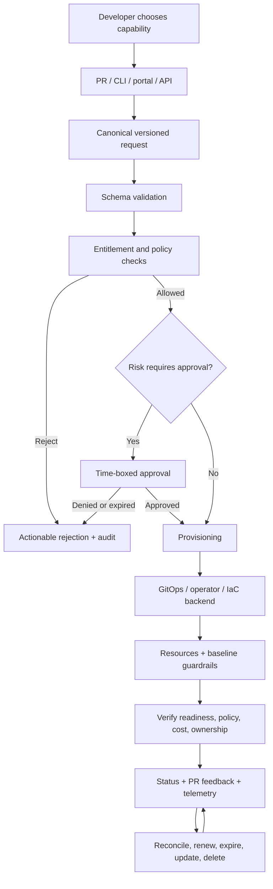
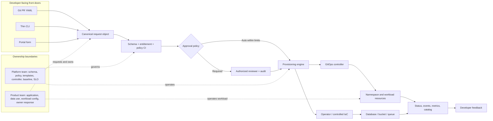
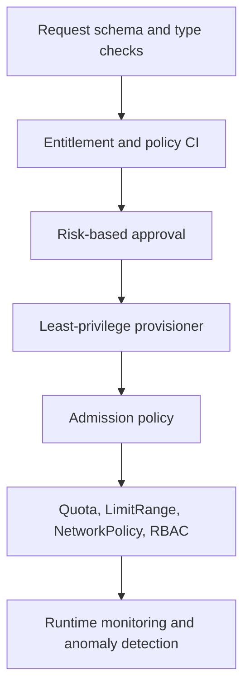
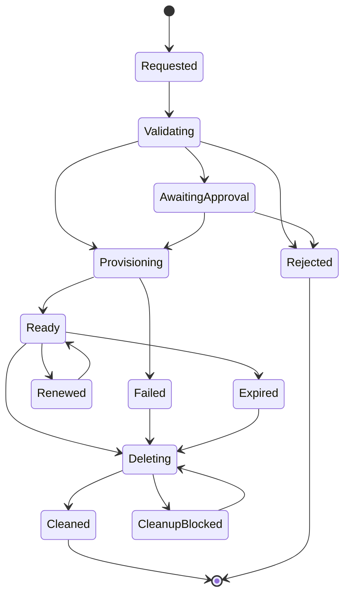

# Self-Service Infrastructure and Environment Provisioning

> **Abstract.** This lesson teaches how to turn infrastructure capabilities already available in M01–M15 into a safe, observable, auditable service that developers can use without opening tickets. The default implementation is a Git/PR request workflow: a developer declares a small environment request, automated schema and entitlement checks reject unsafe requests, an approval is collected only when risk requires it, GitOps reconciles approved desired state, and the platform reports readiness and lifecycle status. The lesson progresses from the beginner mental model to production operating practice, including data services, preview environments, safe deletion, cost controls, security testing, provisioning SLOs, runbooks, and ten local labs. All people, teams, requests, costs, and organizational interactions in the lab are synthetic. Examples are implementation patterns, not claims that commands or tests were executed.

## Metadata

- Module: M16 — Platform Engineering and Internal Developer Platforms
- Stage: 2E — Production DevOps & Platform Engineering
- Unit: 3 — Self-Service Infrastructure and Environment Provisioning
- Target file: `Stage 2E — Production DevOps & Platform Engineering/16-Platform-Engineering-and-Internal-Developer-Platforms/03-self-service-infrastructure-and-environment-provisioning.md`
- Learner level: Beginner to advanced (L1–L4)
- Estimated study and lab time: 24–36 hours; allow additional time for optional Plat+Control integrations.
- Last reviewed: 2026-11-03
- Assumed tool baseline: WSL2 Ubuntu primary; native Linux secondary; Python 3 standard library for the guaranteed path; Git; local Git server from M08; kind, Argo CD, one policy engine, CloudNativePG, Redis, and MinIO only in the optional control profile. Record exact installed versions in `versions.txt`; use `<VERSION>` placeholders until verified against official installation documentation.
- Budget profile: Zero-budget local lab; no cloud accounts, paid services, SaaS SCM, real credentials, or production data.
- Stack profiles: **Plat-Core** is the guaranteed path; **Plat+Control** adds kind, Argo CD and a policy engine; data-service controllers are optional and started only for their lab. Crossplane is not required and is deferred to Unit 6.
- Footprint: Planning baseline is approximately 4 CPU, 8 GB RAM, and 30 GB free disk. Measure yours; do not assume all optional components fit simultaneously.
- Synthetic users/data: Yes. Synthetic teams, requests, budgets, feedback, and incident scenarios are not evidence about real developers or organizations.

## Table of Contents

- [3.0 Why Self-Service Provisioning Matters](#30-why-self-service-provisioning-matters)
- [3.1 Learning Objectives and Exit Criteria](#31-learning-objectives-and-exit-criteria)
- [3.2 Concept Map and End-to-End Architecture](#32-concept-map-and-end-to-end-architecture)
- [3.3 L1 — Foundations: What Self-Service Means](#33-l1--foundations-what-self-service-means)
- [3.4 L2 — Build a Guarded Environment Request System](#34-l2--build-a-guarded-environment-request-system)
- [3.5 L2 — Provision Environments Through GitOps](#35-l2--provision-environments-through-gitops)
- [3.6 L2 — On-Demand Data Services and Secret References](#36-l2--on-demand-data-services-and-secret-references)
- [3.7 L2 — Preview Environments, TTL, and Safe Cleanup](#37-l2--preview-environments-ttl-and-safe-cleanup)
- [3.8 L3 — Front Doors, Approvals, Guardrails, and Provisioning Engines](#38-l3--front-doors-approvals-guardrails-and-provisioning-engines)
- [3.9 L3 — Reliability, Reconciliation, Security, and Lifecycle at Scale](#39-l3--reliability-reconciliation-security-and-lifecycle-at-scale)
- [3.10 L4 — Operating Self-Service as a Platform Service](#310-l4--operating-self-service-as-a-platform-service)
- [3.11 SRE Lens: SLOs, Failure Modes, Runbooks, and Incident Drills](#311-sre-lens-slos-failure-modes-runbooks-and-incident-drills)
- [3.12 Security Lens: Threat Model and Negative Tests](#312-security-lens-threat-model-and-negative-tests)
- [3.13 Data/ML Platform Considerations](#313-dataml-platform-considerations)
- [3.14 Production Readiness Checklist](#314-production-readiness-checklist)
- [3.15 Hands-On Lab Set (Labs 1–10)](#315-hands-on-lab-set-labs-110)
- [3.16 Self-Check and Knowledge Review](#316-self-check-and-knowledge-review)
- [3.17 Evidence Artifacts and Completion Gate](#317-evidence-artifacts-and-completion-gate)
- [3.18 Interview and Design-Review Questions](#318-interview-and-design-review-questions)
- [3.19 Sources, Version Notes, and Verification Tasks](#319-sources-version-notes-and-verification-tasks)
- [Appendix A — Lab File Tree and Runbook Index](#appendix-a--lab-file-tree-and-runbook-index)
- [Appendix B — Self-Audit Report](#appendix-b--self-audit-report)
- [Appendix C — Human Verification Checklist](#appendix-c--human-verification-checklist)
- [Appendix D — Known Limitations and Assumptions](#appendix-d--known-limitations-and-assumptions)
- [Appendix E — Sign-Off](#appendix-e--sign-off)

## 3.0 Why Self-Service Provisioning Matters

A data engineer needs an isolated namespace, a PostgreSQL instance, an object bucket, a queue, a secret reference, and a dashboard to test a pipeline. In a ticket-operated organization, each item may require a separate request, clarification, manual change, and hand-off. The engineer waits while an operator repeats similar work, and two teams may receive subtly different configurations. The queue becomes a delivery dependency rather than a control.

Self-service removes repeated human routing; it does not remove governance. An unguarded form that accepts arbitrary Kubernetes YAML can grant cluster-wide privileges faster than a ticket queue ever could. The platform must constrain what can be requested, who may request it, what it costs, which identity provisions it, how the result is verified, and how it is retired.

The production definition used throughout this unit is:

> **Self-service** means a developer can obtain a resource or environment **without opening a ticket**, within guardrails, with feedback and an audit trail.

The lifecycle is `request → validate → approve (if needed) → provision → verify → report`. A request is not successful merely because a YAML file merged. Success means the requested capability reached a valid ready state, its security and cost baseline is present, the developer can discover its status, and ownership and cleanup are defined.

This unit integrates M07 infrastructure-as-code and lifecycle safety, M08 GitOps and audit, M05 operators, M12 policy, M15 quota/cost controls, M09 identity/secrets, M11 observability, M13 backup/recovery, and M14 fleet practices. It packages those mechanisms as a product; it does not re-teach their internals. Cross-module handoffs: [Unit 1 — platform as a product](01-platform-engineering-principles-and-platform-as-a-product.md), [Unit 2 — golden paths and paved roads](02-golden-paths-templates-and-paved-roads.md), [Unit 4 — developer portals and catalog](04-developer-portals-and-backstage-service-catalog.md), [Unit 5 — scaffolding](05-scaffolding-and-software-templates.md), [Unit 6 — Crossplane platform APIs](06-platform-apis-with-crossplane-compositions.md), [Unit 7 — tenancy](07-multi-tenancy-isolation-and-tenant-onboarding.md), [Unit 8 — platform SLOs and DX](08-platform-slos-adoption-metrics-and-developer-experience.md), and [Unit 9 — governance and versioning](09-platform-governance-deprecation-and-versioning.md). The module-wide practice set is [practice-questions.md](practice-questions.md), and the integrated project is [Projects/01-self-service-data-and-ml-platform-portal.md](Projects/01-self-service-data-and-ml-platform-portal.md); this unit supplies its self-service provisioning foundation rather than attempting to complete that capstone.

## 3.1 Learning Objectives and Exit Criteria

By the end of this unit, the learner can:

1. **[L1]** Explain self-service, distinguish a front door from a platform capability, and trace a request through all lifecycle stages.
2. **[L1]** Identify which capabilities may be self-served and which require risk-based approval.
3. **[L2]** Define a versioned request schema, entitlement registry, size-to-quota mapping, cost estimate, and positive/negative validator tests.
4. **[L2]** Generate namespace baselines through GitOps without accepting arbitrary manifests or giving the requester controller privileges.
5. **[L2]** Provision or simulate a database, queue, and bucket while delivering only scoped secret references.
6. **[L2]** Create preview environments with bounded resources, expiry, reaping, and no production secrets or data.
7. **[L3]** Compare PR, API, portal, CLI, GitOps, Crossplane, IaC pipelines, operators, and Helm by capability and ownership boundary.
8. **[L3]** Design layered guardrails, risk-based approvals, idempotent reconciliation, safe deletion, and recovery from partial failure.
9. **[L4]** Operate the capability using precise SLIs/SLOs, runbooks, change rings, audit evidence, and lifecycle governance.
10. **[L4]** Explain what local evidence proves and what it cannot establish about cloud behavior, real users, legal compliance, production scale, or hostile-tenant isolation.

**Exit criteria:** all ten labs have evidence; negative tests fail safely; no plaintext secrets are present; controller ownership is unambiguous; TTL and cleanup work; data-bearing deletion is gated; provisioning metrics have definitions; and unresolved version-sensitive items remain visible.

## 3.2 Concept Map and End-to-End Architecture

### Vocabulary

| Term | Precise definition | Common misconception |
|---|---|---|
| Self-service | A user obtains an entitled capability without a ticket, with guardrails, feedback, and audit. | A form alone is self-service. |
| Front door | The interface used to submit a request: PR, CLI, API, or portal. | The front door owns provisioning policy. |
| Canonical request | Versioned, constrained data model shared by all front doors. | Each interface may invent its own request fields. |
| Entitlement | A policy-backed statement of what a team may request. | Authentication means authorization. |
| Provisioner | The single declared owner/controller for creating a resource class. | Two controllers can safely manage the same object. |
| Reconciliation | Repeatedly comparing actual state with declared desired state and correcting permitted drift. | A one-time deployment command is reconciliation. |
| Idempotency | Repeating the same operation has the same intended outcome without duplicate side effects. | Retrying any command is automatically safe. |
| TTL | A bounded lifetime after which renewal or expiry action is required. | TTL metadata deletes resources by itself. |
| Status condition | A structured report of current state, reason, and useful message. | “Pending” is enough feedback. |
| Orphan | A resource that remains after its owning request/team/service is gone. | Deleting a namespace proves all external data is deleted. |
| Admission policy | A control evaluated when a Kubernetes object is admitted. | CI validation makes admission controls unnecessary. |

### End-to-end lifecycle



### Reference architecture and ownership



The platform team owns the request contract, entitlements, policy, provisioning controllers, baseline templates, platform SLOs, and change process. The product team owns its application, its workload behavior, its data use, and the accuracy of its service metadata. A platform team should not become the hidden operator of every application decision.

### Layered guardrails



Each layer has a different purpose. Schema validation rejects malformed shape; entitlement policy rejects requests beyond the team's contract; approval authorizes exceptional risk; least privilege limits what the automation can do; admission rejects unsafe objects even if earlier validation was bypassed; quotas bound resource use; runtime monitoring detects behavior that static checks cannot predict. No one layer is a substitute for the others.

## 3.3 L1 — Foundations: What Self-Service Means

### Start with the developer's task

Imagine the synthetic team `analytics` needs an isolated `dev` environment for a batch pipeline. The developer wants a namespace, CPU/memory quota, default-deny network policy, team RBAC, cost labels, a PostgreSQL database, a queue, an object bucket, secret references, and access to logs and metrics. The developer should not need to understand every controller or open six tickets. They should understand the request contract, allowed choices, expected wait, status, and how to ask for a supported change.

Common on-demand capabilities include:

- namespace/environment with baseline policies, quotas, and RBAC;
- database, object-store bucket or prefix, and queue;
- scoped secret references and workload identity;
- DNS/ingress hostname, with exposure controlled by policy;
- dashboards, alerts, logs, and metrics access;
- preview environment per pull request;
- bounded sandbox and experiment workspace.

Keep high-risk capabilities gated or reviewed: production data stores containing sensitive data, GPUs or other expensive resources, cross-tenant access, public/network exposure, irreversible deletion, broad identity permissions, and any request that exceeds a team's approved budget or data classification.

### A front door is not the capability

| Interface | Strength | Cost or risk | Course position |
|---|---|---|---|
| Git/PR YAML | Review, diff, history, approvals, reproducibility | Slower than a direct API; Git workflow knowledge | **Default and guaranteed path** |
| Portal form | Discoverable and approachable | Can hide policy and become a direct-mutation bypass | Later unit; should create a PR or canonical request |
| CLI (`platformctl` style) | Scriptable and automatable | Must not implement weaker policy than PR | Thin stub in this unit |
| API | Immediate integration and machine clients | Authentication, authorization, idempotency, rate limits, durable audit | Architecture comparison |
| Kubernetes API/CRD claim | Declarative Kubernetes-native contract | API lifecycle, controller, RBAC, and CRD complexity | Unit 6 |
| ChatOps | Convenient conversational entry | Ambiguous identity, approvals, audit, and prompt injection concerns | Awareness only |

A script that creates a namespace may be useful automation, but it is not yet a complete platform capability if it lacks entitlements, audit, status, ownership, retries, cleanup, and support boundaries. A ticket form merely digitizes the queue if a human still performs every repeated step. A portal is a front door; the platform is the contract, automation, controls, resources, and operating model behind it.

### Ticket-ops versus guarded self-service

Ticket-ops tends to repeat manual work, hide queue state, create inconsistent outcomes, and make lead time depend on human availability. It can still be appropriate for rare, high-risk, ambiguous, or irreversible actions. Self-service without guardrails creates a different failure: unsafe actions become cheap and repeatable. The target is not “no humans”; it is automatic handling for routine entitled requests and explicit, time-boxed review for exceptional risk.

### Guided Plat-Core lab: first request

Create a small repository:

```text
self-service-lab/
├── requests/environments/analytics-dev.yaml
├── schemas/environment-request.schema.json
├── entitlements/teams.yaml
├── generated/environments/
├── policies/
└── evidence/
```

Example request:

```yaml
# File: requests/environments/analytics-dev.yaml
apiVersion: platform.example.invalid/v1alpha1
kind: EnvironmentRequest
metadata:
  name: analytics-dev
spec:
  team: analytics
  purpose: batch-pipeline-development
  tier: dev
  size: small
  ttl_hours: 72
  data_classification: synthetic
  capabilities:
    database: false
    queue: true
    bucket: true
```

The `platform.example.invalid` group is a local teaching convention, not a registered Kubernetes API. The request is data, not a Kubernetes manifest to apply directly. The Core schema in this unit deliberately exposes only `database`, `queue`, and `bucket`; notebook/GPU/feature-store capabilities require a separately versioned extension and new entitlement tests rather than silently adding arbitrary fields. The platform validates it, then renders a separate set of controlled output manifests.

A minimal entitlement record:

```yaml
# File: entitlements/teams.yaml
teams:
  analytics:
    allowed_sizes: [small, medium]
    allowed_capabilities: [database, queue, bucket]
    budget_units: 40
  ml-research:
    allowed_sizes: [small]
    allowed_capabilities: [queue, bucket]
    budget_units: 20
```

These teams and budget units are synthetic. Budget units are not currency or a cloud quote.

Trace the developer action: the PR adds a request; CI checks shape, team entitlement, size, TTL, classification, and capability; approval is either automatic or requested; merge updates the desired-state repository; GitOps reconciles generated namespace resources; readiness checks inspect quota, policy, RBAC, and workload health; status returns to the PR. The developer sees “ready” only after verification, not merely after merge.

### Asynchronous user experience

Provisioning may take seconds or minutes locally and much longer when external providers are involved. A useful status model distinguishes `accepted`, `rejected`, `awaiting_approval`, `provisioning`, `ready`, `failed`, `deleting`, `expired`, and `blocked`. A status record should include a stable request ID, state, reason code, human-readable message, last transition time, and next action. Retryable failures (temporary controller unavailability) differ from terminal failures (entitlement denial or invalid schema). Never leave a request indefinitely “pending” without an owner, timeout, or explanation.

### Desired state, idempotency, and lifecycle

A declarative request says what should exist. The reconciler repeatedly compares the declared request with actual state. Re-applying the same request should not create duplicate namespaces or databases. A changed request should produce a controlled update. Deletion must account for persistent data and external resources; deleting a namespace is not equivalent to deleting or safely archiving every database, bucket, DNS record, or cloud object. Review M07 Unit 8 for lifecycle and deletion safety.

Common beginner mistakes:

| Mistake | Symptom | Correction |
|---|---|---|
| Treating merge as ready | Developer receives a green check while controller is still failing | Separate accepted, provisioning, and ready |
| Accepting raw manifests | Requester can choose privileged fields | Small schema plus fixed templates and admission |
| No owner or TTL | Environments become abandoned | Required owner, expiry, renewal, orphan scan |
| Plaintext connection strings | Credentials appear in Git or PR comments | Secret reference plus separately scoped delivery |
| Delete namespace first | Data or external resources become orphaned/lost | Inventory, snapshot/export, approval, ordered cleanup |

## 3.4 L2 — Build a Guarded Environment Request System

### Canonical request contract

Use one versioned request object across every front door. The request includes `team`, `purpose`, `tier`, `size`, `ttl_hours`, `data_classification`, and a closed set of capability booleans. Avoid arbitrary YAML fragments, shell commands, pod specs, arbitrary template expressions, and cluster-scoped resource requests. Reject unknown fields so a typo cannot silently become an ignored security control.

The following uses JSON Schema Draft 2020-12. The Core contract intentionally limits `tier` to `dev`, `preview`, or `test`, and the capability object to exactly `database`, `queue`, and `bucket`. Notebook/GPU/feature-store capabilities are future schema extensions, not fields accepted by this version. Confirm that the validator installed for the lab supports this dialect; the Python standard library does not include a JSON Schema validator. Plat-Core can use the explicit Python validator below as a dependency-free equivalent, while the schema remains the documented contract. For a full schema-validation lab, install a pinned JSON Schema validator only after recording its version.

```json
// File: schemas/environment-request.schema.json
{
  "$schema": "https://json-schema.org/draft/2020-12/schema",
  "type": "object",
  "additionalProperties": false,
  "required": ["apiVersion", "kind", "metadata", "spec"],
  "properties": {
    "apiVersion": {"const": "platform.example.invalid/v1alpha1"},
    "kind": {"const": "EnvironmentRequest"},
    "metadata": {
      "type": "object",
      "additionalProperties": false,
      "required": ["name"],
      "properties": {
        "name": {"type": "string", "pattern": "^[a-z][a-z0-9-]{1,30}$"}
      }
    },
    "spec": {
      "type": "object",
      "additionalProperties": false,
      "required": ["team", "purpose", "tier", "size", "ttl_hours", "data_classification", "capabilities"],
      "properties": {
        "team": {"type": "string", "pattern": "^[a-z][a-z0-9-]{1,30}$"},
        "purpose": {"type": "string", "minLength": 3, "maxLength": 100},
        "tier": {"enum": ["dev", "preview", "test"]},
        "size": {"enum": ["small", "medium", "large"]},
        "ttl_hours": {"type": "integer", "minimum": 1, "maximum": 168},
        "data_classification": {"enum": ["synthetic", "internal", "confidential"]},
        "capabilities": {
          "type": "object",
          "additionalProperties": false,
          "required": ["database", "queue", "bucket"],
          "properties": {
            "database": {"type": "boolean"},
            "queue": {"type": "boolean"},
            "bucket": {"type": "boolean"}
          }
        }
      }
    }
  }
}
```

The schema checks shape and simple constraints. It cannot decide whether `analytics` is allowed a large environment or whether a confidential dataset is allowed in a preview. Those are policy and entitlement decisions.

### Size-to-quota mapping

Define resource sizes centrally; never let requesters provide arbitrary CPU and memory values.

| Size | CPU request budget | CPU limit budget | Memory request budget | Memory limit budget | Hypothetical cost units/hour |
|---|---:|---:|---:|---:|---:|
| small | 500m | 1 | 512Mi | 1Gi | 1 |
| medium | 1 | 2 | 1Gi | 2Gi | 3 |
| large | 2 | 4 | 2Gi | 4Gi | 7 |

These are illustrative local planning values. They are not recommendations for every workload and not a cloud price. A real platform must validate the values against cluster capacity, workload class, and M15 cost model.

### Entitlement and policy validation

The entitlement registry answers “may this team request this capability?” The request schema answers “is the request well-formed?” Policy answers “is this combination allowed?” Approval answers “has an authorized reviewer accepted this exceptional risk?” Keep these checks separate so the denial reason is precise.

A dependency-free validator can parse JSON fixtures (or YAML after adding a pinned YAML parser). To keep the guaranteed path runnable with Python's standard library, use JSON request fixtures in the validator and treat the YAML shown above as the human-facing equivalent. Never parse YAML using unsafe object constructors.

```python
# File: policies/validate_request.py
"""Compatibility wrapper; canonical implementation lives in core/platform_lab.py."""
import sys
from pathlib import Path

ROOT = Path(__file__).resolve().parents[1]
sys.path.insert(0, str(ROOT))
from core.platform_lab import main

if __name__ == "__main__":
    raise SystemExit(main(["validate", *sys.argv[1:]]))
```

This example uses an intentionally simple hypothetical cost calculation (`size units × requested hours`). A production estimator must include actual resource consumption, storage, network, provider pricing, idle behavior, and uncertainty. The validator is a teaching baseline, not a complete production authorization service. Its early returns are deliberate when the structure is unsafe to inspect further.

Example synthetic entitlement data:

```json
// File: entitlements/teams.json
{
  "teams": {
    "analytics": {
      "allowed_sizes": ["small", "medium"],
      "allowed_capabilities": ["database", "queue", "bucket"],
      "budget_units": 40
    },
    "ml-research": {
      "allowed_sizes": ["small"],
      "allowed_capabilities": ["queue", "bucket"],
      "budget_units": 20
    }
  }
}
```

Example JSON request for the validator:

```json
// File: requests/environments/analytics-dev.json
{
  "apiVersion": "platform.example.invalid/v1alpha1",
  "kind": "EnvironmentRequest",
  "metadata": {"name": "analytics-dev"},
  "spec": {
    "team": "analytics",
    "purpose": "batch-pipeline-development",
    "tier": "dev",
    "size": "small",
    "ttl_hours": 24,
    "data_classification": "synthetic",
    "capabilities": {"database": false, "queue": true, "bucket": true}
  }
}
```

Run:

```bash
# File: docs/commands.md
set -euo pipefail
python core/platform_lab.py validate \
  fixtures/analytics-dev.json \
  fixtures/entitlements.json
```

**Expected output (representative; not executed):**
```text
ACCEPTED: schema, entitlement, and request policy checks passed
```

Developer interpretation: the request is structurally acceptable under the synthetic entitlement policy. It is not yet provisioned, approved for any exceptional risk, or proven ready. The script does not contact Kubernetes or create resources.

### Negative tests are mandatory

Test at least: missing `team`; unknown field `raw_manifest`; team requesting `large` when not entitled; forbidden `database`; TTL of 999; invalid name such as `Analytics_DEV`; string instead of boolean; preview with confidential data; arbitrary command or YAML fragment; oversized resources outside the size map. The expected result is rejection with a reason that tells the requester what to change. Never “fix” a failed test by weakening the policy.

### Validation message quality

A useful denial says what failed, which field or policy caused it, what the requester can do next, and whether review is available. For example:

> `REJECTED: team 'ml-research' is not entitled to size 'large'. Allowed sizes: small. Choose small, or submit a time-boxed capacity request for platform/FinOps review. No resources were created.`

Do not leak internal secrets, controller credentials, or stack traces in user-facing errors. Record a correlation ID and safe diagnostic detail for operators.

### Request schema evolution

Include `apiVersion` from the start. Add optional fields compatibly; do not reinterpret an existing field silently. When a required field or behavior must change, publish a new version, define conversion/migration behavior, test old requests, and communicate a retirement date. Unit 9 owns the full deprecation policy.

## 3.5 L2 — Provision Environments Through GitOps

### Why GitOps is the default local provisioner

For Kubernetes-native resources, GitOps is a credible default because the desired state is reviewable, auditable, and continuously reconciled. A request PR does not receive cluster credentials. CI validates the request and produces controlled desired-state files; merge updates a Git repository watched by Argo CD or Flux. The controller applies only the paths and resource kinds it is authorized to manage.

A clean ownership model is essential:

- request repository: developer-owned request files and team metadata;
- validation pipeline: schema, entitlement, policy, estimate, approval gate;
- generated desired-state repository/path: platform-owned rendered manifests;
- GitOps controller: sole reconciler for those generated Kubernetes objects;
- operators: sole owners of their custom resources and managed data services;
- status reporter: reads controller conditions and publishes developer-facing status.

Do not have both a CI job and Argo CD apply the same namespace resources. CI should validate and render; GitOps should reconcile. Avoid two different controllers owning the same object fields.

### Baseline resources

A valid environment should receive a consistent baseline. Illustrative labels such as `platform.example/team` are local conventions, not Kubernetes built-in semantics.

```yaml
# File: templates/environment/namespace.yaml
apiVersion: v1
kind: Namespace
metadata:
  name: analytics-dev
  labels:
    platform.example/team: analytics
    platform.example/env: dev
    platform.example/tier: dev
    platform.example/cost-center: analytics
    pod-security.kubernetes.io/enforce: restricted
    # VERSION-SENSITIVE: set enforce-version to a value supported by the cluster.
---
apiVersion: v1
kind: ResourceQuota
metadata:
  name: environment-quota
  namespace: analytics-dev
spec:
  hard:
    requests.cpu: "500m"
    requests.memory: 512Mi
    limits.cpu: "1"
    limits.memory: 1Gi
    pods: "10"
---
apiVersion: v1
kind: LimitRange
metadata:
  name: default-container-limits
  namespace: analytics-dev
spec:
  limits:
    - type: Container
      default:
        cpu: "500m"
        memory: 512Mi
      defaultRequest:
        cpu: "100m"
        memory: 128Mi
```

A baseline also includes default-deny NetworkPolicy and explicitly permitted ingress/egress, namespace-scoped RBAC, PSS labels, observability labels/tenant routing, budget alert hooks, scoped workload identity, short-lived registry pull credentials where supported, catalog registration handoff, and backup policy for stateful capabilities. NetworkPolicy enforcement depends on the cluster CNI; a manifest existing is not proof that packets are blocked. Test the actual network path in the selected cluster.

Illustrative default-deny policy:

```yaml
# File: templates/environment/network-policy.yaml
apiVersion: networking.k8s.io/v1
kind: NetworkPolicy
metadata:
  name: default-deny
  namespace: analytics-dev
spec:
  podSelector: {}
  policyTypes: [Ingress, Egress]
```

This blocks selected traffic only when the network plugin enforces NetworkPolicy. Add explicit DNS and application egress rules required by the workload; do not broadly allow all namespaces by default.

### GitOps generation pattern

The generator should map approved enumerations to fixed templates. It should not render user-supplied YAML. The following is a conceptual output layout:

```text
generated/environments/analytics-dev/
├── namespace.yaml
├── quota.yaml
├── limit-range.yaml
├── network-policy.yaml
├── rbac.yaml
├── observability-labels.yaml
└── kustomization.yaml
```

The generated directory is committed only after validation. In the control profile, an Argo CD Application or ApplicationSet can point to the generated path. ApplicationSet can generate per-environment Applications from request data, but exact API fields and controller version are `[VERIFY]`; a simple static Application per lab environment is sufficient. Do not make ApplicationSet mandatory.

Cluster-targeting commands must identify the lab context. First assert it:

```bash
# File: docs/commands.md
kubectl config get-contexts
kubectl --context kind-self-service-lab get nodes
```

**Expected output (representative; not executed):**
```text
NAME                         STATUS   ROLES           AGE   VERSION
self-service-lab-control-plane Ready   control-plane   ...   v...
```

The context must be `kind-self-service-lab`, and the cluster must be the lab cluster you created. If it is not, stop. Apply through GitOps rather than manually applying generated resources in the normal workflow. Read-only inspection may use `kubectl --context kind-self-service-lab get namespace analytics-dev --show-labels`.

### Lead-time measurement

Record the same start and stop criteria for the Unit 1 manual baseline and the self-service path:

- start: developer begins a valid request with required information available;
- stop: environment passes readiness and baseline verification, and the developer receives usable connection references/status;
- record: elapsed wall-clock time, human intervention minutes, number of user steps, retries, failure/rework, and wait time;
- report laptop measurements, not a generalized productivity claim.

A request accepted by CI is not an environment ready. Use a timestamped status transition or measurement script to capture actual elapsed time. If not executed, provide the script and leave results blank.

## 3.6 L2 — On-Demand Data Services and Secret References

A platform capability is more than creating a database object. It needs a contract, entitlement, resource sizing, backup/restore expectation, access boundary, credentials delivery, monitoring, owner, and deletion policy.

### PostgreSQL

The syllabus uses CloudNativePG `Cluster` as the Kubernetes-native database example. In Plat+Control, a small request such as `database: true`, `size: small`, and `tier: dev` maps to an approved database configuration. The provisioner creates a CloudNativePG custom resource with resource requests, storage, instance count, backup configuration, and labels; a connection pooler is an optional capability add-on, not a default requirement for every small environment. Exact CRD API group/version, fields, backup destination, and supported configuration must be checked against the installed CloudNativePG documentation. Do not copy a CRD example from a different release.

The platform should not expose arbitrary PostgreSQL operator fields to the requester. It maps a small set of approved choices to a version-controlled template. Backups must be configured before a database is declared ready; test restore, not only backup creation. A local database without a verified restore is not a protected database.

### Credentials

The developer receives a secret reference or workload identity contract, not a password. The `secretref://...` strings emitted by the Core capability plan are illustrative identifiers only, not Kubernetes Secret names or a real External Secrets/Vault URI; map them to the selected M09 provider contract in the control profile. Examples include an ExternalSecret reference or a Vault dynamic role, depending on the M09 implementation. Never put plaintext credentials in request files, generated manifests, PR comments, logs, sample output, evidence folders, or a catalog entity. A secret reference itself must be authorized and scoped to the environment. Rotation and revocation must be part of the lifecycle.

### Object storage

A bucket or prefix request must define owner, classification, access policy, retention/lifecycle, encryption expectations, and deletion behavior. MinIO can provide a local API-compatible practice environment, but it does not prove cloud IAM, cloud billing, regional durability, or provider policy semantics. Use per-environment buckets or prefixes with policies that prevent one environment from reading another. Verify the actual denied access using a benign decoy object.

### Queue

Redis or another lightweight queue is suitable for a local lab. State whether the queue is ephemeral or durable, what happens on restart, how consumer groups/credentials are scoped, and what retention guarantees exist. Do not imply Redis persistence settings equal a managed production queue's durability. Keep the queue capability separate from the application-specific queue schema.

### Capability lifecycle differences

| Capability | Provisioning output | Operational baseline | Deletion safety |
|---|---|---|---|
| PostgreSQL | Operator-managed cluster/DB | Backups, restore test, monitoring, scoped credentials | Snapshot/export and approval before destructive deletion |
| Bucket/prefix | Bucket and access policy | Classification, encryption/retention, access logs where available | Inventory/export/retention review; verify object disposition |
| Queue | Queue/namespace/user | Durability, limits, access policy, monitoring | Drain/retention decision; avoid deleting active messages silently |
| Secret reference | Scoped reference/role | Rotation, audit, workload identity | Revoke/expire after workload shutdown |

If the laptop cannot run CloudNativePG, Redis, and MinIO together, the required Plat-Core lab validates the request and renders capability manifests plus secret-reference metadata; run each optional service extension separately. Do not misrepresent a rendered manifest as a running service.

## 3.7 L2 — Preview Environments, TTL, and Safe Cleanup

A preview environment is a short-lived instance associated with a pull request. It should have a unique identity, strict resource cap, expiry time, synthetic data only, no production secrets, and restricted network access. It must be deleted on PR close/merge or TTL expiry, with an independent reaper to catch missed events.

### Threat model for untrusted pull requests

A forked or untrusted PR can modify application code, build scripts, and request content. Do not expose production credentials or privileged CI tokens to it. Do not allow the PR to select a privileged service account, host path, cluster role, arbitrary network route, or external secret reference. The preview workflow should use isolated build credentials, synthetic fixtures, restricted egress, and a namespace-scoped deployment identity. A preview URL should not imply public exposure unless a reviewed ingress policy explicitly permits it.

### Preview lifecycle



The state names are a lab convention, not an asserted Kubernetes or Argo CD API. Each transition needs an actor, timestamp, reason, and audit event. Cleanup must be idempotent: a second cleanup attempt should not create a new failure merely because the namespace is already absent. A reaper must use bounded batches and a lab/environment selector; never write an unscoped “delete every expired namespace” script.

### Safe deprovisioning sequence

1. Confirm request owner, environment ID, target cluster, and lifecycle state.
2. Produce a dry-run inventory of namespace resources and external resources.
3. For data-bearing resources, require snapshot/export and explicit approval where policy demands it.
4. Stop new workloads or revoke access in a controlled order.
5. Delete workload resources, then operator-managed resources according to their documented finalizer/deletion semantics.
6. Verify database backup/export and object/queue disposition.
7. Delete namespace and external resources only after data-safety checks.
8. Retain the request, approval, inventory, and deletion evidence after resource deletion.
9. Run orphan detection and verify no owned resources remain.

TTL is a policy input, not a magic deletion mechanism. Renewal should extend expiry only within entitlement and budget. Ownership transfer should require the new owner to accept responsibility. Archival should preserve required metadata and evidence without leaving live resources running.

## 3.8 L3 — Front Doors, Approvals, Guardrails, and Provisioning Engines

### One request contract, multiple front doors

PR, CLI, portal, and API must produce the same canonical request object. A portal action should create a PR when review/audit matters; a CLI should call the same validator and create the same request; neither may skip entitlement checks. Direct mutation can be acceptable for narrowly scoped low-risk actions only when authentication, authorization, idempotency keys, rate limits, durable audit, policy, and status reporting are equivalent.

| Front door | Audit/review | User experience | Operational controls required |
|---|---|---|---|
| PR | Strong diff and review history | Familiar to Git users; asynchronous | Protected branches, CODEOWNERS, CI checks, signed commits for sensitive requests |
| API | Durable event/audit must be designed | Immediate and integrable | AuthN/AuthZ, idempotency, rate limiting, request signing, status endpoint |
| Portal | Depends on backend; should create PR or canonical object | Discoverable form and docs | User identity propagation, CSRF/session security, no broad backend token |
| CLI | Git/API audit depends on implementation | Efficient for engineers and automation | Same schema/policy, secure auth, no embedded credentials |

A thin CLI stub might validate locally and write the request file. It must not contain a separate policy implementation that diverges from CI. A portal stub may render the same fields and produce a PR payload; the real portal is a Unit 4/5 topic.

### Risk-based approval design

Automatically approve requests inside the team's entitlement, size, TTL, data-classification, and cost limits. Require review for high-cost size, GPU, sensitive data, public exposure, cross-team sharing, exceptional identity scope, or irreversible deletion. Define:

- approver role and separation-of-duties requirement where relevant;
- approval SLA and escalation owner;
- expiry of an unacted-on approval request;
- time-boxed approval scope and resource ceiling;
- audit record: requester, approver, reason, request version, decision, time;
- revalidation after material request changes;
- metrics for queue age and false denials.

Do not make every routine request require manual approval; that merely recreates the ticket queue behind a new interface. Equally, do not auto-approve beyond policy because the queue is slow. Improve entitlement design, reviewer coverage, and request quality.

### Provisioning engine selection

| Engine | Best-fit capability | Strength | Ownership risk / caution |
|---|---|---|---|
| GitOps (Argo CD/Flux) | Kubernetes-native desired state | Reviewable, continuous reconciliation, Git audit | Do not let CI and GitOps both own the same objects |
| Crossplane | External infrastructure exposed as Kubernetes APIs | Declarative control plane and API composition | Provider credentials and composition lifecycle are privileged; Unit 6 covers this |
| Terraform/OpenTofu via CI | External infrastructure with plan/apply workflow | Mature IaC workflow and explicit plans | State, credentials, locking, drift, and PR/apply identity need ownership |
| Kubernetes operator | Domain-specific lifecycle such as PostgreSQL | Encodes operational knowledge and reconciliation | CRD/operator version and finalizer semantics matter |
| Helm | Packaging a set of Kubernetes resources | Reusable release packaging | Helm is packaging/release management, not by itself an entitlement or approval system |

Choose by capability, not fashion. Kubernetes-native namespace/quota/policy resources are GitOps-friendly. External cloud infrastructure may fit Crossplane or a controlled IaC pipeline. A PostgreSQL operator should own its database custom resources. Avoid competing owners for the same resource. Keep the request contract independent of backend choice.

### Guardrail placement

| Layer | What it can catch | What it cannot prove alone |
|---|---|---|
| Request schema | Unknown fields, type/range errors, invalid enum | Team authorization or runtime behavior |
| Entitlement/policy CI | Team capability, budget, data class, TTL, naming | Protection if another path bypasses CI |
| Approval | Explicit authorization for exceptional risk | Technical safety of the resulting manifest |
| Provisioner identity | Limits what automation can create/change | Safety of every allowed object |
| Admission | Unsafe Kubernetes objects at API admission | External provider policy or later runtime abuse |
| Quota/LimitRange | Bounded resource consumption | Correct cost attribution or fair scheduling |
| Runtime monitoring | Drift, anomalous usage, failures | Prevention of every unsafe request |

## 3.9 L3 — Reliability, Reconciliation, Security, and Lifecycle at Scale

### Desired versus actual state

Git stores declared intent; controllers observe actual state and reconcile it. Drift can be accidental (manual edits), malicious, or caused by a controller bug. Define the owner of each object and field. If GitOps owns a namespace's labels and quota, a human's `kubectl edit` should either be reverted or treated as a break-glass change with a recorded follow-up PR. Never silently accept drift without ownership.

Retries must be bounded and idempotent. Use backoff for transient errors, but do not retry permanent policy denial indefinitely. Partial failure requires a status record and a cleanup strategy. If namespace creation succeeds but database creation fails, report the partial state, preserve useful diagnostics, and either retry the database capability or roll back the environment according to an explicit policy. Rollback is not always safe for data-bearing resources.

### Provisioning failure catalogue

| Failure | User symptom | Operator check | Safe response |
|---|---|---|---|
| Quota/capacity exhaustion | Request blocked or pod pending | Namespace quota, node allocatable, pending events | Explain limit; queue or offer smaller size; do not bypass quota |
| Provider API throttling | External resource delayed | Provider/controller rate-limit events | Backoff with jitter; bound retries; surface delay |
| Operator not ready | Database remains provisioning | CRD/operator pods and conditions | Restore operator; preserve request; retry reconciliation |
| CRD ordering issue | Unknown kind / no controller | CRD establishment and sync order | Gate dependent resources on CRD readiness |
| Policy denial | Admission rejected | Policy report and denied field | Return actionable denial; correct request/template |
| Image pull failure | Workload never ready | Events, registry auth, image digest | Verify registry access and digest; do not use public latest |
| DNS/certificate delay | URL unavailable | DNS and cert controller conditions | Report pending dependency and timeout |
| Secret reference failure | App cannot connect | External secret status and identity scope | Repair scoped identity/reference; never print secret |
| GitOps sync failure | Request accepted, no resources | Application health/sync status | Restore controller or repo access; keep status failed/blocked |
| Backup config failure | DB appears ready without recovery | Backup CR/status and restore evidence | Do not mark data capability ready until policy is met |

### Ephemeral environment trade-offs

- **Speed versus fidelity:** namespace-per-PR is fast and cheap but shares a cluster control plane and kernel. A separate cluster has more fidelity and stronger boundary potential, but higher startup and resource cost.
- **Data seeding:** use synthetic or properly masked fixtures; never production PII. A masked dataset still requires governance and re-identification risk review.
- **Mocks versus shared development services:** mocks are cheap and isolated but can diverge from real dependencies. A shared DB saves resources but introduces noisy-neighbor, data-reset, and cross-team risks. Per-environment DB improves isolation at higher resource cost.
- **Namespace vs vcluster vs cluster:** vcluster is an awareness option; verify current project status, security model, and cost. Namespace isolation is not a hostile-tenant security guarantee. Cluster-per-tenant has a larger operational and capacity footprint.

| Model | Isolation characteristics | Cost/operations | Appropriate use |
|---|---|---|---|
| Namespace per environment | Shared cluster/kernel/control plane; RBAC, quotas, policies must be correct | Lowest local overhead | Trusted internal dev workloads with layered controls |
| Virtual cluster | Separate virtual control plane; underlying host cluster remains shared | Additional controller and complexity | When API/control-plane separation is useful; verify implementation |
| Cluster per environment | Separate cluster boundary; still requires cloud/account/network controls | Highest provisioning and maintenance cost | Higher-risk workloads or strong isolation requirements |

### Multi-cluster placement and scale

At larger scale, placement policy considers tenant, workload type, region, data classification, capacity, and recovery tier. M14 cluster vending handoff: `request → IaC/Cluster API lifecycle → baseline → registry/catalog → rollout ring`. A local deterministic mock can demonstrate the state transitions, but it does not prove real cluster lifecycle, cloud latency, regional placement, or DR. Hundreds of environments may require GitOps controller sharding, provider/API rate limits, request queues, per-team quotas, and bounded preview environments. Scale must be measured; do not extrapolate from a single kind cluster.

### Capability contract

Before adding a new self-service capability, require:

1. request schema and version;
2. team entitlement and approval policy;
3. policy checks and admission controls;
4. fixed template/composition and provisioner owner;
5. status/condition contract and developer feedback;
6. observability, SLI, alert, and runbook;
7. backup/recovery requirements where data is involved;
8. cost labels, limits, budget, and TTL;
9. catalog and documentation metadata;
10. positive, negative, upgrade, deletion, and orphan tests.

If any item has no owner, the capability is not ready for general self-service.

## 3.10 L4 — Operating Self-Service as a Platform Service

### Service ownership and change management

The platform team operates the provisioning service as a product: roadmap, support, SLOs, on-call, documentation, incident communications, and deprecation discipline. It should publish a status view for request processing and explain known delays. Product teams own their workloads and respond to application-level issues. Security and FinOps own policy input and review boundaries; platform engineering implements enforceable controls and feedback.

Changes to templates, policies, entitlement rules, and provisioner versions can affect both future and existing environments. Before rollout:

1. run schema, policy, render, and compatibility tests;
2. calculate a dry-run diff against existing environments;
3. identify affected teams, capabilities, and data-bearing resources;
4. test with a canary tenant or ring;
5. publish change notes and migration instructions;
6. observe health and rollback criteria;
7. promote gradually; keep an auditable rollback path.

Never apply a template change to all existing environments without impact analysis. Some changes should affect only new environments; existing ones need an explicit migration. Unit 9 defines the full version/deprecation lifecycle.

### Governance and audit

Review entitlements periodically, especially when teams are renamed, merged, or retired. Expired exceptions must stop granting access. Track who requested, approved, provisioned, renewed, transferred, and deleted each environment. Git history provides request intent and review evidence; Kubernetes audit logs provide API actions where configured. Neither alone proves every external resource action. Add access reviews, cost allocation, budget enforcement, and security review for new capabilities.

### Disaster recovery

Git is the source of desired configuration, not the data backup. Recover the self-service control plane by restoring repository access, controller configuration, policy bundles, entitlement registry, secrets/identity integration, and then reconciling resources. Restore data from tested backups. Validate the platform API/controller DR path separately from workload data DR. A rebuilt namespace without restored database data is not a successful recovery.

### Eight synthetic incident scenarios

1. **Arbitrary YAML injection:** request schema accepted an arbitrary fragment and a team attempted privileged pod settings. Contain by stopping affected requests and pausing the provisioner; inspect audit and created resources; remove the arbitrary field, add closed schemas and admission tests, and prove the planted payload is rejected at both layers.
2. **Preview environments never expired:** capacity and hypothetical cost grew. Pause new preview creation if necessary; enumerate owner/expiry labels; run a dry-run reaper; clean bounded batches; add TTL compliance alerts and an independent reaper test.
3. **Databases without backups:** template omitted backup policy. Stop declaring the database capability ready; inventory affected databases; take a safe backup if possible; test restore; fix template and readiness gate; add a planted omission test.
4. **Approval queue became the ticket queue:** routine requests all require review. Measure approval reason and age; move low-risk entitled cases to automatic approval; keep high-risk approvals time-boxed; staff escalation and publish SLA.
5. **Quota exhaustion was silent:** provisioning stalled with no useful status. Inspect quota and events; mark request blocked with actionable capacity reason; alert on time-to-ready; add a quota-exhaustion fixture and status test.
6. **Template change deleted resources:** rollout modified existing environments without migration review. Stop the rollout; restore from backup or Git state as appropriate; compare rendered diffs; introduce canary rings and explicit migration/retention policy.
7. **Shared development database was wiped:** one team's test affected another. Contain writes; restore from backup if available; identify shared ownership and credentials; move to isolated schemas/instances or enforce reset boundaries; add cross-team data isolation tests.
8. **Stale entitlement kept departed team's resources:** offboarding failed to revoke capabilities. Freeze new requests; reconcile identity and catalog ownership; inventory resources; transfer/archive data safely; delete only after approval; add periodic entitlement and orphan reviews.

These are synthetic teaching cases, not real incidents or claims about any organization.

| Scenario | Immediate containment | Root-cause questions | Corrective action | Prevention / verification |
|---|---|---|---|---|
| Arbitrary YAML enabled privileged pod | Pause affected requests/provisioner path; inventory created objects | Why did the schema allow an open-ended fragment? Could the controller identity create cluster-scoped resources? | Remove raw fragments; render only fixed templates; restrict controller RBAC; enforce admission | Unknown-field negative test, admission denial test, least-privilege review |
| Preview environments never expired | Pause new previews if capacity is threatened; inventory expired previews | Did PR-close events fail? Is TTL absent, unenforced, or reaper identity broken? | Run dry-run reaper and clean bounded owned resources; repair lifecycle event path | TTL compliance metric, expiry fixture, orphan scan, independent scheduled reaper |
| Database created without backup policy | Stop marking database capability ready; identify affected DBs | Did template omit backup config or did readiness ignore backup status? | Configure backup, take a safe backup, perform restore test, then correct capability template | Backup-required readiness gate and planted missing-backup test |
| Approval queue became ticket queue | Publish queue delay and classify approval reasons | Are routine low-risk requests unnecessarily gated? Are approver groups or SLAs missing? | Auto-approve only within entitlement; retain review for defined high-risk requests; set expiry/escalation | Approval-time SLI, policy review, periodic queue-age and false-denial review |
| Quota exhaustion failed silently | Mark requests blocked and notify owners; prevent repeated futile retries | Was quota mapping inconsistent? Did status watcher ignore admission/quota events? | Correct capacity estimate and status reason; offer entitled smaller size or queued capacity | Quota exhaustion test, blocked-state alert, status transition test |
| Template change deleted resources | Stop rollout ring; freeze further reconciliation if safe | Did diff review omit persistent resources? Was migration policy missing? | Restore from verified backup/Git state; produce inventory and migration plan; roll back only if safe | Destructive diff test, canary tenant, migration approval, retention test |
| Shared dev DB wiped | Stop writes; preserve logs and backup; notify all affected owners | Was isolation per team unclear? Were credentials/shared schema grants too broad? | Restore data if possible; rotate credentials; move to per-env DB/schema or enforce isolated test data | Cross-team read/write denial test, owner labels, destructive-operation review |
| Stale entitlement kept resources alive | Freeze new requests for stale team; reconcile identity/catalog/entitlement | Did offboarding omit entitlement cleanup or orphan ownership transfer? | Revoke request access; transfer/archive data; delete only after approval and recovery checks | Scheduled entitlement review, orphan metric, owner-required schema and deprovision checklist |

## 3.11 SRE Lens: SLOs, Failure Modes, Runbooks, and Incident Drills

### Metric definitions

An SLI measures observed behavior. An SLO sets a target over a window. An alert is an operational trigger. Do not label every dashboard metric an SLO.

| Metric | Definition | Labels / exclusions | Use |
|---|---|---|---|
| Provisioning success rate | Eligible requests reaching verified `ready` within the window ÷ eligible requests whose deadline elapsed | Capability, tier, cluster; exclude cancelled before validation and report exclusions | Core reliability SLI |
| p50/p95 time-to-ready | Elapsed time from accepted request to verified ready, for successful requests | Capability, size, tier; publish failure count separately and disclose censored pending requests | Latency SLI |
| Approval time | Decision timestamp minus approval-request timestamp | Risk class, approver group; report pending separately | Workflow friction |
| Self-service ratio | Eligible completed requests fulfilled without manual ticket intervention ÷ eligible completed requests | Capability and team aggregate; synthetic in lab | Adoption indicator, not SLO by itself |
| TTL compliance | Expired environments cleaned within policy grace period ÷ environments due for expiry | Environment tier; exclude explicitly renewed resources | Lifecycle control |
| Orphan count | Resources with no valid request/catalog owner at scan time | Resource kind and cluster | Cost/security risk |
| Cleanup success | Deprovision operations reaching verified clean state ÷ cleanup operations started | Data-bearing/non-data-bearing | Lifecycle reliability |
| Policy false-denial rate | Requests later shown to be valid but denied by policy ÷ policy-denied requests reviewed | Policy rule and capability | Policy usability |
| Preview cost units | Sum of hypothetical resource units for active preview environments | Team aggregate, tier, age | Capacity and cost guardrail |
| Environment inventory | Count of active environments and age distribution by capability/tier | No individual developer identifier; include owner/team aggregate | Capacity and orphan review |
| Exception/override rate | Approved exceptions ÷ eligible requests, grouped by rule and capability | Report expired and active exceptions separately; never hide bypasses | Governance and policy-quality signal |

Define the measurement window and event source before using a metric. Do not count “request accepted” as “provisioned.” For p95, use completed successful requests and report failures and still-pending requests separately to avoid hiding slow failures. Adoption data is synthetic in this course and cannot establish real adoption.

The Core metrics script uses an explicit `eligible` and `deadline_elapsed` event contract: eligibility begins after request validation and entitlement checks, while a pre-provisioning rejection is reported separately. The denominator is eligible requests whose deadline elapsed; overdue requests that are still provisioning remain in the denominator and count as not ready. A request cancelled before validation is excluded and reported separately. An illustrative initial SLO proposal might be “99% of eligible dev namespace requests reach verified ready within 15 minutes over a rolling 30-day window.” This is **[ILLUSTRATIVE]**, not a benchmark or universal target. Establish a baseline first, then choose an objective that matches actual user needs and platform capability. For production, split by capability: a namespace and a database have different latency and failure modes.

### Runbook: stuck provisioning

- **Trigger:** request remains `provisioning` beyond its capability-specific deadline.
- **Decide:** determine whether the failure is request validation, approval, GitOps sync, quota, admission, operator, image, DNS, or secret resolution.
- **Act:** inspect request ID and controller conditions; check the owning controller; do not apply resources manually as a shortcut.
- **Verify:** confirm desired and actual state, readiness checks, policy, and status transition.
- **Communicate:** update the PR/status with cause, impact, next update time, and safe workaround if available.
- **Follow-up:** classify failure, add a regression fixture, and review SLO impact.

### Runbook: GitOps sync failure

Check repository reachability, revision, Application health, sync errors, permissions, and CRD ordering. Confirm the request passed validation and approval. Restore the GitOps controller or repo access; preserve the request and audit. Retry reconciliation after the cause is corrected. Verify that only the intended lab path changed. Do not grant the requester cluster credentials.

### Runbook: quota/capacity exhaustion

Inspect ResourceQuota usage, LimitRange defaults, node allocatable capacity, pending pod events, and concurrent requests. Mark the request `blocked` with the actual quota/capacity reason. Offer a smaller entitled size or a time-boxed capacity review. Do not remove quota or set unlimited replicas to force readiness. Alert on queue age and recurring capacity exhaustion.

### Runbook: operator failure

Check CRD establishment, operator deployment health, controller logs, resource conditions, and dependency ordering. Preserve custom resources and data. Restore the operator version/configuration or apply a verified fix; retry only after the controller is healthy. For databases, verify backup status and avoid destructive CRD deletion.

### Runbook: policy false denial

Capture the request, policy version, denied field, and policy evaluation result. Reproduce with a synthetic fixture. Determine whether the request is truly outside policy or the rule is wrong. Correct the policy through review and tests; use a time-bound exception only through its documented approval path. Never disable the whole admission engine to resolve one false denial.

### Runbook: bulk request storm

Detect unusual request volume and queue growth. Apply rate limits and bounded concurrency; preserve accepted requests; prioritize existing production-impacting operations. Communicate delay and estimated next update. Do not drop audit records or process an unbounded queue. Review source automation and add per-team request budgets.

### Runbook: cleanup/reaper incident

Pause automated deletion if scope or ownership is uncertain. Run dry-run inventory and verify lab/cluster labels, owner, expiry, and data-bearing status. Exclude resources with incomplete snapshot/export evidence. Clean a bounded batch, verify no orphans, and retain audit evidence. Resume the reaper only after a canary batch succeeds.

### Runbook completeness matrix

Use this matrix to make each runbook actionable during an incident. The concise runbook instructions above provide the initial triage; this matrix adds impact, rollback/cleanup, escalation, evidence, and prevention expectations.

| Runbook | Impact and checks | Safe mitigation / rollback / cleanup | Escalation | Evidence and prevention |
|---|---|---|---|---|
| Stuck provisioning | Identify affected request IDs and capability; inspect last state transition, controller conditions, queue age, quota, admission, and dependency health | Stop duplicate retries; repair the owning dependency; retry idempotently; remove partial non-data resources only after inventory and ownership check | Provisioner owner; SRE if SLO/error budget is affected; capability owner for DB/queue/bucket | Request timeline, reason code, controller events, reconciliation result; add timeout and failure-injection regression test |
| GitOps sync failure | Determine affected Applications, desired revision, sync status, controller availability, repository access, and CRD ordering | Restore controller/repository access; do not manually apply the same objects; rollback to last known-good revision if reviewed and safe | GitOps owner and platform on-call; security if repo or identity integrity is uncertain | Commit/revision, sync condition, audit event, recovery timestamp; canary and controller health alert |
| Quota/capacity exhaustion | Identify namespaces, pending workloads, quota use, node allocatable, and queue backlog | Keep quota intact; offer smaller entitled size or queued capacity; reschedule only within policy | Runtime/capacity owner; FinOps for budget exceptions | Quota snapshot, pending events, request IDs, time-to-ready; capacity forecast and quota saturation alert |
| Operator failure | Identify CRD/instances affected, operator health/version, reconcile errors, backup state, and data-bearing scope | Preserve custom resources and PVCs; restore a compatible operator; retry after health returns; never delete CRDs as a shortcut | Database/data-platform owner and SRE; security if controller identity is compromised | Operator logs/conditions, backup and restore evidence, version; operator upgrade canary and restore drill |
| Policy false denial | Capture rule ID, policy version, denied field, request identity, and whether the request is truly entitled | Reproduce with a benign fixture; fix policy through reviewed change; use only a time-bound approved exception if policy supports it | Policy owner plus security reviewer; platform support for user communication | Input fixture, evaluation output, exception record; false-denial regression test and rule ownership |
| Bulk request storm | Measure request rate, per-team volume, queue depth, API/provider throttling, and platform SLO impact | Apply bounded concurrency/rate limits; preserve accepted requests and audit; prioritize by published policy; pause only new low-priority intake if needed | Platform on-call and engineering leadership; provider owner if external throttling occurs | Queue depth/rate, request IDs, throttle responses, comms; per-team quotas and load test |
| Cleanup/reaper incident | Determine target cluster, owner, expiry, data-bearing flag, snapshot status, and external-resource inventory | Pause deletion when uncertain; dry-run; clean bounded batches only after data-safety checks; restore from verified backup if an unintended deletion occurred | SRE plus data owner; security/FinOps for cross-tenant or cost exposure | Dry-run inventory, approval, snapshot/restore ID, deletion audit; canary reaper and orphan/TTL alerts |

### Cost and capacity

Record per-environment CPU/memory/storage requests, actual usage where available, lifetime, idle time, and capability count. Use M15 hypothetical units in the local lab. Budget controls should include size caps, preview TTL, replica/autoscaling ceilings, GPU approval, idle detection, and scheduled suspend/scale-to-zero where safe. Local resource units are not a cloud invoice; provider billing, storage, network, and regional costs require separate pricing inputs.

## 3.12 Security Lens: Threat Model and Negative Tests

### Assets and trust boundaries

Assets include the cluster, controller identities, Git server, request and entitlement repositories, database data, buckets, queue messages, secret store, CI credentials, status/audit records, and developer trust. Trust boundaries exist between developer-authored request data, CI, GitOps, provisioners, operators, workloads, and external providers.

Threats include:

- privilege escalation through `hostPath`, privileged containers, unsafe security context, cluster-role bindings, or cluster-scoped resources;
- cross-namespace role bindings, network rules, data access, or secret references;
- template or shell injection through untrusted values;
- untrusted/forked PR code accessing secrets or privileged tokens;
- portal, bot, or controller credential exposure;
- denial-of-wallet through oversized resources, unbounded replicas, GPUs, or TTL abuse;
- insecure defaults copied into every environment;
- stale entitlements, orphaned resources, and unsafe deletion;
- shared database or bucket access crossing team boundaries.

### Required controls

1. Closed request schema; reject unknown fields and arbitrary YAML.
2. Entitlement and policy checks in CI.
3. Fixed templates with validated/escaped values; never concatenate user input into shell commands.
4. Least-privilege CI, GitOps, operator, and workload identities.
5. Admission policy to reject unsafe Kubernetes objects even if CI is bypassed.
6. Namespace-scoped RBAC and network controls; test actual enforcement.
7. Quotas, limits, TTLs, and bounded concurrency.
8. Secret references and workload identity; no plaintext secrets in Git or status.
9. Protected PR workflow, CODEOWNERS, request-author identity, and signed commits for sensitive changes where configured.
10. Runtime monitoring, audit, orphan detection, and periodic access/entitlement review.

### Negative-test matrix

| Attack attempt (benign fixture) | Request validation expectation | Admission expectation | Evidence |
|---|---|---|---|
| `hostPath` field injected | Reject unknown field / arbitrary fragment | Reject pod if hostPath disallowed | Validator output + policy report |
| privileged container | Reject because no raw pod spec accepted | Reject unsafe security context | Admission denial |
| cluster-role binding | Reject unsupported capability/resource | Deny unauthorized cluster-scoped object | RBAC/policy denial |
| cross-namespace binding | Reject unsupported reference | Deny cross-namespace grant | Policy test |
| oversized CPU/memory | Reject request bypassing size map | Quota/admission blocks rendered object | Quota test |
| unbounded replicas | No arbitrary replica field | Workload policy/limits constrain it | Policy report |
| arbitrary shell/template expression | Reject field; never execute | Not applicable at admission if no pod generated | Validator fixture |
| forbidden capability | Entitlement denial | No resource should be created | Audit/status |
| secret value in request | Reject unknown/plaintext secret field | Secret policy where available | Secret scanner |
| cross-tenant data read | Request scope cannot name other tenant | Network/RBAC/data policy denies | Benign decoy-read result |

Request validation and admission must both be tested where the control profile supports admission. The local tests prove only the specific configurations and versions exercised. They do not prove resistance to a hostile tenant, kernel exploit, cluster-admin compromise, or a misconfigured CNI outside the test.

## 3.13 Data/ML Platform Considerations

Data and ML teams need different capability profiles. An inference/API service may need an ingress hostname, model artifact access, autoscaling, and latency dashboards. A batch/ETL pipeline may need object storage, a queue, scheduled execution, and a bounded compute window. A streaming consumer needs queue/topic access and lag metrics. A model-serving endpoint may require GPU resources and model registry access. A notebook/experiment workspace needs idle culling, TTL, dataset classification, and a path from exploratory notebook to reproducible pipeline.

GPU and notebook workspaces should be gated by entitlement, quota, TTL, idle culling, and budget. Do not expose arbitrary GPU node selectors or privileged device access in the request. An experiment environment may need an ephemeral feature store or online store; a dataset/bucket request must carry classification and residency intent; a model registry namespace needs ownership and artifact access policy. These are capability examples, not legal or compliance determinations.

A capability should match the workload rather than force every data scientist into microservice ceremony. Provide a notebook-friendly path with safe credentials, output stripping, reproducible environment metadata, and a documented promotion route into a pipeline. For data services, ownership, backup, restore, retention, and access scope are part of the product contract.

## 3.14 Production Readiness Checklist

- [ ] Every request has a version, owner/team, purpose, tier, size, classification, and bounded TTL.
- [ ] Unknown fields, arbitrary YAML, commands, raw pod specs, and cluster-scoped resources are rejected.
- [ ] Entitlements are version-controlled, reviewed, and periodically reconciled with team ownership.
- [ ] Size maps to centrally defined quota/limits; requesters cannot set arbitrary CPU/memory.
- [ ] Cost estimate states units and assumptions; high-cost/GPU requests have a review path.
- [ ] Request validation and admission enforcement are both tested.
- [ ] CI, GitOps, operators, and workloads use least-privilege identities.
- [ ] GitOps is the sole owner of its declared Kubernetes objects; operator resources have a clear owner.
- [ ] Baseline includes labels, quota, LimitRange, NetworkPolicy, RBAC, PSS, observability, and cost controls.
- [ ] NetworkPolicy enforcement is tested with the actual selected CNI.
- [ ] Database is not marked ready until backup configuration and recovery expectations are met.
- [ ] Secret values never appear in Git, PRs, logs, manifests, or evidence.
- [ ] Preview environments have TTL, caps, synthetic data, no production secrets, and verified teardown.
- [ ] Data-bearing deletion requires inventory, snapshot/export, approval where appropriate, and audit.
- [ ] Status distinguishes rejected, awaiting approval, provisioning, ready, failed, blocked, deleting, and expired.
- [ ] Retries are bounded; partial failures have cleanup and recovery behavior.
- [ ] SLI definitions, SLO windows, exclusions, alerts, and runbooks are documented.
- [ ] Template/policy changes have dry-run impact analysis, canary ring, communication, and rollback plan.
- [ ] Orphan detection, TTL compliance, and entitlement reviews are scheduled.
- [ ] Local evidence is not presented as proof of cloud behavior, production scale, legal compliance, or hostile-tenant isolation.

## 3.15 Hands-On Lab Set (Labs 1–10)

### Lab operating rules

**Plat-Core** is mandatory and uses local files, Git, and Python standard library. **Plat+Control** is an optional extension using kind, Argo CD, and one policy engine. Start only the components needed for the current lab. Measure memory, CPU, and disk before and after; do not run Backstage or Crossplane as part of this unit. Record versions in `versions.txt`. Every cluster command must include `--context kind-self-service-lab`. The examples below are implementation guidance; expected output is representative and not executed.

Every lab starts with this assertion:

```bash
# File: docs/lab-preflight.sh
#!/usr/bin/env bash
set -euo pipefail
test -f README.md
test -d requests
test -d entitlements
python --version
git status --short
if command -v kubectl >/dev/null 2>&1; then
  kubectl --context kind-self-service-lab get nodes
fi
```

If the expected lab cluster does not exist, the optional control checks should be skipped rather than pointed at the current default context. Do not run destructive commands unless the target has been positively identified as the lab.


### Canonical executable Plat-Core package (Labs 1–10)

The preceding sections explain the architecture and show the Kubernetes-facing shape. To make the required zero-budget route reproducible, use the following dependency-free implementation as the **canonical Core lab**, rather than trying to infer ten separate controllers from pseudocode. It covers request validation, entitlement and hypothetical cost checks, fixed-shape baseline rendering, data-capability declarations, lifecycle transitions, TTL candidate selection, data-safe deletion decisions, SLI calculation, front-door normalization, and a deterministic cluster-vending simulation.

It does **not** contact Kubernetes, provision PostgreSQL/Redis/MinIO, create secrets, run admission policy, or delete resources. The Plat+Control exercises connect these contracts to actual controllers one component at a time. This separation is deliberate: local Core success is useful evidence for deterministic policy logic, not proof of runtime provisioning.

Create this tree from the repository root:

```text
self-service-lab/
├── core/
│   └── platform_lab.py
├── fixtures/
│   ├── analytics-dev.json
│   ├── entitlements.json
│   ├── events.json
│   ├── previews.json
│   ├── cluster-vending.json
│   ├── database-delete.json
│   └── status-record.json
├── generated/
│   └── environments/
├── tests/
│   └── test_platform_lab.py
└── evidence/
```

The full source below is standard-library Python. It intentionally accepts JSON in the guaranteed path, because Python's standard library has no safe YAML parser or JSON Schema engine. The accompanying JSON Schema remains the canonical documented contract; install a pinned Draft 2020-12 validator for a strict schema-engine exercise. The Python checks are a constrained equivalent for this teaching lab, not a complete JSON Schema implementation. Run the JSON Schema document through a pinned Draft 2020-12 validator as a separate test before claiming schema-engine conformance.

**File: `core/platform_lab.py`**

```python
"""Dependency-free, deterministic Plat-Core self-service platform lab.

This is a teaching simulator. It validates request data and emits JSON-shaped
Kubernetes objects; it does not contact a cluster or provision external data.
"""
from __future__ import annotations

import argparse
import json
import math
import re
import sys
from datetime import datetime, timezone
from pathlib import Path
from typing import Any

API_VERSION = "platform.example.invalid/v1alpha1"
KIND = "EnvironmentRequest"
NAME_RE = re.compile(r"^[a-z][a-z0-9-]{1,30}$")
SIZE_MAP = {
    "small": {"cpu_request": "500m", "cpu_limit": "1", "memory_request": "512Mi", "memory_limit": "1Gi", "units_per_hour": 1},
    "medium": {"cpu_request": "1", "cpu_limit": "2", "memory_request": "1Gi", "memory_limit": "2Gi", "units_per_hour": 3},
    "large": {"cpu_request": "2", "cpu_limit": "4", "memory_request": "2Gi", "memory_limit": "4Gi", "units_per_hour": 7},
}
TOP_FIELDS = {"apiVersion", "kind", "metadata", "spec"}
SPEC_FIELDS = {"team", "purpose", "tier", "size", "ttl_hours", "data_classification", "capabilities"}
CAPABILITIES = {"database", "queue", "bucket"}
VALID_TIERS = {"dev", "preview", "test"}
VALID_CLASSIFICATIONS = {"synthetic", "internal", "confidential"}


class RequestError(ValueError):
    """A safe, user-correctable request validation error."""


def _is_name(value: Any) -> bool:
    return isinstance(value, str) and bool(NAME_RE.fullmatch(value))


def validate_request(request: Any, entitlements: Any) -> list[str]:
    """Return stable actionable errors; never execute or render user-supplied code."""
    errors: list[str] = []
    if not isinstance(request, dict):
        return ["request must be a JSON object"]
    if set(request) != TOP_FIELDS:
        missing, extra = sorted(TOP_FIELDS - set(request)), sorted(set(request) - TOP_FIELDS)
        if missing:
            errors.append(f"request is missing fields: {', '.join(missing)}")
        if extra:
            errors.append(f"unknown top-level fields are not allowed: {', '.join(extra)}")
        return errors
    if request.get("apiVersion") != API_VERSION:
        errors.append(f"apiVersion must be {API_VERSION}")
    if request.get("kind") != KIND:
        errors.append(f"kind must be {KIND}")
    metadata, spec = request.get("metadata"), request.get("spec")
    if not isinstance(metadata, dict) or set(metadata) != {"name"}:
        errors.append("metadata must contain only the name field")
        metadata = {}
    name = metadata.get("name")
    if not _is_name(name):
        errors.append("metadata.name must start with a lowercase letter and contain 2–31 lowercase letters, digits, or hyphens")
    if not isinstance(spec, dict):
        errors.append("spec must be an object")
        return errors
    missing, extra = sorted(SPEC_FIELDS - set(spec)), sorted(set(spec) - SPEC_FIELDS)
    if missing:
        errors.append(f"spec is missing fields: {', '.join(missing)}")
    if extra:
        errors.append(f"spec contains unsupported fields: {', '.join(extra)}; raw manifests and commands are never accepted")
    if missing or extra:
        return errors

    team = spec.get("team")
    if not _is_name(team):
        errors.append("spec.team must use the approved lowercase team identifier format")
    teams = entitlements.get("teams") if isinstance(entitlements, dict) else None
    if not isinstance(teams, dict):
        errors.append("entitlement registry must contain a teams object")
        teams = {}
    entitlement = teams.get(team) if isinstance(team, str) else None
    if entitlement is None:
        errors.append(f"team '{team}' has no entitlement record")
        entitlement = {}

    if not isinstance(spec.get("purpose"), str) or len(spec["purpose"].strip()) < 3 or len(spec["purpose"]) > 100:
        errors.append("spec.purpose must contain 3–100 characters")
    tier = spec.get("tier")
    if not isinstance(tier, str) or tier not in VALID_TIERS:
        errors.append("spec.tier must be dev, preview, or test")
    size = spec.get("size")
    if not isinstance(size, str) or size not in SIZE_MAP:
        errors.append("spec.size must be small, medium, or large")
    elif size not in (entitlement.get("allowed_sizes", []) if isinstance(entitlement.get("allowed_sizes", []), list) else []):
        errors.append(f"team '{team}' is not entitled to size '{size}'")

    ttl = spec.get("ttl_hours")
    if not isinstance(ttl, int) or isinstance(ttl, bool) or not 1 <= ttl <= 168:
        errors.append("spec.ttl_hours must be an integer from 1 to 168")
    classification = spec.get("data_classification")
    if not isinstance(classification, str) or classification not in VALID_CLASSIFICATIONS:
        errors.append("spec.data_classification must be synthetic, internal, or confidential")
    if spec.get("tier") == "preview" and classification != "synthetic":
        errors.append("preview environments may use synthetic data only")

    caps = spec.get("capabilities")
    if not isinstance(caps, dict):
        errors.append("spec.capabilities must be an object")
    elif set(caps) != CAPABILITIES:
        errors.append("spec.capabilities must contain exactly database, queue, and bucket booleans")
    else:
        for capability, enabled in caps.items():
            if not isinstance(enabled, bool):
                errors.append(f"spec.capabilities.{capability} must be boolean")
            elif enabled and capability not in entitlement.get("allowed_capabilities", []):
                errors.append(f"team '{team}' is not entitled to capability '{capability}'")

    if isinstance(size, str) and size in SIZE_MAP and isinstance(ttl, int) and not isinstance(ttl, bool) and 1 <= ttl <= 168:
        estimate = SIZE_MAP[size]["units_per_hour"] * ttl
        budget = entitlement.get("budget_units")
        if not isinstance(budget, int) or budget < 0:
            errors.append(f"team '{team}' has no valid budget_units entitlement")
        elif estimate > budget:
            errors.append(f"estimated cost {estimate} hypothetical units exceeds team budget {budget}; reduce size/TTL or request time-boxed review")
    return errors


def estimate_units(request: dict[str, Any]) -> int:
    spec = request["spec"]
    return SIZE_MAP[spec["size"]]["units_per_hour"] * spec["ttl_hours"]


def render_baseline(request: dict[str, Any]) -> list[dict[str, Any]]:
    """Render fixed resource shapes; only validated identifiers enter metadata."""
    spec = request["spec"]
    name, team, tier = request["metadata"]["name"], spec["team"], spec["tier"]
    size = SIZE_MAP[spec["size"]]
    labels = {"platform.example/team": team, "platform.example/env": tier,
              "platform.example/tier": tier, "platform.example/cost-center": team,
              "platform.example/request": name}
    namespace = {"apiVersion": "v1", "kind": "Namespace",
                 "metadata": {"name": name, "labels": {**labels,
                    "pod-security.kubernetes.io/enforce": "restricted",
                    "pod-security.kubernetes.io/audit": "restricted",
                    "pod-security.kubernetes.io/warn": "restricted"}}}
    quota = {"apiVersion": "v1", "kind": "ResourceQuota",
             "metadata": {"name": "environment-quota", "namespace": name},
             "spec": {"hard": {"requests.cpu": size["cpu_request"],
                "limits.cpu": size["cpu_limit"], "requests.memory": size["memory_request"],
                "limits.memory": size["memory_limit"], "pods": "20", "services": "10"}}}
    limit = {"apiVersion": "v1", "kind": "LimitRange",
             "metadata": {"name": "environment-limits", "namespace": name},
             "spec": {"limits": [{"type": "Container", "default": {"cpu": "250m", "memory": "256Mi"},
                "defaultRequest": {"cpu": "100m", "memory": "128Mi"}}]}}
    network = {"apiVersion": "networking.k8s.io/v1", "kind": "NetworkPolicy",
               "metadata": {"name": "default-deny-ingress-egress", "namespace": name},
               "spec": {"podSelector": {}, "policyTypes": ["Ingress", "Egress"]}}
    role = {"apiVersion": "rbac.authorization.k8s.io/v1", "kind": "Role",
            "metadata": {"name": "environment-developer", "namespace": name},
            "rules": [{"apiGroups": ["", "apps", "batch"],
                       "resources": ["pods", "pods/log", "services", "deployments", "jobs"],
                       "verbs": ["get", "list", "watch", "create", "update", "patch", "delete"]}]}
    rolebinding = {"apiVersion": "rbac.authorization.k8s.io/v1", "kind": "RoleBinding",
                   "metadata": {"name": "environment-developers", "namespace": name},
                   "subjects": [{"kind": "Group", "name": f"team:{team}", "apiGroup": "rbac.authorization.k8s.io"}],
                   "roleRef": {"apiGroup": "rbac.authorization.k8s.io", "kind": "Role", "name": "environment-developer"}}
    return [namespace, quota, limit, network, role, rolebinding]


def capability_plan(request: dict[str, Any]) -> dict[str, Any]:
    """Describe optional data capabilities without pretending to provision them."""
    name = request["metadata"]["name"]
    caps = request["spec"]["capabilities"]
    return {
        "request": name,
        "mode": "declaration-only; no database, queue, bucket, or secret is created",
        "capabilities": {
            "database": {"enabled": caps["database"], "backend": "CloudNativePG optional Plat+Control",
                          "backup_required_before_ready": True, "secret_reference": f"secretref://{name}/postgres" if caps["database"] else None},
            "queue": {"enabled": caps["queue"], "backend": "Redis or lightweight queue optional Plat+Control",
                      "durability_profile_required": True, "secret_reference": f"secretref://{name}/queue" if caps["queue"] else None},
            "bucket": {"enabled": caps["bucket"], "backend": "MinIO local optional Plat+Control",
                       "classification": request["spec"]["data_classification"],
                       "secret_reference": f"secretref://{name}/bucket" if caps["bucket"] else None}
        }
    }


def transition(current: str, target: str) -> str:
    allowed = {
        "requested": {"accepted", "rejected"}, "accepted": {"awaiting_approval", "provisioning", "rejected"},
        "awaiting_approval": {"provisioning", "rejected", "blocked"},
        "provisioning": {"ready", "failed", "blocked"}, "ready": {"deleting", "expired", "blocked"},
        "failed": {"provisioning", "deleting"}, "blocked": {"provisioning", "deleting"},
        "expired": {"deleting"}, "deleting": {"deleted", "cleanup_failed"},
        "cleanup_failed": {"deleting"}, "rejected": set(), "deleted": set(),
    }
    if target not in allowed.get(current, set()):
        raise RequestError(f"invalid lifecycle transition: {current} -> {target}")
    return target


def reaper_candidates(records: list[dict[str, Any]], now_epoch: int) -> list[str]:
    result = []
    for item in records:
        if item.get("state") in {"ready", "failed", "blocked"} and isinstance(item.get("expires_at"), int) and item["expires_at"] <= now_epoch:
            result.append(item["request_id"])
    return sorted(result)


def deprovision_decision(item: dict[str, Any], *, approved: bool, snapshot_ref: str | None, dry_run: bool = True) -> dict[str, Any]:
    data_bearing = bool(item.get("data_bearing"))
    blockers = []
    if data_bearing and not snapshot_ref:
        blockers.append("data-bearing resource requires a verified snapshot/export reference")
    if data_bearing and not approved:
        blockers.append("data-bearing deletion requires explicit approval")
    return {"request_id": item.get("request_id"), "action": "blocked" if blockers else "eligible-for-reviewed-deletion",
            "dry_run": dry_run, "blockers": blockers, "audit_retained": True,
            "note": "This function makes a safety decision only; it never deletes resources."}


def percentile_nearest_rank(values: list[float], percentile: float) -> float | None:
    if not values:
        return None
    if not 0 < percentile <= 1:
        raise ValueError("percentile must be in (0, 1]")
    ordered = sorted(values)
    rank = max(1, math.ceil(percentile * len(ordered)))
    return ordered[rank - 1]


def summarize_events(events: list[dict[str, Any]], deadline_seconds: float) -> dict[str, Any]:
    eligible = [e for e in events if e.get("eligible", True) and not e.get("cancelled_before_validation", False)]
    deadline_population = [e for e in eligible if e.get("deadline_elapsed", e.get("state") in {"ready", "failed"})]
    ready_in_window = [e for e in deadline_population if e.get("state") == "ready" and isinstance(e.get("duration_seconds"), (int, float)) and e["duration_seconds"] <= deadline_seconds]
    successful_durations = [float(e["duration_seconds"]) for e in eligible if e.get("state") == "ready" and isinstance(e.get("duration_seconds"), (int, float))]
    overdue_not_ready = [e for e in deadline_population if e.get("state") != "ready" or not isinstance(e.get("duration_seconds"), (int, float)) or e["duration_seconds"] > deadline_seconds]
    return {"eligible_requests_past_deadline": len(deadline_population),
            "ready_within_deadline": len(ready_in_window),
            "provisioning_success_rate": (len(ready_in_window) / len(deadline_population)) if deadline_population else None,
            "p95_ready_seconds": percentile_nearest_rank(successful_durations, .95),
            "failed": sum(e.get("state") == "failed" for e in deadline_population),
            "overdue_not_ready": len(overdue_not_ready),
            "rejected_before_provisioning": sum(e.get("state") == "rejected" for e in events),
            "pending_or_censored_before_deadline": sum(e not in deadline_population for e in eligible),
            "definition": "success = verified ready within deadline / eligible requests whose deadline elapsed; p95 uses all successful completed ready requests and failures/overdue requests are reported separately"}


def normalize_frontdoor(payload: dict[str, Any]) -> dict[str, Any]:
    """Front doors must emit the same canonical object; unknown fields remain visible for rejection."""
    return json.loads(json.dumps(payload, sort_keys=True))


def request_from_form(fields: dict[str, Any]) -> dict[str, Any]:
    """Map a constrained CLI/portal form to the same canonical request shape."""
    return {"apiVersion": API_VERSION, "kind": KIND,
            "metadata": {"name": fields["name"]},
            "spec": {"team": fields["team"], "purpose": fields["purpose"],
                     "tier": fields["tier"], "size": fields["size"],
                     "ttl_hours": fields["ttl_hours"],
                     "data_classification": fields["data_classification"],
                     "capabilities": fields["capabilities"]}}


def diff_resources(current: list[dict[str, Any]], proposed: list[dict[str, Any]]) -> dict[str, list[dict[str, Any]]]:
    """Return a deterministic identity-based diff; never applies the change."""
    def identity(obj: dict[str, Any]) -> tuple[str, str, str, str]:
        meta = obj.get("metadata", {})
        return (obj.get("apiVersion", ""), obj.get("kind", ""), meta.get("namespace", ""), meta.get("name", ""))
    before, after = {identity(x): x for x in current}, {identity(x): x for x in proposed}
    added = [after[k] for k in sorted(after.keys() - before.keys())]
    removed = [before[k] for k in sorted(before.keys() - after.keys())]
    changed = [{"identity": list(k), "before": before[k], "after": after[k]}
               for k in sorted(before.keys() & after.keys()) if before[k] != after[k]]
    return {"added": added, "changed": changed, "removed": removed,
            "apply_performed": False, "requires_review": bool(removed or changed)}


def simulate_cluster_vending(scenario: dict[str, Any]) -> list[str]:
    if scenario.get("placement") not in {"local-dev", "region-a", "region-b"}:
        raise RequestError("placement is not in the approved synthetic placement set")
    events = ["request-accepted", "cluster-lifecycle-requested", "baseline-applying"]
    if scenario.get("baseline_passed") is not True:
        events.append("blocked-before-registration")
        return events
    events.extend(["baseline-verified", "catalog-registered", "canary-started"])
    if scenario.get("canary_passed") is not True:
        events.append("promotion-blocked")
        return events
    events.extend(["canary-verified", "ring-promoted"])
    if scenario.get("teardown") is True:
        events.extend(["teardown-requested", "data-safety-checked", "cluster-deleted", "inventory-verified-clean"])
    return events


def load_json(path: str) -> Any:
    try:
        return json.loads(Path(path).read_text(encoding="utf-8"))
    except (OSError, json.JSONDecodeError) as exc:
        raise RequestError(f"cannot read valid JSON from {path}: {exc}") from exc


def main(argv: list[str] | None = None) -> int:
    parser = argparse.ArgumentParser(description=__doc__)
    sub = parser.add_subparsers(dest="command", required=True)
    val = sub.add_parser("validate"); val.add_argument("request"); val.add_argument("entitlements")
    render = sub.add_parser("render"); render.add_argument("request"); render.add_argument("entitlements"); render.add_argument("--output", required=True)
    metrics = sub.add_parser("metrics"); metrics.add_argument("events"); metrics.add_argument("--deadline", type=float, default=900)
    reap = sub.add_parser("reap"); reap.add_argument("records"); reap.add_argument("--now", type=int, required=True)
    vend = sub.add_parser("cluster-sim"); vend.add_argument("scenario")
    deprov = sub.add_parser("deprovision"); deprov.add_argument("record"); deprov.add_argument("--approved", action="store_true"); deprov.add_argument("--snapshot-ref")
    diff = sub.add_parser("diff"); diff.add_argument("current"); diff.add_argument("proposed")
    args = parser.parse_args(argv)
    try:
        if args.command in {"validate", "render"}:
            request, ent = load_json(args.request), load_json(args.entitlements)
            errors = validate_request(request, ent)
            if errors:
                for error in errors: print(f"REJECTED: {error}")
                return 1
            if args.command == "validate":
                print(f"ACCEPTED: request valid; estimated cost={estimate_units(request)} hypothetical units")
            else:
                output = Path(args.output); output.mkdir(parents=True, exist_ok=True)
                objects = render_baseline(request)
                for obj in objects:
                    filename = f"{obj['kind'].lower()}-{obj['metadata']['name']}.json"
                    (output / filename).write_text(json.dumps(obj, indent=2) + "\n", encoding="utf-8")
                (output / "capability-plan.json").write_text(json.dumps(capability_plan(request), indent=2) + "\n", encoding="utf-8")
                print(f"RENDERED: {len(objects)} fixed-shape JSON Kubernetes objects plus capability-plan.json into {output}")
        elif args.command == "metrics":
            report = summarize_events(load_json(args.events), args.deadline)
            print(json.dumps(report, indent=2, sort_keys=True))
        elif args.command == "reap":
            print(json.dumps({"expired_request_ids": reaper_candidates(load_json(args.records), args.now)}, indent=2))
        elif args.command == "cluster-sim":
            print(json.dumps(simulate_cluster_vending(load_json(args.scenario)), indent=2))
        elif args.command == "deprovision":
            print(json.dumps(deprovision_decision(load_json(args.record), approved=args.approved, snapshot_ref=args.snapshot_ref), indent=2))
        elif args.command == "diff":
            print(json.dumps(diff_resources(load_json(args.current), load_json(args.proposed)), indent=2, sort_keys=True))
        return 0
    except (RequestError, KeyError, TypeError, ValueError) as exc:
        print(f"ERROR: {exc}", file=sys.stderr)
        return 2

if __name__ == "__main__":
    raise SystemExit(main())
```

**File: `tests/test_platform_lab.py`**

```python
import copy
import sys
import unittest
from pathlib import Path

sys.path.insert(0, str(Path(__file__).resolve().parents[1] / "core"))
import platform_lab as lab

ENT = {"teams": {
    "analytics": {"allowed_sizes": ["small", "medium"], "allowed_capabilities": ["database", "queue", "bucket"], "budget_units": 100},
    "ml-research": {"allowed_sizes": ["small"], "allowed_capabilities": ["queue", "bucket"], "budget_units": 20},
}}
REQ = {"apiVersion": lab.API_VERSION, "kind": lab.KIND, "metadata": {"name": "analytics-dev"},
       "spec": {"team": "analytics", "purpose": "pipeline development", "tier": "dev", "size": "small", "ttl_hours": 24,
                "data_classification": "synthetic", "capabilities": {"database": False, "queue": True, "bucket": True}}}

class ValidationTests(unittest.TestCase):
    def test_valid_request(self): self.assertEqual([], lab.validate_request(REQ, ENT))
    def test_non_object(self): self.assertIn("JSON object", lab.validate_request([], ENT)[0])
    def test_unknown_top_level_raw_yaml(self):
        x=copy.deepcopy(REQ); x["raw_yaml"]="kind: ClusterRole"
        self.assertTrue(any("unknown top-level" in e for e in lab.validate_request(x, ENT)))
    def test_missing_field(self):
        x=copy.deepcopy(REQ); del x["spec"]["purpose"]
        self.assertTrue(any("missing fields" in e for e in lab.validate_request(x, ENT)))
    def test_unknown_spec_command(self):
        x=copy.deepcopy(REQ); x["spec"]["command"]="$(id)"
        self.assertTrue(any("unsupported fields" in e for e in lab.validate_request(x, ENT)))
    def test_unhashable_tier_and_size_fail_safely(self):
        x=copy.deepcopy(REQ); x["spec"]["tier"]=["dev"]; x["spec"]["size"]=["small"]
        errors=lab.validate_request(x, ENT)
        self.assertTrue(any("spec.tier" in e for e in errors)); self.assertTrue(any("spec.size" in e for e in errors))
    def test_invalid_api_version(self):
        x=copy.deepcopy(REQ); x["apiVersion"]="v1"
        self.assertTrue(any("apiVersion" in e for e in lab.validate_request(x, ENT)))
    def test_invalid_name(self):
        x=copy.deepcopy(REQ); x["metadata"]["name"]="Analytics_DEV"
        self.assertTrue(any("metadata.name" in e for e in lab.validate_request(x, ENT)))
    def test_unknown_team(self):
        x=copy.deepcopy(REQ); x["spec"]["team"]="unknown-team"
        self.assertTrue(any("no entitlement" in e for e in lab.validate_request(x, ENT)))
    def test_over_entitlement_size(self):
        x=copy.deepcopy(REQ); x["spec"]["team"]="ml-research"; x["spec"]["size"]="large"
        self.assertTrue(any("not entitled to size" in e for e in lab.validate_request(x, ENT)))
    def test_forbidden_capability(self):
        x=copy.deepcopy(REQ); x["spec"]["team"]="ml-research"; x["spec"]["capabilities"]["database"]=True
        self.assertTrue(any("not entitled to capability" in e for e in lab.validate_request(x, ENT)))
    def test_invalid_ttl_low_high_bool(self):
        for ttl in (0,169,True,"24"):
            x=copy.deepcopy(REQ); x["spec"]["ttl_hours"]=ttl
            self.assertTrue(any("ttl_hours" in e for e in lab.validate_request(x, ENT)), ttl)
    def test_preview_requires_synthetic(self):
        x=copy.deepcopy(REQ); x["spec"]["tier"]="preview"; x["spec"]["data_classification"]="confidential"
        self.assertTrue(any("synthetic data only" in e for e in lab.validate_request(x, ENT)))
    def test_budget_limit(self):
        x=copy.deepcopy(REQ); x["spec"]["size"]="large"; x["spec"]["ttl_hours"]=24
        low={"teams":{"analytics":{**ENT["teams"]["analytics"],"budget_units":10}}}
        self.assertTrue(any("exceeds team budget" in e for e in lab.validate_request(x, low)))
    def test_capability_must_be_boolean(self):
        x=copy.deepcopy(REQ); x["spec"]["capabilities"]["queue"]="yes"
        self.assertTrue(any("must be boolean" in e for e in lab.validate_request(x, ENT)))

class RenderingTests(unittest.TestCase):
    def test_fixed_baseline_objects_and_namespace_scope(self):
        objects=lab.render_baseline(REQ)
        self.assertEqual({"Namespace","ResourceQuota","LimitRange","NetworkPolicy","Role","RoleBinding"},{x["kind"] for x in objects})
        self.assertTrue(all(x["kind"]=="Namespace" or x["metadata"].get("namespace")=="analytics-dev" for x in objects))
    def test_render_uses_validated_name_not_raw_yaml(self):
        self.assertEqual("analytics-dev",lab.render_baseline(REQ)[0]["metadata"]["name"])
    def test_capability_plan_is_declaration_not_provisioning(self):
        plan=lab.capability_plan(REQ)
        self.assertIn("no database",plan["mode"])
        self.assertTrue(plan["capabilities"]["queue"]["enabled"])
        self.assertEqual("secretref://analytics-dev/queue",plan["capabilities"]["queue"]["secret_reference"])
    def test_cost_estimate(self): self.assertEqual(24,lab.estimate_units(REQ))

class LifecycleTests(unittest.TestCase):
    def test_valid_transition(self): self.assertEqual("provisioning",lab.transition("accepted","provisioning"))
    def test_invalid_transition(self):
        with self.assertRaises(lab.RequestError): lab.transition("rejected","ready")
    def test_reaper_is_deterministic(self):
        rows=[{"request_id":"b","state":"ready","expires_at":10},{"request_id":"a","state":"ready","expires_at":9},{"request_id":"c","state":"ready","expires_at":11}]
        self.assertEqual(["a","b"],lab.reaper_candidates(rows,10))
    def test_reaper_ignores_deleted_and_missing_expiry(self):
        rows=[{"request_id":"x","state":"deleted","expires_at":1},{"request_id":"y","state":"ready"}]
        self.assertEqual([],lab.reaper_candidates(rows,100))
    def test_data_delete_requires_snapshot_and_approval(self):
        r=lab.deprovision_decision({"request_id":"db1","data_bearing":True},approved=False,snapshot_ref=None)
        self.assertEqual("blocked",r["action"]); self.assertEqual(2,len(r["blockers"]))
    def test_non_data_delete_dry_run(self):
        r=lab.deprovision_decision({"request_id":"ns1","data_bearing":False},approved=False,snapshot_ref=None)
        self.assertEqual("eligible-for-reviewed-deletion",r["action"]); self.assertTrue(r["audit_retained"]); self.assertIn("never deletes",r["note"])

class MetricsAndFrontDoorTests(unittest.TestCase):
    def test_nearest_rank_p95(self): self.assertEqual(9,lab.percentile_nearest_rank(list(range(1,10)),.95))
    def test_empty_percentile(self): self.assertIsNone(lab.percentile_nearest_rank([], .95))
    def test_invalid_percentile(self):
        with self.assertRaises(ValueError): lab.percentile_nearest_rank([1],0)
    def test_metrics_exclude_cancelled_and_report_pending(self):
        events=[{"state":"ready","duration_seconds":10,"deadline_elapsed":True},{"state":"failed","deadline_elapsed":True},{"state":"provisioning","deadline_elapsed":False},{"state":"ready","duration_seconds":5,"cancelled_before_validation":True},{"state":"rejected","eligible":False},{"state":"provisioning","deadline_elapsed":True}]
        report=lab.summarize_events(events,15)
        self.assertEqual(3,report["eligible_requests_past_deadline"]); self.assertEqual(1,report["ready_within_deadline"]); self.assertEqual(1,report["rejected_before_provisioning"])
        self.assertEqual(1,report["pending_or_censored_before_deadline"]); self.assertEqual(1/3,report["provisioning_success_rate"]); self.assertEqual(2,report["overdue_not_ready"])
    def test_frontdoor_normalization(self):
        a={"spec":{"size":"small"},"kind":"EnvironmentRequest"}
        b={"kind":"EnvironmentRequest","spec":{"size":"small"}}
        self.assertEqual(lab.normalize_frontdoor(a),lab.normalize_frontdoor(b))
    def test_pr_cli_portal_emit_equivalent_canonical_request(self):
        form={"name":"analytics-dev","team":"analytics","purpose":"pipeline development","tier":"dev","size":"small","ttl_hours":24,"data_classification":"synthetic","capabilities":{"database":False,"queue":True,"bucket":True}}
        pr=lab.normalize_frontdoor(REQ)
        cli=lab.normalize_frontdoor(lab.request_from_form(form))
        portal=lab.normalize_frontdoor(lab.request_from_form(dict(form)))
        self.assertEqual(pr,cli); self.assertEqual(cli,portal)
    def test_resource_diff_flags_removal_and_changes(self):
        before=lab.render_baseline(REQ)
        after=copy.deepcopy(before[:-1])
        after[0]["metadata"]["labels"]["platform.example/tier"]="test"
        diff=lab.diff_resources(before,after)
        self.assertEqual(1,len(diff["removed"])); self.assertEqual(1,len(diff["changed"]))
        self.assertFalse(diff["apply_performed"]); self.assertTrue(diff["requires_review"])

class ClusterVendingTests(unittest.TestCase):
    def test_baseline_failure_blocks_registration(self):
        events=lab.simulate_cluster_vending({"placement":"local-dev","baseline_passed":False,"canary_passed":True})
        self.assertIn("blocked-before-registration",events); self.assertNotIn("catalog-registered",events)
    def test_canary_failure_blocks_promotion(self):
        events=lab.simulate_cluster_vending({"placement":"region-a","baseline_passed":True,"canary_passed":False})
        self.assertIn("promotion-blocked",events); self.assertNotIn("ring-promoted",events)
    def test_successful_ring_promotion(self):
        events=lab.simulate_cluster_vending({"placement":"region-b","baseline_passed":True,"canary_passed":True})
        self.assertEqual("ring-promoted",events[-1])
    def test_teardown_is_explicit_and_deterministic(self):
        scenario={"placement":"local-dev","baseline_passed":True,"canary_passed":True,"teardown":True}
        first=lab.simulate_cluster_vending(scenario); second=lab.simulate_cluster_vending(scenario)
        self.assertEqual(first,second); self.assertEqual("inventory-verified-clean",first[-1])
    def test_unapproved_placement_rejected(self):
        with self.assertRaises(lab.RequestError): lab.simulate_cluster_vending({"placement":"unknown","baseline_passed":True})

if __name__ == "__main__": unittest.main(verbosity=2)
```

**File: `fixtures/analytics-dev.json`**

```json
{
  "apiVersion": "platform.example.invalid/v1alpha1",
  "kind": "EnvironmentRequest",
  "metadata": {"name": "analytics-dev"},
  "spec": {
    "team": "analytics",
    "purpose": "pipeline development",
    "tier": "dev",
    "size": "small",
    "ttl_hours": 24,
    "data_classification": "synthetic",
    "capabilities": {"database": false, "queue": true, "bucket": true}
  }
}
```

**File: `fixtures/entitlements.json`**

```json
{
  "teams": {
    "analytics": {"allowed_sizes": ["small", "medium"], "allowed_capabilities": ["database", "queue", "bucket"], "budget_units": 100},
    "ml-research": {"allowed_sizes": ["small"], "allowed_capabilities": ["queue", "bucket"], "budget_units": 20}
  }
}
```

**File: `fixtures/events.json`**

```json
[
  {"request_id":"r1","state":"ready","duration_seconds":30,"deadline_elapsed":true,"eligible":true},
  {"request_id":"r2","state":"ready","duration_seconds":60,"deadline_elapsed":true,"eligible":true},
  {"request_id":"r3","state":"failed","deadline_elapsed":true,"eligible":true},
  {"request_id":"r4","state":"provisioning","deadline_elapsed":false,"eligible":true},
  {"request_id":"r5","state":"rejected","eligible":false},
  {"request_id":"r6","state":"provisioning","deadline_elapsed":true,"eligible":true},
  {"request_id":"r7","state":"ready","duration_seconds":10,"deadline_elapsed":true,"cancelled_before_validation":true}
]
```

**File: `fixtures/previews.json`**

```json
[
  {"request_id":"pr-analytics-104","state":"ready","expires_at":100},
  {"request_id":"pr-ml-208","state":"ready","expires_at":250},
  {"request_id":"pr-analytics-109","state":"deleting","expires_at":50}
]
```

**File: `fixtures/cluster-vending.json`**

```json
{"placement":"local-dev","baseline_passed":true,"canary_passed":true}
```

**File: `fixtures/database-delete.json`**

```json
{"request_id":"analytics-dev-db","data_bearing":true,"owner":"analytics","backup_policy":"required"}
```

**File: `fixtures/current-baseline.json`**

```json
[
  {"apiVersion":"v1","kind":"Namespace","metadata":{"name":"analytics-dev","labels":{"platform.example/team":"analytics","platform.example/env":"dev","platform.example/tier":"dev","platform.example/cost-center":"analytics","platform.example/request":"analytics-dev","pod-security.kubernetes.io/enforce":"restricted","pod-security.kubernetes.io/audit":"restricted","pod-security.kubernetes.io/warn":"restricted"}}},
  {"apiVersion":"rbac.authorization.k8s.io/v1","kind":"RoleBinding","metadata":{"name":"environment-developers","namespace":"analytics-dev"},"subjects":[{"kind":"Group","name":"team:analytics","apiGroup":"rbac.authorization.k8s.io"}],"roleRef":{"apiGroup":"rbac.authorization.k8s.io","kind":"Role","name":"environment-developer"}}
]
```

**File: `fixtures/proposed-baseline.json`**

```json
[
  {"apiVersion":"v1","kind":"Namespace","metadata":{"name":"analytics-dev","labels":{"platform.example/team":"analytics","platform.example/env":"dev","platform.example/tier":"test","platform.example/cost-center":"analytics","platform.example/request":"analytics-dev","pod-security.kubernetes.io/enforce":"restricted","pod-security.kubernetes.io/audit":"restricted","pod-security.kubernetes.io/warn":"restricted"}}}
]
```

This intentionally changes the namespace tier label and removes a RoleBinding. The dry-run must flag both changes for review; it does not apply them.

Run the complete Core suite and the safe simulator commands:

```bash
python3 -m py_compile core/platform_lab.py tests/test_platform_lab.py
python3 -m unittest discover -s tests -v
python3 core/platform_lab.py validate fixtures/analytics-dev.json fixtures/entitlements.json
python3 core/platform_lab.py render fixtures/analytics-dev.json fixtures/entitlements.json --output generated/environments/analytics-dev
python3 core/platform_lab.py metrics fixtures/events.json --deadline 900
python3 core/platform_lab.py reap fixtures/previews.json --now 200
python3 core/platform_lab.py cluster-sim fixtures/cluster-vending.json
python3 core/platform_lab.py deprovision fixtures/database-delete.json --approved --snapshot-ref 'backup-ref://synthetic/analytics-dev-db'
python3 core/platform_lab.py diff fixtures/current-baseline.json fixtures/proposed-baseline.json
```

**Observed in this authoring environment:** the 37-test suite passed; the valid request was accepted with an estimate of 24 hypothetical units; the renderer emitted six fixed-shape Kubernetes JSON objects plus `capability-plan.json`; and the sample cluster-vending simulation reached `ring-promoted`. These results apply only to this local Python implementation and fixtures. The generated JSON objects were not applied to a Kubernetes cluster.

Representative metrics for the supplied synthetic events (the script was executed):

```json
{
  "definition": "success = verified ready within deadline / eligible requests whose deadline elapsed; p95 uses all successful completed ready requests and failures/overdue requests are reported separately",
  "eligible_requests_past_deadline": 4,
  "ready_within_deadline": 2,
  "provisioning_success_rate": 0.5,
  "p95_ready_seconds": 60.0,
  "failed": 1,
  "overdue_not_ready": 2,
  "rejected_before_provisioning": 1,
  "pending_or_censored_before_deadline": 1
}
```

The metric denominator is eligible requests whose deadline elapsed. A request rejected before provisioning is reported separately; an overdue request still provisioning is in the denominator and counts as not ready. The p95 uses successful completed ready requests and is a tiny synthetic sample, not a meaningful production performance estimate.

**Expected validation output (executed):**

```text
ACCEPTED: request valid; estimated cost=24 hypothetical units
```

**Expected render output (executed):**

```text
RENDERED: 6 fixed-shape JSON Kubernetes objects plus capability-plan.json into generated/environments/analytics-dev
```

`deprovision` is deliberately a decision report only. Even with `--approved` and a snapshot reference, it does not delete anything. A production deletion controller must independently verify snapshot integrity, approval identity, ownership, target cluster, and resource inventory before acting.

#### How the executable package maps to the ten labs

| Lab | Core implementation | Additional control-profile evidence
|---|---|---|
| 1. Request schema/entitlement/validator | `validate_request`, `estimate_units`, tests | JSON Schema validator in CI; policy report and PR check |
| 2. GitOps baseline | `render_baseline` emits namespace, quota, LimitRange, NetworkPolicy, Role, RoleBinding | GitOps Application sync, admission and readiness verification |
| 3. Database/queue/bucket | `capability_plan` emits enabled capability and secret-reference declarations | CloudNativePG, Redis, MinIO run separately; backup/restore and cross-environment access tests |
| 4. Preview TTL/reaper | `reaper_candidates` and lifecycle tests | PR close/merge webhook stub, namespace TTL labels, bounded reaper and orphan scan |
| 5. Status/feedback | `transition` validates lifecycle state changes | PR check/comment stub and quota-exhaustion notification |
| 6. Privilege escalation | closed-field validation and negative fixtures | admission policy denies planted unsafe Kubernetes objects |
| 7. Safe deletion/dry-run | `deprovision_decision` blocks data-bearing deletion without snapshot and approval; `diff_resources` reports added/changed/removed objects without applying | inventory diff, snapshot/restore proof, reviewed apply workflow |
| 8. Provisioning SLO | `summarize_events`, nearest-rank p95 | Prometheus exposition and `promtool` alert-rule tests |
| 9. Front-door comparison | `request_from_form` and `normalize_frontdoor` compare PR/CLI/portal canonical payloads | real PR/CLI/portal adapters with identical authZ and audit |
| 10. Cluster vending | `simulate_cluster_vending` | optional M14 kind lifecycle toolkit or Cluster API environment |

#### Negative fixtures and safe failure behavior

The tests cover unknown raw YAML and command fields, missing fields, invalid API version, invalid name, unknown team, size and capability over-entitlement, invalid TTL including booleans, preview with confidential data, budget overrun, wrong capability types, malformed top-level types, invalid lifecycle transitions, reaper ordering, data-deletion gates, metrics denominator and censoring, PR/CLI/portal equivalence, destructive template-diff detection, and cluster-vending canary failure. The Plat+Control admission lab must additionally submit harmless invalid objects to the lab policy engine; do not claim that Python request validation is admission enforcement.

#### Lab operating sequence and cleanup

- **Start:** record `python3 --version`, `git status --short`, `df -h`, and available memory; create only the files above. For optional control work, assert `kubectl config current-context` equals `kind-self-service-lab` before any mutation.
- **Run:** run unit tests first; validate request; render to the dedicated `generated/environments/analytics-dev/` directory; inspect JSON output; run metrics, reaper, lifecycle, and cluster-vending simulations.
- **Evidence:** save test output, generated object JSON, command output, a redacted request/status timeline, and a cleanup record under `evidence/`. No real secrets are needed.
- **Stop:** stop only the components started for the current lab. Do not leave the optional DB, Redis, MinIO, Argo CD, or policy engine running when not in use.
- **Cleanup:** remove only the dedicated synthetic output directory and optional lab namespace after checking the exact context and namespace. Retain sanitized evidence if needed. Verify no optional process/container/cluster remains.
- **Repeatability:** reset fixture files from version control and rerun the same commands; output ordering is deterministic.
- **Fidelity:** this Core package validates contracts and simulates state transitions; it does not validate cluster RBAC, CNI enforcement, admission, persistent storage, provider latency, cloud IAM, or managed-service durability.

### Lab 1 — Request schema, entitlement registry, validator, and cost estimate

- **Objective:** accept a valid entitled request and reject malformed, over-entitled, forbidden, overlong-TTL, badly named, injected, and oversized requests.
- **Profile/footprint:** Plat-Core; Python and Git only; measure yours.
- **Start/stop:** start local Git server only if testing PR workflow; no cluster. Stop local Git server after use.
- **Files:** `schemas/environment-request.schema.json`, `fixtures/analytics-dev.json`, `fixtures/entitlements.json`, `core/platform_lab.py`, `tests/test_platform_lab.py`, `evidence/lab-01/``.
- **Steps:** create the schema and registry; implement the validator; add a valid analytics request; add one negative fixture for each required rejection; compute the hypothetical cost estimate; run tests; commit the request and validator.
- **Tests:** positive request accepted; over-entitlement rejected; malformed/missing fields rejected; unknown `raw_manifest` rejected; forbidden capability rejected; TTL > 168 rejected; invalid name rejected; preview with confidential data rejected; oversized resources and arbitrary commands rejected.
- **Representative command:** `python3 -m unittest discover -s tests -v`.
- **Observed output (executed in the authoring environment):** `Ran 37 tests ... OK`. The test suite is local evidence for the embedded Python rules; it is not proof of a production authorization service.
- **Acceptance:** every negative fixture fails closed with actionable error; budget units and mapping are documented; no secret fields accepted.
- **Troubleshooting:** if unknown fields pass, check the exact allowed-key set; if a test is skipped, make it fail the suite; do not weaken policy.
- **Cleanup:** remove temporary fixtures containing unintended data; retain synthetic evidence; verify `git status` contains only intended lab artifacts.

### Lab 2 — GitOps-provisioned environment baseline

- **Objective:** render namespace, quota, LimitRange, NetworkPolicy, RBAC, PSS labels, cost labels, observability labels, and catalog handoff from a validated request.
- **Profile/footprint:** required render-only Plat-Core; optional Plat+Control with kind + Argo CD; measure yours.
- **Start/stop:** start kind and Argo CD only for control extension; stop Argo CD before kind teardown.
- **Files:** `core/platform_lab.py`, `generated/environments/analytics-dev/`, `gitops/applications/` (optional controller profile), `tests/test_platform_lab.py`, `evidence/lab-02/`.
- **Steps:** map `small` to the central quota table; render fixed templates; inspect the diff; test for required labels and policies; in control mode, commit generated output and let GitOps reconcile; inspect readiness and policy reports; measure request start to verified ready.
- **Safety:** do not apply to a default Kubernetes context. **⚠ DESTRUCTIVE (LAB ONLY):** deleting the lab namespace removes namespaced resources; confirm `kind-self-service-lab` and namespace label before deletion.
- **Tests:** expected objects exist; no cluster-scoped role is generated; default-deny policy exists; size-to-quota mapping matches; policy engine rejects a planted privileged workload.
- **Acceptance:** developer sees ready only after baseline verification; lead time and step count are recorded; measurements are labelled laptop-local.
- **Fidelity caveat:** kind and a local CNI do not prove production network segmentation or real cloud behavior.
- **Cleanup:** remove the lab environment via GitOps deletion PR; verify the namespace is absent and no external resource remains.

### Lab 3 — Database, queue, and bucket on demand

- **Objective:** request PostgreSQL, Redis queue, and MinIO bucket/prefix using capability-specific policies and secret references.
- **Profile/footprint:** Plat-Core rendering required; Plat+Control service extensions optional and run one at a time; measure yours.
- **Start/stop:** start only the required operator/service for the selected extension; stop it after evidence collection.
- **Files:** `core/platform_lab.py` (`capability_plan`), `capabilities/postgres/`, `capabilities/queue/`, `capabilities/bucket/` (optional control-profile outputs), `secrets/secret-references.yaml` (references only), `tests/test_platform_lab.py`, `evidence/lab-03/`.
- **Steps:** define request fields and entitlement; render CloudNativePG `Cluster` using installed CRD version; configure backup expectation; create Redis queue/user with scoped access; create MinIO bucket/policy; represent credentials only as references; run benign cross-environment access checks.
- **Tests:** database request without backup configuration is not ready; queue access from another environment is denied; bucket decoy object cannot be read cross-environment; no plaintext secret appears in repo or PR output.
- **Acceptance:** each capability has owner, status, cost label, monitoring, recovery, and deletion rule; local substitute limitations are documented.
- **Fidelity caveat:** local PostgreSQL, Redis, and MinIO do not prove managed-service durability, cloud IAM, provider billing, or regional failover.
- **Cleanup:** export/snapshot test data first; delete only lab-labelled resources; revoke throwaway credentials; verify no secrets or service processes remain.

### Lab 4 — Preview environment per PR with TTL and reaper

- **Objective:** create a bounded preview namespace for a synthetic PR and prove cleanup on close/merge/expiry.
- **Profile/footprint:** Plat-Core lifecycle simulation; optional Plat+Control namespace; measure yours.
- **Start/stop:** start local Git server and, optionally, kind; stop bot/reaper process after the run.
- **Files:** `fixtures/previews.json`, `core/platform_lab.py` (`transition`, `reaper_candidates`), `tests/test_platform_lab.py`, `evidence/lab-04/`.
- **Steps:** derive a unique name from repository/PR identity; set TTL and resource caps; reject secrets and non-synthetic data; create status/URL comment stub; simulate PR close and expiry; run the deterministic Core reaper candidate command in dry-run; any actual deletion remains a separately reviewed control-profile operation; verify namespace and owned resources are gone.
- **Tests:** expired preview selected; unexpired preview retained; renewed preview retained; forked PR cannot access secrets; cleanup is idempotent; orphan scan returns zero owned leftovers.
- **Acceptance:** no production data/secrets, bounded resource use, URL is not public by default, expiry and teardown evidence saved.
- **Fidelity caveat:** simulated PR identity and local namespace do not validate hosted SCM event authenticity or public ingress controls.
- **Cleanup:** **⚠ DESTRUCTIVE (LAB ONLY)** remove only the exact `preview-pr-104` lab target after dry-run inventory; verify no matching namespace or scheduled reaper remains.

### Lab 5 — Provisioning status, feedback, and quota-exhaustion drill

- **Objective:** publish useful asynchronous states and explain quota exhaustion without leaving the developer waiting indefinitely.
- **Profile/footprint:** Plat-Core; optional control profile for actual quota exhaustion; measure yours.
- **Start/stop:** start local Git server for PR comment stub; start kind only for quota test; stop after drill.
- **Files:** `status/requests/analytics-dev.json` (status record created by the learner), `core/platform_lab.py` (`transition`), `tests/test_platform_lab.py`, `evidence/lab-05/`.
- **Steps:** define states and allowed transitions; produce status file with request ID, reason, message, timestamp, and next action; simulate quota exhaustion; generate a developer-facing message and operator alert; verify retryable versus terminal classification.
- **Example failure message:** `BLOCKED: analytics-dev cannot be scheduled because its namespace CPU quota is exhausted. No additional resources were created. Reduce workload requests or ask the platform team for a time-boxed capacity review. Request: req-104.`
- **Tests:** no direct `accepted → ready` shortcut; failed request has a reason; quota failure emits alert fixture; terminal entitlement denial is not retried forever.
- **Acceptance:** status is accurate, actionable, and auditable; accepted is not confused with ready.
- **Fidelity caveat:** local event/status simulation does not prove portal notification delivery.
- **Cleanup:** remove test status records or retain sanitized synthetic evidence; stop local server and cluster.

### Lab 6 — Privilege-escalation negative-test suite

- **Objective:** prove that malicious request shapes and unsafe rendered objects are rejected at request validation and admission where supported.
- **Profile/footprint:** Plat-Core validator suite required; Plat+Control policy engine optional; measure yours.
- **Start/stop:** start policy engine only for admission tests; stop it after the lab.
- **Files:** `tests/test_platform_lab.py`, benign invalid request fixtures under `fixtures/`, optional `policies/admission/` for the selected policy engine, `evidence/lab-06/`.
- **Steps:** create benign fixtures attempting `hostPath`, privileged security context, cluster role, cross-namespace binding, oversized resources, unbounded replicas, arbitrary YAML, shell/template injection, secret value, and forbidden capability; run request validator; render only accepted input; submit safe test objects to admission engine; capture denials.
- **Safety:** **⚠ ISOLATION TEST (BENIGN, OWN LAB)**. Use harmless fixtures and decoy namespaces only. Do not run exploit code or test shared systems.
- **Tests:** validator rejects all request-level attacks; admission rejects the planted unsafe objects; suite fails loudly if a forbidden object is accepted.
- **Acceptance:** each denial has a policy reason; no cluster-admin identity is used; test scope is the lab context.
- **Fidelity caveat:** a passing suite validates the selected rules and versions only; it is not a penetration test or hostile-tenant guarantee.
- **Cleanup:** delete test objects and namespaces; verify policy engine and temporary test resources are stopped/removed.

### Lab 7 — Safe deprovisioning and platform-change dry-run diff

- **Objective:** delete a data-bearing environment safely and detect the effect of a template change before rollout.
- **Profile/footprint:** Plat-Core simulation; optional Plat+Control for namespace inventory; measure yours.
- **Start/stop:** no cluster required for simulation; start kind only for control extension.
- **Files:** `fixtures/database-delete.json`, `fixtures/current-baseline.json`, `fixtures/proposed-baseline.json`, `core/platform_lab.py` (`deprovision`, `diff`), `tests/test_platform_lab.py`, `evidence/lab-07/`.
- **Steps:** build an inventory of namespace, DB, bucket, queue, secret references, DNS, and catalog record; run dry-run; require snapshot/export evidence and approval for data-bearing resources; simulate ordered cleanup; produce a diff between current and proposed template output for existing environments; identify destructive changes and block promotion.
- **Safety:** **⚠ AUTOMATED ACTION (DRY-RUN DEFAULT)**. The embedded Core `deprovision` command is decision-only and never applies deletion. Any real apply workflow must be a separately reviewed controller operation with lab-target confirmation, bounded resource count, and audit record. Abort if ownership or data state is unknown.
- **Tests:** deletion without snapshot evidence rejected; deletion without approval rejected; repeated cleanup is idempotent; template diff flags removal/rename of persistent resource; orphan scan catches leftover bucket/queue.
- **Acceptance:** audit survives deletion; all data-bearing actions have evidence; template change is not promoted before impact review.
- **Fidelity caveat:** simulated external resource deletion does not prove provider finalizer or data recovery behavior.
- **Cleanup:** restore synthetic fixtures; verify no actual data-bearing resource was deleted outside the lab.

### Lab 8 — Provisioning SLO metrics and alert rules

- **Objective:** calculate success rate and p95 time-to-ready from synthetic or learner-measured request events; export toward M11 observability.
- **Profile/footprint:** Plat-Core metrics script; optional M11 stack and `promtool` in control profile; measure yours.
- **Start/stop:** start only the minimal metrics/Prometheus components required; stop after rule validation.
- **Files:** `fixtures/events.json`, `core/platform_lab.py` (`metrics`), optional `metrics/alerts.yaml` for the M11 control profile, `tests/test_platform_lab.py`, `evidence/lab-08/`.
- **Steps:** generate labelled synthetic events or capture actual local timestamps; calculate success denominator, latency percentiles, failure count, and TTL compliance; define labels and exclusions; write an alert for sustained provisioning failure/latency; validate with `promtool test rules` using a fixture if installed.
- **Tests:** accepted-but-not-ready is not counted as success; pending requests are disclosed; p95 uses successful completed requests and failures are separately reported; alert fires for fixture breach.
- **Acceptance:** metric definitions, query logic, alert fixture, and measurement report agree; no individual developer identifiers are collected.
- **Fidelity caveat:** synthetic data does not establish production SLO attainment; laptop timing is not a cloud latency benchmark.
- **Cleanup:** remove temporary metrics stack and synthetic event files unless retained as sanitized evidence; verify no scrape targets remain.

### Lab 9 — Front-door comparison and approval design

- **Objective:** demonstrate that PR, CLI stub, and portal form stub emit equivalent canonical requests and share policy.
- **Profile/footprint:** Plat-Core; no cluster; local Git server optional; measure yours.
- **Start/stop:** start local Git server only for PR simulation; stop after.
- **Files:** `frontdoors/pr-request.json`, `frontdoors/cli-form.json`, `frontdoors/portal-form.json`, `core/platform_lab.py` (`request_from_form`, `normalize_frontdoor`), `tests/test_platform_lab.py`, `evidence/lab-09/`.
- **Steps:** use the embedded `request_from_form` function as the CLI/portal form adapter stub; provide the PR payload directly; compare normalized objects; run all through the same validator; define auto-approval inside entitlement and risk-based review outside it; set approval SLA, escalation, expiry, and audit fields.
- **Tests:** normalized payloads are equivalent; all front doors reject the same forbidden request; no front door has a policy bypass; approval expiry and denial transitions work.
- **Acceptance:** one canonical schema and policy engine; approval is reserved for defined risk, not every routine request.
- **Fidelity caveat:** portal is a stub, not a secure production identity/session implementation.
- **Cleanup:** remove local throwaway token and PR fixture; verify no credentials remain.

### Lab 10 — Cluster-vending design memo and deterministic simulation

- **Objective:** design the handoff from environment request to cluster lifecycle and baseline registration.
- **Profile/footprint:** Plat-Core deterministic simulation; optional M14 kind lifecycle toolkit if available; measure yours.
- **Start/stop:** no cluster for mock; if using kind lifecycle toolkit, start only its lab cluster and stop it after verification.
- **Files:** `cluster-vending/design-memo.md`, `fixtures/cluster-vending.json`, `core/platform_lab.py` (`cluster-sim`), `tests/test_platform_lab.py`, `evidence/lab-10/`.
- **Steps:** define placement policy inputs (team, workload, data class, region, capacity); simulate `request → IaC/Cluster API lifecycle → baseline → registry/catalog → rollout ring`; model create, baseline failure, registration, canary, promotion, and optional deterministic teardown (`"teardown": true`); record where M14 fleet tooling would take over.
- **Tests:** invalid placement rejected; baseline must pass before registration; canary failure blocks promotion; retry is idempotent; teardown is lab-scoped.
- **Acceptance:** memo states decision, trust boundaries, ownership, failure handling, DR, cost, and what the mock does not prove.
- **Fidelity caveat:** mock simulation does not create a real cloud cluster, prove Cluster API provider behavior, or validate multi-region placement.
- **Cleanup:** remove simulation state and any optional kind cluster; verify no kubeconfig context, process, or resource remains.

### Lab command, output, and troubleshooting index

The commands below run from the `self-service-lab/` root. Core commands were executed in the authoring environment; optional controller commands remain human-run verification tasks.

| Lab | Core command | Representative result / evidence |
|---|---|---|
| 1 — Request validation | `python3 core/platform_lab.py validate fixtures/analytics-dev.json fixtures/entitlements.json` | `ACCEPTED: request valid; estimated cost=24 hypothetical units` (executed) |
| 2 — Environment baseline | `python3 core/platform_lab.py render fixtures/analytics-dev.json fixtures/entitlements.json --output generated/environments/analytics-dev` | Six namespaced/namespace baseline JSON objects plus a capability plan are emitted (executed); not applied to Kubernetes |
| 3 — Data capabilities | Run the Lab 2 render command, then inspect `generated/environments/analytics-dev/capability-plan.json` | `mode` explicitly says declaration-only; database/queue/bucket backends are not provisioned by Core (executed) |
| 4 — Preview TTL | `python3 core/platform_lab.py reap fixtures/previews.json --now 200` | `expired_request_ids` contains `pr-analytics-104`; later-expiring preview is retained (executed) |
| 5 — Status transitions | `python3 -c "from core.platform_lab import transition; print(transition('accepted','provisioning'))"` | `provisioning`; illegal transitions raise `RequestError` (executed) |
| 6 — Privilege negative tests | `python3 -m unittest discover -s tests -v` | 37 Core tests pass, including malicious request-shape fixtures (executed); admission tests are optional and not executed |
| 7 — Safe deprovision and drift | `python3 core/platform_lab.py diff fixtures/current-baseline.json fixtures/proposed-baseline.json` and `python3 core/platform_lab.py deprovision fixtures/database-delete.json --approved --snapshot-ref 'backup-ref://synthetic/analytics-dev-db'` | Diff flags a changed namespace and removed RoleBinding; deletion reports eligibility only and performs no deletion (executed) |
| 8 — Provisioning SLO | `python3 core/platform_lab.py metrics fixtures/events.json --deadline 900` | Synthetic sample: 4 eligible requests past deadline, 2 ready within deadline, success rate 0.5, p95 60 seconds (executed; not a benchmark) |
| 9 — Front doors | `python3 -m unittest discover -s tests -v` | `test_pr_cli_portal_emit_equivalent_canonical_request` passes (executed); production auth/session and PR adapters are not implemented |
| 10 — Cluster vending | `python3 core/platform_lab.py cluster-sim fixtures/cluster-vending.json` | State sequence ends with `ring-promoted` after baseline and canary pass; `teardown: true` adds explicit simulated cleanup states (executed simulation only) |

Common troubleshooting by lab:

| Lab | Symptom | Check and safe correction |
|---|---|---|
| 1 | Valid request rejected | Inspect exact field names, types, entitlement arrays, TTL, and budget units; do not add arbitrary fields to bypass validation |
| 2 | Generated objects look incomplete or policy blocks traffic | Check selected size mapping and namespace labels; add only the required explicit DNS/application NetworkPolicy allow rules for the chosen CNI; validate the rendered objects before GitOps sync |
| 3 | Database appears ready but no restore evidence exists | Do not mark the capability ready; inspect backup status and complete a restore test; verify secret references without printing secret values |
| 4 | Preview remains after PR close/expiry | Run the reaper in dry-run, confirm owner/expiry/target, inspect finalizers and external resources, then clean a bounded lab-only batch |
| 5 | Request remains pending | Find the last successful state transition and controller owner; distinguish retryable dependency failure from terminal policy denial; publish a reason and next action |
| 6 | Unsafe object passes CI | Stop the lab promotion; add a regression fixture; test request validation and admission independently; never disable admission to make the suite green |
| 7 | Diff shows a resource removal or owner is unclear | Block promotion; identify persistent data and external dependencies; obtain snapshot/export and approval; do not infer safety from namespace absence |
| 8 | Success rate looks unexpectedly high | Recheck eligibility and deadline timestamps; count overdue still-provisioning requests as not ready; report failures, rejections, and pending separately |
| 9 | Portal/CLI request differs from PR | Compare canonical JSON after normalization; route all front doors through the same validator and entitlement policy |
| 10 | Canary failure still promotes a ring | Treat as a simulator/test defect; ensure baseline and canary gates precede registration/promotion; add a negative test before retrying |

## 3.16 Self-Check and Knowledge Review

1. **What is the difference between schema, entitlement, and policy?**  
   *Answer:* Schema checks request shape and types; entitlement checks what the team may request; policy checks whether the combination is allowed. They are separate so the user receives a precise denial. The tempting wrong answer is “JSON Schema handles all validation,” but it cannot determine team authorization or operational risk.

2. **Why is a PR the default front door here?**  
   *Answer:* It gives review, diff, and history without cloud credentials. It is slower than a direct API, so a portal or CLI may improve UX while emitting the same canonical request. The tempting wrong answer is “a portal is inherently safer”; it depends on its backend and identity controls.

3. **When is approval different from validation?**  
   *Answer:* Validation checks rules; approval is an authorized human decision for an exceptional risk. Approval must not replace technical validation. The tempting wrong answer is “approval means the request is safe”; reviewers can miss technical defects.

4. **What makes a request idempotent?**  
   *Answer:* Reapplying the same desired state converges without duplicate or harmful side effects. A retryable controller operation must be designed around stable resource identity and state. The tempting wrong answer is “the command returned success once.”

5. **Why map size to quota instead of accepting CPU and memory fields?**  
   *Answer:* Central mapping preserves capacity, budget, and support boundaries. Raw knobs create bypass and denial-of-wallet risks. The tempting wrong answer is “advanced users need all fields”; provide a reviewed exception path instead.

6. **Why are secret references preferable to credentials in a PR?**  
   *Answer:* References can be scoped and resolved by workload identity or a secret manager; plaintext in Git and comments persists and spreads. A reference is still an authorization boundary and must be checked.

7. **What is the role of admission policy if CI validates the request?**  
   *Answer:* Admission protects the cluster if another path bypasses CI or rendered output is unsafe. It complements least privilege, quota, and runtime detection. The tempting wrong answer is “CI is enough”; it is not the final enforcement point.

8. **Why is namespace deletion not sufficient for safe deprovisioning?**  
   *Answer:* Persistent volumes, external DBs, buckets, DNS, secrets, and provider resources may outlive the namespace. Snapshot/export, approval, ordered deletion, and orphan checks are required.

9. **How should provisioning success and p95 be measured?**  
   *Answer:* Success is eligible requests reaching verified ready within a defined window divided by the eligible denominator. p95 uses successful completed requests with failures and pending/censored requests reported separately. Acceptance is not readiness.

10. **What does a passing local lab not prove?**  
    *Answer:* It does not prove real cloud latency/billing/IAM, regional DR, legal compliance, real developer adoption, production scale, or hostile-tenant isolation. The tempting wrong answer is to extrapolate from a small kind cluster.

## 3.17 Evidence Artifacts and Completion Gate

Save secret-free, synthetic evidence under `evidence/`:

- request schema and at least one valid request;
- entitlement registry and size-to-quota mapping;
- validator source, positive/negative test output, and hypothetical cost estimate assumptions;
- generated namespace, quota, LimitRange, NetworkPolicy, RBAC, PSS, observability, and cost-label manifests;
- GitOps Application/status evidence and request lifecycle timestamps;
- database/queue/bucket capability configuration and backup expectations;
- secret-reference design with no plaintext values;
- preview TTL, cap, status, reaper, teardown, and orphan scan evidence;
- privilege-escalation negative-test matrix and admission results where available;
- deprovision dry-run inventory, snapshot/export approval fixture, and template-change diff;
- SLI/SLO definitions, representative metrics report, alert rules, and validation output;
- runbooks for stuck provisioning, GitOps sync, quota exhaustion, operator failure, policy false denial, request storm, and cleanup incident;
- front-door equivalence tests and approval policy;
- cluster-vending design memo and simulation output;
- cleanup record, resource/process verification, audit report, and open `[VERIFY]` list.

**Completion gate:** every mandatory lab has evidence; all negative tests fail safely; no secret leaks; no uncontrolled privileged configuration; TTL and cleanup work; resource ownership is unambiguous; data-bearing deletion is gated; SLO metrics have precise definitions; and unresolved version-sensitive items remain visible. A green test suite does not replace a human security review or execution against installed versions.

## 3.18 Interview and Design-Review Questions

Exactly five questions are included in this section.

1. **Design a self-service environment workflow for data teams.**  
   *Strong answer:* begins with a canonical versioned request; separates schema, entitlement, policy, and approval; uses PR/GitOps as the auditable path; maps size to quotas; assigns one owner per resource; reports ready only after verification; includes TTL, deletion safety, status, metrics, and runbooks.

2. **How do you prevent self-service from becoming a privilege-escalation path?**  
   *Strong answer:* closed schema and fixed templates; no arbitrary manifests or commands; CI policy; least-privilege controller identities; admission enforcement; namespace-scoped RBAC; NetworkPolicy and quotas; runtime monitoring; planted negative tests at request and admission layers.

3. **When would you choose GitOps, Crossplane, an operator, or an IaC pipeline?**  
   *Strong answer:* GitOps for Kubernetes-native desired state; operators for domain-specific in-cluster lifecycle such as PostgreSQL; Crossplane for platform APIs and external infrastructure composition where appropriate; IaC pipeline for controlled external provisioning. Explain controller ownership and avoid two systems managing the same resource. Crossplane implementation details are deferred to Unit 6.

4. **How do you safely expire a preview environment that includes a database and bucket?**  
   *Strong answer:* identify owner and request; dry-run inventory; stop new work; snapshot/export and apply approval; revoke access; delete in dependency order; verify data disposition and external resources; retain audit; scan for orphans; make cleanup idempotent and bounded.

5. **How would you prove that the self-service platform is reliable and useful?**  
   *Strong answer:* define request-to-ready success and latency SLIs; separate failures and pending requests; measure approval time, TTL compliance, orphan count, cleanup success, and self-service ratio; set capability-specific SLOs after baseline; combine telemetry with qualitative friction research; use aggregate measures and never rank individuals.

## 3.19 Sources, Version Notes, and Verification Tasks

### Source hierarchy

This lesson follows the M16 syllabus Unit 3 requirements and the supplied Unit 3 generation prompt. The roadmap tree establishes module placement and sibling-file naming. General engineering explanations and sample implementations are teaching choices, not claims that the user's repository already contains these files.

### Official documentation to consult

- Kubernetes documentation: Namespaces, ResourceQuota, LimitRange, NetworkPolicy, RBAC, Pod Security Standards, admission control, and audit logging.
- Argo CD documentation: Applications, sync, health, and ApplicationSet if selected.
- kind documentation: cluster creation, kubeconfig contexts, and deletion.
- CloudNativePG documentation: installed `Cluster` CRD version, resource configuration, backup and restore.
- External Secrets Operator or Vault documentation: selected secret-reference and identity integration.
- MinIO documentation: bucket policies and local deployment.
- Redis documentation: persistence and access-control behavior for the chosen local mode.
- Prometheus documentation: metric types, histogram quantiles, alert rules; Prometheus `promtool` documentation for rule tests.
- JSON Schema specification and validator documentation for Draft 2020-12.
- Crossplane official documentation is a forward reference for Unit 6; verify the current composition/function/claim model there rather than assuming an older API.

No exact product version or current project status is asserted here. Record the installed version set and check every version-sensitive item before running the optional control labs.

## Appendix A — Lab File Tree and Runbook Index

Suggested coherent repository layout (created by the learner; not asserted to exist in the roadmap):

```text
self-service-lab/
├── README.md
├── versions.txt
├── core/
│   └── platform_lab.py
├── fixtures/
│   ├── analytics-dev.json
│   ├── entitlements.json
│   ├── events.json
│   ├── previews.json
│   ├── cluster-vending.json
│   ├── database-delete.json
│   ├── current-baseline.json
│   └── proposed-baseline.json
├── tests/
│   └── test_platform_lab.py
├── requests/
│   ├── environments/
│   └── previews/
├── schemas/
│   └── environment-request.schema.json
├── entitlements/
│   ├── teams.yaml
│   └── teams.json
├── policies/
│   ├── validate_request.py
│   └── admission/
├── templates/
│   └── environment/
├── generated/
│   └── environments/
├── gitops/
│   └── applications/
├── capabilities/
│   ├── postgres/
│   ├── queue/
│   └── bucket/
├── secrets/
│   └── secret-references.yaml
├── preview/
│   ├── lifecycle.py
│   └── reaper.py
├── status/
│   └── requests/
├── lifecycle/
│   ├── deprovision.py
│   └── inventory.json
├── frontdoors/
├── approvals/
├── cluster-vending/
├── metrics/
│   ├── provisioning-metrics.py
│   └── alerts.yaml
├── tests/
│   └── fixtures/
├── runbooks/
├── decisions/
├── docs/
└── evidence/
```

Keep request files separate from generated manifests. Keep secrets outside the repository and store only references. Generated output should be reproducible from request + versioned template + policy. GitOps owns the generated Kubernetes path; operators own their custom resources; external IaC owns its own state and resources. Do not overlap owners.

Runbook index:

- `runbooks/stuck-provisioning.md`
- `runbooks/gitops-sync-failure.md`
- `runbooks/quota-capacity-exhaustion.md`
- `runbooks/operator-failure.md`
- `runbooks/policy-false-denial.md`
- `runbooks/bulk-request-storm.md`
- `runbooks/cleanup-reaper-incident.md`

## Appendix B — Self-Audit Report

The audit below records source review and actual validation performed in the authoring environment. The Plat-Core Python package and tests were executed; no Kubernetes manifests were applied and no Argo CD, admission, CNI, database, queue, bucket, or Prometheus controller integration was run.

| Audit pass | Status (PASS/FIXED/OPEN) | Defects found | Fixes applied | Residual risk / evidence |
|---|---|---|---|---|
| 1 — Source and scope fidelity | PASS | Prior audit had not independently inspected the full roadmap tree | Re-inspected the complete mounted Roadmap tree and M16 syllabus; kept portal, Crossplane API, scaffolding, tenancy, and detailed governance as later-unit handoffs | Exact sibling filenames and capstone path confirmed in Roadmap; current Unit 3 prompt remains the output contract |
| 2 — Required topic coverage | PASS | Risk of omitting required lifecycle and labs | Included L1–L4, all ten labs, eight incident scenarios, comparisons, runbooks, and evidence | Human should map every artifact to local repo conventions |
| 3 — Technical correctness | FIXED / OPEN | Prior draft's Core examples were not executable as a single coherent test suite; CRD fields, PSS version values, controller options, and exact CLI flags remain version-sensitive | Added a dependency-free canonical Core package, aligned request tiers/capabilities with the JSON Schema, made malformed types fail safely, clarified the SLO denominator, and ran the 37-test suite plus compile/CLI smoke checks | Core Python tests and local simulator commands passed in this environment; Kubernetes, Argo CD, CNI, CloudNativePG, MinIO, Redis, and Prometheus integrations remain OPEN for human verification |
| 4 — Security review | FIXED / OPEN | Request validation alone cannot enforce runtime/admission security | Added executable negative tests for unknown raw YAML/commands, entitlement bypass, TTL, budget, types, preview classification, and safe deletion; retained layered least-privilege/admission/quota/network controls | Request-level tests passed; actual admission engine, RBAC group mapping, CNI isolation, and data-service authorization must be tested in Plat+Control |
| 5 — Lab feasibility and budget | PASS | Full control stack may exceed 8 GB | Guaranteed Plat-Core uses Python standard library and local JSON fixtures; optional controllers/services are separated and run one at a time | Python suite executed; learner must measure own CPU/RAM/disk; control profile footprint remains machine-dependent |
| 6 — Evidence and honesty | PASS | Risk of implying synthetic results or executed tests | Synthetic inputs and hypothetical units are labelled; authoring-environment test/CLI execution is explicitly distinguished from unexecuted cluster integrations | Actual laptop timings and real developer outcomes must be measured by the learner; no productivity claim is made |
| 7 — Final consistency | FIXED | Prior Core schema and examples had small drift risks between tier/capability fields and metrics semantics | Aligned Core tiers/capabilities with the JSON Schema, unified fixture names and CLI commands, verified five dedicated interview questions, and checked all M16 relative links against the mounted Roadmap tree | Recheck paths if the repository is renamed or reorganized after the 2026-11-03 roadmap snapshot |

## Appendix C — Human Verification Checklist

| Component / claim | Exact item to verify | Official documentation | Version/context to record | Practical check | Status |
|---|---|---|---|---|---|
| Kubernetes API | ResourceQuota, LimitRange, NetworkPolicy API versions and fields | Kubernetes API reference | Cluster server version | Validate manifests and inspect API discovery | Open |
| PSS | `pod-security.kubernetes.io/*` labels and enforce-version | Kubernetes Pod Security Standards | Cluster minor version | Apply test namespace and submit safe/unsafe fixtures | Open |
| NetworkPolicy | CNI enforcement and egress behavior | Kubernetes NetworkPolicy + CNI docs | CNI/version/config | Benign allowed/denied connectivity test | Open |
| Argo CD | Application and ApplicationSet API fields | Argo CD docs | Controller version | Validate manifests; inspect sync/health conditions | Open |
| CloudNativePG | `Cluster` CRD apiVersion, resource and backup fields | CloudNativePG docs | Operator and CRD version | `kubectl explain` with explicit lab context; backup/restore test | Open |
| External Secrets / Vault | Secret reference and workload identity configuration | Selected project docs | Operator/agent version | Resolve a throwaway secret; scan logs and Git for value | Open |
| JSON Schema | Draft 2020-12 support | JSON Schema specification + validator docs | Validator version | Run positive/negative schema fixtures | Open |
| MinIO | Bucket policy and local deployment semantics | MinIO docs | Server/client version | Cross-environment decoy-object denial | Open |
| Redis | Persistence and ACL behavior | Redis docs | Redis version/config | Restart and access-control test | Open |
| Prometheus | Histogram and alert rule syntax | Prometheus docs | Prometheus/promtool version | `promtool check rules` and `promtool test rules` | Open |
| kind | Cluster lifecycle and context naming | kind docs | kind and Kubernetes node image | Confirm `kind-self-service-lab` before any cluster command | Open |
| Crossplane | Current composition/functions/claims model | Crossplane docs | Crossplane and provider versions | Unit 6 preflight and render/integration tests | Open; forward reference |
| Cluster lifecycle toolkit | Availability of M14 kind lifecycle helper | M14 repository/module docs | Local checkout revision | Check toolkit exists; otherwise use deterministic mock | Open |
| Local Git server | PR API and token scopes | Installed Gitea/equivalent docs | Local server version | Use throwaway scoped token; revoke at cleanup | Open |
| Labels/annotations and RBAC groups | `platform.example/*` labels and `team:<name>` group mapping are local conventions; confirm OIDC group claim and least-privilege verbs | Local identity and platform contract | Identity provider, cluster version, schema/template version | Verify group claim mapping; inspect Role permissions; run cross-namespace denial test | Open |
| Core request validator | Python implementation is a constrained equivalent, not a full JSON Schema engine | Python standard library plus JSON Schema Draft 2020-12 specification | Python version and schema validator version | Run `python3 -m unittest discover -s tests -v`; separately validate fixtures with a pinned Draft 2020-12 engine | Core tests verified; full schema-engine verification open |

## Appendix D — Known Limitations and Assumptions

- All teams, users, requests, feedback, adoption, costs, and incident cases are synthetic.
- Local measurements do not establish real-world developer experience, adoption, productivity, or organizational outcomes.
- A single local cluster does not validate real provider latency, throttling, billing, regional placement, or production scale.
- Namespace policy tests do not prove resistance to a hostile tenant, kernel-level adversary, or cluster administrator compromise.
- Local MinIO, Redis, and PostgreSQL do not prove cloud IAM, managed-service durability, or production failover.
- Schema and policy checks do not replace least privilege, admission controls, runtime monitoring, or human governance.
- Local data classification labels do not establish legal or regulatory residency compliance.
- A rendered manifest is not evidence that a controller successfully provisioned a resource.
- A configured backup is not evidence of recoverability until a restore test succeeds.
- Version-sensitive fields, CRDs, provider capabilities, and CLI flags must be checked against installed official documentation.
- The JSON Schema file uses Draft 2020-12; the dependency-free Python validator is a limited equivalent and is not a full JSON Schema implementation.
- The example Python validator accepts JSON fixtures to avoid requiring a YAML parser in the guaranteed path. A YAML parser, if added, must be pinned and safe.
- The `platform.example.invalid` API group and `platform.example/*` labels are illustrative local conventions, not built-in APIs.
- Example quota values and budget units are illustrative; capacity planning must use the actual cluster and M15 model.
- The local lab does not establish production identity federation, hosted SCM webhook authenticity, public ingress security, multi-region DR, or real cloud provider behavior.

## Appendix E — Sign-Off

- Content status: **DRAFT-AUDITED**
- Audit date: **2026-11-03**
- Auditor: **AI self-audit (requires human verification)**
- Unresolved `[VERIFY]` items: **16 grouped integration/version areas** in Appendix C; the Core Python package and its 37 tests were executed, but the full JSON Schema engine and optional control integrations remain open.
- Source note: the current Unit 3 generation prompt, complete M16 syllabus-generation prompt, and mounted Roadmap tree were inspected. The roadmap confirms the exact Unit 3 filename, all M16 sibling lesson filenames, `practice-questions.md`, and `Projects/01-self-service-data-and-ml-platform-portal.md`. Prior generated Unit 1 and Unit 2 lessons were reviewed for scope, terminology, and handoffs.
- Repository change note: this artifact is generated as a standalone lesson file. Only the requested standalone Markdown lesson was assembled in the output directory; source attachments and prior generated lessons were not edited.
- AI self-audit does not replace running every command and test against installed versions, validating the actual controller/CNI behavior, reviewing permissions, or obtaining a human security and SRE review.
