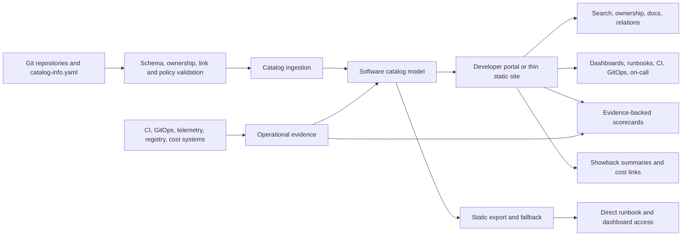
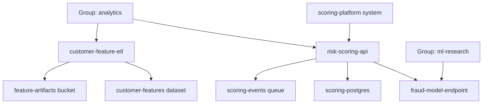
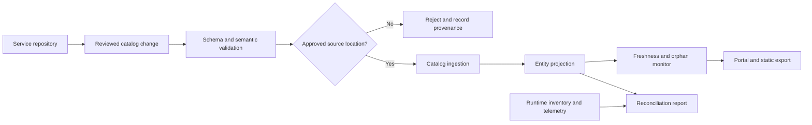
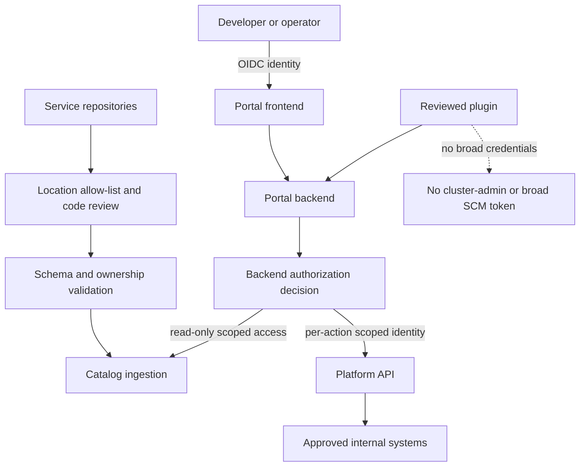
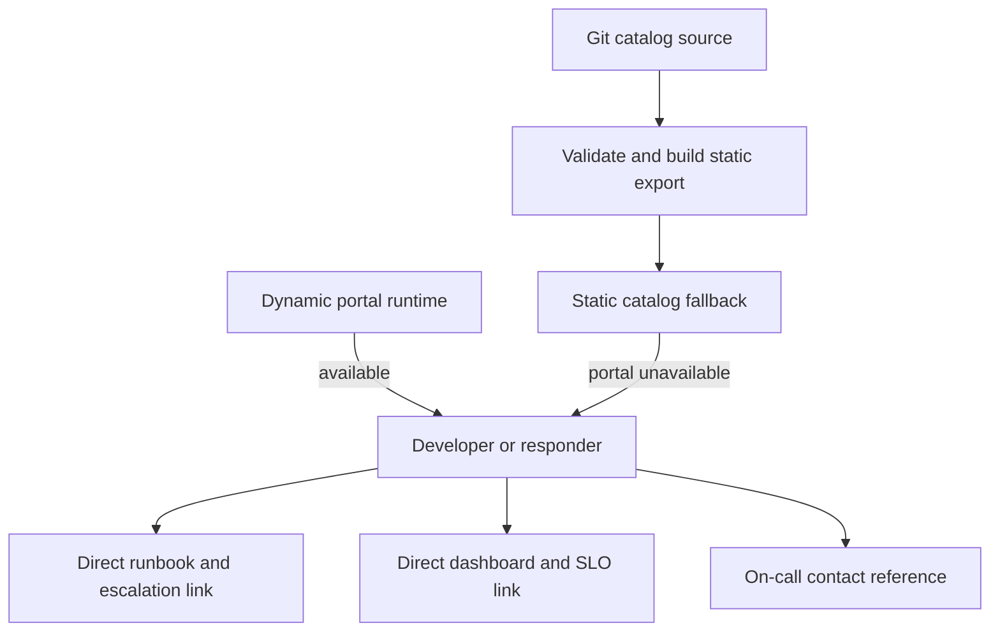
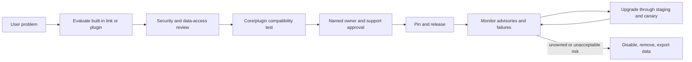
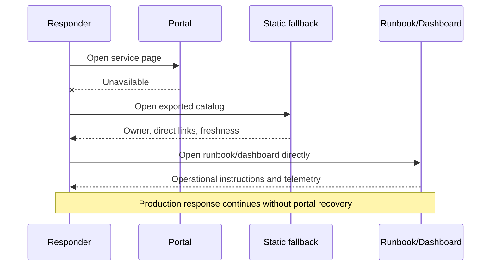
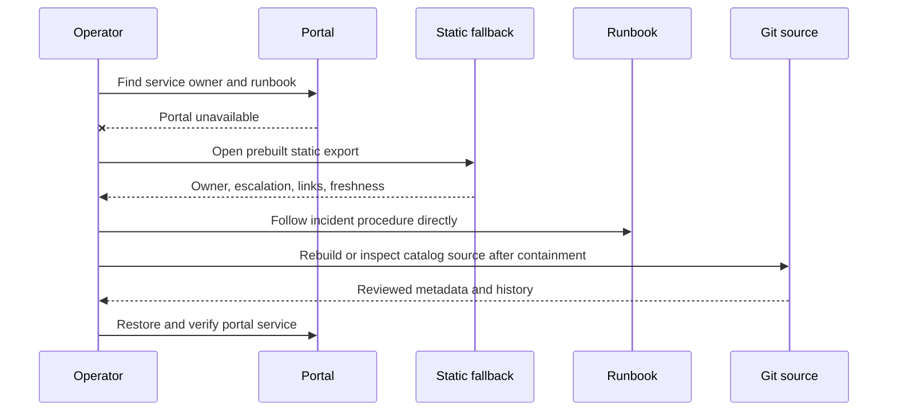

# Developer Portals and the Backstage Service Catalog

> **Abstract.** This unit teaches how to turn platform capabilities into a trusted developer-facing discovery and operating experience. The software catalog is treated as a governed model of services, APIs, resources, teams, ownership, dependencies, documentation, and operational evidence. The guaranteed implementation is a local, zero-budget thin portal built from catalog-as-code files, a Python standard-library linter, a deterministic static-site generator, dependency and drift reports, evidence-backed scorecards, and a static fallback. A local Backstage application is an optional extension that may be attempted only after a hardware and toolchain preflight. The lesson progresses from beginner concepts to production architecture, security, reliability, governance, product operations, and ten hands-on labs. All teams, users, service records, measurements, costs, and incidents in the lab are synthetic; local results are not evidence of real-world adoption or productivity.

## Metadata

- Module: M16 — Platform Engineering and Internal Developer Platforms
- Stage: 2E — Production DevOps & Platform Engineering
- Unit: 4 — Developer Portals and the Backstage Service Catalog
- Learner level: Beginner to advanced (L1–L4)
- Estimated study and lab time: 28–40 hours; optional Backstage setup may add time.
- Last reviewed: 2026-11-01
- Assumed tool baseline: WSL2 Ubuntu primary; native Linux secondary; Python 3 standard library; Git; a text editor and browser. Record actual versions. Backstage, Node.js, package-manager, Docker/Podman, and TechDocs requirements are version-sensitive and must be pinned and verified before use.
- Budget profile: Zero-budget local lab. No cloud account, paid portal, commercial service, or SaaS source-control account is required.
- Stack profiles: **Plat-Core** is guaranteed and complete. **Plat+Portal** is optional, preflight-gated, and runs Backstage alone during the exercise.
- Planning footprint: approximately 4 CPU, 8 GB RAM, and 30 GB disk; this is a planning assumption, not a guarantee. Measure actual resource use.
- Synthetic data: Yes. No real developer population is present in the lab.

## Table of Contents

- [4.0 Why Developer Portals and Service Catalogs Matter](#40-why-developer-portals-and-service-catalogs-matter)
- [4.1 Learning Objectives and Exit Criteria](#41-learning-objectives-and-exit-criteria)
- [4.2 Required Handoff from M10, M11, and M15](#42-required-handoff-from-m10-m11-and-m15)
- [4.3 Concept Map and Portal Architecture](#43-concept-map-and-portal-architecture)
- [4.4 L1 — Developer Portal, Catalog, and Backstage Fundamentals](#44-l1--developer-portal-catalog-and-backstage-fundamentals)
  - [Annotations and integration metadata](#4446-annotations-integration-metadata-not-authority)
- [4.5 L2 — Catalog-as-Code and Entity Modeling](#45-l2--catalog-as-code-and-entity-modeling)
- [4.6 L2 — Catalog Linting, Ownership, Dependencies, and Docs-as-Code](#46-l2--catalog-linting-ownership-dependencies-and-docs-as-code)
- [4.7 L2 — Thin Portal Implementation](#47-l2--thin-portal-implementation)
  - [Complete Plat-Core implementation](#475-complete-catalog-validator-scorecard-generator-drift-and-automation-cli)
- [4.8 L2 — Scorecards, Showback, and Operational Integrations](#48-l2--scorecards-showback-and-operational-integrations)
- [4.9 L2 — Backstage Local Lab and Deployment Awareness](#49-l2--backstage-local-lab-and-deployment-awareness)
- [4.10 L3 — Architecture Choices, Ingestion, and Catalog Trust](#410-l3--architecture-choices-ingestion-and-catalog-trust)
- [4.11 L3 — Plugin Governance, Authentication, Authorization, and Hardening](#411-l3--plugin-governance-authentication-authorization-and-hardening)
- [4.12 L3 — Reliability, Data Quality, DX, and Data/ML Integration](#412-l3--reliability-data-quality-dx-and-dataml-integration)
- [4.13 L4 — Operating the Portal as a Product](#413-l4--operating-the-portal-as-a-product)
- [4.14 SRE Lens: Portal SLOs, Fallback, and Incident Drills](#414-sre-lens-portal-slos-fallback-and-incident-drills)
- [4.15 Security Lens: Threat Model and Negative Tests](#415-security-lens-threat-model-and-negative-tests)
- [4.16 Production Readiness Checklist](#416-production-readiness-checklist)
- [4.17 Hands-On Lab Set (Labs 1–10)](#417-hands-on-lab-set-labs-110)
- [4.18 Self-Check and Knowledge Review](#418-self-check-and-knowledge-review)
- [4.19 Evidence Artifacts and Completion Gate](#419-evidence-artifacts-and-completion-gate)
- [4.20 Interview and Design-Review Questions](#420-interview-and-design-review-questions)
- [4.21 Sources, Version Notes, and Verification Tasks](#421-sources-version-notes-and-verification-tasks)
- [Appendix A — Lab File Tree and Runbook Index](#appendix-a--lab-file-tree-and-runbook-index)
- [Appendix B — Self-Audit Report](#appendix-b--self-audit-report)
- [Appendix C — Human Verification Checklist](#appendix-c--human-verification-checklist)
- [Appendix D — Known Limitations and Assumptions](#appendix-d--known-limitations-and-assumptions)
- [Appendix E — Sign-Off](#appendix-e--sign-off)

## 4.0 Why Developer Portals and Service Catalogs Matter

Imagine an on-call engineer receiving an alert for `risk-scoring-api`. The engineer needs to know who owns it, which team is on call, where its runbook is, what its SLO is, which model endpoint it calls, which database it uses, and where its deployment status is visible. If this information is scattered across chat messages, spreadsheets, dashboards, and old wiki pages, incident response becomes a search exercise.

A developer portal provides a coherent front door to this information. The software catalog supplies the structured data behind it. The portal is useful only when that data is accurate, current, attributable, and supported by clear ownership. A beautiful interface over stale metadata can actively mislead responders.

A portal is not the platform itself. The platform is the underlying set of APIs, automation, policies, infrastructure, delivery workflows, and operational services. A portal exposes and connects those capabilities. It cannot make an unreliable provisioning API reliable, create missing ownership, or compensate for undocumented operational processes.

A service catalog is not merely a list of repository URLs. It is a model of the software ecosystem: components, APIs, resources, systems, domains, groups, users, and relationships. The most operationally valuable fields are often the least glamorous: owner, lifecycle, dependencies, runbook, escalation path, and freshness.

**Core principle:** build the smallest portal that solves a real discovery and operational problem. Start with trustworthy catalog data and useful links. Add a framework and plugins only when the product requirements justify their ongoing operating cost.

## 4.1 Learning Objectives and Exit Criteria

By the end of this unit, you can:

1. **[L1]** Explain the difference between a developer portal, a software catalog, an internal developer platform, and Backstage.
2. **[L1]** Describe catalog entities, metadata, ownership, relations, annotations, lifecycle, and catalog-as-code.
3. **[L2]** Model a data/ML platform with at least eight entities and consistent ownership and dependencies.
4. **[L2]** Implement a local catalog linter that detects at least eight planted defects and explains remediation.
5. **[L2]** Generate a searchable static portal with safe HTML escaping, dependency graph, operational links, freshness, scorecards, and synthetic showback.
6. **[L2]** Compare declared dependencies with synthetic telemetry-derived edges and explain the limitations of both.
7. **[L2]** Create evidence-backed scorecards with missing/stale states and anti-gaming checks.
8. **[L2]** Complete a Backstage preflight and, only if feasible, register local entities in a pinned local application.
9. **[L3]** Decide between a thin catalog, Git-native portal, Backstage, and hosted alternatives using operational burden and exit strategy.
10. **[L3]** Design catalog ingestion, provenance, trust boundaries, plugin governance, authentication, authorization, and portal reliability.
11. **[L4]** Operate the portal as a product with catalog governance, KPIs, SLOs, release management, DR, and incident response.
12. **[L4]** Explain why synthetic lab evidence cannot establish real adoption, compliance, security, or production availability.

**Exit criteria:** all ten labs have evidence or a justified optional-tool fallback; at least eight entities validate; eight or more planted defects are detected; static output is deterministic and safely escaped; scorecards use evidence; fallback works without Backstage; no real secrets are committed; all uncertain Backstage details remain explicitly marked for verification.

## 4.2 Required Handoff from M10, M11, and M15

> M10 Unit 8 taught operational readiness reviews and a service catalog entry as part of documentation architecture; M11 Unit 7 taught dependency mapping and noted that ownership/dependency metadata belongs in a service catalog ("forward ref M16"); M15 Unit 4 deferred showback in the portal here. This unit teaches the **developer portal and software catalog as a product**: the catalog data model, ownership and dependency metadata, docs-as-code, scorecards, portal architecture and its operating cost, plugin governance, authentication, and when a thin catalog is better than a full portal — hands-on with a thin portal (guaranteed) and Backstage (behind a preflight).

The handoff means this unit does not re-teach operational readiness reviews, telemetry collection, or cost allocation. It consumes their outputs. M10 Unit 4 contributes incident ownership/paging context and M10 Unit 8 contributes runbooks, SLOs, and readiness evidence. M11 contributes service dependency observations and telemetry links. M15 contributes showback and cost-owner information. This unit gives those facts a governed place in the software catalog and presents them through a portal.

Earlier M16 units also provide important continuity:

- [Unit 1 — Platform engineering principles and platform as a product](01-platform-engineering-principles-and-platform-as-a-product.md) defines the portal's product purpose, users, and support model.
- [Unit 2 — Golden paths, templates, and paved roads](02-golden-paths-templates-and-paved-roads.md) introduces `catalog-info.yaml` as a template artifact and explains how new services inherit metadata conventions.
- [Unit 3 — Self-service infrastructure and environment provisioning](03-self-service-infrastructure-and-environment-provisioning.md) establishes the ownership registry and canonical request objects that the catalog can reference.
- Unit 5 owns full scaffolding and software-template implementation. Here, Scaffolder is only a preview.
- Unit 8 owns the broader adoption and developer-experience measurement programme. This unit uses scorecards and portal usability measures without ranking individuals.
- Unit 9 owns schema governance, deprecation, versioning, and exit strategy in depth. This unit introduces those controls as portal operating requirements.

The remaining roadmap-confirmed M16 links are [Unit 5 — Scaffolding and software templates](05-scaffolding-and-software-templates.md), [Unit 6 — Platform APIs with Crossplane compositions](06-platform-apis-with-crossplane-compositions.md), [Unit 7 — Multi-tenancy, isolation, and tenant onboarding](07-multi-tenancy-isolation-and-tenant-onboarding.md), [Unit 8 — Platform SLOs, adoption metrics, and developer experience](08-platform-slos-adoption-metrics-and-developer-experience.md), and [Unit 9 — Platform governance, deprecation, and versioning](09-platform-governance-deprecation-and-versioning.md). The roadmap also lists [M16 practice questions](practice-questions.md), [Projects README](Projects/README.md), and the [self-service data and ML platform portal capstone](Projects/01-self-service-data-and-ml-platform-portal.md). Unit 4 previews the Scaffolder only; the capstone integrates the units rather than replacing them.

The earlier M01–M15 handoffs used here are deliberately integration-oriented: **M02** supplies CI, reusable workflows, repository ownership and CODEOWNERS review so catalog changes are validated before ingestion; **M06** supplies Helm/Kustomize packaging knowledge for deployment awareness, not a mandatory in-cluster Backstage install; **M08** supplies GitOps and release evidence as portal links, plus API-contract context from M08 Unit 12; **M09** supplies OIDC/workload identity, group mapping, token scope, rotation and secret-reference practices (including the M09 Unit 7 identity handoff); **M12 Unit 1** supplies threat modelling, **M12 Unit 3** software-supply-chain and dependency-provenance review, and **M12 Unit 9** vulnerability remediation and audit workflows; **M13 Unit 3** supplies bootstrap-kit access, **M13 Unit 5** model-registry recovery context, and **M13 Unit 7** restore-drill discipline; **M14 Unit 1** supplies fleet inventory and **M14** multi-cluster context for unregistered-service discovery and regional portal views. **M15 Unit 5** adds orphan/idle-resource discovery context. **M11 Unit 6/Unit 8** are the source context for Alertmanager routing and actionable alert operations, **M11 Unit 7** for observed dependencies, and **M15 Unit 4/Unit 11** for showback and OpenCost context. These are module/unit references rather than invented file links.

## 4.3 Concept Map and Portal Architecture



The portal is a projection of trusted source data, not the authoritative owner of every fact. Git is usually the source of truth for declared ownership, lifecycle, and dependencies. Runtime systems remain authoritative for observed health, current deployment state, and telemetry. Cost systems remain authoritative for their allocation calculations. The catalog joins these views but must preserve provenance and timestamps.



The diagram shows declared relationships in the sample platform. It does not prove runtime traffic or complete lineage. A declared edge can be outdated; an observed edge can be incidental, temporary, or missing because telemetry was sampled.

### Catalog ingestion and provenance flow



The repository declares intended ownership and relationships. Runtime inventory and telemetry provide observations with a different coverage boundary. Reconciliation should produce an investigation queue, not silently overwrite source-controlled metadata. Push and pull ingestion are both possible; exact Backstage location/provider configuration is **[VERIFY]** for the pinned release.

### Portal security trust boundaries



The frontend may improve navigation but does not enforce authorization. The backend and target platform API must authorize each action. Catalog ingestion is a separate trust boundary: a repository cannot grant itself ownership merely by writing a YAML field.

### Portal independence and fallback



The fallback is built before an outage and does not call the dynamic portal API. It must contain enough operational pointers to remain useful, a generation timestamp, and no secrets.

## 4.4 L1 — Developer Portal, Catalog, and Backstage Fundamentals

### 4.4.1 What a developer portal does

A portal commonly supports five user goals:

| Goal | Developer question | Typical portal content |
|---|---|---|
| Discover | What services and APIs exist? | Search, owners, domains, API contracts |
| Create | How do I start a new service? | Links to golden paths and Unit 5 templates |
| Operate | How do I deploy or respond to an incident? | CI, GitOps, dashboards, runbooks, on-call |
| Govern | Is this service operated responsibly? | Scorecards, lifecycle, policy evidence |
| Understand | What depends on this service? | Relations graph, SLO, cost and data/model links |

A portal should not become a second control plane with broad privileges. Its job is to make supported capabilities understandable and accessible. A button that triggers a privileged operation must call an authorized platform API or create an auditable request; it must not rely on a frontend-only permission check.

### 4.4.2 Software catalog fundamentals

A catalog entity has identity and structured data. In Backstage terminology, an entity commonly includes:

- `apiVersion` and `kind`: the schema/version and entity category.
- `metadata`: identity and descriptive fields such as name, namespace, description, labels, annotations, tags, and links.
- `spec`: kind-specific properties such as type, lifecycle, owner, system, and dependency declarations.
- Relations: derived or declared links such as ownership, containment, and dependency relationships.

Common relation concepts include `ownedBy`, `dependsOn`, `partOf`, and API consumption/provision relationships. For example, a Component can be owned by a Group, depend on a Resource, belong to a System, and consume an API. Exact relation names, derivation rules, and field-to-relation mapping must be **[VERIFY]** against the pinned Backstage version; do not assume that a YAML field and a rendered relation are interchangeable.

The exact entity kinds, field names, relation semantics, and API version must be checked against the pinned Backstage version. Commonly encountered kinds include `Component`, `API`, `Resource`, `System`, `Domain`, `Group`, `User`, `Location`, and `Template` **[VERIFY]**. `backstage.io/v1alpha1` is a commonly seen API version but is **[VERSION-SENSITIVE]** and must not be assumed current without checking.

Ownership is central. An entity without a valid owner is not simply missing a label; it is an operational responsibility gap. If a service is deprecated, that lifecycle must be explicit. If a service depends on a database, the relationship should be declared and reviewed.

### 4.4.3 Catalog facts versus integrations

Do not mix different kinds of evidence:

- **Declared metadata:** owner, lifecycle, system membership, declared dependencies. Source: reviewed repository metadata or an approved registry.
- **External links:** URLs to dashboards, repositories, runbooks, deployment systems, and model registries. A link is a pointer, not proof that the target is healthy or accessible.
- **Observed telemetry:** runtime calls, service health, latency, alerts. Source: observability systems, with time windows and sampling limitations.
- **Self-attested claims:** statements supplied by a service team. These may be useful but should not be treated as verified evidence without corroboration.

A portal should display freshness and provenance so a user can judge the strength of a claim.

### 4.4.4 Backstage in context

Backstage is an open-source framework for building developer portals. It is not a ready-made internal platform that automatically knows an organization's services. A common architecture includes a React frontend, Node.js backend, plugins, and TypeScript, but package boundaries and recommended architecture can change. Confirm these details for the version you pin.

The project’s current CNCF status and maturity are **[VERIFY]**. Do not rely on an old blog post or a prior version's tutorial for current status. A Backstage installation requires ongoing work: configuration, catalog ingestion, authentication, authorization, plugin maintenance, dependency upgrades, backups, monitoring, and user support.

### 4.4.5 Catalog-as-code

Catalog-as-code means service metadata is stored alongside the service or in a controlled repository, reviewed through normal source-control processes. A `catalog-info.yaml` file is a common Backstage convention. Its exact syntax and ingestion configuration must be checked against the pinned version.

Advantages include:

- metadata changes are reviewable and traceable;
- service teams can own their records;
- metadata can be validated in CI;
- Git history provides provenance;
- the catalog can be rebuilt or exported if the portal is replaced.

Risks include stale declarations, copy-paste errors, untrusted repository registrations, and teams inventing inconsistent conventions. Catalog-as-code therefore needs schema governance, owner validation, and a freshness programme.

### 4.4.6 Annotations: integration metadata, not authority

Annotations attach integration-oriented metadata to an entity. They are not proof that an external system is healthy, and they must not become an unreviewed command channel. Commonly encountered examples include `backstage.io/techdocs-ref` for TechDocs discovery and SCM-related keys such as `github.com/project-slug`; both are **[VERIFY]** against the exact Backstage release and plugin documentation before use. Kubernetes, Argo CD, Grafana, PagerDuty, and other integration annotations must be selected from the installed plugin's official documentation—this lesson does not invent those keys.

The `platform.example.com/docs-path`, `platform.example.com/runbook-path`, and `platform.example.com/last-updated` keys in the Plat-Core code are **local teaching conventions**, not built-in Backstage annotations. Their meanings and allowed values live in `registry/annotations.json`; the linter rejects unregistered keys. A real organization should use a controlled reverse-DNS namespace, assign an owner to each key, document allowed values and sensitivity, and deprecate keys through Unit 9 governance. Never place secrets or bearer tokens in annotations.

### 4.4.7 The guaranteed thin portal

The thin portal is a small local static site generated from catalog files. It is not a toy fallback: it must provide the required core experience—search, ownership, lifecycle, links, dependency graph, scorecard, freshness, provenance, and warnings. Because it is static, it is portable, cheap to operate, and can remain available when a dynamic portal is unavailable.

## 4.5 L2 — Catalog-as-Code and Entity Modeling

### 4.5.1 Running example and naming contract

Use one synthetic organization consistently:

- System: `scoring-platform`
- Domain: `risk-analytics`
- Groups: `analytics`, `ml-research`
- User: `alex-engineer`
- API component: `risk-scoring-api`
- Batch component: `customer-feature-etl`
- Model endpoint: `fraud-model-endpoint`
- Database resource: `scoring-postgres`
- Object resource: `feature-artifacts`
- Queue resource: `scoring-events`
- Dataset resource: `customer-features`

All entities are synthetic. Team names, links, on-call contacts, costs, and operational states are local fixtures.

The team identifiers deliberately continue the Unit 3 synthetic entitlement examples: `analytics` and `ml-research` become catalog `Group` entities with the same stable names. `ownership/teams.json` is a normalized local read model of the Unit 3 controlled team registry (`entitlements/teams.yaml` in that lesson), not a second source of entitlement truth. The API and ETL are owned by `analytics`; the model endpoint and model resource are owned by `ml-research`. In a real platform, generate or synchronize this view from the authoritative identity/ownership source and audit transfers.

### 4.5.2 Entity convention table

| Entity | Example kind | Local type convention | Required owner | Important relationships |
|---|---|---|---|---|
| API service | Component | `service` | `analytics` | depends on DB, queue, model |
| ETL pipeline | Component | `pipeline` | `analytics` | depends on dataset and bucket |
| Model endpoint | Component | `model-endpoint` | `ml-research` | part of system; model card link |
| OpenAPI contract | API | `openapi` convention | group | provided by API component |
| PostgreSQL | Resource | `database` | group | consumed by API |
| Object bucket | Resource | `object-store` | group | consumed by ETL |
| Queue | Resource | `queue` | group | consumed by API |
| Dataset | Resource | `dataset` | group | produced/consumed by pipeline |
| System/domain | System/Domain | logical grouping | group | contains components |
| Team/user | Group/User | identity convention | controlled registry | owns entities |

The values `service`, `pipeline`, `model-endpoint`, `database`, and `dataset` are local conventions, not a claim that every value is a built-in Backstage enum. Lifecycle values such as `experimental`, `production`, and `deprecated`, and tier labels such as `tier-1`, must be documented as local conventions and mapped to supported fields only after verification.

### 4.5.3 Representative catalog entity

The following illustrates the intended shape. Validate the exact field names and relation behavior against the pinned Backstage schema before using it in a Backstage ingestion pipeline.

```yaml
apiVersion: backstage.io/v1alpha1 # [VERIFY] against pinned version
kind: Component
metadata:
  name: risk-scoring-api
  description: Synthetic API for risk scoring
  tags:
    - python
    - inference
  labels:
    team: analytics
    cost-center: CC-SYNTH-ANALYTICS-01
    lifecycle: production
  annotations:
    platform.example.com/docs-path: docs/index.md
    platform.example.com/runbook-path: docs/runbooks/risk-scoring-api.md
    platform.example.com/last-updated: "2026-11-03"
  links:
    - url: https://example.invalid/repositories/risk-scoring-api
      title: Repository
    - url: https://example.invalid/runbooks/risk-scoring-api
      title: Runbook
    - url: https://example.invalid/dashboards/risk-scoring-api
      title: Dashboard
spec:
  type: service
  lifecycle: production
  owner: group:default/analytics
  system: system:default/scoring-platform
  dependsOn:
    - resource:default/scoring-postgres
    - resource:default/scoring-events
    - component:default/fraud-model-endpoint
```

`example.invalid` is a reserved placeholder domain. Replace it only with local or organization-approved links. A syntactically valid URL is not necessarily reachable. The linter can check local file links; network reachability requires a separate check and appropriate credentials.

### 4.5.4 API contract and data/ML resources

At least one API entity should link to an OpenAPI contract. The contract documents the interface; it does not prove the implementation conforms. CI should validate the document and, where feasible, test compatibility.

For data/ML systems, catalog resources can represent datasets, feature sets, model registry entries, model endpoints, notebooks/workspaces, and pipelines using documented local conventions. Include links to model cards, registry records, lineage views, and classification metadata where available. Do not make the software catalog pretend to be a complete data catalog.

### 4.5.5 Ownership registry integration

Unit 3 established a controlled ownership registry. The catalog should reference that authority rather than allowing every service to invent arbitrary team names. A valid owner should resolve to an existing Group entity. The group should carry a team documentation link and a synthetic escalation/on-call reference in the lab.

Ownership transfers need a traceable workflow: update the ownership registry, update affected entities, validate the change, and record the transfer. Bulk changes after a reorganization should be reviewable and reversible.

## 4.6 L2 — Catalog Linting, Ownership, Dependencies, and Docs-as-Code

### 4.6.1 What a catalog linter is

A linter is a deterministic program that checks a defined subset of catalog rules and returns actionable diagnostics. It is not the Backstage catalog engine and must not claim full schema compatibility. The Plat-Core linter should validate:

1. required entity fields;
2. allowed kinds and identity format;
3. duplicate entity identities;
4. owner existence;
5. lifecycle and tier conventions;
6. local documentation/runbook links;
7. dependency references;
8. dependency cycles where the local policy disallows them;
9. registered annotation keys;
10. approved source locations;
11. freshness and orphan indicators;
12. safe URL schemes and HTML output safety.

A helpful error names the entity and file, explains the rule, and suggests a fix. “Invalid entity” is not enough. Prefer: `risk-scoring-api: owner group:default/unknown-team does not exist; choose a Group from ownership/teams.json or update the ownership registry`.

### 4.6.2 Declared versus observed dependencies

Declared dependencies answer: “What does the service owner say this component relies on?” Observed dependencies answer: “What did telemetry show communicating during a particular observation window?”

They differ for valid reasons:

- a dependency may be used only during failover or a monthly job;
- telemetry sampling may miss low-volume calls;
- a service may call a shared gateway rather than the final dependency;
- a declared edge may be obsolete;
- a network connection may be incidental and not a logical dependency.

Create a diff report with four categories: declared-and-observed, declared-only, observed-only, and neither. Review mismatches with owners. Never automatically rewrite architectural declarations from telemetry alone.

### 4.6.3 CI quality gates

Run the linter in CI on every catalog change. Use separate checks for syntax, semantics, and reachability:

- YAML parsing proves only that the document can be parsed.
- Schema validation proves conformance to the schema version being used.
- Semantic validation proves local ownership, dependency, and convention rules.
- Local link validation proves a referenced local file exists.
- HTTP link checking attempts reachability but may fail due to authentication, network restrictions, or transient outages.

Do not conflate these results. A green YAML parse is not proof of a healthy catalog.

### 4.6.4 Docs-as-code and TechDocs

Keep operational documentation near the code it describes. A repository might contain `docs/index.md`, `docs/runbook.md`, `docs/architecture.md`, and a `mkdocs.yml` file. Build docs in CI, check links and code snippets, identify a documentation owner, and report the last meaningful update.

TechDocs is a Backstage documentation integration. Exact setup, build/publish flow, and prerequisites are **[VERIFY]** against the pinned Backstage version. The thin portal must remain useful even when TechDocs is not installed: it can link directly to Markdown or generated documentation.

## 4.7 L2 — Thin Portal Implementation

### 4.7.1 File layout

Use this Plat-Core layout:

```text
m16-unit04/
├── catalog/
│   ├── groups/{analytics,ml-research}/catalog-info.yaml
│   ├── users/alex-engineer/catalog-info.yaml
│   ├── domains/risk-analytics/catalog-info.yaml
│   ├── systems/scoring-platform/catalog-info.yaml
│   ├── components/{risk-scoring-api,customer-feature-etl,fraud-model-endpoint}/catalog-info.yaml
│   ├── apis/risk-scoring-api/catalog-info.yaml
│   └── resources/{scoring-postgres,feature-artifacts,scoring-events,customer-features,fraud-model-v3}/catalog-info.yaml
├── ownership/teams.json          # normalized projection of Unit 3 team registry
├── registry/annotations.json
├── evidence/{inventory,service-health,showback}.json
├── evidence/{risk-scoring-api,customer-feature-etl,fraud-model-endpoint}.json
├── telemetry/observed-edges.json
├── docs/index.md
├── docs/openapi/risk-scoring-openapi.yaml
├── docs/model-cards/fraud-model-v3.md
├── docs/runbooks/risk-scoring-api.md
├── src/{bootstrap_lab.py,catalog_portal.py}
├── tests/test_catalog_portal.py
├── generated/                    # CLI-owned outputs; never hand-edit
├── versions.txt
└── README.md
```

Keep the source records and generated site separate. Never edit generated HTML as the source of truth.

### 4.7.2 Safe rendering

Catalog values are untrusted input. Escape all values before inserting them into HTML. Do not use YAML values as raw HTML, JavaScript, or CSS. Reject unsafe URL schemes such as `javascript:` and `data:` for ordinary links. A portal that renders malicious catalog descriptions without escaping can become a stored cross-site scripting vulnerability.

The standard-library `html.escape` function is suitable for escaping text and quoted attribute values. URL validation is a separate step: escaping does not make an unsafe scheme safe.

### 4.7.3 Minimal generator pattern

This small snippet isolates the security-critical rendering pattern; the complete implementation and tests follow in §4.7.5–§4.7.7. The runnable Plat-Core implementation adds deterministic sorting, structured diagnostics, ownership/relationship/freshness checks, URL policy, and tests. It intentionally reads JSON documents stored with the `.yaml` filename (JSON is a YAML 1.2 subset), not arbitrary YAML. A production catalog importer must use a real, pinned YAML parser and the selected Backstage entity schema. Do not pretend that a hand-written partial YAML parser supports the full YAML specification.

```python
from html import escape
from urllib.parse import urlparse

ALLOWED_SCHEMES = {"https"}

def safe_text(value):
    return escape(str(value), quote=True)

def safe_link(url):
    parsed = urlparse(str(url))
    if parsed.scheme not in ALLOWED_SCHEMES or not parsed.hostname:
        raise ValueError(f"unsupported or incomplete URL: {url!r}")
    if parsed.hostname not in {"example.invalid"} and not parsed.hostname.endswith(".example.invalid"):
        raise ValueError(f"unapproved host: {parsed.hostname!r}")
    return safe_text(url)

def render_entity(entity):
    metadata = entity["metadata"]
    spec = entity.get("spec", {})
    name = safe_text(metadata["name"])
    description = safe_text(metadata.get("description", ""))
    owner = safe_text(spec.get("owner", "UNKNOWN"))
    lifecycle = safe_text(spec.get("lifecycle", "unknown"))
    return (
        f"<article class='entity'>"
        f"<h2>{name}</h2>"
        f"<p>{description}</p>"
        f"<p>Owner: {owner}</p>"
        f"<p>Lifecycle: {lifecycle}</p>"
        f"</article>"
    )
```

For the guaranteed path, the learner may store normalized entity documents as JSON after validating YAML source files with an installed parser, or choose JSON as the canonical machine-readable fixture and separately demonstrate YAML examples. If using PyYAML, pin the dependency and document the install; do not make it an invisible requirement. A custom parser for “just enough YAML” is not acceptable as a general catalog parser.

### 4.7.4 Search, graph, and freshness

Search should operate on a deterministic index of entity name, description, kind, owner, tags, and system. A simple client-side text filter is sufficient for a small static catalog. For the dependency graph, generate Mermaid text from validated edges or render a simple HTML list of upstream/downstream dependencies. Validate references before generating the graph.

Every entity card should show:

- source repository or source file;
- last-updated timestamp or commit identifier;
- freshness state: fresh, stale, or unknown;
- owner and lifecycle;
- docs/runbook/dashboard links;
- scorecard status;
- synthetic health/SLO and showback summaries where fixtures exist.

Freshness is not just file modification time. Prefer a source-controlled update timestamp or commit provenance. A file that was touched yesterday but contains incorrect information is not trustworthy. Freshness is a signal, not a correctness guarantee.

### 4.7.5 Complete catalog validator, scorecard, generator, drift and automation CLI

Save the following as `src/catalog_portal.py`. The implementation is intentionally small enough to inspect. It does not call a cloud provider, a Backstage API, an SCM API, or a live monitoring system. It reads only local fixtures, validates them, and writes deterministic review artifacts.

```python
#!/usr/bin/env python3
"""Dependency-free Plat-Core catalog validation and portal generator.
The .yaml fixtures are JSON documents, a valid YAML 1.2 subset. This is an
intentionally constrained lab input, NOT a general YAML or Backstage parser.
"""
from __future__ import annotations
import argparse, datetime as dt, html, ipaddress, json, re, sys
from pathlib import Path
from urllib.parse import urlparse
ROOT=Path(__file__).resolve().parents[1]
CATALOG=ROOT/'catalog'; REGISTRY=ROOT/'registry'/'annotations.json'
OWNERS=ROOT/'ownership'/'teams.json'; EVIDENCE=ROOT/'evidence'; OUT=ROOT/'generated'
KINDS={'Component','API','Resource','System','Domain','Group','User'}
LIFECYCLES={'experimental','production','deprecated'}; TIERS={'tier-1','tier-2','tier-3','tier-4'}
def load(path):
    with Path(path).open(encoding='utf-8') as f: return json.load(f)
def dump(path,obj):
    path=Path(path); path.parent.mkdir(parents=True,exist_ok=True)
    path.write_text(json.dumps(obj,indent=2,sort_keys=True)+'\n',encoding='utf-8')
def ref(e):
    m=e.get('metadata',{}); return f"{e.get('kind','').lower()}:{m.get('namespace','default')}/{m.get('name','')}"
def safe_url(value):
    p=urlparse(str(value))
    if p.scheme not in {'https'} or not p.hostname or p.username or p.password: return False
    host=p.hostname.lower()
    if host in {'localhost','localhost.localdomain'} or host.endswith('.local'): return False
    try:
        ip=ipaddress.ip_address(host)
        if ip.is_private or ip.is_loopback or ip.is_link_local: return False
    except ValueError: pass
    return host=='example.invalid' or host.endswith('.example.invalid')
def approved_source(location):
    """Only catalog files below the configured local source root are trusted."""
    candidate=Path(location).resolve()
    try: candidate.relative_to(CATALOG.resolve()); return candidate.is_file()
    except ValueError: return False
def load_entities(folder=CATALOG):
    rows=[]; errors=[]
    for path in sorted(Path(folder).rglob('catalog-info.yaml')):
        if not approved_source(path): errors.append(f'CAT-SOURCE-001 {path}: source is outside the approved local catalog root')
        try:
            e=load(path)
            if not isinstance(e,dict): raise ValueError('root must be an object')
            rows.append((path,e))
        except (OSError,json.JSONDecodeError,ValueError) as exc: errors.append(f'{path}: malformed JSON-compatible YAML: {exc}')
    return rows,errors
def lint(folder=CATALOG):
    rows,errors=load_entities(folder); owners=load(OWNERS).get('groups',{}) if OWNERS.exists() else {}
    allowed=set(load(REGISTRY).get('allowed_keys',[])) if REGISTRY.exists() else set(); refs={}; keys={}
    for path,e in rows:
        identity=ref(e)
        if identity in refs: errors.append(f'CAT-DUP-001 {path}: duplicate entity reference {identity}; first {refs[identity]}')
        refs[identity]=path
        key=(e.get('kind'),e.get('metadata',{}).get('namespace','default'),e.get('metadata',{}).get('name'))
        if key in keys: errors.append(f'CAT-DUP-002 {path}: duplicate kind/namespace/name {key}')
        keys[key]=path
    known=set(refs)
    for path,e in rows:
        m,s=e.get('metadata',{}),e.get('spec',{}); prefix=f'{path} [{ref(e)}]'
        if e.get('apiVersion')!='backstage.io/v1alpha1': errors.append(f'CAT-SCHEMA-001 {prefix}: unexpected apiVersion; verify against pinned Backstage')
        if e.get('kind') not in KINDS: errors.append(f'CAT-KIND-001 {prefix}: unsupported kind {e.get("kind")!r}')
        if not m.get('name') or not re.fullmatch(r'[a-z0-9][a-z0-9-]*',str(m.get('name',''))): errors.append(f'CAT-NAME-001 {prefix}: metadata.name must be lowercase kebab-case')
        if e.get('kind') in {'Component','API','Resource','System','Domain'}:
            owner=s.get('owner')
            if not owner: errors.append(f'CAT-OWNER-001 {prefix}: spec.owner missing; add an approved Group reference')
            elif owner not in owners: errors.append(f'CAT-OWNER-002 {prefix}: owner {owner!r} absent from ownership registry')
            elif owner not in known: errors.append(f'CAT-OWNER-005 {prefix}: owner Group {owner!r} is absent from the catalog')
            elif not owners[owner].get('receiver') or not owners[owner].get('escalation'): errors.append(f'CAT-OWNER-003 {prefix}: owner Group lacks approved escalation receiver/path')
            elif not (ROOT/owners[owner]['escalation']).is_file(): errors.append(f'CAT-OWNER-004 {prefix}: escalation path does not resolve locally')
            if e.get('kind')=='Component':
                if s.get('lifecycle') not in LIFECYCLES: errors.append(f'CAT-LIFE-001 {prefix}: invalid lifecycle')
                if s.get('type') not in {'service','pipeline','model-endpoint','website','job','library'}: errors.append(f'CAT-TYPE-001 {prefix}: type not in local convention registry')
                if s.get('lifecycle')=='production' and s.get('tier') not in TIERS: errors.append(f'CAT-TIER-001 {prefix}: production component requires valid tier')
                if not s.get('system'): errors.append(f'CAT-ORPHAN-001 {prefix}: component must belong to a known System')
                for required_path in ('docs-path','runbook-path'):
                    if not m.get('annotations',{}).get(f'platform.example.com/{required_path}'):
                        errors.append(f'CAT-DOC-001 {prefix}: required {required_path} annotation is missing')
        for field in ('dependsOn','providesApis','consumesApis','subdomainOf','system','domain','members','memberOf','children'):
            value=s.get(field,[]); value=[value] if isinstance(value,str) else value
            for target in value:
                if isinstance(target,str) and ':' in target and target not in known: errors.append(f'CAT-REL-001 {prefix}: {field} references unknown entity {target!r}')
        updated=m.get('annotations',{}).get('platform.example.com/last-updated')
        if not updated: errors.append(f'CAT-FRESH-001 {prefix}: last-updated provenance annotation is missing')
        else:
            try:
                age=(dt.date.today()-dt.date.fromisoformat(updated)).days
                if age>30 or age<0: errors.append(f'CAT-FRESH-001 {prefix}: last-updated value is stale or in the future ({updated})')
            except ValueError: errors.append(f'CAT-FRESH-001 {prefix}: last-updated must be an ISO date')
        for key in m.get('annotations',{}):
            if key not in allowed: errors.append(f'CAT-ANN-001 {prefix}: unregistered annotation {key!r}')
        for link in m.get('links',[]):
            if not safe_url(link.get('url','')): errors.append(f'CAT-URL-001 {prefix}: unsafe/unapproved URL {link.get("url")!r}')
        for field in ('docs-path','runbook-path'):
            rel=m.get('annotations',{}).get(f'platform.example.com/{field}')
            if rel:
                target=(ROOT/rel).resolve()
                if ROOT.resolve() not in target.parents or not target.is_file(): errors.append(f'CAT-LINK-001 {prefix}: local {field} {rel!r} does not resolve inside repo')
    for cycle in dependency_cycles(rows):
        errors.append(f'CAT-CYCLE-001 dependency cycle detected: {" -> ".join(cycle)}')
    return errors,rows

def dependency_cycles(rows):
    graph={ref(e):[] for _,e in rows if e.get('kind')=='Component'}
    for _,e in rows:
        if e.get('kind')!='Component': continue
        deps=e.get('spec',{}).get('dependsOn',[]) or []; deps=[deps] if isinstance(deps,str) else deps
        graph[ref(e)]=[d for d in deps if d in graph]
    visiting=set(); visited=set(); cycles=[]
    def visit(node,path):
        if node in visiting:
            i=path.index(node); cycle=path[i:]+[node]
            if cycle not in cycles: cycles.append(cycle)
            return
        if node in visited: return
        visiting.add(node)
        for child in graph.get(node,[]): visit(child,path+[child])
        visiting.remove(node); visited.add(node)
    for node in sorted(graph): visit(node,[node])
    return cycles

def score_entity(e):
    name=e['metadata']['name']; spec=e.get('spec',{}); path=EVIDENCE/f'{name}.json'
    if not path.exists(): return {'entity':ref(e),'checks':{'evidence_bundle':{'state':'missing','reason':'no evidence bundle'}}}
    ev=load(path); checks={}
    owners=load(OWNERS).get('groups',{}) if OWNERS.exists() else {}
    def put(k,state,why): checks[k]={'state':state,'reason':why}
    runbook=ROOT/ev.get('runbook_path','')
    if not runbook.is_file(): put('runbook','missing','runbook file not found')
    else:
        body=runbook.read_text(encoding='utf-8'); bad=len(body.strip())<80 or 'TODO' in body.upper() or 'lorem ipsum' in body.lower() or 'replace me' in body.lower() or 'example.invalid' in body.lower()
        put('runbook','fail' if bad else 'pass','empty or placeholder runbook' if bad else 'non-empty runbook')
    owner=spec.get('owner'); owner_record=owners.get(owner)
    put('owner','pass' if owner_record else 'fail','owner Group must exist in the controlled ownership registry')
    escalation=(ROOT/owner_record.get('escalation','')).resolve() if owner_record else None
    put('on_call','pass' if owner_record and owner_record.get('receiver') and escalation and ROOT.resolve() in escalation.parents and escalation.is_file() else 'missing','approved receiver and in-repository escalation reference required')
    put('slo','pass' if ev.get('slo_documented') and ev.get('slo_evidence') else 'missing','SLO document and evidence reference required')
    put('alerts','pass' if ev.get('alert_test_passed') else 'fail','alert rule test evidence required')
    put('backup','pass' if ev.get('backup_policy') else ('missing' if spec.get('type')=='database' else 'unknown'),'backup evidence required for stateful resources')
    put('dependencies','pass' if 'dependsOn' in spec else 'missing','dependency declaration must be explicit')
    put('policy','pass' if ev.get('policy_report')=='pass' else 'fail','policy report must pass')
    put('cost_labels','pass' if ev.get('cost_center') and ev.get('team') else 'missing','team and cost-center labels required')
    scan=ev.get('security_scan_date')
    if ev.get('self_attested_only'): put('security_scan','unknown','self-attestation is not scan evidence')
    elif not scan: put('security_scan','missing','scan timestamp absent')
    else:
        try:
            age=(dt.date.today()-dt.date.fromisoformat(scan)).days
            put('security_scan','pass' if age<=30 else 'stale',f'scan age {age} days; local window is 30 days')
        except ValueError: put('security_scan','unknown','invalid scan date')
    put('template','pass' if ev.get('template_version')==ev.get('supported_template_version') else 'fail','template version must equal supported version')
    return {'entity':ref(e),'checks':checks}
def scorecards(rows):
    services=[score_entity(e) for _,e in rows if e.get('kind')=='Component']; counts={s:0 for s in ('pass','fail','missing','stale','unknown')}; teams={}
    owner_by_ref={ref(e):e.get('spec',{}).get('owner','unassigned') for _,e in rows}
    for item in services:
        owner=owner_by_ref[item['entity']]; bucket=teams.setdefault(owner,{s:0 for s in counts})
        for check in item['checks'].values():
            state=check['state']; counts[state]=counts.get(state,0)+1; bucket[state]=bucket.get(state,0)+1
    return {'synthetic':True,'generated_at':dt.datetime.now(dt.timezone.utc).isoformat(),'services':services,'counts':counts,'teams':teams,'trend_note':'Store successive dated scorecards and compare by entity/team; one snapshot is not a trend.'}
def render_site(rows,scores):
    byname={x['entity'].split('/')[-1]:x for x in scores['services']}; cards=[]; edges=[]
    health=load(EVIDENCE/'service-health.json') if (EVIDENCE/'service-health.json').exists() else {}
    showback=load(EVIDENCE/'showback.json') if (EVIDENCE/'showback.json').exists() else {}
    for path,e in rows:
        m,s=e.get('metadata',{}),e.get('spec',{}); name=m.get('name','unnamed'); links=[]
        for link in m.get('links',[]):
            if safe_url(link.get('url','')): links.append(f'<a rel="noopener noreferrer" href="{html.escape(link["url"],quote=True)}">{html.escape(link.get("title","link"))}</a>')
        for label,field in (('Docs','docs-path'),('Runbook','runbook-path')):
            rel=m.get('annotations',{}).get(f'platform.example.com/{field}')
            if rel and (ROOT/rel).is_file(): links.append(f'<a href="{html.escape(rel,quote=True)}">{label}</a>')
        state='not-applicable'
        if name in byname:
            states=[x['state'] for x in byname[name]['checks'].values()]
            state='pass' if states and all(x=='pass' for x in states) else 'attention-required'
        updated=m.get('annotations',{}).get('platform.example.com/last-updated')
        freshness='unknown'
        if updated:
            try: freshness='fresh' if (dt.date.today()-dt.date.fromisoformat(updated)).days<=30 else 'stale'
            except ValueError: freshness='invalid-date'
        health_state=health.get(name,{}).get('state','unknown')
        health_slo=health.get(name,{}).get('slo','not-reported')
        cost=showback.get('services',{}).get(name,'not-reported')
        team=m.get('labels',{}).get('team','not-assigned'); cost_center=m.get('labels',{}).get('cost-center','not-assigned')
        deps=s.get('dependsOn',[]); deps=[deps] if isinstance(deps,str) else deps
        edges.extend(f'  {ref(e)} --> {dep}' for dep in deps)
        cards.append("<article class='entity'><h2>"+html.escape(name)+"</h2><p>"+html.escape(m.get('description',''))+"</p><dl><dt>Kind</dt><dd>"+html.escape(e.get('kind',''))+"</dd><dt>Owner</dt><dd>"+html.escape(s.get('owner','unassigned'))+"</dd><dt>Lifecycle</dt><dd>"+html.escape(s.get('lifecycle','n/a'))+"</dd><dt>Team</dt><dd>"+html.escape(team)+"</dd><dt>Cost center</dt><dd>"+html.escape(cost_center)+"</dd><dt>Scorecard</dt><dd>"+state+"</dd><dt>Health/SLO fixture</dt><dd>"+html.escape(health_state+' — '+health_slo)+"</dd><dt>Showback (synthetic)</dt><dd>"+html.escape(str(cost))+"</dd><dt>Freshness</dt><dd>"+html.escape(freshness)+"</dd><dt>Source</dt><dd>"+html.escape(str(path.relative_to(ROOT)) if path.is_absolute() and ROOT in path.parents else str(path))+"</dd></dl><p>"+" · ".join(links)+"</p></article>")
    graph='\n'.join(edges) if edges else '  A[No declared dependencies]'
    graph_items=''.join('<li>'+html.escape(edge.strip())+'</li>' for edge in graph.splitlines())
    page="""<!doctype html><html lang="en"><head><meta charset="utf-8"><meta name="viewport" content="width=device-width,initial-scale=1"><title>Synthetic software catalog</title><style>body{font:16px system-ui;max-width:1100px;margin:2rem auto;padding:0 1rem}article{border:1px solid #bbb;border-radius:8px;padding:1rem;margin:1rem 0}dt{font-weight:bold}dd{margin:0 0 .5rem}input{padding:.6rem;width:min(100%,30rem)}</style></head><body><h1>Software catalog</h1><p>SYNTHETIC LOCAL FIXTURE — not production evidence.</p><label for="q">Search catalog</label><input id="q" type="search" placeholder="Name, owner, description"><main id="entities">"""+''.join(cards)+"""</main><h2>Declared dependency edges</h2><ul class="dependency-edges">"""+graph_items+"""</ul><details><summary>Mermaid source</summary><pre>flowchart LR
"""+html.escape(graph)+"""</pre></details><script>const q=document.querySelector('#q');q.addEventListener('input',()=>{const term=q.value.toLowerCase();document.querySelectorAll('.entity').forEach(card=>{card.hidden=!card.textContent.toLowerCase().includes(term)})});</script></body></html>"""
    target=OUT/'site'/'index.html'; target.parent.mkdir(parents=True,exist_ok=True); target.write_text(page,encoding='utf-8'); return target
def dependency_diff(rows,path=None):
    path=Path(path or ROOT/'telemetry'/'observed-edges.json'); declared=set()
    for _,e in rows:
        deps=e.get('spec',{}).get('dependsOn',[]) or []; deps=[deps] if isinstance(deps,str) else deps
        for d in deps: declared.add((ref(e),d))
    data=load(path) if path.exists() else {'edges':[]}; observed={(x['from'],x['to']) for x in data.get('edges',[])}
    return {'synthetic':True,'declared_and_observed':sorted(declared&observed),'declared_only':sorted(declared-observed),'observed_only':sorted(observed-declared),'coverage_note':data.get('coverage_note','unknown')}
def drift_report(rows,path=None):
    inv=load(path or EVIDENCE/'inventory.json'); known={ref(e) for _,e in rows if e.get('kind')=='Component'}
    running={x['ref'] for x in inv.get('services',[]) if x.get('state')=='running'}
    retired={x['ref'] for x in inv.get('services',[]) if x.get('state')=='retired'}
    test_workloads={x['ref'] for x in inv.get('services',[]) if x.get('state')=='test'}
    timestamp=inv.get('observed_at'); freshness='unknown'
    if timestamp:
        try:
            age=(dt.datetime.now(dt.timezone.utc)-dt.datetime.fromisoformat(timestamp.replace('Z','+00:00'))).days
            freshness='fresh' if 0<=age<=1 else 'stale'
        except ValueError: freshness='invalid-timestamp'
    unregistered=sorted(running-known)
    return {'synthetic':True,'unregistered_running':unregistered,'triage':{x:{'status':'needs-investigation','owner':'unassigned'} for x in unregistered},'catalog_not_running':sorted(known-running),'retired_still_catalogued':sorted(retired&known),'excluded_test_workloads':sorted(test_workloads),'source_timestamp':timestamp,'source_freshness':freshness,'coverage_note':inv.get('coverage_note','incomplete inventory; investigate')}
def generate_automation(rows):
    owners=load(OWNERS)['groups']; receivers={}; cost=[]
    receiver_owner={}
    for _,e in rows:
        if e.get('kind')!='Component': continue
        owner=e.get('spec',{}).get('owner')
        if owner not in owners: raise ValueError(f'refusing automation: {ref(e)} has unknown owner {owner!r}')
        team=owners[owner]; receiver=team['receiver']
        if receiver in receiver_owner and receiver_owner[receiver]!=owner: raise ValueError(f'refusing automation: receiver {receiver!r} is assigned to multiple owner Groups')
        receiver_owner[receiver]=owner; receivers.setdefault(receiver,[]).append(ref(e)); cost.append({'service':ref(e),'team':owner,'cost_center':team['cost_center']})
    routing={'synthetic':True,'routes':[{'receiver':r,'services':sorted(v)} for r,v in sorted(receivers.items())]}
    registry={'synthetic':True,'owners':sorted(cost,key=lambda x:x['service'])}
    dump(OUT/'alert-routing.json',routing); dump(OUT/'cost-owner-registry.json',registry); return routing,registry
def write_drift_artifacts(report):
    dump(OUT/'drift.json',report); dump(OUT/'unregistered-services.json',{'synthetic':True,'services':report['triage'],'source_timestamp':report['source_timestamp'],'source_freshness':report.get('source_freshness'),'coverage_note':report['coverage_note']})
    lines=['# Synthetic catalog drift report','',f"Inventory timestamp: {report['source_timestamp']}",f"Inventory freshness: {report.get('source_freshness','unknown')}",'',f"Coverage: {report['coverage_note']}",'','## Unregistered running services']
    lines += [f"- {x} — owner: unassigned; status: needs-investigation" for x in report['unregistered_running']] or ['- None in this fixture']
    lines += ['','## Catalog entries not observed running'] + ([f'- {x}' for x in report['catalog_not_running']] or ['- None in this fixture'])
    lines += ['','## Explicitly excluded test workloads'] + ([f'- {x}' for x in report.get('excluded_test_workloads',[])] or ['- None in this fixture'])
    lines += ['','## Retired services still catalogued'] + ([f'- {x}' for x in report['retired_still_catalogued']] or ['- None in this fixture'])
    (OUT/'catalog-drift.md').write_text('\n'.join(lines)+'\n',encoding='utf-8')
def export_fallback(rows):
    entities=[]
    for path,e in rows:
        m,s=e.get('metadata',{}),e.get('spec',{}); entities.append({'ref':ref(e),'name':m.get('name'),'owner':s.get('owner'),'lifecycle':s.get('lifecycle'),'links':m.get('links',[]),'source':str(path.relative_to(ROOT)),'freshness':'unknown'})
    target=OUT/'static-fallback.json'; dump(target,{'synthetic':True,'generated_at':dt.datetime.now(dt.timezone.utc).isoformat(),'entities':entities}); return target
def main():
    p=argparse.ArgumentParser(description=__doc__); p.add_argument('command',choices=['lint','site','scorecards','drift','dependency-diff','automation','fallback','all']); cmd=p.parse_args().command
    errors,rows=lint()
    if cmd in {'lint','all'}:
        for error in errors: print(error)
        print(f'entities={len(rows)} errors={len(errors)}')
        if errors: return 1
    if errors and cmd!='lint': print('Refusing to generate from invalid catalog.',file=sys.stderr); return 1
    if cmd in {'scorecards','site','all'}:
        scores=scorecards(rows); dump(OUT/'scorecards.json',scores); print(f"scorecards: {len(scores['services'])} services")
    if cmd in {'site','all'}: print(f'site: {render_site(rows,scorecards(rows))}')
    if cmd in {'drift','all'}: write_drift_artifacts(drift_report(rows)); print('drift: generated')
    if cmd in {'dependency-diff','all'}: dump(OUT/'dependency-diff.json',dependency_diff(rows)); print('dependency diff: generated')
    if cmd in {'automation','all'}: generate_automation(rows); print('automation: generated for review; not applied')
    if cmd in {'fallback','all'}: print(f'fallback: {export_fallback(rows)}')
    return 0
if __name__=='__main__': raise SystemExit(main())

```

### 4.7.6 Synthetic catalog bootstrap and fixtures

Save this as `src/bootstrap_lab.py`. It creates thirteen consistent synthetic entities: Group, User, Domain, System, three Components, one API, and five Resources (database, object store, queue, dataset, and model). It also creates the ownership registry, annotation registry, OpenAPI example, model card, runbook, synthetic health/showback evidence, inventory, and observed dependency edges.

```python
"""Create the deterministic synthetic catalog fixtures used in Unit 4 labs."""
import json, shutil
from pathlib import Path
ROOT=Path(__file__).resolve().parents[1]
def write(path,obj):
 path.parent.mkdir(parents=True,exist_ok=True); path.write_text(json.dumps(obj,indent=2)+'\n',encoding='utf-8')
def entity(kind,name,owner=None,**spec):
 annotations={'platform.example.com/docs-path':'docs/index.md','platform.example.com/last-updated':'2026-11-03'}
 labels={}
 if owner:
  team=owner.split('/')[-1]; labels={'team':team,'cost-center':'CC-SYNTH-ML-01' if team=='ml-research' else 'CC-SYNTH-ANALYTICS-01'}
 if kind=='Resource' and spec.get('type') in {'dataset','model'}: labels['data-classification']='synthetic-internal'
 if kind=='Component': annotations['platform.example.com/runbook-path']='docs/runbooks/risk-scoring-api.md'
 links=[{'title':'Repository','url':'https://git.example.invalid/platform/'+name}]
 if kind=='Component': links += [{'title':'Dashboard','url':'https://grafana.example.invalid/d/'+name},{'title':'SLO view','url':'https://grafana.example.invalid/slo/'+name},{'title':'CI run','url':'https://ci.example.invalid/'+name},{'title':'GitOps application','url':'https://gitops.example.invalid/applications/'+name},{'title':'On-call schedule','url':'https://oncall.example.invalid/teams/'+(owner.split('/')[-1] if owner else 'unassigned')}]
 if kind=='API': links.append({'title':'OpenAPI contract','url':'https://git.example.invalid/contracts/risk-scoring-openapi.yaml'})
 if name=='fraud-model-v3': links.append({'title':'Model card','url':'https://git.example.invalid/model-cards/fraud-model-v3.md'})
 if name=='customer-features': links.append({'title':'Lineage','url':'https://lineage.example.invalid/datasets/customer-features'})
 return {'apiVersion':'backstage.io/v1alpha1','kind':kind,'metadata':{'name':name,'namespace':'default','description':f'Synthetic {kind.lower()} fixture for {name}','tags':['synthetic','m16-unit04'],'labels':labels,'annotations':annotations,'links':links},'spec':dict({'owner':owner} if owner else {},**spec)}
def main():
 if (ROOT/'catalog').exists(): shutil.rmtree(ROOT/'catalog')
 group='group:default/analytics'; ml_group='group:default/ml-research'
 data=[entity('Group','analytics',type='team',members=['user:default/alex-engineer']),entity('Group','ml-research',type='team',members=[]),entity('User','alex-engineer',memberOf=['group:default/analytics']),entity('Domain','risk-analytics',group),entity('System','scoring-platform',group,domain='domain:default/risk-analytics'),entity('Component','risk-scoring-api',group,type='service',lifecycle='production',tier='tier-1',system='system:default/scoring-platform',dependsOn=['resource:default/scoring-postgres','resource:default/scoring-events','component:default/fraud-model-endpoint'],consumesApis=['api:default/risk-scoring-api']),entity('Component','customer-feature-etl',group,type='pipeline',lifecycle='production',tier='tier-2',system='system:default/scoring-platform',dependsOn=['resource:default/customer-features','resource:default/feature-artifacts']),entity('Component','fraud-model-endpoint',ml_group,type='model-endpoint',lifecycle='production',tier='tier-1',system='system:default/scoring-platform',dependsOn=['resource:default/fraud-model-v3']),entity('API','risk-scoring-api',group,type='openapi',definition='https://git.example.invalid/contracts/risk-scoring-openapi.yaml'),entity('Resource','scoring-postgres',group,type='database'),entity('Resource','feature-artifacts',group,type='object-store'),entity('Resource','scoring-events',group,type='queue'),entity('Resource','customer-features',group,type='dataset'),entity('Resource','fraud-model-v3',ml_group,type='model')]
 folders={'Group':'groups','User':'users','Domain':'domains','System':'systems','Component':'components','API':'apis','Resource':'resources'}
 for e in data: write(ROOT/'catalog'/folders[e['kind']]/e['metadata']['name']/'catalog-info.yaml',e)
 write(ROOT/'ownership'/'teams.json',{'groups':{group:{'receiver':'analytics-oncall','cost_center':'CC-SYNTH-ANALYTICS-01','escalation':'docs/runbooks/risk-scoring-api.md'},ml_group:{'receiver':'ml-research-oncall','cost_center':'CC-SYNTH-ML-01','escalation':'docs/runbooks/risk-scoring-api.md'}}})
 (ROOT/'docs').mkdir(parents=True,exist_ok=True)
 write(ROOT/'registry'/'annotations.json',{'allowed_keys':['platform.example.com/docs-path','platform.example.com/runbook-path','platform.example.com/last-updated'],'owner':'synthetic-platform-governance'})
 (ROOT/'docs'/'runbooks').mkdir(parents=True,exist_ok=True)
 (ROOT/'docs'/'index.md').write_text('# Synthetic platform docs\n\nCatalog documentation fixture.\n',encoding='utf-8')
 (ROOT/'docs'/'runbooks'/'risk-scoring-api.md').write_text('# Risk scoring API runbook\n\n## Trigger\nSynthetic alert indicates elevated errors.\n\n## Decide\nCheck dashboard, recent release, dependency health, and current owner.\n\n## Act\nUse the approved rollback procedure; do not edit production directly from this lab.\n\n## Verify\nConfirm service health and communicate status.\n',encoding='utf-8')
 (ROOT/'docs'/'openapi').mkdir(parents=True,exist_ok=True)
 (ROOT/'docs'/'openapi'/'risk-scoring-openapi.yaml').write_text('openapi: 3.0.3\ninfo:\n  title: Synthetic Risk Scoring API\n  version: 1.0.0\npaths: {}\n',encoding='utf-8')
 (ROOT/'docs'/'model-cards'/'fraud-model-v3.md').parent.mkdir(parents=True,exist_ok=True)
 (ROOT/'docs'/'lineage').mkdir(parents=True,exist_ok=True)
 write(ROOT/'docs'/'lineage'/'customer-features.json',{'synthetic':True,'dataset':'resource:default/customer-features','produced_by':'component:default/customer-feature-etl','consumed_by':'resource:default/fraud-model-v3','note':'Illustrative lineage only; verify against the authoritative data catalog.'})
 (ROOT/'docs'/'model-cards'/'fraud-model-v3.md').write_text('# Synthetic model card: fraud-model-v3\n\nThis is a teaching fixture, not a trained model or performance claim.\n',encoding='utf-8')
 for name in ['risk-scoring-api','customer-feature-etl','fraud-model-endpoint']:
  team='ml-research' if name=='fraud-model-endpoint' else 'analytics'; cc='CC-SYNTH-ML-01' if team=='ml-research' else 'CC-SYNTH-ANALYTICS-01'
  write(ROOT/'evidence'/f'{name}.json',{'runbook_path':'docs/runbooks/risk-scoring-api.md','slo_documented':True,'slo_evidence':'synthetic://slo-fixture','alert_test_passed':True,'backup_policy':name!='customer-feature-etl','policy_report':'pass','cost_center':cc,'team':team,'security_scan_date':'2026-10-28','template_version':'v2','supported_template_version':'v2'})
 write(ROOT/'evidence'/'inventory.json',{'observed_at':'2026-11-03T00:00:00Z','coverage_note':'Synthetic subset only; does not cover external or dormant workloads.','services':[{'ref':'component:default/risk-scoring-api','state':'running'},{'ref':'component:default/customer-feature-etl','state':'running'},{'ref':'component:default/fraud-model-endpoint','state':'running'},{'ref':'component:default/unregistered-batch','state':'running'},{'ref':'component:default/retired-service','state':'retired'},{'ref':'component:default/test-fixture','state':'test'}]})
 write(ROOT/'evidence'/'service-health.json',{'synthetic':True,'risk-scoring-api':{'state':'healthy','slo':'99.5% illustrative objective'},'customer-feature-etl':{'state':'warning','slo':'freshness objective not evaluated'},'fraud-model-endpoint':{'state':'healthy','slo':'latency objective not evaluated'}})
 write(ROOT/'evidence'/'showback.json',{'synthetic':True,'period':'2026-10','currency':'USD illustrative units','allocation_method':'synthetic fixed allocation; not a quote or invoice','services':{'risk-scoring-api':12.5,'customer-feature-etl':7.0,'fraud-model-endpoint':18.0}})
 write(ROOT/'telemetry'/'observed-edges.json',{'coverage_note':'Synthetic sampled traces; absence of an edge is not proof of no dependency.','edges':[{'from':'component:default/risk-scoring-api','to':'resource:default/scoring-postgres'},{'from':'component:default/risk-scoring-api','to':'resource:default/scoring-events'},{'from':'component:default/unregistered-batch','to':'resource:default/feature-artifacts'}]})
 print(f'created {len(data)} synthetic entities')
if __name__=='__main__': main()

```

The `catalog-info.yaml` files use the JSON-compatible YAML subset explained above. The Group entity is the authoritative owner record; User membership points to the Group. Operational entities (Components, APIs, Resources, Systems, and Domains) must resolve `spec.owner` to the controlled Group registry. Do not invent an `owner` field for identity kinds if the selected Backstage schema does not define it.

### 4.7.7 Tests: negative validation, trust, anti-gaming and output safety

Save the following as `tests/test_catalog_portal.py`. The suite verifies eight independent planted policy defects, duplicate identity, malformed input, unapproved source location, URL policy, HTML escaping, dependency diff, inventory drift, empty/dummy runbook detection, and stale/self-attested security evidence.

```python
import json, tempfile, unittest
from pathlib import Path
from unittest.mock import patch
import sys
sys.path.insert(0,str(Path(__file__).resolve().parents[1]/'src'))
import catalog_portal as cp
class CatalogTests(unittest.TestCase):
 def test_url_policy_blocks_script_private_and_unapproved_hosts(self):
  self.assertFalse(cp.safe_url('javascript:alert(1)')); self.assertFalse(cp.safe_url('http://127.0.0.1/admin')); self.assertFalse(cp.safe_url('https://evil.example/')); self.assertTrue(cp.safe_url('https://git.example.invalid/team/repo'))
 def test_non_allowlisted_catalog_source_is_rejected(self):
  with tempfile.TemporaryDirectory() as td:
   outside=Path(td)/'untrusted.yaml'; outside.write_text('{}')
   self.assertFalse(cp.approved_source(outside))
 def test_reference_is_stable(self): self.assertEqual(cp.ref({'kind':'Component','metadata':{'name':'api'}}),'component:default/api')
 def test_malformed_catalog_is_not_silently_skipped(self):
  with tempfile.TemporaryDirectory() as td:
   p=Path(td)/'catalog-info.yaml'; p.write_text('bad: [yaml')
   rows,errors=cp.load_entities(Path(td)); self.assertFalse(rows); self.assertTrue(any('malformed' in error for error in errors))
 def test_eight_planted_defects_are_detected(self):
  with tempfile.TemporaryDirectory() as td:
   root=Path(td); cat=root/'catalog'; cat.mkdir(); owners=root/'teams.json'; ann=root/'ann.json'
   e={'apiVersion':'backstage.io/v1alpha1','kind':'Component','metadata':{'name':'Bad_Name','annotations':{'not/registered':'x'},'links':[{'url':'javascript:alert(1)'}]},'spec':{'type':'unknown','lifecycle':'launched','owner':'group:default/ghost','tier':'tier-9','dependsOn':['resource:default/missing']}}
   (cat/'catalog-info.yaml').write_text(json.dumps(e)); e2={'apiVersion':'backstage.io/v1alpha1','kind':'Component','metadata':{'name':'bad-tier'},'spec':{'type':'service','lifecycle':'production','owner':'group:default/ghost','tier':'tier-9'}}; (cat/'tier/catalog-info.yaml').parent.mkdir(); (cat/'tier/catalog-info.yaml').write_text(json.dumps(e2)); owners.write_text(json.dumps({'groups':{}})); ann.write_text(json.dumps({'allowed_keys':[]}))
   with patch.object(cp,'OWNERS',owners),patch.object(cp,'REGISTRY',ann): errors,_=cp.lint(cat)
   joined='\n'.join(errors)
   for rule in ['CAT-NAME-001','CAT-ANN-001','CAT-URL-001','CAT-OWNER-002','CAT-LIFE-001','CAT-TYPE-001','CAT-TIER-001','CAT-REL-001']: self.assertIn(rule,joined)
 def test_html_output_escapes_untrusted_description(self):
  e={'kind':'Component','metadata':{'name':'xss','description':'<script>alert(1)</script>','links':[]},'spec':{'owner':'group:default/team'}}
  with tempfile.TemporaryDirectory() as td:
   old=cp.OUT; cp.OUT=Path(td)
   try:
    path=cp.render_site([(Path('catalog/x/catalog-info.yaml'),e)],{'services':[]}); page=path.read_text()
    self.assertNotIn('<script>alert(1)</script>',page); self.assertIn('&lt;script&gt;',page)
   finally: cp.OUT=old
 def test_missing_owner_and_required_docs_are_reported(self):
  with tempfile.TemporaryDirectory() as td:
   root=Path(td); cat=root/'catalog'; cat.mkdir(); owners=root/'teams.json'; ann=root/'ann.json'
   e={'apiVersion':'backstage.io/v1alpha1','kind':'Component','metadata':{'name':'svc'},'spec':{'type':'service','lifecycle':'experimental'}}
   (cat/'catalog-info.yaml').write_text(json.dumps(e)); owners.write_text(json.dumps({'groups':{}})); ann.write_text(json.dumps({'allowed_keys':[]}))
   with patch.object(cp,'OWNERS',owners),patch.object(cp,'REGISTRY',ann): errors,_=cp.lint(cat)
   joined='\n'.join(errors); self.assertIn('CAT-OWNER-001',joined); self.assertIn('CAT-DOC-001',joined)
 def test_broken_local_documentation_path_is_reported(self):
  with tempfile.TemporaryDirectory() as td:
   root=Path(td); cat=root/'catalog'; cat.mkdir(); owners=root/'teams.json'; ann=root/'ann.json'
   e={'apiVersion':'backstage.io/v1alpha1','kind':'Component','metadata':{'name':'svc','annotations':{'platform.example.com/docs-path':'missing.md','platform.example.com/runbook-path':'missing.md','platform.example.com/last-updated':'2026-11-03'}},'spec':{'type':'service','lifecycle':'experimental','owner':'group:default/team','system':'system:default/sys'}}
   (cat/'catalog-info.yaml').write_text(json.dumps(e)); owners.write_text(json.dumps({'groups':{'group:default/team':{'receiver':'team-oncall','escalation':'x'}}})); ann.write_text(json.dumps({'allowed_keys':['platform.example.com/docs-path','platform.example.com/runbook-path','platform.example.com/last-updated']}))
   with patch.object(cp,'OWNERS',owners),patch.object(cp,'REGISTRY',ann): errors,_=cp.lint(cat)
   self.assertTrue(any('CAT-LINK-001' in error for error in errors))
 def test_owner_group_must_exist_as_catalog_entity(self):
  with tempfile.TemporaryDirectory() as td:
   root=Path(td); cat=root/'catalog'; cat.mkdir(); owners=root/'teams.json'; ann=root/'ann.json'
   e={'apiVersion':'backstage.io/v1alpha1','kind':'Component','metadata':{'name':'svc'},'spec':{'type':'service','lifecycle':'experimental','owner':'group:default/team','system':'system:default/sys'}}
   (cat/'catalog-info.yaml').write_text(json.dumps(e)); owners.write_text(json.dumps({'groups':{'group:default/team':{'receiver':'team-oncall','escalation':'x'}}})); ann.write_text(json.dumps({'allowed_keys':[]}))
   with patch.object(cp,'OWNERS',owners),patch.object(cp,'REGISTRY',ann): errors,_=cp.lint(cat)
   self.assertTrue(any('CAT-OWNER-005' in e for e in errors))
 def test_dependency_cycle_is_detected(self):
  rows=[(Path('a'),{'kind':'Component','metadata':{'name':'a'},'spec':{'dependsOn':['component:default/b']}}),(Path('b'),{'kind':'Component','metadata':{'name':'b'},'spec':{'dependsOn':['component:default/a']}})]
  self.assertTrue(cp.dependency_cycles(rows))
 def test_duplicate_identity_is_reported(self):
  with tempfile.TemporaryDirectory() as td:
   root=Path(td); cat=root/'catalog'; (cat/'a').mkdir(parents=True); (cat/'b').mkdir()
   entity={'apiVersion':'backstage.io/v1alpha1','kind':'Component','metadata':{'name':'same'},'spec':{'type':'service','lifecycle':'experimental','owner':'group:default/team'}}
   for folder in ('a','b'): (cat/folder/'catalog-info.yaml').write_text(json.dumps(entity))
   owners=root/'teams.json'; owners.write_text(json.dumps({'groups':{'group:default/team':{}}})); ann=root/'ann.json'; ann.write_text(json.dumps({'allowed_keys':[]}))
   with patch.object(cp,'OWNERS',owners),patch.object(cp,'REGISTRY',ann): errors,_=cp.lint(cat)
   self.assertTrue(any('CAT-DUP-001' in e for e in errors))
 def test_declared_observed_edge_diff(self):
  rows=[(Path('x'),{'kind':'Component','metadata':{'name':'a'},'spec':{'dependsOn':['resource:default/db']}})]
  with tempfile.TemporaryDirectory() as td:
   p=Path(td)/'edges.json'; p.write_text(json.dumps({'edges':[{'from':'component:default/a','to':'resource:default/db'},{'from':'component:default/a','to':'resource:default/queue'}]})); got=cp.dependency_diff(rows,p)
  self.assertEqual(len(got['declared_and_observed']),1); self.assertEqual(len(got['observed_only']),1)
 def test_drift_report_finds_unregistered_and_retired(self):
  rows=[(Path('x'),{'kind':'Component','metadata':{'name':'known'},'spec':{}})]
  with tempfile.TemporaryDirectory() as td:
   p=Path(td)/'inv.json'; p.write_text(json.dumps({'services':[{'ref':'component:default/unknown','state':'running'},{'ref':'component:default/old','state':'retired'}]})); got=cp.drift_report(rows,p)
  self.assertEqual(got['unregistered_running'],['component:default/unknown'])
 def test_static_fallback_excludes_secret_annotations(self):
  e={'kind':'Component','metadata':{'name':'svc','annotations':{'example.com/token':'DO_NOT_EXPORT'}},'spec':{'owner':'group:default/team','lifecycle':'production'},'secret':'DO_NOT_EXPORT'}
  with tempfile.TemporaryDirectory() as td:
   old=cp.OUT; cp.OUT=Path(td)
   try:
    path=cp.export_fallback([(cp.ROOT/'catalog'/'svc'/'catalog-info.yaml',e)])
    payload=path.read_text(); self.assertNotIn('DO_NOT_EXPORT',payload); self.assertIn('freshness',payload)
   finally: cp.OUT=old
 def test_valid_synthetic_api_has_evidence_passes(self):
  _,rows=cp.lint(); entity=next(e for _,e in rows if e.get('kind')=='Component' and e['metadata']['name']=='risk-scoring-api')
  checks=cp.score_entity(entity)['checks']
  self.assertTrue(all(value['state']=='pass' for value in checks.values()))
 def test_team_scorecards_aggregate_without_individual_rankings(self):
  _,rows=cp.lint(); result=cp.scorecards(rows)
  self.assertIn('group:default/analytics',result['teams']); self.assertIn('group:default/ml-research',result['teams'])
  self.assertNotIn('individual_ranks',result)
 def test_duplicate_alert_receiver_is_rejected(self):
  with tempfile.TemporaryDirectory() as td:
   root=Path(td); owners=root/'teams.json'; out=root/'generated'; out.mkdir()
   owners.write_text(json.dumps({'groups':{'group:default/a':{'receiver':'same','cost_center':'A'},'group:default/b':{'receiver':'same','cost_center':'B'}}}))
   rows=[(Path('a'),{'kind':'Component','metadata':{'name':'a'},'spec':{'owner':'group:default/a'}}),(Path('b'),{'kind':'Component','metadata':{'name':'b'},'spec':{'owner':'group:default/b'}})]
   with patch.object(cp,'OWNERS',owners),patch.object(cp,'OUT',out):
    with self.assertRaisesRegex(ValueError,'multiple owner Groups'): cp.generate_automation(rows)
 def test_scorecard_rejects_empty_runbook_and_self_attestation(self):
  e={'kind':'Component','metadata':{'name':'svc'},'spec':{'dependsOn':[]}}
  with tempfile.TemporaryDirectory() as td:
   oldroot,olde=cp.ROOT,cp.EVIDENCE
   cp.ROOT=Path(td); cp.EVIDENCE=Path(td)/'evidence'; cp.EVIDENCE.mkdir()
   (Path(td)/'empty.md').write_text('TODO')
   try:
    bundle={'runbook_path':'empty.md','self_attested_only':True,'template_version':'v1','supported_template_version':'v1'}
    (cp.EVIDENCE/'svc.json').write_text(json.dumps(bundle))
    checks=cp.score_entity(e)['checks']
    self.assertEqual(checks['runbook']['state'],'fail')
    self.assertEqual(checks['security_scan']['state'],'unknown')
    bundle={'runbook_path':'empty.md','security_scan_date':'2020-01-01'}
    (cp.EVIDENCE/'svc.json').write_text(json.dumps(bundle))
    self.assertEqual(cp.score_entity(e)['checks']['security_scan']['state'],'stale')
    (Path(td)/'dummy.md').write_text('This is a placeholder. Replace me with a runbook. https://example.invalid')
    bundle={'runbook_path':'dummy.md','security_scan_date':'2026-11-02'}
    (cp.EVIDENCE/'svc.json').write_text(json.dumps(bundle))
    self.assertEqual(cp.score_entity(e)['checks']['runbook']['state'],'fail')
   finally:
    cp.ROOT,cp.EVIDENCE=oldroot,olde
if __name__=='__main__': unittest.main()

```

**Commands and evidence:**

```bash
python3 -m py_compile src/*.py tests/*.py
python3 -m unittest discover -s tests -v
python3 src/catalog_portal.py all
```

Keep the generated `scorecards.json`, `catalog-drift.md`, `unregistered-services.json`, `dependency-diff.json`, `alert-routing.json`, `cost-owner-registry.json`, `static-fallback.json`, and `site/index.html` as lab evidence. The code checks local links only; it does not claim remote reachability. The `approved_source()` check protects the Plat-Core local source root. The Backstage non-allow-listed location behavior remains a separate `[VERIFY]` negative test against the pinned Backstage release.

## 4.8 L2 — Scorecards, Showback, and Operational Integrations

### 4.8.1 Evidence-backed scorecards

A scorecard asks whether a service has evidence for a small set of meaningful operational practices. It should not be a self-attestation form. For example:

| Check | Passing evidence | Failure state |
|---|---|---|
| SLO defined | Non-empty SLO document with objective and window | Missing or stale |
| Alert pack | Alert rules file plus test result | Missing/untested |
| Runbook | Non-empty runbook with actionable steps | Empty/dummy |
| Owner | Owner resolves to valid Group | Missing/unknown |
| On-call | Valid escalation reference | Missing/expired |
| Backup | Backup policy/evidence for stateful resource | Missing |
| Dependencies | Valid declared references | Unknown target |
| Policy | Fresh policy report | Missing/stale/fail |
| Cost | Required allocation labels | Missing |
| Security | Fresh scan artifact with timestamp | Stale/unknown |
| Template | Supported template version | Old/unknown |

Use states `pass`, `fail`, `missing`, `stale`, and `unknown`. “Unknown” must not be silently counted as pass. Scorecards should show why a check failed and how to improve it.

Anti-gaming tests should detect empty runbooks, dummy links, stale scan reports, self-attested values without evidence, and files containing only boilerplate. A scorecard is a coaching and governance tool, not an individual ranking mechanism. Do not use it for performance reviews.

### 4.8.2 Showback

Showback summarizes allocated cost for visibility. It is not automatically a bill, chargeback, or invoice. The portal should display source, allocation method, reporting period, currency/unit, and data freshness. Access must be scoped to the intended team or authorized audience. Use synthetic values in this lab and mark them clearly; do not invent actual cloud prices.

### 4.8.3 Links first

Start integrations with stable deep links to the systems that already own the information:

- source repository, CI run, and release;
- Argo CD application/status;
- Grafana dashboard and SLO view;
- runbook and on-call schedule;
- showback report or OpenCost view;
- API/OpenAPI documentation;
- model card and model registry;
- data lineage or data catalog.

A deep link is usually lower risk than a custom plugin. It avoids duplicating system behavior and reduces the portal's privilege. Only add a plugin when the user experience requires more than a link and the team can own its compatibility, security, and support lifecycle.

## 4.9 L2 — Backstage Local Lab and Deployment Awareness

### 4.9.1 Preflight first

Backstage is optional. Before installation, record:

- CPU, available memory, and free disk;
- operating system and architecture;
- Docker or Podman availability if required by the chosen setup;
- Node.js and package-manager versions;
- network access to package registries;
- whether the selected version supports the local toolchain;
- estimated install/build footprint and time, to be measured rather than guessed.

If the laptop is constrained, run Backstage alone. Stop other optional heavy components. If preflight fails, record the evidence and finish the complete thin portal. This is a valid result, not an incomplete lab.

A safe first-pass inventory (commands are read-only; missing optional tools are reported rather than installed automatically):

```bash
uname -a
nproc
free -h
df -h .
python3 --version
command -v node >/dev/null && node --version || echo "Node.js not installed"
command -v yarn >/dev/null && yarn --version || echo "Yarn not installed"
command -v docker >/dev/null && docker version || echo "Docker not installed"
command -v podman >/dev/null && podman --version || echo "Podman not installed"
```

Do not install a runtime merely to satisfy this checklist. Confirm the selected Backstage release's official prerequisites first. Record before/after free disk and peak memory during install/build; do not copy someone else's footprint as your own measurement.

### 4.9.2 Pin and record versions

Do not copy a command from an old tutorial and assume it remains valid. Verify the current official Backstage create-app instructions and requirements. The `@backstage/create-app` invocation, Node.js range, package-manager requirements, and upgrade instructions are **[VERIFY]**. Record exact versions in `versions.txt`; never write an invented version number.

### 4.9.3 Local isolated application

If preflight passes:

1. Create a local application using the official instructions for the pinned release.
2. Configure guest authentication only for the isolated local lab.
3. Configure local catalog locations that point to the generated entities.
4. Register the sample entities.
5. Inspect entity pages, ownership, search, and relations.
6. Preview the Scaffolder interface but do not make template creation a Unit 4 requirement.
7. Optionally build TechDocs after verifying its prerequisites.
8. Measure installation time, build time, disk use, and peak memory.
9. Stop the application and confirm the thin portal remains available.

Exact `app-config.yaml` location syntax, guest auth setup, catalog ingestion configuration, search behavior, permission framework, and TechDocs steps are **[VERIFY]** against the pinned version.

### 4.9.4 Deployment awareness

A production deployment may require a container image, Kubernetes deployment configuration, persistent backend storage, database backup, secrets management, SSO, network policy, and release/rollback processes. M06 Helm/Kustomize knowledge applies. PostgreSQL is commonly considered for persistent non-development deployments, but backend support and migration details must be checked against the selected Backstage architecture and version **[VERIFY]**. In-cluster deployment is not required for this unit.

## 4.10 L3 — Architecture Choices, Ingestion, and Catalog Trust

### 4.10.1 Choose the least burdensome architecture

| Option | Strengths | Costs and limitations | Good fit |
|---|---|---|---|
| Thin static catalog | Very low operating burden; portable; easy export | Limited dynamic interaction and permissions | Small service estate or initial discovery need |
| Git-native docs + catalog + scorecard CI | Reviewable, versioned, easy to automate | Search and UX require assembly | Teams already comfortable with Git workflows |
| Self-hosted Backstage | Extensible portal framework and plugin ecosystem | Runtime, upgrades, plugin compatibility, auth, security, support | Real catalog and workflow needs justify ownership |
| Hosted/commercial portal | May reduce self-hosting burden; packaged workflows | Vendor dependency, pricing and feature validation, data access review | Organization has procurement and security approval |
| Backstage-as-a-service | Awareness option | Service boundaries and current offer must be verified | Only after fit, support, and exit review |

Products such as Port, Cortex, OpsLevel, Compass, and Roadie are awareness examples only. Current features, availability, pricing, and integration details are **[VERIFY]**. No vendor pricing or capability claim is made here.

Decision criteria:

1. How many services and teams need discovery?
2. Is ownership or documentation discovery a serious operational problem?
3. Will service teams maintain their metadata?
4. Are Git-native practices already sufficient?
5. Which integrations are actually required?
6. Who will operate the portal and upgrade plugins?
7. What are catalog size, search, availability, and authorization requirements?
8. Can metadata be exported and used without the portal?

A dedicated platform team may be a common adoption pattern, but that is an **[ASSUMPTION]**, not a staffing rule. Do not invent headcount. Revisit the decision when the thin solution's limitations are evidenced by real user needs.

### 4.10.2 Ingestion: push and pull

**Push ingestion** means a source-control event or pipeline sends validated entity data to the catalog. It can provide fast updates but requires secure credentials, retries, and duplicate-event handling.

**Pull ingestion** means the catalog periodically reads approved source locations. It reduces the need for every repository to push updates, but introduces polling delay, rate limits, discovery configuration, and freshness concerns.

Backstage has concepts such as catalog locations, processors, and entity providers, but exact APIs and behavior are version-sensitive. Verify the selected version. Do not assume rename, deletion, or orphan cleanup behaves identically across versions or configurations.

Git should remain the source of truth for declared metadata. The portal is a projection. Track provenance: source repository, path, commit, author/review context, ingestion time, and last successful refresh.

### 4.10.3 Rename, deletion, orphan, and drift

A rename can create a new identity while the old entity remains visible. A deletion can leave stale catalog records. An orphan may be a real service with no valid owner or a record whose source disappeared. Define a lifecycle policy:

- rename: explicit migration or alias plan;
- delete: mark retired, preserve operational links for a retention period, then remove;
- orphan: report, assign an investigation owner, and time-box remediation;
- source failure: do not silently interpret a temporary fetch failure as deletion;
- ownership transfer: update group mapping and audit the change.

### 4.10.4 Catalog injection and trust boundaries

A malicious or compromised repository can submit metadata that falsely claims ownership of a critical service, links to an attacker-controlled page, embeds unsafe URLs, or adds misleading annotations. Protect the catalog with:

- approved source-location allow-lists;
- repository review and CODEOWNERS;
- schema and semantic validation;
- safe URL scheme/host policy;
- provenance and author tracking;
- controlled ownership registry;
- no automatic trust in arbitrary repositories;
- negative tests proving a non-allow-listed source is rejected or ignored.

The exact Backstage configuration for source allow-lists and rejection behavior is **[VERIFY]**. Do not claim a local custom linter proves Backstage ingestion security.

## 4.11 L3 — Plugin Governance, Authentication, Authorization, and Hardening

### 4.11.1 Plugin governance

A plugin is production software in the portal's trust domain. It may render untrusted data, call internal APIs, use backend credentials, or expose privileged actions. A curated plugin register should include:

| Field | Required record |
|---|---|
| Plugin/package | Exact package and pinned version |
| Purpose | User problem solved |
| Owner | Named team, not an individual-only dependency |
| Permissions | Data and actions it can access |
| Dependencies | npm packages and transitive supply chain |
| Compatibility | Tested Backstage core version |
| Support | SLA/maintenance expectations |
| Security | Threat review, token handling, SSRF review |
| Exit | Removal plan and data portability |

Review lockfiles, dependency integrity, package provenance where available, vulnerability advisories, and upgrade notes. Keep plugins thin. The portal should call platform APIs; it should not reimplement privileged infrastructure workflows in frontend code.

Custom TypeScript frontend or backend plugins add long-term maintenance. Backstage package boundaries and frontend-system changes are **[VERSION-SENSITIVE]**. Do not invent plugin IDs, APIs, or compatibility guarantees.



A plugin's lifecycle starts with a user problem and ends with a supported removal path. “Installed” is not a governance state. Keep a register of owner, purpose, version, permissions, dependencies, tested core version, review date, and removal procedure.

### 4.11.2 Authentication is not authorization

Authentication answers “Who are you?” Authorization answers “What may you do?” OIDC SSO can establish identity. Group mapping can connect identity-provider groups to catalog Group entities. Sign-in resolvers and backend authentication behavior are **[VERIFY]** for the chosen version.

Authorization must be enforced at the backend and at the target service. Hiding a button is not an authorization boundary. Catalog read permissions, administrative operations, Scaffolder actions, and integration calls may need different policies.

### 4.11.3 Privileged-system design

A portal can become privileged if plugins can read cluster data, trigger pipelines, create repositories, or call internal APIs. Controls include:

- least-privilege service identities;
- per-action authorization;
- narrow scopes and short token lifetimes;
- secure token storage and rotation;
- audit logs for sensitive actions;
- no cluster-admin kubeconfig;
- no broad SCM token;
- secrets through environment or secret references, not committed configuration;
- proxy allow-lists and SSRF protections;
- separate read-only and write-capable integrations.

Never put static credentials in `app-config.yaml` committed to Git. Do not trust a portal view filter as tenant isolation unless authorization enforcement is tested independently.

## 4.12 L3 — Reliability, Data Quality, DX, and Data/ML Integration

### 4.12.1 Portal reliability

The portal should have measurable objectives for availability, catalog freshness, and successful entity reads/search. It must not be on the critical path for production operations. Responders must still access runbooks, dashboards, and on-call contacts if the portal is down.

Maintain:

- static catalog export;
- direct runbook/dashboard links;
- database backup and restore procedures if persistent storage is used;
- catalog rebuild from Git;
- staged upgrades and rollback;
- version pinning and reproducible builds;
- caching and search performance tests;
- runbook access through the M13 bootstrap-kit pattern.

### 4.12.2 Catalog data quality programme

Measure and report:

- freshness and last successful ingestion;
- broken local links and separately checked remote links;
- owner and on-call validity;
- declared-versus-observed dependency differences;
- unregistered services discovered from cluster, registry, and CI inventory;
- ownership transfers after reorganizations;
- group synchronization from the identity provider;
- deprecated and retired services;
- schema convention and annotation registry compliance.

No single inventory source sees every runtime service. A cluster inventory misses external SaaS and non-Kubernetes workloads; CI inventory may include test artifacts; telemetry may miss dormant services. The unregistered-services report is an investigation queue, not a complete truth oracle.

### 4.12.3 Developer experience and accessibility

Design for distinct personas: service developer, on-call/SRE, and data scientist/ML engineer. Each needs a useful default landing page. Measure search success and time-to-find-owner/runbook using defined tasks. In the lab, these are synthetic tasks and synthetic participants.

Accessibility matters: keyboard navigation, readable contrast, semantic headings, labels, and screen-reader behavior. WCAG guidance is a reference, but the applicable version and conformance target must be verified **[VERIFY]**. Do not claim accessibility compliance without testing.

### 4.12.4 Software catalog versus data catalog

| Software catalog | Data catalog |
|---|---|
| Services, APIs, resources, systems, domains | Datasets, schemas, lineage, governance, data discovery |
| Software ownership and operational relationships | Data stewardship, classification, quality and lineage |
| Runbooks, dashboards, CI/CD and SLO links | Dataset descriptions, schema, freshness, access policies |
| Runtime dependencies | Data transformation and consumption lineage |

OpenLineage, OpenMetadata, and DataHub are awareness-level integration possibilities. Verify current integration details before implementation. The software catalog does not replace a dedicated data catalog. For ML, link model cards, model registry entries, dataset lineage, feature definitions, and data-classification labels where available.

### 4.12.5 Portal cost and capacity

Measure the actual local footprint and engineering effort. Record install/build time, peak memory, disk use, plugin count, upgrade effort, catalog ingestion rate, storage needs, and support work. A small static portal can be more economical than a dynamic framework when the problem is simply discovery and links. A framework may be justified when the organization needs richer search, integrations, permission-aware views, or workflows and can support them.

ROI should use Unit 1's assumption-driven model. Any sample cost or savings must be labelled synthetic/illustrative, with assumptions and sensitivity analysis. Do not report lab footprint as production sizing guidance.

## 4.13 L4 — Operating the Portal as a Product

### 4.13.1 Ownership model

- Platform team: portal runtime, catalog ingestion platform, integration framework, plugin policy, release process, security posture, fallback, and support.
- Service teams: entity metadata, service documentation, operational evidence, dependency declarations, and lifecycle updates.
- Identity/IT owners: identity-provider group source and lifecycle.
- Security: policy review, plugin risk, token scopes, and incident response.
- FinOps/platform cost owners: showback source, allocation assumptions, and freshness.

A catalog without a schema owner becomes a collection of incompatible local dialects. Assign a governance owner and publish an RFC process for kinds, types, labels, lifecycle values, and annotations.

### 4.13.2 KPIs and SLOs

Define numerator, denominator, observation window, exclusions, source, and privacy treatment. Separate SLIs (measurements), SLOs (objectives), and targets (chosen thresholds).

| Metric | Example definition | Source |
|---|---|---|
| Catalog coverage | Registered known services / known services in reconciled inventory | Catalog + inventory |
| Valid-owner coverage | Entities with resolvable owner / eligible entities | Linter |
| On-call coverage | Production services with valid escalation reference / production services | Catalog + on-call registry |
| Freshness | Entities updated within policy window / eligible entities | Ingestion metadata |
| Search success | Successful task searches / measured search tasks | Aggregate portal events or task study |
| Time-to-find-owner | Median task duration under a defined task protocol | UX study |
| Portal availability | Successful health checks / eligible health checks | Monitoring |
| Entity-read success | Successful entity reads / total entity-read attempts | Portal telemetry |
| Scorecard trend | Counts by evidence state over time | Scorecard engine |
| Synthetic support deflection | Synthetic questions resolved by documented portal path | Lab exercise only |

Active users, where available, should be aggregated by persona and protected against individual surveillance. Do not build individual developer productivity rankings. The lab has no real users; synthetic values demonstrate metric calculation only.

### 4.13.3 Release and upgrade management

Treat the portal like a production service. Publish a portal status page, a human-readable change log, and incident communications; use blameless postmortems for portal failures and plugin/upgrade incidents. M10 incident communication and postmortem practice is reused here rather than re-taught.

Operating rhythm:

1. pin core and plugin dependencies;
2. build reproducibly;
3. test catalog ingestion and plugin compatibility in CI;
4. deploy to a staging instance;
5. canary a limited audience;
6. monitor availability, entity freshness, and errors;
7. roll back if critical workflows regress;
8. publish a changelog and migration notes.

Budget regular upgrade work. An unmaintained portal accumulates dependency risk and becomes harder to upgrade. Verify Backstage's current upgrade playbook and package migration guidance for the chosen version.

### 4.13.4 Catalog governance and automation

The catalog may safely drive automation only when its data is trusted and validated. Examples include:

- alert routing by owner;
- on-call lookup;
- cost-allocation owner registry;
- idle-resource owner lookup;
- access review targets;
- incident ownership lookup;
- ORR and scorecard generation;
- cleanup/decommission workflows;
- dependency-based impact analysis;
- upgrade campaign ownership.

Generated Alertmanager routes and cost-owner registries must be deterministic, reviewed, and tested. A bad owner record can misroute alerts or cleanup. Never let untrusted catalog metadata directly authorize destructive actions.

### 4.13.5 Multi-cluster, multi-region, and multi-tenant portals

Possible designs include one portal with tenant-scoped views or separate portals per tenant. A shared portal can reduce duplicated operations but increases the importance of authorization, data partitioning, and cross-tenant leakage testing. Separate portals increase isolation boundaries but multiply deployment and upgrade work.

A UI filter is not a security boundary. Test backend authorization and direct API access. Regional and fleet-wide links should identify the region/cluster clearly. The portal must not expose secrets, internal-only endpoints, or another tenant's metadata to an unauthorized user.

### 4.13.6 Security operations and disaster recovery

Rotate integration tokens, monitor plugin vulnerabilities, audit sensitive portal actions, review least-privilege scopes, and investigate catalog injection. If the portal uses a persistent database, back it up and test restore. Keep Git/IaC sufficient to rebuild the portal. Export catalog metadata as portable YAML and preserve direct runbook links.

### 4.13.7 Synthetic incident analysis

All scenarios below are synthetic tabletop exercises. For each, use detection → containment → root cause → remediation → prevention → verification.

| Synthetic scenario | Detection signal | Immediate containment | Root cause | Remediation | Prevention and verification |
|---|---|---|---|---|---|
| Catalog 40% stale after reorganization; wrong team paged | Freshness SLI drops; owner lookup conflicts with current roster | Publish corrected owner/escalation notice; contact verified team | Ownership registry and catalog were not updated together | Bulk-update affected entities with reviewed ownership changes | CI owner validation, freshness alert, transfer audit; test old/new owner resolution |
| Broad SCM token leaked through plugin misconfiguration | Secret scan/audit log or unexpected SCM API activity | Revoke token, disable integration, preserve logs and scope incident | Excessive token scope and unsafe secret handling | Rotate credentials; reissue least-privilege identity after review | Secret manager, short scopes, rotation and plugin review; test least privilege and log redaction |
| Upgrade broke three custom plugins; portal frozen | Staging compatibility suite fails or portal errors spike after release | Roll back to known-good release; pause rollout | No compatibility matrix or upgrade budget | Patch or remove incompatible plugins; publish migration notes | Staging compatibility tests, canary, rollback rehearsal and upgrade owner; test the upgrade path |
| No schema owner; incompatible annotations | Linter reports unknown keys and entity pages diverge | Freeze new annotation additions | No RFC, registry owner, or lifecycle | Appoint schema owner; normalize and migrate existing keys | Annotation registry with owner/meaning/allowed values/deprecation; test unknown-key rejection |
| Portal outage blocked runbook access | Portal health check fails during incident | Use static export and direct links | Portal treated as critical operational dependency | Restore portal from known release after incident containment | Fallback drill and bootstrap kit; test owner/runbook access with portal stopped |
| Scorecards gamed with empty runbooks | Scorecard pass conflicts with content review or incident evidence | Remove misleading scorecard result; stop using it for decisions | Metrics rewarded file presence, not evidence quality | Replace presence check with content/actionability and freshness checks | Anti-gaming fixtures, human review and appeal path; plant empty/dummy runbook fixtures |
| Malicious entity claimed critical-service ownership | Unexpected owner/link change or unapproved catalog source event | Quarantine source; verify true owner through trusted registry | Untrusted source and weak provenance/review | Restore trusted metadata and investigate affected links/actions | Allow-list, CODEOWNERS, owner registry, provenance and negative test; verify rejection of unapproved location |
| Retired service still marked production | Inventory reports retired state while catalog lifecycle remains production | Mark entity as under retirement review; preserve required history | Lifecycle/retirement workflow missing | Obtain owner sign-off and update lifecycle/dependencies | Retirement workflow, inventory reconciliation and stale-production alert; test retired entity handling |

## 4.14 SRE Lens: Portal SLOs, Fallback, and Incident Drills

An SLI is the measurement; an SLO is the target over a defined window; an alert is an operational signal. Do not invent targets or use an unmeasured number as an industry benchmark. Set provisional lab targets only to exercise the calculation and label them illustrative.

| SLI | Numerator | Denominator | Window | Example SLO statement |
|---|---|---|---|---|
| Portal availability | Successful health checks | Eligible health checks | 30 days | `[ILLUSTRATIVE]` at least 99% |
| Catalog freshness | Eligible entities refreshed within freshness policy | Eligible entities | 24-hour rolling window | `[ILLUSTRATIVE]` at least 95% |
| Entity-read success | Successful entity reads | Total entity-read attempts | 7 days | `[ILLUSTRATIVE]` at least 99% |
| Search success | Successful defined search tasks | Defined search tasks | Monthly study | Establish after baseline |

The portal-outage sequence:



The portal recovery procedure should include diagnosis, rollback or restart, catalog rebuild from Git, database restore if applicable, ingestion verification, and a post-recovery freshness check. The fallback must contain no secrets and must show its generation timestamp.

### Portal outage recovery sequence



This is a recovery design, not evidence that a production outage has been rehearsed. The lab verifies the static fallback locally; a production exercise must test the organization's actual access paths and recovery objectives.

## 4.15 Security Lens: Threat Model and Negative Tests

### Assets

- service ownership and escalation data;
- internal repository and dashboard links;
- catalog metadata and provenance;
- identity and group mappings;
- integration tokens;
- plugin execution environment;
- portal backend and persistent database;
- tenant-scoped metadata.

### Threat actors and failure sources

- compromised service repository;
- malicious or careless metadata contributor;
- vulnerable plugin dependency;
- stolen integration token;
- unauthorized portal user;
- SSRF through a proxy integration;
- accidental cross-tenant exposure;
- stale ownership or false self-attestation.

### Required controls

| Threat | Control | Negative test |
|---|---|---|
| HTML/script injection | Context-aware HTML escaping; no raw HTML | Description containing `<script>` renders as text |
| Unsafe URL | Scheme and host allow-list | `javascript:` and unapproved internal URL rejected |
| Ownership spoofing | Controlled Group registry and review | Unknown owner fails lint |
| Catalog injection | Source allow-list and provenance | Non-allow-listed source rejected/ignored |
| Token leakage | Secret references, narrow scopes, rotation | Secret scanner finds no committed token |
| SSRF | Proxy allow-list, network restrictions | Internal metadata endpoint cannot be fetched through arbitrary URL |
| Tenant leakage | Backend authorization, separate data access tests | User from tenant A cannot read tenant B record |
| Scorecard gaming | Evidence freshness/content checks | Empty runbook and stale scan fail |
| Privileged plugin action | Per-action authorization and audit | Unauthorized action denied and logged |

A local negative test demonstrates that the tested code path rejects the fixture. It does not prove production security, Backstage's complete behavior, or the absence of other vulnerabilities. A human security review remains mandatory.

## 4.16 Production Readiness Checklist

- [ ] Catalog schema and local conventions are documented and versioned.
- [ ] Every production entity has a resolvable owner Group.
- [ ] Ownership has a valid escalation/on-call reference.
- [ ] Dependencies resolve; mismatches with telemetry are reviewed.
- [ ] Catalog source locations are allow-listed and attributable.
- [ ] Unsafe URLs and untrusted HTML are rejected or safely rendered.
- [ ] Links have separate syntax and reachability status.
- [ ] Freshness and orphan reports are generated.
- [ ] Scorecards use fresh evidence and expose missing/unknown states.
- [ ] Scorecards are not used to rank individuals.
- [ ] Plugin packages have owners, compatibility tests, and exit plans.
- [ ] Authentication and authorization are distinct and enforced server-side.
- [ ] Integration tokens are least-privilege, stored securely, and rotated.
- [ ] Portal outage does not block runbooks, dashboards, or incident contacts.
- [ ] Static export can be rebuilt from Git and contains no secrets.
- [ ] Database backup/restore is tested if persistent storage is used.
- [ ] Release, canary, rollback, and upgrade procedures exist.
- [ ] Data/ML entities link to model cards, registry, lineage, and classification where appropriate.
- [ ] All synthetic metrics are labelled and not presented as real adoption evidence.
- [ ] Backstage version-sensitive items are verified against official docs before production use.

## 4.17 Hands-On Lab Set (Labs 1–10)

All labs use synthetic teams, services, users, evidence, and costs. Each lab should be committed to a local Git repository. The commands below are illustrative patterns; adapt paths to the directory you create. Unless explicitly run by the learner, outputs are representative and not executed.

### Lab profile, footprint, and lifecycle matrix

| Lab | Profile | Local resource estimate (measure yours) | Start / stop | Cleanup and teardown verification | Fidelity caveat |
|---|---|---|---|---|---|
| 1 Catalog-as-code | Plat-Core | Python process; small text files; no service | Start terminal; stop when commands finish | Keep source fixtures; rerun bootstrap; verify 14 entities and clean lint | Synthetic catalog and local ownership registry |
| 2 Thin portal | Plat-Core | Static HTML and JSON; browser optional | No service; optional `http.server` only; stop with Ctrl-C | Rebuild `generated/site`; confirm it opens from disk without portal backend | No real users or live integrations |
| 3 Scorecards | Plat-Core | Local JSON processing | No background service | Regenerate `scorecards.json`; inspect missing/stale/unknown states | Evidence bundles are synthetic |
| 4 Drift and dependencies | Plat-Core | Local JSON processing | No background service | Re-run inventory and edge comparison; retain provenance | Inventory and telemetry are incomplete fixtures |
| 5 Backstage | Plat+Portal, optional | Potentially material Node/build/RAM/disk use; preflight required | Run Backstage alone; stop its process and any lab container | Verify process/container stopped; retain measured versions and footprint | Local guest auth; no production SSO or integration proof |
| 6 Independence drill | Plat-Core | Static files only | Portal may be stopped; fallback stays available | Rebuild and verify direct runbook/dashboard references | Local fallback is not organization-wide DR |
| 7 Catalog automation | Plat-Core | JSON output only | No background service | Delete only generated route/owner files if resetting; regenerate and diff | Routes are review intent, never applied to live paging |
| 8 Architecture ADR | Plat-Core | Markdown only | No background service | Preserve ADR; no runtime teardown | Assumptions and effort are local/synthetic |
| 9 Persona UX rehearsal | Plat-Core | Browser and stopwatch optional | Static site only; no server required | Preserve synthetic task report; no runtime teardown | No real developer satisfaction inference |
| 10 Data/ML entities | Plat-Core | Catalog and Markdown fixtures | No background service | Rebuild catalog and re-run linter; retain synthetic model card/lineage | No model quality, dataset quality, or compliance proof |

All Plat-Core labs are safe to repeat. `bootstrap_lab.py` intentionally recreates only the local `catalog/` fixture tree and writes the synthetic supporting files; the CLI writes only under `generated/`. Inspect paths before deleting anything. No cloud resource or cluster teardown is needed.

**Per-lab artifact map (paths are relative to `m16-unit04/`):**

| Lab | Source/evidence files | Command or review action |
|---|---|---|
| 1 | `catalog/**/catalog-info.yaml`, `ownership/teams.json`, `registry/annotations.json`, `tests/test_catalog_portal.py` | `python3 src/bootstrap_lab.py`; `python3 src/catalog_portal.py lint`; `python3 -m unittest discover -s tests -v` |
| 2 | `generated/site/index.html` | `python3 src/catalog_portal.py site`; optionally `python3 -m http.server 8000 --directory generated/site` |
| 3 | `evidence/*.json`, `generated/scorecards.json` | `python3 src/catalog_portal.py scorecards` |
| 4 | `evidence/inventory.json`, `telemetry/observed-edges.json`, `generated/catalog-drift.md`, `generated/unregistered-services.json`, `generated/dependency-diff.json` | `python3 src/catalog_portal.py drift`; `python3 src/catalog_portal.py dependency-diff` |
| 5 | `backstage-lab/` (only if preflight passes), `versions.txt`, preflight/footprint report | Version-correct Backstage steps from the selected official documentation; do not invent a generic command |
| 6 | `generated/static-fallback.json`, fallback drill record | `python3 src/catalog_portal.py fallback`; stop optional portal/server and open fallback |
| 7 | `generated/alert-routing.json`, `generated/cost-owner-registry.json` | `python3 src/catalog_portal.py automation` |
| 8 | `docs/adr/ADR-001-thin-catalog-vs-backstage.md` | Complete and peer-review the ADR template in Lab 8 |
| 9 | `evidence/ux-task-script.md`, `evidence/ux-task-log.csv`, `evidence/ux-task-report.md` | Run the same synthetic task script twice and compare friction notes |
| 10 | `docs/openapi/risk-scoring-openapi.yaml`, `docs/model-cards/fraud-model-v3.md`, `docs/lineage/customer-features.json`, data/model Resource entities | `python3 src/catalog_portal.py lint`; review lineage and classification links |

For Lab 8, the review test is whether the ADR contains an explicit decision, alternatives, evidence/assumptions, risks, exit path, and revisit triggers. For Lab 9, repeat the identical task script after one navigation change; preserve timings and failures, and label the participants/results synthetic. These are reproducible review protocols, not production user research.

### Lab profile, footprint, and lifecycle matrix

| Lab | Profile | Local resource estimate (measure yours) | Start / stop | Cleanup and teardown verification | Fidelity caveat |
|---|---|---|---|---|---|
| 1 Catalog-as-code | Plat-Core | Python process; small text files; no service | Start terminal; stop when commands finish | Keep source fixtures; rerun bootstrap; verify 14 entities and clean lint | Synthetic catalog and local ownership registry |
| 2 Thin portal | Plat-Core | Static HTML and JSON; browser optional | No service; optional `http.server` only; stop with Ctrl-C | Rebuild `generated/site`; confirm it opens from disk without portal backend | No real users or live integrations |
| 3 Scorecards | Plat-Core | Local JSON processing | No background service | Regenerate `scorecards.json`; inspect missing/stale/unknown states | Evidence bundles are synthetic |
| 4 Drift and dependencies | Plat-Core | Local JSON processing | No background service | Re-run inventory and edge comparison; retain provenance | Inventory and telemetry are incomplete fixtures |
| 5 Backstage | Plat+Portal, optional | Potentially material Node/build/RAM/disk use; preflight required | Run Backstage alone; stop its process and any lab container | Verify process/container stopped; retain measured versions and footprint | Local guest auth; no production SSO or integration proof |
| 6 Independence drill | Plat-Core | Static files only | Portal may be stopped; fallback stays available | Rebuild and verify direct runbook/dashboard references | Local fallback is not organization-wide DR |
| 7 Catalog automation | Plat-Core | JSON output only | No background service | Delete only generated route/owner files if resetting; regenerate and diff | Routes are review intent, never applied to live paging |
| 8 Architecture ADR | Plat-Core | Markdown only | No background service | Preserve ADR; no runtime teardown | Assumptions and effort are local/synthetic |
| 9 Persona UX rehearsal | Plat-Core | Browser and stopwatch optional | Static site only; no server required | Preserve synthetic task report; no runtime teardown | No real developer satisfaction inference |
| 10 Data/ML entities | Plat-Core | Catalog and Markdown fixtures | No background service | Rebuild catalog and re-run linter; retain synthetic model card/lineage | No model quality, dataset quality, or compliance proof |

All Plat-Core labs are safe to repeat. `bootstrap_lab.py` intentionally recreates only the local `catalog/` fixture tree and writes the synthetic supporting files; the CLI writes only under `generated/`. Inspect paths before deleting anything. No cloud resource or cluster teardown is needed.

### Shared Plat-Core execution contract for Labs 1–4, 6–7, and 10

The runnable implementation is supplied in §4.7.5–§4.7.7. It deliberately uses JSON documents stored with the filename `catalog-info.yaml`. JSON is a valid YAML 1.2 subset, so these fixtures can be read by a JSON parser without installing PyYAML. This is a constrained local fixture format, **not** a general YAML parser and not proof that every entity conforms to the exact Backstage schema. Before importing the fixtures into Backstage, validate them against the pinned version's official entity schema and location configuration.

All labs share this deterministic bootstrap and CLI. Start with no background services; run from the `m16-unit04/` directory. Plat-Core footprint is local Python/files and is expected to be low, but record your actual CPU, RAM, and disk usage. No cluster, Docker daemon, cloud account, paid portal, or SaaS SCM is required. Stop any optional static HTTP server after viewing the generated site.

```bash
python3 src/bootstrap_lab.py
python3 src/catalog_portal.py lint
python3 -m unittest discover -s tests -v
python3 src/catalog_portal.py all
```

**Representative expected output (actual output from the authoring validation environment; paths and Python version vary):**

```text
created 14 synthetic entities
entities=14 errors=0
scorecards: 3 services
site: generated/site/index.html
drift: generated
dependency diff: generated
automation: generated for review; not applied
fallback: generated/static-fallback.json
Ran 18 tests ... OK
```

The commands are safe to rerun: bootstrap rewrites only the synthetic lab fixtures under this project; the CLI rewrites only files under `generated/`. Inspect `git status` before cleanup and delete only this lab directory if you want a full reset. The generated Alertmanager route intent and cost-owner registry are review artifacts; they are not applied to any live system.

### Lab 1 — Catalog-as-Code for at least eight entities

**Objective:** create a consistent catalog model with owners, relationships, API contract, documentation links, and annotation registry.

**Prerequisites/resources:** Python 3, Git, text editor; local files only; low resource use.

**Architecture:** catalog YAML files → schema/convention validator → CI result.

**Implementation steps:**
1. Create the folder tree in Appendix A.
2. Add Group, User, Domain, System, three Components, one API, and at least four Resources.
3. Add an OpenAPI document or a link to a local OpenAPI file for `risk-scoring-api`.
4. Add owner and dependency references using the naming contract in §4.5.
5. Add `ownership/teams.json` and `registry/annotations.json`.
6. Create at least eight planted defects: missing owner, unknown owner, duplicate identity, unknown dependency, invalid lifecycle, unsafe URL scheme, unregistered annotation, missing runbook, stale evidence, and malformed entity (ten are recommended).
7. Implement validator rules and tests for each defect.

**Commands:**
```bash
python3 --version
git init
python3 src/bootstrap_lab.py
python3 src/catalog_portal.py lint
python3 -m unittest discover -s tests -v
```

**Representative output (executed in the authoring workspace; the learner's local path may differ):**
```text
entities=14 errors=0
```

**Tests:** each planted defect must fail for the intended reason; a valid catalog passes; duplicate names are detected independent of file order.

**Acceptance criteria:** at least eight valid entities; all owners resolve; dependencies resolve; at least eight defects detected; diagnostics identify file/entity and remediation.

**Troubleshooting:** if YAML parsing is unavailable, use a pinned parser or keep a JSON-based Plat-Core canonical representation and document the mapping. Do not implement a partial YAML parser and call it general YAML support.

**Cleanup:** remove generated reports only; preserve source catalog and test fixtures.

**Proves / does not prove:** proves documented local conventions and test cases; does not prove full Backstage schema conformance or remote link availability.

### Lab 2 — Thin portal generator

**Objective:** generate a static searchable catalog with ownership, links, dependency graph, scorecard, synthetic health, showback, provenance, and freshness.

**Prerequisites/resources:** Lab 1 catalog and linter; Python; browser optional.

**Implementation steps:**
1. Normalize validated entities into deterministic records.
2. Sort by kind and entity identity before rendering.
3. Generate HTML cards and a search index.
4. Escape all entity-controlled text and attribute values.
5. Validate URL schemes and reject unapproved hosts where applicable.
6. Generate dependency graph data only from validated references.
7. Display freshness and provenance.
8. Export a static fallback copy.

**Representative HTML fragment:**
```html
<article class="entity">
  <h2>risk-scoring-api</h2>
  <p>Synthetic API for risk scoring</p>
  <p>Owner: analytics</p>
  <p>Lifecycle: production</p>
  <p>Freshness: synthetic fixture, generated at 2026-11-03T00:00:00Z</p>
</article>
```

**Tests:** deterministic output across repeated runs; HTML payload is escaped; unsafe links are rejected; malformed entities produce an error report rather than crashing the entire export.

**Acceptance criteria:** site includes all required fields, search, graph, scorecard, links, freshness, and warnings; generated HTML is rebuildable from Git.

**Troubleshooting:** if search results differ between runs, sort the input and index keys; if HTML is unsafe, verify every dynamic insertion point and attribute context.

**Cleanup:** stop any local static server and retain generated export as a build artifact.

**Proves / does not prove:** proves a portable static representation can be generated; does not prove browser accessibility or production-scale search performance.

### Lab 3 — Evidence-backed scorecard engine

**Objective:** compute per-service and per-team scorecards with pass/fail/missing/stale/unknown states.

**Prerequisites/resources:** Labs 1–2; synthetic evidence fixtures.

**Implementation steps:**
1. Define scorecard rules in JSON or Python data structures.
2. Read SLO, alert, runbook, owner, backup, dependency, policy, cost, scan, and template evidence.
3. Check timestamps and evidence freshness.
4. Detect empty runbooks, dummy links, stale scan artifacts, and self-attested claims without evidence.
5. Aggregate per service and team without ranking individuals.
6. Produce a report with remediation instructions.

**Representative output:**
```text
risk-scoring-api
  owner: PASS
  runbook: FAIL (content below minimum/actionability rule)
  SLO: PASS
  security_scan: STALE
  backups: PASS
  overall: NEEDS_ATTENTION
```

**Tests:** empty runbook fails; stale scan is not pass; missing evidence is not pass; valid service passes all applicable checks; aggregation does not expose individual-level rankings.

**Acceptance criteria:** evidence states are explicit; trends can be compared across fixture snapshots; anti-gaming fixtures are detected.

**Troubleshooting:** distinguish missing evidence from failing evidence; do not convert parse errors into pass.

**Cleanup:** preserve rules and fixtures; remove temporary reports if not needed.

**Proves / does not prove:** proves the local rules behave as specified; does not establish compliance or actual service reliability.

### Lab 4 — Catalog drift and unregistered-service report

**Objective:** compare catalog records with synthetic cluster/registry/CI inventory and compare declared dependencies with observed telemetry edges.

**Prerequisites/resources:** Labs 1–3; JSON inventory fixtures.

**Implementation steps:**
1. Create synthetic inventory containing registered services, an unregistered service, a retired service, and a test workload.
2. Compare stable identifiers rather than display names alone.
3. Generate `unregistered-services.json` and `catalog-drift.md`.
4. Compare declared edges with `telemetry/observed-edges.json`.
5. Categorize declared-and-observed, declared-only, and observed-only edges. Do not enumerate every possible absent edge as “neither”; the candidate universe is not known.
6. Attach source timestamp and coverage notes to each input.

**Tests:** unregistered service detected; retired service flagged; test workload filtered only by an explicit rule; edge mismatch category is correct; stale inventory produces an uncertainty warning.

**Acceptance criteria:** deterministic reports with provenance, timestamp, false-positive/negative notes, and owner investigation field.

**Troubleshooting:** inventory identifiers may differ; document normalization rather than silently matching fuzzy names.

**Cleanup:** remove synthetic inventory snapshots only if not retained as evidence.

**Proves / does not prove:** proves comparison logic over supplied fixtures; does not prove a single inventory source captures all running workloads.

### Lab 5 — Backstage hands-on behind preflight

**Objective:** optionally create a pinned local Backstage app and register the sample catalog.

**Prerequisites/resources:** verify official Backstage prerequisites; inspect CPU/RAM/disk, Node.js, package manager, container runtime, and network access.

**Preflight record:** save OS, CPU, memory, disk, Node/package-manager versions, container runtime, expected compatibility, and measured install/build time. Do not invent values.

**Implementation steps:**
1. Read official create-app documentation for the chosen release.
2. Pin the application baseline and record versions in `versions.txt`.
3. Create the app only if preflight passes.
4. Configure guest auth only for isolated local use.
5. Configure local file catalog locations using version-correct configuration.
6. Register at least eight entities.
7. Verify entity pages, ownership, search, and relations.
8. Preview Scaffolder without making templates a requirement.
9. Optionally build TechDocs after checking prerequisites.
10. Run a catalog-injection negative test using a non-allow-listed location.

**Verification:** exact CLI, Node/package-manager requirements, app-config syntax, guest auth, location configuration, and rejection behavior are all **[VERIFY]**. Record evidence, not assumptions.

**Acceptance criteria:** either (a) local app runs with pinned versions and entity checks, or (b) preflight failure is documented and the completed thin portal is delivered. Both are valid.

**Troubleshooting:** package registry or memory failures may make installation infeasible; stop rather than destabilizing the laptop.

**Cleanup:** stop Backstage, remove only the lab app/container resources you created, and preserve version/preflight notes.

**Proves / does not prove:** proves the chosen local setup worked at the measured time; does not prove production readiness, secure SSO, or multi-tenant authorization.

### Lab 6 — Portal-independence drill

**Objective:** demonstrate that production operations can continue when the portal is unavailable.

**Prerequisites/resources:** Lab 2 static export; direct runbook/dashboard placeholders.

**Implementation steps:**
1. Confirm fallback contains owner, escalation, runbook, dashboard, and freshness.
2. Confirm it contains no credentials, tokens, or sensitive data.
3. Stop the portal or make the local portal directory unavailable.
4. Open the static fallback directly.
5. Follow runbook and dashboard links (local fixtures are acceptable).
6. Record recovery steps and time to restore the portal.
7. Rebuild the portal from catalog source.

**Tests:** fallback loads without the dynamic portal; stale timestamp is visible; no secret patterns are present; runbook path is accessible.

**Acceptance criteria:** operator can find ownership and operational instructions without portal runtime.

**Troubleshooting:** if fallback depends on a portal API, it is not independent; export the needed fields at build time.

**Cleanup:** restore portal process and verify health.

**Proves / does not prove:** proves the local fallback works; does not prove organization-wide DR.

### Lab 7 — Catalog-driven automation

**Objective:** generate Alertmanager routing data and a cost-allocation owner registry from trusted ownership metadata.

**Prerequisites/resources:** validated catalog and ownership registry; synthetic routing and cost fixtures.

**Implementation steps:**
1. Read only validated owner records.
2. Generate deterministic team-to-contact routing records.
3. Generate service/team/cost-center owner mappings.
4. Reject missing owners, duplicate routing identities, unknown teams, and malformed catalog entries.
5. Write generated output to a review directory; never apply automatically.
6. Add tests for every negative case.

**Representative output:**
```yaml
# Synthetic illustrative route fragment; review before production use.
team: analytics
receiver: analytics-oncall
services:
  - risk-scoring-api
  - customer-feature-etl
```

**Acceptance criteria:** deterministic output; invalid ownership prevents generation; all outputs have source provenance and generation timestamp.

**Troubleshooting:** do not let a free-form annotation become an arbitrary receiver or command; map validated group IDs to approved destinations.

**Cleanup:** remove generated local routing files after review or keep them as lab evidence.

**Proves / does not prove:** proves deterministic generation and validation; does not authorize production paging or cost enforcement.

### Lab 8 — Thin catalog versus Backstage decision memo

**Objective:** make an architecture decision based on requirements and measured burden.

**Prerequisites/resources:** measured thin portal effort; Backstage preflight/measurement or documented infeasibility.

**Memo must include:** problem statement, personas, service/team scale assumptions, discoverability pain, required integrations, auth needs, security risk, operational owner, build/upgrade burden, availability, budget, alternatives, exit strategy, decision, risks, and revisit triggers.

**Review test:** a second reviewer can trace each decision criterion to evidence or an explicit assumption; the ADR contains a decision, alternatives, risks, exit path, and revisit triggers. **Acceptance criteria:** compare at least thin static, Git-native, Backstage, and hosted options; use no unsupported vendor feature or pricing claim; label all assumptions; explain why the least burdensome option is sufficient.

**Troubleshooting:** if the memo says “Backstage is industry standard” without evidence, replace it with concrete requirements and trade-offs.

**Cleanup:** store ADR in local `docs/adr/`.

**Proves / does not prove:** proves structured decision reasoning; does not prove future adoption or ROI.

### Lab 9 — UX exercise for three personas

**Objective:** test information architecture with synthetic tasks for a service developer, on-call/SRE, and data scientist/ML engineer.

**Prerequisites/resources:** thin portal; synthetic task cards; stopwatch or recorded timestamps.

**Tasks:** find an owner, find the runbook, locate a model card, identify a database dependency, find SLO status, and locate showback.

**Implementation steps:**
1. Define persona goals and likely vocabulary.
2. Create a fixed task script and success criteria.
3. Run the tasks against the thin portal yourself or with explicitly synthetic participants.
4. Record completion, time, errors, and friction.
5. Change navigation/search labels and repeat the same tasks.
6. Report the method and limitations.

**Review test:** repeat the same fixed task list after one navigation/search change and verify that the log records successes, failures, and elapsed time for both runs. **Acceptance criteria:** three persona profiles, reproducible task script, measurements labelled synthetic, friction log, and prioritized improvements.

**Troubleshooting:** do not claim this measures real user satisfaction; it is a usability rehearsal.

**Cleanup:** remove any temporary browser profile data if created.

**Proves / does not prove:** proves the task protocol can reveal navigation friction in the synthetic fixture; does not establish organizational UX.

### Lab 10 — Data/ML entities

**Objective:** model datasets, models, features, pipelines, and endpoints while distinguishing software and data catalogs.

**Prerequisites/resources:** Labs 1–4; synthetic model card and lineage references.

**Implementation steps:**
1. Add a dataset Resource with classification and owner.
2. Add a model Resource or documented local model convention with model-card and registry links.
3. Link the model endpoint to the model record.
4. Link the ETL pipeline to dataset and object-store resources.
5. Add lineage URL or a local lineage artifact.
6. Validate every reference and ownership.
7. Document which data-governance facts belong in a dedicated data catalog.

**Tests:** linter resolves dataset/model owners and references; model-card and lineage files exist; data-classification labels are registered as documented conventions; the endpoint references the model Resource. **Acceptance criteria:** data/ML entities are discoverable; model card, registry, lineage, and classification references are present where available; all links and owners validate.

**Troubleshooting:** do not duplicate full dataset schema governance in the software catalog; link to the authoritative data catalog.

**Cleanup:** retain synthetic model card and lineage fixtures as evidence.

**Proves / does not prove:** proves entity conventions and references; does not establish dataset quality, model performance, or legal compliance.

## 4.18 Self-Check and Knowledge Review

Answer these before moving to the next unit:

1. Why is a developer portal not the same thing as an internal developer platform?
2. Why can a stale catalog be more harmful than no catalog?
3. Which catalog fields should be declared in Git, and which facts should come from telemetry or other systems?
4. What is the difference between an entity's metadata and its spec?
5. Why is owner validation more than checking that a string exists?
6. What can a custom linter prove, and what can it not prove about Backstage?
7. Why should declared and observed dependencies be compared rather than merged blindly?
8. How do you detect an empty runbook or stale security scan in a scorecard?
9. When is a thin static catalog a better architecture than Backstage?
10. Why is guest authentication unacceptable as a production identity design?
11. Why is a portal UI filter not a tenant authorization boundary?
12. How does the static fallback preserve operational independence?
13. What is the difference between a software catalog and a data catalog?
14. Why must synthetic task timings and synthetic adoption values never be presented as real developer outcomes?

## 4.19 Evidence Artifacts and Completion Gate

Required evidence:

- [ ] At least eight catalog entities across components, API, resources, system/domain, group, and user.
- [ ] Valid owner references and dependency relationships.
- [ ] OpenAPI definition or local contract link.
- [ ] Catalog linter and at least eight planted-defect tests.
- [ ] Static portal generator with deterministic output and HTML escaping tests.
- [ ] Search, ownership, docs, links, dependency graph, freshness, provenance, and warnings.
- [ ] Evidence-backed scorecard engine and anti-gaming tests.
- [ ] Catalog drift and unregistered-service report.
- [ ] Backstage preflight/version/footprint notes or documented infeasibility.
- [ ] Catalog-injection negative test.
- [ ] Portal-independence/fallback drill.
- [ ] Catalog-driven alert routing and cost-owner registry with tests.
- [ ] Thin-catalog-versus-Backstage ADR.
- [ ] Three-persona synthetic UX task report.
- [ ] Data/ML entity exercise and software-vs-data-catalog explanation.
- [ ] Cleanup record, audit table, and human verification checklist.

Completion gate:

- no real secrets committed;
- catalog values are safely escaped and untrusted sources constrained;
- all owners and dependency references validate;
- scorecards use evidence and are not used to rank individuals;
- static fallback works without portal runtime;
- no unsupported Backstage API/plugin/status claim is presented as verified;
- unresolved `[VERIFY]` items remain visible;
- local tests are not represented as production security or availability proof.

## 4.20 Interview and Design-Review Questions

Exactly five questions are included in this section.

1. **Design a service catalog for a data/ML platform. What entities and relationships would you model?**  
   *Answer rubric:* identifies components, APIs, resources, systems/domains, groups/users; explains owner and lifecycle; models dependencies; distinguishes local conventions from framework schema; includes provenance and freshness.

2. **How would you prevent a malicious repository from injecting false ownership or unsafe links into Backstage?**  
   *Answer rubric:* source allow-list, repository review/CODEOWNERS, schema and semantic validation, owner registry, URL allow-list, provenance, negative test, and version-specific verification.

3. **When would you choose a thin static catalog over Backstage?**  
   *Answer rubric:* starts from user problem; evaluates scale, search, integrations, authorization, platform capacity, upgrade burden, cost, and exit strategy; chooses least operational burden that solves the need.

4. **How would you design scorecards that improve reliability without creating perverse incentives?**  
   *Answer rubric:* few actionable checks; evidence freshness; missing/stale/unknown states; anti-gaming; exceptions and trends; no individual ranking; connects scorecard to remediation.

5. **How do you keep production operations working during a portal outage?**  
   *Answer rubric:* portal not critical path; static export; direct runbook/dashboard/on-call links; freshness metadata; rebuild from Git; DB backup/restore where applicable; tested recovery drill.

## 4.21 Sources, Version Notes, and Verification Tasks

This lesson uses the supplied M16 syllabus-generation prompt and the newly attached Unit 4 generation prompt as its curriculum authority, plus the supplied Roadmap tree and completed Unit 1, Unit 2, and Unit 3 lessons for sequencing and continuity. An earlier Unit 4 draft was reviewed and strengthened with runnable Plat-Core implementation code and tests. Technical details below require verification against the exact version selected for a Backstage lab. No external Backstage documentation was live-checked during this authoring pass.

Official documentation to consult before implementation:

- Backstage official documentation: catalog concepts, entity model, catalog locations, authentication, authorization/permission framework, search, TechDocs, plugin development, configuration, deployment, and upgrade guidance.
- Node.js official release documentation for supported runtime versions.
- Package-manager official documentation for the selected package manager.
- OWASP guidance for SSRF, XSS, and secrets management.
- W3C WCAG documentation for accessibility reference.
- OpenAPI specification documentation for API contract structure.

Do not copy a version number into this lesson until it has been checked. Record the exact documentation page, version, date checked, and result in `versions.txt` or the human verification checklist.

## Appendix A — Lab File Tree and Runbook Index

```text
m16-unit04/
├── catalog/{groups,users,domains,systems,components,apis,resources}/.../catalog-info.yaml
├── ownership/teams.json
├── registry/annotations.json
├── evidence/{inventory,service-health,showback}.json
├── evidence/{risk-scoring-api,customer-feature-etl,fraud-model-endpoint}.json
├── telemetry/observed-edges.json
├── docs/index.md
├── docs/openapi/risk-scoring-openapi.yaml
├── docs/model-cards/fraud-model-v3.md
├── docs/lineage/customer-features.json
├── docs/runbooks/risk-scoring-api.md
├── src/{bootstrap_lab.py,catalog_portal.py}
├── tests/test_catalog_portal.py
├── generated/{site,scorecards,drift,dependency-diff,alert-routing,cost-owner-registry,static-fallback}.*
└── versions.txt
```

| Runbook | Purpose |
|---|---|
| `docs/runbooks/risk-scoring-api.md` | Synthetic risk-scoring incident response and verification |
| `docs/adr/` | Architecture decision records |
| `versions.txt` | Recorded toolchain and Backstage verification state |
| `evidence/` | Synthetic operational evidence and freshness |
| `tests/` | Positive, negative, safety, and deterministic-output tests |

## Appendix B — Self-Audit Report

| Audit pass | Status (PASS/FIXED/OPEN) | Defects found | Fixes applied | Residual risk / evidence |
|---|---|---|---|---|
| Pass 1 — Roadmap fidelity | PASS | None; complete supplied Stage 2E and M16 tree inspected | Confirmed Unit 4 placement, sibling filenames, Projects paths, and M16 sequence against the supplied roadmap | Roadmap is a point-in-time supplied snapshot; no repository mutation was performed |
| Pass 2 — Catalog completeness | PASS | Earlier draft described the generator but did not supply complete runnable Plat-Core code | Added 14-entity bootstrap, linter, HTML generator, scorecards, dependency diff, drift report, fallback, automation outputs, and tests | Custom validator covers only its documented subset; Backstage schema remains version-sensitive |
| Pass 3 — Backstage accuracy | OPEN | Version-specific schema/configuration cannot be asserted without a pinned runtime | Version-sensitive claims explicitly marked `[VERIFY]` | Verify official docs for chosen release |
| Pass 4 — Security review | PASS (design review) | Risks identified in trust, URLs, HTML, tokens, plugins, SSRF, tenant isolation | Threat model and negative tests specified | Not a human security assessment; no live app test claimed |
| Pass 5 — Operational correctness | PASS (design review) | Portal outage and stale-catalog failure modes addressed | Static fallback, provenance, freshness, SLOs, DR and incident scenarios included | Run the drills and validate recovery behavior |
| Pass 6 — Lab feasibility and budget | PASS (design review) | Backstage may exceed local laptop budget | Plat-Core is complete and Backstage optional/preflight-gated | Measure actual local footprint |
| Pass 7 — Evidence and honesty | PASS | Earlier audit did not distinguish authored implementation from executed local tests precisely | Executed bootstrap, linter, all CLI outputs, 18 unit tests, and Python compilation in the authoring workspace; Backstage was not installed | Test output proves local fixture behavior only, not production security, Backstage integration, availability, or adoption |
| Pass 8 — Final consistency | PASS | Reconciled code paths and appendix tree with the runnable implementation | Required section order, ten labs, exactly five interview questions, diagrams, cross-links, and Appendices A–E retained; embedded code extracted and tested | Human must verify Backstage-specific configuration and perform the optional runtime lab if desired |

## Appendix C — Human Verification Checklist

| Component/claim | Exact verification task | Official source | Version | Status |
|---|---|---|---|---|
| Backstage project status/maturity | Check current project/CNCF status and maturity | Backstage and CNCF official project pages | Current at review | OPEN |
| Entity kinds and fields | Validate kinds, metadata/spec fields, relations | Backstage catalog docs | Pinned release | OPEN |
| Catalog API version | Confirm supported `apiVersion` | Backstage catalog docs | Pinned release | OPEN |
| Catalog locations | Verify local file location configuration and ingestion behavior | Backstage catalog docs | Pinned release | OPEN |
| Guest authentication | Verify isolated local lab configuration | Backstage auth docs | Pinned release | OPEN |
| Sign-in resolvers and backend auth | Verify identity mapping and resolver behavior | Backstage auth docs | Pinned release | OPEN |
| Permissions | Verify permission framework and policy configuration | Backstage permissions docs | Pinned release | OPEN |
| TechDocs | Verify builder, publishing flow, Python/MkDocs prerequisites | Backstage TechDocs docs | Pinned release | OPEN |
| `app-config.yaml` layering | Verify configuration and secret references | Backstage configuration docs | Pinned release | OPEN |
| Plugin compatibility | Verify package compatibility and migration notes | Backstage plugin/upgrade docs | Pinned release | OPEN |
| Frontend package changes | Review migration guidance for frontend-system changes | Backstage upgrade docs | Pinned release | OPEN |
| Deployment/database | Verify supported backend/database architecture and backup approach | Backstage deployment docs | Pinned release | OPEN |
| Proxy/SSRF | Review proxy endpoints, allow-lists, and network controls | Backstage docs + OWASP SSRF guidance | Current | OPEN |
| Catalog injection | Test non-allow-listed location rejection/ignore behavior | Backstage catalog docs and local negative test | Pinned release | OPEN |
| Accessibility | Select and test applicable WCAG target | W3C WCAG | Target version | OPEN |
| Local static portal | Run linter, generator, scorecards, drift, fallback, and tests | Local project README | Recorded Python version | OPEN |

For each item, record the documentation page, date checked, exact version, command/test performed, and reviewer. Do not change OPEN to human-verified without evidence.

## Appendix D — Known Limitations and Assumptions

- Synthetic entities, teams, users, tasks, costs, incidents, and measurements do not represent real users or organizations.
- No adoption, productivity, satisfaction, ROI, or industry benchmark claims can be made from this lab.
- Local CPU/RAM/disk use is not a production sizing recommendation.
- Backstage installation, build, configuration, and upgrade behavior are version-sensitive and may be resource-intensive.
- The custom thin-portal linter validates only its documented subset; it is not a full Backstage catalog validator.
- A catalog is a projection and can be stale or incomplete.
- Declared dependencies and telemetry-derived edges both have limitations.
- A valid URL string does not prove that a link is reachable or authorized.
- Access-scoped links and UI filters are not authorization boundaries by themselves.
- Scorecards do not establish compliance or prove service reliability.
- Catalog metadata does not replace a dedicated data catalog.
- Commercial product status, features, and pricing are not asserted unless independently verified.
- A self-audit is not a human security review.
- Local tests do not prove production security, availability, isolation, or scale.
- The Plat-Core fixture bootstrap, local linter, static-site generator, scorecard/drift/dependency/automation/fallback CLI, eighteen unit tests, and Python compilation were executed in the authoring workspace. No Backstage installation, browser-based usability study, live integration, cloud provisioning, or production security test is claimed.

## Appendix E — Sign-Off

- **Content status:** DRAFT-AUDITED
- **Audit date:** 2026-11-03
- **Auditor:** AI self-audit (requires human verification)
- **Unresolved `[VERIFY]` items:** 16 categories listed in Appendix C; all remain OPEN until checked against a pinned release.
- AI self-audit does not replace running commands and tests against pinned versions, validating the exact Backstage configuration, or reviewing portal permissions and security.
- Only the requested Unit 4 lesson file is intended as the output artifact. No repository files were edited as part of this isolated artifact generation.
