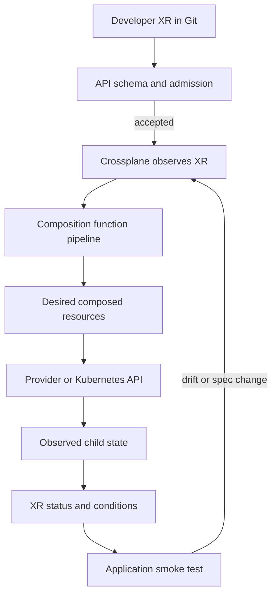
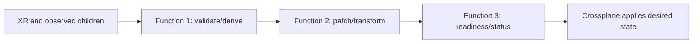
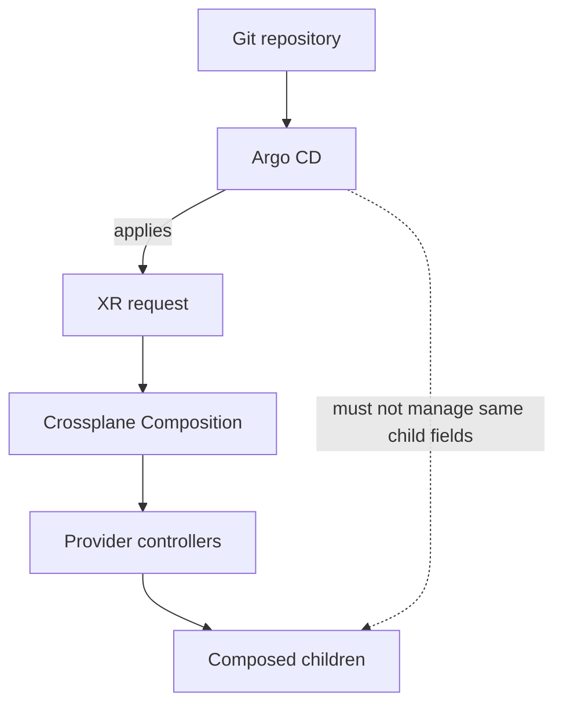
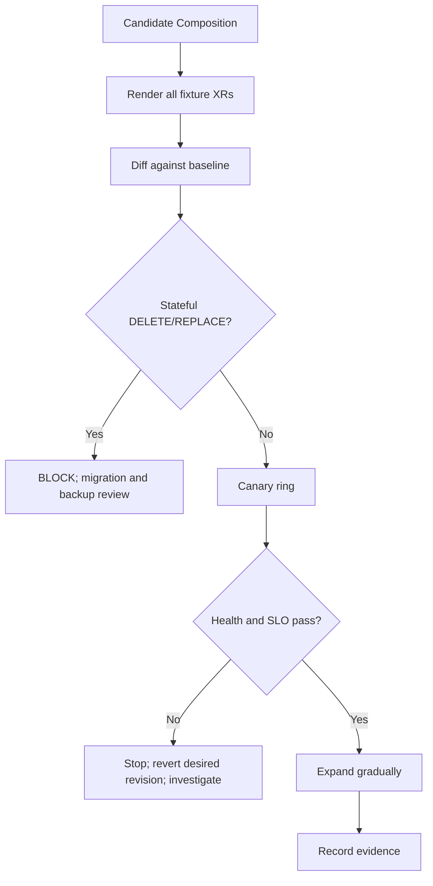

# Platform APIs with Crossplane Compositions

A platform API turns a repeated infrastructure or runtime need into a small, validated request. Crossplane can reconcile that request into Kubernetes and infrastructure resources, but it is not automatically the right solution for every platform problem. The design challenge is to expose a useful interface without exposing unsafe implementation details, and to test every change before it affects existing workloads.

> **Handoff from M07 Unit 12:** M07 Unit 12 taught Crossplane as Kubernetes-native infrastructure: providers, managed resources, `ProviderConfig`s and credentials, XRDs and Compositions (at the level of a first abstraction), claims, reconciliation and deletion semantics (`Delete` vs `Orphan`), and the Crossplane-vs-Terraform decision framework. This unit does **not** repeat that. It teaches **designing, testing, versioning, and operating platform APIs** built with Crossplane — a developer-facing API that encodes guardrails and defaults — including composition functions, API lifecycle and migration, RBAC and tenancy, GitOps integration, failure modes, and alternatives.

**Audience:** data/AI engineers who know Kubernetes and infrastructure automation but are new to stable developer-facing platform APIs. **Estimated effort:** 36–50 hours, depending on optional labs. **API group:** `platform.example.org` (**[ILLUSTRATIVE]**). Synthetic teams: `analytics`, `ml-research`, `risk-platform`.

## Handoff, Scope, and Learning Outcomes

### Scope and prerequisites

This unit integrates M01–M15 rather than re-teaching them. The roadmap confirms M07 Unit 12 at [12-crossplane-and-kubernetes-native-infrastructure.md](../07-Advanced-Infrastructure-as-Code-and-Cloud-Operations/12-crossplane-and-kubernetes-native-infrastructure.md). M16 Unit 2 owns [golden-path design](02-golden-paths-templates-and-paved-roads.md); Unit 3 [self-service provisioning](03-self-service-infrastructure-and-environment-provisioning.md); Unit 4 [catalog/portal](04-developer-portals-and-backstage-service-catalog.md); Unit 5 [scaffolding](05-scaffolding-and-software-templates.md); Unit 7 [tenancy/onboarding/offboarding](07-multi-tenancy-isolation-and-tenant-onboarding.md); Unit 8 [SLO/adoption/DX](08-platform-slos-adoption-metrics-and-developer-experience.md); Unit 9 [governance/deprecation](09-platform-governance-deprecation-and-versioning.md). M03/M04/M05/M06/M08/M09/M10/M11/M12/M13/M14/M15 supply Kubernetes, networking, data services, packaging, GitOps, identity/secrets, SRE, observability, policy/supply-chain, recovery, fleet and FinOps controls.

The generated [M07 Unit 12 lesson](../07-Advanced-Infrastructure-as-Code-and-Cloud-Operations/12-crossplane-and-kubernetes-native-infrastructure.md) already walks through a starter `DataEnvironment` with owner/environment/quota fields and a provider-kubernetes `Object` wrapper. Treat that as a foundational, single-lab demonstration, not a production multi-tenant API contract. Unit 6 evolves the same synthetic `platform.example.org` API family: it uses the Unit 3 `analytics`/`ml-research` entitlement identities, Unit 4's normalized `ownership/teams.json` projection, the Unit 2 `team`/`service`/`env`/`cost-center`/`tier` label contract, and Crossplane v2 direct composition with explicit controller RBAC. It focuses on API design, evolution, blast radius and operations rather than repeating provider installation or the first XRD walkthrough.

A `DataEnvironment` composition may create a namespace and guardrails; that is not the complete isolation programme in Unit 7. `catalog-info.yaml` is a Unit 4 integration point. A platform API may consume a Unit 2 chart and Unit 5 template; it does not replace them.

### Learning outcomes

By completion, you should be able to:
1. Explain a platform API as a small, declarative, validated, versioned contract.
2. Decide between continuous control-plane reconciliation and reviewed PR/pipeline workflows.
3. Design schemas with defaults, enums, descriptions, validation, immutability and progressive disclosure.
4. Design `DataEnvironment`, `PostgresDatabase`, `ObjectBucket` and `ModelEndpoint` APIs with explicit guarantees and limits.
5. Explain XRD, XR, Composition, composition function, provider and managed-resource responsibilities.
6. Test schema, rendered output, function logic, authorization, integration and stateful-resource safety separately.
7. Establish a GitOps ownership boundary: Argo CD owns XR requests; Crossplane owns composed children unless a documented alternative is used.
8. Evolve API versions and Composition revisions with compatibility checks, impact reports and canary rollout.
9. Restrict tenant permissions, provider identity, package sources, references and secret visibility.
10. Operate APIs with meaningful conditions, SLO signals, recovery, cost guardrails and clear ownership.
11. Compare Crossplane with Terraform/OpenTofu, Helm, templates plus GitOps, custom operators and awareness alternatives.
12. Complete all ten labs or document safe render-only alternatives honestly.

### Environment profiles and safety

| Profile | Purpose | Required? | Footprint |
|---|---|---:|---|
| Plat-Core | Source, YAML/JSON fixtures, contract and impact tests | Yes | No cluster |
| Plat+Control | `kind`, Crossplane, cloud-free provider, optional Argo CD and one policy engine | Optional | Potentially heavy on 4 CPU/8 GB/30 GB; measure |
| Plat+Integration | CNPG, MinIO-compatible storage, model-serving chart | Optional | Run separately |

Before Plat+Control, record OS/architecture, disk/RAM/CPU, runtime, kind, Kubernetes, Crossplane CLI/core, provider and function versions. Stop if resource pressure appears. Render/schema-only work is valid but does not prove API-server admission, provider reconciliation, network enforcement, database availability or production readiness.

No cloud account, cloud credentials, paid service or real secret is required. Never use a provider installation example that binds `cluster-admin` as a shortcut. Scope provider identity to exact resources/namespaces; if that cannot be proven, do not install it. Every cluster command must use `--context kind-platform-api-lab`; verify context before use. Do not delete CRDs or clusters until dependent resources and external-resource consequences are understood.

Evidence labels: **[VERIFY]** exact item to check against pinned docs; **[VERSION-SENSITIVE]** behavior differs by version; **[ASSUMPTION]** design assumption; **[ILLUSTRATIVE]** synthetic value; **representative expected output** is not evidence of execution.

## 1. What Is a Platform API?

### 1.1 Contract, not provider-shaped form

A **platform API** is a developer-facing contract for requesting a capability. It includes a Kubernetes custom resource kind, schema, defaults, validation, documentation, ownership, status semantics and implementation. The developer states intent; the platform chooses how to realize it.

```yaml
# File: examples/data-environment.yaml
apiVersion: platform.example.org/v1alpha1
kind: DataEnvironment
metadata:
  name: analytics-dev
spec:
  team: analytics
  environment: dev
  tier: development
  size: small
  ttl: 72h
  needs:
    postgres: false
    objectStorage: true
```

Do not ask developers for provider regions, raw IAM policies, arbitrary Kubernetes manifests, credentials or implementation knobs unless there is a reviewed reason to expose them.

### 1.2 What a good API promises

A good API exposes few validated fields, applies safe defaults, hides implementation details, has a stable version/lifecycle, identifies owners, reports progress/failure, documents guarantees and limits, and provides a migration path. It does not promise that every composed object is a functioning service. Namespace creation is not proof of isolation; a database CR is not proof of connectivity or recoverability.

### 1.3 Abstraction level

| Design | Example | Failure |
|---|---|---|
| Too low | Every provider field, raw manifest and secret reference | Developer must know implementation; unsafe combinations |
| Too high | `makeEverything: true` with hidden behavior | Black box, poor debugging |
| Useful | `tier`, `size`, `backupClass`, immutable model digest | Bounded choices and inspectable implementation |

Use **progressive disclosure**: safe defaults first, advanced fields only when validated, and explicit exceptions governed outside ordinary tenant permissions. Do not add `extraManifests`, `rawYaml`, arbitrary shell commands or unrestricted provider passthrough.

### 1.4 Running API inventory

| API | Developer intent | Hidden implementation | Guardrail | Meaningful status |
|---|---|---|---|---|
| DataEnvironment | Team environment | Namespace, quota, limits, network, RBAC, TTL | Entitlement, tier/size enum, owner | Baseline reconciled; expiry visible |
| PostgresDatabase | Database class | CNPG Cluster, backup, network, Secret reference | Approved tier/retention; no plaintext | Cluster condition and safe Secret ref |
| ObjectBucket | Tenant storage | Bucket/prefix, policy, lifecycle | Classification, tenant scope | Bucket identity/policy, no credentials |
| ModelEndpoint | Serve model | Deployment/Service, scaling, PDB, alerts | Immutable digest, bounded resources | Workload and smoke readiness |

`QueueConsumer`, `FeatureStore`, `TrainingJob`, `Workspace` and `Pipeline` are extension patterns, not automatically implemented APIs.

### 1.5 API versus template

A Unit 5 template generates a repository/configuration at a point in time. A platform API accepts desired state and a controller continuously reconciles it. A template can generate API YAML, but is not the control plane. See [Unit 2](02-golden-paths-templates-and-paved-roads.md), [Unit 3](03-self-service-infrastructure-and-environment-provisioning.md), [Unit 5](05-scaffolding-and-software-templates.md).

**Checkpoint:** distinguish an API field (`spec.size`), a composed resource (`ResourceQuota`) and a ProviderConfig. Which should a product developer usually edit?

## 2. Reconciliation and Control-Plane Versus Pipeline Approaches

### 2.1 Reconciliation

A **control loop** compares desired and observed state and works to reduce the difference. A developer/GitOps controller creates an XR; the API server validates it; Crossplane selects a Composition, calls functions, applies desired children and observes them on later reconciliations.



### 2.2 Reconciliation sequence

1. Submit XR/claim.
2. API server checks schema and admission policy.
3. Crossplane selects applicable Composition/revision.
4. Function steps calculate desired composed resources.
5. Crossplane applies desired children.
6. Providers/Kubernetes controllers reconcile them.
7. Crossplane reports progress; a separate smoke test may still be required.
8. Drift/spec changes trigger later reconciliation.

A function pipeline is not a shell script. Functions operate on structured observed/desired state. Crossplane docs describe functions as gRPC services and pipelines that accumulate desired state. A later function that fails to preserve desired resources can cause them not to be applied or to be removed. Treat function authoring as high impact. [Crossplane Compositions](https://docs.crossplane.io/latest/composition/compositions/)

### 2.3 Control plane versus pipeline

| Dimension | Crossplane | Terraform/OpenTofu PR/pipeline | Templates + GitOps/Helm | Custom operator |
|---|---|---|---|---|
| Interaction | Desired-state API; continuous reconcile | Reviewed plan/apply | Commit desired config | Custom CR/controller |
| Drift | Controller attempts correction | Plan/refresh, pipeline apply | GitOps reconcile | Controller-specific |
| Strength | Kubernetes-native API/status | Explicit review and familiar IaC | Lowest added complexity | Domain-specific behavior |
| Cost | Core, providers, functions, CRDs, upgrades, RBAC | State, runners, credentials, modules | Existing GitOps/template maintenance | Own controller/API/on-call |
| Risk | Composition/provider bug fans out | Stale plan/state/workflow errors | Less expressive lifecycle | Team owns controller forever |

**Decision rule:** start with templates plus GitOps. Graduate to a platform API when repeated demand justifies a continuous Kubernetes-native contract and the team can operate the control plane. Crossplane is not a badge of maturity.

### 2.4 When not to use Crossplane

Do not add Crossplane to wrap one Helm release, replace a working Terraform workflow, create a one-off job or provide an API nobody needs. Short-lived training jobs may fit Kubernetes Jobs and a scheduler better. Databases can fit a declarative API, but only with deliberate backup, deletion, adoption and recovery semantics.

**Exercise:** choose one resource; state user intent, lifecycle, reconciliation need, ownership and why a PR workflow may suffice.

## 3. Crossplane Concepts Recap and Version Preflight

### 3.1 Vocabulary recap from M07 Unit 12

| Term | Meaning |
|---|---|
| CR/CRD | Custom resource / Kubernetes API definition |
| XRD | Crossplane definition of a composite API schema and versions |
| XR | Composite resource representing a composed solution |
| Claim | Legacy Crossplane v1 namespaced handle for cluster-scoped XR; not new v2 model |
| Composition | Template/pipeline defining resources produced for an XR |
| Composition function | Extension calculating desired composed resources |
| Provider | Crossplane package/controller for a resource type/system |
| Managed resource | Provider-defined object representing something managed |
| Composed resource | Child produced/owned by a Composition |
| ProviderConfig | Provider connection/identity configuration; privileged |
| Desired/observed state | Target state / currently observed state |

### 3.2 Version choice and Crossplane v2 scope

**Documentation checked 2026-11-03.** Current official documentation identifies Crossplane v2.4 as the latest documentation line checked at the verification date. Crossplane v2 XRDs use `apiextensions.crossplane.io/v2` with explicit `scope`. Namespaced and cluster-scoped v2 XRs do not use claims. The v1 XRD API remains a backward-compatibility path with `LegacyCluster` behavior and claims. Do not mix models. [Crossplane v2.4 What's New](https://docs.crossplane.io/latest/whats-new/) and [XRD docs](https://docs.crossplane.io/latest/composition/composite-resource-definitions/)

Important design consequence: a **namespaced v2 XR can compose resources only in its own namespace**; it cannot own a cluster-scoped Namespace or a resource in another namespace. Therefore, if `DataEnvironment` must create a Namespace, model it as a **cluster-scoped XR** created by a trusted platform broker/GitOps workflow after entitlement checks. Do not give tenants unrestricted cluster-scoped create rights. For resources wholly inside an existing namespace, prefer namespaced XRs. This is a scope/ownership constraint, not a stylistic preference.

Crossplane v2 makes managed resources namespaced and supports composing ordinary Kubernetes resources directly (with explicit permissions for the Crossplane controller). Provider packages are migrating at different speeds; verify that the selected provider supports namespaced managed resources. Crossplane v2 removes the old native patch-and-transform engine in favor of composition functions, so use the `function-patch-and-transform` package rather than old native Composition patches. The legacy provider-kubernetes `Object` wrapper is not the default for a new v2 design. Crossplane v2 removes the **legacy automatic XR connection-details behavior**, but XRs can still expose connection details by composing an aggregated Kubernetes Secret. `function-patch-and-transform` supports automatic aggregation when composed managed resources publish connection details; other functions can compose a Secret manually. Managed-resource connection details via `writeConnectionSecretToRef` remain provider-specific. Verify the exact function/provider behavior against the selected release. [Crossplane Connection Details Composition](https://docs.crossplane.io/v2.4/guides/connection-details-composition/) [Crossplane v2 What's New](https://docs.crossplane.io/latest/whats-new/)

### 3.3 `versions.txt` preflight

```text
# File: versions.txt
verification_date=2026-11-03
os=<record>
architecture=<record>
container_runtime=<record-and-version>
kind=<recorded-version>
kubernetes=<recorded-version>
crossplane_core=<pinned-v2-version>
crossplane_cli=<recorded-version>
provider_kubernetes=<recorded-version-or-NOT-INSTALLED>
provider_helm=<recorded-version-or-NOT-INSTALLED>
function_patch_and_transform=<recorded-version-or-NOT-INSTALLED>
function_auto_ready=<recorded-version-or-NOT-INSTALLED>
policy_engine=<one-engine-and-version-or-NOT-INSTALLED>
argo_cd=<recorded-version-or-NOT-INSTALLED>
```

| Item | Current documentation observation | Exact verification before use |
|---|---|---|
| XRD | v2 docs show `apiextensions.crossplane.io/v2`, scope Namespaced/Cluster/LegacyCluster | Inspect installed CRD and XRD guide |
| Claims | v2 XRs do not support claims; v1 LegacyCluster is compatibility mode | Keep v1 and v2 examples separate |
| Composition | Docs show `apiextensions.crossplane.io/v1`, `mode: Pipeline` | Confirm CRD/function compatibility |
| CLI render | Current command is `crossplane composition render` | Run pinned CLI `--help`; check Docker/binary prerequisites |
| Revisions | `Automatic` default; `Manual` stops automatic upgrade | Verify `spec.crossplane` fields/revision behavior |
| Native Kubernetes composition | Crossplane v2 can compose Kubernetes resources directly when controller permissions are granted | Prefer direct resources; verify required controller RBAC |
| provider-kubernetes | Official repo describes legacy `Object` wrapper; not default for new v2 APIs | Install only for a specific compatibility/use case; verify package and least-privilege scope |
| provider-helm | Official repo describes `Release`; release page surfaced v1.5.0 | Verify compatibility, API group/version and schema |
| CNPG | CRD/backup config depend on operator release | Inspect installed CRDs and official docs |
| Argo CD health | Version/config dependent | Verify custom health and tracking behavior |
| Policy | One policy engine only | Pin and test schema/behavior |

### 3.4 Install skeleton and safe fallback

Use the current official install guide for the pinned v2 release; the install method is version-sensitive. This cluster creation is a workflow skeleton, not a Crossplane install script:

```bash
# Working directory: unit-6-lab/
kind create cluster --name platform-api-lab --wait 120s
kubectl config get-contexts
kubectl --context kind-platform-api-lab cluster-info
kubectl --context kind-platform-api-lab get nodes -o wide
```

Representative expected output: control plane responds and a Ready node appears. This does not prove Crossplane/provider/function installation. If install is too heavy or compatibility cannot be proven, use Plat-Core fixtures and mark runtime integration OPEN.

### 3.5 CLI note

Current CLI docs use `crossplane composition render <xr> <composition> [functions]`; older content often uses `crossplane render`. Current docs say render runs functions and may use Docker by default; a local binary can be configured. The v2.5 CLI reference also documents `crossplane resource validate` as a **BETA** offline schema-validation command for XRDs, CRDs, providers, functions and rendered resources. Verify exact syntax/cache/download behavior for the pinned CLI. Do not use the older `crossplane beta validate` unless the pinned CLI docs explicitly confirm it. Render/CLI validation is not API-server admission or provider integration. [Cite: Crossplane CLI command reference]

## 4. Designing a Developer-Friendly API Contract

### 4.1 Stable schema

Kubernetes API identity is group/version/kind. The schema defines `spec`; controller status reports observations. Name fields after user intent, not provider internals. Typical fields: `team`, `tier`, `size`, `ttl`, constrained `needs`, `backupClass`, immutable `modelRef` digest. Avoid `providerConfigName`, `adminRole`, `rawManifest`, `privileged`, `disableBackup` and plaintext credentials.

### 4.2 Defaults and enums

Defaults are product decisions. A safe default is supportable, observable and budgeted. If `size: large` exists, the platform needs a quota/capacity mapping and entitlement check. OpenAPI schema handles types/required/enums/ranges. CEL can express cross-field rules/immutability where supported; verify `x-kubernetes-validations` placement and support against installed Kubernetes/XRD CRDs.

### 4.3 Bad and good request

```yaml
# File: examples/bad-api-request.yaml
apiVersion: platform.example.org/v1alpha1
kind: PostgresDatabase
metadata: {name: reporting-db}
spec:
  providerConfig: tenant-selected-credential
  rawManifest: "..."
  adminPassword: "replace-me"
  backupEnabled: false
```

```yaml
# File: examples/postgres-database.yaml
apiVersion: platform.example.org/v1alpha1
kind: PostgresDatabase
metadata:
  name: reporting-db
  namespace: analytics-dev
spec:
  tier: standard
  size: small
  backupClass: daily-7d
  pooler: enabled
```

The latter still needs implementation and policy; YAML alone does not make a database secure.

### 4.4 Immutability

Tenant identity, storage class, encryption domain, model digest and database major version may be unsafe to mutate after provisioning. Mark immutable and provide a migration path. CEL concept (fragment only):

```yaml
# File: examples/cel-rule-fragment.yaml
# [VERIFY] Correct schema node and CEL support for selected XRD/Kubernetes version.
x-kubernetes-validations:
  - rule: "self == oldSelf"
    message: "team is immutable; request a migration instead."
```

Test: create `team: analytics`, patch to `ml-research`, and prove admission rejects before reconciliation.

### 4.5 Progressive disclosure and supported escape hatches

A mature API may have `spec.advanced` for reviewed options that a small subset of users need, but this must not become arbitrary provider passthrough. Each advanced field needs an owner, validation, entitlement, compatibility policy and tests. An escape hatch can be a separate platform-reviewed API kind or an approved GitOps/IaC workflow with the same admission/security guardrails. Mark it best-effort or unsupported only if the support boundary is explicit; do not silently bypass policies.

Example of a constrained advanced field (schema fragment only):

```yaml
# File: examples/advanced-schema-fragment.yaml
# [VERIFY] Exact schema placement and CEL support in the selected XRD CRD.
spec:
  advanced:
    type: object
    properties:
      maintenanceWindow:
        type: string
        enum: [weekday-evening, weekend]
```

### 4.6 API documentation and discoverability

Descriptions in the XRD schema can surface through `kubectl explain` when the generated CRD preserves them. Provide a versioned API reference, examples for each tier, migration notes, support owner, runbook, status/condition guide and changelog. Generate docs from schema where practical, but review the generated result for developer clarity. Link the API docs and examples from the Unit 4 catalog/portal; the portal is a discovery surface, not the source of truth for the API schema.

Working directory: `unit-6-lab/`. After installing the XRD, inspect the exact kind:

```bash
kubectl --context kind-platform-api-lab explain dataenvironment.spec
```

**[VERIFY]** Confirm the generated CRD preserves schema descriptions and that the kind plural/scope is correct. If the cluster is unavailable, generate the reference from the source schema and mark `kubectl explain` as untested.

### 4.7 Design review

- Can developers understand every field?
- Are defaults secure and supportable?
- Are values allow-listed/bounded and owner references trusted?
- Are immutable fields explicit?
- Are secrets referenced, never embedded?
- Is status safe/actionable?
- Are version/lifecycle guarantees documented?
- Can operators inspect underlying resources and recover without granting developer privilege?

**Checkpoint:** replace one provider field with an intent field and explain the mapping.

## 5. Build the DataEnvironment API

### 5.1 Scope decision

The requirement says `DataEnvironment` produces a Namespace and namespace-level controls. Under Crossplane v2, a namespaced XR cannot own a cluster-scoped Namespace. This lesson therefore models `DataEnvironment` as a **cluster-scoped XR**, created by a trusted platform broker/GitOps workflow after entitlement checks. Ordinary tenants do not receive unrestricted cluster-scoped create rights. A separate namespaced workload API can be used after the namespace exists.

The Composition may create a Namespace with protected labels/PSS labels, ResourceQuota, LimitRange, default-deny NetworkPolicy plus explicit DNS/egress, a RoleBinding to an approved group, cost/team/tier/expiry labels, observability metadata and a catalog integration point. Preserve the Unit 2 label contract (`team`, `service`, `env`, `cost-center`, `tier`) and the Unit 4 ownership convention. The team and cost center must come from the controlled ownership registry: Unit 3's `entitlements/teams.yaml` is the entitlement authority; Unit 4's `ownership/teams.json` is its normalized read model. For the synthetic `analytics` team, the catalog fixture uses `CC-SYNTH-ANALYTICS-01` **[ILLUSTRATIVE]**. Do not let the tenant set an arbitrary cost-center label. Additional enforcement is required: CNI must enforce NetworkPolicy; admission/RBAC protects reserved labels; a cleanup controller handles TTL; trusted identity data determines RoleBinding subjects.

### 5.2 Illustrative XRD schema

This is a **v2 XRD shape example**, not a claim that every field has been tested against an installed CRD. Verify XRD v2 schema/CEL support before applying.

```yaml
# File: apis/dataenvironment/definition.yaml
apiVersion: apiextensions.crossplane.io/v2
kind: CompositeResourceDefinition
metadata:
  name: dataenvironments.platform.example.org
spec:
  scope: Cluster
  group: platform.example.org
  names:
    kind: DataEnvironment
    plural: dataenvironments
  defaultCompositionUpdatePolicy: Manual
  versions:
    - name: v1alpha1
      served: true
      referenceable: true
      schema:
        openAPIV3Schema:
          type: object
          description: Approved team data environment request.
          properties:
            spec:
              type: object
              required: [team, environment, tier, size, ttl]
              properties:
                team:
                  type: string
                  minLength: 2
                  maxLength: 32
                  pattern: '^[a-z][a-z0-9-]*$'
                  description: Trusted team identifier from the platform ownership registry.
                environment:
                  type: string
                  enum: [dev, test, staging]
                  description: Approved environment class.
                tier:
                  type: string
                  enum: [development, standard, critical]
                size:
                  type: string
                  enum: [small, medium, large]
                ttl:
                  type: string
                  pattern: '^[0-9]{1,3}h$'
                needs:
                  type: object
                  properties:
                    postgres:
                      type: boolean
                      default: false
                    objectStorage:
                      type: boolean
                      default: false
              x-kubernetes-validations:
                - rule: "self.size != 'large' || self.tier != 'development'"
                  message: "large size is not available for development tier."
            status:
              type: object
              properties:
                namespaceName: {type: string}
                phase: {type: string}
                message: {type: string}
```

**[VERIFY]** Confirm XRD v2 CRD accepts the schema/CEL fragment and `defaultCompositionUpdatePolicy`. Ensure status paths agree with function patches. This is not a complete conversion strategy or full production schema.

### 5.3 XR request

```yaml
# File: examples/dataenvironment-xr.yaml
apiVersion: platform.example.org/v1alpha1
kind: DataEnvironment
metadata:
  name: analytics-dev
spec:
  team: analytics
  environment: dev
  tier: development
  size: small
  ttl: 72h
  needs:
    postgres: false
    objectStorage: true
```

A cluster-scoped XR has no namespace. The Composition derives a namespace name from trusted XR identity. Admission must reject naming collisions and unauthorized team values before children are created.

### 5.4 Composition design and direct Kubernetes resources

Crossplane v2 can compose ordinary Kubernetes resources directly. This avoids wrapping Namespace/Quota/NetworkPolicy in provider-kubernetes `Object`. The Crossplane controller itself must be granted permission to manage the exact kinds required; do not grant wildcard permissions. A composition function pipeline patches XR fields into composed resource objects.

```yaml
# File: apis/dataenvironment/composition.yaml
# [VERIFY] Function package/API and Crossplane controller RBAC for selected release.
apiVersion: apiextensions.crossplane.io/v1
kind: Composition
metadata:
  name: dataenvironment-platform-v1
  labels:
    platform.example.org/api: dataenvironment
    platform.example.org/ring: canary
spec:
  compositeTypeRef:
    apiVersion: platform.example.org/v1alpha1
    kind: DataEnvironment
  mode: Pipeline
  pipeline:
    - step: create-baseline
      functionRef:
        name: function-patch-and-transform
      input:
        apiVersion: pt.fn.crossplane.io/v1beta1
        kind: Resources
        resources:
          - name: namespace
            base:
              apiVersion: v1
              kind: Namespace
              metadata:
                name: placeholder
                annotations:
                  platform.example.org/ttl: placeholder
                  platform.example.org/catalog-entity: component:default/data-environment
                  observability.platform.example.org/team-scope: placeholder
                labels:
                  pod-security.kubernetes.io/enforce: restricted
                  platform.example.org/managed-by: crossplane
                  team: placeholder
                  service: data-environment
                  env: placeholder
                  cost-center: RESOLVE_FROM_TRUSTED_REGISTRY
                  tier: placeholder
                  platform.example.org/priority-class: batch-standard
            patches:
              - type: FromCompositeFieldPath
                fromFieldPath: metadata.name
                toFieldPath: metadata.name
              - type: FromCompositeFieldPath
                fromFieldPath: spec.team
                toFieldPath: metadata.labels[team]
              - type: FromCompositeFieldPath
                fromFieldPath: spec.environment
                toFieldPath: metadata.labels[env]
              - type: FromCompositeFieldPath
                fromFieldPath: spec.tier
                toFieldPath: metadata.labels[tier]
              - type: FromCompositeFieldPath
                fromFieldPath: spec.ttl
                toFieldPath: metadata.annotations[platform.example.org/ttl]
              # Cost center and Kubernetes Group subject are resolved by the
              # trusted ownership lookup function described below, never from XR input.
          - name: quota
            base:
              apiVersion: v1
              kind: ResourceQuota
              metadata:
                name: compute-quota
                namespace: placeholder
              spec:
                hard:
                  requests.cpu: "2"
                  requests.memory: 4Gi
                  limits.cpu: "4"
                  limits.memory: 8Gi
            patches:
              - type: FromCompositeFieldPath
                fromFieldPath: metadata.name
                toFieldPath: metadata.namespace
              - type: FromCompositeFieldPath
                fromFieldPath: spec.size
                toFieldPath: spec.hard.requests.cpu
                transforms:
                  - type: map
                    map: {small: "2", medium: "4", large: "8"}
              - type: FromCompositeFieldPath
                fromFieldPath: spec.size
                toFieldPath: spec.hard.requests.memory
                transforms:
                  - type: map
                    map: {small: 4Gi, medium: 8Gi, large: 16Gi}
              - type: FromCompositeFieldPath
                fromFieldPath: spec.size
                toFieldPath: spec.hard.limits.cpu
                transforms:
                  - type: map
                    map: {small: "4", medium: "8", large: "16"}
              - type: FromCompositeFieldPath
                fromFieldPath: spec.size
                toFieldPath: spec.hard.limits.memory
                transforms:
                  - type: map
                    map: {small: 8Gi, medium: 16Gi, large: 32Gi}
```

This is a representative function input; verify the exact `function-patch-and-transform` package version, map transform and patch path syntax. The snippet maps requests only; add corresponding bounded CPU/memory limits and ensure tier entitlements reject unsupported combinations. A static small-only quota must not be advertised for medium/large requests. The Crossplane controller must have narrowly scoped RBAC for Namespace, ResourceQuota, LimitRange, NetworkPolicy and RoleBinding because these children are included in this design. Namespaced resources must use the derived namespace consistently. The `metadata.labels[...]` map-key path is function-sensitive and must be tested with render plus schema validation.

The placeholder `cost-center: RESOLVE_FROM_TRUSTED_REGISTRY` must be replaced by a trusted lookup step, not user input. A production pipeline may include a platform-owned function (for example, a locally authored function named `function-ownership-lookup` **[ILLUSTRATIVE]**) that resolves `spec.team` against the controlled ownership registry (`entitlements/teams.yaml` and its Unit 4 projection `ownership/teams.json`) and returns the cost-center/group mapping. It must fail closed for an unknown team and must not accept a caller-supplied cost center. The function package/API and data-loading mechanism are implementation-specific and must be tested.

Add separate child entries for LimitRange, default-deny NetworkPolicy, approved DNS/egress policy, RoleBinding, TTL metadata, observability scoping and catalog registration metadata. Map a workload `priorityClassName` only to an approved PriorityClass already managed by the platform; do not let tenants create or select arbitrary cluster-scoped PriorityClasses. Propagate team/environment/tier/cost-center labels consistently. Stable composition-resource names are part of the lifecycle contract: renaming one can cause deletion/recreation. Keep all children deterministic and reviewable.

**Where provider-kubernetes fits:** its `Object` wrapper is useful for legacy Crossplane v1/provider workflows or a specific compatibility case, but Crossplane v2's direct composition model often removes the need for it. If used, inspect its CRD, package compatibility and RBAC; never expose arbitrary Object creation to tenants. This is an optional API shape reference, not used by the v2 core composition:

```yaml
# File: examples/legacy-provider-kubernetes-object-reference.yaml
# [VERSION-SENSITIVE] Legacy/optional Object wrapper, not the v2 default.
apiVersion: kubernetes.m.crossplane.io/v1alpha1
kind: Object
metadata:
  name: example-object-wrapper
  namespace: crossplane-system
spec:
  forProvider:
    manifest:
      apiVersion: v1
      kind: ConfigMap
      metadata:
        name: platform-example
        namespace: analytics-dev
      data:
        purpose: legacy-provider-object-reference
```

Do not apply this wrapper until package version, namespace model, ProviderConfig and ServiceAccount permissions are verified. The native v2 composition path does not require it.

### 5.4.1 Child-resource baselines and ownership mapping

The following are the concrete Kubernetes child bases that the Composition pipeline should include in addition to Namespace and ResourceQuota. The namespace value is a placeholder patched from the XR name. `dataenvironment-developer` is a pre-created, reviewed Role managed by the platform baseline; the Composition only binds it. The DNS selector is cluster-dependent and must be checked against the actual kube-dns/CoreDNS labels before apply.

```yaml
# File: apis/dataenvironment/children.yaml
# Multi-document base fixture; patch namespace/subjects using trusted function output.
apiVersion: v1
kind: LimitRange
metadata:
  name: default-container-limits
  namespace: placeholder
spec:
  limits:
    - type: Container
      defaultRequest:
        cpu: 100m
        memory: 128Mi
      default:
        cpu: 500m
        memory: 512Mi
---
apiVersion: networking.k8s.io/v1
kind: NetworkPolicy
metadata:
  name: default-deny
  namespace: placeholder
spec:
  podSelector: {}
  policyTypes: [Ingress, Egress]
---
apiVersion: networking.k8s.io/v1
kind: NetworkPolicy
metadata:
  name: allow-dns-egress
  namespace: placeholder
spec:
  podSelector: {}
  policyTypes: [Egress]
  egress:
    - to:
        - namespaceSelector:
            matchLabels:
              kubernetes.io/metadata.name: kube-system
          podSelector:
            matchLabels:
              k8s-app: kube-dns
      ports:
        - protocol: UDP
          port: 53
        - protocol: TCP
          port: 53
---
apiVersion: rbac.authorization.k8s.io/v1
kind: RoleBinding
metadata:
  name: dataenvironment-developer
  namespace: placeholder
subjects:
  - kind: Group
    name: platform:team:analytics
    apiGroup: rbac.authorization.k8s.io
roleRef:
  kind: Role
  name: dataenvironment-developer
  apiGroup: rbac.authorization.k8s.io
```

The Group subject above is synthetic. Resolve it from the trusted ownership projection, not a tenant-controlled field. A local projection consistent with Unit 4 is:

```json
{
  "group:default/analytics": {
    "kubernetes_group": "platform:team:analytics",
    "cost_center": "CC-SYNTH-ANALYTICS-01"
  },
  "group:default/ml-research": {
    "kubernetes_group": "platform:team:ml-research",
    "cost_center": "CC-SYNTH-ML-01"
  }
}
```

**File:** `ownership/teams.json` (normalized Unit 4 read model, derived from Unit 3 `entitlements/teams.yaml`; it is not a second entitlement authority). The custom ownership lookup function must fail closed for unknown groups, return the approved Kubernetes Group and cost center, and must not accept caller-provided cost-center values. The policy/controller must also protect reserved labels/annotations from tenant mutation. The NetworkPolicy DNS label selector is **[VERIFY]**; if it does not match the local DNS pods, DNS will fail. Add only explicitly approved application egress; do not weaken default-deny to make a test pass.

### 5.4.2 Crossplane controller RBAC for direct composition

Crossplane v2 uses its own ServiceAccount to create composed resources. For resources installed by providers or defined by XRDs, the RBAC manager grants access by default. For other Kubernetes resource kinds (Namespace, ResourceQuota, LimitRange, NetworkPolicy, RoleBinding), create a `ClusterRole` aggregated to Crossplane's primary ClusterRole using the documented label `rbac.crossplane.io/aggregate-to-crossplane: "true"`. A direct ClusterRoleBinding to a guessed ServiceAccount is not the recommended aggregation pattern. [Crossplane Compositions — Grant access to composed resources](https://docs.crossplane.io/latest/composition/compositions/)

The following is a least-privilege starting point, not a universal install manifest. **[VERIFY]** the Crossplane release, RBAC manager setting, API resources, required verbs and admission controls. Do not add wildcards, `pods/exec`, `clusterroles`, CRDs or Secret read/list permissions for convenience.

```yaml
# File: security/crossplane-composition-rbac.yaml
# [VERIFY] API resource names and required verbs for pinned Crossplane release.
apiVersion: rbac.authorization.k8s.io/v1
kind: ClusterRole
metadata:
  name: crossplane-dataenvironment-composer
  labels:
    rbac.crossplane.io/aggregate-to-crossplane: "true"
rules:
  - apiGroups: [""]
    resources: ["namespaces"]
    verbs: ["get", "list", "watch", "create", "patch", "update", "delete"]
  - apiGroups: [""]
    resources: ["resourcequotas", "limitranges"]
    verbs: ["get", "list", "watch", "create", "patch", "update", "delete"]
  - apiGroups: ["networking.k8s.io"]
    resources: ["networkpolicies"]
    verbs: ["get", "list", "watch", "create", "patch", "update", "delete"]
  - apiGroups: ["rbac.authorization.k8s.io"]
    resources: ["rolebindings"]
    verbs: ["get", "list", "watch", "create", "patch", "update", "delete"]
  - apiGroups: ["rbac.authorization.k8s.io"]
    resources: ["roles"]
    resourceNames: ["dataenvironment-developer"]
    verbs: ["get", "bind"]
---
# Separate grant for CNPG direct composition. Install only if the CNPG CRDs exist.
apiVersion: rbac.authorization.k8s.io/v1
kind: ClusterRole
metadata:
  name: crossplane-cnpg-composer
  labels:
    rbac.crossplane.io/aggregate-to-crossplane: "true"
rules:
  - apiGroups: ["postgresql.cnpg.io"]
    resources: ["clusters", "scheduledbackups"]
    verbs: ["get", "list", "watch", "create", "patch", "update", "delete"]
```

These permissions are still powerful: the first can create Namespaces and bind one named Role; the second can create/update/delete CNPG resources across namespaces. Add admission rules that constrain namespace names/labels, RoleBinding subjects, Role references, database tiers and backup policy. Review whether `delete` is truly needed; if the selected lifecycle does not require composition-driven deletion, remove it and test finalization. A separate platform broker may create the Namespace and leave Crossplane managing only namespaced resources, reducing the controller's cluster-scope privileges.

The Crossplane v2 RBAC manager is enabled by default in documented installations and aggregates provider/XRD permissions; if disabled, additional access requirements change. Verify the installed manager and aggregation behavior. Never guess the Crossplane ServiceAccount name or bind an unreviewed ClusterRole directly to it.

### 5.5 Guardrail responsibility matrix

| Guarantee | Composition can create/configure | Additional enforcement |
|---|---|---|
| Namespace labels | Yes | Protect reserved labels from tenant mutation |
| Quota/LimitRange | Yes | Cover all relevant resource dimensions |
| NetworkPolicy | Yes | CNI enforcement and benign traffic test |
| DNS/egress | Yes | Validate allow rules against workload needs |
| RBAC | Yes | Trusted group mapping; prevent privilege escalation |
| PSS labels | Yes | Admission must enforce restricted policy |
| TTL | Annotation/field | Cleanup controller, grace period and retention review |
| Catalog metadata | Link/annotation | Unit 4 catalog validation and trusted registration |
| Cost ownership | Labels | Cost pipeline ingests labels and flags missing owners |

### 5.6 Validation sequence

1. Validate XR against generated CRD schema.
2. Validate CEL and cross-field combinations.
3. Render Composition and functions.
4. Inspect every child name, namespace, label and security field.
5. Test invalid size, owner, tier and label override.
6. Apply only after provider RBAC/admission review.
7. Verify Namespace, quota, limits, policy and RoleBinding.
8. Test permitted and forbidden traffic; object existence does not prove policy enforcement.

**Developer viewpoint:** request a documented environment and know how to verify it. Do not receive cluster-admin or an unsupported promise that application dependencies are ready.

## 6. Composition Techniques and Functions

### 6.1 Patch-and-transform

Patch-and-transform maps XR fields into composed resources. It suits simple field mapping, naming, labels and small transforms. A `mode: Pipeline` Composition calls a function through `functionRef`; its input has its own API/kind. Current docs show `pt.fn.crossplane.io/v1beta1` `Resources` input and examples such as `FromCompositeFieldPath`. Verify transform types, patch policies and field-path syntax against the selected function package. [Crossplane Compositions](https://docs.crossplane.io/latest/composition/compositions/)

Typical mappings: XR → child (team, tier, size, model digest); child → XR status (safe endpoint/readiness summary); avoid unnecessary child-to-child coupling.

### 6.2 Function pipeline

A function receives observed state, desired state, input and pipeline context. Functions can be chained; later steps receive accumulated desired state. If a later function omits a resource it received, that resource may not be in the final desired state and could be removed. Test this in a render fixture, never on valuable resources.



Use functions for complex conditions, loops, policy-driven generation or reusable logic only when maintenance/supply-chain cost is justified. Current Crossplane documentation describes YAML patch/transform and function ecosystems using Go, Python, CUE, KCL and templates; package availability/maturity varies. Pin and verify packages; do not assume every implementation is first-party or production-supported.

### 6.3 Function contract and testing

For each function document inputs/schema, required resources/permissions, deterministic output, fields it owns/preserves, failure/timeout behavior, readiness/status, secret handling, package digest/upgrade and unit/golden/negative/compatibility tests. Do not use unpinned tags in production, fetch arbitrary network resources from tenant input or log entire observed objects that may contain sensitive fields.

### 6.4 Readiness checks

A Deployment object is not proof model weights loaded, probes pass, Service endpoints exist or prediction succeeds. A database Cluster condition is not proof an application identity can connect or a backup can restore. Separate: (1) API accepted; (2) Composition applied; (3) infrastructure ready; (4) workload ready; (5) service usable through bounded smoke test. Exact Crossplane conditions/readiness semantics are version-sensitive.

### 6.4.1 Function package pin and trust

The Crossplane v2.4 connection-details guide currently demonstrates `function-patch-and-transform:v0.10.0`. Treat this as a documentation example, not an eternal version recommendation; check compatibility with the selected Crossplane core and pin an immutable package digest where the registry/package format supports it.

```yaml
# File: functions.yaml
apiVersion: pkg.crossplane.io/v1
kind: Function
metadata:
  name: function-patch-and-transform
spec:
  package: xpkg.crossplane.io/crossplane-contrib/function-patch-and-transform:v0.10.0
```

Before applying, verify the package exists, its digest/signature/provenance, Crossplane compatibility, permissions and changelog. Do not install a floating `latest` tag. `function-auto-ready` and any custom ownership/model-validation function need their own pinned package, schema and tests; this lesson does not claim those packages are installed.

**Checkpoint:** a later function omits a quota from desired state. Why should a render test catch that before apply?

## 7. Build the PostgresDatabase API

### 7.1 Contract

`PostgresDatabase` requests a database service, not a raw CNPG chart. Synthetic fields: `tier`, `size`, `backupClass`, `pooler`, and named application namespace/identity references. Never ask for a user-supplied CIDR, password, raw provider field or backup credential. The platform maps to CNPG `Cluster`, optional `ScheduledBackup`, NetworkPolicy, Service and Secret reference. Verify CNPG APIs/backup config against the installed operator version.

### 7.2 Request example

```yaml
# File: examples/postgres-database.yaml
apiVersion: platform.example.org/v1alpha1
kind: PostgresDatabase
metadata:
  name: scoring-postgres
  namespace: analytics-dev
spec:
  tier: standard
  size: small
  backupClass: daily-7d
  pooler: enabled
```

This is a namespaced XR in an existing tenant namespace; it does not expose ProviderConfig or credentials.

### 7.3 CNPG render pattern

Installing the CNPG operator is a platform prerequisite; creating a Cluster is a tenant resource. Do not install a second operator per database unless intentional.

```yaml
# File: examples/cnpg-cluster-manifest.yaml
# Render fixture only. [VERIFY] apiVersion, spec and backup config for selected CNPG release.
apiVersion: postgresql.cnpg.io/v1
kind: Cluster
metadata:
  name: scoring-postgres
  namespace: analytics-dev
  labels:
    platform.example.org/team: analytics
    platform.example.org/data-class: internal
spec:
  instances: 2
  storage:
    size: 10Gi
  backup:
    # Configure approved object-store destination/credentials per CNPG docs.
    # Never inline credentials; this is not a complete backup schedule.
    retentionPolicy: "7d"
```

This is not guaranteed valid for every CNPG release. A retention field alone does not prove a working backup schedule; object-store destination, credentials and schedule must be configured as documented.

### 7.4 PostgresDatabase schema and composition contract

A namespaced XRD can be used for this API because its composed resources (CNPG Cluster, backup object, NetworkPolicy and Secret reference) remain in the same tenant namespace. The following schema is abbreviated but internally aligned to the request above; expand descriptions/status and validate the exact v2 CRD schema before use.

```yaml
# File: apis/postgres/definition.yaml
# [VERIFY] Validate schema and scope with installed Crossplane v2 CRD.
apiVersion: apiextensions.crossplane.io/v2
kind: CompositeResourceDefinition
metadata:
  name: postgresdatabases.platform.example.org
spec:
  scope: Namespaced
  group: platform.example.org
  names:
    kind: PostgresDatabase
    plural: postgresdatabases
  versions:
    - name: v1alpha1
      served: true
      referenceable: true
      schema:
        openAPIV3Schema:
          type: object
          properties:
            spec:
              type: object
              required: [tier, size, backupClass]
              properties:
                tier:
                  type: string
                  enum: [development, standard, critical]
                size:
                  type: string
                  enum: [small, medium, large]
                backupClass:
                  type: string
                  enum: [daily-7d, daily-30d]
                writeConnectionSecretToRef:
                  type: object
                  description: Optional name for the aggregated connection Secret; never stores credentials.
                  properties:
                    name:
                      type: string
                      minLength: 1
                pooler:
                  type: string
                  enum: [enabled, disabled]
            status:
              type: object
              properties:
                phase: {type: string}
                connectionSecretRef:
                  type: object
                  properties:
                    name: {type: string}
                    namespace: {type: string}
```

The preferred Crossplane v2 path is to compose the CNPG custom resources directly in the XR namespace, provided Crossplane has the narrowly scoped RBAC to create those CNPG kinds. Installing CNPG is a platform prerequisite; creating each Cluster/ScheduledBackup is a tenant resource. Do not install an operator per database.

```yaml
# File: apis/postgres/composition-outline.yaml
# [VERIFY] CNPG apiVersions/spec fields and Crossplane controller RBAC for selected releases.
apiVersion: apiextensions.crossplane.io/v1
kind: Composition
metadata:
  name: postgresdatabase-cnpg-v1
spec:
  compositeTypeRef:
    apiVersion: platform.example.org/v1alpha1
    kind: PostgresDatabase
  mode: Pipeline
  pipeline:
    - step: render-cnpg-resources
      functionRef:
        name: function-patch-and-transform
      input:
        apiVersion: pt.fn.crossplane.io/v1beta1
        kind: Resources
        resources:
          - name: cnpg-cluster
            base:
              apiVersion: postgresql.cnpg.io/v1
              kind: Cluster
              metadata:
                name: placeholder
                namespace: placeholder
                labels:
                  team: analytics
                  service: scoring-postgres
                  env: dev
                  cost-center: CC-SYNTH-ANALYTICS-01
                  tier: standard
              spec:
                instances: 2
                storage:
                  size: 10Gi
            patches:
              - type: FromCompositeFieldPath
                fromFieldPath: metadata.name
                toFieldPath: metadata.name
              - type: FromCompositeFieldPath
                fromFieldPath: metadata.namespace
                toFieldPath: metadata.namespace
          - name: scheduled-backup
            # [VERIFY] Confirm ScheduledBackup API/spec against installed CNPG CRDs.
            base:
              apiVersion: postgresql.cnpg.io/v1
              kind: ScheduledBackup
              metadata:
                name: placeholder
                namespace: placeholder
              spec:
                schedule: "0 0 0 * * *"
                backupOwnerReference: cluster
            patches:
              - type: FromCompositeFieldPath
                fromFieldPath: metadata.name
                toFieldPath: metadata.name
              - type: FromCompositeFieldPath
                fromFieldPath: metadata.namespace
                toFieldPath: metadata.namespace
          - name: network-policy
            # [VERIFY] Use a complete, reviewed policy selecting only the DB pods.
            base:
              apiVersion: networking.k8s.io/v1
              kind: NetworkPolicy
              metadata:
                name: database-ingress
                namespace: placeholder
              spec:
                podSelector:
                  matchLabels:
                    cnpg.io/cluster: placeholder
                policyTypes: [Ingress]
                ingress: []
            patches:
              - type: FromCompositeFieldPath
                fromFieldPath: metadata.namespace
                toFieldPath: metadata.namespace
```

This is a composition outline: it still needs validated patches for size/tier/backup class, a CNPG `ScheduledBackup` child with the exact schedule/retention fields, and the complete approved NetworkPolicy. Verify the CNPG pod label selector and add only the intended application client ingress rule; the empty ingress list deliberately denies all ingress until that rule is specified. CNPG API fields and backup configuration are version-sensitive. Do not treat the example as a complete backup implementation. Direct composition requires Crossplane controller RBAC for `postgresql.cnpg.io` resources; provider-kubernetes Object is a legacy/optional alternative, not the default v2 route.

### 7.4 Secret boundary and integration proof

XR status may expose a safe `connectionSecretRef` name/namespace if supported. Never expose password, credential-bearing connection URL, private key or Secret data. Grant Secret read only to intended workload identity; use M09 secret patterns and rotation.

A genuine integration proof requires: apply API/operator; create request; wait boundedly for Cluster readiness; connect using intended identity; verify backup exists in destination; restore into a separate disposable database; test deletion/retention only on disposable data. In v2, prefer direct composition of CNPG custom resources if the installed CRDs and controller RBAC support it; use provider-kubernetes Object only for a verified legacy/compatibility route. Render or `Ready` alone is insufficient.

## 8. Build the ObjectBucket API

### 8.1 Intent and boundary

`ObjectBucket` requests tenant-scoped storage with data classification and lifecycle policy. Inputs may include bounded `dataClass`, `retentionClass`, versioning preference and tenant identity derived from trusted namespace/identity. Do not allow arbitrary bucket policy JSON, cross-tenant prefix, account, endpoint or credentials.

### 8.2 Implementation choices

Possible paths: a dedicated object-storage provider (verify that a maintained provider exists and supports the selected Crossplane release); a controlled Kubernetes Job with a scoped service account; or a platform service outside Crossplane. The syllabus mentions MinIO-style local implementation but warns against inventing a provider. This lesson does not claim `provider-minio` exists or is supported. Prefer contract/policy simulation or optional MinIO run separately. A Job must not accept raw shell commands or arbitrary endpoint URLs from XR input.

### 8.3 Request and mapping

```yaml
# File: examples/object-bucket.yaml
apiVersion: platform.example.org/v1alpha1
kind: ObjectBucket
metadata:
  name: feature-artifacts
  namespace: analytics-dev
spec:
  dataClass: internal
  retentionClass: standard-30d
  versioning: enabled
```

| Field | Mapping | Guardrail |
|---|---|---|
| dataClass | Bucket/prefix policy and encryption class | Enum; higher classification cannot weaken controls |
| retentionClass | Lifecycle/retention config | Approved values; legal hold is separate workflow |
| versioning | Versioning setting | Required for classes whose recovery policy mandates it |
| tenant | Prefix/bucket ownership | Derived from trusted namespace/identity |

### 8.4 Deletion and retention

Object versions, retention locks and replication make deletion complex. Separate decommission request, export/retention review and final deletion. Crossplane `Orphan` is not a complete data-retention or DR plan.

**Checkpoint:** what if a tenant sets `dataClass: public` for regulated data? Which trusted source determines classification?

## 9. Build the ModelEndpoint API

### 9.1 Contract

Expose registry URI plus immutable digest, model card/registry link, bounded tier/replica range, approved resource profile/GPU entitlement, runtime/chart version and SLO intent. Platform output may include Deployment/Rollout, Service, HPA/KEDA ScaledObject, PDB, dashboard/alert references and SLO configuration. Actual output depends on Unit 2 chart and installed scaling components.

### 9.2 Request example

```yaml
# File: examples/model-endpoint.yaml
apiVersion: platform.example.org/v1alpha1
kind: ModelEndpoint
metadata:
  name: fraud-model-endpoint
  namespace: ml-research
spec:
  model:
    registry: registry.example.invalid/models/fraud-model-v3
    digest: sha256:aaaaaaaaaaaaaaaaaaaaaaaaaaaaaaaaaaaaaaaaaaaaaaaaaaaaaaaaaaaaaaaa
    modelCard: https://docs.example.invalid/models/fraud-model-v3
  tier: standard
  scaling:
    minReplicas: 1
    maxReplicas: 3
    targetConcurrency: 20
```

All values are synthetic; `.invalid` is intentionally non-routable. Verify real digest against trusted registry/provenance policy.

### 9.3 Outputs and readiness

| Output | Purpose | Verification |
|---|---|---|
| Deployment/Rollout | Run approved inference runtime | Digest, security context, rollout |
| Service | Stable endpoint | Endpoints route to Ready pods |
| HPA/KEDA | Bounded scaling | Min/max and metrics source |
| PDB | Voluntary disruption budget | Selector matches workload |
| Dashboard/alerts | Operational visibility | Links resolve; rules tested |
| SLO config | Availability/latency/error budget | Service owner and Unit 8 method |
| Model card/registry | Provenance/intended use | Trusted source; digest matches |

Do not set usable readiness solely because a Deployment exists. Include image pull, model load, application probe, Service endpoints and bounded prediction smoke. The smoke test may belong in delivery verification, not Crossplane.

### 9.4 ModelEndpoint Composition outline

The preferred v2 approach can compose Kubernetes resources directly. The platform may use the Unit 2 chart as a source of reviewed manifests, or provider-helm `Release` only after confirming that the pinned provider supports the selected Crossplane v2 model. Do not assume provider-helm's current release supports namespaced MRs without checking its compatibility matrix.

```yaml
# File: apis/modelendpoint/composition-outline.yaml
# [VERIFY] Function package, Crossplane v2 composition schema, and chart/provider compatibility.
apiVersion: apiextensions.crossplane.io/v1
kind: Composition
metadata:
  name: modelendpoint-serving-v1
spec:
  compositeTypeRef:
    apiVersion: platform.example.org/v1alpha1
    kind: ModelEndpoint
  mode: Pipeline
  pipeline:
    - step: compose-serving-resources
      functionRef:
        name: function-patch-and-transform
      input:
        apiVersion: pt.fn.crossplane.io/v1beta1
        kind: Resources
        resources:
          - name: serving-deployment
            base:
              apiVersion: apps/v1
              kind: Deployment
              metadata:
                name: placeholder
                namespace: placeholder
                labels:
                  team: ml-research
                  service: fraud-model-endpoint
                  env: dev
                  cost-center: CC-SYNTH-ML-01
                  tier: standard
              spec:
                replicas: 1
                selector:
                  matchLabels:
                    app.kubernetes.io/name: model-endpoint
                    platform.example.org/endpoint: placeholder
                template:
                  metadata:
                    labels:
                      app.kubernetes.io/name: model-endpoint
                      platform.example.org/endpoint: placeholder
                  spec:
                    containers:
                      - name: inference
                        image: registry.example.invalid/inference@sha256:aaaaaaaaaaaaaaaaaaaaaaaaaaaaaaaaaaaaaaaaaaaaaaaaaaaaaaaaaaaaaaaa
                        ports:
                          - name: http
                            containerPort: 8080
                        resources:
                          requests: {cpu: "250m", memory: "512Mi"}
                          limits: {cpu: "1", memory: "2Gi"}
            patches:
              - type: FromCompositeFieldPath
                fromFieldPath: metadata.name
                toFieldPath: metadata.name
              - type: FromCompositeFieldPath
                fromFieldPath: metadata.namespace
                toFieldPath: metadata.namespace
              - type: FromCompositeFieldPath
                fromFieldPath: metadata.name
                toFieldPath: spec.selector.matchLabels[platform.example.org/endpoint]
              - type: FromCompositeFieldPath
                fromFieldPath: metadata.name
                toFieldPath: spec.template.metadata.labels[platform.example.org/endpoint]
          - name: serving-service
            base:
              apiVersion: v1
              kind: Service
              metadata:
                name: placeholder
                namespace: placeholder
                labels:
                  team: ml-research
                  service: fraud-model-endpoint
                  env: dev
                  cost-center: CC-SYNTH-ML-01
                  tier: standard
              spec:
                selector:
                  app.kubernetes.io/name: model-endpoint
                  platform.example.org/endpoint: placeholder
                ports:
                  - name: http
                    port: 80
                    targetPort: http
            patches:
              - type: FromCompositeFieldPath
                fromFieldPath: metadata.name
                toFieldPath: metadata.name
              - type: FromCompositeFieldPath
                fromFieldPath: metadata.namespace
                toFieldPath: metadata.namespace
              - type: FromCompositeFieldPath
                fromFieldPath: metadata.name
                toFieldPath: spec.selector[platform.example.org/endpoint]
```

This outline demonstrates Deployment/Service composition only. Complete it with a tested function that validates the approved registry and derives the final `registry@sha256:digest` image reference, bounded replicas, HPA/KEDA, PDB, model-card/catalog links, dashboard/alert/SLO references and a readiness/smoke strategy. The function must not invoke a shell or fetch arbitrary URLs. The base image above is a synthetic placeholder, not a dynamic concatenation of the XR fields. The example image digest is synthetic and must not be pulled. A trusted function must derive and validate the final `registry@digest` reference from the XR fields and patch it into the Deployment; the static image shown is a fixture placeholder. The resource selector/labels must be unique per XR; the Deployment and Service selector patches must match exactly. **[VERIFY]** the exact patch paths and function package before render/apply.

### 9.5 Nested compositions

Nested composites are version-sensitive and complicate ownership/status/deletion. Verify support and test dependency graph. A safer first design composes lower-level resources in one Composition or uses separate APIs with explicit references. Avoid cycles.

**Checkpoint:** why is `fraud-model-v3:latest` weaker than a digest? What proves the digest is approved?

## 10. Status, Conditions, Connection Details, and Developer UX

### 10.1 Status as an interface

Status is a developer-facing summary, not a debug dump. Useful fields include local phase (`Pending`, `Provisioning`, `Ready`, `Degraded`, `Deleting`), concise message/remediation, safe endpoint/resource ref, owner/runbook/dashboard link, safe Secret reference, transition time and observed API/composition revision where supported. Exact `Ready`/`Synced` condition types and semantics must be verified. `Synced=True` does not automatically mean infrastructure is ready; `Ready=True` does not mean application usable.

### 10.2 Example status contract

```yaml
# File: examples/dataenvironment-status.example.yaml
# Representative status shape; not a Crossplane controller output.
status:
  phase: Ready
  namespaceName: analytics-dev
  message: "Namespace baseline reconciled; run the workload smoke check before onboarding users."
  observed:
    apiVersion: v1alpha1
    compositionRevision: dataenvironment-platform-v1-REVISION
  links:
    runbook: https://docs.example.invalid/runbooks/dataenvironment
```

This indicates baseline objects observed only. It does not prove NetworkPolicy enforcement, workload deployment or tenant isolation. The status shape is a product contract, not automatic Crossplane output.

### 10.3 Troubleshooting path

Read XR status/condition; inspect XR/child events; identify failing layer (admission, composition, provider, Kubernetes controller, network, workload, application); follow owner/runbook; do not ask developers to inspect provider credentials or edit privileged Compositions.

### 10.4 Secret-safe status

Never put credentials, passwords, private keys, bearer tokens or credential-bearing URLs in status/events/annotations/labels/logs/rendered artifacts. A Secret reference is still sensitive metadata; restrict read access. Avoid logging whole XR objects if they may contain sensitive fields.

### 10.5 Crossplane v2 connection Secret aggregation

Crossplane v2 no longer automatically creates the legacy XR connection Secret. The current documented pattern is to compose a Kubernetes `Secret` that aggregates selected connection details from composed resources. With `function-patch-and-transform`, the function can perform this aggregation automatically: each composed managed resource sets `spec.writeConnectionSecretToRef.name`, each resource declares `connectionDetails` keys, and the function input has `writeConnectionSecretToRef` to select the aggregate Secret name/namespace. The XRD must include `spec.writeConnectionSecretToRef` in its schema. [Crossplane v2.4 Connection Details Composition](https://docs.crossplane.io/v2.4/guides/connection-details-composition/) and [Function Patch and Transform](https://docs.crossplane.io/latest/guides/function-patch-and-transform/)

```yaml
# File: examples/connection-details-composition-fragment.yaml
# [VERIFY] Exact provider MR API, Secret namespace and function version.
# Add this input to the function-patch-and-transform pipeline for an MR
# that actually publishes connection details.
apiVersion: pt.fn.crossplane.io/v1beta1
kind: Resources
writeConnectionSecretToRef:
  patches:
    - type: FromCompositeFieldPath
      fromFieldPath: spec.writeConnectionSecretToRef.name
resources:
  - name: database-managed-resource
    base:
      apiVersion: database.example.invalid/v1
      kind: Database
      metadata:
        name: placeholder
      spec:
        writeConnectionSecretToRef:
          name: placeholder-managed-resource-connection
    connectionDetails:
      - name: username
        type: FromConnectionSecretKey
        fromConnectionSecretKey: username
      - name: password
        type: FromConnectionSecretKey
        fromConnectionSecretKey: password
    patches:
      - type: FromCompositeFieldPath
        fromFieldPath: metadata.name
        toFieldPath: spec.writeConnectionSecretToRef.name
```

This is a generic pattern fragment; the `.invalid` API is deliberately non-routable and must be replaced by a verified provider resource. Patch each composed managed resource's `spec.writeConnectionSecretToRef.name` to a deterministic per-child Secret name, and set `type: FromConnectionSecretKey` on each `connectionDetails` entry. For a namespaced XR, the aggregate Secret defaults to the XR namespace; for a cluster-scoped XR, include an explicitly approved `namespace` in `.spec.writeConnectionSecretToRef` and validate that target. The function creates the aggregate Secret as a composed resource; it does not make credentials safe to expose broadly. Grant read access only to the workload identity that needs the Secret. For CNPG, the operator may create its own application Secret; if using that direct-resource path, expose only the verified Secret reference and test the operator's rotation/readiness behavior. Do not assume direct Kubernetes resources emit Crossplane managed-resource connection details.

## 11. Composition Testing and Validation

### 11.1 Different tests prove different things

| Test | Proves | Does not prove |
|---|---|---|
| YAML parse | Syntax parseable | CRD validity/behavior |
| XRD/schema | API schema accepted by validator | Composition/provider works |
| Composition render | Function pipeline produces desired resources | API server/provider accepts/reconciles |
| Golden-file | Output shape unchanged | Runtime safety/correctness by itself |
| Function unit | Logic handles fixtures | Crossplane integration/RBAC |
| Admission negative | Forbidden input rejected | All runtime isolation dimensions |
| kind integration | Local control-plane/provider behavior | Cloud behavior, scale or DR |
| CLI resource validation | Rendered resources match loaded extension schemas | API-server admission/provider reconciliation |
| Service smoke | One developer-visible behavior | Long-term SLO/reliability |

### 11.2 Test matrix

| Dimension | Values |
|---|---|
| API kind | DataEnvironment, PostgresDatabase, ObjectBucket, ModelEndpoint |
| Tier/size | development/standard/critical; small/medium/large plus invalid combinations |
| Tenant | analytics, ml-research |
| Capability | postgres/object storage/GPU as applicable |
| Revision | v1alpha1 and candidate v1beta1 |
| Identity | authorized owner, unauthorized team, platform admin |
| State | create, update, delete, stuck child, provider unhealthy |

Do not blindly run the full Cartesian product if it creates hundreds of integration resources. Partition schema/logic tests from expensive integration cases.

### 11.3 Fixture layout

```text
unit-6-lab/
├── versions.txt
├── apis/{dataenvironment,postgres,objectbucket,modelendpoint}/
├── examples/{valid,invalid}/
├── render/{xr.yaml,composition.yaml,functions.yaml,golden/}
├── policy/
├── scripts/{validate_contracts.py,composition_impact.py}
└── tests/{test_contracts.py,test_impact.py}
```

### 11.4 Plat-Core contract validator

This script validates normalized JSON fixtures without third-party dependencies. It also exercises a synthetic trusted team-to-group/cost-center mapping and model-registry allow-list. It is a contract test fixture, not a deployed Crossplane gRPC function and does not parse arbitrary Kubernetes YAML. Use a pinned YAML parser/schema tool in Plat+Control.

```python
# File: scripts/validate_contracts.py
from __future__ import annotations
import json, re, sys
from pathlib import Path
from urllib.parse import urlparse
OWNERSHIP = {
    "analytics": {"kubernetes_group": "platform:team:analytics", "cost_center": "CC-SYNTH-ANALYTICS-01"},
    "ml-research": {"kubernetes_group": "platform:team:ml-research", "cost_center": "CC-SYNTH-ML-01"},
    "risk-platform": {"kubernetes_group": "platform:team:risk-platform", "cost_center": "CC-SYNTH-RISK-01"},
}
ALLOWED_TEAMS = set(OWNERSHIP)
ALLOWED_REGISTRY_HOSTS = {"registry.example.invalid"}
ALLOWED_TIERS = {"development", "standard", "critical"}
ALLOWED_ENVIRONMENTS = {"dev", "test", "staging"}
ALLOWED_SIZES = {"small", "medium", "large"}
DANGEROUS_KEYS = {"rawManifest", "adminPassword", "providerConfig", "disableBackup"}
NAME = re.compile(r"^[a-z][a-z0-9-]{1,30}$")

def resolve_team_metadata(team: str) -> dict:
    """Synthetic trusted ownership projection; unknown team fails closed."""
    if team not in OWNERSHIP:
        raise ValueError(f"unknown team: {team}")
    return dict(OWNERSHIP[team])

def validate(doc: dict) -> list[str]:
    errors = []
    if doc.get("apiVersion") != "platform.example.org/v1alpha1":
        errors.append("apiVersion must be platform.example.org/v1alpha1")
    kind = doc.get("kind")
    if kind not in {"DataEnvironment", "PostgresDatabase", "ObjectBucket", "ModelEndpoint"}:
        errors.append("kind is not an approved platform API")
    meta, spec = doc.get("metadata") or {}, doc.get("spec") or {}
    if not NAME.fullmatch(meta.get("name", "")):
        errors.append("metadata.name must be lowercase DNS-like (2-31 chars)")
    for key in DANGEROUS_KEYS.intersection(spec):
        errors.append(f"forbidden public field: {key}")
    if kind == "DataEnvironment" and spec.get("team") not in ALLOWED_TEAMS:
        errors.append("team must exist in trusted ownership registry")
    if kind == "DataEnvironment" and spec.get("environment") not in ALLOWED_ENVIRONMENTS:
        errors.append("environment must be dev, test or staging")
    if "tier" in spec and spec["tier"] not in ALLOWED_TIERS:
        errors.append("tier is not approved")
    if "size" in spec and spec["size"] not in ALLOWED_SIZES:
        errors.append("size is not approved")
    if kind == "ModelEndpoint":
        model = spec.get("model") or {}
        digest = model.get("digest", "")
        if not re.fullmatch(r"sha256:[0-9a-f]{64}", digest):
            errors.append("model.digest must be immutable sha256 digest")
        registry = urlparse(model.get("registry", ""))
        if registry.scheme != "https" or registry.hostname not in ALLOWED_REGISTRY_HOSTS:
            errors.append("model.registry must use an approved HTTPS registry host")
    return errors

def main(path: str) -> int:
    doc = json.loads(Path(path).read_text(encoding="utf-8"))
    errors = validate(doc)
    if errors:
        print("\n".join(f"ERROR: {e}" for e in errors)); return 1
    print("PASS: synthetic platform API contract checks"); return 0

if __name__ == "__main__":
    raise SystemExit(main(sys.argv[1]))
```

### 11.5 Resource impact detector

A child may be deleted if it disappears from desired state, if its stable Composition resource name changes, or if identity fields change. This normalized fixture tool detects delete/create/mutate; it is not a Kubernetes semantic diff or the only production safety gate.

```python
# File: scripts/composition_impact.py
from __future__ import annotations
import json, sys
from pathlib import Path
STATEFUL = {"Cluster", "PersistentVolumeClaim", "ObjectBucket", "Bucket"}
IDENTITY = ("apiVersion", "kind", "metadata.name", "metadata.namespace")

def get_path(obj, path):
    cur = obj
    for part in path.split("."):
        if not isinstance(cur, dict): return None
        cur = cur.get(part)
    return cur

def key(obj): return tuple(get_path(obj, p) for p in IDENTITY)

def compare(old, new):
    old_map, new_map = {key(x): x for x in old}, {key(x): x for x in new}
    report = []
    for k, item in old_map.items():
        if k not in new_map:
            report.append({"action":"DELETE", "key":k, "stateful":item.get("kind") in STATEFUL})
        elif item != new_map[k]:
            report.append({"action":"MUTATE", "key":k, "stateful":item.get("kind") in STATEFUL})
    for k, item in new_map.items():
        if k not in old_map:
            report.append({"action":"CREATE", "key":k, "stateful":item.get("kind") in STATEFUL})
    return report

def main(old_file, new_file):
    old = json.loads(Path(old_file).read_text(encoding="utf-8"))
    new = json.loads(Path(new_file).read_text(encoding="utf-8"))
    report = compare(old, new)
    for row in report: print(json.dumps(row, sort_keys=True))
    if any(r["action"] == "DELETE" and r["stateful"] for r in report):
        print("BLOCK: stateful resource deletion requires approved migration"); return 2
    print("REVIEW: inspect all mutations before rollout"); return 0

if __name__ == "__main__":
    raise SystemExit(main(*sys.argv[1:]))
```

### 11.6 Unit tests and fixtures

```python
# File: tests/test_contracts.py
import unittest
from scripts.validate_contracts import validate

class ContractTests(unittest.TestCase):
    def valid(self):
        return {"apiVersion":"platform.example.org/v1alpha1", "kind":"DataEnvironment",
                "metadata":{"name":"analytics-dev"},
                "spec":{"team":"analytics", "environment":"dev", "tier":"development", "size":"small"}}
    def test_valid_environment(self): self.assertEqual(validate(self.valid()), [])
    def test_unknown_owner(self):
        d=self.valid(); d["spec"]["team"]="unknown-team"
        self.assertTrue(any("trusted ownership" in e for e in validate(d)))
    def test_raw_manifest(self):
        d=self.valid(); d["spec"]["rawManifest"]={"kind":"Pod"}
        self.assertTrue(any("rawManifest" in e for e in validate(d)))
    def test_bad_size(self):
        d=self.valid(); d["spec"]["size"]="unlimited"
        self.assertTrue(any("size" in e for e in validate(d)))
    def test_bad_model_digest(self):
        d=self.valid(); d["kind"]="ModelEndpoint"; d["spec"]={"model":{"digest":"latest","registry":"https://registry.example.invalid/models/x"}}
        self.assertTrue(any("immutable sha256" in e for e in validate(d)))
    def test_team_lookup_returns_unit4_cost_center(self):
        from scripts.validate_contracts import resolve_team_metadata
        self.assertEqual(resolve_team_metadata("ml-research")["cost_center"], "CC-SYNTH-ML-01")
    def test_unknown_team_lookup_fails_closed(self):
        from scripts.validate_contracts import resolve_team_metadata
        with self.assertRaises(ValueError): resolve_team_metadata("attacker-team")
    def test_model_registry_host_allowlist(self):
        d=self.valid(); d["kind"]="ModelEndpoint"
        d["spec"]={"model":{"digest":"sha256:"+"a"*64,"registry":"https://evil.example/models/x"}}
        self.assertTrue(any("approved HTTPS registry" in e for e in validate(d)))

if __name__ == "__main__": unittest.main()
```

```python
# File: tests/test_impact.py
import unittest
from scripts.composition_impact import compare

class ImpactTests(unittest.TestCase):
    def test_stateful_identity_change_is_delete_create(self):
        old = [{"apiVersion":"postgresql.cnpg.io/v1", "kind":"Cluster",
                "metadata":{"name":"db-a", "namespace":"analytics"}}]
        new = [{"apiVersion":"postgresql.cnpg.io/v1", "kind":"Cluster",
                "metadata":{"name":"db-b", "namespace":"analytics"}}]
        report = compare(old, new)
        self.assertEqual({row["action"] for row in report}, {"DELETE", "CREATE"})
        self.assertTrue(all(row["stateful"] for row in report))

    def test_same_identity_is_mutation(self):
        old = [{"apiVersion":"v1", "kind":"ResourceQuota", "metadata":{"name":"q", "namespace":"a"}, "spec":{"hard":{"pods":"5"}}}]
        new = [{"apiVersion":"v1", "kind":"ResourceQuota", "metadata":{"name":"q", "namespace":"a"}, "spec":{"hard":{"pods":"10"}}}]
        self.assertEqual(compare(old, new)[0]["action"], "MUTATE")

if __name__ == "__main__": unittest.main()
```

```python
# File: tests/test_migration.py
import unittest
from scripts.compare_migration import convert

class MigrationTests(unittest.TestCase):
    def test_size_maps_explicitly(self):
        old = {"apiVersion":"platform.example.org/v1alpha1", "kind":"DataEnvironment",
               "metadata":{"name":"analytics-dev"}, "spec":{"size":"small"}}
        new = convert(old)
        self.assertEqual(new["apiVersion"], "platform.example.org/v1beta1")
        self.assertEqual(new["spec"]["capacityClass"], "starter")
        self.assertNotIn("size", new["spec"])

    def test_missing_size_fails_closed(self):
        with self.assertRaises(ValueError): convert({"spec":{}})

    def test_unknown_size_fails_closed(self):
        with self.assertRaises(ValueError): convert({"spec":{"size":"unlimited"}})

if __name__ == "__main__": unittest.main()
```

**File: `fixtures/old-render.json`**

```json
[
 {"apiVersion":"postgresql.cnpg.io/v1","kind":"Cluster","metadata":{"name":"scoring-postgres","namespace":"analytics"},"spec":{"instances":2}}
]
```

**File: `fixtures/new-render-harmful.json`**

```json
[
 {"apiVersion":"postgresql.cnpg.io/v1","kind":"Cluster","metadata":{"name":"scoring-postgres-v2","namespace":"analytics"},"spec":{"instances":3}}
]
```

Working directory `unit-6-lab/`:

```bash
python3 -m unittest discover -s tests -v
python3 scripts/composition_impact.py fixtures/old-render.json fixtures/new-render-harmful.json
```

Representative expected output (example only):

```text
Ran 5 tests ... OK
{"action":"DELETE","key":["postgresql.cnpg.io/v1","Cluster","scoring-postgres","analytics"],"stateful":true}
{"action":"CREATE","key":["postgresql.cnpg.io/v1","Cluster","scoring-postgres-v2","analytics"],"stateful":true}
BLOCK: stateful resource deletion requires approved migration
```

This proves only the Python fixture logic, not Crossplane/CNPG/Kubernetes behavior.

### 11.7 Mutation testing

Plant one defect at a time: remove required team; use size `unlimited`; replace model digest with mutable tag; remove quota from golden render; rename a database child resource; add `rawManifest`; alter tenant labels. Harness must fail for the expected reason. Restore the fixture after each mutation.

### 11.8 API migration comparator

```python
# File: scripts/compare_migration.py
from __future__ import annotations
import json, sys
from pathlib import Path

MAPPING = {"small": "starter", "medium": "balanced", "large": "compute"}

def convert(old: dict) -> dict:
    result = json.loads(json.dumps(old))
    spec = result.setdefault("spec", {})
    if "size" not in spec:
        raise ValueError("old spec.size is missing; cannot infer capacityClass")
    size = spec.pop("size")
    if size not in MAPPING:
        raise ValueError(f"unsupported old size: {size}")
    spec["capacityClass"] = MAPPING[size]
    result["apiVersion"] = "platform.example.org/v1beta1"
    return result

def main(old_dir: str, converted_dir: str) -> int:
    old_root, new_root = Path(old_dir), Path(converted_dir)
    failures = []
    for src in sorted(old_root.glob("*.json")):
        expected = convert(json.loads(src.read_text(encoding="utf-8")))
        target = new_root / src.name
        if not target.exists():
            failures.append(f"missing converted fixture: {target.name}"); continue
        actual = json.loads(target.read_text(encoding="utf-8"))
        if actual != expected:
            failures.append(f"semantic mismatch: {target.name}")
    if failures:
        print("\n".join(failures)); return 1
    print("PASS: migration fixtures match explicit mapping"); return 0

if __name__ == "__main__":
    raise SystemExit(main(*sys.argv[1:]))
```

The mapping is illustrative. A real migration maps all supported old values and preserves omitted/defaulted-field semantics. It is not a Crossplane conversion webhook.

## 12. GitOps Integration and Ownership Boundaries

### 12.1 One writer per resource

A common pattern: Git contains XRDs, Compositions, function/provider configuration, policies and XR requests; Argo CD applies platform definitions and XR requests; Crossplane owns composed children; providers own the resources they reconcile.



If Argo CD also applies child objects generated by Crossplane, controllers may fight over fields, cause drift loops or overwrite one another. Use one desired-state owner per resource. Argo CD tracking/health behavior for XRs is version-specific; do not assume built-in XR health.

### 12.2 Argo CD Application example

```yaml
# File: gitops/platform-api-claims/application.yaml
# [VERIFY] Argo CD API version and Project policy for pinned release.
apiVersion: argoproj.io/v1alpha1
kind: Application
metadata:
  name: analytics-platform-requests
  namespace: argocd
spec:
  project: tenant-requests
  source:
    repoURL: https://git.example.invalid/platform/tenant-requests.git
    targetRevision: main
    path: analytics
  destination:
    server: https://kubernetes.default.svc
    namespace: analytics-dev
  syncPolicy:
    automated:
      prune: false
      selfHeal: true
```

The `.invalid` URL is synthetic. `prune: false` is conservative for stateful requests, not a complete deletion policy. Establish a reviewed decommission workflow.

### 12.3 Ownership conflict exercise

In a throwaway cluster, include the same Namespace or Deployment both in Git and Composition output. Observe diff/field managers. Remove duplicate child from Git; keep XR request only. Verify Argo CD owns XR and Crossplane owns child. Record actual tracking/field manager behavior for pinned versions.

### 12.4 Secrets in GitOps

Never commit Secret data/kubeconfigs. Use M09 secret-reference patterns. Protect Argo CD Projects, source repositories and who may create XRs. Tenant access to request APIs must not grant ProviderConfig or provider credential access.

## 13. API Versioning, Migration, and Deprecation

### 13.1 Lifecycle policy

`v1alpha1` → `v1beta1` → `v1` is a possible local stability policy, not an automatic guarantee.

| Stage | Local policy example | Promise |
|---|---|---|
| alpha | Rapid iteration, opt-in | Breaking changes with migration notes |
| beta | Mostly stable, consumers inventoried | Planned migration for breaking changes |
| v1 | Supported contract | Compatibility/deprecation windows |

### 13.2 Additive and breaking changes

Potentially additive: optional safe-default field, new enum value when all clients tolerate it, new status link. Potentially breaking: rename/remove field, tighten validation, behavior-changing default, change meaning, scope/ownership, immutability, remove served version, or change composed-resource identity/deletion behavior.

### 13.3 Versioned XRD fragment

```yaml
# File: apis/dataenvironment/definition-migration-fragment.yaml
# [VERIFY] Multi-version/conversion fields for selected Crossplane v2 release.
apiVersion: apiextensions.crossplane.io/v2
kind: CompositeResourceDefinition
metadata:
  name: dataenvironments.platform.example.org
spec:
  scope: Cluster
  group: platform.example.org
  names:
    kind: DataEnvironment
    plural: dataenvironments
  versions:
    - name: v1alpha1
      served: true
      referenceable: false
      schema:
        openAPIV3Schema:
          type: object
          properties:
            spec:
              type: object
              properties:
                size:
                  type: string
                  enum: [small, medium, large]
    - name: v1beta1
      served: true
      referenceable: true
      schema:
        openAPIV3Schema:
          type: object
          properties:
            spec:
              type: object
              properties:
                capacityClass:
                  type: string
                  enum: [starter, balanced, compute]
```

This illustrates a field rename, not a complete migration. Conversion strategy/webhook, defaulting, required fields, status compatibility and Composition references must be designed for the actual release. Do not unserve the old version until consumers have migrated and usage evidence confirms it.

### 13.4 Migration sequence

1. Inventory XRs by kind/version/owner/revision and stateful children.
2. Add new version and conversion/migration logic; keep old version served.
3. Fixture all old field combinations including omitted/defaulted values.
4. Convert fixtures and compare semantic intent.
5. Test old/new clients and GitOps manifests.
6. Canary migrate; verify children are not replaced.
7. Track old-version usage and publish notice.
8. Migrate remaining owners in approved windows.
9. Remove old served version only after evidence and Unit 9 governance.
10. Keep rollback and backup/restore evidence.

**[VERIFY]** XRD multi-version, conversion webhook and `served`/`referenceable` semantics against pinned docs/installed CRD. Do not assume `None` conversion works for semantically changed fields.

### 13.5 Migration notes template

```markdown
# API migration: DataEnvironment v1alpha1 to v1beta1
- Owner: platform-api-team (synthetic)
- Target release: <immutable release>
- Reason: rename `size` to `capacityClass`
- Consumers: <inventory output>
- Mapping: small->starter; medium->balanced; large->compute (illustrative; validate capacity)
- Stateful effects: none expected; prove with rendered child diff
- Rollback: restore old request/revision only if no irreversible side effect occurred
- Evidence: conversion tests, impact report, canary health, owner approvals
```

## 14. Safe Composition Rollouts and Blast-Radius Analysis

### 14.1 Composition revisions

Current docs describe `compositionUpdatePolicy: Automatic` as default and `Manual` as preventing automatic progression to newer revisions. An XR can reference a Composition revision. Verify exact fields and behavior in chosen release. [Crossplane Composition Revisions](https://docs.crossplane.io/latest/composition/composite-resources/)

```yaml
# File: examples/dataenvironment-canary-xr.yaml
apiVersion: platform.example.org/v1alpha1
kind: DataEnvironment
metadata:
  name: analytics-canary
spec:
  team: analytics
  environment: dev
  tier: development
  size: small
  ttl: 24h
  crossplane:
    compositionUpdatePolicy: Manual
    # Add compositionRevisionRef only after discovering actual revision name.
```

In Crossplane v2, Crossplane-specific XR fields are under `spec.crossplane` in current docs. Verify schema. Never rely on a label selector for canary safety unless tenants cannot spoof selector labels.

### 14.2 Safe release process

1. Pin Crossplane, provider and function packages.
2. Render representative XR fixtures against candidate Composition.
3. Compare candidate output with prior baseline.
4. Generate fan-out impact report for existing XRs.
5. Classify children CREATE/MUTATE/DELETE/REPLACE.
6. Block stateful DELETE/REPLACE without approved migration and verified backup/restore.
7. Promote to small canary ring.
8. Check XR conditions, provider health, application smoke and SLOs.
9. Expand gradually; stop on unexpected child changes/failures.
10. Record decision, evidence, owners and rollback.

### 14.3 Harmful-change drill

The synthetic harmful change renames CNPG Cluster `scoring-postgres` to `scoring-postgres-v2`. A naïve update may delete/create. Section 11's detector flags stateful DELETE and blocks before apply. Never apply the harmful change to a live database.

### 14.4 Rollback is not always undo

Reverting a Composition creates a new desired revision; it does not reverse irreversible external side effects. For stateful resources verify backups/restore, deletion and management policy precedence, finalizers/usage protection, external identity/adoption, data rollback separately, and human approval for replacement/deletion. `Orphan`, management policies and external-name adoption are version/provider sensitive. Orphaning does not automatically preserve access, ownership, backup validity or future adoption.



## 15. Security, RBAC, Tenancy, and Secret Boundaries

### 15.1 Threat model

| Asset | Threat/path | Impact | Prevention | Detection/recovery |
|---|---|---|---|---|
| Tenant XR | Cross-tenant reference | Data/control breach | Namespaced APIs, trusted tenant map, admission | Negative tests/audit; revoke request |
| XRD/Composition | Tenant edits platform definition | Arbitrary resource creation | RBAC, GitOps review, protected repo | Audit/revert/inspect children |
| Provider identity | Provider SA is cluster-admin | Cluster compromise | Narrow RBAC; separate identities | Permission audit; rotate |
| ProviderConfig | Overprivilege/expiry | Compromise or outage | Least privilege, Secret refs, rotation | Audit/health and rotate |
| Function package | Compromised/unpinned function | Malicious desired state | Immutable digest, review, provenance | Inventory/digest drift/rollback |
| XR input | YAML/string injection | Unsafe child resource | Schema/CEL, no shell interpolation, no raw manifests | Hostile input tests |
| Status/logs | Secret serialized | Credential leakage | Allow-listed status, redaction | Secret scan; rotate |
| GitOps | Argo and Crossplane own same child | Reconcile loop/drift | One writer per resource | Field-manager/diff diagnostics |
| Composition update | Stateful child deleted/replaced | Data loss | Render/diff, manual rollout, backup proof | Impact report, canary/recovery |
| Provider Object | Tenant creates arbitrary Object | Privilege escalation | Do not expose Object; scope provider SA | RBAC/admission negative tests |

### 15.2 RBAC design

API server controls who may create/update/delete each API kind. Platform definitions/provider objects are more privileged than tenant requests.

```yaml
# File: security/analytics-postgres-role.yaml
# [VERIFY] plural/group/scope against installed XRD-generated CRD.
apiVersion: rbac.authorization.k8s.io/v1
kind: Role
metadata:
  name: analytics-database-requester
  namespace: analytics-dev
rules:
  - apiGroups: ["platform.example.org"]
    resources: ["postgresdatabases"]
    verbs: ["get", "list", "watch", "create", "update", "patch"]
  - apiGroups: ["platform.example.org"]
    resources: ["postgresdatabases/status"]
    verbs: ["get"]
---
# File: security/analytics-postgres-rolebinding.yaml
apiVersion: rbac.authorization.k8s.io/v1
kind: RoleBinding
metadata:
  name: analytics-database-requesters
  namespace: analytics-dev
subjects:
  - kind: Group
    name: platform:team:analytics
    apiGroup: rbac.authorization.k8s.io
roleRef:
  kind: Role
  name: analytics-database-requester
  apiGroup: rbac.authorization.k8s.io
```

This is for a namespaced XR. It cannot grant access to cluster-scoped `DataEnvironment`. Use a platform broker/narrow platform automation and a separate authorization check. Do not grant every tenant cluster-scoped create rights.

### 15.3 Provider identity caution

Crossplane v2 can compose ordinary Kubernetes resources directly when its controller identity is granted required permissions. Scope that identity to exact API groups/kinds; Namespace creation is cluster-scoped and high impact. `provider-kubernetes` can also manage arbitrary objects through legacy/optional `Object` resources. Its repository quickstart includes a cluster-admin binding; that is not a production default. A provider identity able to create ClusterRoles, CRDs, webhooks, namespaces or privileged pods is high blast radius. Do not expose arbitrary `Object` resources to tenants. If permissions cannot be scoped sufficiently, use another implementation or remain render-only. [provider-kubernetes repository](https://github.com/crossplane-contrib/provider-kubernetes)

### 15.4 Admission policy — Kyverno ValidatingPolicy (one engine)

For this lab choose **Kyverno ValidatingPolicy with CEL** as the one policy engine. Current Kyverno docs expose `policies.kyverno.io/v1` `ValidatingPolicy` and `NamespacedValidatingPolicy`; they mark older `ClusterPolicy`/`Policy` types deprecated as of Kyverno v1.19 with removal planned in v1.20. Do not copy old `kyverno.io/v1 ClusterPolicy` examples into a current lab. Pin a compatible Kyverno release, install its CRDs/controller, and verify `ValidatingPolicy` availability. [Kyverno ValidatingPolicy](https://kyverno.io/docs/policy-types/validating-policy/) and [Kyverno policy overview](https://kyverno.io/docs/policy-types/overview/)

The following is an executable-shape example for the synthetic DataEnvironment API. **[VERIFY]** Confirm the pinned release serves `policies.kyverno.io/v1`, supports these CEL expressions and that the XRD-generated resource is `dataenvironments.platform.example.org`. This policy checks the owner allow-list/tier/size and rejects raw manifest fields; it does not implement a live identity-registry lookup.

```yaml
# File: security/dataenvironment-validating-policy.yaml
# [VERIFY] Kyverno release, CRD availability and CEL expressions before applying.
apiVersion: policies.kyverno.io/v1
kind: ValidatingPolicy
metadata:
  name: dataenvironment-contract
spec:
  validationActions:
    - Deny
  matchConstraints:
    resourceRules:
      - apiGroups: [platform.example.org]
        apiVersions: [v1alpha1]
        operations: [CREATE, UPDATE]
        resources: [dataenvironments]
  validations:
    - expression: "object.spec.team in ['analytics', 'ml-research', 'risk-platform']"
      message: "spec.team must be present in the trusted team registry."
    - expression: "object.spec.environment in ['dev', 'test', 'staging']"
      message: "spec.environment must be an approved environment class."
    - expression: "object.spec.tier in ['development', 'standard', 'critical']"
      message: "spec.tier must be an approved tier."
    - expression: "object.spec.size in ['small', 'medium', 'large']"
      message: "spec.size must be an approved size."
    - expression: "!has(object.spec.rawManifest) && !has(object.spec.extraManifests)"
      message: "Raw manifest passthrough is not part of the platform API."
```

A separate policy should validate `PostgresDatabase.spec.backupClass`. RBAC must deny tenant access to provider Object, XRD, Composition, ProviderConfig and package resources. The example's static team allow-list is synthetic; production must use a trusted identity/entitlement source. Policy does not replace RBAC; RBAC does not replace schema validation.

### 15.5 Input injection and secret tests

Test YAML-breaking strings (quotes/colon/newline), path traversal (`../../other-tenant`), shell metacharacters (`;`, `$()`, backticks), unexpected API group/kind, cross-tenant names, mutable model tags, and fields intended to disable backups/security. Expected result: reject at schema/admission or safely encode as data. Never interpolate untrusted input into shell; never let tenant input select ProviderConfig or package source.

### 15.6 Positive-path tests

An authorized analytics group should create an allowed namespaced `PostgresDatabase` in `analytics-dev` and inspect its status. It must not create in `ml-research`, read another team's Secret, edit Composition or create provider Object. Security tests must prove a legitimate request works, not merely deny everything.

## 16. Reliability, Observability, and Failure Modes

### 16.1 Failure diagnosis by layer

| Layer | Symptom | Diagnosis | Safe mitigation |
|---|---|---|---|
| Schema/admission | Request rejected | Validation message/admission event | Fix input/policy; no bypass |
| Crossplane core | XR stalls | Controller logs/events/conditions/API pressure | Restore controller; pause new requests |
| Function | Pipeline error | Function health/logs/package digest | Revert known-good function |
| Provider | MR not ready | Package health, ProviderConfig, SA permissions, expiry | Restore least-privilege identity |
| Kubernetes child | Quota/policy issue | Child events/admission result | Correct composition/quota |
| External service | DB/bucket unavailable | Operator/provider/dependency health | Stop rollout; preserve state |
| Application | Infra ready but smoke fails | Pod/endpoints/model load/app logs | Mark not usable; repair workload |
| GitOps | Repeated sync/drift | Field managers/source paths | Remove duplicate owner |

### 16.2 Candidate signals

Do not invent metric names. Verify Crossplane/provider metrics for pinned release. Define platform signals even if local inventory is event-based.

| Signal | Definition | Source | Caveat |
|---|---|---|---|
| Reconciliation success | Successful / attempted reconciliations in window | Controller metrics/events | Retry semantics/labels verified |
| Time-to-Ready p50/p95 | Accepted XR to agreed readiness condition | XR event/status history | Define condition and rejected-request handling |
| Drift correction latency | Drift detection to corrected child | Events/telemetry | Need reliable timestamps |
| Admission rejection | Rejected / total admission requests | Audit/admission metrics | Separate mistakes from attack attempts |
| Function error rate | Failed / total function invocations | Function/controller telemetry | Exact metric name version-specific |
| Provider health | Healthy / installed provider packages | Package status | Does not prove each MR works |
| Stuck-resource age | Oldest XR/MR in nonterminal progress | Inventory job | Define legitimate long-running work |
| Stateful change blocked | Candidate stateful DELETE/REPLACE blocked | Impact CI report | Safety signal, not necessarily failure |

Unit 8 owns the complete SLO programme. A target like 95% under 20 minutes is **[ILLUSTRATIVE]** only; set targets from service needs and measured baseline.

### 16.3 Failure modes and response

1. **Provider unhealthy/not installed:** pause requests, inspect package/events, restore known-good package, verify no existing resource deletion.
2. **Credentials expired:** identify affected ProviderConfig; rotate through M09; never paste credentials in logs/chat; verify scope.
3. **Quota exhausted:** identify tenant/tier; do not silently raise shared quota; entitlement review.
4. **Stuck deletion/finalizer:** inspect owner refs/events/policy; do not strip finalizer blindly; preserve data evidence.
5. **Function crash/timeout:** halt rollout, inspect package/input, revert known-good version, add regression fixture.
6. **Circular nested composition:** map dependency graph, break cycle, add static graph check.
7. **Bad readiness:** compare controller condition to app smoke; correct readiness contract and communicate overstated Ready.
8. **Destructive diff:** block before apply; require migration and backup proof.
9. **Provider schema change:** stage upgrade, validate CRDs/fixtures, canary.
10. **Argo/Crossplane conflict:** identify two writers, remove duplicate ownership.
11. **API server/controller pressure:** reduce request rate, pause rollout, inspect backlog/object count.
12. **Crossplane unavailable:** stop API changes, preserve Git/runbooks, recover without deleting managed children.

### 16.4 Eight required incident scenarios (synthetic tabletop)

Each scenario is synthetic. Practice symptom → likely cause → investigation → containment/fix → prevention/test.

1. **Composition update deletes/recreates databases.** Symptom: several database XRs lose readiness after release. Cause: child resource name/identity changed or automatic revision rolled fleet. Investigate revisions, child identity diff, events and backup evidence. Contain: stop rollout, pin unaffected XRs to known-good revision; do not recreate databases. Fix: restore stable identity or plan explicit migration. Prevent: render all XRs, block stateful DELETE/REPLACE, canary and restore-test.
2. **Arbitrary manifest field creates privileged Pod.** Symptom: tenant request attempts privileged/hostPath Pod. Cause: `extraManifests` passthrough or tenant can create provider Object. Investigate request audit, admission and provider identity. Contain: deny requests, revoke Object access, remove child safely. Fix: remove passthrough and constrain API. Prevent: schema/policy/RBAC negative tests and hostile-input corpus.
3. **Provider/Crossplane ServiceAccount is over-privileged.** Symptom: provider identity can edit ClusterRoles/CRDs. Cause: copied quickstart binding. Investigate RoleBindings and effective `auth can-i`. Contain: stop provider safely, revoke broad binding, assess audit logs. Fix: scoped identity or remove provider if it cannot be constrained. Prevent: permission review in install gate.
4. **Argo CD and Crossplane fight.** Symptom: perpetual sync/diff loop on child resources. Cause: same child exists in Git and Composition output. Investigate field managers, tracking metadata and source manifests. Contain: pause sync; identify authoritative owner. Fix: Argo applies XR only; Crossplane owns children. Prevent: duplicate-owner fixture test.
5. **Breaking XRD version invalidates old requests.** Symptom: existing objects fail schema/conversion after release. Cause: field removed/unserved without migration. Investigate served versions, stored objects, consumer inventory and conversion errors. Contain: restore old served version if safe; stop migration. Fix: dual-serve and migrate canaries. Prevent: old/new fixtures and usage gate.
6. **Composition function crashes on rare input.** Symptom: a class of XRs stops reconciling. Cause: untested branch, malformed input, package regression or timeout. Investigate function health/logs and failing fixture without dumping secrets. Contain: stop rollout and pin previous function. Fix: validate input and add regression fixture. Prevent: negative/fuzz tests, package pinning and canary.
7. **Secret appears in status/logs.** Symptom: credential-bearing string visible in XR status or function logs. Cause: careless status patch or whole-object logging. Contain: restrict status/log access, remove exposed field/output and rotate credential. Fix: allow-listed status and Secret reference. Prevent: secret scan and rotation drill.
8. **Provider upgrade breaks fleet schema.** Symptom: many MRs stop reconciling after package upgrade. Cause: CRD/API schema or behavior change rolled fleet-wide. Investigate package changelog, CRDs, events and affected-resource inventory. Contain: halt rollout; canary/rollback where safe. Fix: migrate resource fields and revalidate. Prevent: compatibility suite, release rings and upgrade rehearsal.

## 17. Fleet Operations, Recovery, and Cost Governance

### 17.1 Control-plane topology

| Topology | Advantages | Risks |
|---|---|---|
| Per workload cluster | Local failure boundary/ownership | More upgrades and package inventory |
| Hub-and-spoke | Central API/policy/provider orchestration | Credential concentration and management-cluster blast radius |
| Hybrid | Central API with regional controllers | More complex ownership/support |

Do not expose free-form `targetCluster`; derive placement from trusted entitlement and platform inventory. Unit 7/M14 own deeper tenancy/fleet placement.

### 17.2 Fleet inventory

Record XR kind/name/scope/owner/API version, Composition/revision, provider/function versions, condition and non-ready age, child count/stateful references, cost/tier labels, last smoke check, deprecation/migration state. Use inventory/audit data with privacy boundaries; do not rank individual developers by request counts.

### 17.3 Recovery and adoption drill

A control-plane loss drill must preserve managed resources and prove safe re-observation/adoption.

**Preconditions:** disposable kind cluster; no real data; all definitions/packages/policies in Git; exported inventory; provider identity recorded; no stateful dependency without tested backup; exact uninstall/reinstall docs reviewed.

1. Record XR/MR/child names, UIDs, owners, external names and conditions.
2. Export sanitized YAML; do not export Secret data.
3. Confirm no cloud credentials/external cloud resources.
4. Simulate Crossplane loss using documented uninstall path **without deleting CRDs or composed resources**. If uninstall removes CRDs, do not use it.
5. Confirm children remain and capture state.
6. Reinstall exact Crossplane/provider/function versions.
7. Reapply definitions and provider config in approved order.
8. Re-adopt/reconnect using verified provider-specific external-name/management-policy mechanisms.
9. Verify no child was deleted/recreated and status/ownership converges.
10. Verify backups and application smoke if stateful resources included.
11. If adoption uncertain, stop and use tabletop alternative.

Exact external-name annotation, management policy and adoption vary by provider. Never delete Crossplane CRDs casually; data loss/orphaning can result. This lesson does not claim a live drill ran.

### 17.4 Cost governance

Render requests, limits, PVC size, replica bounds and GPU class before provisioning. Hypothetical units are not a cloud bill.

| API | Cost driver | Pre-provision guardrail |
|---|---|---|
| DataEnvironment | Quota, storage, object count | Entitlement-to-size mapping |
| PostgresDatabase | Instances, storage, backups, pooler | Approved size/retention; storage ceiling |
| ObjectBucket | Volume, versions, retention, requests | Data-class lifecycle policy |
| ModelEndpoint | CPU/RAM/GPU, replicas, accelerator hours | Replica/GPU cap, idle policy, cost labels |

Use M15 showback/capacity concepts. Fail fast when entitlement is exceeded.

### 17.5 Package/security operations

Pin provider/function packages; verify digest where supported; establish trusted publisher identity independently; review package permissions/runtime; audit XRD/Composition/ProviderConfig/Provider/Function changes; review provider SA/credential rotation; canary upgrades. A digest proves byte identity, not trust. A signature matters only if signer identity is trusted and verification enforced.

## 18. Alternatives and the Crossplane Decision Framework

### 18.1 Comparison

| Option | Best fit | Benefit | Cost/risk |
|---|---|---|---|
| Crossplane | Kubernetes-native API and continuous reconcile required | Declarative API, composition, status | Control plane, packages/CRDs/RBAC, provider/version risk |
| Terraform/OpenTofu PR/pipeline | Existing IaC and explicit approval | Plan/review/apply | Pipeline lifecycle and state; different drift model |
| Helm as API | Kubernetes app deploy with bounded values | Existing chart workflow/schema | Less natural for external infrastructure lifecycle |
| Templates + GitOps | Standard config/repo generation | Low added control-plane cost | No dedicated API controller |
| Custom operator | Domain logic cannot fit existing tools | Full control | Own controller/API/security/on-call |
| kro, KubeVela/OAM, Score, Humanitec, catalogs | Awareness | Alternative platform models | Verify current status, fit, maturity, licensing and cost |

### 18.2 Decision scorecard

Ask: continuous reconciliation needed? Kubernetes-native users? Existing Terraform estate? Team can operate providers/functions/CRDs? Can provider identity be constrained? Stateful resources? Is API simpler than implementation? Can tests detect destructive change? Is team prepared for on-call/recovery? Does it reduce measured friction?

**Roadmap recommendation:** begin with Plat-Core fixtures/render-only tests. Add Crossplane only when continuous declarative API solves a demonstrated repeated need and team owns operational burden. Templates plus GitOps or reviewed IaC often remain simpler.

### 18.3 ADR template and illustrative decision

```markdown
# ADR-006: Choose first platform API implementation
- Status: Proposed
- Context: repeated DataEnvironment requests need stable contract/owner checks.
- Options: templates+GitOps; Terraform/OpenTofu PR; Crossplane; custom operator.
- Criteria: reconciliation need, skills, provider RBAC, stateful risk, testing, cost.
- Evidence: <measured local results and verified docs>
- Decision: <choose only after evidence>
- Consequences: <controllers, support, migration, ownership>
- Revisit when: <trigger>
```

**[ILLUSTRATIVE]** Retain templates plus GitOps for first namespace bootstrap if Unit 3 automation suffices. Prototype a namespaced Crossplane API for resources inside an existing namespace only after repeated reconciliation need is measured. This is sample reasoning, not a benchmark.

## 19. Data/ML Platform API Extensions

### 19.1 FeatureStore

Expose approved tier, tenant scope, data classification and retention. Compose/reference selected service, access policy, observability and catalog metadata. Guardrails: dataset authorization, lineage, quota and ownership. API alone does not grant data access.

### 19.2 TrainingJob

Training jobs are often short-lived. Expose immutable image/model/data refs, resource class, queue and retry policy; compose a Job or scheduler workload. Kueue may be relevant but verify current fit/status. Do not make Crossplane a generic batch scheduler without lifecycle justification.

### 19.3 Workspace

Notebook/GPU workspace may include namespace, quota, GPU class, TTL, idle culling, image digest, storage class and identity. GPU allocation consumes M15 capacity/priority/cost guardrails. No arbitrary node selection or isolation bypass.

### 19.4 Pipeline

A long-lived pipeline definition and one-time pipeline run are different lifecycles. Keep API intent explicit. Integrate lineage, retries, data quality, secrets and ownership.

### 19.5 Dataset/model resources and catalog boundary

Software catalog (Unit 4) tracks ownership/relationships; data catalog/feature store manages data discovery, classification, lineage and access. Neither replaces the other. Model ref must be immutable/digest-verified; dataset ref carries classification and authorization.

| Extension | API exposes | Guardrails | Not guaranteed by API alone |
|---|---|---|---|
| FeatureStore | Tier, tenant, feature namespace | Lineage, access, quota | Feature correctness/freshness |
| TrainingJob | Image/model/data digest, resource class, queue | GPU entitlement, data scope, TTL | Scheduler capacity/experiment quality |
| Workspace | Image, resource profile, TTL | PSS, network, storage/idle limits | Secure data access without policy |
| Pipeline | Schedule/run intent, owner, inputs | Retries, idempotency, Secret refs | Successful data outcome |
| Dataset/model | Immutable ref, classification, owner | Access policy, provenance | Correctness/legal authorization |

## 20. Mandatory Hands-on Labs

### Shared lab rules

All data/resources are synthetic. Before cluster labs verify `kubectl config current-context`, `kind get clusters`, resources and versions. Every cluster command includes `--context kind-platform-api-lab`. If context differs, stop. Save evidence under `evidence/lab-N/`. Expected output is representative unless you capture actual terminal output with environment/version. Clean only lab-owned resources. Do not delete CRDs until dependent resources are understood.

### Lab 1 — Install Crossplane and providers on kind (Plat+Control, optional)

**Objective:** install pinned Crossplane v2 and a cloud-free provider after preflight; verify health/CRDs. **Prerequisites:** runtime, kind, kubectl, CLI, laptop resource check, official v2/provider compatibility reviewed; no cloud credentials. **Files:** `versions.txt`, `install-notes.md`, `security/provider-rbac-review.md`, `evidence/lab-1/`.

**Steps:** record versions/resources; create `kind-platform-api-lab`; install Crossplane using pinned official procedure; Crossplane v2 direct Kubernetes composition does not require provider-kubernetes for Namespace/Quota/NetworkPolicy children. For the syllabus compatibility exercise, install provider-kubernetes only if package compatibility and Object scope are known; provider-helm optional; inspect package status/CRDs; review SA permissions. Refuse cluster-admin shortcut. If least privilege cannot be proven, skip provider and continue render-only.

```bash
# Working directory: unit-6-lab/
kind create cluster --name platform-api-lab
kubectl --context kind-platform-api-lab cluster-info
kubectl --context kind-platform-api-lab get nodes
kubectl --context kind-platform-api-lab get pods -A
kubectl --context kind-platform-api-lab get crd | grep -E 'crossplane|kubernetes'
```

Crossplane/provider installation commands are **[VERIFY]** against pinned install docs; record exact commands in `install-notes.md`. **Representative expected output:** control plane responds; package reports healthy only after install; provider CRDs appear. **Failure injection:** use invalid package ref in disposable manifest, observe failure, restore pinned ref. **Verification:** versions, CRDs, scoped provider identity, no secrets in Git. **Cleanup:** verify cluster list/current context; delete only throwaway cluster using documented path; no individual CRD deletion shortcut. **Security:** provider-kubernetes is privileged; no real creds. **Evidence:** versions, preflight, package status, CRD inventory, RBAC review, cleanup. **Acceptance:** scoped provider verified or render-only gap documented; do not call fallback an integration test.

### Lab 2 — DataEnvironment XRD + Composition (Plat-Core first; Plat+Control optional)

**Objective:** define contract and render Namespace, quota, limits, NetworkPolicy, RBAC and metadata. **Prerequisites:** Sections 3–6; Lab 1 only for apply; understand cluster-scoped v2 XR consequence. **Files:** `definition.yaml`, `composition.yaml`, valid/invalid fixtures, golden output, tests and evidence.

**Steps:** verify v2 XRD; create valid analytics XR; fixture Namespace/Quota/LimitRange/NetworkPolicy/RoleBinding; render with pinned CLI/function or normalized fixtures; compare golden; inject invalid size/owner/label override/missing owner; optional apply only after RBAC review and benign traffic tests.

```bash
# Working directory: unit-6-lab/lab-2/
python3 -m unittest discover -s tests -v
# [VERIFY] Run `crossplane composition render --help` before using.
: "${CROSSPLANE_VERSION:?Set CROSSPLANE_VERSION from the pinned version in versions.txt}"
crossplane composition render examples/valid.yaml composition.yaml functions.yaml --crossplane-version="${CROSSPLANE_VERSION}"
# [BETA, VERIFY] Validate render output against XRD/provider/function schemas:
crossplane composition render examples/valid.yaml composition.yaml functions.yaml --include-full-xr | crossplane resource validate extensions/ -
kubectl --context kind-platform-api-lab get namespace analytics-dev --show-labels
kubectl --context kind-platform-api-lab get resourcequota,limitrange,networkpolicy -n analytics-dev
```

**Representative expected output:** Namespace/guardrails in render; invalid size rejected. Does not prove CNI enforcement. **Failure injection:** remove default-deny policy; golden test fails; change tenant label; admission fails. **Cleanup:** remove only synthetic XR/children after checking owner refs/data; retain fixtures. **Security:** cluster-scoped DataEnvironment creation via broker only. **Evidence:** schema, Composition, fixtures, render, golden diff, admission and optional live verification. **Acceptance:** schema/negative tests pass; scope/runtime limits stated.

### Lab 3 — PostgresDatabase composition (render-first; CNPG optional)

**Objective:** map approved size/tier/backup class to CNPG Cluster/backup/network without credentials using Crossplane v2 direct composition where supported. **Prerequisites:** Lab 2; CNPG docs/operator version reviewed. **Files:** `postgres-xrd.yaml`, Composition, Cluster/backup fixtures, tests/evidence.

**Steps:** define namespaced API in existing tenant namespace; validate tier/size/backup class; render Cluster/backup/NetworkPolicy; scan status/output for credentials; test forbidden backup class; optional install CNPG pinned, apply request, wait boundedly, connect using test identity, verify backup and restore, test deletion only on disposable data.

```bash
# Working directory: unit-6-lab/lab-3/
python3 -m unittest discover -s tests -v
kubectl --context kind-platform-api-lab get clusters.postgresql.cnpg.io -n analytics-dev
kubectl --context kind-platform-api-lab get scheduledbackups.postgresql.cnpg.io -n analytics-dev
```

CNPG resource names/fields are **[VERIFY]** against installed CRDs; if operator absent, do not run kubectl checks. **Representative expected output:** render includes Cluster/backup intent; optional integration shows ready Cluster and backup record. **Failure injection:** missing backup class or plaintext password; validation/secret scan fails. **Cleanup:** export non-secret evidence; delete test DB only after retention review; never remove CRDs while CRs remain. **Security:** no plaintext; scoped Secret ref. **Evidence:** schema/render/negative test/optional connect-backup-restore/deletion decision. **Acceptance:** unsafe backup config rejected; runtime claim only with connect and restore proof.

### Lab 4 — ModelEndpoint composition (render-first; chart optional)

**Objective:** immutable digest, bounded serving workload, observability/SLO references. **Prerequisites:** Unit 2 serving golden path, Unit 5 template, chart/runtime versions. **Files:** XRD, Composition, example, golden, tests, evidence.

**Steps:** define registry/digest/tier/replica range/model card; validate digest/registry; render Deployment/Rollout, Service, autoscaler, PDB, dashboard/alert/SLO refs; check GPU entitlement/resources; optional provider-helm/controlled manifest route; run bounded inference smoke and verify beyond Deployment creation.

```bash
# Working directory: unit-6-lab/lab-4/
python3 -m unittest discover -s tests -v
kubectl --context kind-platform-api-lab get deploy,svc,pdb,hpa -n ml-research
```

**Representative expected output:** invalid digest rejected; valid fixture renders bounded replicas/PDB. Does not prove model load or inference. **Failure injection:** digest `latest` or maxReplicas above cap; tests reject. **Cleanup:** remove only lab endpoint/workload; verify no PVC/model data. **Security:** immutable digest, trusted registry, no status credentials. **Evidence:** schema/render/tests/optional prediction smoke/version inventory. **Acceptance:** contract tests pass; integration claimed only after actual prediction succeeds.

### Lab 5 — CEL validation and immutability

**Objective:** reject invalid sizes/tier combos, immutable-field changes and unsafe cross-field input. **Prerequisites:** Sections 4–5; pinned Kubernetes/Crossplane. **Files:** XRD schema, valid/invalid fixtures, tests, evidence.

**Steps:** add enums/required/strings/CEL where supported; fixture valid small/development and standard/medium; fixture invalid large/development, missing owner, negative TTL, invalid team, team mutation; run schema tests; optional install XRD and server-side dry-run; record actionable error.

```bash
# Working directory: unit-6-lab/lab-5/
python3 -m unittest discover -s tests -v
kubectl --context kind-platform-api-lab apply --dry-run=server -f fixtures/valid/dataenvironment.yaml
kubectl --context kind-platform-api-lab apply --dry-run=server -f fixtures/invalid/large-development.yaml
```

**Representative expected output:** valid accepted, invalid schema/CEL rejected. Server dry-run proves admission only. **Failure injection:** remove immutable rule; regression detects it; do not mutate valuable environment. **Cleanup:** remove test CRs; keep evidence. **Security:** CEL is not a substitute for trusted owner registry/RBAC. **Evidence:** schema diff, valid/invalid output, server dry-run if run. **Acceptance:** all invalid fixtures rejected; exact CEL verified or OPEN.

### Lab 6 — RBAC and admission negative tests

**Objective:** authorized team can use own API but cannot cross tenant/platform privilege boundaries. **Prerequisites:** synthetic `analytics` and `ml-research` namespaces, test identities/groups, pinned RBAC/policy. **Files:** RBAC manifests, policy, authorization matrix, script, evidence.

**Steps:** create/simulate local identities; grant analytics namespaced API access only in analytics; deny XRD/Composition/ProviderConfig/Provider/Function/Object edits; ensure provider SA not cluster-admin; add one policy engine's deny rules; run positive and negative checks.

| Actor | Action | Expected |
|---|---|---|
| analytics | Create PostgresDatabase in analytics | ALLOW |
| analytics | Read own status | ALLOW |
| analytics | Create in ml-research | DENY |
| analytics | Read ml-research Secret | DENY |
| analytics | Edit Composition/XRD/ProviderConfig | DENY |
| analytics | Create provider Object | DENY |
| provider SA | Create approved scoped child | ALLOW |
| provider SA | Create ClusterRole/CRD/webhook | DENY unless separately approved |

```bash
# Working directory: unit-6-lab/lab-6/
kubectl --context kind-platform-api-lab auth can-i create postgresdatabases.platform.example.org -n analytics-dev --as-group=platform:team:analytics
kubectl --context kind-platform-api-lab auth can-i create postgresdatabases.platform.example.org -n ml-research --as-group=platform:team:analytics
kubectl --context kind-platform-api-lab auth can-i update compositions.apiextensions.crossplane.io --as-group=platform:team:analytics
```

**Representative expected output:** first yes; cross-namespace and Composition update no. `--as` may require impersonation permission. **Failure injection:** add overly broad binding in throwaway cluster; negative test detects; revert immediately. **Cleanup:** remove identities/bindings; verify no broad binding. **Security:** no shared/production cluster or real secrets. **Evidence:** RBAC, policy version, allow/deny matrix, Crossplane controller/provider permissions. **Acceptance:** positive path succeeds, negative cases deny; provider least privilege or not installed.

### Lab 7 — Composition rollout safety

**Objective:** render candidate against existing XR fixtures, identify destructive change and stage canary/rollback. **Prerequisites:** Labs 2–4 fixtures, impact detector, revision semantics reviewed. **Files:** release v1/candidate, XR inventory, reports/tests/evidence.

**Steps:** create DataEnvironment/PostgresDatabase/ModelEndpoint fixtures; save baseline renders; candidate changes quota and renames database child; render all fixtures and run impact report; confirm stateful delete blocked; remove harmful rename; test safe candidate; canary one XR with verified revision control and tenant-proof selector; document rollback.

```bash
# Working directory: unit-6-lab/lab-7/
python3 scripts/composition_impact.py fixtures/baseline.json fixtures/candidate-harmful.json
python3 -m unittest discover -s tests -v
kubectl --context kind-platform-api-lab get compositionrevision
```

**Representative expected output:** harmful candidate blocks; revision names discovered, never guessed. **Failure injection:** remove deletion guard; mutation test fails; do not apply harmful candidate. **Cleanup:** no candidate remains applied; restore prior revision if canary used. **Security:** revision selection platform-owned; prevent selector spoofing. **Evidence:** baseline/candidate render, impact report, canary/rollback plan. **Acceptance:** harmful stateful change blocked pre-apply; safe candidate owner-reviewed.

### Lab 8 — GitOps integration and ownership conflict

**Objective:** Argo CD manages XR requests; Crossplane owns children; demonstrate duplicate-owner conflict. **Prerequisites:** Argo CD optional; otherwise use fixtures. Pin release and verify health/tracking. **Files:** tenant Git path, Application, duplicate-child fixture, evidence.

**Steps:** store only XR requests in tenant path; configure restricted Project/destination; optionally sync; add duplicate child manifest in Git; observe diff/field manager; remove duplicate; verify one-writer boundary; simulate failed reconciliation and inspect developer status.

```bash
# Working directory: unit-6-lab/lab-8/
kubectl --context kind-platform-api-lab get applications.argoproj.io -n argocd
kubectl --context kind-platform-api-lab get events -A --sort-by=.lastTimestamp
kubectl --context kind-platform-api-lab get <child-kind> <child-name> -n <namespace> -o yaml
```

Replace placeholders after identifying exact resource. Argo XR health is [VERIFY]. **Representative expected output:** Application sync stable after duplicate child removed; custom health may be required. **Failure injection:** duplicate child in Git, observe conflict, restore. **Cleanup:** remove Application/test path; leave CRDs until dependent CRs removed. **Security:** no Secret data in Git; restricted project/repo allow-list. **Evidence:** Application, before/after diff, field manager, health config. **Acceptance:** one writer per resource.

### Lab 9 — API versioning and migration

**Objective:** evolve DataEnvironment v1alpha1 to v1beta1 with field mapping and fixture tests. **Prerequisites:** Sections 13–14, pinned version and consumer inventory. **Files:** old/new schemas, migration map, fixtures, tests/evidence.

**Steps:** rename `size` to `capacityClass`; keep both versions served; implement conversion/migration for pinned XRD API (do not guess webhook fields); convert fixtures and compare semantic intent; track synthetic old-version usage; test unsupported field and rollback; write owner migration notes.

```bash
# Working directory: unit-6-lab/lab-9/
python3 -m unittest discover -s tests -v
python3 scripts/compare_migration.py fixtures/old fixtures/converted
```

The comparator must be implemented from mapping; otherwise mark acceptance OPEN. **Representative expected output:** all supported fixtures map; no unintended child identity change. **Failure injection:** remove `large` mapping; test fails rather than defaulting silently. **Cleanup:** retain migration artifacts; do not unserve/delete old API until all test resources migrated/cleaned. **Security:** migration cannot weaken tenant/backup guardrails. **Evidence:** schemas, converter/manual migration, fixture results, usage inventory, rollback. **Acceptance:** supported fixtures migrate without semantic loss; unsupported values rejected/handled explicitly.

### Lab 10 — DR/adoption drill and alternatives ADR

**Objective:** rehearse Crossplane loss on throwaway cluster and compare simpler alternatives. **Prerequisites:** Lab 1, disposable cluster, no persistent/real external resource, uninstall/adoption docs reviewed. **Files:** inventory, recovery plan, adoption checklist, ADR, evidence.

**Steps:** export non-secret XR/Composition/XRD/package inventory; confirm lab-only resources; choose uninstall method preserving CRDs/children (if none confirmed, tabletop only); simulate loss and verify children remain; reinstall exact versions; reapply definitions; use verified adoption mechanisms only if needed; verify no deletion/recreation, readiness/ownership/backup; write ADR comparing Crossplane, Terraform/OpenTofu PR, Helm-as-API and custom operator using local evidence.

No generic `helm uninstall`/CRD deletion command is provided. Use pinned Crossplane official recovery procedure only after reviewing what it deletes. All inspection commands use explicit lab context.

**Representative expected output:** controller reinstalled, child resources remain and are observed/adopted without replacement. Desired result, not executed claim. **Failure injection:** tabletop mismatched provider or missing ProviderConfig; identify failed reconciliation and safe stop. **Cleanup:** remove tenant requests/dependents in documented order; only then consider cluster deletion. Never remove CRDs while dependent resources remain without data-loss review. **Security:** secret-free inventory; no real credentials. **Evidence:** before/after inventory, versions, recovery sequence, no-replacement proof, ADR and cleanup. **Acceptance:** real disposable drill or exact gap/tabletop documented; ADR contains evidence/unknowns, no fabricated benchmark.

## 21. Troubleshooting

Diagnose the correct layer; do not fix failures by granting cluster-admin or disabling policy.

| Case | Symptom | Diagnostics | Safe fix | Regression test |
|---|---|---|---|---|
| XRD/Composition schema rejected | API server rejects YAML | CRD schema, apiVersion, field path | Align pinned schema | Server dry-run/fixture |
| Provider never healthy | Package unhealthy/CRDs absent | Package status, events, pull, compatibility | Pin compatible package; fix registry | Clean install smoke |
| Provider kind/API unavailable | Object/Release unknown | api-resources, CRDs, package version | Supported group/version or defer | Assert CRD exists |
| XR never Ready | Pending/error conditions | XR events, function, child, provider | Fix first failing layer; bounded retry | Known-good XR integration |
| Synced/Ready misunderstood | Synced but app unusable | Separate controller and app smoke | Correct readiness/status | App smoke test |
| Function cannot fetch/fails | Unhealthy/timeout | Package digest, pod logs, network, input | Revert known-good function | Function unit/render |
| Render CLI differs | Old command/flags unknown | Pinned CLI help/docs | Use current command if supported | CI records CLI version |
| Wrong namespace/name/labels | Child target wrong | Patch paths/render | Correct deterministic mapping | Golden assertions |
| Invalid tier/size accepted | Unsafe request passes | Schema/CEL/policy | Add enum/cross-field validation | Negative fixture |
| Cross-namespace ref allowed | Tenant references another ns | API/ref fields/policy | Derive trusted namespace; deny cross-scope | Two-tenant test |
| Tenant edits Composition/XRD | Unauthorized change | RBAC, GitOps perms, audit | Remove privilege/revert/rotate | auth-can-i deny |
| Tenant creates provider Object | Arbitrary object creation | RBAC/policy on MR CRD | Deny tenant; scope provider SA | Object negative test |
| Secret in status/logs | Credential visible | Search status/events/logs/artifacts | Remove serialization; rotate | Secret scan |
| Database delete/recreate risk | Diff changes identity | Impact report/Composition names | Block; migration/backup plan | Stateful mutation test |
| Rollout affects too many XRs | Many XRs select revision | Inventory/revision/selector | Manual policy/canary rings | Fan-out threshold test |
| Argo/Crossplane fight | Repeated sync/diff | Field managers/tracking/source | One writer; Argo XR only | Duplicate-child test |
| Stuck terminating | Finalizer remains | Owner refs/events/provider/policy | Restore controller; preserve data; don't strip blindly | Disposable deletion test |
| Credentials expire/overprivileged | Provider failure/audit | ProviderConfig/identity/expiry | Rotate/narrow permission | Expiry tabletop/audit |
| Recovery cannot adopt | Reinstalled controller misses child | Provider version/external name/policy | Stop; restore matching config; verify docs | Recovery inventory diff |
| Provider/function upgrade breaks schema | Fleet reconcile failures | CRD/package changelog | Roll back/canary/migrate | Upgrade compatibility suite |
| Laptop resource budget exceeded | Slow/evicted/disk full | Free memory/disk/node status | Stop optional stack; render-only | Preflight threshold |

### Diagnostic order

1. Confirm context and package versions.
2. Inspect XR condition/event reason.
3. Identify first failing child/function/provider.
4. Check admission/RBAC before assuming controller failure.
5. Inspect desired/observed diff.
6. Preserve stateful resources/evidence.
7. Make one reversible change and add regression test.

## 22. Review Questions and Exercises

### Review questions

1. What is a platform API, and how is it different from a provider resource?
2. Why should developer select `size: small` rather than raw CPU/storage/provider fields?
3. Describe reconciliation from XR creation to observed children.
4. Difference between XRD and Composition?
5. Why is a function pipeline not a shell script?
6. What changed in Crossplane v2 XR scope/claim model?
7. Why can't namespaced v2 XR compose a cluster-scoped Namespace?
8. When is Terraform/OpenTofu PR a better fit?
9. Why doesn't render prove a database is operational?
10. What does `Ready=True` fail to prove for a model endpoint?
11. Why must provider-kubernetes permissions be scoped?
12. Why should tenants not create arbitrary provider Object resources?
13. How expose connection details without credential leakage?
14. Difference between schema, render and integration tests?
15. How can Argo CD and Crossplane fight over child resource?
16. What makes Composition change destructive to stateful resource?
17. Why use `compositionUpdatePolicy: Manual`, and what verify first?
18. Why isn't `Orphan` complete recovery?
19. How migrate breaking field rename?
20. Evidence needed for successful control-plane recovery drill?
21. Tenant injects rawManifest for privileged Pod: which layers block?
22. Provider upgrade changes schema and 200 XRs stop reconciling: how would rings reduce blast radius?

### Model answers

1. Platform API is supported developer contract; provider resource is implementation-level object.
2. Bounded intent hides internals, reduces invalid combinations and allows tested mappings.
3. Admission → Crossplane observes XR → selects Composition/revision → functions → applies children → providers reconcile → status.
4. XRD defines API schema; Composition defines realization.
5. Functions receive structured observed/desired state and return desired resources; not arbitrary imperative hooks.
6. v2 adds explicit XRD scope; namespaced/cluster XRs replace legacy claims for new APIs. v1 compatibility may retain LegacyCluster/claims; verify release.
7. Kubernetes owner/scope rules prevent namespaced owner from owning cluster-scoped or cross-namespace child.
8. When plan/review/apply and existing IaC skills suffice; controller adds more cost than value.
9. Render shows desired output; admission, credentials, reconciliation, network, storage and backups remain unproven.
10. May not prove weights loaded, endpoints exist, inference works or SLOs met.
11. It can create arbitrary Kubernetes objects; overprivilege can become cluster compromise.
12. Tenant could create privileged resources or alter cluster security through provider identity.
13. Expose Secret reference and scoped access; never serialize Secret data/credential URL.
14. Schema validates shape; render validates desired composition output; integration validates actual control-plane/provider behavior.
15. Both continuously apply different desired state to same object/fields, causing conflicts/loops. Argo owns XR; Crossplane children.
16. Removing/renaming child or changing identity may delete/recreate it, risking data.
17. Manual policy prevents automatic fleet update; canary stages changes. Verify fields/revision semantics and prevent selector spoofing.
18. Orphan may leave external resource without owner, access, backup verification or adoption plan.
19. Serve both versions, map fields, test conversion, inventory consumers, canary, observe usage, deprecate after approval.
20. Before/after inventory, exact versions, preserved child UID, successful adoption, status/ownership, backup and smoke.
21. Schema rejects unknown fields; policy forbids raw manifest; RBAC denies Object; provider scoped; GitOps protects definitions.
22. Fixture test, inventory, canary ring, health monitoring, stop/rollback before fleet expansion.

### Hands-on exercises and acceptance criteria

1. **API critique:** rewrite provider-shaped API into ≤5 intent fields; no raw manifest/credential/privilege; each field validated and owned.
2. **Scope decision:** design namespace-producing API; explain cluster-scoped XR/broker or separate namespace workflow; no false namespaced-claim assumption.
3. **Readiness contract:** distinguish Postgres accepted/composed/ready/connectable/backup-restorable.
4. **Stateful diff:** rename CNPG child; impact report flags delete/create and blocks pre-apply.
5. **RBAC matrix:** own-namespace create succeeds; cross-tenant and platform-definition edits deny.
6. **GitOps ADR:** one writer/resource and duplicate-owner regression test.
7. **API migration:** size→capacityClass mapping, fixture parity, missing mapping fails, rollback/deprecation plan.
8. **Recovery tabletop:** preserved state, reinstall order, adoption proof and cleanup warning.

## 23. Glossary

| Term | Definition |
|---|---|
| Admission | API-server validation/authorization/policy before persistence |
| API contract | Request, validation, status and lifecycle promise |
| Claim | Legacy Crossplane v1 namespaced handle for cluster-scoped XR |
| Composition | Template/pipeline describing composed resources |
| Composition function | Executable extension calculating desired composed state |
| Composition revision | Snapshot of Composition at a point in time |
| Control plane | Controllers/APIs managing desired state |
| Conversion | Transformation between API versions |
| CRD | Kubernetes CustomResourceDefinition |
| Desired state | Declared target state |
| External name | Provider-specific identity mapping between MR/external resource |
| Function pipeline | Ordered composition functions |
| Managed resource | Provider-defined Crossplane resource |
| Observed state | Current controller/provider state |
| Orphan | Deletion behavior leaving external resource, subject to provider semantics |
| Provider | Crossplane package/controller for resource integration |
| ProviderConfig | Provider connection/identity config |
| Reconciliation | Repeated comparison and convergence of desired/observed state |
| Scope | Namespaced or cluster-scoped XR/API |
| Status | Observed progress/error information |
| XRD | CompositeResourceDefinition |
| XR | Composite resource |

## 24. Completion Gate and Self-Audit

### Learner completion checklist

- [ ] Explain platform API vs provider wrapper.
- [ ] Describe reconciliation and limitations.
- [ ] Explain v2 scope/claim distinction and choose XR scope deliberately.
- [ ] DataEnvironment schema/composition includes namespace/quota/network/RBAC/labels/TTL intent.
- [ ] PostgresDatabase, ObjectBucket and ModelEndpoint contracts have explicit implementation boundaries.
- [ ] Schema/render/negative/function/integration tests and evidence are distinct.
- [ ] One-writer GitOps ownership proven.
- [ ] API migration notes and Composition rollout plan exist.
- [ ] Stateful deletion detector/harmful-change block test exists.
- [ ] RBAC/provider identity/secret boundary evidence exists.
- [ ] Observability/cost/recovery plan exists.
- [ ] All applicable labs complete or render-only gaps documented.
- [ ] Evidence contains no real secrets, credentials or sensitive datasets.

### Coverage matrix

| Requirement | Sections | Evidence/labs |
|---|---|---|
| L1 API, control plane vs pipeline, recap/preflight | 1–3 | 1, 2 |
| L1 schema/defaults/validation | 4–5 | 2, 5 |
| L2 DataEnvironment | 5 | 2 |
| L2 PostgresDatabase/CNPG | 7 | 3 |
| L2 ObjectBucket | 8 | Lab 3 extension/render fixture |
| L2 ModelEndpoint | 9 | 4 |
| L2 functions/status/guardrails | 6, 10, 15 | 2–6 |
| L2 tests and GitOps | 11–12 | 2, 5, 6, 8 |
| L3 API versioning/migration | 13 | 9 |
| L3 revisions/rollout/destructive change | 14 | 7 |
| L3 RBAC/tenancy/secrets | 15 | 6 |
| L3 reliability/alternatives | 16, 18 | 1, 8, 10 |
| L3 data/ML extensions | 19 | 4/design exercises |
| L4 SLO/fleet/recovery | 16–17 | 10 |
| L4 security/cost | 15, 17 | 1, 6, 10 |
| Lab 1 install | 3, 20 | 1 |
| Lab 2 DataEnvironment | 5, 11 | 2 |
| Lab 3 PostgresDatabase | 7, 11 | 3 |
| Lab 4 ModelEndpoint | 9, 11 | 4 |
| Lab 5 CEL/immutability | 4, 11 | 5 |
| Lab 6 RBAC/admission | 15 | 6 |
| Lab 7 rollout safety | 14 | 7 |
| Lab 8 GitOps | 12 | 8 |
| Lab 9 migration | 13 | 9 |
| Lab 10 DR/adoption/ADR | 17–18 | 10 |

### Version-sensitive verification register

| Item | Official source | Exact action | Status |
|---|---|---|---|
| v2 XRD API/scope | Crossplane v2.4 What's New/XRD | Inspect installed CRD; verify v2, scope and versions | Docs verified; cluster not installed |
| v2 claims model | Crossplane v2.4 What's New | Confirm v2 XRs don't use claims; keep v1 compatibility separate | Docs verified |
| Composition pipeline | Crossplane v2.4 Compositions | Validate CRD and `mode: Pipeline` | Docs verified; not applied |
| Function package | Crossplane Composition docs | Pin package; verify schema/digest/health | OPEN; no package selected |
| `crossplane composition render` | Crossplane CLI v2.5 command reference | Run CLI `--help`; record Docker/binary requirements | Command form docs verified; not run |
| `crossplane resource validate` (BETA) | Crossplane CLI v2.5 command reference | Check command availability, extensions-directory syntax, cache behavior and validation coverage | Docs verified; not executed |
| Composition revisions | Crossplane v2.4 XR/revisions docs | Inspect `spec.crossplane` and revision objects | Concept docs verified; not run |
| provider-kubernetes Object | Official provider-kubernetes repo | Pin compatible package; inspect CRD scope/schema/ProviderConfig/RBAC | OPEN; not installed |
| provider-helm Release | Official provider-helm repo/releases | Check compatibility, API version, schema and permissions | OPEN; optional |
| CNPG Cluster/ScheduledBackup | Official CNPG docs | Validate installed CRDs/config; test restore | OPEN; no runtime |
| CEL | Kubernetes CRD CEL docs/installed CRD | Validate placement/rules | OPEN; fragment only |
| Argo XR health/tracking | Official Argo CD docs | Verify tracking/custom health and run conflict lab | OPEN; optional |
| Deletion/adoption | Crossplane/provider docs | Verify provider-specific semantics before stateful test | OPEN; no external test |
| Kyverno ValidatingPolicy | Official Kyverno ValidatingPolicy docs | Pin Kyverno; confirm `policies.kyverno.io/v1` CRD and run CEL admission tests; do not use deprecated ClusterPolicy in current releases | OPEN; syntax shown, not run |
| Package signatures | Crossplane package docs/registry policy | Verify digest/signature against trusted identity | OPEN; no signature verified |

### Human verification checklist

- [ ] Record exact versions in `versions.txt`.
- [ ] Confirm `kind-platform-api-lab` context before each cluster command.
- [ ] Validate XRD against installed CRD, not editor only.
- [ ] Confirm v2 DataEnvironment scope/broker design.
- [ ] Confirm provider package compatibility and CRD scope.
- [ ] Review provider SA RBAC; reject cluster-admin shortcut.
- [ ] Confirm function source/digest/health/input schema.
- [ ] Render and inspect child names/namespaces/owners/labels.
- [ ] Run schema/CEL/admission negative tests.
- [ ] Test NetworkPolicy with benign workloads.
- [ ] Verify CNPG backup and restore before deletion tests.
- [ ] Verify ModelEndpoint inference smoke and digest.
- [ ] Confirm Argo/Crossplane do not co-own children.
- [ ] Run stateful DELETE/REPLACE detector before rollout.
- [ ] Verify tenant cannot edit privileged platform resources.
- [ ] Scan evidence/logs/status for secrets.
- [ ] Verify recovery/adoption without deletion/recreation.
- [ ] Clean only lab resources; inspect dependents before CRD removal.
- [ ] Ensure optional integration claims have captured evidence.

### Author self-audit

| Audit item | Status | Basis / remaining action |
|---|---|---|
| Read roadmap/confirmed target path | PASS | M16 tree and M07 Unit 12 path inspected |
| Read authoritative Unit 6 syllabus | PASS | Full L1–L4/labs/handoff reviewed |
| Exact handoff included | PASS | Compared with uploaded prompt |
| Did not repeat M07 beginner course | PASS | Recap by reference; focus on API lifecycle/operations |
| Unit 2–5 and 7–9 boundaries preserved | PASS | Explicit scope and relative links; team/label/ownership conventions align with Units 2–5 |
| No sibling/source file modified | PASS | Only target output authored |
| API foundations/control-plane comparison | PASS | Sections 1–3 |
| Crossplane v2 scope/claim/direct composition/connection-secret changes | PASS | Current official docs reviewed |
| DataEnvironment API/Composition | FIXED | v2 direct-resource composition, scope and RBAC pattern included; trusted ownership lookup function remains [VERIFY] |
| Postgres/CNPG and backup | FIXED | Contract/render pattern; runtime/backup config OPEN |
| ObjectBucket | PASS | Contract; no invented provider claim |
| ModelEndpoint | PASS | Digest/scaling/readiness |
| Functions/tests | PASS | Pipeline semantics and Plat-Core fixtures; package not pinned |
| GitOps boundary | PASS | Argo XR/Crossplane child; health [VERIFY] |
| API migration | PASS | Lifecycle/migration; conversion implementation OPEN |
| Rollout/harmful change | PASS | Impact detector design; runtime not tested |
| RBAC/provider/tenancy/secrets | PASS | Positive/negative matrix and controls |
| Reliability/SLO/fleet/DR/cost and eight incident scenarios | PASS | Sections 16–17; all eight synthetic cases diagnosed |
| Alternatives | PASS | IaC/Helm/templates/operator comparison |
| Data/ML extensions | PASS | FeatureStore/TrainingJob/Workspace/Pipeline/dataset/model |
| Ten labs | PASS | Each includes objective, prerequisites, steps, commands, failure, cleanup, security, evidence, acceptance |
| Troubleshooting | PASS | All required cases represented |
| Review questions/exercises | PASS | 22 questions and 8 exercises |
| Coverage matrix/register/checklist | PASS | Included; all 26 main headings in required order; 10 labs, 8 incident scenarios and 22 review questions checked |
| YAML example syntax | PASS | 26 fenced YAML blocks parsed successfully with PyYAML; version-sensitive schemas still require CRD validation |
| Version-sensitive claims verified or marked | PASS | Remaining unknowns OPEN/[VERIFY] |
| Plat-Core Python code executed | PASS | 13 unit tests passed; Python compilation passed; migration fixture passed; impact smoke test blocked stateful DELETE as designed |
| Crossplane/provider/CNPG/Argo manifests applied | OPEN | No runtime integration executed |
| Plat-Core tests executed | PASS | Extracted embedded scripts; 13 unit tests passed in isolated local workspace |
| Recovery drill executed | OPEN | Procedure only; no control-plane reinstall |

### What was researched versus executed

**Research performed:** uploaded Unit 6 prompt; authoritative M16 Unit 6 syllabus; roadmap tree; generated Units 1–5; generated M07 Unit 12 lesson and its prompt; exact M07 Unit 12 path; official Crossplane v2.4 docs for XRD scope, namespaced/cluster XRs, direct Kubernetes composition, Composition functions/revisions and connection-Secret aggregation; current CLI docs for `crossplane composition render`; official provider-kubernetes/provider-helm repositories for capabilities and cautions; current Kyverno ValidatingPolicy and policy-type deprecation docs.

**Executed locally:** embedded Plat-Core Python scripts compiled; 13 unit tests passed; migration comparator fixture passed; impact detector smoke test emitted a stateful DELETE block; 26 YAML code blocks parsed syntactically with PyYAML (not against Kubernetes CRDs). **Not executed:** no Crossplane cluster/provider/function installed; no XRD/Composition applied; no CNPG, MinIO, model chart or Argo CD integration; no live RBAC/admission enforcement; no stateful resource created/deleted; no recovery/adoption drill. All outputs are representative expected output, not captured execution. The extracted Plat-Core scripts passed here; rerun them from the learner's fully assembled lab and pin all schemas/packages before sign-off.

### Sources and version notes

Official references checked 2026-11-03; recheck when pinning lab versions:

1. Crossplane v2.4 What's New (native Kubernetes composition, namespaced MRs, claims/connection-details changes): https://docs.crossplane.io/latest/whats-new/
2. Crossplane v2.4 Composite Resource Definitions: https://docs.crossplane.io/latest/composition/composite-resource-definitions/
3. Crossplane v2.4 Compositions/functions: https://docs.crossplane.io/latest/composition/compositions/
4. Crossplane v2.4 Composite Resources/revisions: https://docs.crossplane.io/latest/composition/composite-resources/
5. Crossplane CLI v2.5 command reference (render and beta resource validate): https://docs.crossplane.io/cli/v2.5/command-reference/
6. Crossplane v1.20 managed-resource deletion background: https://docs.crossplane.io/v1.20/concepts/managed-resources/ (use current provider docs for actual v2 behavior)
7. provider-kubernetes: https://github.com/crossplane-contrib/provider-kubernetes
8. provider-helm: https://github.com/crossplane-contrib/provider-helm
9. provider-helm releases: https://github.com/crossplane-contrib/provider-helm/releases
10. Crossplane v2.4 connection details composition: https://docs.crossplane.io/v2.4/guides/connection-details-composition/
11. Crossplane function-patch-and-transform connection aggregation: https://docs.crossplane.io/latest/guides/function-patch-and-transform/

**Final integrity statement:** this is a teaching design and lab specification, not certification of a production Crossplane platform. Treat every [VERIFY] as a release gate. Do not apply illustrative manifests until exact CRD schemas, provider permissions, function packages and stateful-resource effects have been checked in a disposable lab.

### Additional policy reference

12. Kyverno current `ValidatingPolicy` API and CEL expressions: https://kyverno.io/docs/policy-types/validating-policy/
13. Kyverno policy-type overview/deprecation note for legacy ClusterPolicy: https://kyverno.io/docs/policy-types/overview/

