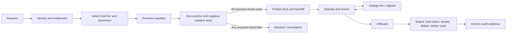
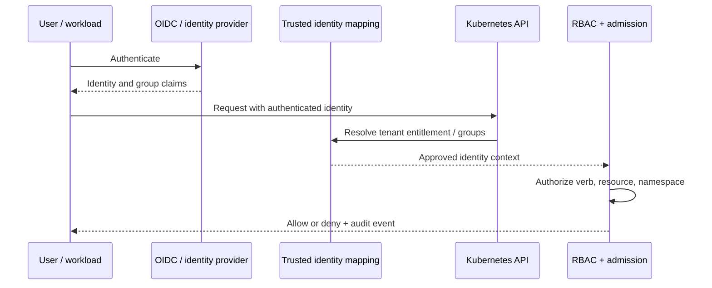
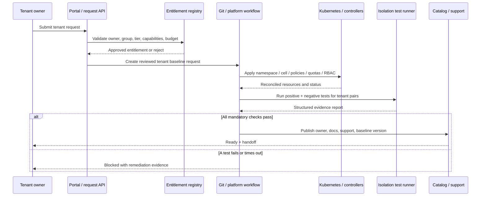
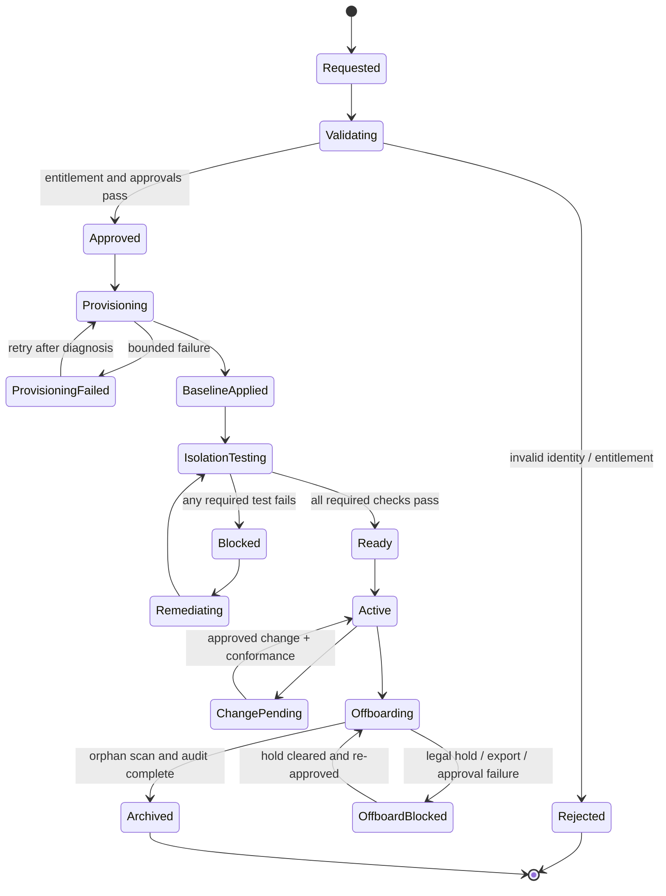
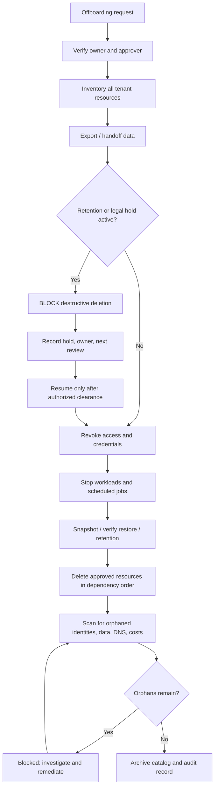

# Multi-tenancy, Isolation, and Tenant Onboarding

**Module:** M16 — Platform Engineering and Internal Developer Platforms  
**Stage:** 2E — Production DevOps & Platform Engineering  
**Unit:** 7  
**Target file:** `07-multi-tenancy-isolation-and-tenant-onboarding.md`  
**Estimated effort:** 32–44 hours, including the core labs; optional cluster integrations may add time.  
**Audience:** data/AI engineers who understand Kubernetes and production platform fundamentals and are learning to design tenant isolation as an end-to-end platform contract.  
**Budget:** zero-budget local learning. No cloud account, paid service, production system, real credential, or customer data is required.  
**Primary environment:** WSL2 Ubuntu or native Linux; Python 3 standard library; Git; optional disposable `kind` cluster.  
**Stack profiles:** **Plat-Core** (documents, validators, synthetic fixtures, local tests) is the guaranteed path. **Plat+Control** adds `kind`, one policy engine (Kyverno in this lesson), and bounded Kubernetes integration tests.  
**Planning hardware:** approximately 4 CPU cores, 8 GB RAM, and 30 GB free disk; this is a planning assumption, not a guarantee. Measure your actual footprint.  
**Synthetic data:** all tenants, identities, events, costs, incident timelines, and measurements are synthetic teaching material.

> **Handoff from earlier modules:** M03 taught namespaces, RBAC, quotas, and PSS; M04 taught NetworkPolicy and mesh identity; M09 taught secret and identity isolation; M11 and M14 Unit 8 taught tenant-scoped observability; M12 Unit 7 taught runtime isolation levels and multi-tenancy concerns; M14 Unit 1 compared tenancy alternatives (namespaces, vcluster, node pools, cluster-per-tenant); M15 taught quotas, priorities, and cost allocation. This unit does not re-teach those. It teaches how to **compose them into a tenant model**: defining tenancy tiers and threat models, onboarding and offboarding as automated, verified workflows, **testing isolation with negative tests**, and operating tenants as customers of the platform.

## Handoff, Scope, and Learning Outcomes

### Scope and prerequisites

This unit combines controls from M03, M04, M05, M07, M08, M09, M10, M11, M12, M13, M14, and M15 into one tenant operating model. It assumes the learner can read Kubernetes YAML, understand namespaces and service accounts, use `kubectl`, interpret RBAC, and reason about quotas, NetworkPolicy, secrets, GitOps, observability, backups, and cost ownership.

The M16 boundaries are deliberate:

- [Unit 3](03-self-service-infrastructure-and-environment-provisioning.md) owns the general self-service request/provisioning workflow.
- [Unit 4](04-developer-portals-and-backstage-service-catalog.md) owns portal and catalog foundations. This unit consumes the catalog's owner and team projections; it does not rebuild the portal.
- [Unit 6](06-platform-apis-with-crossplane-compositions.md) owns Crossplane platform API design and composition. This unit defines the tenant contract and isolation requirements that `DataEnvironment` and related APIs must satisfy.
- [Unit 8](08-platform-slos-adoption-metrics-and-developer-experience.md) owns full platform SLO/adoption/DX measurement. This unit defines tenant-specific signals and operational use.
- [Unit 9](09-platform-governance-deprecation-and-versioning.md) owns broad governance and deprecation. This unit versions the tenant baseline only as required for safe tenancy operations.

The M16 repository tree confirms this target as Unit 7. M07 Unit 12 is `12-crossplane-and-kubernetes-native-infrastructure.md` under `07-Advanced-Infrastructure-as-Code-and-Cloud-Operations/`; Unit 6 already refers to that exact path. The earlier Crossplane lesson is a prerequisite reference, not a reason to repeat Crossplane fundamentals here.

### Consistent synthetic tenant identity

Use these names consistently in the labs:

| Lab tenant | Existing M16 team identity | Namespace | Synthetic cost center | Trust tier |
|---|---|---|---|---|
| `team-a` | `analytics` | `tn-team-a` | `CC-SYNTH-ANALYTICS-01` | `internal-trusted` |
| `team-b` | `ml-research` | `tn-team-b` | `CC-SYNTH-ML-RESEARCH-01` | `internal-trusted` |
| `team-c` | `risk-platform` | `tn-team-c` | `CC-SYNTH-RISK-PLATFORM-01` | `internal-sensitive` |

These are lab aliases, not a replacement identity system. Unit 3's synthetic entitlement registry uses `analytics` and `ml-research`; Unit 4 projects those stable team names into its catalog ownership model. Unit 6 uses the same synthetic team family and `platform.example.org` teaching API group. Keep the identity-provider group, catalog Group, tenant key, namespace, and cost center as separately typed fields—do not assume they are interchangeable strings.

### Learning outcomes

By completion, the learner can:

1. Define tenant, trust boundary, soft/hard multi-tenancy, noisy neighbor, blast radius, and tenant contract.
2. Select a tenancy model from an explicit threat model and trust tier.
3. Explain why a Kubernetes namespace is a useful scope but not a hard security boundary.
4. Design layered isolation across API/control plane, compute, network, storage/data, secrets/identity, observability, registry/CI, ingress, GPU, and cost.
5. Produce a tenant model, trust-tier matrix, role catalog, STRIDE threat model, responsibility matrix, and baseline checklist.
6. Prove both denied and permitted paths with negative and positive tests.
7. Automate onboarding with entitlement checks and an isolation suite as a blocking readiness gate.
8. Automate offboarding with export, access revocation, retention/hold checks, safe deletion, orphan detection, and an audit record.
9. Prevent delegated-admin escalation, namespace-label bypass, and cross-tenant hostname claims.
10. Bound noisy-neighbor resource and API-object consumption.
11. Operate continuous assurance, canary tenants, conformance scanning, drift alerts, and enforced quarantine.
12. Plan tenant-aware SLOs, backups/restores, data lifecycle, multi-cluster placement, incident response, and cost allocation.
13. State precisely what local tests prove and what they cannot prove.

### Evidence standard

A control is not proven merely because a YAML file exists. Evidence must identify the principal, target, action, expected result, observed result, cluster/plugin/policy version, timestamp, and safe evidence location. A negative test passes only when the forbidden action is denied for the expected reason. A positive test passes only when the permitted workflow succeeds. A mock or policy-model test proves the local decision logic, not the behavior of a live CNI, identity provider, database, object store, registry, or observability system.

## 1. What Is a Tenant?

A **tenant** is a team, project, customer, or workload group that consumes shared platform capabilities under an explicit identity, resource, security, data, and support contract. A tenant is not simply a namespace name. A namespace is one possible implementation boundary; the tenant identity is the business/platform object that owns workloads, access, data, costs, lifecycle, and support responsibilities.

### 1.1 Separate identity concepts

| Concept | Meaning | Example | Why it must remain distinct |
|---|---|---|---|
| Tenant key | Stable platform identifier | `team-a` | Used by lifecycle workflows and evidence. |
| Team identity | Authoritative organization/IdP group | `analytics` | Authentication and entitlement source. |
| Namespace | Kubernetes resource scope | `tn-team-a` | One implementation boundary, not the tenant itself. |
| Cost center | FinOps allocation key | `CC-SYNTH-ANALYTICS-01` | Billing/showback ownership can change independently. |
| Business owner | Accountable person/role reference | `analytics-owner` | Escalation, approvals, data lifecycle. |
| Data owner/steward | Authority for datasets and retention | `analytics-data-steward` | Data access and deletion are not purely platform decisions. |
| Service owner | Responsible service team | `analytics` | A service may have a different owner from the cluster tenant. |

### 1.2 Vocabulary

- **Trust boundary:** a boundary across which the platform does not assume the same principal or workload is trustworthy.
- **Soft multi-tenancy:** multiple tenants share a cluster and kernel under a common organizational trust model, with policy and process controls reducing accidental or low-sophistication cross-tenant access.
- **Hard multi-tenancy:** tenants are treated as potentially adversarial or require stronger isolation of kernel, control plane, identity, network, and data. It usually requires stronger infrastructure boundaries than namespaces alone.
- **Shared fate:** one shared component's failure or compromise affects multiple tenants.
- **Blast radius:** the set of tenants, workloads, data, and services that one failure or compromise can affect.
- **Noisy neighbor:** a tenant whose resource or API activity degrades another tenant's service.
- **Control plane:** API servers, controllers, admission, policy, identity, and management components that accept and reconcile desired state.
- **Data plane:** the workloads, network paths, storage, and data services tenants use.
- **Tenant contract:** the documented platform promises, tenant obligations, supported choices, limits, lifecycle, and evidence requirements.
- **Tenant baseline:** the versioned set of resources, policies, labels, permissions, and shared-service boundaries every tenant must satisfy.
- **Conformance:** evidence that a tenant's live state matches its approved baseline and exceptions.

### 1.3 Why namespaces alone are not a hard boundary

A namespace scopes many namespaced Kubernetes resources and is a valuable unit for RBAC, quotas, and policy selection. It does not create a separate kernel, API server, etcd, node, admission stack, CRD set, cluster-scoped RBAC domain, DNS service, ingress controller, registry, CI fleet, or observability backend. A principal with excessive permissions can read secrets or alter namespace labels. A privileged pod can threaten the shared node. A broken admission webhook or overloaded API server can affect many tenants.

Kubernetes RBAC guidance specifically warns that workload creation can implicitly expose namespace resources and service-account permissions, that Secret `list`/`watch` reveals secret contents, and that namespace modification can weaken label-driven controls. See the [Kubernetes RBAC good practices](https://kubernetes.io/docs/concepts/security/rbac-good-practices/) and [Secrets good practices](https://kubernetes.io/docs/concepts/security/secrets-good-practices/). [VERIFIED against official docs on 2026-11-03.]

### 1.4 Lifecycle as a product journey



A tenant is not `Ready` because its namespace exists. It is ready only after identity, baseline, isolation tests, support ownership, data lifecycle, and cost metadata are verified.

**Checkpoint:** Explain why the tenant key, team group, namespace, and cost center must not be conflated. Give one example of a tenant that should not share a namespace-based trust boundary with an internal analytics team.

## 2. Soft and Hard Multi-tenancy: Trust Tiers and Threat Models

### 2.1 Start with adversaries and assets

A useful threat model asks who can act, what they can reach, which assumptions fail, and how the platform detects and contains the event. The tenant is not automatically malicious; careless configuration, compromised credentials, a compromised workload, or a shared-service defect can create the same cross-tenant risk.

**Assets:** tenant workloads; secrets and workload identities; databases, buckets, datasets, model artifacts; registry images; CI tokens and caches; logs/metrics/traces; hostnames and certificates; cluster API availability; policy and admission configuration; backups; audit evidence.

**Adversaries / failure sources:** curious tenant; careless tenant admin; malicious tenant; compromised pod/service account; compromised CI runner; over-privileged provider/controller; malicious or buggy shared operator; compromised platform identity; noisy workload; operator error; stale offboarding automation.

### 2.2 Illustrative trust tiers

These names are local teaching conventions, not standards or certifications.

| Tier | Example tenant | Default tenancy model | Minimum control posture | Approval / exception | Residual risk |
|---|---|---|---|---|---|
| `internal-trusted` | Internal analytics engineering team | Namespace per tenant on a shared cluster | Namespaced RBAC, quotas, PSS Restricted where compatible, default-deny network, tenant-scoped secrets/data/observability, continuous tests | Team owner + platform entitlement | Shared kernel, API server, operators, and cluster services remain shared. |
| `internal-sensitive` | Risk research with sensitive datasets | Dedicated node pool or stronger cell; namespace only for workload grouping | All trusted controls plus placement, stronger workload identity, restricted data paths, dedicated keys/service boundary where supported, tested restore | Data owner + security + platform | Shared control plane or selected services may remain shared. |
| `partner-isolated` | Less-trusted partner workload | Dedicated cluster or virtual-cluster architecture only after threat review; possibly sandbox runtime | Separate identity, network, secrets, registry/CI, data, audit, ingress, and resource boundary | Security architecture review | Virtual clusters may still share host kernel/nodes/control-plane components. Verify implementation. |
| `external-adversarial` | Public or adversarial customer | Cluster/account/project per tenant or equivalent strong isolation | Separate administrative and infrastructure trust boundary, independent credentials, explicit data plane, robust abuse controls | Security architecture approval; dedicated operating model | Cloud provider, region, physical hardware, or organization-wide services may remain shared. |

### 2.3 STRIDE-style threat model

STRIDE is a threat-modeling mnemonic: spoofing, tampering, repudiation, information disclosure, denial of service, and elevation of privilege. It structures questions; it does not certify completeness.

| Threat / STRIDE | Attack path or failure | Impact | Preventive controls | Detection / evidence | Residual risk / owner |
|---|---|---|---|---|---|
| Spoofing | Tenant supplies another tenant's header or group name | Cross-tenant log/data query | Derive tenant from authenticated identity at trusted gateway; never trust client header | Identity-to-tenant audit; negative query test | Gateway compromise; Identity + Observability |
| Tampering | Tenant edits protected namespace labels | Policy selector bypass | Platform-only namespace mutation; admission validation; protected labels | Attempted update audit; policy test | Cluster-admin can still alter; Platform Security |
| Repudiation | Shared admin action has no tenant context | Cannot reconstruct actor/action | Authenticated per-user identity; audit policy; immutable evidence destination | Audit query and correlation IDs | Audit pipeline outage; Security |
| Information disclosure | CI SA can list Secrets across namespaces | Secret exfiltration | Least privilege; no broad ClusterRoleBinding; secret access review | `kubectl auth can-i`; RBAC scan | Cluster-admin compromise; Identity |
| Denial of service | Tenant floods ConfigMaps or API requests | API/etcd degradation | Object-count ResourceQuota, APF review, request limits, per-tenant caps | API latency, object counts, quota events | Shared control plane remains a shared fate; SRE |
| Elevation of privilege | Tenant binds a stronger role or creates privileged pod | Cluster/host compromise | No `bind`/`escalate`; PSS; Kyverno policy; platform-owned cluster resources | Negative RBAC/admission tests | Kernel/runtime vulnerabilities; Security |
| Lateral movement | NetworkPolicy absent or unenforced | Cross-tenant access | Default deny plus explicit allow; CNI that enforces policies | Packet/connectivity tests | CNI behavior and host/network exceptions; Network |
| Data boundary failure | Shared DB/bucket credentials | Cross-tenant records/objects | Per-tenant roles/policies/keys; explicit grants | Data-access audit and negative identity test | Operator/admin privilege; Data Owner |
| Shared-service compromise | Registry, CI cache, admission webhook or operator compromised | Multi-tenant compromise | Separate projects/runners/caches; signed provenance; least-privilege service accounts | Provenance scans, audit, canaries | Shared component vulnerability; Platform |
| Lifecycle failure | Namespace deleted but external resources remain | Orphaned access/data/cost | Inventory-first offboarding; dependency graph; orphan scan | Resource inventory diff; audit | External systems may not expose complete inventory; Tenant Owner |

### 2.4 Threat-model exercise

For each tenant tier, write: (1) tenant principals, (2) workload principals, (3) assets, (4) shared dependencies, (5) attack paths, (6) preventive controls, (7) detection signals, (8) recovery steps, and (9) accepted residual risk with owner and expiry. If the risk cannot be bounded by the shared-cluster controls, move the tenant to a stronger boundary instead of adding another namespace label.

**Checkpoint:** Why does a `restricted` Pod Security Standard not prove hard multi-tenancy? Answer: it narrows pod privilege but does not create separate kernel, API server, etcd, node, or shared-service boundaries.

## 3. Choosing a Tenancy Model

### 3.1 Model comparison

| Model | Trust / control-plane boundary | Kernel / node boundary | Network and data boundary | Operational complexity / cost | Best fit and residual risk |
|---|---|---|---|---|---|
| Namespace per tenant | Shared API server, etcd, CRDs, webhooks | Shared nodes and kernel | Requires RBAC, NetworkPolicy, per-tenant DB/bucket/secret policies | Lowest overhead; strong automation needed | Trusted internal teams. Not a hard adversarial boundary. |
| Dedicated node pool per tenant/tier | Shared control plane | Separate worker pool; kernel still shared within pool | Network/data policies still required | Medium; idle capacity and scheduling overhead | Sensitive workloads needing compute placement separation. Does not isolate control plane. |
| Sandboxed runtime (gVisor/Kata) | Usually shared control plane | Adds an isolation layer around workloads; exact semantics/runtime compatibility vary | Network/data still separately scoped | Medium/high; runtime compatibility/performance trade-offs | Less-trusted workloads when tested and supported. Verify runtime class and threat model. |
| Virtual cluster (`vcluster`-like) | Tenant gets virtual API/control plane; host cluster remains | Usually shared host nodes/kernel unless combined with sandbox/dedicated nodes | Host networking/storage and sync components remain trust boundaries | Medium/high; extra control plane and sync operations | Teams needing API autonomy, not automatically adversarial isolation. `[VERIFY]` implementation details. |
| Cluster per tenant | Separate Kubernetes API server/etcd and cluster-scoped resources | Separate worker nodes if provisioned so; hardware/cloud substrate may still be shared | Stronger independent network, storage and secrets configuration | High; upgrades, capacity, policy, observability and backup multiply | Sensitive or less-trusted tenants; cluster misconfiguration remains possible. |
| Cloud account/project/subscription per tenant | Separate cloud IAM/account boundary | Depends on provider and service | Separate IAM, network, keys, storage, audit | Highest administrative overhead; strong separation of cloud permissions | External/adversarial or high-assurance workloads; provider/organization dependencies remain. |
| Hybrid cells/cohorts | Shared within a cell; cells separated | Dedicated pools or clusters by tier | Shared within a cell; explicit cross-cell access | Medium/high; more routing and fleet management | Hundreds of tenants grouped by trust, region, capacity, or blast radius. |

**Decision rule:** choose the simplest model that satisfies the threat model and support contract. Do not label namespace isolation “hard” because the YAML contains many policies. A separate cluster is not automatically safe either: identity, network, registry, CI, backups, and operator access must still be designed.

### 3.2 Decision dimensions

Score each candidate against: tenant trust/adversary; kernel boundary; API/control-plane separation; network reachability; storage/data isolation; secret/key separation; shared-service exposure; operational maturity; capacity waste; recovery complexity; portability; audit requirements; tenant autonomy; and blast radius. Mark unknowns as unknown. A scorecard is a decision aid, not a mathematical proof.

### 3.3 Four synthetic tenant decisions

| Tenant type | Threat assumption | Candidate | Why | Revisit trigger |
|---|---|---|---|---|
| Internal analytics team | Authenticated employees, common security baseline | Namespace per tenant | Cost-efficient, supported path | New data classification or privileged workload |
| Sensitive risk model research | Restricted data and controlled compute | Dedicated pool or dedicated cell | Reduces node co-residency and blast radius | Kernel-level threat or independent API required |
| External partner pipeline | Partner admin may be less trusted | Dedicated cluster / account | Shared namespace assumptions insufficient | Contract, data, or workload profile changes |
| Public multi-customer inference | Potentially adversarial customers | Per-customer cluster/account or separately reviewed isolation architecture | Customer-controlled inputs and public exposure | Isolation evidence, cost, and service architecture change |

### 3.4 Architecture decision record (ADR) template

```markdown
# ADR-TENANCY-001: <decision>
- Status: Proposed | Accepted | Superseded
- Date / owners:
- Tenant cohorts and data classes:
- Threat assumptions and adversaries:
- Options considered:
- Control-plane / kernel / network / data / identity boundaries:
- Shared services and residual risks:
- Operational and cost assumptions (hypothetical units only):
- Decision and rejected alternatives:
- Required negative/positive tests:
- Migration / rollback / DR plan:
- Review triggers and next review date:
```

**Checkpoint:** If an external partner can submit arbitrary code and the business threat model treats that partner as adversarial, do not select namespace-only tenancy without an explicitly approved and evidenced risk exception.

## 4. The Tenant Contract and Responsibility Matrix

A tenant contract is a compact interface: what the platform provides, what the tenant must provide, which choices are supported, how exceptions work, and how the tenant is onboarded, supported, changed, and offboarded.

### 4.1 Tenant model fixture — `tenant-model.yaml`

The following values are illustrative. `platform.example.org` is a teaching domain, not an official standard.

```yaml
apiVersion: platform.example.org/v1alpha1
kind: Tenant
metadata:
  name: team-a
spec:
  identity:
    teamGroup: analytics
    ownerRef: analytics-owner
    backupOwnerRef: analytics-backup-owner
    dataStewardRef: analytics-data-steward
  placement:
    trustTier: internal-trusted
    tenancyModel: namespace
    cell: shared-internal-a
    homeRegion: local-lab
  namespace: tn-team-a
  cost:
    costCenter: CC-SYNTH-ANALYTICS-01
    budgetUnits: 40
  entitlements:
    sizes: [small, medium]
    capabilities: [database, queue, bucket, notebook]
    maxPods: 20
    maxConfigMaps: 30
  data:
    classification: internal
    backupClass: standard
    retentionClass: synthetic-30d
  support:
    tier: standard
    incidentContact: analytics-oncall
  lifecycle:
    baselineVersion: "1.0.0"
    state: active
    exceptionRefs: []
```

This is an inventory contract for the local lab, not a Kubernetes CRD that can be applied as-is. The API schema and lifecycle controller belong to Unit 6/Unit 3 integration. Validate the request before any provisioning side effect.

### 4.2 Tenant tiers — `tenant-tiers.yaml`

```yaml
apiVersion: platform.example.org/v1alpha1
kind: TenantTierCatalog
metadata:
  name: default
spec:
  tiers:
    internal-trusted:
      tenancyModel: namespace
      allowedModels: [namespace, dedicated-node-pool, cluster]
      network: default-deny
      podSecurity: restricted
      secretScope: tenant-only
      dataSharing: explicit-grant
      backupClass: standard
      supportTier: standard
      approval: [tenant-owner, platform]
      residualRisk: shared-kernel-and-control-plane
    internal-sensitive:
      tenancyModel: dedicated-node-pool
      allowedModels: [dedicated-node-pool, cluster, account-per-tenant]
      network: default-deny
      podSecurity: restricted
      secretScope: tenant-only
      dataSharing: explicit-grant-and-data-owner-approval
      backupClass: enhanced
      supportTier: priority
      approval: [tenant-owner, data-owner, security, platform]
      residualRisk: shared-control-plane-unless-cell-is-dedicated
    partner-isolated:
      tenancyModel: cluster
      allowedModels: [cluster, account-per-tenant]
      network: dedicated-boundary
      podSecurity: restricted
      secretScope: dedicated-store
      dataSharing: explicit-grant-and-audit
      backupClass: enhanced
      supportTier: priority
      approval: [security-architecture, platform, data-owner]
      residualRisk: cloud-region-and-organization-shared-dependencies
```

### 4.3 Role catalog — `roles.yaml`

| Role | Allowed scope | Example permissions | Explicitly excluded |
|---|---|---|---|
| `viewer` | Own tenant namespace and tenant-scoped catalog views | Read approved workloads/status, view own quota | Secrets, exec, port-forward, other tenants |
| `developer` | Own namespace | Manage approved Deployments/Jobs/ConfigMaps/Services; read own workload logs | Namespace mutation, Role/ClusterRole, Secret list, privileged pod, PV, CRD |
| `deployer` | GitOps workflow and own application resources | Merge through protected repo flow; view sync status | Direct cluster-wide deployment, shared child-resource ownership |
| `admin-lite` | Own tenant namespace and approved role catalog | Manage selected RoleBindings to approved roles; manage team workload objects | `cluster-admin`, `bind`, `escalate`, ClusterRoleBinding, namespace labels, policies, CRDs, webhooks |
| `platform-admin` | Platform-controlled scope | Tenant baseline, namespace labels, policies, cluster-level resources | Must use separate privileged identity and audited workflow |

A role name is not a control. The Role/RoleBinding and admission rules must implement it. Do not grant `admin-lite` broad `edit` and assume it is safe: workload creation may expose namespace Secrets and service accounts.

### 4.4 Shared responsibility — `shared-responsibility.md`

| Activity | Platform team | Tenant owner | Security | SRE | Identity team | Data owner | FinOps |
|---|---|---|---|---|---|---|---|
| Tenant entitlement and tier | A/R | C | C | C | C | C | C |
| Identity group membership | C | R | C | I | A/R | I | I |
| Namespace baseline / policy | A/R | C | C | C | I | I | C |
| Workload image/dependencies | C | A/R | C | I | I | I | I |
| Dataset access grant | C | R | C | I | C | A/R | I |
| Backup platform | A/R | C | C | R | I | C | I |
| Restore validation / business correctness | R | R | C | A | I | A/R | I |
| Cost labels and budget | R | A/R | I | I | I | I | A/R |
| Offboarding authorization | R | A/R | C | C | R | A/R | C |
| Incident coordination | C | C | A/R | A/R | C | C | I |

A = accountable; R = responsible; C = consulted; I = informed. Adapt the table to the actual organization; do not assume one team owns every control.

### 4.5 Tenant baseline checklist

- [ ] Stable tenant key and authoritative identity group exist.
- [ ] Primary owner, backup owner, data steward, and incident contact are resolvable.
- [ ] Trust tier, tenancy model, cell/region, data class, backup class, and support tier are approved.
- [ ] Namespace or stronger boundary is provisioned through the platform path.
- [ ] Protected labels and PSS labels are present and tenant cannot weaken them.
- [ ] RBAC matches the role catalog; no broad ClusterRoleBinding.
- [ ] Quotas cover CPU, memory, ephemeral storage, pods, ConfigMaps, Secrets, PVCs, and applicable APIs.
- [ ] Default-deny network policy and documented allow rules are present; CNI enforcement is verified.
- [ ] Secret and workload identity scopes are tenant-specific.
- [ ] DB/bucket/dataset permissions are tested with tenant identities.
- [ ] Registry, CI runner, cache, ingress/hostname, and certificate boundaries are configured.
- [ ] Logs, metrics, traces, dashboards, and query APIs are scoped to authenticated tenant identity.
- [ ] Cost center, budget, ownership, and showback labels are present.
- [ ] Backup/restore class and tenant-level RTO/RPO are recorded.
- [ ] Positive and negative isolation suite passes for all required tenant pairs.
- [ ] Catalog record, docs, runbook, support path, and baseline version are published.
- [ ] Exceptions have owner, compensating control, approval, evidence, and expiry.

### 4.7 Executable tenant-model validator (Plat-Core)

Save the following as `validate_tenants.py`. It checks authoritative team groups and owner references, tier/model compatibility, required isolation controls, cost/backup metadata, and exception expiry. The registry sets are synthetic fixtures; a production workflow must query the authoritative identity/ownership service and fail closed when it is unavailable.

```python
from __future__ import annotations
from datetime import date
from typing import Any

TIER_MODELS = {
    "internal-trusted": {"namespace", "dedicated-node-pool", "cluster"},
    "internal-sensitive": {"dedicated-node-pool", "cluster", "account-per-tenant"},
    "partner-isolated": {"cluster", "account-per-tenant"},
}
REQUIRED_CONTROLS = {
    "internal-trusted": {"rbac", "network-default-deny", "quota", "pss", "secret-scope", "observability-scope"},
    "internal-sensitive": {"rbac", "network-default-deny", "quota", "pss", "secret-scope", "observability-scope", "dedicated-placement", "data-owner-approval"},
    "partner-isolated": {"rbac", "network-default-deny", "quota", "pss", "secret-scope", "observability-scope", "dedicated-placement", "separate-control-plane", "security-approval"},
}


def validate_tenant(record: dict[str, Any], known_groups: set[str],
                    known_owners: set[str], today: date | None = None) -> list[str]:
    today = today or date.today()
    errors: list[str] = []
    spec = record.get("spec", {})
    identity = spec.get("identity", {})
    placement = spec.get("placement", {})
    tenant = record.get("metadata", {}).get("name")
    if not tenant:
        errors.append("tenant metadata.name is required")
    group = identity.get("teamGroup")
    if group not in known_groups:
        errors.append("identity.teamGroup is missing or not in the authoritative registry")
    for field in ("ownerRef", "backupOwnerRef", "dataStewardRef"):
        value = identity.get(field)
        if not value:
            errors.append(f"identity.{field} is required")
        elif value not in known_owners:
            errors.append(f"identity.{field} does not resolve to an active owner")
    tier = placement.get("trustTier")
    model = placement.get("tenancyModel")
    if tier not in TIER_MODELS:
        errors.append("placement.trustTier is unsupported")
    elif model not in TIER_MODELS[tier]:
        errors.append("placement.tenancyModel is not allowed for trust tier")
    controls = set(spec.get("isolationControls", []))
    if tier in REQUIRED_CONTROLS:
        missing = REQUIRED_CONTROLS[tier] - controls
        if missing:
            errors.append("missing isolation controls: " + ", ".join(sorted(missing)))
    if not spec.get("cost", {}).get("costCenter"):
        errors.append("cost.costCenter is required")
    if not spec.get("data", {}).get("backupClass"):
        errors.append("data.backupClass is required")
    for exception in spec.get("exceptions", []):
        expiry = exception.get("expiresOn")
        if not exception.get("owner") or not exception.get("approvalRef") or not exception.get("compensatingControl"):
            errors.append("each exception requires owner, approvalRef, and compensatingControl")
        try:
            if not expiry or date.fromisoformat(expiry) <= today:
                errors.append("exception is expired or has no valid expiry")
        except ValueError:
            errors.append("exception expiry must be ISO date YYYY-MM-DD")
    return errors


if __name__ == "__main__":
    from unittest import TestCase, main

    VALID = {
        "metadata": {"name": "team-a"},
        "spec": {
            "identity": {"teamGroup": "analytics", "ownerRef": "analytics-owner",
                         "backupOwnerRef": "analytics-backup-owner", "dataStewardRef": "analytics-data-steward"},
            "placement": {"trustTier": "internal-trusted", "tenancyModel": "namespace"},
            "cost": {"costCenter": "CC-SYNTH-ANALYTICS-01"},
            "data": {"backupClass": "standard"},
            "isolationControls": ["rbac", "network-default-deny", "quota", "pss", "secret-scope", "observability-scope"],
            "exceptions": [],
        },
    }
    GROUPS = {"analytics", "ml-research", "risk-platform"}
    OWNERS = {"analytics-owner", "analytics-backup-owner", "analytics-data-steward"}

    class TenantValidatorTests(TestCase):
        def test_valid_tenant(self):
            self.assertEqual(validate_tenant(VALID, GROUPS, OWNERS, date(2026, 11, 3)), [])

        def test_missing_owner(self):
            bad = {**VALID, "spec": {**VALID["spec"], "identity": {**VALID["spec"]["identity"], "ownerRef": ""}}}
            self.assertTrue(any("ownerRef" in e for e in validate_tenant(bad, GROUPS, OWNERS, date(2026, 11, 3))))

        def test_unknown_group(self):
            bad = {**VALID, "spec": {**VALID["spec"], "identity": {**VALID["spec"]["identity"], "teamGroup": "unowned"}}}
            self.assertTrue(any("teamGroup" in e for e in validate_tenant(bad, GROUPS, OWNERS, date(2026, 11, 3))))

        def test_unsafe_tier_model(self):
            bad = {**VALID, "spec": {**VALID["spec"], "placement": {"trustTier": "internal-sensitive", "tenancyModel": "namespace"}}}
            self.assertTrue(any("not allowed" in e for e in validate_tenant(bad, GROUPS, OWNERS, date(2026, 11, 3))))

        def test_missing_isolation_control(self):
            bad = {**VALID, "spec": {**VALID["spec"], "isolationControls": ["rbac"]}}
            self.assertTrue(any("missing isolation controls" in e for e in validate_tenant(bad, GROUPS, OWNERS, date(2026, 11, 3))))

        def test_expired_exception(self):
            bad = {**VALID, "spec": {**VALID["spec"], "exceptions": [{"owner": "analytics-owner", "approvalRef": "A-1", "compensatingControl": "extra review", "expiresOn": "2026-10-01"}]}}
            self.assertTrue(any("expired" in e for e in validate_tenant(bad, GROUPS, OWNERS, date(2026, 11, 3))))

        def test_unowned_tenant(self):
            bad = {**VALID, "spec": {**VALID["spec"], "identity": {**VALID["spec"]["identity"], "ownerRef": "unknown-owner"}}}
            self.assertTrue(any("does not resolve" in e for e in validate_tenant(bad, GROUPS, OWNERS, date(2026, 11, 3))))

    main()
```

Run: `python3 validate_tenants.py`. Representative expected output: `Ran 7 tests ... OK`. These tests validate the local tenant contract only; they do not query an IdP or enforce cluster controls.

### 4.8 Baseline conformance scanner contract

The scanner compares the authoritative expected control set with observed inventory. Missing observations are `UNKNOWN`, not compliant. A production scanner needs read-only inventory adapters for Kubernetes, identity, registry, CI, data services, observability, ingress, and cost systems. A minimal pure-Python core is: `missing = expected_controls - observed_controls`; `unexpected = observed_controls - approved_controls`; `expired = [e for e in exceptions if e.expires_on <= today]`. Each finding records tenant, control, expected, observed, severity, owner, baseline version, exception reference, and remediation. Do not auto-remediate a critical access drift without preserving evidence and understanding the affected workload.

### 4.6 Schema validation rules

Reject a tenant request when: tenant key or namespace is malformed; owner/backup owner/data steward is absent; identity group is not in the entitlement registry; tier/model pair is not allowed; region/cell is not authorized; cost center is missing; resource request exceeds entitlement; data classification requires a stronger boundary; backup/retention is unset; exception has no expiry; or an existing namespace/hostname/registry project belongs to another tenant.

**Checkpoint:** Pick one row in the responsibility matrix and explain who approves, who implements, who verifies, and where evidence is stored.

## 5. Isolation as Defense in Depth

Isolation is not one Kubernetes feature. It is a set of controls whose failure modes are intentionally different. A namespace and NetworkPolicy do not protect a shared database credential; a separate DB role does not prevent a tenant from exhausting the API server; a PSS label does not isolate observability queries.

### 5.1 Layered isolation map

| Layer | Threat | Core control | Positive test | Negative test | Residual risk / owner |
|---|---|---|---|---|---|
| API/control plane | Unauthorized API calls, object flood, cluster-scope mutation | RBAC, admission, quotas, APF review, protected CRDs/webhooks | Tenant manages approved resources in own scope | Tenant cannot read another namespace or create ClusterRoleBinding | Shared API server/etcd; Platform/SRE |
| Compute | Starvation, privileged pod, node co-residency | Requests/limits, ResourceQuota, LimitRange, PSS, node pools, runtime sandbox if needed | Tenant pod schedules within quota | Excess request / privileged pod rejected | Shared kernel in namespace model; Platform |
| Network | Lateral movement, egress abuse | Default-deny NetworkPolicy, explicit DNS/app allow, CNI enforcement, mesh identity | Approved same-tenant service call works | Cross-tenant and unauthorized egress fail | CNI, node, host-network and control-plane exceptions; Network |
| Storage/data | Cross-tenant reads, snapshots, retention leak | Tenant DB roles, bucket policies, dataset ACLs, per-tenant keys where required | Tenant reads own test record/object | Tenant cannot read another tenant's fixture | Storage admin/provider compromise; Data Owner |
| Secrets/identity | Secret path/token reuse | OIDC groups, workload identity, scoped secret paths, rotation | Tenant workload gets own short-lived access | Cross-tenant Secret/path denied | Cluster-admin/etcd access; Identity |
| Observability | Logs/traces/metrics leakage | Trusted identity-to-tenant mapping, tenant query proxy, backend ACLs, ingestion limits | Tenant queries own telemetry | Tenant cannot query another tenant | Proxy/backend admin; Observability |
| Registry/CI | Image/token/cache contamination | Per-tenant projects, robot accounts, ephemeral runners, trusted cache/provenance | Own project push/pull works | Cross-project token/cache denied | Shared registry/runner infrastructure; DevEx/Security |
| Ingress/PKI | Hostname hijack, certificate reuse | Ownership registry, admission validation, scoped issuer/credentials | Approved host accepted | Another tenant's host rejected | Shared gateway/controller; Network/Security |
| GPU | Cross-tenant memory/time-slice leakage, contention | Trust-based pools, quotas, scheduler policy, no cross-trust time-slicing by default | Approved workload schedules | Unauthorized GPU request denied | Device/runtime vendor behavior; ML Platform |
| Cost | Denial-of-wallet, unowned spend | Entitlements, quota, budgets, labels, alerts | Within-budget request accepted | Over-budget tier/size rejected | Estimates are not invoices; FinOps |
| Metadata | Tenant changes labels used by controls | Platform-owned namespace metadata and admission | Tenant may set allowed app labels | Tenant cannot alter protected owner/tier/policy labels | Platform admin remains privileged; Platform |

### 5.2 Trust the authenticated principal, not tenant-supplied metadata

A workload may set labels on its own Pods. Those labels are useful for inventory but must not be the sole source of tenant identity for authorization. Tenant ownership should be derived from an authenticated principal and a platform-controlled mapping. A user-supplied `X-Tenant-ID` HTTP header is not authoritative. A trusted gateway should validate the identity, map it to an allowed tenant, strip or overwrite incoming tenant headers, and pass a signed/controlled identity context to downstream services.

### 5.3 Policy selection and protected labels

Do not let tenant principals patch Namespace objects that carry security labels. In the shared-namespace model, the platform controller owns namespace metadata; tenant admins manage namespaced resources only. Admission policy is defense in depth, not a substitute for RBAC. A tenant-controlled label such as `security=exempt` must never switch off enforcement.

### 5.4 Policy engine choice

This lesson chooses **Kyverno only** for the optional policy-engine integration. It does not install Gatekeeper or another overlapping engine. The current Kyverno documentation describes CEL-based `ValidatingPolicy` at `policies.kyverno.io/v1`; exact release, CRD, CLI, and cluster compatibility must be pinned before installation. [VERIFIED against current Kyverno docs on 2026-11-03; release compatibility still `[VERIFY]`.]

A minimal illustrative policy that rejects privileged containers:

```yaml
apiVersion: policies.kyverno.io/v1
kind: ValidatingPolicy
metadata:
  name: deny-privileged-containers
spec:
  validationActions:
    - Deny
  matchConstraints:
    resourceRules:
      - apiGroups: [""]
        apiVersions: ["v1"]
        operations: [CREATE, UPDATE]
        resources: ["pods"]
  validations:
    - message: "Privileged containers are not allowed in tenant workloads."
      expression: >-
        object.spec.containers.all(c,
          !has(c.securityContext) ||
          !has(c.securityContext.privileged) ||
          c.securityContext.privileged == false)
```

**Important limitations:** the sample expression checks regular containers only; production policy must also cover init and ephemeral containers and account for pod controllers through verified Kyverno auto-generation or separate workload-template validation. Pod Security Admission `restricted` is the baseline control; this policy is a teaching example. Do not apply a policy to a shared cluster until its CRD and engine release have been validated in a disposable cluster.

Official references: [Kyverno ValidatingPolicy](https://kyverno.io/docs/policy-types/validating-policy/) and [Kyverno policy types](https://kyverno.io/docs/policy-types/overview/). The current docs describe `ValidatingPolicy` and its policy scope/validation actions. Exact syntax and features are release-sensitive. [VERIFY before cluster application.]

**Checkpoint:** For each layer, name one control, one positive test, one negative test, and one residual risk. If a layer has no negative test, the isolation claim is incomplete.

## 6. Identity, RBAC, and Delegated Administration

### 6.1 Identity flow



Use OIDC groups mapped to stable platform roles. Do not authorize a tenant solely from a client-supplied group header or a mutable Pod label. Separate human identities, workload identities, platform controllers, and break-glass identities.

### 6.2 Example namespace Role and RoleBinding

The following applied Role is intentionally narrow. It omits Secret, `pods/exec`, `pods/portforward`, Namespace, Role, and cluster-scoped permissions. Workload creation still carries indirect access implications: a user able to create Pods may mount Secrets and use service accounts in that namespace. For less-trusted tenants, restrict workload creation through a deployment workflow/admission policy and avoid direct pod authoring.

```yaml
apiVersion: rbac.authorization.k8s.io/v1
kind: Role
metadata:
  name: tenant-developer
  namespace: tn-team-a
rules:
  - apiGroups: ["apps"]
    resources: ["deployments", "replicasets"]
    verbs: ["get", "list", "watch", "create", "update", "patch", "delete"]
  - apiGroups: [""]
    resources: ["services", "configmaps", "pods"]
    verbs: ["get", "list", "watch", "create", "update", "patch", "delete"]
  - apiGroups: [""]
    resources: ["pods/log"]
    verbs: ["get"]
```

### 6.3 Delegated `admin-lite`

A tenant admin may be allowed to create RoleBindings only to a platform-approved role catalog, within their own namespace. They must not be allowed to create or modify Roles/ClusterRoles, ClusterRoleBindings, or bindings to stronger roles. Kubernetes RBAC has special `bind` and `escalate` checks to prevent privilege escalation; granting those verbs can bypass built-in protections. Do not grant them to tenant admins.

**Required rules:**

- No tenant `cluster-admin` or `system:masters` membership.
- No tenant create/update/patch on Namespace, CRD, webhook, StorageClass, Node, PriorityClass, ClusterRole, ClusterRoleBinding, ProviderConfig, Crossplane Composition/XRD, or policy engine cluster resources.
- No tenant `bind`, `escalate`, or broad `impersonate` privileges.
- No tenant access to `nodes/proxy`, CSR approval/signing, `serviceaccounts/token` outside an explicitly approved workload identity path, or cluster-wide Secret reads.
- Tenant RoleBindings are restricted to approved Role names and same-namespace subjects.
- Break-glass is time-bound, separately authenticated, approved, audited, and reviewed after use.

### 6.4 Authorization tests

For a disposable cluster, use impersonation only from a principal authorized to impersonate. The commands below are diagnostic examples; replace group names and namespace names with the lab values.

```bash
kubectl auth can-i get pods -n tn-team-a --as=alice --as-group=analytics
kubectl auth can-i get secrets -n tn-team-a --as=alice --as-group=analytics
kubectl auth can-i get pods -n tn-team-b --as=alice --as-group=analytics
kubectl auth can-i create clusterrolebindings --as=alice --as-group=analytics
kubectl auth can-i patch namespaces --as=alice --as-group=analytics
kubectl auth can-i create rolebindings -n tn-team-a --as=alice --as-group=analytics
```

Representative expected results for the intended policy: own allowed workload read `yes`; Secret read `no`; other tenant pod read `no`; ClusterRoleBinding create `no`; Namespace patch `no`; approved same-namespace RoleBinding workflow `yes` only when its role is allow-listed. These are **representative expected results**, not execution output.

### 6.5 RBAC review routine

1. Export Roles, RoleBindings, ClusterRoles, and ClusterRoleBindings.
2. Identify subjects with broad Secret `get/list/watch`, workload creation, `bind`, `escalate`, `impersonate`, `nodes/proxy`, CSR approval, token creation, or webhook/CRD mutation.
3. Map each binding to a current tenant owner and approved role.
4. Remove stale identities only through an approved change and verify no active workload depends on them.
5. Run positive and negative tests for every tenant pair.
6. Preserve before/after diff, reviewer, and audit reference.

Kubernetes recommends least privilege and namespace-scoped RoleBindings where possible, and documents the risks of Secret access, workload creation, namespace modification, `bind`, and `escalate`. See [RBAC good practices](https://kubernetes.io/docs/concepts/security/rbac-good-practices/) and [RBAC authorization](https://kubernetes.io/docs/reference/access-authn-authz/rbac/). [VERIFIED 2026-11-03.]

**Checkpoint:** Why does granting `create pods` often imply more than “can create a Pod”? Explain how mounted Secrets and selectable service accounts change the threat model.

## 7. Network, Compute, Storage, Secrets, and Data Isolation

### 7.1 Network: default deny, then explicit allow

Example baseline policies for `tn-team-a`:

```yaml
apiVersion: networking.k8s.io/v1
kind: NetworkPolicy
metadata:
  name: default-deny-ingress-egress
  namespace: tn-team-a
spec:
  podSelector: {}
  policyTypes: [Ingress, Egress]
---
apiVersion: networking.k8s.io/v1
kind: NetworkPolicy
metadata:
  name: allow-dns-to-cluster-dns
  namespace: tn-team-a
spec:
  podSelector: {}
  policyTypes: [Egress]
  egress:
    - to:
        - namespaceSelector:
            matchLabels:
              kubernetes.io/metadata.name: kube-system
          podSelector:
            matchLabels:
              k8s-app: kube-dns
      ports:
        - protocol: UDP
          port: 53
        - protocol: TCP
          port: 53
```

The DNS selector is cluster-distribution-specific. Inspect the actual DNS namespace and Pod labels; some clusters use CoreDNS labels that differ. Do not apply the sample until the selector is confirmed. Add narrow ingress/egress allow policies for required service-to-service flows. A default-deny policy with no DNS allowance can break name resolution.

Kubernetes explicitly states that NetworkPolicy resources have no effect unless the network plugin implements enforcement. A YAML object alone is not evidence of isolation. See [Kubernetes Network Policies](https://kubernetes.io/docs/concepts/services-networking/network-policies/). [VERIFIED 2026-11-03.]

**Do not assume standard NetworkPolicy can block every path to the API server or cloud metadata endpoint.** The control-plane endpoint may be outside the pod network or represented through a service/IP path that varies by cluster. Metadata protections and egress FQDN controls are often CNI/cloud/network-gateway-specific. Verify the actual route and use a supported egress firewall/proxy or dedicated node/network boundary where needed.

### 7.2 Compute and control-plane resource limits

```yaml
apiVersion: v1
kind: ResourceQuota
metadata:
  name: tenant-quota
  namespace: tn-team-a
spec:
  hard:
    requests.cpu: "2"
    limits.cpu: "4"
    requests.memory: 4Gi
    limits.memory: 6Gi
    requests.ephemeral-storage: 5Gi
    limits.ephemeral-storage: 8Gi
    pods: "20"
    count/configmaps: "30"
    count/secrets: "20"
    count/services: "15"
    persistentvolumeclaims: "5"
---
apiVersion: v1
kind: LimitRange
metadata:
  name: tenant-defaults
  namespace: tn-team-a
spec:
  limits:
    - type: Container
      defaultRequest:
        cpu: 100m
        memory: 128Mi
        ephemeral-storage: 128Mi
      default:
        cpu: "1"
        memory: 1Gi
        ephemeral-storage: 1Gi
      max:
        cpu: "2"
        memory: 2Gi
        ephemeral-storage: 3Gi
```

These are synthetic caps, not recommended production values. Validate quota resource names and cluster behavior against the Kubernetes version and enabled resource APIs. ResourceQuota can limit aggregate resource requests/limits and selected object counts. Kubernetes documents object-count quota forms such as `count/configmaps`, `count/secrets`, `count/pods`, and `count/deployments.apps`; see [Resource Quotas](https://kubernetes.io/docs/concepts/policy/resource-quotas/). [VERIFIED 2026-11-03.]

A namespace quota does not isolate disk I/O or API-server requests completely. Add per-tenant autoscaling ceilings, node-pool placement for sensitive tiers, priority classes, and API Priority and Fairness (APF) only with a reviewed cluster-wide configuration. APF is stable from Kubernetes v1.29 and classifies requests into priority levels/flows; it is not a tenant-specific magic switch. See [API Priority and Fairness](https://kubernetes.io/docs/concepts/cluster-administration/flow-control/). [VERIFIED 2026-11-03.]

### 7.3 Pod Security Standards

Pod Security Admission is stable from Kubernetes v1.25. A namespace can set `enforce`, `audit`, and `warn` levels. The platform—not the tenant—must own the security labels.

```yaml
apiVersion: v1
kind: Namespace
metadata:
  name: tn-team-a
  labels:
    platform.example.org/tenant: team-a
    platform.example.org/trust-tier: internal-trusted
    platform.example.org/managed-by: platform
    platform.example.org/baseline-version: "1.0.0"
    pod-security.kubernetes.io/enforce: restricted
    pod-security.kubernetes.io/audit: restricted
    pod-security.kubernetes.io/warn: restricted
    # Add enforce-version/audit-version/warn-version only after
    # selecting a policy version supported by this cluster.
```

Do not give tenant principals permission to patch this Namespace. Use the platform reconciler or controlled GitOps identity. Kubernetes references: [Pod Security Admission](https://kubernetes.io/docs/concepts/security/pod-security-admission/) and [Enforce Pod Security Standards with Namespace Labels](https://kubernetes.io/docs/tasks/configure-pod-container/enforce-standards-namespace-labels/). [VERIFIED 2026-11-03.]

### 7.4 Storage and data isolation

- **PVC/storage:** tenants request PVCs from approved StorageClasses; platform owns StorageClass and PV policy. Restrict direct PV creation. Apply per-tenant storage quotas and backup policy.
- **Database:** use separate DB roles and preferably separate databases/schemas according to the threat/data class. Do not share a superuser credential. A connection Secret must be scoped to the tenant workload identity; no secret values in Git, reports, or status.
- **Object storage:** use separate bucket or tenant prefix with policy enforcing tenant identity. Prefix-only separation is logical separation; bucket/account/key separation may be required for higher trust tiers.
- **Datasets/features:** access through explicit grants with data owner approval, classification, lineage, audit, and revocation. Dataset names or tenant labels alone do not authorize reads.
- **Encryption:** key-per-tenant and crypto-shredding are design concepts; verify key-management and backup semantics. No legal or compliance conclusion follows from using a separate key.
- **Backups:** backup scope, retention, encryption, restore permissions, and restore testing must preserve tenant boundaries. A successful snapshot object creation is not proof of recoverability.

### 7.5 Secrets and workload identity

Use short-lived workload identity where supported. If using an external secret manager, scope the workload identity to an approved tenant path/store. Do not grant a tenant workload list/watch over every Kubernetes Secret. Avoid a shared robot credential with permissions to all tenant repositories or data stores.

Illustrative ExternalSecret-style reference (API/version and provider-specific store details must be verified against the installed External Secrets Operator release):

```yaml
apiVersion: external-secrets.io/v1
kind: ExternalSecret
metadata:
  name: app-db-credentials
  namespace: tn-team-a
spec:
  refreshInterval: 1h
  secretStoreRef:
    name: team-a-secret-store
    kind: SecretStore
  target:
    name: app-db-credentials
    creationPolicy: Owner
  data:
    - secretKey: username
      remoteRef:
        key: tenants/team-a/database/app
        property: username
    - secretKey: password
      remoteRef:
        key: tenants/team-a/database/app
        property: password
```

This is a schema illustration, not a guarantee that a given ESO release supports this exact `apiVersion` or SecretStore arrangement. Pin and verify it. No actual credentials are included.

### 7.6 Data-isolation fixture

Use synthetic records and identities in the Plat-Core lab:

```json
{
  "tenant_data": [
    {"tenant": "team-a", "record_id": "A-001", "value": "synthetic-a"},
    {"tenant": "team-b", "record_id": "B-001", "value": "synthetic-b"},
    {"tenant": "team-c", "record_id": "C-001", "value": "synthetic-c"}
  ],
  "grants": [
    {"from": "team-a", "to": "team-a", "resource": "dataset:demo"},
    {"from": "team-b", "to": "team-b", "resource": "dataset:demo"}
  ]
}
```

A tenant can read only records covered by its own identity or an explicit approved grant. The fixture tests a local authorization rule; it does not replace DB row-level security, bucket IAM, or a dataset authorization engine.

**Checkpoint:** Explain why a NetworkPolicy manifest with `default-deny` does not prove cross-tenant traffic is blocked. State what runtime test and CNI evidence are needed.

## 8. Shared Services: Ingress, Registry, CI, Observability, and GPUs

Shared services are frequent cross-tenant escape paths because the namespace boundary may not apply to the shared service's own identity and data model.

### 8.1 Ingress, hostname ownership, and certificates

Maintain a platform-controlled hostname registry:

```yaml
hostnames:
  - host: analytics.apps.example.test
    tenant: team-a
    namespace: tn-team-a
    status: active
  - host: research.apps.example.test
    tenant: team-b
    namespace: tn-team-b
    status: active
```

A tenant request for an Ingress/Gateway hostname must be validated against the registry. Reject a host already owned by another tenant, a wildcard host outside the tenant's approved suffix, or a host not delegated to the tenant. Certificate issuance must use the same ownership decision; a tenant must not be able to obtain a certificate for another tenant's host.

**Positive test:** team-a claims `analytics.apps.example.test`. **Negative test:** team-b claims the same hostname; admission rejects it before controller reconciliation. Also test case normalization, trailing dots, wildcard overlaps, IDNA/punycode, and host aliasing according to the chosen gateway/controller. Exact hostname policy implementation is controller-specific `[VERIFY]`.

### 8.2 Registry and CI

- Separate registry projects/repositories per tenant, with scoped robot/service accounts.
- Do not share a write-capable registry token across teams.
- Isolate CI runners for untrusted code; ephemeral runners reduce persistence but still require network and credential boundaries.
- Scope CI caches by tenant/trust boundary; untrusted builds must not poison trusted build caches.
- Pin dependencies and verify image provenance/signatures according to M12.
- Do not inject platform secrets into untrusted pull-request jobs.
- Negative tests: tenant A cannot push/pull tenant B's private repository; CI job cannot read another tenant's token/cache; compromised runner does not inherit platform-admin credentials.

### 8.3 Observability isolation

A tenant-aware query path should derive the tenant from authenticated identity at a trusted gateway or proxy. Do not trust a client-supplied `X-Scope-OrgID`, `tenant`, or arbitrary label. The proxy must strip client-supplied scope headers, resolve identity to authorized tenant IDs, and inject the scope only after authentication. The backend must enforce its own ACLs where supported.

| Signal | Isolation pattern | Test |
|---|---|---|
| Logs | Tenant-aware Loki tenant ID or proxy/backend ACL `[VERIFY]` | Team A query for Team B log stream returns no data/denied |
| Metrics | Tenant-aware query proxy, per-tenant datasource or enforced query constraints | Team A cannot query Team B series by changing label filters |
| Traces | Tenant-scoped datasource/tenant-aware gateway | Team A cannot fetch Team B trace ID |
| Dashboards | Grafana folder/org/datasource permissions | Team A cannot open Team B dashboard or datasource |
| Audit | Separate access to platform audit data | Tenant can see its own audit events only if contract allows |

A label filter in a dashboard is not a security boundary if the underlying query API is still reachable. Loki multi-tenancy, Grafana auth, Prometheus query proxy, and trace backend behavior depend on the deployed configuration. Mark each integration `[VERIFY]` and test using two real lab identities. A mocked proxy can test the mapping function only.

### 8.4 GPU pools and data/ML services

- GPU allocation needs per-tenant entitlement, quotas, scheduling priority, capacity ceilings, cost labels, and queue visibility.
- Do not time-slice GPUs across different trust tiers unless device/runtime/vendor isolation has been specifically validated for that workload and threat model.
- Notebook workspaces should have user/tenant identity, quota, TTL, idle culling, dataset access grants, and no cross-tenant mount or token.
- Model registries need tenant-scoped projects, immutable artifact digests, provenance, and explicit model-sharing grants.
- Feature stores and vector stores need tenant-scoped credentials, collection/index permissions, and audit.
- Shared GPU capacity can create noisy-neighbor and data leakage risks; a scheduling boundary is not automatically a memory-security boundary.

**Checkpoint:** Design the trust chain for an observability query: user → IdP → gateway → tenant mapping → backend. Identify where an attacker could inject a tenant ID and where it must be overwritten.

## 9. Automated Tenant Onboarding

Onboarding is a controlled state transition, not a shell script that creates a namespace and sends a Slack message. It must be idempotent, auditable, bounded, and safe to retry after partial failure. The isolation suite is a blocking gate: a tenant is not handed over while a required forbidden action succeeds or a required permitted action fails.

### 9.1 Workflow and trust boundaries



### 9.2 State machine



### 9.3 Onboarding request contract

```yaml
apiVersion: platform.example.org/v1alpha1
kind: TenantRequest
metadata:
  name: team-c
spec:
  tenantKey: team-c
  identityGroup: risk-platform
  ownerRef: risk-platform-owner
  backupOwnerRef: risk-platform-backup-owner
  dataStewardRef: risk-platform-data-steward
  trustTier: internal-sensitive
  requestedModel: dedicated-node-pool
  homeRegion: local-lab
  costCenter: CC-SYNTH-RISK-PLATFORM-01
  requestedSize: small
  capabilities: [database, bucket]
  backupClass: enhanced
  supportTier: priority
  dataClassification: sensitive-internal
```

The request is not trusted simply because it is valid YAML. The workflow must compare `identityGroup`, owner references, model, capabilities, and size against an authoritative entitlement registry. A tenant must not self-approve its trust tier or budget.

### 9.4 Workflow invariants

1. **Validate before side effects.** Reject unknown fields, unknown team groups, unapproved tier/model, missing owners, unsupported region/cell, over-budget requests, and expired exceptions.
2. **Idempotent resource identity.** Re-running the same request converges on the same tenant key/namespace and does not duplicate service accounts, registry projects, or data stores.
3. **Bounded retries.** Use finite timeouts and retry only transient operations. A policy failure is not a retryable network error.
4. **Compensate partial failures.** Do not automatically delete data resources if namespace provisioning partially fails. Record what exists and resume or roll back through a reviewed plan.
5. **Isolation tests gate Ready.** No catalog status, onboarding completion, or developer handoff until required positive and negative tests pass.
6. **Evidence is non-secret.** Save test ID, principal, target, expected/observed result, timestamp, versions, and evidence reference—not credentials, tokens, payloads, or private log content.
7. **Catalog and ownership.** Publish the tenant's stable owner, team, cost center, service contacts, support tier, baseline version, and lifecycle state using Unit 4's catalog model.

### 9.5 Minimal local onboarding gate (Plat-Core)

The following Python example demonstrates request validation and a blocking test gate. It does not create a Kubernetes namespace, authenticate to an IdP, configure a CNI, or provision external services. Those integrations belong behind explicit adapters in a real workflow.

```python
from __future__ import annotations

from dataclasses import dataclass
from typing import Any

ENTITLEMENTS = {
    "analytics": {"tiers": {"internal-trusted"}, "models": {"namespace"},
                  "sizes": {"small", "medium"}, "budget_units": 40,
                  "capabilities": {"database", "queue", "bucket", "notebook"}},
    "ml-research": {"tiers": {"internal-trusted"}, "models": {"namespace"},
                    "sizes": {"small"}, "budget_units": 20,
                    "capabilities": {"queue", "bucket", "notebook"}},
    "risk-platform": {"tiers": {"internal-sensitive"},
                      "models": {"dedicated-node-pool", "cluster"},
                      "sizes": {"small"}, "budget_units": 30,
                      "capabilities": {"database", "bucket"}},
}

REQUIRED = {
    "tenantKey", "identityGroup", "ownerRef", "backupOwnerRef",
    "dataStewardRef", "trustTier", "requestedModel", "homeRegion",
    "costCenter", "requestedSize", "capabilities", "backupClass",
    "supportTier", "dataClassification",
}


def validate_request(request: dict[str, Any]) -> list[str]:
    errors: list[str] = []
    missing = sorted(REQUIRED - request.keys())
    if missing:
        errors.append("missing fields: " + ", ".join(missing))
    if set(request) - REQUIRED:
        errors.append("unknown fields: " + ", ".join(sorted(set(request) - REQUIRED)))
    group = request.get("identityGroup")
    ent = ENTITLEMENTS.get(group)
    if ent is None:
        errors.append("identityGroup is not in the entitlement registry")
        return errors
    if request.get("trustTier") not in ent["tiers"]:
        errors.append("trustTier is not entitled for identityGroup")
    if request.get("requestedModel") not in ent["models"]:
        errors.append("requestedModel is not entitled for identityGroup")
    if request.get("requestedSize") not in ent["sizes"]:
        errors.append("requestedSize is not entitled for identityGroup")
    caps = request.get("capabilities")
    if not isinstance(caps, list) or not all(isinstance(x, str) for x in caps):
        errors.append("capabilities must be a list of strings")
    elif not set(caps).issubset(ent["capabilities"]):
        errors.append("one or more capabilities are not entitled")
    if not request.get("ownerRef") or not request.get("backupOwnerRef"):
        errors.append("ownerRef and backupOwnerRef are required")
    if not request.get("dataStewardRef"):
        errors.append("dataStewardRef is required")
    size_units = {"small": 5, "medium": 15, "large": 30}
    capability_units = {"database": 10, "queue": 3, "bucket": 3, "notebook": 10}
    requested_units = size_units.get(request.get("requestedSize"), 10**9)
    if isinstance(caps, list):
        requested_units += sum(capability_units.get(cap, 10**9) for cap in caps)
    if requested_units > ent["budget_units"]:
        errors.append("computed request cost exceeds entitlement budget")
    return errors


REQUIRED_ISOLATION_TEST_IDS = {"RBAC-OWN-001", "RBAC-CROSS-001"}  # expand from the approved test inventory


def onboarding_decision(request: dict[str, Any], isolation_results: list[dict[str, Any]]) -> dict[str, Any]:
    errors = validate_request(request)
    required = REQUIRED_ISOLATION_TEST_IDS
    present = {r.get("test_id") for r in isolation_results if r.get("required", True)}
    missing = sorted(required - present)
    failed = [r for r in isolation_results if r.get("required", True)
              and r.get("observed") != r.get("expected")]
    blocked = bool(errors or failed or missing)
    return {
        "tenant": request.get("tenantKey"),
        "state": "BLOCKED" if blocked else "READY",
        "validation_errors": errors,
        "failed_test_ids": [r.get("test_id") for r in failed],
        "missing_test_ids": missing,
    }


if __name__ == "__main__":
    sample = {
        "tenantKey": "team-c", "identityGroup": "risk-platform",
        "ownerRef": "risk-platform-owner", "backupOwnerRef": "risk-platform-backup-owner",
        "dataStewardRef": "risk-platform-data-steward",
        "trustTier": "internal-sensitive", "requestedModel": "dedicated-node-pool",
        "homeRegion": "local-lab", "costCenter": "CC-SYNTH-RISK-PLATFORM-01",
        "requestedSize": "small", "capabilities": ["database", "bucket"],
        "backupClass": "enhanced", "supportTier": "priority",
        "dataClassification": "sensitive-internal",
    }
    checks = [
        {"test_id": "RBAC-OWN-001", "required": True,
         "expected": "allowed", "observed": "allowed"},
        {"test_id": "RBAC-CROSS-001", "required": True,
         "expected": "denied", "observed": "denied"},
    ]
    print(onboarding_decision(sample, checks))
```

Representative expected output:

```text
{'tenant': 'team-c', 'state': 'READY', 'validation_errors': [], 'failed_test_ids': [], 'missing_test_ids': []}
```

### 9.6 Lead-time measurement

Record timestamps for request received, entitlement approved, baseline applied, isolation suite completed, and ready. Compare the same scope against a manually executed baseline. Use your own machine and label the environment. Do not infer productivity improvement from one synthetic run. Capture the median and range only after enough repeat trials; report sample size and setup conditions.

**Checkpoint:** Deliberately change one required isolation result to a failure. The onboarding state must become `BLOCKED`; it must not publish `Ready` or send the handoff notification.

## 10. Safe Tenant Offboarding and Data Lifecycle

Offboarding is a data and identity lifecycle workflow. Deleting a namespace is one step near the end, not the whole operation. A tenant may own databases, buckets, registry projects, DNS names, CI identities, external secret paths, backups, dashboards, certificates, and identity-provider groups outside that namespace.

### 10.1 Required workflow



### 10.2 Dependency-aware deletion order

1. Verify requestor authority, owner, data steward, and any required business approval.
2. Freeze new workloads and new resource creation; inventory every resource by tenant identity and ownership metadata.
3. Export data to the approved owner/destination and verify integrity and access. Record the export reference, not its secret contents.
4. Check retention, legal hold, and backup requirements. **If a hold is active, stop before destructive deletion.** This lesson is not legal advice; qualified organizational counsel/data governance decides applicable requirements.
5. Revoke external access, OIDC groups, workload identities, CI tokens, registry robot accounts, secret-store paths, and service credentials. Rotate shared credentials if exposure is suspected.
6. Stop workloads, CronJobs, pipelines, notebook sessions, GPU allocations, and queue consumers.
7. Create required snapshots/exports and verify restore according to the tenant's backup tier.
8. Delete tenant-owned data and infrastructure according to approved retention/deletion policy: database, bucket/prefix, dataset grants, PVCs, registry project, CI runner, observability tenant, dashboard permissions, ingress host/certificate, namespace, RoleBindings, quota and policies.
9. Remove identity-provider group membership only after workload dependencies and access revocation are confirmed; do not accidentally remove a shared group used by another tenant.
10. Run an orphan scan for resources, identities, secrets, hostnames, DNS, backups, snapshots, registry projects, service accounts, and ongoing cost labels/charges.
11. Archive tenant metadata, ownership, baseline, usage and audit evidence without retaining secret material.
12. Mark `Archived` only after every required orphan check is clear or a formally approved retained-resource record exists.

### 10.3 Offboarding inventory format

```yaml
apiVersion: platform.example.org/v1alpha1
kind: TenantOffboardingPlan
metadata:
  name: team-c-offboarding
spec:
  tenantKey: team-c
  requestedBy: risk-platform-owner
  approvedBy: risk-platform-data-steward
  dataExport:
    required: true
    status: verified
    evidenceRef: evidence/team-c/export-checksum.txt
  retention:
    holdActive: false
    retentionClass: synthetic-30d
    approvalRef: approvals/team-c-delete-001
  revoke:
    oidcGroups: [risk-platform]
    workloadIdentities: [team-c-runtime]
    secretPaths: [tenants/team-c/]
    registryProjects: [team-c]
    ciCredentials: [team-c-runner]
  resources:
    databases: [team-c-postgres]
    buckets: [team-c-data]
    hostnames: [risk.apps.example.test]
    namespaces: [tn-team-c]
  deletion:
    dryRunRequired: true
    humanApprovalRequired: true
  orphanScan:
    required: true
    status: clear
```

### 10.4 Legal-hold gate logic

The platform workflow must refuse destructive actions when `holdActive` is true or unknown. “Unknown” is not equivalent to false. A hold may be an external record; the platform must query the authoritative retention/hold service or require a signed approval reference. A tenant annotation alone is not a legal authority.

```python
def may_delete_tenant(plan: dict) -> tuple[bool, str]:
    hold = plan.get("retention", {}).get("holdActive")
    if hold is not False:
        return False, "destructive deletion blocked: retention/hold state is active or unknown"
    if plan.get("dataExport", {}).get("status") != "verified":
        return False, "destructive deletion blocked: data export is not verified"
    if not plan.get("deletion", {}).get("humanApprovalRequired"):
        return False, "destructive deletion blocked: approval gate is missing"
    approval_ref = (plan.get("deletion", {}).get("approvalRef")
                    or plan.get("retention", {}).get("approvalRef"))
    if not approval_ref:
        return False, "destructive deletion blocked: approval reference is missing"
    if plan.get("orphanScan", {}).get("status") != "clear":
        return False, "destructive deletion blocked: orphan scan is not clear"
    return True, "preconditions satisfied; execute only through the approved deletion workflow"
```

### 10.5 Partial-failure recovery

Offboarding should be a resumable state machine. Record each action as `pending`, `started`, `verified`, `blocked`, or `failed` with an idempotency key and evidence reference. If credential revocation succeeds but database deletion fails, keep the tenant in `OffboardingBlocked`; do not restore access automatically. If a retained backup or legal hold remains, assign an owner and expiry/review date. Re-run the orphan scanner after each remediation.

**Checkpoint:** What happens if the namespace has been deleted but the bucket and registry credentials remain? The tenant is not archived; restore the inventory from the platform catalog/audit sources, revoke access, remediate orphaned data, and retain evidence.

## 11. Continuous Isolation Assurance and Conformance

Onboarding tests are necessary but insufficient. Isolation can regress when a RoleBinding changes, a CNI upgrade changes behavior, a shared proxy is modified, a namespace label is edited, a new tenant is onboarded, or a controller gains broader privileges. Run the suite in CI before baseline releases and continuously against a disposable/staging environment. Use a benign canary tenant that attempts only safe, predefined forbidden actions against other synthetic tenants.

### 11.1 Isolation test contract

Each test record includes:

```json
{
  "test_id": "RBAC-CROSS-SECRET-001",
  "tenant_actor": "team-a",
  "tenant_target": "team-b",
  "layer": "rbac",
  "action": "read-secret",
  "expected": "denied",
  "observed": "denied",
  "severity": "critical",
  "required": true,
  "timestamp": "2026-11-03T12:00:00Z",
  "cluster_version": "<RECORD_ACTUAL_VERSION>",
  "policy_version": "<RECORD_ACTUAL_VERSION>",
  "evidence_ref": "evidence/RBAC-CROSS-SECRET-001.json"
}
```

The timestamp and version values above are placeholders illustrating the shape; do not copy them as real run evidence. A forbidden action that succeeds is a **security failure**, not a flaky pass. A required positive action that fails is an availability/usability failure and blocks onboarding until understood.

### 11.2 Isolation suite — 40 distinct tests

Run every applicable cross-tenant test for `(team-a, team-b)`, `(team-a, team-c)`, `(team-b, team-a)`, `(team-b, team-c)`, `(team-c, team-a)`, and `(team-c, team-b)`. Same-tenant positive tests run once per tenant. Do not assume pairwise testing proves every possible group or shared-service combination; add cases for actual roles and integrations.

| ID | Layer | Action / precondition | Expected | Severity |
|---|---|---|---|---|
| RBAC-01 | API | A reads own allowed Deployment | Allowed | High |
| RBAC-02 | API | A lists B Pods | Denied | Critical |
| RBAC-03 | API | A gets B Secret | Denied | Critical |
| RBAC-04 | API | A execs into B Pod | Denied | Critical |
| RBAC-05 | API | A port-forwards to B Pod | Denied | High |
| RBAC-06 | API | A creates ClusterRoleBinding | Denied | Critical |
| RBAC-07 | Delegation | A admin binds approved `viewer` in own namespace | Allowed | Medium |
| RBAC-08 | Delegation | A admin binds `cluster-admin` | Denied | Critical |
| RBAC-09 | Delegation | A admin uses `bind` or `escalate` | Denied | Critical |
| RBAC-10 | Metadata | A patches protected Namespace labels | Denied | Critical |
| NET-01 | Network | A Pod calls approved A service | Allowed | Medium |
| NET-02 | Network | A Pod calls B Pod by IP/service | Denied | Critical |
| NET-03 | Network | A resolves approved cluster DNS | Allowed | Medium |
| NET-04 | Network | A reaches unapproved public egress target | Denied | High |
| NET-05 | Network | A reaches metadata endpoint without approval | Denied | Critical |
| COMPUTE-01 | Quota | A creates workload within quota | Allowed | Medium |
| COMPUTE-02 | Quota | A exceeds CPU/memory quota | Denied | High |
| COMPUTE-03 | Quota | A exceeds ephemeral-storage quota | Denied/evicted per configured control | High |
| COMPUTE-04 | Object count | A exceeds ConfigMap/pod count cap | Denied | High |
| POLICY-01 | Pod security | A creates compliant restricted Pod | Allowed | Medium |
| POLICY-02 | Pod security | A creates privileged Pod | Denied | Critical |
| POLICY-03 | Pod security | A uses HostPath/host namespace | Denied | Critical |
| SECRET-01 | Secrets | A workload reads its own approved secret path | Allowed | High |
| SECRET-02 | Secrets | A references B secret path | Denied | Critical |
| DATA-01 | Database | A DB role reads own synthetic row | Allowed | High |
| DATA-02 | Database | A DB role reads B synthetic row | Denied | Critical |
| DATA-03 | Bucket | A reads B bucket/prefix object | Denied | Critical |
| OBS-01 | Observability | A queries own logs/metrics/traces | Allowed | Medium |
| OBS-02 | Observability | A spoofs B tenant header and queries B data | Denied | Critical |
| REG-01 | Registry | A pushes/pulls own project | Allowed | Medium |
| REG-02 | Registry | A reads B private project | Denied | High |
| CI-01 | CI | A runner reads B CI token/cache | Denied | Critical |
| HOST-01 | Ingress | A claims hostname registered to A | Allowed | Medium |
| HOST-02 | Ingress | B claims hostname registered to A | Denied | Critical |
| REF-01 | API | A references B namespaced resource/secret | Denied unless explicit grant | High |
| FLOOD-01 | API | B bounded object-count test exceeds cap | Denied at quota | High |
| COST-01 | Entitlement | Tenant requests size above entitlement | Denied before provisioning | High |
| ONBOARD-01 | Lifecycle | One required negative test fails | Ready blocked | Critical |
| OFFBOARD-01 | Lifecycle | Legal hold active | Delete blocked | Critical |
| OFFBOARD-02 | Lifecycle | All approved resources removed; orphan scan clean | Archive allowed | High |


**Machine-readable inventory — `test_inventory.json`**

Save this JSON as the source manifest for the runner. The `expected` field describes the outcome for the specified action; the runner must add actor/target, observed result, timestamp, versions, and evidence reference at execution time. Expand each directed cross-tenant test over all tenant pairs.

```json
[
  {
    "test_id": "RBAC-01",
    "layer": "rbac",
    "action": "read-own-deployment",
    "expected": "allowed",
    "severity": "high",
    "owner": "platform-identity",
    "required": true
  },
  {
    "test_id": "RBAC-02",
    "layer": "rbac",
    "action": "list-other-tenant-pods",
    "expected": "denied",
    "severity": "critical",
    "owner": "platform-identity",
    "required": true
  },
  {
    "test_id": "RBAC-03",
    "layer": "rbac",
    "action": "get-other-tenant-secret",
    "expected": "denied",
    "severity": "critical",
    "owner": "platform-identity",
    "required": true
  },
  {
    "test_id": "RBAC-04",
    "layer": "rbac",
    "action": "exec-other-tenant-pod",
    "expected": "denied",
    "severity": "critical",
    "owner": "platform-identity",
    "required": true
  },
  {
    "test_id": "RBAC-05",
    "layer": "rbac",
    "action": "portforward-other-tenant-pod",
    "expected": "denied",
    "severity": "high",
    "owner": "platform-identity",
    "required": true
  },
  {
    "test_id": "RBAC-06",
    "layer": "rbac",
    "action": "create-clusterrolebinding",
    "expected": "denied",
    "severity": "critical",
    "owner": "platform-identity",
    "required": true
  },
  {
    "test_id": "RBAC-07",
    "layer": "delegation",
    "action": "bind-approved-viewer-own-namespace",
    "expected": "allowed",
    "severity": "medium",
    "owner": "platform-identity",
    "required": true
  },
  {
    "test_id": "RBAC-08",
    "layer": "delegation",
    "action": "bind-cluster-admin",
    "expected": "denied",
    "severity": "critical",
    "owner": "platform-identity",
    "required": true
  },
  {
    "test_id": "RBAC-09",
    "layer": "delegation",
    "action": "use-bind-or-escalate",
    "expected": "denied",
    "severity": "critical",
    "owner": "platform-identity",
    "required": true
  },
  {
    "test_id": "RBAC-10",
    "layer": "metadata",
    "action": "patch-protected-namespace-label",
    "expected": "denied",
    "severity": "critical",
    "owner": "platform-security",
    "required": true
  },
  {
    "test_id": "NET-01",
    "layer": "network",
    "action": "call-approved-own-tenant-service",
    "expected": "allowed",
    "severity": "medium",
    "owner": "network-platform",
    "required": true
  },
  {
    "test_id": "NET-02",
    "layer": "network",
    "action": "call-other-tenant-service",
    "expected": "denied",
    "severity": "critical",
    "owner": "network-platform",
    "required": true
  },
  {
    "test_id": "NET-03",
    "layer": "network",
    "action": "resolve-approved-cluster-dns",
    "expected": "allowed",
    "severity": "medium",
    "owner": "network-platform",
    "required": true
  },
  {
    "test_id": "NET-04",
    "layer": "network",
    "action": "reach-unapproved-public-egress",
    "expected": "denied",
    "severity": "high",
    "owner": "network-platform",
    "required": true
  },
  {
    "test_id": "NET-05",
    "layer": "network",
    "action": "reach-metadata-endpoint",
    "expected": "denied",
    "severity": "critical",
    "owner": "network-platform",
    "required": true
  },
  {
    "test_id": "COMPUTE-01",
    "layer": "compute",
    "action": "create-within-cpu-memory-quota",
    "expected": "allowed",
    "severity": "medium",
    "owner": "platform-sre",
    "required": true
  },
  {
    "test_id": "COMPUTE-02",
    "layer": "compute",
    "action": "exceed-cpu-memory-quota",
    "expected": "denied",
    "severity": "high",
    "owner": "platform-sre",
    "required": true
  },
  {
    "test_id": "COMPUTE-03",
    "layer": "compute",
    "action": "exceed-ephemeral-storage-quota",
    "expected": "denied",
    "severity": "high",
    "owner": "platform-sre",
    "required": true
  },
  {
    "test_id": "COMPUTE-04",
    "layer": "compute",
    "action": "exceed-object-count-quota",
    "expected": "denied",
    "severity": "high",
    "owner": "platform-sre",
    "required": true
  },
  {
    "test_id": "POLICY-01",
    "layer": "pod-security",
    "action": "create-compliant-restricted-pod",
    "expected": "allowed",
    "severity": "medium",
    "owner": "platform-security",
    "required": true
  },
  {
    "test_id": "POLICY-02",
    "layer": "pod-security",
    "action": "create-privileged-pod",
    "expected": "denied",
    "severity": "critical",
    "owner": "platform-security",
    "required": true
  },
  {
    "test_id": "POLICY-03",
    "layer": "pod-security",
    "action": "use-hostpath-or-host-namespace",
    "expected": "denied",
    "severity": "critical",
    "owner": "platform-security",
    "required": true
  },
  {
    "test_id": "SECRET-01",
    "layer": "secrets",
    "action": "read-own-approved-secret-path",
    "expected": "allowed",
    "severity": "high",
    "owner": "identity-platform",
    "required": true
  },
  {
    "test_id": "SECRET-02",
    "layer": "secrets",
    "action": "reference-other-tenant-secret-path",
    "expected": "denied",
    "severity": "critical",
    "owner": "identity-platform",
    "required": true
  },
  {
    "test_id": "DATA-01",
    "layer": "database",
    "action": "read-own-synthetic-row",
    "expected": "allowed",
    "severity": "high",
    "owner": "data-platform",
    "required": true
  },
  {
    "test_id": "DATA-02",
    "layer": "database",
    "action": "read-other-tenant-row",
    "expected": "denied",
    "severity": "critical",
    "owner": "data-platform",
    "required": true
  },
  {
    "test_id": "DATA-03",
    "layer": "object-storage",
    "action": "read-other-tenant-bucket-object",
    "expected": "denied",
    "severity": "critical",
    "owner": "data-platform",
    "required": true
  },
  {
    "test_id": "OBS-01",
    "layer": "observability",
    "action": "query-own-tenant-telemetry",
    "expected": "allowed",
    "severity": "medium",
    "owner": "observability",
    "required": true
  },
  {
    "test_id": "OBS-02",
    "layer": "observability",
    "action": "spoof-other-tenant-query-header",
    "expected": "denied",
    "severity": "critical",
    "owner": "observability",
    "required": true
  },
  {
    "test_id": "REG-01",
    "layer": "registry",
    "action": "push-pull-own-project",
    "expected": "allowed",
    "severity": "medium",
    "owner": "developer-platform",
    "required": true
  },
  {
    "test_id": "REG-02",
    "layer": "registry",
    "action": "read-other-tenant-project",
    "expected": "denied",
    "severity": "high",
    "owner": "developer-platform",
    "required": true
  },
  {
    "test_id": "CI-01",
    "layer": "ci",
    "action": "read-other-tenant-token-or-cache",
    "expected": "denied",
    "severity": "critical",
    "owner": "developer-platform",
    "required": true
  },
  {
    "test_id": "HOST-01",
    "layer": "ingress",
    "action": "claim-own-registered-hostname",
    "expected": "allowed",
    "severity": "medium",
    "owner": "network-platform",
    "required": true
  },
  {
    "test_id": "HOST-02",
    "layer": "ingress",
    "action": "claim-other-tenant-hostname",
    "expected": "denied",
    "severity": "critical",
    "owner": "network-platform",
    "required": true
  },
  {
    "test_id": "REF-01",
    "layer": "references",
    "action": "reference-other-tenant-resource-without-grant",
    "expected": "denied",
    "severity": "high",
    "owner": "platform-api",
    "required": true
  },
  {
    "test_id": "FLOOD-01",
    "layer": "control-plane",
    "action": "exceed-bounded-object-count-cap",
    "expected": "denied",
    "severity": "high",
    "owner": "platform-sre",
    "required": true
  },
  {
    "test_id": "COST-01",
    "layer": "entitlement",
    "action": "request-size-above-entitlement",
    "expected": "denied",
    "severity": "high",
    "owner": "finops",
    "required": true
  },
  {
    "test_id": "ONBOARD-01",
    "layer": "lifecycle",
    "action": "required-isolation-test-fails",
    "expected": "denied",
    "severity": "critical",
    "owner": "platform-product",
    "required": true
  },
  {
    "test_id": "OFFBOARD-01",
    "layer": "lifecycle",
    "action": "delete-while-hold-active-or-unknown",
    "expected": "denied",
    "severity": "critical",
    "owner": "data-owner",
    "required": true
  },
  {
    "test_id": "OFFBOARD-02",
    "layer": "lifecycle",
    "action": "archive-only-after-clean-orphan-scan",
    "expected": "allowed",
    "severity": "high",
    "owner": "platform-product",
    "required": true
  }
]
```

The table contains 40 cases (not merely the minimum 25). `Denied/evicted per configured control` must be interpreted from the actual quota/runtime semantics: admission denial and eviction are different outcomes. Define which one the selected cluster should produce and test it.

### 11.3 Structured report and gate rules

A report consumer should fail the pipeline if any required test has `observed != expected`, if a required test is missing, if evidence is missing, if a test timed out, or if the cluster/policy version is unknown. A missing result is `UNKNOWN`, not `PASS`. Never aggregate critical failures into a percentage that hides a single forbidden success.

Example JSON summary:

```json
{
  "tenant": "team-c",
  "baseline_version": "1.0.0",
  "summary": {"total": 40, "passed": 40, "failed": 0, "unknown": 0},
  "gate": "PASS",
  "limitations": ["Plat-Core policy-model run; no live CNI/IdP/database integration"]
}
```

This is **representative expected output** for a successful local policy-model run, not an observed cluster result.

### 11.4 Continuous assurance cadence

| Trigger | Assurance action | Gate / response |
|---|---|---|
| New tenant onboarding | Full tenant-pair suite + baseline scan | Block `Ready` on required failure |
| RBAC/Namespace/policy change | Focused RBAC, label, admission tests + full regression | Block merge/release on critical failure |
| CNI/network change | Network positive/negative suite | Roll back or hold rollout if enforcement fails |
| Registry/CI/observability proxy change | Shared-service isolation suite | Hold shared service rollout |
| Daily or scheduled | Canary tenant suite and baseline scanner | Alert and open incident on forbidden success |
| Provider/Kubernetes upgrade | Full conformance + recovery smoke | Canary cell first; no fleet rollout without evidence |
| Offboarding | Orphan scanner and access review | Do not archive until clear or approved retained-resource record exists |

### 11.5 Conformance scanner design

Compare the authoritative tenant inventory/baseline to live objects and external-service inventory. Required report fields: tenant, control, expected state, observed state, severity, owner, baseline version, exception reference/expiry, and remediation. A `quarantine` label is only a workflow signal; it does not enforce isolation by itself. Actual quarantine must be implemented through authenticated access revocation, policy, network controls, scheduling/scale limits, and service-specific permissions while preserving evidence.

### 11.6 Minimal conformance scanner core (Plat-Core)

This local function compares a tenant's expected baseline with an observed inventory fixture. It intentionally does not query Kubernetes or external services; production adapters must supply authenticated, read-only observations.

```python
from datetime import date

def scan_baseline(tenant, expected, observed, exceptions, today=None):
    today = today or date.today()
    findings = []
    for control, expected_value in expected.items():
        if control not in observed:
            findings.append({"tenant": tenant, "control": control, "status": "UNKNOWN",
                             "expected": expected_value, "observed": None, "severity": "high"})
        elif observed[control] != expected_value:
            findings.append({"tenant": tenant, "control": control, "status": "DRIFT",
                             "expected": expected_value, "observed": observed[control],
                             "severity": "critical" if control in {"rbac", "network", "secret-scope", "protected-labels"} else "high"})
    for exception in exceptions:
        expiry = date.fromisoformat(exception["expiresOn"])
        if expiry <= today:
            findings.append({"tenant": tenant, "control": exception["control"],
                             "status": "EXPIRED_EXCEPTION", "expected": "renew or remediate",
                             "observed": exception["expiresOn"], "severity": "high"})
    return findings


if __name__ == "__main__":
    expected = {"rbac": "tenant-role-v1", "network": "default-deny", "quota": "tenant-quota"}
    observed = {"rbac": "tenant-role-v1", "network": "allow-all"}
    findings = scan_baseline("team-a", expected, observed, [], date(2026, 11, 3))
    print(findings)
```

Run this function against synthetic fixtures and test that missing observations are `UNKNOWN`, changed values are `DRIFT`, and expired exceptions are reported. Do not treat an absent observation as a compliant state. A production scanner must also prove it has permission to see the relevant resources; a scanner with incomplete read access cannot certify conformance.

### 11.7 Sample conformance findings

| Tenant | Control | Expected | Observed | Severity | Remediation |
|---|---|---|---|---|---|
| team-a | Namespace owner label | `team-a` | `team-b` | Critical | Quarantine rollout; restore platform-owned metadata; audit change |
| team-b | ResourceQuota | `tenant-quota` exists | Missing | High | Reapply baseline; verify quota enforcement |
| team-c | Secret scope | team-c path only | Shared path | Critical | Revoke/rotate; investigate access; rerun secret tests |
| team-a | Hostname owner | `analytics.apps.example.test` | Unregistered host | High | Reject Ingress; reconcile ownership registry |

### 11.8 Scheduled assurance job pattern

A scheduled job should run a pinned, reviewed test-runner image and write a report to a controlled evidence destination. The runner's identity should have only the permissions needed to create the synthetic probes and read their outcomes; do not grant cluster-admin. The following is a deployment pattern, not a complete drop-in manifest: image digest, service account permissions, evidence destination, and probe adapter must be filled and verified for the selected environment.

```yaml
apiVersion: batch/v1
kind: CronJob
metadata:
  name: tenant-isolation-assurance
  namespace: platform-system
spec:
  schedule: "*/30 * * * *"
  concurrencyPolicy: Forbid
  startingDeadlineSeconds: 120
  jobTemplate:
    spec:
      backoffLimit: 0
      activeDeadlineSeconds: 600
      template:
        spec:
          serviceAccountName: tenant-isolation-runner
          restartPolicy: Never
          securityContext:
            runAsNonRoot: true
            seccompProfile:
              type: RuntimeDefault
          containers:
            - name: runner
              image: registry.example.invalid/platform/tenant-isolation-runner@sha256:<PINNED_DIGEST>
              command: ["/app/run-suite"]
              args: ["--inventory", "/etc/tenant-tests/test_inventory.json", "--fail-on-unknown"]
              resources:
                requests:
                  cpu: 100m
                  memory: 128Mi
                limits:
                  cpu: 500m
                  memory: 512Mi
              securityContext:
                allowPrivilegeEscalation: false
                readOnlyRootFilesystem: true
                capabilities:
                  drop: ["ALL"]
              volumeMounts:
                - name: inventory
                  mountPath: /etc/tenant-tests
                  readOnly: true
          volumes:
            - name: inventory
              configMap:
                name: tenant-isolation-test-inventory
```

The placeholder image registry and digest are intentionally not deployable values. Decide whether the runner needs Kubernetes API access; if it does, define a narrowly scoped Role/RoleBinding and a tested short-lived identity path. If it can call an authenticated probe gateway, keep the Pod token disabled and let the gateway enforce identity. Do not mount a broad kubeconfig or shared admin token. Test job timeout, duplicate run, failed evidence upload, and report integrity before relying on the schedule.

### 11.9 Alerting and false-positive handling

Alert on any forbidden action that succeeds, any required test that is unknown, and any critical conformance drift. Use severity and owner labels but avoid tenant data leakage in alert payloads. A test failure may be due to a test harness issue, but never downgrade it to a pass automatically: mark `UNKNOWN`, page/triage according to severity, and rerun only after preserving the first result. Alert rule syntax depends on the metrics pipeline; if Prometheus is used, validate rules with the installed `promtool` version. `[VERIFY]` exact version and command.

**Checkpoint:** What should happen when the nightly canary tenant can read another tenant's logs? Treat as a security incident, contain the query path, preserve evidence, verify other tenants, and stop the affected release—not simply retry until green.

## 12. Noisy-neighbor and Shared-control-plane Resilience

A tenant can degrade shared service without reading another tenant's data. Multi-tenancy therefore needs availability isolation as well as confidentiality/integrity controls.

### 12.1 Noisy-neighbor vectors

- CPU and memory exhaustion through missing or excessive requests/limits.
- Ephemeral-storage exhaustion and log volume.
- PVC/storage IOPS and throughput contention.
- GPU contention or unsafe cross-trust time-slicing.
- Excessive Pods, ConfigMaps, Secrets, Jobs, CRDs, or other API objects.
- Excessive API request volume, watches, or expensive list queries.
- Log/metric/trace ingestion and cardinality growth.
- CI runner queue saturation, shared cache pressure, registry pull storms.
- Shared admission webhook latency or failure.
- Autoscaling runaway and budget exhaustion.

### 12.2 Control stack

| Resource / service | Guardrail | Important limitation |
|---|---|---|
| CPU/memory | Requests/limits, ResourceQuota, LimitRange, autoscaling caps | Quota is namespace aggregate; scheduling/overcommit still matters. |
| Ephemeral storage | Requests/limits/quota, log rotation, eviction monitoring | Runtime/log accounting differs; measure actual behavior. |
| API objects | Object-count ResourceQuota | Only applicable resource kinds; CRDs may need additional quota support. |
| API request load | APF, client backoff, controller rate limits, API gateway | APF is cluster-wide and must be tuned by operators. |
| Network | CNI policy, bandwidth controls where supported | Standard NetworkPolicy is not a bandwidth QoS system. |
| Storage | StorageClass quotas/per-tenant capacity and IOPS controls | CSI and backend behavior vary. |
| Observability | Ingestion/cardinality/retention limits | Labels can be spoofed if identity is not authoritative. |
| CI/registry | Per-tenant concurrency, ephemeral runners, rate limits | Shared cache remains a trust boundary. |
| GPU | Per-tenant quota, node pools, scheduler policy, no cross-tier time slicing by default | Device plugin and GPU sharing behavior must be verified. |

### 12.3 API Priority and Fairness

Kubernetes APF classifies API requests using FlowSchemas and assigns them to PriorityLevelConfigurations with concurrency/queuing behavior. It can reduce starvation among request flows, but it is not a substitute for tenant object quotas, client rate limiting, or controller backoff. It also requires careful classification; a misconfigured FlowSchema can prioritize the wrong identity. APF is stable since Kubernetes v1.29 according to current documentation. See [API Priority and Fairness](https://kubernetes.io/docs/concepts/cluster-administration/flow-control/). [VERIFIED 2026-11-03; actual cluster config and API group version `[VERIFY]`.]

### 12.4 Bounded noisy-neighbor experiment

Never reproduce the syllabus's synthetic 50,000-ConfigMap incident. In the lab, set a small namespace quota (for example 10 ConfigMaps) and attempt to create only a few more than the cap. For compute, use a short-lived CPU/memory workload with explicit limits, no host access, no network flood, and a shell `trap` to delete it. Monitor a simple low-load probe in the other tenant. Stop if node pressure or API latency becomes abnormal.

Capture: cluster version, node count, CNI, quota values, workload limits, duration, A's probe latency before/during/after, B's admitted/denied object count, events, and cleanup confirmation. A single local `kind` measurement is not a production SLO or evidence of cluster-scale isolation.

### 12.5 Shared-control-plane safeguards

- Protect admission webhooks with resource requests/limits, replicas, PDBs where appropriate, bounded timeouts, and a reviewed failure policy.
- Avoid adding one controller per tenant without a measured need; prefer shared controllers with tenant-aware queues and bounded reconciliation.
- Watch API server latency, object count, etcd size, webhook latency/failure, controller queue depth, policy evaluation time, and tenant-scoped ingestion.
- Use cells/cohorts to reduce the number of tenants affected by one cluster failure.
- Define a platform emergency control that can stop new tenant provisioning without removing existing tenant access or deleting data.

**Checkpoint:** Why is a ConfigMap count quota relevant to an API-server/etcd incident? It bounds object creation pressure, though it does not protect against every expensive API request or controller bug.

## 13. Tenant-aware Operations, SLOs, Cost, and Support

Unit 8 defines the complete platform SLO/adoption/DX system. Here, define tenant-specific measures and operational actions without duplicating that lesson or turning metrics into individual productivity rankings.

### 13.1 Tenant operational measures

| Measure | Definition | Numerator / denominator | Source / window | Owner | Caveat |
|---|---|---|---|---|---|
| Time-to-onboard | Request accepted to tenant Ready | Elapsed time per successfully ready tenant; also report failures separately | Workflow events; per month/cohort | Platform | Segment by trust tier/model; do not hide blocked requests. |
| Onboarding success rate | Requests reaching Ready without manual recovery | Successful Ready requests / valid requests | Workflow audit; rolling 30 days | Platform | Define manual intervention consistently. |
| Isolation suite pass rate | Required checks matching expected outcomes | Required passed tests / required executed tests | Test reports; per run and trend | Security | Critical forbidden success is a hard failure regardless of percentage. |
| Baseline conformance | Tenants with all mandatory controls or valid exceptions | Conformant tenants / active tenants | Scanner; daily/weekly | Platform Security | Report exceptions separately; do not count expired exceptions as valid. |
| Offboarding completion | Authorized offboardings archived with orphan checks | Completed / authorized started | Lifecycle events; monthly | Platform + Data Owner | Hold-blocked tenants are not failed deletions; track separately. |
| Orphan rate | Offboarded tenants with unowned resources | Tenants with orphans / tenants offboarded | Orphan scanner; monthly | Platform/FinOps | External systems may have incomplete inventory. |
| Noisy-neighbor incidents | Incidents with tenant-attributed shared-resource contention | Count by severity and tenant cohort | Incident system; quarterly | SRE | Avoid tenant blame; identify platform guardrail failures. |
| Tenant readiness SLO | End-to-end onboarding journey success/time | Synthetic journey success and latency | Probe/workflow; agreed window | Platform SRE | API success alone does not mean usable environment. |
| Restore objective | Tenant restore achieved within tier RTO/RPO | Restore tests meeting objective / restore tests | Backup/restore evidence | SRE + Data Owner | Targets must be set by business need, not invented here. |
| Support responsiveness | Time to first meaningful response | Requests responded within target / eligible requests | Support system; monthly | Tenant Success | Use support tier and working-hour policy. |

Targets are `[ILLUSTRATIVE]` until agreed from real service needs. Do not create individual developer rankings. Use aggregate team/platform views, privacy minimization, and transparent data collection. See [Unit 8](08-platform-slos-adoption-metrics-and-developer-experience.md) for full metric design.

### 13.2 Tenant-facing status and support contract

A tenant's status page/catalog entry should show: tenant key, tier, placement/cell, owner and backup owner, data steward, baseline version, lifecycle state, quota usage, active exceptions and expiry, supported capabilities, backup/restore tier, support channel, incident status, dashboard/runbook links, and last conformance result. Do not expose another tenant's details or secrets.

### 13.3 Cost allocation and showback

Every provisioned resource should carry platform-owned tenant/team/environment/cost-center labels. Budget checks should run before provisioning. Unit 3's entitlement registry uses synthetic budget units; reuse that model rather than inventing a second budget source. A budget unit is not currency or a cloud quote.

Example allocation model:

| Cost driver | Allocation key | Local lab measure | Caveat |
|---|---|---|---|
| CPU/memory request | tenant + namespace | requested core/GB-hours | Requests do not equal actual billed use. |
| PVC/storage | tenant + volume | provisioned GB-days | Backend cost/replication varies. |
| GPU | tenant + device class | reserved device-hours | Sharing and utilization semantics vary. |
| Logs/metrics/traces | tenant identity | GB ingested / series / retention | Requires trustworthy tenant attribution. |
| CI | tenant project | runner minutes / cache storage | Shared runner costs need allocation policy. |
| Dedicated cluster/node pool | tenant cohort | node-hours / reserved capacity | Idle capacity and overhead matter. |

Use hypothetical cost units only in the lab. Showback should make ownership visible; chargeback is an organizational decision and can suppress adoption if poorly designed.

### 13.4 Support and tenant success

- Publish supported paths, service limits, escalation channels, onboarding guide, runbooks, incident status, and ownership.
- Hold office hours and tenant design reviews for new capabilities or trust-tier changes.
- Maintain a tenant council or rotating design-partner group; do not treat the loudest tenant as the only customer.
- Document who owns application code, platform baseline, shared service, data retention, and incident communication.
- Review support tickets by category and recurring friction; do not hide unresolved issues to improve a metric.
- Provide an exception process with compensating controls, approver, expiry, and periodic review.

**Checkpoint:** A tenant has a 100% baseline score but its owner and data steward are missing. Is it ready? No. Ownership is part of the contract and a precondition for safe access, support, and offboarding.

## 14. Multi-cluster Placement, Migration, and Disaster Recovery

### 14.1 Placement policy

A tenant's home region/cell/cluster is a platform decision derived from approved entitlements, data classification, capacity, latency, and operational support. Do not let tenants select arbitrary clusters or regions simply by setting a YAML field. A placement request must be validated against an allow-list and data-owner/security requirements.

### 14.2 Cells and sharding

A cell is a bounded group of tenants and platform services that share a failure domain. Cells can be partitioned by trust tier, geography, capacity, or product cohort. Benefits include smaller blast radius and staged rollout. Costs include more clusters, duplicated capacity, fleet upgrades, routing, and observability complexity. Avoid per-tenant controllers unless a specific workload or security requirement justifies the operational cost.

### 14.3 Tenant migration plan

1. Inventory current tenant resources, dependencies, identities, data stores, DNS, registry, CI, observability, backups, and cost ownership.
2. Select destination cell/cluster using the approved placement policy.
3. Confirm destination baseline version, capacity, policy engine, CNI, storage, identity, and service compatibility.
4. Create destination tenant baseline without granting production access yet.
5. Copy/export data using a documented, encrypted, integrity-checked method; test restore before cutover.
6. Reconcile workload and identity configuration; rotate credentials if cross-boundary movement requires it.
7. Run tenant-pair isolation suite and service smoke tests at destination.
8. Plan DNS/traffic cutover with rollback criteria and owner communication.
9. Cut over; monitor application SLOs and tenant-visible journeys.
10. Retain source data for approved rollback/retention window; then offboard source using the safe lifecycle workflow.
11. Verify no stale identity, DNS, bucket, registry, or observability access remains.

### 14.4 Tenant-level DR

| Tier | Example RTO/RPO field | Required evidence |
|---|---|---|
| Internal trusted | `standard` (numeric values set by service owner) | Restore one tenant's namespace/data and verify another tenant unchanged |
| Internal sensitive | `enhanced` | Isolated restore test, data owner approval, identity and key restoration evidence |
| Partner isolated | `dedicated` | Separate control/data plane recovery exercise and independently reviewed evidence |

Do not invent RTO/RPO numbers. The service owner and data owner define them from business requirements. Restore one tenant without restoring or exposing another tenant's data. Validate backup ownership, encryption, retention, and restore identity; a successful backup job is not proof of a usable restore.

### 14.5 Shared control-plane loss

If a cluster/control plane is lost, reconstruct desired tenant baseline from Git/inventory, restore Kubernetes/platform control plane using M13/M14 procedures, then restore/adopt tenant workloads and data under approved identity. External resource state may not be fully reconstructable from manifests. Verify each provider/controller's adoption semantics; do not assume a deleted namespace can be recreated without affecting external resources.

**Checkpoint:** What is the rollback point in a tenant migration? Define it before cutover: source cluster still serving, source credentials valid but restricted, data replication/export state known, and a bounded time to revert DNS/traffic.

## 15. Tenant Incident Response and Forensics

### 15.1 Cross-tenant incident runbook

1. **Declare and staff.** Assign incident commander, security lead, SRE/technical lead, identity lead, data owner, and communications owner using M10 incident roles.
2. **Preserve evidence.** Record timestamps, identities, affected tenant IDs, resource UIDs, audit events, network/proxy logs, and relevant configuration revisions. Avoid deleting workloads before evidence capture unless active harm requires immediate containment.
3. **Validate the signal.** Confirm whether the event is a test harness error, misconfiguration, or real cross-tenant access. Treat an unexplained forbidden success as a security incident until disproven.
4. **Contain.** Use pre-approved controls: revoke affected tokens/credentials; disable compromised identity; block specific network path; restrict affected workload; apply enforced quarantine through network/access controls. Do not rely on a label alone.
5. **Protect unaffected tenants.** Run safe canary/negative tests for other tenant pairs and monitor shared service health. Avoid taking down the entire platform unless the blast radius requires it.
6. **Scope.** Correlate IdP events, Kubernetes audit logs, secret access, DB/bucket logs, registry/CI events, ingress, observability query logs, and data access.
7. **Recover.** Rebuild workload from known-good artifacts, rotate credentials, restore data if needed, and verify identity/tenant mapping.
8. **Communicate.** Follow the organization's incident and qualified legal/privacy process. This lesson does not determine notification obligations.
9. **Validate closure.** Run positive and negative tests, confirm no remaining access or persistence, and obtain data-owner/security sign-off.
10. **Learn.** Update threat model, tests, baseline, dashboards, runbooks, and tenant contract. Record systemic control failure, not only individual error.

### 15.2 Forensic evidence checklist

- Incident ID, timeline, severity, incident roles.
- Affected tenant(s), identity group(s), service accounts, workloads, and resource UIDs.
- Baseline and policy versions; relevant Git commit and deployment identity.
- Kubernetes audit events and authentication context.
- Network/CNI/gateway evidence and source/destination mapping.
- DB/bucket/dataset/registry/CI access logs.
- Secret access metadata and rotation/revocation evidence (never secret contents).
- Observability query and tenant-mapping evidence.
- Containment actions, approvals, and timestamps.
- Positive/negative test results before and after remediation.
- Evidence retention owner and access control.

### 15.3 Eight required synthetic incident case studies

All cases below are synthetic tabletop scenarios, not reports of real incidents.

#### Incident 1 — CI service account can view all Secrets

**Symptom/evidence:** An access review finds a CI service account bound through a ClusterRoleBinding to a role that can `list` Secrets across namespaces. The pipeline only needed to read one tenant's image-pull credential.

**Immediate containment:** Disable the broad token path or replace the binding with a scoped identity; preserve audit evidence; identify all Secret read/list/watch activity; rotate credentials that may have been exposed. Do not delete the service account before collecting its references and audit trail.

**Blast radius:** Every namespace reachable by that binding, plus credentials mounted into downstream CI jobs or caches. Review all tenant projects and pipelines.

**Root cause:** Convenience ClusterRoleBinding, no service-account ownership record, no periodic RBAC access review, and CI identity reused across tenants.

**Remediation:** Per-tenant robot identity and namespace-scoped Secret access; no broad Secret list/watch; short-lived workload identity; CI runner isolation; access-review automation.

**Regression:** Tests RBAC-03 and CI-01 must fail cross-tenant Secret access; positive same-tenant credential use must succeed. Alert on new broad Secret ClusterRoleBindings.

**Governance:** Platform security approves any cluster-scoped service identity; tenant owner confirms required secret scope.

#### Incident 2 — Namespace label tampering bypasses policy

**Symptom/evidence:** A tenant updates `platform.example.org/trust-tier` or a policy selector label; a policy no longer matches its namespace.

**Immediate containment:** Revoke namespace update/patch permission; restore the platform-owned label from authoritative tenant inventory; freeze workload changes until the effective policy is confirmed.

**Blast radius:** All workloads in the namespace and any policy whose match expression uses the modified label. Inspect whether labels were used in network, PSS, admission, quota, or observability selection.

**Root cause:** Namespace labels treated as trusted tenant metadata; tenant admin was granted Namespace patch; no tamper test.

**Remediation:** Platform-only Namespace ownership; immutable tenant identity mapping; admission policy defense in depth; separate user-editable app labels from protected platform labels.

**Regression:** RBAC-10 plus a live admission test must deny the label patch. Scanner reports drift and restores only through platform-owned reconciliation.

**Governance:** Security-sensitive labels are listed in the tenant contract and reviewed like policy code.

#### Incident 3 — Shared ingress accepts another tenant's hostname

**Symptom/evidence:** Team B creates an Ingress for a hostname registered to Team A; the gateway routes traffic to B's service or certificate automation issues an unintended certificate.

**Immediate containment:** Remove/disable the conflicting route and certificate issuance; preserve ingress/controller events and DNS state; verify the legitimate owner's route.

**Blast radius:** Requests and credentials/data reachable through the hostname, including users relying on the legitimate service.

**Root cause:** Ingress controller allowed any namespace to claim any host; no authoritative ownership registry or admission check.

**Remediation:** Platform-owned hostname registry; admission validation at create/update; wildcard and normalization rules; tenant-specific certificate permissions; route ownership reconciliation.

**Regression:** HOST-01 passes; HOST-02 and hostname normalization cases deny. Alert on duplicate host ownership.

**Governance:** Domain ownership and certificate issuance are platform-controlled capabilities, not tenant self-service escape hatches.

#### Incident 4 — Noisy tenant creates 50,000 ConfigMaps

**Symptom/evidence:** Synthetic scenario: object count spikes and API-server latency rises across tenants. The lab must not create 50,000 objects; use a small bounded analogue.

**Immediate containment:** Stop the offending workload/controller; apply bounded quota or temporarily block the responsible identity; preserve object owner/audit information; monitor API-server and controller health.

**Blast radius:** API server, etcd, watches, controllers, GitOps, admission webhooks, and all tenants sharing the cluster.

**Root cause:** No object-count quota, broad object creation, no request backoff, and no alert on per-tenant object growth.

**Remediation:** `count/configmaps` and other applicable object quotas; APF review; controller/client backoff; per-tenant rate/concurrency limits; cell isolation for noisy/untrusted workloads.

**Regression:** FLOOD-01 must be denied at a low test cap. Confirm system controllers and other tenant probes remain healthy under a bounded test.

**Governance:** Resource entitlements include object counts and API behavior, not only CPU/memory.

#### Incident 5 — Offboarding leaves external resources and identities

**Symptom/evidence:** Namespace deletion completed, but buckets, databases, registry repos, CI credentials, IdP group, DNS records, and snapshots remain accessible or continue to incur costs.

**Immediate containment:** Revoke access paths and credentials; inventory external resources; freeze reuse of tenant key/hostname until ownership is resolved; preserve audit data.

**Blast radius:** Data access persists after tenant closure; cost and security exposure may span multiple systems.

**Root cause:** Offboarding treated namespace deletion as the terminal action; no resource inventory or orphan scanner; ownership metadata absent in external systems.

**Remediation:** Dependency-aware lifecycle; external resource inventory by stable tenant key; export/hold checks; credential revocation; orphan verification; archive only after all required checks.

**Regression:** OFFBOARD-01 blocks on hold; OFFBOARD-02 only archives after clean orphan scan; test simulated external resources.

**Governance:** Platform and tenant/data owners sign the offboarding completion record.

#### Incident 6 — Isolation tests run only at onboarding

**Symptom/evidence:** Initial tests passed, but a later RoleBinding, CNI, proxy, or policy change silently enabled cross-tenant access.

**Immediate containment:** Stop rollout; revoke newly introduced path; run full tenant-pair suite and preserve first failing evidence.

**Blast radius:** All tenant pairs affected by the changed control, not just the tenant whose PR introduced it.

**Root cause:** Tests treated as one-time onboarding checklist; no scheduled canary or release gate.

**Remediation:** Isolation-as-code in CI and scheduled environment; baseline conformance scanner; canary tenants; required evidence for CNI/policy/shared-service upgrades.

**Regression:** Forbidden-success alert is tested; missing/unknown test results fail the gate; full tenant-pair suite runs after policy changes.

**Governance:** Shared platform changes require security regression evidence and named owner.

#### Incident 7 — Shared GPU time-slicing crosses trust boundaries

**Symptom/evidence:** Workloads in different trust tiers share a GPU pool; unexpected memory/runtime behavior or contention creates a confidentiality/availability concern.

**Immediate containment:** Stop cross-tier scheduling/time-slicing; isolate affected nodes/pool; revoke exposed workload credentials if needed; preserve device/runtime logs.

**Blast radius:** Workloads sharing the device, node, runtime, driver, or scheduler boundary; determine whether data was accessible or only availability was affected.

**Root cause:** GPU utilization optimization applied without trust-tier review; device plugin/runtime isolation assumptions were not validated.

**Remediation:** Separate GPU pools by trust tier; require device/runtime-specific security review; use quota and scheduler limits; do not share across trust boundaries by default.

**Regression:** COST-01/compute entitlement tests plus a placement-policy test; runtime-specific isolation validation remains `[VERIFY]` and vendor/driver dependent.

**Governance:** GPU capacity approval includes threat model, data classification, and cost owner.

#### Incident 8 — Metrics proxy trusts client-supplied tenant header

**Symptom/evidence:** A request with a modified tenant header returns another tenant's metrics or logs.

**Immediate containment:** Strip client tenant headers at the trusted gateway; disable unsafe query route; preserve proxy/access logs; rotate affected service tokens if exposure is suspected.

**Blast radius:** All tenants whose telemetry is accessible through the proxy; inspect logs, metrics, traces, dashboards, and saved queries.

**Root cause:** Tenant scope came from untrusted request metadata rather than authenticated identity mapping.

**Remediation:** Authenticate first; map principal/group to authorized tenant; overwrite scope header; enforce backend ACLs; log mapping decision without recording secrets.

**Regression:** OBS-01 succeeds for own tenant; OBS-02 fails when a caller spoofs another tenant ID. Test proxy and backend separately.

**Governance:** Observability service owner documents identity trust chain and runs cross-tenant query tests on every proxy/backend change.

### 15.4 Tabletop prompts

- Tenant disputes quota because a batch job missed its deadline: who reviews evidence, priority, and budget?
- Legal hold appears during offboarding after export but before deletion: which workflow state blocks destructive action?
- Onboarding stalls after namespace creation but before identity binding: how is partial state resumed without duplicate resources?
- A data owner reports cross-tenant row access: which audit sources and credentials are scoped first?
- Tenant migration fails after DNS cutover: what is the rollback trigger and who owns the source data?
- Tenant workload is compromised: how do you quarantine without harming shared control-plane services?
- Control plane is unavailable: what tenant inventory, Git, backup, and external resource state are needed to recover?

**Checkpoint:** A forbidden action succeeds once in a scheduled canary. Explain why it is not a flaky test to ignore. It is evidence that a security boundary may have failed; preserve, contain, investigate, and rerun only after recording the original outcome.

## 16. Ten Mandatory Hands-on Labs

### Lab environment and safety preflight

**Plat-Core is mandatory and complete.** It uses local files, Python's standard library, synthetic identities, deterministic policy-model tests, JSON reports, and reviewable YAML. It does not require Kubernetes or a container runtime.

**Plat+Control is optional.** It adds one disposable `kind` cluster, one CNI/network plugin known to enforce NetworkPolicy, Pod Security Admission, and one Kyverno installation. Argo CD/Crossplane are not required to complete this unit; Unit 3 and Unit 6 own those platform provisioning integrations. Do not install multiple policy engines.

Preflight:

```bash
python3 --version
uname -a
free -h
nproc
 df -h .
git --version
kubectl version --client --output=yaml 2>/dev/null || true
kind version 2>/dev/null || true
```

Record the outputs in `versions.txt`; do not invent values. For Plat+Control, confirm the laptop has enough free disk/RAM after accounting for other local services. Stop unrelated clusters and heavy containers before starting. If the environment is constrained, stay on Plat-Core and use the schema/render/test path.

Disposable cluster creation (only if Plat+Control is selected):

```bash
kind create cluster --name tenant-lab
kubectl cluster-info --context kind-tenant-lab
kubectl get nodes -o wide
```

The exact `kind` and Kubernetes node image versions must be pinned and verified before use. The cluster name `tenant-lab` is deliberately isolated. Do not point these commands at a work or production context. Before any destructive action, confirm:

```bash
kubectl config current-context
kubectl get nodes
```

Expected context is `kind-tenant-lab`. If it is not, stop. Destructive cleanup is scoped only to this throwaway cluster.

### Lab 1 — Tenant model and threat model

**Objective:** create the tenant contract, tier matrix, role catalog, responsibility matrix, STRIDE threat model, and a validator that catches missing owners, unsupported tier/model combinations, missing isolation requirements, expired exceptions, and unowned tenants.

**Prerequisites:** Plat-Core, Python 3.10+, the tenant model examples in Sections 2–4.

**Files/tree:**

```text
lab-01-tenant-model/
├── tenant-model.yaml
├── tenant-tiers.yaml
├── roles.yaml
├── shared-responsibility.md
├── threat-model.md
├── tenant-baseline-checklist.md
├── validate_tenants.py
├── fixtures/
│   ├── valid-team-a.json
│   ├── missing-owner.json
│   ├── invalid-tier-model.json
│   ├── missing-isolation.json
│   ├── expired-exception.json
│   └── unowned-tenant.json
└── reports/
```

**Steps:**

1. Copy the synthetic `team-a`, `team-b`, and `team-c` model examples into the fixture directory.
2. Define required fields and allowed values from the tenant tier catalog.
3. Add checks for primary/backup owner, data steward, authoritative identity group, cost center, trust tier, tenancy model, backup class, and exception expiry.
4. Add cross-field validation: `internal-sensitive` cannot silently use a namespace-only model; partner/external tier must use an approved stronger boundary; capabilities and size must be within the identity group's entitlement.
5. Add a STRIDE row for each major shared dependency.
6. Run validator against valid and planted-defect fixtures.
7. Generate a report with tenant key, finding, severity, owner, and remediation.

**Representative command:**

```bash
python3 validate_tenants.py --input tenant-model.yaml --tiers tenant-tiers.yaml --report reports/tenant-validation.json
```

The CLI flags are a suggested interface for the learner's implementation, not a preinstalled tool. If the script uses different flags, document them in its `--help` output.

**Failure injection:** remove `backupOwnerRef`; set `internal-sensitive` + `namespace`; add an exception without expiry; map `risk-platform` to an unknown IdP group. Every defect must be detected.

**Cleanup:** retain only synthetic fixtures and report; no cluster resources are created.

**Evidence:** tenant contract, tier table, role catalog, responsibility matrix, threat model, validator output, and test report.

**Acceptance criteria:** valid tenants pass; every planted defect fails with actionable remediation; every tenant has a named accountable owner; no unsupported trust-tier/model pair passes.

**Limitations:** this proves local schema/contract checks only. It does not authenticate an IdP group or enforce Kubernetes permissions.

### Lab 2 — Isolation negative-test suite (40 cases)

**Objective:** run positive and negative tests for every tenant pair and produce structured JSON/Markdown evidence. A forbidden action succeeding is a critical security failure.

**Prerequisites:** Lab 1 tenant inventory; Python 3.10+. Plat+Control adds impersonation, connectivity and policy tests.

**Files/tree:**

```text
lab-02-isolation-suite/
├── tenants.json
├── policy_model.py
├── test_inventory.json
├── run_suite.py
├── tests/
│   ├── test_rbac.py
│   ├── test_network.py
│   ├── test_compute.py
│   ├── test_data.py
│   ├── test_shared_services.py
│   └── test_lifecycle.py
└── reports/
    ├── isolation-results.json
    └── isolation-results.md
```

**Steps:**

1. Load tenant keys and their namespaces, roles, resource caps, hostname assignments, and explicit sharing grants.
2. Implement policy adapters for RBAC, network, quota, pod admission, secrets, DB/bucket fixtures, observability, registry, CI, hostname, and lifecycle.
3. Execute the 40-case inventory in Section 11 for each directed tenant pair. A→B and B→A are separate tests.
4. Record expected, observed, severity, required, timestamp, version placeholders, and evidence reference.
5. Fail the suite if a required test is missing, unknown, times out, or differs from expectation.
6. Run positive paths too: same-tenant service read, own data read, own registry push/pull, approved hostname, approved RoleBinding, and DNS.
7. In Plat+Control, replace model adapters with real `kubectl auth can-i`, Pod admission, NetworkPolicy connectivity, DB/bucket identity, registry, and proxy tests. Keep synthetic data only.

**Core runner contract:**

```python
from datetime import datetime, timezone
import json


def summarize(results, required_test_ids):
    required = [r for r in results if r.get("required", True)]
    present_ids = {r.get("test_id") for r in required}
    missing = sorted(set(required_test_ids) - present_ids)
    failed = [r for r in required if r.get("observed") != r.get("expected")]
    unknown = [r for r in required if r.get("observed") in (None, "UNKNOWN")]
    blocked = bool(failed or unknown or missing)
    return {
        "total": len(required),
        "passed": len(required) - len(failed) - len(unknown),
        "failed": len(failed),
        "unknown": len(unknown),
        "missing_test_ids": missing,
        "gate": "BLOCKED" if blocked else "PASS",
    }


def report(tenant, results, output_path, required_test_ids):
    payload = {
        "tenant": tenant,
        "generated_at": datetime.now(timezone.utc).isoformat(),
        "results": results,
        "summary": summarize(results, required_test_ids),
        "limitations": ["Replace policy-model adapters with real cluster tests before claiming runtime isolation."],
    }
    with open(output_path, "w", encoding="utf-8") as f:
        json.dump(payload, f, indent=2)
    return payload
```

**Representative expected output:**

```json
{"total": 40, "passed": 40, "failed": 0, "unknown": 0, "gate": "PASS"}
```

**Failure injection:** change one cross-tenant Secret result from `denied` to `allowed`; the report gate must become `BLOCKED`. Remove a test result; the gate must be `BLOCKED` because missing evidence is unknown.

**Cleanup:** remove only synthetic report files; for Plat+Control, delete test Pods/Jobs and temporary Secrets created by the lab. Never delete shared system namespaces.

**Evidence:** full test inventory, per-pair report, policy/CNI versions, failing test evidence, and remediation diff.

**Acceptance criteria:** at least 25 distinct tests (this lesson supplies 40); every directed tenant pair is covered; permitted actions succeed; prohibited actions fail; missing/unknown tests block the gate.

**Limitations:** the Plat-Core model tests the decision contract, not Kubernetes authorization, CNI enforcement, DB grants, or real observability backend ACLs.

### Lab 3 — Automated onboarding with a blocking gate

**Objective:** onboard `team-c` with identity/entitlement checks, baseline provisioning, and isolation tests. A deliberately failing test must block `Ready` and handoff.

**Prerequisites:** Labs 1–2; `team-c` fixture; Plat-Core. Plat+Control uses the tenant baseline manifests and GitOps workflow.

**Files/tree:**

```text
lab-03-onboarding/
├── request-team-c.yaml
├── entitlement-registry.yaml
├── onboarding.py
├── baseline/
│   ├── namespace.yaml
│   ├── quota.yaml
│   ├── network-policy.yaml
│   └── rbac.yaml
├── test-results/
└── audit/
```

**Steps:**

1. Submit `risk-platform` request for `team-c`.
2. Validate the group, owners, data steward, tier, tenancy model, region, budget, size, capabilities, backup class, and support tier.
3. Reject unsupported requests before creating resources.
4. Apply baseline via the approved provisioning adapter. In Plat-Core, record the intended actions and simulate the adapter response; do not claim a namespace was created.
5. Run the isolation suite and produce a structured report.
6. Mark `Ready` only if all required positive and negative tests pass.
7. Publish synthetic catalog/ownership fields and a handoff record only after the gate passes.
8. Measure request-to-ready lead time and compare with a manual baseline performed by the learner; label hardware, versions, sample count, and conditions.

**Commands:**

```bash
python3 onboarding.py validate request-team-c.yaml
python3 onboarding.py provision --plan-only request-team-c.yaml
python3 onboarding.py verify --results test-results/team-c.json
python3 onboarding.py status team-c
```

These are a suggested CLI contract; document actual script commands if implemented differently. In Plat+Control, use `kubectl apply --dry-run=server` for schema/admission preflight and GitOps for approved application. Do not mix a direct apply identity with the GitOps controller as co-owner.

**Failure injection:** set `OBS-02` to `observed=allowed` or remove `NET-02`. `Ready` must remain blocked; no handoff is sent.

**Cleanup:** if Plat+Control created the throwaway tenant namespace, first inventory it and confirm it contains only lab resources. Delete only `tn-team-c` in the `tenant-lab` cluster after evidence is saved. Do not delete external data stores as part of this lab.

**Evidence:** request, entitlement decision, plan, baseline diff, test report, state transitions, lead-time measurement, and handoff record.

**Acceptance criteria:** invalid entitlement rejected before side effects; retry is idempotent; failing isolation test blocks Ready; successful suite allows handoff; timing is measured locally and not generalized.

**Limitations:** local state-machine tests do not verify IdP or production provisioning adapters.

### Lab 4 — Automated offboarding with orphan verification

**Objective:** export synthetic data, revoke access, check retention/hold, safely remove tenant resources, and verify there are no orphans. Prove that a legal hold blocks deletion.

**Prerequisites:** Lab 3; synthetic resource inventory; Plat-Core.

**Files/tree:**

```text
lab-04-offboarding/
├── inventory-team-c.json
├── offboarding-plan.yaml
├── offboard.py
├── fixtures/
│   ├── hold-active.yaml
│   ├── hold-unknown.yaml
│   └── hold-cleared.yaml
├── orphan-scan.py
└── reports/
```

**Steps:**

1. Generate a dry-run inventory covering namespace, RoleBindings, service accounts, database, bucket, registry project, CI credentials, secret path, hostname, certificate, observability tenant, snapshots, and cost metadata.
2. Confirm owner/data steward and data export; record checksum/evidence reference, not data content.
3. Query the authoritative hold/retention source. If hold is true or unknown, stop.
4. Revoke access and credentials, stop workloads, snapshot/export as required, then execute approved deletion in dependency order.
5. Scan all systems for orphaned resources and access paths.
6. Archive only after the orphan scan is clear or an approved retained-resource record exists.

**Negative test:** `hold-active.yaml` must produce `BLOCKED`; `hold-unknown.yaml` must also produce `BLOCKED`. Only a verified cleared hold plus verified export and approval reference may proceed.

**Commands:**

```bash
python3 offboard.py inventory --tenant team-c --dry-run
python3 offboard.py validate --plan offboarding-plan.yaml
python3 offboard.py execute --plan offboarding-plan.yaml --dry-run
python3 orphan-scan.py --tenant team-c --report reports/orphans.json
```

The `execute` command must remain dry-run until human approval is explicitly recorded and the learner has verified the target environment. Do not implement an unattended destructive delete in the core lab.

**Failure injection:** simulate a remaining bucket credential or hostname after namespace removal. The orphan scan must block archive and identify the owning system/team.

**Cleanup:** no actual tenant data is deleted in Plat-Core. For Plat+Control, clean only the disposable tenant namespace after review. Never remove a retained backup or external resource without its own explicit authorization.

**Evidence:** dry-run inventory, export checksum, hold decision, access revocation record, deletion plan, orphan scan, and final audit record.

**Acceptance criteria:** active/unknown hold blocks deletion; no deletion before export/approval; offboarding is resumable; archive blocked while orphans remain.

**Limitations:** synthetic inventory does not prove completeness of real cloud, IdP, registry, or data-service inventories.

### Lab 5 — Noisy-neighbor isolation

**Objective:** apply bounded CPU/memory/object-count pressure in tenant B and observe a small online probe in tenant A while quotas and scheduling guardrails are active.

**Prerequisites:** disposable `kind` cluster, quota manifests, simple probe; optional metrics stack. Plat-Core may model expected behavior but cannot measure Kubernetes contention.

**Files/tree:**

```text
lab-05-noisy-neighbor/
├── namespaces/
├── quota-team-a.yaml
├── quota-team-b.yaml
├── probe-a.yaml
├── bounded-load-b.yaml
├── object-count-test.sh
└── results/measurement.csv
```

**Steps:**

1. Record CPU/RAM/disk, Kubernetes version, node image, CNI, quota values, and baseline probe latency.
2. Apply small quotas (for example, 10 ConfigMaps) and a lightweight probe in `tn-team-a`.
3. Start a short-lived, resource-limited CPU/memory workload in `tn-team-b`; do not request more than the quota or run an unbounded stress tool.
4. Attempt to create only a few ConfigMaps beyond the configured cap; record API denial and quota events.
5. Measure A's probe before/during/after. Record time windows and environment.
6. Stop immediately if API latency, node pressure, or the probe exceeds a pre-agreed safety threshold.

**Bounded shell pattern:**

```bash
set -euo pipefail
CTX=kind-tenant-lab
NS=tn-team-b
cleanup() { kubectl --context "$CTX" -n "$NS" delete pod bounded-load --ignore-not-found; }
trap cleanup EXIT INT TERM
kubectl --context "$CTX" -n "$NS" apply -f bounded-load-b.yaml
kubectl --context "$CTX" -n "$NS" wait --for=condition=Ready pod/bounded-load --timeout=60s || true
# Observe the probe and quota; do not increase the load automatically.
```

**Failure injection:** remove the object-count quota in a separate disposable test fixture and show that the guardrail is missing. Do not intentionally flood the cluster; restore the quota immediately.

**Cleanup:** the trap removes the lab Pod; verify `kubectl get pods -n tn-team-b`, quota usage, and events. Delete only the temporary test objects.

**Evidence:** CSV of expected/observed probe latency, quota usage, events, environment metadata, and cleanup confirmation.

**Acceptance criteria:** object count cap blocks the excess; the load is bounded; A remains within the locally agreed lab tolerance or the test records a failure; no claim is made about production-scale resilience.

**Limitations:** a single-node or small `kind` cluster cannot establish production SLOs or hardware isolation.

### Lab 6 — Namespace-label tamper protection and hostname ownership

**Objective:** prove tenants cannot alter protected namespace labels or claim another tenant's hostname while approved same-tenant hostname requests work.

**Prerequisites:** RBAC baseline, hostname registry, Pod Security Admission; optional Kyverno installation in disposable cluster.

**Files/tree:**

```text
lab-06-label-hostname/
├── protected-labels.yaml
├── hostname-registry.yaml
├── kyverno/
│   └── deny-privileged-containers.yaml
├── fixtures/
│   ├── approved-host.yaml
│   └── cross-tenant-host.yaml
└── results/
```

**Steps:**

1. Confirm tenant identity cannot patch Namespace objects.
2. Attempt to patch `platform.example.org/tenant` and `pod-security.kubernetes.io/enforce` as a tenant principal; expect denial.
3. Confirm platform-admin can update the protected labels through the controlled path.
4. Submit an approved hostname for team-a; expect acceptance.
5. Submit the same hostname for team-b; expect rejection before ingress controller reconciliation.
6. Test hostname normalization and wildcard edge cases for the selected gateway/controller.
7. In the optional Kyverno path, install one pinned version, verify its CRDs and policy status, and test the policy on a throwaway namespace.

**Commands:**

```bash
kubectl auth can-i patch namespaces --as=alice --as-group=analytics
kubectl auth can-i update namespaces --as=alice --as-group=analytics
kubectl --context kind-tenant-lab apply --dry-run=server -f fixtures/approved-host.yaml
kubectl --context kind-tenant-lab apply --dry-run=server -f fixtures/cross-tenant-host.yaml
```

The last command should be rejected by a correctly installed hostname ownership admission control; plain Kubernetes Ingress does not automatically know the platform hostname registry. Without that controller/policy, the manifest may be accepted—record that as a missing control, not a passing test.

**Failure injection:** temporarily grant namespace patch in a test-only role; verify the test catches the new ability. Revoke it immediately.

**Cleanup:** remove only temporary Ingress/Route and test policy resources; preserve platform-owned PSS labels until the namespace is deleted by its owner.

**Evidence:** authorization output, policy report, host registry decision, admitted/rejected fixture, policy version, and audit event.

**Acceptance criteria:** tenant cannot change protected labels; approved hostname works; cross-tenant hostname is rejected; positive and negative tests both pass.

**Limitations:** hostname enforcement requires a real controller/admission integration; a registry JSON file alone does not enforce it.

### Lab 7 — Delegated administration without escalation

**Objective:** allow a tenant admin to manage approved RoleBindings in its own namespace without granting cluster-admin, `bind`, `escalate`, or cross-namespace access.

**Prerequisites:** Lab 2 test suite, role catalog, disposable cluster or policy-model harness.

**Files/tree:**

```text
lab-07-delegated-admin/
├── roles.yaml
├── rolebindings.yaml
├── role-catalog.json
├── delegated-admin-tests.py
└── reports/
```

**Steps:**

1. Define a fixed allow-list of tenant roles (`viewer`, `developer`) and exact namespace scope.
2. Grant only the minimum RoleBinding create/update/delete permission required by the approved workflow. Do not grant Role/ClusterRole management.
3. Ensure the tenant admin cannot bind roles with permissions it does not hold; do not grant `bind` or `escalate`.
4. Test an approved RoleBinding to `viewer` in `tn-team-a`; it should succeed.
5. Test `cluster-admin`, cross-namespace RoleBinding, ClusterRoleBinding creation, and Namespace patch; they must fail.
6. Review effective permissions using `kubectl auth can-i` and inspect the roleRef.

**Commands:**

```bash
kubectl auth can-i create rolebindings -n tn-team-a --as=admin-a --as-group=analytics
kubectl auth can-i create clusterrolebindings --as=admin-a --as-group=analytics
kubectl auth can-i bind clusterroles --as=admin-a --as-group=analytics
kubectl auth can-i escalate roles -n tn-team-a --as=admin-a --as-group=analytics
kubectl auth can-i patch namespaces --as=admin-a --as-group=analytics
```

**Failure injection:** add `bind` to a throwaway test Role and verify the negative test detects it. Remove the test binding immediately and inspect the audit log.

**Cleanup:** remove only lab RoleBindings/Role in `tn-team-a`; verify no cluster-scoped binding remains.

**Evidence:** role catalog, effective authorization results, audit event, positive and negative test output, reviewer sign-off.

**Acceptance criteria:** approved same-namespace binding succeeds; cluster-admin/cross-namespace/escalation paths fail; no tenant cluster-scoped resource permission is introduced.

**Limitations:** RBAC authorization checks do not prove OIDC group claims are correctly issued by the real identity provider.

### Lab 8 — Continuous isolation assurance and conformance scanner

**Objective:** schedule the isolation suite, run a benign canary tenant, detect baseline drift, alert on forbidden success, and enforce quarantine/remediation through real access controls.

**Prerequisites:** Labs 1–2; test runner; optional Prometheus/`promtool`, Kyverno, and disposable cluster.

**Files/tree:**

```text
lab-08-assurance/
├── baseline/
├── scanner.py
├── run-isolation-suite.sh
├── canary-fixtures/
├── alerts/
│   └── isolation-alerts.yaml
├── schedule/
│   └── isolation-cronjob.yaml
└── reports/
```

**Steps:**

1. Compare live/synthetic tenant inventory to baseline and approved exceptions.
2. Report missing quotas, protected labels, network policies, RBAC bindings, PSS, owner/cost metadata, and service scopes.
3. Run tenant-pair tests from a canary identity with only safe synthetic operations.
4. Mark test unknown if a probe cannot execute; do not count unknown as pass.
5. Alert on forbidden success, missing required test, expired exception, or critical drift.
6. Quarantine through a documented action: disable compromised identity, deny access at gateway/network, stop affected workload if safe, and block new rollout. The `quarantine` status field is a workflow signal only.
7. Test scanner false positives and missing evidence; require a human review before removing quarantine.

**Representative alert logic:**

```yaml
groups:
  - name: tenant-isolation
    rules:
      - alert: TenantIsolationForbiddenActionSucceeded
        expr: tenant_isolation_forbidden_success_total > 0
        for: 0m
        labels:
          severity: critical
        annotations:
          summary: "A forbidden cross-tenant action succeeded"
          description: "Preserve evidence and invoke the tenant isolation incident runbook."
      - alert: TenantIsolationEvidenceMissing
        expr: tenant_isolation_required_test_unknown_total > 0
        for: 5m
        labels:
          severity: high
        annotations:
          summary: "Required tenant isolation evidence is missing"
```

Metric names above are a proposed local contract, not built-in Kubernetes or Prometheus metrics. Export them only from your test runner. If Prometheus is installed, run `promtool check rules` using the installed Prometheus tool version.

**Failure injection:** plant a namespace label drift and remove a test evidence file. Scanner must report both; assurance gate must not pass.

**Cleanup:** remove the scheduled Job/CronJob and test metrics; retain audit report. For Plat+Control, remove only lab resources.

**Evidence:** baseline diff, canary test results, alert-rule validation, incident ticket, quarantine action and release gate decision.

**Acceptance criteria:** scheduled run works; forbidden success alerts; missing evidence is unknown/fail-closed; drift is detected; quarantine is enforced through access/network controls, not only a label.

**Limitations:** a local CronJob and Prometheus rule do not prove the organization's production alert delivery or incident response.

### Lab 9 — Tenant-compromise response drill

**Objective:** simulate a synthetic compromised tenant workload, contain it, rotate/revoke credentials, scope evidence, and verify other tenants remain isolated.

**Prerequisites:** Labs 2 and 8; incident roles; disposable cluster or Plat-Core tabletop.

**Files/tree:**

```text
lab-09-incident-drill/
├── scenario.md
├── incident-timeline.csv
├── roles.yaml
├── containment-plan.md
├── evidence-index.json
├── tenant-pair-results-before.json
└── tenant-pair-results-after.json
```

**Steps:**

1. Declare a synthetic incident and assign incident commander, security, SRE, identity, data owner, and communications roles.
2. Record the suspected tenant/workload and baseline version without deleting it.
3. Preserve audit/proxy/network/data-access evidence.
4. Apply the approved quarantine path: revoke workload identity, block network path, stop the affected workload if safe, and disable compromised CI/registry tokens.
5. Run safe isolation tests for unaffected tenants and confirm their permitted workflows still work.
6. Rotate/revoke affected credentials and rebuild from known-good artifacts.
7. Verify no persistent secret, service account, host, registry token, or data grant remains.
8. Record timeline, decisions, evidence, recovery, and post-incident actions.

**Failure injection:** the first containment action fails because a shared gateway is unhealthy. Escalate to the fallback identity revocation/network control; do not delete all tenant namespaces as a reflex.

**Cleanup:** remove only synthetic incident fixtures and test workload. Restore approved identities and routes only after tests pass and an explicit review authorizes it.

**Evidence:** incident timeline, role assignments, audit references, containment diff, credential rotation record, before/after isolation results, and postmortem actions.

**Acceptance criteria:** evidence preserved; compromised identity/workload contained; unaffected tenants retain approved service; cross-tenant negative tests pass after recovery.

**Limitations:** a tabletop or synthetic workload does not demonstrate real compromise detection efficacy.

### Lab 10 — Tenancy-model decision exercise

**Objective:** compare namespace, dedicated node pool, virtual cluster, and cluster-per-tenant for four synthetic tenant types; produce an ADR with explicit trust assumptions, residual risks, migration triggers, and hypothetical cost units.

**Prerequisites:** Labs 1–9; tenant threat models; M14/M15 capacity/cost concepts.

**Files/tree:**

```text
lab-10-tenancy-adr/
├── tenant-cohorts.yaml
├── decision-matrix.csv
├── overhead-model.py
├── ADR-TENANCY-001.md
└── review-checklist.md
```

**Steps:**

1. Define four tenant cohorts: internal trusted analytics, internal sensitive risk, external partner, public/adversarial customer.
2. Score each tenancy model against kernel, control-plane, network, data, secrets, shared services, operational cost, capacity overhead, and recovery.
3. Estimate hypothetical monthly overhead units from node/cluster/control-plane/support assumptions; show the formulas and ranges. Do not convert them into real currency.
4. Reject namespace-only tenancy for at least one cohort based on its threat model.
5. Define the cell/cluster migration plan, DNS/data cutover, rollback, and tenant support model.
6. Review the ADR with platform, security, SRE, data owner, and FinOps roles.

**Failure injection:** remove the adversarial threat assumption from the public-customer cohort and observe how the decision changes; restore the correct assumption and explain why the original boundary was selected.

**Cleanup:** archive ADR and synthetic model only.

**Evidence:** tenant matrix, decision scores, cost assumptions, ADR, reviewers, and rejected alternatives.

**Acceptance criteria:** all four cohorts have a model; at least one namespace-only model is rejected for explicit threat reasons; cost is hypothetical and transparent; residual risks and triggers are documented.

**Limitations:** the model is an architecture decision aid, not a quantitative security proof or vendor cost quote.

### Lab completion record

| Lab | Evidence artifact | Learner status |
|---|---|---|
| 1 Tenant model/threat model | Contract, validator, STRIDE, role/responsibility files | [ ] |
| 2 Isolation suite | 40-case inventory and structured report | [ ] |
| 3 Onboarding gate | Request, entitlement, state transitions, blocking result | [ ] |
| 4 Offboarding | Export, hold gate, deletion plan, orphan scan, audit | [ ] |
| 5 Noisy neighbor | Bounded measurements and cleanup proof | [ ] |
| 6 Label/hostname | RBAC/admission/ownership positive and negative tests | [ ] |
| 7 Delegated admin | Role catalog and escalation-denial evidence | [ ] |
| 8 Continuous assurance | Canary, scanner, alert validation, enforced quarantine | [ ] |
| 9 Incident drill | Timeline, containment, evidence, recovery tests | [ ] |
| 10 Tenancy ADR | Decision matrix and reviewed ADR | [ ] |


## 17. Troubleshooting and Incident Playbooks

Use the same response pattern for every issue: observe safely, identify the principal and target, preserve evidence, narrow the blast radius, mitigate without destroying data, recover, and add a regression test. Do not make an access-control change directly in a shared cluster without a reviewed change path.

| # | Symptom | Diagnosis | Safe mitigation / recovery | Regression test |
|---:|---|---|---|---|
| 1 | Tenant can list/get or exec into another tenant's resources | `kubectl auth can-i` with the actual identity; inspect RoleBindings/ClusterRoleBindings and group claims | Revoke broad binding; scope Role to namespace; inspect audit log | RBAC-02/04/05 |
| 2 | Tenant reads another tenant's Secret or secret-store path | Inspect Secret `get/list/watch`, workload SA, external store path policy, and audit | Revoke token/path access; rotate exposed credentials; avoid logging values | RBAC-03, SECRET-02 |
| 3 | NetworkPolicy exists but cross-tenant traffic works | Verify CNI supports enforcement; inspect Pod selectors, namespace labels, policy types, route and hostNetwork path | Stop affected route; fix CNI/policy selector; test from actual Pods | NET-02 plus CNI connectivity test |
| 4 | DNS fails after default-deny | Inspect CoreDNS namespace/labels, UDP/TCP 53 rules, resolver configuration | Add narrowly scoped DNS egress to the actual DNS Pods/service | NET-03 positive DNS test |
| 5 | Tenant can relabel Namespace to bypass policy | Check `patch/update namespaces` RBAC and admission audit | Remove tenant Namespace mutation; restore platform-owned labels; inspect changed resources | RBAC-10 |
| 6 | Policy selector relies on tenant-controlled label | Inspect selector source and label writer permissions | Replace selector with protected identity mapping; platform owns security labels | POLICY/metadata tamper test |
| 7 | Tenant creates ClusterRoleBinding or escalates RoleBinding | Inspect cluster-scoped RBAC and `bind`/`escalate` grants | Revoke privileges; remove unauthorized binding after evidence; review every resulting grant | RBAC-06/08/09 |
| 8 | Cross-tenant hostname claim accepted | Inspect hostname registry, admission policy, ingress controller, wildcard/normalization behavior | Remove route/certificate; enforce ownership check before controller reconciliation | HOST-02 and normalization tests |
| 9 | Observability proxy trusts client tenant header | Compare authenticated principal to forwarded tenant scope; inspect header stripping and backend ACL | Strip client header; derive tenant from identity; disable unsafe query path | OBS-02 |
| 10 | Registry credentials or CI cache cross tenant boundaries | Inspect robot token scopes, runner persistence, cache keys, pull-through configuration | Revoke/rotate token; separate projects/caches; rebuild from trusted artifacts | REG-02, CI-01 |
| 11 | Shared DB/bucket/data credentials are over-privileged | Inspect DB grants, bucket policy, service account identity, secret paths | Rotate; create per-tenant role/policy; audit prior reads | DATA-02/03 |
| 12 | Tenant exhausts CPU/memory/ephemeral storage/object count | Inspect ResourceQuota, LimitRange, requests, usage, eviction and object counts | Stop runaway workload; apply safe cap; preserve workload owner/evidence | COMPUTE-02/03/04, FLOOD-01 |
| 13 | API server or admission webhook is shared failure point | Inspect API latency, APF classification, webhook latency/errors, controller retries, etcd growth | Stop offending source; protect control-plane traffic; restore webhook; hold tenant provisioning | Bounded load and APF review test |
| 14 | Onboarding reports Ready even though isolation suite failed | Inspect state transitions and gate implementation; find missing/unknown tests | Revoke Ready/handoff; fix gate to fail closed; preserve report | ONBOARD-01 |
| 15 | Offboarding leaves DB/bucket/registry/IdP group/secret/hostname | Compare inventory with external systems and orphan scan | Revoke access first; remediate each orphan with owner approval; keep state blocked | OFFBOARD-02 |
| 16 | Offboarding blocks on legal hold or fails halfway | Inspect authoritative hold state and per-step lifecycle journal | Keep destructive operations blocked; assign data/legal owner; resume idempotently after approval | OFFBOARD-01 and retry tests |
| 17 | Conformance scanner misses drift or is noisy | Compare scanner's source-of-truth, selectors, RBAC visibility, exception expiry, and evidence freshness | Mark unknown; repair coverage; review false-positive sample; never auto-pass missing data | Scanner mutation and missing-evidence tests |
| 18 | Canary isolation test unexpectedly succeeds | Treat as security incident; preserve identity, target, request, timestamp, and policy versions | Contain access path, stop rollout, investigate shared dependency, rerun after fix | Canary test must fail closed |
| 19 | Tenant migration breaks identity/data/DNS/observability | Compare source/destination identity mappings, grants, DNS, secrets, and telemetry scope | Roll back traffic if safe; restore access mapping; do not delete source until verified | Migration smoke + cross-tenant suite |
| 20 | Tenant backup restore affects another tenant | Inspect restore namespace, resource names, storage snapshots, identity grants, and restore operator privileges | Stop restore; isolate restore target; preserve snapshots; restore from clean point with owner review | One-tenant restore isolation test |
| 21 | `kind` exceeds laptop resources | Inspect RAM/CPU/disk and container runtime pressure | Stop optional services; use Plat-Core; remove only disposable cluster after confirming context | Preflight and cleanup check |

### 17.1 Quick diagnosis commands

Run only against a known lab context:

```bash
kubectl config current-context
kubectl get namespaces --show-labels
kubectl get networkpolicies -A
kubectl get resourcequota,limitrange -A
kubectl get rolebindings -A
kubectl get clusterrolebindings
kubectl get events -A --sort-by=.lastTimestamp
kubectl auth can-i --list -n tn-team-a --as=alice --as-group=analytics
```

Do not paste Secret values, tokens, kubeconfigs, or private audit payloads into tickets or reports. For a suspected cross-tenant event, use the incident runbook in Section 15 before making cleanup changes.

### 17.2 When to quarantine

Quarantine is appropriate when a tenant identity/workload is suspected compromised or a critical isolation control has failed. It must be an enforced control plan with owner and expiry—not just `status=quarantined` in a catalog. Actions may include disabling a workload identity, blocking network ingress/egress, denying registry/data access, stopping selected workloads, and holding tenant changes. Avoid blindly setting every quota to zero if that would destroy recovery evidence or harm shared services. Preserve audit access for responders.

## 18. Review Questions and Exercises

### 18.1 Review questions

Answer in your own words before reading the model answers.

1. Define a tenant and explain why it is not identical to a Kubernetes namespace.
2. What is the difference between soft and hard multi-tenancy?
3. Why is a namespace useful but insufficient as a hard security boundary?
4. Compare namespace-per-tenant and cluster-per-tenant across kernel, control plane, data, cost, and blast radius.
5. When might a dedicated node pool be useful, and what does it still share?
6. What are the tenant key, IdP group, namespace, cost center, owner, and data steward? Why should they be separate fields?
7. Name the ten isolation dimensions and give one representative control for each.
8. Why does granting `create pods` have implications for Secret and service-account access?
9. Explain the purpose of RBAC `bind` and `escalate` protections and why tenant admins should not receive those verbs.
10. Why must tenants not patch platform-owned Namespace labels?
11. Why does a NetworkPolicy object not prove network isolation?
12. How do default-deny egress rules affect DNS and service discovery?
13. Which controls bound CPU/memory, ephemeral storage, and API object count? What do they not guarantee?
14. How would you prevent a tenant from claiming another tenant's hostname?
15. Why is a client-supplied tenant header unsafe as the authoritative observability scope?
16. What evidence is required before a tenant becomes Ready?
17. Why must the isolation suite include positive tests as well as negative tests?
18. What happens if a required isolation test is missing or unknown?
19. Why must offboarding check retention/legal hold before destructive deletion?
20. Why is namespace deletion not sufficient offboarding?
21. What is an orphaned resource, and how can it preserve access or cost after offboarding?
22. How would you test noisy-neighbor controls without causing a denial of service in your lab?
23. What is the purpose of a canary tenant in continuous isolation assurance?
24. Why does a `quarantine` label alone not enforce quarantine?
25. What is a cell, and how can cell-based sharding reduce blast radius?
26. How should tenant RTO/RPO be chosen and verified?
27. Why can a successful backup job fail to prove recoverability?
28. How should an organization handle a tenant whose threat model outgrows namespace tenancy?
29. What must happen if an observability proxy accepts a spoofed tenant header?
30. What does a passing `kind` isolation suite prove, and what does it not prove?

### 18.2 Model answers and common misconceptions

1. A tenant is an identity/ownership/lifecycle contract for a team, project, or customer; a namespace is one resource scope used to implement part of that contract.
2. Soft tenancy assumes a shared organizational trust model with layered controls; hard tenancy assumes stronger adversarial separation and usually requires infrastructure boundaries beyond namespaces.
3. Namespaces share kernel, nodes, API server, etcd, cluster-scoped resources, admission, operators, and shared services.
4. Namespace tenancy is lower overhead but shares control plane/kernel; cluster-per-tenant separates API/etcd and can separate nodes but multiplies operations and still shares provider/region/organization dependencies.
5. Dedicated nodes can reduce co-residency and scheduling contention; the API server, etcd, network, controllers, and cluster-level resources may remain shared.
6. They represent different authorities and purposes: identity, Kubernetes implementation, cost allocation, accountability, and data authorization. Treating them as one mutable string creates privilege and lifecycle errors.
7. API/control plane, compute, network, storage/data, secrets/identity, observability, platform services, cost, metadata, and ingress/GPU where applicable; name a distinct control and test for each.
8. A created Pod can mount Secrets and use service accounts in its namespace; workload creation is therefore not a harmless permission.
9. `bind` permits binding roles with permissions the caller may not hold; `escalate` permits creating/updating roles with stronger permissions. Tenant admins should use an allow-listed role workflow without those privileges.
10. Labels can select Pod Security, network, admission, and observability policy. If tenants can change them, they can weaken the policy selection itself.
11. Enforcement depends on a CNI/network plugin that implements NetworkPolicy and correct selectors/routes; a YAML resource alone may have no effect.
12. Default-deny egress blocks DNS unless an explicit rule allows traffic to the actual DNS Pods/service on UDP/TCP 53.
13. ResourceQuota/LimitRange and object-count quotas bound selected resource requests/counts; they do not fully isolate I/O, API cost, or shared controller behavior.
14. Use a platform-owned hostname registry and admission validation before the ingress/gateway controller accepts the route; test both allowed and conflicting claims.
15. A caller can forge the header. The trusted gateway must derive tenant scope from authenticated identity, strip incoming scope headers, and enforce backend ACLs.
16. Valid identity/entitlement, owners, approved tier/model, baseline, isolation positive/negative results, docs/support, backup/data/cost metadata, and evidence.
17. Negative-only tests can produce a platform that denies everything. Positive tests prove the supported developer path remains usable.
18. The gate blocks. Missing evidence is unknown, not a pass.
19. Deletion can destroy data that must be retained. Hold/retention state must be authoritative and checked before destructive steps.
20. External databases, buckets, registry projects, IdP groups, tokens, hostnames, certificates, dashboards, and backups can remain after the namespace is gone.
21. An unowned resource or permission left after lifecycle completion; it can expose data, permit access, or continue incurring costs.
22. Use small, quota-bounded workloads and a small object-count excess; monitor another tenant's probe and stop on pressure.
23. It continuously performs benign forbidden-action checks so drift is detected after onboarding and platform changes.
24. A label is metadata. Enforcement requires actual access/network/policy controls and protected identities.
25. A cell is a bounded cohort sharing a failure domain; sharding limits the number of tenants affected by one cluster/service incident.
26. Business/service owners set them from service needs; restore drills measure actual outcomes for one tenant and verify no other tenant is affected.
27. Backup creation does not prove data integrity, key availability, permissions, or a successful restore.
28. Reassess the threat model and move it to a stronger node/cluster/account boundary with a migration and residual-risk plan.
29. Treat as a security incident: disable unsafe path, preserve logs, derive scope from identity, test other tenants, and add a regression test.
30. It can prove selected configuration and behavior in that local cluster/version/plugin; it does not prove kernel-escape resistance, production scale, all external services, or hard multi-tenant resilience.

### 18.3 Practical exercises — eight required

| Exercise | Task | Acceptance criteria |
|---|---|---|
| E1 — Trust-tier review | Assign four synthetic tenant cohorts to models and document residual risks | Each decision has threat assumptions, control-plane/kernel/data boundary, approvers, and migration trigger |
| E2 — RBAC least privilege | Review a deliberately overbroad ClusterRoleBinding and replace it | Secret/cluster access removed; own-tenant positive path preserved; evidence and owner recorded |
| E3 — Network policy review | Create default deny and narrowly allow DNS/application traffic | CNI enforcement confirmed with actual connectivity tests; no claim from YAML alone |
| E4 — Label/hostname security | Attempt policy-label tamper and cross-tenant hostname claim | Both prohibited actions rejected; approved label/host path works |
| E5 — Onboarding gate | Add tenant C and inject one failing isolation result | `Ready`/handoff blocked; retry is idempotent after remediation |
| E6 — Offboarding safety | Simulate active legal hold and orphaned bucket | Delete blocked while hold active; archive blocked while orphan remains |
| E7 — Continuous assurance | Schedule canary suite and conformance scan | Forbidden success/missing evidence alerts; quarantine enforced via access/network control |
| E8 — DR / migration | Restore one tenant to a different cell/namespace in a disposable lab | Tenant's own data/identity restored; another tenant unchanged; rollback and evidence documented |

### 18.4 Scenario-based design reviews

**Scenario A — Sensitive data team wants shared namespace tenancy.** Require explicit data classification, threat model, data-owner approval, DB/bucket grants, node/control-plane boundary analysis, and residual risk. Reject or redesign if the stated threat model requires stronger separation.

**Scenario B — Partner team wants namespace admin.** Define exact role catalog, RoleBinding allow-list, protected Namespace labels, workload admission, network/secret/data boundaries, break-glass, and access review. Demonstrate that admin-lite cannot create cluster-scoped resources or bind stronger roles.

**Scenario C — New shared observability proxy.** Design authenticated identity mapping, header stripping, backend ACLs, tenant-scoped queries, rate/cardinality limits, audit, and spoofing negative tests. A label selector alone is not enough.

**Scenario D — Tenant offboarding during a retention hold.** Define the authoritative hold source, export proof, blocked state, access revocation that does not destroy held data, owner and review date, resumable workflow, orphan scan, and final audit record.

For each review, submit an ADR, test plan, responsibility matrix, residual risk register, and evidence. A design review that lists controls but no test/owner is incomplete.

## 19. Glossary

| Term | Definition |
|---|---|
| Tenant | A team/project/customer consuming shared platform under an identity, resource, data, and lifecycle contract. |
| Trust boundary | Boundary across which trust assumptions change. |
| Soft multi-tenancy | Shared infrastructure with controls under a common organizational trust assumption. |
| Hard multi-tenancy | Stronger isolation for potentially adversarial or sensitive tenants; typically requires infrastructure separation beyond namespaces. |
| Namespace | Kubernetes scope for many namespaced objects; not a hard security boundary. |
| Blast radius | Set of tenants/resources affected by one failure or compromise. |
| Shared fate | Multiple tenants depend on the same component or failure domain. |
| Noisy neighbor | Tenant activity that degrades another tenant's service. |
| Tenant contract | Supported platform promise, tenant obligations, lifecycle, limits, and support. |
| Tenant baseline | Versioned required tenant controls and metadata. |
| Conformance | Evidence that live state matches baseline and approved exceptions. |
| STRIDE | Threat-modeling mnemonic: spoofing, tampering, repudiation, information disclosure, denial of service, elevation of privilege. |
| RBAC | Role-based access control for Kubernetes API requests. |
| RoleBinding | Namespaced binding that grants a Role or ClusterRole within one namespace. |
| ClusterRoleBinding | Cluster-scoped binding that grants a ClusterRole across the cluster. |
| `bind` | RBAC verb that can permit binding a role with permissions the caller does not otherwise possess. |
| `escalate` | RBAC verb that can permit creating/updating a role with stronger permissions. |
| PSS | Pod Security Standards: Kubernetes `privileged`, `baseline`, and `restricted` profiles. |
| Pod Security Admission | Built-in admission controller enforcing PSS at namespace scope. |
| NetworkPolicy | Kubernetes API object describing Pod traffic policy; enforcement depends on CNI support. |
| CNI | Container Network Interface implementation providing cluster networking; policy enforcement is plugin-dependent. |
| ResourceQuota | Namespace-scoped aggregate resource/object limit. |
| LimitRange | Namespace-scoped default/min/max constraints for resources. |
| APF | API Priority and Fairness; Kubernetes API-server request classification, concurrency and queuing mechanism. |
| Workload identity | Identity assigned to a workload for authenticated access to services/secrets. |
| External secret | Secret synchronized or referenced from an external secret manager; exact controller semantics vary. |
| Tenant-scoped observability | Logs/metrics/traces and queries constrained by authenticated tenant identity. |
| Hostname ownership | Platform-controlled mapping from hostname to tenant/service owner. |
| Canary tenant | Benign test identity used to continuously probe isolation boundaries. |
| Conformance scanner | Tool comparing live tenant state with baseline and approved exceptions. |
| Quarantine | Enforced containment state using access/network/workload controls; not merely a label. |
| Orphan | Resource, identity, permission, secret, hostname, or cost item remaining without an active approved owner. |
| Cell | Bounded cohort of tenants and platform services sharing a failure domain. |
| RTO | Recovery Time Objective, set by service/business requirements. |
| RPO | Recovery Point Objective, set by acceptable data-loss requirements. |
| Legal hold | Authoritative restriction preventing deletion/disposal of specified data; this lesson does not determine legal obligations. |
| Showback | Reporting platform/resource costs to owners; chargeback is a separate financial policy decision. |

## 20. Completion Gate and Self-Audit

### 20.1 Learner completion checklist

- [ ] I can explain soft vs hard tenancy and the residual risks of namespaces.
- [ ] I selected tenancy models from explicit threat assumptions, not convenience alone.
- [ ] I created the tenant model, tier catalog, role catalog, responsibility matrix, threat model, and baseline checklist.
- [ ] I tested RBAC, NetworkPolicy, PSS/admission, compute, secrets, data, observability, registry/CI, ingress, and cost boundaries.
- [ ] I ran positive tests as well as negative tests for every relevant tenant pair.
- [ ] I demonstrated that a failed/unknown isolation test blocks onboarding Ready.
- [ ] I implemented offboarding inventory, export, hold check, revocation, deletion plan, orphan scan, and audit record.
- [ ] I demonstrated label tamper and hostname hijack rejection.
- [ ] I tested delegated admin without `bind`, `escalate`, or cluster-scoped privilege.
- [ ] I ran bounded noisy-neighbor tests or documented why I used Plat-Core only.
- [ ] I scheduled or simulated continuous assurance with a canary tenant and drift scanner.
- [ ] I wrote a tenant-compromise incident timeline and verified other tenants remain isolated.
- [ ] I completed the tenancy-model ADR and documented hypothetical cost assumptions.
- [ ] I can state exactly what the local lab proves and what remains unverified.

### 20.2 Coverage matrix — syllabus requirements to lesson sections

| Requirement family | Lesson section(s) | Evidence |
|---|---|---|
| L1 tenant definition, vocabulary, soft/hard tenancy | 1–2 | Definitions, tier model, STRIDE table |
| L1 tenancy-model comparison | 3 | Seven-model comparison and decision rule |
| L1 isolation dimensions / lifecycle / tenant contract | 4–5 | Tenant model, responsibility matrix, baseline, defense-in-depth map |
| L2 tenant model, roles, threat model | 2, 4, 18 | STRIDE and role catalog, validation exercises |
| L2 RBAC and delegated admin | 6 | Role/RoleBinding, positive/negative authorization tests |
| L2 network isolation | 7 | Default-deny and DNS allow examples; CNI caveat |
| L2 compute/control-plane and noisy neighbor | 7, 12 | Quota/LimitRange/APF, bounded load lab |
| L2 PSS/policy and label protection | 5, 7 | Pod Security labels, Kyverno policy, RBAC protection |
| L2 secrets and identity | 6–7 | OIDC/workload identity and external secret pattern |
| L2 DB/bucket/dataset | 7 | Tenant-specific role/policy/grant model and negative tests |
| L2 observability isolation | 8 | Authenticated tenant mapping and spoofing test |
| L2 registry/CI/ingress/GPU/cost | 8, 13 | Shared-service contracts and tenant cost measures |
| L2 automated onboarding blocking gate | 9, Lab 3 | State machine, request contract, gate logic |
| L2 automated offboarding and hold/orphans | 10, Lab 4 | Dependency order, hold gate, orphan verification |
| L3 trust tiers and hard tenancy limits | 2–3, 14 | Residual-risk matrix, cell/cluster decision |
| L3 cluster-scoped resource restrictions | 6 | Explicit protected-resource list and tests |
| L3 shared services / data ML tenancy | 7–8 | Registry, CI, ingress, observability, GPU, dataset patterns |
| L3 continuous assurance and drift | 11 | 40-case inventory, scanner, canary and alert logic |
| L3 tenant incident response | 15 | Runbook and all eight incident scenarios |
| L4 versioned baseline / governance | 4, 11, 13, 20 | Baseline version, exception, conformance and review process |
| L4 KPIs / SLOs / support | 13 | Metric definitions, support and shared responsibility |
| L4 scale / cells / multi-cluster / DR | 14 | Placement, migration and tenant restore |
| L4 cost governance | 4, 13, Lab 10 | Entitlement, cost allocation and hypothetical model |
| Ten labs | Section 16 | Lab 1 through Lab 10 with steps, tests, cleanup, evidence and acceptance |
| Troubleshooting | 17 | 21 cases with diagnosis and regression test |
| Review questions and exercises | 18 | 30 questions, model answers, 8 exercises, 4 scenarios |

### 20.3 Incident scenario coverage

| Required incident | Covered in |
|---|---|
| CI service account can view all Secrets | 15.3 Incident 1; RBAC-03 / CI-01 |
| Namespace labels tenant-editable | 15.3 Incident 2; RBAC-10; Lab 6 |
| Shared ingress hostname hijack | 15.3 Incident 3; HOST-02; Lab 6 |
| 50,000 ConfigMaps / API latency | 15.3 Incident 4; FLOOD-01; Lab 5 bounded analogue |
| Offboarding leaves external resources | 15.3 Incident 5; OFFBOARD-02; Lab 4 |
| Isolation tests only at onboarding | 15.3 Incident 6; Lab 8 |
| Shared GPU time-slicing across trust | 15.3 Incident 7; Section 8.4 and Lab 10 |
| Metrics proxy trusts tenant header | 15.3 Incident 8; OBS-02; Lab 8 |

### 20.4 Isolation test inventory audit

<badge color="success">40 test cases defined</badge>

The test inventory in Section 11.2 has 40 distinct IDs across RBAC, delegation, metadata, network, compute, policy, secrets, data, observability, registry, CI, ingress, references, flood/noisy-neighbor, onboarding, and offboarding. The learner must implement real adapters for the controls in use; the table itself is a specification, not a claim that the tests have run.

### 20.5 Version-sensitive verification register

| Claim / tool | Official source | Exact verification action | Selected version | Status |
|---|---|---|---|---|
| Kubernetes RBAC `bind`/`escalate`, workload and namespace modification risks | [RBAC good practices](https://kubernetes.io/docs/concepts/security/rbac-good-practices/); [RBAC reference](https://kubernetes.io/docs/reference/access-authn-authz/rbac/) | Check installed cluster docs/version; run positive and negative `kubectl auth can-i` as actual test principals; inspect RoleBindings | Record in `versions.txt` | **OPEN** for learner cluster integration; documentation checked 2026-11-03 |
| Pod Security Admission labels and `restricted` behavior | [Pod Security Admission](https://kubernetes.io/docs/concepts/security/pod-security-admission/); [namespace labels](https://kubernetes.io/docs/tasks/configure-pod-container/enforce-standards-namespace-labels/) | Confirm PSA enabled; pin supported policy version; test compliant and forbidden Pods | Record in `versions.txt` | **OPEN** for live cluster test; official docs checked 2026-11-03 |
| NetworkPolicy enforcement | [Network Policies](https://kubernetes.io/docs/concepts/services-networking/network-policies/) | Identify CNI/version; verify it implements NetworkPolicy; test Pod-to-Pod traffic in both directions and DNS | Record CNI + Kubernetes version | **OPEN** until a CNI integration test is run; docs checked 2026-11-03 |
| ResourceQuota object-count and ephemeral storage | [Resource Quotas](https://kubernetes.io/docs/concepts/policy/resource-quotas/) | Check supported quota resources in target version; apply quota in lab; attempt bounded over-cap creation | Record in `versions.txt` | **OPEN** for live quota test; docs checked 2026-11-03 |
| API Priority and Fairness | [APF docs](https://kubernetes.io/docs/concepts/cluster-administration/flow-control/) | Confirm cluster version/API group and FlowSchema/PriorityLevelConfiguration; load-test only in controlled staging | Record Kubernetes version | **OPEN** for tuning/integration; docs checked 2026-11-03 |
| Kyverno `ValidatingPolicy` API | [ValidatingPolicy docs](https://kyverno.io/docs/policy-types/validating-policy/); [policy types](https://kyverno.io/docs/policy-types/overview/) | Pin Kyverno release; inspect CRDs; validate policy; test privileged/hostPath and namespace-label mutation cases | Record Kyverno release | **OPEN** for installation and policy test; docs checked 2026-11-03 |
| External Secrets Operator API | [ESO documentation](https://external-secrets.io/) | Pin ESO release; verify API version, SecretStore scope and provider path authorization; run synthetic secret test | Record ESO release if used | **OPEN**; optional integration only |
| Loki/Grafana/Prometheus/trace backend tenant isolation | Official docs for the selected deployed backend and proxy | Test with two authenticated identities; spoof tenant header; verify backend denies cross-tenant query | Record each backend/proxy release | **OPEN**; mock is not integration evidence |
| Ingress/Gateway hostname ownership | Official docs for selected ingress/gateway/cert-manager implementation | Verify API version, wildcard/host normalization and admission integration; test duplicate host claim | Record controller release | **OPEN**; registry fixture alone does not enforce |
| GPU isolation/time-slicing | Vendor/device-plugin/runtime documentation | Verify exact GPU model, driver, device plugin, runtime, scheduling and security properties; do not share across trust tiers before validation | Record driver/plugin versions | **OPEN**; no GPU integration in core lab |
| `kind` / Kubernetes node image | [kind documentation](https://kind.sigs.k8s.io/) | Pin kind release and node image digest; measure resource footprint; confirm current context before cleanup | Record in `versions.txt` | **OPEN** until learner preflight |
| `kubectl auth can-i` impersonation | [kubectl auth can-i reference](https://kubernetes.io/docs/reference/kubectl/generated/kubectl_auth/kubectl_auth_can-i/) | Confirm impersonation permissions and test actual group claims in lab | Record kubectl/server version | **OPEN** until learner execution |

### 20.6 Human verification checklist

Before treating any tenant baseline as production-ready, a qualified platform/security owner must verify:

- [ ] Kubernetes version, API versions, and cluster authentication configuration.
- [ ] RBAC roles/bindings, group claims, impersonation, Secret access, `bind`/`escalate`, nodes/proxy, CSR, token, webhook, and namespace mutation risks.
- [ ] CNI supports and enforces NetworkPolicy; selectors and DNS rules match the actual cluster.
- [ ] Egress to metadata/API-server/control-plane endpoints is handled by the correct network control, not assumed from generic NetworkPolicy.
- [ ] ResourceQuota/LimitRange and object-count quota behavior, ephemeral-storage accounting, APF configuration, and node capacity.
- [ ] Pod Security Admission is enabled and protected namespace labels cannot be weakened by tenants.
- [ ] Kyverno release, CRDs, policy syntax, failure policy, webhook availability, exceptions and expiry.
- [ ] Secret store path/namespace authorization, workload identity, credential rotation, encryption at rest, and audit access.
- [ ] DB role grants, bucket policies, dataset grants, key management, backup retention, and one-tenant restore isolation.
- [ ] Observability proxy authenticates identity, strips client tenant headers, enforces backend ACLs, and logs access safely.
- [ ] Registry project/robot accounts, CI runners, caches, artifact provenance, and secret injection boundaries.
- [ ] Ingress hostname ownership, wildcard handling, certificate issuance, DNS and gateway routing.
- [ ] GPU device/runtime isolation and trust-tier scheduling before sharing hardware.
- [ ] Bounded noisy-neighbor test and automatic cleanup; no unbounded flood.
- [ ] Onboarding gate blocks on failed or missing tests; retry and partial failure behavior is idempotent.
- [ ] Offboarding checks export, authoritative legal hold/retention, human approval, revocation, data deletion, and external orphans.
- [ ] Quarantine is enforced through access/network/workload controls, not only metadata.
- [ ] Tenant-specific backup/restore, migration, RTO/RPO and recovery evidence.
- [ ] Cross-unit catalog/ownership links and cost-center mapping match the actual repository/registry.
- [ ] Cleanup commands target only the disposable lab context and do not remove CRDs or shared resources blindly.

### 20.7 Cross-unit links and dependencies

M16 sibling links (the exact filenames are confirmed in the roadmap):

- [Unit 3 — Self-Service Infrastructure and Environment Provisioning](03-self-service-infrastructure-and-environment-provisioning.md)
- [Unit 4 — Developer Portals and the Backstage Service Catalog](04-developer-portals-and-backstage-service-catalog.md)
- [Unit 6 — Platform APIs with Crossplane Compositions](06-platform-apis-with-crossplane-compositions.md)
- [Unit 8 — Platform SLOs, Adoption Metrics, and Developer Experience](08-platform-slos-adoption-metrics-and-developer-experience.md)
- [Unit 9 — Platform Governance, Deprecation, and Versioning](09-platform-governance-deprecation-and-versioning.md)

Earlier module references by module/unit identity (no unverified relative paths are invented): M03 namespaces/RBAC/quotas/PSS; M04 NetworkPolicy/mesh identity/ingress; M05 storage and database operators; M07 cloud account boundaries, IaC, decommissioning and Crossplane Unit 12; M08 GitOps and progressive delivery; M09 secrets/identity/rotation; M10 SRE/incident management/SLOs; M11 observability; M12 threat modeling/policy/runtime/supply chain; M13 backup/restore; M14 fleet/cells/migration/observability; M15 quotas/priorities/FinOps/GPU economics.

### 20.8 Honest execution statement

This lesson was authored against the supplied Unit 7 prompt, the authoritative M16 syllabus, the supplied Roadmap tree, and the prior generated M16 lessons available in the chat workspace (Units 1–6, with Unit 4 and Unit 6 inspected in particular). The M07 Unit 12 Crossplane lesson was also inspected to avoid repeating its introductory scope.

Official documentation was consulted on 2026-11-03 for Kubernetes RBAC risks, Pod Security Admission, NetworkPolicy prerequisites, ResourceQuota, API Priority and Fairness, and Kyverno `ValidatingPolicy`. Those sources establish documentation facts, not a live lab result.

**Local checks actually executed during authoring:** all six Python code blocks parsed/compiled; the tenant-model validator ran **7/7 tests**; the onboarding gate was checked for missing, failing, and passing required tests (**3/3 checks**); the offboarding gate was checked for active/unknown hold, unverified export, incomplete orphan scan, and successful preconditions (**5/5 checks**); the policy-model runner returned **155/155 passing model checks**, covering **40 distinct test IDs** across **six directed tenant pairs** and each tenant's own allowed paths; and **13 YAML blocks parsed syntactically**. These are deterministic local contract/model tests, not live Kubernetes isolation tests.

**No Kubernetes cluster, CNI, Kyverno, External Secrets Operator, database, bucket, registry, observability backend, GPU, or identity provider was installed or exercised during authoring.** The lesson's YAML and commands remain examples for the learner to verify against pinned CRDs and live integrations. No real isolation guarantee, compliance claim, legal conclusion, cost estimate, or production performance result is asserted.

### 20.9 Author self-audit

Statuses: `PASS` means the lesson artifact was checked for the requirement; `OPEN` means a human/live integration check remains. `FIXED` records a known authoring issue corrected before delivery.

| Audit item | Status | Evidence / next action |
|---|---|---|
| Read Unit 7 generation prompt and exact handoff | PASS | Current uploaded prompt reviewed in full. |
| Read authoritative M16 syllabus Unit 7 section | PASS | Unit 7 L1–L4 and mandatory labs/incidents reviewed. |
| Read roadmap and confirm M16 target path | PASS | Roadmap tree confirms M16 Unit 7 target filename and sibling structure. |
| Inspect generated M16 Units 1–6 | PASS | Prior unit artifacts reviewed; Unit 4 and Unit 6 inspected for contracts/boundaries; Unit 1–5 source files and Unit 6 artifact available locally. |
| Inspect M07 Unit 12 Crossplane lesson | PASS | Used to avoid repeating Crossplane introduction. |
| Include verbatim handoff | PASS | Exact required statement appears near beginning. |
| Preserve 22 main headings and order | PASS | Checked in final artifact. |
| Preserve M16 unit boundaries | PASS | Unit 3/4/6/8/9 ownership called out. |
| Tenant model/tier/role/responsibility/threat files | PASS | Complete illustrative content included. |
| All isolation layers and residual risks | PASS | Section 5–8 matrix and examples. |
| Positive and negative isolation tests | PASS | 40-case inventory; actual cluster adapters remain OPEN. |
| Onboarding blocking gate and failure path | PASS | State machine and local workflow example. |
| Offboarding hold/export/orphan safety | PASS | Dependency order, hold gate, inventory and recovery. |
| Eight incident scenarios | PASS | All eight are included with containment, root cause, regression and governance. |
| Ten mandatory labs | PASS | All ten include prerequisites, steps, failure injection, cleanup, evidence and acceptance criteria. |
| 20+ troubleshooting cases | PASS | 21 troubleshooting cases included. |
| 20+ review questions | PASS | 30 questions and model answers included. |
| Eight exercises and four design reviews | PASS | Section 18.3–18.4. |
| Version-sensitive controls marked/registered | PASS | Verification register includes exact action and status. |
| Live Kubernetes/CNI/Kyverno/IdP/backend integration | OPEN | Run Plat+Control labs with pinned versions and actual identities. |
| RBAC and namespace-label enforcement | OPEN | Run authorization/admission tests in disposable cluster. |
| NetworkPolicy enforcement | OPEN | Verify selected CNI and run cross-tenant connectivity tests. |
| Data/observability/registry/hostname isolation | OPEN | Replace fixtures/mocks with real service adapters and two tenant identities. |
| Offboarding legal-hold source and external orphan scan | OPEN | Connect authoritative retention/hold source and external inventory. |
| Noisy-neighbor/production-scale resilience | OPEN | Run bounded staging test; a local kind cluster cannot prove scale. |
| No sibling/source files modified | PASS | Only the standalone target artifact was written. |
| Local Python/YAML checks | PASS | Six Python blocks parsed; tenant-model validator 7/7, onboarding gate 3/3, offboarding gate 5/5, policy-model 155/155; 13 YAML blocks parsed syntactically. Live CRD/admission validation remains OPEN. |

**Completion rule:** Unit 7 is complete as a learning artifact. It is not a production tenancy certification. The learner must close the OPEN integration checks relevant to the intended platform and threat model before making any tenant-isolation guarantee.

### 16.2 Reproducible Plat-Core policy-model runner

The following is a complete Python standard-library script for a deterministic local policy model. Save it as `policy_model.py`. It deliberately does **not** connect to Kubernetes; it validates the expected authorization and tenant-boundary decisions used by the core lab. The 40 distinct test IDs are model checks, expanded across all six directed tenant pairs and each tenant's own permitted paths; the expanded result count is not a count of distinct control definitions. These are not runtime isolation evidence.

```python
from __future__ import annotations
import json
from datetime import datetime, timezone

TENANTS = {"team-a": "tn-team-a", "team-b": "tn-team-b", "team-c": "tn-team-c"}
HOST_OWNER = {
    "analytics.apps.example.test": "team-a",
    "research.apps.example.test": "team-b",
    "risk.apps.example.test": "team-c",
}
ROLE_CATALOG = {"viewer", "developer"}
OBJECT_LIMIT = 10
CPU_LIMIT = 2.0
EPHEMERAL_LIMIT_GIB = 8.0
APPROVED_NETWORK_FLOWS = {(t, t, "api") for t in TENANTS}


def same_tenant(actor: str, target: str) -> bool:
    return actor in TENANTS and actor == target


def can_read_workload(actor: str, target: str) -> bool:
    return same_tenant(actor, target)


def can_read_secret(actor: str, target: str) -> bool:
    return same_tenant(actor, target)


def can_exec(actor: str, target: str) -> bool:
    return same_tenant(actor, target) and actor == "team-a"  # narrow lab permission


def can_portforward(actor: str, target: str) -> bool:
    return same_tenant(actor, target) and actor == "team-a"  # narrow lab permission


def can_patch_namespace(actor: str, platform_admin: bool) -> bool:
    return platform_admin


def can_create_clusterrolebinding(actor: str) -> bool:
    return False


def can_bind_role(actor: str, namespace_tenant: str, role: str) -> bool:
    return actor == namespace_tenant and role in ROLE_CATALOG


def can_escalate(actor: str) -> bool:
    return False


def network_allowed(actor: str, target: str, destination: str) -> bool:
    if destination == "cluster-dns":
        return actor in TENANTS
    return (actor, target, destination) in APPROVED_NETWORK_FLOWS


def cpu_quota_allows(cpu_request: float) -> bool:
    return cpu_request <= CPU_LIMIT


def ephemeral_quota_allows(request_gib: float) -> bool:
    return request_gib <= EPHEMERAL_LIMIT_GIB


def object_quota_allows(object_count: int) -> bool:
    return object_count <= OBJECT_LIMIT


def pod_allowed(privileged: bool = False, host_path: bool = False) -> bool:
    return not privileged and not host_path


def secret_path_allowed(actor: str, path_tenant: str) -> bool:
    return same_tenant(actor, path_tenant)


def database_row_allowed(actor: str, row_tenant: str) -> bool:
    return same_tenant(actor, row_tenant)


def bucket_object_allowed(actor: str, bucket_tenant: str) -> bool:
    return same_tenant(actor, bucket_tenant)


def observability_query_allowed(authenticated_tenant: str, requested_tenant: str,
                                client_header: str | None = None) -> bool:
    # client_header is deliberately ignored; scope derives from authenticated identity.
    return same_tenant(authenticated_tenant, requested_tenant)


def registry_allowed(actor: str, project_tenant: str) -> bool:
    return same_tenant(actor, project_tenant)


def ci_cache_allowed(actor: str, cache_tenant: str) -> bool:
    return same_tenant(actor, cache_tenant)


def hostname_allowed(actor: str, hostname: str) -> bool:
    return HOST_OWNER.get(hostname) == actor


def reference_allowed(actor: str, target: str, explicit_grant: bool = False) -> bool:
    return same_tenant(actor, target) or explicit_grant


def entitlement_allows(requested_size: str, entitled_sizes: set[str]) -> bool:
    return requested_size in entitled_sizes


def offboarding_allowed(hold_active: bool | None, export_verified: bool,
                        approval_ref: str | None, orphan_count: int) -> bool:
    return hold_active is False and export_verified and bool(approval_ref) and orphan_count == 0


def onboarding_ready(required_results: list[tuple[str, str, str]]) -> bool:
    return all(observed == expected for _, expected, observed in required_results)


REQUIRED_TEST_IDS = {
    "RBAC-01", "RBAC-02", "RBAC-03", "RBAC-04", "RBAC-05", "RBAC-06",
    "RBAC-07", "RBAC-08", "RBAC-09", "RBAC-10", "NET-01", "NET-02",
    "NET-03", "NET-04", "NET-05", "COMPUTE-01", "COMPUTE-02", "COMPUTE-03",
    "COMPUTE-04", "POLICY-01", "POLICY-02", "POLICY-03", "SECRET-01",
    "SECRET-02", "DATA-01", "DATA-02", "DATA-03", "OBS-01", "OBS-02",
    "REG-01", "REG-02", "CI-01", "HOST-01", "HOST-02", "REF-01",
    "FLOOD-01", "COST-01", "ONBOARD-01", "OFFBOARD-01", "OFFBOARD-02",
}


def evaluate_suite() -> list[dict]:
    results: list[dict] = []

    def add(test_id: str, expected: str, actual_allowed: bool,
            actor: str | None = None, target: str | None = None) -> None:
        observed = "allowed" if actual_allowed else "denied"
        results.append({
            "test_id": test_id, "tenant_actor": actor, "tenant_target": target,
            "expected": expected, "observed": observed,
            "status": "PASS" if expected == observed else "FAIL", "required": True,
        })

    # Tenant-local positive and negative checks run for every tenant.
    for tenant in TENANTS:
        add("RBAC-01", "allowed", can_read_workload(tenant, tenant), tenant, tenant)
        add("RBAC-06", "denied", can_create_clusterrolebinding(tenant), tenant, tenant)
        add("RBAC-07", "allowed", can_bind_role(tenant, tenant, "viewer"), tenant, tenant)
        add("RBAC-08", "denied", can_bind_role(tenant, tenant, "cluster-admin"), tenant, tenant)
        add("RBAC-09", "denied", can_escalate(tenant), tenant, tenant)
        add("RBAC-10", "denied", can_patch_namespace(tenant, False), tenant, tenant)
        add("NET-01", "allowed", network_allowed(tenant, tenant, "api"), tenant, tenant)
        add("NET-03", "allowed", network_allowed(tenant, tenant, "cluster-dns"), tenant, tenant)
        add("NET-04", "denied", network_allowed(tenant, tenant, "public-internet"), tenant, tenant)
        add("NET-05", "denied", network_allowed(tenant, tenant, "metadata"), tenant, tenant)
        add("COMPUTE-01", "allowed", cpu_quota_allows(1.0), tenant, tenant)
        add("COMPUTE-02", "denied", cpu_quota_allows(3.0), tenant, tenant)
        add("COMPUTE-03", "denied", ephemeral_quota_allows(9.0), tenant, tenant)
        add("COMPUTE-04", "denied", object_quota_allows(11), tenant, tenant)
        add("POLICY-01", "allowed", pod_allowed(), tenant, tenant)
        add("POLICY-02", "denied", pod_allowed(privileged=True), tenant, tenant)
        add("POLICY-03", "denied", pod_allowed(host_path=True), tenant, tenant)
        add("SECRET-01", "allowed", secret_path_allowed(tenant, tenant), tenant, tenant)
        add("DATA-01", "allowed", database_row_allowed(tenant, tenant), tenant, tenant)
        add("OBS-01", "allowed", observability_query_allowed(tenant, tenant), tenant, tenant)
        add("REG-01", "allowed", registry_allowed(tenant, tenant), tenant, tenant)
        add("HOST-01", "allowed", hostname_allowed(tenant, next(h for h, owner in HOST_OWNER.items() if owner == tenant)), tenant, tenant)
        add("COST-01", "denied", entitlement_allows("large", {"small", "medium"}), tenant, tenant)
        add("OFFBOARD-01", "denied", offboarding_allowed(True, True, "approval-1", 0), tenant, tenant)
        add("OFFBOARD-02", "allowed", offboarding_allowed(False, True, "approval-1", 0), tenant, tenant)

    # Directed cross-tenant checks run for every ordered pair.
    for actor in TENANTS:
        for target in TENANTS:
            if actor == target:
                continue
            target_host = next(h for h, owner in HOST_OWNER.items() if owner == target)
            add("RBAC-02", "denied", can_read_workload(actor, target), actor, target)
            add("RBAC-03", "denied", can_read_secret(actor, target), actor, target)
            add("RBAC-04", "denied", can_exec(actor, target), actor, target)
            add("RBAC-05", "denied", can_portforward(actor, target), actor, target)
            add("NET-02", "denied", network_allowed(actor, target, "api"), actor, target)
            add("SECRET-02", "denied", secret_path_allowed(actor, target), actor, target)
            add("DATA-02", "denied", database_row_allowed(actor, target), actor, target)
            add("DATA-03", "denied", bucket_object_allowed(actor, target), actor, target)
            add("OBS-02", "denied", observability_query_allowed(actor, target, target), actor, target)
            add("REG-02", "denied", registry_allowed(actor, target), actor, target)
            add("CI-01", "denied", ci_cache_allowed(actor, target), actor, target)
            add("HOST-02", "denied", hostname_allowed(actor, target_host), actor, target)
            add("REF-01", "denied", reference_allowed(actor, target, False), actor, target)

    # Global gate behavior: a required forbidden-success blocks onboarding.
    add("ONBOARD-01", "denied", onboarding_ready([("OBS-02", "denied", "allowed")]))
    add("FLOOD-01", "denied", object_quota_allows(OBJECT_LIMIT + 1))
    return results


def main() -> None:
    results = evaluate_suite()
    failed = [r for r in results if r["status"] != "PASS"]
    present_ids = {r["test_id"] for r in results}
    missing_ids = sorted(REQUIRED_TEST_IDS - present_ids)
    payload = {
        "generated_at": datetime.now(timezone.utc).isoformat(),
        "mode": "synthetic-policy-model-not-live-cluster",
        "summary": {
            "total": len(results), "passed": len(results) - len(failed),
            "failed": len(failed), "unknown": 0,
            "gate": "PASS" if not failed and not missing_ids else "BLOCKED",
            "missing_test_ids": missing_ids,
            "distinct_test_ids": len(present_ids),
            "directed_tenant_pairs": len(TENANTS) * (len(TENANTS) - 1),
        },
        "results": results,
    }
    print(json.dumps(payload, indent=2))
    raise SystemExit(0 if not failed and not missing_ids else 1)


if __name__ == "__main__":
    main()
```

Run it with:

```bash
python3 policy_model.py > reports/isolation-results.json
python3 - <<'PY'
import json
report = json.load(open("reports/isolation-results.json", encoding="utf-8"))
print(report["mode"])
print(report["summary"])
PY
```

Representative expected output (actual timestamp omitted):

```text
synthetic-policy-model-not-live-cluster
{'total': 155, 'passed': 155, 'failed': 0, 'unknown': 0, 'gate': 'PASS', 'distinct_test_ids': 40, 'directed_tenant_pairs': 6}
```

**Failure injection:** change the `OBS-02` test input so the authenticated tenant is `team-a` and the requested tenant is `team-b`, but modify the implementation to trust the client header. The test must fail. Restore the safe identity-derived implementation after the exercise.

**Important limitation:** this policy model intentionally encodes simplified rules. It does not execute Kubernetes RBAC, NetworkPolicy, admission, database, bucket, registry, CI, or observability controls. Replace each function with a real test adapter before using the report as cluster evidence.

