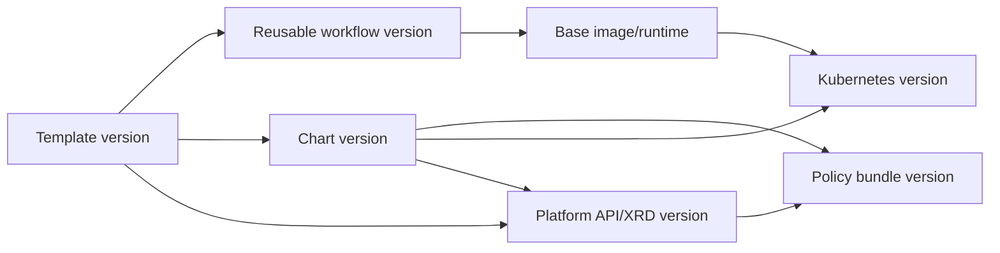
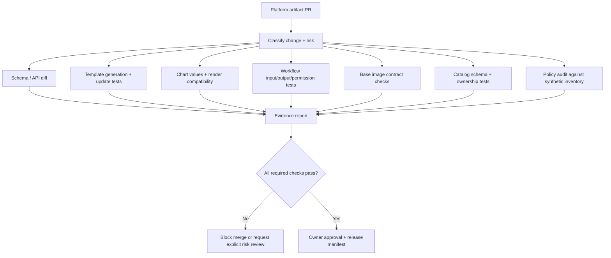

# Platform Governance, Deprecation, and Versioning

**Target file:** `09-platform-governance-deprecation-and-versioning.md` | **Estimated time:** 36–48 hours | **Prerequisites:** Stages 0–2D; Stage 2E M01–M15; M16 Units 1–8; Git, Python, YAML/JSON, CI/CD, Kubernetes, GitOps and basic SRE concepts.

**Core tools:** Git, Python 3 standard library, PyYAML (optional but used by the YAML fixture examples), JSON/YAML, Markdown, local scripts and `unittest`.  
**Plat+Control awareness:** `kind`, Argo CD, Crossplane, one policy engine (Kyverno or Kubernetes-native admission policy), local registry and throwaway signing keys.  
**Awareness:** CODEOWNERS, Conventional Commits, OpenAPI schema diff tooling, Backstage release policy, Copier update workflow, SBOM/provenance tooling, technology radars, LTS-like tracks.  
**Last reviewed:** 2026-11-03.  
**Tool baseline assumed:** Python 3.11+ syntax; record the exact installed Python, Git, PyYAML, OpenSSL, Kubernetes, Crossplane, Argo CD, Kyverno, Backstage and Copier versions. Tool behavior that depends on a selected version is marked `[VERIFY]`.  
**Stack profile required:** Plat-Core required; Plat+Control optional.  
**Footprint:** Plat-Core is local files and Python and should be lightweight. Plat+Control adds Kubernetes controllers and must be run one lab at a time. Planning baseline is approximately 4 CPU cores, 8 GB RAM and 30 GB disk; measure your own environment.  
**Synthetic data:** Yes. All teams, repositories, artifacts, timelines, consumers, costs, incidents and governance decisions are synthetic or illustrative.

> **Evidence labels:** `[ROADMAP REQUIREMENT]` is explicitly required by the M16 syllabus or Unit 9 prompt. `[ENGINEERING RECOMMENDATION]` is a defensible practice to adapt. `[ASSUMPTION]` is a local design choice. `[ILLUSTRATIVE]` marks invented teaching values or timelines. `[VERIFY]` marks a claim or integration that must be checked against the selected version or primary source. `[NOT EXECUTED]` means the example is provided but was not run in this authoring environment. `[SYNTHETIC]` marks generated fixtures and scenario results.

## Handoff, Scope, and Learning Outcomes

### Why Unit 9 exists

M16 has already taught how to design and operate platform capabilities. Unit 9 governs how those capabilities evolve after teams begin depending on them. A platform API, template, policy bundle, CI workflow, base image or catalog schema is a shared contract: changing it can affect many consumer repositories and runtime environments at once. Without ownership, compatibility rules, usage evidence, migration support and removal gates, the platform accumulates unsafe version skew and surprise breakages. Governance is therefore an engineering control plane for change—not a committee that approves every edit.

### Handoff from M16 Units 1–8

This lesson reuses the prior M16 artifacts and keeps their ownership boundaries:

| Earlier unit | Reuse in Unit 9 | Unit 9 does not re-teach |
|---|---|---|
| Unit 1 — Platform as a Product | Platform customer, product ownership, thinnest viable platform, feedback and value framing | Platform strategy and product discovery |
| Unit 2 — Golden Paths | Golden-path archetypes, required labels, supported defaults and escape hatches | Golden-path design itself |
| Unit 3 — Self-Service Provisioning | Entitlement registry, request contracts, Git/PR provisioning and safe lifecycle workflows | Provisioning implementation |
| Unit 4 — Portal and Catalog | Catalog entity identity, owner groups, relationships, `ownership/teams.json`, annotation/schema conventions | Portal implementation and catalog ingestion |
| Unit 5 — Scaffolding and Templates | Copier/template repository versioning, `.copier-answers.yml`, generated repositories, update campaigns and conflict review | Template engine implementation and update mechanics |
| Unit 6 — Crossplane Platform APIs | `platform.example.org`, XRD/API schemas, `ModelEndpoint`, `DataEnvironment`, composition revisions and consumer claims | Crossplane fundamentals and composition construction |
| Unit 7 — Tenancy and Isolation | Synthetic tenant model, tenant contracts, trust tiers, onboarding/offboarding and isolation gates | Tenant model and isolation implementation |
| Unit 8 — Platform SLOs, Adoption and DX | Platform SLOs, synthetic journey events, adoption measures, team-level reporting and privacy principles | SLO derivation, KPI pipeline and DX research foundations |

**Continuity contract.** Use the existing synthetic team names `analytics`, `ml-research`, and `risk-platform`. Unit 7 maps them to tenant aliases and namespaces as follows: `team-a` → `analytics` → `tn-team-a` → `CC-SYNTH-ANALYTICS-01`; `team-b` → `ml-research` → `tn-team-b` → `CC-SYNTH-ML-RESEARCH-01`; `team-c` → `risk-platform` → `tn-team-c` → `CC-SYNTH-RISK-PLATFORM-01`. These identifiers represent different concepts and must not be collapsed into one identity field. Reuse Unit 2's illustrative labels `team`, `service`, `env`, `cost-center`, and `tier`; Unit 3's entitlement registry; Unit 4's normalized catalog ownership projection; Unit 5's template metadata and update process; Unit 6's illustrative API group `platform.example.org`; and Unit 8's privacy-safe, team-level platform metrics. Confirm exact repository values against the learner's actual files before production use.

### Earlier module dependencies

- **M02:** Git, reusable CI workflows, Conventional Commits and the learner's existing SemVer foundations.
- **M06:** Helm chart versions and values contracts.
- **M08/M14:** GitOps, release rings, rollout promotion, feature flags, fleet upgrade and rollback patterns.
- **M09:** identity, secret rotation and access review.
- **M10:** change freezes, incident roles, incident communication, postmortems and sustainable on-call.
- **M12:** policy lifecycle, supply-chain controls, SBOMs, provenance, signatures and privileged-component review.
- **M13:** backup/recovery and model/prediction regression tests.
- **M14:** supported-version inventory and fleet/EOL management.
- **M15:** showback, cost of supporting old versions, GPU/CUDA capacity and upgrade-cost trade-offs.

These are inputs to governance. Reuse them rather than duplicating their full mechanisms.

### Scope boundaries

**This unit teaches:** decision rights; governed-artifact inventory; artifact-specific compatibility contracts; compatibility matrices; RFCs and ADRs; SemVer and non-SemVer versioning; release manifests and change logs; rollout rings; compatibility CI; policy impact analysis; deprecation and removal; exceptions and expiry; supported versions/EOL; ownership and documentation freshness; dependency governance; risk registers; lifecycle states; data/ML artifact governance; program metrics; runbooks; platform sunset and portability.

**This unit defers:** template generation/update implementation to Unit 5; catalog/portal implementation to Unit 4; Crossplane composition construction to Unit 6; isolation and tenant onboarding to Unit 7; full platform SLO and adoption measurement design to Unit 8; M02/M06/M08/M10/M12/M14 mechanics to their owning modules. It integrates their outputs into a governance lifecycle.

### Plat-Core and Plat+Control

| Profile | What runs | Required? | Safety and resource guidance |
|---|---|---:|---|
| **Plat-Core** | Git repository, YAML/JSON fixtures, Python validator/classifier/gates, `unittest`, synthetic usage and policy reports | Yes | No cluster required; recommended first pass |
| **Plat+Control** | Plat-Core plus a disposable `kind` cluster, one policy engine, Crossplane/Argo CD only where the lab explicitly needs them, and throwaway signing keys | Optional | Start only the components needed for one lab; never use production credentials or clusters |

Do not install Backstage, Crossplane, Argo CD, Kyverno and a full observability stack together on an 8 GB laptop. Stop optional controllers after the relevant lab. If the machine is constrained, complete the Plat-Core simulation and document the missing fidelity.

### Learning outcomes

By completion, the learner can:

1. **[L1]** Explain the value and failure modes of lightweight platform governance.
2. **[L1]** Inventory governed artifacts with owners, backup owners, consumers, version, support level, compatibility contract, security impact, deprecation state, EOL and evidence source.
3. **[L1]** Classify compatibility changes for templates, APIs/XRDs, charts, policies, workflows, images, catalog schemas and runtimes.
4. **[L2]** Build a compatibility matrix and CI-style harness that rejects unsupported combinations.
5. **[L2]** Write RFCs, ADRs, decision-rights matrices, release manifests, changelogs and migration records.
6. **[L2]** Run policy impact analysis in audit mode and require an approved report before staged enforcement.
7. **[L2]** Operate a deprecation pipeline with fresh usage evidence, migration assistance, exceptions and a safe removal gate.
8. **[L3]** Design governance weight proportional to blast radius, consumer impact and reversibility.
9. **[L3]** Govern dependencies, catalog schemas, policies, data/ML runtimes, models, datasets, GPU drivers and CUDA compatibility without inventing upstream lifecycle facts.
10. **[L4]** Operate governance metrics, migration campaigns, incident runbooks, platform sunset plans, portability exercises and an auditable evidence trail.

---

## 1. Why Platform Governance Exists

### 1.1 Shared defaults create shared blast radius

A platform team does not merely publish optional examples. It owns artifacts that other teams consume as defaults or contracts. A small change can multiply across repositories:

- A base image removes a binary used by every generated service.
- A template changes a required parameter and breaks update automation.
- A Crossplane XRD changes validation or a default and causes existing claims to stop reconciling.
- A policy bundle changes from audit to enforce and blocks previously accepted deployments.
- A reusable CI workflow changes required permissions or outputs.
- A catalog schema changes owner/relationship semantics and breaks automation that relies on the catalog.

Governance establishes five things:

1. **Accountability:** one owner and a backup for every shared artifact.
2. **Stability promises:** what consumers can rely on at each lifecycle state.
3. **Decision rights:** who can approve, reject, defer or emergency-override a change.
4. **Change evidence:** what was tested, who was affected, what was communicated and how to roll back.
5. **Lifecycle control:** how consumers migrate and when old versions can be retired.

A platform with no governance eventually turns into a collection of unrelated tools and undocumented contracts. A platform with excessive governance becomes a slow approval queue that teams route around.

### 1.2 Governance should be lightweight guardrails

**[ROADMAP REQUIREMENT]** Governance should be lightweight guardrails and clear decision rights—not bureaucracy that slows everyone down.

Use the following principles:

| Principle | Operational meaning | Anti-pattern |
|---|---|---|
| Guardrails over manual gates | Automate deterministic checks in CI or policy evaluation | A committee manually approves every patch |
| Humans decide on risk | Reserve human review for breaking, security-sensitive or high-blast-radius changes | Treating a documentation typo like an identity-policy change |
| Transparency | Publish contracts, decisions, release notes and exceptions in Git | Hidden decisions in private chat |
| Consumer voice | Ask design partners to test migrations before broad release | Announce a mandate after implementation |
| Proportionality | Increase process weight with blast radius and irreversibility | One process for every change |
| Time-boxing | Review windows and escalation paths have explicit owners | RFCs wait indefinitely |
| Sunset clauses | Exceptions and temporary policies expire or are renewed deliberately | Permanent exceptions by neglect |
| Safe defaults | The compliant path is easiest and has a documented escape hatch | Hidden policy behavior or unexplained denial |
| Evidence over assertion | A claim is backed by a test, report or owner review | “It should be compatible” |

### 1.3 Too much governance versus too little

| Governance failure | What happens | Corrective design |
|---|---|---|
| Too much | Teams wait weeks for low-risk changes, bypass controls, fork templates and build shadow platforms | Fast path for low-risk changes; automated checks; review thresholds |
| Too little | Incompatible versions proliferate, no one owns migrations, policies drift and outages repeat | Artifact inventory, compatibility contract, release gates and ownership |
| Centralized but opaque | Platform team becomes a bottleneck and consumers distrust decisions | Public RFC/ADR repository and advisory group |
| Federated without minimum standards | Different teams create incompatible local APIs and security posture | Shared minimum contract plus bounded local extension points |
| Mandated migration without support | Teams resist, delay or create shadow tooling | Migration kits, automated PRs, office hours and time-bound exceptions |

### 1.4 Change-risk classification

A useful first-pass risk score considers:

- **Blast radius:** number and criticality of affected consumers.
- **Compatibility:** whether existing consumers continue to work.
- **Security:** whether the change alters privilege, identity, policy, trust or supply chain.
- **Reversibility:** whether rollback restores the previous state without data loss.
- **Observability:** whether the platform can detect failure and identify affected consumers.
- **Consumer effort:** migration work, retraining, testing and operational burden.

A documentation typo is low blast radius and reversible. A new policy denial across all tenants is high blast radius and may block production delivery. A credential or base-image security emergency can justify expedited change, but still needs a documented decision, canary/verification and clear communication.

### 1.5 Worked example: a default that silently breaks consumers

`ModelEndpoint` previously defaulted to `exposure: internal`. A new release changes the default to `exposure: public` while leaving the field name and schema unchanged.

The YAML still validates. A schema diff may show no required-field change. Yet the security boundary has changed. The platform must classify the change by **behavioral contract**, not only structural diff:

1. Identify all consumers that omit `exposure`.
2. Determine whether the new default changes network reachability or identity requirements.
3. Treat the default change as breaking/high-risk unless a documented contract explicitly says the default is unstable.
4. Introduce an explicit opt-in field or a new API version.
5. Run negative tests proving an internal service cannot become publicly reachable without the required authorization.
6. Roll out to synthetic canary consumers before broad promotion.

**Key lesson:** unchanged field names do not imply unchanged behavior.

### 1.6 Build/adopt/buy and thin/rich governance

| Choice | Benefit | Cost/risk | Choose when |
|---|---|---|---|
| Local Git + Python governance toolkit | Portable, transparent, zero-cost, easy to inspect | You own schema and automation | Small platform or learning lab |
| Existing CI and CODEOWNERS | Uses familiar controls | Provider-specific behavior; review rules need validation | Repository already has mature CI |
| Dedicated policy platform | Centralized policy tests and reporting | Additional operations and version coupling | Policy fleet is large enough to justify it |
| Rich governance portal | Discoverability and workflow integration | Portal/plugin maintenance and possible lock-in | Consumers need more than Git documentation |
| Thin public repository | Low overhead, clear source of truth | Less guided user experience | Early-stage platform or small team |

Do not buy governance machinery to compensate for unclear ownership or missing contracts. Start with inventory, clear ownership, versioning, tests and a public decision record.

---

## 2. Platform Artifact Inventory and Ownership

### 2.1 What belongs in the inventory

**[ROADMAP REQUIREMENT]** Inventory all shared artifacts that can affect consumer delivery or runtime behavior.

| Artifact family | Example | Owner must govern |
|---|---|---|
| Platform APIs/XRDs | `ModelEndpoint`, `DataEnvironment` | Schema, defaults, versions, composition references, conversion and migration |
| Golden paths | API, batch, streaming, model-serving archetypes | Required metadata, defaults, supported combinations, escape hatches |
| Software templates | Copier templates and update campaigns | Inputs, generated outputs, update semantics, migration notes |
| Charts/libraries | Helm library chart and values schema | Values contract, rendered resources, supported Kubernetes versions |
| Policy bundles | Security and tenancy policy packs | Scope, audit/enforce mode, newly denied resources, exceptions |
| CI reusable workflows | Build/test/deploy workflows | Inputs, outputs, permissions, runner assumptions |
| Base images | Python service and notebook images | UID/GID, packages, CA roots, runtime, vulnerability fixes |
| Catalog schemas | Entity kinds, types, relations, annotations | Required fields, ownership resolution, relationship migration |
| Runtimes | Python, Node.js, Java, CUDA, drivers | ABI, supported version range, compatibility and EOL |
| Kubernetes/fleet | Cluster versions and add-ons | Supported skew, API removals, controller compatibility |
| Tooling/dependencies | Backstage, Crossplane, Argo CD, Kyverno, Copier, KEDA, OpenCost | Upgrade policy, security advisories, portability and exit strategy |
| Platform service promises | SLOs, support tiers, maintenance windows | Support boundaries, reliability and change communication |
| Data/ML artifacts | Notebook images, model metadata, dataset contracts | Reproducibility, prediction behavior, lineage and lifecycle state |

### 2.2 Required inventory contract

Every inventory record must include:

- stable artifact ID and artifact type;
- human-readable name;
- owner and distinct backup owner;
- current version or release identifier;
- consumer list or consumer-discovery source;
- support level and deprecation status;
- EOL date or explicit `null` with a reason;
- compatibility contract and tested matrix reference;
- security impact;
- evidence source and last verified date;
- release channel or ring;
- rollback/recovery reference;
- dependency references.

**Do not invent actual owners or upstream EOL dates.** Use synthetic owner aliases and synthetic dates in the lab. For real repositories, resolve ownership through the catalog and CODEOWNERS.

### 2.3 Example YAML inventory

The following is a synthetic fixture. It is intentionally small enough to review by hand.

```yaml
artifacts:
  - id: api-modelendpoint
    artifact_type: platform_api
    name: ModelEndpoint
    owner: platform-team
    backup_owner: platform-sre
    version: "1.2.0"
    consumers: [analytics, ml-research]
    support_level: supported
    deprecation_status: active
    eol_date: "2027-06-30"
    evidence_source: "catalog+synthetic-xr-inventory"
    compatibility_contract: "matrix-modelendpoint-v3"
    security_impact: high
    last_verified: "2026-11-03"

  - id: template-python-service
    artifact_type: software_template
    name: python-service
    owner: platform-developer-experience
    backup_owner: platform-sre
    version: "2.4.1"
    consumers: [analytics, risk-platform]
    support_level: supported
    deprecation_status: active
    eol_date: "2027-03-31"
    evidence_source: "copier-answers-in-synthetic-repos"
    compatibility_contract: "matrix-template-v2"
    security_impact: medium
    last_verified: "2026-11-03"

  - id: policy-runtime-baseline
    artifact_type: policy_bundle
    name: runtime-baseline
    owner: platform-security
    backup_owner: platform-sre
    version: "3.1.0"
    consumers: [analytics, ml-research, risk-platform]
    support_level: maintained
    deprecation_status: active
    eol_date: "2027-01-31"
    evidence_source: "synthetic-policy-inventory"
    compatibility_contract: "policy-contract-v3"
    security_impact: critical
    last_verified: "2026-11-03"

  - id: base-image-python
    artifact_type: base_image
    name: python-runtime
    owner: platform-runtime
    backup_owner: platform-sre
    version: "2026.10"
    consumers: [analytics, ml-research]
    support_level: deprecated
    deprecation_status: migration
    eol_date: "2026-12-15"
    evidence_source: "synthetic-image-reference-scan"
    compatibility_contract: "image-contract-python-v2"
    security_impact: high
    last_verified: "2026-11-03"
```

### 2.4 Ownership is an operational property

An owner is accountable for:

- contract accuracy;
- release notes and migration guidance;
- compatibility test coverage;
- consumer communication;
- exception review;
- EOL and support status;
- incident response and follow-up;
- handover and backup-owner readiness.

A backup owner is not a decorative field. The backup must be able to review a release, locate evidence and execute the runbook. A single owner with no backup is a bus-factor risk.

**Ownership-gap report example — [SYNTHETIC]:**

```text
artifact_id                 finding
template-legacy-notebook    missing backup owner
policy-old-namespace        owner group unresolved
chart-data-service          owner and backup are the same person
```

### 2.5 EOL tracking and evidence freshness

EOL is not merely a date column. The inventory must distinguish:

- **known EOL:** verified from an authoritative lifecycle source;
- **synthetic EOL:** a teaching date that must never be mistaken for upstream truth;
- **unknown EOL:** no verified date; owner must define the next review action;
- **overdue:** the date passed and the artifact still appears supported or maintained.

A report must include its `as_of` date and source freshness. An unknown date is not “not EOL.” It is an unresolved risk.

M14 Unit 2's `supported-versions.yaml` approach is reused and extended to platform APIs, templates, charts, policy bundles, workflows and runtimes. Current upstream dates are `[VERIFY]` against each vendor's official lifecycle page.

### 2.6 CODEOWNERS and source-of-truth hierarchy

A platform repository may use:

```text
# .github/CODEOWNERS — illustrative provider syntax; verify the SCM host
/platform-apis/       @platform-api-owners
/templates/           @platform-developer-experience
/policies/            @platform-security
/images/              @platform-runtime
/catalog/              @platform-catalog-owners
/releases/             @platform-release-owners
```

`CODEOWNERS` routes review; it does not replace the accountable owner registry, nor does it prove a person is available. Confirm the actual SCM host's syntax and branch-protection behavior `[VERIFY]`.

**Source-of-truth precedence [ENGINEERING RECOMMENDATION]:**

1. Versioned artifact repository and signed/attested release evidence.
2. Catalog projection for consumer discovery and ownership lookup.
3. Usage telemetry and runtime inventory for observed adoption.
4. Dashboards and reports as derived views, never the only source.
5. Chat, ticket or meeting notes as communication records, not authoritative contracts.

### 2.7 Inventory failure modes

| Failure | Symptom | Safe response |
|---|---|---|
| Missing owner | No one approves an emergency fix | Assign accountable owner before further release |
| Missing backup | Single-person dependency | Cross-train and rehearse handover |
| Stale consumer list | Deprecation misses a repository | Reconcile catalog, Git references and runtime inventory |
| Invented EOL | False urgency or false assurance | Replace with source-backed date or `unknown` |
| Unsupported artifact still marked supported | Security fixes not planned | Correct support state and notify consumers |
| Same owner and backup | Nominal but ineffective redundancy | Require distinct accountable roles |

---

## 3. Versioning and Breaking-Change Semantics

### 3.1 SemVer is a convention built on a declared contract

Semantic Versioning 2.0.0 defines `MAJOR.MINOR.PATCH` for a declared public API:

- **MAJOR:** backward-incompatible public API change.
- **MINOR:** backward-compatible functionality addition.
- **PATCH:** backward-compatible bug fix.

A versioned release must not be mutated in place; publish a new version. The SemVer specification explicitly depends on declaring the public API first. Therefore, a version string without a compatibility contract is not enough. See the official [Semantic Versioning 2.0.0 specification](https://semver.org/).

**Example:** `2.4.1 → 2.4.2` may fix a defect without changing the contract; `2.4.1 → 2.5.0` may add an optional compatible input; `2.4.1 → 3.0.0` signals a breaking change.

SemVer is not automatically the correct versioning scheme for every artifact. Some projects use release trains, date-based versions, Kubernetes API versions or independently versioned package components. Read the upstream project's own policy. Backstage, for example, documents a release versioning policy in which the umbrella release line does not follow SemVer, while individual packages use SemVer; its documented package and release skew rules matter to adopters. Do not assume the Backstage release number alone guarantees every plugin combination.

### 3.2 Artifact-specific compatibility contract

A change is breaking when a consumer that followed the previous documented contract can no longer build, validate, deploy, operate, upgrade or obtain the same promised behavior.

| Artifact | Breaking change examples | Compatible change examples | Subtle failure |
|---|---|---|---|
| Template | Rename a generated file that CI imports; remove an input; change required parameter; alter generated path | Add optional parameter with safe default; add optional documentation | Default changes generated runtime behavior while schema stays identical |
| Platform API/XRD | Remove/rename field; tighten validation; change semantics; change default; alter status/claim behavior | Add optional field without changing existing behavior | New default causes public exposure or higher cost |
| Helm chart | Remove values key; change value type; change rendered service or storage behavior | Add optional values key | Default storage class or resource limit changes |
| Policy bundle | Newly deny a previously allowed workload; change scope or exception behavior | Add audit-only warning or non-blocking report | Audit mode silently becomes enforce |
| CI reusable workflow | Rename input/output; require new permission; change artifact name or job contract | Add optional input/output with documented default | New permission requirement breaks least-privilege caller |
| Base image | Remove binary/library; change UID/GID; change CA bundle, runtime or ABI | Add a package without altering contract | UID change breaks mounted-volume ownership |
| Catalog schema | Require field; change entity kind/type/relationship meaning; remove annotation | Add optional metadata or new allowed type | Field rename breaks alert routing or ownership lookup |
| Runtime/tooling | Remove supported runtime; ABI/driver behavior change; CLI flag removal | Add tested version to supported range | Runtime still starts but prediction numerics drift |
| Model/dataset contract | Change input feature meaning, schema, preprocessing or lineage semantics | Add optional metadata or backward-compatible field | Same schema, different feature transformation |

### 3.3 Before/after examples

**Template input rename — breaking:**

```yaml
# v2.4.1 answers contract
service_owner:
  type: str
  required: true
```

```yaml
# v3.0.0 proposed contract
owner_team:
  type: str
  required: true
```

A consumer's existing answers file still contains `service_owner`. The new template may fail, ignore the old answer or generate incomplete metadata. The migration must map the old key to the new key and test generated repositories.

**XRD default change — breaking in behavior:**

```yaml
# v1 contract (illustrative)
exposure:
  type: string
  default: internal
```

```yaml
# Proposed v1 behavior (unsafe if silently changed)
exposure:
  type: string
  default: public
```

Do not ship this as a patch or a harmless default cleanup. The consumer-facing security behavior changed. Preserve the old default, introduce explicit opt-in, or publish a new API version and migration plan.

**Policy mode change — breaking:**

```yaml
# Audit phase: records a violation but permits the request.
mode: audit
```

```yaml
# Enforce phase: blocks non-compliant requests.
mode: enforce
```

The YAML shape may be unchanged, but deployment behavior changes. The impact report and approval gate must be part of the release evidence.

**Additional artifact-specific before/after examples — classify by the contract.**

**Chart values key removed — breaking:**

```yaml
# Previous chart values
replicas: 2
```

```yaml
# New chart values schema
replicaCount: 2
```

Consumers setting `replicas` lose their configured value or fail schema validation. Provide a migration alias or a major contract change with a migration note.

**Reusable workflow adds a required permission — breaking:**

```yaml
# Previous caller permissions
permissions:
  contents: read
```

```yaml
# New workflow requires package publishing
permissions:
  contents: read
  packages: write
```

Consumers with least-privilege caller permissions may fail. Document the new permission, explain why it is needed, and test callers that do not grant it.

**Base image changes UID — breaking when UID is contractual:**

```dockerfile
# Previous image
USER 10001
```

```dockerfile
# New image
USER 1000
```

Mounted volume ownership, file permissions and runtime security assumptions can change. Add an image contract test and a migration plan; do not call this a harmless rebuild.

**Catalog schema makes a field required — breaking:**

```yaml
# Previous local schema contract
owner:
  required: false
```

```yaml
# New local schema contract
owner:
  required: true
```

Existing entities without `owner` fail validation or disappear from ownership workflows. Run a full catalog scan, provide a migration script and validate relationships before enforcement.

**Runtime ABI changes — potentially breaking:**

```yaml
# Previous tested runtime tuple
python: "3.11"
native_extension_abi: "cp311"
```

```yaml
# Candidate runtime tuple
python: "3.12"
native_extension_abi: "cp312"
```

Native wheels compiled for the previous ABI may fail to import or behave differently. Rebuild dependencies, test training and serving paths, and classify based on the declared runtime contract. Exact ABI behavior is `[VERIFY]` for the selected runtime and package.

**CI workflow output rename — breaking:**

```yaml
# Previous output contract
outputs:
  image_ref: ${{ jobs.build.outputs.image_ref }}
```

```yaml
# Candidate output contract
outputs:
  image_digest: ${{ jobs.build.outputs.image_digest }}
```

Downstream workflows reading `image_ref` fail or lose the artifact reference. Provide an alias period or a versioned workflow contract.

### 3.4 SemVer decision procedure

For every change:

1. Identify the artifact's declared consumer contract.
2. Identify all inputs, outputs, defaults, side effects, permissions, schemas and support promises.
3. Compare old and new behavior—not only text or schema shape.
4. Ask whether an existing compliant consumer still works without modification.
5. Ask whether the change tightens security or validation in a way that blocks previously accepted usage.
6. Ask whether generated output or runtime behavior changes.
7. If uncertain, classify as `manual_review`; do not auto-label as patch.
8. Assign the version according to the artifact's published policy.
9. Publish migration guidance and test evidence.

A rule-based classifier can identify known patterns; it cannot infer every semantic effect. Human review remains mandatory for high-risk or ambiguous changes.

### 3.5 Support levels and version skew

Define support status independently from the version number:

| Status | Meaning | Consumer promise |
|---|---|---|
| **Supported** | Current, tested and eligible for normal support | Defects and security issues handled under published support policy |
| **Maintained** | Still supported for a defined transition window, often with narrower changes | Security/critical fixes and migration assistance as explicitly stated |
| **Deprecated** | No new adoption; replacement and removal path announced | Support/fix policy and end date are explicit |
| **Unsupported** | No normal fixes or support | Consumer must migrate or accept documented risk |

`N` and `N−1` support is a possible local policy, not a universal rule. Choose support windows based on consumer upgrade capability, security risk, upstream cadence, compatibility test cost and operational capacity. An LTS-like track is `[ASSUMPTION]` until an owner, maintenance budget and compatibility contract exist.

### 3.6 Deprecation versus EOL versus removal

- **Deprecation:** the platform signals that consumers should stop adopting an artifact and begin migrating.
- **End of support/EOL:** the stated support window ends; fixes and assistance narrow or stop according to policy.
- **Removal:** the capability or version is no longer served, distributed or accepted.
- **Archive:** evidence and documentation are preserved for audit, forensics and historical reproducibility.

These are separate state transitions. Announcing deprecation does not mean a version is already removed.

Kubernetes publishes a formal API deprecation policy covering API stability tracks, versioning and removal constraints. Use it as a model for explicit stability promises, but do not copy its exact timelines into your platform policy. Verify the current official policy and the exact Kubernetes version in scope.

### 3.7 Deprecation vocabulary and timeline

The general lifecycle is:

```text
supported → announce deprecation → warn → observe usage
          → assist migration → optional brownout simulation
          → removal gate → remove/retire → archive evidence
```

All example dates and support windows in this lesson are `[ILLUSTRATIVE]`. A real timeline must be approved based on security urgency, number of consumers, migration complexity, support capacity, data retention and contractual constraints.

### 3.8 Compatibility matrix: contract, not cartesian explosion

A platform consumer uses a combination of versions:

`template ↔ reusable workflow ↔ chart ↔ policy bundle ↔ Kubernetes ↔ platform API/XRD`

Do not promise every possible combination. Publish the combinations you test and support.

**Synthetic matrix:**

| Template | Workflow | Chart | Policy | Kubernetes | Platform API | Status | Validation owner |
|---|---|---|---|---|---|---|---|
| `2.4` | `3.2` | `1.8` | `3.1` | `1.31` | `v1alpha1` | Supported | platform-release |
| `2.4` | `3.2` | `1.8` | `3.1` | `1.32` | `v1alpha1` | Supported | platform-release |
| `3.0` | `4.0` | `2.0` | `4.0` | `1.32` | `v1beta1` | Migration | platform-api |
| `2.4` | `4.0` | `1.8` | `3.1` | `1.31` | `v1alpha1` | Unsupported | platform-release |
| `3.0` | `3.2` | `1.8` | `4.0` | `1.32` | `v1beta1` | Unsupported | platform-release |

The compatibility harness should:

1. read the supported matrix from version-controlled data;
2. generate or select the matching template fixture;
3. validate the reusable workflow input/output contract;
4. render the chart or validate its values schema;
5. evaluate the policy bundle in audit mode;
6. validate the API schema/version combination;
7. record the tested tuple and tool versions;
8. fail CI when a declared supported tuple fails.

### 3.9 Pinning versus floating

| Strategy | Benefit | Risk | Suitable for |
|---|---|---|---|
| Pin exact version/digest | Reproducible builds and incident rollback | Security fixes do not arrive automatically | Base images, production workflow references, critical charts |
| Allow compatible range | Easier patch/minor updates | Range may include an untested combination | Libraries with a real compatibility test matrix |
| Float to latest | Fast access to fixes and features | Surprise behavior and non-reproducible output | Disposable development only, or tightly controlled automation |
| Bot-generated update PR | Consumer review plus regular update cadence | PR fatigue; bot needs safe scope and rollback | Templates, dependencies and policy bundle updates |

Policy is artifact-specific. Pinning is not a substitute for a supported-version programme; floating is not a substitute for testing.

---

## 4. Compatibility Matrices and Version Skew

### 4.1 Why version skew is an operational risk

Version skew is the number and diversity of simultaneously supported combinations across dependent artifacts. It increases:

- CI matrix size and runtime;
- support and troubleshooting complexity;
- security patch propagation delay;
- consumer documentation branches;
- risk that a fix works only for the newest template;
- difficulty reproducing a production issue;
- migration debt when owners cannot identify the deployed combination.

The goal is not to minimize the number of versions at any cost. The goal is a **small, explicit, tested support surface** that matches consumer migration capacity.

### 4.2 Model the dependency graph



A release manifest should record the exact dependency tuple. A compatibility matrix should include both positive and negative combinations. A matrix with only supported rows is incomplete: it cannot prove that known-unsafe combinations are rejected.

### 4.3 Crossplane API versioning handoff

Unit 6 uses the synthetic API group `platform.example.org` and teaches `ModelEndpoint` and related platform APIs. Unit 9 governs the stability promise and migration lifecycle.

Crossplane XRD versions have Kubernetes-like maturity semantics, but exact XRD behavior is version-sensitive. The official Crossplane documentation explains that XRD versions have separate schemas and that adding a new version is distinct from changing an existing version's schema. Breaking schema changes require deliberate conversion or a new XRD strategy; a new required field is a breaking change. Verify the selected Crossplane release's docs rather than copying examples from `master`, which may describe an unreleased version.

**Governance review questions for `ModelEndpoint`:**

- Is the current API `v1alpha1`, `v1beta1` or `v1`?
- Which version is served?
- Which version is referenceable by the Composition?
- Do old and new schemas preserve meaning?
- Are conversion and storage behavior understood?
- Does the composition update change resource deletion or exposure behavior?
- Are consumer claims inventoried?
- Does the rollout have a canary, rollback and post-change report?

### 4.4 Compatibility owner and review cadence

Each matrix row needs a named validation owner and a date of last successful test. A compatibility tuple with no evidence date is not a tested contract. A tuple that has not been exercised against the current tool versions must be marked `unknown`, not `supported`.

### 4.5 Compatibility tests: positive and negative

Positive tests prove that supported tuples work. Negative tests prove that unsupported tuples are rejected before release. For example:

- Supported: template `2.4` + workflow `3.2` + chart `1.8` + policy `3.1` + Kubernetes `1.32` + API `v1alpha1`.
- Unsupported: template `2.4` + workflow `4.0` + chart `1.8` + policy `3.1` + Kubernetes `1.31` + API `v1alpha1`.
- Migration: template `3.0` + workflow `4.0` + chart `2.0` + policy `4.0` + Kubernetes `1.32` + API `v1beta1`.

The harness should fail closed for unknown combinations. A permissive fallback can accidentally approve an untested version tuple.

### 4.6 Version skew policy example

**[ILLUSTRATIVE] Local policy:**

- Keep one current supported line and one explicitly maintained migration line for templates and reusable workflows.
- Keep only combinations represented in the compatibility matrix.
- Require a migration plan before adding another maintained line.
- Reassess any line that remains unused or unsupported by current toolchains.
- Do not promise an LTS line until owners and test capacity are funded.
- Prioritize security fixes across every supported line or publish a clear exception and mitigation plan.

The exact number of lines is a platform policy choice, not an industry standard.

---

## 5. RFCs, ADRs, Decision Rights, and Consumer Input

### 5.1 RFC versus ADR

An **RFC (Request for Comments)** proposes a consequential change and invites review before implementation. An **ADR (Architecture Decision Record)** captures a decision and its context after the options have been evaluated.

| Mechanism | Main question | Typical artifact |
|---|---|---|
| RFC | Should we make this change, and how? | Proposal, alternatives, consumer impact, review comments |
| ADR | What did we decide, why, and what follows? | Status, context, decision, consequences, owner |
| Change record | What actually shipped? | Release ID, commit, evidence, affected consumers |
| Exception | Why is one consumer temporarily outside the standard? | Owner, rationale, controls, expiry and approver |

The purpose is a durable, searchable record—not paperwork for its own sake.

### 5.2 RFC lifecycle

```text
draft → time-boxed review → decision → implementation
      → post-change verification → retrospective
```

**[ILLUSTRATIVE]** Example review window: three working days for a normal RFC; emergency security changes use an expedited path with a written retrospective. These are local process choices, not universal standards.

### 5.3 RFC template

```markdown
# RFC-<ID>: <short title>

- Status: Draft | In Review | Accepted | Rejected | Superseded
- Author / accountable owner:
- Backup owner:
- Review opened / decision due:
- Risk class:
- Affected artifacts and versions:
- Affected consumers and evidence source:

## Problem and context
What developer or operational problem exists?

## Goals and non-goals
What will change? What will remain unchanged?

## Current contract
Document current behavior and compatibility promise.

## Options considered
For each option: benefit, cost, risk, migration effort.

## Proposed change
Include schemas, defaults, permissions, policy scope and release plan.

## Compatibility and migration
Breaking-change classification, supported combinations, migration kit,
dual-run or compatibility shim, rollback and removal plan.

## Security / reliability / cost impact
Threat-model delta, SLO impact, capacity and showback assumptions.

## Consumer input
Design partners, comments, unresolved objections and response.

## Decision rights
Approver roles and required approvals.

## Decision and consequences
Accepted/rejected/deferred; why; follow-up work.

## Verification and retrospective
Tests, canary evidence, post-change review date.
```

### 5.4 ADR template

```markdown
# ADR-<ID>: <decision title>

- Status: Proposed | Accepted | Rejected | Superseded
- Date:
- Decision owner:
- Related RFC:
- Related artifact versions:

## Context
The constraints and problem.

## Decision
The selected option and exact contract.

## Alternatives considered
Options rejected and why.

## Consequences
Consumer, security, operational and cost consequences.

## Migration / rollback
Required migration, compatibility window, rollback limits.

## Evidence
Test reports, compatibility matrix, policy impact report, consumer review.

## Review trigger
What future event should reopen this decision?
```

### 5.5 Decision-rights matrix

This RACI-style matrix is illustrative. Adapt role names and approval thresholds to the organization.

| Decision | Platform team | Security | SRE | FinOps | Consumer/design partner | Architecture group |
|---|---|---|---|---|---|---|
| Documentation typo | Accountable | Informed if security docs | Informed if runbook | — | Optional | — |
| Add optional template input | Accountable | Consulted if privilege changes | Consulted if operational defaults change | Consulted if cost changes | Review | — |
| Change platform API default | Responsible | Approver if security boundary changes | Approver if reliability changes | Consulted if cost changes | Required design-partner review | Consulted |
| Breaking XRD/API version | Responsible | Approver for security fields | Approver for operational impact | Consulted | Required review | Decision authority per charter |
| Policy audit-to-enforce | Responsible | Accountable/approver | Consulted | Consulted for resource policy | Impacted consumers review | Escalation for broad impact |
| Emergency security patch | Responsible | Accountable for security decision | Accountable for operational safety | Informed | Notified | Retrospective if bypassed |
| Retire a portal capability | Accountable | Consulted | Consulted | Consulted | Required migration review | Escalation if cross-domain |

**Decision rights must be explicit:** the table identifies who proposes, who evaluates, who approves and who is informed. A RACI table that does not distinguish decision authority from consultation is ambiguous.

### 5.6 Platform council lite charter

**Scope:** high-impact API, policy, identity, security, support-window and cross-platform compatibility decisions.

**Participants:** platform product/engineering, security, SRE, FinOps and rotating consumer representatives.

**Cadence:** `[ILLUSTRATIVE]` monthly, with asynchronous RFC review and emergency escalation.

**Not in scope:** documentation typo, internal refactor with no contract change, routine patch with passing compatibility tests, or a pre-approved low-risk dependency update.

**Outputs:** accepted/rejected RFCs, ADRs, risk acceptance with expiry, migration priorities and owner assignments.

**Escalation:** unresolved high-impact security/reliability disputes go to named accountable leaders. Do not leave decisions in an unowned “pending council” state.

### 5.7 Consumer/design-partner review

Select consumers by meaningful variation, not by convenience alone:

- one team on the current supported line;
- one team with a more complex service;
- one team with stricter trust or data classification;
- one team using an escape hatch or non-default integration.

Ask them to validate migration steps against a synthetic or disposable copy. Capture actual blockers, not only approval.

### 5.8 Two running RFC examples

**RFC-001 — Breaking `ModelEndpoint` API default**

- Change: `exposure` default behavior is proposed to change.
- Risk: high; potentially changes reachability.
- Decision: do not change the existing API version's behavior silently. Introduce an explicit field or new version; preserve existing behavior for current consumers.
- Required evidence: schema compatibility test, negative exposure test, consumer inventory, staged rollout and rollback decision.
- Consumers: synthetic `analytics`, `ml-research`, `risk-platform`.

**RFC-002 — New optional capability**

- Change: add optional `observabilityProfile` to the API.
- Risk: medium if default is no-op and does not alter existing resources.
- Decision: add as optional with documented default, schema test, and compatibility matrix update.
- Required evidence: old manifests still validate; new field works for opted-in consumers; no cross-tenant visibility change.

---

## 6. Release Management and Rollout Rings

### 6.1 Release lifecycle

A platform release is a reproducible, attributable artifact plus the evidence required to consume it. A platform may use a coordinated release train such as a monthly train with an emergency path `[ILLUSTRATIVE]`, or independently release components. The chosen cadence must match the actual compatibility and consumer-support capacity.

```text
source commit → tests → compatibility report → build/package
             → provenance/signature → release manifest
             → canary → early adopters → general
             → post-change verification → archive
```

A release must not be “a tag that happens to exist.” It should identify:

- artifact name and version;
- immutable source commit;
- dependency versions and compatibility range;
- build output digest;
- release notes and migration steps;
- security fixes and known risks;
- owner and backup owner;
- provenance/signature references;
- rollout ring and health gates;
- rollback or pinning instructions;
- verification report and release date.

### 6.2 Release manifest example

```yaml
release:
  artifact_id: template-python-service
  artifact_version: "2.5.0"
  release_channel: stable
  source:
    repository: "local://platform-templates"
    commit: "0123456789abcdef0123456789abcdef01234567"
  compatibility:
    template_contract: "template-v2"
    workflow_range: "3.2.x"
    chart_range: "1.8.x"
    policy_range: "3.x"
    kubernetes_range: "1.31-1.32"
    platform_api: "platform.example.org/v1alpha1"
  changes:
    - "Added optional data-lineage documentation scaffold."
    - "No existing required answer keys removed."
  migration:
    required: false
    guide: "docs/releases/template-2.5.0.md"
  security:
    fixes: []
    sbom: "evidence/sbom-template-python-service-2.5.0.json"
  provenance:
    attestation_ref: "evidence/provenance.json"
    signature_ref: "evidence/release.sig"
    verification_status: "not-yet-verified"
  ownership:
    owner: platform-developer-experience
    backup_owner: platform-sre
  risks:
    - "Optional generated documentation path must be checked in consumer repositories."
  rollback:
    action: "Pin consumers to the previous immutable tag and revert generated PRs."
    limits: "Does not undo consumer changes already merged."
```

The values are synthetic. A manifest field called `verification_status` does not prove a signature was checked. The release pipeline must produce and preserve actual verification output.

### 6.3 Changelog and release notes

Use a human-readable changelog that separates:

- Added;
- Changed;
- Deprecated;
- Removed;
- Fixed;
- Security.

**Example:**

```markdown
## 2.5.0 — [ILLUSTRATIVE]

### Added
- Optional `data_lineage_docs` template capability.

### Changed
- Generated documentation navigation now links to the catalog entity.

### Deprecated
- None.

### Removed
- None.

### Fixed
- Corrected a generated README link.

### Security
- No security fix is claimed in this illustrative release.

### Migration
- No required answer-file migration.
- Review the generated docs path before merging update PRs.

### Compatibility
- Tested against the supported tuple in `compatibility/matrix.json`.
```

[Conventional Commits 1.0.0](https://www.conventionalcommits.org/en/v1.0.0/) can help generate change categories, but commit messages are not the compatibility contract. A commit labelled `feat` can still introduce a breaking default; review actual behavior.

### 6.4 Signed release and provenance

M12's supply-chain concepts are reused. A production pipeline should bind the source revision, build process, artifact digest and release identity, then verify the provenance/signature against an approved trust root.

**Do not confuse these:**

- SHA-256 digest: identifies bytes; it does not prove who produced them.
- Signature: authenticates a signed payload relative to a trusted key.
- Provenance attestation: describes how an artifact was built and from what source.
- SBOM: inventories software components; it does not by itself prove the artifact is safe.

Use throwaway keys only in the lab. Do not commit private keys. Exact `cosign`, SLSA, in-toto or OpenSSL commands are version-sensitive; verify the selected tool's official docs before relying on flags or formats. A locally generated signature is a learning exercise, not a production trust framework.

### 6.5 Release rings

| Ring | Audience | Required checks | Advance condition |
|---|---|---|---|
| Canary | One or a few synthetic/design-partner consumers | Contract tests, SLO signals, logs, rollback readiness | No critical regression; telemetry fresh; owner acknowledges |
| Early adopters | Selected varied consumers | Compatibility matrix, migration friction, support load | No unresolved high-severity issue; migration evidence reviewed |
| General | All eligible consumers | Release notes, support readiness, docs, rollback and status communication | Release owner approves broad availability |

Canary selection must include a representative risk profile. Do not choose only the simplest consumer.

### 6.6 Health gates and abort criteria

**[ILLUSTRATIVE]** Define thresholds before rollout; never invent a universal threshold.

Example gate fields:

- platform SLO status and error-budget state;
- synthetic journey success and latency;
- newly failing compatibility combinations;
- policy denial rate and affected resources;
- ticket/support signal;
- consumer acknowledgement;
- telemetry freshness;
- security scan and provenance verification;
- ability to pin or revert.

**Abort** if a critical consumer path fails, the telemetry pipeline is stale, an unexpected policy denial blocks deployment, the API controller stops reconciling, a signature cannot be verified, or rollback is not safe.

### 6.7 Rollback is not always reversal

Rollback options differ:

- Pin consumers to a previous immutable template/workflow/chart version.
- Revert the GitOps desired-state commit.
- Disable a feature flag.
- Restore the previous policy bundle in audit or enforce mode.
- Revert a platform API composition or release reference if backward-compatible.
- Publish a forward fix when state/data has already migrated.

A rollback plan must state what cannot be undone. Do not assume a controller rollback reverses external resources or data transformations.

### 6.8 Emergency release path and freeze windows

M10 Unit 9 owns formal error-budget policy and release freezes. Unit 9 consumes that policy:

- If the platform's error budget is exhausted, avoid discretionary risky changes according to the approved policy.
- A security-critical forced upgrade may proceed through an expedited path when the risk of waiting is greater.
- Record the decision owner, evidence, affected consumers, temporary controls, support surge and post-change review.
- Do not use “emergency” as a routine shortcut around compatibility testing.

### 6.9 Pinning and automated update PRs

For every artifact, document:

- what is pinned (tag, digest, package version, chart version, API version);
- what can float and within which tested range;
- who owns update PRs;
- how frequently the compatibility matrix runs;
- how security fixes are backported or migrated;
- how conflicts are reviewed;
- how rollback is performed.

Copier's official update guide describes its update workflow using a versioned Git template and a Git-managed destination with `.copier-answers.yml`; it also documents conflict handling and warns against manually editing the answers file. Use the exact selected Copier version and follow its official update documentation.

### 6.10 Backstage version skew: a cautionary example

Backstage's official release policy documents an umbrella release composed of compatible package versions, a separate `next` line, and specific package skew rules. It also states that its umbrella release numbering does not follow SemVer, while individual packages do. Therefore, a platform that embeds Backstage must govern both the Backstage release and its plugin/package set; “upgrade the version number” is not a complete plan. Verify the current policy and the installed release.

---

## 7. Compatibility Checks and Policy Impact Analysis

### 7.1 CI compatibility pipeline

**[ROADMAP REQUIREMENT]** The CI design must check API/XRD schemas, templates, charts, CI workflow contracts, base-image contracts, catalog schemas and policy impact.



### 7.2 API/XRD schema diff

Use structural schema comparison for required fields, types, enums, defaults and descriptions. Structural comparison does not detect every semantic change. An API default or composition change can be breaking even if the schema diff is empty.

`oasdiff`-class tools are named in the M16 syllabus as an option `[VERIFY]`. Confirm official documentation, supported OpenAPI dialect, exact flags and compatibility rules for the selected release. Safe fallback: validate both schemas and run explicit consumer fixtures in a local Python test harness.

### 7.3 Template compatibility and update tests

Unit 5 owns template mechanics. Unit 9 requires the release pipeline to consume Unit 5's tests:

- Generate from the old template and new template using the same synthetic answers.
- Compare expected file paths and contracts.
- Run update tests on clean and locally modified repositories.
- Plant conflicts and verify that they are surfaced for human review.
- Check that generated metadata still matches Unit 4's catalog schema.
- Verify no secrets or personal data are introduced.

Never auto-merge an update campaign merely because the update command exits successfully.

### 7.4 Chart and workflow contract checks

For charts, compare values schema and rendered resources. A removed key, changed type or behavior-changing default is potentially breaking.

For CI workflows, test:

- required and optional inputs;
- output names and types;
- permissions requested;
- artifact names and retention assumptions;
- runner/toolchain assumptions;
- secret references and identity scopes;
- failure/exit behavior.

A workflow that now requires `id-token: write` or a new registry permission may break consumers that intentionally granted fewer permissions. Permission changes are part of the contract.

### 7.5 Base image contract checks

A base-image contract can include:

- non-root UID/GID;
- shell and required binaries;
- CA trust roots;
- Python/runtime ABI;
- package manager and patch process;
- filesystem ownership expectations;
- entrypoint behavior;
- supported architectures;
- provenance/SBOM references.

Test the image contract with a disposable container or static metadata fixture. A successful image build alone does not prove downstream compatibility.

### 7.6 Catalog schema validation

Unit 4 owns the catalog model and linter. Unit 9 governs schema evolution:

- version the catalog conventions and annotation registry;
- identify required versus optional fields;
- define relationship semantics;
- write migration scripts for renamed or retyped fields;
- run CI validation against all synthetic catalog entities;
- publish compatibility notes for consumers of catalog exports.

Do not allow a catalog schema change to silently break ownership routing, support contacts, cost allocation or deprecation consumer discovery.

### 7.7 Policy impact analysis: audit → report → warn → enforce

A new policy must first be evaluated against an inventory of existing synthetic repositories, namespaces and platform API claims.

1. Run the candidate bundle in audit mode.
2. Compare its results with the currently approved baseline.
3. Report newly failing resources grouped by team, artifact and policy.
4. Review false positives and scope.
5. Obtain approval for high-impact changes.
6. Warn consumers and provide remediation.
7. Enforce gradually by ring or scope.
8. Monitor denial rate and rollback if unexpected impact appears.

Kyverno documents audit and enforce behavior for validation policies; the precise fields and semantics vary by Kyverno version. Current documentation also describes deprecated fields in newer versions. Do not copy old `validationFailureAction` examples into a newer policy without checking the selected release.

### 7.8 Enforcement gate

An enforcement gate should reject a policy rollout if:

- no impact report exists;
- report mode is not audit;
- inventory is incomplete or stale;
- newly denied resources have no owner;
- the report is not approved by the required role;
- exceptions have no expiry or compensating controls;
- rollback and communication are missing.

A report that says “zero violations” is not enough if the input inventory was incomplete.

### 7.9 Twenty-case breaking-change classifier corpus

The complete 20-case corpus appears in Lab 2. Its purpose is to test deterministic rules for known change types. Include:

- removed/renamed API fields;
- new required fields;
- tightened validation;
- behavior-changing defaults;
- removed chart values;
- newly denying policy;
- renamed workflow input;
- changed workflow permissions;
- removed base-image tool;
- UID change;
- required catalog field;
- runtime ABI change;
- optional additive fields;
- documentation typo and internal bug fix.

**False positive example:** a policy adds a warning in audit mode but does not change admission behavior. The classifier should not automatically label it breaking; review the scope and semantics.

**False negative example:** a default changes from internal to public exposure but the field name and schema remain the same. A text-only structural diff may miss the behavioral break.

**Classifier limitation:** a rule-based classifier labels known patterns. It does not replace domain review, semantic tests, security review or consumer validation.

### 7.10 Policy denial telemetry

Track at least:

- new denials by policy and team;
- denied resource type and environment;
- percentage of denials with an actionable message;
- false-positive review count;
- exception creation and expiry;
- audit-to-enforce transition date;
- policy rollback events.

Do not use denial counts as a team performance ranking. A sudden increase can indicate a policy regression, improved detection, a workload change or stale inventory.

---

## 8. Deprecation, Migration, Brownouts, and Removal Gates

### 8.1 Deprecation is a consumer migration programme

A deprecation is not a calendar event. It is a managed transition from one supported contract to another.

```text
record → announce → warn → observe → assist → migrate
       → optional brownout simulation → removal gate → archive
```

The platform team should do as much migration work as practical. If it owns the old template, API, image or policy, it should provide migration tooling, examples, compatibility shims where safe, update PRs, office hours and a support path.

### 8.2 Deprecation record schema

```yaml
deprecation:
  id: DEP-2026-004
  artifact: base-image/python-runtime
  version: "2026.04"
  reason: "Synthetic example: runtime support window ends."
  risk: high
  replacement: "base-image/python-runtime:2026.10"
  owner: platform-runtime
  backup_owner: platform-sre
  affected_consumers_source:
    - catalog
    - image-reference-scan
    - synthetic-ci-usage
  announcement_date: "2026-10-01"
  warning_start: "2026-10-15"
  migration_start: "2026-10-15"
  brownout_window: null
  removal_date: "2026-12-15"
  migration_guide: "docs/migrations/python-runtime-2026.10.md"
  automated_migration: "scripts/update-base-image-reference.py"
  security_fix_policy: "critical security fixes only during migration window"
  exception_path: "governance/exceptions.yaml"
  rollback_plan: "pin consumers to previous digest if replacement regression occurs"
  removal_criteria:
    - "usage telemetry is fresh and reconciled"
    - "all active consumers migrated or have approved scoped exceptions"
    - "consumer communication complete"
    - "security review complete"
    - "archive evidence captured"
  last_reviewed: "2026-11-03"
  status: migration
```

All dates and policies are synthetic. Never use an illustrative date as an actual vendor EOL date.

### 8.3 Warning channels

| Channel | Example warning | Verification |
|---|---|---|
| CI annotation | “Template `2.4.x` is deprecated; use `3.x`; see migration guide.” | Test output and ensure it does not expose secrets |
| Portal banner | “This capability is scheduled for retirement; owner and migration link shown.” | Verify audience and tenant authorization |
| Template update message | “Generated repository has pending migration from old answer key.” | Run update tests on synthetic repos |
| API deprecation signal | Version/field warning where supported by the API server/controller | `[VERIFY]` exact headers, warnings and Crossplane behavior |
| Release notes | Milestones, affected consumers, support policy and rollback | Owner review and published immutable release |

Do not invent Kubernetes warning headers, CEL warning behavior or Crossplane warning semantics. Verify them for the selected API server/controller version.

### 8.4 Usage telemetry: absence is not proof of zero usage

A removal gate needs a reliable consumer inventory. Usage may be observed through:

- Crossplane XR inventory and API version references;
- template answer files and generated-repository metadata;
- reusable workflow references in Git repositories;
- chart values and release manifests;
- base-image digest references;
- policy assignment scope;
- catalog entities and dependency links;
- runtime inventory and deployment evidence.

Telemetry must have an observation timestamp, known coverage, source list, completeness status and reconciliation result. If one source is unavailable, mark the evidence incomplete. Do not interpret missing events as zero usage.

### 8.5 Migration assistance

Migration support may include:

- codemods or deterministic text transforms;
- update-campaign bots that open reviewable PRs;
- compatibility shims or dual-version serving where safe;
- paired migrations with design partners;
- migration kits and examples;
- support office hours;
- team-level progress dashboard;
- blocker escalation;
- time-bounded exceptions with compensating controls.

For Copier, the official guide documents `copier update` for versioned Git templates and a Git-managed destination with a valid answers file. It also explains conflict handling and advises against manual edits to `.copier-answers.yml`. Use that documented workflow rather than writing a home-grown update algorithm.

### 8.6 Brownout simulation

A brownout temporarily makes a deprecated path unavailable so the team can discover hidden consumers. It is optional, risky and context-dependent `[VERIFY]`.

**Never run a brownout against production for this lesson.** Simulate it using a local feature flag or mock endpoint:

```python
# scripts/mock_deprecated_path.py
import os
import sys

enabled = os.getenv("DEPRECATED_PATH_ENABLED", "true").lower() == "true"
if not enabled:
    print("DEPRECATED_PATH_UNAVAILABLE: migration simulation")
    sys.exit(42)

print("DEPRECATED_PATH_AVAILABLE: synthetic local fixture")
```

Safe simulation:

1. Announce a short `[ILLUSTRATIVE]` window in the lab README.
2. Record the current flag value and rollback command.
3. Set `DEPRECATED_PATH_ENABLED=false` only in the disposable local shell.
4. Run synthetic consumers and capture which fail.
5. Restore `DEPRECATED_PATH_ENABLED=true`.
6. Verify the old path works again.
7. Record newly discovered consumers and update the migration inventory.

### 8.7 Removal gate

A removal review requires:

- a complete, owner-approved deprecation record;
- fresh usage telemetry with known coverage;
- zero observed usage **or** explicit, approved, time-bounded exceptions for every remaining consumer;
- migration guide and replacement available;
- communication complete;
- security review where relevant;
- rollback/archive plan;
- owner and backup-owner sign-off;
- regression tests proving the replacement works;
- evidence archive.

A scoped exception means the platform has a defined, bounded way to keep the exempt consumer operating or to defer its removal. It does not authorize deleting a capability that the exempt consumer still needs.

### 8.8 Removal-gate test cases

| Case | Expected result |
|---|---|
| Fresh telemetry, zero consumers, complete record | Pass removal review |
| Active consumer with no exception | Block |
| Active consumer with approved, unexpired exception and scoped plan | Pass only for non-exempt scope; exception remains tracked |
| Expired exception | Block |
| Stale telemetry | Block |
| Missing consumer inventory source | Block |
| Missing migration guide | Block |
| Missing rollback/archive plan | Block |

### 8.9 Archive and evidence preservation

After removal:

- preserve the final manifest, release notes, compatibility report and decision record;
- preserve migration and exception evidence;
- mark the catalog artifact lifecycle as removed/retired;
- retain required documentation and data according to the organization's retention policy;
- remove credentials and access paths that are no longer needed;
- verify no active consumer reference remains;
- record any known residual risk.

Do not delete evidence merely because the runtime artifact is gone.

---

## 9. Exceptions and Supported-Version/EOL Management

### 9.1 Exceptions are time-bounded risk acceptance

An exception is a controlled deviation from a platform standard. It is not a second support tier or a permanent escape hatch.

Required fields:

| Field | Why it exists |
|---|---|
| `id` | Stable reference |
| `artifact` / `policy` | Exact scope of deviation |
| `team` | Synthetic or real accountable consumer group |
| `reason` | Why the standard cannot currently be met |
| `approver` | Who accepted the risk |
| `owner` | Who will close the exception |
| `compensating_controls` | How risk is reduced while exception exists |
| `created_at` / `expires_at` | Time boundary |
| `risk` | Explicit severity |
| `status` | Active, expired, closed or rejected |
| `evidence` | Links to review and controls |
| `review_date` | When the exception is reconsidered |

### 9.2 Exceptions registry example

```yaml
exceptions:
  - id: EX-2026-011
    artifact: base-image/python-runtime
    policy: runtime-baseline
    team: analytics
    reason: "Synthetic example: downstream native dependency needs a migration window."
    approver: platform-security
    owner: analytics-platform-contact
    compensating_controls:
      - "Image digest pinned."
      - "Network egress restricted."
      - "Critical vulnerability scan reviewed weekly."
    created_at: "2026-10-20"
    expires_at: "2026-11-30"
    risk: high
    status: active
    evidence: "evidence/EX-2026-011-review.md"
    review_date: "2026-11-15"
```

**Never-expiring exception fixture:**

```yaml
exceptions:
  - id: EX-BAD-001
    artifact: policy/runtime-baseline
    team: ml-research
    reason: "Temporary migration delay."
    approver: platform-security
    owner: null
    compensating_controls: []
    created_at: "2026-01-01"
    expires_at: null
    risk: high
    status: active
    evidence: null
    review_date: null
```

The bad record must fail validation. A blank expiry is not an indefinite approval.

### 9.3 Exception expiry behavior

At expiry:

1. notify the owner and approver before the deadline;
2. require a new review with updated evidence for any extension;
3. reject automatic renewal;
4. mark the exception expired if not renewed;
5. enforce the standard or enter the approved incident/remediation process;
6. keep an audit record of the decision.

Do not silently delete expired records. They are useful evidence of risk debt and governance quality.

### 9.4 Exception metrics

Track:

- active count;
- expired count;
- count by artifact/policy/team/risk;
- median and maximum age;
- exceptions without owner or compensating control;
- percentage reviewed by due date;
- repeat extensions;
- time from expiry to closure.

These are program diagnostics, not individual/team rankings. A high count may indicate a bad platform default or missing capability, not consumer misconduct.

### 9.5 Supported-version policy

A supported-version inventory should cover:

- base images and language runtimes;
- Kubernetes versions and add-ons;
- Crossplane and provider versions;
- charts and policy bundles;
- templates and reusable workflows;
- Backstage and plugins;
- CUDA/driver/framework combinations;
- platform API versions;
- database and object-store client compatibility where governed.

**Example `supported-versions.yaml` — synthetic:**

```yaml
as_of: "2026-11-03"
policy_owner: platform-release
support_tracks:
  - artifact: kubernetes
    supported: ["1.31", "1.32"]
    maintained: ["1.30"]
    eol_source: "official Kubernetes release lifecycle"
    next_review: "2026-11-15"
    status: "VERIFY_UPSTREAM"
  - artifact: python-runtime
    supported: ["3.11", "3.12"]
    maintained: ["3.10"]
    eol_source: "official Python lifecycle"
    next_review: "2026-11-15"
    status: "VERIFY_UPSTREAM"
  - artifact: crossplane
    supported: ["<PINNED_VERSION_A>"]
    maintained: []
    eol_source: "official Crossplane release/support information"
    next_review: "2026-11-15"
    status: "VERIFY_UPSTREAM"
```

The placeholder values are not claims about current support. The learner must replace them only after checking official lifecycle sources and the platform's tested combinations.

### 9.6 EOL notification and upgrade campaign

The catalog provides ownership routing; the inventory provides artifact state; a campaign tracker provides migration progress.

| Consumer | Artifact | Current version | Target | Owner | Blocker | Due date | Status |
|---|---|---|---|---|---|---|---|
| analytics | python-runtime | 2026.04 | 2026.10 | analytics | native wheel test | `[ILLUSTRATIVE]` | in progress |
| ml-research | workflow | 3.1 | 3.2 | ml-research | permission review | `[ILLUSTRATIVE]` | not started |
| risk-platform | ModelEndpoint | v1alpha1 | v1beta1 | risk-platform | schema migration | `[ILLUSTRATIVE]` | design review |

### 9.7 Ownership notifications

Notify the catalog owner and backup owner, not a guessed individual. If ownership is unresolved, the notification should go to the platform ownership-gap queue and the artifact must remain flagged. An EOL report without a routable owner is not actionable.

---

## 10. Ownership, Documentation, and Dependency Governance

### 10.1 Ownership and bus-factor reduction

Every shared artifact needs:

- accountable owner;
- distinct backup owner;
- source repository and CODEOWNERS entry;
- support/escalation path and on-call/escalation coverage for critical artifacts;
- release permissions and access review;
- runbook;
- handover record;
- periodic backup-owner rehearsal for critical artifacts.

For critical platform components, the owner and backup should both know how to freeze a release, identify consumers, pin a previous version and communicate an incident.

### 10.2 Documentation is part of the contract

Documentation should be versioned alongside the artifact or linked to a version-specific release record.

Required documentation:

- what the artifact does and does not promise;
- supported versions and compatibility matrix;
- inputs, outputs and defaults;
- security and permission requirements;
- migration and rollback instructions;
- known limitations;
- support owner and escalation path;
- deprecation and EOL state;
- last verified version/date.

A link that points to the latest docs is insufficient for a historical release if behavior changed. Keep versioned migration notes.

### 10.3 Documentation freshness checks

A simple policy can require:

- every artifact has a docs path;
- the docs file exists;
- a `last_verified` date is present;
- the date is not in the future;
- the owner and support link resolve;
- release notes include migration information for breaking changes.

A date check cannot prove documentation is correct. A human reviewer must compare it with the current artifact and tested version.

A small standard-library check can enforce file existence and review-date freshness. The artifact record may carry an optional `docs_path` field; the script must fail when the path is absent or the date is stale.

```python
# scripts/check_docs_freshness.py
from datetime import date
from pathlib import Path

def check_docs(records, repo_root, today=None, max_age_days=90):
    today = today or date.today()
    findings = []
    for record in records:
        artifact = record.get("id", "unknown")
        docs_path = record.get("docs_path")
        verified = record.get("last_verified")
        if not docs_path:
            findings.append(f"{artifact}: docs_path missing")
            continue
        if not (Path(repo_root) / docs_path).is_file():
            findings.append(f"{artifact}: documentation file missing: {docs_path}")
        if not verified:
            findings.append(f"{artifact}: last_verified missing")
            continue
        try:
            verified_date = date.fromisoformat(verified)
        except ValueError:
            findings.append(f"{artifact}: last_verified must be YYYY-MM-DD")
            continue
        age = (today - verified_date).days
        if age < 0:
            findings.append(f"{artifact}: last_verified is in the future")
        elif age > max_age_days:
            findings.append(f"{artifact}: documentation is stale ({age} days)")
    return findings
```

A test should include one valid file, one missing path and one stale review date. The 90-day value is `[ILLUSTRATIVE]`; set it from the organization's documentation-risk policy. This check proves only file presence and date policy, not factual accuracy.

### 10.4 One change feed and developer communication

Publish a consolidated feed for:

- platform releases;
- deprecation announcements;
- security-critical upgrades;
- support-window changes;
- policy mode changes;
- API/schema changes;
- migration campaigns;
- incidents and postmortems, with a status page or incident communication channel consistent with M10 Unit 4.

Communication should identify affected consumers, the action required, the deadline, the support route, and the rollback/exception process. Do not use vague notices such as “please upgrade soon.”

### 10.5 Dependency governance checklist

The M16 syllabus names Backstage, Crossplane, Argo CD, Kyverno, Copier, KEDA and OpenCost as examples. Do not claim a project is healthy or unhealthy based on intuition. Review the official sources and record:

| Dimension | Evidence to collect | Why it matters |
|---|---|---|
| Release cadence | Official release tags/notes and dates | Upgrade and patch planning |
| Support policy | Published compatibility/support statements | Supported-version inventory |
| Maintainer/governance | Official governance and maintainer documentation | Bus factor and decision continuity |
| Security | Official advisories, security policy and response process | Vulnerability handling |
| API stability | Versioning/deprecation documentation | Consumer contract |
| Documentation | Upgrade guides and migration notes | Upgrade effort |
| Dependencies | SBOM, lockfiles, vulnerability scan | Transitive risk |
| License/IP | Official license file and legal review `[VERIFY]` | Permitted use |
| Portability | Export formats, APIs and replaceable interfaces | Exit strategy |
| Operations | Resource footprint, backup, restore and failure modes | Support cost |

**Project health status for every named project is `[VERIFY]` unless the register contains dated primary-source evidence.** The review is a snapshot, not a guarantee of future health.

### 10.6 Dependency health review template

```yaml
dependency_review:
  project: Backstage
  review_date: "2026-11-03"
  reviewer_role: platform-dependency-owner
  installed_version: "<record locally>"
  official_release_source: "<URL>"
  official_support_source: "<URL>"
  security_advisory_source: "<URL>"
  governance_source: "<URL>"
  compatibility_test: "evidence/backstage-compatibility.txt"
  upgrade_effort: "not measured"
  portability_notes: "catalog YAML export retained"
  exit_strategy: "static catalog export and documented API boundaries"
  status: "OPEN_VERIFY"
  next_action: "Verify current release policy and installed plugin compatibility."
```

### 10.7 Backstage, Crossplane, Argo CD, Kyverno, Copier, KEDA and OpenCost

For each dependency:

- pin the version and record the source;
- record the official release/support documentation;
- review security advisories;
- identify privileged components and tokens;
- test upgrade and rollback in a disposable environment;
- record required schema/API migrations;
- identify export/portability paths;
- document an exit strategy.

Backstage upgrade effort and plugin compatibility must be measured for the installed package set `[VERIFY]`; do not assume a plugin is maintained because the core project is active. Do not assume a Crossplane provider has the same release cadence as Crossplane core. Do not assume a policy engine's field names remain stable across versions. Do not assume a template engine's update behavior is identical across releases. All such details remain `[VERIFY]`.

### 10.8 Upgrade budget and fork policy

An upgrade budget is explicit engineering capacity reserved for dependency updates, compatibility tests and migrations. If no time is allocated, the platform is choosing to accumulate dependency debt.

A fork should have:

- a documented reason;
- upstream tracking owner;
- patch/rebase process;
- security backport plan;
- contribution or exit strategy;
- criteria for dropping the fork.

A fork without an owner is a permanent maintenance liability.

---

## 11. Governance Design at Scale

### 11.1 Guardrails over gates

Automate deterministic checks. Use humans for ambiguity, risk acceptance and cross-domain trade-offs.

Examples of automation:

- inventory schema and ownership validator;
- compatibility matrix tests;
- policy audit report;
- deprecation usage freshness check;
- exception expiry check;
- documentation freshness test;
- release manifest completeness check;
- CODEOWNERS/owner consistency check;
- supported-version/EOL report.

Human decisions remain necessary for security-critical changes, breaking APIs, exceptions, high-impact policy enforcement, product sunset and consumer migration disputes.

### 11.2 Change classes and process weight

| Class | Example | Process weight | Minimum evidence |
|---|---|---|---|
| 1. Documentation/internal-only | Typo or comment-only change | Fast path | Markdown/link check and owner review |
| 2. Opt-in feature | New optional template capability | Light | Unit tests, docs, opt-in consumer validation |
| 3. Default behavior change | New default image or chart behavior | Medium/high | Impact analysis, consumer notice, compatibility and rollback |
| 4. Breaking compatibility change | Remove API field or template input | High | RFC, migration guide, version bump, matrix, design partners, ring rollout |
| 5. Security-critical/emergency | Vulnerable base image or exposed credential path | Expedited but controlled | Security owner, affected-consumer inventory, canary/verification, communication, retrospective |

A trivial change should not wait for a council. A high-blast-radius policy change should not bypass impact analysis because it is “just YAML.”

### 11.3 Rollout strategy by change class

- **Opt-in first:** expose a new capability without changing existing consumers.
- **Canary ring:** test with a bounded and representative consumer set.
- **Dual-run:** support old and new paths temporarily when state and security allow.
- **Default flip:** announce, test and provide rollback before changing default behavior.
- **Feature flag:** keep the capability reversible while migration evidence is gathered.
- **Enforce gradually:** audit, report, warn, then enforce by controlled scope.
- **Emergency path:** expedite the decision while preserving evidence and post-change review.

### 11.4 Lifecycle states and stability promises

The M16 syllabus requires `alpha → beta → GA → deprecated → removed`. The following stability promises are **[ILLUSTRATIVE local policy]**, not universal guarantees.

| State | Promise | Graduation/removal criteria |
|---|---|---|
| Alpha | Narrow audience; contract may change; no broad compatibility guarantee | Named owner, known limitations, synthetic tests, explicit opt-in |
| Beta | Contract is documented; breaking changes are strongly discouraged and announced | Compatibility tests, migration notes, design-partner validation, support owner |
| GA | Published compatibility and support policy; normal release discipline | Security review, runbook, rollback, consumer validation, supported matrix |
| Deprecated | No new adoption; replacement and removal plan published; fix policy explicit | Usage inventory, migration guide, exception path and removal date |
| Removed | No longer served or distributed; evidence preserved | Zero usage or scoped approved exceptions, notice, archive and recovery decision |

Crossplane XRD maturity labels and Kubernetes API stability policy can inform local design, but do not imply that an internally named `v1` is automatically production-safe. Define your own contract and verify the installed controller semantics.

### 11.5 Graduation criteria for `ModelEndpoint`

Before promoting the synthetic `ModelEndpoint` API:

**Alpha → Beta**
- owner and backup assigned;
- schema and examples committed;
- limitations documented;
- negative authorization tests present;
- at least one synthetic consumer validates;
- rollback and known failure modes written.

**Beta → GA**
- schema stability and compatibility tests pass;
- required security review completed;
- migration/conversion strategy documented;
- SLO/support ownership defined by Unit 8;
- release ring and rollback tested;
- API status and composition behavior observable;
- consumer feedback and unresolved risks recorded.

**GA → Deprecated**
- replacement exists;
- deprecation record and usage sources are complete;
- consumer communication and migration support funded;
- support/fix policy and end date published.

**Deprecated → Removed**
- usage evidence is fresh;
- all remaining consumers migrated or have scoped approved exceptions;
- no hidden dependency is known;
- rollback/archive and audit evidence are complete.

### 11.6 Single platform version versus independent component versions

| Model | Benefit | Cost | Choose when |
|---|---|---|---|
| Single release train | Tested bundle, coordinated upgrades | Components may be forced to move together | Components are tightly coupled |
| Independent versions | Faster component-level fixes | Compatibility matrix grows | Components have stable boundaries |
| Hybrid | Core bundle plus independently versioned plugins/templates | Requires clear support contract | Platform has both tightly and loosely coupled parts |

Do not combine independent version numbers into a fictitious platform version unless the release manifest records the exact mapping.

### 11.7 Deprecation economics

The decision is not “old versions are bad.” It is a trade-off between the cost of maintaining old versions and the cost/risk of forcing migration.

**Hypothetical support-cost model — HCU (not currency):**

\[
C_{\text{maintain}} =
C_{\text{patch}} + C_{\text{test}} + C_{\text{support}} + C_{\text{cognitive}}
\]

\[
C_{\text{migrate}} =
C_{\text{automation}} + C_{\text{consumer effort}} +
C_{\text{support surge}} + C_{\text{migration risk}}
\]

Example assumptions:

| Cost component | Low scenario | High scenario |
|---|---:|---:|
| Old-version patching and testing | 8 HCU/quarter | 18 HCU/quarter |
| Support and documentation | 4 HCU/quarter | 12 HCU/quarter |
| Migration automation | 5 HCU one-time | 12 HCU one-time |
| Consumer support | 3 HCU one-time | 15 HCU one-time |

All values are `[ILLUSTRATIVE]`. They are not market prices or measured engineering costs. The correct output is a sensitivity range and assumption register, not a fabricated ROI claim.

### 11.8 Ethical forced migration

A forced migration may be justified for a serious security issue or an unsupported runtime, but the platform team must:

- explain the risk of waiting;
- identify affected consumers;
- provide a replacement and migration instructions;
- automate the migration where possible;
- offer paired support and an escalation route;
- provide an exception only with compensating controls and expiry;
- publish a clear date and decision owner;
- preserve rollback or mitigation where safe;
- avoid surprise mandates and individual blame.

### 11.9 Policy governance

Reuse M12's policy lifecycle at platform scale:

1. policy has an owner, rationale, scope, severity and tests;
2. candidate version is evaluated in audit mode;
3. impact report lists newly failing synthetic/real resources with coverage metadata;
4. high-impact policy change receives RFC and owner approval;
5. warning and remediation period is published;
6. enforcement is rolled out by controlled ring/scope;
7. denial telemetry is monitored;
8. exceptions expire and policies are reviewed for sunset.

A policy bundle should not become a hidden breaking API.

### 11.10 Catalog and annotation schema governance

Unit 4's catalog and annotation registry should have:

- allowed entity kinds/types;
- required/optional field definitions;
- relationship semantics;
- annotation owner and purpose;
- migration rules for renamed fields;
- linter tests and fixture corpus;
- deprecation metadata;
- a compatibility/export contract.

If an annotation drives alert routing, cost ownership or cleanup, it is operationally significant. Do not remove it as “just metadata.”

### 11.11 Risk register and audit-ready-by-process evidence

A platform risk register should include:

- risk ID and description;
- affected artifact and consumers;
- owner and backup;
- likelihood and impact;
- mitigation and indicator;
- due date and review date;
- residual risk and acceptance authority.

Examples: CI hub single point of failure, portal token exposure, Crossplane provider privilege, key-person dependency, unsupported dependency, policy exception debt, version skew, weak provenance, catalog ownership gaps, CUDA/driver mismatch.

Evidence that supports later audit includes RFCs/ADRs/PRs, compatibility reports, release manifests, signature/provenance output, access reviews, exception history, policy impact reports, migration records and incident drills. This is audit-ready engineering practice, not a compliance certification.

### 11.12 Organizational design

Possible models include:

- centralized platform team with shared minimum standards;
- platform sub-teams for runtime, developer experience, APIs and security;
- federated platform teams with common contracts;
- platform-of-platforms coordination across domains;
- central funding with showback;
- internal pricing only when the organization has an explicit financial model and understands adoption effects.

No model is universally correct. Platform product leadership should connect product strategy, engineering ownership, consumer research and lifecycle economics. Define career paths for platform product engineers, API owners, SREs, developer-experience engineers and security/platform specialists; ensure the team has skills in compatibility testing, migration engineering, release operations and incident response. Vendor or staff augmentation can add capacity, but the organization retains ownership of the platform contract, privileged access, architecture decisions and exit plan. Review platform-team health and on-call sustainability using the M10 Unit 10 handoff; do not optimize governance metrics by creating unsustainable review load. Avoid funding incentives that encourage teams to hide usage, avoid tickets or game conformance metrics.

---

## 12. API and Artifact Lifecycle States

### 12.1 Lifecycle is a contract with consumers

Lifecycle states should be visible in the catalog, release manifest, docs and API metadata where the tool supports it. A state without a transition owner or evidence is only a label.

### 12.2 Alpha

- opt-in and limited audience;
- schema and behavior may change;
- owner and known limitations are explicit;
- no broad support guarantee;
- migration is expected to be manual;
- do not use for critical production consumers without risk acceptance.

### 12.3 Beta

- contract is documented;
- changes are communicated;
- compatibility tests exist;
- new required fields and semantic changes are avoided;
- consumer feedback and migration notes are captured;
- support owner and backup are assigned.

### 12.4 GA

- public contract is stable under the published policy;
- supported compatibility combinations are tested;
- security and operational reviews are complete;
- runbook and rollback exist;
- support policy and escalation are published;
- changes use release management and deprecation rules.

### 12.5 Deprecated

- no new adoption;
- replacement is available and documented;
- affected consumers are inventoried;
- usage telemetry is fresh;
- migration support is offered;
- support/security-fix policy is explicit;
- removal date is `[ILLUSTRATIVE]` until approved.

### 12.6 Removed

- capability no longer served or distributed;
- consumer notice and migration gate complete;
- required data export/archive performed;
- access and credentials revoked where applicable;
- historical evidence preserved;
- no false claim that every downstream consumer has upgraded without reconciled evidence.

### 12.7 API lifecycle example

For `ModelEndpoint`:

```yaml
api_lifecycle:
  group: platform.example.org
  kind: ModelEndpoint
  current_version: v1alpha1
  lifecycle_state: beta
  owner: platform-api
  backup_owner: platform-sre
  stability_promise: "Synthetic local contract: optional additions only during beta."
  served_versions:
    - v1alpha1
  replacement: null
  migration_guide: null
  last_compatibility_run: "2026-11-03"
  evidence:
    schema_tests: "evidence/modelendpoint-schema-tests.json"
    consumer_fixtures: "evidence/modelendpoint-consumer-fixtures.json"
    negative_tests: "evidence/modelendpoint-negative-tests.json"
```

The record says `beta` only for the synthetic exercise. It does not imply that the API has been deployed or validated in a real cluster.

**Preserve Unit 6's existing `ModelEndpoint` consumer contract.** The Unit 6 request uses `model.registry`, immutable `model.digest`, `model.modelCard`, `tier`, and `scaling.minReplicas`, `scaling.maxReplicas`, `scaling.targetConcurrency`. The following is a synthetic contract fixture based on that established shape:

```yaml
# api/modelendpoint-v1alpha1-consumer.yaml
apiVersion: platform.example.org/v1alpha1
kind: ModelEndpoint
metadata:
  name: fraud-model-endpoint
  namespace: ml-research
spec:
  model:
    registry: registry.example.invalid/models/fraud-model-v3
    digest: sha256:aaaaaaaaaaaaaaaaaaaaaaaaaaaaaaaaaaaaaaaaaaaaaaaaaaaaaaaaaaaaaaaa
    modelCard: https://docs.example.invalid/models/fraud-model-v3
  tier: standard
  scaling:
    minReplicas: 1
    maxReplicas: 3
    targetConcurrency: 20
```

A proposed beta contract may add an optional field without changing the existing behavior:

```yaml
# api/modelendpoint-v1beta1-consumer.yaml — proposed synthetic addition
apiVersion: platform.example.org/v1beta1
kind: ModelEndpoint
metadata:
  name: fraud-model-endpoint
  namespace: ml-research
spec:
  model:
    registry: registry.example.invalid/models/fraud-model-v3
    digest: sha256:aaaaaaaaaaaaaaaaaaaaaaaaaaaaaaaaaaaaaaaaaaaaaaaaaaaaaaaaaaaaaaaa
    modelCard: https://docs.example.invalid/models/fraud-model-v3
  tier: standard
  scaling:
    minReplicas: 1
    maxReplicas: 3
    targetConcurrency: 20
  observabilityProfile: standard
```

`observabilityProfile` is a proposed Unit 9 teaching example, not a field already promised by Unit 6. Its schema, default and composition behavior would require an RFC and tests. Existing `v1alpha1` consumers must continue to validate under the supported matrix.

**Breaking-change exercise:** renaming `scaling.targetConcurrency` to `scaling.maxConcurrency` without a conversion/migration plan is breaking. Do not mutate the old version's contract silently. Introduce a new version or a new API contract, provide a migration mapping, test old and new consumer fixtures, and verify Crossplane conversion/serving behavior for the pinned release.

### 12.8 Versioned docs and compatibility promises

The documentation must state:
- exact version and schema revision;
- fields and defaults;
- which combinations are supported;
- migration steps;
- behavior changes and limitations;
- rollback constraints;
- deprecation and EOL status;
- owner and verification date.

### 12.9 State transition guard

A state transition must be evidence-driven:

- Alpha → Beta: schema, compatibility tests, migration notes and support owner.
- Beta → GA: security review, operational runbook, rollback plan, consumer validation and support policy.
- GA → Deprecated: replacement, announcement, usage inventory, migration guide, removal date and exception path.
- Deprecated → Removed: zero usage or scoped exceptions, archive, consumer notice, evidence archive and recovery decision.

A missing requirement blocks the transition; it does not get waived by changing the YAML state label.

---

## 13. Deprecation Economics and Migration Strategy

### 13.1 Deprecation debt

Deprecation debt accumulates when old versions remain available without a funded owner or migration plan. It creates:

- more combinations to test;
- security fixes that must be backported;
- longer incident diagnosis;
- stale docs and examples;
- hidden consumer assumptions;
- delayed platform improvements;
- greater chance of forced emergency migration.

Track the number of active deprecated artifacts, their age, consumer count, exception count and support effort.

### 13.2 Estimate consumer migration effort

Estimate by task, not by guess:

1. count affected repositories/services from reconciled inventory;
2. classify each consumer's migration complexity;
3. identify automatic versus manual steps;
4. measure a pilot migration on synthetic or design-partner repositories;
5. include test, review and deploy time;
6. include support and rollback work;
7. add uncertainty ranges;
8. revise the plan after the first campaign wave.

Do not extrapolate one synthetic repository's timing into a company-wide forecast without caveats.

### 13.3 Migration campaign tracker

| Field | Example |
|---|---|
| Campaign ID | `MIG-2026-003` |
| Artifact | `template-python-service` |
| From/to | `2.4.x → 3.0.x` |
| Consumer source | catalog + template metadata + Git scan |
| Owner | platform-developer-experience |
| Migration method | Copier update PR + manual review |
| Blocker category | generated file conflict |
| Support channel | platform office hours |
| Completion evidence | merged PR + CI green + first deploy |
| Exception | ID and expiry, if approved |
| Campaign status | planned / active / blocked / complete |

### 13.4 Migration support model

- **Self-service:** guide and automated update PR for simple cases.
- **Assisted:** office hours and migration clinics for moderate cases.
- **Paired:** platform engineer works with the consumer for complex API/data migrations.
- **Exception:** only when justified, with controls and expiry.
- **Emergency:** security-critical remediation with expedited support and follow-up.

The platform team owns the migration programme. Consumers own application-specific validation and sign-off. Do not transfer the entire burden to consumers when the platform owns the breaking change.

### 13.5 Platform capability or portal sunset

Retiring a capability requires:

1. capability and consumer inventory;
2. alternate path and migration plan;
3. announcement and support;
4. data export and retention review;
5. migration completion or scoped exceptions;
6. removal of integration credentials and access;
7. archival of catalog, release and decision evidence;
8. fallback for runbooks and operational links;
9. final owner approval and retrospective.

A portal outage must not make incident response impossible. Preserve static catalog exports and direct runbook/dashboard links.

### 13.6 Cost of maintaining old versions versus forcing migration

A balanced decision compares:
- platform patch and test effort;
- support and documentation burden;
- security exposure;
- consumer migration effort;
- risk of downtime or data incompatibility;
- training and coordination;
- opportunity cost of delayed platform improvements.

A forced migration may be the lower-risk choice during a severe vulnerability, but the migration still needs clear scope, support surge and evidence.

---

## 14. Policy, Catalog, Security, and Compliance Evidence

### 14.1 Policy catalog

Every policy entry should include:

```yaml
policy:
  id: runtime-baseline
  version: "3.1.0"
  owner: platform-security
  backup_owner: platform-sre
  rationale: "Enforce approved runtime and workload defaults."
  scope: "synthetic platform namespaces"
  severity: high
  lifecycle: active
  rollout_mode: audit
  tests:
    - tests/policy/valid-runtime.json
    - tests/policy/invalid-runtime.json
  exception_path: governance/exceptions.yaml
  last_reviewed: "2026-11-03"
```

### 14.2 Policy release checklist

- [ ] Owner and backup exist.
- [ ] Scope and exclusions are explicit.
- [ ] Tests cover valid and invalid examples.
- [ ] Candidate policy ran in audit mode.
- [ ] Impact report is complete and fresh.
- [ ] Newly denied resources have owners and remediation.
- [ ] Security review completed for high-impact changes.
- [ ] Exception path has expiry and compensating controls.
- [ ] Enforcement ring and rollback are defined.
- [ ] Denial telemetry and post-change review are ready.

### 14.3 Security and privileged-component inventory

Govern at least:

- signed templates, packages and images; provenance, SBOMs and allowed registries;
- GitOps hub and deployment identities;
- Crossplane providers and controller service accounts;
- Backstage backend tokens and plugins;
- template/update bots;
- CI reusable workflow permissions;
- signing keys and provenance identities;
- policy engine webhooks and admission privileges;
- registry credentials and allowed registries;
- model registry and dataset access paths.

For each privileged component record owner, purpose, scope, credential source, rotation method, access-review date and incident runbook. Rehearse access reviews and credential-rotation drills using M09/M12 patterns, and refresh the platform threat model on the cadence selected by the security owner (M12 Unit 1 handoff). Use M09/M12 patterns; do not copy real secrets into the lab.

### 14.4 AI-generated platform changes

AI-generated templates, manifests, policies and release notes must be treated as untrusted proposed changes.

Required review:
- human owner approves the semantic diff;
- provenance labels identify generated content where policy requires;
- tests validate syntax, schema, compatibility and policy;
- secrets and sensitive data are not placed in prompts;
- licensing/IP and copied-content risk is reviewed;
- generated commands are not run with production credentials without explicit review;
- changes to identity, policy, API defaults or security boundaries receive normal high-risk process.

### 14.5 Audit-ready by process, not compliance claim

A coherent evidence trail may include:
- RFC and ADR;
- PR and CODEOWNERS review;
- artifact inventory snapshot;
- compatibility test report;
- release manifest and digest;
- provenance/signature verification output;
- policy impact report;
- exception approvals and expiries;
- migration campaign report;
- incident timeline and postmortem;
- access review and credential rotation drill.

These artifacts can support later assurance work. They do not by themselves prove compliance with any framework, law or certification.

### 14.6 Developer privacy and fair governance

- Measure platform effects and aggregate outcomes.
- Do not create individual developer rankings.
- Do not expose personal activity telemetry in governance dashboards.
- Explain what metadata is collected and why.
- Apply retention and access controls.
- Avoid using team metrics as a punitive score.
- Provide a route for consumers to challenge incorrect inventory or policy findings.
- Avoid surprise mandates; publish changes and support.

---

## 15. Data/ML Platform Governance

### 15.1 Model and dataset lifecycle metadata

A platform catalog should distinguish:

- **experimental:** exploratory, limited support and reproducibility expectations;
- **production:** owned, versioned, monitored and supported;
- **deprecated:** no new use; migration/replacement path defined;
- **retired:** no longer served; lineage and evidence retained according to policy.

Do not treat a model version, dataset version and service version as interchangeable. A model can depend on a dataset snapshot, preprocessing code, feature schema, runtime, framework, CUDA and driver combination.

### 15.2 Notebook images and ML framework versions

A notebook image is a governed artifact because it defines:
- Python/runtime version;
- ML framework and accelerator libraries;
- system packages and CA roots;
- user/UID and filesystem behavior;
- notebook kernels;
- GPU driver compatibility assumptions;
- data access and credential mechanisms;
- SBOM and provenance.

Deprecating a base image or ML framework version can affect training and serving reproducibility. A new image can change numerical behavior or native dependency resolution even if the notebook source is unchanged.

### 15.3 GPU driver and CUDA governance

Maintain a tested compatibility table for:

`GPU model ↔ host driver ↔ CUDA runtime ↔ framework build ↔ container image ↔ Kubernetes device plugin`

Do not invent supported combinations. Obtain them from official framework, NVIDIA, Kubernetes device-plugin and platform documentation, then test on the actual hardware/runtime. Mark unknown combinations `not-tested`, not supported. Upgrade campaigns must inventory affected notebooks, training jobs and serving endpoints; include the driver-patching/security handoff from M12; test representative workloads; communicate maintenance windows; preserve an approved previous image/driver path where rollback is technically safe; and record the hardware-specific evidence.

### 15.4 Model prediction regression tests

An infrastructure compatibility test proves only infrastructure/API compatibility. It does not prove model quality.

For a model/framework/image upgrade:
1. pin a synthetic model artifact and synthetic test dataset;
2. record preprocessing and feature schema;
3. run baseline inference;
4. run candidate inference;
5. compare output schema, deterministic checks and agreed numerical tolerances;
6. evaluate domain-specific metrics with the model owner;
7. inspect drift or nondeterminism;
8. document GPU/runtime differences;
9. approve or block the rollout.

A passing infrastructure test must not be reported as a model-quality pass.

### 15.5 Dataset schema and access contract changes

Govern:
- schema and semantic meaning;
- owner and steward;
- classification and access scope;
- retention and deletion behavior;
- lineage and source version;
- quality and freshness expectations;
- downstream consumer inventory;
- migration and dual-read/dual-write strategy where appropriate.

A field can keep the same name while its business meaning changes. That is a semantic breaking change.

### 15.6 ModelEndpoint lifecycle

The `ModelEndpoint` API from Unit 6 is governed by:
- request/response schema;
- model artifact reference;
- dataset/feature contract;
- serving runtime and accelerator compatibility;
- access and tenant boundaries;
- rollout and rollback;
- model regression evidence;
- owner and support state.

A new field that changes model exposure, data access or runtime class can be high-risk even if it is optional.

### 15.7 Reproducibility and rollback limitations

Reverting a container image does not automatically restore:
- a mutable dataset;
- an external feature store snapshot;
- model weights that were overwritten;
- a database schema migration;
- a GPU driver on a shared node;
- a model endpoint's external traffic state.

Record immutable artifact references and data/model lineage. If a stateful migration cannot be reversed safely, define a forward-recovery plan rather than promising rollback.

---

## 16. Governance Operations, Metrics, and Runbooks

### 16.1 Governance program metrics

Metrics should answer operational questions, not reward paperwork. Every metric needs formula, unit, grain, owner, source, caveat and gaming risk.

| Metric | Definition/formula | Unit/grain | Owner/source | Caveat and gaming risk |
|---|---|---|---|---|
| RFC cycle time | Decision timestamp − review-open timestamp | Hours/days per RFC | Governance owner / Git records | Teams may close RFCs prematurely to improve time |
| Compatibility-check coverage | Changes with required compatibility evidence / eligible changes | % per release window | Release owner / CI | A checkbox without meaningful tests games the metric |
| Deprecation completion | Deprecations meeting removal gate / depredations due | % per period | Artifact owners / deprecation registry | Rushed removals can increase breakage |
| Deprecation lead time | Removal date − announcement date | Days per artifact | Platform product / records | Longer is not always safer; urgency matters |
| Exception count/age | Active count and age distribution | Count/days by artifact/team | Risk owner / registry | Suppressing exceptions hides risk |
| Version spread | Distinct active versions per artifact family | Count per family | Release owner / inventory | Fewer versions can mean forced, unsafe migration |
| EOL breaches | Active consumers on unsupported/EOL artifacts | Count by artifact/team | Dependency owner / EOL inventory | Unknown dates must not be silently excluded |
| Platform-change incidents | Incidents attributed to platform release changes | Count/severity per period | SRE / incident records | Attribution can be disputed; use blameless review |
| Consumer satisfaction with change management | Synthetic/real aggregate survey trend with response caveats | Aggregate score/range | Product owner / survey | Survey pressure and response bias |
| Post-change regression rate | Releases with confirmed regression / releases observed | % per release cohort | Release owner / incident linkage | Small samples and delayed incidents distort |
| Migration completion | Consumers migrated / eligible consumers with reconciled inventory | % by campaign | Campaign owner / inventory | Incomplete inventory makes denominator wrong |
| Migration blocker age | Current date − blocker-open date, grouped by blocker type | Days per campaign/team | Campaign owner / tracker | Old blockers may reflect an unsafe platform default, not consumer delay |
| Ownership gaps | Artifacts missing owner or backup / governed artifacts | Count/% | Governance owner / inventory | Placeholder aliases can mask missing accountability |
| Unsupported artifact count | Active consumers of unsupported artifacts | Count | Dependency owner / inventory | Unknown status is not supported |
| Policy denial rate | Denied requests / evaluated requests, segmented by policy and mode | Ratio per policy/window | Security / policy reports | A spike may be a policy defect or better detection |

No metric should rank individual developers. Team-level metrics are diagnostic and should be interpreted with context.

### 16.2 Balanced governance scorecard

A useful review combines:

- **Reliability:** platform-change-induced incidents, rollback frequency, release health.
- **Compatibility:** matrix coverage, failed combinations, version skew.
- **Migration:** consumer coverage, blocker age, exception age.
- **Security:** EOL exposure, unverified provenance, policy impact and access-review gaps.
- **Product experience:** consumer satisfaction, migration friction, support response.
- **Sustainability:** owner/backup coverage, dependency upgrade debt and team load.

A green scorecard cannot override a critical security finding. A low migration completion rate may indicate poor migration tooling, not a resistant consumer population.

### 16.3 Runbook 1 — Breaking change shipped by mistake

**Trigger:** a release causes supported consumers to fail, policy denials spike or a platform API stops reconciling.

1. **Halt:** stop ring promotion and pause automated update campaigns.
2. **Pin/revert:** return to the last known-good immutable artifact or desired-state revision if safe.
3. **Communicate:** publish incident notice with affected artifacts, consumers, current workaround and next update time.
4. **Assess blast radius:** reconcile catalog, inventory, CI references, runtime usage and tenant mapping.
5. **Contain:** disable feature flag, restore compatible policy mode or route consumers to safe API version.
6. **Remediate:** prepare a forward fix and migration if rollback is unsafe.
7. **Verify:** run compatibility matrix, synthetic journey and negative security tests.
8. **Close:** postmortem, update classifier/test suite, RFC and release guardrail.

**Do not:** force consumers to manually repair dozens of repositories before the platform owner has stabilized the release.

### 16.4 Runbook 2 — Deprecated item still heavily used at removal date

**Trigger:** usage scan shows active references at planned removal.

1. Stop removal; do not treat the calendar date as authorization.
2. Validate telemetry freshness, coverage and source reconciliation.
3. Identify active consumers and owners.
4. Check whether migration PRs were opened, reviewed and merged.
5. If removal is unsafe, request a time-bounded extension with compensating controls.
6. Prioritize targeted migration support for remaining consumers.
7. Publish revised milestones and reason.
8. Re-run usage scan and removal gate.
9. Close exceptions and archive evidence only after the gate passes.

### 16.5 Runbook 3 — EOL dependency

**Trigger:** an upstream lifecycle source or security advisory indicates a governed dependency is EOL or unsupported.

1. Confirm the official source and exact affected version.
2. Identify direct and transitive consumers from inventory/SBOM/lockfiles.
3. Assess exploitability, exposure, data sensitivity and operational criticality.
4. Notify owner and backup owner.
5. Choose upgrade, mitigation, isolation or time-bound exception.
6. Test the replacement in the compatibility matrix.
7. Roll out by ring and monitor.
8. Close the EOL breach only when consumers are reconciled.
9. Record residual risk and next review.

### 16.6 Runbook 4 — Security-critical forced upgrade

**Trigger:** waiting for the ordinary release process creates unacceptable security risk.

1. Security owner records the vulnerability/risk and affected versions.
2. Name incident/change commander and technical owner.
3. Determine affected consumers from inventory and telemetry.
4. Select the smallest safe upgrade or mitigation.
5. Run critical compatibility, regression and negative tests.
6. Approve expedited release with explicit risk owner.
7. Notify consumers with urgency, action, support route and timeline.
8. Canary in disposable or approved low-risk environment; proceed under the emergency plan.
9. Monitor, verify and provide support surge.
10. Document deviations, rollback limits and retrospective.
11. Convert lessons into durable tests and a normal supported-version update.

### 16.7 Campaign management

Every campaign needs:
- accountable campaign owner and backup;
- reconciled consumer inventory;
- migration script or guide;
- blocker categories;
- communication schedule and executive visibility when migration risk or consumer impact warrants it;
- office hours/support rota;
- completion criteria;
- exception path and expiry;
- migration-debt dashboard;
- final evidence archive.

### 16.8 Platform capability/product sunset

Retire a platform capability without surprising users:
- announce the reason and replacement;
- inventory consumers and data;
- provide export/migration path;
- preserve static fallback where needed;
- revoke access and rotate credentials when appropriate;
- archive docs, decisions, manifests and usage evidence;
- verify no active consumer depends on the old endpoint;
- keep direct operational paths available.

### 16.9 Organizational evolution

When to split platform teams:
- distinct product domains have independent roadmaps and operational load;
- ownership boundaries are stable;
- interfaces between teams can be versioned and tested.

When to merge:
- duplicate capabilities create inconsistent contracts;
- coordination overhead exceeds the value of autonomy;
- one team owns a tightly coupled lifecycle.

Federated governance works when minimum standards, decision rights and shared evidence are explicit. Mergers/acquisitions and platform-of-platforms governance are awareness topics; do not assume a universal organizational chart.

### 16.10 Portability and long-term strategy

Perform an annual architecture review `[ILLUSTRATIVE cadence]`:
- build/adopt/buy decisions;
- dependency and privilege inventory;
- supported-version and EOL status;
- exit strategy for portal, Crossplane, GitOps and policy tooling;
- portability test for catalog export, API recreation and policy translation;
- cost of maintaining forks;
- consumer feedback and platform roadmap.

A technology-radar model (adopt/trial/assess/hold) is an optional communication format. Verify the origin and exact attribution before citing it. Do not imply that the radar category is a certification.

---

## 17. Eight Required Incident Case Studies

All eight incidents below are **[SYNTHETIC]**. The counts are scenario premises supplied by the syllabus; they are not real-world statistics or evidence about any organization. Each case uses a blameless response: first contain, then understand, then change the system so the failure is harder to repeat.

### Incident 1 — Breaking XRD change shipped as a minor version; 20 teams fail to reconcile

**Timeline and impact.** A synthetic platform release increments an XRD version from `1.4.0` to `1.5.0` and removes a previously accepted field. Twenty synthetic teams' environment claims stop reconciling after the platform composition update.

**Initial evidence and uncertainty.**
- Controller events show schema validation errors.
- Some consumers may still use cached manifests.
- The team does not yet know whether the break is limited to one field or includes a changed default.

**First safe action and containment.**
- Halt promotion of the new API package.
- Pin the composition/XRD bundle to the previous known-good release if the storage and controller state allow it.
- Publish an incident notice and identify affected consumer claims.

**Root cause.** The release process used the SemVer minor label as a proxy for compatibility. The classifier checked only the addition of a field and missed a removed field in the final schema.

**Consumer communication.** Explain that the platform release is being held, identify the affected API version, provide a temporary pinning instruction and state when the next update will arrive.

**Immediate correction.** Restore the field or publish a new API version with an explicit migration path. Validate old manifests against the compatibility matrix.

**Durable prevention.**
- API schema diff and consumer fixture tests are mandatory.
- Breaking classifier corpus includes removed/renamed fields and tightened validation.
- High-risk XRD changes require RFC and ring rollout.

**Regression test/guardrail.** A fixture containing the removed field must fail the compatibility gate for a minor release.

**Governance lesson and metric.** Track percentage of API changes with compatibility tests and post-change regression rate. Do not treat version label as evidence.

**Closure evidence.** All 20 synthetic consumer claims reconcile; old manifests validate or have documented migration; canary and post-change report pass.

### Incident 2 — Policy bundle enters enforce without impact report; 400 deployments blocked

**Timeline and impact.** A synthetic policy release changes from audit to enforce without a complete impact report. Four hundred synthetic deployments are blocked.

**Initial evidence and uncertainty.**
- Admission denials increase.
- The report is missing or does not cover all namespaces.
- Some failures may be legitimate policy violations; others may be false positives.

**First safe action and containment.**
- Stop rollout and restore the last approved policy version or audit mode where safe.
- Preserve denial evidence and notify SRE/security/consumer owners.

**Root cause.** The pipeline allowed a policy bundle to promote without a report completeness check or an approval record.

**Consumer communication.** Publish affected policy and deployment scope; give a remediation contact and status updates. Avoid blaming teams for behavior that was previously permitted.

**Immediate correction.** Re-run audit against the complete synthetic inventory, classify newly denied resources, and fix the policy or prepare remediation.

**Durable prevention.**
- Audit → report → warn → enforce gate.
- Report must include coverage timestamp and owner mapping.
- High-impact enforcement requires approval.

**Regression test/guardrail.** CI must reject enforcement if the impact report is missing, stale or unapproved.

**Governance lesson and metric.** Monitor policy denial rate and percentage of enforcement changes with approved impact evidence.

**Closure evidence.** All newly denied resources are explained; intended enforcement passes in controlled scope; no unexpected deployment block remains.

### Incident 3 — Deprecated base image removed on announced date, but usage telemetry was not collected; 11 services break

**Timeline and impact.** The platform removes an old Python base image on the announced synthetic date. Eleven synthetic services still reference it because the consumer scan never ran.

**Initial evidence and uncertainty.**
- Build jobs fail with image-not-found.
- Catalog references do not cover every image digest.
- Some references may be in deployment manifests or nested Dockerfiles.

**First safe action and containment.**
- Restore the image or mirror the immutable digest in a controlled temporary location.
- Pause further removals and notify consumers.

**Root cause.** The removal gate treated an empty telemetry result as zero usage even though the scan had not collected data.

**Consumer communication.** State that the removal is paused, explain the missing inventory source and publish a temporary pinning route.

**Immediate correction.** Reconcile Git references, registry manifests, catalog metadata and runtime inventory. Open migration PRs.

**Durable prevention.**
- Freshness and coverage are required.
- Missing source or stale telemetry blocks removal.
- Usage scanner includes direct and transitive references.

**Regression test/guardrail.** A fixture with `observed_at` older than the allowed freshness window must fail the removal gate.

**Governance lesson and metric.** Track EOL breach count and usage-evidence completeness.

**Closure evidence.** All 11 services migrated or have scoped exceptions; fresh scans show no untracked references; rollback/archive evidence exists.

### Incident 4 — Exceptions registry has 300 entries, half expired, and nobody reviewed them

**Timeline and impact.** The synthetic registry contains 300 exceptions; 150 are expired. Some still bypass runtime policy and nobody knows which controls remain active.

**Initial evidence and uncertainty.**
- Missing owner/approver fields.
- Expiry dates absent or stale.
- Compensating controls are not verifiable.

**First safe action and containment.**
- Freeze creation of new non-emergency exceptions.
- Export and preserve the registry.
- Prioritize critical/high-risk exceptions for review; do not mass-delete records.

**Root cause.** The registry was treated as a document rather than an enforced lifecycle with notifications and expiry checks.

**Consumer communication.** Notify affected teams and explain the review process and remediation window.

**Immediate correction.** Classify exceptions by risk, owner, age and policy. Close invalid records only after the actual control state is verified.

**Durable prevention.**
- Schema validation.
- Mandatory owner, approver, compensating controls and expiry.
- Scheduled expiry report and escalation.

**Regression test/guardrail.** A never-expiring exception and an expired active exception must fail the validator.

**Governance lesson and metric.** Track exception age distribution and expired share; do not target “zero exceptions” if it encourages hidden workarounds.

**Closure evidence.** Every active exception has owner, controls and expiry; expired records have documented closure or renewed approval.

### Incident 5 — Forced migration without tooling; teams revolt and build shadow tooling

**Timeline and impact.** A synthetic platform team announces a mandatory template migration but provides no codemod, update PR, migration clinic or exception path. Consumer teams create local forks.

**Initial evidence and uncertainty.**
- Template adoption drops.
- New forks appear in repository inventory.
- Support requests cluster around merge conflicts and missing generated files.

**First safe action and containment.**
- Pause enforcement and stop removing the old path.
- Invite consumer representatives to identify migration blockers.

**Root cause.** Governance focused on the platform team's desired end state, not consumer migration effort.

**Consumer communication.** Acknowledge the missing migration support and publish a revised plan with named owners.

**Immediate correction.** Build a migration kit, update PR generator, conflict guide and paired support schedule.

**Durable prevention.**
- Consumer design partners review breaking changes.
- Migration support is part of release acceptance.
- Default flips follow successful canary evidence.

**Regression test/guardrail.** A campaign test must verify that synthetic repositories receive reviewable PRs and unresolved conflicts are not auto-merged.

**Governance lesson and metric.** Track migration blockers, exception age and consumer satisfaction with change management.

**Closure evidence.** Shadow forks are inventoried, consumers have supported migration paths and adoption/experience trends are reviewed without individual rankings.

### Incident 6 — Unmaintained OSS portal plugin has an unpatched vulnerability for months

**Timeline and impact.** A synthetic dependency review discovers a portal plugin with a security advisory and no verified upgrade path.

**Initial evidence and uncertainty.**
- The installed version is known.
- The exact affected range and exploitability require official-source verification.
- It is unclear whether the plugin has access to sensitive tokens or catalog data.

**First safe action and containment.**
- Restrict or disable the affected integration if safe.
- Revoke/rotate exposed credentials if evidence indicates possible compromise.
- Preserve logs and dependency metadata.

**Root cause.** Dependency health was inferred from project popularity and the plugin had no assigned owner or security review cadence.

**Consumer communication.** Explain the plugin's status, temporary feature impact and replacement/rollback route.

**Immediate correction.** Verify official advisory and affected versions; upgrade, replace or isolate the plugin.

**Durable prevention.**
- Plugin inventory, SBOM and security advisory review.
- Owner and backup for every dependency.
- Exit strategy and compatibility test.

**Regression test/guardrail.** A dependency review with missing advisory source or unresolved vulnerability status remains `OPEN_VERIFY` and blocks a GA release.

**Governance lesson and metric.** Track unsupported dependency count and EOL/security breach age.

**Closure evidence.** Affected version scope is verified, mitigations are recorded, upgrade tests pass and the plugin's future ownership is explicit.

### Incident 7 — RFC process takes six weeks for trivial changes; teams bypass governance

**Timeline and impact.** Synthetic teams wait six weeks for a documentation-only change and begin editing local copies without review.

**Initial evidence and uncertainty.**
- RFC queue includes low-risk and high-risk changes together.
- No time-boxed review or escalation owner.
- The team cannot tell which RFCs require council review.

**First safe action and containment.**
- Create a fast path for docs/internal-only changes.
- Triage existing RFCs by risk class and impact.

**Root cause.** The governance process applied one review weight to all changes and had no decision-rights matrix.

**Consumer communication.** Publish new process classes, review windows and escalation paths.

**Immediate correction.** Close or fast-track low-risk RFCs; preserve written decisions for consequential changes.

**Durable prevention.**
- Risk-proportionate change classification.
- Time-boxed review.
- Public ADR/RFC record.
- Council only for defined high-impact decisions.

**Regression test/guardrail.** A process-weight exercise must classify a docs typo as fast path and a policy enforcement change as high review.

**Governance lesson and metric.** Track RFC cycle time alongside bypass/rollback and post-change regression; do not optimize cycle time alone.

**Closure evidence.** Low-risk changes use fast path, high-risk decisions retain evidence, and no unowned RFC remains blocked.

### Incident 8 — Five template versions in use prevent a security fix from propagating

**Timeline and impact.** Five synthetic template versions remain active across consumers. A security fix is available only in the newest template, but older versions are still used and lack update paths.

**Initial evidence and uncertainty.**
- Catalog and `.copier-answers.yml` inventories disagree.
- Some repositories have local modifications.
- Update bot PRs conflict and are not reviewed.

**First safe action and containment.**
- Stop promoting new template features until the security fix is available to supported consumers.
- Identify all generated repositories and their actual template source versions.

**Root cause.** The platform lacked a version-skew policy, update campaign ownership and deprecation timeline.

**Consumer communication.** Publish the affected version range, security risk, required action and support route.

**Immediate correction.** Backport the security fix to supported lines where feasible or prioritize migration PRs. Do not mutate immutable releases.

**Durable prevention.**
- Explicit supported/migration lines.
- Automated update checks and conflict reporting.
- Consumer inventory and campaign dashboard.
- EOL gate for unsupported template versions.

**Regression test/guardrail.** A compatibility test must prove the security fix exists in every supported line or explicitly block/exception the line.

**Governance lesson and metric.** Track version spread, security-fix propagation lag and migration completion.

**Closure evidence.** All supported consumers receive the fix; unsupported consumers are migrated or have approved, expiring exceptions; release records are preserved.

### Additional tabletop prompts

1. **Emergency patch:** a critical base-image vulnerability appears during a freeze. Who approves the expedited release and what evidence remains mandatory?
2. **Failed canary:** the canary passes build tests but the synthetic developer journey fails after deployment. What is the first safe action?
3. **Stale usage telemetry:** the usage scan is green but its source timestamp is old. Can removal proceed?
4. **Policy-denial spike:** enforcement causes an unexpected increase in denied deployments. How do you halt and scope impact?
5. **Owner departure:** the sole owner of the Crossplane provider integration leaves. What happens to releases and support?
6. **Signature verification failure:** release digest matches but the signature cannot be verified. Can the release advance?
7. **Consumer cannot migrate before EOL:** what scoped exception and compensating controls are acceptable, and who approves?

## 18. Ten Mandatory Hands-on Labs

### Lab environment and shared safety contract

All ten labs use synthetic repositories, teams, artifact versions, policy results and incidents. No production credentials, production cluster, real customer data or paid service is required.

**Plat-Core prerequisites:** Python 3.11+, Git, a shell, text editor, and PyYAML for the YAML fixtures (`python -m pip install PyYAML` inside a virtual environment). Record actual versions. If PyYAML is unavailable, use the JSON fixtures for the same decision logic and mark YAML parsing `OPEN`; do not write a partial YAML parser.

**Shared workspace:**

```text
unit-9-lab/
├── inventory/
│   ├── artifacts.yaml
│   ├── artifacts-bad.yaml
│   └── supported-versions.yaml
├── compatibility/
│   ├── matrix.json
│   ├── combinations.json
│   └── change-corpus.json
├── policy/
│   ├── baseline.json
│   ├── candidate.json
│   └── approval.json
├── deprecation/
│   ├── record.yaml
│   ├── usage.json
│   └── exceptions.yaml
├── governance/
│   ├── rfc-index.json
│   ├── exceptions.yaml
│   ├── rfcs/
│   ├── adrs/
│   └── CODEOWNERS
├── releases/
│   ├── manifest.yaml
│   ├── rollout-state.json
│   └── rollout-observed.json
├── api/
│   ├── modelendpoint-ga-evidence.json
│   ├── modelendpoint-v1alpha1.json
│   ├── modelendpoint-v1beta1.json
│   ├── modelendpoint-breaking.json
│   ├── modelendpoint-v1alpha1-consumer.yaml
│   └── modelendpoint-v1beta1-consumer.yaml
├── risk/
│   └── risk-register.yaml
├── scripts/
│   ├── governance_lab.py
│   └── check_rfc_due.py
└── tests/
    └── test_governance_lab.py
```

**Preflight:**

```bash
python3 --version
git --version
python3 -m venv .venv
. .venv/bin/activate
python -m pip install PyYAML
python -c "import yaml; print(yaml.__version__)"
```

Expected environment report is the learner's actual output. Do not copy a fabricated version number into `versions.txt`.

**Resource and safety boundary:** Plat-Core should use negligible CPU/RAM beyond the local Python process. Plat+Control must use a disposable `kind` cluster and only one controller-heavy stack at a time. No destructive action is allowed outside the disposable lab.

### Lab 1 — Platform component inventory, ownership gaps, and EOL report

**Objective.** Build a YAML inventory, validate required fields and ownership, and produce a synthetic EOL report.

**Prerequisites/profile.** Plat-Core; Python, Git and PyYAML; no cluster.

**Safety boundary.** All owners, versions and dates are synthetic. Do not use these dates as upstream lifecycle claims.

**Files.** `inventory/artifacts.yaml` contains the valid YAML example from Section 2.3. `inventory/artifacts-bad.yaml` is the same file with one planted record changed to `owner: ""`, `backup_owner: ""`, `support_level: supported`, and `eol_date: "2026-10-01"`.

**Procedure.**

1. Create the workspace and copy the shared runner from this lesson to `scripts/governance_lab.py`.
2. Copy the four-record inventory from Section 2.3 to `inventory/artifacts.yaml`.
3. Run the validator and inspect the EOL report.
4. Create `artifacts-bad.yaml` with the planted owner gap and overdue EOL.
5. Run the validator against the bad fixture.
6. Add a record with `eol_date: null`; verify it appears under `unknown_eol`, not as supported-by-default.
7. Add a duplicate artifact ID and verify the validator rejects it.

**Commands.**

```bash
python scripts/governance_lab.py inventory inventory/artifacts.yaml
python scripts/governance_lab.py inventory inventory/artifacts-bad.yaml
```

**Representative expected output (not an execution claim):**

```json
{
  "valid": true,
  "errors": [],
  "eol": {
    "as_of": "2026-11-03",
    "horizon_days": 90,
    "upcoming": ["base-image-python", "policy-runtime-baseline"],
    "overdue": [],
    "unknown_eol": []
  }
}
```

The exact upcoming list depends on the synthetic dates in the copied fixture.

**Positive tests:** complete record passes; distinct owner and backup are accepted; `null` EOL is reported as unknown.

**Negative tests:** missing owner, missing backup, duplicate ID, invalid support level, invalid date and overdue artifact still marked supported are flagged.

**Cleanup.** Preserve inventory and reports as evidence; remove only temporary copies.

**Evidence.** `01-inventory.yaml`, `02-inventory-validation.json`, `03-ownership-gap-report.json`, `04-eol-report.json`, `versions.txt`.

**Acceptance criteria.** All required fields are validated; planted gaps are detected; EOL report separates upcoming, overdue and unknown.

**Limitations.** A local fixture proves validator behavior only. It does not prove the consumer inventory is complete or that upstream EOL dates are accurate.

### Lab 2 — Compatibility matrix harness and 20-case breaking-change classifier

**Objective.** Validate supported version tuples and classify 20 known change patterns.

**Prerequisites/profile.** Plat-Core; Lab 1 inventory; Python and Git.

**Safety boundary.** No actual Crossplane controller, chart or CI provider is required for Plat-Core. The harness is a contract model, not a live integration.

**Files.** `compatibility/matrix.json`, `compatibility/combinations.json`, `compatibility/change-corpus.json`, `scripts/governance_lab.py`, and `tests/test_governance_lab.py`.

**Matrix fixture:**

```json
{
  "dimensions": ["template", "workflow", "chart", "policy", "kubernetes", "platform_api"],
  "supported": [
    {"template":"2.4","workflow":"3.2","chart":"1.8","policy":"3.1","kubernetes":"1.31","platform_api":"v1alpha1"},
    {"template":"2.4","workflow":"3.2","chart":"1.8","policy":"3.1","kubernetes":"1.32","platform_api":"v1alpha1"},
    {"template":"3.0","workflow":"4.0","chart":"2.0","policy":"4.0","kubernetes":"1.32","platform_api":"v1beta1"}
  ]
}
```

**`compatibility/combinations.json`:**

```json
{
  "combinations": [
    {
      "id": "MATRIX-001",
      "expected": "supported",
      "combination": {"template":"2.4","workflow":"3.2","chart":"1.8","policy":"3.1","kubernetes":"1.31","platform_api":"v1alpha1"}
    },
    {
      "id": "MATRIX-002",
      "expected": "supported",
      "combination": {"template":"3.0","workflow":"4.0","chart":"2.0","policy":"4.0","kubernetes":"1.32","platform_api":"v1beta1"}
    },
    {
      "id": "MATRIX-NEG-001",
      "expected": "unsupported",
      "combination": {"template":"2.4","workflow":"4.0","chart":"1.8","policy":"3.1","kubernetes":"1.31","platform_api":"v1alpha1"}
    }
  ]
}
```

**Classifier corpus.** Copy the full 20-case JSON fixture immediately below the shared runner in this lesson. It contains breaking, compatible-minor and compatible-patch examples, including subtle default, permission, UID and policy changes.

**Procedure.**

1. Copy the matrix and 20-case corpus.
2. Run the classifier CLI.
3. Run `python -m unittest discover -s tests -v`.
4. Add an unsupported tuple and verify `matrix_supported` returns false.
5. Add a `change_kind` not recognized by the rules and verify it becomes `manual_review`.
6. Add a false-negative fixture where a default changes from internal to public. Confirm the semantic reviewer catches it even if the structural schema is unchanged.
7. Add a false-positive fixture for a non-blocking audit warning; confirm the classification is not automatically breaking.

**Optional Plat+Control extension.** Reuse the pinned Unit 5 template test harness, Unit 6 `ModelEndpoint` XRD/Composition fixtures and the selected M06 chart. In a disposable `kind` cluster, validate the chart render, install only the pinned Crossplane version used by the Unit 6 lab, apply the XRD/Composition and a synthetic `ModelEndpoint` claim, then capture its conditions. Use `kubectl apply --dry-run=server` for schema/admission preflight before any real apply. Exact Crossplane install, provider and API-version commands are `[VERIFY]` against the selected release; do not copy `master` examples into a stable cluster. The compatibility matrix remains the source of supported tuples.

Example bounded checks after the Unit 6 environment is ready (chart path and API plural are local lab paths and must be confirmed):

```bash
helm template fraud-endpoint ./charts/model-endpoint \
  --values examples/model-endpoint-values.yaml \
  --namespace ml-research > render/model-endpoint.yaml
kubectl --context kind-unit9-matrix apply --dry-run=server -f render/model-endpoint.yaml
kubectl --context kind-unit9-matrix apply --dry-run=server -f apis/modelendpoint/xrd.yaml
# Apply only after reviewing the exact synthetic XRD/Composition and namespace.
kubectl --context kind-unit9-matrix get modelendpoints.platform.example.org -A
```

Create the disposable cluster only after the learner's resource preflight; reuse the pinned Unit 6 setup rather than inventing a Crossplane install command. Cleanup: `kind delete cluster --name unit9-matrix`.

**Commands.**

```bash
python scripts/governance_lab.py matrix compatibility/matrix.json compatibility/combinations.json
python scripts/governance_lab.py classify compatibility/change-corpus.json
python -m unittest discover -s tests -v
```

**Representative expected output (not an execution claim):**

```text
{
  "passed": 20,
  "total": 20,
  "results": [...]
}
```

**Positive tests:** known breaking changes classify as breaking; additive optional changes classify as compatible-minor; internal fixes classify as compatible-patch.

**Negative tests:** unknown changes require manual review; unsupported tuples fail; subtle semantic default changes are reviewed.

**Cleanup.** No external services. Keep the matrix and corpus in Git.

**Evidence.** `01-compatibility-matrix.json`, `02-change-corpus.json`, `03-classifier-results.json`, `04-unittest-results.txt`, `05-manual-semantic-review.md`.

**Acceptance criteria.** All 20 cases match their expected class; matrix accepts only listed tuples; false-positive/false-negative limitations are documented.

**Limitations.** A rule-based classifier is not a source-code semantic analyzer and cannot replace human review or real schema/tool validation.

### Lab 3 — Policy impact analysis

**Objective.** Compare baseline and candidate policy results in audit mode and require an approved impact report before staged enforcement.

**Prerequisites/profile.** Plat-Core required; Plat+Control optional for a disposable Kyverno or admission-policy demonstration.

**Safety boundary.** Never enforce the candidate against a production cluster. The local report is synthetic.

**Files.**

`policy/baseline.json`:

```json
{
  "results": [
    {"resource_id":"repo/analytics/api-a","resource_kind":"repository","team":"analytics","policy":"runtime-baseline","allowed":true},
    {"resource_id":"namespace/tn-team-b","resource_kind":"namespace","team":"ml-research","policy":"runtime-baseline","allowed":true},
    {"resource_id":"xr/risk-platform/model-c","resource_kind":"composite-resource","team":"risk-platform","policy":"runtime-baseline","allowed":true}
  ]
}
```

`policy/candidate.json`:

```json
{
  "results": [
    {"resource_id":"repo/analytics/api-a","resource_kind":"repository","team":"analytics","policy":"runtime-baseline","allowed":true},
    {"resource_id":"namespace/tn-team-b","resource_kind":"namespace","team":"ml-research","policy":"runtime-baseline","allowed":false},
    {"resource_id":"xr/risk-platform/model-c","resource_kind":"composite-resource","team":"risk-platform","policy":"runtime-baseline","allowed":true}
  ]
}
```

`policy/approval.json`:

```json
{
  "status": "approved",
  "approver": "platform-security",
  "report_id": "POLICY-IMPACT-2026-004",
  "scope": "synthetic fixture only"
}
```

**Procedure.**

1. Run the policy impact report using the shared Python functions or extend the CLI with a report subcommand.
2. Confirm `namespace/tn-team-b` is newly denied.
3. Call `enforcement_gate(report, None)`; it must fail.
4. Call `enforcement_gate(report, approval)`; it may pass the local gate.
5. Confirm the report includes `report_id`, `observed_at`, `coverage`, before/after counts and newly denied resources.
6. Call the gate with `coverage="partial"` or an old `observed_at`; it must block.
7. Remove a resource from the candidate fixture and verify the report flags inventory mismatch.
8. Mark the inventory stale and document why enforcement must remain blocked.

**Commands.**

```bash
python scripts/governance_lab.py policy-impact policy/baseline.json policy/candidate.json
```

**Core Python invocation:**

```python
from governance_lab import load_doc, policy_impact, enforcement_gate
before = load_doc("policy/baseline.json")["results"]
after = load_doc("policy/candidate.json")["results"]
report = policy_impact(before, after, coverage="complete", observed_at="2026-11-03")
print(report)
print(enforcement_gate(report, None))
approval = load_doc("policy/approval.json")
print(enforcement_gate(report, approval))
```

**Representative expected output (not an execution claim):**

```text
newly_denied_count: 1
newly_denied: namespace/tn-team-b
without approval: blocked
with named approval: gate passed for staged enforcement review
```

**Positive tests:** report identifies newly denied resource and owner team.

**Negative tests:** no approval, unapproved status, missing approver, stale report, incomplete coverage or mismatched report ID must block.

**Cleanup.** Do not apply the candidate policy to any shared cluster. Delete only the disposable local policy test environment if used.

**Evidence.** `01-policy-baseline.json`, `02-policy-candidate.json`, `03-impact-report.json`, `04-approval-record.json`, `05-enforcement-gate-results.txt`.

**Acceptance criteria.** Newly failing resources are listed; enforcement is blocked without an approved report; coverage/freshness limitations are explicit.

**Limitations.** The Python model does not implement Kyverno or Kubernetes admission semantics. The optional controller exercise must be version-verified.

### Lab 4 — End-to-end deprecation pipeline

**Objective.** Implement deprecation record, warnings, synthetic usage telemetry, migration fixtures, a local brownout simulation and removal gate.

**Prerequisites/profile.** Plat-Core; Labs 1–2; optional Plat+Control only for a mock endpoint.

**Safety boundary.** Brownout uses a local feature flag only. No production API, image, registry or cluster resource is disabled.

**Files.** `deprecation/record.yaml`, `deprecation/usage.json`, `deprecation/exceptions.yaml`, `scripts/mock_deprecated_path.py`.

**Usage fixture:**

```json
{
  "observed_at": "2026-11-02",
  "coverage": "synthetic-complete",
  "active_consumers": ["analytics"],
  "sources": ["catalog", "synthetic-git-scan", "runtime-inventory"]
}
```

**Procedure.**

1. Copy the deprecation record from Section 8.2 and mark it `brownout-ready`.
2. Create a usage fixture with one active consumer.
3. Run the deprecation gate with no exception; it must block.
4. Add an approved, unexpired, scoped exception for `analytics`; the local gate may permit removal of non-exempt scope only.
5. Change `observed_at` to an older date; the gate must block for stale telemetry.
6. Run the mock endpoint with the flag enabled.
7. Announce a local brownout, disable the flag, observe the synthetic consumer failure, then restore the flag.
8. Produce a final removal decision with the remaining exceptions and archive path.

**Commands.**

```bash
DEPRECATED_PATH_ENABLED=true python scripts/mock_deprecated_path.py
DEPRECATED_PATH_ENABLED=false python scripts/mock_deprecated_path.py
DEPRECATED_PATH_ENABLED=true python scripts/mock_deprecated_path.py
python scripts/governance_lab.py deprecation deprecation/record.yaml deprecation/usage.json deprecation/exceptions.yaml
```

**Representative expected output (not an execution claim):**

```text
DEPRECATED_PATH_AVAILABLE: synthetic local fixture
DEPRECATED_PATH_UNAVAILABLE: migration simulation
DEPRECATED_PATH_AVAILABLE: synthetic local fixture
```

**Positive tests:** fresh telemetry and zero active usage passes when record/guide/rollback are complete; scoped active exceptions are visible and expiring.

**Negative tests:** stale telemetry, active consumer without exception, expired exception, missing migration guide and missing rollback plan block removal.

**Cleanup.** Restore the feature flag to `true`, remove mock server processes and retain the record/report.

**Evidence.** `01-deprecation-record.yaml`, `02-usage-scan.json`, `03-migration-plan.md`, `04-brownout-log.txt`, `05-removal-gate.json`, `06-archive-manifest.md`.

**Acceptance criteria.** Every stage is represented; stale/missing usage evidence blocks removal; brownout is reversible and local.

**Limitations.** Synthetic usage cannot prove real consumer absence. A scoped exception is not permission to delete an artifact still required by that consumer.

### Lab 5 — RFC/ADR repository and decision rights

**Objective.** Create a small public-in-Git decision repository, time-boxed review reminders, decision rights and two completed synthetic RFCs.

**Prerequisites/profile.** Plat-Core; Git and Markdown.

**Safety boundary.** No real organizational approval is implied. Solo learners simulate roles and label decisions as tabletop decisions.

**Files/tree.**

```text
governance/
├── rfcs/
│   ├── RFC-001-modelendpoint-default.md
│   └── RFC-002-optional-observability-profile.md
├── adrs/
│   ├── ADR-001-preserve-v1alpha1-default.md
│   └── ADR-002-add-optional-observability-profile.md
├── decision-rights.md
├── council-charter.md
└── rfc-index.json
```

Use the RFC and ADR templates in Section 5. The first RFC is a breaking API default change; the second is a new optional capability.

**Procedure.**

1. Initialize a Git repository.
2. Copy the RFC/ADR templates and decision-rights matrix.
3. Fill in context, alternatives, consumer impact, security, compatibility, rollback and owner.
4. Simulate a review from platform, security, SRE and consumer roles.
5. Record comments and a decision; do not pretend the role-play is real stakeholder approval.
6. Add a review due date and a script/checklist to flag overdue RFCs.
7. Write a retrospective after the synthetic implementation.

**Time-boxed reminder automation — `scripts/check_rfc_due.py`:**

```python
#!/usr/bin/env python3
"""Report RFCs whose time-boxed review deadline has passed."""
import argparse
import datetime as dt
import json
from pathlib import Path

def main():
    parser = argparse.ArgumentParser()
    parser.add_argument("index")
    parser.add_argument("--as-of", default=dt.date.today().isoformat())
    args = parser.parse_args()
    as_of = dt.date.fromisoformat(args.as_of)
    payload = json.loads(Path(args.index).read_text(encoding="utf-8"))
    findings = []
    for item in payload["rfcs"]:
        if item.get("status") not in {"draft", "in_review"}:
            continue
        due = dt.date.fromisoformat(item["review_due"])
        if due < as_of:
            findings.append({
                "rfc_id": item["id"],
                "owner": item.get("owner"),
                "review_due": item["review_due"],
                "finding": "review deadline passed; escalate or record a decision"
            })
    print(json.dumps({"as_of": as_of.isoformat(),
                      "overdue_count": len(findings),
                      "overdue": findings}, indent=2))
    return 1 if findings else 0

if __name__ == "__main__":
    raise SystemExit(main())

```

**`governance/rfc-index.json`:**

```json
{
  "rfcs": [
    {
      "id": "RFC-001",
      "status": "in_review",
      "owner": "platform-api",
      "review_due": "2026-11-01"
    },
    {
      "id": "RFC-002",
      "status": "draft",
      "owner": "platform-dx",
      "review_due": "2026-11-10"
    },
    {
      "id": "RFC-003",
      "status": "accepted",
      "owner": "platform-security",
      "review_due": "2026-10-20"
    }
  ]
}
```

Run the reminder report with a fixed synthetic date:

```bash
python scripts/check_rfc_due.py governance/rfc-index.json --as-of 2026-11-03
```

Representative result: one RFC is overdue and is routed to its owner. This script reports; it does not send email/chat notifications or automatically decide the RFC.

**Commands.**

```bash
git init
git add governance/
git commit -m "docs(governance): add synthetic RFC and ADR records"
git log --oneline
```

**Representative expected output (not an execution claim):**

```text
2a1b3c4 docs(governance): add synthetic RFC and ADR records
```

**Positive tests:** breaking API RFC contains a compatibility and migration plan; optional capability RFC has an old-consumer compatibility test.

**Negative tests:** RFC missing owner, decision due date, consumer input or rollback is incomplete; trivial docs typo should not require council review.

**Cleanup.** No external services; preserve the local Git history as evidence.

**Evidence.** RFCs, ADRs, decision-rights matrix, council charter, simulated review comments, retrospective and Git log.

**Acceptance criteria.** Two RFCs progress through draft/review/decision/implementation/retrospective; risk class matches process weight.

**Limitations.** Solo role-play cannot simulate organizational politics, incentives or actual consumer consent.

### Lab 6 — Exceptions registry with expiry enforcement

**Objective.** Validate exception schema, detect missing/expired/never-expiring records and calculate aggregate metrics.

**Prerequisites/profile.** Plat-Core; Lab 1 inventory.

**Safety boundary.** All teams and exception approvals are synthetic. Never put real people or credentials in the registry fixture.

**Files.** `governance/exceptions.yaml`, `scripts/governance_lab.py`.

**Procedure.**

1. Copy the valid exception example from Section 9.2.
2. Add a planted record with `expires_at: null`.
3. Add a record with `owner: null` and empty compensating controls.
4. Add an active record whose expiry is before the synthetic `TODAY` date.
5. Run validation and aggregate metrics.
6. Create an expiry notification report and define the action on expiry.
7. Verify that expired records remain in the evidence archive rather than being deleted.

**Commands.**

```bash
python scripts/governance_lab.py exceptions governance/exceptions.yaml
python scripts/governance_lab.py exception-metrics governance/exceptions.yaml
```

**Representative expected output (not an execution claim):**

```json
{
  "valid": false,
  "errors": [
    "EX-BAD-001: expiry is mandatory; never-expiring exception",
    "EX-BAD-002: owner and approver are required"
  ]
}
```

**Positive tests:** valid exception passes; aggregate report shows count, age and group totals.

**Negative tests:** no expiry, expired active exception, missing owner, missing approver and no compensating control fail.

**Cleanup.** Keep the bad fixture as a regression test; do not erase it after the test.

**Evidence.** `01-exceptions.yaml`, `02-validation-report.json`, `03-exception-metrics.json`, `04-expiry-notification-simulation.md`.

**Acceptance criteria.** Never-expiring and expired exceptions are detected; metrics are aggregate; no individual ranking is produced.

**Limitations.** The validator does not approve risk. Real approval must come from an accountable authority.

### Lab 7 — Platform release process and rollback drill

**Objective.** Version an artifact, create changelog/manifest, attach digest/signature metadata, promote through synthetic rings, inject a harmful release and produce a rollback report.

**Prerequisites/profile.** Plat-Core; Git; OpenSSL optional for a local throwaway key. Plat+Control optional for a disposable Argo CD deployment.

**Safety boundary.** Use a throwaway key and synthetic payload only. Never commit private key material. Do not claim signature verification succeeded unless the exact command ran and its result was captured.

**Files.** `releases/manifest.yaml`, `releases/rollout-state.json`, `releases/rollout-observed.json`, `releases/changelog.md`.

**Procedure.**

1. Create a versioned synthetic artifact and record its immutable source commit.
2. Generate a SHA-256 digest and place it in the manifest.
3. If OpenSSL is available, create a throwaway Ed25519 keypair and sign the synthetic manifest. Verify the signature against the public key.
4. Store only public verification evidence; keep private key outside Git and delete it after the exercise.
5. Set rollout state to `canary`.
6. Run the health gate with all checks true; advance to early adopters.
7. Inject `no_critical_regression=false`; the gate must halt and request rollback/hold.
8. Pin the previous artifact version and write a post-change verification report.

**Commands.** Generate a local digest, then use the optional signing commands below.

```bash
sha256sum releases/manifest.yaml
```

**Illustrative OpenSSL commands — [VERIFY] against the installed OpenSSL version:**

```bash
openssl genpkey -algorithm Ed25519 -out /tmp/unit9-release-private.pem
openssl pkey -in /tmp/unit9-release-private.pem -pubout -out releases/release-public.pem
openssl pkeyutl -sign -inkey /tmp/unit9-release-private.pem -rawin \
  -in releases/manifest.yaml -out /tmp/unit9-release.sig
openssl pkeyutl -verify -pubin -inkey releases/release-public.pem -rawin \
  -in releases/manifest.yaml -sigfile /tmp/unit9-release.sig
```

**Representative expected output (not an execution claim):**

```text
Signature Verified Successfully
```

If the command syntax or algorithm support differs, consult the official OpenSSL docs and mark the signing step `OPEN`; do not substitute an unverified command.

**Positive tests:** valid manifest is complete; canary advances when all health gates pass.

**Negative tests:** missing provenance reference, failed SLO, stale telemetry, unacknowledged owner or critical regression prevents promotion.

**Cleanup.** Delete the throwaway private key and signature temp files; retain only safe public key and verification log if desired. Stop optional cluster components.

**Evidence.** Manifest, changelog, digest, public key, signature verification output, rollout decisions, rollback report and post-change verification.

**Acceptance criteria.** Release is attributable; rings advance only when gates pass; harmful release halts; rollback limitations are documented.

**Limitations.** A local signature proves only the local key signed the local payload. It does not establish a production trust root, provenance service or organizational identity.

### Lab 8 — API lifecycle graduation

**Objective.** Apply alpha → beta → GA criteria to Unit 6's synthetic `ModelEndpoint` API and demonstrate a breaking change handled under policy.

**Prerequisites/profile.** Plat-Core; Lab 2 compatibility tests; Unit 6 API lesson. Plat+Control optional for disposable Crossplane.

**Safety boundary.** No production API or cloud provider. Crossplane schema fields and version semantics must be checked against the installed release.

**Files.** `api/modelendpoint-ga-evidence.json`, `api/modelendpoint-v1alpha1.json`, `api/modelendpoint-v1beta1.json`, `api/modelendpoint-breaking.json`, `api/modelendpoint-v1alpha1-consumer.yaml`, `api/modelendpoint-v1beta1-consumer.yaml`, `api/migration.md`. Use the consumer examples in Section 12.7 as the two fixtures; the `.json` suffix in the original workspace sketch is not required.

**Schema contract fixtures.** These are simplified contract fixtures for comparison, not a complete Crossplane XRD manifest.

`api/modelendpoint-v1alpha1.json`:

```json
{
  "type": "object",
  "required": ["model", "tier", "scaling"],
  "properties": {
    "model": {
      "type": "object",
      "required": ["registry", "digest"],
      "properties": {
        "registry": {"type": "string"},
        "digest": {"type": "string", "pattern": "^sha256:[0-9a-f]{64}$"},
        "modelCard": {"type": "string"}
      }
    },
    "tier": {"type": "string", "enum": ["standard", "critical"]},
    "scaling": {
      "type": "object",
      "required": ["minReplicas", "maxReplicas", "targetConcurrency"],
      "properties": {
        "minReplicas": {"type": "integer", "minimum": 1},
        "maxReplicas": {"type": "integer", "minimum": 1},
        "targetConcurrency": {"type": "integer", "minimum": 1}
      }
    }
  }
}
```

`api/modelendpoint-v1beta1.json` adds one optional field while preserving the previous field names and semantics:

```json
{
  "type": "object",
  "required": ["model", "tier", "scaling"],
  "properties": {
    "model": {
      "type": "object",
      "required": ["registry", "digest"],
      "properties": {
        "registry": {"type": "string"},
        "digest": {"type": "string", "pattern": "^sha256:[0-9a-f]{64}$"},
        "modelCard": {"type": "string"}
      }
    },
    "tier": {"type": "string", "enum": ["standard", "critical"]},
    "scaling": {
      "type": "object",
      "required": ["minReplicas", "maxReplicas", "targetConcurrency"],
      "properties": {
        "minReplicas": {"type": "integer", "minimum": 1},
        "maxReplicas": {"type": "integer", "minimum": 1},
        "targetConcurrency": {"type": "integer", "minimum": 1}
      }
    },
    "observabilityProfile": {"type": "string", "enum": ["standard", "enhanced"]}
  }
}
```

The proposed `observabilityProfile` field is optional and does not imply that Unit 6 currently implements it. A separate breaking-change fixture renames `targetConcurrency`; the correct response is a new contract/version plus a migration mapping, not an in-place edit.

**Procedure.**

1. Record the existing `platform.example.org` API contract and synthetic `ModelEndpoint` fields.
2. Define alpha evidence: owner, known limitations and opt-in.
3. Define beta evidence: schema contract, compatibility tests, migration notes and support owner.
4. Define GA evidence: documented stability, security review, runbook, rollback, consumer validation and support policy.
5. Run the lifecycle gate with missing evidence; it must block GA.
6. Complete the evidence fixture and re-run the gate.
7. Introduce a breaking field change and classify it; do not silently change the existing served contract.
8. Write a new version/migration decision and consumer test.

**Breaking schema fixture — `api/modelendpoint-breaking.json`:**

```json
{
  "type": "object",
  "required": ["model", "tier", "scaling"],
  "properties": {
    "model": {
      "type": "object",
      "required": ["registry", "digest"],
      "properties": {
        "registry": {"type": "string"},
        "digest": {"type": "string", "pattern": "^sha256:[0-9a-f]{64}$"},
        "modelCard": {"type": "string"}
      }
    },
    "tier": {"type": "string", "enum": ["standard", "critical"]},
    "scaling": {
      "type": "object",
      "required": ["minReplicas", "maxReplicas", "maxConcurrency"],
      "properties": {
        "minReplicas": {"type": "integer", "minimum": 1},
        "maxReplicas": {"type": "integer", "minimum": 1},
        "maxConcurrency": {"type": "integer", "minimum": 1}
      }
    }
  }
}
```

**Commands.**

```bash
python scripts/governance_lab.py schema-diff api/modelendpoint-v1alpha1.json api/modelendpoint-v1beta1.json
python scripts/governance_lab.py schema-diff api/modelendpoint-v1alpha1.json api/modelendpoint-breaking.json
python scripts/governance_lab.py lifecycle ga api/modelendpoint-ga-evidence.json
```

**Representative expected output (not an execution claim):**

```json
{"ready": true, "missing": []}
```

**Positive tests:** all GA evidence fields are present; old consumer fixture remains valid under the supported version; optional beta field is classified as a compatible addition.

**Negative tests:** missing security review, migration notes, support owner or rollback blocks graduation; removed/renamed required scaling field is classified as breaking.

**Cleanup.** Remove only disposable Crossplane resources if the optional profile was used; preserve schemas and evidence.

**Evidence.** API lifecycle record, schema diff, compatibility results, migration notes, consumer fixture results and ADR.

**Acceptance criteria.** State transition is evidence-gated; breaking change uses a new contract or explicit migration; limitations are recorded.

**Limitations.** Plat-Core cannot prove Crossplane reconciliation or API server conversion behavior. Those require a pinned disposable cluster and version-specific validation.

### Lab 9 — Platform risk register, dependency health and portability

**Objective.** Build a risk register, complete a primary-source dependency review and test portability of catalog/API/policy concepts.

**Prerequisites/profile.** Plat-Core; Git; internet access only if the learner chooses to verify official upstream sources.

**Safety boundary.** No unsupported project-health claims. If primary-source verification is not performed, leave status `OPEN_VERIFY`.

**Files.** `risk/risk-register.yaml`, `risk/dependency-review.yaml`, `risk/portability-report.md`, `risk/catalog-export.yaml`, `risk/portable-modelendpoint.openapi.json`, `risk/policy-rule.json`, `risk/policy-decision-table.csv`.

**Risk-register fixture:**

```yaml
risks:
  - id: RISK-001
    description: "GitOps hub is a single point of deployment control."
    artifact: gitops-hub
    owner: platform-sre
    backup_owner: platform-release
    likelihood: medium
    impact: critical
    mitigation: "Document recovery and test repository-driven rebuild."
    indicator: "reconciliation queue age and controller availability"
    due_date: "2026-12-15"
    review_date: "2026-11-15"
    status: open
  - id: RISK-002
    description: "Portal plugin upgrade path has not been verified."
    artifact: backstage-plugin-example
    owner: platform-catalog
    backup_owner: platform-sre
    likelihood: medium
    impact: high
    mitigation: "Verify official release/advisory docs and test upgrade in isolation."
    indicator: "dependency review status"
    due_date: "2026-12-01"
    review_date: "2026-11-15"
    status: open
```

**Catalog export — `risk/catalog-export.yaml` (Unit 4 convention, synthetic):**

```yaml
apiVersion: backstage.io/v1alpha1 # [VERIFY] against pinned Backstage schema
kind: Component
metadata:
  name: risk-scoring-api
  description: Synthetic API for risk scoring
  tags: [python, inference]
  labels:
    team: analytics
    cost-center: CC-SYNTH-ANALYTICS-01
    lifecycle: production
  annotations:
    platform.example.com/docs-path: docs/index.md
    platform.example.com/runbook-path: docs/runbooks/risk-scoring-api.md
spec:
  type: service
  lifecycle: production
  owner: group:default/analytics
  system: system:default/scoring-platform
  dependsOn:
    - resource:default/scoring-postgres
    - resource:default/scoring-events
    - component:default/fraud-model-endpoint
```

**Portable API contract — `risk/portable-modelendpoint.openapi.json`:**

```json
{
  "openapi": "3.1.0",
  "info": {"title": "Synthetic ModelEndpoint Contract", "version": "0.1.0"},
  "paths": {
    "/model-endpoints": {
      "post": {
        "operationId": "createModelEndpoint",
        "requestBody": {
          "required": true,
          "content": {
            "application/json": {
              "schema": {"$ref": "#/components/schemas/ModelEndpoint"}
            }
          }
        },
        "responses": {
          "202": {"description": "Accepted for asynchronous provisioning"},
          "400": {"description": "Contract validation failed"}
        }
      }
    }
  },
  "components": {
    "schemas": {
      "ModelEndpoint": {
        "type": "object",
        "required": ["model", "tier", "scaling"],
        "properties": {
          "model": {
            "type": "object",
            "required": ["registry", "digest"],
            "properties": {
              "registry": {"type": "string"},
              "digest": {"type": "string", "pattern": "^sha256:[0-9a-f]{64}$"},
              "modelCard": {"type": "string"}
            }
          },
          "tier": {"type": "string", "enum": ["standard", "critical"]},
          "scaling": {
            "type": "object",
            "required": ["minReplicas", "maxReplicas", "targetConcurrency"],
            "properties": {
              "minReplicas": {"type": "integer", "minimum": 1},
              "maxReplicas": {"type": "integer", "minimum": 1},
              "targetConcurrency": {"type": "integer", "minimum": 1}
            }
          }
        }
      }
    }
  }
}
```

This OpenAPI document represents the request contract only. It does not recreate Crossplane reconciliation, Composition functions, status conditions, RBAC, tenant isolation, provider identity or managed-resource lifecycle.

**Normalized policy intent — `risk/policy-rule.json`:**

```json
{
  "id": "require-immutable-model-digest",
  "scope": "ModelEndpoint",
  "mode": "audit",
  "predicate": "spec.model.digest matches ^sha256:[0-9a-f]{64}$",
  "effect": "deny",
  "owner": "platform-security",
  "exception_path": "governance/exceptions.yaml"
}
```

**Portable decision table — `risk/policy-decision-table.csv`:**

```csv
rule_id,resource_kind,condition,decision,mode
require-immutable-model-digest,ModelEndpoint,digest matches sha256 pattern,allow,audit
require-immutable-model-digest,ModelEndpoint,digest missing or mutable,deny,audit
```

This is a normalized teaching representation, not a Kyverno/Gatekeeper policy manifest. Engine-specific admission context, mutation, exceptions and evaluation semantics may not transfer.

**Procedure.**

1. Create risk records with owner, backup, likelihood, impact, mitigation, indicator and due date.
2. Review Backstage, Crossplane, Argo CD, Kyverno, Copier, KEDA and OpenCost using official project docs only.
3. Record source title/URL, date checked, exact claim and status.
4. Export a synthetic Unit 4 catalog entity set into portable YAML/JSON.
5. Recreate the concept of `ModelEndpoint` in a plain OpenAPI/JSON Schema contract, documenting fields that do not transfer.
6. Translate one synthetic policy rule into a second representation or a plain decision table; document semantic gaps.
7. Write an exit plan for portal, Crossplane, GitOps and policy-engine dependencies.

**Commands.**

```bash
python -m json.tool risk/portable-modelendpoint.openapi.json > /dev/null
python -m json.tool risk/policy-rule.json > /dev/null
python -c "import yaml; yaml.safe_load(open('risk/catalog-export.yaml', encoding='utf-8'))"
```

**Representative expected output (not an execution claim):** JSON and YAML parse; the export retains the Unit 4 owner, system and `dependsOn` relations; the API contract preserves Unit 6's model digest/tier/scaling fields; the policy mapping explicitly records engine-specific gaps.

**Positive tests:** every risk has owner/backup, indicator and due date; every dependency review has primary-source fields or remains open.

**Negative tests:** unsupported project-health claim without a source is rejected; a portability report that claims exact equivalence without tests is rejected.

**Cleanup.** No service teardown required.

**Evidence.** Risk register, dependency review register, catalog export, API portability mapping, policy portability notes and exit strategy.

**Acceptance criteria.** All seven named projects are reviewed or explicitly `OPEN_VERIFY`; portability gaps and costs are written.

**Limitations.** A documentation review is a snapshot and does not guarantee future maintenance or security. A conceptual translation does not prove runtime equivalence.

### Lab 10 — Governance tabletop and process-weight exercise

**Objective.** Run a synthetic security-critical forced-upgrade tabletop and assign process weight to five change types.

**Prerequisites/profile.** Plat-Core; prior lab evidence; optional M10 incident role-play materials.

**Safety boundary.** Tabletop only. No real emergency, production upgrade or consumer mandate.

**Files.** `governance/tabletop-security-upgrade.md`, `governance/change-weight-decisions.csv`, `governance/decision-log.md`.

**Procedure.**

1. Scenario: a synthetic base image has a critical security issue; an ordinary freeze window is active.
2. Assign simulated incident roles: decision owner, security lead, SRE lead, platform release owner and consumer liaison.
3. Use a written `[ILLUSTRATIVE]` 60-minute tabletop: 0–10 minutes establish facts/roles; 10–20 identify affected versions/consumers; 20–35 choose mitigation and verification; 35–45 draft consumer communication and support surge; 45–60 record decision, rollback limits and retrospective actions.
4. Determine affected consumers using the inventory and dependency references.
5. Select a minimal safe upgrade or temporary mitigation.
6. Define tests, canary, communication, support surge and rollback/mitigation limits.
7. Record the expedited decision and post-change review.
8. Classify the following changes: docs typo, new optional feature, default behavior change, breaking API, emergency security patch.
9. Justify the process weight, required evidence, approval and communication for each.

**Commands.** Create the tabletop evidence files; the decisions themselves are recorded manually in the synthetic exercise.

```bash
mkdir -p governance
 touch governance/tabletop-security-upgrade.md governance/change-weight-decisions.csv governance/decision-log.md
```

**Expected decision pattern:** docs typo uses fast path; optional feature uses light review; default change uses impact review; breaking API uses RFC/migration/compatibility gates; emergency patch uses expedited but documented approval.

**Representative expected output — decision log (not an execution claim):**

```text
DOCS-TYPO          FAST_PATH       docs check + owner review
OPTIONAL-FEATURE   LIGHT_REVIEW    compatibility + opt-in consumer test
DEFAULT-CHANGE    IMPACT_REVIEW   consumer inventory + notice + rollback
BREAKING-API       FORMAL_RFC      version contract + migration + ring rollout
SECURITY-EMERGENCY EXPEDITED       security owner + canary + support surge + retrospective
```

**Positive tests:** emergency path includes named risk owner and verification; low-risk change does not wait for council.

**Negative tests:** no affected-consumer inventory, no rollback/mitigation or no security decision owner blocks the tabletop decision.

**Cleanup.** No system changes.

**Evidence.** Tabletop timeline, role decisions, communication draft, decision log, process-weight table and improvement actions.

**Acceptance criteria.** All five change types receive proportional process weight; emergency route is auditable; follow-up work has owners.

**Limitations.** A solo tabletop cannot reproduce real organizational politics, incident pressure or actual readiness.

### Shared Plat-Core reference runner — `scripts/governance_lab.py`

This script provides the local decision logic used by Labs 1–8. It reads YAML using PyYAML and JSON using the standard library. It does **not** call Kubernetes, Crossplane, a CI provider, an admission webhook, a registry or a signing service.

```python
#!/usr/bin/env python3
"""Plat-Core governance lab reference runner.

Uses Python standard library plus PyYAML for YAML fixtures.
All fixture data is synthetic. This program is a teaching policy model,
not a Kubernetes, Crossplane, Git, signature, or admission-policy engine.
"""
from __future__ import annotations
import argparse
import datetime as dt
import json
from pathlib import Path
from typing import Any

try:
    import yaml
except ImportError:
    yaml = None

TODAY = dt.date(2026, 11, 3)
SUPPORT = {"supported", "maintained", "deprecated", "unsupported"}
DEPRECATION = {"active", "announced", "warning", "migration", "brownout-ready", "removed"}
REQUIRED_INVENTORY = {
    "id", "artifact_type", "name", "owner", "backup_owner", "version",
    "consumers", "support_level", "deprecation_status", "eol_date",
    "evidence_source", "compatibility_contract", "security_impact", "last_verified"
}

def load_doc(path: str | Path) -> Any:
    p = Path(path)
    raw = p.read_text(encoding="utf-8")
    if p.suffix.lower() in {".yaml", ".yml"}:
        if yaml is None:
            raise RuntimeError("PyYAML is required for YAML fixtures: python -m pip install PyYAML")
        return yaml.safe_load(raw)
    return json.loads(raw)

def parse_date(value: str | None) -> dt.date | None:
    if value in (None, "", "null"):
        return None
    return dt.date.fromisoformat(str(value))

def validate_inventory(records: list[dict], as_of: dt.date = TODAY) -> list[str]:
    errors: list[str] = []
    seen: set[str] = set()
    for i, item in enumerate(records):
        prefix = f"inventory[{i}]"
        missing = REQUIRED_INVENTORY - set(item)
        if missing:
            errors.append(f"{prefix}: missing fields {','.join(sorted(missing))}")
            continue
        ident = str(item["id"])
        if ident in seen:
            errors.append(f"{ident}: duplicate id")
        seen.add(ident)
        for field in ("owner", "backup_owner", "evidence_source", "compatibility_contract"):
            if not str(item.get(field, "")).strip():
                errors.append(f"{ident}: {field} is empty")
        if item["owner"] == item["backup_owner"]:
            errors.append(f"{ident}: owner and backup_owner must be distinct")
        if item["support_level"] not in SUPPORT:
            errors.append(f"{ident}: invalid support_level {item['support_level']}")
        if item["deprecation_status"] not in DEPRECATION:
            errors.append(f"{ident}: invalid deprecation_status {item['deprecation_status']}")
        try:
            eol = parse_date(item["eol_date"])
        except ValueError:
            errors.append(f"{ident}: eol_date must be ISO YYYY-MM-DD or null")
            eol = None
        if item["support_level"] == "unsupported" and item["deprecation_status"] != "removed":
            errors.append(f"{ident}: unsupported artifact must be marked removed or explicitly handled")
        if eol and eol < as_of and item["support_level"] in {"supported", "maintained"}:
            errors.append(f"{ident}: EOL {eol} is past but support_level is {item['support_level']}")
        if not isinstance(item["consumers"], list):
            errors.append(f"{ident}: consumers must be a list")
        try:
            verified = parse_date(item["last_verified"])
            if verified is None:
                errors.append(f"{ident}: last_verified is required")
            elif verified > as_of:
                errors.append(f"{ident}: last_verified is in the future")
            elif (as_of - verified).days > 90:
                errors.append(f"{ident}: inventory evidence is stale ({(as_of - verified).days} days)")
        except ValueError:
            errors.append(f"{ident}: last_verified must be ISO YYYY-MM-DD")
    return errors

def eol_report(records: list[dict], as_of: dt.date = TODAY, horizon_days: int = 90) -> dict:
    upcoming, overdue, unknown = [], [], []
    for item in records:
        eol = parse_date(item.get("eol_date"))
        if eol is None:
            unknown.append(item.get("id", "unknown"))
        elif eol < as_of:
            overdue.append(item["id"])
        elif (eol - as_of).days <= horizon_days:
            upcoming.append(item["id"])
    return {"as_of": as_of.isoformat(), "horizon_days": horizon_days,
            "upcoming": sorted(upcoming), "overdue": sorted(overdue),
            "unknown_eol": sorted(unknown)}

def matrix_supported(matrix: dict, combination: dict) -> bool:
    key_order = matrix["dimensions"]
    candidate = tuple(combination.get(k) for k in key_order)
    return candidate in {tuple(row[k] for k in key_order) for row in matrix["supported"]}


def schema_diff(old_schema: dict, new_schema: dict) -> dict:
    """Conservative diff for JSON Schema property contracts; not a full OpenAPI diff."""
    def collect(schema: dict, prefix: str = "") -> dict[str, tuple[dict, bool]]:
        found = {}
        props = schema.get("properties", {})
        required = set(schema.get("required", []))
        for name, spec in props.items():
            path = f"{prefix}.{name}" if prefix else name
            found[path] = (spec, name in required)
            if spec.get("type") == "object":
                found.update(collect(spec, path))
        return found

    old = collect(old_schema)
    new = collect(new_schema)
    breaking = []
    additions = []
    for key, (old_spec, old_required) in old.items():
        if key not in new:
            breaking.append({"path": key, "reason": "property removed"})
            continue
        new_spec, new_required = new[key]
        if old_spec.get("type") != new_spec.get("type"):
            breaking.append({"path": key, "reason": "property type changed"})
        if not old_required and new_required:
            breaking.append({"path": key, "reason": "optional property became required"})
        old_enum, new_enum = old_spec.get("enum"), new_spec.get("enum")
        if old_enum is not None and new_enum is not None and not set(new_enum).issuperset(set(old_enum)):
            breaking.append({"path": key, "reason": "enum values narrowed or removed"})
        for bound in ("minimum", "minLength", "minItems"):
            if bound in old_spec and bound in new_spec and new_spec[bound] > old_spec[bound]:
                breaking.append({"path": key, "reason": f"{bound} constraint tightened"})
        for bound in ("maximum", "maxLength", "maxItems"):
            if bound in old_spec and bound in new_spec and new_spec[bound] < old_spec[bound]:
                breaking.append({"path": key, "reason": f"{bound} constraint tightened"})
        if old_spec.get("pattern") != new_spec.get("pattern") and ("pattern" in old_spec or "pattern" in new_spec):
            breaking.append({"path": key, "reason": "pattern validation changed; manual semantic review required"})
        if old_spec.get("format") != new_spec.get("format") and ("format" in old_spec or "format" in new_spec):
            breaking.append({"path": key, "reason": "format validation changed; manual semantic review required"})
        if old_spec.get("additionalProperties", True) is not False and new_spec.get("additionalProperties", True) is False:
            breaking.append({"path": key, "reason": "additionalProperties restriction tightened"})
        if "default" in old_spec or "default" in new_spec:
            if old_spec.get("default") != new_spec.get("default"):
                breaking.append({"path": key, "reason": "default behavior changed"})
    for key, (new_spec, new_required) in new.items():
        if key not in old:
            if new_required:
                breaking.append({"path": key, "reason": "new required property"})
            else:
                additions.append({"path": key, "reason": "new optional property"})
    return {"breaking": breaking, "compatible_additions": additions,
            "breaking_count": len(breaking), "addition_count": len(additions)}

def classify_change(change: dict) -> str:
    """Classifies a supplied semantic change description, not arbitrary source diffs."""
    artifact = change["artifact_type"]
    kind = change["change_kind"]
    explicit_breaking = {
        "rename_required_parameter", "remove_api_field", "add_required_api_field", "tighten_validation",
        "change_default_behavior", "remove_chart_value", "new_policy_denial",
        "require_new_workflow_permission", "rename_workflow_input", "remove_workflow_output", "remove_base_image_tool",
        "change_base_image_uid", "require_catalog_field", "change_runtime_abi",
        "remove_supported_kubernetes_version", "change_api_semantics"
    }
    additive = {"add_optional_parameter", "add_optional_api_field", "add_chart_value",
                "add_catalog_optional_field", "add_opt_in_feature", "add_nonblocking_policy_warning"}
    patch = {"fix_internal_bug", "docs_typo", "update_noncontractual_comment"}
    if kind in explicit_breaking:
        return "breaking"
    if kind in additive:
        return "compatible_minor"
    if kind in patch:
        return "compatible_patch"
    return "manual_review"

def classify_corpus(corpus: list[dict]) -> list[dict]:
    output = []
    for item in corpus:
        actual = classify_change(item)
        output.append({"id": item["id"], "expected": item["expected"],
                       "actual": actual, "pass": actual == item["expected"],
                       "rationale": item["rationale"]})
    return output

def policy_impact(baseline: list[dict], candidate: list[dict], coverage: str = "complete", observed_at: str = TODAY.isoformat()) -> dict:
    before = {x["resource_id"]: bool(x["allowed"]) for x in baseline}
    after = {x["resource_id"]: bool(x["allowed"]) for x in candidate}
    rows = []
    for rid in sorted(set(before) | set(after)):
        if rid not in before:
            rows.append({"resource_id": rid, "change": "new_resource",
                         "newly_denied": rid in after and not after[rid]})
        elif rid not in after:
            rows.append({"resource_id": rid, "change": "missing_from_candidate",
                         "newly_denied": False})
        elif before[rid] and not after[rid]:
            meta = next((x for x in candidate if x["resource_id"] == rid), {})
            rows.append({"resource_id": rid, "team": meta.get("team"), "policy": meta.get("policy"),
                         "change": "allowed_to_denied", "newly_denied": True})
    newly = [x for x in rows if x["newly_denied"]]
    mismatches = [x for x in rows if x["change"] in {"new_resource", "missing_from_candidate"}]
    return {"report_id": "POLICY-IMPACT-2026-004", "mode": "audit",
            "observed_at": observed_at, "coverage": coverage,
            "resources_before": len(before), "resources_after": len(after),
            "inventory_mismatches": mismatches,
            "inventory_mismatch_count": len(mismatches),
            "newly_denied": newly, "newly_denied_count": len(newly),
            "approval_required": bool(newly)}

def enforcement_gate(report: dict, approval: dict | None) -> tuple[bool, str]:
    if report.get("mode") != "audit":
        return False, "impact report must be generated in audit mode"
    if report.get("coverage") != "complete":
        return False, "impact report coverage is incomplete"
    if report.get("inventory_mismatch_count", 0):
        return False, "baseline/candidate inventory mismatch must be reconciled"
    try:
        observed_at = parse_date(report.get("observed_at"))
    except (ValueError, TypeError):
        observed_at = None
    if observed_at is None or (TODAY - observed_at).days < 0 or (TODAY - observed_at).days > 7:
        return False, "impact report is missing, future-dated or stale"
    if report.get("newly_denied_count", 0) and not approval:
        return False, "newly denied resources require an approved impact report"
    if approval and approval.get("status") != "approved":
        return False, "impact report approval status is not approved"
    if approval and not approval.get("approver"):
        return False, "approval requires a named role/owner"
    if approval and approval.get("report_id") != report.get("report_id"):
        return False, "approval does not reference this impact report"
    return True, "gate passed for staged enforcement review; not a production authorization"

def exception_findings(exceptions: list[dict], as_of: dt.date = TODAY) -> list[str]:
    errors = []
    required = {"id", "artifact", "team", "reason", "approver", "owner",
                "compensating_controls", "created_at", "expires_at", "risk", "status", "evidence", "review_date"}
    seen = set()
    for item in exceptions:
        missing = required - set(item)
        if missing:
            errors.append(f"{item.get('id','unknown')}: missing {','.join(sorted(missing))}")
            continue
        if item["id"] in seen:
            errors.append(f"{item['id']}: duplicate id")
        seen.add(item["id"])
        if not item["owner"] or not item["approver"]:
            errors.append(f"{item['id']}: owner and approver are required")
        if not item["compensating_controls"]:
            errors.append(f"{item['id']}: compensating_controls required")
        if not item["evidence"]:
            errors.append(f"{item['id']}: evidence reference required")
        if not item["review_date"]:
            errors.append(f"{item['id']}: review_date required")
        if not item["expires_at"]:
            errors.append(f"{item['id']}: expiry is mandatory; never-expiring exception")
            continue
        try:
            expiry = parse_date(item["expires_at"])
        except ValueError:
            errors.append(f"{item['id']}: invalid expires_at")
            continue
        if expiry and expiry < as_of and item["status"] == "active":
            errors.append(f"{item['id']}: active exception expired on {expiry}")
    return errors


def exception_metrics(exceptions: list[dict], as_of: dt.date = TODAY) -> dict:
    active = [x for x in exceptions if x.get("status") == "active"]
    expired = [x for x in exceptions
               if x.get("status") == "active" and x.get("expires_at")
               and parse_date(x["expires_at"]) < as_of]
    ages = []
    by_team: dict[str, int] = {}
    by_artifact: dict[str, int] = {}
    by_policy: dict[str, int] = {}
    by_risk: dict[str, int] = {}
    for item in active:
        created = parse_date(item.get("created_at"))
        if created:
            ages.append((as_of - created).days)
        team = item.get("team", "unknown")
        artifact = item.get("artifact", "unknown")
        policy = item.get("policy", "unspecified")
        risk = item.get("risk", "unknown")
        by_team[team] = by_team.get(team, 0) + 1
        by_artifact[artifact] = by_artifact.get(artifact, 0) + 1
        by_policy[policy] = by_policy.get(policy, 0) + 1
        by_risk[risk] = by_risk.get(risk, 0) + 1
    return {
        "active_count": len(active),
        "expired_active_count": len(expired),
        "max_age_days": max(ages) if ages else None,
        "mean_age_days": round(sum(ages) / len(ages), 1) if ages else None,
        "by_team": dict(sorted(by_team.items())),
        "by_artifact": dict(sorted(by_artifact.items())),
        "by_policy": dict(sorted(by_policy.items())),
        "by_risk": dict(sorted(by_risk.items())),
        "caveat": "synthetic governance diagnostics; do not rank individuals or teams"
    }

def deprecation_gate(record: dict, usage: dict, exceptions: list[dict],
                     as_of: dt.date = TODAY, max_age_days: int = 7) -> tuple[bool, list[str]]:
    blockers = []
    required = {"artifact", "version", "owner", "backup_owner", "reason",
                "replacement", "announcement_date", "removal_date",
                "migration_guide", "rollback_plan", "status"}
    missing = required - set(record)
    if missing:
        blockers.append("record missing: " + ",".join(sorted(missing)))
    if not usage.get("observed_at"):
        blockers.append("usage telemetry has no observed_at")
        age = None
    else:
        try:
            observed = parse_date(usage["observed_at"])
            age = (as_of - observed).days
            if age < 0:
                blockers.append("usage telemetry timestamp is in the future")
            elif age > max_age_days:
                blockers.append(f"usage telemetry stale: {age} days old")
        except (ValueError, TypeError):
            age = None
            blockers.append("usage telemetry timestamp is invalid")
    if usage.get("coverage") not in {"complete", "synthetic-complete"}:
        blockers.append("usage telemetry coverage is not complete")
    if not usage.get("sources"):
        blockers.append("usage telemetry sources are missing")
    exception_errors = exception_findings(exceptions, as_of)
    if exception_errors:
        blockers.extend("exception registry invalid: " + error for error in exception_errors)
    active = set(usage.get("active_consumers", []))
    valid_exemptions = set()
    for item in exceptions:
        if item.get("status") != "active" or item.get("artifact") != record.get("artifact"):
            continue
        try:
            expiry = parse_date(item.get("expires_at"))
        except (ValueError, TypeError):
            expiry = None
        if (expiry and expiry >= as_of and item.get("approver") and item.get("owner")
                and item.get("compensating_controls") and item.get("evidence")
                and item.get("review_date")):
            valid_exemptions.add(item.get("team"))
    uncovered = sorted(active - valid_exemptions)
    if active and uncovered:
        blockers.append("active consumers without approved unexpired exceptions: " + ",".join(uncovered))
    if record.get("status") != "brownout-ready":
        blockers.append("record status must be brownout-ready before removal review")
    if not record.get("migration_guide"):
        blockers.append("migration guide missing")
    if not record.get("rollback_plan"):
        blockers.append("rollback plan missing")
    return not blockers, blockers

def rollout_decision(state: dict, observed: dict) -> tuple[str, list[str]]:
    required = ["slo_healthy", "error_rate_within_gate", "no_critical_regression",
                "owner_acknowledged", "telemetry_fresh"]
    failures = [k for k in required if observed.get(k) is not True]
    if failures:
        return "halt_and_rollback_or_hold", failures
    order = ["canary", "early_adopters", "general"]
    current = state["ring"]
    if current not in order:
        return "invalid_state", ["unknown ring"]
    idx = order.index(current)
    if idx == len(order) - 1:
        return "complete", []
    return f"promote_to_{order[idx+1]}", []

def lifecycle_gate(state: str, evidence: dict) -> tuple[bool, list[str]]:
    requirements = {
        "alpha": ["owner", "known_limitations"],
        "beta": ["schema_contract", "compatibility_tests", "migration_notes", "support_owner"],
        "ga": ["documented_stability", "security_review", "operational_runbook",
               "rollback_plan", "consumer_validation", "support_policy"],
        "deprecated": ["replacement", "announcement", "usage_inventory", "migration_guide",
                       "removal_date", "exception_path"],
        "removed": ["zero_usage_or_exceptions", "archive", "consumer_notice",
                    "evidence_archive", "rollback_or_recovery_decision"]
    }
    missing = [k for k in requirements[state] if not evidence.get(k)]
    return not missing, missing

def governance_metrics(records: list[dict]) -> dict:
    total = len(records)
    with_compat = sum(bool(x.get("compatibility_check")) for x in records)
    return {
        "changes_total": total,
        "compatibility_checked_pct": round(100 * with_compat / total, 1) if total else None,
        "breaking_change_count": sum(x.get("classification") == "breaking" for x in records),
        "manual_review_count": sum(x.get("classification") == "manual_review" for x in records),
        "unit": "percent/count",
        "grain": "synthetic change record",
        "caveat": "fixture-only; not a maturity score or individual performance measure"
    }

def main() -> int:
    ap = argparse.ArgumentParser()
    sub = ap.add_subparsers(dest="command", required=True)
    p = sub.add_parser("inventory"); p.add_argument("file")
    p = sub.add_parser("classify"); p.add_argument("file")
    p = sub.add_parser("matrix"); p.add_argument("matrix"); p.add_argument("tuples")
    p = sub.add_parser("schema-diff"); p.add_argument("old"); p.add_argument("new")
    p = sub.add_parser("policy-impact"); p.add_argument("baseline"); p.add_argument("candidate")
    p = sub.add_parser("deprecation"); p.add_argument("record"); p.add_argument("usage"); p.add_argument("exceptions")
    p = sub.add_parser("exceptions"); p.add_argument("file")
    p = sub.add_parser("exception-metrics"); p.add_argument("file")
    p = sub.add_parser("rollout"); p.add_argument("state"); p.add_argument("observed")
    p = sub.add_parser("lifecycle"); p.add_argument("state"); p.add_argument("evidence")
    args = ap.parse_args()
    if args.command == "inventory":
        doc = load_doc(args.file); records = doc["artifacts"]
        errors = validate_inventory(records)
        print(json.dumps({"valid": not errors, "errors": errors,
                          "eol": eol_report(records)}, indent=2))
        return 0 if not errors else 1
    if args.command == "classify":
        rows = classify_corpus(load_doc(args.file)["changes"])
        print(json.dumps({"passed": sum(x["pass"] for x in rows),
                          "total": len(rows), "results": rows}, indent=2))
        return 0 if all(x["pass"] for x in rows) else 1
    if args.command == "matrix":
        matrix = load_doc(args.matrix)
        checks = load_doc(args.tuples)["combinations"]
        rows = []
        for item in checks:
            actual = matrix_supported(matrix, item["combination"])
            expected = item["expected"] == "supported"
            rows.append({"id": item["id"], "expected": item["expected"],
                         "actual": "supported" if actual else "unsupported",
                         "pass": actual == expected})
        print(json.dumps({"passed": sum(x["pass"] for x in rows),
                          "total": len(rows), "results": rows}, indent=2))
        return 0 if all(x["pass"] for x in rows) else 1
    if args.command == "schema-diff":
        report = schema_diff(load_doc(args.old), load_doc(args.new))
        print(json.dumps(report, indent=2))
        return 1 if report["breaking_count"] else 0
    if args.command == "policy-impact":
        report = policy_impact(load_doc(args.baseline)["results"],
                               load_doc(args.candidate)["results"])
        print(json.dumps(report, indent=2)); return 0
    if args.command == "deprecation":
        ready, blockers = deprecation_gate(load_doc(args.record),
            load_doc(args.usage), load_doc(args.exceptions)["exceptions"])
        print(json.dumps({"removal_ready": ready, "blockers": blockers}, indent=2))
        return 0 if ready else 2
    if args.command == "exception-metrics":
        print(json.dumps(exception_metrics(load_doc(args.file)["exceptions"]), indent=2)); return 0
    if args.command == "exceptions":
        errors = exception_findings(load_doc(args.file)["exceptions"])
        print(json.dumps({"valid": not errors, "errors": errors}, indent=2))
        return 0 if not errors else 1
    if args.command == "rollout":
        action, reasons = rollout_decision(load_doc(args.state), load_doc(args.observed))
        print(json.dumps({"action": action, "reasons": reasons}, indent=2))
        return 0 if not reasons else 2
    if args.command == "lifecycle":
        ready, missing = lifecycle_gate(args.state, load_doc(args.evidence))
        print(json.dumps({"ready": ready, "missing": missing}, indent=2))
        return 0 if ready else 2
    return 2

if __name__ == "__main__":
    raise SystemExit(main())
```

### Shared tests — `tests/test_governance_lab.py`

The tests cover inventory validation, EOL reporting, compatibility matrix membership, change classification, policy impact approval, exception expiry, deprecation freshness, rollout halt behavior, API lifecycle evidence and aggregate metrics.

```python
import datetime as dt
import unittest
from governance_lab import (
    validate_inventory, eol_report, matrix_supported, classify_change, exception_metrics, schema_diff,
    classify_corpus, policy_impact, enforcement_gate, exception_findings,
    deprecation_gate, rollout_decision, lifecycle_gate, governance_metrics
)

def valid_artifact(**overrides):
    item = {
        "id":"api-modelendpoint", "artifact_type":"platform_api", "name":"ModelEndpoint",
        "owner":"platform-team", "backup_owner":"platform-sre", "version":"1.2.0",
        "consumers":["analytics"], "support_level":"supported",
        "deprecation_status":"active", "eol_date":"2027-06-30",
        "evidence_source":"catalog+synthetic-inventory",
        "compatibility_contract":"matrix-v1", "security_impact":"high", "last_verified":"2026-11-03"
    }
    item.update(overrides)
    return item

class GovernanceTests(unittest.TestCase):
    def test_inventory_valid(self):
        self.assertEqual(validate_inventory([valid_artifact()]), [])

    def test_inventory_owner_gap_and_expired_eol(self):
        errors = validate_inventory([valid_artifact(owner="", eol_date="2026-10-01")])
        self.assertTrue(any("owner is empty" in x for x in errors))
        self.assertTrue(any("EOL" in x for x in errors))
        stale = validate_inventory([valid_artifact(last_verified="2026-01-01")])
        self.assertTrue(any("inventory evidence is stale" in x for x in stale))

    def test_eol_report_separates_unknown_and_overdue(self):
        rows=[valid_artifact(eol_date="2026-10-01"),
              valid_artifact(id="b",eol_date=None),
              valid_artifact(id="c",eol_date="2026-12-01")]
        report=eol_report(rows)
        self.assertEqual(report["overdue"],["api-modelendpoint"])
        self.assertEqual(report["unknown_eol"],["b"])
        self.assertEqual(report["upcoming"],["c"])

    def test_matrix_exact_tuple(self):
        matrix={"dimensions":["template","workflow"],
                "supported":[{"template":"2.0","workflow":"3.1"}]}
        self.assertTrue(matrix_supported(matrix,{"template":"2.0","workflow":"3.1"}))
        self.assertFalse(matrix_supported(matrix,{"template":"1.0","workflow":"3.1"}))

    def test_schema_diff_optional_addition_is_compatible(self):
        old={"type":"object","properties":{"model":{"type":"string"}},"required":["model"]}
        new={"type":"object","properties":{"model":{"type":"string"},
             "observabilityProfile":{"type":"string"}},"required":["model"]}
        result=schema_diff(old,new)
        self.assertEqual(result["breaking_count"],0)
        self.assertEqual(result["addition_count"],1)

    def test_schema_diff_removed_or_new_required_field_is_breaking(self):
        old={"type":"object","properties":{"targetConcurrency":{"type":"integer"}},"required":["targetConcurrency"]}
        new={"type":"object","properties":{"maxConcurrency":{"type":"integer"}},"required":["maxConcurrency"]}
        result=schema_diff(old,new)
        self.assertGreaterEqual(result["breaking_count"],2)
        tightened=schema_diff(
            {"type":"object","properties":{"replicas":{"type":"integer","minimum":1}}},
            {"type":"object","properties":{"replicas":{"type":"integer","minimum":3}}}
        )
        self.assertTrue(any("tightened" in item["reason"] for item in tightened["breaking"]))

    def test_classifier_breaking_and_compatible(self):
        self.assertEqual(classify_change({"artifact_type":"api","change_kind":"remove_api_field"}),"breaking")
        self.assertEqual(classify_change({"artifact_type":"template","change_kind":"add_optional_parameter"}),"compatible_minor")
        self.assertEqual(classify_change({"artifact_type":"unknown","change_kind":"unknown"}),"manual_review")

    def test_corpus_all_expected(self):
        corpus=[
          {"id":"C01","artifact_type":"api","change_kind":"remove_api_field","expected":"breaking","rationale":"removed field"},
          {"id":"C02","artifact_type":"template","change_kind":"docs_typo","expected":"compatible_patch","rationale":"docs only"}]
        self.assertTrue(all(x["pass"] for x in classify_corpus(corpus)))

    def test_policy_impact_and_approval_gate(self):
        before=[{"resource_id":"a","allowed":True},{"resource_id":"b","allowed":True}]
        after=[{"resource_id":"a","allowed":False},{"resource_id":"b","allowed":True}]
        report=policy_impact(before,after)
        self.assertEqual(report["newly_denied_count"],1)
        self.assertFalse(enforcement_gate(report,None)[0])
        approval={"status":"approved","approver":"security-owner","report_id":report["report_id"]}
        self.assertTrue(enforcement_gate(report,approval)[0])
        incomplete=dict(report,coverage="partial")
        self.assertFalse(enforcement_gate(incomplete,approval)[0])
        stale=dict(report,observed_at="2026-10-01")
        self.assertFalse(enforcement_gate(stale,approval)[0])
        mismatched=dict(report,inventory_mismatch_count=1)
        self.assertFalse(enforcement_gate(mismatched,approval)[0])

    def test_exception_metrics_are_aggregate(self):
        rows=[{"id":"E1","artifact":"api","team":"analytics","policy":"baseline","risk":"high","status":"active","created_at":"2026-10-01"},
              {"id":"E2","artifact":"image","team":"analytics","policy":"runtime","risk":"medium","status":"active","created_at":"2026-10-15"}]
        report=exception_metrics(rows)
        self.assertEqual(report["active_count"],2)
        self.assertEqual(report["by_team"],{"analytics":2})
        self.assertEqual(report["by_policy"],{"baseline":1,"runtime":1})
        self.assertEqual(report["by_risk"],{"high":1,"medium":1})
        self.assertIn("do not rank",report["caveat"])

    def test_exception_never_expiring_and_expired(self):
        rows=[
          {"id":"E1","artifact":"api","team":"analytics","reason":"x","approver":"sec",
           "owner":"platform","compensating_controls":["scope"],"created_at":"2026-01-01",
           "expires_at":None,"risk":"high","status":"active","evidence":None,"review_date":None},
          {"id":"E2","artifact":"image","team":"ml-research","reason":"x","approver":"sec",
           "owner":"platform","compensating_controls":["pin"],"created_at":"2026-01-01",
           "expires_at":"2026-10-01","risk":"high","status":"active","evidence":"review.md",
           "review_date":"2026-10-01"}
        ]
        findings=exception_findings(rows)
        self.assertTrue(any("never-expiring" in x for x in findings))
        self.assertTrue(any("expired on" in x for x in findings))

    def test_deprecation_requires_fresh_telemetry_and_coverage(self):
        record={"artifact":"base-image/python","version":"1.0.0","owner":"platform",
                "backup_owner":"sre","reason":"security","replacement":"2.0.0",
                "announcement_date":"2026-10-01","removal_date":"2026-12-01",
                "migration_guide":"docs/migrate.md","rollback_plan":"pin old digest",
                "status":"brownout-ready"}
        usage={"observed_at":"2026-11-02","coverage":"synthetic-complete","sources":["catalog"],"active_consumers":["analytics"]}
        ok, blockers=deprecation_gate(record,usage,[])
        self.assertFalse(ok)
        self.assertTrue(any("without approved" in x for x in blockers))
        exception={"id":"E2","artifact":"base-image/python","team":"analytics",
                   "status":"active","expires_at":"2026-11-30","approver":"security","owner":"platform",
                   "compensating_controls":["pin"],"created_at":"2026-10-01","reason":"migration",
                   "risk":"high","evidence":"review.md","review_date":"2026-11-01"}
        self.assertTrue(deprecation_gate(record,usage,[exception])[0])
        usage["observed_at"]="2026-10-01"
        self.assertFalse(deprecation_gate(record,usage,[exception])[0])

    def test_rollout_halts_on_failed_gate(self):
        state={"ring":"canary"}
        observed={"slo_healthy":True,"error_rate_within_gate":False,
                  "no_critical_regression":True,"owner_acknowledged":True,"telemetry_fresh":True}
        action,reasons=rollout_decision(state,observed)
        self.assertEqual(action,"halt_and_rollback_or_hold")
        self.assertIn("error_rate_within_gate",reasons)

    def test_lifecycle_ga_requires_evidence(self):
        ok, missing=lifecycle_gate("ga",{"owner":"platform","documented_stability":True})
        self.assertFalse(ok)
        self.assertIn("security_review",missing)

    def test_metrics_never_rank_people(self):
        result=governance_metrics([
          {"compatibility_check":True,"classification":"breaking"},
          {"compatibility_check":False,"classification":"manual_review"}])
        self.assertEqual(result["compatibility_checked_pct"],50.0)
        self.assertIn("individual performance",result["caveat"])

if __name__ == "__main__":
    unittest.main()
```

Run:

```bash
python -m unittest discover -s tests -v
```

**Authoring validation:** this reference suite was executed in the authoring environment after the final code edit. All 13 tests passed. This is evidence for the local Python decision logic only; it is not a live Kubernetes, Crossplane, policy-engine or CI integration test.

### Full 20-case corpus — `compatibility/change-corpus.json`

```json
{
  "changes": [
    {
      "id": "C01",
      "artifact_type": "template",
      "change_kind": "rename_required_parameter",
      "expected": "breaking",
      "rationale": "Renamed required template answer key."
    },
    {
      "id": "C02",
      "artifact_type": "template",
      "change_kind": "add_optional_parameter",
      "expected": "compatible_minor",
      "rationale": "Added optional input with a safe default."
    },
    {
      "id": "C03",
      "artifact_type": "api",
      "change_kind": "remove_api_field",
      "expected": "breaking",
      "rationale": "Removed a previously served API field."
    },
    {
      "id": "C04",
      "artifact_type": "api",
      "change_kind": "add_optional_api_field",
      "expected": "compatible_minor",
      "rationale": "Added an optional API field."
    },
    {
      "id": "C05",
      "artifact_type": "api",
      "change_kind": "tighten_validation",
      "expected": "breaking",
      "rationale": "Previously accepted values are now rejected."
    },
    {
      "id": "C06",
      "artifact_type": "api",
      "change_kind": "change_default_behavior",
      "expected": "breaking",
      "rationale": "Default exposure behavior changes."
    },
    {
      "id": "C07",
      "artifact_type": "chart",
      "change_kind": "remove_chart_value",
      "expected": "breaking",
      "rationale": "Removed a documented chart values key."
    },
    {
      "id": "C08",
      "artifact_type": "chart",
      "change_kind": "add_chart_value",
      "expected": "compatible_minor",
      "rationale": "Added an optional chart values key."
    },
    {
      "id": "C09",
      "artifact_type": "policy",
      "change_kind": "new_policy_denial",
      "expected": "breaking",
      "rationale": "New policy denies previously permitted resources."
    },
    {
      "id": "C10",
      "artifact_type": "policy",
      "change_kind": "add_nonblocking_policy_warning",
      "expected": "compatible_minor",
      "rationale": "Audit-only warning does not block admission."
    },
    {
      "id": "C11",
      "artifact_type": "workflow",
      "change_kind": "rename_workflow_input",
      "expected": "breaking",
      "rationale": "Reusable workflow input was renamed."
    },
    {
      "id": "C12",
      "artifact_type": "workflow",
      "change_kind": "add_optional_parameter",
      "expected": "compatible_minor",
      "rationale": "Added an optional workflow input."
    },
    {
      "id": "C13",
      "artifact_type": "workflow",
      "change_kind": "require_new_workflow_permission",
      "expected": "breaking",
      "rationale": "Caller must grant a new required permission."
    },
    {
      "id": "C14",
      "artifact_type": "base_image",
      "change_kind": "remove_base_image_tool",
      "expected": "breaking",
      "rationale": "Removed a binary used by downstream builds."
    },
    {
      "id": "C15",
      "artifact_type": "base_image",
      "change_kind": "change_base_image_uid",
      "expected": "breaking",
      "rationale": "Changed non-root UID and volume ownership behavior."
    },
    {
      "id": "C16",
      "artifact_type": "catalog",
      "change_kind": "require_catalog_field",
      "expected": "breaking",
      "rationale": "Catalog schema now requires a field old entities lack."
    },
    {
      "id": "C17",
      "artifact_type": "catalog",
      "change_kind": "add_catalog_optional_field",
      "expected": "compatible_minor",
      "rationale": "Added optional catalog metadata."
    },
    {
      "id": "C18",
      "artifact_type": "runtime",
      "change_kind": "change_runtime_abi",
      "expected": "breaking",
      "rationale": "Changed runtime ABI for native extensions."
    },
    {
      "id": "C19",
      "artifact_type": "docs",
      "change_kind": "docs_typo",
      "expected": "compatible_patch",
      "rationale": "Corrected a documentation typo only."
    },
    {
      "id": "C20",
      "artifact_type": "library",
      "change_kind": "fix_internal_bug",
      "expected": "compatible_patch",
      "rationale": "Fixed an internal bug without changing public contract."
    }
  ]
}
```

### Additional release and governance fixtures

**`releases/rollout-state.json`:**

```json
{"ring":"canary"}
```

**`releases/rollout-observed.json`:**

```json
{
  "slo_healthy": true,
  "error_rate_within_gate": true,
  "no_critical_regression": true,
  "owner_acknowledged": true,
  "telemetry_fresh": true
}
```

**`api/modelendpoint-ga-evidence.json`:**

```json
{
  "owner": "platform-api",
  "documented_stability": true,
  "security_review": true,
  "operational_runbook": true,
  "rollback_plan": true,
  "consumer_validation": true,
  "support_policy": true
}
```

**`governance/CODEOWNERS`:**

```text
/platform-apis/       @platform-api-owners
/templates/           @platform-developer-experience
/policies/             @platform-security
/images/               @platform-runtime
/catalog/              @platform-catalog-owners
/releases/             @platform-release-owners
```

This is an illustrative pattern. Verify syntax and enforcement behavior for the chosen Git hosting provider.

### Troubleshooting the shared runner

| Symptom | Likely cause | Safe correction |
|---|---|---|
| `ModuleNotFoundError: yaml` | PyYAML is not installed in active venv | Activate venv and install PyYAML; record version |
| `KeyError` in fixture | Fixture field does not match schema | Compare fixture with required-field table; do not weaken validator to hide error |
| `invalid date` | Date not ISO `YYYY-MM-DD` | Correct fixture and keep invalid-date test |
| `manual_review` classification | Change kind is not in rule set | Add a reviewed rule or leave manual review; do not guess |
| Deprecation gate blocks | Stale telemetry, uncovered consumer or incomplete record | Fix evidence/exception; do not bypass gate |
| Rollout halts | One or more health gates false/missing | Inspect each reason; rollback/hold rather than force promotion |
| Lifecycle transition blocks | Required evidence missing | Produce the evidence or keep current lifecycle state |
| YAML parses but values wrong | YAML scalar coercion or schema mismatch | Validate types explicitly and inspect parsed object |

### Evidence manifest for the labs

```yaml
unit: M16-Unit-9
artifact: platform-governance-deprecation-and-versioning
evidence:
  - inventory-validation.json
  - ownership-gap-report.json
  - eol-report.json
  - compatibility-matrix.json
  - classifier-results.json
  - policy-impact-report.json
  - enforcement-gate-results.txt
  - deprecation-record.yaml
  - usage-scan.json
  - removal-gate.json
  - rfc-and-adr-records/
  - exception-validation.json
  - exception-metrics.json
  - release-manifest.yaml
  - release-signature-verification.txt
  - rollout-report.json
  - modelendpoint-lifecycle-evidence.json
  - dependency-review.yaml
  - portability-report.md
  - governance-tabletop.md
  - versions.txt
limitations:
  - "All people, teams, repositories, consumers and incidents are synthetic."
  - "No production cluster or cloud account was used."
  - "Local policy logic does not prove admission-controller behavior."
  - "A local signature does not establish a production trust root."
```

---

## 19. Troubleshooting and Failure Modes

For each case use the sequence: symptom → diagnosis → safe mitigation → recovery → regression test.

| # | Symptom | Diagnosis | Safe mitigation and recovery | Regression test |
|---:|---|---|---|---|
| 1 | Inventory has no owner or backup | Ownership source missing or unresolved | Pause release; assign owner and distinct backup | Validator rejects missing/same owner |
| 2 | EOL date is stale or unsupported | Date copied from old docs or invented | Mark unknown; verify official lifecycle source | EOL report flags unknown/stale |
| 3 | Minor release contains breaking change | SemVer classification ignored behavior | Halt ring; pin/revert; publish correction and migration | Breaking corpus test blocks minor |
| 4 | Compatibility matrix misses valid tuple | Matrix stale or missing actual consumer combination | Reconcile inventory and test evidence | Consumer fixture must be represented |
| 5 | Matrix accepts unsafe tuple | Fail-open default or wrong dimensions | Block unknown combinations | Negative tuple test fails |
| 6 | Policy audit report incomplete | Inventory coverage stale or missing resources | Keep audit mode; rebuild report | Coverage/freshness gate blocks |
| 7 | New policy blocks too many resources | Policy scope/default changed unexpectedly | Halt enforce; return to approved bundle/audit | Denial spike fixture triggers halt |
| 8 | Deprecated artifact has active consumers | Usage inventory incomplete or migration delayed | Pause removal; targeted campaign | Active consumer without exception blocks |
| 9 | Usage telemetry is stale or absent | Collector failed or source not reconciled | Treat as unknown; restore scan | Stale/missing timestamp blocks removal |
| 10 | Removal gate trusts zero usage | Empty report interpreted as no consumers | Require source coverage and freshness | Empty-source fixture fails |
| 11 | Migration bot creates unsafe PRs | Codemod assumptions wrong or conflicts hidden | Disable auto-merge; open review-only PRs | Conflict fixture must remain unresolved |
| 12 | Brownout cannot be rolled back | Feature flag or state capture missing | Restore known flag/state; stop simulation | Rollback test restores endpoint |
| 13 | Exception has no expiry or owner | Schema allows null fields | Flag and suspend renewal; assign accountable owner | Never-expiring fixture fails |
| 14 | Release signature cannot be verified | Wrong key, altered payload or unsupported format | Hold promotion; verify digest/key trust; rebuild if needed | Signature mismatch fixture blocks |
| 15 | Canary passes but general rollout fails | Canary not representative or capacity differs | Halt rollout; assess segment differences | Multi-segment test includes varied consumers |
| 16 | Docs refer to old versions | Docs not tied to release or freshness check absent | Correct versioned docs and changelog | Docs freshness/version test fails |
| 17 | RFC process blocks trivial changes | No risk-based fast path | Route low-risk changes to fast path | Weight exercise classifies docs typo low |
| 18 | Consumer input arrives too late | Design partners selected after implementation | Re-open review; adjust migration plan | RFC checklist requires consumer review |
| 19 | Version skew blocks security fix | Too many active lines and no backport plan | Prioritize supported lines; publish EOL and migration | Matrix test covers every supported line |
| 20 | Dependency advisory appears | Inventory does not map transitive consumers | Verify primary advisory; identify affected versions | Dependency review remains OPEN until source verified |
| 21 | Dependency upgrade breaks portal/provider | No upgrade rehearsal or plugin matrix | Roll back/pin; isolate plugin; test upgrade in staging | Upgrade fixture includes plugin compatibility |
| 22 | Catalog migration drops relationships | Schema transform changes relation names/targets | Restore export; migrate with explicit mapping | Before/after relationship count and IDs compare |
| 23 | Model/framework upgrade changes prediction | Runtime compatibility mistaken for model quality | Roll back model/runtime or route to approved version | Prediction regression fixture fails on drift |
| 24 | CUDA/driver compatibility unclear | No verified compatibility tuple | Mark unsupported/not-tested; isolate GPU workload | Matrix rejects unknown driver/runtime tuple |
| 25 | Security emergency cannot wait | Ordinary review path too slow | Use expedited path with named risk owner and post-review | Tabletop checks approval, communication and evidence |
| 26 | AI-generated policy lacks provenance/review | Generated diff treated as trusted | Hold merge; require human review and provenance | CI rejects missing reviewer/evidence marker |

### Common diagnostic mistakes

- **Mistake:** “No usage events means zero consumers.”  
  **Correction:** verify telemetry freshness and source coverage.
- **Mistake:** “The YAML is valid, therefore the change is compatible.”  
  **Correction:** validate behavior, defaults, permissions and consumer contract.
- **Mistake:** “The SemVer minor bump proves the change is additive.”  
  **Correction:** version label is a claim to validate, not evidence.
- **Mistake:** “Canary passed, so every team is safe.”  
  **Correction:** canary representativeness and segment-specific behavior matter.
- **Mistake:** “An exception is an approval forever.”  
  **Correction:** exceptions require owner, controls, expiry and review.
- **Mistake:** “A green dependency scanner means the dependency is maintained.”  
  **Correction:** security scan status and upstream governance/maintenance are different evidence.
- **Mistake:** “A signature verifies the publisher.”  
  **Correction:** signature verification is meaningful only with a trusted identity/key policy.
- **Mistake:** “Infrastructure tests prove model quality.”  
  **Correction:** model/data regression requires domain-specific tests.

---

## 20. Review Questions and Exercises

### 20.1 Conceptual short-answer questions

**Q1. Why does a platform need governance if teams can already use Git and CI?**  
**Model answer:** Git and CI provide mechanics, but governance defines ownership, stability promises, compatibility, decision rights, migration and removal. Without it, shared defaults can break consumers without a responsible owner or safe migration path.  
**Common misconception:** “Governance means committees.” The intended design is automated guardrails and risk-proportionate decisions.

**Q2. Why is SemVer insufficient without a declared artifact contract?**  
**Model answer:** SemVer's meaning depends on a declared public API. A version number cannot tell consumers whether a default, permission, generated file, chart value or policy behavior is part of the contract unless that contract is documented and tested.  
**Common misconception:** “Any `1.2.3` string guarantees compatibility.” It does not.

**Q3. Why can a default change be breaking even when no field is removed?**  
**Model answer:** Consumers that omit the field inherit the new behavior. If the default changes exposure, resource size, identity, cost or data retention, behavior changes without a schema diff.  
**Common misconception:** “Optional fields cannot break consumers.”

**Q4. Why must missing usage telemetry block a deprecation removal gate?**  
**Model answer:** Missing or stale telemetry is unknown, not zero. Removal based on incomplete evidence can break consumers that were not observed.  
**Common misconception:** “No rows means no usage.”

**Q5. What is the difference between deprecation, EOL and removal?**  
**Model answer:** Deprecation announces a migration path; EOL ends a defined support window; removal stops serving/distributing the capability. They require separate evidence and communication.  
**Common misconception:** “Once deprecated, the artifact can be deleted.”

**Q6. Why does a compatibility matrix include unsupported combinations?**  
**Model answer:** Negative rows prove that untested/unsafe combinations are rejected rather than silently accepted.  
**Common misconception:** “Only successful combinations matter.”

### 20.2 Multiple-choice questions

**Q7. A chart removes a documented values key that consumers set explicitly. What is the default classification?**

A. Patch  
B. Minor  
C. Breaking  
D. No version change

**Correct answer: C.** Removing a documented input breaks consumers that depend on it.  
**Why A is tempting:** the chart may still render with defaults, but explicit consumers fail.  
**Why B is tempting:** a new chart version is being published, but version increment does not make the change compatible.  
**Why D is tempting:** the key may be “deprecated” informally, but without a published deprecation contract it remains a consumer input.

**Q8. A policy adds a warning in audit mode and does not block admission. What should the classifier do?**

A. Always breaking  
B. Compatible addition subject to scope review  
C. Major version automatically  
D. Remove the policy

**Correct answer: B.** A non-blocking warning may be compatible, but scope and downstream consumers still require review.  
**Why A is tempting:** policy changes can be high risk; however, not every audit-only warning changes the admission contract.  
**Why C is tempting:** major versions are associated with breaking changes, not every policy edit.  
**Why D is tempting:** a warning is not a reason to remove the policy.

**Q9. Which evidence is required before a high-impact policy enters enforce mode?**

A. A green YAML parser  
B. An approved, complete audit impact report and rollback plan  
C. A release tag only  
D. A platform engineer's verbal approval

**Correct answer: B.** The report must show affected resources and coverage; approval and rollback are required.  
**Why A is tempting:** syntax validity is necessary but not impact evidence.  
**Why C is tempting:** a tag provides identity, not safety.  
**Why D is tempting:** verbal approval is not a durable decision record.

**Q10. A removal usage scan is 30 days old and reports zero consumers. What should happen?**

A. Remove immediately  
B. Treat zero as confirmed  
C. Block removal until fresh, reconciled telemetry exists  
D. Delete the scan

**Correct answer: C.** Stale evidence cannot prove absence of consumers.  
**Why A/B are tempting:** the report looks definitive, but its freshness is outside the chosen policy.  
**Why D is tempting:** removing an inconvenient report hides risk rather than resolving it.

**Q11. A signature verifies against a public key committed in the same untrusted PR. What has been proven?**

A. The artifact came from the trusted platform release identity  
B. The payload matches a signature made by the corresponding private key  
C. The artifact is vulnerability-free  
D. The artifact was built from the declared source

**Correct answer: B.** It proves a cryptographic relationship to that key, not that the key is trusted or provenance is accurate.  
**Why A is tempting:** a public key is present, but trust must be established independently.  
**Why C is tempting:** signatures do not prove absence of vulnerabilities.  
**Why D is tempting:** build provenance is a separate claim and verification process.

**Q12. What is the safest response when an exception has no expiry?**

A. Treat it as permanent  
B. Ignore it if the service works  
C. Flag it and require an owner/approver and time-bounded review  
D. Delete the registry

**Correct answer: C.** Exceptions need explicit expiry and controls.  
**Why A is tempting:** the exception may have existed for a long time, but duration does not create legitimacy.  
**Why B is tempting:** runtime health does not resolve the underlying policy risk.  
**Why D is tempting:** deleting the registry destroys evidence and does not close the risk.

### 20.3 Artifact interpretation and review tasks

**Q13. Review this template diff:**

```diff
- exposure: internal
+ exposure: public
```

**Model answer:** breaking/high-risk behavior change if consumers inherit the default. Require explicit opt-in, new contract or API version, security review, negative test and migration notice.  
**Common misconception:** “No field was renamed, so this is patch-level.”

**Q14. Review this inventory record:**

```yaml
id: policy-runtime
owner: platform-security
backup_owner: platform-security
support_level: supported
eol_date: "2026-10-01"
```

**Model answer:** owner and backup are the same; required fields are missing; EOL is past while support says supported; consumers, evidence source, compatibility contract and deprecation state are absent.  
**Common misconception:** “There is an owner field, so ownership is solved.”

**Q15. Review this policy release:**

```yaml
mode: enforce
impact_report: null
approved_by: null
```

**Model answer:** block. No audit impact report, approval, affected-resource inventory, remediation or rollback evidence exists.  
**Common misconception:** “Enforce is more secure, so it should be enabled immediately.”

**Q16. Interpret this matrix row:**

`template 2.4 + workflow 4.0 + chart 1.8 + policy 3.1 + Kubernetes 1.31 + API v1alpha1 = unsupported`

**Model answer:** consumers must not assume this tuple works. The workflow contract is outside the tested combination. Pin the supported workflow or migrate the full tuple and run compatibility tests.  
**Common misconception:** “Every component version is individually supported, therefore the combination is supported.”

**Q17. Review this deprecation usage record:**

```json
{"observed_at":"2026-09-01","active_consumers":[]}
```

Assume the removal review is on 2026-11-03 and the local freshness policy is seven days.

**Model answer:** block. The data is stale; zero active consumers is not reliable evidence.  
**Common misconception:** “The array is empty, so removal is safe.”

**Q18. Review this dependency health statement:**

“Backstage is healthy because it has many plugins and a large community.”

**Model answer:** unsupported claim. Replace it with dated primary-source evidence for release policy, security advisories, governance, upgrade guidance and the exact installed plugin matrix. Leave unknowns `OPEN_VERIFY`.  
**Common misconception:** “Popularity equals support.”

### 20.4 Incident diagnosis questions

**Q19. A minor XRD release causes claims to stop reconciling. What is the first safe action?**  
**Model answer:** halt rollout and pin/revert the last known-good contract where safe; then communicate and scope affected claims. Do not begin by asking consumers to rewrite manifests.

**Q20. A policy denial spike occurs after enforce promotion. What evidence do you inspect?**  
**Model answer:** policy release/version, audit impact report, newly denied resources, scope, owner mapping, exception state and telemetry freshness. Halt promotion and restore the approved state if required.

**Q21. A deprecated base image is removed and builds fail. The usage scanner was never run. What was the governance defect?**  
**Model answer:** removal gate treated missing telemetry as zero. Restore a safe path, reconcile references, migrate consumers and add a freshness/coverage gate.

**Q22. A security advisory affects a plugin with unknown owner. What should happen?**  
**Model answer:** contain the risky integration, verify the advisory and affected version, assign an accountable owner, inventory token/data exposure, and plan upgrade or replacement. Do not assert project health from reputation.

### 20.5 Design questions with scoring rubrics

**Q23. Design a deprecation policy for a widely used `ModelEndpoint` API version.**

A strong answer includes:
- artifact owner and backup;
- support state and exact contract;
- served versions and consumer inventory;
- announcement and warning channels;
- migration guide and automated migration where possible;
- usage telemetry freshness and coverage;
- exceptions with expiry;
- brownout simulation only in a disposable environment;
- removal gate and archive;
- rollback or forward-recovery limitations.

**Scoring rubric — 10 points:** contract/ownership (2), consumer discovery (2), migration support (2), safety/removal gate (2), evidence/communication (2).  
**Common misconception:** choosing a date first and discovering consumers later.

**Q24. Design governance weight for a documentation typo, optional template feature, default change, breaking API and emergency security patch.**

A strong answer uses fast path for docs, light tests for opt-in features, impact review for defaults, RFC/migration/ring rollout for breaking APIs, and expedited but documented approval for emergency security changes.

**Scoring rubric — 10 points:** proportionality (3), decision rights (2), compatibility/security evidence (2), consumer communication (1), rollback/retrospective (2).  
**Common misconception:** one process for all changes.

### Assessment threshold

Use the M16 programme's stated review bands when scoring this unit's question set: **80% or above — proceed**; **60–79% — remediate the missed objectives and re-test**; **below 60% — repeat the relevant L1/L2 foundations before attempting the advanced design tasks**. This is a learning progression rule from the syllabus, not an industry certification or job-readiness claim.

### 20.6 Practical exercises

1. **Inventory review:** add ten synthetic artifacts, identify owner gaps and EOL unknowns. Acceptance: every record has required fields or an explicit open finding.
2. **SemVer classification:** classify the 20-case corpus and add two new subtle cases. Acceptance: expected class and rationale are documented.
3. **Compatibility design:** add a new supported tuple and one negative tuple. Acceptance: positive and negative tests behave as intended.
4. **RFC review:** write a breaking API RFC and a low-risk docs change. Acceptance: decision-rights and process weight differ appropriately.
5. **Policy rollout:** produce audit impact report and approval gate. Acceptance: enforcement is blocked until complete and approved.
6. **Deprecation campaign:** run the mock brownout, migrate a synthetic consumer and complete the removal gate. Acceptance: stale telemetry blocks.
7. **Exception audit:** create active, expired and never-expiring records. Acceptance: invalid records fail and aggregate metrics are reported.
8. **Dependency exit plan:** select one dependency and document catalog export/API portability/policy migration gaps. Acceptance: source-backed claims or `OPEN_VERIFY` entries only.


**Exercise model approaches and common misconceptions**

| Exercise | Model approach / expected result | Common misconception |
|---|---|---|
| 1. Inventory review | Reconcile stable IDs, owner/backup, support, EOL source and consumer evidence; report unknowns instead of guessing | “Unknown EOL means supported” |
| 2. SemVer classification | Classify by public contract and consumer behavior; route ambiguous semantic changes to manual review | “A classifier can infer every breaking change from a diff” |
| 3. Compatibility design | Add one explicitly tested supported tuple and one rejected tuple; CI must fail unknown combinations | “Each individually valid version is compatible with every other version” |
| 4. RFC review | Use fast path for docs-only change and formal consumer review for breaking API | “Every change needs council approval” |
| 5. Policy rollout | Run audit, produce complete impact report, obtain approval, then stage enforcement | “Enforce is safer because it blocks more” |
| 6. Deprecation campaign | Use fresh usage data, migration support, local brownout and scoped removal gate | “Announced date is sufficient to remove” |
| 7. Exception audit | Detect missing owner, controls, expiry and overdue review; keep aggregate age/risk view | “Deleting expired records closes the risk” |
| 8. Dependency exit plan | Identify exportable contracts and non-portable controller/plugin behavior; estimate migration work as a range | “YAML export proves full portability” |

---

## 21. Glossary

| Term | Definition |
|---|---|
| ADR | Architecture Decision Record: durable record of a consequential technical decision |
| API contract | Documented behavior, schema, defaults, permissions, outputs and stability promise consumed by another party |
| Artifact inventory | Governed list of platform artifacts, owners, versions, consumers, support and lifecycle state |
| Audit mode | Policy evaluation that reports findings without enforcing denial, subject to tool-specific semantics |
| Backward compatibility | Existing compliant consumers continue to work under the documented contract |
| Blast radius | Scope and severity of potential impact if a change fails |
| Brownout | Temporary, announced failure of a deprecated path to reveal remaining consumers; only simulated locally in this lesson |
| Compatibility matrix | Explicit set of tested/supported version combinations |
| Consumer | Team, repository, service, workload or automation that depends on a platform artifact |
| Deprecation | Announced transition away from an artifact/version with migration and removal plan |
| Deprecation debt | Cost/risk accumulated by keeping old versions without a managed lifecycle |
| EOL | End of life/support according to a published lifecycle policy |
| Exception | Time-bounded, approved deviation with owner, reason, compensating controls and expiry |
| GA | General availability; a published stability/support contract, not just a version label |
| Governance | Decision rights, ownership, standards, evidence and lifecycle controls for shared platform changes |
| Migration campaign | Coordinated consumer inventory, support, automation and evidence for moving to a new contract |
| Provenance | Evidence describing how an artifact was built and from which source/materials |
| RFC | Request for Comments: proposal circulated for review before a consequential change |
| Release ring | Progressive rollout stage such as canary, early adopters and general availability |
| SemVer | Semantic Versioning: MAJOR.MINOR.PATCH based on a declared public API |
| Support level | Explicit state such as supported, maintained, deprecated or unsupported |
| Version skew | Diversity of simultaneously active versions and combinations |
| Usage telemetry | Evidence of which consumers still use an artifact, including timestamp and coverage |
| SBOM | Software Bill of Materials: inventory of software components in an artifact |
| CODEOWNERS | Repository rule mapping paths to code-review owners; exact behavior depends on SCM host |
| Stability promise | What consumers may rely on at a lifecycle state and how changes are handled |

---

## 22. Completion Gate and Self-Audit

### 22.1 Learner completion checklist

- [ ] I can explain why governance exists and why it must be lightweight.
- [ ] Every synthetic governed artifact has an owner and distinct backup owner.
- [ ] I can classify changes across templates, APIs, charts, policies, workflows, images, catalog schemas and runtimes.
- [ ] I understand SemVer's dependence on a declared contract.
- [ ] I can explain a behavior-changing default as a possible breaking change.
- [ ] I have built a supported/unsupported compatibility matrix.
- [ ] I can write an RFC, ADR and decision-rights matrix.
- [ ] I can create a release manifest and changelog.
- [ ] I can explain rollout rings, health gates and rollback limitations.
- [ ] I can run policy impact analysis in audit mode.
- [ ] I can block enforcement without complete and approved impact evidence.
- [ ] I can build a deprecation record and usage report.
- [ ] I understand why stale/missing usage telemetry blocks removal.
- [ ] I can simulate a brownout using a local feature flag and restore it.
- [ ] I can validate exceptions and expiry.
- [ ] I can create a supported-version/EOL report without inventing upstream dates.
- [ ] Every critical artifact has owner, backup, CODEOWNERS and documentation.
- [ ] I can review dependency health using primary sources and mark unknowns.
- [ ] I can explain data/ML lifecycle, framework, GPU and model regression governance.
- [ ] I have completed the four runbook/tabletop exercises.
- [ ] I have preserved evidence and cleaned up disposable components.

### 22.2 Coverage matrix — L1 through L4

| Requirement | Exact lesson section(s) | Status |
|---|---|---|
| L1 governance purpose and lightweight guardrails | 1.1–1.4 | PASS |
| L1 governed artifact inventory and ownership | 2.1–2.7 | PASS |
| L1 SemVer and artifact-specific breaking semantics | 3.1–3.4 | PASS |
| L1 compatibility matrix and support vocabulary | 3.5–3.9, 4.1–4.6 | PASS |
| L1 ADR/RFC concepts | 5.1–5.2 | PASS |
| L2 RFC/ADR lifecycle, decision rights and consumer input | 5.1–5.8 | PASS |
| L2 release management, changelog, provenance and rings | 6.1–6.10 | PASS |
| L2 compatibility CI and 20-case classifier | 7.1–7.10; Lab 2 | PASS |
| L2 policy audit impact and enforcement gate | 7.7–7.8; Lab 3 | PASS |
| L2 deprecation record, warnings, telemetry, migration and removal | 8.1–8.9; Lab 4 | PASS |
| L2 exceptions and expiry | 9.1–9.4; Lab 6 | PASS |
| L2 supported versions/EOL | 9.5–9.7; Lab 1 | PASS |
| L2 ownership, CODEOWNERS and documentation | 2.6, 10.1–10.4 | PASS |
| L3 proportional governance and change classification | 11.1–11.3 | PASS |
| L3 lifecycle states and stability promises | 11.4, 12.1–12.9; Lab 8 | PASS |
| L3 deprecation economics and migration ethics | 11.7–11.8, 13.1–13.6 | PASS |
| L3 dependency governance and exit strategy | 10.5–10.8; Lab 9 | PASS |
| L3 policy and catalog/schema governance | 7.7–7.8, 11.9–11.10, 14.1–14.2 | PASS |
| L3 risk register and audit evidence | 11.11, 14.5; Lab 9 | PASS |
| L3 organizational design | 11.12, 16.9 | PASS |
| L3 data/ML governance | 15.1–15.7 | PASS |
| L4 program metrics and runbooks | 16.1–16.6 | PASS |
| L4 campaign management and platform sunset | 16.7–16.8, 13.5 | PASS |
| L4 organizational evolution and portability | 16.9–16.10; Lab 9 | PASS |
| L4 security and AI governance | 14.3–14.6 | PASS |
| L4 eight synthetic incidents | 17.1–17.8 | PASS |
| L4 ten mandatory labs | 18.1–18.10 | PASS |
| Honest lab fidelity limitations | Each lab; 18 shared contract | PASS |

### 22.3 Eight incident scenario coverage

| Required scenario | Lesson section | Status |
|---|---|---|
| Breaking XRD minor release; 20 teams fail | 17.1 | PASS |
| Policy enforce without report; 400 deployments blocked | 17.2 | PASS |
| Base image removed without telemetry; 11 services break | 17.3 | PASS |
| 300 exceptions; half expired | 17.4 | PASS |
| Forced migration creates shadow tooling | 17.5 | PASS |
| Unmaintained portal plugin vulnerability | 17.6 | PASS |
| RFC takes six weeks for trivial changes | 17.7 | PASS |
| Five template versions prevent security fix propagation | 17.8 | PASS |

### 22.4 Ten mandatory lab coverage

| Lab | Required output | Lesson section | Status |
|---|---|---|---|
| 1 | Inventory, ownership gaps and EOL report | 18.1 | PASS |
| 2 | Compatibility matrix and 20-case classifier | 18.2 | PASS |
| 3 | Policy impact analysis and approval gate | 18.3 | PASS |
| 4 | Deprecation pipeline and brownout simulation | 18.4 | PASS |
| 5 | RFC/ADR repository and decision rights | 18.5 | PASS |
| 6 | Exceptions registry and expiry enforcement | 18.6 | PASS |
| 7 | Release process, signing simulation and rollback | 18.7 | PASS |
| 8 | ModelEndpoint lifecycle graduation | 18.8 | PASS |
| 9 | Risk register, dependency review and portability | 18.9 | PASS |
| 10 | Governance tabletop and process-weight exercise | 18.10 | PASS |

### 22.5 Artifact inventory schema and required-field table

| Artifact family | Required contract/evidence | Owner |
|---|---|---|
| Platform API/XRD | Schema, defaults, served versions, compatibility, migration and rollback | Platform API owner |
| Template | Input/output contract, update tests, version, generated metadata and migration | Template owner |
| Golden path | Archetype, supported defaults, escape hatch, policy and compatibility | Platform product owner |
| Chart/library | Values schema, rendered resource tests and supported Kubernetes range | Packaging owner |
| Policy bundle | Scope, rationale, audit report, tests, exceptions and enforcement approval | Security/policy owner |
| CI workflow | Inputs, outputs, permissions, runner assumptions and caller compatibility | CI owner |
| Base image | Digest, UID/GID, runtime, package contract, SBOM/provenance and EOL | Runtime owner |
| Catalog schema | Entity fields, relations, annotations, migration and linter | Catalog owner |
| Runtime/tooling | Supported versions, upstream source, compatibility tuple and EOL | Dependency owner |
| Platform SLO/support | Capability, owner, service promise and support policy | Platform SRE/product owner |

### 22.6 Compatibility rule inventory

| Change pattern | Default classification | Required action |
|---|---|---|
| Remove/rename required template parameter | Breaking | New major/template contract + migration |
| Add optional template parameter | Compatible minor | Test old answers and defaults |
| Remove API field | Breaking | New API version or replacement contract |
| Add optional API field | Compatible minor | Old consumer fixture |
| Tighten validation | Breaking if old valid input is rejected | Impact report and migration |
| Change behavior-changing default | Breaking/high risk | Explicit opt-in/new contract |
| Remove chart values key | Breaking | Migration and values schema test |
| New policy denial | Breaking behavior | Audit impact and approval |
| Rename workflow input/output | Breaking | Caller compatibility and migration |
| Add required workflow permission | Breaking | Permission review and caller update |
| Remove base-image tool/change UID | Breaking if consumer contract affected | Image contract tests and migration |
| Require catalog field | Breaking | Schema migration and CI validation |
| Runtime ABI/driver change | Breaking unless tested contract says otherwise | Compatibility and regression test |

### 22.7 Deprecation lifecycle and removal-gate checklist

- [ ] Deprecation record has artifact/version/reason/replacement/owner/backup.
- [ ] Affected consumer sources and scan timestamps are listed.
- [ ] Announcement and warning channels are defined.
- [ ] Migration guide and automated/manual support are ready.
- [ ] Support/security-fix policy is explicit.
- [ ] Exceptions have approver, owner, controls and expiry.
- [ ] Brownout is optional and only simulated locally in this lesson.
- [ ] Usage telemetry is fresh, complete and reconciled.
- [ ] Active consumers are migrated or covered by scoped approved exceptions.
- [ ] Rollback/archive plan exists.
- [ ] Final owner sign-off and evidence archive are captured.

### 22.8 Verification register

| Claim/integration | Primary source | Version/date checked | Exact verification action | Status |
|---|---|---|---|---|
| SemVer major/minor/patch and immutable releases | [Semantic Versioning 2.0.0](https://semver.org/) | Consulted 2026-11-03 | Confirm declared API and version rule before release | VERIFIED FOR SPEC SUMMARY |
| Kubernetes API deprecation model | [Kubernetes Deprecation Policy](https://kubernetes.io/docs/reference/deprecation-policy/) | Consulted 2026-11-03 | Check policy for the target Kubernetes version and API track | VERIFIED; LOCAL TIMELINES NOT COPIED |
| Crossplane XRD version/schema behavior | [Crossplane v1.20 XRD documentation](https://docs.crossplane.io/v1.20/concepts/composite-resource-definitions/) and [master documentation](https://docs.crossplane.io/master/composition/composite-resource-definitions/) | Consulted 2026-11-03; `master` and v1.20 pages surfaced | Verify exact XRD behavior against installed Crossplane release; avoid unreleased `master` fields | OPEN VERSION CHECK |
| Backstage release and package skew policy | [Backstage Release & Versioning Policy](https://backstage.io/docs/overview/versioning-policy/) | Consulted 2026-11-03 | Check installed Backstage release and plugin package compatibility | VERIFIED POLICY PAGE; INSTALLED MATRIX OPEN |
| Copier update workflow and answer-file guidance | [Copier — Updating a project](https://copier.readthedocs.io/en/stable/updating/) | Consulted 2026-11-03 | Verify flags/conflict behavior against installed Copier version | VERIFIED DOC PAGE; LOCAL VERSION OPEN |
| Kyverno audit/enforce semantics | [Kyverno Validate Rules](https://kyverno.io/docs/policy-types/cluster-policy/validate/) and [Policy Settings](https://kyverno.io/docs/policy-types/cluster-policy/policy-settings/) | Consulted 2026-11-03; versioned pages differ | Check selected Kyverno version; note deprecated fields and new failureAction schema | OPEN VERSION CHECK |
| Argo CD sync phases/waves | [Argo CD Sync Phases and Waves](https://argo-cd.readthedocs.io/en/stable/user-guide/sync-waves/) | Consulted 2026-11-03 | Check installed Argo CD version and chosen rollout implementation | VERIFIED DOC PAGE; LOCAL VERSION OPEN |
| Conventional Commit/changelog mapping | [Conventional Commits 1.0.0](https://www.conventionalcommits.org/en/v1.0.0/) | Consulted 2026-11-03 | Verify parser/tool behavior and require human semantic review | VERIFIED SPEC SUMMARY |
| OpenSSL Ed25519 signing command | [OpenSSL 3.3 `pkeyutl` documentation](https://docs.openssl.org/3.3/man1/openssl-pkeyutl/) | Consulted 2026-11-03 | Verify installed OpenSSL and `-rawin` behavior before use | OPEN LOCAL VERSION |
| `oasdiff` flags and schema rules | Official tool docs required | Not verified in this authoring pass | Verify exact version, flags and OpenAPI dialect before CI adoption | OPEN |
| Crossplane conversion/provider APIs | Official docs for pinned release | Not fully verified for installed release | Validate schema conversion and composition behavior in disposable cluster | OPEN |
| Backstage plugin health | Official plugin/repository/security sources | Not comprehensively reviewed per plugin | Verify each installed plugin's releases, advisories and ownership | OPEN |
| Argo CD, Kyverno, Copier, KEDA, OpenCost project health | Official project sources | Not comprehensively reviewed | Complete per-project dependency review and record evidence | OPEN |
| CUDA/driver/framework matrix | NVIDIA and framework official compatibility docs | Not checked for any real hardware | Verify exact GPU, driver, runtime, framework and image tuple | OPEN |
| OpenSSL Ed25519 signing command | Official OpenSSL documentation | Local version not recorded here | Verify command support and signature format on the learner's system | OPEN |
| CODEOWNERS behavior | Chosen SCM provider documentation | Provider not specified | Verify syntax, branch protection and required-review behavior | OPEN |

### 22.9 Human verification checklist

Before treating a real platform change as production-ready, verify:

- [ ] Inventory validator against the actual repository and catalog.
- [ ] Ownership and backup-owner resolution.
- [ ] Supported-version/EOL source and timestamp.
- [ ] Compatibility matrix against actual templates, workflows, charts, policies, Kubernetes and platform API versions.
- [ ] API/XRD schema diff and conversion behavior for the installed Crossplane release.
- [ ] Policy impact report against the complete intended scope.
- [ ] Approval gate and exception expiry behavior.
- [ ] Template update behavior with locally modified generated repositories.
- [ ] Release manifest, artifact digest, provenance and signature verification with trusted identity.
- [ ] Canary, early-adopter and general rollout health gates.
- [ ] Rollback/pin/recovery limitations.
- [ ] Deprecation usage telemetry freshness and source coverage.
- [ ] Brownout only in a disposable lab and rollback verified.
- [ ] Removal gate with active-consumer and stale-telemetry negative tests.
- [ ] EOL report and owner notifications.
- [ ] Dependency security advisories and project lifecycle evidence.
- [ ] Catalog export and portability test.
- [ ] Model prediction regression and dataset lineage checks where ML artifacts change.
- [ ] Disposable cluster/controller cleanup and evidence archive.

### 22.10 Honest execution statement

**Executed in the authoring environment:**
- The shared Python governance runner was syntax-checked by importing and executing its unit-test module.
- The local `unittest` suite completed with **15 tests passing** after the final runner changes.
- The 20-case synthetic classifier corpus was evaluated against the classifier rules: **20/20 expected classifications matched**.
- The compatibility matrix CLI checked two supported tuples and one unsupported tuple: **3/3 expected outcomes matched**. The simplified `ModelEndpoint` schema diff classified the optional beta field as compatible and the required-field rename as breaking.
- CLI smoke checks covered inventory (valid and planted-invalid), classifier, matrix, schema diff, policy impact, deprecation, exception validation/metrics, rollout and lifecycle gates; each returned its expected exit status.
- The RFC reminder script reported the planted overdue RFC and returned its documented non-zero status; it did not send a notification.
- All fenced Python blocks compiled, all fenced JSON blocks parsed, and all fenced YAML blocks parsed with the available local parser.
- These checks validate only the local Python decision logic and synthetic fixtures.

**Not executed in the authoring environment:**
- No Kubernetes cluster, `kind`, Crossplane, Argo CD, Kyverno, Backstage, Copier CLI, CI provider, registry, or production API was installed or exercised as part of this lesson's authoring validation.
- No actual platform release, migration, policy enforcement, deprecation removal, rollback or production signature trust chain was performed.
- OpenSSL signing commands are provided as version-sensitive lab instructions; they are not reported as executed.
- No real upstream EOL dates, project-health rankings, ROI, adoption statistics or developer productivity claims are asserted.

**Final integrity statement:** this lesson is a complete teaching artifact with synthetic labs and explicit verification boundaries. It does not claim that the learner's platform is production-ready, compliant, secure, or organizationally mature. The only intended deliverable is `09-platform-governance-deprecation-and-versioning.md`; all other file paths shown are teaching fixtures for the learner to create inside their own lab repository.
