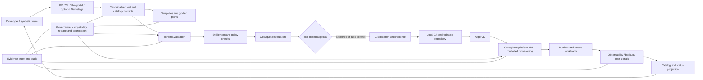

# Self-Service Data and ML Platform Portal

> **Integrated capstone specification and implementation guide**  
> **Module:** M16 — Platform Engineering and Internal Developer Platforms  
> **Stage:** Stage 2E — Production DevOps & Platform Engineering  
> **Target repository path:** `16-Platform-Engineering-and-Internal-Developer-Platforms/Projects/01-self-service-data-and-ml-platform-portal.md`  
> **Budget:** zero; no cloud account, paid SaaS, production credentials, or production data  
> **Required profile:** Plat-Core; Plat+Control and Plat+Portal are optional, sequential profiles  
> **Prerequisite:** Stages 0–2D and Stage 2E M01–M15, followed by M16 Units 1–9

---

## 0. How to use this specification

This document is the project contract. It defines what to build, why it exists, how components interact, how to test them, what evidence to retain, and how to decide whether the capstone is complete. It does not claim that the implementation has already been performed.

Work through the milestones in order. Complete the guaranteed local path first, preserve its evidence, and add optional control-plane or portal integrations only when the machine can support them.

### 0.1 Evidence labels

| Label | Meaning | Required treatment |
|---|---|---|
| `[SYNTHETIC]` | Fictional team, user, repository, request, ticket, event, survey, incident, or outcome | Never describe as real organizational research or production telemetry |
| `[ILLUSTRATIVE]` | Teaching value, threshold, timeline, cost unit, target, or example | Replace or justify before treating as operational policy |
| `[ASSUMPTION]` | Design assumption adopted to make the lab executable | Record owner, rationale, and validation path |
| `[VERIFY]` | Version-sensitive or externally dependent behavior not established by the supplied lessons | Check official documentation for the exact pinned release and record the result |
| `[NOT DEMONSTRATED]` | Capability not proven by the selected local profile | State missing test and evidence required |
| `representative expected output` | Output shown to teach expected shape, not produced by an executed command | Never index as execution proof |

**Execution honesty:** do not mark an implementation, test, drill, signature, restore, migration, rollback, or cleanup complete unless it was actually performed and its evidence retained. A specification requirement is not implementation evidence.

### 0.2 Learning sequence

For each capability: understand the developer task; define the contract and owner; implement the smallest safe path; test permitted and forbidden behavior; capture evidence; exercise failure and recovery; record what the evidence proves and does not prove.

### 0.3 Project success

Build a local, free platform product through which synthetic data/ML teams can discover a supported path, generate a service, request an entitled environment, obtain a guarded platform API resource, verify tenant controls, discover ownership and operational information, measure the platform journey, and safely consume platform changes—with reproducible evidence and explicit fidelity limits.

---

## 1. Scenario, problem statement, and boundaries

### 1.1 Scenario

A data/ML organization already has capable engineers and individual tools from M01–M15. However, those tools are not packaged as a coherent developer-facing product:

- each new service takes days of tickets, clarifications, and tribal knowledge;
- repositories are copied, modified, and gradually become stale;
- service and data ownership are unclear;
- environment and data-service provisioning is manual;
- teams share a cluster without verified tenant isolation;
- the platform team cannot reliably identify which teams use which templates or APIs;
- there are no trustworthy platform SLO, adoption, or developer-experience measures;
- platform changes are released without dependable compatibility, migration, or deprecation processes.

The learner acts as the platform product team. The task is to turn existing mechanisms into a supported product, not merely install more tools.

### 1.2 Synthetic organization and users

All organizations, people, teams, services, tickets, usage records, costs, and incidents in this project are **synthetic**.

| Synthetic team | Primary workload | Platform need | Tenant alias | Namespace | Cost center |
|---|---|---|---|---|---|
| `analytics` | Batch/ETL and data APIs | Repeatable data environment, database, object storage, observability | `team-a` | `tn-team-a` | `CC-SYNTH-ANALYTICS-01` |
| `ml-research` | Model-serving and experiments | Model endpoint, reproducible runtime, controlled scaling | `team-b` | `tn-team-b` | `CC-SYNTH-ML-RESEARCH-01` |
| `risk-platform` | Sensitive risk-scoring services | Stronger review, ownership, audit and isolation controls | `team-c` | `tn-team-c` | `CC-SYNTH-RISK-PLATFORM-01` |

These identifiers represent different concepts. Do not collapse team name, tenant key, Kubernetes namespace, identity-provider group, business owner, data steward, or cost center into one field. The `team-a`/`team-b`/`team-c` mapping is a lab alias, not a new identity authority.

Synthetic personas:

- **Batch/ETL engineer:** needs a repository, test pipeline, scheduled workload, database/object-store reference, and clear operational ownership.
- **Model-serving engineer:** needs a model-serving repository, immutable model reference, bounded scaling, readiness checks, and safe rollout.
- **Platform/support engineer:** needs repeatable shared capabilities without becoming a manual ticket fulfiller.
- **Security reviewer:** needs to verify policy, identity, and isolation controls without broad tenant access.
- **Engineering manager:** needs evidence of friction, reliability, adoption, cost allocation, and risk—not a tool-count report.

These personas are design inputs only. The lab has no real developer population. Any interview, survey, or support-ticket corpus must be labelled synthetic.

### 1.3 Product outcome

The product offers:
1. golden paths for API/inference, batch/ETL, and model-serving services;
2. safe project scaffolding and controlled template updates;
3. one canonical self-service request model across PR, CLI, and portal front doors;
4. schema, entitlement, policy, and cost checks before provisioning;
5. a platform API layer for `DataEnvironment`, `PostgresDatabase`, and `ModelEndpoint`, with `ObjectBucket` optional;
6. verified, layered tenant isolation and lifecycle workflows;
7. catalog-as-code and a guaranteed thin static portal;
8. optional Backstage after preflight, run separately;
9. platform SLO, synthetic adoption, and privacy-safe DX measurement;
10. compatibility, governance, versioning, deprecation, and release controls;
11. four game-master phases: onboarding, breaking change, incident, and additional inject;
12. an honest final report, traceability matrix, and verified teardown.

### 1.4 Non-goals

The mandatory local track does not provision real cloud infrastructure; prove production-grade isolation against hostile tenants; establish legal/regulatory compliance; prove real developer adoption, productivity, satisfaction, or ROI; operate a production-grade database/object store/model registry/GPU fleet; claim a mock provider equals a real cloud provider; build a commercial IDP; implement every possible data/ML capability; or replace M16 Units 1–9 and M01–M15.

---

## 2. Prerequisites and M01–M16 integration contract

### 2.1 Existing capabilities reused

| Module | Capability reused |
|---|---|
| M01 | Hardened images, digest pinning, base-image practices, local registry |
| M02 | CI/CD, reusable workflows, least-privilege automation, review gates |
| M03 | Kubernetes workloads, namespaces, RBAC, resource controls, Pod Security Standards |
| M04 | Networking, NetworkPolicy, TLS, ingress and hostname concerns |
| M05 | Stateful services, databases, operators, backup-aware design |
| M06 | Helm/Kustomize packaging, chart contracts, rendered manifests |
| M07 | IaC, Crossplane foundations, resource lifecycle and deletion semantics |
| M08 | GitOps, desired state, promotion, rollout rings, feature flags |
| M09 | Identity, secrets, workload identity, secret references and rotation |
| M10 | SLOs, incident roles, response sequence, postmortems, operational readiness |
| M11 | Observability, instrumentation, dashboards-as-code, telemetry conventions |
| M12 | Policy, supply-chain security, signing/provenance, isolation controls |
| M13 | Backup/restore, DR, retention and recovery evidence |
| M14 | Fleet management, cluster-vending concepts, rings and multi-cluster alternatives |
| M15 | Quotas, cost labels, capacity, showback and compute economics |

The capstone consumes these mechanisms. It does not reproduce their full lessons.

### 2.2 M16 unit ownership and capstone handoff

| M16 unit | Capability consumed | Capstone proof |
|---|---|---|
| [Unit 1 — Platform as a Product](../01-platform-engineering-principles-and-platform-as-a-product.md) | Product vision, personas, journey map, manual baseline, capability boundaries, roadmap and PRD | Product artifacts and measured local baseline |
| [Unit 2 — Golden Paths](../02-golden-paths-templates-and-paved-roads.md) | Supported archetypes, default register, escape hatches and conformance | Three archetype paths and validation suite |
| [Unit 3 — Self-Service Provisioning](../03-self-service-infrastructure-and-environment-provisioning.md) | Canonical request, entitlement registry, approval, GitOps, readiness, TTL and safe deprovision | One request contract across front doors |
| [Unit 4 — Portal and Catalog](../04-developer-portals-and-backstage-service-catalog.md) | Catalog entity conventions, ownership projection, relationships, thin portal and Backstage boundary | Eight or more valid entities and portal fallback |
| [Unit 5 — Scaffolding](../05-scaffolding-and-software-templates.md) | Copier templates, `.copier-answers.yml`, generated-file ownership, updates, migration and bot safety | Three templates and five-repository update campaign |
| [Unit 6 — Crossplane Platform APIs](../06-platform-apis-with-crossplane-compositions.md) | `platform.example.org` API family, schemas, composition safety, GitOps ownership and lifecycle | API contract tests, render tests and deletion-risk gate |
| [Unit 7 — Tenancy and Isolation](../07-multi-tenancy-isolation-and-tenant-onboarding.md) | Trust tiers, tenant identity, layered controls, onboarding/offboarding and negative tests | Isolation suite with at least 25 cases |
| [Unit 8 — SLOs, Adoption and DX](../08-platform-slos-adoption-metrics-and-developer-experience.md) | Platform SLOs, journey probes, synthetic KPIs, DORA caution, privacy and review pack | Reproducible synthetic metrics and local `n=1` timing |
| [Unit 9 — Governance](../09-platform-governance-deprecation-and-versioning.md) | Inventory, compatibility, RFC/ADR, release, exception expiry, deprecation and rollback | Two RFCs, compatibility gates and deprecation simulation |

The capstone is an integration exercise. Link to the relevant unit for implementation details owned by that unit instead of duplicating the entire lesson.

### 2.3 Shared contracts to preserve

- Team and tenant identities remain distinct.
- Synthetic team names are `analytics`, `ml-research`, and `risk-platform`.
- Unit 2 label vocabulary includes `team`, `service`, `env`, `cost-center`, and `tier`. Confirm exact casing and required/optional status against the checked-in Unit 2 artifact before implementation.
- Unit 4 catalog ownership projection uses `ownership/teams.json`; preserve the established ownership mapping rather than inventing a second identity model.
- Unit 5 records template provenance and answers in `.copier-answers.yml`; generated repositories separate platform-managed files from team-owned files.
- Unit 6 illustrative API group is `platform.example.org`. `ModelEndpoint` includes `model.registry`, immutable `model.digest`, `model.modelCard`, `tier`, `scaling.minReplicas`, `scaling.maxReplicas`, and `scaling.targetConcurrency`. Do not silently rename or remove these fields.
- Unit 7 tenant mapping is authoritative for synthetic examples.
- Unit 8 measurement is team/workload-level, never an individual developer leaderboard.
- Unit 9 reuses the same teams, template provenance, catalog ownership, API group, and team-level metrics.

A proposed optional field/resource is a capstone extension, not an existing unit contract. Mark it `[ASSUMPTION]` and version it deliberately.

---

## 3. Zero-budget environment and stack profiles

### 3.1 Planning environment

Primary: WSL2 Ubuntu. Secondary: native Linux. Planning envelope: approximately 4 CPU cores, 8 GB RAM, and 30 GB free disk. These are constraints, not a guarantee every optional service fits. Record actual CPU, RAM, disk, OS, architecture and container runtime before each optional profile.

No paid SaaS, cloud account, cloud credentials, real tenant data, production cluster, or external attack target is required.

### 3.2 Profiles

| Profile | Components | Required? | What it proves |
|---|---|---:|---|
| **Plat-Core** | Local Git server (Gitea or equivalent), local registry when image-build integration is selected, Copier/Cookiecutter, Python validators, policy CI, catalog YAML, thin static portal, synthetic metrics and governance scripts | Yes | Repository contracts, local validators, report logic and process simulations |
| **Plat+Control** | Plat-Core plus disposable `kind`, Argo CD, Crossplane, one policy engine, tenant namespaces and bounded runtime tests | Optional | Selected API-server, reconciliation, admission, RBAC and NetworkPolicy behavior in this local cluster |
| **Plat+Portal** | Backstage after preflight, with other heavy services stopped | Optional | Portal configuration and catalog/Scaffolder integration for the pinned release |

Do not run Backstage, Crossplane/providers, Argo CD, Gitea, policy controller, full observability and all tenant workloads simultaneously on the planning laptop. Thin portal is guaranteed; Backstage is optional.

### 3.3 Profile sequencing

1. Complete Plat-Core and record evidence.
2. Stop unneeded services and capture resource baseline.
3. Start only components needed for the current Plat+Control lab.
4. Stop control profile and verify cleanup.
5. Run Plat+Portal separately after preflight.
6. Return to Plat-Core for final report and evidence audit.

### 3.4 Version recording

Create `versions.txt` before running tools. Use actual command output; never copy example versions as if installed.

```text
verification_date=<YYYY-MM-DD>
host_os=<actual>
host_architecture=<actual>
wsl_version=<actual-or-NOT-APPLICABLE>
cpu_cores=<actual>
memory_bytes=<actual>
disk_free_bytes=<actual>
python=<actual>
git=<actual>
container_runtime=<actual-or-NOT-INSTALLED>
kind=<actual-or-NOT-INSTALLED>
kubernetes=<actual-or-NOT-INSTALLED>
argo_cd=<actual-or-NOT-INSTALLED>
crossplane_core=<actual-or-NOT-INSTALLED>
crossplane_cli=<actual-or-NOT-INSTALLED>
crossplane_provider_packages=<actual-or-NOT-INSTALLED>
crossplane_functions=<actual-or-NOT-INSTALLED>
policy_engine=<engine-and-version-or-NOT-INSTALLED>
copier=<actual>
cookiecutter=<actual-or-NOT-INSTALLED>
backstage=<actual-or-NOT-INSTALLED>
node=<actual-or-NOT-INSTALLED>
package_manager=<actual-or-NOT-INSTALLED>
prometheus=<actual-or-NOT-INSTALLED>
grafana=<actual-or-NOT-INSTALLED>
```

Record source URL, documentation version, date, exact claim checked, and result in `governance/supported-versions/verification-register.yaml`. If behavior cannot be verified, mark `[VERIFY]` and use Plat-Core fallback.

### 3.5 Preflight and safe context

Before cluster operations verify active context, API endpoint, cluster name, lab identity label, target resource labels, profile permission, and operation allow-list. Refuse if any check is absent, ambiguous, or mismatched.

The example context name `kind-platform-portal-lab` is `[ILLUSTRATIVE]`. Use the actual context. Never rely on context name alone; inspect endpoint and cluster identity marker.
---

## 4. Product definition and user research

### 4.1 Vision and principles

**Vision:** enable data and ML teams to create, deploy and operate supported services through a clear, secure, observable and upgradeable self-service experience, while retaining ownership of application, data and model outcomes.

Principles:
1. The platform is a product; internal developers are its customers.
2. Adoption is earned through reduced friction and reliable outcomes, not assumed from portal usage or mandated by default.
3. Build the thinnest viable platform that solves a demonstrated repeated problem.
4. Golden paths are supported roads, not cages; document safe escape hatches.
5. Self-service is bounded by identity, entitlement, policy and cost.
6. Abstractions reduce cognitive load but preserve inspectability and debuggability.
7. Templates, APIs, workflows, policies and catalog schemas must be upgradeable.
8. Measure platform experience and team-level outcomes, never individual productivity.
9. Tenant isolation is a layered, tested property—not a namespace label.
10. The platform needs owners, support, SLOs, incident response, a roadmap and deprecation discipline.

### 4.2 Problem statement

`[SYNTHETIC]` Data/ML teams repeat infrastructure, security, delivery and operational setup for each new service. Work is slow and inconsistent because reusable mechanisms exist but are not exposed through a coherent, documented, tested, self-service product. The platform team must reduce repeated manual work without removing team ownership or weakening security, reliability, cost controls or lifecycle governance.

### 4.3 Personas and jobs-to-be-done

| Persona | Job | Current friction hypothesis `[SYNTHETIC]` | Desired outcome |
|---|---|---|---|
| Batch/ETL engineer | Ship repeatable pipeline safely | Repeated repo, CI, environment and data-service setup | Generated batch path and canonical environment request |
| Model-serving engineer | Serve a versioned model with controlled scaling | Runtime, model digest, rollout and observability setup fragmented | Model-serving template and `ModelEndpoint` API |
| Platform/support engineer | Maintain safe shared capabilities | Tickets, stale copies, unclear ownership, invisible version spread | Validated templates, policy gates, catalog and governance |
| Security reviewer | Verify tenant control posture | Evidence scattered or self-attested | Traceable negative tests and exception records |
| Engineering manager | Prioritize platform investment | No trustworthy baseline or platform outcome measures | Team-level SLO/DX review with explicit uncertainty |

### 4.4 Journey map


For every stage record developer goal, required input, platform capability, team responsibility, expected feedback, failure path, support owner and evidence.

### 4.5 Manual baseline

Measure one real local task on the learner's machine, labelled `n=1`: create a service using only existing M01–M15 knowledge and local tools, from an empty directory to a safely running, observable, documented service artifact.

Record active work time, machine wait time, manual wait time, retries/failures, human intervention, rework, evidence and task completion definition.

**Start:** immediately before beginning the documented task.  
**Stop:** when the service passes the same safety, validation, deployability, observability, ownership and teardown checks used by the platform path.  
Do not stop at first file generation or when a deployment command returns zero.

| Step | Task | Start | End | Active min | Wait min | Retry/failure | Intervention | Evidence |
|---|---|---|---|---:|---:|---|---|---|
| MB-01 | Define service and owner | | | | | | | |
| MB-02 | Create repository structure | | | | | | | |
| MB-03 | Configure image and dependencies | | | | | | | |
| MB-04 | Add tests and CI | | | | | | | |
| MB-05 | Add deployment and GitOps artifacts | | | | | | | |
| MB-06 | Add identity, secrets and policy references | | | | | | | |
| MB-07 | Add observability, SLO and runbook | | | | | | | |
| MB-08 | Validate, deploy and smoke test | | | | | | | |
| MB-09 | Verify ownership, cost metadata and cleanup | | | | | | | |

Record date/timezone, OS, machine class, CPU/RAM/disk, tool versions, Git commit, service archetype, operator (learner), `n=1`, and confounders. This is a personal local observation, not an industry benchmark.

### 4.6 Synthetic friction corpus

Create `product/research/synthetic-friction.csv` with at least 20 fictional records across personas. Columns:

`record_id,source_type,persona,journey_stage,friction_text,theme,severity,frequency_hint,confidence,synthetic`

Example:

```csv
record_id,source_type,persona,journey_stage,friction_text,theme,severity,frequency_hint,confidence,synthetic
SYN-FR-001,ticket,batch-engineer,provision,"Repeated request for the same namespace labels","manual-provisioning",medium,3,low,true
SYN-FR-002,interview,model-serving-engineer,operate,"No clear owner is shown beside the runbook link","ownership-discovery",high,2,medium,true
```

Values are teaching examples. Counts are within the synthetic corpus, not population prevalence. Code records into themes; count records; retain severity separately from frequency; identify ambiguity/reviewer disagreement; write five friction hypotheses; add one future real-user validation question per hypothesis; state that real interviews and observation are required before treating findings as product evidence.

### 4.7 PRD, capability map and cognitive load

`product/prd.md` must contain problem, target users, journeys/jobs, goals/outcomes, non-goals, functional requirements, security/reliability/privacy/cost requirements, archetypes, interfaces/request contract, ownership/support, failure/recovery behavior, rollout/migration, assumptions, open questions and REQ-linked acceptance criteria.

Classify each capability as **provide**, **integrate**, or **leave to teams**:

| Capability | Default | Reason |
|---|---|---|
| Service templates and validation | Provide | Repeated starting structure and guardrails |
| CI reusable workflow | Integrate | Reuse M02 implementation |
| Kubernetes runtime | Integrate | Existing M03/M14 substrate |
| Tenant namespace baseline | Provide through controlled workflow/API | Common policy and tenancy boundary |
| Database | Integrate | Tested operator/provider only in optional control profile |
| Object storage | Integrate or simulate | No cloud service in mandatory track |
| Model correctness | Leave to product team | Domain outcome and model risk |
| Secrets/workload identity | Integrate | Reuse M09; no secret values in generated files |
| SLO templates/telemetry hooks | Provide/integrate | Shared standards, workload-specific objectives |
| Business logic/data semantics | Leave to teams | Product-specific responsibility |
| Cost labels/quota defaults | Provide/integrate | Reuse M15 controls and allocation |
| Portal/catalog | Provide thin projection; optional Backstage | Discoverability and ownership, not new control plane |

The learner may change a classification with an ADR and evidence. `product/cognitive-load-inventory.md` records concepts developers must understand, which are safely hidden, which must remain inspectable, and where the abstraction leaks.

### 4.8 Thinnest viable release plan

- **Slice 0 — Plat-Core:** one API/inference path, canonical request schema, policy validator, catalog entity type, thin portal and local measurement.
- **Slice 1:** add batch/ETL and model-serving templates, entitlement checks, ownership projection and synthetic KPI pipeline.
- **Slice 2 — Plat+Control:** add disposable Kubernetes, Argo CD, Crossplane and one policy engine; implement bounded runtime/tenant tests.
- **Slice 3 — governance:** compatibility, RFCs, release rings, migration, deprecation and exception expiry.
- **Slice 4 — optional portal:** Backstage after preflight, with other heavy services stopped.

Rank roadmap opportunities by user value, reach/eligibility, confidence and effort (a RICE-style method is acceptable `[VERIFY]` as a named framework). Record every input as an assumption or observed local fact; the score is a prioritization aid, not a measured business outcome. Do not expand scope because a tool is available. Expand only when the product requirement and acceptance test justify it.

### 4.9 Build/adopt/buy and hypothetical ROI

Create at least three ADRs:
1. Adopt Copier as primary for update-aware templates; verify selected version semantics. Compare Cookiecutter for one archetype.
2. Build thin static portal as guaranteed path; optionally adopt Backstage when resource and maintenance cost is acceptable.
3. Begin with reviewed PR request and GitOps; add Crossplane APIs only where continuous reconciliation and Kubernetes-native contracts justify another control plane.

Decision criteria: user fit, maintenance burden, team skills, security, compatibility, ecosystem health, portability, operational cost, resource footprint and exit strategy. No commercial platform is required.

Use **hypothetical cost units (HCU)**, not currency or claimed savings:

```text
annual_manual_effort_hcu =
    eligible_service_creations_per_year
  * manual_hours_per_service
  * blended_cost_per_hour_hcu

annual_platform_effort_hcu =
    platform_build_and_maintenance_hcu
  + supported_update_effort_hcu
  + residual_team_effort_hcu
  + incident_and_migration_effort_hcu

scenario_net_value_hcu =
    annual_manual_effort_hcu - annual_platform_effort_hcu
```

Provide low/base/high scenarios and sensitivity for service volume, manual effort, platform maintenance, support load and migration cost. Every input is `[ILLUSTRATIVE]` until measured or sourced from an approved business case. Include **What we cannot know from this lab**: real adoption, willingness to use, salary cost, opportunity cost, business value, production incident reduction, security-risk reduction and causal productivity impact.

---

## 5. Integrated architecture and trust boundaries

### 5.1 Architecture



### 5.2 Trust boundaries and controls

| Boundary | Data/principal | Risk | Required control |
|---|---|---|---|
| Developer → front door | Identity, request, template parameters | Injection, spoofed ownership, over-requesting | Canonical schema, allow-lists, server-side authorization |
| Front door → request repository | Request and review metadata | Forged approval or altered request | Protected branches, reviewer identity, audit |
| CI → GitOps | Validated desired state | Compromised token/artifact | Least privilege, immutable references, provenance where feasible |
| GitOps → cluster API | Desired resources | Excessive controller privilege | Scoped RBAC, context guard, admission policy |
| Crossplane → composed resources | API intent/provider identity | Compromise or fan-out deletion | Protected XRD/Composition/ProviderConfig, scoped permissions, render diff |
| Tenant A ↔ Tenant B | Network, data, identity | Cross-tenant access/noisy neighbor | Layered isolation tests and assurance |
| Runtime → observability | Labels, metrics, logs, traces | Data leakage/person-level surveillance | Tenant scoping, minimization, aggregation, privacy scanner |
| Catalog → portal | Metadata and links | Injection, stale ownership, unsafe rendering | Schema, URL policy, escaping, provenance/freshness |
| Governance → consumers | Versions and migration | Surprise breakage | Compatibility CI, RFC, rings, notice and rollback |

### 5.3 Sources of truth

- **Git request repository:** desired state for PR-based requests.
- **Kubernetes API/controller status:** observed cluster state in the selected local cluster.
- **Crossplane XR status:** controller-reported reconciliation, not proof of application usability.
- **Smoke tests:** application-level evidence at a particular time.
- **Catalog Git metadata:** declared ownership, lifecycle, system and dependencies.
- **Runtime/observability:** observed health and telemetry within collection scope/time window.
- **Cost estimator:** hypothetical/local estimate, not cloud invoice.
- **Evidence index:** pointers/checksums; does not make invalid evidence valid.

Thin portal and Backstage are alternate front ends over shared request/catalog contracts, not competing sources of truth. Frontend code must not decide authorization solely in browser code.

### 5.4 Rollback/recovery paths

- Template: stop campaign, pin prior immutable revision, revert/supersede release, preserve team-owned files.
- Request policy: revert bundle or return to audit mode after impact review; never bypass mandatory security without approved exception.
- GitOps: revert desired-state commit; confirm convergence and smoke test.
- Crossplane: stop rollout, pin/select known-good revision using verified mechanism, inspect child diff and protect stateful resources.
- Isolation: contain affected tenant/control path, preserve evidence, verify unaffected tenants; no real exfiltration.
- Portal: serve static catalog export/runbooks; provisioning remains on canonical authorized flow.
- Data-bearing resource: suspend deletion, check retention/hold/backup, export/restore only with owner approval, verify no orphan remains.

---

## 6. Required repository layout

Create a separate learner-owned Git repository. The following tree is the project contract; add files only when they have an owner, purpose, test and evidence mapping.

```text
self-service-data-ml-platform-portal/
├── README.md
├── Makefile
├── versions.txt
├── requirements.yaml
├── ownership/
│   └── teams.json
├── scripts/
│   ├── bootstrap.sh
│   ├── verify_context.py
│   ├── collect_environment.py
│   ├── verify_all.py
│   ├── cleanup_lab.py
│   └── checksum_evidence.py
├── product/
│   ├── vision.md
│   ├── personas.md
│   ├── journey-map.md
│   ├── manual-baseline.md
│   ├── research/
│   │   ├── synthetic-friction.csv
│   │   ├── coding-guide.md
│   │   ├── survey-instrument.md
│   │   └── research-limitations.md
│   ├── roadmap.md
│   ├── prd.md
│   ├── capability-map.md
│   ├── cognitive-load-inventory.md
│   ├── roi-model.md
│   └── adr/
│       ├── ADR-001-golden-path-opinionation.md
│       ├── ADR-002-template-engine-and-update-strategy.md
│       ├── ADR-003-self-service-front-doors-and-guardrails.md
│       ├── ADR-004-platform-api-layer.md
│       ├── ADR-005-tenancy-by-trust-tier.md
│       ├── ADR-006-thin-portal-vs-backstage.md
│       ├── ADR-007-measurement-and-privacy.md
│       └── ADR-008-governance-versioning-and-deprecation.md
├── golden-paths/
│   ├── api-inference/
│   ├── batch-etl/
│   ├── model-serving/
│   ├── defaults-register.yaml
│   └── conformance/
├── templates/
│   ├── api-inference/
│   ├── batch-etl/
│   ├── model-serving/
│   ├── copier/
│   ├── cookiecutter-comparison/
│   └── ownership-map.yaml
├── self-service/
│   ├── schemas/
│   │   └── environment-request.schema.json
│   ├── entitlements/
│   │   └── teams.yaml
│   ├── validators/
│   ├── requests/
│   └── provisioning/
│       ├── desired-state/
│       └── status/
├── platform-api/
│   ├── data-environment/
│   ├── postgres-database/
│   ├── model-endpoint/
│   ├── object-bucket/
│   ├── tests/
│   └── compatibility/
├── tenancy/
│   ├── model/
│   ├── threat-model/
│   ├── isolation-tests/
│   ├── onboarding/
│   ├── offboarding/
│   └── continuous-assurance/
├── catalog/
│   ├── entities/
│   ├── schemas/
│   ├── linter/
│   ├── thin-portal/
│   ├── scorecards/
│   └── backstage/
├── policy/
│   ├── bundles/
│   ├── tests/
│   └── impact-analysis/
├── metrics/
│   ├── slos/
│   ├── alerts/
│   ├── dashboards/
│   ├── synthetic-data/
│   ├── adoption/
│   ├── dx-research/
│   └── privacy/
├── governance/
│   ├── inventory/
│   ├── compatibility/
│   ├── deprecation/
│   ├── rfc-adr/
│   │   ├── RFC-001-breaking-model-endpoint-api-change.md
│   │   └── RFC-002-new-platform-capability.md
│   ├── exceptions/
│   ├── supported-versions/
│   └── risk-register/
├── drills/
│   ├── onboarding/
│   ├── breaking-change/
│   ├── incident/
│   └── additional-inject/
├── evidence/
│   ├── index.yaml
│   ├── requirements/
│   ├── commands/
│   ├── tests/
│   ├── incidents/
│   ├── restores/
│   ├── measurements/
│   └── cleanup/
├── runbooks/
├── sim/
│   ├── variants/
│   ├── game-master/
│   └── facilitator-key/
└── docs/
    ├── architecture/
    ├── decisions/
    ├── operations/
    └── security/
```

### 6.1 Directory ownership

| Directory | Owner | Purpose/boundary |
|---|---|---|
| `product/` | Platform product owner | Product artifacts, synthetic research, roadmap, PRD, assumptions, ADRs |
| `golden-paths/` | Platform engineering | Supported journey contracts, defaults, conformance |
| `templates/` | Template maintainers | Copier primary templates, Cookiecutter comparison, generated files and update metadata |
| `self-service/` | Provisioning owner | Unit 3 entitlement authority, canonical request, validation, desired state and status |
| `platform-api/` | Platform API owner | API definitions, compositions/functions, tests, compatibility and lifecycle |
| `tenancy/` | Security/platform operations | Tenant model, threat model, isolation, onboarding/offboarding and assurance |
| `ownership/` | Identity/catalog integration owner | Unit 4 normalized `teams.json` read model projected from Unit 3 entitlements; not an independent authority |\n| `catalog/` | Catalog owner | Entities, schema, linter, portal, scorecards and Backstage configuration |
| `policy/` | Security/policy owner | Policy bundles, tests, impact reports and rollout modes |
| `metrics/` | Platform SRE/product analytics | SLOs, synthetic events, DX research and privacy |
| `governance/` | Governance owner | Inventory, compatibility, RFC/ADR, deprecation, exceptions, versions and risks |
| `drills/` | Facilitator | Learner injects and exercise records |
| `evidence/` | Evidence owner | Run outputs, index, checksums and audit trail |
| `runbooks/` | Capability owners | Operational procedures and escalation |
| `sim/` | Game master | A/B variants, hidden causes, hints, facilitator key, scoring and reset |
| `docs/` | Technical owners | Architecture, decisions, operations and security |
| `scripts/` | Automation owner | Guarded, deterministic local helpers |

### 6.2 Repository hygiene

No plaintext credentials, personal data or production identifiers. Ignore local state, generated secrets, kubeconfigs, private keys and raw sensitive logs. Commit synthetic fixtures and schemas; keep runtime evidence in designated evidence paths. Never commit private signing keys. Every executable script must document inputs, outputs, exit codes, safety guard and tests. Every generated file is classified as platform-managed, team-owned, or generated-but-reviewable.

---

## 7. Requirements and evidence model

### 7.1 Stable REQ-IDs

`requirements.yaml` is canonical. IDs are stable and must not be renumbered. Minimum registry:

| ID | Area | Requirement | Owner | Criticality |
|---|---|---|---|---|
| REQ-001 | Repository | Reproducible guarded bootstrap and teardown | platform-automation | Critical |
| REQ-002 | Product | Product definition and manual baseline | platform-product | High |
| REQ-003 | Templates | Three validated archetype templates | template-maintainers | High |
| REQ-004 | Policy | At least 15 validation rules with positive/negative tests | security-platform | Critical |
| REQ-005 | Self-service | Canonical request and front-door parity | provisioning | Critical |
| REQ-006 | Provisioning | Guarded desired state and verified readiness | provisioning | Critical |
| REQ-007 | API | Versioned platform API contracts and deletion-risk gate | platform-api | Critical |
| REQ-008 | Tenancy | Layered isolation and lifecycle evidence | security-platform | Critical |
| REQ-009 | Catalog | Catalog-as-code, linter and thin portal | catalog-owner | High |
| REQ-010 | Portal | Backstage preflight or documented infeasibility | catalog-owner | Medium |
| REQ-011 | SLO | Platform SLO and journey evidence | platform-sre | High |
| REQ-012 | DX | Synthetic KPI and research pipeline | platform-product | High |
| REQ-013 | Privacy | Block individual-level telemetry | privacy-reviewer | Critical |
| REQ-014 | Governance | Compatibility matrix and breaking-change classifier | platform-governance | Critical |
| REQ-015 | Policy | Policy impact report gates enforcement | security-platform | Critical |
| REQ-016 | Deprecation | Usage-aware deprecation/removal gate | platform-governance | High |
| REQ-017 | Decisions | Two RFCs and eight ADRs | platform-governance | High |
| REQ-018 | Exceptions | Exception registry with expiry enforcement | platform-governance | High |
| REQ-019 | Release | Release rings, provenance/signature simulation and rollback | release-owner | Critical |
| REQ-020 | Game | Four-phase game-master exercise | facilitator | High |
| REQ-021 | Operations | Eight reviewed operational runbooks | platform-operations | High |
| REQ-022 | Reproducibility | Unified verification and safe teardown | platform-automation | Critical |

Each record in `requirements.yaml` must include `id`, `area`, `title`, `owner`, `criticality`, Given/When/Then acceptance, evidence paths and pass condition. Add records for further requirements without changing these IDs.

### 7.2 Evidence index contract

`evidence/index.yaml` maps every REQ-ID to evidence artifacts, checksums, timestamps, commit SHA, environment and status. It must reject missing requirement, empty evidence path, unrecognized status or checksum mismatch.

```yaml
schema_version: "1"
project: self-service-data-ml-platform-portal
generated_at: "<actual UTC timestamp>"
git_commit: "<actual commit SHA>"
environment:
  profile: "Plat-Core"
  os: "<actual>"
  architecture: "<actual>"
  context: "NOT-APPLICABLE"
requirements:
  REQ-001:
    specification_status: "PASS"
    implementation_status: "OPEN"
    test_status: "OPEN"
    evidence_status: "OPEN"
    artifacts:
      - path: evidence/commands/bootstrap.txt
        sha256: "<actual SHA-256>"
        captured_at: "<actual timestamp>"
        command: "make bootstrap-check"
        result: "OPEN"
    next_action: "Run guarded bootstrap tests and capture output."
```

Allowed audit statuses are `PASS`, `FIXED`, and `OPEN`. A specification can be complete while implementation status remains `OPEN`.

### 7.3 Evidence capture

Every command/test/drill record includes REQ-IDs, exact command/test ID, timestamp/timezone, commit SHA, OS/architecture/profile, context/endpoint where relevant, tool versions, exit code, expected and observed result, artifact path, checksum, and limitations. Label synthetic/local evidence.

Critical security/isolation criteria require machine-readable evidence identifying principal, action, target, expected result, observed result and reason. A screenshot alone is insufficient.

### 7.4 Traceability model

`requirement → control → implementation file → test → command/drill → evidence artifact → reviewer → audit status`

If a link is missing, the requirement is not fully evidenced.
---

## 8. Golden paths, templates and policy controls

### 8.1 Three archetypes

1. **API/inference service:** HTTP service with tests, image contract, deployment/GitOps artifacts, health/readiness, telemetry, SLO, runbook and catalog metadata.
2. **Batch/ETL pipeline:** job/scheduled pipeline with idempotency/checkpoint hooks, data-contract references, resource bounds, retry policy, observability, ownership and cost metadata.
3. **Model-serving service:** immutable model reference, model-card reference, serving runtime, bounded scaling, readiness/smoke checks, rollback, telemetry and catalog metadata.

Do not put a database, queue, GPU, cloud bucket or model-registry credential into every template by default. Optional capabilities are explicit, entitled and tested add-ons.

### 8.2 Template engine strategy

Copier is primary. Cookiecutter is implemented for one archetype as comparison. Copier/Cookiecutter versions, CLI flags, task semantics, update behavior and trust options are `[VERIFY]` against pinned releases. Template revisions are immutable once released. Generated repositories record template identity, revision, options and generation timestamp. Update campaigns create reviewable PRs and never silently overwrite team-owned code.

### 8.3 Shared template input contract

```yaml
project_name: risk-score-api
service_slug: risk-score-api
team: analytics
environment: dev
tier: standard
cost_center: CC-SYNTH-ANALYTICS-01
service_archetype: api-inference
data_classification: internal
include_postgres: false
include_object_storage: false
include_queue: false
include_model_endpoint: false
template_ref: "<immutable template tag or commit>"
```

Illustrative only. Validate team-to-cost-center mapping, slug format, allowed tier, archetype, booleans and entitlement for each optional capability. Never trust a user-supplied team or cost center merely because it is syntactically valid.

### 8.4 Defaults register

Every important generated default appears in `golden-paths/defaults-register.yaml` with `default_id, artifact, field_or_path, default_value, source_module, reason, owner, test_id, exception_policy, version`.

```yaml
defaults:
  - default_id: DEF-IMAGE-001
    artifact: api-inference
    field_or_path: Dockerfile.base_image
    default_value: "approved-image@sha256:<verified-digest>"
    source_module: M01
    reason: "Reproducible approved base image; learner resolves the digest."
    owner: platform-image-owner
    test_id: TPL-IMAGE-001
    exception_policy: "time-bound approval; never silent bypass"
    version: "1.0.0"
  - default_id: DEF-OWNER-001
    artifact: catalog-info.yaml
    field_or_path: spec.owner
    default_value: "<validated catalog Group>"
    source_module: M16-Unit-4
    reason: "A service without an accountable owner cannot be safely supported."
    owner: catalog-owner
    test_id: CAT-OWNER-001
    exception_policy: "no production lifecycle without valid owner"
    version: "1.0.0"
```

Do not put an invented digest in a runnable template. Refuse unresolved placeholders before image build/release.

### 8.5 Generated file contract

Each archetype produces, where relevant: README with workflow/prerequisites/ownership/escape hatch; application/job source and tests; pinned dependencies and lockfile expectations; hardened image starting point without secrets; reusable CI workflow reference with least privilege; deployment/GitOps manifests or explicit profile-specific omission; resource requests/limits and health/readiness; identity/secret references only; policy/NetworkPolicy requirements; observability hooks, SLO and runbook; `catalog-info.yaml` or project catalog metadata; team/service/environment/tier/cost labels; template provenance and supported-version metadata; `.gitignore` and security contact route.

Generated files are starting points. Presence does not prove runtime control.

### 8.6 File ownership

`templates/ownership-map.yaml` classifies paths:

| Class | Example | Update behavior |
|---|---|---|
| Platform-managed | Shared CI caller, policy baseline, deployment wrapper | Update campaign proposes change; protected by owner review |
| Team-owned | Application source, transformations, model logic | Updater must not overwrite |
| Shared contract | Catalog metadata, SLO/runbook structure, resource defaults | Merge review and compatibility test |
| Generated local | Preview, local report, cache | Excluded unless explicitly required |

Updater has path allow-list and maximum diff size. Unknown paths require human review.

### 8.7 Minimum policy/validation suite (18 rules)

Every rule records ID, rationale, severity, warn/block mode, actionable message, positive test, negative test and expiring-exception behavior.

| Rule | Control | Severity/mode | Actionable message |
|---|---|---|---|
| POL-001 | Valid DNS-safe service slug; reject path separators/shell metacharacters | High/block | Use lowercase DNS-safe slug characters only. |
| POL-002 | Team exists in entitlement registry | Critical/block | Select a registered team or request onboarding. |
| POL-003 | Cost center matches authoritative team mapping | High/block | Use the cost center assigned to this team. |
| POL-004 | Tier is supported enum | High/block | Choose a supported tier; do not submit raw quota values. |
| POL-005 | No plaintext secrets/credential-like values | Critical/block | Replace value with a secret reference. |
| POL-006 | Image uses approved digest-pinned base | Critical/block | Resolve and pin an approved image digest. |
| POL-007 | Dependencies pinned/locked under language policy | High/block | Generate/update lockfile and rerun validation. |
| POL-008 | Workload has resource requests and bounded limits | High/block | Add the required resource envelope for this tier. |
| POL-009 | Health/readiness behavior defined where applicable | High/block | Add application-specific readiness check. |
| POL-010 | No privileged mode or host namespaces | Critical/block | Remove privileged/host access; use reviewed exception only if justified. |
| POL-011 | Ownership/catalog metadata validates | High/block | Set a valid catalog owner and service identity. |
| POL-012 | Network exposure explicit and policy-approved | Critical/block | Declare internal-only or approved ingress intent. |
| POL-013 | Secret references scoped to tenant/service | Critical/block | Use a tenant-scoped reference; cross-tenant references are denied. |
| POL-014 | CI token permissions least-privilege | Critical/block | Reduce workflow permissions to documented minimum. |
| POL-015 | GitOps desired state uses immutable image reference | High/block | Replace mutable tag with verified digest. |
| POL-016 | SLO/runbook/alert ownership links exist | Medium/warn then block at release | Add owner and operational links before release. |
| POL-017 | Template provenance and supported version present | High/block | Regenerate from released template and record revision. |
| POL-018 | Exceptions have owner, approver, controls, expiry, review date | Critical/block | Renew through exception workflow or remove exception. |

A `warn` audit period requires explicit policy-owner approval. Security-critical POL-005/006/010/012/013 cannot be silently downgraded. Exception requires owner, approver, rationale, compensating controls, expiry, evidence and review date; expired exceptions fail closed.

### 8.8 Template test harness and mutations

Harness must generate each archetype from valid fixtures; test boundary combinations; reject invalid slug/unknown team/mismatched cost center/invalid tier; reject injection/traversal; scan for secrets and unresolved placeholders; run conformance; validate YAML/JSON and renderable manifests; test determinism where promised; verify update behavior against team-owned files; run mutations.

Mandatory planted mutations: remove non-root image user; remove readiness probe; replace digest-pinned image with mutable tag; remove cost-center label; remove owner metadata; change deny policy to allow; insert secret-looking literal; add path-traversal parameter. Every mutation must be caught. An undetected mutation means its control is not proven.

### 8.9 Copier update campaign

Generate at least five synthetic repositories from v1 with different legitimate local edits. Release v2 with a compatible change and a deliberately breaking change requiring migration. Campaign must inventory consumers/pinned revisions, create update previews, produce PRs or local branch equivalents, classify conflicts/protected files, run tests, record time-to-propagate, show remaining version spread, never auto-merge, and support pause/kill switch/rollback.

Use `.copier-answers.yml` and selected Copier release semantics; verify actual update command/conflict behavior.

### 8.10 Template supply chain

Templates are executable supply-chain inputs. Pin source by immutable revision and digest where supported; review task/hook source; never run untrusted tasks with developer credentials; verify signatures/provenance where feasible with throwaway lab keys; reject unpinned refs; reject modified content when verification is enabled; sanitize parameters; avoid shell interpolation; use least-privilege bot token, path allow-list, diff-size limit, rate limit, audit log and kill switch. Store public verification material only. Signing behavior is `[VERIFY]`; do not claim trusted provenance until signer, identity and artifact digest are checked.

---

## 9. Canonical self-service provisioning

### 9.1 Lifecycle

`request → schema validation → entitlement check → policy/cost evaluation → approval where required → GitOps desired state → reconcile → readiness verification → status feedback → renewal/expiry/deprovision`.

Accepted is not ready. A merged PR is not a ready database. A created namespace is not proof of tenant isolation.

### 9.2 Canonical request object

Preserve the Unit 3 canonical request contract: `EnvironmentRequest` using the local teaching API group `platform.example.invalid/v1alpha1`. It is request data, not a Kubernetes resource to apply directly. PR, CLI and portal adapters all produce this same versioned object. The provisioning workflow validates it and then renders separate controlled desired-state resources.

```yaml
apiVersion: platform.example.invalid/v1alpha1
kind: EnvironmentRequest
metadata:
  name: analytics-dev
spec:
  team: analytics
  purpose: batch-pipeline-development
  tier: dev
  size: small
  ttl_hours: 72
  data_classification: synthetic
  capabilities:
    database: false
    queue: true
    bucket: true
```

The request contract deliberately does not accept a namespace, cost center, raw Kubernetes manifest, provider credential, arbitrary CPU/memory value or cluster-scoped resource request. Resolve tenant key, namespace, cost center, owner group and allowed capabilities from the authoritative entitlement registry and catalog ownership projection. The service repository/catalog record identifies the service; the environment request identifies the requested environment. Keep those records linked by a stable request ID generated by the workflow, not by trusting a caller-supplied tenant mapping.

`platform.example.invalid` is the Unit 3 local request-document convention and is not a registered Kubernetes API. The Unit 6 platform resource APIs use the separate illustrative group `platform.example.org`. Do not conflate the request object with `DataEnvironment`, `PostgresDatabase` or `ModelEndpoint`.

### 9.3 Schema and entitlements

`self-service/schemas/environment-request.schema.json` preserves Unit 3's `EnvironmentRequest` shape: `apiVersion`, `kind`, `metadata.name`, and `spec.team`, `purpose`, `tier`, `size`, `ttl_hours`, `data_classification`, and the closed `capabilities` map (`database`, `queue`, `bucket`). Reject unknown fields. Validate DNS-safe name, supported tier/size/classification, integer TTL bounds, boolean capability values, and capability map keys. Entitlement, cost and cross-field checks run after schema validation; specifically, `preview` tier accepts synthetic data only. Secret references are emitted in the separately rendered desired state, never as secret values in the request. JSON Schema validator/version is `[VERIFY]`.

The following schema preserves the Unit 3 contract. It is a specification fixture; pin and run a Draft 2020-12 validator before claiming schema-test evidence.

```json
{
  "$schema": "https://json-schema.org/draft/2020-12/schema",
  "type": "object",
  "additionalProperties": false,
  "required": ["apiVersion", "kind", "metadata", "spec"],
  "properties": {
    "apiVersion": {"const": "platform.example.invalid/v1alpha1"},
    "kind": {"const": "EnvironmentRequest"},
    "metadata": {
      "type": "object",
      "additionalProperties": false,
      "required": ["name"],
      "properties": {
        "name": {"type": "string", "pattern": "^[a-z][a-z0-9-]{1,30}$"}
      }
    },
    "spec": {
      "type": "object",
      "additionalProperties": false,
      "required": ["team", "purpose", "tier", "size", "ttl_hours", "data_classification", "capabilities"],
      "properties": {
        "team": {"type": "string", "pattern": "^[a-z][a-z0-9-]{1,30}$"},
        "purpose": {"type": "string", "minLength": 3, "maxLength": 100},
        "tier": {"enum": ["dev", "preview", "test"]},
        "size": {"enum": ["small", "medium", "large"]},
        "ttl_hours": {"type": "integer", "minimum": 1, "maximum": 168},
        "data_classification": {"enum": ["synthetic", "internal", "confidential"]},
        "capabilities": {
          "type": "object",
          "additionalProperties": false,
          "required": ["database", "queue", "bucket"],
          "properties": {
            "database": {"type": "boolean"},
            "queue": {"type": "boolean"},
            "bucket": {"type": "boolean"}
          }
        }
      }
    }
  }
}
```

The schema checks shape and simple constraints. It cannot decide whether `analytics` may request `large`, whether a confidential dataset is allowed in preview, or whether the HCU budget is exceeded. Those are entitlement/policy decisions, not schema validation.

`self-service/entitlements/teams.yaml` defines identity/group, tenant key/namespace, cost center, trust tier, allowed environments/archetypes/capabilities, max resource tier, max TTL, approval requirements, business owner/data steward and status (`active`, `suspended`, `offboarding`).

```yaml
teams:
  analytics:
    tenant_key: team-a
    namespace: tn-team-a
    cost_center: CC-SYNTH-ANALYTICS-01
    trust_tier: internal-trusted
    allowed_sizes: [small, medium]
    allowed_capabilities: [database, queue, bucket]
    budget_units: 40
    allowed_archetypes: [api-inference, batch-etl]
    max_ttl_hours: 168
    approval_required_for: [public-ingress, confidential-data]
    business_owner: analytics-owner
    data_steward: analytics-data-steward
    status: active
  ml-research:
    tenant_key: team-b
    namespace: tn-team-b
    cost_center: CC-SYNTH-ML-RESEARCH-01
    trust_tier: internal-trusted
    allowed_sizes: [small]
    allowed_capabilities: [queue, bucket]
    budget_units: 20
    allowed_archetypes: [model-serving]
    max_ttl_hours: 72
    approval_required_for: [confidential-data]
    business_owner: ml-research-owner
    data_steward: ml-research-steward
    status: active
  risk-platform:
    tenant_key: team-c
    namespace: tn-team-c
    cost_center: CC-SYNTH-RISK-PLATFORM-01
    trust_tier: internal-sensitive
    allowed_sizes: [small]
    allowed_capabilities: [database, bucket]
    budget_units: 20
    allowed_archetypes: [api-inference, batch-etl]
    max_ttl_hours: 24
    approval_required_for: [confidential-data, public-ingress]
    business_owner: risk-platform-owner
    data_steward: risk-platform-data-steward
    status: active
```

Synthetic example. Reject missing/suspended team, forbidden capability, excessive tier/TTL or mismatched cost center.

Use the Unit 3 size mapping as the baseline for the lab: `small=1`, `medium=3`, `large=7` hypothetical budget units per hour. A request estimate is `SIZE_UNITS[size] × ttl_hours`; compare it with the team's `budget_units`. These are synthetic planning units, not currency, cloud pricing or a production estimator. Validate the mapping against actual cluster capacity before using it even in a local cluster.

Use the Unit 3 local planning map as the initial quota contract:

| Size | CPU request | CPU limit | Memory request | Memory limit | Hypothetical units/hour |
|---|---:|---:|---:|---:|---:|
| small | 500m | 1 | 512Mi | 1Gi | 1 |
| medium | 1 | 2 | 1Gi | 2Gi | 3 |
| large | 2 | 4 | 2Gi | 4Gi | 7 |

These values are illustrative, not universal workload recommendations or provider prices. The entitlement/policy layer maps the selected size to fixed quota values; the requester cannot submit arbitrary CPU/memory. Validate actual capacity and M15 cost assumptions before enabling a size.

### 9.4 Policy and cost decision

Evaluate identity, entitlement, request shape, trust tier, data classification, resource bounds, exposure and lifecycle. Cost estimator returns hypothetical HCU and quota impact, not cloud bill/provider quote.

Response fields: `decision, reason_code, message, evaluated_policy_version, entitlement_version, estimated_hcu, quota_effect, approval_required, evaluated_at`.

Allowed decisions: `allow`, `deny`, `needs-approval`, `warn`. `warn` is not authorization.

### 9.5 Front-door parity and status

Implement actual PR front door and two equivalent adapters (CLI/thin portal form) that serialize to the same canonical object. Submit same logical request through each; compare normalized JSON. One shared validator/entitlement engine decides. Backstage calls same workflow/API; no second rule set in Scaffolder.

States preserve Unit 3's lower-case contract: `accepted`, `rejected`, `awaiting_approval`, `provisioning`, `ready`, `failed`, `deleting`, `expired`, and `blocked`. The capstone may add `draft`, `verifying`, `degraded`, `expiring`, and `deleted` as documented extensions. Each status record includes stable request ID, state, reason code, human-readable message, last transition time, responsible controller/workflow, retryable-versus-terminal classification, and next action. `ready` only after defined checks. Failure messages must not leak secrets.

### 9.6 TTL and safe deprovision

TTL annotation alone does not delete resources. Implement explicit expiry script/controller and test pre-expiry notice, authorized renewal, preview cleanup, no production/retained-data deletion, orphan detection, failed-delete handling, and evidence that remaining lab resources are zero or a verified exception. Data-bearing deletion requires retention/hold check and explicit owner approval. Namespace deletion does not prove external database/bucket/snapshot/secret cleanup.

### 9.7 Provisioning SLO definitions

- **Acceptance ratio:** accepted requests / valid submitted requests. Document whether malformed requests are excluded; never hide policy denials in success numerator.
- **Provisioning success:** requests reaching Ready / accepted requests. Failed and timed-out accepted requests are unsuccessful.
- **p95 time-to-ready:** elapsed time from canonical acceptance to first verified Ready. Report cohort/window/sample count and censored/incomplete requests separately; never silently drop requests that never become ready.

Choose SLO targets only after local measurement. Any example target is `[ILLUSTRATIVE]`; do not claim statistically meaningful p95 from tiny samples.

---

## 10. Platform API layer — Crossplane

### 10.1 APIs in scope

Required: `DataEnvironment`, `PostgresDatabase`, `ModelEndpoint`. Optional: `ObjectBucket` if local provider/time permit. API contract, Composition implementation, provider behavior and runtime readiness are separate. A valid API object does not prove provider creation; provider reconciliation does not prove application usability.

### 10.2 Version and scope discipline

Unit 6 documents a Crossplane v2-oriented design distinct from legacy v1 claims. Follow checked-in Unit 6 and verify installed core, XRD API, provider/function packages and CRD behavior.

- A namespaced v2 XR is scoped to its namespace; it cannot be used to create a Namespace or arbitrary resource in another namespace.
- If `DataEnvironment` creates a Namespace, model it as cluster-scoped operation owned by a trusted platform broker/GitOps workflow after entitlement checks.
- Do not give tenant users unrestricted cluster-scoped XR creation.
- Prefer namespaced XRs for resources wholly inside an existing tenant namespace.
- Do not mix legacy claim examples and v2 namespaced/cluster-scoped examples.
- Verify provider support for selected v2 model.
- Use current recommended composition-function model for pinned release; do not assume older native patch-and-transform examples remain current.

All version-specific points are `[VERIFY]` against pinned release and Unit 6 register.

### 10.3 API contracts

| API | Intent | Contract | Main safety concern |
|---|---|---|---|
| `DataEnvironment` | Obtain tenant environment | team, environment, tier/size, TTL, capabilities | Cluster-scoped namespace creation and tenant privilege |
| `PostgresDatabase` | Obtain database | size/tier, retention class, tenant scope, secret reference | Data deletion, backup/restore, credential exposure |
| `ModelEndpoint` | Serve immutable model | registry, digest, model card, tier, scaling bounds | Mutable model identity and unbounded compute |
| `ObjectBucket` | Obtain scoped object storage | data class, tenant scope, lifecycle/retention | Cross-tenant access and deletion |

### 10.4 `DataEnvironment`

Expose bounded intent, not arbitrary manifests. The Unit 6 consumer contract is:

```yaml
apiVersion: platform.example.org/v1alpha1
kind: DataEnvironment
metadata:
  name: analytics-dev
spec:
  team: analytics
  environment: dev
  tier: development
  size: small
  ttl: 72h
  needs:
    postgres: false
    objectStorage: true
```

This is a **cluster-scoped XR** in the Unit 6 Crossplane v2 design; it has no namespace. A trusted broker/GitOps workflow creates it after entitlement checks. The Composition derives the tenant namespace from trusted team identity and ownership data. Do not let the tenant supply arbitrary namespace/cost-center labels or create cluster-scoped XRs directly.

The Composition may create Namespace, protected labels/annotations, ResourceQuota, LimitRange, default-deny NetworkPolicy plus approved DNS/egress, RoleBinding to approved group, cost/team/tier/expiry labels, observability metadata and catalog registration. Controller RBAC is narrowly scoped to the exact child kinds. Namespace existence is not a completed isolation test.

### 10.5 `PostgresDatabase`

Define bounded size/tier and backup-retention classes. Never accept raw superuser passwords/provider credentials. Optional Plat+Control may use a locally verified operator such as CloudNativePG; operator version, CRDs, backup behavior and Crossplane integration are `[VERIFY]`. Mock provider in Plat-Core is simulated.

Acceptance: object exists; labels correct; network scoped; secret reference in correct tenant namespace; secret value absent from XR status/Git/logs/evidence; readiness beyond CR creation; backup/restore tested or `[NOT DEMONSTRATED]`; deletion gated by retention.

### 10.6 `ModelEndpoint`

Preserve the Unit 6 consumer contract:

```yaml
apiVersion: platform.example.org/v1alpha1
kind: ModelEndpoint
metadata:
  name: fraud-model-endpoint
  namespace: tn-team-b
spec:
  model:
    registry: https://registry.example.invalid/models/fraud-model-v3
    digest: sha256:aaaaaaaaaaaaaaaaaaaaaaaaaaaaaaaaaaaaaaaaaaaaaaaaaaaaaaaaaaaaaaaa
    modelCard: https://docs.example.invalid/models/fraud-model-v3
  tier: standard
  scaling:
    minReplicas: 1
    maxReplicas: 3
    targetConcurrency: 20
```

All values are synthetic; `.invalid` hosts are deliberately non-routable. The digest is a fixture, not a real model artifact. Validate the checked-in Unit 6 field types/schema before implementation. Never use a mutable model tag instead of an immutable digest.

Where supported, composed workload includes Deployment/Rollout, Service, bounded scaling, PDB where justified, probes/resources, policy/identity/secret references, telemetry/SLO hooks, model artifact/card references and smoke endpoint.

### 10.7 `ObjectBucket` (optional)

Implement only if verified local object-store/provider combination is feasible. Otherwise implement schema, policy, simulated adapter and `[NOT DEMONSTRATED]` statement. Local MinIO-compatible service does not prove cloud object-store behavior.

### 10.8 API tests and deletion-risk gate

Test schema/defaults; CEL only if supported and verified; golden render; function logic; integration in disposable `kind`; RBAC/admission negatives; GitOps ownership (Argo CD applies XR/request, Crossplane owns children unless reviewed alternative); lifecycle/deletion; compatibility; composition impact.

Render candidate composition against representative existing XRs and compare with prior expected output. Detect child removal, identity rename, immutable-field mutation, ownership/reference change, deletion-policy change, stateful replacement, and secret/reference relocation. Destructive or unclassified diff blocks rollout unless approved migration plan includes affected resources, backup/retention evidence, owner approval, canary, rollback/recovery and verification. Local checker is conservative, not full Kubernetes semantic diff.

### 10.9 Rollout and DR

Pin Composition/function/provider versions; use manual/staged update where supported and verified; generate fan-out report; canary one tenant; inspect conditions/events/children/readiness/smoke; expand only after health gate. On failure stop ring and revert known-good revision using verified mechanism. Never delete CRDs/providers as rollback shortcut when managed resources exist.

DR/adoption: Plat-Core tabletop documents Git sources, ownership, backups and recovery. Plat+Control only performs bounded adoption test after reviewing Unit 6/M07 deletion semantics. Verify controller removal/reinstall does not delete data-bearing resources; otherwise mark `[NOT DEMONSTRATED]`.
---

## 11. Tenancy model and verified isolation

### 11.1 Tenant model

| Tenant key | Team identity | Namespace | Cost center | Trust tier |
|---|---|---|---|---|
| `team-a` | `analytics` | `tn-team-a` | `CC-SYNTH-ANALYTICS-01` | `internal-trusted` |
| `team-b` | `ml-research` | `tn-team-b` | `CC-SYNTH-ML-RESEARCH-01` | `internal-trusted` |
| `team-c` | `risk-platform` | `tn-team-c` | `CC-SYNTH-RISK-PLATFORM-01` | `internal-sensitive` |

Trust tiers are synthetic teaching choices, not certifications. A local shared `kind` cluster demonstrates selected controls only. If tenants are mutually hostile or handle highly sensitive workloads, namespace isolation may be insufficient; dedicated clusters/nodes, virtual clusters or stronger boundaries may be required.

### 11.2 Threat model

Model at least: tenant reads another tenant's Secret/workload data; modifies RBAC; tampers with policy labels; claims another tenant's hostname; uses unscoped registry/CI token; deploys privileged/host-network workload; exhausts CPU/memory/storage/API capacity; catalog routes alert to wrong owner; observability exposes another tenant's data; offboarding deletes retained data or leaves orphans; privileged bot/controller compromised; policy/composition broadens access.

For each threat record asset, principal, precondition, path, control, test, evidence, residual risk and owner. STRIDE may be reused from M12; the model is not proof.

### 11.3 Isolation suite — 30 required tests

Run only against disposable lab resources. A Plat-Core model may supplement but does not replace live evidence. Label each `LIVE`, `MODEL_ONLY` or `NOT DEMONSTRATED`.

| Test | Control | Action | Expected |
|---|---|---|---|
| ISO-001 | RBAC | analytics lists Pods in `tn-team-a` | Allowed |
| ISO-002 | RBAC | analytics lists Pods in `tn-team-b` | Denied |
| ISO-003 | RBAC | Tenant reads another tenant Secret | Denied |
| ISO-004 | RBAC | Tenant creates ClusterRoleBinding | Denied |
| ISO-005 | RBAC | Delegated admin grants self forbidden role | Denied |
| ISO-006 | Secrets | Tenant A reads Tenant B connection Secret | Denied |
| ISO-007 | Secrets | Submit Secret ref outside tenant namespace | Rejected |
| ISO-008 | Labels | Tenant changes protected tenant identity label | Denied or detected/quarantined |
| ISO-009 | Labels | Remove required policy-selection label | Denied or assurance alert |
| ISO-010 | Network | Pod in Tenant A connects to Tenant B workload | Denied |
| ISO-011 | Network | Tenant reaches required DNS endpoint | Allowed only as policy defines |
| ISO-012 | Network | Tenant reaches unapproved external destination | Denied |
| ISO-013 | Quota | Tenant exceeds CPU/memory quota | Constrained as designed |
| ISO-014 | Quota | Tenant creates excessive object count | Bounded |
| ISO-015 | Pod Security | Tenant submits privileged pod | Denied |
| ISO-016 | Pod Security | Tenant submits hostPath/hostPID/hostNetwork | Denied unless explicitly approved lab control |
| ISO-017 | Hostname | Tenant A claims Tenant B hostname | Denied |
| ISO-018 | Hostname | Tenant submits unregistered public hostname | Denied or approval required |
| ISO-019 | Observability | Tenant A queries Tenant B scoped metrics/logs | Denied or absent under verified filter |
| ISO-020 | Observability | Tenant label missing from telemetry | Conformance failure |
| ISO-021 | Registry | Tenant A pulls private image outside scope | Denied |
| ISO-022 | CI | Tenant A bot token accesses Tenant B repo | Denied |
| ISO-023 | Platform API | Tenant A creates namespaced XR in Tenant B namespace | Denied |
| ISO-024 | Platform API | Tenant modifies protected Composition/ProviderConfig | Denied |
| ISO-025 | Data | Tenant A reads Tenant B synthetic data fixture | Denied |
| ISO-026 | Offboarding | Offboard Tenant A while Tenant B active | Tenant B unaffected |
| ISO-027 | Noisy neighbor | Tenant A consumes bounded test quota | Tenant B probe remains within declared lab threshold |
| ISO-028 | Assurance | Canary tenant loses required baseline control | Alert/remediation triggered |
| ISO-029 | Delegated admin | Tenant admin changes another tenant mapping | Denied |
| ISO-030 | Orphans | Delete tenant request but retain simulated external resource | Orphan scanner reports; no false cleanup pass |

Add tests for every additional control. Isolation test record must identify principal, action, target, expected result, observed result, reason, cluster/policy version and timestamp.

### 11.4 Onboarding gate

1. Validate authoritative team identity and owner references.
2. Validate entitlement and trust tier.
3. Allocate unique tenant key, namespace and cost center.
4. Create baseline desired state.
5. Reconcile baseline.
6. Run isolation suite.
7. Publish catalog ownership and operational links.
8. Confirm quota, network, secret and telemetry scope.
9. Issue developer handoff/support instructions.
10. Record evidence and tenant status.

Tenant is not `Active` until required isolation tests pass.

### 11.5 Offboarding gate

Mark `offboarding` and block new requests; inventory services/resources/data stores/buckets/secrets/snapshots/external refs; confirm business owner/data steward/retention/hold; export/retain as policy requires; revoke identity/CI/registry access; remove workloads/resources in controlled order; verify backups/retention and external deletion/transfer; scan orphans/DNS/catalog/telemetry; verify other tenants unaffected; close only with evidence.

### 11.6 Noisy neighbor and continuous assurance

Use bounded benign CPU/memory/API-object load in disposable cluster; no uncontrolled stress test. Record limits, duration, principal, namespace, baseline probe, impact, cleanup and residual risk. If unsafe, use quota model and mark runtime isolation `[NOT DEMONSTRATED]`.

Maintain a canary tenant with known-good baseline. Scan identity labels, quota/LimitRange, NetworkPolicy, RBAC, Pod Security, secret scope, hostname, registry/CI, catalog owner/lifecycle, observability labels and exception expiry. Canary failure alerts, opens synthetic incident and blocks unsafe rollout where relevant.

---

## 12. Catalog-as-code and portal

### 12.1 Entity set

Create at least eight valid entities with ownership and relationships. Mandatory synthetic candidates:
1. Group `team-analytics`
2. Group `team-ml-research`
3. Group `team-risk-platform`
4. System `data-ml-platform`
5. Component `customer-feature-etl`
6. Component `risk-scoring-api`
7. API `model-serving-api`
8. Resource `scoring-postgres`
9. Resource `feature-artifacts-bucket`
10. Component/Resource `fraud-model-endpoint`

Use at least eight. Owners must resolve. Declare system/domain/dependency relationships where appropriate; do not invent edges to make the graph look complete.

### 12.2 Schema and linter

`catalog/schemas/` defines accepted entity fields and conventions. Linter checks unique identity, supported kind/type, valid owner, system/domain refs, lifecycle values, required metadata, repository/docs/runbook/dashboard links, URL scheme/host allow-list, dependency refs, no script injection, no personal/private fields, provenance/freshness and duplicate aliases/conflicting ownership.

Backstage schema/API details are version-sensitive. Local linter is a project contract, not interchangeable with Backstage catalog validation.

### 12.3 Declared versus observed dependencies

- **Declared:** reviewed source declaration by service owner.
- **Observed:** telemetry/runtime inference with time window and sampling limits.
- **Self-attested:** unverified statement.

Store source/freshness for each edge. Do not promote observed network edge to authoritative dependency without review.

### 12.4 Thin static portal

Guaranteed portal generated from validated catalog data and approved evidence projections. Minimum views: service search/list; detail with owner/lifecycle/archetype/version; repo/CI/GitOps/dashboard/runbook/SLO links; dependency graph/list; evidence-backed scorecard; HCU showback; catalog freshness/provenance; golden paths/request instructions; support route.

Escape untrusted text; validate link schemes; do not embed secrets, privileged tokens or raw sensitive telemetry.

### 12.5 Scorecards and anti-gaming

Scorecard dimensions: valid ownership; fresh catalog; CI contract; pinned image; policy pass; SLO/runbook; observable deployment; tenant baseline conformance; cost metadata; supported template/API version. Show evidence source, observation time, scope, missing-data behavior and owner.

Negative tests prove: file named `runbook.md` without valid content does not pass; stale evidence is not current; missing telemetry is not healthy; self-attested field cannot override failed control; no individual developer ranking.

### 12.6 Drift and alert routing

Report unregistered services, ownerless entities, orphans, stale owners, missing dependency targets, observed-but-undeclared edges, expired evidence and invalid alert routes. Alert routing uses validated team ownership. If catalog is stale/unavailable, use documented fallback; do not guess an owner.

### 12.7 Optional Backstage profile

Backstage is optional because M16 treats it as resource-heavy. Thin portal is mandatory guaranteed path. Before Backstage: stop Crossplane/providers, Argo CD, policy controller, observability and tenant workloads; preflight OS/Node/package manager/memory/disk; pin packages; use guest auth only in isolated lab; use local file catalog; no external SCM tokens/SaaS; restrict Scaffolder actions/backend permissions with an explicit action allow-list, least-privilege token and audit trail; no untrusted network exposure.

Backstage API versions, plugins/actions, catalog location, auth and supported Node/package manager are `[VERIFY]` against exact release. If preflight fails, document infeasibility and complete thin portal. Do not claim static linter equals Backstage validation.

### 12.8 Portal independence drill

Stop portal or simulate outage. Verify catalog source remains in Git; static export rebuilds; runbooks/dashboards accessible directly; requests remain governed by canonical flow; no critical action depends only on portal UI.

---

## 13. Platform SLOs, adoption and developer experience

### 13.1 Measurement ethics

No real developer population exists. Synthetic teams/events/tickets/incidents/surveys are labelled synthetic. Learner's local timings are `n=1` with environment details. Never rank individuals or infer individual productivity.

### 13.2 Platform SLO suite

Define SLI, SLO, window, eligible population, exclusions, source, alert, owner and error-budget action.

| Capability | Candidate SLI | Caveat |
|---|---|---|
| Thin portal | Successful page/asset requests | HTTP success does not prove task completion |
| Template generation | Valid generation / valid attempts | Exclude malformed inputs only with published denominator |
| Provisioning | Accepted requests reaching verified Ready | Accepted is not ready; report censored requests |
| GitOps/API reconcile | Eligible desired-state requests reconciled within window | Reconcile does not prove application correctness |
| CI | Required validations completing successfully | Separate platform outage from user-code failure |
| Catalog freshness | Required entities updated within policy | Missing data must not look healthy |
| Support response | Time to acknowledged platform support request | Synthetic tickets are not real service performance |

Create SLO records with owner, SLI query/local calculation, target labelled `[ILLUSTRATIVE]` until justified, window, error budget, burn alert where supported, exhaustion action, exclusions and data-quality checks. Tiny lab samples cannot support mature production SLO claims.

### 13.3 Synthetic developer journey probe

Implement `generate → CI-equivalent → deploy (if profile supports) → verify → teardown`. Emit:

`journey_id, team_key, service_archetype, template_version, request_id, stage, started_at, completed_at, outcome, reason_code, profile, synthetic`.

No individual developer IDs. Fixed seed for synthetic journeys. Detect generation failure, CI failure, request rejection, reconcile timeout, readiness failure and teardown failure.

### 13.4 Synthetic six-month dataset

Generate six months of reproducible synthetic events with fixed seed and documented ground truth: teams of varying maturity/adoption timing; service creation/template versions; requests/approvals/ready/failure; support categories; deploys/incidents; survey responses; planted missing/duplicate records; at least one confounder. Record seed and generator version. Same seed/code must reproduce same logical dataset.

### 13.5 KPI definitions

Each metric specifies numerator, denominator, unit, eligible population, window, cohort, exclusions, missing-data behavior and owner.

| KPI | Definition |
|---|---|
| Golden-path coverage | Eligible services passing defined conformance / all eligible services |
| Template version spread | Distinct supported template versions in active synthetic repos |
| Self-service ratio | Eligible requests completed without manual fulfillment / eligible completed requests |
| Time-to-first-deploy | From defined onboarding start to first verified deploy |
| Tenant onboarding time | Accepted onboarding to passed onboarding gate |
| Ticket category rate | Synthetic ticket count by category/period; not real support volume |
| Escape-hatch rate | Eligible services using approved alternative / eligible services |
| Retention/cohort | Synthetic cohort still using supported path after defined interval |
| Provisioning SLO attainment | Eligible accepted requests ready within objective / eligible accepted requests |
| Deprecation completion | Consumers migrated or with approved unexpired exception / known consumers |
| Catalog completeness | Required valid fields/relationships / expected entities |
| Catalog freshness | Entities within declared freshness window / expected entities |

### 13.6 Data-quality checks

Detect missing required fields, duplicate IDs, invalid timestamps/timezones, impossible event order, negative durations, unknown teams/template versions, bot/probe traffic mixed with usage, denominator drift, inconsistent team/tenant mapping, and missing data misclassified as zero/healthy. Plant fixtures for each. Calculating metrics while missing planted defects is not accepted.

### 13.7 DORA segmentation and causal caution

Reuse M10 DORA definitions/caveats. Compare synthetic cohorts by golden-path adoption segment only as exercise. Include segment definitions, cohort sizes, baseline differences, confounders, missingness, sensitivity, naive-comparison failure, and matched-cohort/DiD-style analysis only with explicit assumptions. State correlation is not causation. Do not claim platform caused different synthetic outcomes.

### 13.8 DX research and privacy

Create neutral survey instrument, synthetic responses, response-rate calculation, period/cohort trend, uncertainty/small-sample note, friction log, usability protocol, learner-run observation, thematic analysis, prioritized fixes, and before/after local timing `n=1`. Report synthetic response counts and denominators; do not infer real satisfaction. Fix top three observed friction issues and rerun same task. Record changed task/machine/criteria as limitation.

Privacy scanner scans metric definitions, dashboard JSON, SQL/PromQL text and report fields. Reject individual identifiers, usernames, emails, employee IDs, per-person scores or leaderboards. Allow safe team/service aggregates. Positive test aggregate team/service/time; negative test planted individual field/ranking. No real developer identities in lab.

### 13.9 Goodhart exercise and quarterly review

Simulate gaming: reclassify manual support as self-service; count accepted not ready; exclude failures/censored requests; generate meaningless template projects. Pair each with counter-metric/quality gate.

`metrics/dx-research/quarterly-review.md` includes SLO/data quality; synthetic adoption/version spread; local `n=1` timing separately; friction/research limits; isolation/governance risks; HCU assumptions; stop/continue/invest roadmap; synthetic “you said, we did”; uncertainty and next evidence.

---

## 14. Governance, versioning, release and deprecation

### 14.1 Artifact inventory and compatibility

Inventory templates, CI workflows, base images, charts/Kustomize, policy bundles, Crossplane XRD/API and compositions/functions, Kubernetes baseline, Argo CD, catalog schema, portal/Backstage, provisioning scripts and dashboards.

Each record: artifact ID/type, owner, backup owner, version, consumers, support level, compatibility contract, lifecycle, EOL/source, security impact, last review and evidence. Run an inventory validator, an ownership-gap report (missing owner or backup owner), and an EOL report for known/unknown/upcoming dates. Unknown EOL is `UNKNOWN`/`[VERIFY]`, never invented. Save reports under `governance/inventory/ownership-gaps.md` and `governance/supported-versions/eol-report.md`.

Compatibility matrix models template, workflow, chart, policy, Kubernetes, platform API, Crossplane core/provider/function and catalog schema versions. States: `supported`, `unsupported`, `unknown`, `deprecated`. Unlisted combinations are not assumed supported.

### 14.2 Breaking-change classifier

Implement 20 cases: API field removed/renamed; new required field; optional additive field; default change; enum narrowing; validation tightening; policy newly denies existing resource; workflow input rename; workflow permission increase; chart key removal; chart default behavior change; template file rename; template parameter rename; generated path change; base-image user/UID change; runtime version change; catalog required field; deprecation warning addition; docs-only edit; security patch without contract change.

Each case defines artifact type, before/after, expected class, reason and migration need. Conservative classifier returns `unknown` and blocks broad rollout when uncertain.

### 14.3 Policy impact analysis

Run candidate policy in audit mode against all synthetic repos/namespaces/API fixtures. Report newly failing objects, team/owner, severity, existing violation, false positive/migration, remediation, policy version and evidence. Enforcement is blocked until report approved by policy owner and consumer/security owner. Never jump directly from audit to enforce.

### 14.4 RFC/ADR process

Lifecycle: `draft → review → decision → implementation → verification → retrospective`. Time-box review as illustrative policy. Record decision rights, consulted consumers, security/SRE/FinOps input, alternatives, blast radius, rollback, migration and evidence.

Two completed RFC artifacts:
- **RFC-001 — Breaking `ModelEndpoint` API change:** contract change, why breaking, migration, dual-version/conversion strategy if supported, compatibility matrix, consumer impact, canary and rollback. Reject/revise if unsafe.
- **RFC-002 — New platform capability:** e.g. queue-consumer add-on or optional `ObjectBucket`; user need, owner, cost/security impact, API/template/catalog changes, operations and exit strategy.

Each has at least one synthetic consumer review comment and recorded decision. Not real organizational approval.

### 14.5 Exception registry

Each record: ID, affected requirement/policy/artifact, requester/team, owner, approver, rationale, compensating controls, start/expiry, review date, evidence, status. Reject missing owner/approver/controls, expired exception, expiry beyond policy max, no linked requirement or use by another team/artifact. Report count/age/team/policy/expiry. No permanent undocumented bypass.

### 14.6 Release and rings

Release includes immutable version/tag, changelog, manifest, inventory delta, compatibility, policy impact, migration, provenance/signature where feasible, ring, health gate, rollback and post-release verification. Signing/provenance commands are `[VERIFY]`; use throwaway keys; do not claim trusted release until public key, identity, digest and chain checked.

Synthetic rings: `canary` (one consumer), `early-adopter` (additional consumers after canary), `general` (remaining eligible). Advance only when predeclared health, compatibility and error-budget gates pass. Check blast radius and stateful resources even in small ring.

### 14.7 Deprecation lifecycle

`announce → warn → migrate → brownout simulation → removal gate → remove`.

Record artifact/reason/replacement/owner/backup/consumers/usage source/announcement/warning/migration guide/PRs/exception/brownout/rollback/removal criteria/final evidence. Brownouts are simulations on disposable resources only. Incomplete usage telemetry blocks removal or remains explicit risk.

### 14.8 API lifecycle, dependencies and exit

Apply `alpha → beta → GA → deprecated → removed` to `ModelEndpoint`. Define stability promise and tests for each state; promises are local `[ASSUMPTION]`, not attributed to Kubernetes/Crossplane without primary-source verification.

Review Backstage, Crossplane, Argo CD, Kyverno or ValidatingAdmissionPolicy, Copier, KEDA and OpenCost only with verified primary sources. Record docs/repo URL, checked date, release/security evidence, maintainer/governance signal and uncertainty; otherwise `[VERIFY]`.

Portability: export catalog to neutral YAML/JSON; document canonical request independent of portal; recreate one API contract in render-only alternative; export policy intent/tests; identify tool-specific fields and migration loss.

---

## 15. Four-phase game-master harness

### 15.1 Harness requirements

`sim/` contains learner-facing A/B variants, separate facilitator-only key, deterministic seed plus randomized inject timing, synthetic teams/resources only, hidden causes separate from visible symptoms, three hint levels per phase, evidence capture checklist, scoring rubric and reset script refusing non-lab contexts. No actual cross-tenant data exfiltration or destructive production action.

Facilitator key must not be in learner scenario packet. Solo learner stores it separately and does not read until decisions recorded.

### 15.1.1 A/B variant matrix and hidden-cause control

Use separate files under `sim/variants/`; the learner-facing file contains symptoms and allowed actions only. The facilitator key stores the selected cause, expected safe response, scoring notes and reset steps.

| Phase | Variant A — learner-visible symptom | Variant A — hidden cause in facilitator key | Variant B — learner-visible symptom | Variant B — hidden cause in facilitator key |
|---|---|---|---|---|
| 1 — onboarding | New model-serving team cannot find the correct first-deploy instructions | Stale documentation link points to an older template field | Request is rejected despite apparently valid YAML | Entitlement registry lacks the required model-serving capability |
| 2 — breaking change | v2 `ModelEndpoint` consumers show validation failures in canary | New required API field was added without migration/default | Template v2 update proposes changes in application-owned paths | Ownership map/path allow-list is incomplete; updater would overwrite team code |
| 3 — incident | Several accepted requests remain stuck in reconciliation | GitOps health/sync dependency or composition function failure | Provisioning recovers but tenant-isolation canary reports forbidden action succeeded | A tenant label/admission-selection control was altered in the lab simulation |
| 4 — additional inject | Removal gate finds active consumers of a deprecated base image | Usage inventory is incomplete and one synthetic consumer is still pinned | Rollout is paused by a new operational signal | Expired exception, stale catalog owner, or bot diff-limit violation selected by seed |

Do not reveal hidden cause, variant key or facilitator notes until the learner has recorded initial hypothesis, first action, scope, decision and evidence. Randomized timing must be reproducible from a recorded seed; do not use randomness that prevents the facilitator from replaying the same scenario.

### 15.2 Phase 1 — New team onboarding

Learner-visible: synthetic `ml-research` team needs model-serving path. Learner role-plays developer/support and follows only project docs/portal.

Tasks: discover path; generate repo; validate/request environment; deploy/smoke if Plat+Control or clearly label simulation; verify catalog owner/runbook; record time-to-first-deploy/friction; find and fix planted documentation gap/confusing error.

Measurement is learner's `n=1`, not real user behavior.

Hints:
1. Check journey and first documented action.
2. Compare documented parameter names with canonical request schema.
3. Inspect error reason and update docs plus negative test.

Hidden cause examples: stale link, mismatched field, missing entitlement prerequisite, confusing status. Randomize and keep in facilitator key.

### 15.3 Phase 2 — Breaking platform change

Scenario: v2 template/API/policy change proposed; planted compatibility defect must be caught before all synthetic teams receive it.

Tasks: classify change/blast radius; run compatibility and policy impact; review RFC/consumer feedback; generate migration PRs; advance rings; decide proceed/pause/rollback/extend deprecation; record communication/evidence.

Hints:
1. Inspect artifact-specific compatibility contract.
2. Compare consumer versions and candidate default/schema.
3. Stop ring, preserve prior immutable release, require explicit migration.

Hidden causes: required field without migration; policy denies existing safe workload; template update touches team-owned code.

### 15.4 Phase 3 — Platform incident

Scenario: provisioning or Crossplane/GitOps reconciliation fails. Tenant-isolation canary also reports forbidden cross-tenant action succeeded in lab simulation. No real data exposed/copied.

Incident order: declare incident and assign lead/ops/comms/scribe; contain risky path and stop rollout; scope tenants/APIs/controllers/resources; preserve logs/events; communicate known facts/uncertainty; mitigate provisioning; verify canary and unaffected tenants; restore only after positive/negative checks; write blameless postmortem.

Do not perform real cross-tenant data read. Use planted result or synthetic event.

Hints:
1. Protect other tenants first; don't retry all requests.
2. Distinguish controller availability, reconciliation and application readiness.
3. Freeze changes, contain identity/path, verify unaffected tenants before reopening.

### 15.5 Phase 4 — Additional inject

Select/randomize one: deprecated base image still high synthetic usage at removal; stale catalog causes misrouted synthetic alert; exception expires during rollout; platform bot proposes out-of-allow-list path/excessive diff.

Tasks: identify evidence gap; adapt plan; communicate residual risk; decide proceed/pause/rollback; update runbook/policy/catalog/governance.

Hints:
1. Verify the evidence source and the decision gate before acting on the inject.
2. Identify the affected owner, consumer set, exception or bot scope; do not assume the alert is complete.
3. Pause the unsafe action, use the documented owner/approval path, and record residual risk plus a regression test.

### 15.6 Scoring

Score DX against baseline, correctness/safety, isolation negative evidence, incident ordering, communication/uncertainty, governance, reproducibility/evidence integrity. Simulation does not prove production readiness, real adoption or live incident capability.

---

## 16. Deliverables and Given/When/Then acceptance

There are 13 deliverable groups. Every deliverable has owner, acceptance, evidence, tests, cleanup and limitation.

### Deliverable 1 — Repository/bootstrap/reproducibility

**Owner:** platform automation.

- Given fresh clone and Plat-Core, when bootstrap runs, then it creates only required project-local structure and is safe to rerun.
- Given non-lab context/unknown endpoint, when destructive operation requested, then it refuses before change.
- Given valid lab, when `make verify-all` runs, then it reports pass/fail per REQ-ID and evidence path.
- Given running lab, when `make down` runs, then it removes only lab-labelled resources and records remaining resources.

Positive: idempotent bootstrap in temp directory. Negative: deliberate wrong context/endpoint refusal. Evidence: versions/context/command/cleanup. Limitation: safety depends on complete identity-marker checks.

### Deliverable 2 — Product definition

**Owner:** platform product.

Required vision, strategy, personas, journey, baseline, synthetic friction, roadmap, PRD, capability map, cognitive load, TVP plan, hypothetical ROI and build/adopt/buy ADRs.

- Given product artifacts, when reviewed, then each capability has user, problem, owner, acceptance and feedback measure.
- Given friction corpus, when analyzed, then it is labelled synthetic, not real research.
- Given baseline, when recorded, then environment, start/stop, retries, waits, intervention and `n=1` are explicit.

Positive: required fields/links validate. Negative: synthetic counts presented as real are rejected. Evidence: product review/baseline/limitations. Limitation: no real developer population.

### Deliverable 3 — Templates and policy

**Owner:** template/security maintainers.

Required three archetypes, Copier primary, one Cookiecutter comparison, defaults register, 18 rules, harness, mutations, conformance, support/update, supply chain and five-repo campaign.

- Given valid params, when each template runs, then output passes conformance.
- Given hostile params, when generation attempted, then wrapper rejects/neutralizes before tasks.
- Given v2, when campaign runs, then it creates reviewable changes and preserves team-owned files.

Positive: valid generation. Negative: injection/traversal/secret/mutation. Evidence: generated trees, matrix, mutations, update PRs/version spread. Limitation: local checks do not prove runtime security or enterprise signature trust.

### Deliverable 4 — Self-service provisioning

**Owner:** provisioning.

Required canonical schema, PR/CLI/portal adapters, entitlement, policy/HCU, approvals, GitOps, readiness, TTL, safe deprovision, secret refs, dry-run and SLO.

- Given same logical request through three front doors, when normalized, then objects are identical.
- Given unauthorized/over-limit request, when validated, then denied before desired state.
- Given accepted request, when reconcile finishes, then Ready only after readiness checks.

Positive: entitled request reaches ready or documented simulated-ready. Negative: privilege escalation, cost mismatch, secret value, TTL overflow. Evidence: parity/entitlement/lifecycle. Limitation: mock does not prove provider provisioning.

### Deliverable 5 — Platform APIs

**Owner:** platform API.

Required `DataEnvironment`, `PostgresDatabase`, `ModelEndpoint`, optional `ObjectBucket`, schemas/XRDs, compositions/functions, render/integration/RBAC tests, versioning, GitOps, safe deletion, fan-out report and DR/adoption.

- Given valid input, when schema/render tests run, then expected composed set produced.
- Given invalid/unauthorized input, when submitted, then rejected.
- Given candidate Composition, when existing XRs rendered/diffed, then destructive/unclassified changes blocked pending approved migration.

Positive: valid `ModelEndpoint` with immutable digest/bounded scaling. Negative: missing digest, invalid scaling, cross-tenant reference, dangerous deletion. Evidence: schema/render/impact/cluster record. Limitation: cloud behavior not proven.

### Deliverable 6 — Tenancy

**Owner:** security/platform ops.

Required tenant model/trust tier/threat model/25+ isolation tests/onboarding/offboarding/orphans/noisy neighbor/label and hostname protection/delegated admin/assurance/compromise drill.

- Given tenant request, when isolation suite passes, then onboarding may complete.
- Given forbidden cross-tenant action, when negative test runs, then denied for expected reason.
- Given offboarding, when cleanup runs, then retention and orphan verification before closure.

Positive same-tenant permitted path. Negative cross-tenant read/write and escalation. Evidence per-test identity/action/result, onboarding/offboarding. Limitation: local shared cluster does not prove hard multi-tenancy.

### Deliverable 7 — Catalog and portal

**Owner:** catalog.

Required eight+ entities, schema/linter, declared/observed dependency handling, drift, thin portal, scorecards, Backstage preflight or infeasibility, injection, fallback, alert routing and cost-owner registry.

- Given valid entities, when linter runs, then owner/relationships resolve.
- Given malformed/injected metadata, when validated, then rejected or safely escaped.
- Given portal outage, when fallback invoked, then direct catalog/runbook/dashboard access remains.

Positive valid service appears. Negative invalid owner/unsafe URL/script detected. Evidence linter/portal/fallback. Limitation: local portal does not prove enterprise auth/Backstage production readiness.

### Deliverable 8 — SLO/adoption/DX

**Owner:** platform SRE/product analytics.

Required SLOs, error budget, journey probe, six-month seeded synthetic data, KPI pipeline/data-quality, DORA confounder analysis, survey/friction/usability, privacy scanner, Goodhart and quarterly review.

- Given fixed seed/code, when generator runs twice, then logical records reproducible.
- Given missing/duplicate/invalid events, when pipeline runs, then defects reported.
- Given individual-level fields, when scanner runs, then artifact blocked.

Positive aggregate KPI. Negative privacy/data quality. Evidence seed/quality/definitions/scanner/review. Limitation synthetic results do not represent real adoption/productivity.

### Deliverable 9 — Governance/versioning

**Owner:** governance.

Required inventory, compatibility matrix, 20-case classifier, policy impact gate, deprecation, two RFCs, exception expiry, release/signature simulation, rings/rollback, API lifecycle, risk register, dependency review and portability.

- Given breaking change, when CI runs, then blocks broad rollout pending migration.
- Given active deprecated usage, when removal proposed, then blocks unless usage zero or approved unexpired exception meets policy.
- Given expired exception, when validator runs, then fails.

Positive additive change proceeds canary. Negative required-field removal/new denial classified breaking. Evidence inventory/classifier/RFC/release/deprecation. Limitation project health only stated when verified from primary sources.

### Deliverable 10 — Game-master harness

**Owner:** facilitator.

Required A/B variants, hidden causes, randomized timing, four phases, three hints each, separate key, scoring, evidence and reset.

- Given A/B scenario, when learner plays, then hidden causes do not appear in learner view.
- Given planted breaking change, when compatibility gate runs, then caught before general rollout.
- Given isolation canary inject, when incident starts, then containment and unaffected-tenant verification precede restore.

Positive reset restores synthetic lab only. Negative reset refuses without lab marker. Evidence game record/decisions/hints/score/key ref. Limitation simulation is not production readiness.

### Deliverable 11 — Makefile

Owner automation. Required targets and behavior in Section 18. `verify-all` includes context/evidence references; `down` lab-guarded.

### Deliverable 12 — Docs/ADRs/runbooks

Owner capability owners. Required architecture/trust diagram, eight ADRs, eight runbooks and M16 production readiness review.

### Deliverable 13 — Before/after and final audit

Owner product/evidence auditor. Blank results, environment/seed/commit, traceability/coverage, risk/verification registers, human review, fidelity and teardown proof.

---

## 17. Eight required operational runbooks

Each runbook has purpose, trigger, severity, roles, prerequisites, safety checks, symptoms, diagnosis, containment, mitigation, recovery, verification, communication, evidence, cleanup, escalation and limitations.

### RB-001 — Provisioning stuck/failed

Confirm request/team/tenant/profile/last stage; inspect schema/entitlement/policy/approval; inspect Git and Argo sync if active; inspect Crossplane conditions/events if applicable; distinguish controller/provider/application readiness; stop duplicate retries if idempotency uncertain; correct contract or revert unsafe state; reconcile once cause understood; verify labels/tenant/policy/smoke; update status/evidence and communicate. Never report Ready because controller object exists.

### RB-002 — Breaking template/API change shipped

Freeze release/campaign; identify versions/consumers; pin last known-good immutable release where safe; revert/supersede; inspect generated diff/stateful impact; notify owners; run compatibility/negative tests; create migration PRs; reopen only after canary; postmortem/regression test.

### RB-003 — Tenant-isolation alert

Declare incident; assign lead/scribe; freeze affected tenant/automation; preserve principal/action/target evidence; distinguish model vs live cluster; scope tenants/namespaces/identities/secrets/network/controller; verify other tenants; revoke/narrow offending permission; rerun suite/canary; restore only after expected denial; record residual risk. Never perform real cross-tenant exfiltration.

### RB-004 — Portal outage

Determine UI/catalog/backend/auth/upstream cause; publish static export/direct links; keep provisioning auth in canonical workflow; no frontend permission bypass; rebuild from validated catalog; verify links/ownership/freshness; record outage/status; restore after smoke checks.

### RB-005 — Catalog drift/stale ownership

Identify entity/owner/source commit/freshness; compare authoritative team mapping; check rename/retirement/transfer; use fallback alert route while unresolved; open reviewed correction; rerun linter/dependency/alert tests; record orphans and owner acknowledgement. Never guess owner.

### RB-006 — Deprecated artifact straggler

Stop removal; validate telemetry coverage/window; identify consumer owner/version/blocker; provide migration or PR; exception only with compensating controls/expiry; brownout only in announced disposable simulation; verify migration/exception; remove only after gate; record debt/risk.

### RB-007 — Platform bot misbehavior

Disable kill switch; revoke/rotate throwaway token if exposed; preserve logs/diffs; compare paths with allow-list and diff/rate limits; close/revert unauthorized PR after review; verify protected files/external resources unchanged; restore after least-privilege tests; add regression.

### RB-008 — Platform supply-chain compromise

Freeze affected template/image/workflow/provider/function/policy; stop bot/broad rollout; identify digests/revisions/consumers; preserve provenance/signatures/build logs; revoke/rotate affected credentials/keys; publish known-good pinned fallback; scan repos/workloads; verify replacement; resume by canary; document residual risk. Signature alone does not prove trust.

---

## 18. Makefile target contract and safety guards

Every target has deterministic inputs/outputs/prerequisites/evidence. Non-zero exit on failed guard/test. Missing tool returns `NOT DEMONSTRATED` or uses Plat-Core fallback; never fake pass.

| Target | Inputs/prerequisites | Behavior | Evidence |
|---|---|---|---|
| `product-check` | Product Markdown/YAML/CSV | Validate artifacts, links, assumptions and synthetic labels | `evidence/tests/product-check.json` |
| `templates-test` | Copier templates/fixtures/Python/Git | Generate archetypes; parameter/mutation/update tests | `evidence/tests/templates.json` |
| `policy-test` | Rules/fixtures | Positive/negative rules and exceptions | `evidence/tests/policy.json` |
| `self-service-test` | Schema/entitlements/validators | Canonical request and front-door parity | `evidence/tests/self-service.json` |
| `provision` | Request/profile | Validate, policy, dry-run or reconcile after guard | `evidence/commands/provision.json` |
| `api-test` | API schemas/render fixtures/optional cluster | Schema, golden, compatibility, deletion-risk | `evidence/tests/api.json` |
| `tenancy-test` | Tenant fixtures/optional lab | Isolation corpus with LIVE/MODEL_ONLY/NOT DEMONSTRATED | `evidence/tests/tenancy.json` |
| `onboard` | Tenant request/entitlement/context | Onboard lab tenant only after isolation gate | `evidence/commands/onboard.json` |
| `offboard` | Tenant key/retention approval/context | Dry-run default; confirmation and lab marker | `evidence/commands/offboard.json` |
| `catalog-lint` | Catalog entities/schemas | Ownership/relations/URL/injection checks | `evidence/tests/catalog.json` |
| `portal` | Valid catalog/static generator/optional Backstage | Build thin portal; Backstage only after preflight | `evidence/commands/portal.txt` |
| `scorecards` | Evidence/catalog | Evidence-backed service scorecards | `evidence/commands/scorecards.json` |
| `metrics` | Seeded data/definitions | Generate dataset, quality/KPI and privacy reports | `evidence/commands/metrics.json` |
| `compat-test` | Inventory/matrix | 20-case classifier and supported-version matrix | `evidence/tests/compatibility.json` |
| `deprecation-run` | Records/synthetic usage | Warnings, migrations, brownout simulation, removal gate | `evidence/commands/deprecation.json` |
| `release` | Version/changelog/tests/impact | Manifest, verified throwaway signing only, no broad rollout | `evidence/commands/release.json` |
| `game` | Variant/seed/facilitator setup | One/all phases; separate learner view and key | `evidence/incidents/game-record.md` |
| `report` | Evidence/measurements/review | Traceability, before/after and audit; no fabricated values | `evidence/requirements/final-report.md` |
| `verify-all` | Mandatory Plat-Core/optional profile | Preflight, available checks, requirement mapping and context checks; PASS/FAIL/OPEN | `evidence/commands/verify-all.txt` |
| `down` | Profile/context identity | Refuse unknown/non-lab context; dry-run default; remove only lab-labelled resources | `evidence/cleanup/remaining-resources.txt` |

### 18.1 Invocation and guard behavior

- `make provision REQUEST=<path> DRY_RUN=1` is safe default.
- Live reconcile requires `DRY_RUN=0` and successful context guard.
- `make offboard TENANT=<key> DRY_RUN=1` is default.
- Destructive offboard requires `DRY_RUN=0`, lab identity, owner/retention approval and typed confirmation generated by script.
- `make down DRY_RUN=1` lists targets.
- `make down DRY_RUN=0` only for verified lab cluster/resources.
- Unknown target, missing argument, stale context, missing approval or absent lab label fails closed.

### 18.2 Bootstrap and context scripts

`scripts/bootstrap.sh`: strict shell errors; verify repo root; refuse overwrite unrelated project; create only missing local dirs; record environment/versions; never create/print credentials; idempotent; check/dry-run mode; report; non-zero on unsafe precondition.

`scripts/verify_context.py`: non-zero unless context, endpoint, cluster identity marker, target lab labels, profile permission, non-production detection and allow-list all match. Context name alone insufficient. Plat-Core filesystem cleanup restricted to dedicated project lab directory.

### 18.3 `verify-all` report

```text
representative expected output — not execution evidence
Project: self-service-data-ml-platform-portal
Profile: Plat-Core
Commit: <actual-sha-or-UNCOMMITTED>
Context: NOT-APPLICABLE
REQ-001 bootstrap/context guard: OPEN — evidence missing
REQ-002 product definition: OPEN — baseline not captured
REQ-003 templates: OPEN — generation matrix not run
...
Summary: PASS=0 FIXED=0 OPEN=22
Evidence index: evidence/index.yaml
Next action: run first OPEN requirement's documented command
```

---

## 19. Ten milestones and resource sequencing

Times are learner planning estimates, not guarantees. Optional integrations may take longer.

| Milestone | Goal/artifacts | Profile/time estimate | Acceptance/exit gate | Common failures/cleanup |
|---|---|---|---|---|
| 1. Repo/safety | Tree, requirements, evidence, versions, bootstrap | Plat-Core; 4–6h `[ILLUSTRATIVE]` | Idempotent bootstrap; wrong context/path refusal; REQ-IDs exist | Wrong cwd/global install; remove only temp dirs |
| 2. Product/baseline | Vision, personas, journey, baseline, synthetic friction, PRD, roadmap, ROI | Plat-Core; 5–8h | Baseline start/stop, environment and `n=1`; synthetic labels | Stop at first deploy; preserve raw timing |
| 3. Templates/policy | Three Copier paths, Cookiecutter compare, 18 rules, mutations, 5 repos | Plat-Core; 10–16h | Valid generation; hostile inputs fail; update preserves team files | Unsafe hooks/mutable refs; delete only temp repos |
| 4. Self-service | Schema, entitlements, policy/HCU, adapters, status, TTL | Core then optional Control; 8–14h | Parity and privilege tests; accepted/ready distinct | Auth != entitlement; TTL annotation != controller |
| 5. Platform APIs | API schemas/compositions, golden tests, deletion gate | Core + optional Control; 12–20h | Render/schema pass; invalid input blocked; destructive diff blocked | Mixing Crossplane v1/v2; broad RBAC; render != runtime |
| 6. Tenancy | Model, threat, 30 tests, onboarding/offboarding, assurance | Core + bounded Control; 10–18h | LIVE/MODEL_ONLY labels; no critical isolation failure | Namespace != hard boundary; verify external orphans |
| 7. Catalog/portal | 8+ entities, linter, thin portal, scorecards, Backstage record | Core; optional Portal; 8–14h | Planted defects caught; fallback works | Stale owner/unsafe URLs; stop Backstage |
| 8. SLO/DX | SLO, probe, seeded data, KPI, DORA, privacy, review | Core; 10–16h | Reproducible data; defects caught; privacy scan; n=1 | Denominator drift/causal claims; stop metrics services |
| 9. Governance | Inventory, matrix, classifier, RFCs, exceptions, deprecation, release | Core; 10–16h | Breaking blocked; expired exception fails; active usage blocks removal | Invented EOL/signature; restore known-good versions |
| 10. Game/audit/teardown | Four phases, report, traceability, cleanup | Core + one optional integration; 8–12h | All phases; evidence indexed; cleanup verified | Key leaked/context wrong; verify remaining resources |

Each milestone must have a detailed learner log: prerequisites, profile, services started/stopped, resource measurements, artifacts, tests/evidence, cleanup, failures and exit decision. Do not proceed past a failed critical gate.

---

## 20. 100-point grading rubric

Do not award points for tool count, YAML volume, or complexity. Reward product decisions, safety, tested behavior, honest measurement and reproducible evidence.

| Dimension | Points | Poor | Adequate | Strong | Exemplary |
|---|---:|---|---|---|---|
| Product/DX baseline | 15 | No reproducible baseline | Partial personas/journey/baseline | Complete baseline, friction, TVP | Consistent before/after, justified fixes, limits |
| Golden paths/templates | 10 | Copy/paste/unsafe | Three paths, weak tests | 18 rules, mutations/update tests | Provenance, conflict-aware campaign, file ownership |
| Self-service/API | 12 | Unguarded form | Schema/basic entitlements | Parity/readiness/API/deletion gate | Failure handling, safe stateful lifecycle, fan-out |
| Tenant isolation | 15 | Critical failure/no negatives | Partial corpus/gaps | 25+ tests/onboarding/offboarding | Applicable tests evidenced, residual risk scoped |
| Catalog/portal | 8 | Stale/unowned | Valid entities/thin portal | Drift/scorecards/provenance/fallback | Trust/freshness and alert routing verified |
| SLO/adoption/privacy | 10 | Fabricated metrics/individual ranking | Synthetic labels/basic definitions | Reproducible pipeline/privacy | Causal caution/confounders/Goodhart/review |
| Governance/change | 10 | Breaking release unchecked | Inventory/deprecation records | Classifier/RFC/impact/rings | Migration/removal/rollback/dependency exit |
| Incident/game | 8 | Unsafe order/poor comms | Phases with basic notes | Containment/scope/verification/postmortem | Uncertainty and unaffected-tenant verification |
| Reproducibility/evidence | 7 | Untraceable claims | Evidence gaps | REQ mapping/versions/checksums | Fresh-clone reproducibility/independent audit |
| Fidelity/honesty | 5 | Mock presented as production | Some limits | LIVE/MODEL_ONLY/NOT DEMONSTRATED | Every uncertainty has verification task/fallback |
| **Total** | **100** | | | | |

### 20.1 Pass rule

Pass at 70/100, all critical REQ-IDs reviewed, and no unresolved critical security/isolation failure. Strong: 85+. Exemplary: 93+.

Regardless of score, fail for fabricated execution/evidence/research/adoption/ROI; committed credentials or real personal data; destructive commands against non-lab; bypassed critical isolation; real cross-tenant exfiltration; critical PASS without test evidence; or mock/simulation claimed as production provisioning, compliance or hard tenancy.

### 20.2 Optional stretch goals

| Stretch | Why optional | Alternative |
|---|---|---|
| Backstage Scaffolder end-to-end | Heavy/version-sensitive | Thin portal + canonical request |
| Kueue/GPU workspace API | Needs scheduling/GPU integration | Schema/policy/quota model |
| Multi-cluster tenant placement | Resource intensive | Fixture-based placement/ring simulation |
| OpenLineage/catalog integration | Additional services | Catalog dependency/lineage contract |
| Score/kro comparison | Evolving APIs | ADR with verified docs |
| Local OIDC via M09 issuer | Auth integration sensitive | Isolated guest auth + threat model |
| PR-comment cost estimate | CI integration | CLI HCU estimate |

Stretch goals never alter mandatory acceptance.
---

## 21. Before/after results template

Do not fill with invented results. Use actual local measurements and synthetic dataset outputs in separate columns. If not applicable to Plat-Core, record `NOT DEMONSTRATED`, not zero.

| Measure | Manual baseline | Platform path | Difference | Data class/sample | Environment, seed, commit and limits |
|---|---|---|---|---|---|
| Steps to ship safely | | | | Local `n=1` | |
| Active time to ship safely | | | | Local `n=1` | |
| Wait time to ship safely | | | | Local `n=1` | |
| Time-to-first-deploy distribution | | | | Synthetic cohort / local `n=1` separated | |
| Tenant onboarding time | | | | Synthetic workflow / local timing | |
| Golden-path conformance | | | | Synthetic repositories | |
| Template version spread before/after | | | | Synthetic repositories | |
| Self-service ratio | | | | Synthetic events | |
| Provisioning SLO attainment | | | | Synthetic/local events | |
| p95 time-to-ready | | | | Include denominator and censored requests | |
| Isolation-suite pass rate | | | | LIVE vs MODEL_ONLY | |
| Breaking changes caught before rollout | | | | Corpus and actual test status | |
| Deprecation completion | | | | Synthetic usage/exception status | |
| Brownout findings | | | | Simulation only | |
| Catalog completeness/freshness | | | | Synthetic catalog/timestamps | |
| Scorecard distribution | | | | Synthetic services | |
| Cost per tenant (HCU) | | | | Hypothetical model only | |

Every completed result includes date/timezone, OS, machine details, profile, tool versions, seed, Git SHA, measurement procedure, sample count and limitations.

**Required conclusion:** local task timings and synthetic teams do not predict real developer adoption, productivity, satisfaction, cost savings or organizational outcomes. This project demonstrates methods and local behavior, not external business impact.

---

## 22. Knowledge self-check

Answer in your own words before final review.

1. What makes a platform a product rather than a collection of tools?
2. What is a thinnest viable platform, and how would you know a proposed capability belongs in the first slice?
3. How can a golden path become a golden cage? What makes an escape hatch safe?
4. Why are template generation and template updating separate lifecycle problems?
5. What is the difference between request schema, entitlement decision and policy decision?
6. Why should PR, CLI and portal produce one canonical request object?
7. Explain desired state, idempotency and reconciliation. Why is a one-time successful command not proof of a healthy control loop?
8. Why are quota, cost and secret references part of the request contract?
9. What makes a Crossplane Composition change dangerous? How can it delete or replace resources?
10. Why is a namespace not a hard tenant boundary?
11. Which tenant controls must be tested across identity, network, secrets, storage, CI, registry and observability?
12. What makes catalog metadata trustworthy? How should declared and observed dependencies differ?
13. Why must the thin portal remain usable when Backstage is unavailable?
14. How can catalog injection or stale ownership create an operational incident?
15. How do platform SLOs differ from adoption and DX measures?
16. Why is a synthetic six-month KPI dataset not evidence of real adoption?
17. What is a confounder in DORA-by-adoption analysis? Why is correlation not causation?
18. How can a metric be gamed, and what paired control reduces that risk?
19. What makes a platform artifact change breaking? Why does the definition differ by artifact type?
20. What evidence is required before deprecation removal?
21. Why should exceptions expire?
22. What is the correct incident order when a tenant-isolation canary fires?
23. How do you prove cleanup without deleting retained data?
24. What is the difference between specification coverage, implementation status, test status and evidence status?

---

## 23. Exactly five interview/design-review questions

These five are dedicated interview/design-review questions and are separate from the self-check.

### Q1. Design a self-service platform for a data/ML organization with a constrained laptop lab. How do you decide what belongs in the thinnest viable platform?

**Senior-level rubric:** start from user journeys and repeated friction; define platform/product ownership; classify capabilities as provide/integrate/leave-to-teams; deliver one end-to-end slice; state non-goals; measure manual baseline; preserve safe escape hatches; sequence optional infrastructure by resource budget. Tool count is not product strategy.

### Q2. A platform API Composition change may replace a database resource for dozens of consumers. How do you prevent and respond?

**Senior-level rubric:** classify blast radius; render existing XRs with candidate Composition; inspect semantic identity/immutable fields and stateful deletion; generate fan-out report; protect backups/retention; use manual/staged rollout where supported; canary one consumer; define abort/rollback; communicate and require approved migration. Text diff or successful render alone is insufficient.

### Q3. How would you demonstrate tenant isolation in a shared Kubernetes cluster, and what can the evidence not prove?

**Senior-level rubric:** begin with threat model/trust tier; layer RBAC, secrets, labels, NetworkPolicy, quotas, Pod Security, hostname, registry/CI and observability; test allowed/forbidden paths with explicit principals; gate onboarding on negative tests; protect labels/delegated admin; verify unaffected tenants. State local namespace lab does not prove hard isolation against hostile tenants or replace dedicated infrastructure when required.

### Q4. Your dashboard shows higher golden-path adoption and faster deployment for adopters. Can you claim the platform caused the improvement?

**Senior-level rubric:** no. Define eligible population/denominators; inspect data quality, selection bias, baseline differences, confounders, cohort and missingness; distinguish correlation from causation; use matched cohorts/DiD only with assumptions/limits; report sample sizes/uncertainty; synthetic results remain synthetic; measure team experience, not individuals.

### Q5. A deprecated base image has active consumers on removal day, and one consumer has an expired exception. What is your decision process?

**Senior-level rubric:** stop removal; validate usage coverage; identify owners/risk; decide if security urgency justifies expedited forced upgrade; communicate and provide migration support; expired exception is not authorization; new time-bound exception only with approval/compensating controls; use rings/rollback; remove only when gate/evidence support it. Never invent zero usage.

---

## 24. Final production-readiness review against M16 Units 1–9

| Unit | Review questions |
|---|---|
| Unit 1 — Product | Is there a real problem statement, explicit user, product owner, baseline, roadmap and support model? |
| Unit 2 — Golden paths | Are paths understandable, tested, opinionated for a reason and safely escapable? |
| Unit 3 — Self-service | Is canonical request guarded, entitled, auditable and status-rich? Is Ready distinct from Accepted? |
| Unit 4 — Portal/catalog | Is ownership valid, metadata fresh, dependencies sourced, portal replaceable and fallback usable? |
| Unit 5 — Scaffolding | Are templates safe, pinned, testable, upgradable and conflict-aware? |
| Unit 6 — Platform APIs | Are contracts small/versioned? Are composition/provider boundaries and deletion risks explicit? |
| Unit 7 — Tenancy | Are trust tiers justified? Are negative tests, onboarding, offboarding and assurance evidenced? |
| Unit 8 — SLO/DX | Are SLO, adoption and DX separated? Are metrics reproducible, privacy-safe and honestly interpreted? |
| Unit 9 — Governance | Are owners, compatibility, RFCs, exceptions, rings, deprecation and rollback defined? |

Reviewer records `PASS`, `FIXED`, or `OPEN` for every item, with next action and evidence path for each OPEN.

---

## 25. Cross-unit traceability

### 25.1 M16 mapping

| Unit | Sections | Main evidence |
|---|---|---|
| Unit 1 | 1, 4, 19, 21 | Product review, manual baseline, PRD, roadmap |
| Unit 2 | 8, 16/Deliverable 3 | Template matrix, defaults, conformance |
| Unit 3 | 9, 16/Deliverable 4 | Canonical request, entitlement tests, lifecycle |
| Unit 4 | 12, 16/Deliverable 7 | Catalog linter, portal build, drift/fallback |
| Unit 5 | 8, 16/Deliverable 3 | Copier generation/update, mutation tests |
| Unit 6 | 10, 16/Deliverable 5 | API schema/render/integration/deletion evidence |
| Unit 7 | 11, 16/Deliverable 6 | Isolation suite, onboarding/offboarding, canary |
| Unit 8 | 13, 21 | SLO/KPI/DX pipeline, privacy scanner, review |
| Unit 9 | 14, 16/Deliverable 9 | Inventory, classifier, RFC, deprecation, release |

### 25.2 M01–M15 handoff

| Module | Handoff |
|---|---|
| M01 — Images | Digest-pinned image defaults, image metadata, local registry and supply chain |
| M02 — CI/CD | Reusable workflows, least-privilege bot, protected changes, CI evidence |
| M03 — Kubernetes | Workloads, RBAC, PSS, probes, quotas, context |
| M04 — Networking | NetworkPolicy, TLS, ingress, hostname ownership |
| M05 — Databases | PostgreSQL/operator integration, backup and safe deletion |
| M06 — Packaging | Helm/Kustomize, values contracts, render tests |
| M07 — IaC/Crossplane foundations | Platform API, composition lifecycle, adoption/deletion |
| M08 — GitOps | Desired state, Argo CD ownership, promotion/rings |
| M09 — Identity/secrets | Secret refs, workload identity, bot permissions/rotation |
| M10 — SRE | Platform SLO, incident roles, communication, postmortem, readiness |
| M11 — Observability | Telemetry hooks, dashboards-as-code, dependencies/freshness |
| M12 — Policy/supply chain | Admission/CI policy, signing/provenance, isolation/privileged review |
| M13 — Backup/DR | Retention, restore, data lifecycle, model artifact integrity |
| M14 — Fleet | Canary rings, tenant placement alternatives, lifecycle |
| M15 — Capacity/FinOps | Cost labels, quotas, HCU showback, bounded scaling/GPU awareness |

M01–M15 are reused as platform defaults/integrations. Consult original modules for underlying mechanisms; this capstone does not replace them.

### 25.3 Confirmed relative links

From this `Projects/` directory:
- [M16 Unit 1](../01-platform-engineering-principles-and-platform-as-a-product.md)
- [M16 Unit 2](../02-golden-paths-templates-and-paved-roads.md)
- [M16 Unit 3](../03-self-service-infrastructure-and-environment-provisioning.md)
- [M16 Unit 4](../04-developer-portals-and-backstage-service-catalog.md)
- [M16 Unit 5](../05-scaffolding-and-software-templates.md)
- [M16 Unit 6](../06-platform-apis-with-crossplane-compositions.md)
- [M16 Unit 7](../07-multi-tenancy-isolation-and-tenant-onboarding.md)
- [M16 Unit 8](../08-platform-slos-adoption-metrics-and-developer-experience.md)
- [M16 Unit 9](../09-platform-governance-deprecation-and-versioning.md)
- [M16 practice questions](../practice-questions.md)
- [M16 module README](../README.md)
- [M16 Projects README](README.md)

Roadmap confirms these sibling filenames. Do not invent deeper Mxx paths; refer to earlier module/unit by name unless exact path is verified.

---

---

## Appendix A — Complete `requirements.yaml` contract

The following is the required minimum content shape for `requirements.yaml`. Preserve all IDs. The acceptance strings are intentionally testable; the implementation may add detail but must not weaken the safety condition.

```yaml
schema_version: "1"
project: self-service-data-ml-platform-portal
requirements:
  - id: REQ-001
    area: repository
    title: guarded bootstrap and teardown
    owner: platform-automation
    criticality: critical
    acceptance:
      given: "A non-lab context or unmarked target directory"
      when: "A destructive operation is requested"
      then: "The operation exits non-zero before modifying resources"
    tests: [SAFE-001, SAFE-002]
    evidence: [evidence/commands/bootstrap.txt, evidence/tests/context-guard.json]
  - id: REQ-002
    area: product
    title: product definition and manual baseline
    owner: platform-product
    criticality: high
    acceptance:
      given: "Product artifacts and a learner-run baseline"
      when: "A reviewer checks the PRD and timing record"
      then: "Users, journey, start/stop, environment, retries, waits and n=1 are explicit"
    tests: [PROD-001, PROD-002]
    evidence: [evidence/requirements/product-review.md, evidence/measurements/manual-baseline.csv]
  - id: REQ-003
    area: templates
    title: three validated archetypes
    owner: template-maintainers
    criticality: high
    acceptance:
      given: "Valid and invalid parameter fixtures"
      when: "Each archetype template is generated"
      then: "Valid output passes conformance and invalid input is rejected"
    tests: [TPL-001, TPL-002, TPL-003]
    evidence: [evidence/tests/template-matrix.json, evidence/tests/template-negative-tests.json]
  - id: REQ-004
    area: policy
    title: policy and validation rules
    owner: security-platform
    criticality: critical
    acceptance:
      given: "The mandatory policy corpus"
      when: "Positive and negative fixtures run"
      then: "Every rule returns its declared result and actionable diagnostic"
    tests: ["POL-001..POL-018"]
    evidence: [evidence/tests/policy-suite.json]
  - id: REQ-005
    area: self-service
    title: canonical request and front-door parity
    owner: provisioning
    criticality: critical
    acceptance:
      given: "Equivalent requests submitted through PR, CLI and portal adapters"
      when: "The adapters normalize their output"
      then: "All produce the same canonical object and use the same validators"
    tests: [REQ-005-PARITY, REQ-005-ENTITLEMENT]
    evidence: [evidence/tests/front-door-parity.json, evidence/tests/entitlement-negative-tests.json]
  - id: REQ-006
    area: provisioning
    title: guarded desired state and readiness
    owner: provisioning
    criticality: critical
    acceptance:
      given: "An entitled and accepted request"
      when: "Provisioning and readiness verification finish"
      then: "Ready is emitted only after the defined checks pass"
    tests: [REQ-006-READY, REQ-006-TTL]
    evidence: [evidence/tests/provisioning-lifecycle.json, evidence/commands/provisioning-report.json]
  - id: REQ-007
    area: platform-api
    title: versioned platform API contracts
    owner: platform-api
    criticality: critical
    acceptance:
      given: "API schemas and rendered resources"
      when: "Contract and deletion-risk tests run"
      then: "Invalid inputs and destructive unapproved changes are rejected"
    tests: [API-SCHEMA, API-RENDER, API-DELETE-RISK]
    evidence: [evidence/tests/platform-api-contract.json, evidence/tests/composition-deletion-risk.json]
  - id: REQ-008
    area: tenancy
    title: verified layered isolation
    owner: security-platform
    criticality: critical
    acceptance:
      given: "The isolation corpus and disposable lab"
      when: "Permitted and forbidden actions are tested"
      then: "Permitted actions succeed and forbidden actions are denied for the expected reason"
    tests: ["ISO-001..ISO-030"]
    evidence: [evidence/tests/isolation-suite.json, evidence/incidents/tenant-canary-drill.md]
  - id: REQ-009
    area: catalog
    title: catalog-as-code and thin portal
    owner: catalog-owner
    criticality: high
    acceptance:
      given: "Eight or more catalog entities"
      when: "Schema and linter checks run"
      then: "Ownership and relationships validate and planted defects are detected"
    tests: [CAT-SCHEMA, CAT-INJECTION, CAT-DRIFT]
    evidence: [evidence/tests/catalog-lint.json, evidence/commands/thin-portal-build.txt]
  - id: REQ-010
    area: portal
    title: Backstage preflight or documented infeasibility
    owner: catalog-owner
    criticality: medium
    acceptance:
      given: "The optional portal profile"
      when: "Preflight runs"
      then: "Backstage starts only if pinned prerequisites and resource budget pass; thin portal remains usable"
    tests: [PORTAL-PREFLIGHT, PORTAL-FALLBACK]
    evidence: [evidence/commands/backstage-preflight.txt, evidence/requirements/backstage-fidelity.md]
  - id: REQ-011
    area: measurement
    title: platform SLO and journey evidence
    owner: platform-sre
    criticality: high
    acceptance:
      given: "Synthetic journey and SLO definitions"
      when: "The journey probe runs"
      then: "Every stage emits timestamped status and failures are visible"
    tests: [SLO-DEFINITION, JOURNEY-PROBE]
    evidence: [evidence/tests/journey-probe.json, evidence/requirements/slo-review.md]
  - id: REQ-012
    area: adoption-dx
    title: synthetic KPI and research pipeline
    owner: platform-product
    criticality: high
    acceptance:
      given: "Seeded synthetic events"
      when: "The KPI pipeline runs twice with the same seed"
      then: "Logical outputs are reproducible and data-quality defects are detected"
    tests: [KPI-REPRODUCIBILITY, KPI-DATA-QUALITY]
    evidence: [evidence/tests/kpi-pipeline.json, evidence/requirements/synthetic-research-review.md]
  - id: REQ-013
    area: privacy
    title: individual-level telemetry prevention
    owner: privacy-reviewer
    criticality: critical
    acceptance:
      given: "A dashboard/query containing an individual identifier or ranking field"
      when: "The privacy scanner runs"
      then: "The artifact is blocked"
    tests: [PRIVACY-POSITIVE, PRIVACY-NEGATIVE]
    evidence: [evidence/tests/privacy-scanner.json]
  - id: REQ-014
    area: governance
    title: compatibility and change classification
    owner: platform-governance
    criticality: critical
    acceptance:
      given: "The 20-case change corpus"
      when: "The classifier runs"
      then: "Each case matches its expected compatibility class"
    tests: ["COMPAT-001..COMPAT-020"]
    evidence: [evidence/tests/breaking-change-corpus.json, evidence/tests/compatibility-matrix.json]
  - id: REQ-015
    area: governance
    title: policy impact gate
    owner: security-platform
    criticality: critical
    acceptance:
      given: "A policy bundle in audit mode"
      when: "Impact analysis identifies newly denied consumers"
      then: "Enforcement is blocked until an approved impact report exists"
    tests: [POLICY-IMPACT-REPORT, POLICY-ENFORCEMENT-GATE]
    evidence: [evidence/tests/policy-impact-gate.json]
  - id: REQ-016
    area: governance
    title: deprecation and removal gate
    owner: platform-governance
    criticality: high
    acceptance:
      given: "A deprecated artifact with active usage"
      when: "Removal is proposed"
      then: "Removal is blocked unless usage is zero or approved unexpired exceptions satisfy policy"
    tests: [DEPRECATION-ACTIVE-USAGE, DEPRECATION-EXPIRED-EXCEPTION]
    evidence: [evidence/tests/deprecation-gate.json]
  - id: REQ-017
    area: governance
    title: two RFCs and eight ADRs
    owner: platform-governance
    criticality: high
    acceptance:
      given: "One breaking API RFC and one new-capability RFC"
      when: "Review records are inspected"
      then: "Consumer input, decision rights, decision and follow-up are recorded"
    tests: [RFC-BREAKING-API, RFC-NEW-CAPABILITY]
    evidence: [evidence/requirements/rfc-review.md, evidence/requirements/adr-index.md]
  - id: REQ-018
    area: governance
    title: expiring exception registry
    owner: platform-governance
    criticality: high
    acceptance:
      given: "Valid, expired and ownerless exceptions"
      when: "The validator runs"
      then: "Expired or incomplete exceptions fail the gate"
    tests: [EXCEPTION-VALID, EXCEPTION-EXPIRED, EXCEPTION-OWNERLESS]
    evidence: [evidence/tests/exception-expiry.json]
  - id: REQ-019
    area: release
    title: release rings, provenance and rollback
    owner: release-owner
    criticality: critical
    acceptance:
      given: "A candidate platform release"
      when: "It enters the canary ring"
      then: "Health gates run and a harmful release can be stopped and reverted before broad rollout"
    tests: [RELEASE-CANARY, RELEASE-ROLLBACK]
    evidence: [evidence/tests/release-gate.json, evidence/incidents/release-rollback-drill.md]
  - id: REQ-020
    area: game
    title: four-phase game-master exercise
    owner: facilitator
    criticality: high
    acceptance:
      given: "A selected A/B variant"
      when: "All four phases are played"
      then: "Hidden causes remain separate from learner injects and scoring is evidence-backed"
    tests: [GAME-VARIANT-A, GAME-VARIANT-B, GAME-RESET]
    evidence: [evidence/incidents/game-record.md, evidence/requirements/game-scorecard.md]
  - id: REQ-021
    area: operations
    title: eight operational runbooks
    owner: platform-operations
    criticality: high
    acceptance:
      given: "Each listed failure scenario"
      when: "The runbook is followed in tabletop/local simulation"
      then: "Containment, diagnosis, mitigation, verification and communication are recorded"
    tests: [RUNBOOK-REVIEW, RUNBOOK-TABLETOP]
    evidence: [evidence/requirements/runbook-review.md]
  - id: REQ-022
    area: reproducibility
    title: unified verification and safe teardown
    owner: platform-automation
    criticality: critical
    acceptance:
      given: "A fresh clone and labelled lab"
      when: "verify-all and down run"
      then: "Tests/evidence are indexed and teardown reports remaining resources"
    tests: [VERIFY-ALL, CLEANUP-REMAINDER]
    evidence: [evidence/commands/verify-all.txt, evidence/cleanup/remaining-resources.txt]
```

## Appendix B — Complete `evidence/index.yaml` mapping

The learner populates actual timestamps, SHAs, checksums and results. The initial state is deliberately OPEN except specification coverage.

```yaml
schema_version: "1"
project: self-service-data-ml-platform-portal
generated_at: "<actual UTC timestamp>"
git_commit: "<actual commit SHA>"
environment:
  profile: "<Plat-Core|Plat+Control|Plat+Portal>"
  os: "<actual>"
  architecture: "<actual>"
  context: "<actual-or-NOT-APPLICABLE>"
requirements:
  REQ-001: {specification_status: PASS, implementation_status: OPEN, test_status: OPEN, evidence_status: OPEN, artifacts: [evidence/commands/bootstrap.txt, evidence/tests/context-guard.json], next_action: "Run safe bootstrap and context mismatch tests."}
  REQ-002: {specification_status: PASS, implementation_status: OPEN, test_status: OPEN, evidence_status: OPEN, artifacts: [evidence/requirements/product-review.md, evidence/measurements/manual-baseline.csv], next_action: "Complete product review and learner baseline."}
  REQ-003: {specification_status: PASS, implementation_status: OPEN, test_status: OPEN, evidence_status: OPEN, artifacts: [evidence/tests/template-matrix.json, evidence/tests/template-negative-tests.json], next_action: "Generate all three archetypes and run negative tests."}
  REQ-004: {specification_status: PASS, implementation_status: OPEN, test_status: OPEN, evidence_status: OPEN, artifacts: [evidence/tests/policy-suite.json], next_action: "Run positive/negative fixture for every policy rule."}
  REQ-005: {specification_status: PASS, implementation_status: OPEN, test_status: OPEN, evidence_status: OPEN, artifacts: [evidence/tests/front-door-parity.json, evidence/tests/entitlement-negative-tests.json], next_action: "Compare normalized PR/CLI/portal requests."}
  REQ-006: {specification_status: PASS, implementation_status: OPEN, test_status: OPEN, evidence_status: OPEN, artifacts: [evidence/tests/provisioning-lifecycle.json, evidence/commands/provisioning-report.json], next_action: "Verify accepted-to-ready lifecycle and TTL."}
  REQ-007: {specification_status: PASS, implementation_status: OPEN, test_status: OPEN, evidence_status: OPEN, artifacts: [evidence/tests/platform-api-contract.json, evidence/tests/composition-deletion-risk.json], next_action: "Run schema/render and destructive-diff tests."}
  REQ-008: {specification_status: PASS, implementation_status: OPEN, test_status: OPEN, evidence_status: OPEN, artifacts: [evidence/tests/isolation-suite.json, evidence/incidents/tenant-canary-drill.md], next_action: "Run isolation corpus; label fidelity per test."}
  REQ-009: {specification_status: PASS, implementation_status: OPEN, test_status: OPEN, evidence_status: OPEN, artifacts: [evidence/tests/catalog-lint.json, evidence/commands/thin-portal-build.txt], next_action: "Lint entities and build thin portal."}
  REQ-010: {specification_status: PASS, implementation_status: OPEN, test_status: OPEN, evidence_status: OPEN, artifacts: [evidence/commands/backstage-preflight.txt, evidence/requirements/backstage-fidelity.md], next_action: "Run preflight or document infeasibility."}
  REQ-011: {specification_status: PASS, implementation_status: OPEN, test_status: OPEN, evidence_status: OPEN, artifacts: [evidence/tests/journey-probe.json, evidence/requirements/slo-review.md], next_action: "Run journey probe and review SLO definitions."}
  REQ-012: {specification_status: PASS, implementation_status: OPEN, test_status: OPEN, evidence_status: OPEN, artifacts: [evidence/tests/kpi-pipeline.json, evidence/requirements/synthetic-research-review.md], next_action: "Run seeded generator twice and validate output."}
  REQ-013: {specification_status: PASS, implementation_status: OPEN, test_status: OPEN, evidence_status: OPEN, artifacts: [evidence/tests/privacy-scanner.json], next_action: "Run aggregate positive and individual-level negative fixtures."}
  REQ-014: {specification_status: PASS, implementation_status: OPEN, test_status: OPEN, evidence_status: OPEN, artifacts: [evidence/tests/breaking-change-corpus.json, evidence/tests/compatibility-matrix.json], next_action: "Run all 20 classifier cases."}
  REQ-015: {specification_status: PASS, implementation_status: OPEN, test_status: OPEN, evidence_status: OPEN, artifacts: [evidence/tests/policy-impact-gate.json], next_action: "Run audit report and approval gate."}
  REQ-016: {specification_status: PASS, implementation_status: OPEN, test_status: OPEN, evidence_status: OPEN, artifacts: [evidence/tests/deprecation-gate.json], next_action: "Run active-usage and exception removal tests."}
  REQ-017: {specification_status: PASS, implementation_status: OPEN, test_status: OPEN, evidence_status: OPEN, artifacts: [evidence/requirements/rfc-review.md, evidence/requirements/adr-index.md], next_action: "Complete two RFCs and eight ADRs."}
  REQ-018: {specification_status: PASS, implementation_status: OPEN, test_status: OPEN, evidence_status: OPEN, artifacts: [evidence/tests/exception-expiry.json], next_action: "Run valid, expired and ownerless exception fixtures."}
  REQ-019: {specification_status: PASS, implementation_status: OPEN, test_status: OPEN, evidence_status: OPEN, artifacts: [evidence/tests/release-gate.json, evidence/incidents/release-rollback-drill.md], next_action: "Run canary gate and rollback drill."}
  REQ-020: {specification_status: PASS, implementation_status: OPEN, test_status: OPEN, evidence_status: OPEN, artifacts: [evidence/incidents/game-record.md, evidence/requirements/game-scorecard.md], next_action: "Play all four phases and retain facilitator record."}
  REQ-021: {specification_status: PASS, implementation_status: OPEN, test_status: OPEN, evidence_status: OPEN, artifacts: [evidence/requirements/runbook-review.md], next_action: "Review/tabletop all eight runbooks."}
  REQ-022: {specification_status: PASS, implementation_status: OPEN, test_status: OPEN, evidence_status: OPEN, artifacts: [evidence/commands/verify-all.txt, evidence/cleanup/remaining-resources.txt], next_action: "Run verify-all and guarded teardown."}
```

For every artifact, add `sha256`, `captured_at`, `command`, `exit_code`, `result`, and `limitation`. A path without a captured artifact does not count as evidence.

## Appendix C — Policy rule test matrix

The policy table in Section 8.7 defines severity and message. This matrix supplies a positive fixture, negative fixture and exception rule for every policy ID.

| Rule | Rationale | Positive fixture | Negative fixture | Exception behavior |
|---|---|---|---|---|
| POL-001 | Prevent path traversal and shell/template injection through names. | `risk-score-api` | `../../etc/passwd; touch /tmp/x` | No exception for path traversal/injection |
| POL-002 | Only provision for identities represented in the entitlement source. | Registered `analytics` team | Unknown `team-z` | No exception for unknown principal |
| POL-003 | Prevent spoofed cost ownership and incorrect showback. | Team's registered cost center | `analytics` with `CC-SYNTH-ML-RESEARCH-01` | No exception for cross-team allocation spoof |
| POL-004 | Keep resource choices within reviewed capacity classes. | `standard` tier | `unbounded` tier | Exception only for reviewed resource tier, owner/expiry required |
| POL-005 | Prevent credentials entering source, generated output or evidence. | `secretRef: db-connection` | `password: "Example123!"` | No plaintext-secret exception |
| POL-006 | Make image identity reproducible and reviewable. | Approved image with verified digest | Mutable `:latest` image | Exception requires security approval and short expiry; otherwise block |
| POL-007 | Reduce dependency drift and non-reproducible builds. | Lockfile present and consistent | Unlocked floating dependency | Time-bound exception only with owner and remediation |
| POL-008 | Bound noisy-neighbor and scheduling risk. | Requests/limits within tier | Missing requests or unlimited memory | Exception requires capacity owner and expiry |
| POL-009 | Prevent false readiness and premature rollout. | Readiness endpoint defined | Probe absent for network service | Warn only during documented dev phase; block release |
| POL-010 | Reduce host and node compromise paths. | Non-privileged pod | `privileged: true` or host namespace | Critical; exception only for isolated test fixture, never tenant production path |
| POL-011 | Ensure accountable ownership and incident routing. | Valid catalog owner group | `spec.owner: unknown-group` | No production lifecycle without owner |
| POL-012 | Prevent accidental/public exposure beyond approved boundary. | Internal service, approved ingress | Public ingress without entitlement | Approval may permit specific hostname/exposure with expiry |
| POL-013 | Preserve tenant-scoped credential access. | Secret ref in own tenant namespace | Secret ref in another tenant namespace | No cross-tenant exception |
| POL-014 | Limit automation blast radius if a workflow is compromised. | Workflow permissions scoped to contents read | Broad `write-all` token | Exception requires security approval and expiry |
| POL-015 | Ensure GitOps deploys the artifact that was tested/reviewed. | Image digest pinned | Mutable image tag | Exception only for local-only throwaway development |
| POL-016 | Ensure the service can be operated and escalated. | Valid SLO/runbook/alert owner links | Missing owner or dead runbook link | Warn in early dev; block release |
| POL-017 | Make generated repository lineage and support version traceable. | Immutable template ref and provenance | Unpinned branch or missing provenance | No production release exception |
| POL-018 | Prevent undocumented permanent bypasses. | Owner/approver/controls/expiry present | Expired ownerless exception | Exception cannot waive its own expiry check |

Mutation tests must prove that each negative fixture is detected. Store the fixture ID, expected decision, observed decision and rule version in `evidence/tests/policy-suite.json`.

## Appendix D — ADR and RFC artifact contract

### D.1 Common ADR format

Each ADR file contains:
- ID, title, status, date, owner and reviewers;
- context and problem;
- decision drivers;
- options considered;
- decision;
- consequences (positive and negative);
- security/reliability/cost/DX impact;
- rollback/reversal conditions;
- evidence and open questions.

Minimum decisions to document:

| ADR | Required decision content |
|---|---|
| ADR-001 — Golden-path opinionation | Why these three archetypes, what is mandatory, what is optional, and how escape hatches preserve safety |
| ADR-002 — Template engine/update strategy | Copier primary, Cookiecutter comparison, immutable refs, task trust, generated-file ownership and update campaign |
| ADR-003 — Front doors/guardrails | PR/CLI/portal parity, canonical request, authorization owner, approval thresholds and audit |
| ADR-004 — Platform API layer | Why/where Crossplane is justified versus templates+GitOps; v2 scope model, ownership and alternatives |
| ADR-005 — Tenancy by trust tier | Soft/hard boundary assumptions, trust tiers, namespace limitations and stronger-isolation triggers |
| ADR-006 — Thin portal vs Backstage | Guaranteed thin portal, Backstage resource preflight, maintenance cost, catalog portability and fallback |
| ADR-007 — Measurement/privacy | Team-level measures, synthetic data, `n=1` local timing, privacy scanner and causal caution |
| ADR-008 — Governance/versioning/deprecation | Artifact compatibility, RFC thresholds, release rings, exception expiry and removal gates |

### D.2 RFC-001 — Breaking `ModelEndpoint` API change

The RFC must include current contract/version, proposed contract/version, exact breaking fields/semantics, affected synthetic consumers, compatibility classifier result, migration strategy, data/state implications, served-version overlap if supported, conversion/compatibility verification, rollout rings, health/abort criteria, rollback, communications, consumer review, decision rights and evidence. The RFC is not approved merely because a new schema compiles.

### D.3 RFC-002 — New capability

Choose one new capability (e.g. queue-consumer add-on or optional ObjectBucket). Include user problem, evidence/hypothesis, supported archetype/team, canonical request changes, entitlement/policy/cost, API/template/catalog impacts, ownership, SLO/support burden, threat model, dependency health, build/adopt/buy options, exit strategy, rollout and acceptance. If the capability cannot be supported safely within the local budget, the decision may be defer/reject.

## Appendix E — Starter implementation contract

The project may be implemented as several small Python modules. Use Python standard library for the guaranteed path; YAML parsing may use a pinned PyYAML dependency if the learner records it. The modules below are a concrete minimum design, not a claim they have been executed.

### E.1 Module boundaries

| Module | Required functions | Inputs | Outputs |
|---|---|---|---|
| `scripts/verify_context.py` | `inspect_context`, `verify_lab_marker`, `verify_target_labels`, `assert_safe` | context snapshot/config | JSON guard report and non-zero refusal |
| `scripts/collect_environment.py` | `collect_os`, `collect_python`, `collect_git`, `collect_resources` | local host | `versions.txt` and environment JSON |
| `self-service/validators/request.py` | `validate_schema`, `validate_entitlement`, `evaluate_policy`, `normalize_request` | request + registry | canonical object + decision |
| `templates/test_harness.py` | `generate_fixture`, `scan_output`, `run_conformance`, `compare_snapshot` | archetype + fixture | test report |
| `tenancy/isolation-tests/runner.py` | `run_case`, `record_principal_action`, `summarize_suite` | test manifest + adapter | per-test JSON, suite summary |
| `catalog/linter/lint.py` | `validate_entity`, `resolve_owner`, `resolve_relations`, `check_url`, `detect_injection` | catalog entities | lint report and non-zero on blocking defect |
| `metrics/adoption/pipeline.py` | `load_events`, `validate_events`, `compute_kpis`, `write_report` | seeded events + definitions | reproducible KPI report |
| `metrics/privacy/scan.py` | `scan_fields`, `scan_queries`, `scan_dashboard` | schemas/SQL/JSON | findings and non-zero on privacy violation |
| `governance/compatibility/classify.py` | `classify_change`, `check_matrix`, `write_impact` | before/after fixtures | compatibility result |
| `governance/deprecation/gate.py` | `load_usage`, `check_exceptions`, `evaluate_removal` | deprecation record + usage | allow/block decision |
| `scripts/verify_all.py` | `run_check`, `collect_status`, `write_index` | requirements/evidence | aggregate report |

### E.2 Exit-code contract

- `0`: all requested checks passed.
- `1`: validation/test failure or policy denial in a command expected to succeed.
- `2`: unsafe context, missing mandatory input, or refused destructive action.
- `3`: required optional tool unavailable; result is `NOT DEMONSTRATED`, never `PASS`.
- `4`: evidence/index/checksum inconsistency.

A command must print a machine-readable JSON result as well as a concise human summary. It must not include secret values.

### E.3 Example policy decision record

```json
{
  "request_id": "req-syn-0001",
  "decision": "deny",
  "reason_code": "ENTITLEMENT_CAPABILITY_NOT_ALLOWED",
  "message": "Team analytics is not entitled to public-ingress for this environment.",
  "policy_version": "1.0.0",
  "entitlement_version": "1.0.0",
  "evaluated_at": "<actual timestamp>",
  "synthetic": true
}
```

### E.4 Minimum automated test organization

- `tests/unit/`: validators, normalizers, classifiers, privacy scanner.
- `tests/contract/`: JSON/YAML schemas, catalog entity schema, API field contracts.
- `tests/fixtures/positive/`: valid request, tenant, catalog and policy fixtures.
- `tests/fixtures/negative/`: unknown team, injection, secret literal, cross-tenant ref, expired exception, unsafe API diff.
- `tests/golden/`: rendered template and API snapshots.
- `tests/mutations/`: planted template/policy/catalog defects.
- `tests/integration/`: optional `kind`/Argo/Crossplane/policy engine tests.
- `tests/drills/`: game phase and runbook evidence validators.

A local mock adapter is allowed only when its report explicitly says `MODEL_ONLY` or `SIMULATED`. Do not label a mock integration test as a live controller/provider test.


## Appendix F — Additional implementation and source-alignment contracts

### F.1 Tenant-pair execution matrix

The 30 isolation tests in Section 11 are test definitions. Where a test concerns cross-tenant interaction, execute it for every applicable pair, not only one direction.

| Pair | Direction A→B | Direction B→A | Required record |
|---|---|---|---|
| `team-a` / `team-b` | analytics attempts access to ml-research | ml-research attempts access to analytics | Two principal/action/target results per applicable test |
| `team-a` / `team-c` | analytics attempts access to risk-platform | risk-platform attempts access to analytics | Two results per applicable test |
| `team-b` / `team-c` | ml-research attempts access to risk-platform | risk-platform attempts access to ml-research | Two results per applicable test |

For controls that are not directional (for example, a tenant attempting to create a ClusterRoleBinding), run the test as each tenant principal. For data/network/Secret access, run both directions. A single passing pair is not evidence for the other pairs.

### F.2 Per-milestone service start/stop and resource contract

The following table supplements Section 19. Before each milestone, record actual RAM/CPU/disk baseline and the components started. Stop components not listed. Footprints are not invented; capture actual measurements.

| Milestone | Profile and start set | Keep stopped | Resource assumption | Cleanup/exit check |
|---|---|---|---|---|
| 1 | Plat-Core: Python, Git, local filesystem | kind, Argo CD, Crossplane, policy controller, Backstage, observability | Minimal local tooling; record disk and interpreter | Remove only temp dirs; no cluster resources created |
| 2 | Plat-Core: Python/Git and editor | All optional services | Local document/data work | Preserve raw baseline and synthetic corpus; no service teardown |
| 3 | Plat-Core: Git, Copier, Cookiecutter comparison, local policy scripts; local registry only for image build tests | kind, Argo CD, Crossplane, Backstage, observability | Template generation and tests; measure generated repo/disk use | Delete generated test repos only after evidence; retain source templates |
| 4 | Plat-Core first; optional Plat+Control starts kind + Argo CD only if needed | Backstage; Crossplane until API milestone; unused policy engine/metrics | One cluster; no assumption that all control services fit | Delete only request fixtures/resources labelled for this project |
| 5 | Plat-Core render/schema tools; optional Plat+Control starts kind + Crossplane and only the provider/function packages required; Argo CD only for GitOps subtest | Backstage, full metrics stack, unused policy engine | Crossplane/provider memory varies; measure before install and after each package | Stop controllers after tests; inspect XRs/MRs/PVCs before cleanup |
| 6 | Plat-Core threat/policy model; optional Plat+Control starts kind + selected policy engine + only required networking test workloads | Backstage, metrics stack, unused GitOps components | Bounded test workloads only; no stress beyond quota test | Offboard synthetic tenants; verify no tenant/orphan remains |
| 7 | Plat-Core static portal generator and local Git | kind/Crossplane/Argo CD/policy/metrics; for Plat+Portal stop all heavy control services | Backstage preflight must confirm Node/package manager/memory/disk; run Backstage alone | Stop Backstage; verify static portal still builds |
| 8 | Plat-Core Python/CSV/JSON pipeline; optional one-at-a-time Prometheus/Grafana | Backstage, Crossplane, Argo CD and tenant workloads unless probe requires a single disposable cluster | Synthetic data processing; measure optional observability footprint | Stop optional metrics services; retain generated synthetic dataset and reports |
| 9 | Plat-Core Python/Git/signature simulation; optional signing tool only | Backstage, cluster controllers unless a ring test explicitly requires them | No cluster required for core governance; key material throwaway | Restore known-good version; remove private throwaway keys securely |
| 10 | Plat-Core game harness; start only the single optional component required by selected inject | All unrelated heavy components | One scenario/inject at a time | Run guarded reset and final remaining-resource scan |

### F.3 Additional `EnvironmentRequest` fixtures

Use the Unit 3 request contract for database, queue and bucket choices. Each is a complete request fixture; the `capabilities` booleans are the only capability switches. The provisioning workflow resolves tenant key, namespace, cost center, service owner and secret references from entitlement/catalog data and emits the separately controlled platform API resources.

**Database-enabled environment:**

```yaml
apiVersion: platform.example.invalid/v1alpha1
kind: EnvironmentRequest
metadata:
  name: analytics-db-dev
spec:
  team: analytics
  purpose: batch-pipeline-database-test
  tier: dev
  size: small
  ttl_hours: 48
  data_classification: synthetic
  capabilities:
    database: true
    queue: false
    bucket: false
```

**Queue-enabled environment:**

```yaml
apiVersion: platform.example.invalid/v1alpha1
kind: EnvironmentRequest
metadata:
  name: ml-research-queue-dev
spec:
  team: ml-research
  purpose: model-event-consumer-test
  tier: dev
  size: small
  ttl_hours: 48
  data_classification: synthetic
  capabilities:
    database: false
    queue: true
    bucket: false
```

**Bucket-enabled environment:**

```yaml
apiVersion: platform.example.invalid/v1alpha1
kind: EnvironmentRequest
metadata:
  name: risk-platform-bucket-test
spec:
  team: risk-platform
  purpose: risk-feature-pipeline-test
  tier: test
  size: small
  ttl_hours: 24
  data_classification: synthetic
  capabilities:
    database: false
    queue: false
    bucket: true
```

The third fixture is valid only if the `risk-platform` entitlement explicitly allows this size/capability/classification combination. These are synthetic and illustrative. Validate team entitlement, data class, retention class, maximum size, TTL and approval. A local mock does not prove real queue/bucket durability.

**Platform-change dry-run:** before API, policy, template or provisioning-default change, generate normalized before/after diff against all synthetic consumers. Include changed fields/resources, affected teams, compatibility class, policy decisions, estimated HCU delta, destructive/stateful changes, unknowns and approval. Missing/unclassified diff blocks broad rollout.

### F.4 Additional M01–M15 defaults to integrate by reference

The defaults register should explicitly consider, where applicable to each archetype:

- M01: approved hardened base image, digest, non-root user, image metadata and local registry.
- M02: reusable CI caller, minimal workflow permissions, branch/review controls and artifact provenance.
- M03: probes, requests/limits, PDB where meaningful, namespace/RBAC/PSS.
- M04: default-deny network policy, explicit DNS/egress and TLS/ingress defaults.
- M05: database operator contract, backup class, restore evidence and retention-aware deletion.
- M06: shared Helm library chart/Kustomize components and schema/render checks.
- M07: infrastructure ownership, plan/review and resource lifecycle semantics.
- M08: GitOps desired state, promotion by immutable digest, rollout rings and feature flags.
- M09: secret references, workload identity and rotation process.
- M10: SLO/runbook/alert templates, ORR and incident roles.
- M11: instrumentation and dashboard conventions with tenant-scoped labels.
- M12: signed/provenance-aware supply chain, SBOM expectations, policy bundles and privileged-component controls.
- M13: backup/restore/DR class and model artifact retention.
- M14: fleet placement/rings and cluster-per-tenant alternative when trust tier demands it.
- M15: cost labels, quotas, priority class, bounded KEDA/autoscaling policy, spot/preemptible awareness and capacity/cost release gates.

Do not require a capability just because it appears in this list. Each default still needs source, reason, owner, test and applicable archetype.

The streaming-consumer and notebook/experiment-workspace archetypes are domain extensions from the M16 syllabus. The mandatory capstone template set remains API/inference, batch/ETL and model-serving. Streaming and notebook paths may be added after the mandatory set passes, with their own resource, GPU, identity, lifecycle and data-governance contracts.

### F.5 Backstage preflight specifics

The optional Backstage profile should check Node and package-manager versions, memory/disk, package lockfile, catalog location configuration and selected auth mode. If the selected release supports an ephemeral/in-memory SQLite development database, use it only for the isolated lab and record the exact configuration/version; do not infer this from older tutorials. Guest auth is lab-only. Use local file/URL catalog locations and no external SCM tokens. Stop all heavy Plat+Control services before starting Backstage.

### F.6 Governance tabletop and governance-weight exercise

In addition to the four-phase game, run the Unit 9 governance tabletop:

**Security-critical forced upgrade:** a verified security advisory requires an expedited upgrade of a shared base image or platform component while synthetic consumers are on multiple versions. The learner must:
1. establish whether the advisory and affected versions are verified or `[VERIFY]`;
2. identify affected consumers from inventory/catalog/usage evidence;
3. classify the risk and decide whether normal deprecation runway is unsafe;
4. invoke expedited decision rights and time-boxed RFC/approval;
5. publish clear communication and support arrangements;
6. migrate via canary/early-adopter/general rings;
7. verify runtime, policy, SLO and rollback constraints;
8. document residual risk and post-incident governance changes.

**Governance-weight exercise:** classify a set of proposed changes as documentation-only, internal implementation, opt-in capability, default change, breaking contract change or security-critical change. Assign review weight, consumer involvement, compatibility tests, release ring and rollback requirement. Justify proportionality: guardrails over bureaucracy, but higher blast radius demands stronger evidence.

### F.7 ROI and cost-model tests

The HCU model in Section 4.9 requires automated tests for:
- low/base/high scenario calculations;
- zero eligible service volume;
- negative or missing inputs rejected;
- sensitivity to manual hours and maintenance effort;
- platform maintenance exceeding manual baseline;
- no claim of positive net value when assumptions produce negative value;
- every input carries `[ILLUSTRATIVE]`, `MEASURED_LOCAL`, or an approved source reference.

The report must display assumptions and scenario ranges, not a single unsupported savings claim.

### F.8 Catalog-driven ownership and cost registry

Maintain a normalized ownership projection compatible with Unit 4's `ownership/teams.json`. Cost owner registry is a separate projection keyed by team/cost center and must not overwrite catalog ownership. Alert routing uses service/team owner; cost showback uses cost center. A mismatch is a linter error requiring review, not an automatic reassignment.

### F.9 AI-generated platform change governance

If AI tools are used to draft templates, policy, manifests, compositions, CI workflows or migration PRs, apply human review, provenance labeling, deterministic tests, license/IP review and secret/data exclusion. No secrets or private tenant data may be placed in prompts. AI-generated output receives no trust exemption and must pass the same policy, compatibility and owner approval gates as human-authored changes.

---

## 26. Final audit and completion gate

### 26.1 Learner completion checklist

Use `PASS`, `FIXED`, or `OPEN`.

- [ ] Repository tree, guarded bootstrap and versions.
- [ ] Requirements registry and evidence index.
- [ ] Product vision, personas, journey, baseline, synthetic friction, PRD, roadmap, ROI and capability map.
- [ ] Three archetype templates and Copier/Cookiecutter comparison.
- [ ] Default-source-reason-test register.
- [ ] At least 15 policy rules (18 specified), positive/negative tests and exception behavior.
- [ ] Template mutation and update campaign across at least five synthetic repos.
- [ ] Canonical request, entitlement, policy, HCU and front-door parity.
- [ ] GitOps desired state, readiness feedback, TTL and safe deprovision.
- [ ] Platform API contracts and composition deletion-risk gate.
- [ ] At least 25 isolation tests, onboarding/offboarding and continuous assurance.
- [ ] Eight or more catalog entities, linter, thin portal, scorecards and drift report.
- [ ] Backstage preflight or documented infeasibility.
- [ ] Platform SLOs and synthetic journey probe.
- [ ] Six-month reproducible synthetic dataset and data-quality tests.
- [ ] DORA confounder analysis, survey/friction/usability and privacy scanner.
- [ ] Goodhart exercise and quarterly review.
- [ ] Governance inventory, 20-case classifier, compatibility matrix and policy impact gate.
- [ ] Two RFCs, eight ADRs, exception expiry and deprecation pipeline.
- [ ] Release manifest, provenance/signature simulation, rings and rollback.
- [ ] API lifecycle graduation, dependency review and portability.
- [ ] Four-phase game with A/B variants, hidden causes, hints, scoring and reset.
- [ ] Eight runbooks.
- [ ] Makefile targets and `verify-all`.
- [ ] Before/after report with actual values or explicit OPEN/NOT DEMONSTRATED.
- [ ] Traceability and coverage matrices.
- [ ] Human review complete.
- [ ] Teardown and remaining-resource verification complete.

### 26.2 Requirements traceability matrix template

| REQ-ID | Control | Implementation path | Test/command | Evidence + checksum | Spec status | Impl status | Test status | Evidence status | Reviewer | Next action |
|---|---|---|---|---|---|---|---|---|---|---|
| REQ-001 | Context guard | `scripts/verify_context.py` | `make verify-all` | | OPEN | OPEN | OPEN | OPEN | | |
| REQ-002 | Product/baseline | `product/` | `make product-check` | | OPEN | OPEN | OPEN | OPEN | | |
| REQ-003 | Template conformance | `templates/` | `make templates-test` | | OPEN | OPEN | OPEN | OPEN | | |
| REQ-004 | Policy suite | `policy/` | `make policy-test` | | OPEN | OPEN | OPEN | OPEN | | |
| REQ-005 | Request parity | `self-service/` | `make self-service-test` | | OPEN | OPEN | OPEN | OPEN | | |
| REQ-006 | Provision lifecycle | `self-service/provisioning/` | `make provision DRY_RUN=1` | | OPEN | OPEN | OPEN | OPEN | | |
| REQ-007 | Platform APIs | `platform-api/` | `make api-test` | | OPEN | OPEN | OPEN | OPEN | | |
| REQ-008 | Tenant isolation | `tenancy/` | `make tenancy-test` | | OPEN | OPEN | OPEN | OPEN | | |
| REQ-009 | Catalog/portal | `catalog/` | `make catalog-lint portal` | | OPEN | OPEN | OPEN | OPEN | | |
| REQ-010 | Backstage profile | `catalog/backstage/` | preflight | | OPEN | OPEN | OPEN | OPEN | | |
| REQ-011 | SLO/journey | `metrics/` | journey probe | | OPEN | OPEN | OPEN | OPEN | | |
| REQ-012 | KPI/DX | `metrics/adoption/` | `make metrics` | | OPEN | OPEN | OPEN | OPEN | | |
| REQ-013 | Privacy | `metrics/privacy/` | privacy suite | | OPEN | OPEN | OPEN | OPEN | | |
| REQ-014 | Compatibility | `governance/compatibility/` | `make compat-test` | | OPEN | OPEN | OPEN | OPEN | | |
| REQ-015 | Policy impact | `policy/impact-analysis/` | impact gate | | OPEN | OPEN | OPEN | OPEN | | |
| REQ-016 | Deprecation | `governance/deprecation/` | `make deprecation-run` | | OPEN | OPEN | OPEN | OPEN | | |
| REQ-017 | RFC/ADR | `governance/rfc-adr/`, `product/adr/` | review | | OPEN | OPEN | OPEN | OPEN | | |
| REQ-018 | Exceptions | `governance/exceptions/` | exception tests | | OPEN | OPEN | OPEN | OPEN | | |
| REQ-019 | Release/rollback | `governance/`, `drills/` | release drill | | OPEN | OPEN | OPEN | OPEN | | |
| REQ-020 | Game | `sim/` | `make game` | | OPEN | OPEN | OPEN | OPEN | | |
| REQ-021 | Runbooks | `runbooks/` | tabletop review | | OPEN | OPEN | OPEN | OPEN | | |
| REQ-022 | Verify/teardown | `scripts/`, `Makefile` | `make verify-all down` | | OPEN | OPEN | OPEN | OPEN | | |

### 26.3 Coverage matrix

Specification coverage is not implementation/test/evidence completion.

| Mandatory item | Section | Evidence path | Authoring status |
|---|---:|---|---|
| Scenario and scope | 1 | `evidence/requirements/product-review.md` | Specification covered; implementation OPEN |
| Product research, baseline, personas, ROI | 4 | `evidence/measurements/`, `evidence/requirements/` | Specification covered; implementation OPEN |
| Repository/bootstrap | 6, 7, 18 | `evidence/commands/bootstrap.txt` | Specification covered; implementation OPEN |
| Templates and policy | 8 | `evidence/tests/templates.json` | Specification covered; implementation OPEN |
| Self-service | 9 | `evidence/tests/self-service.json` | Specification covered; implementation OPEN |
| Crossplane APIs | 10 | `evidence/tests/api.json` | Specification covered; implementation OPEN |
| Tenancy/isolation | 11 | `evidence/tests/tenancy.json` | Specification covered; implementation OPEN |
| Catalog/portal | 12 | `evidence/tests/catalog.json` | Specification covered; implementation OPEN |
| SLO/adoption/DX | 13 | `evidence/commands/metrics.json` | Specification covered; implementation OPEN |
| Governance/versioning/deprecation | 14 | `evidence/tests/compatibility.json` | Specification covered; implementation OPEN |
| Game-master harness | 15 | `evidence/incidents/game-record.md` | Specification covered; implementation OPEN |
| Deliverable 1 — repository/bootstrap | 16 | `evidence/commands/verify-all.txt` | Specification covered; implementation OPEN |
| Deliverable 2 — product | 16 | `evidence/requirements/product-review.md` | Specification covered; implementation OPEN |
| Deliverable 3 — templates | 16 | `evidence/tests/templates.json` | Specification covered; implementation OPEN |
| Deliverable 4 — provisioning | 16 | `evidence/tests/self-service.json` | Specification covered; implementation OPEN |
| Deliverable 5 — APIs | 16 | `evidence/tests/api.json` | Specification covered; implementation OPEN |
| Deliverable 6 — tenancy | 16 | `evidence/tests/tenancy.json` | Specification covered; implementation OPEN |
| Deliverable 7 — catalog/portal | 16 | `evidence/tests/catalog.json` | Specification covered; implementation OPEN |
| Deliverable 8 — SLO/DX | 16 | `evidence/commands/metrics.json` | Specification covered; implementation OPEN |
| Deliverable 9 — governance | 16 | `evidence/tests/compatibility.json` | Specification covered; implementation OPEN |
| Deliverable 10 — game | 16 | `evidence/incidents/game-record.md` | Specification covered; implementation OPEN |
| Deliverable 11 — Makefile | 18 | `evidence/commands/verify-all.txt` | Specification covered; implementation OPEN |
| Deliverable 12 — docs/ADRs/runbooks | 17, 24 | `evidence/requirements/runbook-review.md` | Specification covered; implementation OPEN |
| Deliverable 13 — results/audit | 21, 26 | `evidence/requirements/final-report.md` | Specification covered; implementation OPEN |
| Phase 1 — onboarding | 15.2 | `evidence/incidents/phase-1-onboarding.md` | Specification covered; drill OPEN |
| Phase 2 — breaking change | 15.3 | `evidence/incidents/phase-2-breaking-change.md` | Specification covered; drill OPEN |
| Phase 3 — platform incident | 15.4 | `evidence/incidents/phase-3-incident.md` | Specification covered; drill OPEN |
| Phase 4 — additional inject | 15.5 | `evidence/incidents/phase-4-inject.md` | Specification covered; drill OPEN |
| RB-001 provisioning stuck | 17 | `evidence/incidents/RB-001.md` | Specification covered; drill OPEN |
| RB-002 breaking change | 17 | `evidence/incidents/RB-002.md` | Specification covered; drill OPEN |
| RB-003 isolation alert | 17 | `evidence/incidents/RB-003.md` | Specification covered; drill OPEN |
| RB-004 portal outage | 17 | `evidence/incidents/RB-004.md` | Specification covered; drill OPEN |
| RB-005 catalog drift | 17 | `evidence/incidents/RB-005.md` | Specification covered; drill OPEN |
| RB-006 deprecation straggler | 17 | `evidence/incidents/RB-006.md` | Specification covered; drill OPEN |
| RB-007 bot misbehavior | 17 | `evidence/incidents/RB-007.md` | Specification covered; drill OPEN |
| RB-008 supply-chain compromise | 17 | `evidence/incidents/RB-008.md` | Specification covered; drill OPEN |
| Milestones 1–10 | 19 | `evidence/requirements/milestone-*.md` | Specification covered; implementation OPEN |
| 100-point rubric | 20 | `evidence/requirements/scorecard.md` | Specification covered; assessment OPEN |
| Before/after template | 21 | `evidence/measurements/before-after.csv` | Template specified; values OPEN |
| Self-check | 22 | `evidence/requirements/knowledge-check.md` | Specification covered; learner response OPEN |
| Exactly five design questions | 23 | `evidence/requirements/design-review.md` | Specification covered; review OPEN |
| Production-readiness review | 24 | `evidence/requirements/production-readiness.md` | Specification covered; review OPEN |
| Cross-unit traceability | 25 | `evidence/requirements/traceability.md` | Specification covered; review OPEN |
| Final audit/teardown | 26 | `evidence/cleanup/remaining-resources.txt` | Specification covered; execution OPEN |

### 26.4 Risk register and unresolved assumptions

Maintain `governance/risk-register/register.yaml` with ID, description, likelihood, impact, owner, mitigation, evidence, review date and residual risk.

| ID | Risk | Mitigation | Residual/next evidence |
|---|---|---|---|
| RSK-001 | Laptop resource exhaustion | Sequential profiles, preflight, stop unused services | Record actual footprint |
| RSK-002 | Wrong Kubernetes context | Endpoint + lab marker before destructive action | Test deliberate mismatch |
| RSK-003 | Crossplane/provider incompatibility | Pin and verify official docs/package support | Record exact matrix |
| RSK-004 | Composition deletes stateful resource | Fan-out diff, retention/backup, canary | Live deletion semantics version-sensitive |
| RSK-005 | Namespace mistaken for hard isolation | Threat model/layered negatives | Dedicated cluster may be needed |
| RSK-006 | Template hook runs untrusted code | Review/pin/sandbox/no real credentials | Verify engine trust behavior |
| RSK-007 | Catalog injection/stale ownership | Schema, URL allow-list, escaping, freshness | Verify renderer |
| RSK-008 | Synthetic metrics misrepresented | Labels/separate reporting/human review | Review required |
| RSK-009 | Person-level telemetry leaks | Privacy scanner and aggregate schema | Test scanner coverage |
| RSK-010 | Deprecation telemetry incomplete | Consumer inventory/coverage gate | Verify zero usage |
| RSK-011 | Bot token overprivileged | Least privilege, allow-list, kill switch, rotation | Review token scopes |
| RSK-012 | Signature mistaken for trust | Verify signer, digest, identity and provenance | Test selected chain |
| RSK-013 | Mock assumed equivalent to provider | Mark simulation; local fallback | Real cloud out of scope |
| RSK-014 | Deletion conflicts with retention | Data owner/steward approval and hold check | Legal interpretation out of scope |
| RSK-015 | Portal becomes privileged control plane | Canonical API authorization | Review backend actions |
| RSK-016 | Scope expansion prevents completion | Milestone gates/stretch optional | Record scope changes |

### 26.5 Tool/version verification register

Maintain `governance/supported-versions/verification-register.yaml`.

| Component/claim | Exact task | Primary source | Fallback |
|---|---|---|---|
| Copier | Pin release; verify config, answers, update, task trust/conflicts | Official Copier docs for pinned version | Plat-Core wrapper tests without untrusted tasks |
| Cookiecutter | Verify hooks, parameter evaluation and flags | Official Cookiecutter docs | One minimal archetype + wrapper validation |
| Backstage | Verify Node/package manager, catalog, auth, Scaffolder/action IDs/plugins | Official Backstage docs | Thin static portal |
| Crossplane | Verify core/XRD scope, Composition/functions, revisions/provider compatibility | Official Crossplane docs | Plat-Core schema/render fixtures |
| Argo CD | Verify Application tracking, health, sync waves and controller | Official Argo CD docs | Git desired-state simulation |
| Kyverno/VAP | Verify API, engine and enforcement | Official Kubernetes/Kyverno docs | Static model; runtime NOT DEMONSTRATED |
| Kubernetes/kind | Verify supported version and node image | Official Kubernetes/kind docs | No-cluster Plat-Core |
| Signing/provenance | Verify key format/sign/verify/identity | Official tool docs | Hash-only integrity, not trusted provenance |
| Prometheus/Grafana | Verify rule/dashboard schema | Official project docs | Python reports/JSON checks |
| OpenCost/KEDA | Verify versions/integration if used | Official project docs | HCU/static scaling contract |
| DB/object-store operator | Verify CRDs, backup, storage and lifecycle | Official operator docs | Schema/mock and NOT DEMONSTRATED |

Each entry includes URL, checked date, release/version, exact claim, result, command/doc section, reviewer and next review date. A link without inspection record is not verification.

### 26.6 Human review checklist

- [ ] REQ/evidence IDs stable and traceable.
- [ ] No secrets or personal data.
- [ ] Synthetic data labelled.
- [ ] Baseline/platform timings use same task definition.
- [ ] Templates reject unsafe inputs and protect team files.
- [ ] Authorization server-side; front doors share one contract.
- [ ] Ready distinct from Accepted and controller reconciliation.
- [ ] Crossplane scope/ownership match pinned version.
- [ ] Stateful deletion gated.
- [ ] Isolation negatives identify principal/action/target/expected denial.
- [ ] Namespace controls not described as hard tenancy.
- [ ] Catalog ownership/dependencies have provenance/freshness.
- [ ] Portal fallback works without Backstage.
- [ ] SLO/adoption/DX separated.
- [ ] Privacy scanner catches individual fields.
- [ ] DORA analysis states causal limits.
- [ ] Inventory/matrix cover shared artifacts.
- [ ] RFCs include consumer review and decision rights.
- [ ] Exceptions expire and are enforced.
- [ ] Release/rollback drills evidenced.
- [ ] Eight runbooks reviewed.
- [ ] Facilitator key separate from learner scenario.
- [ ] Verify-all and teardown reports genuine.
- [ ] Every OPEN has next action, owner and evidence requirement.

### 26.7 Honest fidelity and execution statement

Mandatory capstone can be completed without cloud accounts or paid services. Plat-Core is guaranteed. Plat+Control and Plat+Portal are optional and sequential.

Local lab can demonstrate deterministic template generation/repository validation; request schema/entitlement/policy logic; catalog lint/static portal; synthetic metrics/data-quality/privacy; local compatibility/governance/evidence; selected Kubernetes admission/RBAC/NetworkPolicy/quota/reconciliation if actually run and version-verified.

It does not automatically demonstrate cloud provider behavior/real billing/savings; hard tenancy against hostile tenants; production database/object durability/DR; enterprise identity; Backstage production operations; production-scale Crossplane/provider behavior; real developer adoption/productivity/satisfaction/causal impact; legal compliance; or production readiness merely because artifacts exist.

At specification authoring, no learner implementation, cluster, provider, Backstage, policy engine, cloud resource, signature chain, migration, incident drill, restore or teardown has been executed by this document. Those statuses begin `OPEN` and change only from actual evidence.

Audit status at specification authoring:

| Audit dimension | Status | Meaning |
|---|---|---|
| Specification coverage | `PASS` | Required project areas and acceptance contracts are specified |
| Implementation status | `OPEN` | Learner must build the repository and platform |
| Test status | `OPEN` | No learner test execution is asserted |
| Evidence status | `OPEN` | Evidence must be captured from actual runs |
| Production readiness | `OPEN` | Requires implementation, review, operational tests and evidence |

### 26.8 Teardown and remaining-resource verification

Before cleanup: freeze requests; export evidence/checksums; inspect data-bearing resources and retention/hold; verify context/endpoint/lab marker; run dry-run and review targets; stop portal/metrics; stop controllers in documented order; delete only lab-labelled resources; verify namespaces, CRs, managed resources, PVCs, Secrets (names only), local volumes, registry artifacts, Git repos and temp dirs; scan orphans/DNS/catalog; record intentionally retained resources with owner/reason/review date; confirm none remain or list verified exception.

Cleanup report:

```text
Project: self-service-data-ml-platform-portal
Cleanup started: <actual timestamp>
Cleanup completed: <actual timestamp>
Profiles used: <actual>
Kubernetes context: <actual-or-NOT-APPLICABLE>
API endpoint: <actual-or-NOT-APPLICABLE>
Lab identity marker: <actual-or-NOT-APPLICABLE>
Namespaces checked: <actual list>
Custom resources checked: <actual list>
PVCs/PVs checked: <actual list>
Secrets checked: names only; never values
Local volumes/directories checked: <actual list>
Registry artifacts checked: <actual list>
Git repositories checked: <actual list>
Orphans found: <actual count and paths>
Remaining resources: <NONE or exact verified list>
Exceptions: <NONE or owner/reason/expiry>
Evidence checksum: <actual SHA-256>
Status: OPEN until independently reviewed
```

Never print secret values. Successful delete command is not proof every external resource is gone.

---

**End of capstone specification.**
