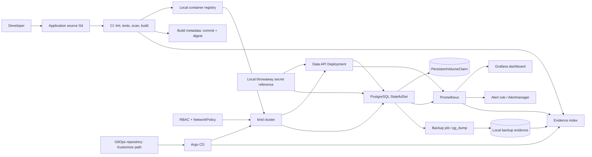

# Project 1 — Production Data Platform Deployment

> **Target file:** `Stage 2E — Production DevOps & Platform Engineering/17-Production-DevOps-Integrated-Capstone/Projects/01-production-data-platform-deployment.md`  
> **Module:** M17 — Production DevOps Integrated Capstone  
> **Stage:** 2E — Production DevOps & Platform Engineering  
> **Project:** 1 of 4  
> **Estimated effort:** [ASSUMPTION] 30–45 hours across staged implementation, drills, evidence capture, and review. Actual time depends on prior M01–M16 mastery and host capacity.  
> **Prerequisites:** M01–M16 outcomes; especially M01, M02, M03, M04, M05, M06, M07, M08, M09, M10, M11, M12, M13, M15, and M16.  
> **Default profile:** Cap-Core. **Optional extension:** Cap+Security.  
> **Environment:** WSL2 Ubuntu or native Linux; `kind` context `kind-m17-lab`; synthetic data only.  
> **Tool baseline:** no exact versions are prescribed. Record actual versions in `docs/versions.txt`; verify version-sensitive commands and APIs against the installed versions.  
> **Last reviewed:** 2026-11-04  
> **Authoring status:** DRAFT-AUDITED. Code and commands are instructional examples; no learner cluster, CI run, alert, backup, restore, rollback, or teardown was executed while authoring.

> **Repository boundary:** This is the single learning-roadmap deliverable requested. Every path and code block below describes the learner’s separate capstone implementation repository. Do not add these supporting files to the learning-roadmap repository while generating or reviewing this document.

---

## 1. Project purpose and production scenario

### 1.1 Scenario

A small internal analytics team needs a PostgreSQL-backed data API for synthetic operational records. The service must be reproducible from a clean checkout, built and tested through CI, published as an immutable container artifact, deployed through GitOps, observable, recoverable, and safely removable.

The service exposes:

- `GET /healthz` — process liveness.
- `GET /readyz` — database-backed readiness.
- `GET /records` — bounded read of synthetic records.
- `GET /metrics` — Prometheus metrics.

PostgreSQL is the system of record. The API is stateless; the database is stateful. This separation is central: replacing an API Pod must not destroy database data, and reverting API code must not be confused with restoring database state.

### 1.2 What “done” means

The project is complete only when the learner can demonstrate a traceable chain:

`source commit → tests/security checks → image build → immutable digest → registry → GitOps commit → Argo CD reconciliation → runtime verification → telemetry → controlled failure → Git rollback → isolated database restore → integrity check → evidence review → teardown`

The project is not complete because a Pod is `Running`, Argo CD says `Synced`, a backup file exists, or a dashboard loads. Each is one signal that must be corroborated by independent evidence.

### 1.3 Scope boundary

Project 1 establishes the PostgreSQL-backed data-service deployment pattern. Project 2 extends the platform with scheduled pipeline freshness and idempotency; Project 3 adds production ML service operations and model artifact identity; Project 4 integrates the complete platform and all workload types. Do not turn Project 1 into the full Project 4 capstone.

### 1.4 Fidelity boundary

A laptop `kind` cluster demonstrates mechanics, repeatability, and evidence discipline at lab scale. It does **not** demonstrate real multi-region behavior, real cloud limits, production traffic capacity, managed identity federation, enterprise governance, regulatory compliance, production billing accuracy, or end-to-end production readiness.

---

## 2. Prerequisites and M01–M16 handoffs

M17 integrates prior capability; it does not re-teach M01–M16 from scratch.

| Module | Capability consumed | Evidence expected in this project |
|---|---|---|
| M01 | Container images, registry, image identity | Build metadata, registry digest, runtime digest |
| M02 | CI/CD, tests, required checks, workflow permissions | CI run tied to commit, test summary, gate failure test |
| M03 | Safe operations and diagnostics | Preflight, runbooks, incident timeline, teardown inventory |
| M04 | Networking, DNS, TLS, boundaries | Service discovery, NetworkPolicy and connectivity tests |
| M05 | PostgreSQL, persistent storage, stateful lifecycle | PVC, persistence drill, backup/restore and integrity report |
| M06 | Helm or Kustomize packaging | Rendered manifests and validation output |
| M07 | Declarative infrastructure and controlled change | Git-managed manifests, context guard, reproducible setup |
| M08 | GitOps and progressive delivery; Argo CD primary | Application source revision, sync/health, drift, Git rollback |
| M09 | Secrets, identity, RBAC, least privilege | Secret-reference pattern, denied-action test, RBAC audit |
| M10 | SRE, SLI/SLO, incidents, error budgets, ORR | SLI/SLO record, alert test, incident/postmortem, readiness review |
| M11 | Metrics, logs, dashboards, alerts | Scrape/query output, dashboard, alert firing and recovery |
| M12 | Security and software supply chain | Secret scan, dependency/image scan where feasible, digest/provenance |
| M13 | Backup, DR, restore verification, bounded fault injection | Backup checksum, isolated restore, integrity and timing |
| M14 | Multi-cluster concepts | Explicit statement that one local cluster does not prove multi-cluster resilience |
| M15 | Capacity and FinOps | Host measurements, resource requests/limits rationale, cost-risk/teardown record |
| M16 | Platform/golden-path conventions | Consistent labels, reusable scripts and runbook conventions; Backstage/Crossplane not required |

### Entry gate

- [ ] Git repository and a clean working tree are available.
- [ ] Docker or a compatible container runtime is working.
- [ ] `kind`, `kubectl`, and the selected packager are installed.
- [ ] The learner can explain a Deployment versus StatefulSet and PVC.
- [ ] The learner can explain image tag versus digest.
- [ ] The learner can explain GitOps desired state versus imperative deployment.
- [ ] The learner understands Kubernetes Secrets are base64-encoded API objects, not an encrypted secret-management system by themselves.
- [ ] The learner has a disposable local environment and synthetic data only.
- [ ] Host CPU, memory, and disk are measured before bootstrap.

If a prerequisite fails, return to the corresponding M01–M16 module. Record the gap and remediation in `docs/gap-register.md`; do not hide missing knowledge by copying commands.

---

## 3. Scope, non-goals, assumptions, and risk register

### 3.1 Mandatory, optional, and excluded

| Classification | Items |
|---|---|
| Mandatory Cap-Core | `kind`, PostgreSQL StatefulSet/PVC, hardened API image, one of Helm or Kustomize, CI, local registry path, immutable digest, Argo CD, secret reference, RBAC, NetworkPolicy with enforcement caveat, metrics/logs/dashboard/alert, backup and isolated restore, rollback drill, readiness checklist, evidence index, safe teardown |
| Optional Cap+Security | One policy engine (Kyverno **or** Gatekeeper), cosign signing/verification where feasible, SBOM generation, deeper admission-policy tests |
| Optional awareness | Argo Rollouts, LocalStack, Chaos Mesh/Litmus; not required for Cap-Core |
| Out of scope | Paid cloud by default, public endpoint, real customer/personal data, GPU, production database, mandatory multi-region, mandatory operator, mandatory Backstage/Crossplane, production security/compliance certification |

### 3.2 Assumptions

- [ASSUMPTION] The baseline database is PostgreSQL in a single-replica StatefulSet for transparent local learning.
- [ASSUMPTION] The local cluster has a storage provisioner suitable for a PVC. Verify with `kubectl get storageclass --context kind-m17-lab`.
- [ASSUMPTION] The API is a small Python service using FastAPI and psycopg. Versions must be locked by the learner.
- [ASSUMPTION] A local registry connected to `kind` is used for the repeatable local image path. Follow the official kind “Local Registry” guide for the installed kind/containerd behavior; verify the node can pull by digest before declaring success.
- [ASSUMPTION] The readiness checklist is authoritative. No invented readiness percentage is used; its machine-readable outcome and blockers govern.
- [ASSUMPTION] An SLO target used in the exercise is instructional only and must not be interpreted as production-derived.

### 3.3 Risk register

| ID | Risk | Likelihood / impact rationale | Mitigation and verification | Owner role | Residual risk |
|---|---|---|---|---|---|
| R-01 | PVC or storage loss | Medium / high: state is durable only within the local storage failure domain | Backup, isolated restore, checksums, persistence drill | Data owner | Local disk and single-node failure remain correlated |
| R-02 | Wrong Kubernetes context mutated | Low / critical: commands may affect an unintended cluster | Explicit context on every command; scripts fail closed; wrong-context negative test | Operator | Human may still bypass scripts |
| R-03 | Mutable image tag deployed | Medium / high: tag may point to different bytes later | Full digest in GitOps; compare registry and runtime identity | Release owner | Registry trust and provenance still require review |
| R-04 | Secret exposed in Git/log/image | Medium / critical | Local-only generated secret, scanning, redaction, canary negative test | Security owner | Scanner coverage is incomplete |
| R-05 | NetworkPolicy not enforced | Medium / high: policy object may exist without CNI enforcement | Positive and negative connectivity tests; mark `NOT_DEMONSTRATED` if unenforced | Network owner | Local CNI behavior differs from production |
| R-06 | Application rollback incompatible with schema | Medium / high | Expand-and-contract migrations; compatibility test before rollback | Application/data owner | Irreversible data transformations need separate recovery |
| R-07 | CI and deployed artifact differ | Medium / high | Commit/run/build/digest/runtime linkage; digest verifier | Release owner | CI provider and registry compromise out of scope |
| R-08 | Alert/dashboard gives false confidence | Medium / medium | Query tests, controlled firing/recovery, missing-series handling | SRE | Local notification path is not production paging |
| R-09 | Resource exhaustion on learner host | Medium / medium | Start components in slices; measure and stop unused components | Platform owner | Host variance |
| R-10 | Teardown leaves sensitive or persistent resources | Medium / high | Inventory before/after; guarded teardown; credential destruction | Operator | Manual host artifacts may be missed |

---

## 4. Architecture and design decisions

### 4.1 Architecture



### 4.2 Trust boundaries

1. **Source boundary:** application source and workflow files are reviewed; untrusted pull requests must not receive write-capable secrets.
2. **Build boundary:** CI executes source-controlled build steps. Workflow permissions must be minimal. A green run is not a provenance guarantee by itself.
3. **Registry boundary:** the image is addressed by full digest. The tag is a human convenience only.
4. **GitOps boundary:** Git declares desired deployment state. Argo CD reconciles that state; manual `kubectl apply` is not the normal release path.
5. **Cluster boundary:** workloads run with least privilege, restricted network paths, non-root settings where compatible, and resource controls.
6. **Data boundary:** PostgreSQL data persists on a PVC; backup artifacts are separate from the source volume. A local PVC and local backup directory are not independent disaster-recovery failure domains.
7. **Evidence boundary:** logs and reports are redacted, timestamped, checksummed where appropriate, and tied to commit/run/digest.

### 4.3 CI versus CD/GitOps

- **CI** validates source, tests, builds, scans, publishes, and records the image digest.
- **GitOps/CD** changes a reviewed manifest in the GitOps repository to reference that digest; Argo CD reconciles the cluster.
- CI should not directly mutate the Kubernetes cluster in the default design.
- Do not rebuild the image between logical environments. Promote the same immutable digest.

### 4.4 Stateful lifecycle

- **Provision:** StatefulSet creates the PostgreSQL Pod and PVC.
- **Write:** API writes/reads synthetic records.
- **Recreate:** deleting the database Pod is a bounded lab drill; the StatefulSet recreates it and the PVC remains attached.
- **Backup:** create a logical PostgreSQL backup with `pg_dump` and record artifact checksum and database identity.
- **Restore:** restore to a separate isolated PostgreSQL target; never overwrite the source during the test.
- **Upgrade:** use backward-compatible expand-and-contract migrations.
- **Rollback:** revert application desired state through Git; separately assess schema/data compatibility. Backup restore is a data-recovery action, not an application rollback.

### 4.5 Architecture decision records

| ADR | Decision | Alternative | Reason | Consequence | Revisit trigger |
|---|---|---|---|---|---|
| ADR-001 | StatefulSet for local PostgreSQL | Operator | Transparent, fewer moving parts for one local DB | Learner owns lifecycle/backup procedures | HA, automated failover, managed lifecycle required |
| ADR-002 | Kustomize as the sole implemented packager | Helm | Native overlays keep the sample compact | No chart templating in this project | Multiple complex product variants emerge |
| ADR-003 | Argo CD as GitOps controller | Direct `kubectl`/other controller | Matches M08/M17 contract | GitOps repo must be kept authoritative | Governance requires another controller |
| ADR-004 | Logical `pg_dump` backup | Volume snapshot | Portable logical representation for the exercise | Does not capture cluster/PVC infrastructure | Large database or PITR requirements emerge |
| ADR-005 | Single-node local cluster | Managed multi-node/cloud | Zero-budget repeatable baseline | No HA or failure-domain proof | Separate approved cloud track |
| ADR-006 | One API replica initially | Multiple replicas | Keeps resource footprint small | No application-level HA claim | Load and availability evidence justify scale-out |

---

## 5. Acceptance criteria and traceability

### 5.1 Identifier policy

The following `REQ-*` and `AC-*` identifiers are canonical from Unit 1 (`capstone-requirements.md`). The `P1-AC-*` identifiers below are project-local decomposition IDs; they do not replace or create canonical M17 identifiers.

Unit 1 is canonical for requirement definitions and acceptance IDs. In particular, the latest Unit 1 mapping is:

- `REQ-008`: no plaintext secrets in Git, images, or logs.
- `REQ-015`: controlled failure investigation.
- `REQ-016`: Git-controlled rollback.
- `REQ-017`: backup and actual restore.
- `REQ-018`: restore integrity and measured RPO/RTO.
- `AC-006`: incident investigation; `AC-007`: rollback; `AC-008`: backup/restore; `AC-011`: teardown; `AC-012`: fresh-clone/traceability.

A source discrepancy exists: the available Unit 3 rubric contains an older crosswalk in places. The current Unit 1 definitions above govern this project; do not propagate the older mapping.

### 5.2 Given / When / Then criteria

| Project-local ID | Canonical mapping | Priority | Given / When / Then | Test and negative case | Required evidence |
|---|---|---|---|---|---|
| P1-AC-001 | REQ-021, REQ-028, AC-012 | MUST | Given a clean clone and declared Cap-Core prerequisites, when README steps run, then the project bootstraps and verifies without author-only state | Fresh-clone drill; remove an undocumented local dependency and confirm failure | `evidence/reproducibility/` |
| P1-AC-002 | REQ-031, REQ-020, AC-011 | MUST / safety | Given an unexpected Kubernetes context, when a mutating script runs, then it exits non-zero before mutation | Run context guard with a deliberately wrong context | `evidence/preflight/` |
| P1-AC-003 | REQ-001–003, REQ-002, AC-001 | MUST | Given a source commit, when CI passes, then tests/gates pass and a full image digest is recorded before promotion | Plant a failing test and prove publish/promotion is blocked | `evidence/ci/`, `evidence/release/` |
| P1-AC-004 | REQ-002, REQ-030, AC-001 | MUST | Given a registry artifact, when GitOps references it, then it uses `repository@sha256:<64-hex>` and runtime identity is compared | Replace digest with a tag or wrong digest; verifier rejects | `evidence/release/digest/` |
| P1-AC-005 | REQ-001, REQ-008, REQ-009, REQ-028, AC-001/003/004 | MUST | Given Kustomize resources, when rendered and validated, then names, labels, selectors, security and secret references are coherent | Invalid manifest and planted secret must fail checks | `evidence/packaging/` |
| P1-AC-006 | REQ-004–005, AC-002 | MUST | Given a reviewed GitOps commit, when Argo CD reconciles, then source revision and live state converge | Introduce bounded lab drift and verify correction/alert | `evidence/gitops/` |
| P1-AC-007 | REQ-006, REQ-009, AC-003 | MUST | Given application and database identities, when RBAC/security are inspected, then privileges are least-privilege and runtime hardening is evidenced | Attempt a prohibited API action; privileged fixture must be rejected/flagged | `evidence/security/rbac/` |
| P1-AC-008 | REQ-007–008, AC-004 | MUST | Given no real secret in source, when scanner and image/log review run, then no plaintext secret is present and a synthetic canary is detected | Plant only a fake canary; gate must fail | `evidence/security/secrets/` |
| P1-AC-009 | REQ-010, AC-003 | MUST where enforceable | Given declared API→DB traffic, when a prohibited source attempts DB access, then NetworkPolicy blocks it | Negative connectivity test; if CNI does not enforce policy, status is `NOT_DEMONSTRATED` | `evidence/network/` |
| P1-AC-010 | REQ-011–014, AC-005 | MUST | Given running API and DB, when metrics/logs/dashboard/alert tests run, then signals are queryable and at least one controlled alert fires and recovers | Healthy fixture stays inactive; failing signal fires | `evidence/observability/` |
| P1-AC-011 | REQ-017–018, AC-008 | MUST | Given deterministic synthetic rows and baseline invariants, when backup is restored to an isolated target, then integrity matches and RPO/RTO are measured from actual timestamps | Corrupt a disposable copy; checksum/integrity verifier must fail | `evidence/backup/` |
| P1-AC-012 | REQ-015, AC-006 | MUST | Given a controlled bad release, when incident workflow runs, then scope/evidence/timeline precede mitigation and the service is recovered safely | Mutating before evidence capture is a failed drill | `evidence/incidents/` |
| P1-AC-013 | REQ-016, REQ-002, AC-007 | MUST | Given a bad app release and compatible schema, when Git is reverted, then Argo converges and runtime digest/behavior match the known-good revision | Wrong digest or schema-incompatible rollback must be rejected | `evidence/rollback/` |
| P1-AC-014 | REQ-019 | Not applicable to this project’s workload scope | Project 1 does not implement the scheduled pipeline; Project 2 owns CronJob freshness/idempotency | Mark `N/A` with explicit project boundary; do not claim whole-M17 completion | `evidence/traceability/` |
| P1-AC-015 | REQ-022–027, AC-012 | MUST | Given canonical requirements and evidence index, when validators run, then missing/orphan evidence, bad checksums and missing metadata fail | Remove a required artifact and alter a checksum | `evidence/traceability/` |
| P1-AC-016 | REQ-020, AC-011 | MUST | Given evidence is retained, when guarded teardown runs, then lab-created resources and throwaway credentials are removed and inventory is checked | Wrong context must refuse; deliberately retained test resource must be detected | `evidence/teardown/` |
| P1-AC-017 | REQ-032, AC-012 | MUST | Given scope/risk/ADR/assumptions, when reviewer examines project, then all constraints and limitations are explicit and cloud remains gated | Reviewer rejects hidden cloud dependency or unowned risk | `docs/`, `evidence/review/` |

### 5.3 Crosswalk to shared rubrics

| Evidence area | Unit 2 readiness | Unit 3 incident/recovery | Unit 4 security/release | Unit 5 cost/reliability | Unit 6 platform/delivery |
|---|---|---|---|---|---|
| Scope, architecture, dependencies | PR-001–005 | — | — | — | PD-08/09 supporting |
| CI, packaging, digest, GitOps | PR-006–013 | IR-03 | SR-05, SR-06, SR-09 | — | PD-01–05 |
| Hardening, secrets, RBAC, network | PR-015, PR-020 onward | IR-02 supporting | SR-01–03, SR-08 | — | PD-03, PD-07 |
| Observability and alerting | readiness observability items | IR-01, IR-05, IR-06 | supporting release evidence | CR-01–03 | PD-06/07 |
| Storage, backup, restore | readiness state/recovery items | IR-04 | supporting security evidence | CR-05/06 | stateful rollout support |
| Rollback and incident | readiness change/recovery items | IR-02/03/05/06/08 | SR-09 | CR-04/06 | PD-04/05 |
| Reproducibility and teardown | readiness evidence/lifecycle items | IR-07 | SR-06 | CR-08 | PD-08/09 |

Unit 2 contains 75 checklist items in 15 categories, with stable `PR-*` identifiers, statuses, severity, profile applicability, gates, evidence, freshness, and pass conditions. Use the full checklist for the selected profile; the rows above are a project cross-reference, not a replacement checklist.

---

## 6. Repository layout for the learner’s implementation repository

```text
production-data-platform/
├── app/
│   ├── main.py
│   └── db.py
├── tests/
│   └── test_app.py
├── requirements.txt
├── Dockerfile
├── .dockerignore
├── .gitleaks.toml
├── .github/workflows/ci.yml
├── deploy/
│   ├── base/
│   │   ├── kustomization.yaml
│   │   ├── namespace.yaml
│   │   ├── postgres.yaml
│   │   ├── api.yaml
│   │   ├── network-policy.yaml
│   │   ├── rbac.yaml
│   │   └── service-monitoring.yaml
│   └── overlays/local/
│       ├── kustomization.yaml
│       └── image-digest-patch.yaml
├── gitops/
│   └── application.yaml
├── observability/
│   ├── alerts.yaml
│   └── dashboard-notes.md
├── backup/
│   ├── backup.sh
│   ├── restore-verify.sh
│   └── integrity.sql
├── scripts/
│   ├── preflight.sh
│   ├── context-guard.sh
│   ├── verify-digest.py
│   └── evidence-check.py
├── runbooks/
│   ├── deploy.md
│   ├── incident-triage.md
│   ├── rollback.md
│   ├── backup-restore.md
│   └── teardown.md
├── docs/
│   ├── versions.txt
│   ├── architecture.md
│   ├── risk-register.md
│   ├── adr/
│   └── gap-register.md
├── evidence/
│   ├── index.yaml
│   ├── checksums.sha256
│   ├── ci/
│   ├── release/
│   ├── gitops/
│   ├── security/
│   ├── network/
│   ├── observability/
│   ├── backup/
│   ├── rollback/
│   ├── readiness/
│   ├── reproducibility/
│   └── teardown/
└── Makefile
```

The tree is a recommended implementation-repository structure. The project document embeds representative core files below; evidence directories are populated only by the learner’s actual runs. Do not commit generated secret material or raw sensitive environment files.

---

## 7. Toolchain, versions, profiles, and resource budget

### 7.1 Tool matrix

| Tool | Purpose | Classification | Record/verify |
|---|---|---|---|
| Git | Source and GitOps history | Core | `git --version` |
| Docker/compatible runtime | Build and local registry | Core | `docker version` |
| kind | Local Kubernetes | Core | `kind version` |
| kubectl | Cluster inspection | Core | `kubectl version --client` |
| Kustomize | Manifest composition | Core (selected path) | `kubectl kustomize --help`; standalone `kustomize version` if installed |
| Argo CD | GitOps reconciliation | Core | `argocd version --client` and server version |
| PostgreSQL client | Backup/restore verification | Core | `pg_dump --version`, `psql --version` |
| Prometheus/Grafana | Metrics and dashboard | Core capability; start in a later slice | Record image digests/versions actually used |
| Gitleaks or equivalent | Secret scanning | Recommended baseline | `gitleaks version` |
| Syft/Trivy or equivalent | SBOM/image/dependency scan | Optional / feasible | Record version and scan scope |
| cosign | Artifact signing | Cap+Security | Record version; verify official docs |
| Kyverno or Gatekeeper | Admission policy | Cap+Security; choose one | Record version and CRDs |

Do not invent exact versions or third-party action SHAs. Pin dependencies and actions only after verifying immutable references against official release documentation. Use `<VERSION>` placeholders until measured.

### 7.2 Profiles and lifecycle

| Profile | Start together | Stop / defer | Notes |
|---|---|---|---|
| Cap-Core bootstrap | kind + local registry + PostgreSQL + API | Stop Prometheus/Grafana until app path works | Establish walking skeleton first |
| Cap-Core observability | Prometheus/Grafana/alert component | Stop unused test workloads; avoid parallel optional tools | Measure memory and disk before start |
| Cap+Security | Add one policy engine and/or cosign | Do not run two policy engines; stop optional components between drills | Optional; not a hidden pass prerequisite |
| Cap+Chaos | One chaos tool **or** scripted benign fault | Do not run both by default | Only after safe rollback/restore path is tested |

Planning envelope: approximately 4 CPU / 8 GB RAM / 30 GB disk. This is not a promise that every component fits simultaneously. Record actual host and container usage at each milestone.

### 7.3 Preflight

```bash
# File: scripts/preflight.sh
#!/usr/bin/env bash
set -euo pipefail

EXPECTED_CONTEXT="kind-m17-lab"
ACTUAL_CONTEXT="$(kubectl config current-context 2>/dev/null || true)"

printf 'UTC: '; date -u +'%Y-%m-%dT%H:%M:%SZ'
printf 'Host: '; uname -a
printf 'CPU: '; getconf _NPROCESSORS_ONLN
printf 'Memory: '; (free -h 2>/dev/null || true)
printf 'Disk: '; df -h .
printf 'Docker: '; docker version --format '{{.Server.Version}}'
printf 'kind: '; kind version
printf 'kubectl: '; kubectl version --client --output=yaml | sed -n '1,12p'
printf 'Current context: %s\n' "${ACTUAL_CONTEXT:-<none>}"

if [[ "${ACTUAL_CONTEXT}" != "${EXPECTED_CONTEXT}" ]]; then
  echo "STOP: expected context ${EXPECTED_CONTEXT}; found ${ACTUAL_CONTEXT:-<none>}" >&2
  exit 20
fi

kubectl cluster-info --context "${EXPECTED_CONTEXT}"
kubectl get nodes --context "${EXPECTED_CONTEXT}" -o wide
```

This script is intentionally fail-closed and read-only. The exact `kubectl version` output fields vary by release; verify locally. Save the output as `evidence/preflight/preflight.txt`. If the cluster has not yet been created, run a host-only preflight first and do not weaken the context guard.

### 7.4 Context guard

```bash
# File: scripts/context-guard.sh
#!/usr/bin/env bash
set -euo pipefail

EXPECTED_CONTEXT="kind-m17-lab"
EXPECTED_NAMESPACE="m17-data"

actual="${1:-$(kubectl config current-context 2>/dev/null || true)}"
if [[ "${actual}" != "${EXPECTED_CONTEXT}" ]]; then
  printf 'REFUSED: context must be %s; received %s\n' \
    "${EXPECTED_CONTEXT}" "${actual:-<none>}" >&2
  exit 21
fi

kubectl get namespace "${EXPECTED_NAMESPACE}" \
  --context "${EXPECTED_CONTEXT}" >/dev/null
printf 'Context and namespace guard passed: %s / %s\n' \
  "${EXPECTED_CONTEXT}" "${EXPECTED_NAMESPACE}"
```

Every mutating cluster command in this project must include `--context kind-m17-lab`. Any script that mutates or deletes cluster resources must call the guard and must require an explicit `--apply` flag for destructive behavior.

### 7.5 WSL2 versus native Linux

- WSL2: keep the working tree inside the Linux filesystem for better file-event and filesystem behavior; verify Docker integration, memory limits, port forwarding, permissions, and line endings.
- Native Linux: verify cgroup/runtime configuration, user permissions for the container runtime, filesystem ownership, and local port conflicts.
- Do not assume that `localhost` inside a kind node is the same network namespace as `localhost` on the host.
- Record OS/kernel, runtime, context, and resource measurements in `docs/versions.txt`.

---

## 8. Build and implementation walkthrough — beginner to advanced

### 8.0 Canonical execution order

Execute the work in this order. The detailed sections below provide the commands and artifacts; this table is the authoritative sequencing contract.

| Step | Required activity | Detailed location / output |
|---:|---|---|
| 1 | Confirm assumptions, record installed versions, inspect host resources, establish worktree | Milestone 1; `docs/versions.txt`; initial Git commit |
| 2 | Run preflight and prove the context guard refuses any context other than `kind-m17-lab` | Section 7.3–7.4; `evidence/preflight/` |
| 3 | Create the local cluster and registry connectivity path; verify node pull path | Milestone 2; `evidence/cluster/` |
| 4 | Implement the minimal example application and deterministic tests | Milestone 3; `app/`, `tests/` |
| 5 | Build and scan the image; capture its full digest and explain digest versus tag | Milestone 4; `evidence/release/` |
| 6 | Create and validate Kustomize packaging and rendered manifests | Milestone 5; `evidence/packaging/` |
| 7 | Deploy PostgreSQL with persistent storage, security context, resources, probes, and secret references | Milestone 5; `deploy/base/postgres.yaml`; `evidence/storage/` |
| 8 | Deploy the hardened API with service discovery and NetworkPolicy | Milestone 5; `deploy/base/api.yaml`, `network-policy.yaml`; `evidence/network/` |
| 9 | Configure CI and prove required tests/gates run before publishing; record build-to-digest identity | Milestone 7; `evidence/ci/` |
| 10 | Configure GitOps and Argo CD reconciliation from the declared Git path | Milestone 8; `evidence/gitops/` |
| 11 | Demonstrate desired-state drift detection and reconciliation | Section 12, Drill D-02; `evidence/gitops/drift/` |
| 12 | Add metrics, logs, dashboard, alert syntax validation, live alert firing and recovery | Milestone 11; `evidence/observability/` |
| 13 | Create a database backup and validate its artifact identity/checksum | Milestone 12; `evidence/backup/` |
| 14 | Restore into an isolated target and verify data integrity | Milestone 12; `evidence/restore/` |
| 15 | Run the stateful-safe application rollback drill and document schema compatibility | Milestone 13; `evidence/rollback/` |
| 16 | Run canonical readiness, traceability, evidence-index, and checksum validators | Milestone 14; `evidence/readiness/`, `evidence/traceability/` |
| 17 | Validate reproducibility from a clean clone or a second learner’s checkout | Milestone 14; `evidence/reproducibility/` |
| 18 | Preserve evidence, tear down the lab, and verify cleanup | Section 20; `evidence/teardown/` |

Do not skip forward because a component appears to work. A later step depends on evidence from earlier steps. If a step is not executable in the selected local environment, record `NOT_DEMONSTRATED`, the reason, the affected acceptance criterion, and the compensating evidence; do not silently mark it Pass.

### Milestone 1 — Establish the worktree and record versions

**Purpose:** make the project reproducible before building anything.

```bash
mkdir -p production-data-platform
cd production-data-platform
git init
mkdir -p app tests deploy/base deploy/overlays/local gitops observability backup scripts runbooks docs/adr evidence
```

Create `docs/versions.txt` and populate it with actual values:

```text
# File: docs/versions.txt
review_date=2026-11-04
os=<MEASURE_YOURS>
kernel=<MEASURE_YOURS>
container_runtime=<MEASURE_YOURS>
docker=<MEASURE_YOURS>
kind=<MEASURE_YOURS>
kubectl_client=<MEASURE_YOURS>
kustomize=<MEASURE_YOURS>
argocd_cli=<MEASURE_YOURS>
python=<MEASURE_YOURS>
postgres_client=<MEASURE_YOURS>
prometheus=<MEASURE_YOURS>
grafana=<MEASURE_YOURS>
```

**Verify:** inspect the file, commit the baseline, and save `git rev-parse HEAD` to `evidence/reproducibility/source-commit.txt`.

**Example — yours will differ:**
```text
review_date=2026-11-04
kind=v<installed-version>
kubectl_client=v<installed-version>
```

Do not copy placeholders into a final evidence record.

### Milestone 2 — Create the cluster and local registry

**Purpose:** make the local artifact path explicit. A local registry must be reachable by kind nodes, not merely by the host.

The exact registry wiring is version-sensitive. Follow the official kind documentation section **“Local Registry”** for the installed kind version. A typical setup uses a registry container attached to the kind Docker network and a kind node containerd mirror configuration. Do not copy a remembered mirror stanza without validating it against your installed kind/containerd behavior.

Create the cluster with the explicit name `kind-m17-lab`. Save the exact cluster configuration used as `docs/kind-config.yaml`. Before creating it, check that the name is not already owned by another project.

```bash
# Read-only inventory first
kind get clusters
docker ps --format '{{.Names}}'
```

[VERSION-SENSITIVE] Use the official kind “Creating a cluster” and “Local Registry” procedures to create the registry and cluster. The cluster configuration must:
- use the exact name `kind-m17-lab`;
- configure the registry mirror/endpoint for the chosen local registry;
- expose only the ports needed by the lab;
- avoid public exposure;
- be committed with the project.

After creation:

```bash
kubectl config get-contexts
kubectl cluster-info --context kind-m17-lab
kubectl get nodes --context kind-m17-lab -o wide
kubectl get storageclass --context kind-m17-lab
```

**Pass:** expected context exists, nodes are Ready, a default StorageClass is available or an explicitly selected provisioner is documented, and kind can pull a test image from the local registry by immutable digest.

**Negative test:** use an intentionally unreachable registry endpoint in a disposable test manifest and verify the Pod does not become Ready. Do not use a mutable image tag as a release identity.

**Evidence:** `evidence/cluster/cluster-info.txt`, `evidence/cluster/storageclass.txt`, `evidence/cluster/registry-pull.txt`.

### Milestone 3 — Implement the small API

**Purpose:** keep application behavior deterministic and small enough to reason about.

```python
# File: app/main.py
import os
import time
from contextlib import asynccontextmanager

import psycopg
from fastapi import FastAPI, HTTPException
from fastapi.responses import PlainTextResponse
from prometheus_client import Counter, Histogram, generate_latest, CONTENT_TYPE_LATEST

DATABASE_URL = os.environ["DATABASE_URL"]
REQUESTS = Counter("data_api_requests_total", "API requests", ["route", "result"])
REQUEST_LATENCY = Histogram("data_api_request_seconds", "API request latency", ["route"])


def db_connection():
    return psycopg.connect(DATABASE_URL, connect_timeout=3)


@asynccontextmanager
async def lifespan(app: FastAPI):
    # The API schema is intentionally created by a separate migration/bootstrap step.
    yield


app = FastAPI(title="M17 Synthetic Data API", lifespan=lifespan)


@app.get("/healthz")
def healthz():
    return {"status": "ok"}


@app.get("/readyz")
def readyz():
    try:
        with db_connection() as conn:
            conn.execute("SELECT 1")
        REQUESTS.labels("/readyz", "good").inc()
        return {"status": "ready"}
    except Exception:
        REQUESTS.labels("/readyz", "bad").inc()
        raise HTTPException(status_code=503, detail="database unavailable")


@app.get("/records")
def records(limit: int = 20):
    if limit < 1 or limit > 100:
        raise HTTPException(status_code=400, detail="limit must be 1..100")
    start = time.perf_counter()
    try:
        with db_connection() as conn:
            rows = conn.execute(
                "SELECT record_id, category, amount FROM synthetic_records "
                "ORDER BY record_id LIMIT %s",
                (limit,),
            ).fetchall()
        REQUESTS.labels("/records", "good").inc()
        return [
            {"record_id": row[0], "category": row[1], "amount": str(row[2])}
            for row in rows
        ]
    except Exception:
        REQUESTS.labels("/records", "bad").inc()
        raise HTTPException(status_code=503, detail="database unavailable")
    finally:
        REQUEST_LATENCY.labels("/records").observe(time.perf_counter() - start)


@app.get("/metrics")
def metrics():
    return PlainTextResponse(generate_latest().decode("utf-8"),
                             media_type=CONTENT_TYPE_LATEST)
```

```python
# File: tests/test_app.py
from fastapi.testclient import TestClient
from app.main import app


def test_healthz():
    response = TestClient(app).get("/healthz")
    assert response.status_code == 200
    assert response.json() == {"status": "ok"}


def test_records_rejects_unbounded_limit():
    response = TestClient(app).get("/records?limit=1000")
    assert response.status_code == 400
```

```text
# File: requirements.txt
fastapi==<PIN_VERIFIED_VERSION>
uvicorn[standard]==<PIN_VERIFIED_VERSION>
psycopg[binary]==<PIN_VERIFIED_VERSION>
prometheus-client==<PIN_VERIFIED_VERSION>
pytest==<PIN_VERIFIED_VERSION>
httpx==<PIN_VERIFIED_VERSION>
```

The placeholders are deliberate. Resolve and pin tested versions in a lockfile using the chosen dependency tool before building. Do not invent a version. Keep runtime and test dependencies separated if the chosen lock tool supports it.

**Important:** the tests above are a fast unit-level starting point. Add a database integration test in a disposable test database before claiming the API’s database behavior is fully tested.

### Milestone 4 — Build a hardened image

```dockerfile
# File: Dockerfile
FROM python:<PINNED_PYTHON_BASE_IMAGE> AS runtime
ENV PYTHONDONTWRITEBYTECODE=1 \
    PYTHONUNBUFFERED=1
WORKDIR /srv/app
COPY requirements.txt .
RUN pip install --no-cache-dir --requirement requirements.txt \
    && useradd --system --uid 10001 --create-home appuser
COPY app/ ./app/
USER 10001:10001
EXPOSE 8080
CMD ["uvicorn", "app.main:app", "--host", "0.0.0.0", "--port", "8080"]
```

```text
# File: .dockerignore
.git
.venv
__pycache__
.pytest_cache
.mypy_cache
.ruff_cache
.env
.env.*
*.pem
*.key
evidence/
```

The base image must be pinned to an immutable digest in the actual implementation. The placeholder above is not a valid final build input. For stricter hardening, use a multi-stage build, minimal base, read-only root filesystem, dropped capabilities, and a tested writable temporary directory. Do not claim the sample is production hardened merely because it runs as non-root.

Build and test:

```bash
python -m pytest -q
docker build --pull -t localhost:5001/m17/data-api:dev .
```

Push to the local registry after registry connectivity is verified. Resolve and record the full manifest digest using the registry/client method supported by the selected runtime. Record:
- source commit SHA;
- CI run/build identifier;
- image repository;
- full `sha256:` digest;
- build timestamp;
- scan result and scope;
- base image identity.

**Digest rule:** final GitOps state must use `registry/repository@sha256:<64-hex>`. Do not use `:latest`, `:dev`, or any mutable tag as the final deployment identity.

### Milestone 5 — Deploy PostgreSQL and the API with Kustomize

Kustomize is the single fully implemented packager in this project. Helm is an alternative, not a second implementation track.

First create a local-only throwaway password outside Git. Use a password manager or a file with restrictive permissions; never echo the value. For the local lab, create a Kubernetes Secret from that external file only after confirming the target context. Kubernetes Secret data is not automatically encrypted at rest in every cluster; this local mechanism is a teaching reference, not a production secret-management recommendation.

```bash
# Example secret creation; password file must be outside the repository.
# Never display or commit the file.
chmod 600 "$HOME/.m17-postgres-password"
kubectl create namespace m17-data --context kind-m17-lab
kubectl create secret generic postgres-auth \
  --namespace m17-data \
  --from-file=password="$HOME/.m17-postgres-password" \
  --context kind-m17-lab
```

The Secret name and key must match the manifests. The password file is a local throwaway value and must be destroyed during teardown.

```yaml
# File: deploy/base/namespace.yaml
apiVersion: v1
kind: Namespace
metadata:
  name: m17-data
  labels:
    app.kubernetes.io/part-of: m17-data-platform
```

```yaml
# File: deploy/base/postgres.yaml
apiVersion: v1
kind: Service
metadata:
  name: postgres
  namespace: m17-data
spec:
  clusterIP: None
  selector:
    app.kubernetes.io/name: postgres
  ports:
    - name: postgres
      port: 5432
      targetPort: postgres
---
apiVersion: apps/v1
kind: StatefulSet
metadata:
  name: postgres
  namespace: m17-data
spec:
  serviceName: postgres
  replicas: 1
  selector:
    matchLabels:
      app.kubernetes.io/name: postgres
  template:
    metadata:
      labels:
        app.kubernetes.io/name: postgres
    spec:
      terminationGracePeriodSeconds: 30
      securityContext:
        fsGroup: 999
      containers:
        - name: postgres
          image: postgres:<PINNED_MAJOR_AND_PATCH>
          ports:
            - name: postgres
              containerPort: 5432
          env:
            - name: POSTGRES_DB
              value: m17
            - name: POSTGRES_USER
              value: m17_app
            - name: POSTGRES_PASSWORD
              valueFrom:
                secretKeyRef:
                  name: postgres-auth
                  key: password
            - name: PGDATA
              value: /var/lib/postgresql/data/pgdata
          resources:
            requests:
              cpu: 100m
              memory: 256Mi
            limits:
              cpu: "1"
              memory: 768Mi
          startupProbe:
            exec:
              command: ["sh", "-c", "pg_isready -U m17_app -d m17"]
            failureThreshold: 30
            periodSeconds: 5
          readinessProbe:
            exec:
              command: ["sh", "-c", "pg_isready -U m17_app -d m17"]
            periodSeconds: 10
          livenessProbe:
            exec:
              command: ["sh", "-c", "pg_isready -U m17_app -d m17"]
            periodSeconds: 20
          volumeMounts:
            - name: postgres-data
              mountPath: /var/lib/postgresql/data
  volumeClaimTemplates:
    - metadata:
        name: postgres-data
      spec:
        accessModes: ["ReadWriteOnce"]
        resources:
          requests:
            storage: 2Gi
```

`postgres:<PINNED_MAJOR_AND_PATCH>` is a placeholder. Pin the chosen PostgreSQL image by digest in the actual release manifest and verify compatibility with the selected storage/runtime. The official image’s UID/GID and filesystem behavior are image-specific; verify the correct security context rather than assuming `fsGroup: 999` is universally correct.

```yaml
# File: deploy/base/api.yaml
apiVersion: v1
kind: ServiceAccount
metadata:
  name: data-api
  namespace: m17-data
automountServiceAccountToken: false
---
apiVersion: v1
kind: Service
metadata:
  name: data-api
  namespace: m17-data
  labels:
    app.kubernetes.io/name: data-api
spec:
  selector:
    app.kubernetes.io/name: data-api
  ports:
    - name: http
      port: 8080
      targetPort: http
---
apiVersion: apps/v1
kind: Deployment
metadata:
  name: data-api
  namespace: m17-data
spec:
  replicas: 1
  selector:
    matchLabels:
      app.kubernetes.io/name: data-api
  template:
    metadata:
      labels:
        app.kubernetes.io/name: data-api
    spec:
      serviceAccountName: data-api
      automountServiceAccountToken: false
      securityContext:
        runAsNonRoot: true
        runAsUser: 10001
        runAsGroup: 10001
        seccompProfile:
          type: RuntimeDefault
      containers:
        - name: api
          image: localhost:5001/m17/data-api:dev # Base-only placeholder; overlay must replace with digest.
          imagePullPolicy: IfNotPresent
          ports:
            - name: http
              containerPort: 8080
          env:
            - name: DATABASE_URL
              value: "postgresql://m17_app@postgres.m17-data.svc.cluster.local:5432/m17"
            - name: PGPASSWORD
              valueFrom:
                secretKeyRef:
                  name: postgres-auth
                  key: password
          resources:
            requests:
              cpu: 100m
              memory: 128Mi
            limits:
              cpu: 500m
              memory: 384Mi
          securityContext:
            allowPrivilegeEscalation: false
            readOnlyRootFilesystem: true
            capabilities:
              drop: ["ALL"]
          startupProbe:
            httpGet:
              path: /healthz
              port: http
            failureThreshold: 20
            periodSeconds: 3
          readinessProbe:
            httpGet:
              path: /readyz
              port: http
            periodSeconds: 5
          livenessProbe:
            httpGet:
              path: /healthz
              port: http
            periodSeconds: 10
          volumeMounts:
            - name: tmp
              mountPath: /tmp
      volumes:
        - name: tmp
          emptyDir: {}
```

The sample database URL uses a username and host but not a password; the password is provided through `PGPASSWORD`. Confirm that the selected PostgreSQL driver honors this environment variable for the connection path used. A stronger implementation can construct the connection configuration using a secret-mounted file or a tested secret URI mechanism. Do not put the password directly into `DATABASE_URL`.

```yaml
# File: deploy/base/network-policy.yaml
apiVersion: networking.k8s.io/v1
kind: NetworkPolicy
metadata:
  name: data-api-ingress-egress
  namespace: m17-data
spec:
  podSelector:
    matchLabels:
      app.kubernetes.io/name: data-api
  policyTypes:
    - Ingress
    - Egress
  ingress:
    - from:
        - namespaceSelector:
            matchLabels:
              kubernetes.io/metadata.name: m17-data
      ports:
        - protocol: TCP
          port: 8080
  egress:
    - to:
        - podSelector:
            matchLabels:
              app.kubernetes.io/name: postgres
      ports:
        - protocol: TCP
          port: 5432
    - to:
        - namespaceSelector:
            matchLabels:
              kubernetes.io/metadata.name: kube-system
      ports:
        - protocol: UDP
          port: 53
        - protocol: TCP
          port: 53
```

This policy is scoped to the API Pods. It does not implement a namespace-wide default-deny for every Pod. Adapt the policy only after verifying DNS labels, required scrape traffic, and the selected CNI’s enforcement. The Prometheus scraper may need an explicit ingress allowance to the API metrics port. A NetworkPolicy object existing is not proof of enforcement.

```yaml
# File: deploy/base/rbac.yaml
apiVersion: rbac.authorization.k8s.io/v1
kind: Role
metadata:
  name: data-api-no-k8s-access
  namespace: m17-data
rules: []
---
apiVersion: rbac.authorization.k8s.io/v1
kind: RoleBinding
metadata:
  name: data-api-no-k8s-access
  namespace: m17-data
subjects:
  - kind: ServiceAccount
    name: data-api
    namespace: m17-data
roleRef:
  apiGroup: rbac.authorization.k8s.io
  kind: Role
  name: data-api-no-k8s-access
```

The API does not need Kubernetes API access. An empty Role makes that explicit. PostgreSQL also does not need Kubernetes API access. Do not grant cluster-admin to workloads or CI.

```yaml
# File: deploy/base/kustomization.yaml
apiVersion: kustomize.config.k8s.io/v1beta1
kind: Kustomization
resources:
  - namespace.yaml
  - postgres.yaml
  - api.yaml
  - network-policy.yaml
  - rbac.yaml
```

```yaml
# File: deploy/overlays/local/kustomization.yaml
apiVersion: kustomize.config.k8s.io/v1beta1
kind: Kustomization
namespace: m17-data
resources:
  - ../../base
```

`image-digest-patch.yaml` is not included as an independent patch because Kustomize image replacement is best kept in the overlay’s `images` field. Add the actual image and digest after the registry build:

```yaml
# File: deploy/overlays/local/kustomization.yaml (release-specific completed form)
apiVersion: kustomize.config.k8s.io/v1beta1
kind: Kustomization
namespace: m17-data
resources:
  - ../../base
images:
  - name: localhost:5001/m17/data-api
    newName: localhost:5001/m17/data-api
    digest: sha256:<FULL_IMAGE_DIGEST>
```

Do not leave `<FULL_IMAGE_DIGEST>` in a demonstrated release. Validate rendered output:

```bash
kubectl kustomize deploy/overlays/local > /tmp/m17-rendered.yaml
grep -n 'image:' /tmp/m17-rendered.yaml
kubectl apply --dry-run=client -f /tmp/m17-rendered.yaml
```

The final deployment is applied by Argo CD, not by the learner’s normal release command. The client dry-run validates client-side structure only; it does not prove admission, scheduling, storage, or runtime behavior.

### Milestone 6 — Bootstrap schema and synthetic data

The database schema is deliberately simple. Use a controlled one-time bootstrap job or a documented `psql` session after PostgreSQL is ready. Do not put database passwords in shell command arguments or terminal output.

```sql
-- File: backup/integrity.sql
CREATE TABLE IF NOT EXISTS synthetic_records (
    record_id BIGINT PRIMARY KEY,
    category TEXT NOT NULL,
    amount NUMERIC(12,2) NOT NULL CHECK (amount >= 0)
);

INSERT INTO synthetic_records(record_id, category, amount)
VALUES
    (1001, 'alpha', 10.25),
    (1002, 'beta', 20.50),
    (1003, 'gamma', 30.75)
ON CONFLICT (record_id) DO NOTHING;
```

Run the SQL through a secret-safe `psql` invocation using a local protected password file or an ephemeral client Pod. Avoid `PGPASSWORD=...` in shell history. Record row count, uniqueness, and deterministic aggregate before backup:

```sql
SELECT COUNT(*) AS row_count FROM synthetic_records;
SELECT COUNT(DISTINCT record_id) AS unique_ids FROM synthetic_records;
SELECT SUM(amount)::numeric(12,2) AS amount_total FROM synthetic_records;
```

For the seed dataset above, expected invariants are 3 rows, 3 unique IDs, and total amount 61.50. These are deterministic fixture values, not measurements of a learner run.

### Milestone 7 — CI workflow

The workflow below demonstrates the required shape. Third-party action references are intentionally placeholders because immutable action SHAs must be verified from trusted release metadata before use. Do not run this workflow until placeholders have been replaced with verified SHAs and the selected registry path is configured.

```yaml
# File: .github/workflows/ci.yml
name: data-api-ci
on:
  pull_request:
  push:
    branches: [main]

permissions:
  contents: read

jobs:
  test:
    runs-on: ubuntu-latest
    steps:
      - name: Checkout
        uses: actions/checkout@<VERIFIED_FULL_COMMIT_SHA>
      - name: Set up Python
        uses: actions/setup-python@<VERIFIED_FULL_COMMIT_SHA>
        with:
          python-version: "<PINNED_PYTHON_VERSION>"
      - name: Install dependencies
        run: |
          python -m pip install --requirement requirements.txt
      - name: Run tests
        run: |
          python -m pytest -q

  build:
    needs: [test]
    if: github.event_name == 'push' && github.ref == 'refs/heads/main'
    runs-on: ubuntu-latest
    permissions:
      contents: read
      packages: write
    steps:
      - name: Checkout
        uses: actions/checkout@<VERIFIED_FULL_COMMIT_SHA>
      - name: Set up buildx
        uses: docker/setup-buildx-action@<VERIFIED_FULL_COMMIT_SHA>
      - name: Login to registry
        uses: docker/login-action@<VERIFIED_FULL_COMMIT_SHA>
        with:
          registry: ghcr.io
          username: ${{ github.actor }}
          password: ${{ secrets.GITHUB_TOKEN }}
      - name: Build and push
        id: image
        uses: docker/build-push-action@<VERIFIED_FULL_COMMIT_SHA>
        with:
          context: .
          push: true
          tags: ghcr.io/${{ github.repository }}/data-api:${{ github.sha }}
      - name: Record build metadata
        env:
          IMAGE_DIGEST: ${{ steps.image.outputs.digest }}
        run: |
          test -n "$IMAGE_DIGEST"
          printf '{"commit":"%s","digest":"%s"}\n' \
            "$GITHUB_SHA" "$IMAGE_DIGEST" \
            > build-metadata.json
      - name: Upload build metadata
        uses: actions/upload-artifact@<VERIFIED_FULL_COMMIT_SHA>
        with:
          name: build-metadata
          path: build-metadata.json
```

[VERIFY] Confirm GitHub Actions expression behavior, action input names, action SHAs, package permissions, package visibility, retention, and branch protection against current official GitHub documentation. A local workflow emulator does not prove GitHub-hosted runner identity, branch protection, or provider permission behavior.

**Registry-path reconciliation:** the hosted workflow above publishes the CI-built artifact to GHCR and records its digest. For the local `kind` profile, copy that exact OCI artifact into the local registry without rebuilding it. Use a verified image-copy tool such as `skopeo` (optional; record its version), copy by source digest, then inspect the destination digest. The copy is accepted only if the full destination digest equals the source digest. If the copy tool changes manifest media type or the digest differs, stop and investigate; do not silently substitute a rebuild.

Illustrative promotion contract (verify the installed `skopeo` syntax and registry authentication before use):

```bash
# File: runbooks/promote-to-local-registry.sh
#!/usr/bin/env bash
set -euo pipefail
: "${SOURCE_IMAGE:?set SOURCE_IMAGE to registry/repository@sha256:<digest>}"
: "${SOURCE_DIGEST:?set SOURCE_DIGEST to sha256:<64-hex>}"
: "${LOCAL_IMAGE:?set LOCAL_IMAGE to localhost:5001/m17/data-api}"
: "${LOCAL_REGISTRY_AUTHFILE:?set a protected authfile path}"

[[ "${SOURCE_IMAGE}" == *@${SOURCE_DIGEST} ]] || {
  echo "Source image must be pinned to SOURCE_DIGEST" >&2; exit 41;
}
skopeo copy --all \
  --authfile "${LOCAL_REGISTRY_AUTHFILE}" \
  "docker://${SOURCE_IMAGE}" \
  "docker://${LOCAL_IMAGE}:${GITHUB_SHA:-local-build}"

DEST_DIGEST="$(skopeo inspect --format '{{.Digest}}' \
  --authfile "${LOCAL_REGISTRY_AUTHFILE}" \
  "docker://${LOCAL_IMAGE}:${GITHUB_SHA:-local-build}")"
[[ "${DEST_DIGEST}" == "${SOURCE_DIGEST}" ]] || {
  echo "Digest changed during registry copy; refusing promotion" >&2; exit 42;
}
printf 'source=%s\ndestination=%s\n' "${SOURCE_DIGEST}" "${DEST_DIGEST}"
```

The registry copy is an artifact transfer, not a rebuild. The local GitOps overlay must reference `localhost:5001/m17/data-api@${SOURCE_DIGEST}` only after the digest equality check passes. If the local registry cannot preserve the source digest, use the verified registry digest as a distinct artifact identity and document why it is not byte-identical; do not claim same-digest promotion.

For local Cap-Core, use the same tests and Docker build locally and record the local build metadata. Do not claim that local execution is GitHub Actions evidence.

### Milestone 8 — GitOps Application

The GitOps repository must contain the Kustomize path and release digest. Keep source and GitOps repositories separate, or clearly separate their protected paths and permissions.

```yaml
# File: gitops/application.yaml
apiVersion: argoproj.io/v1alpha1
kind: Application
metadata:
  name: m17-data-platform
  namespace: argocd
spec:
  project: default
  source:
    repoURL: <GITOPS_REPOSITORY_URL>
    targetRevision: main
    path: deploy/overlays/local
  destination:
    server: https://kubernetes.default.svc
    namespace: m17-data
  syncPolicy:
    automated:
      prune: false
      selfHeal: true
    syncOptions:
      - CreateNamespace=true
```

[VERIFY] Argo CD Application API and sync behavior are version-sensitive. `prune: false` is chosen to reduce accidental deletion risk during the first stateful exercise. The learner must explicitly review resource deletion and final teardown. The project does not require automatic pruning.

Install Argo CD using its official getting-started procedure for the chosen version. Apply the Application manifest only after checking the destination and GitOps source. Every cluster-targeting command must use `--context kind-m17-lab`.

Verify:
```bash
argocd app get m17-data-platform
argocd app history m17-data-platform
kubectl get deploy,statefulset,pods,pvc -n m17-data \
  --context kind-m17-lab -o wide
```

Capture the GitOps repository revision, Argo source revision, sync state, health state, and runtime image digest. `Synced` alone is insufficient; verify application behavior and the running artifact.

### Milestone 9 — Persistence and hardening verification

**Persistence drill — lab only:** capture current row count and aggregate; delete only the PostgreSQL Pod (not the PVC or StatefulSet); wait for the StatefulSet to recreate it; rerun SQL invariants. This is a bounded Pod recreation test, not a storage-failure or disaster-recovery test.

```bash
kubectl get pods -n m17-data --context kind-m17-lab -o wide
kubectl get pvc -n m17-data --context kind-m17-lab
```

After evidence is captured and the target Pod is positively identified, the destructive step is:

**⚠ DESTRUCTIVE (LAB ONLY)** — deleting the PostgreSQL Pod causes a restart; it should not delete the PVC. Confirm the namespace, Pod name, and context first.

```bash
kubectl delete pod <POSTGRES_POD_NAME> -n m17-data \
  --context kind-m17-lab
kubectl rollout status statefulset/postgres -n m17-data \
  --context kind-m17-lab --timeout=180s
```

Re-run the baseline SQL invariants. If they differ, stop and investigate; do not recreate the database or delete the PVC to “fix” the test.

Inspect runtime hardening:
```bash
kubectl get pod -n m17-data --context kind-m17-lab \
  -l app.kubernetes.io/name=data-api -o yaml
kubectl auth can-i --as=system:serviceaccount:m17-data:data-api \
  get pods -n m17-data --context kind-m17-lab
```

Expected RBAC answer for the API identity is `no`. Inspect `runAsNonRoot`, UID, capabilities, privilege escalation, root filesystem, probes, resource requests/limits, and mounted volumes. If the official PostgreSQL image cannot run with the proposed security context, document the exact exception and image-specific rationale rather than forcing an unsafe or nonfunctional setting.

### Milestone 10 — NetworkPolicy enforcement

First identify the CNI and whether it enforces NetworkPolicy. Some local cluster networking setups do not enforce policies by default.

Test from an allowed API Pod to PostgreSQL, then from a disposable Pod with no matching allow rule. Use bounded connection timeouts. If the negative path succeeds, the policy is not demonstrated. Do not claim success based on YAML presence.

Evidence must include:
- CNI identity/version;
- NetworkPolicy manifest and rendered form;
- allowed API→DB connectivity result;
- denied prohibited-source connectivity result;
- timestamps and namespace/pod labels;
- explicit result `PASS` or `NOT_DEMONSTRATED`.

### Milestone 11 — Observability, dashboard, and alert

The API exposes Prometheus metrics at `/metrics`. Scrape configuration must be adapted to the installed Prometheus deployment. Do not assume a `ServiceMonitor` CRD exists unless the Prometheus Operator is installed.

Example scrape configuration fragment:

```yaml
# File: observability/prometheus-scrape-fragment.yaml
scrape_configs:
  - job_name: m17-data-api
    metrics_path: /metrics
    static_configs:
      - targets: ["data-api.m17-data.svc.cluster.local:8080"]
```

This fragment belongs in the Prometheus server’s scrape configuration; it is not a standalone Kubernetes resource. Validate the final configuration with the installed Prometheus tooling.

Example alert rule:

```yaml
# File: observability/alerts.yaml
groups:
  - name: m17-data-api
    rules:
      - alert: M17DataApiReadinessFailures
        expr: increase(data_api_requests_total{route="/readyz",result="bad"}[5m]) > 0
        for: 1m
        labels:
          severity: warning
          owner: platform-lab
        annotations:
          summary: "M17 data API readiness failures observed"
          runbook_url: "runbooks/incident-triage.md"
```

[VERIFY] Confirm the Prometheus rule schema and whether the selected Prometheus stack discovers this file. Validate with the installed `promtool check rules` command. Demonstrate a live alert by temporarily making the database unavailable in the disposable lab, capture the alert transition, then restore service and capture recovery. This is a bounded fault exercise, not a production paging test.

Dashboard panels should include:
- API request rate by route/result (requests/second);
- API readiness failures over time (count);
- API request latency (seconds; histogram quantile only when bucket series exist);
- PostgreSQL availability and connection count only if a verified exporter/metric source is installed;
- Pod restarts and CPU/memory utilization with a clear time window.

For each panel, record query, unit, time range, data source, and what a missing series means. Do not invent PostgreSQL metrics if no exporter is installed. A dashboard screenshot is not enough: retain the underlying query result and target/scrape status.

### Milestone 12 — Backup, isolated restore, and integrity proof

**Backup method:** PostgreSQL logical custom-format backup using `pg_dump`. This captures the selected database objects/data at a consistent logical snapshot as documented by PostgreSQL. It does not capture the Kubernetes cluster, PVC configuration, secrets, registry, or external dependencies.

Before backup:
1. Record UTC timestamp and source DB identity.
2. Run the baseline invariants.
3. Record row count, unique key count, aggregate amount, and a deterministic sorted-row digest.
4. Record source Git commit, API image digest, PostgreSQL image identity, and migration/schema version.

Example backup script:

```bash
# File: backup/backup.sh
#!/usr/bin/env bash
set -euo pipefail

CONTEXT="kind-m17-lab"
NAMESPACE="m17-data"
POD="$(kubectl get pod -n "${NAMESPACE}" --context "${CONTEXT}" \
  -l app.kubernetes.io/name=postgres \
  -o jsonpath='{.items[0].metadata.name}')"

if [[ -z "${POD}" ]]; then
  echo "No PostgreSQL Pod found; refusing backup" >&2
  exit 30
fi

OUT="${1:-evidence/backup/postgres-$(date -u +%Y%m%dT%H%M%SZ).dump}"
mkdir -p "$(dirname "${OUT}")"
umask 077

kubectl exec -n "${NAMESPACE}" "${POD}" --context "${CONTEXT}" \
  -- sh -c 'pg_dump -U m17_app -d m17 -Fc' > "${OUT}"

test -s "${OUT}"
(
  cd "$(dirname "${OUT}")"
  sha256sum "$(basename "${OUT}")" > "$(basename "${OUT}").sha256"
)
cat "${OUT}.sha256"
printf 'backup_file=%s\n' "${OUT}"
printf 'backup_utc=%s\n' "$(date -u +%Y-%m-%dT%H:%M:%SZ)"
```

This illustrative command assumes local trust/authentication inside the database container. If password authentication is enabled (as it should be), use a protected temporary `PGPASSFILE` or a secret-safe client Pod. Do not pass a password on the command line or print it. Verify the exact `kubectl exec` syntax and selected PostgreSQL authentication behavior before running. The backup must fail if the source identity is unclear.

Restore into a separate database/namespace/target. A safe pattern is to create a second temporary PostgreSQL instance with a separate PVC and secret, then use `pg_restore` into that isolated target. Do not restore over the source database for this drill.

Example verification commands, executed against the isolated restore:

```sql
SELECT COUNT(*) FROM synthetic_records;
SELECT COUNT(DISTINCT record_id) FROM synthetic_records;
SELECT SUM(amount)::numeric(12,2) FROM synthetic_records;
SELECT record_id, category, amount
FROM synthetic_records ORDER BY record_id;
```

Compare the results with the pre-backup baseline. Also compute a deterministic digest from sorted normalized rows using a script with explicit encoding and newline rules. A checksum of the dump proves artifact-byte identity; it does not prove restored data correctness.

The following bounded restore example creates a **separate database** (`m17_restore_test`) on the same PostgreSQL instance. This protects the source database logically, but it is not an independent infrastructure failure domain. For stronger isolation, create a separate temporary PostgreSQL StatefulSet and PVC, then apply the same checksum, restore, and SQL-invariant procedure there.

```bash
# File: backup/restore-verify.sh
#!/usr/bin/env bash
set -euo pipefail

CONTEXT="kind-m17-lab"
NAMESPACE="m17-data"
BACKUP_FILE="${1:?usage: restore-verify.sh <backup.dump> <backup.dump.sha256>}"
CHECKSUM_FILE="${2:?usage: restore-verify.sh <backup.dump> <backup.dump.sha256>}"
RESTORE_DB="m17_restore_test"

# Refuse if the active context is not the named lab context.
ACTUAL="$(kubectl config current-context)"
[[ "${ACTUAL}" == "${CONTEXT}" ]] || {
  echo "REFUSED: current context is ${ACTUAL}" >&2; exit 51;
}
[[ -s "${BACKUP_FILE}" && -s "${CHECKSUM_FILE}" ]] || {
  echo "Backup/checksum file missing or empty" >&2; exit 52;
}
(cd "$(dirname "${BACKUP_FILE}")" && sha256sum -c "$(basename "${CHECKSUM_FILE}")")

POD="$(kubectl get pod -n "${NAMESPACE}" --context "${CONTEXT}"   -l app.kubernetes.io/name=postgres   -o jsonpath='{.items[0].metadata.name}')"
[[ -n "${POD}" ]] || { echo "PostgreSQL Pod not found" >&2; exit 53; }

# Confirm that the target DB does not already exist; never drop it automatically.
EXISTS="$(kubectl exec -n "${NAMESPACE}" "${POD}" --context "${CONTEXT}" -- \
  psql -U m17_app -d postgres -Atc \
  "SELECT 1 FROM pg_database WHERE datname='${RESTORE_DB}'")"
[[ -z "${EXISTS}" ]] || {
  echo "Restore target ${RESTORE_DB} already exists; inspect manually" >&2; exit 54;
}

kubectl exec -n "${NAMESPACE}" "${POD}" --context "${CONTEXT}" -- \
  createdb -U m17_app "${RESTORE_DB}"

# Stream backup bytes to pg_restore; no password is printed or passed in argv.
cat "${BACKUP_FILE}" | kubectl exec -i -n "${NAMESPACE}" "${POD}" \
  --context "${CONTEXT}" -- pg_restore -U m17_app -d "${RESTORE_DB}" \
  --no-owner --no-privileges -

# Compare deterministic fixture invariants in the isolated database.
RESULT="$(kubectl exec -n "${NAMESPACE}" "${POD}" --context "${CONTEXT}" -- \
  psql -U m17_app -d "${RESTORE_DB}" -Atc \
  "SELECT COUNT(*) || '|' || COUNT(DISTINCT record_id) || '|' || \
   to_char(SUM(amount), 'FM999999990.00') FROM synthetic_records")"
EXPECTED="3|3|61.50"
[[ "${RESULT}" == "${EXPECTED}" ]] || {
  printf 'INTEGRITY FAIL: expected %s, got %s\n' "${EXPECTED}" "${RESULT}" >&2
  exit 55
}
printf 'INTEGRITY PASS: %s\n' "${RESULT}"
```

[VERIFY] Confirm `kubectl exec -i`, `pg_restore` stdin behavior, PostgreSQL authentication, and shell quoting against installed versions. The example assumes the official image initialized `m17_app` with sufficient local database privileges. Do not run it if that assumption is false; use a protected database-admin path and record the access review. The script intentionally does not drop the restore database. Remove it only after retaining evidence and verifying its identity.

**Negative test:** copy the backup to a disposable file, modify one byte, and verify the checksum check fails. Never corrupt the only valid backup. Save both the expected failure and the untouched backup checksum.

**RPO/RTO measurement:**
- Record `T_backup_start`, `T_backup_complete`, `T_restore_start`, `T_restore_complete`, and the latest committed synthetic record timestamp/ID.
- Observed restore duration = `T_restore_complete - T_restore_start`.
- Observed RTO for this lab drill = declared service-unavailable start boundary to verified service/data recovery boundary.
- Observed RPO = difference between the last acknowledged write before the simulated recovery point and the latest write present after restore. If no data-loss interval was induced, report “no loss observed in this test; RPO not empirically bounded beyond the test interval,” not `0` as a universal guarantee.
- Compare measured results with targets declared before the test. Do not invent actual timings.

### Milestone 13 — Rollback and schema compatibility

The rollback drill must be performed through Git desired state:

1. Capture current source SHA, GitOps SHA, image digest, Argo revision, deployment revision, DB schema version, and baseline SLI.
2. Introduce a deliberately bad API release in the lab that returns a controlled failure for a known route. Do not corrupt data.
3. Observe the failure through a metric/log/alert; capture evidence before mitigation.
4. Revert the GitOps change in a new commit.
5. Wait for Argo CD to reconcile; verify its source revision, Deployment image digest, runtime image identity, `/readyz`, `/records`, and data invariants.
6. Record timeline, decision, owner, and residual uncertainty.
7. Restore the known-good lab baseline and remove the bad-release branch/fixture.

**Database compatibility rule:** reverting application code does not reverse a database migration. Use expand-and-contract:
- Expand: add nullable columns/tables/indexes in a backward-compatible way.
- Deploy code that can read old and new representations.
- Backfill with an idempotent bounded job.
- Switch reads/writes after compatibility tests.
- Contract only after the rollback window has expired and old code is no longer expected to run.

A destructive rename/drop or irreversible transformation must not be part of the rollback drill. If schema compatibility cannot be proven, do not roll back application code against the changed schema; use a forward fix or a separately tested data restore plan.

### Milestone 14 — Readiness review, evidence, and fresh clone

Use the complete canonical Unit 2 `production-readiness-checklist.md` for the selected profile. Do not substitute a project-specific shortened list or invent a numeric pass percentage.

Unit 2 statuses include `Pass`, `Fail`, `N/A`, `Waived`, `Not Run`, and `Unknown` (use the exact current checklist schema and semantics). The machine-readable runner can return:
- `BLOCKED` — a blocker/non-waivable control failed or required evidence is invalid;
- `INCOMPLETE` — required items remain unproven, unknown, failed, or not run;
- `READY_FOR_HUMAN_REVIEW` — checklist runner found no blocking/incomplete condition within the declared scope.

`READY_FOR_HUMAN_REVIEW` is not a production approval. A high percentage of Pass rows cannot cancel a critical blocker. Exposed credentials, fabricated evidence, unsafe target context, unverified required restore, or failed required rollback cannot be averaged away. A waiver must include item ID, owner, approver, rationale, impact, compensating control, evidence, creation/expiry, reassessment date, and closure condition. Non-waivable integrity/safety gates cannot be waived.

Readiness items especially relevant to Project 1 include:
- PR-001–005: scope, owner, dependencies, architecture, criticality;
- PR-006–013: CI, negative gate, digest, provenance, same-artifact promotion, branch checks, clean checkout, rendered packaging;
- PR-014–020: measured resources, hardening, probes, shutdown, disruption, storage, traceable configuration;
- relevant security, observability, recovery, evidence, and lifecycle items throughout the 75-item checklist.

Run the checklist tool exactly as documented in Unit 2. Preserve its machine-readable output and the human reviewer’s sign-off.

Fresh-clone validation should use a clean directory or a second learner. Record clone SHA, host profile, tool versions, commands, failures, and teardown. A clone on the same host may inherit global tools/configuration; state this limitation.

---

## 9. Complete implementation artifacts and operating contracts

### 9.1 Digest verifier

```python
# File: scripts/verify-digest.py
import re
import sys

DIGEST = re.compile(r"^sha256:[0-9a-f]{64}$")


def verify(reference: str) -> None:
    if "@" not in reference:
        raise ValueError("image reference must contain @sha256 digest")
    _, digest = reference.rsplit("@", 1)
    if not DIGEST.fullmatch(digest):
        raise ValueError("missing or malformed immutable sha256 digest")


if __name__ == "__main__":
    try:
        verify(sys.argv[1])
    except (IndexError, ValueError) as exc:
        print(f"REJECTED: {exc}", file=sys.stderr)
        raise SystemExit(2)
    print("PASS: full immutable digest reference")
```

Tests:
```bash
python scripts/verify-digest.py localhost:5001/m17/data-api@sha256:<64_HEX>
python scripts/verify-digest.py localhost:5001/m17/data-api:latest
```

The first command is a template: replace `<64_HEX>` with an actual digest. The second must fail. Do not treat a syntactically valid digest as proof that the digest belongs to the tested source commit; verify the full provenance chain separately.

### 9.2 Secret-scan canary

Configure Gitleaks or another selected scanner using its current official syntax. Do not invent scanner configuration keys. The negative test must use a clearly synthetic marker that the scanner’s rules detect. It must not be a real credential or valid API key. Run the scanner against source, build context, image layers where supported, and evidence/log exports. Confirm the canary causes a non-zero gate result, then remove the fixture and rerun the baseline scan.

### 9.3 Evidence index contract

Unit 1 owns the canonical evidence-index schema and validator. The following is a conceptual example only; copy the exact canonical schema from `capstone-requirements.md` before implementation.

```yaml
# File: evidence/index.yaml
schema_version: "1"
evidence:
  - evidence_id: P1-EV-CI-001
    requirement_id: REQ-001
    acceptance_criteria: [AC-001]
    path: evidence/ci/run-summary.json
    artifact_type: ci_run
    created_at: "<UTC_TIMESTAMP>"
    source_commit: "<FULL_GIT_SHA>"
    ci_run_id: "<RUN_ID>"
    image_digest: "sha256:<64_HEX>"
    sha256: "<64_HEX_OF_EVIDENCE_FILE>"
    redaction_review: "PASS"
    retention: "committed-or-approved-secure-retention"
    reviewer: "<REVIEWER_OR_PENDING>"
```

Do not use this example as a substitute for the canonical schema. The Unit 1 file defines the required fields and checker behavior, including evidence metadata, checksums, orphan detection, and traceability.

### 9.4 Canonical Make targets

Unit 1 `REQ-029` defines exactly four required Make entry points: `bootstrap`, `verify`, `drill`, and `teardown`. Do not replace them with a different interface. A helper such as `scripts/preflight.sh` may be called by `bootstrap`, but it is not a substitute for the four canonical targets.

```makefile
# File: Makefile
.PHONY: bootstrap verify drill teardown

bootstrap:
	./scripts/preflight.sh
	./scripts/bootstrap-profile.sh

verify:
	python -m pytest -q
	python scripts/validate_requirements.py requirements.yaml
	python scripts/check_traceability.py
	./scripts/verify-digest.py "$${IMAGE_REFERENCE:?set IMAGE_REFERENCE}"
	./scripts/verify-teardown.sh --inventory-only

drill:
	@if [ -z "$$DRILL_ID" ]; then \
	  echo "Available drills: D-01 ... D-12"; \
	  echo "Set DRILL_ID to select exactly one lab drill"; \
	  exit 0; \
	fi
	./scripts/run-drill.sh "$$DRILL_ID"

teardown:
	./scripts/teardown-preview.sh
	@if [ "$$CONFIRM_TEARDOWN" != "YES" ]; then \
	  echo "Preview only. Set CONFIRM_TEARDOWN=YES after review."; \
	  exit 2; \
	fi
	./scripts/teardown-lab.sh
	./scripts/verify-teardown.sh
```

This is a contract-level Makefile. The referenced `bootstrap-profile.sh`, `validate_requirements.py`, `check_traceability.py`, `run-drill.sh`, `teardown-preview.sh`, `teardown-lab.sh`, and `verify-teardown.sh` must be copied from or implemented against the canonical Unit 1 contracts before the Makefile is used. Do not substitute guessed validators for Unit 1's canonical scripts. The four targets must have these semantics:

| Target | Canonical contract |
|---|---|
| `make bootstrap` | Preflight; prepare only selected profile; no cloud provisioning |
| `make verify` | Read-only tests, versions/config checks, evidence/checksum/traceability validation; non-zero on failure |
| `make drill` | List drills by default; run only a named explicitly opted-in lab drill |
| `make teardown` | Preview inventory; require explicit confirmation; remove lab resources; verify absence |

GNU Make does not automatically interpret arbitrary flags as target arguments. Use documented environment variables such as `DRILL_ID` and `CONFIRM_TEARDOWN`. Any Kubernetes script must assert the expected context and verify the lab identity before mutation. A context check is not a complete authorization boundary.

---

## 10. Security and safety requirements

- Synthetic data only. No real credentials, personal data, customer data, or production datasets.
- Secret material must remain outside Git, images, command history, logs, screenshots, and evidence. A local Kubernetes Secret is a lab reference, not proof of encrypted secret storage.
- Use non-root execution where supported, read-only root filesystem where feasible, dropped capabilities, `allowPrivilegeEscalation: false`, resource requests/limits, and appropriate probes.
- The API and database do not need Kubernetes API access. Do not grant cluster-admin to the workload or CI identity.
- NetworkPolicy must be tested against the chosen CNI. An unenforced policy is `NOT_DEMONSTRATED`.
- The final API image is digest-pinned. Compare registry digest, GitOps digest, and runtime digest.
- Scan dependencies and image where feasible; record scope and findings. Do not invent CVEs or scanner results.
- Third-party CI actions must be pinned to verified immutable references where feasible. If not verified, mark `[VERIFY]`.
- Every cluster-targeting command includes `--context kind-m17-lab`.
- Destructive steps are marked **⚠ DESTRUCTIVE (LAB ONLY)** and include target, consequence, abort condition, recovery, and read-only alternative.
- Scripts use `set -euo pipefail`, quote variables, and fail closed. Destructive scripts default to dry-run and require `--apply`.
- Do not test third-party systems or public endpoints.
- Preserve evidence before teardown and verify that no throwaway credential or resource remains.

---

## 11. Backup, restore, and data-integrity proof

### 11.1 Required baseline and invariant set

Before backup, record:
- source database and namespace;
- schema/migration version;
- UTC timestamp;
- source Git commit and API digest;
- row count;
- distinct primary-key count;
- required-field and check-constraint results;
- deterministic aggregate and sorted-row digest.

The example seed data produces:
- row count = 3;
- distinct `record_id` = 3;
- sum(amount) = 61.50.

These are fixture expectations, not evidence that the learner’s database was tested.

### 11.2 Backup artifact identity

Each backup record includes:
- unique backup ID;
- UTC start and completion timestamps;
- source database identity;
- PostgreSQL version/image identity;
- method (`pg_dump` logical custom format);
- source commit and image digest;
- artifact path and byte size;
- SHA-256 checksum;
- baseline integrity report;
- operator and run ID.

### 11.3 Isolated restore

Restore into a distinct PostgreSQL instance/database with a distinct PVC and credentials. Confirm the target identity before restore. Compare schema presence, row count, key uniqueness, aggregate, and deterministic digest with the baseline. Keep source untouched.

### 11.4 Failure-path test

Copy the good backup to a disposable file, corrupt only the copy, and verify the checksum gate rejects it. Then verify the original checksum still matches. A backup command returning zero does not prove restoreability; a restore returning zero does not prove data integrity.

### 11.5 RPO/RTO

Declare targets before the drill. Measure timestamps from actual run output. If the drill does not induce data loss, report the observed loss boundary honestly; do not state a universal zero RPO. A laptop restore time is not a production RTO forecast.

---

## 12. Rollback, schema compatibility, and failure drills

### 12.1 Required drills

| Drill | Preconditions | Action | Expected verification | Abort condition |
|---|---|---|---|---|
| D-01 Pod recreation | Baseline SQL invariants and backup available | Delete only PostgreSQL Pod | StatefulSet recreates Pod; PVC remains; invariants match | PVC unexpectedly changes or data differs |
| D-02 GitOps drift | Capture current desired/live state | Apply a bounded manual test mutation to API replica count | Argo detects and corrects/alerts according to configured policy | Mutation affects non-lab context |
| D-03 Bad release rollback | Capture SHA/digest/schema/SLI | Promote a known failing API release in lab; revert GitOps commit | Argo converges; expected digest and smoke test pass | DB/schema compatibility uncertain |
| D-04 Isolated restore | Good backup and baseline invariants | Restore to separate target | Two or more independent invariants match | Restore target not isolated |
| D-05 Corrupt backup | Good backup retained | Corrupt a copy and run verifier | Checksum/integrity validation fails closed | Good backup is at risk |
| D-06 Secret canary | Scanner configured | Add synthetic canary fixture | Scanner blocks; no secret value is logged | Real secret accidentally used |
| D-07 NetworkPolicy | CNI enforcement verified | Attempt prohibited path | Connection fails within bounded timeout | CNI enforcement unknown |
| D-08 Alert | Rule syntax validated | Trigger bounded readiness failure | Alert fires and later recovers | Failure exceeds agreed lab window |
| D-09 Digest rejection | Verifier tests pass | Replace digest with tag-only reference | Gate rejects | Any mutable identity reaches deploy |
| D-10 Context guard | Expected context known | Invoke script with wrong context | Non-zero refusal before mutation | Any unintended context mutation |
| D-11 Evidence checker | Valid evidence baseline | Remove required artifact / alter checksum | Checker rejects submission | Evidence data is irreplaceable |
| D-12 Fresh clone | Instructions and evidence retained | Reproduce from clean clone | Another learner completes declared profile | Hidden prerequisites or author-only state |

### 12.2 Incident method

Follow:

`symptom → scope → recent change → hypotheses → discriminating test → result → next action`

Preserve logs, events, Git SHA, CI run, image digest, Argo revision, database baseline, and timestamps before remediation where safe. Immediate containment may precede complete evidence capture if delay would cause greater harm; record what could not be preserved and why.

### 12.3 Postmortem template

```markdown
# Incident <ID> — <short title>
- Scope/profile:
- Start/end UTC:
- User-visible impact (synthetic lab):
- Detection source and time-to-detect:
- Source commit / CI run / image digest:
- GitOps revision / Argo revision:
- Database schema version:
- Timeline with source evidence:
- What happened (facts):
- Hypotheses considered and discriminating tests:
- Contributing system conditions:
- What went well:
- What did not:
- Recovery and data-integrity verification:
- RPO/RTO boundary and limitations:
- Corrective action | owner | priority | due date | verification test:
- Residual risk / not demonstrated:
```

---

## 13. Observability and SRE practice

### 13.1 SLI and SLO

A project-level SLI can be the fraction of eligible API requests that return a valid successful response, excluding only explicitly documented health probes. Do not silently count missing telemetry as success.

[ASSUMPTION — instructional target, not production-derived] A 99.0% successful-request objective over a rolling 7-day lab window may be used for learning the calculation. A local test window may have too few requests to support a meaningful percentile or long-window SLO claim. Record sample count and duration; if insufficient, mark the SLO measurement `NOT_DEMONSTRATED`.

For PostgreSQL-backed readiness, distinguish:
- process health (`/healthz`);
- dependency readiness (`/readyz`);
- user request success (`/records`);
- data correctness (SQL invariants).

### 13.2 Alert quality

An alert must specify:
- signal and expression;
- severity and owner;
- threshold/window and rationale;
- runbook;
- expected healthy behavior;
- controlled firing procedure;
- recovery procedure;
- notification/delivery boundary;
- known false-positive and missing-data behavior.

A rule that parses but never fires is not an end-to-end alert. A firing alert with no owner or action is not actionable.

### 13.3 Dashboard review

For each panel, retain query, unit, time range, datasource, scrape target status, and interpretation. Explicitly state when a metric is absent because an exporter or integration is not installed. Do not claim database observability from API metrics alone.

---

## 14. Production-readiness review

### 14.1 Canonical checklist governs

Use `production-readiness-checklist.md` in full. It is a readiness instrument with 75 distinct items across 15 categories. Every item has a stable ID, control, risk, verification, evidence reference, owner, applicability, severity/gate, status, freshness policy, module mapping, Unit 1 REQ/AC mapping, automation class, and pass condition.

The checklist does not define readiness as a single percentage that can override blockers. Its runner returns `BLOCKED`, `INCOMPLETE`, or `READY_FOR_HUMAN_REVIEW`. The last result only means the checklist found no blocking/incomplete condition in the declared scope; it does not replace human review or the M17 stage pass rule.

### 14.2 Project 1 readiness evidence map

| Unit 2 item | Project 1 evidence |
|---|---|
| PR-001–005 | Scope, owner, dependency inventory, architecture/trust boundaries, failure modes |
| PR-006–013 | CI checks, negative gate, immutable digest, provenance decision, same-artifact promotion, branch rules, clean checkout, Kustomize render/validation |
| PR-014–020 | Host/resource measurements, hardening, probes, graceful shutdown, disruption/storage, reviewed configuration |
| PR-019 | StatefulSet/PVC lifecycle and backup dependency |
| PR-031 onward | Incident/recovery, backup/restore, secret hygiene, network policy, observability, evidence, teardown; use exact checklist rows for selected profile |

Do not infer exact checklist IDs for later categories from this summary; inspect and complete the source checklist itself.

### 14.3 Shared rubric scoring and gate semantics

These are the source-defined assessment instruments, not a new Project 1 grading scheme. Project 1 contributes evidence only to applicable criteria.

| Unit | Rubric IDs / weights | Source-defined scoring / pass semantics relevant to this project |
|---|---|---|
| Unit 2 — Readiness | 75 checklist items across 15 categories; stable `PR-*` IDs | No single percentage threshold is defined. Runner results are `BLOCKED`, `INCOMPLETE`, or `READY_FOR_HUMAN_REVIEW`; blockers and non-waivable safety/integrity gates cannot be averaged away. |
| Unit 3 — Incident/recovery | IR-01 10; IR-02 15; IR-03 15; IR-04 20; IR-05 10; IR-06 10; IR-07 10; IR-08 10 | 0–3 levels; points = weight × level / 3. `[ASSUMPTION]` suggested threshold 80/100, all critical gates at level 2 or 3, and all five drills executed/evidenced. |
| Unit 4 — Security/release | SR-01 12; SR-02 12; SR-03 10; SR-04 10; SR-05 14; SR-06 12; SR-07 10; SR-08 10; SR-09 10 | 0–3 ratings; `[ASSUMPTION]` 70/100 recommendation threshold; mandatory criteria must be at least L3/Competent and non-waivable gates must pass. N/A scores zero and does not redistribute weight. |
| Unit 5 — Cost/reliability | CR-01 15; CR-02 10; CR-03 15; CR-04 10; CR-05 15; CR-06 15; CR-07 10; CR-08 10 | L1=0%, L2=50%, L3=75%, L4=100% of criterion weight. The rubric defines the convention; do not invent a separate Project 1 numeric pass threshold. |
| Unit 6 — Platform/delivery | PD-01 15; PD-02 15; PD-03 10; PD-04 15; PD-05 15; PD-06 10; PD-07 10; PD-08 5; PD-09 5 | 0–3 levels; criterion minimum level 2, all critical gates CG-01–CG-05 required, and all five lab scenarios required by Unit 6 policy. |

Relevant Unit 6 critical gates are: `CG-01` safe context/namespace/target guards and teardown inventory; `CG-02` same approved immutable digest/build identity promoted and runtime verified; `CG-03` Git is the normal deployment path and drift correction/alert is proven; `CG-04` one-commit rollback restores expected revision/digest/runtime behavior; `CG-05` fresh-clone reproducibility and evidence integrity. A Project 1 result does not certify all five M17 Unit 6 scenarios if some are assigned to later projects.

The Unit 3 threshold of 80 and Unit 4 threshold of 70 are explicitly labelled assumptions in their source rubrics, not industry standards. Unit 2’s readiness runner result is not a percentage threshold. Unit 5’s score convention is not a separate pass threshold.

### 14.4 False-pass examples

- **False pass:** backup Job succeeded. **Why invalid:** no isolated restore or integrity comparison. **Catches it:** require restore log plus baseline/post-restore row count and deterministic digest.
- **False pass:** Argo CD `Synced`. **Why invalid:** workload may be unhealthy or runtime digest may differ. **Catches it:** source revision + health + runtime digest + smoke test.
- **False pass:** NetworkPolicy YAML exists. **Why invalid:** CNI may not enforce it. **Catches it:** prohibited connectivity test.
- **False pass:** secret scanner clean. **Why invalid:** scanner may not detect relevant canary. **Catches it:** synthetic canary negative test.
- **False pass:** readiness score is high. **Why invalid:** blocker cannot be averaged away. **Catches it:** canonical runner and human review.

### 14.5 Go/no-go record

```text
M17 Project 1 — readiness review
Profile / scope:
Source repository + commit:
CI run:
Image digest:
GitOps repository + revision:
Argo CD source revision / health:
Database schema version:
Checklist version:
Checklist runner result: BLOCKED / INCOMPLETE / READY_FOR_HUMAN_REVIEW
Blockers:
Not demonstrated:
N/A items and reasons:
Waivers (owner, approver, expiry, compensating control):
Residual risks:
Required actions / owners / due dates:
Reviewer:
Decision: GO / GO_WITH_CONDITIONS / NO_GO
Decision scope and lab limitations:
Review timestamp:
```

---

## 15. Evidence package and assessment

### 15.1 Evidence rules

Evidence must be generated by the learner’s actual run. All example output in this document is illustrative. Every artifact should be:
- timestamped in UTC;
- tied to source commit and, where relevant, CI run and image digest;
- redacted;
- checksummed where appropriate;
- mapped to a requirement and acceptance criterion;
- retained in the implementation repository or approved secure storage;
- independently reviewable.

Unit 1’s evidence index and validator are canonical. Use its exact field names and validation contract. The conceptual sample in Section 9.3 is not the canonical schema.

### 15.2 Required evidence inventory

| Artifact ID | Evidence path | Produced by | Required association | Reviewer check |
|---|---|---|---|---|
| EV-01 | `evidence/architecture/architecture.md` | Architecture review | Commit | Data flow and trust boundaries present |
| EV-02 | `docs/versions.txt` | Version inventory | Host/profile/date | No invented versions |
| EV-03 | `evidence/preflight/` | Preflight scripts | Context/host/time | Correct context and measured resources |
| EV-04 | `evidence/ci/` | CI/local test run | Commit/run ID | Required tests ran; failure blocks |
| EV-05 | `evidence/release/` | Registry/build metadata | Commit/run/digest | Full digest is consistent |
| EV-06 | `evidence/packaging/` | Kustomize | Commit/tool version | Rendered manifests reviewed |
| EV-07 | `evidence/gitops/` | Argo CD | GitOps SHA/source revision | Sync, health, drift behavior |
| EV-08 | `evidence/security/` | RBAC/secret scan/hardening | Commit/context | Canary caught; no secret leaked |
| EV-09 | `evidence/network/` | Connectivity tests | CNI/context/policy revision | Negative path denied or marked not demonstrated |
| EV-10 | `evidence/observability/` | Prometheus/Grafana/alert | Time window/query | Scrape, query, firing and recovery |
| EV-11 | `evidence/backup/` | Backup script | DB identity/commit/digest | Artifact checksum and source baseline |
| EV-12 | `evidence/restore/` | Isolated restore | Backup ID/target/time | Independent invariants match |
| EV-13 | `evidence/rollback/` | GitOps rollback drill | Before/after SHA/digest/schema | Runtime and service verified |
| EV-14 | `evidence/readiness/` | Unit 2 checklist runner | Checklist version/profile | Blockers, unknowns, freshness |
| EV-15 | `evidence/traceability/` | Unit 1 validator | REQ/AC IDs | No orphan criterion/evidence |
| EV-16 | `evidence/reproducibility/` | Fresh clone | Clone SHA/host | README-only reproducibility |
| EV-17 | `evidence/teardown/` | Teardown verifier | Context/host/time | Residual resources and credentials checked |
| EV-18 | `evidence/review/` | Reviewer | All above | Signed-off checklist and residual-risk decision |

### 15.3 Evidence integrity

Generate checksums after evidence capture and before teardown. Recompute them during review. A checksum establishes byte identity, not truth or completeness. A screenshot is supporting context, not the only proof for a control. Keep raw command output and machine-readable reports where safe.

---

## 16. Troubleshooting playbook

| Symptom | Likely causes | Safe diagnostics | Evidence to preserve | Fix / verification | Abort condition |
|---|---|---|---|---|---|
| kind node cannot pull image | Registry mirror/network mismatch; digest absent | `kubectl describe pod ... --context kind-m17-lab`; inspect kind node registry config | Pod events, registry config, digest | Verify node-to-registry path and digest pull | Do not switch to mutable tag |
| Registry connectivity fails | Host/node network namespace mismatch | `docker network inspect kind`; inspect registry container | Network inventory, registry logs | Follow kind Local Registry docs; retest from node | Stop if registry target unclear |
| CI passes but GitOps unchanged | Workflow only built image; GitOps commit absent | Inspect CI metadata and GitOps repo history | CI run, source SHA, GitOps SHA | Create reviewed digest update commit | Do not claim deploy happened |
| Argo OutOfSync/Degraded | Invalid render, repo auth, health failure, ownership conflict | `argocd app get`; inspect events/logs | App status/history, source revision | Fix Git desired state, reconcile, retest | No manual patch as final state |
| Pod Ready but data missing | Wrong PVC, wrong DB, initialization mismatch | Inspect Pod/PVC identity and SQL invariants | PVC UID, DB identity, query output | Stop writes; investigate volume/target mapping | Do not delete PVC |
| PVC Pending | StorageClass/provisioner absent or capacity issue | `kubectl describe pvc ... --context kind-m17-lab` | Events, StorageClass | Configure supported local storage | Stop if data volume identity unclear |
| API cannot connect DB | Secret key mismatch, DNS, auth, policy | Inspect events/logs with redaction; test DNS/TCP | Redacted logs, service endpoints | Correct secret reference/network path; `/readyz` | Never print secret |
| NetworkPolicy ineffective | CNI does not enforce or selector wrong | Identify CNI; run allowed/denied tests | CNI info, labels, test results | Install/choose enforcing CNI only if profile permits; otherwise N/D | Never claim enforcement from YAML |
| Prometheus target absent | Scrape config/labels/port mismatch | Inspect targets and API `/metrics` | Target state, scrape config | Correct scrape config and verify query | Do not invent metric series |
| Alert never fires | Rule not loaded, no series, threshold wrong | Validate rules; query expression | Rule output, query, alert state | Fix rule and controlled test | Stop if fault scope unclear |
| Backup exists but restore fails | Inconsistent method, auth, version, corrupt artifact | Verify checksum and restore logs | Backup ID, checksum, source version | Restore to isolated target; fix method | Protect known-good backup |
| Restore succeeds but invariants fail | Wrong target/schema, missing rows, incompatible restore | Re-run independent SQL checks | Baseline/post report | Mark failed; investigate; do not overwrite source | No pass until resolved |
| Secret canary not detected | Scanner scope/config incomplete | Inspect scanner version/config and fixture | Redacted scan report | Correct config; rerun baseline + canary | Do not use real credential |
| Rollback app recovers but schema unclear | Migration incompatibility | Inspect migration history and compatibility tests | Schema version, Git/digest timeline | Forward fix or verified data restore path | Do not assert rollback safe |
| Teardown leaves resources | Namespace/PVC/registry/volume remains | Inventory cluster, Docker, local files | Before/after inventory | Remove only lab-owned residuals after evidence retained | Refuse unknown resource ownership |

---

## 17. Milestones, time plan, and learner checkpoints

[ASSUMPTION] Estimates are planning ranges, not completion guarantees.

| Milestone | Estimated time | Definition of done | Checkpoint |
|---|---:|---|---|
| 1. Worktree, assumptions, versions | 1–2 h | Clean repo and version record | Can you identify every unverified assumption? |
| 2. Preflight, context guard, kind/registry | 3–5 h | Context and registry path proven | Can the node pull the exact digest? |
| 3. API and tests | 2–3 h | Unit tests and DB integration test | What does each test fail to prove? |
| 4. Image and CI | 2–4 h | Build/test/gate evidence and digest | Is digest tied to commit and CI run? |
| 5. Kustomize and PostgreSQL | 3–4 h | API/DB deployed through GitOps | Does Pod recreation preserve data? |
| 6. Security/network | 2–4 h | RBAC, hardening, secret scan, policy test | Is the policy enforced by the CNI? |
| 7. Observability | 2–4 h | Metrics, dashboard, alert firing/recovery | Can missing telemetry be distinguished from healthy? |
| 8. Backup/restore | 3–5 h | Isolated restore and integrity evidence | Which invariants prove data correctness? |
| 9. Incident/rollback | 2–4 h | GitOps rollback and postmortem | Is rollback safe for current schema? |
| 10. Readiness/evidence/fresh clone | 3–5 h | Canonical checklist, validators, clean clone | Can another learner reproduce it? |
| 11. Teardown/review | 1–2 h | Residual inventory and sign-off | What remains outside cluster inventory? |

### Walking-skeleton rule

Do not start every component at once. First deploy the smallest API + PostgreSQL path and prove a database read/write. Then add immutable artifact identity and GitOps. Add security and observability next. Add backup/restore and drills only after a stable baseline exists.

---

## 18. Self-check questions and answer key

1. **Why is `image: api:latest` insufficient for release identity?**  
   **Answer:** A tag is mutable; a digest identifies image content. A reviewer must compare the full digest across build metadata, GitOps desired state, registry, and runtime. A digest alone does not prove source provenance.

2. **Argo CD says `Synced`. Is the release healthy?**  
   **Answer:** Not necessarily. `Synced` describes desired/live state comparison. Verify health, application smoke tests, telemetry, source revision, and runtime digest.

3. **A PostgreSQL Pod is Ready. Does that prove data durability?**  
   **Answer:** No. Verify the PVC identity, perform a Pod recreation test, and query deterministic data invariants. Pod readiness proves only a limited health condition.

4. **A backup command exits zero and the dump file exists. Is recovery proven?**  
   **Answer:** No. Verify artifact checksum, restore to an isolated target, and compare independent invariants such as row count, unique keys, aggregate, and deterministic row digest.

5. **Can an API code rollback reverse a database migration?**  
   **Answer:** No. Application rollback and schema/data rollback are separate. Use backward-compatible expand-and-contract migrations or a separately tested data recovery plan.

6. **What is the difference between an SLI and an SLO?**  
   **Answer:** An SLI is the measured user outcome; an SLO is a target for that indicator over a defined window and eligible population. A metric without denominator/window/target is not a complete SLO.

7. **A NetworkPolicy manifest exists. What else is required?**  
   **Answer:** Verify the CNI enforces policy and run allowed and prohibited connectivity tests. If the negative test succeeds, enforcement is not demonstrated.

8. **Why is a local Kubernetes Secret not automatically safe secret management?**  
   **Answer:** Kubernetes Secret objects are not inherently encrypted merely because their values are base64 encoded. Use external secret handling for real environments; this project uses throwaway local material only.

9. **What makes evidence fresh and attributable?**  
   **Answer:** UTC timestamp, source commit, CI run/build ID, image digest, GitOps revision, tool version, checksum, redaction review, and a reviewer-verifiable command/test.

10. **What does `kind` success not prove?**  
    **Answer:** Real cloud limits, managed identity, production traffic capacity, regional/multi-region resilience, production billing, compliance, or production readiness.

11. **Why must missing telemetry not be counted as success?**  
    **Answer:** Absence of a metric may mean instrumentation or scrape failure. The SLI must define missing-data handling; otherwise failures can disappear from the denominator.

12. **Why is a high readiness percentage not enough?**  
    **Answer:** Unit 2 treats blockers and non-waivable safety/integrity gates separately. A failed restore, exposed secret, fabricated evidence, or unsafe context cannot be averaged away.

---

## 19. Reviewer / launch-board questions

Exactly five senior reviewer questions:

1. **How do you prove the running image is the one tested by CI?**  
   **Model answer:** Show source commit, CI run ID, build metadata, registry digest, GitOps commit, Argo source revision, and runtime digest comparison. A tag or screenshot is insufficient.

2. **What evidence proves PostgreSQL data can be recovered?**  
   **Model answer:** Show pre-backup baseline, backup ID/checksum, isolated restore log, target identity, post-restore row/key/aggregate/deterministic digest checks, and actual timing boundaries. A backup file alone is insufficient.

3. **What happens if the application must be rolled back after a schema change?**  
   **Model answer:** Show the migration compatibility policy and the exact schema version. If old code remains compatible, revert through GitOps and verify runtime behavior. If compatibility is not proven, do not roll back blindly; use a forward fix or tested data recovery.

4. **How do you know the NetworkPolicy is enforced?**  
   **Model answer:** Identify the CNI and show an allowed API→DB path plus a prohibited source path that is denied. If the CNI does not enforce policy, record `NOT_DEMONSTRATED`.

5. **What does your passing local capstone establish?**  
   **Model answer:** It establishes repeatable lab-scale mechanics and evidence discipline for the declared profile. It does not certify production readiness, real cloud failure domains, enterprise identity, multi-region behavior, or production capacity.

---

## 20. Cleanup and teardown verification

Preserve evidence before deletion. Teardown is a controlled change, not a blind `kind delete`.

### 20.1 Read-only inventory first

```bash
kind get clusters
docker ps -a
docker volume ls
kubectl get all,pvc,networkpolicy,role,rolebinding -A \
  --context kind-m17-lab
```

Record output and compare it with the pre-bootstrap inventory. Identify resources created by this project only.

### 20.2 Dry-run contract

All destructive scripts must default to dry-run and require `--apply`. They must:
- verify current context equals `kind-m17-lab`;
- verify expected namespace and cluster ownership labels;
- show the exact resources to be removed;
- refuse unknown or shared resources;
- preserve evidence outside the cluster;
- remove temporary credentials and verify absence;
- return non-zero if residual resources remain.

### 20.3 Destructive teardown

**⚠ DESTRUCTIVE (LAB ONLY)** — deleting the kind cluster destroys all cluster objects and local cluster state. Run only after backup/restore evidence, logs, manifests, checksums, and sign-off have been retained.

```bash
# Read-only preview:
kind get clusters
docker ps -a --filter name=kind-m17-lab

# Destructive action — only after explicit ownership verification:
kind delete cluster --name kind-m17-lab
```

Remove the local registry container/network only if it was created exclusively for this project. Remove the throwaway password file securely using the host’s approved method; then verify the path is absent. Inspect Docker volumes, containers, networks, processes, local temporary files, namespaces, PVCs, and any test credentials. Do not delete shared resources.

If a separately approved real-cloud track was used, require a resource diagram/list, account/region assumptions without account IDs, preflight, cost-risk table, redacted budget/alert evidence, written teardown contract, proof of resource removal, and next-day cost check. Budgets are alerts, not hard spending caps; billing data can be delayed.

---

## 21. Final acceptance gate

| Criterion | Test | Evidence | Status before learner execution | Reviewer |
|---|---|---|---|---|
| P1-AC-001 clean clone | Fresh-clone reproduction | `evidence/reproducibility/` | NOT RUN | |
| P1-AC-002 context guard | Wrong-context negative test | `evidence/preflight/` | NOT RUN | |
| P1-AC-003 CI and digest | Passing/failing CI + metadata | `evidence/ci/`, `evidence/release/` | NOT RUN | |
| P1-AC-004 immutable runtime | Registry/GitOps/runtime digest comparison | `evidence/release/digest/` | NOT RUN | |
| P1-AC-005 packaging | Kustomize render/validation | `evidence/packaging/` | NOT RUN | |
| P1-AC-006 GitOps | Sync/health/drift | `evidence/gitops/` | NOT RUN | |
| P1-AC-007 least privilege | RBAC denied-action + hardening | `evidence/security/rbac/` | NOT RUN | |
| P1-AC-008 secret hygiene | Baseline scan + canary failure | `evidence/security/secrets/` | NOT RUN | |
| P1-AC-009 network enforcement | Allowed and denied path | `evidence/network/` | NOT RUN | |
| P1-AC-010 observability | Scrape/query/dashboard/alert | `evidence/observability/` | NOT RUN | |
| P1-AC-011 backup/restore | Isolated restore/invariants/RPO/RTO | `evidence/backup/`, `evidence/restore/` | NOT RUN | |
| P1-AC-012 incident investigation | Timeline and evidence preservation | `evidence/incidents/` | NOT RUN | |
| P1-AC-013 rollback | Git revert/Argo/runtime/schema verification | `evidence/rollback/` | NOT RUN | |
| P1-AC-014 scheduled pipeline | Explicitly out of Project 1 scope; Unit 1 requirement remains for M17 overall | Traceability N/A rationale | N/A for Project 1 only | |
| P1-AC-015 evidence integrity | Canonical Unit 1 validators | `evidence/traceability/` | NOT RUN | |
| P1-AC-016 teardown | Inventory and residual verification | `evidence/teardown/` | NOT RUN | |
| P1-AC-017 governance | Risks/ADRs/assumptions/cloud gate | `docs/`, `evidence/review/` | NOT RUN | |

### Hard stops

No project pass recommendation if:
- evidence is fabricated or cannot be tied to commit/run/digest;
- required backup restore integrity is unverified;
- final image identity is mutable or untraceable;
- a secret is exposed;
- GitOps convergence is unproven;
- a required negative test is missing or its failure is hidden;
- rollback is claimed without runtime and schema compatibility evidence;
- the canonical readiness checklist reports `BLOCKED` or `INCOMPLETE`;
- teardown cannot be verified.

A project-level result does not replace M17’s overall pass rule: every applicable criterion must be demonstrated, evidence committed or safely retained, and the lab reproducible from the README/runbook.

---

## 22. Source register, assumptions, and independent audit

### 22.1 Source register

| Source | Sections consumed | Claims supported | Inspection status |
|---|---|---|---|
| `PROMPT-Production-DevOps-Integrated-Capstone.md` | Role, task, teaching model, Unit 7 project requirements, command/pedagogy/audit rules | M17 scope, project sequence, tool classifications, lab fidelity, required content | Inspected |
| `Roadmap(20261104-055747).md` | Stage 2E / M17 tree | M17 folder and four-project sequence | Inspected for tree |
| `Projects/README.md` | Project index / sequencing detail | Not returned by targeted Library search; not available to inspect | Not available |
| Existing `01-production-data-platform-deployment.md` | Prior generated Project 1 | No existing Project 1 artifact was returned by targeted Library search; this document is authored as the target deliverable | Not found in inspected set |
| `capstone-requirements.md` (Unit 1) | Requirements, ACs, evidence index, repo layout, validators, milestones | Canonical REQ-001–032 and AC-001–012, evidence contract | Inspected |
| `production-readiness-checklist.md` (Unit 2) | Checklist schema, runner, blocker semantics, PR-001 onward | 75 items / 15 categories; `BLOCKED`, `INCOMPLETE`, `READY_FOR_HUMAN_REVIEW` semantics | Inspected |
| `incident-and-recovery-rubric.md` (Unit 3) | Rubric and drill requirements | IR-01–IR-08, 100-point rubric, suggested threshold [ASSUMPTION] 80 | Inspected; crosswalk discrepancy noted |
| `security-and-release-rubric.md` (Unit 4) | Rubric and gate requirements | SR-01–SR-09, 100-point rubric, [ASSUMPTION] 70 threshold and gates | Inspected |
| `cost-and-reliability-rubric.md` (Unit 5) | SLI/SLO, cost/reliability rubric | CR-01–CR-08, 100-point rubric | Inspected |
| `platform-and-delivery-rubric.md` (Unit 6) | Delivery rubric, critical gates | PD-01–PD-09, CG-01–CG-05, 100-point rubric | Inspected |
| M01–M16 source modules | Relevant handoffs | Earlier-module capabilities | Not independently re-read; handoffs taken from supplied M17 sources |
| Kubernetes/kind/Kustomize/Argo CD/GitHub Actions/Prometheus/PostgreSQL official docs | Version-sensitive commands and APIs | Must be used by learner to verify installed versions | Not live-checked during authoring |

### 22.2 Cross-document discrepancy and source hierarchy

Authority order: (1) governing M17 syllabus prompt, (2) supplied repository tree, (3) Unit 1 canonical requirements/evidence contract, (4) M01–M16 handoffs, (5) official primary documentation for version-sensitive technical details.

The available Unit 3 document contains an older conflicting Unit 1 crosswalk. The latest Unit 1 file explicitly defines `REQ-008` as plaintext-secret prevention, `REQ-015` as controlled failure investigation, `REQ-016` as Git-controlled rollback, `REQ-017` as backup and actual restore, and `REQ-018` as integrity plus measured RPO/RTO. It also defines `AC-006` incident investigation, `AC-007` rollback, `AC-008` backup/restore, `AC-011` teardown, and `AC-012` fresh-clone/traceability. This project follows Unit 1 and does not silently rewrite Unit 3.

### 22.3 Claim / assumption register

| Claim | Classification | Source/check method | Risk if wrong |
|---|---|---|---|
| M17 is an integration/assessment capstone for M01–M16 | Source-derived | Governing prompt and Units 1–6 | Scope drift |
| Project 1 uses PostgreSQL stateful deployment and CI→registry→GitOps | Source-derived | Project-generation prompt | Missing project mandate |
| Cap-Core is default; Cap+Security optional | Source-derived | Prompt and rubrics | Cost/complexity increase |
| 4 CPU / 8 GB / 30 GB is a planning envelope | Source-derived | Unit 1–6 metadata | Host instability if treated as guarantee |
| Kustomize is selected for the complete example | Technical design choice | Project-local ADR | Different learner preference; keep one implementation |
| FastAPI/psycopg API is used | [ASSUMPTION] | Project-local technical choice | Dependency/runtime changes |
| PostgreSQL image UID/GID and security context | [VERIFY] | Official image documentation and runtime test | Container may fail or permissions unsafe |
| kind local registry wiring | [VERIFY] | Official kind Local Registry guide | Node cannot pull image |
| GitHub Action immutable SHAs | [VERIFY] | Official action release metadata | Supply-chain risk |
| Argo CD Application API/sync options | [VERIFY] | Installed Argo CD docs | Invalid manifest or behavior mismatch |
| Prometheus rule and scrape integration | [VERIFY] | Installed Prometheus docs | No metrics/alert |
| CNI NetworkPolicy enforcement | [VERIFY] | CNI docs plus negative connectivity test | False security claim |
| Unit 4 numeric threshold 70 | Source-derived `[ASSUMPTION]` | Unit 4 explicitly labels course threshold assumption | Not a production standard |
| Unit 3 numeric threshold 80 | Source-derived `[ASSUMPTION]` | Unit 3 explicitly labels local teaching policy | Not a production standard |
| Unit 2 has a single percentage pass threshold | Not supported | Unit 2 runner/blocker semantics | Do not invent one |

### 22.4 Human verification list

| Item | What to inspect | Where | How to test |
|---|---|---|---|
| Python/base image and dependencies | Current supported versions and digests | Official Python image and package docs | Rebuild from clean checkout |
| PostgreSQL image | UID/GID, PGDATA, version compatibility | Official PostgreSQL image docs | Start StatefulSet and verify PVC permissions |
| kind registry | Node registry mirror/config syntax | Official kind Local Registry guide | Pull image by digest from a Pod |
| Kustomize | API versions and image digest transform | Official Kustomize docs | Render and validate |
| Argo CD | Application API/sync/health/history fields | Official Argo CD docs | Reconcile and inspect status/history |
| GitHub Actions | Workflow/action SHAs/permissions | Official GitHub Actions docs | Failing test must block publish |
| Prometheus | Scrape config/rule schema/alert flow | Official Prometheus docs | `promtool` and controlled live test |
| Grafana | Dashboard provisioning/query behavior | Official Grafana docs | Validate panels against live series |
| NetworkPolicy | CNI support and DNS/scrape paths | CNI and Kubernetes docs | Allowed/denied connection tests |
| Backup/restore | `pg_dump`/`pg_restore` consistency and auth | Official PostgreSQL docs | Restore isolated target and compare invariants |
| Unit 1 evidence schema | Exact fields and validator interface | `capstone-requirements.md` | Positive and planted-defect tests |
| Unit 2 readiness runner | Exact item schema and command | `production-readiness-checklist.md` | Positive fixture, blocker fixture, missing evidence fixture |

### 22.5 Independent audit report

| Audit area | Result | Evidence / follow-up |
|---|---|---|
| Target path/name and project scope | PASS | Exact requested Project 1 path/name |
| Required 22-section structure | PASS by document inspection | Sections 1–22 included in order |
| M17 handoffs and boundaries | PASS by source comparison | M01–M16 handoffs mapped; no re-teaching |
| Unit 1 canonical IDs | PASS by source comparison | REQ/AC names reused; Unit 3 discrepancy disclosed |
| Unit 2 readiness semantics | PASS by source comparison | No invented percentage; blocker and runner outcomes preserved |
| Unit 3–6 rubric references | PASS by source comparison | IR/SR/CR/PD IDs included |
| Technical command accuracy | OPEN | Version-sensitive commands require learner verification |
| Code execution and integration | OPEN | App, Docker build, manifests, CI, Argo, metrics and backup not executed; the canonical Unit 1 validators/bootstrap/teardown scripts must be wired into the learner's implementation repository |
| Security | PARTIAL / OPEN | Design includes controls; actual scanner, CNI, secret and runtime tests not run |
| Backup/restore integrity | OPEN | Procedure and invariants specified; no restore executed |
| Observability/alert | OPEN | Example metrics/rule supplied; scrape/alert delivery not executed |
| Laptop feasibility | OPEN | Components staged; actual footprint must be measured |
| Fresh-clone reproducibility | OPEN | Must be performed by learner/second person |
| Teardown | OPEN | Must be run and residual inventory checked |
| Source authenticity | PASS | Attached M17 sources and roadmap tree inspected; no live official docs claimed |
| No-other-file compliance | PASS | Only the requested project artifact is produced |

### 22.6 Unresolved verification count

**Unresolved verification categories:** 12. This is a count of grouped verification areas in the table above, not a count of individual version-specific syntax checks. Each learner-specific verification should be recorded in `docs/gap-register.md`.

**Content status:** `DRAFT-AUDITED`  
**Audit date:** 2026-11-04  
**Auditor:** AI self-audit (requires human verification)  
**Execution status:** Not executed in the learner’s environment.

AI self-audit does not replace running the scripts, tests, CI workflow, drills, backup/restore, readiness validator, fresh-clone reproduction, and teardown using the learner’s installed versions. Do not mark a criterion `Pass` until actual evidence exists and a reviewer has checked its relevance, provenance, freshness, and sufficiency.
