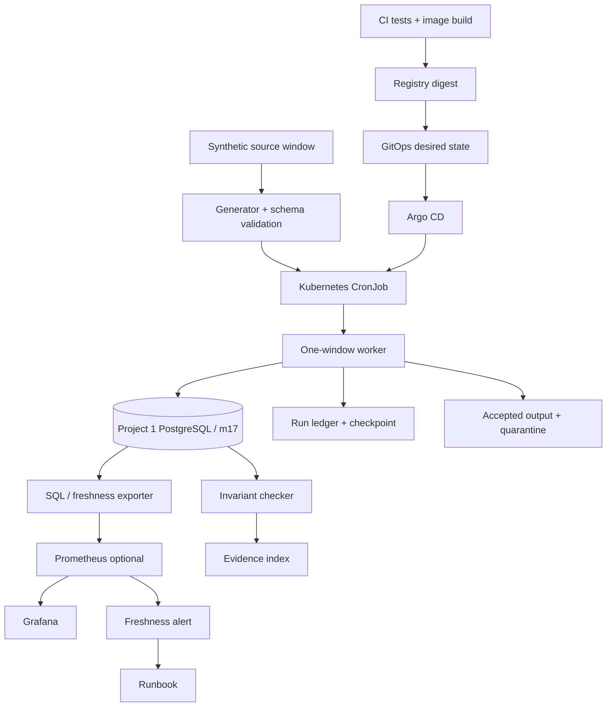
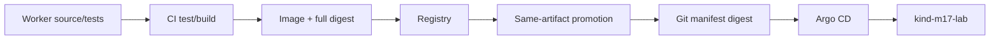
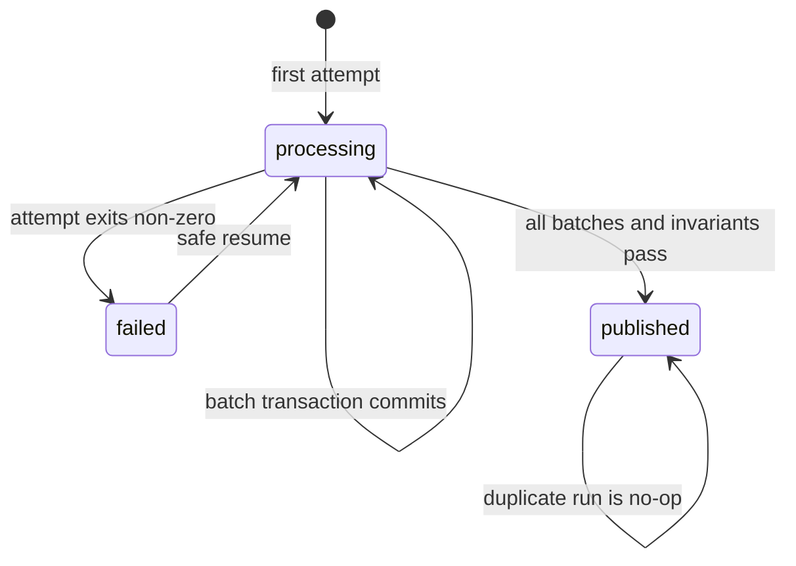

# Project 2 — Reliable Scheduled Pipeline Operations

> **Module:** M17 — Production DevOps & Platform Engineering Integrated Capstone  
> **Stage:** 2E — Production DevOps & Platform Engineering  
> **Sequence:** Project 2 of four; extends Project 1 — Production Data Platform Deployment, precedes Project 3 — Production ML Service Operations and Project 4 — End-to-End Production DevOps Capstone  
> **Estimated effort:** 30–45 focused hours over 5–7 weeks `[ASSUMPTION]`  
> **Prerequisites:** M01–M16 completed; Project 1 Cap-Core deployed and verified  
> **Profile:** Cap-Core mandatory; observability/security extensions optional where stated  
> **Environment:** WSL2 Ubuntu or native Linux; `kind` context `kind-m17-lab`; approximately 4 CPU / 8 GB RAM / 30 GB disk planning envelope; measure actual use  
> **Tool baseline:** Git, container runtime, Python, PostgreSQL client, `kind`, `kubectl`, Kustomize, GitHub Actions, Argo CD; Prometheus/Grafana optional  
> **Last reviewed:** 2026-11-04  
> **Source verification status:** Source-aligned draft; live vendor documentation and installed-version behavior remain `[VERIFY]`

> **Repository boundary:** This document is the only requested learning-roadmap output. Code/configuration blocks are instructional artifacts for the learner's separate implementation worktree. Do not create those implementation files in the learning-roadmap repository. Project 2 does not modify Project 1 or any other roadmap file.

---

## 1. Project purpose and scenario

### 1.1 Business scenario

An internal analytics team receives synthetic operational events in fixed five-minute source windows. A scheduled batch worker validates each window, transforms accepted records, writes the result to the PostgreSQL data platform established in Project 1, and publishes a freshness signal for downstream consumers.

The business does not merely need a Kubernetes Job to finish. It needs proof that the expected source window was processed, invalid records were accounted for, accepted records were written once in business terms, an interrupted run can resume safely, output invariants pass, and publication meets the freshness objective.

### 1.2 Success contract

The core synthetic pipeline:

- generates 100 deterministic records per five-minute UTC window;
- expects 95 accepted and 5 rejected records in the normal teaching fixture;
- processes records in batches of 20;
- stores run attempts, per-window checkpoint, accepted output and rejected-record quarantine in PostgreSQL;
- commits output rows and checkpoint advancement in the same transaction per batch;
- marks a window `published` only after final counts and invariants pass;
- treats duplicate execution of a published window as a no-op for business output;
- runs from Kubernetes `CronJob`;
- measures freshness from source-window end to verified publication;
- supports dry-run-first, bounded backfill.

The 100/95/5 fixture and five-minute schedule are `[ASSUMPTION]` teaching values, not production data or M17 canonical thresholds.

**A Job completing is not proof of correct or fresh data.** A process can exit zero after processing the wrong window, silently dropping rows, or publishing late output. The database ledger, invariants and freshness SLI are the business-level evidence.

### 1.3 Project boundaries

| Project | Responsibility | Project 2 relationship |
|---|---|---|
| Project 1 | PostgreSQL StatefulSet/PVC, data API, hardened image, CI, registry, digest, GitOps, secrets, backup/restore | Reuse its data platform after verifying actual names, credentials and grants |
| Project 2 | Scheduled processing, idempotency, retries, concurrency, checkpoint/resume, freshness, missed schedules, backfill, invariants, runbooks | This project |
| Project 3 | Production ML inference service, model/artifact identity, inference SLOs, smoke tests and rollback | Consume the platform pattern; do not build ML serving here |
| Project 4 | End-to-end integration and final M17 capstone | Project 2 contributes an evidenced pipeline subsystem |

### 1.4 Fidelity boundary

A local `kind` lab proves lab-scale mechanics, repeatability and evidence discipline. It does not prove multi-region resilience, cloud-provider quotas, production traffic behavior, high availability of a single-replica local PostgreSQL instance, actual cloud cost, or production certification.

---

## 2. Prerequisites and M01–M16 handoffs

M17 integrates, proves and assesses prior learning. It does not re-teach all earlier tools from first principles.

| Module | Handoff used in Project 2 | Expected prior evidence/understanding |
|---|---|---|
| M01 | Container images and registry | Image build, tags versus digests, registry access |
| M02 | CI/CD | Automated tests, build workflow, required checks, run identity |
| M03 | Operations | Logs, process lifecycle, safe diagnostics, cleanup |
| M04 | Networking and TLS | DNS/service reachability and network boundaries |
| M05 | Storage and stateful services | PostgreSQL, persistence, transactions, connection management |
| M06 | Packaging | Kustomize or Helm; this project selects Kustomize |
| M07 | Infrastructure as Code | Reproducible setup and teardown |
| M08 | GitOps and progressive delivery | Git desired state, Argo CD reconciliation and drift |
| M09 | Secrets and identity | Secret references, service accounts, least privilege |
| M10 | SRE, SLOs, error budgets, incidents, postmortems, ORR | Freshness objective, incident response, review records |
| M11 | Observability | Metrics, dashboards, alerts and logs |
| M12 | Security and software supply chain | Image identity, secret scanning, hardening and provenance |
| M13 | Backup, disaster recovery and chaos/fault injection | Recovery evidence and safe fault drills |
| M14 | Multi-cluster concepts | Awareness only; a second cluster is not required |
| M15 | Capacity and FinOps | Resource requests/limits, labels, measurement and cost allocation |
| M16 | Platform engineering and golden paths | Reusable conventions and operator workflow; Backstage/Crossplane are not required |

### 2.1 Project 1 entry gate

Verify the actual environment; do not assume the reference names exist:

- [ ] Current context is `kind-m17-lab`.
- [ ] Namespace `m17-data` exists.
- [ ] PostgreSQL StatefulSet and Service exist.
- [ ] Project 1 reference Service is `postgres`, port `5432`.
- [ ] Database `m17` exists.
- [ ] Worker database role can access only the Project 2 schema/tables it needs.
- [ ] Secret `postgres-auth` exists with key `password`; never print or commit its value.
- [ ] PostgreSQL is Ready and a secret-safe connection test succeeds.
- [ ] Project 1 backup/restore and teardown procedures are understood.
- [ ] The implementation worktree and Project 1 baseline commit are recorded.

If any check fails, stop and repair Project 1 using its runbook. Do not create a second database stack or assume credentials.

### 2.2 Gap-handling plan

| Gap | Response |
|---|---|
| Project 1 namespace/service/database differs | Record actual values in `docs/environment.md`; adapt Project 2 connection settings |
| DB role lacks privileges | Have DB owner grant narrowly scoped access; do not use superuser |
| PostgreSQL unavailable | Stop; do not replace durable sink with ephemeral files and claim completion |
| Argo CD absent | Complete worker/database tests first; bootstrap approved M17 GitOps profile |
| Observability stack too heavy | Stop optional services; keep SQL/CLI core verification and mark live alert `NOT DEMONSTRATED` |

---

## 3. Scope, non-goals, assumptions, and risk register

### 3.1 Scope

**Mandatory Cap-Core:** deterministic source generator/checksum; versioned contract; worker; PostgreSQL ledger/output/quarantine; idempotent rerun; transactional checkpoint/resume; CronJob; bounded retries/deadline; security context/service account/resources/labels; CI and digest identity; Kustomize/GitOps/Argo CD; freshness SLI/SLO; missed-window detection; guarded backfill; drills; second-person runbooks; evidence; fresh clone; teardown.

**Optional:** Prometheus/Grafana/Alertmanager live alerting; multi-window burn-rate alerts; cosign; policy engine; Chaos Mesh/Litmus; independent restore target; multi-cluster awareness. Real cloud is optional only after M17 cost-safety approval.

### 3.2 Non-goals

No real customer/personal data, paid cloud, hosted database, GPU, public domain, Kafka, Spark, Airflow, multi-region database, multi-cluster implementation, full correction/reprocessing framework, or ML inference service. No casual exactly-once claim. No unbounded replay. Backstage/Crossplane/policy engines/chaos frameworks are not mandatory.

### 3.3 Assumptions

| ID | Assumption | Reason | Verification |
|---|---|---|---|
| A-P2-01 | `[ASSUMPTION]` Windows are five minutes and UTC | Small reproducible lab | Verify source contract and Kubernetes version |
| A-P2-02 | `[ASSUMPTION]` CronJob schedule is `*/5 * * * *` | Fast feedback | Verify scheduler behavior/time zone |
| A-P2-03 | `[ASSUMPTION]` Fixture has 100 rows, 95 accepted, 5 rejected | Known test result | Generator and tests |
| A-P2-04 | `[ASSUMPTION]` Freshness target is 600 seconds | Lab objective | Not a canonical M17 target |
| A-P2-05 | `[ASSUMPTION]` Project 1 PostgreSQL database `m17` is the sink | Reuse platform | Verify service, secret, grants |
| A-P2-06 | `[ASSUMPTION]` One worker invocation handles one bounded window | Bounded runtime | Inspect CLI |
| A-P2-07 | `[ASSUMPTION]` Worker needs no Kubernetes API permissions | DB-only workload | Verify service account/RBAC |
| A-P2-08 | `[ASSUMPTION]` CronJob uses `Forbid` | Avoid routine overlap | Verify version semantics |

### 3.4 Risk register

| Risk | Owner role | Mitigation | Verification | Residual risk |
|---|---|---|---|---|
| Duplicate writes | Pipeline engineer | Stable `(window_id, record_id)` key, unique constraint, transaction | Duplicate run and checksum comparison | Bad key design can merge distinct events |
| Overlap | SRE/operator | `Forbid`, row lock, unique key | Bounded overlap drill | Manual Jobs can still overlap |
| Missed schedule | SRE/operator | Expected-window detector and ledger | Simulated missing window | Controller history is not durable business history |
| Time-zone ambiguity | Platform engineer | UTC IDs and explicit schedule policy | Timestamp and API checks | Host clock skew not tested |
| Stale output | Data owner | Publish after invariants; freshness SLI | Compare ledger and metric | Synthetic source does not model upstream delays |
| Bad input | Data owner | Schema validation and quarantine | Planted invalid rows | Quarantine retention needed |
| Retry storm | SRE/operator | Single retry owner; bounded attempts/deadline | Controlled outage | Exact backoff version-dependent |
| Checkpoint corruption | Pipeline engineer | Atomic output/checkpoint transaction | Corruption negative test | Manual DB edits can violate assumptions |
| Partial publication | Pipeline engineer | `published_at` only after all checks | Interrupt before publish | Consumers must read published windows only |
| Backfill overload | SRE/operator | Dry-run, cap, sequential execution, approval | Over-limit test | Human approval can still be poor |
| Secret leak | Security reviewer | Secret reference, no argv/logging, canary scan | Planted-secret test | Host debugging may expose environment |
| Evidence mismatch | Reviewer | Bind commit/digest/window/time/checksum | Metadata mismatch test | Bad capture can mislead |

---

## 4. Architecture and data contract

### 4.1 Runtime architecture



### 4.2 CI/GitOps path



CI builds/tests. Promotion copies the same artifact to the local registry and verifies digest equality. GitOps references the immutable digest. Do not rebuild for local deployment and call it the same artifact.

### 4.3 Trust boundaries and guarantees

| Boundary | Data/control | Guarantee owner | Limitation |
|---|---|---|---|
| Generator → worker | Window, records, schema, checksum | Generator/contract | Not proof of real upstream completeness |
| Worker → PostgreSQL | Output, quarantine, ledger, checkpoint | Worker + DB constraints/transactions | No external side-effect atomicity |
| CronJob → Job | Schedule, overlap, retry/deadline | Kubernetes controller | No business freshness/correctness guarantee |
| Git → Argo CD → cluster | Desired manifests and digest | GitOps/release process | No application correctness guarantee |
| DB → exporter | Published timestamp and window state | Exporter/query | Wrong query can produce wrong metric |
| Evidence → reviewer | Output plus provenance | Learner/operator | Integrity depends on honest collection |

### 4.4 Input contract

| Field | Type/rule |
|---|---|
| `schema_version` | string, exactly `1` |
| `window_id` | stable UTC interval `<start ISO>/<end ISO>` |
| `record_id` | positive integer, unique within window |
| `event_time` | RFC3339 UTC, `window_start <= event_time < window_end` |
| `category` | `alpha`, `beta`, or `gamma` |
| `amount` | non-negative decimal, two decimal places |
| `source_version` | `synthetic-source-v1` |
| `source_checksum` | SHA-256 of canonical serialized records |

Duplicate policy: same `(window_id, record_id)` is one business effect. Same key with different payload/source checksum is a conflict and must fail closed. Invalid rows are quarantined with a reason code; no silent drops. Late events outside the declared window require an audited correction path, not mutation of an already published window.

### 4.5 Output contract

Accepted rows store window ID, record ID, event time, category, amount, source checksum and transform version. Rejected rows store window ID, record ID, reason code, source checksum, synthetic raw record and rejection time. The published-window row stores expected/accepted/rejected counts, source checksum, schema version, boundaries, publication timestamp and state.

### 4.6 Run lifecycle



| State | Event | Durable condition |
|---|---|---|
| Absent → processing | First attempt | Window and attempt created |
| processing → processing | Batch commits | Output/quarantine and next-batch checkpoint commit together |
| processing → failed | Failure recorded | Last committed checkpoint remains authoritative |
| failed → processing | Resume | Starts at committed next batch |
| processing → published | Final checks pass | Counts and `published_at` commit |
| published → published | Duplicate run | No business rows change |

### 4.7 ADRs

| ADR | Decision | Alternative/trade-off | Revisit when |
|---|---|---|---|
| ADR-P2-001 | CronJob triggers one-window worker | Airflow/external scheduler adds complexity | DAG dependencies become necessary |
| ADR-P2-002 | Project 1 PostgreSQL sink | Filesystem/second DB breaks integration | Measured scale/isolation requires it |
| ADR-P2-003 | Unique key + upsert/transaction | Exactly-once claim is unsafe | External side effects appear |
| ADR-P2-004 | Output/checkpoint share DB transaction | Separate checkpoint store creates crash window | Multiple systems are involved |
| ADR-P2-005 | `Forbid` + DB row lock | `Allow` overlaps; `Replace` can interrupt | Runtime approaches schedule interval |
| ADR-P2-006 | Freshness = window end to publication | Job duration is not business freshness | Contract changes |
| ADR-P2-007 | Separate bounded backfill CLI | Scheduled Job is not a repair interface | Dedicated workflow platform adopted |
| ADR-P2-008 | SQL/CLI core; metrics stack optional | Full stack costs laptop resources | Profile permits it |

---

## 5. Core concepts: beginner to advanced

For each concept, the required learning loop is: definition → example → misconception → failure mode → test → evidence → evidence limit.

### 5.1 CronJob vs Job vs worker

Worker is application code; Job manages Pods to completion; CronJob creates Jobs on a schedule. A CronJob schedules attempts; it does not validate business data. Test the expected-window ledger, not only `kubectl get cronjob`. Evidence is CronJob/Job status plus ledger/invariants. Local behavior does not establish cloud scheduler reliability.

### 5.2 Schedule semantics, UTC, time zones and DST

Use UTC window IDs. Cron schedule timezone behavior and `.spec.timeZone` availability are `[VERSION-SENSITIVE]`; verify the installed API and official docs. Baseline omits `.spec.timeZone`, records UTC timestamps, and requires verifying the controller's schedule interpretation. DST/timezone mismatch can cause duplicate/missing windows. Do not alter host time for drills.

### 5.3 At-least-once and “exactly once”

Retries, ambiguous commit acknowledgement and manual reruns can present the same window more than once. The process may execute repeatedly; the durable business effect is made idempotent. A Job name is not an idempotency key. Test crash-after-commit and rerun. This does not cover external side effects outside PostgreSQL.

### 5.4 Idempotency

Stable identity is `(window_id, record_id)`, enforced by a PostgreSQL primary key. Repeated same-checksum processing resumes or no-ops; different checksum for same window is a conflict. Test same window twice and compare counts/checksum. Job name uniqueness does not make business operations idempotent.

### 5.5 Retryable, permanent and ambiguous errors

| Class | Example | Action |
|---|---|---|
| Retryable | DB unavailable before transaction | Exit non-zero; bounded Job retry |
| Permanent | Invalid schema/category | Quarantine or fail; do not retry forever |
| Ambiguous | Connection lost during commit acknowledgement | Read ledger/checkpoint; resume idempotently |

Core implementation has no application retry loop; Kubernetes Job controller owns bounded retries. This prevents nested retry multiplication. Evidence is Job attempts and attempt ledger.

### 5.6 Backoff and retry budget

Set `backoffLimit` and `activeDeadlineSeconds`. Exact controller timing is version-dependent. This implementation does not implement custom exponential backoff or jitter; do not claim it does. Measure actual attempts and duration under a controlled outage.

### 5.7 Concurrency policy

- `Allow`: Jobs may overlap.
- `Forbid`: no new scheduled Job while a previous Job from this CronJob is active; an occurrence may be skipped.
- `Replace`: active Job is replaced by a newer scheduled Job according to controller behavior.

Verify exact semantics for the selected Kubernetes version. `Forbid` does not guarantee freshness and does not protect manually created Jobs. `Replace` is not rollback or transaction safety. This project uses `Forbid`, DB row locking and unique keys; test bounded overlap.

### 5.8 Checkpointing and resume

For each batch: lock window row; verify expected next batch; write accepted/rejected rows; update counters and `next_batch`; commit. Output and checkpoint advancement are atomic in PostgreSQL. Crash before commit persists neither; crash after commit persists both. Checkpoint alone does not prove output correctness.

### 5.9 Freshness SLI/SLO

```text
freshness_lag_seconds = published_at_utc - source_window_end_utc
```

A window is fresh when published and lag `<= 600` seconds. `[ASSUMPTION]` Lab SLO: 95% of eligible windows in rolling 24h meet the 600-second target. This is not a canonical M17 threshold. A short lab sample is not a meaningful 24-hour SLO result.

### 5.10 Missed schedule detection

Compute expected UTC windows and compare to published windows, excluding only approved maintenance windows. CronJob history/TTL is not a durable business ledger. Detector accepts synthetic `--now`; never change host time. Test missing and deliberately suspended cases.

### 5.11 Backfill, replay, reprocessing and correction

- Backfill: bounded historical windows not yet published.
- Replay: repeat same source window identity to recover.
- Reprocessing: changed transformation version; requires approval/versioning.
- Correction: audited repair of already published output.

Project 2 implements safe replay and bounded backfill, not silent historical rewrites. Dry-run first; cap range; use stable window IDs; audit who/what/when/why.

### 5.12 Data quality

Check expected input, accepted/rejected reconciliation, unique keys, non-null fields, enum/range/time bounds, deterministic aggregate/checksum, checkpoint consistency and no duplicate effects. Row counts alone do not prove semantic correctness.

### 5.13 Resources, labels and retention

Measure CPU/RAM; do not infer capacity from one run. Set requests/limits, deadlines and history retention. Labels: part-of, component, name, environment, cost-center, workload-purpose. No secrets or personal identifiers in labels.

### 5.14 Observability and operator perspective

Business freshness metrics must be derived from ledger/publication, not just CronJob controller metrics. Runbooks preserve evidence before mutation, use hypothesis-driven diagnostics, define stop conditions and verify recovery.

### 5.15 Local fidelity

The lab does not prove production throughput, provider scheduling reliability, independent-zone recovery, real cloud cost or production error budgets. Mark these unproven.

---

## 6. Acceptance criteria and traceability

### 6.1 Identifier policy

The inspected Unit 1 requirements explicitly define **REQ-019: CronJob has freshness SLO and idempotent failed-run rerun**. Other canonical IDs below are used only where supported by inspected Unit 1 materials; verify exact wording in the current source. `P2-AC-*` IDs are project-local, not canonical REQ-IDs.

### 6.2 Given/When/Then criteria

| ID | Priority | Given / When / Then | Test/pass condition | Negative test | Evidence | Instrument/handoff |
|---|---|---|---|---|---|---|
| P2-AC-001 | MUST | Given clean clone/tools, when preflight runs, then versions/resources are recorded and unexpected context is refused | Fresh clone; declared lab prerequisites pass | Wrong context exits non-zero | `evidence/preflight/` | REQ-021/031; PD-08/09; M02/M07 |
| P2-AC-002 | MUST | Given same window ID, when generator runs twice, then canonical checksum matches | Repeat byte/checksum comparison | Changed output fails | `evidence/source/` | REQ-022/023; M01/M02 |
| P2-AC-003 | MUST | Given fixture, when schema validation runs, then every row accepted/rejected explicitly | Contract assertions pass | Unknown schema fails | `evidence/contracts/` | REQ-022; M05/M10 |
| P2-AC-004 | MUST | Given worker, when tests run, then deterministic output/counters match | Unit/integration tests pass | Wrong aggregate/missing row fails | `evidence/tests/` | REQ-001/003; PD-01; M02/M05 |
| P2-AC-005 | MUST | Given rendered CronJob, when validation runs, then bounds/security/labels exist | Kustomize render/API validation | Missing deadline/context fails | `evidence/manifests/` | REQ-028/030; PD-03; M06 |
| P2-AC-006 | MUST | Given transient DB failure, when Job runs, then retries remain bounded | Inspect attempts/deadline | Infinite attempts fails | `evidence/drills/retry/` | REQ-015/019; IR-01/02; M03/M10 |
| P2-AC-007 | MUST | Given partially processed window, when same window reruns, then no duplicate business rows | Count/checksum stable | Duplicate key/count increase fails | `evidence/idempotency/` | REQ-019; IR-04; CR-06; M05/M10 |
| P2-AC-008 | MUST | Given interruption, when worker resumes, then it starts at committed next batch | Crash/resume integration test | Skip/duplicate fails | `evidence/checkpoint/` | REQ-019; IR-04; CR-06; M05/M13 |
| P2-AC-009 | MUST | Given batch transaction, when commit/rollback occurs, then output/checkpoint persist together | Inject failure inside transaction | Checkpoint ahead fails | `evidence/atomicity/` | REQ-019; IR-04; M05 |
| P2-AC-010 | MUST | Given published window, when freshness calculated, then lag uses window end and publication time | SQL result matches arithmetic | Job completion substituted fails | `evidence/freshness/` | REQ-019; CR-01/02; M10/M11 |
| P2-AC-011 | MUST | Given controlled stale signal, when alert evaluates, then firing/recovery is tested | `promtool` and optional live test | YAML-only claim fails | `evidence/alerts/` | REQ-014/019; CR-03; M10/M11 |
| P2-AC-012 | MUST | Given expected unpublished window, when detector runs, then reports missing unless approved suspension | Fixed synthetic `--now` | Missed window ignored/suspension misclassified | `evidence/missed-windows/` | REQ-019; IR-01; M10 |
| P2-AC-013 | MUST | Given invalid rows, when processed, then each is quarantined and counted | Reason/count assertions | Silent drop/infinite retry fails | `evidence/quarantine/` | REQ-019; CR-06; M05/M10 |
| P2-AC-014 | MUST | Given small backfill, when dry-run runs, then exact windows print without writes | Dry-run + bounded apply | Over-limit fails before write | `evidence/backfill/` | REQ-019/032; CR-07; M10/M15 |
| P2-AC-015 | MUST | Given completed window, when invariant checker runs, then all data/checkpoint invariants pass | Positive/negative suite | Duplicate, missing row, bad checkpoint/schema fails | `evidence/invariants/` | REQ-019/022/027; M05/M10 |
| P2-AC-016 | MUST | Given CI image, when promoted, then GitOps/runtime use same digest | Compare full digest chain | Mutable tag/mismatch rejected | `evidence/release/` | REQ-001/002/030; PD-01/02; M01/M02/M08/M12 |
| P2-AC-017 | MUST | Given Git desired state, when drift introduced, then Argo CD detects/corrects per policy | Sync/history/drift test | Manual-only deploy fails | `evidence/gitops/` | REQ-004/005; PD-04; M08 |
| P2-AC-018 | MUST | Given worker Pod, when security review runs, then least privilege/secret safety/hardening pass | Pod/RBAC/secret scan | Exposed secret/excess RBAC fails | `evidence/security/` | REQ-006–010; SR-01; M09/M12 |
| P2-AC-019 | MUST | Given workload, when resource inventory runs, then labels and bounds exist | Manifest/live review | Missing labels/unbounded resource fails | `evidence/resources/` | REQ-032; CR-05/07; M15 |
| P2-AC-020 | MUST | Given runbook, when second operator follows it, then recovery is safe and verifiable | Blinded exercise | Unsafe/missing verification fails | `evidence/runbook-review/` | IR-07; M03/M10/M16 |
| P2-AC-021 | MUST | Given failure drill, when recovery completes, then ledger/checkpoint/invariants/freshness verified | Drill + post-check | Job success alone fails | `evidence/drills/` | IR-01–08; CR-06; M10/M13 |
| P2-AC-022 | MUST | Given evidence package, when validator runs, then criterion/evidence/provenance/checksum mapping is valid | Index validator | Missing/orphan/mismatch fails | `evidence/traceability/` | REQ-022–027; PD-08; M02/M07 |
| P2-AC-023 | MUST | Given lab, when teardown runs, then only Project 2 resources are removed and absence verified | Guarded inventory before/after | Wrong context/residual fails | `evidence/teardown/` | REQ-020/031/032; PD-09; M03/M07/M13 |

### 6.3 Shared traceability crosswalk

| Project criterion | Shared requirement/instrument | Why |
|---|---|---|
| P2-AC-006–015 | REQ-019 | Direct scheduled-pipeline requirement |
| P2-AC-001/022 | REQ-021–027 | Fresh clone, traceability, evidence provenance/checksum/validators |
| P2-AC-005/016/017 | REQ-001–005, 028, 030 | CI, immutable identity, GitOps, packaging |
| P2-AC-018 | REQ-006–010 | Identity, secret hygiene, hardening, network boundaries |
| P2-AC-010–012 | REQ-011–015, 019 | Metrics/logs/dashboard/alerts/freshness/incident evidence |
| P2-AC-014/019 | REQ-032 | Risk, resource/cost governance |
| P2-AC-023 | REQ-020/031 | Verified teardown and context guard |

Do not invent official IDs or thresholds. Confirm exact source wording in the learner's current shared files.

---

## 7. Project repository layout

This is the learner's **implementation worktree**, not the roadmap repository. Create these files only as milestones introduce them.

```text
reliable-scheduled-pipeline/
├── app/
│   ├── __init__.py
│   ├── pipeline.py
│   └── schema.sql
├── tests/
│   ├── test_pipeline.py
│   └── test_invariants.py
├── data/expected-contract.json
├── schemas/input-v1.schema.json
├── deploy/base/{kustomization.yaml,serviceaccount.yaml,cronjob.yaml,exporter.yaml,network-policy.yaml}
├── deploy/overlays/local/{kustomization.yaml,cronjob-image-patch.yaml}
├── gitops/application.yaml
├── observability/{freshness-query.sql,freshness-alerts.yml,prometheus-scrape.yml,dashboard-notes.md}
├── drills/
├── runbooks/
├── scripts/{preflight.sh,context-guard.sh,generate-source.py,backfill.py,detect-missed.py,verify-invariants.py,validate-evidence.py}
├── evidence/{index.yaml,README.md}
├── .github/workflows/ci.yml
├── Dockerfile
├── .dockerignore
├── requirements.txt
├── Makefile
├── versions.txt
└── README.md
```

---

## 8. Toolchain, versions, profiles, and resource plan

### 8.1 Tool matrix

| Tool | Purpose | Profile | Verify/record | Official source | Caveat |
|---|---|---|---|---|---|
| Git | Source/evidence identity | Core | `git --version`, commit SHA | Git docs | Clean clone required |
| Python | Worker/scripts | Core | `python3 --version` | Python docs | Pin compatible dependencies |
| PostgreSQL client | DB verification | Core | `psql --version` | PostgreSQL docs | Client/server compatibility |
| Container runtime | Build | Core | `docker version` | Runtime docs | WSL2 socket differs |
| kind | Local cluster | Core | `kind version` | kind docs | Laptop only |
| kubectl | Cluster operations | Core | `kubectl version --client` | Kubernetes docs | Check version skew |
| Kustomize | Packaging | Core | `kubectl kustomize --help` / `kustomize version` | Kubernetes docs | One packaging path only |
| GitHub Actions | CI | Core | Workflow run/version record | GitHub docs | Hosted runner != cluster test |
| Argo CD | GitOps | Core M17 | `argocd version` if installed | Argo docs | API/config varies |
| Prometheus | Metrics/rules | Optional | `prometheus --version`, `promtool --version` | Prometheus docs | Resource cost |
| Grafana | Dashboard | Optional | `grafana-server -v` | Grafana docs | Dashboard != alert proof |
| Skopeo | Same-artifact copy | Optional | `skopeo --version` | Skopeo docs | Protect registry auth |
| Cosign | Signing | Awareness | `cosign version` | Sigstore docs | Digest != trust |

No current versions or action SHAs are invented. Replace `<VERSION>` placeholders with verified installed values.

### 8.2 Profiles and lifecycle

| Profile | Components | Rule |
|---|---|---|
| Cap-Core | Project 1 PostgreSQL, worker, CronJob/Job, Kustomize, Argo CD, SQL/CLI checks | Mandatory |
| Observability | Prometheus, exporter, Grafana, Alertmanager | Start after Core works |
| Security | Secret/image scanner, optional cosign/policy | Add after digest path |
| Chaos | Bounded local fault injection | Only after runbooks exist |

Do not promise every optional component fits concurrently in 8 GB. Stop optional components when idle.

### 8.3 Preflight

```bash
# File: scripts/preflight.sh
#!/usr/bin/env bash
set -euo pipefail
EXPECTED_CONTEXT="kind-m17-lab"
MIN_DISK_GB=15

for tool in git python3 kubectl kind docker; do
  command -v "$tool" >/dev/null || { echo "Missing tool: $tool" >&2; exit 10; }
done

echo "git: $(git --version)"
echo "python: $(python3 --version)"
echo "kind: $(kind version)"
kubectl version --client
CURRENT="$(kubectl config current-context)"
[[ "$CURRENT" == "$EXPECTED_CONTEXT" ]] || {
  echo "Refusing context '$CURRENT'; expected '$EXPECTED_CONTEXT'" >&2; exit 20;
}
FREE_GB="$(df -Pk . | awk 'NR==2 {print int($4/1024/1024)}')"
echo "Free disk GiB: $FREE_GB"
(( FREE_GB >= MIN_DISK_GB )) || { echo "Insufficient disk" >&2; exit 21; }
docker info >/dev/null
kubectl get nodes --context "$EXPECTED_CONTEXT"
echo "Preflight passed; record CPU/RAM as [MEASURE YOURS]."
```

Run `chmod +x scripts/preflight.sh && ./scripts/preflight.sh`.

**Example — yours will differ**

```text
git version <installed>
Python <installed>
kind v<installed>
Client Version: v<installed>
Free disk GiB: <measured>
kind-m17-lab-control-plane Ready control-plane ...
Preflight passed; record CPU/RAM as [MEASURE YOURS].
```

This is illustrative, not execution evidence.

### 8.4 Context guard

```bash
# File: scripts/context-guard.sh
#!/usr/bin/env bash
set -euo pipefail
EXPECTED_CONTEXT="kind-m17-lab"
EXPECTED_NAMESPACE="m17-data"
CURRENT="$(kubectl config current-context)"
[[ "$CURRENT" == "$EXPECTED_CONTEXT" ]] || {
  echo "Refusing unexpected context: $CURRENT" >&2; exit 30;
}
kubectl get namespace "$EXPECTED_NAMESPACE" --context "$EXPECTED_CONTEXT" >/dev/null
echo "Guard passed: $EXPECTED_CONTEXT/$EXPECTED_NAMESPACE"
```

This verifies target identity; it does not itself authorize mutation. Every mutating script must additionally default to dry-run and require `--apply`.

### 8.5 WSL2 vs native Linux

WSL2 and native Linux may differ in Docker socket access, networking, permissions, filesystem performance, executable bits, line endings and memory limits. Do not assume host `localhost` equals the kind node's `localhost`. Use Service DNS from Pods. Keep active build files in the Linux filesystem where practical. Use LF line endings. Measure actual WSL2 memory availability.

### 8.6 Time plan

| Milestone | Objective | Estimate `[ASSUMPTION]` |
|---|---|---:|
| M1 | Preflight and Project 1 entry gate | 1–2 h |
| M2 | Contract and deterministic source | 2–3 h |
| M3 | Schema, worker and tests | 5–7 h |
| M4 | Idempotency/checkpoint drills | 4–5 h |
| M5 | Image, CronJob, Kustomize | 3–4 h |
| M6 | CI, digest promotion, GitOps | 3–5 h |
| M7 | Freshness and missed-window detection | 3–5 h |
| M8 | Backfill, runbooks, drills | 4–6 h |
| M9 | Evidence, fresh clone, teardown | 3–5 h |

---

## 9. Implementation walkthrough — complete and incremental

### 9.1 Canonical execution sequence

1. Record versions/resources/worktree.
2. Run preflight/context guard.
3. Generate deterministic fixture and checksum.
4. Define schema/invariants.
5. Implement worker, run ID, window ID, transaction and checkpoint.
6. Add unit/integration tests for duplicate, partial failure, invalid row and resume.
7. Build/harden image; record digest.
8. Package with Kustomize.
9. Verify Project 1 DB/service/secret/grants.
10. Configure CronJob with retry, concurrency, deadline, retention, security and resources.
11. Configure CI tests/build.
12. Promote same digest through Git and Argo CD.
13. Add freshness SLI/SLO/dashboard/alert test.
14. Add missed-schedule detector.
15. Add guarded backfill.
16. Run failure/rerun, concurrency, resume and invariant drills.
17. Produce runbook/evidence/readiness.
18. Fresh-clone reproducibility check.
19. Teardown and verify.

### 9.2 Deterministic source generator

```python
# File: scripts/generate-source.py
from __future__ import annotations
import argparse, hashlib, json, random
from datetime import datetime, timedelta, timezone
from pathlib import Path

SOURCE_VERSION = "synthetic-source-v1"

def parse_utc(value):
    dt = datetime.fromisoformat(value.replace("Z", "+00:00"))
    if dt.tzinfo is None:
        raise ValueError("timezone required")
    return dt.astimezone(timezone.utc)

def canonical(rows):
    return (json.dumps(rows, sort_keys=True, separators=(",", ":")) + "\n").encode()

def generate(start):
    if start.second or start.microsecond or start.minute % 5:
        raise ValueError("start must align to 5-minute UTC boundary")
    end = start + timedelta(minutes=5)
    wid = start.isoformat().replace("+00:00", "Z") + "/" + end.isoformat().replace("+00:00", "Z")
    seed = int(hashlib.sha256(wid.encode()).hexdigest()[:16], 16)
    rng = random.Random(seed)
    categories = ("alpha", "beta", "gamma")
    rows = []
    for i in range(1, 101):
        event_time = start + timedelta(seconds=rng.randrange(300))
        row = {
            "schema_version": "1", "source_version": SOURCE_VERSION,
            "window_id": wid, "record_id": i,
            "event_time": event_time.isoformat().replace("+00:00", "Z"),
            "category": categories[(i - 1) % 3],
            "amount": f"{(i * 13 % 10000) / 100:.2f}"
        }
        if i % 20 == 0:
            row["category"] = "not-a-valid-category"
        rows.append(row)
    return rows

def main():
    p = argparse.ArgumentParser()
    p.add_argument("--window-start", required=True)
    p.add_argument("--output", default="data/source.json")
    a = p.parse_args()
    rows = generate(parse_utc(a.window_start))
    payload = canonical(rows)
    path = Path(a.output)
    path.parent.mkdir(parents=True, exist_ok=True)
    path.write_bytes(payload)
    print(f"window_id={rows[0]['window_id']}")
    print(f"rows={len(rows)}")
    print(f"sha256={hashlib.sha256(payload).hexdigest()}")

if __name__ == "__main__":
    main()
```

Run twice with the same `--window-start`, then compare `sha256sum` and `cmp`. **Example — yours will differ:** `rows=100`, with the same full checksum on both runs. The actual checksum must come from your run.

### 9.3 Data contract files

```json
// File: data/expected-contract.json
{
  "schema_version": "1",
  "source_version": "synthetic-source-v1",
  "transform_version": "transform-v1",
  "input_rows": 100,
  "accepted_rows": 95,
  "rejected_rows": 5,
  "batch_size": 20,
  "allowed_categories": ["alpha", "beta", "gamma"],
  "freshness_target_seconds": 600,
  "schedule_interval_seconds": 300
}
```

```json
// File: schemas/input-v1.schema.json
{
  "$schema": "https://json-schema.org/draft/2020-12/schema",
  "type": "object",
  "required": ["schema_version","source_version","window_id","record_id","event_time","category","amount"],
  "properties": {
    "schema_version": {"const": "1"},
    "source_version": {"const": "synthetic-source-v1"},
    "window_id": {"type": "string", "minLength": 1},
    "record_id": {"type": "integer", "minimum": 1},
    "event_time": {"type": "string", "format": "date-time"},
    "category": {"type": "string"},
    "amount": {"type": "string", "pattern": "^[0-9]+\\.[0-9]{2}$"}
  },
  "additionalProperties": false
}
```

Structural JSON Schema is not the entire business contract; worker must validate enum, non-negative amount, timestamp bounds and checksum.

### 9.4 PostgreSQL schema

Project 1 reference implementation uses namespace `m17-data`, Service `postgres`, database `m17`, and Secret `postgres-auth` key `password`. Verify actual values. Apply schema through a secret-safe database-owner session; never place passwords in command arguments or Git.

```sql
-- File: app/schema.sql
CREATE TABLE IF NOT EXISTS pipeline_windows (
  window_id TEXT PRIMARY KEY,
  schema_version TEXT NOT NULL,
  source_version TEXT NOT NULL,
  source_checksum TEXT NOT NULL,
  window_start TIMESTAMPTZ NOT NULL,
  window_end TIMESTAMPTZ NOT NULL,
  expected_rows INTEGER NOT NULL CHECK (expected_rows >= 0),
  accepted_rows INTEGER NOT NULL DEFAULT 0 CHECK (accepted_rows >= 0),
  rejected_rows INTEGER NOT NULL DEFAULT 0 CHECK (rejected_rows >= 0),
  next_batch INTEGER NOT NULL DEFAULT 0 CHECK (next_batch >= 0),
  state TEXT NOT NULL CHECK (state IN ('processing','failed','published')),
  published_at TIMESTAMPTZ,
  transform_version TEXT NOT NULL,
  created_at TIMESTAMPTZ NOT NULL DEFAULT now(),
  updated_at TIMESTAMPTZ NOT NULL DEFAULT now(),
  CHECK (window_end > window_start),
  CHECK (accepted_rows + rejected_rows <= expected_rows),
  CHECK ((state='published' AND published_at IS NOT NULL)
      OR (state<>'published' AND published_at IS NULL))
);

CREATE TABLE IF NOT EXISTS pipeline_attempts (
  run_id UUID PRIMARY KEY,
  window_id TEXT NOT NULL REFERENCES pipeline_windows(window_id),
  started_at TIMESTAMPTZ NOT NULL DEFAULT now(),
  ended_at TIMESTAMPTZ,
  outcome TEXT NOT NULL CHECK (outcome IN ('running','succeeded','failed','noop')),
  message TEXT
);

CREATE TABLE IF NOT EXISTS pipeline_output (
  window_id TEXT NOT NULL REFERENCES pipeline_windows(window_id),
  record_id BIGINT NOT NULL,
  event_time TIMESTAMPTZ NOT NULL,
  category TEXT NOT NULL CHECK (category IN ('alpha','beta','gamma')),
  amount NUMERIC(12,2) NOT NULL CHECK (amount >= 0),
  source_checksum TEXT NOT NULL,
  transform_version TEXT NOT NULL,
  PRIMARY KEY (window_id, record_id)
);

CREATE TABLE IF NOT EXISTS pipeline_quarantine (
  window_id TEXT NOT NULL REFERENCES pipeline_windows(window_id),
  record_id BIGINT NOT NULL,
  reason_code TEXT NOT NULL,
  source_checksum TEXT NOT NULL,
  raw_record JSONB NOT NULL,
  rejected_at TIMESTAMPTZ NOT NULL DEFAULT now(),
  PRIMARY KEY (window_id, record_id)
);

CREATE TABLE IF NOT EXISTS pipeline_backfill_audit (
  audit_id BIGSERIAL PRIMARY KEY,
  requested_at TIMESTAMPTZ NOT NULL DEFAULT now(),
  request_id TEXT NOT NULL,
  start_window TEXT NOT NULL,
  end_window TEXT NOT NULL,
  window_count INTEGER NOT NULL CHECK (window_count > 0),
  dry_run BOOLEAN NOT NULL,
  reason TEXT NOT NULL,
  outcome TEXT NOT NULL
);

CREATE INDEX IF NOT EXISTS pipeline_windows_published_idx
  ON pipeline_windows (published_at DESC) WHERE state='published';
```

Grant the worker narrowly scoped DML on these tables and required sequence. It must not be superuser.

### 9.5 Worker reference implementation

Use Psycopg 3 and pin the actual compatible version in the learner's lock file. The following is an instructional baseline requiring integration tests against installed PostgreSQL/Psycopg versions.

```text
# File: requirements.txt
psycopg[binary]==<PINNED_VERSION>
pytest==<PINNED_VERSION>
```

```python
# File: app/pipeline.py
from __future__ import annotations
import argparse, hashlib, json, os, sys, uuid
from datetime import datetime, timedelta, timezone
from decimal import Decimal, InvalidOperation
import psycopg
from psycopg.types.json import Jsonb

BATCH_SIZE = 20
TRANSFORM_VERSION = "transform-v1"
ALLOWED = {"alpha", "beta", "gamma"}

def parse_ts(value):
    dt = datetime.fromisoformat(value.replace("Z", "+00:00"))
    if dt.tzinfo is None:
        raise ValueError("timezone required")
    return dt.astimezone(timezone.utc)

def wid(start, end):
    return start.isoformat().replace("+00:00","Z") + "/" + end.isoformat().replace("+00:00","Z")

def window_now():
    now = datetime.now(timezone.utc)
    end = datetime.fromtimestamp((int(now.timestamp()) // 300) * 300, timezone.utc)
    start = end - timedelta(minutes=5)
    return start, end

def make_rows(start):
    import random
    end = start + timedelta(minutes=5)
    window = wid(start, end)
    seed = int(hashlib.sha256(window.encode()).hexdigest()[:16], 16)
    rng = random.Random(seed)
    cats = ("alpha","beta","gamma")
    rows = []
    for i in range(1,101):
        t = start + timedelta(seconds=rng.randrange(300))
        row = {
            "schema_version":"1", "source_version":"synthetic-source-v1",
            "window_id":window, "record_id":i,
            "event_time":t.isoformat().replace("+00:00","Z"),
            "category":cats[(i-1)%3], "amount":f"{(i*13%10000)/100:.2f}"
        }
        if i % 20 == 0:
            row["category"] = "not-a-valid-category"
        rows.append(row)
    return rows

def source_hash(rows):
    payload = (json.dumps(rows,sort_keys=True,separators=(",",":"))+"\n").encode()
    return hashlib.sha256(payload).hexdigest()

def validate(row, start, end):
    required = {"schema_version","source_version","window_id","record_id","event_time","category","amount"}
    if set(row) != required: return False, "SCHEMA_FIELDS"
    if row["schema_version"] != "1": return False, "SCHEMA_VERSION"
    if row["source_version"] != "synthetic-source-v1": return False, "SOURCE_VERSION"
    if row["category"] not in ALLOWED: return False, "CATEGORY_ENUM"
    try:
        amount = Decimal(row["amount"])
        event_time = parse_ts(row["event_time"])
    except (InvalidOperation, ValueError, TypeError):
        return False, "INVALID_VALUE"
    if amount < 0: return False, "NEGATIVE_AMOUNT"
    if event_time < start or event_time >= end: return False, "EVENT_OUTSIDE_WINDOW"
    if not isinstance(row["record_id"], int) or row["record_id"] <= 0:
        return False, "INVALID_RECORD_ID"
    return True, None

def db():
    return psycopg.connect(
        host=os.getenv("PGHOST","postgres.m17-data.svc.cluster.local"),
        port=int(os.getenv("PGPORT","5432")),
        dbname=os.getenv("PGDATABASE","m17"),
        user=os.environ["PGUSER"], password=os.environ["PGPASSWORD"],
        connect_timeout=5, application_name="m17-pipeline-worker"
    )

def process(start, rows, fail_after_batch=None):
    end = start + timedelta(minutes=5)
    window = wid(start,end)
    checksum = source_hash(rows)
    run_id = uuid.uuid4()
    accepted = sum(1 for r in rows if validate(r,start,end)[0])
    rejected = len(rows) - accepted
    batches = [rows[i:i+BATCH_SIZE] for i in range(0,len(rows),BATCH_SIZE)]

    with db() as conn:
        with conn.transaction():
            with conn.cursor() as cur:
                cur.execute("""
                  INSERT INTO pipeline_windows
                  (window_id,schema_version,source_version,source_checksum,
                   window_start,window_end,expected_rows,state,transform_version)
                  VALUES (%s,'1','synthetic-source-v1',%s,%s,%s,%s,'processing',%s)
                  ON CONFLICT(window_id) DO NOTHING
                """,(window,checksum,start,end,len(rows),TRANSFORM_VERSION))
                cur.execute("SELECT source_checksum,state,next_batch FROM pipeline_windows WHERE window_id=%s FOR UPDATE",(window,))
                stored,state,next_batch = cur.fetchone()
                if stored != checksum:
                    raise ValueError("SOURCE_CHECKSUM_CONFLICT")
                # A failed attempt may be resumed only with the same source checksum.
                if state == "failed":
                    cur.execute("UPDATE pipeline_windows SET state='processing',updated_at=now() WHERE window_id=%s",(window,))
                    state = "processing"
                cur.execute("INSERT INTO pipeline_attempts(run_id,window_id,outcome) VALUES (%s,%s,'running')",(run_id,window))
                if state == "published":
                    cur.execute("UPDATE pipeline_attempts SET outcome='noop',ended_at=now() WHERE run_id=%s",(run_id,))
                    return {"window_id":window,"run_id":str(run_id),"outcome":"noop"}

        for batch_no in range(next_batch,len(batches)):
            with conn.transaction():
                with conn.cursor() as cur:
                    cur.execute("SELECT state,next_batch FROM pipeline_windows WHERE window_id=%s FOR UPDATE",(window,))
                    current_state,current_next = cur.fetchone()
                    if current_state == "published": break
                    if current_next != batch_no: raise RuntimeError("CHECKPOINT_CONFLICT")
                    for row in batches[batch_no]:
                        ok,reason = validate(row,start,end)
                        if ok:
                            cur.execute("""
                              INSERT INTO pipeline_output
                              (window_id,record_id,event_time,category,amount,source_checksum,transform_version)
                              VALUES (%s,%s,%s,%s,%s,%s,%s)
                              ON CONFLICT(window_id,record_id) DO NOTHING
                            """,(window,row["record_id"],parse_ts(row["event_time"]),row["category"],
                                  Decimal(row["amount"]),checksum,TRANSFORM_VERSION))
                        else:
                            cur.execute("""
                              INSERT INTO pipeline_quarantine
                              (window_id,record_id,reason_code,source_checksum,raw_record)
                              VALUES (%s,%s,%s,%s,%s)
                              ON CONFLICT(window_id,record_id) DO NOTHING
                            """,(window,row["record_id"],reason,checksum,Jsonb(row)))
                    cur.execute("""
                      UPDATE pipeline_windows
                      SET next_batch=%s,
                          accepted_rows=(SELECT count(*) FROM pipeline_output WHERE window_id=%s),
                          rejected_rows=(SELECT count(*) FROM pipeline_quarantine WHERE window_id=%s),
                          updated_at=now()
                      WHERE window_id=%s
                    """,(batch_no+1,window,window,window))
            if fail_after_batch is not None and batch_no == fail_after_batch:
                raise RuntimeError("INJECTED_CRASH_AFTER_COMMITTED_BATCH")

        with conn.transaction():
            with conn.cursor() as cur:
                cur.execute("""
                  SELECT expected_rows,accepted_rows,rejected_rows,next_batch
                  FROM pipeline_windows WHERE window_id=%s FOR UPDATE
                """,(window,))
                exp,acc,rej,next_batch = cur.fetchone()
                if acc + rej != exp or acc != accepted or rej != rejected:
                    raise RuntimeError("RECONCILIATION_FAILED")
                if next_batch != len(batches):
                    raise RuntimeError("CHECKPOINT_INCOMPLETE")
                cur.execute("""
                  UPDATE pipeline_windows SET state='published',published_at=now(),updated_at=now()
                  WHERE window_id=%s AND state='processing'
                """,(window,))
                cur.execute("UPDATE pipeline_attempts SET outcome='succeeded',ended_at=now() WHERE run_id=%s",(run_id,))
    return {"window_id":window,"run_id":str(run_id),"outcome":"published",
            "input_rows":len(rows),"accepted_rows":accepted,"rejected_rows":rejected,
            "source_checksum":checksum}

def main():
    p=argparse.ArgumentParser()
    p.add_argument("--window-start")
    p.add_argument("--fail-after-batch",type=int,default=None,help="LAB ONLY fault hook")
    a=p.parse_args()
    if a.window_start:
        start=parse_ts(a.window_start)
    else:
        start,_=window_now()
    if start.second or start.microsecond or start.minute%5:
        raise SystemExit("window start must align to five-minute UTC boundary")
    window = wid(start, start + timedelta(minutes=5))
    try:
        print(json.dumps(process(start,make_rows(start),a.fail_after_batch),sort_keys=True))
    except Exception as exc:
        # Best-effort failure recording. A hard kill or DB outage can leave an
        # attempt as running; the operator must reconcile stale attempts.
        try:
            with db() as conn:
                with conn.transaction():
                    with conn.cursor() as cur:
                        cur.execute("""
                          UPDATE pipeline_attempts
                          SET outcome='failed',ended_at=now(),message=%s
                          WHERE run_id=(
                            SELECT run_id FROM pipeline_attempts
                            WHERE window_id=%s AND outcome='running'
                            ORDER BY started_at DESC LIMIT 1
                          )
                        """,(f"{type(exc).__name__}:{exc}"[:500],window))
                        cur.execute("""
                          UPDATE pipeline_windows SET state='failed',updated_at=now()
                          WHERE window_id=%s AND state='processing'
                        """,(window,))
        except Exception:
            print("warning: failure state could not be persisted; inspect stale attempts",file=sys.stderr)
        print(f"pipeline_error={type(exc).__name__}:{exc}",file=sys.stderr)
        raise SystemExit(1)

if __name__ == "__main__":
    main()
```

**Important implementation review:** verify Psycopg transaction context behavior, JSONB adaptation, role grants, locks, and error paths with installed versions. The code is a teaching baseline, not evidence of execution. The lab-only `--fail-after-batch` flag must not be exposed to untrusted callers or production entrypoints.

### 9.6 Unit tests

```python
# File: tests/test_pipeline.py
from datetime import datetime, timezone
from app.pipeline import make_rows, source_hash, validate, wid

START = datetime(2026,11,4,10,0,tzinfo=timezone.utc)
END = datetime(2026,11,4,10,5,tzinfo=timezone.utc)

def test_deterministic_source():
    assert make_rows(START) == make_rows(START)
    assert source_hash(make_rows(START)) == source_hash(make_rows(START))

def test_window_id():
    assert wid(START,END) == "2026-11-04T10:00:00Z/2026-11-04T10:05:00Z"

def test_fixture_counts():
    rows = make_rows(START)
    results = [validate(r,START,END)[0] for r in rows]
    assert len(rows) == 100
    assert sum(results) == 95
    assert len(results)-sum(results) == 5

def test_bad_category_rejected():
    row = make_rows(START)[0]
    row["category"] = "bad"
    assert validate(row,START,END) == (False,"CATEGORY_ENUM")

def test_event_at_exclusive_end_rejected():
    row = make_rows(START)[0]
    row["event_time"] = "2026-11-04T10:05:00Z"
    assert validate(row,START,END) == (False,"EVENT_OUTSIDE_WINDOW")
```

```python
# File: tests/test_invariants.py
def test_reconciliation():
    assert 95 + 5 == 100

def test_unique_keys():
    keys = [("window-a",i) for i in range(1,96)]
    assert len(keys) == len(set(keys))

def test_checkpoint_bound():
    assert 0 <= 5 <= 5
```

Run `python3 -m pip install -r requirements.txt && python3 -m pytest -q`.

**Example — yours will differ**

```text
..... [100%]
5 passed
```

Unit tests do not prove DB atomicity, Job retry behavior or GitOps.

### 9.7 Dockerfile and hardening

```dockerfile
# File: Dockerfile
FROM python:<PINNED_VERSION>-slim
ENV PYTHONDONTWRITEBYTECODE=1 PYTHONUNBUFFERED=1
WORKDIR /app
COPY requirements.txt .
RUN pip install --no-cache-dir -r requirements.txt \
 && useradd --create-home --uid 10001 appuser
COPY app/ /app/app/
USER 10001:10001
ENTRYPOINT ["python","-m","app.pipeline"]
```

```text
# File: .dockerignore
.git
.github
.pytest_cache
__pycache__
*.pyc
.env
.env.*
evidence/
data/*.secret
```

Pin base image/version and preferably digest after verification. Run a synthetic secret-canary test through the chosen scanner. A scanner configuration without a planted-canary negative test is not evidence.

### 9.8 Service account and CronJob

Assumptions from Project 1 reference: namespace `m17-data`, Service `postgres`, DB `m17`, Secret `postgres-auth` key `password`. Verify them first.

```yaml
# File: deploy/base/serviceaccount.yaml
apiVersion: v1
kind: ServiceAccount
metadata:
  name: pipeline-worker
  namespace: m17-data
  labels:
    app.kubernetes.io/part-of: m17-data-platform
    app.kubernetes.io/component: scheduled-pipeline
automountServiceAccountToken: false
```

```yaml
# File: deploy/base/cronjob.yaml
apiVersion: batch/v1
kind: CronJob
metadata:
  name: reliable-pipeline
  namespace: m17-data
  labels:
    app.kubernetes.io/part-of: m17-data-platform
    app.kubernetes.io/component: scheduled-pipeline
    app.kubernetes.io/name: pipeline-worker
    m17.example.com/environment: local
    m17.example.com/cost-center: learning-lab
    m17.example.com/workload-purpose: scheduled-batch
spec:
  schedule: "*/5 * * * *"
  suspend: false
  concurrencyPolicy: Forbid
  startingDeadlineSeconds: 120
  successfulJobsHistoryLimit: 2
  failedJobsHistoryLimit: 3
  jobTemplate:
    metadata:
      labels:
        app.kubernetes.io/part-of: m17-data-platform
        app.kubernetes.io/component: scheduled-pipeline
        m17.example.com/environment: local
        m17.example.com/cost-center: learning-lab
    spec:
      backoffLimit: 2
      activeDeadlineSeconds: 240
      ttlSecondsAfterFinished: 600
      template:
        metadata:
          labels:
            app.kubernetes.io/name: pipeline-worker
            app.kubernetes.io/component: scheduled-pipeline
            m17.example.com/environment: local
        spec:
          serviceAccountName: pipeline-worker
          automountServiceAccountToken: false
          restartPolicy: Never
          securityContext:
            runAsNonRoot: true
            runAsUser: 10001
            runAsGroup: 10001
            seccompProfile:
              type: RuntimeDefault
          containers:
            - name: worker
              image: registry.local:5000/m17/pipeline-worker@sha256:<VERIFIED_DIGEST>
              imagePullPolicy: IfNotPresent
              env:
                - name: PGHOST
                  value: postgres.m17-data.svc.cluster.local
                - name: PGPORT
                  value: "5432"
                - name: PGDATABASE
                  value: m17
                - name: PGUSER
                  value: m17_app
                - name: PGPASSWORD
                  valueFrom:
                    secretKeyRef:
                      name: postgres-auth
                      key: password
              resources:
                requests:
                  cpu: 50m
                  memory: 96Mi
                limits:
                  cpu: 300m
                  memory: 256Mi
              securityContext:
                allowPrivilegeEscalation: false
                readOnlyRootFilesystem: true
                capabilities:
                  drop: ["ALL"]
```

Verify installed-version support/semantics for `ttlSecondsAfterFinished`, `startingDeadlineSeconds`, CronJob concurrency and timezone behavior. The manifest omits `.spec.timeZone`; record controller schedule interpretation. `Forbid` can skip an occurrence and does not guarantee freshness.

### 9.9 Kustomize

```yaml
# File: deploy/base/kustomization.yaml
apiVersion: kustomize.config.k8s.io/v1beta1
kind: Kustomization
resources:
  - serviceaccount.yaml
  - cronjob.yaml
```

```yaml
# File: deploy/overlays/local/kustomization.yaml
apiVersion: kustomize.config.k8s.io/v1beta1
kind: Kustomization
namespace: m17-data
resources:
  - ../../base
patches:
  - path: cronjob-image-patch.yaml
```

```yaml
# File: deploy/overlays/local/cronjob-image-patch.yaml
apiVersion: batch/v1
kind: CronJob
metadata:
  name: reliable-pipeline
  namespace: m17-data
spec:
  jobTemplate:
    spec:
      template:
        spec:
          containers:
            - name: worker
              image: registry.local:5000/m17/pipeline-worker@sha256:<VERIFIED_DIGEST>
```

Run `kubectl kustomize deploy/overlays/local`. Inspect rendered output for unresolved digest, mutable tags, secrets, wrong namespace and unexpected identity.

### 9.10 CI and digest promotion

GitHub-hosted CI must run tests/build and record artifact identity. Hosted CI is not a local cluster integration test.

```yaml
# File: .github/workflows/ci.yml
name: pipeline-ci
on:
  pull_request:
  push:
    branches: ["main"]
permissions:
  contents: read
jobs:
  test-build:
    runs-on: ubuntu-latest
    steps:
      - uses: actions/checkout@<VERIFY_IMMUTABLE_ACTION_SHA>
      - uses: actions/setup-python@<VERIFY_IMMUTABLE_ACTION_SHA>
        with:
          python-version: "<PINNED_VERSION>"
      - run: python -m pip install -r requirements.txt
      - run: python -m pytest -q
      - run: docker build --tag m17-pipeline-worker:${{ github.sha }} .
```

This is a CI skeleton; it does not publish an image yet. Before release, add least-privilege registry auth, publish, capture full digest and source SHA, then promote the same artifact to the local registry. Reuse Project 1's verified local registry/Skopeo pattern. Replace action placeholders with official immutable SHAs; never invent them.

Record source SHA, CI run ID/URL, full digest, source/destination registry, copied digest, GitOps commit and runtime Pod `imageID`. Digest is immutable identity, not proof of trust/safety.

### 9.11 Argo CD Application

```yaml
# File: gitops/application.yaml
apiVersion: argoproj.io/v1alpha1
kind: Application
metadata:
  name: m17-reliable-pipeline
  namespace: argocd
spec:
  project: default
  source:
    repoURL: <IMPLEMENTATION_GIT_REPOSITORY>
    targetRevision: main
    path: deploy/overlays/local
  destination:
    server: https://kubernetes.default.svc
    namespace: m17-data
  syncPolicy:
    automated:
      prune: false
      selfHeal: true
    syncOptions:
      - CreateNamespace=false
```

Verify Argo CD installation, repo access, project restrictions, destination and sync policy. Do not enable automated pruning without ownership review. Test harmless lab-only drift and capture sync/history/health.

### 9.12 Deploy and run once

Before deployment:

```bash
./scripts/context-guard.sh
kubectl get statefulset,service,pods -n m17-data --context kind-m17-lab
kubectl get secret postgres-auth -n m17-data --context kind-m17-lab
kubectl kustomize deploy/overlays/local
```

Use Git/Argo CD for final delivery evidence. A direct apply is only a bootstrap experiment, not GitOps evidence.

A controlled manual Job can be created from the CronJob:

```bash
kubectl create job pipeline-manual-test-001 \
  --from=cronjob/reliable-pipeline -n m17-data \
  --context kind-m17-lab
kubectl get jobs,pods -n m17-data --context kind-m17-lab
kubectl logs job/pipeline-manual-test-001 -n m17-data --context kind-m17-lab
```

This uses default previous-window behavior. For fixed historical windows, use a separate test Job manifest or local CLI; do not modify the scheduled CronJob to backfill.

**Example — yours will differ**

```json
{"outcome":"published","input_rows":100,"accepted_rows":95,"rejected_rows":5,
 "run_id":"<generated-uuid>","source_checksum":"<full-sha256>","window_id":"<utc-window>"}
```

Capture actual output. `Job Complete` alone is not acceptance.

---

## 10. Complete implementation artifacts

### 10.1 Required artifact inventory

The implementation worktree must contain: deterministic generator, input/output contract, worker, tests, unique idempotency key, ledger/checkpoint schema, Dockerfile, `.dockerignore`, secret scanner/canary, CI workflow, Kustomize manifests, CronJob, separate backfill Job/CLI, least-privilege service account/RBAC, Argo CD Application, metric exposition/collection path, dashboard notes, alert rule/test, freshness calculator, missed-window detector, backfill audit, invariant checker, preflight/context guard, Makefile, runbooks and evidence index.

### 10.2 RBAC

Worker does not call Kubernetes API. `automountServiceAccountToken: false` is intentional. Do not grant cluster-admin or permissions to create arbitrary Jobs. If an optional exporter needs Kubernetes metadata, use a separate identity with narrowly justified read access.

### 10.3 Metrics path

Core path: SQL freshness query + detector + evidence. Optional profile: DB-backed exporter queried by Prometheus. Exporter should expose:

- `m17_pipeline_last_success_timestamp_seconds`
- `m17_pipeline_freshness_lag_seconds`
- `m17_pipeline_expected_window_end_timestamp_seconds`
- `m17_pipeline_window_published`

A database/exporter failure must not masquerade as a healthy zero-lag metric. Missing telemetry must remain distinguishable from a real zero. The alert expression checks both the last published window's measured lag and age of its window-end timestamp; verify both series are present and alert on missing telemetry separately.

### 10.4 Evidence index

```yaml
# File: evidence/index.yaml
schema_version: "1"
project: "M17-Project-2"
source_commit: "<FULL_GIT_SHA>"
image_digest: "<FULL_IMAGE_DIGEST>"
generated_at_utc: "<RFC3339_TIMESTAMP>"
evidence:
  - id: P2-EV-001
    criterion: P2-AC-001
    path: evidence/preflight/preflight.txt
    sha256: "<SHA256>"
    window_id: null
    status: collected
  - id: P2-EV-002
    criterion: P2-AC-007
    path: evidence/idempotency/rerun-report.json
    sha256: "<SHA256>"
    window_id: "<UTC_WINDOW_ID>"
    status: collected
```

Placeholders mean the index is not yet valid. Validate file existence, SHA-256, timestamp, commit, digest, criterion and window identity.

### 10.5 Invariant checker implementation

This checker queries PostgreSQL and returns non-zero on failed invariants. Add the script to the implementation worktree and run it against a synthetic window.

```python
# File: scripts/verify-invariants.py
from __future__ import annotations
import argparse, json, sys
from app.pipeline import db

def main():
    p = argparse.ArgumentParser()
    p.add_argument("--window-id", required=True)
    a = p.parse_args()
    checks = []
    def add(name, ok, detail):
        checks.append({"name": name, "status": "PASS" if ok else "FAIL", "detail": str(detail)})
    with db() as conn:
        with conn.cursor() as cur:
            cur.execute("""
              SELECT expected_rows,accepted_rows,rejected_rows,next_batch,state,published_at
              FROM pipeline_windows WHERE window_id=%s
            """, (a.window_id,))
            w = cur.fetchone()
            if w is None:
                print(json.dumps({"status":"FAIL","window_id":a.window_id,
                                  "failed_invariants":["WINDOW_EXISTS"]}))
                raise SystemExit(1)
            expected, accepted, rejected, next_batch, state, published_at = w
            cur.execute("SELECT count(*) FROM pipeline_output WHERE window_id=%s",(a.window_id,))
            actual_output = cur.fetchone()[0]
            cur.execute("SELECT count(*) FROM pipeline_quarantine WHERE window_id=%s",(a.window_id,))
            actual_rejected = cur.fetchone()[0]
            cur.execute("""
              SELECT count(*) FROM pipeline_output
              WHERE window_id=%s AND (category NOT IN ('alpha','beta','gamma') OR amount < 0)
            """,(a.window_id,))
            bad_fields = cur.fetchone()[0]
            cur.execute("""
              SELECT count(*) FROM pipeline_output o
              JOIN pipeline_windows w ON w.window_id=o.window_id
              WHERE o.window_id=%s AND
                (o.event_time < w.window_start OR o.event_time >= w.window_end)
            """,(a.window_id,))
            outside = cur.fetchone()[0]
            batch_count = (expected + 19) // 20
            add("COUNTS_RECONCILE", accepted+rejected==expected, f"{accepted}+{rejected}={expected}")
            add("OUTPUT_COUNT", accepted==actual_output, f"ledger={accepted},actual={actual_output}")
            add("QUARANTINE_COUNT", rejected==actual_rejected, f"ledger={rejected},actual={actual_rejected}")
            add("CHECKPOINT_RANGE", 0<=next_batch<=batch_count, f"{next_batch}/{batch_count}")
            add("OUTPUT_FIELDS", bad_fields==0, f"bad={bad_fields}")
            add("EVENT_TIME_WINDOW", outside==0, f"outside={outside}")
            add("PUBLISHED_COMPLETE", state!="published" or (
                published_at is not None and next_batch==batch_count and accepted+rejected==expected
            ), f"state={state},published_at={published_at}")
            add("PUBLISHED_COUNTS", state!="published" or (
                accepted==actual_output and rejected==actual_rejected
            ), "published output reconciles")
    failed=[c["name"] for c in checks if c["status"]!="PASS"]
    result={"status":"FAIL" if failed else "PASS","window_id":a.window_id,
            "checks":checks,"failed_invariants":failed}
    print(json.dumps(result,sort_keys=True))
    raise SystemExit(1 if failed else 0)

if __name__=="__main__":
    main()
```

The checker does not replace planted-defect tests. In an isolated test DB/window, inject a duplicate-key fixture, missing output, bad checkpoint, schema error and count mismatch; confirm non-zero exit and exact invariant name. Do not weaken the real primary key to create duplicates; test duplicate input at the contract layer or in a deliberately malformed test schema.

### 10.6 Evidence validator implementation

Add PyYAML to the dependency lock and pin the actual compatible version.

```text
# File: requirements.txt (complete dependency list)
psycopg[binary]==<PINNED_VERSION>
pytest==<PINNED_VERSION>
PyYAML==<PINNED_VERSION>
```

```python
# File: scripts/validate-evidence.py
from __future__ import annotations
import hashlib, re, sys
from pathlib import Path
import yaml

ROOT = Path(__file__).resolve().parents[1]
INDEX = ROOT / "evidence" / "index.yaml"
REQUIRED = {f"P2-AC-{i:03d}" for i in range(1,24)}

def main():
    if not INDEX.is_file():
        print("FAIL: evidence/index.yaml missing", file=sys.stderr)
        raise SystemExit(1)
    data = yaml.safe_load(INDEX.read_text(encoding="utf-8"))
    errors = []
    if data.get("schema_version") != "1": errors.append("schema_version must be 1")
    if not re.fullmatch(r"[0-9a-f]{40}|[0-9a-f]{64}", str(data.get("source_commit",""))):
        errors.append("source_commit must be full Git SHA")
    if not re.fullmatch(r"sha256:[0-9a-f]{64}", str(data.get("image_digest",""))):
        errors.append("image_digest must be full sha256 digest")
    entries = data.get("evidence", [])
    ids, criteria = set(), set()
    for item in entries:
        eid, criterion = item.get("id"), item.get("criterion")
        if not eid or eid in ids: errors.append(f"missing/duplicate evidence id: {eid}")
        ids.add(eid)
        if criterion not in REQUIRED: errors.append(f"unknown criterion: {criterion}")
        criteria.add(criterion)
        rel = Path(str(item.get("path","")))
        if rel.is_absolute() or ".." in rel.parts:
            errors.append(f"unsafe evidence path: {rel}"); continue
        f = ROOT / rel
        if not f.is_file(): errors.append(f"missing evidence file: {rel}"); continue
        actual = hashlib.sha256(f.read_bytes()).hexdigest()
        if actual != item.get("sha256"): errors.append(f"checksum mismatch: {rel}")
        if item.get("status") != "collected": errors.append(f"not collected: {rel}")
    missing = sorted(REQUIRED-criteria)
    if missing: errors.append("criteria without evidence: "+",".join(missing))
    if errors:
        for e in errors: print("FAIL:",e)
        raise SystemExit(1)
    print(f"PASS: {len(entries)} evidence entries; all mandatory criteria mapped")

if __name__=="__main__":
    main()
```

The validator requires every P2-AC criterion to have evidence. If a criterion is `NOT DEMONSTRATED`, record that disposition and do not claim project acceptance. Do not weaken the validator to suppress a failure.

### 10.7 Makefile contract

```makefile
# File: Makefile
.PHONY: preflight validate test build bootstrap deploy run-once verify drill backfill-dry-run readiness evidence-check teardown
preflight:
	./scripts/preflight.sh
	./scripts/context-guard.sh
validate:
	kubectl kustomize deploy/overlays/local >/tmp/m17-p2-rendered.yaml
	python3 -m compileall -q app scripts
test:
	python3 -m pytest -q
build:
	docker build --tag m17-pipeline-worker:dev .
bootstrap:
	@echo "Reuse verified Project 1 DB; no second PostgreSQL stack is created."
deploy:
	@echo "Commit desired state and use Argo CD for final evidence."
run-once:
	python3 -m app.pipeline
verify:
	python3 -m pytest -q
	python3 scripts/verify-invariants.py
drill:
	@echo "Read-only drill inventory; use the named, guarded drill procedure."
backfill-dry-run:
	python3 scripts/backfill.py --dry-run --start-window "$${START_WINDOW:?set START_WINDOW}" --count "$${COUNT:-1}"
readiness:
	python3 scripts/validate-evidence.py
evidence-check:
	python3 scripts/validate-evidence.py
teardown:
	@echo "Dry-run only; see runbooks/teardown.md before deletion."
```

Targets above include explicit placeholders where the referenced checker/apply path must be implemented. A target name is not proof it works. Replace placeholders and test safe defaults/negative cases before acceptance.

---

## 11. Reliability semantics: idempotency, retries, concurrency, and checkpoints

### 11.1 Idempotency

Business effect: one accepted row per `(window_id, record_id)`. PostgreSQL primary key enforces uniqueness. A window ID with a different source checksum is a conflict. Prove first run, duplicate run, and crash-after-commit run; compare row count/checksum/quarantine and attempt ledger. A same-named Job is not idempotency.

### 11.2 Retries

Classify errors as transient, permanent or ambiguous. Worker has no internal retry loop; Job controller owns bounded retries via `backoffLimit`. Invalid rows are quarantined; schema/checksum conflict fails closed. Do not retry all exceptions or multiply retries across layers.

### 11.3 Concurrency

CronJob `Forbid` controls overlap for Jobs from that CronJob, not manual Jobs. DB row lock serializes per-window batch transactions; unique key prevents duplicate effects. A batch-scoped row lock is not a full-window lease: two workers can contend/alternate or hit checkpoint conflict. Verify overlap behavior; add a lease with owner token/expiry only if needed and tested. `Replace` can interrupt; it is not rollback.

### 11.4 Checkpoint atomicity

```text
BEGIN
  lock pipeline_windows row
  verify next_batch
  write accepted output and quarantine
  update counters
  advance next_batch
COMMIT
```

Publication is a separate transaction after all batches and invariants pass. If output and checkpoint ever move to different systems, replay must remain idempotent and the crash window must be explicitly designed.

### 11.5 Crash-window tests

| Failure point | Expected durable state | Recovery |
|---|---|---|
| Before batch transaction | No batch progress | Start same batch |
| During transaction before commit | Neither output nor checkpoint persists | Retry same batch |
| Immediately after commit | Both output and checkpoint persist | Resume next batch |
| After batches before publication | Complete data, state still processing | Reverify and publish |
| After publication before process exits | Window published | Duplicate run no-op |

### 11.6 Corrupted checkpoint

In an isolated test window, set `next_batch` beyond total batch count or inconsistent with rows. Checker must fail and publication must not occur. Preserve evidence. Repair only after identifying last committed batch; never blindly reset to zero.

---

## 12. Freshness SLI/SLO and alerting

### 12.1 Definition

`freshness_lag_seconds = published_at - window_end`.

`window_end` is exclusive UTC end of source interval. `published_at` is set only after all batches/invariants pass. Fresh means lag `<= 600` seconds. An unpublished expected window is stale after `window_end + 600s`. Approved maintenance requires owner, reason and UTC start/end. Historical backfill does not count as current-window freshness.

### 12.2 SLO

`[ASSUMPTION]` 95% of eligible windows over rolling 24 hours publish within 600 seconds. It is a lab assumption, not an M17 numeric threshold. A short exercise cannot substantiate a 24-hour SLO.

### 12.3 Illustrative arithmetic

`[ILLUSTRATIVE]` Window ends 10:05:00 UTC, publishes 10:07:30 UTC: lag = 150 seconds; 150 <= 600, so the example meets the lab target. Do not submit this as measured evidence.

### 12.4 SQL freshness query

```sql
-- File: observability/freshness-query.sql
SELECT window_id, window_end, published_at,
       EXTRACT(EPOCH FROM (published_at-window_end))::bigint AS freshness_lag_seconds,
       CASE
         WHEN state='published' AND published_at<=window_end+INTERVAL '600 seconds' THEN 'fresh'
         WHEN state='published' THEN 'late'
         ELSE 'unpublished'
       END AS freshness_status
FROM pipeline_windows
ORDER BY window_end DESC
LIMIT 20;
```

This query cannot discover a window never inserted into the ledger; the expected-window detector must do that independently.

### 12.5 Alert rule example

This is a threshold alert, not a multi-window burn-rate implementation. Verify metric names and syntax with installed Prometheus/`promtool`.

```yaml
# File: observability/freshness-alerts.yml
groups:
  - name: m17-pipeline-freshness
    rules:
      - alert: M17PipelineFreshnessBreached
        expr: |
          (m17_pipeline_freshness_lag_seconds > 600)
          or
          ((time() - m17_pipeline_expected_window_end_timestamp_seconds) > 600)
        for: 1m
        labels:
          severity: warning
          workload: scheduled-pipeline
        annotations:
          summary: "M17 pipeline freshness objective breached"
          description: "No successful publication within the 600-second lab target."
```

Full burn-rate coverage in the shared CR-03 criterion requires a separately defined, tested burn-rate profile. Do not claim this threshold rule is equivalent.

### 12.6 Database-backed exporter implementation

This separate long-running process reads the published-window ledger and exposes Prometheus text format. It is not the batch worker and cannot publish data.

```python
# File: app/metrics_exporter.py
from __future__ import annotations
import os
from http.server import BaseHTTPRequestHandler, HTTPServer
import psycopg

PORT = int(os.getenv("METRICS_PORT", "9108"))

def collect():
    with psycopg.connect(
        host=os.getenv("PGHOST", "postgres.m17-data.svc.cluster.local"),
        port=int(os.getenv("PGPORT", "5432")),
        dbname=os.getenv("PGDATABASE", "m17"),
        user=os.environ["PGUSER"],
        password=os.environ["PGPASSWORD"],
        connect_timeout=3,
        application_name="m17-pipeline-metrics-exporter",
    ) as conn:
        with conn.cursor() as cur:
            cur.execute("""
              SELECT window_end, published_at
              FROM pipeline_windows
              WHERE state='published' AND published_at IS NOT NULL
              ORDER BY window_end DESC LIMIT 1
            """)
            row = cur.fetchone()
    if row is None:
        return None
    window_end, published_at = row
    return {
        "last_success": published_at.timestamp(),
        "freshness_lag": max(0.0, (published_at-window_end).total_seconds()),
        "window_end": window_end.timestamp(),
    }

class Handler(BaseHTTPRequestHandler):
    def do_GET(self):
        if self.path != "/metrics":
            self.send_response(404); self.end_headers(); return
        try:
            values = collect()
            lines = [
                "# HELP m17_pipeline_last_success_timestamp_seconds Unix timestamp of latest publication",
                "# TYPE m17_pipeline_last_success_timestamp_seconds gauge",
                "# HELP m17_pipeline_freshness_lag_seconds Publication lag after source window end",
                "# TYPE m17_pipeline_freshness_lag_seconds gauge",
                "# HELP m17_pipeline_expected_window_end_timestamp_seconds End of latest published window",
                "# TYPE m17_pipeline_expected_window_end_timestamp_seconds gauge",
                "# HELP m17_pipeline_window_published Whether a published window exists",
                "# TYPE m17_pipeline_window_published gauge",
            ]
            if values is not None:
                lines += [
                    f'm17_pipeline_last_success_timestamp_seconds {values["last_success"]}',
                    f'm17_pipeline_freshness_lag_seconds {values["freshness_lag"]}',
                    f'm17_pipeline_expected_window_end_timestamp_seconds {values["window_end"]}',
                    "m17_pipeline_window_published 1",
                ]
            body = ("\n".join(lines) + "\n").encode()
            self.send_response(200)
            self.send_header("Content-Type", "text/plain; version=0.0.4; charset=utf-8")
            self.send_header("Content-Length", str(len(body)))
            self.end_headers()
            self.wfile.write(body)
        except Exception:
            # Missing telemetry must not be converted to a healthy zero.
            self.send_error(503, "metrics unavailable; inspect exporter logs")

    def log_message(self, fmt, *args):
        print("metrics_exporter:", fmt % args)

if __name__ == "__main__":
    HTTPServer(("0.0.0.0", PORT), Handler).serve_forever()
```

Use a separate read-only PostgreSQL role and Secret for the exporter, not the worker write credential. Add graceful shutdown, bounded concurrency and health endpoint before using beyond the lab.

```yaml
# File: deploy/base/exporter.yaml
apiVersion: v1
kind: Service
metadata:
  name: pipeline-metrics
  namespace: m17-data
spec:
  selector:
    app.kubernetes.io/name: pipeline-metrics
  ports:
    - name: metrics
      port: 9108
      targetPort: metrics
---
apiVersion: apps/v1
kind: Deployment
metadata:
  name: pipeline-metrics
  namespace: m17-data
spec:
  replicas: 1
  selector:
    matchLabels:
      app.kubernetes.io/name: pipeline-metrics
  template:
    metadata:
      labels:
        app.kubernetes.io/name: pipeline-metrics
        app.kubernetes.io/component: scheduled-pipeline
    spec:
      automountServiceAccountToken: false
      securityContext:
        runAsNonRoot: true
        runAsUser: 10001
        runAsGroup: 10001
        seccompProfile:
          type: RuntimeDefault
      containers:
        - name: exporter
          image: registry.local:5000/m17/pipeline-worker@sha256:<VERIFIED_DIGEST>
          command: ["python", "-m", "app.metrics_exporter"]
          ports:
            - name: metrics
              containerPort: 9108
          env:
            - name: METRICS_PORT
              value: "9108"
            - name: PGHOST
              value: postgres.m17-data.svc.cluster.local
            - name: PGDATABASE
              value: m17
            - name: PGUSER
              value: m17_metrics
            - name: PGPASSWORD
              valueFrom:
                secretKeyRef:
                  name: pipeline-metrics-auth
                  key: password
          resources:
            requests: {cpu: 25m, memory: 48Mi}
            limits: {cpu: 150m, memory: 128Mi}
          securityContext:
            allowPrivilegeEscalation: false
            readOnlyRootFilesystem: true
            capabilities:
              drop: ["ALL"]
```

Provision `pipeline-metrics-auth` and the read-only `m17_metrics` role through the approved database-owner/secret procedure. This exporter is optional in Cap-Core.

```yaml
# File: observability/prometheus-scrape.yml
scrape_configs:
  - job_name: m17-pipeline
    scrape_interval: 30s
    static_configs:
      - targets: ["pipeline-metrics.m17-data.svc.cluster.local:9108"]
```

This is a scrape fragment to merge into the installed Prometheus profile, not a complete Prometheus deployment. Verify Operator CRDs before using ServiceMonitor/PodMonitor resources.

### 12.7 Rule-test fixture

```yaml
# File: tests/test_alerts.yml
rule_files:
  - ../observability/freshness-alerts.yml
evaluation_interval: 1m
tests:
  - interval: 1m
    input_series:
      - series: 'm17_pipeline_freshness_lag_seconds'
        values: '700 700 700 700'
      - series: 'm17_pipeline_expected_window_end_timestamp_seconds'
        values: '0 0 0 0'
    alert_rule_test:
      - eval_time: 2m
        alertname: M17PipelineFreshnessBreached
        exp_alerts:
          - exp_labels:
              severity: warning
              workload: scheduled-pipeline
            exp_annotations:
              summary: "M17 pipeline freshness objective breached"
              description: "No successful publication within the 600-second lab target."
```

Align fixture schema to installed `promtool`. Run:

```bash
promtool check rules observability/freshness-alerts.yml
promtool test rules tests/test_alerts.yml
```

**Example — yours will differ:** `SUCCESS: <number> rules found`, `SUCCESS`. If `promtool`/live stack is not run, record `NOT DEMONSTRATED`. Rule syntax or fixture pass is not live alert delivery.

### 12.8 Dashboard panels

| Panel | Measurement | Unit | Blind spot |
|---|---|---|---|
| Last successful publication | Latest published timestamp | UTC | Does not identify missing windows alone |
| Freshness lag | publish minus window end | seconds | Requires detector for never-created windows |
| Expected vs published | detector counts | windows | Depends on correct schedule model |
| Accepted/rejected | ledger counters | rows | Counts do not prove semantic correctness |
| Attempts/failures | attempt ledger | attempts | DB outage may impair logging |
| Checkpoint progress | next batch / total | batches | Must compare with output rows |

### 12.9 Controlled stale test and recovery

Use isolated test data or a test metric. Preserve state, create stale signal, verify rule fires, restore known-good state, verify resolution, then re-run invariants/freshness query. Do not age shared Project 1 data or alter host clock. `promtool` only means rule logic tested; live scrape/Alertmanager delivery remains unproven unless observed.

---

## 13. Missed schedules and backfill safety

### 13.1 Missed-window detection

Expected five-minute UTC windows are compared with published windows up to `now - grace`. A deliberately suspended schedule is excluded only with a persisted maintenance record (owner, reason, start/end, approval/change reference). CronJob history/TTL is not a durable schedule ledger.

### 13.2 Detector example

```python
# File: scripts/detect-missed.py
from datetime import datetime, timedelta, timezone
import argparse

def parse(s):
    d=datetime.fromisoformat(s.replace("Z","+00:00"))
    if d.tzinfo is None: raise ValueError("timezone required")
    return d.astimezone(timezone.utc)

def floor5(d):
    return datetime.fromtimestamp((int(d.timestamp())//300)*300,timezone.utc)

def main():
    p=argparse.ArgumentParser()
    p.add_argument("--now",required=True)
    p.add_argument("--grace-seconds",type=int,default=600)
    p.add_argument("--published",action="append",default=[])
    p.add_argument("--suspended",action="store_true")
    a=p.parse_args()
    now=parse(a.now)
    if a.suspended:
        print("status=SUSPENDED; verify approved maintenance record")
        return
    cutoff=floor5(now-timedelta(seconds=a.grace_seconds))
    published=set(a.published)
    missing=[]
    end=cutoff
    while (now-end).total_seconds() <= 3600:
        start=end-timedelta(minutes=5)
        wid=start.isoformat().replace("+00:00","Z")+"/"+end.isoformat().replace("+00:00","Z")
        if wid not in published: missing.append(wid)
        end-=timedelta(minutes=5)
    if missing:
        for w in reversed(missing): print("MISSING",w)
        raise SystemExit(2)
    print("status=OK")

if __name__=="__main__": main()
```

This is a bounded demonstration using supplied published IDs. Before operational use, replace it with a DB query and persisted maintenance record. Do not interpret an empty `--published` list as real database state.

### 13.3 Recovery decision tree

```text
Source valid and available?
  No -> Stop; preserve source evidence and resolve source/schema incident.
  Yes -> Window already published and invariants pass?
      Yes -> Do not backfill; investigate alert/metric path.
      No -> Partial progress with valid checkpoint?
          Yes -> Replay same window ID and verify resume.
          No -> Dry-run bounded backfill and obtain approval.
```

### 13.4 Backfill dry-run interface

`[ASSUMPTION]` maximum three windows per invocation, one at a time. Backfill has request ID/reason/audit and stable window IDs. Historical repair does not count as on-time current freshness.

```python
# File: scripts/backfill.py
import argparse
from datetime import datetime, timedelta, timezone

MAX_WINDOWS=3

def parse(s):
    d=datetime.fromisoformat(s.replace("Z","+00:00"))
    if d.tzinfo is None: raise ValueError("timezone required")
    d=d.astimezone(timezone.utc)
    if d.second or d.microsecond or d.minute%5:
        raise ValueError("must align to five-minute UTC boundary")
    return d

def main():
    p=argparse.ArgumentParser()
    p.add_argument("--start-window",required=True)
    p.add_argument("--count",type=int,required=True)
    p.add_argument("--request-id",default="local-review")
    p.add_argument("--reason",default="training-lab")
    p.add_argument("--dry-run",action="store_true",default=True)
    p.add_argument("--apply",action="store_true")
    a=p.parse_args()
    if a.count<1 or a.count>MAX_WINDOWS:
        raise SystemExit(f"refusing count; allowed 1..{MAX_WINDOWS}")
    if a.apply and (not a.request_id.strip() or a.reason=="training-lab"):
        raise SystemExit("specific request-id and reason required")
    start=parse(a.start_window)
    print("request_id=",a.request_id)
    print("reason=",a.reason)
    for i in range(a.count):
        ws=start+timedelta(minutes=5*i); we=ws+timedelta(minutes=5)
        print("planned_window=",ws.isoformat(),"/",we.isoformat())
    if not a.apply:
        print("mode=DRY_RUN; no output writes")
        return
    raise SystemExit("apply disabled until DB audit, approval and invariant path is implemented")

if __name__=="__main__": main()
```

The apply path intentionally fails closed until wired to the same worker, audit table, approval and invariant checks. Dry-run alone does not pass the full backfill criterion.

### 13.5 Do not backfill when

Schema/source is invalid; checksum conflicts; output/checkpoint unknown; authorization absent; DB degraded; range exceeds cap; another backfill active; transformation version changed without approved reprocessing plan.

---

## 14. Data quality, reconciliation, and correctness evidence

### 14.1 Invariants

| Invariant | Expected | Failure action |
|---|---|---|
| Input rows | 100 | Fail source contract |
| Accepted/rejected | 95 / 5 | Fail classification |
| Accepted + rejected | 100 | Do not publish |
| Unique output key | `(window_id, record_id)` unique | Fail |
| Required fields | Non-null | Fail |
| Category | alpha/beta/gamma | Quarantine invalid |
| Amount | non-negative | Quarantine invalid |
| Event time | Within window | Quarantine invalid |
| Source checksum | Stable per window | Conflict/fail closed |
| Checkpoint | `0 <= next_batch <= batch_count` | Fail |
| Published state | All batches/invariants complete | Do not publish |

### 14.2 Reconciliation SQL

```sql
-- File: observability/reconciliation.sql
SELECT w.window_id,w.expected_rows,w.accepted_rows,w.rejected_rows,
       (SELECT count(*) FROM pipeline_output o WHERE o.window_id=w.window_id) actual_output,
       (SELECT count(*) FROM pipeline_quarantine q WHERE q.window_id=w.window_id) actual_rejected,
       w.next_batch,w.state,w.published_at,
       CASE WHEN w.expected_rows=w.accepted_rows+w.rejected_rows
         AND w.accepted_rows=(SELECT count(*) FROM pipeline_output o WHERE o.window_id=w.window_id)
         AND w.rejected_rows=(SELECT count(*) FROM pipeline_quarantine q WHERE q.window_id=w.window_id)
         THEN 'PASS' ELSE 'FAIL' END reconciliation
FROM pipeline_windows w ORDER BY w.window_end DESC;
```

### 14.3 Checker and planted defects

`verify-invariants.py --window-id '<UTC_WINDOW_ID>'` must return non-zero and identify the failed invariant. It must query PostgreSQL, not only fixtures. Required planted defects: duplicate key, missing output row, incorrect checkpoint, bad schema, accepted/rejected mismatch and changed source checksum.

Row counts/checksums are not semantic proof alone. Combine uniqueness, field/range checks, deterministic aggregate/checksum and reconciliation.

---

## 15. Security, identity, and operational safety

- Synthetic data only; no credentials/customer/personal data.
- No secret values in Git, image, logs, terminal output or evidence.
- Use Project 1 Secret reference only after verifying name/key; no passwords in argv.
- Run non-root, read-only root filesystem where feasible, drop capabilities, disable privilege escalation, set resources and use dedicated ServiceAccount.
- Worker does not need Kubernetes API access; token automount is disabled.
- Do not grant cluster-admin or arbitrary Job creation.
- Pin deployed image by digest and compare CI/registry/GitOps/runtime.
- Digest proves identity, not provenance/safety/signature.
- Reuse Project 1 NetworkPolicy only after checking worker Pod selectors and PostgreSQL TCP/5432/DNS. Add narrowly scoped rule if necessary. Verify local CNI enforcement; if unsupported, mark `NOT DEMONSTRATED`.
- Every cluster command uses `--context kind-m17-lab`.
- Mutating/destructive scripts dry-run by default and require `--apply`.
- Fault injection label: **⚠ FAULT INJECTION (BENIGN, OWN LAB)**. Name target, consequence, abort, recovery and read-only alternative.

---


### 15.6 NetworkPolicy example

This is a narrowly scoped example for the Project 2 worker Pods. It allows worker ingress to remain closed (no ingress rule) and permits egress to PostgreSQL and cluster DNS. Verify the cluster's CNI enforces NetworkPolicy and that the Project 1 PostgreSQL Pod labels match. Do not apply a policy that accidentally blocks the Project 1 API or other namespace workloads.

```yaml
# File: deploy/base/network-policy.yaml
apiVersion: networking.k8s.io/v1
kind: NetworkPolicy
metadata:
  name: pipeline-worker-egress
  namespace: m17-data
spec:
  podSelector:
    matchLabels:
      app.kubernetes.io/name: pipeline-worker
  policyTypes:
    - Egress
  egress:
    - to:
        - podSelector:
            matchLabels:
              app.kubernetes.io/name: postgres
      ports:
        - protocol: TCP
          port: 5432
    - to:
        - namespaceSelector:
            matchLabels:
              kubernetes.io/metadata.name: kube-system
      ports:
        - protocol: UDP
          port: 53
        - protocol: TCP
          port: 53
```

Add `network-policy.yaml` and `exporter.yaml` to the Kustomize resources only after testing label selectors and scrape traffic. If Prometheus must scrape the exporter, add a narrowly scoped ingress rule for the Prometheus Pod labels/namespace. A NetworkPolicy object existing does not prove enforcement.

## 16. Incident and failure/rerun drills

### 16.1 Safety contract

Before each drill: confirm context/namespace; capture Job/CronJob; export ledger/checkpoint/output/quarantine counts; record source checksum, Git SHA and image digest; confirm synthetic test window; identify abort/recovery. Afterward verify invariants, checkpoint, cleanup and evidence.

### 16.2 Required drills

| ID | Drill | Expected signal | Abort | Recovery proof |
|---|---|---|---|---|
| D-01 | Transient dependency failure | Bounded retries, no duplicate output | Affects Project 1 API/non-test workload | Same-window replay and invariants |
| D-02 | Permanent invalid input | Quarantine reason, bounded result | Infinite retries | Rejected rows accounted |
| D-03 | Crash after partial progress | Last committed checkpoint remains | Checkpoint/output mismatch | Resume complete, no duplicates |
| D-04 | Duplicate run | No-op/safe resume | Output checksum changes | Stable key/count/checksum |
| D-05 | Concurrency conflict | Lock/checkpoint conflict detected | Non-test target | Single valid publication |
| D-06 | Missed/stale window | Detector/alert identifies | Leaks into real current window | Alert resolves, freshness restored |
| D-07 | Backfill guard | Dry-run, over-limit rejection | Any dry-run write | Audit + bounded completion |
| D-08 | Data corruption | Checker fails exact invariant | Non-test data | Repair/replay and recheck |
| D-09 | Digest mismatch | Promotion rejected | Untrusted image deploy risk | Correct Git digest converges |
| D-10 | Context/teardown guard | Non-lab context refused | Guard fails open | No mutation |
| D-11 | Missing evidence | Validator rejects false readiness | Missing proof accepted | Planted defect detected |
| D-12 | Fresh clone | Reproduce tests and run | Hidden local state | Clean-clone report |

### 16.3 Drill procedures

**D-01 transient dependency:** use a dedicated test endpoint/credential; do not block shared PostgreSQL used by Project 1. Cause bounded connection failure; capture Job attempts; restore dependency; replay same window; compare output checksum. Read-only alternative: unit-test connection exception path.

**D-02 permanent invalid input:** use known invalid category/schema rows. Verify reason code and counts. Schema version/checksum conflict stops publication and requires review.

**D-03 crash/resume:** run isolated window with `--fail-after-batch 1`; confirm `next_batch=2`; rerun without fault; verify output/quarantine, checkpoint and final publication. This is ⚠ FAULT INJECTION (BENIGN, OWN LAB).

**D-04 duplicate:** run identical window twice; compare output/quarantine counts, digest, window state and attempt outcomes.

**D-05 overlap:** start two workers on one synthetic window with bounded timeout. CronJob `Forbid` does not protect manual Jobs. Abort if target isn't a test window or lock behavior is unsafe.

**D-06 stale:** use detector fixed `--now` or dedicated metric series. Never alter host clock or shared Project 1 data.

**D-07 backfill:** dry-run one window; request `MAX_WINDOWS+1`; assert non-zero before writes. Apply remains disabled in reference CLI until audit/approval/invariants are implemented.

**D-08 corruption:** in isolated test DB/window, plant duplicate, missing output, wrong checkpoint or bad schema; checker must fail. Repair via documented procedure.

**D-09 digest mismatch:** use verifier fixture/test branch, never deploy untrusted image. Restore correct digest via Git.

**D-10 context:** use a safe non-lab context if available; otherwise unit-test guard with synthetic context. Confirm no mutation.

**D-11 evidence:** remove required file in copied evidence directory; validator must fail; restore and checksum.

**D-12 fresh clone:** clone into clean directory, install documented tools, record SHA, run tests, execute one synthetic window, query ledger. No shell history/untracked state.

### 16.4 Timeline and postmortem template

```text
# Incident <ID> — <factual title>
Impact:
Affected windows:
Data/freshness impact:
Start/end UTC:
Timeline:
| UTC | Observation/action | Evidence |
Detection signal and time-to-detect:
Hypotheses and tests:
Recovery action and verification:
Contributing system/design factors:
Detection/runbook gaps:
Corrective actions:
| Action | Owner role | Priority | Due | Verification test |
What went well:
What was difficult:
```

Use blameless, source-linked statements. Do not invent durations or causal claims.

---

## 17. Runbooks usable by a second person

Every runbook: trigger/impact; prerequisites/permissions; read-only diagnostics; evidence preservation; decision tree/stop conditions; recovery; data/freshness verification; communication/escalation; cleanup; “do not do this.”

### 17.1 Normal operation

Inspect CronJob, Jobs, Pods, latest published windows, freshness and reconciliation. Preserve UTC timestamp, Git SHA, digest and window ID. If all expected windows publish and invariants pass, record normal. Otherwise use stale/failed Job runbook. Do not delete failed Jobs before logs/evidence capture.

```bash
kubectl get cronjob reliable-pipeline -n m17-data --context kind-m17-lab
kubectl get jobs,pods -n m17-data --context kind-m17-lab
```

### 17.2 Failed Job/retry exhausted

Inspect Job events/logs, attempts, window state, checkpoint, source checksum and DB connectivity. Transient issue: restore dependency and replay same window. Invalid source/schema: stop. Checksum conflict: preserve both artifacts and escalate. Verify output/quarantine, unique keys, checkpoint, published state and freshness.

### 17.3 Freshness SLO at risk/breached

Compare expected windows with ledger; inspect CronJob, Jobs, source, DB, checkpoint and exporter. If already published and invariant passes, investigate telemetry. Partial progress: resume same window. Missing window: dry-run bounded backfill. Invalid source: stop. Verify alert recovery, current window publication and SQL/metric agreement.

### 17.4 Checkpoint/ledger inconsistency

Read-only query all related tables. Stop publication/backfill if checksum conflict or missing batch. Identify last fully committed batch; do not reset checkpoint blindly. Apply reviewed transactional repair or mark failed and use explicit correction workflow. Re-run complete invariants.

### 17.5 Invalid input/schema change

Preserve source checksum, schema version and rejected reason counts. Known row-level invalidity may be quarantined under contract. Schema version/checksum conflict stops. Never weaken validation to make run green or retry permanent input forever.

### 17.6 Backfill request

Require request ID, reason, authorization, valid source, known state, range cap and resource guard. Dry-run first; review exact windows; ensure no active backfill; process one at a time; persist audit; verify invariants. Stop on unknown checkpoint, invalid source, checksum conflict or DB degradation.

### 17.7 Dependency outage

Use Project 1 DB runbook to inspect StatefulSet/Pod/service/endpoints/resources. Avoid repeated manual retries. Restore DB; allow bounded Job retry or replay after state inspection. Verify DB health and pipeline invariants.

### 17.8 Duplicate/overlap

List Jobs/Pods, attempts, locks and checkpoint. Preserve evidence; stop only confirmed lab-owned duplicate. Re-run same window after verifying durable checkpoint. Verify one published window and stable output.

### 17.9 Teardown

Preserve evidence; suspend CronJob; ensure no Job/backfill; remove only Project 2 resources. Do not delete namespace `m17-data`, Project 1 PostgreSQL, API, Secret or PVC.

### 17.10 Second-person exercise

Give reviewer only runbook, synthetic stale alert and read-only credentials. They identify impact, preserve evidence, inspect schedule/ledger/checkpoint, decide resume/backfill/stop, execute approved lab recovery, verify data/freshness, and complete timeline. Record measured duration and reviewer notes; do not coach unless safety requires it.

---

## 18. Evidence package and scoring

### 18.1 Evidence metadata

Each artifact: evidence ID, criterion ID, path, UTC timestamp, source commit, CI run ID/URL, full digest where relevant, window ID/source checksum where relevant, redaction check, file checksum and reviewer status. Only learner-collected output is evidence.

### 18.2 Evidence inventory

| ID | Criteria | Path | Producer | Identity/reviewer check |
|---|---|---|---|---|
| P2-EV-001 | AC-001 | `evidence/preflight/` | Preflight | Time, commit, versions, context |
| P2-EV-002 | AC-002/003 | `evidence/source/` | Generator/schema | Window/checksum |
| P2-EV-003 | AC-004 | `evidence/tests/` | Pytest | Commit/test run |
| P2-EV-004 | AC-007/008/009 | `evidence/checkpoint/` | Crash/rerun | Window/checksum/SQL |
| P2-EV-005 | AC-005 | `evidence/manifests/` | Kustomize/API validation | Manifest commit/cluster version |
| P2-EV-006 | AC-016 | `evidence/release/` | CI/registry/runtime compare | Source SHA/full digest |
| P2-EV-007 | AC-017 | `evidence/gitops/` | Argo CD | Git SHA/revision/drift |
| P2-EV-008 | AC-010/011 | `evidence/freshness/`, `evidence/alerts/` | SQL/promtool/live test | Window/metric timestamp |
| P2-EV-009 | AC-012 | `evidence/missed-windows/` | Detector | `--now` and expected windows |
| P2-EV-010 | AC-014 | `evidence/backfill/` | Dry-run/apply | Request ID/window list |
| P2-EV-011 | AC-015 | `evidence/invariants/` | Checker/negative suite | Window/checksum |
| P2-EV-012 | AC-018/019 | `evidence/security/`, `resources/` | Scanner/runtime review | Digest/commit |
| P2-EV-013 | AC-020/021 | `evidence/runbook-review/`, `drills/` | Second operator | UTC timeline/window |
| P2-EV-014 | AC-022 | `evidence/traceability/` | Validator | Index/checksum |
| P2-EV-015 | AC-023 | `evidence/teardown/` | Inventory before/after | Context/resource IDs |

### 18.3 Shared rubric mapping

| Instrument criterion | Shared weight | Project 2 contribution |
|---|---:|---|
| IR-01 Detection and alert quality | 10 | Freshness/missed-window detection |
| IR-02 Triage/evidence preservation | 15 | Hypotheses, diagnostics, preserved ledger/Job evidence |
| IR-03 Mitigation/rollback | 15 | Safe stop/replay and GitOps rollback evidence |
| IR-04 Recovery/restore/integrity | 20 | Pipeline recovery/integrity; PostgreSQL restore remains Project 1's main scope |
| IR-05 Communication | 10 | Incident updates where exercised |
| IR-06 Blameless postmortem | 10 | Drill timeline and contributing factors |
| IR-07 Runbook usability | 10 | Second-person exercise |
| IR-08 Prevention/corrective actions | 10 | Owner, due date and verification |
| SR-01 Secrets hygiene | 12 | Secret reference and synthetic canary scan |
| SR-02 Identity and least privilege | 12 | Dedicated ServiceAccount, no API token, DB role/RBAC denied-action evidence |
| SR-03 Image and runtime hardening | 10 | Non-root, read-only filesystem, dropped capabilities and runtime checks |
| SR-04 Dependency control and SBOM binding | 10 | Locked dependencies/SBOM if produced; otherwise record as not demonstrated |
| SR-05 Artifact integrity and provenance | 14 | Full digest chain; signature/provenance if selected |
| SR-06 Pipeline and source-control security | 12 | CI permissions, action pins, required checks and protected branch |
| SR-08 Runtime, network and admission controls | 10 | NetworkPolicy/CNI test and workload security context |
| SR-09 Release process, approval and rollback | 10 | Promotion/change record and GitOps rollback verification |
| CR-01 SLO definition | 15 | Freshness definition |
| CR-02 SLI/telemetry integrity | 10 | SQL/metric agreement and missing-data behavior |
| CR-03 Burn-rate/live alert | 15 | Threshold in core; full burn-rate requires extension |
| CR-05 Capacity/right-sizing | 15 | Resource measurement and limits |
| CR-06 Resilience/failure behavior | 15 | Retry, checkpoint, idempotency drills |
| CR-07 Cost visibility/allocation | 10 | Labels and local attribution |
| CR-08 Guardrails/teardown | 10 | Project 2 teardown/inventory |
| PD-01 CI quality | 15 | Test/build evidence |
| PD-02 Artifact identity/digest promotion | 15 | Same digest through runtime |
| PD-03 Packaging/configuration | 10 | Kustomize render/validation |
| PD-04 GitOps/drift | 15 | Argo sync/history/drift |
| PD-05 Promotion/rollback | 15 | Git promotion/rollback |
| PD-07 Operability | 10 | Worker failure behavior/logs |
| PD-08 Fresh-clone reproducibility | 5 | Clean clone/runbook |
| PD-09 Lifecycle/preflight/teardown | 5 | Context guard/inventory |

Weights are from shared instruments, not a standalone Project 2 score. Project 2 cannot assess every workload criterion. Apply actual rubric levels/gates; do not invent thresholds or average away critical failures.

### 18.4 Readiness mapping

The inspected Unit 2 checklist contains 75 stable items. Project 2 has direct or supporting evidence for the following exact IDs; applicability still depends on the selected profile:

| Readiness IDs | Checklist focus | Project 2 evidence |
|---|---|---|
| PR-001–PR-005 | Profile, owner, dependencies, architecture, criticality | Project purpose, ownership, dependency map, architecture and failure modes |
| PR-006–PR-013 | CI gates, failing-gate behavior, digest, provenance, same-artifact promotion, branch protection, clean checkout, manifest validation | CI workflow, digest chain, Kustomize render, fresh clone |
| PR-014–PR-017 | Measured resources, hardening, probes, graceful shutdown | Worker requests/limits, non-root context, process/deadline behavior; probes where implemented |
| PR-022–PR-023 | NetworkPolicy and egress | Worker-to-PostgreSQL/DNS policy and CNI enforcement test |
| PR-025–PR-032 | Service identity, RBAC, secrets, canary scan, image scan, provenance, policy, filesystem | Dedicated ServiceAccount, no API token, secret reference, scanner and runtime checks |
| PR-034–PR-040 | Artifact identity, health, dependency failure, retries, concurrency, deadlines, failure recovery | Digest, worker exit behavior, retry/overlap/checkpoint drills |
| PR-041–PR-045, PR-047–PR-049 | Metrics, logs, dashboard, promtool, alert path, correlation, SLO/error budget | Freshness exporter/SQL, alert tests, dashboard, source/digest/window correlation |
| PR-050 | Risks and residual risks | Risk register and assumption register |
| PR-056, PR-058 | Capacity, labels and cost allocation | Measured CPU/memory and workload labels |
| PR-059–PR-062 | Runbooks, support/communication, incident investigation and postmortem | Second-person exercise and drill report |
| PR-063–PR-066 | GitOps, drift, rollback, release approval | Argo CD sync/drift and Git rollback |
| PR-067–PR-070 | Fresh clone, evidence index, traceability, reviewer attestation | Reproducibility and evidence package |
| PR-072–PR-075 | Assumptions/waivers, teardown, residual inventory, lab safety | Decision register, context guard and scoped cleanup |

PR-018/019/051–054 are primarily about disruption and stateful backup/restore; Project 1 owns the primary PostgreSQL persistence/backup/restore demonstration. Project 2 must not claim those Project 1 criteria solely from a pipeline Job. The shared checklist runner outcomes are `BLOCKED`, `INCOMPLETE`, and `READY_FOR_HUMAN_REVIEW`; do not invent a percentage threshold.

---

## 19. Troubleshooting guide

| Symptom | Likely cause | Safe diagnostics/evidence | Corrective action | Verification/abort |
|---|---|---|---|---|
| CronJob creates no Job | Invalid schedule, suspend, controller issue | Describe CronJob/events | Correct after version check | Expected window appears |
| Job starts late/misses | `Forbid`, controller delay, resource pressure | Job timeline/events | Investigate duration/capacity | Freshness restored; don't assume next run repairs |
| Job succeeds but stale | Wrong window, early exit, stale ledger/exporter | SQL + source + metric | Fix publish contract/query | Invariants and freshness pass |
| Retry storm | Nested retries or permanent input | Attempts/logs | Single retry owner, bounded attempts | Finite attempts |
| Duplicate rows | Missing unique key/wrong ID | Duplicate query/checksum | Correct key/constraint | Rerun stable |
| Checkpoint ahead of output | Split transaction/manual edit | SQL checkpoint/output | Repair atomicity; reviewed recovery | Checker passes |
| Output committed but failed state | Crash after commit | Attempts/output | Safe replay same window | Published without duplicates |
| Overlap | Manual Job or policy mismatch | Job/Pod/DB lock | DB guard and policy | Single valid publication |
| Worker stuck/deadline | Lock, slow query, limits | Pod events/DB sessions/resources | Abort test worker after evidence; tune measured | Bounded completion |
| Invalid input retries | Misclassified permanent error | Quarantine/attempts | Quarantine/fail permanently | No infinite retry |
| Backfill over bounds | CLI validation bypass | Plan/request | Fail before mutation | Negative test non-zero |
| Metric absent/disagrees | Exporter/query/scrape issue | SQL vs scrape | Fix query; missing stays unknown | Agreement |
| Alert never fires | Wrong series/expression/fixture | promtool/query | Correct metric/rule | Firing and recovery observed |
| Alert stays firing | Stale series/no recovery | Series/timestamps | Restore success metric | Alert resolves |
| Wrong digest deployed | Tag/promotion mismatch | CI/Git/runtime | Revert Git to verified digest | Full digest matches |
| NetworkPolicy ineffective | CNI/selector mismatch | CNI/policy/connectivity | Correct selector or mark unproven | Allowed/denied paths |
| Readiness false-pass | Incomplete validator | Remove evidence in copy | Fix validator/negative suite | Missing evidence fails |
| Teardown residue | Scope/TTL confusion | Inventory | Remove Project 2-only resources | Project 1 remains intact |

All Kubernetes commands include `--context kind-m17-lab`. Version-sensitive flags must be `[VERIFY]`.

---

## 20. Milestones and time plan

| ID | Objective | Prerequisite | Estimate `[ASSUMPTION]` | Definition of done/evidence | Blocker | Checkpoint question |
|---|---|---|---:|---|---|---|
| M1 | Preflight + Project 1 entry | Project 1 | 1–2 h | Version/context/DB evidence | Wrong service | Can DB target be proven without secret exposure? |
| M2 | Contract/generator | M1 | 2–3 h | Stable checksum | Timestamp randomness | What defines window identity? |
| M3 | Schema/worker | M2 | 5–7 h | 95/5 output + ledger | DB grants | What is transaction boundary? |
| M4 | Idempotency/checkpoint | M3 | 4–5 h | Duplicate/crash tests | Split checkpoint | Can retry duplicate effects? |
| M5 | Image/CronJob | M4 | 3–4 h | Hardened digest-pinned manifest | Placeholder digest | Does schedule guarantee freshness? |
| M6 | CI/GitOps | M5 | 3–5 h | CI→digest→Git→Argo→runtime | Registry auth | Is this the same artifact? |
| M7 | Freshness/missed windows | M3–M6 | 3–5 h | SLI/detector/alert status | Live stack unavailable | Is successful Job necessarily fresh? |
| M8 | Backfill/drills/runbooks | M4–M7 | 4–6 h | Bounds/recovery/reviewer | Apply path incomplete | What prevents unbounded replay? |
| M9 | Evidence/fresh clone/teardown | All | 3–5 h | Reviewer and teardown proof | Provenance gaps | Can another operator reproduce/recover? |

Walking skeleton: first prove source→worker→PostgreSQL→invariants. Then checkpoint/resume; then CronJob; then CI/GitOps; then observability; finally drills/reviewer/teardown.

Stretch goals: multi-window burn rate, separate lease with expiry, independent restore target, cosign verification, policy engine, second cluster, schema evolution/reprocessing. Keep optional and costed.

---

## 21. Self-check questions and answer key

### Q1. CronJob vs Job vs worker?
**Answer:** worker is code; Job manages Pods to completion; CronJob creates Jobs on schedule. **Why:** scheduling, execution and business logic are separate. **Tempting error:** CronJob is the process. **Link:** Sections 4–5; AC-005.

### Q2. Why assume at-least-once?
**Answer:** retry, ambiguous commit and manual rerun can repeat the same business window. **Why:** process may execute more than once; business effect must be idempotent. **Wrong:** Kubernetes guarantees exactly once. **Link:** 5.3/11; AC-007.

### Q3. What makes the idempotency key useful?
**Answer:** `(window_id, record_id)` is stable business identity, enforced by unique constraint. **Wrong:** Job name is unique. **Link:** 5.4/11; AC-007.

### Q4. Retryable vs permanent error?
**Answer:** transient dependency can be retried boundedly; invalid schema/data is quarantined or fails. **Wrong:** retry every exception. **Link:** 5.5–5.6; AC-006/013.

### Q5. Does `Forbid` guarantee no missed schedule?
**Answer:** no; it prevents overlap for same CronJob and can skip an occurrence. **Wrong:** it queues every missed run. **Link:** 5.7/13; AC-012.

### Q6. Why atomic output/checkpoint?
**Answer:** prevents checkpoint claiming work durable before output is. **Wrong:** rerun can fix any checkpoint. **Link:** 5.8/11; AC-009.

### Q7. Does Job success prove freshness?
**Answer:** no; freshness uses source-window end to verified publication. **Wrong:** Complete means current. **Link:** 12; AC-010.

### Q8. SLI vs SLO?
**Answer:** SLI is measured lag/proportion; SLO is target over defined population/window. **Wrong:** 600 seconds is the SLI. **Link:** 12; AC-010.

### Q9. Missed-schedule detector vs CronJob history?
**Answer:** detector compares expected business windows with published ledger; controller history is retention-limited. **Wrong:** `lastScheduleTime` is full history. **Link:** 13; AC-012.

### Q10. Why dry-run and backfill bounds?
**Answer:** show exact work before mutation and cap resource impact. **Wrong:** backfill is another CronJob. **Link:** 13; AC-014.

### Q11. Why are row counts insufficient?
**Answer:** counts can match while values/keys/aggregates are wrong. **Wrong:** equal input/output counts prove correctness. **Link:** 14; AC-015.

### Q12. Does rule YAML prove alert fired?
**Answer:** no; syntax, fixture evaluation and live delivery are different evidence levels. **Wrong:** loaded YAML proves alert path. **Link:** 12; AC-011.

### Q13. What does image digest prove?
**Answer:** immutable content identity, not trust/safety/provenance. **Wrong:** digest means secure. **Link:** 9/15; AC-016.

### Q14. What does local kind pass prove?
**Answer:** tested lab mechanics and reproducibility only. **Wrong:** production-ready. **Link:** 1.4/5.15.

### Q15. What if output and checkpoint disagree?
**Answer:** stop, preserve evidence, find last committed batch and use reviewed recovery. **Wrong:** reset to zero. **Link:** 11.6/17; AC-009/021.

---

## 22. Reviewer / launch-board questions

Exactly five questions.

### 1. How do you prove a retry cannot duplicate business data?
**Model answer:** stable `(window_id, record_id)` primary key; each batch output and checkpoint in one transaction; same checksum required for window. Inspect duplicate run, crash-after-commit drill, SQL uniqueness, output checksum and attempt ledger in `evidence/idempotency/`. Job success alone is insufficient.

### 2. How do you know a completed Job published fresh data?
**Model answer:** `published_at - window_end`, with publication only after all batches/invariants. Inspect SQL, expected-window detector, metric sample and alert firing/recovery. If live Alertmanager wasn't exercised, it is `NOT DEMONSTRATED`.

### 3. What happens after crash during partial progress?
**Model answer:** batch transaction commits output and checkpoint together. Before commit neither persists; after commit both persist. Retry resumes from next batch; unique key protects output. Evidence must be PostgreSQL integration test, not mocks.

### 4. How do you prevent backfill becoming uncontrolled replay?
**Model answer:** separate CLI, dry-run, three-window cap `[ASSUMPTION]`, sequential processing, request/reason/approval/audit, stable window IDs, over-limit negative test. Stop if source/checkpoint/output state unknown.

### 5. What evidence would make you refuse launch?
**Model answer:** mismatched digest; secret/excess privilege; duplicate output; checkpoint ahead; freshness unmeasured; missed windows undetected; unbounded backfill; negative tests absent; teardown unverified; or second operator cannot recover. Local `kind` pass is not production certification.

---

## 23. Cleanup and teardown

### 23.1 Preserve evidence first

Export/checksum final CronJob/Job/events/logs, run ledger/checkpoint, output/quarantine counts, invariants, source checksum/window IDs, Git SHA/image digest, freshness/alerts, backfill audit, postmortem and evidence index. Store evidence outside deletion target; redact secrets.

### 23.2 Read-only inventory

```bash
kubectl get cronjob,jobs,pods,serviceaccount -n m17-data --context kind-m17-lab
kubectl get pods -n m17-data --context kind-m17-lab -l app.kubernetes.io/component=scheduled-pipeline
kubectl get pvc -n m17-data --context kind-m17-lab
```

Namespace `m17-data`, PostgreSQL StatefulSet/Service, Project 1 API, Project 1 Secret and PVC are shared/Project 1 resources, not Project 2 cleanup targets.

### 23.3 Suspend and drain

Commit `spec.suspend: true` through GitOps; wait for reconciliation. Verify no active Job/Pod/backfill. Preserve final status/logs before cleanup.

### 23.4 Destructive cleanup

> **⚠ DESTRUCTIVE (LAB ONLY)** — Confirm exact ownership, evidence retention and context. Read-only inventory is the alternative.

```bash
./scripts/context-guard.sh
# Preview:
kubectl delete cronjob reliable-pipeline -n m17-data --context kind-m17-lab --dry-run=server -o yaml
# Destructive only after explicit ownership verification:
kubectl delete cronjob reliable-pipeline -n m17-data --context kind-m17-lab
kubectl delete serviceaccount pipeline-worker -n m17-data --context kind-m17-lab
```

Remove only Project 2 Jobs/optional exporter resources after inspecting exact objects. Never delete namespace, PostgreSQL, Project 1 API, Secret or PVC. Destroy only throwaway credentials created specifically for Project 2.

### 23.5 Residual inventory

Verify no Project 2 CronJob/Job/Pod/ServiceAccount/exporter/backfill remains; no temporary credentials; evidence retained; Project 1 resources intact. Record `PASS`, `INCOMPLETE` or `BLOCKED`. Approved cloud resources require separate M17 cloud teardown and next-day cost check; none are required here.

---

## 24. Final acceptance gate

### 24.1 Mandatory checklist

| Criterion | Test/evidence | Initial status | Reviewer |
|---|---|---|---|
| AC-001 | Fresh clone/preflight/context | NOT RUN | |
| AC-002/003 | Deterministic source/schema | NOT RUN | |
| AC-004 | Worker tests | NOT RUN | |
| AC-005 | CronJob/Kustomize validation | NOT RUN | |
| AC-006 | Bounded retry drill | NOT RUN | |
| AC-007 | Duplicate run | NOT RUN | |
| AC-008/009 | Crash/resume/atomicity | NOT RUN | |
| AC-010 | Freshness calculation | NOT RUN | |
| AC-011 | Alert firing/recovery | NOT RUN | |
| AC-012 | Missed schedule detector | NOT RUN | |
| AC-013 | Invalid input quarantine | NOT RUN | |
| AC-014 | Backfill dry-run/bounds/apply | NOT RUN | |
| AC-015 | Invariant positive/negative suite | NOT RUN | |
| AC-016 | Digest promotion | NOT RUN | |
| AC-017 | GitOps/drift | NOT RUN | |
| AC-018 | Security | NOT RUN | |
| AC-019 | Resource labels/measurement | NOT RUN | |
| AC-020 | Second-person runbook | NOT RUN | |
| AC-021 | Failure/rerun drills | NOT RUN | |
| AC-022 | Evidence validation | NOT RUN | |
| AC-023 | Teardown proof | NOT RUN | |

### 24.2 Hard stops

Fabricated/untraceable evidence; duplicate effects; checkpoint ahead of output; missing freshness SLI/alert status; unbounded/unapproved backfill; missing invariants/negative tests; unverified digest/GitOps; exposed secrets/excess privileges; unsafe context guard; failed second-person exercise; unverified teardown; accidental deletion of Project 1 resources.

### 24.3 Status semantics

- `PASS`: actually run and evidence reviewed.
- `INCOMPLETE`: implementation/evidence partial.
- `BLOCKED`: safety/integrity/prerequisite prevents valid test.
- `NOT DEMONSTRATED`: behavior not exercised; never a pass.

No project-local percentage threshold is used to claim M17 pass. Shared readiness/rubrics govern their own outcomes. Project 2 alone cannot certify M17.

---

## 25. Source register, assumptions, and independent audit

### 25.1 Source register

| Source | Area inspected | Claims supported | Status |
|---|---|---|---|
| `Pasted markdown(20261104-125214).md` | Full Project 2 prompt | Target, 25 sections, concepts, code, tests, drills, runbooks, evidence, audit | Inspected |
| `PROMPT-Production-DevOps-Integrated-Capstone.md` | Learner/context, Unit 7, profiles and exit criteria | M17 context, M01–M16 handoffs, zero-budget profile, project sequence | Inspected |
| `Roadmap(20261104-055747).md` | Stage 2E/M17 tree | Project path and sequence | Inspected |
| `01-production-data-platform-deployment.md` | Scenario, entry gate, PostgreSQL, Kustomize, CI/GitOps, backup/restore, teardown | Reuse Project 1 platform conventions subject to verification | Inspected |
| `Prompt-Generate-production-data-platform-deployment.md` | Project 1 prompt | Project 1 scope and authoring rules | Inspected |
| `capstone-requirements(2).md` | REQ-001–032, AC standard | Canonical REQ-019 and traceability | Inspected |
| `production-readiness-checklist(1).md` | PR criteria/outcomes | Readiness evidence and no invented threshold | Inspected |
| `incident-and-recovery-rubric(2).md` | IR-01–IR-08 | Incident criteria and weights | Inspected |
| `security-and-release-rubric(1).md` | SR-01–SR-09 | Security/release criteria and weights | Inspected |
| `cost-and-reliability-rubric(2).md` | CR-01–CR-08 | SLO, telemetry, burn alert, capacity, resilience, cost | Inspected |
| `platform-and-delivery-rubric(2).md` | PD-01–PD-09 | CI, digest, packaging, GitOps, rollback, operability, lifecycle | Inspected |
| `Projects/README.md` | Project navigation | Tree/prompt list it as an artifact | **Separate file unavailable in inspected session** |
| Project 3 and Project 4 files | Detailed interface/boundaries | Titles/sequence visible in M17 prompt/tree only | **Separate files unavailable** |
| M01–M16 detailed materials | Detailed implementation handoffs | Handoffs explicitly listed in M17 governing prompt | **Not available/inspected as separate module files** |
| Kubernetes CronJob/Job official docs | Version-specific fields/semantics | Must verify concurrency, timezone, deadlines, TTL | **Not live-verified** |
| PostgreSQL/Psycopg docs | Transaction/driver behavior | Must verify installed DB/driver and grants | **Not live-verified** |
| Prometheus/Alertmanager/`promtool`/Grafana docs | Rules, evaluation and delivery | Optional observability path | **Not live-verified** |
| Argo CD/Kustomize/GitHub Actions/Skopeo docs | Release/GitOps commands | Digest promotion and reconciliation | **Not live-verified** |

### 25.2 Source-derived facts vs technical baseline

- M17 integrates M01–M16; handoffs are those listed in Section 2.
- Project 2 is the second of four projects and uses Kubernetes CronJob for reliable scheduled pipeline operations.
- Shared Unit 1 explicitly defines REQ-019: CronJob freshness SLO and idempotent failed-run rerun.
- Project 1 reference uses `m17-data`, PostgreSQL Service `postgres`, database `m17`, and Secret `postgres-auth`; actual learner environment must be checked.
- Five-minute schedule, 100/95/5 fixture, 600-second SLO, three-window backfill cap and time estimate are `[ASSUMPTION]`, not M17 standards.
- Worker/SQL/manifest snippets are technical teaching baseline and require execution tests.
- Prometheus/Grafana live alert delivery is optional in Cap-Core; YAML or `promtool` fixture alone is not live delivery evidence.

### 25.3 Claim/assumption register

| ID | Claim | Classification | Source/check | Risk |
|---|---|---|---|---|
| C-01 | Project 2 is project 2 of 4 after Project 1 | source-derived | M17 prompt/tree | Wrong boundary |
| C-02 | Project 2 covers CronJob/idempotency/retries/checkpoints/freshness/missed windows/backfill | source-derived | Project 2 prompt | Missing outcome |
| C-03 | REQ-019 is canonical pipeline requirement | source-derived | Unit 1 requirements | Bad traceability |
| C-04 | Project 1 reference names/namespace/database/secret above | source-derived | Project 1 file | Runtime mismatch if changed |
| A-01 | Five-minute UTC schedule | `[ASSUMPTION]` | Lab design; verify controller | Window/schedule mismatch |
| A-02 | 100 records; 95 accepted; 5 rejected | `[ASSUMPTION]`/`[ILLUSTRATIVE]` | Fixture tests | Wrong test expectation |
| A-03 | 600s/95% rolling 24h SLO | `[ASSUMPTION]` | Project-local target | Misleading target |
| A-04 | Backfill max three windows | `[ASSUMPTION]` | Safety cap | Too permissive/restrictive |
| V-01 | CronJob timezone/concurrency exact behavior | `[VERIFY]`/`[VERSION-SENSITIVE]` | Installed Kubernetes docs/test | Schedule errors |
| V-02 | TTL/deadline/history support | `[VERIFY]` | Installed API | Unsupported fields |
| V-03 | Psycopg transaction/JSONB/role grants | `[VERIFY]` | DB integration test | Runtime failure |
| V-04 | NetworkPolicy enforcement in kind | `[VERIFY]` | CNI and connectivity test | False security claim |
| V-05 | Immutable GitHub action SHAs/registry workflow | `[VERIFY]` | Official action source/CI | Release compromise |
| V-06 | Prometheus rule test/live alert | `[VERIFY]` | Installed promtool/stack | Alert false status |
| V-07 | Project 3/4 exact interfaces | `[VERIFY]` | Read actual files when supplied | Integration drift |

### 25.4 Human verification list

| Item | Inspect | Test |
|---|---|---|
| CronJob semantics | Installed Kubernetes API/docs | Bounded schedule/concurrency test |
| Job retry/deadline | Installed Job docs | Controlled DB failure |
| TTL/history | Installed API | Complete test Job and observe cleanup |
| PostgreSQL role/schema | Project 1 DB | Integration test with worker role |
| Psycopg | Installed driver | Transaction/JSONB integration |
| Runtime hardening | Built image/Pod | UID, write, security-context tests |
| NetworkPolicy | kind CNI | Allowed/denied connection |
| CI actions | Official action releases | Pin SHAs, required-check and canary tests |
| Digest promotion | CI/registry/GitOps/runtime | Compare full digest |
| Argo CD | Installed Application config | Harmless drift/reconciliation |
| Prometheus | Rule/query/fixture | promtool + live firing/recovery if claimed |
| Backfill | CLI/DB audit | Dry-run, over-limit, bounded apply |
| Evidence validator | Index/checksum/provenance | Missing/orphan/mismatch planted defects |
| Project 3/4 interfaces | Actual project documents | Cross-project contract review |

### 25.5 Independent audit report

| Check | Result | Evidence | Fix/follow-up |
|---|---|---|---|
| Source alignment | PASS | M17 prompt, roadmap, Project 1, shared instruments | Project 3/4 and Projects README unavailable; verify when supplied |
| 25-section structure | PASS | Sections 1–25 present | None |
| Required concepts | PASS | Sections 4–5 | Execute all exercises |
| Scope boundaries | PASS | Section 1 | None |
| Canonical IDs | PASS | REQ-019 reused; local IDs labelled | Verify implementation crosswalk |
| Rubric mapping | PASS | IR/SR/CR/PD IDs and weights from instruments | Apply full performance levels |
| Technical correctness | OPEN | Code/manifests not executed | Run syntax/unit/integration tests |
| Idempotency/retry | OPEN | Unique key and bounded retry design | Prove commit/exit crash windows |
| Concurrency/checkpoint | OPEN | Row-lock/transaction design | Run overlap/corruption drills; add lease if needed |
| Freshness/alerts | OPEN | Formula, SQL, assumed SLO and rule | Implement exporter/detector and live path |
| Backfill | OPEN | Dry-run and cap; apply deliberately disabled | Wire audit/approval/apply and test |
| Security | OPEN | Non-root, no token, secret reference, CNI caveat | Run scanner and runtime tests |
| CI/GitOps | OPEN | CI skeleton and digest contract | Pin SHAs, publish/promote same digest |
| Resource feasibility | OPEN | Lightweight core/optional profiles | Measure actual resource use |
| Evidence traceability | OPEN | Inventory/index contract | Implement validator and planted-defect tests |
| Teardown | OPEN | Project 2-only scope defined | Run guarded teardown/inventory |
| Repository safety | PASS | One target artifact intended | No other repository file modified |

### 25.6 Sign-off

```text
Content status: DRAFT-AUDITED
Audit date: 2026-11-04
Auditor: AI self-audit (requires human verification)
Unresolved verification markers: 11 (`[VERIFY]` / `[VERSION-SENSITIVE]`), plus source availability limitations

Human reviewer:
Review date:
Implementation commit:
Worker image digest:
Kubernetes version:
PostgreSQL version:
Live freshness alert demonstrated: YES / NO
Backfill apply demonstrated: YES / NO
Second-person runbook exercise: PASS / FAIL / NOT RUN
Teardown verified: YES / NO
Final disposition: PASS / INCOMPLETE / BLOCKED
```

AI self-audit does not replace running every script, test, drill, alert, backfill, runbook and teardown procedure with installed versions. No deployment, alert delivery, recovery drill, database restore or resource deletion is claimed as executed during authoring.

---

## Authoring and audit notes

- M17 scope and M01–M16 handoffs are preserved.
- Project 1 PostgreSQL conventions are reused only as assumptions to verify.
- REQ-019 is reused as the direct canonical requirement; `P2-AC-*` are project-local.
- No shared M17 pass percentage is invented.
- Local test, rule fixture, live alert and production-scale proof are distinguished.
- Live exporter, full evidence validator, backfill apply path, registry publishing and immutable action SHAs remain explicitly open implementation work; they are not falsely presented as complete or executed.
- Only the requested Project 2 Markdown artifact is the intended deliverable.
