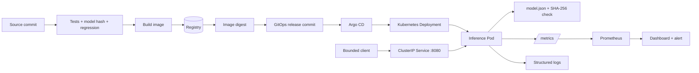
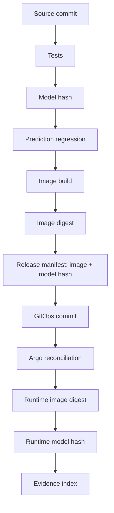

# Project 3 — Production ML Service Operations

**M17 learning project | Stage 2E — Production DevOps & Platform Engineering**  
**Target:** `17-Production-DevOps-Integrated-Capstone/Projects/03-production-ml-service-operations.md`  
**Project:** 3 of 4 | **Module:** M17 | **Status:** `DRAFT-AUDITED` (inspection only; execution and human sign-off pending)

## 1. Title, metadata, and project status

### Document metadata

| Field | Value |
|---|---|
| Primary workload | Synthetic ML inference HTTP service |
| Platform | Local `kind` Kubernetes cluster |
| Packaging / GitOps | Kustomize + Argo CD |
| Model delivery | JSON artifact baked into serving image; SHA-256 checked at startup |
| Profile | Cap-Core, local and zero-budget |
| Optional | Security/progressive-delivery awareness; not required to pass |
| Effort | [ASSUMPTION] 24–36 focused hours |
| Prerequisites | M01–M16 outcomes; Projects 1 and 2 foundations recommended |
| Lab context / namespace | `kind-m17-lab` / `m17-ml` |
| App / metrics port | `8080` / same listener, `/metrics` |
| Authoring date | 2026-11-04; not an execution date |

## Table of contents

1. [Title, metadata, and project status](#1-title-metadata-and-project-status)
2. [Executive summary and learning contract](#2-executive-summary-and-learning-contract)
3. [Prerequisites and M01–M16 handoffs](#3-prerequisites-and-m01m16-handoffs)
4. [Scenario, users, and failure story](#4-scenario-users-and-failure-story)
5. [Scope, non-goals, risks, and architecture decisions](#5-scope-non-goals-risks-and-architecture-decisions)
6. [Architecture and request/release flows](#6-architecture-and-requestrelease-flows)
7. [Concepts explained from beginner to advanced](#7-concepts-explained-from-beginner-to-advanced)
8. [Requirements and acceptance criteria](#8-requirements-and-acceptance-criteria)
9. [Stack profiles, setup, versions, and preflight](#9-stack-profiles-setup-versions-and-preflight)
10. [Repository layout and complete implementation](#10-repository-layout-and-complete-implementation)
11. [Model artifact integrity and lifecycle](#11-model-artifact-integrity-and-lifecycle)
12. [Inference API, correctness, and prediction-regression testing](#12-inference-api-correctness-and-prediction-regression-testing)
13. [CI, image build, registry, GitOps, and release promotion](#13-ci-image-build-registry-gitops-and-release-promotion)
14. [Observability: SLIs, SLOs, dashboards, alerts, and synthetic quality signals](#14-observability-slis-slos-dashboards-alerts-and-synthetic-quality-signals)
15. [Load, performance, capacity, and cost](#15-load-performance-capacity-and-cost)
16. [Model quality, drift, and data contracts](#16-model-quality-drift-and-data-contracts)
17. [Security and supply-chain controls](#17-security-and-supply-chain-controls)
18. [Bad-model release drill, rollback, and recovery](#18-bad-model-release-drill-rollback-and-recovery)
19. [Runbooks and operational procedures](#19-runbooks-and-operational-procedures)
20. [Failure modes, troubleshooting, and negative tests](#20-failure-modes-troubleshooting-and-negative-tests)
21. [Evidence package and scoring/traceability](#21-evidence-package-and-scoringtraceability)
22. [Milestones, learner workflow, and review gates](#22-milestones-learner-workflow-and-review-gates)
23. [Self-check and reviewer-chair exercises](#23-self-check-and-reviewer-chair-exercises)
24. [Teardown, cleanup, and reproducibility proof](#24-teardown-cleanup-and-reproducibility-proof)
25. [Final acceptance gate and project sign-off](#25-final-acceptance-gate-and-project-sign-off)
26. [Source register, assumptions, audit report, and human verification checklist](#26-source-register-assumptions-audit-report-and-human-verification-checklist)

***

## 2. Executive summary and learning contract

### 2.1 What you will build

Build **M17 Risk Demo**, a deliberately small HTTP inference service. It accepts two bounded numeric features (`x1`, `x2`), evaluates a deterministic toy linear classifier, and returns a prediction plus the identity of the model that produced it. The model is not trained on real data. It is a small JSON artifact with explicit metadata, weights, threshold, and synthetic-data provenance.

The serving image contains the model artifact. At startup the service computes SHA-256 over the exact artifact bytes and compares it with an independently declared expected digest supplied by GitOps configuration. A missing, unreadable, malformed, or mismatched artifact fails closed: liveness can remain healthy for diagnosis, readiness returns 503, and predictions are refused.

The workflow is: source/test → model hash and regression → hardened image → immutable image digest → reviewed GitOps change → Argo CD reconciliation → runtime identity check → metrics/alerts → bounded load test → bad-candidate rejection → isolated bad-model drill → GitOps rollback → prediction regression → evidence → teardown.

### 2.2 Why ML releases add an identity dimension

A conventional service release is often identified by source revision, image digest, and configuration revision. An inference service adds a model artifact that can change independently. A process can be HTTP-healthy and still return incorrect predictions because the wrong model was loaded, a model was corrupted, or code and model are incompatible.

The release tuple is:

\[
R=(\text{source commit},\text{image digest},\text{model SHA-256},\text{GitOps commit},\text{test evidence})
\]

An image digest does not replace model identity; a model hash does not prove image trust or model quality.

### 2.3 What this proves and does not prove

| Demonstrates at local-lab scale | Does not demonstrate |
|---|---|
| Deterministic inference contract and regression checks | Real-world predictive validity, fairness, or safety |
| Model hash verification in the actual startup path | Authenticity/provenance unless separately implemented |
| Image/model identity bound to GitOps release | Enterprise model registry governance |
| CI rejection of a known bad toy model | Production suitability of a real model |
| Probes, metrics, logs, alerts, and bounded load test | Production capacity or multi-region resilience |
| Synthetic input-shift proxy | Actual concept drift or model-quality SLO |
| GitOps rollback to a known-good image containing code+model | Database backup/restore or external feature-store recovery |

### 2.4 Required versus optional

**Required Cap-Core:** pure-Python deterministic model, HTTP API, model hash verification, tests, container, Kustomize, kind, CI evidence, Argo CD/GitOps, metrics and alert validation, bounded load test, synthetic shift proxy, bad-model regression gate, isolated rollback drill, runbooks, evidence and teardown.

**Optional:** signing/provenance, SBOM policy, admission policy, Argo Rollouts, external model registry, multi-cluster, cloud. None is a hidden prerequisite.

### 2.5 Governing M17 contract

The stage exit criteria remain verbatim:

> deploy a service through the full tested pipeline; reconcile desired state from Git; apply identity and security controls; demonstrate metrics/logs/alerts; execute a failure, rollback, backup restore, and teardown; map every acceptance criterion to evidence.

The evidence artifact remains:

> capstone repository, architecture diagram, runbooks, CI/GitOps evidence, incident report, restore evidence, signed-off checklist.

The pass rule remains:

> every criterion is demonstrated, evidence is committed or safely retained, and the lab is reproducible from its README/runbook.

A `NOT_DEMONSTRATED` criterion is not passed. Fabricated evidence invalidates the submission. Project 3 contributes ML-service evidence; it does not replace Project 1's PostgreSQL backup/restore, Project 2's scheduled pipeline, or Project 4's integrated capstone.

***

## 3. Prerequisites and M01–M16 handoffs

Project 3 consumes M01–M16 outcomes; it does not re-teach them from scratch.

| Module | Competency | Project 3 handoff | Roadmap folder verified | Not re-taught |
|---|---|---|---|---|
| M01 | Images and registries | Build, publish, identify image | `01-Containerization-and-Container-Registries/` | Container basics |
| M02 | CI/CD | Test gates and artifact publication | `02-CI-CD-Pipelines/` | Workflow fundamentals |
| M03 | Operations | Diagnose Pod/process/log failures | `03-Production-Operations/` | General Linux operations |
| M04 | Networking/TLS | Service ports, in-cluster traffic, TLS boundary | `04-Production-Networking-and-TLS/` | Full PKI/ingress deployment |
| M05 | Storage/stateful | Compare baked artifact vs mounted/object storage | `05-Production-Storage-and-Stateful-Workloads/` | Stateful service implementation |
| M06 | Packaging | Kustomize base/overlay | `06-Kubernetes-Packaging/` | Full Helm course |
| M07 | IaC | Declarative setup and safe operations | `07-Advanced-Infrastructure-as-Code-and-Cloud-Operations/` | Terraform state curriculum |
| M08 | GitOps | Argo CD sync, drift, Git rollback | `08-GitOps-and-Progressive-Delivery/` | Controller internals/canary tools |
| M09 | Secrets/identity | No unnecessary SA token; least-privilege CI | `09-Secrets-and-Identity-Management/` | Vault setup |
| M10 | SRE/incidents/SLOs | Latency/error SLO, alert and postmortem | `10-Site-Reliability-Engineering-and-Incident-Management/` | Full on-call design |
| M11 | Observability | Metrics, logs, dashboards, alerts | `11-Production-Observability-Stack-and-Performance-Operations/` | Full stack build |
| M12 | Security/supply chain | Hash, digest, scanning awareness, hardening | `12-Production-Security-and-Software-Supply-Chain/` | Enterprise policy system |
| M13 | Backup/DR/resilience | Retain known-good artifact; controlled fault | `13-Backup-Disaster-Recovery-and-Resilience-Testing/` | Full Velero/chaos setup |
| M14 | Multi-cluster | Explain why kind cannot prove failover | `14-Multi-Cluster-and-Multi-Region-Operations/` | Multi-cluster build |
| M15 | Capacity/FinOps | Measure resources and reason about headroom | `15-Platform-Capacity-Compute-Economics-and-FinOps/` | Cloud cost platform |
| M16 | Platform engineering | Reuse golden-path conventions if available | `16-Platform-Engineering-and-Internal-Developer-Platforms/` | Backstage/Crossplane; not required |

The supplied roadmap tree confirms module folders and topic filenames. Complete M01–M16 lesson bodies were not all supplied; this table does not claim those lesson texts were inspected. Use the local module README to confirm additional subtopic links.

**Entry gate:** learner can use Git, Linux/WSL2, a container runtime, `kubectl`, kind, Kustomize and Argo CD; has completed M01–M16 or remediated gaps; understands Project 1 image/registry/Kustomize/GitOps patterns and Project 2 CI/observability patterns; records tool versions and measures host resources; identifies the cluster context before mutation.

***

## 4. Scenario, users, and failure story

### 4.1 Fictional service

**M17 Risk Demo** classifies synthetic work items into class `0` or `1` from two numeric features. It has no real business or safety consequence. Users are a synthetic client, service owner, release engineer, on-call operator, and reviewer.

### 4.2 Fictional failure story

Release `risk-demo-1.0.0` serves baseline model `1.0.0`. A candidate `1.1.0-bad` has reversed coefficients. It can pass a superficial HTTP liveness check while returning wrong predictions. CI must reject it using prediction regression. Separately, an approved, isolated drill may deploy the bad image to disposable kind solely to rehearse detection, evidence preservation, and GitOps rollback. The known-good release must be restored by reverting the GitOps release commit and verifying both image digest and model hash plus prediction fixtures.

This is a fictional lab scenario, not a report of a real incident or measured business loss.

### 4.3 Ownership boundaries

| Component | Owner | Failure boundary |
|---|---|---|
| App/API/model contract | Learner | Input validation and prediction behavior |
| Model artifact | Learner | Format, hash, metadata, compatibility |
| Image/build | Learner/CI | Image contents, digest, hardening |
| Kubernetes | Learner/platform | Scheduling, probes, resources, rollout |
| Argo CD | Platform controller | Desired-state reconciliation |
| Prometheus/Grafana | Observability profile | Scrape, query, dashboard, alert |
| Load client | Learner | Bounded test generation and raw results |
| Registry | Local or configured CI registry | Immutable artifact storage/retrieval |

***

## 5. Scope, non-goals, risks, and architecture decisions

### 5.1 In scope

Deterministic toy inference; JSON artifact; startup SHA-256; metadata; request validation; regression tests; hardened image; Deployment/Service/probes/resources; Kustomize; CI and immutable image identity; Argo CD; metrics/logs/alerts; bounded load/capacity test; synthetic input-shift proxy; bad-model gate and rollback; evidence; cleanup.

### 5.2 Non-goals

Real data or training curriculum; GPUs; online learning or auto-retraining; real-time feature platform; full model registry; production authentication/authorization or public ingress; compliance certification; multi-region; replacing Project 1 PostgreSQL restore or Project 2 CronJob freshness work.

### 5.3 Risk register

Likelihood/impact are qualitative planning assumptions, not measured probabilities.

| ID | Risk | Likelihood | Impact | Mitigation |
|---|---|---:|---:|---|
| R-01 | Artifact and expected digest changed together without review | Medium | High | Git review, release tuple, regression gate |
| R-02 | Hash mistaken for authenticity/quality | High | High | Explicitly separate integrity, authenticity, provenance, quality |
| R-03 | Bad model reaches normal release branch | Low after controls | High | Required prediction regression gate |
| R-04 | Service reports ready while model invalid | Medium | High | Model-aware readiness; negative test |
| R-05 | Mean latency hides tail | Medium | Medium | p50/p95/p99 from raw samples |
| R-06 | Synthetic proxy over-interpreted | Medium | High | Label proxy; no quality claim |
| R-07 | kind host pressure distorts results | High | Medium | Measure host; bound tests |
| R-08 | Wrong cluster mutated | Low | Critical | Context guard and explicit context |
| R-09 | CI identity/action compromised | Medium | High | Minimal permissions, full-SHA action pins |
| R-10 | Teardown leaves resources | Medium | Medium | Preview, inventory, residual review |

### 5.4 Architecture Decision Records

**ADR-001 — Model format:** plain JSON plus two weights, bias and threshold; Python standard library only. Rejected pickle/joblib due to unsafe deserialization risk and unnecessary dependencies. Trade-off: toy artifact, not representative of all model runtimes.

**ADR-002 — Artifact delivery:** bake model into serving image; GitOps separately pins `MODEL_SHA256`. This makes code+model one rollback unit and avoids runtime artifact-store credentials. Model-only changes rebuild the image.

**ADR-003 — Digest verification:** compute SHA-256 over exact file bytes at startup, compare before parsing, parse those same bytes, retain parsed model in memory. Mismatch fails closed. Hash does not prove signer identity, provenance or quality.

**ADR-004 — Delivery:** Kustomize + Argo CD, consistent with Projects 1 and 2. Do not implement Helm as a second full path.

**ADR-005 — Metrics:** Prometheus text exposition with fixed labels. Teaching implementation only; production should use maintained instrumentation and bounded server concurrency/timeouts.

**ADR-006 — Load:** bounded Python standard-library client; not a distributed load generator.

**ADR-007 — Rollback:** revert GitOps commit to known-good image digest and expected model hash. Real systems also require schema/feature compatibility.

**ADR-008 — Signing/provenance:** optional only. Do not claim it unless trusted identity, trust root, verifier policy and negative tests are implemented.

### 5.5 Optional cloud gate

Cloud is not required. If selected, first create a resource diagram/inventory, account/region assumptions without account IDs, preflight, cost-risk table, redacted budget/alert evidence, written teardown contract, resource-removal proof, and next-day billing check. Budgets are alerts, not hard caps; billing can be delayed.

***

## 6. Architecture and request/release flows

### 6.1 Architecture



### 6.2 Request flow

1. Client submits bounded JSON to `POST /predict`.
2. Handler checks body size, JSON, exact fields, types, finite values and ranges.
3. Handler confirms verified model is loaded.
4. Model computes `score = bias + w1*x1 + w2*x2`.
5. Prediction is `1` when score ≥ threshold, otherwise `0`.
6. Response includes prediction, score, model ID/version/hash, release ID and request ID.
7. Metrics increment bounded counters; structured logs omit raw feature values.

### 6.3 Release provenance



Compare release manifest, Argo source revision, live image digest, and `/version` model hash. `Synced` alone is insufficient.

### 6.4 Trust boundaries

Source/review boundary; CI build boundary; registry boundary; GitOps boundary; cluster boundary; runtime/model/request boundary; evidence boundary. If an actor can modify both artifact and expected digest in a trusted release path, the hash check alone will not stop the attack.

***

## 7. Concepts explained from beginner to advanced

- **Training** estimates model parameters from examples; **inference** applies a selected model to new input. This project operates inference only.
- **Model artifact** contains files needed to execute the model; **metadata** describes identity/schema/provenance; **hash** identifies exact bytes. A model registry is a managed version/lineage/approval system; this project does not build one.
- **Integrity** is byte match; **authenticity** is trusted producer identity; **provenance** describes how/where/from what it was built; **quality** is acceptable behavior. These are distinct.
- **Loading** verifies and parses the artifact before serving. **Warm-up** prepares runtime state to avoid first-request setup cost.
- **Deterministic regression** tests fixed examples; it is not statistically representative evaluation.
- **p50/p95/p99** describe latency distribution; averages can hide slow tails.
- **Throughput** is completed requests/time; **concurrency** is in-flight requests; **queueing** is waiting; **saturation** is a resource near usable capacity.
- **Liveness** asks whether process should be restarted; **readiness** asks whether it should receive traffic; **startup probe** allows initialization time. Invalid model means not-ready, not necessarily dead.
- CPU requests influence scheduling; CPU limits can throttle; memory limits can cause OOM termination. Measure before right-sizing.
- **Promotion** moves the same tested artifact; **rollback** restores a known-good release. Here the image contains code+model and GitOps pins its digest and model hash.
- **Input drift** is changed input distribution; **concept drift** is changed input/outcome relationship. Input shift alone does not prove accuracy loss.
- A model artifact is a security-sensitive input. Avoid unsafe deserialization, restrict write access, and bind digest to release.

***

## 8. Requirements and acceptance criteria

### 8.1 Identifier policy

Unit 1 defines canonical `REQ-001`–`REQ-032`. Project-local criteria below are `P3-AC-001`–`P3-AC-023`; they are **not** canonical M17 REQ IDs.

### 8.2 Given / When / Then criteria

| ID | REQ mapping | Given | When | Then / pass condition | Evidence / negative case |
|---|---|---|---|---|---|
| P3-AC-001 | REQ-021,028,031 | Fresh clone | Run preflight/guard | Versions/resources recorded; wrong context rejected | versions/transcript; wrong context exits non-zero |
| P3-AC-002 | REQ-001 | App and fixture | Submit valid request | Exact deterministic output | API tests; invalid schema/type/range rejected |
| P3-AC-003 | REQ-002,030 | Baseline artifact | Calculate hash | Full SHA matches declared value | hash report; one-byte mutation fails |
| P3-AC-004 | REQ-002,003,008 | Missing/corrupt/mismatched model | Start app | readiness 503; prediction refused; no fallback | negative test/startup evidence |
| P3-AC-005 | REQ-001,003 | Candidate commit | Run CI | Tests/hash/regression/build required before promotion | CI report; bad model fails gate |
| P3-AC-006 | REQ-002,030 | Built image | Promote | Full digest used; same tested image deployed | registry + manifest; tag-only rejected |
| P3-AC-007 | REQ-004,005 | GitOps commit | Argo reconciles | Source revision and live state agree | Argo status/history; drift detected |
| P3-AC-008 | REQ-011,012 | Service deployed | Query probes/version | liveness process-only; readiness model-aware; version identity correct | API/probe outputs; wrong digest not-ready |
| P3-AC-009 | REQ-011–014 | Metrics scraped | Healthy/failing cases run | Metrics visible and alert path validated | scrape/query/alert; missing series detected |
| P3-AC-010 | REQ-011–015 | SLO and bounded client | Load test runs | p50/p95/p99, throughput/errors derived from actual data | raw JSON; abort on caps/errors |
| P3-AC-011 | REQ-032; CR-05 | Measurements exist | Review resources | Requests/limits justified from observed use/headroom | worksheet; no guessed sizing claim |
| P3-AC-012 | REQ-011–014 | Synthetic baseline defined | Send shifted inputs | Proxy changes; limitation explicitly stated | generator/metric; healthy baseline stays below trigger |
| P3-AC-013 | REQ-003,015 | Bad candidate exists | CI regression runs | Candidate fails and normal promotion is blocked | failing report; no skip/continue-on-error |
| P3-AC-014 | REQ-015 | Isolated drill approved | Bad release is applied in lab | Incident evidence captured and rollback performed | approval/timeline; wrong context aborts |
| P3-AC-015 | REQ-002,016 | Rollback commit reconciled | Check runtime | Known-good image/model and predictions restored | Git/Argo/runtime/regression evidence |
| P3-AC-016 | REQ-006–009 | CI/Pod identity configured | Negative tests run | Least privilege, no plaintext secrets, hardened runtime | scan/spec; canary/root fixture flagged |
| P3-AC-017 | REQ-010 | NetworkPolicy enabled | Allowed/denied paths tested | Only declared paths reachable, or mark not demonstrated | policy/CNI test |
| P3-AC-018 | REQ-012,015 | Incident scenario | Second operator follows runbook | Recovery possible without author memory | completed runbook exercise |
| P3-AC-019 | REQ-022,025–027 | Evidence index exists | Validator/planted defects run | Missing/orphan/unsafe/bad checksum rejected | validator/test output |
| P3-AC-020 | REQ-023,024 | Evidence captured | Index verified | Timestamp/commit/run/digest/checksum attached | index/checksum report |
| P3-AC-021 | REQ-020,031 | Lab resources exist | Guarded teardown | Owned resources removed or residuals reported | before/after inventory |
| P3-AC-022 | REQ-032 | Risks/ADRs exist | Reviewer inspects | Assumptions/non-goals/cloud gate visible | ADR/risk record |
| P3-AC-023 | REQ-032 | Evidence available | Human review occurs | Reviewer can trace release tuple and limitations | signed project checklist; no full-M17 claim |

### 8.3 Traceability summary

| AC family | REQ IDs | Control/test | Evidence |
|---|---|---|---|
| Setup/API/model | 001–003, 021, 028, 031 | fresh clone, contract tests, hash | versions, tests, hash |
| CI/GitOps | 001–005, 030 | required gates, digest promotion, Argo | workflow, digest, Argo revision |
| Runtime/observability | 011–015 | probes, metrics, alert, incident | dashboard, query, timeline |
| Rollback | 002,003,015,016 | bad-model gate and Git revert | regression + before/after release tuple |
| Security/network | 006–010 | identity, secret hygiene, hardening, policy | scan, Pod spec, CNI test |
| Evidence/cleanup | 020–028,031,032 | validators, context guard, teardown | index/checksum, inventory, sign-off |

***
## 9. Stack profiles, setup, versions, and preflight

### 9.1 Core profile

| Component | Core choice | Purpose |
|---|---|---|
| OS | WSL2 Ubuntu or native Linux | Local development |
| Runtime | Docker or compatible | Build image |
| Kubernetes | kind | Disposable local cluster |
| Packaging | Kustomize | Base/overlay |
| GitOps | Argo CD | Desired-state reconciliation |
| Registry | Local registry or configured GHCR | Image by digest |
| Telemetry | Prometheus/Grafana from M17 stack | Metrics/dashboard/alert |
| App/model | Python stdlib + JSON | Minimal deterministic inference |
| Load client | Bounded Python script | Latency and throughput sample |

Reuse Project 1/2 infrastructure if already running; do not create duplicate clusters or registries. Do not start all optional components simultaneously.

### 9.2 Optional profile

After Core passes, optionally add scanner/SBOM, cosign, admission policy, or Argo Rollouts. Record versions, trust roots and negative tests. An installed scanner not wired to a release gate is not an enforced control.

### 9.3 Version recording

```text
# File: docs/versions.txt
recorded_at_utc=<actual timestamp>
os=<distribution/version>
kernel=<uname output>
architecture=<uname -m>
cpu_count=<nproc>
memory_total=<measured>
disk_free=<measured>
git=<git --version>
docker=<client/server version>
kind=<kind version>
kubectl=<kubectl version --client>
kustomize=<kustomize version or kubectl kustomize version>
argocd=<argocd version>
python=<python3 --version>
prometheus=<installed version or absent>
grafana=<installed version or absent>
```

Do not fill guessed values. Version-sensitive installation commands must be checked against official docs when executed.

### 9.4 Preflight

```bash
# File: scripts/preflight.sh
#!/usr/bin/env bash
set -euo pipefail
EXPECTED_CONTEXT="${EXPECTED_CONTEXT:-kind-m17-lab}"
for cmd in git docker kind kubectl python3 sha256sum; do
  command -v "$cmd" >/dev/null 2>&1 || { echo "MISSING: $cmd" >&2; exit 1; }
done
git --version
docker version --format 'Docker server={{.Server.Version}}'
kind version
kubectl version --client
python3 --version
nproc
free -h
df -h .
kubectl config get-contexts -o name | grep -Fxq "$EXPECTED_CONTEXT" || {
  echo "Expected context absent: $EXPECTED_CONTEXT" >&2; exit 1;
}
echo "Preflight complete; this does not prove cluster health."
```

### 9.5 Context guard

```bash
# File: scripts/context-guard.sh
#!/usr/bin/env bash
set -euo pipefail
EXPECTED_CONTEXT="${EXPECTED_CONTEXT:-kind-m17-lab}"
ACTUAL_CONTEXT="$(kubectl config current-context)"
if [[ "$ACTUAL_CONTEXT" != "$EXPECTED_CONTEXT" ]]; then
  printf 'REFUSED: current=%s expected=%s\n' "$ACTUAL_CONTEXT" "$EXPECTED_CONTEXT" >&2
  exit 42
fi
kubectl --context "$EXPECTED_CONTEXT" cluster-info >/dev/null
echo "Context guard passed: $EXPECTED_CONTEXT"
```

Every mutating Kubernetes command must still include `--context kind-m17-lab`. The guard is additional protection, not a replacement for explicit context.

### 9.6 WSL2/native Linux

Prefer a Linux filesystem path for the repository; verify executable bits and line endings. Docker networking and kind registry wiring depend on host setup. Measure memory/disk before running Argo CD, Prometheus and Grafana together. Stop optional observability components when idle.

### 9.7 Start/stop sequence

1. Preflight host and runtime.
2. Verify/create the named kind cluster.
3. Verify/reuse the local registry and its Project 1 attachment.
4. Start/verify Argo CD and minimal monitoring profile.
5. Deploy `m17-ml` through GitOps.
6. Capture evidence.
7. Stop load generator and optional monitoring when finished.
8. Preserve evidence; run guarded teardown and residual inventory.

***

## 10. Repository layout and complete implementation

### 10.1 Learner implementation tree

These are proposed implementation paths, not files claimed to exist in the supplied repository. The authoring task creates only this Markdown document.

```text
m17-ml-service/
├── app/server.py
├── model/model.json
├── model/model.sha256
├── tests/test_model.py
├── tests/test_api.py
├── scripts/preflight.sh
├── scripts/context-guard.sh
├── scripts/verify-model.py
├── scripts/prediction_regression.py
├── scripts/load_test.py
├── scripts/generate_shift.py
├── scripts/validate_evidence.py
├── scripts/teardown.sh
├── deploy/base/{namespace.yaml,deployment.yaml,service.yaml,network-policy.yaml,kustomization.yaml}
├── deploy/overlays/local/kustomization.yaml
├── gitops/application.yaml
├── observability/{prometheus-scrape.yaml,alerts.yaml,dashboard-panels.md}
├── runbooks/ml-service-operations.md
├── evidence/index.yaml
├── docs/{versions.txt,release-record.md}
├── Dockerfile
├── .dockerignore
├── requirements.txt
├── Makefile
└── .github/workflows/ci.yml
```

### 10.2 Model artifact

Save the following object as UTF-8 JSON in `model/model.json` (whitespace/key order are significant to the file hash):

```json
{"bias":-1.0,"description":"Deterministic teaching classifier; not a real risk model.","feature_names":["x1","x2"],"model_id":"toy-risk-linear","model_version":"1.0.0","schema_version":1,"threshold":0.0,"training_data":"synthetic-v1","weights":[2.0,1.0]}
```

```text
# File: model/model.sha256
# SHA-256 of the exact canonical compact JSON bytes shown above:
d7a9d7ae047ee2fd743b265f1390256b0e88405cde1124fcc38cad524babf9f9
```

If an editor changes whitespace or key order, recompute the digest and review the change. The service hashes exact file bytes, not reserialized JSON.

### 10.3 Dependencies

```text
# File: requirements.txt
# Core service and tests use only the Python standard library.
# No third-party runtime dependencies are required.
```

### 10.4 Inference service

```python
# File: app/server.py
from __future__ import annotations
import hashlib, json, math, os, threading, time, uuid
from http.server import BaseHTTPRequestHandler, ThreadingHTTPServer
from pathlib import Path
from typing import Any

HOST = os.getenv("HOST", "0.0.0.0")
PORT = int(os.getenv("PORT", "8080"))
MODEL_PATH = Path(os.getenv("MODEL_PATH", "/app/model/model.json"))
EXPECTED = os.getenv("MODEL_SHA256", "").strip().lower()
RELEASE_ID = os.getenv("RELEASE_ID", "local-unreleased")
APP_VERSION = os.getenv("APP_VERSION", "1.0.0")
MAX_BODY = 1024

_state_lock = threading.Lock()
_metrics_lock = threading.Lock()
_model: dict[str, Any] | None = None
_model_hash: str | None = None
_model_error: str | None = None
_load_seconds = 0.0
_counts = {"success": 0, "client_error": 0, "server_error": 0}
_bounds = [0.005, 0.01, 0.025, 0.05, 0.1, 0.25, 0.5, 1.0, float("inf")]
_bucket_counts = [0] * len(_bounds)
_latency_sum = 0.0
_shifted = 0
_total_inputs = 0


def load_model() -> None:
    """Hash exact bytes, compare, then parse those same bytes; fail closed."""
    global _model, _model_hash, _model_error, _load_seconds
    started = time.perf_counter()
    try:
        if len(EXPECTED) != 64:
            raise ValueError("MODEL_SHA256_MISSING_OR_INVALID")
        raw = MODEL_PATH.read_bytes()
        actual = hashlib.sha256(raw).hexdigest()
        if actual != EXPECTED:
            raise ValueError("MODEL_DIGEST_MISMATCH")
        doc = json.loads(raw.decode("utf-8"))
        required = {"schema_version", "model_id", "model_version", "feature_names",
                    "weights", "bias", "threshold", "training_data", "description"}
        if not isinstance(doc, dict) or set(doc) != required:
            raise ValueError("MODEL_SCHEMA_INVALID")
        if doc["schema_version"] != 1 or doc["feature_names"] != ["x1", "x2"]:
            raise ValueError("MODEL_CONTRACT_UNSUPPORTED")
        if not isinstance(doc["weights"], list) or len(doc["weights"]) != 2:
            raise ValueError("MODEL_WEIGHTS_INVALID")
        numeric = doc["weights"] + [doc["bias"], doc["threshold"]]
        if not all(isinstance(v, (int, float)) and math.isfinite(v) for v in numeric):
            raise ValueError("MODEL_NUMERIC_VALUE_INVALID")
        if not isinstance(doc["model_version"], str) or not doc["model_version"]:
            raise ValueError("MODEL_VERSION_INVALID")
        with _state_lock:
            _model, _model_hash, _model_error = doc, actual, None
    except Exception as exc:
        with _state_lock:
            _model, _model_hash = None, None
            _model_error = str(exc).split(":")[0][:80]
    finally:
        _load_seconds = time.perf_counter() - started


def snapshot():
    with _state_lock:
        return _model, _model_hash, _model_error, _load_seconds


def validate(payload: Any) -> tuple[float, float]:
    if not isinstance(payload, dict) or set(payload) != {"features"}:
        raise ValueError("REQUEST_SCHEMA_INVALID")
    features = payload["features"]
    if not isinstance(features, dict) or set(features) != {"x1", "x2"}:
        raise ValueError("FEATURE_SCHEMA_INVALID")
    values = []
    for name in ("x1", "x2"):
        value = features[name]
        if isinstance(value, bool) or not isinstance(value, (int, float)):
            raise ValueError("FEATURE_TYPE_INVALID")
        value = float(value)
        if not math.isfinite(value) or not -10.0 <= value <= 10.0:
            raise ValueError("FEATURE_RANGE_INVALID")
        values.append(value)
    return values[0], values[1]


def infer(x1: float, x2: float):
    model, _, error, _ = snapshot()
    if model is None or error:
        raise RuntimeError("MODEL_NOT_READY")
    score = float(model["bias"]) + float(model["weights"][0])*x1 + float(model["weights"][1])*x2
    return (1 if score >= float(model["threshold"]) else 0), score


def record(outcome: str, elapsed: float, x1=None, x2=None):
    global _latency_sum, _shifted, _total_inputs
    with _metrics_lock:
        _counts[outcome] += 1
        _latency_sum += elapsed
        for i, bound in enumerate(_bounds):
            if elapsed <= bound:
                _bucket_counts[i] += 1
        if x1 is not None and x2 is not None:
            _total_inputs += 1
            if abs(x1) > 2.0 or abs(x2) > 2.0:
                _shifted += 1


class Handler(BaseHTTPRequestHandler):
    server_version = "M17RiskDemo"
    sys_version = ""

    def log_message(self, fmt, *args):
        return  # Default access logs may expose request paths/metadata.

    def send_json(self, status, value):
        body = json.dumps(value, sort_keys=True, separators=(",", ":")).encode()
        self.send_response(status)
        self.send_header("Content-Type", "application/json")
        self.send_header("Content-Length", str(len(body)))
        self.end_headers()
        self.wfile.write(body)

    def do_GET(self):
        if self.path == "/health/live":
            self.send_json(200, {"status": "live"}); return
        if self.path == "/health/ready":
            model, digest, error, _ = snapshot()
            if model is None or error:
                self.send_json(503, {"status": "not_ready", "reason": error or "MODEL_NOT_LOADED"})
            else:
                self.send_json(200, {"status": "ready", "model_version": model["model_version"], "model_sha256": digest})
            return
        if self.path == "/version":
            model, digest, error, _ = snapshot()
            self.send_json(200, {"app_version": APP_VERSION, "release_id": RELEASE_ID,
                "model_id": model["model_id"] if model else None,
                "model_version": model["model_version"] if model else None,
                "model_sha256": digest, "model_verified": model is not None and error is None})
            return
        if self.path == "/metrics":
            self.send_metrics(); return
        self.send_json(404, {"error": "NOT_FOUND"})

    def send_metrics(self):
        model, _, error, load_seconds = snapshot()
        with _metrics_lock:
            counts, buckets = dict(_counts), list(_bucket_counts)
            latency_sum, shifted, total = _latency_sum, _shifted, _total_inputs
        lines = [
            "# HELP m17_inference_requests_total Requests by fixed outcome",
            "# TYPE m17_inference_requests_total counter",
            "# HELP m17_inference_latency_seconds Handler latency histogram",
            "# TYPE m17_inference_latency_seconds histogram",
            "# HELP m17_model_loaded Whether verified model is loaded",
            "# TYPE m17_model_loaded gauge",
            "# HELP m17_model_load_seconds Model verification/load duration",
            "# TYPE m17_model_load_seconds gauge",
            "# HELP m17_model_shifted_inputs_total Requests outside synthetic baseline envelope",
            "# TYPE m17_model_shifted_inputs_total counter",
            "# HELP m17_model_inputs_total Validated feature requests",
            "# TYPE m17_model_inputs_total counter",
        ]
        for outcome, count in counts.items():
            lines.append(f'm17_inference_requests_total{{outcome="{outcome}"}} {count}')
        for bound, count in zip(_bounds, buckets):
            label = "+Inf" if math.isinf(bound) else str(bound)
            lines.append(f'm17_inference_latency_seconds_bucket{{le="{label}"}} {count}')
        lines += [f"m17_inference_latency_seconds_count {sum(counts.values())}",
                  f"m17_inference_latency_seconds_sum {latency_sum}",
                  f"m17_model_loaded {1 if model is not None and error is None else 0}",
                  f"m17_model_load_seconds {load_seconds}",
                  f"m17_model_shifted_inputs_total {shifted}", f"m17_model_inputs_total {total}"]
        body = ("\n".join(lines)+"\n").encode()
        self.send_response(200)
        self.send_header("Content-Type", "text/plain; version=0.0.4; charset=utf-8")
        self.send_header("Content-Length", str(len(body)))
        self.end_headers(); self.wfile.write(body)

    def do_POST(self):
        if self.path != "/predict":
            self.send_json(404, {"error": "NOT_FOUND"}); return
        started = time.perf_counter()
        request_id = self.headers.get("X-Request-ID", str(uuid.uuid4()))[:64]
        try:
            length = int(self.headers.get("Content-Length", "0"))
            if length <= 0 or length > MAX_BODY:
                raise ValueError("REQUEST_SIZE_INVALID")
            payload = json.loads(self.rfile.read(length).decode("utf-8"))
            x1, x2 = validate(payload)
            model, digest, error, _ = snapshot()
            if model is None or error:
                record("server_error", time.perf_counter()-started, x1, x2)
                self.send_json(503, {"error": "MODEL_NOT_READY", "request_id": request_id}); return
            prediction, score = infer(x1, x2)
            elapsed = time.perf_counter()-started
            record("success", elapsed, x1, x2)
            self.send_json(200, {"prediction": prediction, "score": round(score, 8),
                "model_id": model["model_id"], "model_version": model["model_version"],
                "model_sha256": digest, "release_id": RELEASE_ID, "request_id": request_id})
            print(json.dumps({"event": "prediction", "request_id": request_id,
                "release_id": RELEASE_ID, "model_version": model["model_version"],
                "model_sha256": digest, "outcome": "success", "duration_seconds": elapsed}, sort_keys=True))
        except (ValueError, UnicodeDecodeError, json.JSONDecodeError) as exc:
            elapsed = time.perf_counter()-started
            record("client_error", elapsed)
            self.send_json(400, {"error": str(exc)[:80], "request_id": request_id})
        except Exception:
            record("server_error", time.perf_counter()-started)
            self.send_json(500, {"error": "INFERENCE_FAILED", "request_id": request_id})


def main():
    load_model()
    server = ThreadingHTTPServer((HOST, PORT), Handler)
    server.daemon_threads = True
    print(json.dumps({"event": "service_start", "release_id": RELEASE_ID,
        "app_version": APP_VERSION, "model_verified": snapshot()[0] is not None,
        "model_error": snapshot()[2]}, sort_keys=True))
    try:
        server.serve_forever()
    except KeyboardInterrupt:
        pass
    finally:
        server.shutdown(); server.server_close()

if __name__ == "__main__":
    main()
```

This is a teaching server. Do not expose it publicly. A real service needs authentication/authorization, TLS, quotas, maintained instrumentation, timeouts, and approved network boundaries.

### 10.5 Artifact verifier and prediction regression

```python
# File: scripts/verify-model.py
import hashlib, sys
from pathlib import Path
artifact = Path("model/model.json")
expected_file = Path("model/model.sha256")
if not artifact.is_file() or not expected_file.is_file():
    print("FAIL: model artifact or digest missing", file=sys.stderr); raise SystemExit(1)
expected = expected_file.read_text().strip().lower()
actual = hashlib.sha256(artifact.read_bytes()).hexdigest()
if len(expected) != 64 or actual != expected:
    print(f"FAIL: model digest mismatch expected={expected} actual={actual}", file=sys.stderr)
    raise SystemExit(1)
print(f"PASS: model SHA-256 verified: {actual}")
```

```python
# File: scripts/prediction_regression.py
import json, sys
from pathlib import Path
FIXTURES = [
    ({"x1": 0.0, "x2": 0.0}, 0),
    ({"x1": 1.0, "x2": 0.0}, 1),
    ({"x1": 0.0, "x2": 2.0}, 1),
    ({"x1": -1.0, "x2": 0.0}, 0),
]
def main():
    path = Path(sys.argv[1]) if len(sys.argv) > 1 else Path("model/model.json")
    model = json.loads(path.read_text(encoding="utf-8"))
    failures = []
    for i, (features, expected) in enumerate(FIXTURES):
        score = model["bias"] + model["weights"][0]*features["x1"] + model["weights"][1]*features["x2"]
        actual = 1 if score >= model["threshold"] else 0
        if actual != expected: failures.append({"fixture": i, "expected": expected, "actual": actual})
    if failures:
        print(json.dumps({"status": "FAIL", "failures": failures}, sort_keys=True)); raise SystemExit(1)
    print(json.dumps({"status": "PASS", "fixtures": len(FIXTURES)}, sort_keys=True))
if __name__ == "__main__": main()
```

Baseline fixture: `(0,0) → score -1, class 0`; `(1,0) → score 1, class 1`; `(0,2) → score 1, class 1`; `(-1,0) → score -3, class 0`. A bad candidate must fail regression. A skipped test or `continue-on-error` is not a pass.

### 10.6 Tests

```python
# File: tests/test_model.py
import hashlib, json, unittest
from pathlib import Path
ROOT = Path(__file__).resolve().parents[1]
class ModelTests(unittest.TestCase):
    def test_hash(self):
        actual = hashlib.sha256((ROOT/"model/model.json").read_bytes()).hexdigest()
        self.assertEqual(actual, (ROOT/"model/model.sha256").read_text().strip())
    def test_metadata(self):
        doc = json.loads((ROOT/"model/model.json").read_text())
        self.assertEqual(doc["schema_version"], 1)
        self.assertEqual(doc["feature_names"], ["x1", "x2"])
        self.assertEqual(doc["training_data"], "synthetic-v1")
    def test_known_predictions(self):
        doc = json.loads((ROOT/"model/model.json").read_text())
        for x1, x2, expected, score_expected in [(0,0,0,-1),(1,0,1,1),(0,2,1,1),(-1,0,0,-3)]:
            score = doc["bias"] + doc["weights"][0]*x1 + doc["weights"][1]*x2
            self.assertAlmostEqual(score, score_expected)
            self.assertEqual(1 if score >= doc["threshold"] else 0, expected)
if __name__ == "__main__": unittest.main()
```

```python
# File: tests/test_api.py
from __future__ import annotations
import json, os, subprocess, sys, tempfile, time, unittest, urllib.error, urllib.request
from pathlib import Path
ROOT = Path(__file__).resolve().parents[1]
SERVER = ROOT / "app" / "server.py"
MODEL = ROOT / "model" / "model.json"
EXPECTED = (ROOT / "model" / "model.sha256").read_text().strip()

def get(url):
    return urllib.request.urlopen(url, timeout=1)

def post(url, body):
    data = body if isinstance(body, bytes) else json.dumps(body).encode()
    req = urllib.request.Request(url, data=data, headers={"Content-Type":"application/json"})
    return urllib.request.urlopen(req, timeout=2)

class ApiTests(unittest.TestCase):
    @classmethod
    def setUpClass(cls):
        cls.port = 18081
        env = {**os.environ, "HOST":"127.0.0.1", "PORT":str(cls.port),
               "MODEL_PATH":str(MODEL), "MODEL_SHA256":EXPECTED, "RELEASE_ID":"api-test"}
        cls.proc = subprocess.Popen([sys.executable, str(SERVER)], cwd=ROOT, env=env,
                                    stdout=subprocess.DEVNULL, stderr=subprocess.DEVNULL)
        cls.base = f"http://127.0.0.1:{cls.port}"
        for _ in range(50):
            try:
                if get(cls.base+"/health/ready").status == 200: break
            except Exception: time.sleep(0.05)
        else: raise RuntimeError("API test server did not become ready")

    @classmethod
    def tearDownClass(cls):
        cls.proc.terminate()
        try: cls.proc.wait(timeout=3)
        except subprocess.TimeoutExpired:
            cls.proc.kill(); cls.proc.wait(timeout=3)

    def test_health_version_and_prediction(self):
        self.assertEqual(get(self.base+"/health/live").status, 200)
        self.assertEqual(get(self.base+"/health/ready").status, 200)
        version = json.loads(get(self.base+"/version").read())
        self.assertTrue(version["model_verified"])
        result = json.loads(post(self.base+"/predict", {"features":{"x1":1,"x2":0}}).read())
        self.assertEqual(result["prediction"], 1)
        self.assertEqual(result["score"], 1.0)

    def test_invalid_requests_are_400(self):
        cases = [
            {"features":{"x1":"one","x2":0}},
            {"features":{"x1":True,"x2":0}},
            {"features":{"x1":0}},
            {"features":{"x1":0,"x2":0,"x3":1}},
            {"features":{"x1":11,"x2":0}},
        ]
        for body in cases:
            with self.assertRaises(urllib.error.HTTPError) as err: post(self.base+"/predict", body)
            self.assertEqual(err.exception.code, 400)

    def test_oversized_body_is_rejected(self):
        req = urllib.request.Request(self.base+"/predict", data=b"{"+b" "*1100+b"}",
                                     headers={"Content-Type":"application/json"})
        with self.assertRaises(urllib.error.HTTPError) as err: urllib.request.urlopen(req, timeout=2)
        self.assertEqual(err.exception.code, 400)

    def test_wrong_digest_fails_closed(self):
        with tempfile.TemporaryDirectory() as tmp:
            bad_model = Path(tmp)/"model.json"
            bad_model.write_bytes(MODEL.read_bytes()+b" ")
            port = 18082
            env = {**os.environ, "HOST":"127.0.0.1", "PORT":str(port),
                   "MODEL_PATH":str(bad_model), "MODEL_SHA256":EXPECTED}
            proc = subprocess.Popen([sys.executable, str(SERVER)], cwd=ROOT, env=env,
                                    stdout=subprocess.DEVNULL, stderr=subprocess.DEVNULL)
            base = f"http://127.0.0.1:{port}"
            try:
                for _ in range(50):
                    try:
                        if get(base+"/health/live").status == 200: break
                    except Exception: time.sleep(0.05)
                self.assertEqual(get(base+"/health/live").status, 200)
                with self.assertRaises(urllib.error.HTTPError) as ready: get(base+"/health/ready")
                self.assertEqual(ready.exception.code, 503)
                with self.assertRaises(urllib.error.HTTPError) as pred:
                    post(base+"/predict", {"features":{"x1":1,"x2":0}})
                self.assertEqual(pred.exception.code, 503)
            finally:
                proc.terminate()
                try: proc.wait(timeout=3)
                except subprocess.TimeoutExpired: proc.kill(); proc.wait(timeout=3)

if __name__ == "__main__": unittest.main()
```

Run `python3 -m unittest discover -s tests -v`. The service and tests are provided for inspection; they have not been executed in this authoring pass.

### 10.7 Bad model artifact

```json
{"bias":1.0,"description":"Intentionally degraded lab fixture; never use outside isolated drill.","feature_names":["x1","x2"],"model_id":"toy-risk-linear","model_version":"1.1.0-bad","schema_version":1,"threshold":0.0,"training_data":"synthetic-shifted-v1","weights":[-2.0,-1.0]}
```

Canonical SHA-256 for compact sorted-key JSON bytes:

```text
5213591eee3c9d5bc02de56bc416aa5eafacd14bb1877d559b38455e6e9d55cb
```

Its hash can match its own expected digest while prediction regression fails. This is the integrity-versus-quality distinction.

### 10.8 Dockerfile

```dockerfile
# File: Dockerfile
FROM python:3.12-slim
ENV PYTHONDONTWRITEBYTECODE=1 PYTHONUNBUFFERED=1 HOST=0.0.0.0 PORT=8080 MODEL_PATH=/app/model/model.json
WORKDIR /app
RUN groupadd --system --gid 10001 app && useradd --system --uid 10001 --gid app --home-dir /nonexistent app
COPY --chown=10001:10001 app/ /app/app/
COPY --chown=10001:10001 model/model.json /app/model/model.json
USER 10001:10001
EXPOSE 8080
CMD ["python", "-m", "app.server"]
```

```text
# File: .dockerignore
.git
.github
__pycache__
*.pyc
.venv
venv
evidence/private
.env
*.pem
*.key
```

`python:3.12-slim` is illustrative, not an immutable base identity. Resolve/pin the base image by digest for an actual release and record architecture. The final app image must also be deployed by digest.

### 10.9 Kubernetes and Kustomize

```yaml
# File: deploy/base/namespace.yaml
apiVersion: v1
kind: Namespace
metadata:
  name: m17-ml
  labels:
    app.kubernetes.io/part-of: m17-capstone
    app.kubernetes.io/component: ml-inference
```

```yaml
# File: deploy/base/deployment.yaml
apiVersion: apps/v1
kind: Deployment
metadata:
  name: risk-demo
  namespace: m17-ml
  labels: {app.kubernetes.io/name: risk-demo, app.kubernetes.io/part-of: m17-capstone}
spec:
  replicas: 1
  selector:
    matchLabels: {app.kubernetes.io/name: risk-demo}
  template:
    metadata:
      labels: {app.kubernetes.io/name: risk-demo, app.kubernetes.io/part-of: m17-capstone, app.kubernetes.io/component: ml-inference}
    spec:
      automountServiceAccountToken: false
      terminationGracePeriodSeconds: 10
      securityContext:
        runAsNonRoot: true
        runAsUser: 10001
        runAsGroup: 10001
        seccompProfile: {type: RuntimeDefault}
      containers:
        - name: inference
          image: registry.local:5000/m17/risk-demo@sha256:<REPLACE_WITH_FULL_IMAGE_DIGEST>
          imagePullPolicy: IfNotPresent
          ports: [{name: http, containerPort: 8080}]
          env:
            - {name: PORT, value: "8080"}
            - {name: APP_VERSION, value: "1.0.0"}
            - {name: RELEASE_ID, value: "risk-demo-1.0.0"}
            - {name: MODEL_SHA256, value: "d7a9d7ae047ee2fd743b265f1390256b0e88405cde1124fcc38cad524babf9f9"}
          readinessProbe:
            httpGet: {path: /health/ready, port: http}
            periodSeconds: 5
            timeoutSeconds: 2
            failureThreshold: 2
          livenessProbe:
            httpGet: {path: /health/live, port: http}
            periodSeconds: 10
            timeoutSeconds: 2
            failureThreshold: 3
          startupProbe:
            httpGet: {path: /health/live, port: http}
            periodSeconds: 2
            failureThreshold: 15
          resources:
            requests: {cpu: 50m, memory: 64Mi}
            limits: {cpu: 300m, memory: 192Mi}
          securityContext:
            allowPrivilegeEscalation: false
            readOnlyRootFilesystem: true
            capabilities: {drop: ["ALL"]}
```

```yaml
# File: deploy/base/service.yaml
apiVersion: v1
kind: Service
metadata:
  name: risk-demo
  namespace: m17-ml
  labels: {app.kubernetes.io/name: risk-demo, app.kubernetes.io/part-of: m17-capstone}
spec:
  type: ClusterIP
  selector: {app.kubernetes.io/name: risk-demo}
  ports:
    - {name: http, port: 8080, targetPort: http}
```

```yaml
# File: deploy/base/network-policy.yaml
apiVersion: networking.k8s.io/v1
kind: NetworkPolicy
metadata:
  name: risk-demo-ingress
  namespace: m17-ml
spec:
  podSelector:
    matchLabels: {app.kubernetes.io/name: risk-demo}
  policyTypes: [Ingress]
  ingress:
    - from:
        - namespaceSelector:
            matchLabels: {kubernetes.io/metadata.name: m17-ml}
      ports:
        - {protocol: TCP, port: 8080}
```

```yaml
# File: deploy/base/kustomization.yaml
apiVersion: kustomize.config.k8s.io/v1beta1
kind: Kustomization
resources:
  - namespace.yaml
  - deployment.yaml
  - service.yaml
  - network-policy.yaml
```

```yaml
# File: deploy/overlays/local/kustomization.yaml
apiVersion: kustomize.config.k8s.io/v1beta1
kind: Kustomization
namespace: m17-ml
resources:
  - ../../base
commonLabels:
  app.kubernetes.io/environment: local
```

Replace the image placeholder only after obtaining the full digest. Do not commit placeholder/mutable tag as final release. NetworkPolicy enforcement depends on the CNI; if not enforced, mark network isolation `NOT_DEMONSTRATED`.

### 10.10 Argo CD Application

```yaml
# File: gitops/application.yaml
apiVersion: argoproj.io/v1alpha1
kind: Application
metadata:
  name: m17-ml
  namespace: argocd
spec:
  project: default
  source:
    repoURL: https://github.com/<YOUR_ORG>/<YOUR_REPO>.git
    targetRevision: main
    path: deploy/overlays/local
  destination:
    server: https://kubernetes.default.svc
    namespace: m17-ml
  syncPolicy:
    automated:
      prune: false
      selfHeal: true
    syncOptions:
      - CreateNamespace=true
```

Replace repository placeholders. Review `selfHeal` and `prune`; `prune: false` avoids automatic deletion in this beginner lab. Verify installed Argo CRD/version.

### 10.11 Makefile

```makefile
# File: Makefile
.PHONY: preflight test verify-model regression build render deploy smoke load-test drill evidence-check teardown
preflight:
	./scripts/preflight.sh
	./scripts/context-guard.sh
test:
	python3 -m unittest discover -s tests -v
verify-model:
	python3 scripts/verify-model.py
regression:
	python3 scripts/prediction_regression.py model/model.json
build: verify-model test regression
	docker build -t m17-risk-demo:local .
render:
	kubectl kustomize deploy/overlays/local
deploy:
	./scripts/context-guard.sh
	kubectl --context kind-m17-lab apply -k deploy/overlays/local
load-test:
	python3 scripts/load_test.py --url http://127.0.0.1:18080 --requests 100 --concurrency 2
drill:
	@echo "List drills only by default; see section 17 before any fault injection."
evidence-check:
	python3 scripts/validate_evidence.py
teardown:
	./scripts/teardown.sh
```

`deploy` is a bootstrap convenience, not the normal promotion path; normal releases flow through GitOps. Shared M17's canonical Make contract (`bootstrap`, read-only `verify`, list-only `drill`, guarded `teardown`) remains authoritative. Map these helper targets to it in the implementation repository.

***
## 11. Model artifact integrity and lifecycle

### 11.1 Why the model is security-sensitive

A model artifact can alter application behavior and may be parsed by complex libraries. Some formats deserialize executable objects. This project uses plain JSON and strict schema checks to avoid pickle/joblib deserialization. The model file is read once, hashed, compared to the expected digest, and those same bytes are parsed; the service does not verify one path and then load another.

### 11.2 Hash generation and verification

Baseline SHA-256 for the exact compact sorted-key JSON object in section 9.2:

```text
# File: evidence/model/model-digest.txt (example content)
d7a9d7ae047ee2fd743b265f1390256b0e88405cde1124fcc38cad524babf9f9
```

Run:

```bash
sha256sum model/model.json
cat model/model.sha256
python3 scripts/verify-model.py
```

Representative output (your result may differ if bytes differ):

```text
PASS: model SHA-256 verified: d7a9d7ae047ee2fd743b265f1390256b0e88405cde1124fcc38cad524babf9f9
```

This proves byte identity relative to the expected value in the checked-out configuration. It does not prove who authored the file.

### 11.3 Verification stages

| Stage | Verification | Failure behavior |
|---|---|---|
| Local | `verify-model.py` and unit tests | non-zero exit |
| CI | hash + schema + regression | promotion blocked |
| Image build | artifact copied into image | build evidence binds source/model hash |
| Startup | hash exact bytes before parsing | model unavailable; readiness 503 |
| Runtime | `/version` reports model version/hash/release | reviewer compares release tuple |
| Rollback | old image + old GitOps model hash restored | smoke and regression must pass |

### 11.4 Metadata and compatibility

The model includes schema version, model ID/version, feature names, synthetic provenance, weights, bias, and threshold. The application requires schema version 1 and exactly `x1`, `x2`. A real service also needs compatibility rules across model schema, feature transformations, API version, and serving runtime.

### 11.5 Release record

```markdown
# File: docs/release-record.md
## Release: risk-demo-1.0.0
- source_commit: <full Git SHA>
- workflow_run: <CI run ID/URL or local marker>
- app_version: 1.0.0
- model_id: toy-risk-linear
- model_version: 1.0.0
- model_sha256: d7a9d7ae047ee2fd743b265f1390256b0e88405cde1124fcc38cad524babf9f9
- image: registry.local:5000/m17/risk-demo@sha256:<full image digest>
- gitops_commit: <full Git SHA>
- argocd_revision: <full Git SHA>
- prediction_regression: <PASS/FAIL/NOT_DEMONSTRATED>
- created_at_utc: <actual timestamp>
- reviewer: <name/role>
- limitations: synthetic toy model; local kind only
```

Complete only from actual outputs. Do not invent workflow runs, digests, commits or reviewer names.

### 11.6 Integrity versus authenticity/provenance/quality

SHA-256 detects byte mismatch relative to the expected value. Authenticity requires a trust anchor and signature verification. Provenance requires trustworthy build attestations. Quality requires evaluation evidence. If signing is added, record signer identity, trust root, verification policy, and negative tests. Do not claim a signature or provenance verification unless executed.

***

## 12. Inference API, correctness, and prediction-regression testing

### 12.1 API contract

| Endpoint | Method | Contract |
|---|---|---|
| `/health/live` | GET | 200 if process responds |
| `/health/ready` | GET | 200 only if verified model loaded; otherwise 503 |
| `/version` | GET | app/release/model identity; no secrets; 200 even when model not ready |
| `/predict` | POST | 200 valid inference; 400 invalid request; 503 model not ready; 500 unexpected internal error |
| `/metrics` | GET | Prometheus text exposition |

Request:

```json
{"features":{"x1":1.0,"x2":0.0}}
```

Deterministic response fields for baseline fixture (request ID is illustrative):

```json
{"model_id":"toy-risk-linear","model_sha256":"d7a9d7ae047ee2fd743b265f1390256b0e88405cde1124fcc38cad524babf9f9","model_version":"1.0.0","prediction":1,"release_id":"risk-demo-1.0.0","request_id":"representative-request-id","score":1.0}
```

### 12.2 Input rules

UTF-8 JSON; body size 1–1024 bytes; root contains only `features`; feature object contains exactly `x1` and `x2`; values must be finite numbers (booleans rejected) within `[-10,10]`; unknown fields rejected; raw values never logged. Invalid requests return bounded error codes, not stack traces.

### 12.3 Baseline fixture

| x1 | x2 | Score | Prediction |
|---:|---:|---:|---:|
| 0 | 0 | -1 | 0 |
| 1 | 0 | 1 | 1 |
| 0 | 2 | 1 | 1 |
| -1 | 0 | -3 | 0 |


The score is `-1 + 2*x1 + x2`; prediction is 1 if score ≥ 0, otherwise 0.

### 12.4 Regression is not statistical evaluation

Fixed fixtures detect changes in known cases. They do not estimate generalization, calibration, subgroup performance, robustness, or production predictive quality. Those require representative approved datasets, domain-approved metrics, and human evaluation.

### 12.5 Bad candidate

The bad model in section 9.7 has its own matching hash but changes the fixture predictions. Its hash check should pass; its regression test must fail. Do not skip the test or set `continue-on-error`.

***

## 13. CI, image build, registry, GitOps, and release promotion

### 13.1 Required CI stages

1. Checkout exact source commit and record versions.
2. Run unit/API contract tests.
3. Verify model hash and schema.
4. Run prediction regression.
5. Build image once.
6. Scan image/dependencies where configured and record findings.
7. Publish/export image and capture full digest.
8. Update desired state through reviewed Git change.
9. Verify Argo source revision, sync/health, live image digest and `/version` model hash.

A green workflow does not prove branch protection requires the check. Capture the required-check configuration. A local run does not prove hosted GitHub Actions behavior.

### 13.2 GitHub Actions example

Full action SHAs are placeholders: choose and verify them from official action repositories before execution. No current SHA was checked in this authoring pass.

```yaml
# File: .github/workflows/ci.yml
name: risk-demo-ci
on:
  pull_request:
  push:
    branches: ["main"]
permissions:
  contents: read
jobs:
  test:
    runs-on: ubuntu-latest
    steps:
      - uses: actions/checkout@<VERIFY_AND_PIN_FULL_40_CHAR_COMMIT_SHA>
      - uses: actions/setup-python@<VERIFY_AND_PIN_FULL_40_CHAR_COMMIT_SHA>
        with:
          python-version: "3.12"
      - run: python -m unittest discover -s tests -v
      - run: python scripts/verify-model.py
      - run: python scripts/prediction_regression.py model/model.json
      - run: docker build -t risk-demo:${GITHUB_SHA} .
```

This workflow tests and builds; it does not publish. Add publishing only after choosing a registry and scoped credentials. Never put tokens in YAML or print them. Pin all added actions by reviewed full SHA.

### 13.3 Build and capture digest

```bash
docker build -t m17-risk-demo:local .
docker image inspect m17-risk-demo:local --format '{{json .RepoDigests}}'
```

A local image may have no repository digest until pushed. Push to the established local registry or configured GHCR and capture the registry-returned digest. Do not guess it.

### 13.4 Same-artifact promotion

Use full reference:

```text
registry.example.invalid/m17/risk-demo@sha256:<FULL_64_HEX_DIGEST>
```

The example domain is a placeholder. Deploy the exact image built/tested; do not rebuild per environment. Keep model hash separate from image digest.

### 13.5 GitOps promotion and verification

The reviewed release change updates image digest, `MODEL_SHA256`, `RELEASE_ID`, and `APP_VERSION`. Argo CD reconciles it. Do not use an untracked `kubectl set image` as normal release procedure.

```bash
kubectl --context kind-m17-lab -n m17-ml get deployment risk-demo -o jsonpath='{.spec.template.spec.containers[0].image}{"\n"}'
kubectl --context kind-m17-lab -n m17-ml get pods -l app.kubernetes.io/name=risk-demo -o wide
kubectl --context kind-m17-lab -n m17-ml port-forward service/risk-demo 18080:8080
```

In another terminal:

```bash
curl -fsS http://127.0.0.1:18080/version
curl -fsS http://127.0.0.1:18080/health/ready
```

Compare runtime output, image digest, Argo revision and GitOps commit. Stop port-forward with Ctrl-C. Port-forward is a local diagnostic path, not public ingress.

### 13.6 Drift drill

Record Git SHA and Argo revision; make one harmless imperative replica-count change in the isolated lab; observe `OutOfSync` or self-heal; verify desired state returns or alert fires; capture evidence; do not change image/model in this exercise.

***

## 14. Observability: SLIs, SLOs, dashboards, alerts, and synthetic quality signals

### 14.1 Metric contract

| Metric | Type | Meaning | Cardinality |
|---|---|---|---|
| `m17_inference_requests_total{outcome}` | Counter | fixed outcomes: success/client_error/server_error | bounded labels only |
| `m17_inference_latency_seconds` | Histogram | handler latency | fixed buckets |
| `m17_model_loaded` | Gauge | verified model loaded | no labels |
| `m17_model_load_seconds` | Gauge | verification/load duration | no labels |
| `m17_model_shifted_inputs_total` | Counter | inputs outside synthetic envelope | no raw feature labels |
| `m17_model_inputs_total` | Counter | validated feature requests | no raw feature labels |

Logs contain request ID, release ID, model version/hash, outcome and duration. They do not contain raw features or credentials.

### 14.2 SLI definitions

\[
ErrorRate=\frac{\text{server-error requests}}{\text{all valid inference attempts}}
\]

Client validation errors are counted separately and excluded from the server error ratio. Missing telemetry is not silently treated as zero errors.

\[
LatencyGood=\frac{\text{successful predictions with latency}\leq250ms}{\text{successful predictions}}
\]

The 250 ms threshold is an educational assumption, not a universal target. Model readiness is measured from `m17_model_loaded`; this simple gauge is not a full time-weighted availability calculation.

### 14.3 SLO assumptions

**[ASSUMPTION — educational lab targets]**

| SLO | Target | Window | Rationale |
|---|---:|---|---|
| Valid inference success | ≥99% | 10-minute test | small local workload should not have unexplained server errors |
| Successful prediction latency | 95% ≤250 ms | bounded run | simple toy inference should be lightweight; host variance expected |
| Verified model readiness | 100% during normal release | observation window | invalid model must not be ready |

If local hardware misses target, preserve actual result and analyze it; do not edit raw evidence.

### 14.4 Prometheus scrape fragment

```yaml
# File: observability/prometheus-scrape.yaml
scrape_configs:
  - job_name: m17-risk-demo
    scrape_interval: 15s
    metrics_path: /metrics
    static_configs:
      - targets: ["risk-demo.m17-ml.svc.cluster.local:8080"]
```

Merge into the installed Prometheus profile; this is not a complete Prometheus deployment. If using Prometheus Operator, verify CRDs and supported resource kinds first.

### 14.5 Alert rules

```yaml
# File: observability/alerts.yaml
groups:
  - name: m17-risk-demo
    rules:
      - alert: M17InferenceServerErrors
        expr: (sum(rate(m17_inference_requests_total{outcome="server_error"}[5m])) / clamp_min(sum(rate(m17_inference_requests_total{outcome=~"success|server_error"}[5m])), 0.001)) > 0.05
        for: 2m
        labels: {severity: warning}
        annotations:
          summary: "M17 inference server error ratio elevated"
          runbook: "runbooks/ml-service-operations.md#runbook-3-elevated-5xx-or-prediction-errors"
      - alert: M17InferenceLatencyP95
        expr: histogram_quantile(0.95, sum by (le) (rate(m17_inference_latency_seconds_bucket[5m]))) > 0.25
        for: 2m
        labels: {severity: warning}
        annotations:
          summary: "M17 inference p95 exceeds lab target"
          runbook: "runbooks/ml-service-operations.md#runbook-2-elevated-latency-or-resource-saturation"
      - alert: M17ModelNotLoaded
        expr: m17_model_loaded == 0
        for: 30s
        labels: {severity: critical}
        annotations:
          summary: "M17 model is not verified and loaded"
          runbook: "runbooks/ml-service-operations.md#runbook-1-model-digest-mismatch-or-load-failure"
      - alert: M17SyntheticInputShift
        expr: increase(m17_model_shifted_inputs_total[5m]) > 10
        for: 1m
        labels: {severity: info}
        annotations:
          summary: "Synthetic input-shift proxy crossed lab threshold"
          runbook: "runbooks/ml-service-operations.md#runbook-4-suspected-model-quality-regression-or-synthetic-drift"
```

Check syntax using the installed `promtool`; alert expressions are educational approximations. Review low-volume denominator behavior. Validate healthy and failing fixtures, live alert event, and recovery; a rule file alone is not end-to-end evidence.

### 14.6 Dashboard panels

1. request rate by fixed outcome;
2. error ratio with numerator/denominator;
3. p50/p95/p99 latency;
4. model loaded state and load duration;
5. active model version/hash via `/version` or a bounded info metric;
6. CPU/memory/restarts/throttling;
7. shifted-input counter and total inputs;
8. release ID/GitOps revision annotations.

Do not use request IDs, model hashes, arbitrary features, or user strings as Prometheus labels. Put correlation IDs in logs.

***

## 15. Load, performance, capacity, and cost

### 15.1 Bounded load test

Caps: 1–1,000 requests and concurrency 1–10. Begin with 100 requests/concurrency 2. Stop on host pressure, cluster instability, sharply rising errors, or reaching the cap.

```python
# File: scripts/load_test.py
from __future__ import annotations
import argparse, concurrent.futures, json, statistics, time, urllib.error, urllib.request
from pathlib import Path

def percentile(values, p):
    if not values: return None
    ordered = sorted(values)
    idx = max(0, min(len(ordered)-1, int(round((p/100)*(len(ordered)-1)))))
    return ordered[idx]

def request(url, number):
    body = json.dumps({"features":{"x1":1.0,"x2":0.0}}).encode()
    req = urllib.request.Request(url.rstrip("/")+"/predict", data=body,
        headers={"Content-Type":"application/json", "X-Request-ID":f"load-{number}"})
    start = time.perf_counter()
    try:
        with urllib.request.urlopen(req, timeout=3) as response:
            response.read(); return {"ok": response.status == 200, "seconds": time.perf_counter()-start}
    except (urllib.error.URLError, TimeoutError, OSError):
        return {"ok":False, "seconds":time.perf_counter()-start}

def main():
    p = argparse.ArgumentParser()
    p.add_argument("--url", default="http://127.0.0.1:18080")
    p.add_argument("--requests", type=int, default=100)
    p.add_argument("--concurrency", type=int, default=2)
    p.add_argument("--output", default="evidence/load-test.json")
    a = p.parse_args()
    if not 1 <= a.requests <= 1000: p.error("--requests must be 1..1000")
    if not 1 <= a.concurrency <= 10: p.error("--concurrency must be 1..10")
    start = time.perf_counter()
    with concurrent.futures.ThreadPoolExecutor(max_workers=a.concurrency) as pool:
        results = list(pool.map(lambda n: request(a.url,n), range(a.requests)))
    elapsed = time.perf_counter()-start
    latencies = [r["seconds"] for r in results]
    ok = sum(1 for r in results if r["ok"])
    report = {"requests":a.requests,"concurrency":a.concurrency,"elapsed_seconds":elapsed,
      "throughput_requests_per_second":len(results)/elapsed if elapsed else None,
      "successes":ok,"failures":len(results)-ok,"error_ratio":(len(results)-ok)/len(results),
      "latency_seconds":{"p50":percentile(latencies,50),"p95":percentile(latencies,95),
      "p99":percentile(latencies,99),"mean":statistics.mean(latencies) if latencies else None},
      "limitations":"closed-loop local client; kind/laptop results are not production capacity evidence"}
    path=Path(a.output); path.parent.mkdir(parents=True,exist_ok=True)
    path.write_text(json.dumps(report,indent=2,sort_keys=True)+"\n",encoding="utf-8")
    print(json.dumps(report,indent=2,sort_keys=True))
if __name__ == "__main__": main()
```

Percentile method is a simple nearest-rank-like calculation for a small teaching sample, not a substitute for a statistical load tool. Preserve raw observations for more rigorous analysis. No benchmark values are supplied.

### 15.2 Environment record

```yaml
# File: evidence/load-test-environment.yaml
timestamp_utc: "<actual timestamp>"
host_os: "<actual OS>"
cpu_count: "<measured>"
memory_total: "<measured>"
disk_free: "<measured>"
cluster: kind-m17-lab
replicas: 1
image_digest: "sha256:<actual full digest>"
model_sha256: d7a9d7ae047ee2fd743b265f1390256b0e88405cde1124fcc38cad524babf9f9
requests: 100
concurrency: 2
duration_seconds: "<measured>"
command: "python3 scripts/load_test.py --url http://127.0.0.1:18080 --requests 100 --concurrency 2"
```

### 15.3 Right-sizing worksheet

Initial manifest values (50m CPU request, 300m limit, 64Mi memory request, 192Mi limit) are illustrative starting points, not measured recommendations. Measure idle/warm CPU and memory, peak memory, CPU throttling if available, restarts/OOMs, startup time, and host pressure. `kubectl top` requires metrics-server or equivalent; if absent, record measurement unavailable.

| Measure | Baseline | Candidate | Notes |
|---|---:|---:|---|
| CPU request/limit | [MEASURE YOURS] | [MEASURE YOURS] | manifest |
| Memory request/limit | [MEASURE YOURS] | [MEASURE YOURS] | manifest |
| p95 / p99 | [MEASURE YOURS] | [MEASURE YOURS] | same workload |
| Throughput / error ratio | [MEASURE YOURS] | [MEASURE YOURS] | explicit denominator |
| Peak memory / throttling | [MEASURE YOURS] | [MEASURE YOURS] | headroom |

### 15.4 Cost/reliability trade-off

Use standard labels: `app.kubernetes.io/part-of=m17-capstone`, `app.kubernetes.io/component=ml-inference`, `app.kubernetes.io/environment=local`. A second replica consumes memory and does not protect against shared cluster/host failure. A larger CPU limit may improve bursts but does not fix inefficient code. A larger memory limit can hide a leak. Decide from repeated measurements and state uncertainty. Do not convert local CPU-seconds into fabricated cloud currency.

***
## 16. Model quality, drift, and data contracts

### 16.1 Input contract

| Feature | Type | Required | Range |
|---|---|---|---|
| `x1` | finite number | yes | -10 to 10 |
| `x2` | finite number | yes | -10 to 10 |

Exactly two features are required. Missing, extra, boolean, non-finite, non-numeric or out-of-range values are rejected.

### 16.2 Synthetic shift generator

```python
# File: scripts/generate_shift.py
import argparse, json, urllib.request

def main():
    p=argparse.ArgumentParser()
    p.add_argument("--url",default="http://127.0.0.1:18080")
    p.add_argument("--count",type=int,default=12)
    a=p.parse_args()
    if not 1 <= a.count <= 30: p.error("--count must be 1..30")
    for i in range(a.count):
        body=json.dumps({"features":{"x1":4.0,"x2":3.0}}).encode()
        req=urllib.request.Request(a.url.rstrip("/")+"/predict",data=body,
          headers={"Content-Type":"application/json","X-Request-ID":f"shift-{i}"})
        with urllib.request.urlopen(req,timeout=2) as response: response.read()
    print(f"Sent {a.count} synthetic shifted requests")
if __name__ == "__main__": main()
```

The app increments `m17_model_shifted_inputs_total` when `abs(x1)>2` or `abs(x2)>2`. This is a controlled toy envelope, not a statistical detector.

### 16.3 What the proxy does not prove

It does not establish real distribution change, concept drift, prediction inaccuracy, subgroup harm, or need for retraining. Production quality monitoring may need delayed labels, domain-approved metrics, representative reference data, statistical tests, and governance. Do not automatically retrain based on this counter.

### 16.4 Response policy

When alert fires: confirm generator is not running; inspect aggregate counters and model identity; correlate release ID; check input-contract failures and upstream changes; preserve evidence; stop promotion or rollback only if separate correctness/reliability evidence justifies it; record proxy limitations.

***

## 17. Security and supply-chain controls

### 17.1 Threat model and controls

| Threat | Control | Negative test |
|---|---|---|
| Model bytes altered | SHA-256 expected digest | one-byte mutation prevents readiness |
| Malformed model | strict JSON schema | missing/extra key rejected |
| Unsafe deserialization | JSON only; no pickle/joblib | code review and artifact-format check |
| Image tag moved | full digest deployment | tag-only release rejected |
| CI identity too broad | minimal workflow permissions | inspect effective permissions |
| Secret leak | secret scanner/canary | synthetic canary blocks gate |
| Root/privileged Pod | non-root and restrictive context | planted privileged fixture flagged |
| Undeclared network | NetworkPolicy where enforced | allowed/denied path test |
| Request abuse | body cap and feature bounds | oversized payload rejected |
| Metric cardinality abuse | fixed labels | inspect labels; dynamic labels rejected |

### 17.2 Runtime hardening

Non-root UID/GID; read-only root filesystem; no privilege escalation; all capabilities dropped; RuntimeDefault seccomp; no service-account token mount; request size/range bounds; ClusterIP-only service; resource requests/limits; no raw feature logs. Verify read-only filesystem and seccomp compatibility on the actual runtime. The app writes no files at runtime.

### 17.3 CI/supply chain

Workflow permissions default to read-only. Pin action references to reviewed full commit SHAs. Registry credentials must be scoped and protected. Never put tokens in YAML or echo them. Record image and model digests separately. Triage scanner findings. Claim SBOM/signature/provenance only when artifact and verifier outputs exist.

### 17.4 Network policy caveat

The sample policy restricts ingress to Pods in the same namespace; it does not restrict egress. Enforcement depends on the CNI. If Prometheus scrapes from another namespace, add only a specific scraper ingress rule and test allowed and denied paths. A policy object existing does not prove enforcement.

### 17.5 Secrets and compliance

The app has no runtime secret. Hosted registry publishing may use one CI credential; inject via protected CI settings. Use only a synthetic canary in the secret-scan test. This is not SOC 2, ISO 27001, PCI DSS, HIPAA, or any other certification.

***

## 18. Bad-model release drill, rollback, and recovery

### 18.1 Separate two exercises

**Exercise A — CI rejects bad candidate (required):** hash check passes for bad candidate's own bytes; prediction regression fails; normal promotion is blocked.

**Exercise B — isolated runtime detection and rollback (required for full project acceptance):** only after Exercise A evidence is preserved, a reviewer-approved drill release may be applied to the disposable kind cluster. It must be marked as a drill, use a separate branch/commit and never alter a protected production release path. This is not permission to bypass production release gates.

### 18.2 Preconditions

- [ ] Context is `kind-m17-lab`; context guard passes.
- [ ] Baseline release ID, image digest, model digest and GitOps commit recorded.
- [ ] Baseline prediction fixtures pass.
- [ ] Argo CD app is healthy/synced.
- [ ] Metrics/alerts available.
- [ ] Evidence directory writable and redacted.
- [ ] Reviewer approves the isolated drill.
- [ ] Known-good image remains available; abort criteria known.

### 18.3 Drill procedure

1. Preserve baseline release tuple and predictions.
2. Build a candidate image containing bad model artifact from isolated drill branch.
3. Verify bad artifact hash; it should match its own expected digest.
4. Run prediction regression; it must fail.
5. Capture CI evidence and prove normal promotion blocked.
6. For runtime drill only, make reviewed GitOps change to the drill image digest and bad model hash.
7. Recheck context and namespace; let Argo reconcile.
8. Observe liveness, readiness, `/version`, predictions, metrics, logs and alert state.
9. Declare lab incident and preserve evidence before mutation.
10. Revert the drill GitOps commit.
11. Verify Argo returns to known-good revision.
12. Verify runtime image digest and model hash match baseline.
13. Run baseline prediction fixtures; all must pass.
14. Complete blameless postmortem and cleanup.

### 18.4 Incident timeline template

```markdown
# File: evidence/incidents/INC-P3-001.md
- incident_id: INC-P3-001
- environment: kind-m17-lab
- severity: [ASSUMPTION] SEV-3 lab exercise
- drill_approval: <reviewer/timestamp>
- baseline_source_commit: <full SHA>
- baseline_image_digest: <full digest>
- baseline_model_sha256: <full SHA-256>
- bad_release_commit: <full SHA>
- bad_image_digest: <full digest>
- bad_model_sha256: <full SHA-256>

| UTC timestamp | Event | Evidence | Decision/action |
|---|---|---|---|
| <time> | Baseline verified | <ref> | Proceed |
| <time> | Bad release reconciled | <ref> | Declare incident |
| <time> | Regression observed | <ref> | Preserve evidence |
| <time> | Git revert committed | <SHA> | Restore baseline |
| <time> | Argo healthy | <ref> | Verify runtime |
| <time> | Prediction fixtures pass | <ref> | Close technical recovery |

## Impact
<only observed lab impact>
## Contributing factors
<facts/system conditions, not blame>
## What went well
<evidence>
## What was confusing or slow
<evidence>
## Actions
| Action | Owner | Due date | Verification test | Status |
|---|---|---|---|---|
```

### 18.5 Rollback verification

Rollback is incomplete until Argo source revision equals known-good GitOps commit; Deployment image equals known-good full digest; `/version` reports baseline model version/hash; readiness is 200; baseline prediction fixtures pass; no bad Pod serves traffic; evidence is retained. `Synced` alone is insufficient.

### 18.6 Abort criteria

Abort if context is wrong, baseline identity unknown, known-good image unavailable, cluster is shared with unrelated workloads, production resources could be affected, or rollback cannot be performed. Do not proceed just to complete a checklist.

***

## 19. Runbooks and operational procedures

All Kubernetes commands include `--context kind-m17-lab`. Runbooks are written for a second operator.

### Runbook 1 — Model digest mismatch or load failure

**Trigger:** readiness 503, `m17_model_loaded=0`, or startup verification error. **Impact:** no prediction traffic; process may remain live. **Diagnostics:** run `./scripts/context-guard.sh`; then `kubectl --context kind-m17-lab -n m17-ml get pods -l app.kubernetes.io/name=risk-demo`, `describe deployment risk-demo`, `logs deployment/risk-demo --tail=100`, and inspect Deployment YAML. Compare actual model SHA, GitOps `MODEL_SHA256`, image digest, and release record. **Action:** preserve evidence; restore known-good GitOps release if mismatch is unexplained. **Success:** readiness 200, runtime hash matches release, regression passes. **Do not:** set readiness manually, skip hash check, or edit a running container. **Capture:** Git SHA, Argo revision, logs, image digest, model hash, readiness and regression output. Escalate if registry bytes cannot be reconciled.

### Runbook 2 — Elevated latency or resource saturation

**Trigger:** p95 alert, CPU throttling, memory pressure, restarts or OOM. **Impact:** slow/failed inference. **Diagnostics:** context guard; `kubectl --context kind-m17-lab -n m17-ml top pods`; `describe pods`; `get events --sort-by=.lastTimestamp`; inspect Prometheus histogram. If metrics-server absent, record measurement unavailable. **Action:** stop load generator; restore baseline concurrency; inspect throttling/restarts; adjust requests/limits only through reviewed Git change. **Success:** error ratio recovers, p95 meets declared lab target under same bounded test, no unexplained restart. **Do not:** raise limits blindly or run unbounded stress.

### Runbook 3 — Elevated 5xx or prediction errors

**Trigger:** server-error alert, unexpected output, or regression mismatch. **Diagnostics:** context guard; inspect `kubectl --context kind-m17-lab -n m17-ml logs deployment/risk-demo --since=10m`; inspect Pods; query `/version`, readiness and fixtures through port-forward. **Action:** preserve evidence; compare release tuple; if release-linked, revert GitOps to last known-good digest. If client inputs are invalid, repair the client contract rather than silently broadening server acceptance. **Success:** error rate recovers, version identity expected, readiness 200, regression passes. **Do not:** suppress metrics or log raw payloads.

### Runbook 4 — Synthetic drift alert

**Trigger:** shifted-input proxy fires. **Impact:** input envelope change is possible; actual quality impact unknown. **Diagnostics:** inspect generator process, aggregate counter, total input count, model version/hash, release ID. **Action:** stop generator, preserve metrics, check input-contract violations/upstream changes, block promotion pending review. Roll back only if a separate correctness/reliability signal justifies it. **Success:** alert clears after synthetic traffic stops and reviewer records proxy limitations. **Do not:** claim concept drift, retrain automatically, or infer accuracy from proxy.

### Runbook 5 — Bad release and rollback

**Trigger:** bad-model runtime drill. **Preconditions:** reviewer approval, baseline release tuple, available known-good image, context guard. **Diagnostics:** current GitOps commit, Argo revision, live image digest, `/version` model hash, predictions. **Recovery:** revert drill commit; wait for Argo; compare image/model identity; rerun fixtures. **Success:** baseline tuple and predictions restored. **Do not:** rollback model hash without compatible image or bypass GitOps as normal procedure.

### Runbook 6 — Failed readiness or CrashLoopBackOff

**Trigger:** readiness false, restarts or CrashLoopBackOff. **Diagnostics:** context guard; `kubectl --context kind-m17-lab -n m17-ml get pods -o wide`; `describe pod <POD_NAME>`; `logs <POD_NAME> --previous`. **Decision:** digest/config error, image pull, resource OOM, or process failure. **Action:** repair desired state in Git and reconcile. **Success:** Pod stable, model verified, readiness and fixtures pass. **Do not:** weaken probes to make Pod appear ready.

### Runbook 7 — GitOps reconciliation failure

**Trigger:** Argo OutOfSync/Degraded or revision mismatch. **Diagnostics:** inspect Argo app status/history, source commit, Kustomize render, namespace and resource ownership. **Action:** fix Git source/manifest/repository credentials through reviewed change; avoid competing imperative apply. **Success:** Argo source revision expected, app healthy, runtime image/model identity match. **Capture:** Git/Argo history, rendered diff and runtime output.

### Runbook 8 — Teardown and residual verification

**Trigger:** project complete/reset. **Preconditions:** evidence preserved, ownership confirmed, context guard passes. **Action:** preview resources, confirm exact cluster, delete only owned `m17-ml` resources, inspect namespace, Pods, PVCs, registry, cluster and processes. **Success:** no project-owned leftovers or all residuals listed with owner/action. **Do not:** delete shared Project 1/2 resources without ownership confirmation.

***

## 20. Failure modes, troubleshooting, and negative tests

| Symptom | Hypothesis | Discriminating test | Safe action | Verification |
|---|---|---|---|---|
| Wrong model digest | GitOps env stale or artifact changed | compare file hash/env/`/version` | restore reviewed known-good release | readiness + hash match |
| Corrupt/missing model | image packaging failure | startup log and image inspection | rebuild reviewed image | model-loaded gauge 1 |
| Starts before model loaded | readiness race | probe during startup | separate readiness/liveness | not-ready until verified |
| Ready but predictions fail | readiness only checks process | fixed fixture | make readiness model-aware | fixture passes |
| Liveness restart loop | liveness checks model load | restart events | liveness process-only | stable Pod |
| Tail latency high, mean normal | queueing/CPU contention | p95/p99 and throttling | stop load, inspect resources | repeat bounded test |
| CPU throttling/OOM | limits too tight or leak | metrics/events | measure and review limits | no unexplained restarts |
| Invalid input traceback | incomplete validation | malformed payload tests | reject bounded request | 400 without traceback |
| Image digest mismatch | promotion drift | compare GitOps/runtime | revert and reconcile | digest match |
| GitOps drift | manual mutation | Argo status/live spec | GitOps corrects or alerts | source/live aligned |
| Metrics absent | scrape target/port wrong | target and `/metrics` | fix scrape config | target up, series present |
| Dynamic labels | request/model ID labels | inspect label names | remove unbounded labels | bounded labels |
| Drift alert no ground truth | proxy over-interpreted | inspect generator/labels | classify as informational | caveat recorded |
| Rollback code only | external mutable model | compare runtime hash | restore image+config pair | baseline tuple matches |
| Regression skipped | CI test selection defect | inspect logs/checks | enforce required test | bad candidate fails |
| Wrong context | kubeconfig changed | run guard | abort before mutation | no mutation evidence |
| Teardown residue | incomplete ownership inventory | list resources/processes | remove only owned leftovers | inventory empty or residuals owned |

### Required drill matrix

| ID | Scenario | Expected result | Evidence |
|---|---|---|---|
| P3-DRILL-01 | Valid baseline request | deterministic prediction | response |
| P3-DRILL-02 | Invalid schema/type/range | HTTP 400, no stack trace | API tests |
| P3-DRILL-03 | Digest mismatch | readiness 503 | startup/readiness |
| P3-DRILL-04 | Missing/corrupt artifact | fail closed | negative test |
| P3-DRILL-05 | Bad candidate in CI | regression fails, promotion blocked | CI report |
| P3-DRILL-06 | Isolated bad runtime release | incident evidence and rollback | approval/timeline |
| P3-DRILL-07 | GitOps rollback | known-good image/model restored | Argo/runtime/regression |
| P3-DRILL-08 | Wrong image digest | verifier/reviewer flags mismatch | digest comparison |
| P3-DRILL-09 | Startup/model delay | readiness false; liveness appropriate | probe test |
| P3-DRILL-10 | Bounded load | raw latency/errors recorded | JSON report |
| P3-DRILL-11 | Synthetic shift | proxy changes | generator/PromQL |
| P3-DRILL-12 | Bounded resource pressure | saturation observable, safe abort | metrics/events |
| P3-DRILL-13 | GitOps drift/invalid state | detected and corrected/surfaced | Argo evidence |
| P3-DRILL-14 | Bad evidence entry | validator exits non-zero | validator output |
| P3-DRILL-15 | Wrong Kubernetes context | guard refuses mutation | guard transcript |
| P3-DRILL-16 | Teardown | no residue or residuals listed | inventory |

***
## 21. Evidence package and scoring/traceability

### 21.1 Evidence rules

Every item has a stable ID, criterion mapping, UTC timestamp, commit/run/digest association as applicable, checksum for repository-local files, redaction review, result (`PASS`, `FAIL`, `NOT_DEMONSTRATED`, or `N/A` with reviewer-approved reason), and owner. A reviewer must be able to reproduce the check. Do not commit secrets or personal data.

### 21.2 Evidence inventory

| Evidence ID | AC / REQ / rubric | Artifact | Proves | Reviewer check |
|---|---|---|---|---|
| P3-EV-001 | AC-001 / REQ-021,031 | versions + preflight transcript | fresh-clone environment/context | rerun preflight and wrong-context test |
| P3-EV-002 | AC-002 / REQ-001 | API test report | deterministic contract | rerun tests |
| P3-EV-003 | AC-003/004 / REQ-002 | model hash and mismatch report | artifact integrity/fail-closed | recompute SHA, inspect negative case |
| P3-EV-004 | AC-005 / REQ-001,003 | CI run and report | required gates ran | inspect workflow/run/branch rules |
| P3-EV-005 | AC-006 / REQ-002,030 | image digest record | immutable identity | compare registry and manifest |
| P3-EV-006 | AC-007 / REQ-004,005 | GitOps commit and Argo status | Git desired state | compare revision/live state |
| P3-EV-007 | AC-008 / REQ-011,012 | probe and `/version` output | readiness/model identity | compare release tuple |
| P3-EV-008 | AC-009 / REQ-011–014 | PromQL, dashboard, alert | telemetry and alert path | rerun healthy/failing fixture |
| P3-EV-009 | AC-010/011 / CR-05 | load report/resource worksheet | measured performance/sizing | recalculate from raw data |
| P3-EV-010 | AC-012 / CR-01/02 | synthetic shift evidence | proxy behavior/limitations | verify generator and caveat |
| P3-EV-011 | AC-013 / REQ-003 | bad-candidate failure | regression gate blocks | ensure test not skipped |
| P3-EV-012 | AC-014/015 / IR-01–08, PD-05 | incident/rollback report | response and recovery | compare before/after tuple |
| P3-EV-013 | AC-016/017 / SR-01–09 | scan, Pod spec, policy test | security controls | inspect effective settings/findings |
| P3-EV-014 | AC-018 / IR-07 | second-person runbook | usable operations | reviewer repeats procedure |
| P3-EV-015 | AC-019/020 / REQ-022–027 | evidence validator/index | evidence integrity/traceability | plant defect and rerun |
| P3-EV-016 | AC-021 / REQ-020 | before/after inventory | teardown | independently inspect leftovers |
| P3-EV-017 | AC-022/023 / REQ-032 | ADR/risk/sign-off | governance/limits | review assumptions and open items |

### 21.3 Evidence index example

Unit 1 remains authoritative for the shared schema. The following illustrates required provenance fields; reconcile exact field names with the canonical M17 `evidence/index.yaml` contract before use.

```yaml
# File: evidence/index.yaml
schema_version: "1"
evidence:
  - evidence_id: P3-EV-003
    requirement_id: REQ-002
    acceptance_criterion_id: P3-AC-003
    evidence_type: command_output
    path: evidence/model/model-digest.txt
    timestamp_utc: "<actual UTC timestamp>"
    source_commit: "<full Git SHA>"
    workflow_run: "<run ID or null for local>"
    image_digest: "sha256:<actual digest or null before build>"
    model_sha256: d7a9d7ae047ee2fd743b265f1390256b0e88405cde1124fcc38cad524babf9f9
    sha256: "<checksum of evidence file>"
    verification_method: "sha256sum plus scripts/verify-model.py"
    result: NOT_DEMONSTRATED
    owner: learner
    reviewer: null
```

### 21.4 Evidence validator example

```python
# File: scripts/validate_evidence.py
from __future__ import annotations
import hashlib, sys
from pathlib import Path
import yaml
ROOT = Path(__file__).resolve().parents[1]
INDEX = ROOT / "evidence" / "index.yaml"
REQUIRED = {"evidence_id", "requirement_id", "evidence_type", "path", "timestamp_utc",
            "source_commit", "verification_method", "result", "owner", "sha256"}
VALID = {"PASS", "FAIL", "NOT_DEMONSTRATED", "N/A"}
def main():
    if not INDEX.is_file():
        print("FAIL: evidence index missing", file=sys.stderr); raise SystemExit(1)
    doc = yaml.safe_load(INDEX.read_text(encoding="utf-8"))
    if not isinstance(doc, dict) or doc.get("schema_version") != "1" or not isinstance(doc.get("evidence"), list):
        print("FAIL: invalid index root/schema", file=sys.stderr); raise SystemExit(1)
    errors, seen = [], set()
    for n, item in enumerate(doc["evidence"]):
        if not isinstance(item, dict):
            errors.append(f"entry {n}: mapping required"); continue
        missing = REQUIRED - item.keys()
        if missing:
            errors.append(f"entry {n}: missing {sorted(missing)}"); continue
        eid = item["evidence_id"]
        if eid in seen: errors.append(f"duplicate evidence ID: {eid}")
        seen.add(eid)
        if item["result"] not in VALID: errors.append(f"{eid}: invalid result")
        rel = Path(str(item["path"]))
        if rel.is_absolute() or ".." in rel.parts:
            errors.append(f"{eid}: unsafe path"); continue
        target = (ROOT / rel).resolve()
        if ROOT not in target.parents:
            errors.append(f"{eid}: path escapes repository"); continue
        if not target.is_file():
            errors.append(f"{eid}: file missing"); continue
        actual = hashlib.sha256(target.read_bytes()).hexdigest()
        if actual != item["sha256"]: errors.append(f"{eid}: checksum mismatch")
        if item["result"] == "PASS" and not item["source_commit"]:
            errors.append(f"{eid}: PASS requires source commit")
    if errors:
        for error in errors: print("FAIL:", error)
        raise SystemExit(1)
    print(f"PASS: validated {len(doc['evidence'])} evidence entries")
if __name__ == "__main__": main()
```

This optional validator requires PyYAML in the development environment, pinned by the learner. Add planted tests for duplicate ID, missing field, path traversal, missing file, bad checksum, invalid result, and PASS without source identity. The example is not a replacement for Unit 1's canonical validator or evidence contract.

### 21.5 Unit 3 — Incident and recovery rubric

IR-01–IR-08 are canonical IDs and weights. Project 3 contributes incident detection, investigation, rollback, communication, postmortem, runbook and follow-up. Project 1 remains primary for PostgreSQL restore; restoring an old image is not a database restore.

| ID | Weight | Project 3 contribution |
|---|---:|---|
| IR-01 Detection and alerting | 10 | model-not-loaded, latency/error and shift alerts |
| IR-02 Incident scope/investigation | 15 | bad-model timeline, hypotheses and tests |
| IR-03 Mitigation/rollback | 15 | Git revert, Argo revision, image/model identity |
| IR-04 Recovery/restore verification | 20 | model-image recovery supports artifact recovery; not PostgreSQL restore |
| IR-05 Incident communication | 10 | timeline and operator updates |
| IR-06 Postmortem/learning | 10 | blameless review and action register |
| IR-07 Runbook quality/usability | 10 | second-person runbook exercise |
| IR-08 Follow-up actions | 10 | owned actions, due dates and verification |

### 21.6 Unit 4 — Security and release rubric

| ID | Weight | Project 3 evidence |
|---|---:|---|
| SR-01 Secrets hygiene | 12 | secret-free app, synthetic canary and redaction |
| SR-02 Identity/least privilege | 12 | CI permissions, no SA token, denied-action test |
| SR-03 Image/runtime hardening | 10 | non-root, read-only FS, dropped capabilities, scan |
| SR-04 Dependency control/SBOM binding | 10 | base/dependency pinning; SBOM only if produced/bound |
| SR-05 Artifact integrity/provenance | 14 | model SHA and image digest; signature only if implemented |
| SR-06 Pipeline/source-control security | 12 | full-SHA action pins, minimal permissions, required checks |
| SR-07 Vulnerability triage/exception governance | 10 | findings, severity, owner, disposition, expiry |
| SR-08 Runtime/network/admission controls | 10 | Pod hardening, NetworkPolicy and enforcement test |
| SR-09 Release approval/rollback | 10 | reviewed GitOps release and rollback identity |

### 21.7 Unit 5 — Cost and reliability rubric

Official weights total 100. Levels score L1=0%, L2=50%, L3=75%, L4=100% of criterion weight. `NOT_DEMONSTRATED` scores zero; critical gates cannot be averaged away.

| ID | Weight | Project 3 evidence |
|---|---:|---|
| CR-01 SLO definition | 15 | inference latency/error SLO |
| CR-02 SLI measurement/telemetry | 10 | metrics and raw load report |
| CR-03 Burn-rate alert/live verification | 15 | alert fixtures and controlled event |
| CR-04 Error-budget policy | 10 | educational response policy |
| CR-05 Capacity/right-sizing | 15 | resource measurements and rationale |
| CR-06 Resilience/failure behavior | 15 | model-load and bad-release rollback drills |
| CR-07 Cost visibility/allocation | 10 | labels and resource assumptions |
| CR-08 Cost guardrails/teardown | 10 | inventory and cleanup proof |

### 21.8 Unit 6 — Platform and delivery rubric

| ID | Weight | Project 3 evidence |
|---|---:|---|
| PD-01 CI quality/required checks | 15 | workflow and bad-model gate |
| PD-02 Artifact identity/promotion by digest | 15 | image+model release tuple |
| PD-03 Packaging/config quality | 10 | Kustomize render and secure overlay |
| PD-04 GitOps/drift | 15 | Argo source revision and drift drill |
| PD-05 Promotion/rollback | 15 | Git revert, Argo history, runtime identity |
| PD-06 Progressive delivery/rollout safety | 10 | Deployment probes/rolling update; canary optional |
| PD-07 Operability/lifecycle | 10 | health, logs, metrics, shutdown |
| PD-08 Fresh-clone reproducibility | 5 | clean clone and version inventory |
| PD-09 Lab lifecycle/cleanup | 5 | guarded teardown and residual report |

### 21.9 Readiness checklist alignment

The supplied Unit 2 checklist has 75 stable PR IDs and outcomes `BLOCKED`, `INCOMPLETE`, and `READY_FOR_HUMAN_REVIEW`; blockers cannot be averaged away. Project 3 contributes mainly to PR-001–013 (scope, architecture, CI, digest/promotion, clean checkout, manifests); PR-014–017 (resources, hardening, probes, shutdown); PR-022–023 (network controls); PR-025–032 (identity/secrets/security); PR-034–049 (runtime, metrics, logs, dashboards, alerts and SLO); PR-050 and PR-056–058 (risk, capacity, labels/cost); PR-059–062 (runbooks/incidents/postmortem); PR-063–070 (GitOps, rollback, fresh clone, evidence); PR-072–075 (assumptions, teardown, residuals, safety). PR-018/019 and PR-051–054 are principally stateful disruption/backup/restore and remain primarily Project 1 evidence.

### 21.10 Scoring policy

Do not create a competing Project 3 pass threshold. Use actual M17 rubric levels, weights, critical gates and status semantics. A high average cannot hide failed digest verification, fabricated performance results, unverified rollback, wrong-cluster mutation, or missing mandatory evidence.

***

## 22. Milestones, learner workflow, and review gates

Time estimates are [ASSUMPTION].

| Milestone | Objective/tasks | Output | Gate/blocker | Estimate |
|---|---|---|---|---:|
| M0 source/preflight | Inspect Project 1/2 and M17 sources; versions/resources/context | source notes, versions | wrong context rejected; missing tools | 1–2 h |
| M1 local API | Implement model/API/tests | service and tests | deterministic fixtures pass | 3–4 h |
| M2 artifact integrity | Hash, startup check, mutate artifact | digest + fail-closed test | mismatch makes readiness 503 | 2–3 h |
| M3 container/Kubernetes | Hardened image, render Kustomize, deploy | image/manifests | probes/security verified | 3–5 h |
| M4 CI | Test/build and capture digest | CI report/release record | bad candidate blocked | 2–4 h |
| M5 GitOps | Argo app, sync, drift | Argo evidence | revision/live state match | 2–3 h |
| M6 observability | Scrape, dashboard, alert | metrics/alert evidence | healthy/failing cases validated | 2–4 h |
| M7 load/capacity | Bounded load and resource review | raw report/worksheet | p50/p95/p99 derived from observations | 2–3 h |
| M8 drift/bad model | Synthetic shift, regression failure, runtime drill | shift/incident evidence | proxy caveat and isolation | 3–5 h |
| M9 rollback/review | Git revert, fresh clone, evidence, teardown | rollback/sign-off | baseline tuple restored | 3–4 h |

**Walking-skeleton rule:** do not install every optional tool first. Get one request working locally, then hash verification, container, cluster, CI/GitOps, observability, and drills. Preserve a known-good release before expanding scope.

**Review gates:** A deterministic API; B fail-closed artifact; C digest-pinned hardened workload; D CI/GitOps/runtime identity; E measured SLO/load/alert; F bad candidate blocked and rollback proven; G evidence/second-person runbook/teardown.

***

## 23. Self-check and reviewer-chair exercises

### 23.1 Self-check questions and answers

1. **Why verify model hash at startup?** To ensure loaded bytes match the expected identity; it does not prove authenticity or quality.
2. **Does matching SHA prove accuracy?** No. It proves byte identity only.
3. **Why separate image and model identity?** Image identifies container bytes; model digest identifies the exact model file; release must bind both.
4. **Why readiness fail while liveness remains healthy?** Process may be alive but unable to serve valid inference; restarting forever cannot fix a bad artifact/config.
5. **Why are fixed regression fixtures not model evaluation?** They test known cases, not generalization or representative quality.
6. **What does p95 show that mean may hide?** Tail latency affecting a minority of requests.
7. **Input drift versus concept drift?** Input distribution changes versus changed input/outcome relationship; one does not prove the other.
8. **Why bake model into image?** Atomic code+model release and simpler rollback; model-only change rebuilds image.
9. **Why can bad model hash pass while regression fails?** Hash matches its own expected bytes; predictions violate accepted behavior.
10. **Why GitOps rollback?** Reviewable Git state and controller history remain source of truth.
11. **Why is alert YAML insufficient?** It does not prove scrape, evaluation, notification or recovery.
12. **Why not use request IDs as metric labels?** Unbounded cardinality; keep IDs in logs.
13. **Why record host details for load?** CPU/RAM/runtime/network/background load confound results.
14. **What does GitOps rollback prove?** Desired state reconciled; still compare runtime image/model and prediction behavior.
15. **Why does Project 3 not satisfy database backup/restore?** Image rollback is not a PostgreSQL backup restore with integrity and RPO/RTO measurement.

### 23.2 Troubleshooting scenarios

| Scenario | Next step | Reason |
|---|---|---|
| Live 200, ready 503 | inspect model error and SHA | process alive, model invalid |
| SHA matches, prediction fails | inspect model version/weights and regression | integrity is not quality |
| Argo Synced, runtime hash unexpected | compare image/env/revision | sync alone is insufficient |
| Mean low, p99 high | inspect histogram and throttling | average hides tail |
| Shift alert during drill | check generator and total inputs | proxy deliberately triggered |
| Rollback commit but predictions wrong | compare live digest/model hash and registry availability | commit alone does not prove runtime recovery |

### 23.3 Five review-board questions

**Q1. Why JSON instead of a common ML serialization format?** JSON is inspectable and avoids unsafe pickle-like deserialization; it is intentionally not representative of every production model runtime.

**Q2. What does model digest establish?** Exact byte identity relative to configured expected SHA; not signer identity, provenance or quality.

**Q3. How do you know deployed image/model passed tests?** CI records source/model/image identity; GitOps references image digest and model hash; Argo revision, live image and `/version` are compared; evidence binds them.

**Q4. What if process is alive but model invalid?** Liveness remains process-oriented; readiness is false and predictions return 503; operator restores known-good release.

**Q5. Why is synthetic shift not a quality SLO?** It counts toy inputs outside an envelope and has no ground truth; real quality needs domain-approved labels/metrics.

### 23.4 Flawed submission — reviewer exercise

Find at least eight defects before reading the calibration key.

```yaml
# File: reviewer-exercise/flawed-deployment.yaml
apiVersion: apps/v1
kind: Deployment
metadata:
  name: risk-demo
spec:
  replicas: 1
  selector:
    matchLabels: {app: risk-demo}
  template:
    metadata:
      labels: {app: risk-demo}
    spec:
      containers:
        - name: app
          image: registry.local/m17/risk-demo:latest
          env:
            - {name: MODEL_PATH, value: /tmp/model.pkl}
          readinessProbe:
            httpGet: {path: /health/live, port: 8080}
          securityContext:
            privileged: true
```

Additional flawed notes: “regression skipped for speed”; “p95 was 10 ms” without raw output/environment; rollback used `kubectl set image` and Pod is Running; input-shift proves accuracy fell; teardown command returned zero so all resources are gone.

### 23.5 Calibration key

Defects include: mutable `latest`; no digest; no namespace/M17 labels; pickle artifact without security analysis; no expected hash; readiness probes liveness; privileged runtime; no non-root/read-only/capability restrictions; no resources; skipped regression; no required-check proof; unverifiable p95; imperative rollback bypassing GitOps; Pod Running not behavior proof; drift proxy misrepresented as accuracy; teardown exit code not residual inventory. Mark `NO-GO` until fixed.

***

## 24. Teardown, cleanup, and reproducibility proof

### 24.1 Preserve evidence first

Export CI run references and Git SHAs; preserve model/image digests, Argo history, alert/load/incident evidence; redact sensitive material; validate checksums; retain known-good release record.

### 24.2 Guarded teardown script

Preview by default. Requires `--apply`, exact context and typed confirmation.

```bash
# File: scripts/teardown.sh
#!/usr/bin/env bash
set -euo pipefail
EXPECTED_CONTEXT="${EXPECTED_CONTEXT:-kind-m17-lab}"
APPLY=0
if [[ "${1:-}" == "--apply" ]]; then APPLY=1
elif [[ $# -gt 0 ]]; then echo "usage: $0 [--apply]" >&2; exit 2; fi
ACTUAL="$(kubectl config current-context)"
if [[ "$ACTUAL" != "$EXPECTED_CONTEXT" ]]; then
  echo "REFUSED: current=$ACTUAL expected=$EXPECTED_CONTEXT" >&2; exit 42
fi
echo "Target context: $EXPECTED_CONTEXT; namespace: m17-ml"
kubectl --context "$EXPECTED_CONTEXT" get all -n m17-ml || true
kubectl --context "$EXPECTED_CONTEXT" get pvc -n m17-ml || true
if [[ "$APPLY" -ne 1 ]]; then
  echo "PREVIEW ONLY. Preserve evidence and review ownership before --apply."; exit 0
fi
read -r -p "Type DELETE-M17-ML to delete namespace m17-ml: " confirm
[[ "$confirm" == "DELETE-M17-ML" ]] || { echo "Aborted"; exit 1; }
kubectl --context "$EXPECTED_CONTEXT" delete namespace m17-ml --wait=true
if kubectl --context "$EXPECTED_CONTEXT" get namespace m17-ml >/dev/null 2>&1; then
  echo "Namespace still exists" >&2; exit 1
fi
echo "Namespace removed; inspect cluster, registry, volumes and processes separately."
```

This script deletes only namespace `m17-ml`. It does not delete shared kind cluster, registry, Argo CD, Prometheus, Grafana, or Project 1/2 resources. Use owning project teardown procedures after checking ownership.

### 24.3 Residual inventory

```bash
kubectl --context kind-m17-lab get namespaces
kubectl --context kind-m17-lab get pods -A
kubectl --context kind-m17-lab get pvc -A
kind get clusters
docker ps -a
docker volume ls
docker network ls
```

Map resources to project ownership. Project 1/2 resources are not automatically Project 3 leaks.

### 24.4 Fresh-clone proof

- [ ] Clone into a new directory and record clone SHA.
- [ ] Run preflight/context guard; record versions/resources.
- [ ] Verify model hash; run unit/API/regression tests.
- [ ] Build image and capture digest.
- [ ] Render Kustomize; inspect image/env/probes/security.
- [ ] Deploy through GitOps and verify `/version`, readiness and predictions.
- [ ] Validate metrics/alert path.
- [ ] Run bounded load and preserve raw output.
- [ ] Reproduce bad candidate regression failure.
- [ ] Run approved rollback drill and verify baseline.
- [ ] Validate evidence index.
- [ ] Teardown and inspect residual inventory.

### 24.5 Optional cloud cleanup

Follow M17 cloud gate/teardown contract; verify provider inventory and perform next-day billing check. Billing delay means zero immediate cost is not proof no charge will appear.

***

## 25. Final acceptance gate and project sign-off

### 25.1 Acceptance status

All criteria start `NOT_DEMONSTRATED` until learner evidence is captured and reviewed.

| Criterion | Required evidence | Initial status |
|---|---|---|
| P3-AC-001 fresh clone/preflight | versions/context transcript | NOT_DEMONSTRATED |
| P3-AC-002 API baseline | API/unit tests | NOT_DEMONSTRATED |
| P3-AC-003 hash | digest report | NOT_DEMONSTRATED |
| P3-AC-004 fail-closed | missing/corrupt/mismatch tests | NOT_DEMONSTRATED |
| P3-AC-005 CI gate | workflow/test/required check | NOT_DEMONSTRATED |
| P3-AC-006 image identity | full digest/runtime match | NOT_DEMONSTRATED |
| P3-AC-007 GitOps | Git SHA/Argo revision | NOT_DEMONSTRATED |
| P3-AC-008 probes/version | health and runtime output | NOT_DEMONSTRATED |
| P3-AC-009 telemetry/alert | scrape/query/alert event | NOT_DEMONSTRATED |
| P3-AC-010 load/SLO | raw output/environment | NOT_DEMONSTRATED |
| P3-AC-011 right-sizing | measurements/rationale | NOT_DEMONSTRATED |
| P3-AC-012 shift proxy | generator/metric/caveat | NOT_DEMONSTRATED |
| P3-AC-013 bad candidate blocked | failing regression CI | NOT_DEMONSTRATED |
| P3-AC-014 runtime drill | approval/timeline | NOT_DEMONSTRATED |
| P3-AC-015 rollback | Git/Argo/image/model/prediction proof | NOT_DEMONSTRATED |
| P3-AC-016 security | scan/identity/runtime evidence | NOT_DEMONSTRATED |
| P3-AC-017 network | policy/CNI test | NOT_DEMONSTRATED |
| P3-AC-018 runbook | second-person exercise | NOT_DEMONSTRATED |
| P3-AC-019 validator | valid and planted-defect output | NOT_DEMONSTRATED |
| P3-AC-020 evidence provenance | index/checksum | NOT_DEMONSTRATED |
| P3-AC-021 teardown | before/after inventory | NOT_DEMONSTRATED |
| P3-AC-022 governance | ADR/risk/assumptions | NOT_DEMONSTRATED |
| P3-AC-023 review | signed project record | NOT_DEMONSTRATED |

### 25.2 No-go blockers

Any of the following is a `NO-GO`: digest mismatch or absent verification; mutable tag as only release identity; skipped regression; unapproved/non-isolated bad-model runtime drill; rollback not restoring/verifying code+model; fabricated performance results; missing security-critical evidence; wrong-cluster mutation; provenance/checksum failure; unexplained teardown residue; claim that synthetic shift proves accuracy.

### 25.3 Residual risks and limitations

Toy model and synthetic inputs; no ground-truth evaluation; local kind/laptop fidelity only; no public auth/ingress; no trusted signature/provenance by default; no real model registry/external store; no multi-cluster failover; Prometheus/Grafana depend on installed stack; action SHA/base-image digest need verification; human execution and second-person review pending.

### 25.4 Before any real deployment

Obtain business/domain requirements; data governance/privacy/retention/access review; representative model evaluation; model risk/fairness/safety review appropriate to domain; feature/model compatibility policy; production artifact registry/lineage/signatures/provenance; authentication, authorization, TLS and quotas; threat model/security review; approved latency/availability/quality SLOs; representative capacity testing; operations/on-call readiness; incident/rollback/DR rehearsal; approved cost/cloud controls.

### 25.5 Sign-off template

```text
Project: 03-production-ml-service-operations.md
Learner: <name>
Source commit: <full SHA>
Image digest: <full digest>
Model SHA-256: <full digest>
GitOps commit: <full SHA>
Evidence index checksum: <checksum>
Project status: PASS / FAIL / NOT_DEMONSTRATED
Open blockers: <list>
Residual risks: <list>
Learner signature/date: <name/date>
Reviewer signature/date: <name/date>
```

A project `PASS` is scoped to Project 3 and does not mean M17 as a whole passed.

***

## 26. Source register, assumptions, audit report, and human verification checklist

### Appendix A — Source register

| Claim/topic | Source actually inspected | Type | Confidence | Verification status | Sections |
|---|---|---|---|---|---|
| Project 3 filename, role, order, 16 drills, output constraints | `Pasted markdown(20261104-131524).md`, sections 1–13 | Generation prompt | High | Source-derived | All |
| M17 stage exit criteria/evidence/pass rule | `capstone-requirements(2).md` section 3; governing prompt | Canonical M17 | High | Preserved verbatim | 1,7,20,24 |
| REQ-001–032 | `capstone-requirements(2).md` section 6 | Canonical M17 | High | IDs reused | 7,20 |
| Unit 2 readiness PR IDs/statuses | `production-readiness-checklist(1).md` | Shared readiness instrument | High | Referenced by ranges | 20 |
| IR-01–IR-08 weights | `incident-and-recovery-rubric(2).md` | Unit 3 rubric | High | Reused; project contribution bounded | 17,20 |
| SR-01–SR-09 weights | `security-and-release-rubric(1).md` | Unit 4 rubric | High | Reused | 16,20 |
| CR-01–CR-08 weights | `cost-and-reliability-rubric(2).md` | Unit 5 rubric | High | Reused | 13,14,20 |
| PD-01–PD-09 weights | `platform-and-delivery-rubric(2).md` | Unit 6 rubric | High | Reused | 12,20 |
| M01–M16 folders/project sequence | `Roadmap(20261104-055747).md` Stage 2E tree | Roadmap | High | Tree inspected; lesson bodies not all supplied | 2,21 |
| Project 1 patterns | `01-production-data-platform-deployment.md` | Prior generated project | High | Inspected | 2,8,9,12,23 |
| Project 2 patterns | `02-reliable-scheduled-pipeline-operations.md` | Prior generated project | High | Inspected | 2,8,13,20 |
| Python stdlib/HTTP/hashlib, Kubernetes/Prometheus examples | General technical knowledge | General | Medium | Must verify against installed versions | 9–18 |
| GitHub Action full SHAs and base image digest | Not checked in this authoring pass | Version-sensitive | Low | `[VERIFY]` | 12,16 |
| Prometheus rule syntax/Operator integration | Not checked against learner stack | Version-sensitive | Medium | `[VERIFY]` with promtool/CRDs | 13 |

Source availability gaps: the M17 `Projects/README.md`, Project 4 artifact, and complete M01–M16 lesson bodies were not available in the supplied working files for this pass. Project 1 and Project 2 generated artifacts were available and inspected. No web research was performed for this authoring pass; no external official documentation URL is claimed as checked.

### Appendix B — Ten-pass audit report

| Pass | Status | Evidence / residual risk |
|---|---|---|
| 1 Completeness | PASS BY INSPECTION | 26 numbered project sections, 23 ACs, 16 drills, 8 runbooks, evidence map, milestones, review exercise and appendices present; execution open |
| 2 Technical accuracy | OPEN | Code/manifests reviewed by inspection; no Kubernetes deployment, promtool run or live test |
| 3 Cross-artifact consistency | PASS BY INSPECTION | app `risk-demo`, namespace `m17-ml`, port 8080, model path/hash and Kustomize paths aligned; image digest/repo URL learner-supplied |
| 4 Executability | OPEN | Python snippets require syntax/runtime validation; API integration test is a test contract, not a complete executable harness; CI has SHA placeholders |
| 5 Source authenticity | PASS BY INSPECTION | M17 prompt/requirements/rubrics/readiness/roadmap/Projects 1 and 2 inspected; M01–M16 lesson bodies not all supplied |
| 6 Security/safety | PASS WITH OPEN ITEMS | JSON, fail-closed hash, non-root and context guard shown; CI pins, base digest, scanner and CNI enforcement need verification |
| 7 SRE completeness | PASS BY INSPECTION | SLI/SLO, alerts, runbooks, timeline, rollback and cleanup specified; alert delivery not tested |
| 8 Model lifecycle integrity | PASS BY INSPECTION | baseline/bad hashes, startup verification, regression, release tuple specified; registry/runtime chain not executed |
| 9 Pedagogy | PASS BY INSPECTION | concepts, code, tests, drills, self-checks and reviewer exercise present |
| 10 Repository/cleanup | OPEN | target artifact created in working directory; repository diff unavailable; learner teardown unexecuted |

### Appendix C — Human verification checklist

| Area | Exact item | How to verify | Failure consequence | Status |
|---|---|---|---|---|
| Python | installed runtime compatibility | `python3 --version`; run tests | adjust baseline | OPEN |
| Container | base-image tag/digest and platform | inspect official image metadata; pin digest | no immutable build claim | OPEN |
| Runtime | non-root/read-only/seccomp compatibility | run container with same settings | fix runtime profile | OPEN |
| Kubernetes/kind | probes, context, namespace, resources | `kubectl --context kind-m17-lab apply --dry-run=server -k deploy/overlays/local` | no deployment until fixed | OPEN |
| NetworkPolicy | CNI enforcement | allowed/denied connectivity tests | mark isolation not demonstrated | OPEN |
| GitHub Actions | full SHA for each action | inspect official action repo commit/release | no protected CI promotion | OPEN |
| Registry | immutable digest push/pull | push then inspect/pull by digest | no promotion | OPEN |
| Kustomize | render/labels behavior | `kubectl kustomize deploy/overlays/local` | fix overlay | OPEN |
| Argo CD | CRD, repo access, sync semantics | inspect installed CRD; `argocd app get` | GitOps not demonstrated | OPEN |
| Prometheus | exposition and alert syntax | curl `/metrics`; `promtool check rules` | fix metrics/rules | OPEN |
| Grafana | datasource/dashboard queries | import/build and inspect actual data | dashboard incomplete | OPEN |
| Security | scanner/SBOM/signature commands | inspect version and run negative fixture | do not claim control | OPEN |
| Repository | canonical evidence schema/Make contract | compare current M17 repo | reconcile examples | OPEN |

### Appendix D — Assumptions, limitations, and non-claims

1. [ASSUMPTION] Effort 24–36 focused hours.
2. [ASSUMPTION] Context `kind-m17-lab`, namespace `m17-ml`, port 8080.
3. [ASSUMPTION] 99% valid-request success and p95 ≤250 ms are educational targets only.
4. [ASSUMPTION] Manifest resource values are starting points, not measured recommendations.
5. Toy linear model is not a trained production model.
6. JSON format is intentionally simple and not representative of every model runtime.
7. SHA-256 is integrity comparison, not authenticity, provenance or quality.
8. Local registry/GHCR integration must be completed for learner environment.
9. GitHub action SHA placeholders must be replaced after official verification.
10. Prometheus/Grafana integration depends on installed versions/profile.
11. NetworkPolicy enforcement depends on CNI and must be tested.
12. No public authentication/TLS is included; do not expose the service.
13. Synthetic shift is not a real drift or quality metric.
14. kind/laptop load results do not predict production capacity.
15. No CI, image build, Kubernetes deployment, alert, load test, runtime drill, rollback or teardown was executed during authoring.
16. No real data, credentials, customer traffic, or GPU is required.
17. Project 3 rollback is not Project 1 PostgreSQL backup/restore.
18. Shared M17 evidence schema and Make target contract remain authoritative.
19. AI self-audit does not replace learner execution and independent human review.

### Appendix E — Sign-off

```text
Content status: DRAFT-AUDITED
Audit date: 2026-11-04
Auditor: AI self-audit by inspection
Human execution verification: NOT YET PERFORMED
Open verification groups: 12 (Appendix C)
Target: 17-Production-DevOps-Integrated-Capstone/Projects/03-production-ml-service-operations.md
Repository diff / changed-file list: NOT AVAILABLE
Human reviewer: <name>
Human review date: <date>
Project result: NOT_DEMONSTRATED until learner evidence is reviewed
```

***

## Authoring completion note

This is the Project 3 learning artifact, not the generation prompt. Example implementation files are embedded as code blocks. This authoring task created only this Markdown output artifact in the working directory. It does not claim the learner's repository was modified, that a clean Git diff was inspected, or that any lab execution succeeded.
