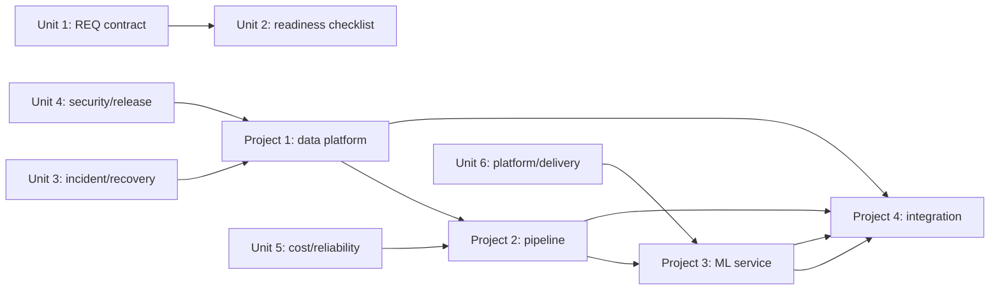
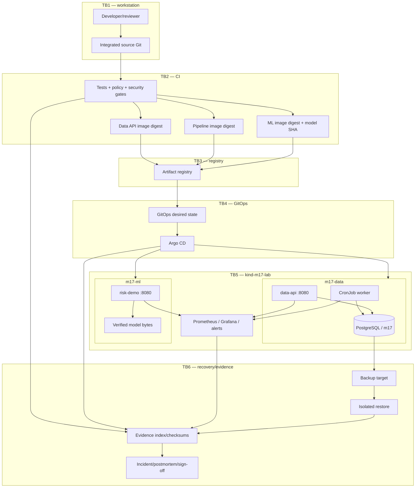
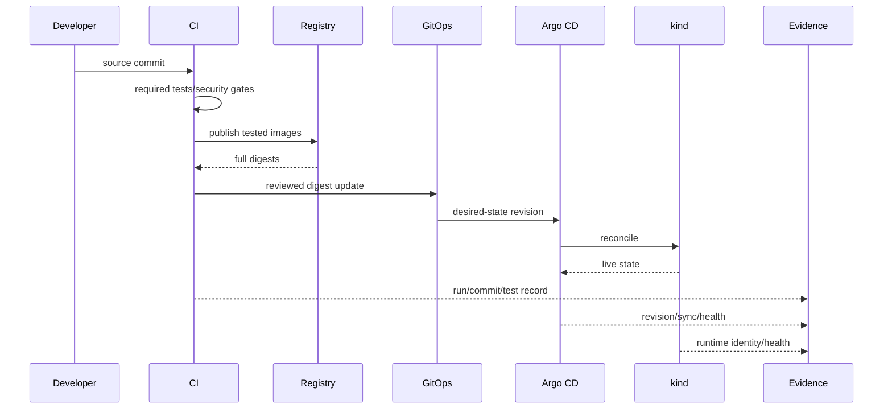
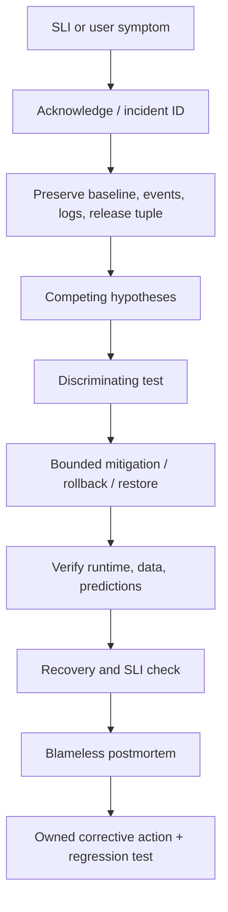
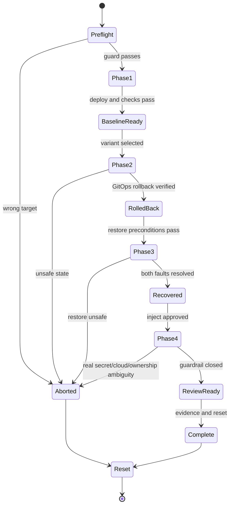

# Project 4 — End-to-End Production DevOps Capstone

> **Target repository path:** `Stage 2E — Production DevOps & Platform Engineering/17-Production-DevOps-Integrated-Capstone/Projects/04-end-to-end-production-devops-capstone.md`  
> **Stage:** 2E / M17 | **Project:** 4 of 4 | **Status:** `DRAFT-AUDITED`  
> **Default:** WSL2 Ubuntu or native Linux; `kind` context `kind-m17-lab`; Kustomize; Argo CD  
> **Planning envelope:** approximately 4 CPU / 8 GB RAM / 30 GB disk `[ASSUMPTION — measure actual host]`  
> **Estimated effort:** 4–6 weeks part-time `[ASSUMPTION]`  
> **Execution status:** reviewed by inspection only; no CI, image build, cluster deployment, live alert, load test, restore, drill, rollback, or teardown was executed for this document.  
> **Repository status:** no repository checkout/diff was available. This deliverable is created separately under `/mnt/data`; no claim is made that the original repository was modified.

## Table of contents

1. [Title, metadata, and status](#1-title-metadata-and-status)
2. [Executive summary and capstone contract](#2-executive-summary-and-capstone-contract)
3. [Gate-in prerequisites and project dependency order](#3-gate-in-prerequisites-and-project-dependency-order)
4. [M01–M16 integration map](#4-m01m16-integration-map)
5. [Scenario, users, ownership, and operational stakes](#5-scenario-users-ownership-and-operational-stakes)
6. [Scope, non-goals, assumptions, and risk register](#6-scope-non-goals-assumptions-and-risk-register)
7. [Integrated architecture and operational flows](#7-integrated-architecture-and-operational-flows)
8. [Canonical interfaces and integration contracts](#8-canonical-interfaces-and-integration-contracts)
9. [Requirements and acceptance criteria](#9-requirements-and-acceptance-criteria)
10. [Local stack profiles, resource budget, setup, and preflight](#10-local-stack-profiles-resource-budget-setup-and-preflight)
11. [Repository layout and reproducibility contract](#11-repository-layout-and-reproducibility-contract)
12. [End-to-end implementation walkthrough](#12-end-to-end-implementation-walkthrough)
13. [Full release pipeline, GitOps, and promotion by digest](#13-full-release-pipeline-gitops-and-promotion-by-digest)
14. [Shared observability and SLOs](#14-shared-observability-and-slos)
15. [Backup, restore, and data-integrity verification](#15-backup-restore-and-data-integrity-verification)
16. [Security and supply-chain review](#16-security-and-supply-chain-review)
17. [Capacity, reliability, and cost review](#17-capacity-reliability-and-cost-review)
18. [Operational runbooks and incident command](#18-operational-runbooks-and-incident-command)
19. [Integrated multi-phase game-master exercise](#19-integrated-multi-phase-game-master-exercise)
20. [Variant A/B learner briefs](#20-variant-ab-learner-briefs)
21. [Facilitator key and technical answer keys](#21-facilitator-key-and-technical-answer-keys)
22. [Go/no-go launch review and reviewer defense](#22-gono-go-launch-review-and-reviewer-defense)
23. [Blameless postmortem and incident communication](#23-blameless-postmortem-and-incident-communication)
24. [Scoring model and rubric integration](#24-scoring-model-and-rubric-integration)
25. [Required evidence package and traceability](#25-required-evidence-package-and-traceability)
26. [Before/after measurements table](#26-beforeafter-measurements-table)
27. [Troubleshooting and planted-defect review](#27-troubleshooting-and-planted-defect-review)
28. [Milestones and pacing](#28-milestones-and-pacing)
29. [Self-check, defense questions, and review exercises](#29-self-check-defense-questions-and-review-exercises)
30. [Teardown, cost safety, and reproducibility](#30-teardown-cost-safety-and-reproducibility)
31. [Final acceptance gate and sign-off](#31-final-acceptance-gate-and-sign-off)
32. [Source register, assumptions, audit, and verification appendices](#32-source-register-assumptions-audit-and-verification-appendices)

---

## 1. Title, metadata, and status

This is the final M17 project. It composes the data platform, scheduled pipeline, and ML inference service from Projects 1–3 into one locally reproducible platform. It is an integration and assessment exercise, not a fourth independent deployment tutorial.

**Prerequisites:** M01–M16; Projects 1–3 or explicit gap records; Git, Linux/WSL2, containers, Kubernetes, CI/CD, PostgreSQL, Kustomize, and GitOps fundamentals. Use synthetic data only. No paid cloud, GPU, real customer data, or paid API is required.

No tool versions are prescribed in the inspected source files. Record installed versions in `docs/versions.txt`; verify syntax and compatibility against current official documentation before execution.

| Status | Meaning |
|---|---|
| `PASS` | Executed behavior has current, attributable evidence |
| `FAIL` | Required control/test was executed and failed |
| `NOT_DEMONSTRATED` | Missing, stale, incomplete, or unexecuted evidence |
| `N/A` | Truly inapplicable with reason and reviewer approval |
| `WAIVED` | Non-mandatory item only; owner, expiry, compensating control, reviewer approval |
| `OPEN` | Source, technical, or human verification unresolved |

A complete Markdown document is not a completed implementation. Reaching the end of this guide does not imply a pass.

## 2. Executive summary and capstone contract

### 2.1 Mission

Integrate:
1. Project 1 PostgreSQL and data API.
2. Project 2 scheduled, idempotent synthetic-data pipeline.
3. Project 3 toy ML inference service with verified model bytes and deterministic regression.
4. One release identity, shared telemetry, incident/recovery process, evidence index, launch review, and teardown contract.

The proof chain is:

`source commit → required CI tests/security gates → immutable image/model identity → GitOps commit → Argo CD reconciliation → runtime identity → telemetry → bounded fault → rollback/restore → integrity verification → evidence review → teardown`

Three workloads that happen to run are not an integrated platform. Integration requires compatible interfaces, explicit ownership, correlated telemetry, end-to-end tests, and one evidence trail.

### 2.2 What must be proven

- Fresh-clone reproduction from documented instructions.
- All three workloads deploy and have verified identities.
- Pipeline publishes a synthetic window and safely handles a repeated run.
- ML service passes fixed synthetic prediction regression and model-hash verification.
- Tested images are promoted by full digest; model SHA is recorded separately.
- Git is the normal desired-state source and Argo CD reconciles it.
- Shared telemetry supports incident reconstruction.
- Bad release is rolled back through Git with runtime and behavior verification.
- Data dependency failure plus synthetic data defect is recovered through actual isolated restore and integrity checks.
- Security/cost inject is detected, contained, corrected, and verified.
- Evidence index and traceability are complete.
- Teardown is previewed, approved, and verified.

### 2.3 Stage exit criteria — preserve verbatim

> deploy a service through the full tested pipeline; reconcile desired state from Git; apply identity and security controls; demonstrate metrics/logs/alerts; execute a failure, rollback, backup restore, and teardown; map every acceptance criterion to evidence.

### 2.4 Evidence artifact — preserve verbatim

> capstone repository, architecture diagram, runbooks, CI/GitOps evidence, incident report, restore evidence, signed-off checklist.

### 2.5 Pass rule — preserve verbatim

> every criterion is demonstrated, evidence is committed or safely retained, and the lab is reproducible from its README/runbook.

`NOT_DEMONSTRATED` is honest but does not satisfy a criterion. A waiver cannot erase a mandatory stage-exit obligation. Fabricated or doctored evidence invalidates the submission.

### 2.6 Required vs optional

| Required default path | Optional/stretch |
|---|---|
| kind, kubectl, Kustomize, Argo CD | Argo Rollouts |
| CI with actual run evidence | Local CI emulation as supplement |
| PostgreSQL, CronJob, toy ML service | Backstage/Crossplane |
| Prometheus/Grafana or documented lighter profile | Loki/tracing |
| Actual isolated restore and integrity checks | Chaos Mesh/Litmus |
| Digest identity, secret hygiene, RBAC, context guard | cosign/Sigstore, policy engine |
| Synthetic data, bounded faults, evidence and teardown | LocalStack/optional cloud |

A laptop `kind` lab demonstrates mechanics, repeatability, integration, and evidence discipline. It does **not** demonstrate real multi-region behavior, cloud-provider limits, production traffic, production-scale resilience, true production costs, compliance certification, or complete production readiness.

## 3. Gate-in prerequisites and project dependency order

### 3.1 Dependency chain



### 3.2 Project 1 handoff

| Capability | Evidence required before integration |
|---|---|
| PostgreSQL | Namespace `m17-data`, Service `postgres`, database `m17`, persistent storage, actual image identity |
| Data API | Service `data-api`, port `8080`, API tests |
| Secret | `postgres-auth` Secret, key `password`, sourced from local file outside Git |
| Packaging/GitOps | Kustomize overlay, rendered manifests, Argo Application/revision |
| Security | RBAC, runtime controls, NetworkPolicy and CNI test or honest `NOT_DEMONSTRATED` |
| Observability | Metrics, logs, dashboard, controlled alert |
| Recovery | Actual isolated restore, checksum, row counts/invariants, measured RPO/RTO |
| Rollback | Git revert, Argo revision, runtime digest, API smoke test |

Project 1 owns the PostgreSQL backup/restore implementation. Project 4 orchestrates and reviews it; it must not substitute a written plan or file-existence check.

### 3.3 Project 2 handoff

- CronJob/worker image and digest; namespace `m17-data`.
- Uses Project 1 `postgres` Service, database `m17`, Secret reference.
- Input contract: `schema_version="1"`, stable UTC `window_id`, positive `record_id`, RFC3339 UTC `event_time`, category `alpha|beta|gamma`, non-negative decimal amount, `source_version="synthetic-source-v1"`, canonical source checksum.
- Unique `(window_id, record_id)`; same payload is idempotent; same key/different payload fails closed.
- Attempts/checkpoint/publication state; transaction semantics.
- `Forbid` concurrency, bounded retries/deadline, missed-window detection, freshness SLI, invariant checker, quarantine, safe backfill, second-person runbooks.

A successful Job is not proof of publication or correctness. Do not claim exactly-once behavior across arbitrary external side effects.

### 3.4 Project 3 handoff

- Service `risk-demo` in namespace `m17-ml`, port `8080`.
- Exact `model/model.json` bytes and matching SHA-256.
- Image digest, GitOps reference, API contract, prediction regression.
- Synthetic input-shift proxy with limitations.
- Metrics/logs, bad-release drill, rollback of code+model identity, security controls.

Supplied Project 3 canonical fixture hashes:
- Baseline model SHA-256: `d7a9d7ae047ee2fd743b265f1390256b0e88405cde1124fcc38cad524babf9f9`
- Bad-model fixture SHA-256: `5213591eee3c9d5bc02de56bc416aa5eafacd14bb1877d559b38455e6e9d55cb`

These apply only to the exact source fixture bytes. Recompute after any change.

### 3.5 Missing prior-project evidence protocol

1. Record project, criterion/REQ, missing artifact, reason, owner, next action.
2. Set status `NOT_DEMONSTRATED`; do not infer success from a README or sample.
3. Do not execute compound restore phase until backup and isolated target are verified.
4. Use provisional adapters only for non-destructive interface work; label `[PROVISIONAL]`.
5. Do not claim whole-M17 completion from project documents alone.

## 4. M01–M16 integration map

M17's governing contract provides the module handoffs. Individual M01–M16 lesson-body files were not available for full inspection; do not infer uninspected lesson paths.

| Module | Capability consumed | Integrated use | Evidence expected | Source status | Re-taught? |
|---|---|---|---|---|---|
| M01 | Images/registry | Build and identify three application images | CI, registry digest, runtime image IDs | Handoff verified; lesson body not inspected | No |
| M02 | CI/CD | Required tests and release gates | CI run ID, test report, required-check evidence | Handoff verified | No |
| M03 | Operations | Diagnosis, incident workflow, teardown | Timeline, runbooks, inventory | Handoff verified | No |
| M04 | Networking/TLS | Service DNS, NetworkPolicy, TLS awareness | Connectivity tests or limitation | Handoff verified | No |
| M05 | Stateful services | PostgreSQL/PVC/restore | PVC, backup/restore, invariants | Handoff verified | No |
| M06 | Packaging | Kustomize | Rendered manifests | Handoff verified | No |
| M07 | IaC/reproducibility | Declarative config and fresh clone | Preflight/bootstrap transcript | Handoff verified | No |
| M08 | GitOps | Argo reconciliation and Git rollback | Git SHA, Argo revision/history | Handoff verified | No |
| M09 | Secrets/identity | Secret references, RBAC, least privilege | Scan, RBAC, denied-action tests | Handoff verified | No |
| M10 | SRE/incidents/SLOs | Shared SLIs, alerts, postmortem, ORR | Queries, alert event, postmortem | Handoff verified | No |
| M11 | Observability | Metrics, logs, dashboards, alerts | Scrape/query/dashboard evidence | Handoff verified | No |
| M12 | Security/supply chain | Scans, SBOM/provenance awareness | Scan report, digest-bound SBOM if selected | Handoff verified | No |
| M13 | Backup/DR/fault injection | Actual restore and bounded faults | Restore and drill evidence | Handoff verified | No |
| M14 | Multi-cluster awareness | Explain local proof boundary | Fidelity statement | Handoff verified; no multi-region claim | No |
| M15 | Capacity/FinOps | Measure, label, allocate, guard costs | Resource samples, worksheet, teardown | Handoff verified | No |
| M16 | Platform/golden paths | Optional golden-path conventions | Optional template/ADR | Backstage/Crossplane not required | No |

## 5. Scenario, users, ownership, and operational stakes

### 5.1 Fictional platform

A small internal analytics team uses a synthetic daily pipeline and a lightweight inference API for internal demonstrations. No real financial/customer data is present. The fictional impact is delayed internal analysis and unreliable demo output, not a real loss or incident.

### 5.2 Roles

| Role | Responsibility | Decision boundary |
|---|---|---|
| Analyst | Consumes published synthetic data/inference | Reports stale/wrong output |
| Data platform owner | PostgreSQL, schema, backup/restore | Approves data restore |
| Pipeline owner | CronJob, ledger, freshness, rerun | Approves bounded rerun/backfill |
| ML owner | Model/code compatibility and regression | Approves ML release/rollback |
| Platform/SRE operator | Cluster, GitOps, telemetry, incident command | Controls lab changes |
| Security reviewer | Secrets, identity, supply chain | Can block critical release |
| Reviewer chair | Evidence and rubric decision | Does not infer unexecuted behavior |

### 5.3 Failure/impact map

| Failure | User-visible impact | Owner | Dependencies |
|---|---|---|---|
| PostgreSQL unavailable | Pipeline cannot publish; API errors | Data owner | Pipeline/API/restore |
| Missed pipeline window | Freshness objective breached | Pipeline owner | DB/scheduler/alerts |
| Duplicate/partial window | Incorrect synthetic output | Pipeline owner | DB constraints/ledger |
| ML model mismatch | Inference unavailable/wrong output | ML owner | Image/model/GitOps |
| GitOps drift | Live state differs from reviewed intent | Platform owner | Argo/repo |
| Restore fails integrity | Recovery not proven | Data owner/SRE | Backup target/invariants |
| Secret/cost guardrail trip | Exposure or uncontrolled resource risk | Security/platform | CI/cluster/teardown |

Abort if context, namespace, PVC, backup target, or ownership is uncertain. Never delete/overwrite the only working database to simulate corruption.

## 6. Scope, non-goals, assumptions, and risk register

### 6.1 Scope and non-goals

**In scope:** one `kind-m17-lab` cluster; namespaces `m17-data` and `m17-ml`; PostgreSQL, API, CronJob, ML service; Kustomize, Argo CD, CI, digest identity, telemetry, isolated restore, rollback, game, evidence, teardown.

**Out of scope:** real users/data/credentials; paid cloud/GPU/API; production SLA; multi-region proof; mandatory service mesh, Backstage, Crossplane, Rollouts, Chaos Mesh, LocalStack; full model training/registry; replacing Projects 1–3.

### 6.2 Assumptions

| ID | Assumption | Validation |
|---|---|---|
| A-01 | Host near 4 CPU / 8 GB / 30 GB | Measure actual host/WSL allocation |
| A-02 | Components can run in staged profiles | Measure memory/disk after each profile |
| A-03 | Prior project source/tests can be imported | Run tests before/after import |
| A-04 | Argo can access GitOps repo | Verify repo connection and source revision |
| A-05 | Project 1 backup tool matches restore target | Inspect and run isolated restore |
| A-06 | Telemetry can be staged to fit | Measure footprint |
| A-07 | SLO targets are educational assumptions | Declare target and rationale |
| A-08 | Variant selection is explicit, not random | Record A/B before exercise |

### 6.3 Qualitative risks

Likelihood/impact labels are assumptions, not measured probabilities.

| Risk | Likelihood | Impact | Mitigation / abort |
|---|---|---|---|
| Wrong cluster context | Medium | Critical | Guard; abort on mismatch |
| Backup overwritten | Low | Critical | Isolated target; abort if not disposable |
| Mutable image tag | Medium | High | Digest verifier; block promotion |
| Prior-project contract mismatch | Medium | Medium | Adapter + contract tests |
| Host resource pressure | High | High | Staged profiles; stop on OOM/disk pressure |
| Alert never fires | Medium | High | Rule fixture + live alert test |
| Evidence stale | Medium | High | Bind to commit/digest/time |
| Input shift misread as concept drift | Medium | Medium | State proxy limitation |
| Teardown leaves resources | Medium | High | Before/after inventory |
| Simulated cost event misrepresented | Low | Medium | Explicit `SIMULATED` label |

### 6.4 Dependency and blast-radius map

| Component | Depends on | Blast radius | Recovery boundary |
|---|---|---|---|
| PostgreSQL | PVC, node, image, secret | API + pipeline | Isolated restore |
| Data API | PostgreSQL, image | API clients | GitOps rollback + smoke |
| Pipeline | PostgreSQL, image, schedule | Freshness/data | Idempotent rerun |
| ML | Image/model/cluster | Inference clients | GitOps rollback + regression |
| Argo | Git/controller | Desired-state convergence | Repair source/controller |
| Telemetry | exporters/scrape | Detection visibility | Restore telemetry; missing is unknown |
| Backup | storage/tooling | Recovery | Alternate verified copy or declare blocked |

### 6.5 ADRs

| ADR | Decision | Trade-off/revisit |
|---|---|---|
| P4-001 | One local kind cluster | Lower cost; no isolation/multi-cluster proof |
| P4-002 | Preserve `m17-data` and `m17-ml` | Preserve source contracts; policy spans namespaces |
| P4-003 | Kustomize only | Consistent with prior projects |
| P4-004 | Argo CD owns normal desired state | Git review; controller dependency |
| P4-005 | Build once, promote digest | Immutable identity; registry setup |
| P4-006 | Model embedded in ML image | Matches Project 3; no model registry |
| P4-007 | Reuse Project 1 restore contract | One authoritative recovery path |
| P4-008 | Shared telemetry labels/evidence tuple | Better correlation; adapter needed |
| P4-009 | Explicit A/B variant selection | Fair and reproducible |
| P4-010 | Local bounded injects | Zero-budget; limited fidelity |

A local single-cluster pass does not establish high availability, regional failover, cloud-provider behavior, production throughput, managed identity, external backup durability, enterprise change governance, or compliance.

## 7. Integrated architecture and operational flows

### 7.1 Architecture and trust boundaries



### 7.2 Data and inference flows

Project 2 generates a deterministic synthetic UTC window, validates schema/checksum, writes accepted/quarantined rows plus checkpoint/publication state to Project 1 PostgreSQL, and runs invariants. The ML service is tested independently with fixed synthetic fixtures; it does not need raw PostgreSQL rows. An optional adapter may derive a bounded synthetic fixture from published output, but must enforce schema and never log payloads.

Inference: bounded synthetic JSON → schema/type/range checks → verify model bytes → deterministic score/prediction → response includes model/release identity → bounded metrics/logs → fixed regression.

### 7.3 Release flow



### 7.4 Incident/recovery flow



### 7.5 Release identity tuple

Record: `release_id`, full `source_commit`, `ci_run_id`, data API image digest, pipeline image digest, ML image digest, model SHA-256, GitOps repository/commit, observed Argo revision, deployment identity, test evidence IDs, UTC capture time, and incident ID when applicable.

A digest proves byte identity, not authenticity, provenance, or quality. A model hash proves exact bytes, not model correctness.

## 8. Canonical interfaces and integration contracts

### 8.1 Source-derived interfaces

| Workload | Namespace | Name | Port/dependency |
|---|---|---|---|
| PostgreSQL | `m17-data` | `postgres` | TCP 5432; DB `m17` |
| Data API | `m17-data` | `data-api` | HTTP 8080 |
| Pipeline | `m17-data` | CronJob/Job | `postgres.m17-data.svc.cluster.local:5432` |
| ML inference | `m17-ml` | `risk-demo` | HTTP 8080 |
| Argo CD | `argocd` | Application/controller | Verify actual installation |
| Telemetry | selected profile namespace | Prometheus/Grafana | Names/ports are install-specific `[VERIFY]` |

### 8.2 Shared labels

Apply via integrated overlays without renaming existing `app.kubernetes.io/name`:

```yaml
app.kubernetes.io/part-of: m17-capstone
app.kubernetes.io/environment: local
app.kubernetes.io/managed-by: argocd
m17.openai.example/owner: platform-lab
m17.openai.example/cost-center: capstone-lab
m17.openai.example/release-id: "<release-id>"
```

The example domain is illustrative. Do not put full SHA, digest, request ID, or window ID in Prometheus labels.

### 8.3 Data contract

Project 2 contract remains authoritative: `schema_version="1"`, UTC `window_id`, positive `record_id`, RFC3339 UTC `event_time`, category `alpha|beta|gamma`, non-negative decimal amount, `source_version="synthetic-source-v1"`, canonical SHA-256. Same key/same payload is idempotent; same key/different payload fails closed; invalid rows are quarantined with reason.

### 8.4 ML contract

Synthetic inputs only; Project 3 API validation remains authoritative. Verify model before load; no fallback to unverified model. Readiness fails if model verification/loading fails. `/version` or documented identity endpoint must expose model version/hash and release ID. Regression compares expected prediction and model identity.

### 8.5 Telemetry contract

| Attribute | Use | Cardinality |
|---|---|---|
| app/component/namespace/environment/result/reason | Metric labels | Bounded |
| release ID, commit SHA | Logs/evidence | High; not metric labels |
| request ID, window ID, digest | Logs/evidence only | High |

### 8.6 GitOps and rollback

Git is normal desired-state source. Images use full digests. Model SHA is explicit and compared with runtime. Rollback is a reviewed Git revert/change to known-good digest/config. Completion requires Argo revision, live digest, model hash, health, and data/prediction checks to match known-good.

### 8.7 Evidence contract

Reuse Unit 1 `evidence/index.yaml` fields: evidence ID, criterion/REQ/rubric IDs, path, checksum, UTC timestamp, source commit, CI run, digest/model hash, what it proves, verification command, result, owner/reviewer, redaction. Project-local `P4-AC-*` IDs are proposed, not canonical M17 REQ IDs.

## 9. Requirements and acceptance criteria

### 9.1 ID policy

Canonical Unit 1 IDs are `REQ-001`–`REQ-032`; readiness IDs `PR-001`–`PR-075`; rubric IDs `IR-*`, `SR-*`, `CR-*`, `PD-*`. The following `P4-AC-*` IDs are project-local and do not replace canonical IDs.

### 9.2 Given / When / Then

| ID | REQ mapping | Given / When | Then / pass condition | Negative case | Evidence |
|---|---|---|---|---|---|
| P4-AC-001 | 021,028,031 | Fresh clone; preflight/bootstrap | Versions/resources/context recorded; wrong context refused | Set non-lab context | `evidence/fresh-clone/` |
| P4-AC-002 | 001–003 | Run required CI | Required tests/security gates execute and block failure | Remove/skip test | `evidence/ci/` |
| P4-AC-003 | 002,030 | Build/promote images/model | Full image digests and model SHA recorded; same tested images promoted | Tag-only or changed model | `evidence/artifacts/` |
| P4-AC-004 | 004,005 | Argo reconciles reviewed GitOps revision | Source revision and live state agree | Inject live drift | `evidence/gitops/` |
| P4-AC-005 | 006–009 | Run identity/secret/runtime checks | Least privilege and secret hygiene evidenced | Canary/privileged fixture | `evidence/security/` |
| P4-AC-006 | 010 | Test declared network paths | Only declared paths work, or explicitly `NOT_DEMONSTRATED` | Undeclared path | `evidence/network/` |
| P4-AC-007 | 011–014 | Query signals and exercise alert | Three workloads observable; at least one alert fires/recover | Healthy fixture must not alert | `evidence/observability/` |
| P4-AC-008 | 019 | Publish and repeat synthetic window | Correct publication; duplicate has no duplicate business effect | Same key/different payload | `evidence/pipeline/` |
| P4-AC-009 | 002,003,030 | Verify ML runtime | Model hash matches and fixed regression passes | Missing/corrupt model | `evidence/ml/` |
| P4-AC-010 | 015 | Investigate controlled fault | Baseline/timeline precede mitigation; hypotheses tested | Mutate before evidence | `evidence/incidents/` |
| P4-AC-011 | 016 | Revert bad GitOps release | Argo/runtime digest/model/behavior return to known-good | No runtime verification | `evidence/rollback/` |
| P4-AC-012 | 017,018 | Restore backup in isolation | Actual restore, two checks, measured RPO/RTO | Corrupt disposable fixture | `evidence/restore/` |
| P4-AC-013 | 015,017–019 | Compound dependency+data issue | Both faults identified; safe restore; pipeline/ML checks pass | Restore active DB by guess | `evidence/game/phase-3/` |
| P4-AC-014 | 011–014 | Run SLO and alert tests | Numerator/denominator/window/exclusions and alert path inspectable | Missing metrics treated as healthy | `evidence/slo/` |
| P4-AC-015 | 032; CR-05 | Review resource/cost | Sizing from actual measurements; allocation explicit | Single average/invented price | `evidence/capacity-cost/` |
| P4-AC-016 | 006–010 | Security negative tests | No plaintext secrets; hardened runtime; permissions scoped | Canary detected | `evidence/security/` |
| P4-AC-017 | 020 | Preview/confirm/teardown | Owned resources removed or residuals OPEN | Wrong target / retained resource | `evidence/teardown/` |
| P4-AC-018 | 022,025–027 | Validate evidence/traceability | Missing/orphan/bad checksum/path escape/stale records fail | Seed each defect | `evidence/traceability/` |
| P4-AC-019 | 028,029 | Run Make contracts | Safe bootstrap/preflight/verify/drill/teardown | Unsafe default mutation | `evidence/reproducibility/` |
| P4-AC-020 | 023,024 | Validate provenance/checksums | Evidence bound to time, commit/run/digest | Stale/altered evidence | `evidence/integrity/` |
| P4-AC-021 | 032 | Review risk/ADR/cloud gate | Assumptions/non-goals visible; cloud gated | Hidden paid dependency | `evidence/governance/` |
| P4-AC-022 | 015,032 | Write postmortem | Evidence-backed timeline and owned actions/tests | Blame-only/memory-only | `evidence/postmortem/` |
| P4-AC-023 | 001–032 | Launch review | Every criterion status/evidence; blockers not averaged | Screenshot-only proof | `evidence/review/` |
| P4-AC-024 | 021,028 | Second operator follows README | Fresh-clone deploy/verify/cleanup repeatable | Hidden local state | `evidence/fresh-clone/` |

### 9.3 Traceability matrix

| Exit clause | REQ IDs | P4 ACs | Control/test | Rubrics |
|---|---|---|---|---|
| Tested pipeline | 001–003 | 002,003 | CI conformance + digest verifier | SR-04–06; PD-01–03 |
| Git desired state | 004–005 | 004,011 | Argo revision + drift | PD-04,05 |
| Identity/security | 006–010 | 005,006,016 | RBAC, canary, runtime/network | SR-01–08 |
| Metrics/logs/alerts | 011–014 | 007,014 | Scrape/query/alert | CR-01–03; IR-01 |
| Failure investigation | 015 | 010,013,022 | Evidence-first incident loop | IR-01,02,05–08 |
| Rollback | 016 | 011 | Git revert + runtime check | IR-03; SR-09; PD-05 |
| Restore | 017–018 | 012,013 | Isolated restore + invariants | IR-04 |
| Pipeline freshness | 019 | 008 | Repeat window + stale test | CR-01–03,06 |
| Teardown | 020 | 017 | Preview/confirm/inventory | CR-08; PD-09 |
| Evidence/reproducibility | 021–032 | 001,018–024 | Fresh clone + validators | All four rubrics |

A criterion passes only after execution and current attributable evidence. Workflow YAML, screenshots, and green badges alone do not prove critical behavior.


## 10. Local stack profiles, resource budget, setup, and preflight

### 10.1 Profiles and staged lifecycle

| Profile | Components | Start/stop guidance |
|---|---|---|
| `Cap-Core` | kind, PostgreSQL, data API, pipeline, ML, Argo CD | Start for integration; stop optional services after checks |
| `Cap-Observe` | Prometheus/Grafana and alert path | Start only for telemetry/alert milestone |
| `Cap-Security` | Scanner/SBOM/signature/policy tools | Start only for security review |
| `Cap-Game` | One fault injector and one phase at a time | Reset immediately after each phase |
| `Cap-Cleanup` | Read-only inventory and teardown tools | No new workload |

Do not run every optional component simultaneously. One GitOps controller and at most one policy engine at a time.

### 10.2 Read-only host preflight

```bash
uname -a
nproc
free -h
df -h .
git --version
docker version
kubectl version --client
kind version
kustomize version
```

Record actual values. Confirm container daemon reachability, CPU/RAM/disk, and tool versions. These commands do not prove all components fit simultaneously.

### 10.3 Cluster preflight

```bash
kubectl config get-contexts
kubectl --context kind-m17-lab cluster-info
kubectl --context kind-m17-lab get namespaces
kubectl --context kind-m17-lab get nodes -o wide
```

If the context is absent, create it using the installed `kind` version's verified syntax. Never silently use current context.

### 10.4 Context guard contract

Every mutating script must require explicit context, compare with `kind-m17-lab`, verify namespace/resource ownership, refuse ambiguity, print a read-only preview, and require separate confirmation for destructive work.

```bash
#!/usr/bin/env bash
# File: scripts/context-guard.sh
set -euo pipefail
EXPECTED="kind-m17-lab"
REQUESTED="${1:-}"
[[ "$REQUESTED" == "$EXPECTED" ]] || {
  echo "REFUSED: expected context $EXPECTED" >&2; exit 20;
}
CURRENT="$(kubectl config current-context)"
[[ "$CURRENT" == "$EXPECTED" ]] || {
  echo "REFUSED: current context is $CURRENT" >&2; exit 21;
}
kubectl --context "$EXPECTED" get namespaces
echo "Guard passed; destructive action still requires separate approval."
```

### 10.5 Version record

```text
# File: docs/versions.txt
date_utc=<actual UTC timestamp>
os=<distribution/version>
kernel=<uname -r>
container_runtime=<actual version>
git=<actual version>
kubectl_client=<actual version>
kind=<actual version>
kustomize=<actual version>
argocd_cli=<actual version or not installed>
prometheus=<actual version or not installed>
grafana=<actual version or not installed>
postgres_image=<full digest>
data_api_image=<full digest>
pipeline_image=<full digest>
ml_image=<full digest>
```

No credentials, tokens, environment dumps, or secret values belong here.

### 10.6 Resource stop rules

Measure after each profile. The approximate M17 envelope is not a guarantee. Stop optional components if swapping, OOM, runtime instability, or insufficient disk headroom appears. Record the observation and select a lighter profile; do not hide skipped components.

## 11. Repository layout and reproducibility contract

### 11.1 Integrated implementation worktree

This is the learner's implementation worktree, not the roadmap repository. The following is a proposed integrated layout, not a claim that these files already exist.

```text
m17-integrated-capstone/
├── README.md
├── Makefile
├── docs/{versions.txt,architecture.md,release-identity.yaml,assumptions-risk.md}
├── docs/adr/
├── docs/slo/
├── components/
│   ├── data-platform/       # Project 1 source/tests retained
│   ├── scheduled-pipeline/  # Project 2 source/tests retained
│   └── ml-service/          # Project 3 source/model/tests retained
├── deploy/base/{data-platform,scheduled-pipeline,ml-service}/
├── deploy/overlays/local/
├── gitops/{applications,release}/
├── ci/conformance/
├── policy/{secret-scan,runtime}/
├── observability/{prometheus,grafana,alert-tests}/
├── backup/scripts/          # Reuse Project 1 implementation
├── runbooks/
├── drills/{variants,reset}/
├── scripts/{preflight.sh,context-guard.sh,verify-release.py,validate-evidence.py,validate-traceability.py,teardown.sh}
├── evidence/{index.yaml,checksums.sha256,README.md}
└── .github/workflows/ci.yml
```

Import actual Projects 1–3 source/tests; do not overwrite working code with stale samples. Preserve project-local criteria and record original source commits. Use thin adapters for labels, release metadata, shared evidence, and CI aggregation. If a service/secret/port/schema differs, record the mismatch and test the adapter; do not silently rename it.

### 11.2 Make target contract

| Target | Contract | Cluster mutation |
|---|---|---|
| `make bootstrap` | Validate tools; create selected local prerequisites; no cloud | Only after explicit profile selection |
| `make preflight` | Read-only host/context/resource checks | No |
| `make verify` | Local tests, render/validation, identity/evidence validators | No by default |
| `make drill` | Requires explicit `DRILL_ID` and variant; preview + safety gate | Only after opt-in |
| `make teardown` | Read-only inventory first; destructive step needs `CONFIRM_TEARDOWN=YES` | Only after opt-in |

No target defaults to destructive behavior. Every Kubernetes command must specify `--context kind-m17-lab`.

### 11.3 Evidence index example

```yaml
# File: evidence/index.yaml
schema_version: "1"
evidence:
  - evidence_id: "EV-P4-CI-001"
    criterion_id: "P4-AC-002"
    req_ids: ["REQ-001", "REQ-003"]
    rubric_ids: ["PD-01", "SR-06"]
    path: "evidence/ci/ci-run-summary.json"
    sha256: "<sha256-of-exact-file-bytes>"
    captured_at_utc: "<actual-ISO-8601-UTC-time>"
    source_commit: "<full-source-sha>"
    ci_run_id: "<actual-run-id>"
    what_it_proves: "Required checks executed for this commit"
    verification_command: "python3 scripts/validate-evidence.py"
    result: "NOT_DEMONSTRATED"
    owner: "learner"
    reviewer: "pending"
    redacted: true
```

Placeholders and `NOT_DEMONSTRATED` are intentional. This is not successful evidence.

### 11.4 Evidence integrity

Checksum exact bytes after redaction. Do not mutate indexed evidence; create a new record after correction. Exclude secrets, keys, tokens, raw credentials, and unredacted environment dumps. Evidence must postdate the last material change. A checksum proves byte match relative to a recorded checksum, not truth/origin/completeness. Maintain forward and backward traceability.

## 12. End-to-end implementation walkthrough

Every step includes purpose, commands, interpretation, evidence, limitations, and cleanup.

### 12.1 Inspect source and gate in

```bash
git status --short
git rev-parse HEAD
find components -maxdepth 3 -type f | sort
```

Record actual source commits for each imported project. If projects remain separate repositories, record each source SHA before integration.

**Evidence:** `evidence/fresh-clone/source-inventory.txt`.  
**Does not prove:** tests pass, security, or runtime deployment.

### 12.2 Preflight and versions

```bash
make preflight
```

Record tool versions in `docs/versions.txt`. If the target does not exist, report the missing target rather than inventing its output.

**Evidence:** preflight transcript and versions file.  
**Does not prove:** all optional components fit simultaneously.

### 12.3 Verify Project 1

```bash
kubectl --context kind-m17-lab get namespace m17-data
kubectl --context kind-m17-lab -n m17-data get svc postgres data-api
kubectl --context kind-m17-lab -n m17-data get statefulset,pods,pvc -o wide
```

Inspect Project 1 manifests for the actual API workload name/kind before any `rollout status` command. Capture DB invariants, API smoke test, and image identity.

**Evidence:** `evidence/data-platform/`.  
**Limit:** this is not backup proof.  
**Cleanup:** do not delete PVC or database.

### 12.4 Verify Project 2

```bash
kubectl --context kind-m17-lab -n m17-data get cronjobs,jobs,pods
kubectl --context kind-m17-lab -n m17-data describe cronjob <verified-cronjob-name>
```

Run the documented Project 2 one-window interface. Record `window_id`, source checksum, Job identity, counts, publication state, and invariants. Repeat the same window and prove no duplicate business effect.

**Evidence:** `evidence/pipeline/window-<actual-id>/`.  
**Limit:** one run does not prove future freshness.  
**Cleanup:** delete only disposable test windows using the Project 2 interface.

### 12.5 Verify Project 3

```bash
kubectl --context kind-m17-lab -n m17-ml get deployment,svc,pods
kubectl --context kind-m17-lab -n m17-ml rollout status deployment/risk-demo
```

Use Project 3 API tests and regression script. Compare runtime model SHA and image digest with release record. Readiness alone does not prove prediction correctness.

**Evidence:** `evidence/ml/`.  
**Limit:** deterministic regression does not prove statistical generalization.

### 12.6 Apply shared labels and inspect render

```bash
kustomize build deploy/overlays/local > /tmp/m17-rendered.yaml
grep -nE 'namespace:|image:|app.kubernetes.io/part-of|release-id|source-commit' /tmp/m17-rendered.yaml
```

Review namespaces, digest references, secret absence, shared labels, and preservation of Project 1–3 service/secret/schema contracts. Use installed-version validation.

**Evidence:** redacted rendered manifest and review.  
**Cleanup:** remove temporary render after preserving safe evidence.

### 12.7 Validate CI → registry → GitOps → cluster

Trigger actual CI for reviewed commit. Confirm required tests executed; record full image digests; verify GitOps references those exact digests; commit GitOps change; observe Argo reconciliation; compare Argo revision, live image digest, and runtime identity endpoint.

**Evidence:** CI run, registry digests, GitOps SHA, Argo status/history, runtime identity.  
**Limit:** digest alone does not prove authenticity or quality.

### 12.8 Cross-component acceptance

1. PostgreSQL readiness and Project 1 SQL invariants.
2. Data API smoke test.
3. Project 2 synthetic window publication.
4. Repeat window; verify no duplicate business effect.
5. Freshness query reports actual publication time.
6. ML runtime model SHA matches release record.
7. ML prediction regression passes.
8. Metrics exist for all three workloads.
9. Controlled alert fires and recovers.
10. Evidence validator passes.

### 12.9 Fault/recovery drills

Run one drill at a time. Verify context, resource ownership, baseline release tuple, health, evidence capture, reset, and abort conditions before injection. Do not run compound restore without a verified backup and isolated target.

### 12.10 Evidence, review, and teardown

Run Unit 1 requirements/evidence/traceability validators, Unit 2 readiness checklist, and all four rubric assessments. Review blockers before scores. Teardown follows Section 30. A validator pass proves only the checks implemented by that validator; human review remains required.


### 12.13 Integration-specific implementation artifacts

These are the new integration-layer examples. They deliberately call the imported project implementations rather than replacing them. Before use, reconcile the directory names and test commands with the actual imported repositories.

```makefile
# File: Makefile
SHELL := /usr/bin/env bash
.DEFAULT_GOAL := help
EXPECTED_CONTEXT := kind-m17-lab
DRILL_ID ?=
VARIANT ?=
CONFIRM_TEARDOWN ?=

.PHONY: help preflight verify render drill teardown

help:
	@printf '%s\n' 'preflight verify render drill teardown'

preflight:
	./scripts/preflight.sh
	./scripts/context-guard.sh "$(EXPECTED_CONTEXT)"

verify:
	cd components/data-platform && python3 -m pytest -q
	cd components/scheduled-pipeline && python3 -m pytest -q
	cd components/ml-service && python3 -m unittest discover -s tests -v
	python3 scripts/verify-release.py docs/release-identity.yaml
	python3 scripts/validate-evidence.py evidence/index.yaml
	python3 scripts/validate-traceability.py

render:
	kustomize build deploy/overlays/local

drill:
	@test -n "$(DRILL_ID)" || { echo "DRILL_ID is required"; exit 2; }
	@test "$(VARIANT)" = "A" -o "$(VARIANT)" = "B" || { echo "VARIANT must be A or B"; exit 2; }
	@echo "PREVIEW: drill=$(DRILL_ID) variant=$(VARIANT) context=$(EXPECTED_CONTEXT)"
	@echo "No fault is injected by this preview target."
	@test "$${CONFIRM_DRILL:-}" = "YES" || { echo "Set CONFIRM_DRILL=YES after reviewing the drill plan"; exit 3; }
	./scripts/run-drill.sh "$(DRILL_ID)" "$(VARIANT)" --context "$(EXPECTED_CONTEXT)"

teardown:
	@echo "Run the read-only inventory and preview first."
	@test "$(CONFIRM_TEARDOWN)" = "YES" || { echo "Set CONFIRM_TEARDOWN=YES only after ownership review"; exit 4; }
	CONFIRM_TEARDOWN=YES ./scripts/teardown.sh
```

**Important:** `run-drill.sh`, `validate-evidence.py`, `validate-traceability.py`, and the exact Project 1–3 test commands must be implemented/reconciled against the imported source. This Makefile is an integration contract template, not an executed Makefile. The teardown script must still implement its own context guard and exact resource ownership checks; a Make variable is not a security boundary.

```yaml
# File: deploy/overlays/local/kustomization.yaml
# Keep each workload's source namespace; do not set one global namespace.
apiVersion: kustomize.config.k8s.io/v1beta1
kind: Kustomization
resources:
  - ../../base/data-platform
  - ../../base/scheduled-pipeline
  - ../../base/ml-service
```

The three base paths must be created from the actual imported Project 1–3 manifests. Do not create empty bases merely to make this file render. Confirm that each base preserves `m17-data` or `m17-ml` as required.

```python
# File: tests/test_integrated_release_contract.py
import re
import unittest
from pathlib import Path
import yaml

ROOT = Path(__file__).resolve().parents[1]
RELEASE = ROOT / "docs" / "release-identity.yaml"
EXPECTED_COMPONENTS = ("data_api", "pipeline", "ml_service")
DIGEST_RE = re.compile(r"^.+@sha256:[0-9a-f]{64}$")
SHA_RE = re.compile(r"^[0-9a-f]{64}$")

class IntegratedReleaseContractTests(unittest.TestCase):
    @classmethod
    def setUpClass(cls):
        cls.record = yaml.safe_load(RELEASE.read_text(encoding="utf-8"))

    def test_schema_version(self):
        self.assertEqual(self.record["schema_version"], "1")

    def test_all_workload_images_are_digest_pinned(self):
        artifacts = self.record["artifacts"]
        for name in EXPECTED_COMPONENTS:
            with self.subTest(component=name):
                self.assertRegex(artifacts[name]["image"], DIGEST_RE)

    def test_model_hash_is_full_sha256(self):
        self.assertRegex(
            self.record["artifacts"]["ml_service"]["model_sha256"], SHA_RE
        )

    def test_release_has_source_and_gitops_identity(self):
        self.assertRegex(self.record["source"]["commit"], r"^(?:[0-9a-f]{40}|[0-9a-f]{64})$")
        self.assertRegex(self.record["gitops"]["commit"], r"^(?:[0-9a-f]{40}|[0-9a-f]{64})$")

    def test_runtime_must_be_verified_for_acceptance(self):
        self.assertEqual(self.record["runtime"]["status"], "PASS")

if __name__ == "__main__":
    unittest.main()
```

This test expects a completed learner record. The illustrative template intentionally uses placeholders and `NOT_DEMONSTRATED`, so it must fail until the learner supplies real values. The test validates structure only; a separate live verifier must compare registry, GitOps, Argo, and runtime identities.

```yaml
# File: .github/workflows/ci.yml
# Illustrative orchestration skeleton. Replace every action placeholder
# with a verified full commit SHA before using it in a real workflow.
name: integrated-capstone-ci
on:
  pull_request:
  push:
    branches: ["main"]

permissions:
  contents: read

jobs:
  data-platform-tests:
    runs-on: ubuntu-latest
    steps:
      - uses: actions/checkout@<VERIFY_AND_PIN_FULL_40_CHAR_COMMIT_SHA>
      - run: cd components/data-platform && python -m pytest -q

  scheduled-pipeline-tests:
    runs-on: ubuntu-latest
    steps:
      - uses: actions/checkout@<VERIFY_AND_PIN_FULL_40_CHAR_COMMIT_SHA>
      - run: cd components/scheduled-pipeline && python -m pytest -q

  ml-service-tests:
    runs-on: ubuntu-latest
    steps:
      - uses: actions/checkout@<VERIFY_AND_PIN_FULL_40_CHAR_COMMIT_SHA>
      - run: cd components/ml-service && python -m unittest discover -s tests -v

  integrated-contract:
    needs:
      - data-platform-tests
      - scheduled-pipeline-tests
      - ml-service-tests
    runs-on: ubuntu-latest
    steps:
      - uses: actions/checkout@<VERIFY_AND_PIN_FULL_40_CHAR_COMMIT_SHA>
      - run: python -m pytest tests/test_integrated_release_contract.py
      - run: python scripts/validate-traceability.py
```

The workflow above is not executable until action placeholders are replaced and dependencies/paths are reconciled. It does not publish images or deploy; add the actual Project 1–3 build/publish jobs using their verified contracts. Do not grant registry write or deployment permissions to untrusted pull-request jobs. A local CI emulation does not prove hosted-runner permissions or branch protection.


## 13. Full release pipeline, GitOps, and promotion by digest

### 13.1 Required stages

1. Checkout source SHA.
2. Validate required repository paths.
3. Run Project 1 tests.
4. Run Project 2 unit/invariant/contract tests.
5. Run Project 3 model/API/prediction regression.
6. Run integrated adapter/traceability/evidence schema tests.
7. Run secret scan and manifest checks.
8. Build each application image once.
9. Record full image digests and model SHA.
10. Publish artifacts.
11. Promote same tested digests to GitOps.
12. Argo CD reconciles.
13. Compare GitOps, Argo, live image IDs, and ML model identity.

A required test may not be silently skipped, marked `continue-on-error`, or removed from required checks.

### 13.2 Pipeline conformance review

Verify required jobs exist and execute; branch rules enforce required checks where supported; permissions are minimal; untrusted PR code receives no deployment credentials; action pins follow repository policy; digest output is captured; no rebuild occurs during promotion. Full action commit SHAs are `[VERIFY]` against official action repositories. Do not use placeholder SHAs in a release workflow.

### 13.3 Release identity example

```yaml
# File: docs/release-identity.yaml
schema_version: "1"
release_id: "<unique-release-id>"
source:
  repository: "<source-repository>"
  commit: "<full-source-sha>"
ci:
  provider: "GitHub Actions"
  run_id: "<actual-run-id>"
artifacts:
  data_api:
    image: "<registry>/<path>@sha256:<full-digest>"
  pipeline:
    image: "<registry>/<path>@sha256:<full-digest>"
  ml_service:
    image: "<registry>/<path>@sha256:<full-digest>"
    model_sha256: "<full-model-sha256>"
gitops:
  repository: "<gitops-repository>"
  commit: "<full-gitops-sha>"
  argo_revision: "<observed-revision>"
runtime:
  checked_at_utc: "<actual-timestamp>"
  status: "NOT_DEMONSTRATED"
evidence_ids: []
```

### 13.4 Structural digest verifier example

```python
# File: scripts/verify-release.py
import re, sys
from pathlib import Path
import yaml  # Pin/verify PyYAML in the implementation lockfile.

DIGEST = re.compile(r"^.+@sha256:[0-9a-f]{64}$")

def main(path):
    record = yaml.safe_load(Path(path).read_text())
    for component in ("data_api", "pipeline", "ml_service"):
        value = record["artifacts"][component]["image"]
        if not isinstance(value, str) or not DIGEST.fullmatch(value):
            raise SystemExit(f"FAIL: {component} is not pinned by full digest")
    model_sha = record["artifacts"]["ml_service"]["model_sha256"]
    if not re.fullmatch(r"[0-9a-f]{64}", model_sha):
        raise SystemExit("FAIL: model SHA-256 malformed")
    if record.get("runtime", {}).get("status") != "PASS":
        raise SystemExit("NOT DEMONSTRATED: live comparison missing")
    print("PASS: structural identity record; independently compare live values")

if __name__ == "__main__":
    main(sys.argv[1] if len(sys.argv) > 1 else "docs/release-identity.yaml")
```

This is a structural example, not a complete registry/Kubernetes client. The final implementation must compare actual command/API outputs and test mismatch fixtures.

### 13.5 Drift and rollback

For drift: record GitOps commit and Argo revision; change one disposable non-stateful field; capture live diff; verify Argo detects/reconciles or alerts; confirm live object returns to Git state.

For rollback: preserve baseline → identify known-good commit/digests → reviewed Git revert → Argo reconciliation → compare source revision/live image IDs/model SHA → run health, data, and prediction checks → close only after evidence. `Synced` alone is insufficient.

## 14. Shared observability and SLOs

### 14.1 Minimum signals

| Workload | Signals | Correlation |
|---|---|---|
| PostgreSQL | Availability/readiness, connection errors, restarts, PVC, backup outcome | timestamp, namespace, pod |
| Data API | Request count, success/errors, latency, dependency errors | request ID/release in logs |
| Pipeline | Job result, published window, freshness age, retries, invariant failures | Job/run/window ID in logs |
| ML | Requests/errors/latency, model version/hash, synthetic shift proxy | request/release/model in logs |
| GitOps | Sync/health/source revision/drift | app + GitOps revision |
| Cluster | Restarts, CPU/memory, OOM, pending, resource pressure | node/pod/namespace |

### 14.2 SLI contract

| SLI | Numerator | Denominator | Window/caveat |
|---|---|---|---|
| API request success | Valid successful responses | All eligible requests | Exclude only declared health probes; timeouts remain bad |
| Pipeline freshness | Eligible windows published with invariants before deadline | All eligible scheduled windows | Job start is not publication |
| ML success | Valid successful predictions | All eligible inference requests | Separate invalid client requests; server errors remain bad |
| ML latency | Eligible successful requests below declared threshold or percentile distribution | Eligible requests with valid latency samples | Record sample count and cold starts |
| Restore integrity | Passed invariant checks | Required checks for restore event | Backup file existence is not a pass |

Every SLI must declare eligible population, numerator/denominator, window, exclusions, source query, missing-data behavior, and owner.

### 14.3 Educational SLOs

Source examples include 99% request success, 95% ML requests under 500 ms, and 98% pipeline partitions by deadline. These are not canonical production targets. Select and justify lab targets before testing; mark `[ASSUMPTION]`. Do not compare them to invented industry benchmarks.

### 14.4 Alert validation

Require healthy fixture does not alert; failing fixture does; bounded live lab fault produces signal; alert reaches receiver/event; owner acknowledges and follows runbook; recovery clears alert; timestamps support TTD/TTR. If using `promtool`, verify syntax with installed version `[VERSION-SENSITIVE]`.

### 14.5 Dashboard and missing telemetry

Panels: API rate/success/latency; PostgreSQL availability/connections/restarts/PVC; pipeline expected/published windows/freshness/invariants; ML requests/errors/latency/model metadata; pod CPU/memory/restarts/OOM; Argo sync/health/revision; alert state and incident annotations.

Keep request IDs, window IDs, SHAs, and digests out of Prometheus labels. Missing scrape/series means unknown/unhealthy according to policy, not zero errors.

## 15. Backup, restore, and data-integrity verification

### 15.1 Ownership and objectives

Project 1 is the authoritative PostgreSQL backup/restore implementation. Inspect its `backup/backup.sh`, `backup/restore-verify.sh`, and invariants. Set lab RPO/RTO before the test; targets are `[ASSUMPTION]`, not canonical. Record:
- T0: latest committed data state required by objective;
- T1: failure declaration/recovery start;
- T2: isolated restore available;
- T3: integrity passes and service can safely resume.

Do not report RTO without declared start/end boundaries and source timestamps.

### 15.2 Backup evidence

Record backup ID/time, source DB/namespace/release, script version, path/checksum, actual size, success status/logs, retention target/owner, and redaction review. File existence is not restore proof.

### 15.3 Safe isolated restore

1. Inspect Project 1 restore script and target database.
2. Prove target is disposable and not active DB.
3. Record active DB identity and baseline invariants.
4. Preview target/resources.
5. Confirm no active database drop/overwrite.
6. Restore selected backup into isolated target.
7. Run two independent checks (e.g. row counts and domain invariants/checksum).
8. Compare with known baseline.
9. Record actual T0–T3 and RPO/RTO.
10. If any invariant fails, stop and mark `FAIL`/`NOT_DEMONSTRATED`.
11. Preserve logs and target identity.
12. Clean isolated target only after evidence retained and reviewer approval.

### 15.4 Synthetic corruption and failure path

Use a disposable copy/window. Never corrupt the only known-good active DB. If backup target/checksum/tooling/credentials fail, stop, preserve evidence, identify last known-good copy, escalate, and do not claim recovery.

```yaml
# File: evidence/restore/restore-record.yaml
restore_id: "<unique-id>"
backup_id: "<actual-id>"
backup_sha256: "<actual-sha256>"
restore_target: "<isolated-target>"
started_at_utc: "<actual-time>"
integrity_completed_at_utc: "<actual-time>"
rpo_target: "<declared>"
rpo_measured: "<actual>"
rto_target: "<declared>"
rto_measured: "<actual>"
checks:
  row_count: {status: "NOT_DEMONSTRATED", evidence: "<path>"}
  domain_invariants: {status: "NOT_DEMONSTRATED", evidence: "<path>"}
result: "NOT_DEMONSTRATED"
reviewer: "pending"
```

## 16. Security and supply-chain review

### 16.1 Threat/control matrix

| Threat | Required control | Negative test |
|---|---|---|
| Secret committed | Secret scan, synthetic canary, rotation procedure | Canary detected and gate fails |
| CI token over-privileged | Minimal permissions, scoped credentials, PR isolation | Inspect permissions/denied action |
| Mutable tag swapped | Full digest pin and runtime comparison | Tag-only manifest rejected |
| Artifact altered | Digest verification; signature only if selected | Wrong digest rejected |
| Model bytes changed | SHA verification before load | One-byte mutation fails readiness |
| Privileged workload | Non-root and restrictive runtime context | Privileged fixture flagged/denied |
| Unrestricted network | NetworkPolicy + CNI test | Undeclared path denied or N/D |
| Evidence leak | Redaction and scan | Canary fixture flagged |
| Untrusted PR access | No deployment secret in untrusted workflow | Review workflow permission boundary |

### 16.2 Required controls

No plaintext secrets in Git/images/logs/manifests/evidence. Dedicated workload identities and least privilege. Disable unnecessary service-account token automount. Non-root/restrictive security context where compatible. NetworkPolicy only counts as enforced if CNI test proves it. Pin images by digest and verify model bytes. Bind scans/SBOM to exact digest. Do not claim compliance certification.

### 16.3 Canary drill

Use only fake marker `M17_TEST_ONLY_SECRET_CANARY_DO_NOT_USE` in a disposable fixture. Never use a real credential. Scanner must detect/block. Remove fixture and verify canary absent from final repo/evidence.

### 16.4 Negative tests

| Test | Expected result |
|---|---|
| Canary in fixture | Scanner flags and gate fails |
| Mutable tag | Digest verifier fails |
| Wrong model SHA | Readiness fails / prediction refused |
| Privileged fixture | Policy/reviewer flags |
| Broad CI permissions | Conformance review flags |
| Undeclared network path | Denied if CNI supports; else `NOT_DEMONSTRATED` |
| Missing required CI job | Conformance checker fails |
| Stale evidence | Evidence validator flags |

If a real credential is exposed, stop, revoke/rotate via its owner, preserve redacted evidence, and follow account incident procedures. Never reproduce the secret.

## 17. Capacity, reliability, and cost review

### 17.1 Capacity evidence

For each workload record CPU/memory request/limit, actual idle/bounded-test samples, restarts/OOM/pending, replicas, test duration/sample count, host profile, headroom, and uncertainty. Do not right-size from one average.

### 17.2 Cost labels and worksheet

Use stable labels `app.kubernetes.io/part-of=m17-capstone`, `app.kubernetes.io/environment=local`, component, owner, and cost-center. Keep unbounded identifiers out of metric labels.

| Component | Quantity | Unit basis | Unit cost | Period | Total | Source |
|---|---|---|---|---|---|---|
| Data API | TO BE MEASURED | CPU/memory/time | TO BE ENTERED | TO BE ENTERED | TO BE CALCULATED | local |
| PostgreSQL | TO BE MEASURED | CPU/memory/storage/time | TO BE ENTERED | TO BE ENTERED | TO BE CALCULATED | local |
| Pipeline | TO BE MEASURED | Job CPU/memory/runtime | TO BE ENTERED | TO BE ENTERED | TO BE CALCULATED | local |
| ML service | TO BE MEASURED | CPU/memory/request count | TO BE ENTERED | TO BE ENTERED | TO BE CALCULATED | local |
| Observability | TO BE MEASURED | retention/storage/CPU | TO BE ENTERED | TO BE ENTERED | TO BE CALCULATED | local |

No cloud price is invented. Local CPU-seconds/bytes are not currency. Budgets are alerts, not caps.

### 17.3 Cost inject and cloud gate

Inject missing owner label, excessive request in disposable manifest, simulated budget event, or retained disposable resource. No cloud billing resource is created. Label `SIMULATED_COST_EVENT`.

Optional cloud requires resource diagram/list, account/region assumptions without IDs, preflight, cost-risk table, redacted budget evidence, written teardown contract, explicit opt-in, proof of removal, and next-day cost check with billing-delay caveat. No cloud is required for pass.


## 18. Operational runbooks and incident command

### 18.1 Common incident command contract

Declare incident ID/severity/roles; record detection and impact; capture release tuple, events, logs, metrics, recent changes, and baseline before mutation; write at least two hypotheses; run the smallest discriminating test; select reversible mitigation and abort criteria; verify runtime/data/model; communicate next update; close only after recovery evidence and blameless review.

### 18.2 Runbook 1 — Bad release and rollback

**Trigger:** request errors, regression, unhealthy rollout, or identity mismatch.  
**Roles:** incident commander, service owner, platform operator.  
**Prerequisites:** known-good GitOps commit/digests; release tuple; schema compatibility understood.

```bash
kubectl --context kind-m17-lab -n m17-data get deploy,pods
kubectl --context kind-m17-lab -n m17-ml get deploy,pods
kubectl --context kind-m17-lab -n m17-data get events --sort-by=.lastTimestamp
kubectl --context kind-m17-lab -n m17-ml get events --sort-by=.lastTimestamp
```

Preserve evidence; compare source/CI/registry/GitOps/Argo/runtime; revert GitOps to known-good; verify Argo revision, image digests, model SHA, health, API smoke, pipeline invariants, and ML regression. Communicate impact, facts/hypotheses, action, owner, next update. Escalate if known-good identity or data compatibility is unclear. Prohibited: tag-only rollback, deleting PVC/database, declaring success from `Synced`.

### 18.3 Runbook 2 — Stateful dependency outage

**Trigger:** PostgreSQL readiness/connection failure or dependent workload errors.

```bash
kubectl --context kind-m17-lab -n m17-data get pods,svc,pvc
kubectl --context kind-m17-lab -n m17-data describe pod <verified-postgres-pod>
kubectl --context kind-m17-lab -n m17-data get events --sort-by=.lastTimestamp
```

Classify process, PVC, auth/config, network policy, or capacity issue. Preserve logs/events/PVC state/release tuple. Mitigate only after state safety is understood. Verify DB connection, SQL invariants, API smoke, pipeline read/write, ML independent regression. Escalate on PVC/backup ambiguity. Prohibited: delete PVC, print credentials, restore over active DB without isolated procedure.

### 18.4 Runbook 3 — Scheduled pipeline failure/freshness breach

**Trigger:** expected window not published by deadline, Job failure, invariant failure, or alert.

```bash
kubectl --context kind-m17-lab -n m17-data get cronjobs,jobs,pods
kubectl --context kind-m17-lab -n m17-data describe cronjob <verified-cronjob-name>
```

Inspect ledger, attempts, checkpoint, window, source checksum, and invariants. Retryable error → bounded rerun/resume; permanent schema/checksum conflict → fail closed; missed window → dry-run detector and approved backfill. Verify published window, counts, invariants, freshness SLI, and duplicate rerun. Prohibited: manual row insertion, unbounded backfill, overlapping Jobs.

### 18.5 Runbook 4 — ML digest mismatch/prediction regression

**Trigger:** model verification fails, runtime version differs, readiness fails, or fixed regression changes.

Inspect Pod events/logs, image digest, model hash, GitOps manifest, and CI regression. Fail closed, preserve evidence, revert GitOps to known-good pair. Verify runtime digest, model hash, readiness, fixed regression, metrics/logs. Prohibited: bypass hash check, load unverified fallback, equate HTTP health with model quality.

### 18.6 Runbook 5 — Compound dependency outage plus data issue

**Trigger:** PostgreSQL unavailable and a synthetic window fails invariant.

Preconditions: known-good backup/checksum; isolated target; owner approval; no target collision. Declare incident → preserve baseline → scope dependency and window → verify backup → restore isolated → verify counts/invariants → decide safe replacement/recovery → restore service → rerun pipeline idempotently → ML regression → close with evidence. Abort on unknown backup, checksum mismatch, no isolated target, active DB overwrite risk, wrong context. Prohibited: blind rerun or active DB restore by guess.

### 18.7 Runbook 6 — Backup restore/integrity

Verify backup ID/checksum → preview isolated target → restore → run independent checks → record RPO/RTO timestamps → compare baseline → reviewer approval → cleanup disposable target only after evidence. If integrity fails, stop and mark `FAIL`/`NOT_DEMONSTRATED`.

### 18.8 Runbook 7 — GitOps drift/reconciliation failure

Inspect Git revision, Argo status/history, sync error, live object and ownership. Correct source/controller issue through Git. For bounded drift drill, capture drift before reconciliation. Verify source revision/live state/health/runtime identity. Prohibited: repeated force-sync without diagnosis or blind Argo resource deletion.

### 18.9 Runbook 8 — Security/cost guardrail

Preserve redacted evidence; identify affected boundary/resource; contain; determine whether a real secret was exposed; revoke/rotate only if needed; correct source; rerun negative and healthy tests. Prohibited: printing secrets, leaving canary, treating simulated cost event as billing.

### 18.10 Runbook 9 — Teardown failure

Stop new work; preserve evidence; inventory by ownership; preview each deletion; require explicit confirmation; remove only lab-owned resources; repeat inventory. Escalate unknown owner/shared cluster/ambiguous PVC. Prohibited: broad `delete all --all`, Docker prune, or host-volume deletion without ownership proof.

## 19. Integrated multi-phase game-master exercise

### 19.1 Exercise contract

Four phases, two deterministic variants. Select A or B before attempt; record selection. Learner must not read Section 21 until attempt complete.

| Phase | Objective | Time box `[ASSUMPTION]` | Gate |
|---|---|---:|---|
| 1 — Fresh clone | Deploy/verify baseline | 90–150 min | Clean baseline + release tuple |
| 2 — Bad release | Diagnose/rollback | 45–75 min | Known-good runtime and behavior |
| 3 — Compound incident | Dependency failure + data issue + restore | 90–150 min | Isolated restore integrity pass |
| 4 — Security/cost | Detect/contain/correct/verify | 30–60 min | Guardrail closed |

### 19.2 Safety

Only `kind-m17-lab`; synthetic fixtures; one injection at a time; capture baseline first; isolate restore; no active database corruption; abort on uncertain target, real secret, cloud resource, or resource exhaustion. Facilitator may stop at any time. Solo mode seals Section 21.

### 19.3 State machine



### 19.4 Phase 1 — Clean deploy from fresh clone

**Learner tasks:** clean clone; preflight/context guard; run required CI; verify image digests/model SHA; deploy via GitOps; verify workloads, health, data window, ML regression, telemetry, evidence index.

**Observable state:** namespaces/workloads present; PostgreSQL/API healthy; pipeline publishes synthetic window and repeated run has no duplicate effect; ML model hash and prediction regression pass; Argo source revision matches GitOps; runtime image digests match; evidence validator passes.

**Hidden scoring:** required tests truly executed; immutable identity used; model SHA checked separately; no screenshot-only proof; missing prerequisites reported.

**Evidence:** clone SHA/transcript, versions/preflight, CI run/tests, digests/model hash, GitOps/Argo, runtime identity, pipeline invariant, ML regression, validator output.

**Abort:** wrong context, secret leak, resource exhaustion, unknown PVC/ownership.

**Hints:** (1) Compare desired inventory with live inventory. (2) Trace CI → registry → GitOps → Argo → runtime. (3) Stop promotion until tests and immutable identities are present.

### 19.5 Phase 2 — Bad release with hidden cause

**Learner tasks:** observe candidate symptoms; preserve baseline; form hypotheses; run discriminating test; rollback via Git; verify runtime identity and behavior.

Defect is deterministic and reversible. Variant A: model/code compatibility regression. Variant B: desired-state image identity/config mismatch. Neither may corrupt PostgreSQL.

**Signals:** request/error/latency or regression signal, release metadata, Argo revision, runtime digest/model identity.

**Pass:** detect, preserve evidence, test hypothesis, Git rollback, verify Argo/runtime/model/health/regression.

A CI-rejected candidate is preventive evidence, not runtime incident response. The exercise also needs an isolated approved runtime drill.

**Abort:** unknown rollback target, stateful schema/data effect, or non-lab target.

**Hints:** (1) Inspect recent release identity. (2) Compare CI artifact, GitOps, live digest, model hash, behavior. (3) Preserve tuple, revert GitOps to known-good, re-run tests.

### 19.6 Phase 3 — Compound incident

**Learner tasks:** identify both a bounded PostgreSQL dependency failure and a synthetic data integrity defect; preserve evidence; restore known-good backup to isolated target; verify two independent checks; record RPO/RTO; restore service safely; verify pipeline freshness/idempotency and ML regression.

**Preconditions:** verified backup/checksum, isolated target, expected invariants, no active DB overwrite risk.

**Pass:** both issues separately identified; evidence precedes mitigation; backup identity verified; isolated restore performed; row counts and domain checks pass; actual RPO/RTO recorded; pipeline and ML behavior verified.

**Abort:** checksum mismatch, no isolated target, restore would overwrite active DB, PVC/context/owner unclear, tooling/credentials unavailable.

**Hints:** (1) Separate availability from correctness. (2) Inspect ledger and verify backup. (3) Restore isolated first; verify invariants before approved replacement.

### 19.7 Phase 4 — Security/cost inject

Allowed injects: synthetic canary, mutable tag/wrong digest in test branch, excessive resource request in disposable manifest, missing owner label, simulated cost event, retained disposable resource.

**Pass:** detect, contain, decide GO/NO-GO, preserve redacted evidence, correct source, rerun negative/healthy tests, verify closure. Mark cost event `SIMULATED`.

**Abort:** real credential, actual cloud resource, unknown owner, non-lab target.

**Hints:** (1) Inspect trust boundary/source of unexpected value. (2) Run relevant scanner/digest/label/inventory check. (3) Block mutation/promotion until source corrected and detector re-tested.

### 19.8 Facilitator setup/reset

Verify baseline release and backup; confirm synthetic-only evidence; select A/B and record privately; verify inject/reset commands on disposable environment; record exact resources; test reset; define abort signals; do not disclose key.

After each phase capture evidence, score, reset to baseline, verify release tuple/data invariants/health, and do not proceed if reset incomplete.

Reset is complete only when known-good GitOps revision is reconciled; image digests/model hash match; DB invariants match; temporary Job/fault resource is gone; alert is healthy; fixture is removed; evidence is retained/checksummed.

## 20. Variant A/B learner briefs

> **Learner-facing section. Do not read Section 21 until the attempt is complete.** Root causes are intentionally withheld.

### 20.1 Variant A

**Starting state:** Phase 1 baseline, release tuple, healthy signals, known-good backup, synthetic fixtures. Allowed tools: Git, CI results, read-only `kubectl`, Argo status/history, app tests, Prometheus, runbooks.

**Phase 2 symptoms:** ML service signal changes after release; endpoint responds but fixed regression fails; release metadata is available; no database corruption reported.

**Phase 3 symptoms:** pipeline reports dependency error; a synthetic window invariant also fails; active DB and isolated target are distinguishable; causal relation unknown.

**Phase 4 symptoms:** security/release/cost check reports an unexpected artifact/configuration property; no real secret or cloud charge exists.

Task: investigate, preserve evidence, state hypotheses, run discriminating tests, mitigate, verify, communicate, index evidence.

Evidence: release tuple, timestamps, logs/metrics, hypotheses, tests, rollback/restore, runtime identity, prediction/data invariants, communications, postmortem.

Abort: wrong context, unknown owner, active DB overwrite risk, real credential, non-lab cloud, unverified backup, unsafe resource pressure.

Hints: Phase 2 compare model identity and predictions; Phase 3 separate dependency from invariant failure; Phase 4 compare suspicious setting to reviewed source/policy.

### 20.2 Variant B

**Starting state:** same baseline. Facilitator records variant but does not disclose it.

**Phase 2 symptoms:** mismatch between declared release and observed behavior; workload partially healthy; change record and GitOps revision available; determine artifact/config/reconciliation cause.

**Phase 3 symptoms:** bounded DB dependency outage and separate synthetic record/window invariant failure; pipeline attempts/checkpoints visible; known-good backup available but must be verified.

**Phase 4 symptoms:** resource/label/secret-scan/release identity check reports anomaly; event is simulated; learner must decide GO/NO-GO.

Task/evidence/abort criteria: same as Variant A.

Hints: Phase 2 compare desired state, reconciled revision, runtime identity and behavior; Phase 3 inspect ledger/checkpoint and backup identity before rerun/restore; Phase 4 run specific negative test and verify correction at source of truth.

## 21. Facilitator key and technical answer keys

> **FACILITATOR / SELF-STUDY ANSWER KEY — READ AFTER ATTEMPT.** In solo mode, seal this section until learner work/evidence is timestamped. These are deterministic answer designs, not claims that drills were executed.

### 21.1 Variant A — Phase 2

**Root cause:** candidate release contains model/code compatibility defect: deployed model identity differs from the expected regression fixture or model bytes differ from declared tuple. Facilitator must implement/test the exact fixture.

**Signals:** release update → regression mismatch → model metadata/hash check → identity mismatch → GitOps rollback → Argo revision returns → known-good image/model → regression passes.

**Hypotheses:** wrong model artifact/hash; code/model contract mismatch; runtime image differs; stale regression fixture.

**Discriminating test:** compare runtime model SHA and image digest to GitOps tuple, then run fixed regression. Readiness alone is insufficient.

**Mitigation:** preserve evidence; revert GitOps to known-good; wait for Argo; verify image/model/health/prediction.

**Evidence:** CI, model SHA, GitOps commit, Argo history, live image, regression, timeline. Rubrics: IR-02/03/06; SR-05/06/09; PD-02/04/05.

**Unsafe:** edit running container; disable hash check; tag-only rollback; stop at `Synced`. **Reset:** known-good GitOps, runtime identity, regression, remove candidate fixture.

### 21.2 Variant A — Phase 3

**Root cause:** independent dependency outage and deterministic synthetic data defect coexist.

**Signals:** DB dependency errors → pipeline failure/no publication → separate invariant failure → backup identity verified → isolated restore → independent checks pass → safe recovery → idempotent rerun → freshness recovers.

**Hypotheses:** DB process/service/network/PVC; partial/conflicting window; wrong/corrupt backup; checkpoint mismatch; invariant checker bug.

**Discriminating tests:** inspect DB/PVC and pipeline ledger separately; verify backup checksum; compare restored data with independent invariants.

**Mitigation:** restore isolated first; only use approved replacement procedure if safe. If active state ambiguous, stop/escalate.

**Evidence:** outage timeline, Job/window/checksum, backup ID/checksum, restore target, row counts, invariants, T0–T3, rerun/freshness. Rubrics: IR-01/02/04/05/06/07/08; CR-01/02/03/06.

**Unsafe:** restore over active DB by guess; rerun before partial state understood; accept file existence; report RTO without boundaries. **Reset:** known-good state, clear fault, verify invariants, remove isolated target only after evidence retained.

### 21.3 Variant A — Phase 4

**Root cause:** facilitator selects one disposable policy-detectable anomaly (e.g. synthetic canary or missing cost owner label). Learner must identify category from signal.

**Discriminating test:** secret scan, label inventory, manifest/digest verifier. **Mitigation:** block promotion, correct source, rerun negative and healthy tests, remove fixture, label cost inject simulated. Rubrics: SR-01/02/06/08; CR-07/08; PD-01/03/09.

**Unsafe:** real secret, simulated billing represented as actual, bypass scanner, live-only correction. **Reset:** restore source/fixture/cluster; verify no residual.

### 21.4 Variant B — Phase 2

**Root cause:** GitOps desired-state image identity or release configuration is mismatched while workload may be partially healthy.

**Signals:** GitOps change → Argo revision/health → live digest differs from known-good or expected → smoke/contract mismatch → Git revert → Argo converges → runtime digest/behavior return.

**Hypotheses:** wrong digest; wrong Argo path/revision; runtime drift; incompatible configuration.

**Discriminating test:** compare full digest in rendered manifest, Argo source revision, live image ID, and smoke behavior.

**Mitigation:** reviewed Git revert and reconciliation. Evidence: Git diff/commit, Argo history, rendered manifest, live ID, health, timeline. Rubrics: IR-02/03; SR-05/06/09; PD-02/04/05.

**Unsafe:** final `kubectl set image`, tag equality, ignore drift, claim rollback without runtime. **Reset:** reconcile known-good and verify.

### 21.5 Variant B — Phase 3

**Root cause:** dependency failure plus synthetic data integrity defect in separate window/record. Failed attempt/checkpoint alone is not proof of corruption.

**Discriminating test:** inspect durable ledger/checkpoint and DB invariants; compare backup with expected baseline.

**Mitigation:** isolate restore, verify checksum, run row count + domain invariant, then approved recovery/replay. Evidence: DB event, failed Job, ledger, defect, backup/restore logs, checks, RPO/RTO, rerun/ML test. Rubrics: IR-01/02/04/05/06/07/08; CR-01/02/03/06.

**Unsafe:** blind rerun, accept partial window, restore active DB first, skip post-restore tests. **Reset:** known-good baseline and invariants; remove defect fixture.

### 21.6 Variant B — Phase 4

**Root cause:** disposable resource/cost/release configuration anomaly (e.g. excessive request or missing owner label); cost event simulated.

**Discriminating test:** compare rendered manifest/live object and inspect ownership/inventory. **Mitigation:** correct Git source, reconcile through Argo, verify effective labels/requests and inventory. Evidence: inject, manifest diff, policy/inventory, GitOps revision, closure, `SIMULATED_COST_EVENT`.

**Unsafe:** live-only fix, claim real billing, delete unknown resource. **Reset:** baseline manifest and no extra resource.

### 21.7 Game scorecard `[ASSUMPTION]`

| Dimension | Points | Full-credit evidence |
|---|---:|---|
| Phase 1 deploy | 20 | Fresh clone, preflight, CI, digests, GitOps, runtime/health |
| Phase 2 rollback | 25 | Evidence-first diagnosis, discriminating test, Git rollback, runtime proof |
| Phase 3 recovery | 35 | Both faults, isolated restore, two checks, measured RPO/RTO, recovery |
| Phase 4 guardrail | 10 | Detect/contain/correct/verify, simulation labelled |
| Evidence/communication | 10 | Current traceable evidence and clear updates |
| **Total** | **100** | Does not override canonical gates |

### 21.8 Debrief

Which signal narrowed hypotheses? What was captured before mutation? Which assumption was disproved? Did rollback restore code and model? Did restore prove integrity? What remained uncertain? Were alerts actionable? Which corrective action becomes a regression test? What changes in real cloud/multi-region? What remains `NOT_DEMONSTRATED`?

## 22. Go/no-go launch review and reviewer defense

### 22.1 Agenda and roles

Review scope/owner/environment; architecture/dependencies/trust; CI/artifact/GitOps; security; telemetry/SLO/alerts; pipeline freshness/ML regression; backup/restore/RPO/RTO; incident/rollback/runbooks; capacity/cost/teardown; residual risk; decision/sign-off.

Roles: learner; reviewer chair; security reviewer; SRE reviewer; cost/platform reviewer. One solo learner may perform roles sequentially, but must answer each perspective.

### 22.2 Blocker/major/minor

| Class | Examples | Impact |
|---|---|---|
| Blocker | Wrong target; restore not executed/integrity failed; rollback unverified; unresolved secret exposure; fabricated evidence; teardown absent | NO-GO |
| Major | Missing alert test; skipped required CI; stale runtime identity; no fresh clone; missing owner/runbook | NO-GO until resolved |
| Minor | Optional tracing panel or non-critical annotation | May be tracked if no mandatory gate affected |

### 22.3 Decision rules

**GO:** every mandatory criterion demonstrated; critical gates pass; evidence current/traceable; rubric floors met; human sign-off recorded.  
**NO-GO:** mandatory stage-exit criterion FAIL/NOT_DEMONSTRATED, critical gate fails, evidence fabricated/contradictory, or teardown unverified.  
**Conditional GO for further lab work only:** non-critical non-mandatory gaps have owner/expiry/compensating control/reviewer approval. Not a capstone pass.

### 22.4 Reviewer questions and model answers

1. **How do you know tested artifact is deployed?** CI source SHA, full registry digest, GitOps digest, Argo revision, live image ID, runtime model SHA.
2. **How do you know pipeline did not duplicate?** `(window_id, record_id)` uniqueness, repeated window, unchanged counts/checksum, ledger/invariants.
3. **How do you know backup is usable?** Backup ID/checksum, actual isolated restore, two checks, RPO/RTO boundaries and measurements.
4. **What does kind pass prove?** Lab-scale repeatable mechanics/evidence, not production scale, multi-region, cloud limits, billing, compliance, or readiness.
5. **What blocks launch?** Wrong target, mutable identity, skipped tests, secret leak, unverified rollback/restore, missing critical alert, stale evidence, unverified teardown.

### 22.5 Challenge prompts

Show executed CI test, not only YAML; show full digests; show evidence after last change; show isolated restore and two checks; show alert event; show rollback commit/runtime; show canary detection; show validator failure for bad checksum; show post-teardown inventory; identify all assumptions/N-D items.

### 22.6 Sign-off template

```yaml
# File: evidence/review/launch-review.yaml
review_id: "<id>"
reviewed_at_utc: "<actual-time>"
source_commit: "<full-sha>"
gitops_commit: "<full-sha>"
release_id: "<release-id>"
decision: "NO-GO"
criteria:
  - criterion_id: "P4-AC-012"
    status: "NOT_DEMONSTRATED"
    evidence_ids: []
    reviewer_note: "Restore not yet executed"
blockers: []
major_findings: []
minor_findings: []
waivers:
  - criterion_id: "<non-mandatory-only>"
    owner: "<owner>"
    expiry: "<date>"
    compensating_control: "<control>"
    reviewer_approval: "pending"
residual_risks: []
learner_signoff: "pending"
reviewer_signoff: "pending"
```

## 23. Blameless postmortem and incident communication

### 23.1 Postmortem template

```markdown
# Incident <ID> — <factual title>
- Start/end (UTC):
- Severity / affected workloads:
- Incident commander / technical lead / communications owner:
- Release ID / source commit / GitOps commit:
- Image digests / model hash:
- Detection source/time:
- Recovery verified at:

## Executive summary
Facts and impact; separate hypotheses.
## Scope and impact
Affected workloads, windows, requests; cite evidence.
## Timeline
| Time UTC | Event | Source evidence | Confidence |
|---|---|---|---|
## Detection and response
## Contributing system conditions
## What went well / confusing / lucky
## Recovery and verification
## Corrective actions
| Action | Owner | Priority | Due/review date | Verification test | Status |
|---|---|---|---|---|---|
## Learning review
```

### 23.2 Status update template

```text
[UTC timestamp] — Incident <ID> — <severity>
Impact: <known impact>
Facts: <observed facts and evidence IDs>
Hypotheses: <unconfirmed explanations>
Action: <mitigation and owner>
Risk: <what could worsen / abort condition>
Next update: <UTC timestamp>
```

### 23.3 Corrective action quality

Every action maps to a contributing condition, has owner/priority/due date, a testable closure condition, and a regression test/guardrail where feasible. “Be more careful” is not an acceptable action.

## 24. Scoring model and rubric integration

### 24.1 Canonical Unit 3 — Incident and Recovery (100)

| ID | Criterion | Weight | Critical |
|---|---|---:|---|
| IR-01 | Detection and alert quality | 10 | No |
| IR-02 | Triage, scoping, evidence preservation | 15 | Yes |
| IR-03 | Mitigation, containment, rollback | 15 | Yes |
| IR-04 | Recovery, restore, integrity, RPO/RTO | 20 | Yes |
| IR-05 | Communication and coordination | 10 | No |
| IR-06 | Blameless postmortem and timeline | 10 | Yes |
| IR-07 | Runbook quality and usability | 10 | No |
| IR-08 | Prevention and corrective actions | 10 | No |
| **Total** | | **100** | |

Unit 3 scores each criterion as `weight × level ÷ 3`, rounded to two decimals. It suggests 80/100 `[ASSUMPTION in source]`, critical gates at level 2/3, and all five Unit 3 drills evidenced. Not a universal SRE standard.

### 24.2 Canonical Unit 4 — Security and Release (100)

| ID | Criterion | Weight | Critical |
|---|---|---:|---|
| SR-01 | Secrets hygiene/exposure response | 12 | Yes |
| SR-02 | Identity/least privilege | 12 | Yes |
| SR-03 | Image/runtime hardening | 10 | Yes |
| SR-04 | Dependency control/SBOM binding | 10 | No |
| SR-05 | Artifact integrity/provenance | 14 | Yes |
| SR-06 | Pipeline/source-control security | 12 | Yes |
| SR-07 | Vulnerability triage/accepted risk | 10 | No |
| SR-08 | Runtime/network/admission controls | 10 | Yes |
| SR-09 | Release process/approval/rollback | 10 | Yes |
| **Total** | | **100** | |

Unit 4 labels 70/100 as an `[ASSUMPTION — course threshold, not an industry standard]` for `READY_FOR_HUMAN_REVIEW`; all mandatory criteria must be at least L3/Competent. The source defines criterion ratings 0–3 and points as `weight × rating ÷ 3`, rounded to two decimals. The threshold does not override non-waivable gates or the M17 pass rule.

### 24.3 Canonical Unit 5 — Cost and Reliability (100)

| ID | Criterion | Weight | Critical |
|---|---|---:|---|
| CR-01 | SLO definition quality | 15 | Yes |
| CR-02 | SLI measurement/telemetry integrity | 10 | Yes |
| CR-03 | Burn-rate alerting/live verification | 15 | Yes |
| CR-04 | Error-budget policy/operational decisions | 10 | No |
| CR-05 | Capacity measurement/right-sizing | 15 | No |
| CR-06 | Resilience mechanisms/failure behavior | 15 | Yes |
| CR-07 | Cost visibility/allocation | 10 | No |
| CR-08 | Cost guardrails/teardown | 10 | Yes |
| **Total** | | **100** | |

Unit 5 maps L1=0%, L2=50%, L3=75%, L4=100% of weight. No standalone numeric floor was found in the inspected Unit 5 scoring contract.

### 24.4 Canonical Unit 6 — Platform and Delivery (100)

| ID | Criterion | Weight | Critical |
|---|---|---:|---|
| PD-01 | CI quality/required checks | 15 | Yes |
| PD-02 | Artifact identity/promotion by digest | 15 | Yes |
| PD-03 | Packaging/configuration | 10 | No |
| PD-04 | GitOps/drift | 15 | Yes |
| PD-05 | Promotion/rollback | 15 | Yes |
| PD-06 | Progressive delivery/rollout safety | 10 | No |
| PD-07 | Application/platform operability | 10 | No |
| PD-08 | Fresh-clone reproducibility | 5 | Yes |
| PD-09 | Lifecycle/preflight/teardown | 5 | Yes |
| **Total** | | **100** | |

Unit 6 uses `weight × level ÷ 3`, with levels 0–3; requires applicable mandatory criteria at least Level 2, all critical gates, five lab scenarios, and indexed/reproducible evidence. No separate M17-wide numeric threshold.

### 24.5 Canonical per-unit scoring formulas

- **Unit 3:** `points = weight × level ÷ 3`, rounded to two decimals; levels are 0–3.
- **Unit 4:** `points = weight × rating ÷ 3`, rounded to two decimals; ratings are 0–3. `N/A` earns zero and does not redistribute weight.
- **Unit 5:** L1=0%, L2=50%, L3=75%, L4=100% of criterion weight.
- **Unit 6:** `points = weight × level ÷ 3`, rounded to two decimals using decimal `ROUND_HALF_UP`; levels are 0–3.

Use each unit's own canonical scoring script and rounding policy if supplied. Do not transfer one unit's level labels or arithmetic to another unit.

### 24.6 Proposed aggregate — assumption, not canonical

Governing prompt requires a 100-point aggregate across four rubrics but does not define cross-unit weights. Proposed equal weighting `[ASSUMPTION — reconcile with Projects README/reviewer]`:

| Unit | Score | Aggregate weight | Contribution |
|---|---:|---:|---:|
| Unit 3 | learner score /100 | 25% | score × 0.25 |
| Unit 4 | learner score /100 | 25% | score × 0.25 |
| Unit 5 | learner score /100 | 25% | score × 0.25 |
| Unit 6 | learner score /100 | 25% | score × 0.25 |
| **Total** | | **100%** | sum |

### 24.7 Proposed per-rubric floors

| Unit | Floor/gate | Source status |
|---|---|---|
| Unit 3 | 80/100 + critical gates + five drills | 80 is source `[ASSUMPTION]` |
| Unit 4 | 70/100 review threshold; mandatory L3+; critical gates | `[ASSUMPTION in Unit 4 source]` |
| Unit 5 | 70/100 proposed; critical gates | `[ASSUMPTION — no standalone numeric floor found]` |
| Unit 6 | Proposed 70/100 floor plus all applicable mandatory criteria Level 2+; critical gates; required scenarios | `[ASSUMPTION for numeric floor; competency gate source-defined]` |

Unit 4's 70/100 and Unit 3's 80/100 are explicitly assumptions in their respective source rubrics; the Unit 5 and Unit 6 70/100 floors are proposals in this Project 4 document. None is a universal standard. Do not call the aggregate final until the reviewer approves the cross-unit weighting and floors. Unit 3/5 scoring and Unit 4/6 level scales must follow their own rubric files; do not normalize using another unit's formula.

### 24.8 Critical gates

Total score cannot override failed critical gates. Missing restore, failed integrity, unverified rollback, wrong-cluster mutation, critical security failure, fabricated evidence, or absent teardown proof blocks pass. `N/A` needs reviewer reason; missing evidence is `NOT_DEMONSTRATED`.

### 24.9 Calibration examples

| Submission | Correct outcome |
|---|---|
| High aggregate, no restore | NO-GO; IR-04 critical |
| Restore done, rollback only documented | NO-GO; IR-03/PD-05/SR-09 incomplete |
| Screenshots only, no CI run/test report | CI not demonstrated |
| Evidence predates latest change | Stale; current runtime not proven |
| Tests pass, teardown unverified | NO-GO; REQ-020/CR-08/PD-09 |
| Optional tracing panel absent | May be non-blocking if no mandatory criterion depends on it |


## 25. Required evidence package and traceability

### 25.1 Evidence inventory

| Evidence family | Required content | REQ mapping |
|---|---|---|
| Repository/versions | Tree, fresh-clone SHA, actual tool versions | 021,028,030,031 |
| Architecture/resources | Workloads, data/trust flows, host/cluster resource list | 032 |
| Traceability | REQ, P4-AC, control, test, evidence, rubric, status | 022,025–027 |
| CI/security | Run ID, source SHA, executed tests, scan, required-check enforcement | 001,003,007,008 |
| Artifact identity | Full image digests, model SHA, registry/runtime comparison | 002,030 |
| GitOps | GitOps commit, Argo revision/status/history, drift test | 004,005,016 |
| Data service | PostgreSQL/API health, persistence, SQL invariants | 011,012,017,018 |
| Pipeline | Window/Job ID, ledger/checkpoint, freshness, idempotency, invariants | 019 |
| ML | Model hash, API tests, regression, bad-model rollback | 002,015,016 |
| Observability | Metrics, logs, dashboard, alert rule/test/event/recovery | 011–014 |
| Incident | Timeline, hypotheses, status updates, actions | 015 |
| Restore | Backup ID/checksum, isolated restore, two checks, RPO/RTO | 017,018 |
| Security/cost | Canary, RBAC/runtime/network, labels, simulated event | 006–010,032 |
| Runbooks | Nine second-person procedures and execution evidence | 015,020 |
| Launch review | GO/NO-GO, signed checklist, residual risk | 022,032 |
| Postmortem | Evidence-backed timeline, contributing factors, owned actions | 015 |
| Measurements | Blank table filled only from actual runs | 023 |
| Teardown | Preview, confirmation, inventory, residual report | 020 |

### 25.2 Evidence index example

```yaml
# File: evidence/index.yaml
schema_version: "1"
evidence:
  - evidence_id: "EV-P4-RESTORE-001"
    criterion_id: "P4-AC-012"
    req_ids: ["REQ-017", "REQ-018"]
    rubric_ids: ["IR-04"]
    path: "evidence/restore/restore-record.yaml"
    sha256: "<actual-sha256>"
    captured_at_utc: "<actual-timestamp>"
    source_commit: "<full-source-sha>"
    ci_run_id: "<run-id-or-not-applicable-with-reason>"
    image_digest: "<digest-or-not-applicable-with-reason>"
    what_it_proves: "Isolated restore and integrity checks were executed"
    verification_command: "<actual-command>"
    result: "NOT_DEMONSTRATED"
    owner: "learner"
    reviewer: "pending"
    redacted: true
```

### 25.3 Traceability record example

```yaml
# File: evidence/traceability/P4-AC-012.yaml
criterion_id: "P4-AC-012"
req_ids: ["REQ-017", "REQ-018"]
rubric_ids: ["IR-04", "PR-051", "PR-052", "PR-053", "PR-054"]
control: "Project 1 backup and isolated restore"
test:
  positive: "Restore verified backup into isolated target"
  negative: "Corrupt disposable backup copy; integrity check must fail"
evidence_ids: []
status: "NOT_DEMONSTRATED"
owner: "data platform owner"
reviewer: "pending"
```

### 25.4 Integrity and freshness rules

Evidence must bind to source commit and relevant artifact identity, postdate the last material change, be redacted, and be checksummed where appropriate. The Unit 1 source gives 30 days only as an example assumption; prefer change-based freshness. Validator must reject missing/orphan files, path traversal, checksum mismatch, missing metadata, invalid statuses, and `PASS` with only `FAIL` evidence. Screenshots may supplement but cannot replace machine-readable proof for critical controls.

### 25.5 Unit 2 — complete readiness checklist inventory

The following 75 IDs and question titles are transcribed from the inspected Unit 2 checklist. This index is not a replacement for the complete checklist records (severity, gate, applicability, freshness, verification, and pass conditions). Record a final status and evidence path for every applicable item in the learner's readiness submission. Initial status is `NOT_DEMONSTRATED` until checked.

| ID | Canonical checklist question | Initial status | Evidence path |
|---|---|---|---|
| PR-001 | Is profile, user outcome, environment, owner, and non-goals recorded? | `NOT_DEMONSTRATED` | |
| PR-002 | Is an accountable service owner and support/escalation contact named? | `NOT_DEMONSTRATED` | |
| PR-003 | Are runtime, data, CI, registry, GitOps, identity, and observability dependencies inventoried? | `NOT_DEMONSTRATED` | |
| PR-004 | Does the architecture show components, data flows, and trust boundaries? | `NOT_DEMONSTRATED` | |
| PR-005 | Are criticality and user-visible failure modes described? | `NOT_DEMONSTRATED` | |
| PR-006 | Do required CI build, test, and security checks run before promotion? | `NOT_DEMONSTRATED` | |
| PR-007 | Does a failing test or scan block promotion? | `NOT_DEMONSTRATED` | |
| PR-008 | Is the deployed artifact pinned by immutable digest/hash? | `NOT_DEMONSTRATED` | |
| PR-009 | Is signing/provenance assessed and its adoption boundary documented? | `NOT_DEMONSTRATED` | |
| PR-010 | Is the same immutable artifact promoted without rebuilding? | `NOT_DEMONSTRATED` | |
| PR-011 | Are protected-branch and required-check controls configured? | `NOT_DEMONSTRATED` | |
| PR-012 | Can a clean checkout reproduce build inputs and identify tool versions? | `NOT_DEMONSTRATED` | |
| PR-013 | Do rendered manifests/charts validate against selected tool versions? | `NOT_DEMONSTRATED` | |
| PR-014 | Are CPU/memory requests and limits justified by bounded lab observations? | `NOT_DEMONSTRATED` | |
| PR-015 | Does the workload run non-root with restricted privilege/capabilities where feasible? | `NOT_DEMONSTRATED` | |
| PR-016 | Are startup/readiness/liveness probes appropriate and tested? | `NOT_DEMONSTRATED` | |
| PR-017 | Does the service handle graceful shutdown within its declared budget? | `NOT_DEMONSTRATED` | |
| PR-018 | Is disruption behavior considered for replicas and disruption controls? | `NOT_DEMONSTRATED` | |
| PR-019 | Are persistent volumes and stateful lifecycle controls documented? | `NOT_DEMONSTRATED` | |
| PR-020 | Are runtime configuration changes traceable to reviewed desired-state revisions? | `NOT_DEMONSTRATED` | |
| PR-021 | Are service exposure, ingress, DNS, and TLS requirements declared? | `NOT_DEMONSTRATED` | |
| PR-022 | Where supported, does NetworkPolicy restrict traffic to declared dependencies? | `NOT_DEMONSTRATED` | |
| PR-023 | Are outbound dependencies and egress paths limited or justified? | `NOT_DEMONSTRATED` | |
| PR-024 | Where TLS is used, are certificate trust, expiry, and renewal ownership documented? | `NOT_DEMONSTRATED` | |
| PR-025 | Does each workload use a dedicated service account or documented identity boundary? | `NOT_DEMONSTRATED` | |
| PR-026 | Are RBAC permissions least-privilege and unauthorized actions denied? | `NOT_DEMONSTRATED` | |
| PR-027 | Are secrets referenced securely and excluded from Git, images, logs, and evidence? | `NOT_DEMONSTRATED` | |
| PR-028 | Does secret scanning detect a synthetic canary? | `NOT_DEMONSTRATED` | |
| PR-029 | Was an artifact scan executed for the exact candidate and result retained? | `NOT_DEMONSTRATED` | |
| PR-030 | Is provenance/signature verification performed where selected? | `NOT_DEMONSTRATED` | |
| PR-031 | Are selected admission/policy controls tested with a denied fixture? | `NOT_DEMONSTRATED` | |
| PR-032 | Are filesystem permissions, capabilities, and writable paths restricted? | `NOT_DEMONSTRATED` | |
| PR-033 | Is base-image/dependency maintenance owned and documented? | `NOT_DEMONSTRATED` | |
| PR-034 | Can artifact identity be independently verified beyond a mutable tag? | `NOT_DEMONSTRATED` | |
| PR-035 | Do health checks represent startup, readiness, and process health correctly? | `NOT_DEMONSTRATED` | |
| PR-036 | Is dependency failure behavior explicitly graceful-degrade or fail-closed? | `NOT_DEMONSTRATED` | |
| PR-037 | Are retries bounded, backoff-aware, and safe against duplicate side effects? | `NOT_DEMONSTRATED` | |
| PR-038 | Is concurrent scheduled-job execution prevented or made safe? | `NOT_DEMONSTRATED` | |
| PR-039 | Are deadlines, timeouts, and retry limits bounded and justified? | `NOT_DEMONSTRATED` | |
| PR-040 | Are critical dependency failures, blast radius, and recovery actions documented? | `NOT_DEMONSTRATED` | |
| PR-041 | Are workload metrics collected with stable workload identity and timestamps? | `NOT_DEMONSTRATED` | |
| PR-042 | Are logs structured enough to correlate time, workload, and run/drill identity? | `NOT_DEMONSTRATED` | |
| PR-043 | Does the dashboard identify workload and show symptom-oriented health signals? | `NOT_DEMONSTRATED` | |
| PR-044 | Are Prometheus rules tested with promtool when Prometheus rules are used? | `NOT_DEMONSTRATED` | |
| PR-045 | Has one alert path been safely exercised from signal through alert event/owner? | `NOT_DEMONSTRATED` | |
| PR-046 | If tracing is used, are trace context and sampling/retention documented? | `NOT_DEMONSTRATED` | |
| PR-047 | Can telemetry be correlated with Git revision, artifact, deployment, and drill time? | `NOT_DEMONSTRATED` | |
| PR-048 | Is each SLO based on user-visible SLI, numerator/denominator, window, target, and exclusions? | `NOT_DEMONSTRATED` | |
| PR-049 | Is an error-budget policy defined where an SLO is meaningful? | `NOT_DEMONSTRATED` | |
| PR-050 | Are material operational risks, assumptions, and residual risks owned? | `NOT_DEMONSTRATED` | |
| PR-051 | Does the stateful service have a documented backup and isolated backup target? | `NOT_DEMONSTRATED` | |
| PR-052 | Has backup actually been restored into an isolated target? | `NOT_DEMONSTRATED` | |
| PR-053 | Has restored data integrity been verified by row counts/checksums/invariants? | `NOT_DEMONSTRATED` | |
| PR-054 | Are RPO/RTO targets declared and actual lab measurements recorded? | `NOT_DEMONSTRATED` | |
| PR-055 | Has a bounded synthetic load test been run for declared lab objective? | `NOT_DEMONSTRATED` | |
| PR-056 | Are resource requests/limits, saturation signals, and OOM/restarts reviewed together? | `NOT_DEMONSTRATED` | |
| PR-057 | Are namespace quotas/limits configured where appropriate? | `NOT_DEMONSTRATED` | |
| PR-058 | Are resource/cost labels and cleanup ownership defined? | `NOT_DEMONSTRATED` | |
| PR-059 | Does each critical runbook include trigger, impact, prerequisites, diagnostics, decisions, recovery, verification, escalation, evidence? | `NOT_DEMONSTRATED` | |
| PR-060 | Are support boundaries, escalation, and communication expectations explicit? | `NOT_DEMONSTRATED` | |
| PR-061 | Is a controlled failure investigated using symptom, scope, change, hypothesis, test, result, next action? | `NOT_DEMONSTRATED` | |
| PR-062 | Is a blameless review recorded with system causes and owned actions? | `NOT_DEMONSTRATED` | |
| PR-063 | Is GitOps the declared deployment path and desired-state revision identifiable? | `NOT_DEMONSTRATED` | |
| PR-064 | Is out-of-band drift detected/reconciled or surfaced according to policy? | `NOT_DEMONSTRATED` | |
| PR-065 | Has rollback been executed through Git and verified against known-good artifact/config? | `NOT_DEMONSTRATED` | |
| PR-066 | Are release approvals, change records, and rollback triggers declared? | `NOT_DEMONSTRATED` | |
| PR-067 | Has fresh-clone/clean-environment reproducibility been exercised? | `NOT_DEMONSTRATED` | |
| PR-068 | Does each evidence record conform to Unit 1 index fields and point to redacted retained evidence? | `NOT_DEMONSTRATED` | |
| PR-069 | Does every applicable AC map to requirement, control/test, and evidence? | `NOT_DEMONSTRATED` | |
| PR-070 | Are human-review items supported by explicit reviewer attestations? | `NOT_DEMONSTRATED` | |
| PR-071 | Are checklist version, item revisions, and material changes recorded? | `NOT_DEMONSTRATED` | |
| PR-072 | Are assumptions, non-goals, waivers, residual risks, and conditions recorded? | `NOT_DEMONSTRATED` | |
| PR-073 | Is teardown previewed, explicitly confirmed, scoped, and verified? | `NOT_DEMONSTRATED` | |
| PR-074 | Are residual clusters, namespaces, volumes, registries, containers, credentials, and temp files checked? | `NOT_DEMONSTRATED` | |
| PR-075 | Do scripts refuse unexpected context and require opt-in for mutation/fault injection? | `NOT_DEMONSTRATED` | |

## 26. Before/after measurements table

All cells remain blank until learner runs the system. Do not put sample numbers in this table.

| Measurement | Before | During | After | Environment / command / evidence ID |
|---|---|---|---|---|
| Source commit | TO BE MEASURED | TO BE MEASURED | TO BE MEASURED | |
| Release ID | TO BE MEASURED | TO BE MEASURED | TO BE MEASURED | |
| Data API image digest | TO BE MEASURED | TO BE MEASURED | TO BE MEASURED | |
| Pipeline image digest | TO BE MEASURED | TO BE MEASURED | TO BE MEASURED | |
| ML image digest | TO BE MEASURED | TO BE MEASURED | TO BE MEASURED | |
| Model SHA-256 | TO BE MEASURED | TO BE MEASURED | TO BE MEASURED | |
| GitOps commit / Argo revision | TO BE MEASURED | TO BE MEASURED | TO BE MEASURED | |
| Pipeline window freshness | TO BE MEASURED | TO BE MEASURED | TO BE MEASURED | |
| Expected/accepted/rejected rows | TO BE MEASURED | TO BE MEASURED | TO BE MEASURED | |
| Duplicate rerun effect | TO BE MEASURED | TO BE MEASURED | TO BE MEASURED | |
| API request count / error rate | TO BE MEASURED | TO BE MEASURED | TO BE MEASURED | |
| ML latency p50/p95/p99 | TO BE MEASURED | TO BE MEASURED | TO BE MEASURED | |
| ML prediction regression | TO BE MEASURED | TO BE MEASURED | TO BE MEASURED | |
| CPU/memory/headroom | TO BE MEASURED | TO BE MEASURED | TO BE MEASURED | |
| Restarts/OOM/pending | TO BE MEASURED | TO BE MEASURED | TO BE MEASURED | |
| Backup ID/checksum | TO BE MEASURED | TO BE MEASURED | TO BE MEASURED | |
| Restore duration | TO BE MEASURED | TO BE MEASURED | TO BE MEASURED | |
| RPO target/measured | TO BE MEASURED | TO BE MEASURED | TO BE MEASURED | |
| RTO target/measured | TO BE MEASURED | TO BE MEASURED | TO BE MEASURED | |
| Time to detect/respond/recover | TO BE MEASURED | TO BE MEASURED | TO BE MEASURED | |
| Cost units/optional cloud amount | TO BE MEASURED | TO BE MEASURED | TO BE MEASURED | |
| Teardown residual count | TO BE MEASURED | TO BE MEASURED | TO BE MEASURED | |

Unmeasured values remain `NOT_DEMONSTRATED`. Never convert illustrative output into learner evidence.

## 27. Troubleshooting and planted-defect review

### 27.1 Symptom → hypothesis → test → action → verification

| Symptom | Hypotheses | Discriminating test | Safe action | Verification |
|---|---|---|---|---|
| CI green, required test skipped | Workflow filter, continue-on-error, missing required check | Job graph/test report/conformance checker | Restore required gate | Test executes for commit |
| Mutable tag/wrong digest | Tag-only, rebuild, registry mismatch | Compare build/GitOps/live digest | Block and correct Git | Runtime equals tested digest |
| GitOps drift/sync failure | Wrong path/revision/auth/manual drift | Argo history + Git + live object | Correct source/controller | Revision and live state agree |
| Readiness green, dependency unhealthy | Probe checks process only | Dependency-specific request/SQL | Fix readiness/dependency | User path succeeds |
| Freshness breach | Missed schedule, failed Job, DB outage | Ledger, Job, freshness query | Bounded rerun/backfill | Published window/invariants |
| Duplicate/partial output | Idempotency/checkpoint broken | Repeat window, compare rows/checksum | Stop overlap; use resume contract | No duplicate effect |
| Restore without integrity | Only file/exit code captured | Row count + domain invariants | Restore isolated and check | Independent checks pass |
| ML regression | Wrong model/code pair or fixture drift | Model SHA/image digest/regression | GitOps rollback | Runtime + prediction pass |
| Metrics absent/high cardinality | Scrape failure/unbounded labels | Target status/raw exposition/label review | Fix scrape/labels | Bounded queries work |
| Alert never fires | Rule not loaded/expression wrong | Rule status, promtool, live fault | Correct and retest | Alert event/recovery |
| Alert has no runbook | Ownership gap | Follow alert annotation/on-call path | Add tested runbook | Second person follows |
| OOM/resource pressure | Under-sized memory, concurrency, heavy profile | Pod events/host metrics | Stop optional profile; measure | No repeated OOM; headroom recorded |
| Secret committed | Scanner missed path/fixture | Inspect commit and scan report | Real secret: revoke/rotate; redact | Absent; regression scan passes |
| Missing owner/cost labels | Overlay overwritten | Render + live label inventory | Fix Kustomize source | Labels present |
| Evidence stale | Predates material change | Compare timestamps/commit/digest | Re-run and re-index | Current tuple matches |
| Wrong context | Shell default differs | Context guard/current context | Abort | No mutation |
| Teardown leftovers | Scope incomplete/ownership unclear | Cluster/Docker/local inventory | Remove only owned resources | Empty or explained residual list |

### 27.2 Deliberately flawed submission

```yaml
# File: reviewer-exercise/flawed-gitops.yaml
apiVersion: apps/v1
kind: Deployment
metadata:
  name: risk-demo
  namespace: m17-ml
spec:
  replicas: 1
  selector:
    matchLabels: {app: risk-demo}
  template:
    metadata:
      labels: {app: risk-demo}
    spec:
      containers:
        - name: app
          image: registry.local:5000/m17/risk-demo:latest
          securityContext:
            privileged: true
          env:
            - name: API_TOKEN
              value: "M17_TEST_ONLY_SECRET_CANARY_DO_NOT_USE"
```

Additional false claims: “CI passed” with no run ID/test report; “Argo synced” with no revision/runtime comparison; “backup completed” with no restore; “rollback available” with no execution; “teardown succeeded” with no inventory; “cost alert fired” when it was simulated.

### 27.3 Flawed submission answer key

Defects: mutable tag; privileged runtime; canary committed in plaintext; possible selector mismatch; no non-root/restrictive settings; no CI provenance; Argo sync not health/identity proof; backup existence not restore; rollback availability not execution; no teardown inventory; simulated cost event misrepresented.

Correct response: reject release; remove canary; use secret reference; pin digest; harden runtime; run required tests; verify Argo/runtime; execute restore and rollback; verify teardown; label simulated event accurately.

### 27.4 Master test/drill matrix

| ID | Target / injection | Expected signal | Pass condition | Evidence | Abort / reset |
|---|---|---|---|---|---|
| T01 | Fresh-clone deploy | CI, Argo, health, identity | Repeatable deploy and tuple | Clone/CI/Argo/runtime | Wrong context; reset baseline |
| T02 | Required CI test skipped | Conformance failure | Missing gate caught | Workflow/test report | Restore workflow |
| T03 | Mutable tag/wrong digest | Identity mismatch | Promotion/deploy rejected/flagged | Verifier | Revert manifest |
| T04 | GitOps drift | OutOfSync/reconcile | Drift detected/corrected | Argo/live diff | Reset via Git |
| T05 | Pipeline freshness failure | Job/ledger/alert | Safe rerun and freshness verified | Job/query/invariant | Reset test window |
| T06 | Duplicate/partial output | Ledger/count/checksum | No duplicate effect | SQL/invariants | Disposable window only |
| T07 | Bad ML release | Regression failure | CI block + runtime rollback proof | CI/runtime | Restore known-good |
| T08 | Dependency outage | API/worker errors | Triage/recovery | Events/logs/timeline | Stop if PVC unclear |
| T09 | Synthetic data defect | Invariant failure | Isolated restore passes | Backup/restore/checks | Never corrupt sole copy |
| T10 | Compound dependency + data | Both signal classes | Both faults safely resolved | Incident package | Abort unsafe restore |
| T11 | Model missing/mismatch | Readiness fail | Fail-closed behavior | Model verifier | Restore fixture |
| T12 | Alert validation | Alert fires/recovery | End-to-end alert verified | Rule/event/timeline | Reset fault |
| T13 | Security inject | Scanner/policy blocks | Closed with evidence | Scan/policy report | No real secret |
| T14 | Cost/label inject | Inventory/guardrail | Corrected and verified | Manifest/inventory | No actual cloud |
| T15 | Wrong context | Guard refuses | No mutation | Guard output | Abort immediately |
| T16 | Restore failure | Checksum/target error | No false success; escalate | Failure record | Stop on ambiguity |
| T17 | Launch review false passes | Reviewer detects | False evidence identified | Review notes | Remove fixture |
| T18 | Teardown | Inventory changes | No unexplained lab residual | Before/after inventory | Stop unknown owner |
| T19 | Fresh-clone repeat | Same core behavior | Second operator reproduces | Transcript | Record missing prereq |
| T20 | Traceability defect | Validator error | Missing/orphan/bad checksum/stale flagged | Validator report | Restore known-good index |

Every injection must be deterministic or have an explicit variant-selection rule, abort conditions, and reset-to-known-good procedure. Unimplemented drills remain `NOT_DEMONSTRATED`.

## 28. Milestones and pacing

Durations are `[ASSUMPTION]`. Build one vertical slice at a time.

| Milestone | Goal | Prerequisite | Evidence/exit gate | Common failure | Estimate |
|---|---|---|---|---|---|
| M0 Gate-in | Inspect Projects 1–3, SHAs, gaps, versions, host budget | M01–M16 | Source inventory/gap register | Treat examples as executed | 2–4 days |
| M1 Integrated repo | Import source, adapter, labels | M0 | Tree/tests/render; no silent contract change | Rename service/secret casually | 3–5 days |
| M2 Core deploy | DB/API/pipeline/ML/Argo | M1 | Workloads healthy and attributable | Start all optional tools | 3–5 days |
| M3 CI/identity | Required tests, digests, model SHA, security | M2 | Same tested artifacts promoted | Rebuild during promotion | 3–5 days |
| M4 Observability | Signals, dashboards, alert | M2 | Three workloads + live alert | Rule file only | 2–4 days |
| M5 Recovery | Backup/restore, invariants, rollback | M2/M3 | Actual restore + rollback | Restore active DB | 3–5 days |
| M6 Game | Four phases, variants, resets | M4/M5 | Safe, fair, reproducible exercise | Reveal key or unsafe inject | 3–5 days |
| M7 Review/teardown | Rubrics, readiness, board, cleanup | M6 | Sign-off and no mandatory blocker | Average away critical gate | 2–4 days |

**Six-week pacing `[ASSUMPTION]`:** Week 1 gate-in/repo; Week 2 core deployment; Week 3 CI/identity; Week 4 telemetry/recovery; Week 5 game; Week 6 review/fresh clone/teardown.

**Ten-week pacing `[ASSUMPTION]`:** Weeks 1–2 gate-in/repo; 3–4 workloads/GitOps; 5–6 CI/security/telemetry; 7–8 restore/rollback/game; 9 review/remediation; 10 blinded reproduction/teardown.

## 29. Self-check, defense questions, and review exercises

### 29.1 Twenty self-check questions and answers

1. **Why is Project 4 not three deployments?** Integration requires interfaces, release identity, telemetry, end-to-end tests, recovery, and traceable evidence.
2. **Why retain two namespaces?** `m17-data` and `m17-ml` are source-derived; preserve contracts and integrate through labels/evidence.
3. **Image digest vs model hash?** Image digest identifies image bytes; model SHA identifies model artifact bytes.
4. **Does digest prove trust?** No; authenticity/provenance and quality are separate.
5. **Why is Job Complete insufficient?** It does not prove published output, freshness, idempotency, or invariants.
6. **What makes Project 2 rerun idempotent?** Stable key, unique constraint, conflict handling, atomic output/checkpoint.
7. **Why synthetic ML fixtures?** Deterministic tests without real data; no statistical generalization proof.
8. **What does input-shift proxy prove?** Synthetic distribution changed; not concept drift/accuracy loss.
9. **Why `Synced` insufficient?** Compare health, runtime identity, and behavior too.
10. **Why preserve evidence first?** Mitigation changes state; baseline supports reconstruction.
11. **Minimum restore proof?** Identified backup, isolated restore, independent integrity checks, measured RPO/RTO.
12. **Why not restore over active DB?** Could destroy only recoverable state; isolate first.
13. **Is local cost inject billing alert?** No, it is simulated and tests response mechanics only.
14. **What does kind not prove?** Production scale, provider behavior, multi-region, billing, compliance, readiness.
15. **What invalidates evidence?** Stale time, mismatch, missing provenance/raw test, checksum/path failure, secret leak, contradiction.
16. **Why missing telemetry not zero errors?** Missing data is unknown and must not appear healthy.
17. **Why avoid high-cardinality labels?** They create unbounded time series; put IDs in logs/evidence.
18. **What is rollback proof?** Git revert, Argo revision, live digest/model SHA, behavior checks.
19. **Can score compensate for no restore?** No; mandatory gates cannot be averaged away.
20. **When complete?** Every criterion demonstrated; evidence retained; reproducible README/runbook; gates pass; reviewer signs.

### 29.2 Eight incident/recovery scenarios with answers

1. **CronJob Complete but no new window:** inspect ledger/publication/freshness; Job success is not publication proof.
2. **Argo Synced but ML prediction wrong:** compare image/model identity and regression; GitOps rollback and verify.
3. **Backup checksum valid but row count wrong:** checksum proves bytes, not semantic correctness; inspect backup/schema/invariants.
4. **DB outage and partial pipeline attempt:** preserve ledger/checkpoint; restore dependency; resume safely; verify no duplicate output.
5. **Canary in evidence:** remove fixture, ensure no real secret, redact, rerun scanner and regression.
6. **Fresh clone only works on author's workstation:** identify hidden state/credentials; second-person run; record gap until reproducible.
7. **Alert rule exists but never fires:** inspect loading/labels/query; fixture and live fault; capture event.
8. **Teardown success but PVC remains:** cleanup incomplete; confirm ownership, preview deletion, verify residual inventory.

### 29.3 Five reviewer-board questions

1. Show source commit → CI → three image digests → GitOps → Argo → runtime identity.
2. Show runtime model hash verification and prediction regression.
3. Show duplicate pipeline rerun and durable invariant evidence.
4. Show isolated restore, two checks, and measured RPO/RTO.
5. Explain what kind does not prove.

### 29.4 Five evidence-invalidity challenges

1. Evidence predates last manifest change.
2. Index path is missing or escapes evidence root.
3. Checksum valid but source/digest differs from runtime.
4. Green CI omitted a required test.
5. Restore log says success but no independent invariant was checked.

### 29.5 Calibration

- Level 0/not demonstrated: absent, unsafe, contradicted, unverifiable.
- Level 1/emerging: partial mechanism, missing runtime/negative test/provenance.
- Level 2/competent: executed behavior with attributable evidence.
- Level 3/strong: repeatable, independent review, positive/negative tests, limitations explicit.

Use exact per-rubric descriptors; this crosswalk does not replace them.

## 30. Teardown, cost safety, and reproducibility

### 30.1 Preserve evidence

Export evidence index/checksums; preserve CI IDs, Git/Argo history, runtime identity, incident, restore and reviewer records; redact; record context and resource inventory; stop load generators and port-forward processes.

### 30.2 Read-only inventory

```bash
kubectl --context kind-m17-lab get namespaces
kubectl --context kind-m17-lab -n m17-data get all,pvc,secrets,configmaps
kubectl --context kind-m17-lab -n m17-ml get all,pvc,secrets,configmaps
kubectl --context kind-m17-lab -n argocd get applications
docker ps -a
docker volume ls
kind get clusters
```

Review ownership before deletion. These are inventory commands, not proof of teardown.

### 30.3 Preview/confirmation and teardown sequence

Preview exact context, namespaces, labels, PVCs, volumes, registry/container names, temp files, and processes. Require explicit confirmation after review.

1. Stop load generators.
2. Suspend schedules/ensure no Job starts.
3. Preserve evidence.
4. Remove only capstone-owned GitOps resources.
5. Remove only capstone-owned workloads/namespaces.
6. Remove cluster only if no other project uses it.
7. Remove registry/container/volume only if ownership is proven.
8. Remove temp files and throwaway credentials.
9. Repeat inventory and record residuals.
10. Leave unclear resources `OPEN`; do not claim success.

### 30.4 Guarded teardown template

```bash
#!/usr/bin/env bash
# File: scripts/teardown.sh
set -euo pipefail
EXPECTED="kind-m17-lab"
CURRENT="$(kubectl config current-context)"
[[ "$CURRENT" == "$EXPECTED" ]] || {
  echo "REFUSED: current context is $CURRENT" >&2; exit 30;
}
echo "PREVIEW ONLY — no deletion in this block."
kubectl --context "$EXPECTED" get namespaces
kubectl --context "$EXPECTED" -n m17-data get all,pvc
kubectl --context "$EXPECTED" -n m17-ml get all,pvc
if [[ "${CONFIRM_TEARDOWN:-}" != "YES" ]]; then
  echo "Set CONFIRM_TEARDOWN=YES only after reviewing ownership."
  exit 31
fi
echo "Confirmation received. Add only reviewed, ownership-scoped cleanup steps."
echo "This template intentionally contains no broad delete command."
```

This is intentionally non-destructive. Add exact reviewed cleanup matching implementation. Never substitute `delete all --all`.

### 30.5 Post-teardown verification

Repeat inventory; verify no lab-owned workload remains; no unowned PVC/volume removed; no selected cluster/registry/container/process/credential remains; evidence retained. If cluster intentionally shared, document it as retained and do not claim full cluster teardown. Exit code alone is insufficient.

### 30.6 Fresh clone and optional cloud

Second operator clones, reads README/versions, preflights, selects profile, bootstraps, tests, deploys through GitOps, verifies identity/health, runs safe drill, validates evidence, tears down. Record clone SHA, host profile, transcript, assistance, gaps.

Cloud remains optional. Require resource diagram/list, assumptions, preflight, cost risk, budget evidence, written teardown, explicit opt-in, proof of removal, next-day cost check with billing-delay caveat. No cloud is required for pass.

## 31. Final acceptance gate and sign-off

| Stage exit obligation | Required evidence | Initial document status |
|---|---|---|
| Full tested pipeline | CI run, executed tests, registry digests, runtime identity | `NOT_DEMONSTRATED` |
| Git desired state | GitOps commit, Argo revision, live state | `NOT_DEMONSTRATED` |
| Identity/security | RBAC, scan, runtime controls, network test/limitation | `NOT_DEMONSTRATED` |
| Metrics/logs/alerts | Queries, redacted logs, dashboard, live alert | `NOT_DEMONSTRATED` |
| Failure/rollback | Incident timeline, Git revert, runtime/behavior | `NOT_DEMONSTRATED` |
| Backup restore | Isolated restore, checksum, independent invariants, RPO/RTO | `NOT_DEMONSTRATED` |
| Teardown | Preview, confirmation, before/after inventory | `NOT_DEMONSTRATED` |
| Acceptance/evidence mapping | Valid traceability matrix and index | `NOT_DEMONSTRATED` |
| Reproducibility | Second-person/fresh-clone transcript | `NOT_DEMONSTRATED` |
| Human review | Signed checklist and residual risks | `NOT_DEMONSTRATED` |

Allowed criterion statuses: `PASS`, `FAIL`, `NOT_DEMONSTRATED`, `N/A with reason`, or valid non-mandatory `WAIVED`. No mandatory criterion may be hidden by a weighted average.

```yaml
# File: evidence/review/final-signoff.yaml
project: "M17 Project 4 — End-to-End Production DevOps Capstone"
review_date_utc: "<actual-time>"
learner: "<learner>"
reviewer: "<reviewer>"
source_commit: "<full-sha>"
gitops_commit: "<full-sha>"
release_id: "<release-id>"
unit_scores:
  unit_3_incident_recovery: "NOT_DEMONSTRATED"
  unit_4_security_release: "NOT_DEMONSTRATED"
  unit_5_cost_reliability: "NOT_DEMONSTRATED"
  unit_6_platform_delivery: "NOT_DEMONSTRATED"
aggregate_score: "INCOMPLETE"
critical_gates:
  rollback: "NOT_DEMONSTRATED"
  restore_integrity: "NOT_DEMONSTRATED"
  security: "NOT_DEMONSTRATED"
  safe_target: "NOT_DEMONSTRATED"
  teardown: "NOT_DEMONSTRATED"
final_decision: "NO-GO"
open_criteria: []
residual_risks: []
learner_signoff: "pending"
reviewer_signoff: "pending"
```

A passing laptop capstone demonstrates evidence quality and operational practice at lab scale. It does not prove a real service is production-ready.

## 32. Source register, assumptions, audit, and verification appendices

### Appendix A — Claim/source register

| Claim | Source and section | Type | Confidence | Verification | Project section |
|---|---|---|---|---|---|
| Project 4 composes Projects 1–3 | Uploaded Project 4 prompt, Section 6 | Source-derived | High | Inspected | 2–8 |
| Stage exit/evidence/pass text | `capstone-requirements.md`, Section 3; prompt Section 4 | Source-derived | High | Exact text preserved | 2,31 |
| REQ-001–032 | `capstone-requirements.md`, Section 6 | Source-derived | High | IDs inspected | 9,25 |
| 75 PR records | `production-readiness-checklist.md`, Section 2.9 | Source-derived | High | IDs inspected | 32 |
| Unit 3 weights/gates | `incident-and-recovery-rubric.md`, Section 3.4 | Source-derived | High | Table inspected | 24 |
| Unit 4 weights/threshold | `security-and-release-rubric.md`, Section 4.9 | Source-derived | High | Summary inspected | 24 |
| Unit 5 weights/levels | `cost-and-reliability-rubric.md`, Sections 7.2–7.5 | Source-derived | High | Table inspected | 24 |
| Unit 6 weights/gates | `platform-and-delivery-rubric.md`, Section 6.4 | Source-derived | High | Table inspected | 24 |
| Project 1 namespace/services/secret/DB | Project 1 deployment/backup sections | Source-derived | High | Inspected | 3,8,12,15 |
| Project 2 data contract/idempotency | Project 2 Sections 4, 11–14 | Source-derived | High | Inspected | 3,8,12 |
| Project 3 namespace/model/API | Project 3 Sections 6, 10–18 | Source-derived | High | Inspected | 3,8,12,13 |
| Stage 2E target tree | `Roadmap(20261104-055747).md`, Stage 2E | Source-derived | High | Tree inspected | 1 |
| Equal 25% rubric aggregate | Project 4 proposal | Assumption | Medium | Reviewer reconciliation | 24 |
| Unit 5 70/100 floor | Project 4 proposal | Assumption | Low | Reviewer reconciliation | 24 |
| Time boxes and pacing | Project 4 proposal | Assumption | Low | Learner-specific | 19,28 |

No live official documentation was consulted while authoring. No claim is made that current Kubernetes, kind, Argo CD, Prometheus, Grafana, GitHub Actions, Kustomize, PostgreSQL, or scanner docs were freshly checked.

### Appendix B — Ten-pass audit

| Pass | Result | Evidence/fixes | Residual risk |
|---|---|---|---|
| 1 Completeness | `PASS` by inspection | 32 sections, four phases, A/B, separated key, hints, runbooks, launch review, postmortem, score, evidence, teardown | Human must execute |
| 2 Source fidelity | `PASS` by inspection | Verbatim stage contract; canonical IDs/weights reused; Projects 1–3 contracts mapped | M01–M16 lesson bodies and Projects README unavailable |
| 3 Technical accuracy | `OPEN` | Conservative commands and explicit context | No command/tool execution |
| 4 Cross-file consistency | `PASS` by inspection with adapters | Namespaces/services/ports/data/model contracts aligned | Integrated overlays/CI need actual tests |
| 5 Executability | `OPEN` | Integration path, evidence schema, runbooks and tests matrix | Full integrated repo/scripts not generated or run |
| 6 Security/safety | `PASS` by design | Synthetic-only, context guard, isolated restore, preview/confirm | Human must inspect mutating steps/CNI |
| 7 SRE quality | `PASS` by design | SLIs, alert path, timeline, RPO/RTO, restore, postmortem | No live alert/restore/incident |
| 8 Game fairness | `PASS` by inspection | A/B learner briefs, separate key, deterministic causes, hints/reset | Facilitator must implement/test exact injects |
| 9 Scoring/evidence | `PASS` by source review; aggregation OPEN | Canonical weights preserved; assumptions explicit | Equal aggregate/Unit 5 floor need approval |
| 10 Mutation/local feasibility | `OPEN` | Artifact delivered separately | No repository checkout/diff; no resource measurements |

Author and auditor are the same AI process; this is a self-audit, not an independent audit. No project code was executed.

### Appendix C — Human verification checklist

| Area | Verify | Where/how | Consequence | Status |
|---|---|---|---|---|
| Kubernetes/kind | Context/API/resource fields | Official docs + installed `kubectl`; `kubectl --context kind-m17-lab cluster-info` | Stop before mutation | `[VERIFY]` |
| Kubernetes | Manifest schema | `kubectl --context kind-m17-lab apply --dry-run=server -f <reviewed-file>` | Fix before deploy | `[VERIFY]` |
| Kustomize | Render/patch behavior | `kustomize build deploy/overlays/local` | Fix rendered output | `[VERIFY]` |
| Argo CD | Application path, sync, health, drift | Installed docs + `argocd app get <name>` | No GitOps pass without revision | `[VERIFY]` |
| GitHub Actions | Action pins, permissions, branch rules | Official docs, workflow and actual run | CI gate not demonstrated | `[VERIFY]` |
| Registry | Digest/promotion behavior | Registry docs/tool; compare full digest | Block mismatch | `[VERIFY]` |
| Prometheus/Grafana | Metric/rule/dashboard/alert semantics | `promtool` fixture + live alert | Observability open | `[VERIFY]` |
| PostgreSQL | Backup/restore roles/schema | Project 1 scripts + isolated restore | No restore pass | `[VERIFY]` |
| Pipeline | CronJob name/args/schema/retries | Project 2 source/tests; rerun same window | No pipeline pass | `[VERIFY]` |
| ML | Endpoint/model hash/image identity | Project 3 source/tests and runtime regression | No ML pass | `[VERIFY]` |
| Security | CNI/scanner/policy enforcement | Allowed/denied and canary tests | Mark N/D if unsupported | `[VERIFY]` |
| Rubrics | Aggregate/floors | Projects README/reviewer | Aggregate provisional | `[VERIFY]` |
| Integration | Actual names/labels/paths | Imported Projects 1–3; render and run tests | Fix adapter | `[VERIFY]` |

### Appendix D — Assumptions, limitations, source gaps

1. Uploaded Project 4 generation prompt inspected.
2. M17 governing prompt, roadmap tree, Unit 1 requirements, Unit 2 checklist, Units 3–6 rubrics, Projects 1–3, and their generation prompts were available and inspected for relevant contracts.
3. M17 `README.md` and `Projects/README.md` were not present in the available file set.
4. Full M01–M16 lesson bodies were not available as individual files; capability handoffs come from M17 governing prompt.
5. Repository checkout/target directory was not mounted. This file is at `/mnt/data/04-end-to-end-production-devops-capstone.md`, not written into the original repository tree.
6. No repository diff/changed-file list was available; no “only target changed” claim.
7. No code, YAML, workflow, deployment, backup, restore, drill, rollback, or teardown was executed.
8. Equal 25% aggregation and Unit 5 70/100 floor are assumptions requiring reviewer reconciliation.
9. Unit 3 80/100 is an assumption in its source; Unit 4 70/100 review threshold and Unit 6 competency gate are source-derived.
10. Local resource envelope is approximate; measure actual usage.
11. Tool versions/API fields/CLI behavior/CNI/Argo/action pins/registry/Prometheus semantics require current verification.
12. Synthetic ML and pipeline data do not establish production model quality or upstream completeness.
13. Laptop lab does not establish production-scale resilience, real multi-region, provider limits, production costs, compliance, or complete production readiness.

### Appendix E — Sign-off

`Content status: DRAFT-AUDITED | Audit date: 2026-11-04 | Auditor: AI self-audit by inspection | Human execution verification: NOT YET PERFORMED | Repository diff checked: NO | Open verification items: 12+`

Human execution and current official documentation verification remain necessary. AI self-audit does not replace running actual scripts, CI, deployment, alerts, restore, drills, rollback, and teardown with installed versions.

---

## Project completion boundary

This document specifies the integrated learning and assessment project. It does not claim the integrated implementation repository has been built, CI passed, images published, Argo reconciled, restore succeeded, or teardown completed. Those are learner-executed outcomes and must be represented only by actual evidence.
