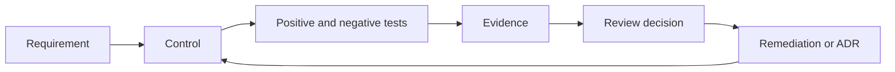
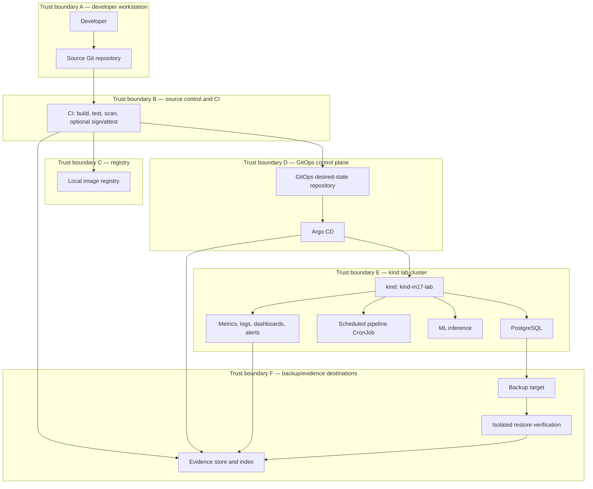

# M17 — Capstone Requirements and Acceptance Contract

> Unit 1 of M17. This document defines the requirements, acceptance criteria, implementation-repository contract, evidence model, reproducibility rules, and review process consumed by later M17 units. It is not the entire M17 syllabus.

## Document metadata

| Field | Value |
|---|---|
| Module / stage | M17 — Production DevOps Integrated Capstone / Stage 2E |
| Target | `17-Production-DevOps-Integrated-Capstone/capstone-requirements.md` |
| Audience | Learner completing M01–M16; reviewer/assessor |
| Prerequisites | Stage 2E M01–M16; Git, Linux/WSL2, containers, Kubernetes, CI/CD |
| Study estimate | [ASSUMPTION] 12–18 hours; implementation planning [ASSUMPTION] 4–8 hours |
| Review date | 2026-11-04 |
| Tool baseline | Record actual installed versions in `docs/versions.txt`; no version is prescribed here |
| Default environment | Local WSL2 Ubuntu or native Linux; `kind`; approx. 4 CPU / 8 GB RAM / 30 GB disk |
| Kubernetes lab context | `kind-m17-lab` |

## Table of contents

1. [Purpose, scope, and proof boundaries](#1-purpose-scope-and-proof-boundaries)
2. [Gate-in and M01–M16 handoffs](#2-gate-in-and-m01m16-handoffs)
3. [Stage exit criteria](#3-stage-exit-criteria)
4. [Vocabulary and evidence model](#4-vocabulary-and-evidence-model)
5. [Reference architecture](#5-reference-architecture)
6. [Numbered requirements](#6-numbered-requirements)
7. [Acceptance-criteria standard](#7-acceptance-criteria-standard)
8. [Implementation repository standard](#8-implementation-repository-standard)
9. [Evidence and integrity](#9-evidence-and-integrity)
10. [Reproducibility and safe automation](#10-reproducibility-and-safe-automation)
11. [Machine-readable requirements](#11-machine-readable-requirements)
12. [Traceability matrix and checker](#12-traceability-matrix-and-checker)
13. [Definition of done and pass/fail](#13-definition-of-done-and-passfail)
14. [Scope, risks, and ADRs](#14-scope-risks-and-adrs)
15. [Milestones](#15-milestones)
16. [Stack profiles and preflight](#16-stack-profiles-and-preflight)
17. [Optional real-cloud gate](#17-optional-real-cloud-gate)
18. [Beginner-to-expert path](#18-beginner-to-expert-path)
19. [Hands-on labs](#19-hands-on-labs)
20. [Self-check and answer key](#20-self-check-and-answer-key)
21. [Reviewer-chair exercise](#21-reviewer-chair-exercise)
22. [Failure modes and review-board questions](#22-failure-modes-and-review-board-questions)
23. [Sources and verification notes](#23-sources-and-verification-notes)
24. [Audit and human sign-off](#24-audit-and-human-sign-off)

---

## 1. Purpose, scope, and proof boundaries

M17 integrates, proves, and assesses capabilities from M01–M16. It does not re-teach those tools from scratch. The capstone evaluates whether a learner can integrate a tested delivery pipeline, immutable artifact identity, GitOps reconciliation, security controls, observability, incident response, rollback, backup/restore, teardown, and evidence traceability.

A successful demo is not a service responding once. The learner must show a repeatable chain: source change → CI build/test/scan → registry artifact → digest-based promotion → GitOps commit → Argo CD reconciliation → running workload → telemetry → controlled failure → mitigation/rollback → backup restore and integrity check → teardown → evidence review.

### What it proves

At laptop-lab scale, it can demonstrate integration mechanics, evidence discipline, safe operations, reproducibility, and the learner's ability to defend a bounded design.

### What it does not prove

A laptop `kind` cluster does **not** prove real multi-region behavior, production traffic capacity, cloud control-plane behavior, enterprise identity integration, compliance certification, production billing accuracy, or production readiness. Passing this capstone proves the learner can produce and defend evidence at lab scale—nothing more.

### Domain and boundaries

The platform contains (1) PostgreSQL stateful data service, (2) scheduled data pipeline via CronJob with freshness SLO, and (3) toy ML inference service whose model artifact is identified by hash/digest. Delivery is CI → registry → GitOps. Choose Helm **or** Kustomize. Backstage and Crossplane are not required. Use synthetic data only.

**Non-goals:** paid cloud by default; real customer/personal/production data; mandatory multi-region; mandatory signing, policy engine, or chaos framework; using both Helm and Kustomize as a requirement; claims of production readiness.

---

## 2. Gate-in and M01–M16 handoffs

| Module | Handoff | M17 expects |
|---|---|---|
| M01 | Images and registry | Build, publish, identify image |
| M02 | CI/CD | Tested pipeline and release gates |
| M03 | Operations | Diagnosis and operational discipline |
| M04 | Networking/TLS | Connectivity and TLS understanding |
| M05 | Storage/stateful services | PostgreSQL and persistent storage |
| M06 | Packaging | Helm or Kustomize |
| M07 | IaC | Declarative configuration habits |
| M08 | GitOps/progressive delivery | Git desired state and Argo CD |
| M09 | Secrets/identity | Secret references, RBAC, least privilege |
| M10 | SRE/incidents/SLOs/error budgets/postmortems/ORR | SRE operating model |
| M11 | Observability | Metrics, logs, dashboards, alerts |
| M12 | Security/supply chain | Scanning, dependencies, SBOM/provenance awareness |
| M13 | Backup/DR/chaos | Backup, restore, safe fault injection |
| M14 | Multi-cluster | Understand limits; no multi-cluster proof claim |
| M15 | Capacity/FinOps | Resource measurement and cost reasoning |
| M16 | Platform/golden paths | Optional golden-path reuse |

**Gate-in:** record versions; verify Git and container runtime; measure CPU/RAM/disk; identify source and GitOps repositories separately; confirm ability to inspect a Kubernetes context. Remediate missing tool fundamentals in the corresponding earlier module.

---

## 3. Stage exit criteria

Preserve verbatim:

> deploy a service through the full tested pipeline; reconcile desired state from Git; apply identity and security controls; demonstrate metrics/logs/alerts; execute a failure, rollback, backup restore, and teardown; map every acceptance criterion to evidence.

Required evidence artifact statement:

> capstone repository, architecture diagram, runbooks, CI/GitOps evidence, incident report, restore evidence, signed-off checklist.

Pass rule:

> every criterion is demonstrated, evidence is committed or safely retained, and the lab is reproducible from its README/runbook.

A criterion marked `NOT_DEMONSTRATED` is not passed. A waiver is not a demonstrated control. Fabricated evidence invalidates the self-study submission.

| Exit clause | REQ IDs | Later instrument mapping (descriptive only) | Project acceptance mapping (exact IDs to be assigned by project docs) |
|---|---|---|---|
| Tested pipeline deploy | REQ-001–003 | Readiness: delivery; Security/release: pipeline | Project 1; Project 4 |
| Git desired state | REQ-004–005 | Platform/delivery: reconciliation | Project 1; Project 4 |
| Identity/security | REQ-006–010 | Security/release: identity, secrets, runtime | Projects 1, 3, 4 |
| Metrics/logs/alerts | REQ-011–014 | Cost/reliability: SLO/alerting; readiness: observability | Projects 2, 3, 4 |
| Failure/rollback/restore/teardown | REQ-015–020 | Incident/recovery: detection, mitigation, recovery | Projects 1–4 |
| Acceptance-to-evidence mapping | REQ-021–032 | All instruments | Projects 1–4 |

The source prompts do not define canonical later rubric/project criterion IDs. Do not invent them; corresponding units must assign and resolve exact IDs.

---

## 4. Vocabulary and evidence model

| Term | Definition | Example |
|---|---|---|
| Requirement | Obligation to be satisfied | Git is source of deployment intent |
| Acceptance criterion | Falsifiable condition proving a requirement | Argo CD reconciles a reviewed Git commit |
| Task | Work performed | Configure an Argo CD Application |
| Deliverable | Produced output | GitOps manifest |
| Control | Risk-reducing mechanism | Least-privilege RBAC |
| Test | Challenge to a control | Verify denied permission |
| Evidence | Inspectable record | Timestamped command output |
| Rubric criterion | Scored performance dimension | Recovery verification |
| Risk | Uncertain event and impact | Mutable tag changes |
| Assumption | Unverified planning statement | [ASSUMPTION] host has 8 GB RAM |
| Waiver | Approved, time-bounded exception | Deferred non-critical panel |
| Non-goal | Explicitly excluded outcome | Real multi-region failover |

`Requirement → Control → Test → Evidence → Review decision`



A requirement without a control is an intention. A control without a test is an unverified design. A test without evidence cannot be reviewed. Evidence without a requirement is orphan evidence. Review decisions must state both what is proven and what is not.

### Worked traceability examples

**GitOps:** Requirement: Git is desired-state source. Control: reviewed GitOps change and Argo CD reconciliation. Positive test: commit replica change, inspect Argo CD source revision and `kubectl --context kind-m17-lab get deployment -n m17-app`. Negative test: create documented manual drift in the isolated lab and verify detection/reconciliation. Evidence: Git SHA, Argo revision, cluster output, timestamps. Pass only when revision and live state agree. Does not prove enterprise governance or multi-cluster behavior.

**Backup/restore:** Requirement: backup is restorable and integrity-checked. Control: backup to defined target, isolated restore. Positive test: restore synthetic PostgreSQL rows and compare row counts plus deterministic invariants. Negative test: restore a deliberately incomplete disposable artifact and require failure. Evidence: backup ID/checksum, restore log, SQL checks, measured RPO/RTO. Pass only after actual restore and integrity verification. Does not prove off-site durability or production RTO.

**Secret/identity:** Requirement: no plaintext secrets and least privilege. Control: secret scanning, dedicated service account, RBAC, non-root workload. Positive test: scan repo/build context and audit RBAC/security context. Negative test: plant a synthetic canary in a disposable fixture and require scanner detection. Evidence: scan, RBAC report, negative test, commit. Does not prove every secret format or enterprise IAM security.

---

## 5. Reference architecture



The source Git repository and GitOps desired-state repository are distinct. Developer credentials must not enter images or Git. CI credentials are scoped and short-lived where supported. GitOps contains no plaintext secrets. Registry releases are identified by digest. Argo CD permissions are scoped. Workloads are non-root where practical. Backup target is separate from active database data. Evidence is redacted. Optional signing/policy/chaos components remain optional unless selected for a specific lab.

---

## 6. Numbered requirements

Statuses: `NOT_STARTED`, `PASS`, `FAIL`, `NOT_DEMONSTRATED`, `WAIVED`. Priority: `MUST`, `SHOULD`, `MAY`. IDs remain stable after kickoff; never silently delete or renumber.

| ID | Requirement | Priority/scope | Control and positive verification | Negative/failure condition | Evidence; handoff; later mapping |
|---|---|---|---|---|---|
| REQ-001 | Build, test, publish and deploy a service through the documented CI pipeline | MUST/all | CI run and required checks | Failing test does not block promotion | CI run/commit; M02/M01; readiness delivery |
| REQ-002 | Record immutable image/model artifact identity by digest/hash | MUST/all | Compare registry, GitOps and runtime identity | Mutable-only tag or mismatch | Digest record; M01/M12; security/release |
| REQ-003 | Build, test and security gates run before promotion | MUST/all | Inspect workflow and run | Failed gate still promotes | CI evidence; M02/M12 |
| REQ-004 | Git is declared source of deployment desired state | MUST/all | GitOps commit and Argo source revision | Unreviewed imperative deployment | Git SHA; M08 |
| REQ-005 | Argo CD reconciliation and drift behavior are evidenced | MUST/cluster | Change desired state and inspect | Drift undetected or unexplained | Argo status and cluster evidence; M08 |
| REQ-006 | Workload/operator identities use least privilege | MUST/all | RBAC audit | Unneeded broad permissions | RBAC report; M09 |
| REQ-007 | CI credentials are scoped; secrets are not hard-coded | MUST/CI | Workflow permissions and secret scan | Canary or broad credential passes | Workflow and scan; M09/M12 |
| REQ-008 | No plaintext secrets in Git, images or logs | MUST/all | Secret scan and image/log review | Planted secret not detected | Scan and negative test; M09/M12 |
| REQ-009 | Workloads use non-root and restrictive settings where compatible | MUST/workloads | Pod spec/runtime inspection | Privileged/root config unexplained | Manifest and runtime evidence; M12 |
| REQ-010 | Network access is limited to declared dependencies | SHOULD/services | Network policy and connectivity tests | Undeclared path succeeds | Policy and tests; M04/M12 |
| REQ-011 | Metrics are collected for all three workloads | MUST/all | Scrape status and queries | Missing target/series | Prometheus evidence; M11 |
| REQ-012 | Logs have useful timestamps and workload identity | MUST/all | Query logs for run | Cannot correlate workload/time | Redacted logs; M11 |
| REQ-013 | Dashboards show service/workload health | MUST/all | Validate dashboard queries | Broken/empty panels | Dashboard and queries; M11 |
| REQ-014 | At least one alert path is tested end-to-end | MUST/selected SLI | Controlled condition and alert event | Rule never fires in test | Rule, test, alert event; M10/M11 |
| REQ-015 | Controlled failure is investigated using documented method | MUST/one workload | Symptom→scope→change→hypothesis→test→result→action | Mutate before preserving evidence | Timeline/incident report; M03/M10 |
| REQ-016 | Rollback is executed and verified via Git-controlled state | MUST/release | Revert and compare digest/config | Claimed rollback without identity | Before/after SHA/digest; M08/M10 |
| REQ-017 | Backup is created and restore actually executed | MUST/PostgreSQL | Restore into isolated target | Documentation-only restore | Backup ID/restore log; M05/M13 |
| REQ-018 | Restore integrity is checked; RPO/RTO measured vs targets | MUST/PostgreSQL | Row count/checksum/invariants and timings | No integrity test or timing | SQL/timing record; M10/M13 |
| REQ-019 | CronJob has freshness SLO and idempotent failed-run rerun | MUST/pipeline | Freshness query and rerun | Duplicate/inconsistent output | Job logs/output/SLO; M10 |
| REQ-020 | Teardown removes and verifies lab-created resources | MUST/lab | Guarded teardown and inventory | Leftover resource/credential or wrong target | Inventory and cleanup log; M03/M07 |
| REQ-021 | Clean clone bootstraps and verifies selected local profile | MUST/repo | Fresh clone procedure | Hidden local state required | Clone SHA/transcript; M02/M07 |
| REQ-022 | Every AC maps to requirement and evidence | MUST/all | Traceability checker | Orphan AC or evidence | Matrix/checker output |
| REQ-023 | Evidence is timestamped and bound to commit/run/digest | MUST/all | Metadata validation | Missing provenance/stale evidence | Evidence index |
| REQ-024 | Evidence files have checksums where appropriate | MUST/evidence | Checksum verification | Missing file/mismatch | Checksums and test |
| REQ-025 | `requirements.yaml` has structural contract and validator | MUST/repo | Validator and tests | Duplicate/missing/invalid fields accepted | YAML/tests |
| REQ-026 | `evidence/index.yaml` has structural/integrity validation | MUST/repo | Validate metadata, paths, checksums | Missing metadata/file passes | Index/tests |
| REQ-027 | Checker detects missing evidence, orphan evidence, missing file, bad checksum, missing metadata | MUST/repo | Planted-defect suite | Any seeded defect undetected | Checker/test results |
| REQ-028 | Required implementation repository layout exists | MUST/repo | Structure test | Required path absent | Tree/test |
| REQ-029 | Four Make targets follow safe documented contracts | MUST/repo | Exercise targets | Unsafe default mutation/non-idempotency | Makefile/transcripts |
| REQ-030 | Tool versions recorded; deployment promotes digests, not mutable tags | MUST/release | Compare inventory/registry/GitOps | `latest` used as release identity | versions/digest verifier |
| REQ-031 | Preflight and context guard refuse unexpected context | MUST/cluster | Wrong-context negative test | Unexpected context accepted | Guard tests |
| REQ-032 | Risks, assumptions, non-goals, ADRs, milestones and changes recorded; cloud gated | MUST/governance | Review records and gate | Silent scope drop or unapproved cloud | Governance evidence |

Workload expectations: PostgreSQL requires persistent storage, backup and verified restore; CronJob requires freshness SLO and idempotent rerun; ML inference requires artifact hash/digest, smoke test, metrics/logs and rollback identity.

---

## 7. Acceptance-criteria standard

A criterion must be measurable, observable, bounded in scope/time, independently understandable, falsifiable, linked to REQ ID, owned, verifiable by command/query/test/reviewer record, paired with negative test/failure condition, and linked to evidence and pass condition. Avoid vague terms such as “secure,” “highly available,” “monitored,” “fast,” and “production-ready.”

Use this exact template:

```text
ID:
Requirement:
Given:
When:
Then:
Positive verification command/query:
Representative expected result:
Pass condition:
Negative test / failure condition:
Evidence path:
Evidence timestamp / commit / digest:
Cleanup:
What this does not prove:
```

All command outputs below are illustrative and never claimed as executed. Every Kubernetes command uses explicit `--context kind-m17-lab`.

### AC-001 — CI delivery (REQ-001–003)
Given source commit with tests; when CI runs; then required tests/scans pass before digest promotion. Positive verification: inspect CI run and registry metadata. Representative expected result: **“Representative example — your output will differ.”** Required jobs green; artifact recorded as `image@sha256:<digest>`. Pass: run tied to commit and digest. Negative: failing unit test blocks promotion. Evidence: `evidence/ci/AC-001/`; record UTC/run/SHA/digest. Cleanup: delete disposable branch. Does not prove CI provider is uncompromised.

### AC-002 — GitOps reconciliation (REQ-004–005)
Given Argo CD manages lab app; when reviewed GitOps commit changes replicas; then source revision and live state agree. Positive command:
```bash
kubectl --context kind-m17-lab get deployment -n m17-app
```
Representative expected result: **“Representative example — your output will differ.”** Expected ready replicas shown. Interpretation: inspect Argo source revision too. Pass: revision and desired/live state match. Negative: create documented manual drift and verify detection/reconciliation. Evidence: `evidence/gitops/AC-002/`; record commit/time. Cleanup: reconcile desired state. Does not prove enterprise governance or multi-cluster behavior.

### AC-003 — Identity/RBAC (REQ-006,009)
Given dedicated service account; when RBAC and workload settings are audited; then only required permissions exist and workload is non-root where supported. Positive commands:
```bash
kubectl --context kind-m17-lab get serviceaccount,role,rolebinding -n m17-app
kubectl --context kind-m17-lab get pods -n m17-app -o wide
```
Representative result: **“Representative example — your output will differ.”** Documented role bindings and Ready pods. Interpretation: inspect role rules and pod security context, not just names. Pass: no unexplained broad permissions. Negative: privileged test manifest is denied/flagged. Evidence: `evidence/security/AC-003/`; record commit/context. Cleanup: remove test object. Does not prove enterprise IAM.

### AC-004 — Secret hygiene (REQ-007–008)
Given no real credentials in fixtures; when secret scanner runs; then baseline scan is clean and synthetic canary is detected. Positive: run configured scanner. Representative result: **“Representative example — your output will differ.”** Baseline succeeds; canary test exits non-zero. Pass: canary detected and no real secret committed/logged. Negative: undetected canary fails criterion. Evidence: `evidence/security/AC-004/`; scanner version/run. Cleanup: remove fixture, destroy throwaway material, rescan. Does not prove all secret types are detectable.

### AC-005 — Metrics/alert (REQ-011–014)
Given selected SLI and alert rule; when benign lab condition crosses threshold; then metric changes and alert event is observed. Positive: inspect monitoring pods and query metric:
```bash
kubectl --context kind-m17-lab get pods -n monitoring
```
Representative result: **“Representative example — your output will differ.”** Pods Ready; query returns timestamped series; alert state changes. Interpretation: pod readiness is not alert proof. Pass: query, rule test and live alert event retained. Negative: break test scrape target and require detection. Evidence: `evidence/observability/AC-005/`; cleanup restore scrape. Does not prove production paging.

### AC-006 — Incident investigation (REQ-015)
Given runbook and baseline captured; when benign reversible fault is introduced; then learner records symptom, scope, recent change, hypotheses, discriminating test, result and next action before mutation. Commands:
```bash
kubectl --context kind-m17-lab get pods -n m17-app -o wide
kubectl --context kind-m17-lab get events -n m17-app --sort-by=.metadata.creationTimestamp
```
Representative result: **“Representative example — your output will differ.”** Affected workload/events identified. Pass: timestamped timeline and preserved evidence. Negative: mutate before evidence capture. Evidence: `evidence/incidents/AC-006/`; cleanup restore known-good state. Does not prove real customer incident response.

### AC-007 — Rollback (REQ-016)
Given known-good and test release identities; when Git-controlled rollback is executed; then live configuration and artifact return to known-good identity. Positive:
```bash
kubectl --context kind-m17-lab get deployment -n m17-app -o yaml
kubectl --context kind-m17-lab get pods -n m17-app -o wide
```
Representative result: **“Representative example — your output will differ.”** Workload references expected image. Pass: Git revision, config and digest match rollback record. Negative: wrong digest must fail verifier. Evidence: `evidence/releases/AC-007/`; cleanup leave stable revision. Does not prove rollback safety for irreversible schema changes.

### AC-008 — Backup/restore (REQ-017–018)
Given synthetic PostgreSQL rows; when backup is restored into isolated target; then row counts and deterministic invariants match and RPO/RTO are measured. Positive: selected tool's documented backup/restore commands plus SQL verification. Representative result: **“Representative example — your output will differ.”** Counts/checksums match and timestamps exist. Pass: actual restore and integrity check succeed; timings compared with declared targets. Negative: incomplete disposable artifact must fail. Evidence: `evidence/backup/AC-008/`; cleanup isolated target. Does not prove off-site durability or production RTO.

### AC-009 — CronJob freshness/idempotency (REQ-019)
Given idempotent pipeline; when one scheduled run fails and is rerun; then output remains invariant and freshness returns within declared target. Positive:
```bash
kubectl --context kind-m17-lab get cronjob,jobs,pods -n m17-pipeline
```
Representative result: **“Representative example — your output will differ.”** Completed Job and valid output invariants. Pass: freshness query and duplicate check pass. Negative: duplicate output on rerun. Evidence: `evidence/pipeline/AC-009/`; cleanup test Jobs/fixtures. Does not prove production throughput.

### AC-010 — ML artifact identity (REQ-002,030)
Given toy inference service and model hash; when service starts and deterministic smoke request runs; then loaded model identity matches release record. Positive: inspect startup metadata and run project smoke test. Representative result: **“Representative example — your output will differ.”** Hash matches and response schema passes. Pass: model hash/image digest/commit linked. Negative: substitute test artifact and require mismatch failure. Evidence: `evidence/ml/AC-010/`; cleanup restore approved test artifact. Does not prove model quality/fairness/generalization.

### AC-011 — Teardown (REQ-020)
Given inventory of lab-created resources; when teardown preview is reviewed and confirmed; then cluster, namespaces, volumes, registry/container state and temporary credentials are removed or accounted for. Positive:
```bash
kubectl --context kind-m17-lab get namespaces
```
Representative result: **“Representative example — your output will differ.”** After cluster removal, expected context absence is recorded; runtime inventory shows no lab cluster. Interpretation: namespace query alone is insufficient; inspect full inventory. Pass: every created resource accounted for. Negative: deliberately retain a test volume/credential and require checker failure. Evidence: `evidence/teardown/AC-011/`. Does not prove final cloud billing.

### AC-012 — Fresh clone/traceability (REQ-021–031)
Given committed capstone; when fresh clone runs preflight/bootstrap/verify/drill/teardown; then checks pass without hidden state. Positive:
```bash
git clone <REPOSITORY-URL> capstone-repro-check
cd capstone-repro-check
make verify
```
Representative result: **“Representative example — your output will differ.”** Validators and traceability pass. Interpretation: `make verify` should be read-only; full lifecycle recorded separately. Pass: actual timings, versions and clean teardown retained. Negative: remove required evidence or alter checksum; verify must fail. Evidence: `evidence/reproducibility/AC-012/`. Does not prove all OS/hardware environments.

---

## 8. Implementation repository standard

This is a separate learner-created implementation repository, not the learning-roadmap repository:

```text
capstone-repo/
├── app/                 # data app, pipeline, inference code; synthetic fixtures
├── ci/                  # workflow helpers, tests, scan config
├── deploy/              # Helm OR Kustomize; declare choice
├── gitops/              # desired-state content; separate repo may be documented
├── policy/              # policy tests/manifests; optional engine-specific content
├── observability/       # metrics, dashboards, alerts, log config
├── backup/              # backup/restore and verification queries
├── runbooks/             # incident, rollback, restore, teardown
├── drills/               # benign fault scenarios and separated answer keys
├── evidence/
│   ├── index.yaml
│   └── checksums.txt
├── docs/
│   ├── architecture.md
│   ├── requirements-traceability.md
│   ├── risk-register.md
│   ├── versions.txt
│   └── adr/
├── requirements.yaml
├── Makefile
└── README.md
```

`app` owns workload code; `ci` owns pipeline configuration; `deploy` owns packaging; `gitops` owns desired state; `policy` owns policy tests; `observability` owns telemetry config; `backup` owns recovery procedures; `runbooks` and `drills` own operational procedures; `evidence` owns indexed proof; `docs` owns architecture/governance; `requirements.yaml` owns machine-readable obligations; `Makefile` exposes safe operator entry points; implementation `README.md` documents fresh-clone use. The implementation README is not M17's course README.

---

## 9. Evidence and integrity

Evidence strength order: `Assertion < Screenshot < Command output < Automated test < Continuously run check`. The levels are not interchangeable. Screenshots supplement; critical criteria require at least automated test evidence, with continuous checks preferred.

Rules:
- Commit small, non-sensitive, reproducible text evidence when appropriate; retain large artifacts safely with stable references.
- Never commit secrets, credential-bearing kubeconfigs, tokens, private keys, unredacted environment dumps, personal data, or sensitive account IDs.
- Record UTC or timezone-explicit timestamps, exact command/query, exit status, tool versions, commit SHA, image/model digest, run/drill ID.
- Redact before commit; state what category was redacted without hiding failures.
- Checksum evidence files; a checksum proves byte identity, not truthfulness.
- Refresh evidence after relevant code/config/deploy changes.
- Evidence predating the last relevant deploy/config change is stale. [ASSUMPTION] A 30-day maximum age can apply to non-deploy-bound evidence; configure and enforce consistently.
- “Not demonstrated” remains visible.

Example `evidence/index.yaml`:

```yaml
schema_version: "1"
evidence:
  - evidence_id: EVD-CI-001
    requirement_id: REQ-001
    path: evidence/ci/AC-001/workflow-summary.txt
    evidence_type: automated_test
    timestamp_utc: "2026-11-04T08:00:00Z"
    source_commit: "<actual-commit-sha>"
    run_id: "<actual-ci-run-id>"
    artifact_digest: "sha256:<actual-digest>"
    checksum: "sha256:<actual-file-checksum>"
    verification_method: "CI required-check and digest comparison"
    result: PASS
    owner: learner
    notes: "Redacted synthetic lab evidence."
```

Placeholders are not final evidence. Redaction: copy raw output to restricted temp location; redact credentials/PII/account IDs; preserve outcome/timing/identity; scan redacted file; commit only after review; destroy temp raw files and verify cleanup.

---

## 10. Reproducibility and safe automation

Required entry points:

| Target | Contract |
|---|---|
| `make bootstrap` | Preflight; prepare only selected profile; no cloud provisioning |
| `make verify` | Read-only tests, versions/config checks, evidence/checksum/traceability validation; non-zero on failure |
| `make drill` | List drills by default; run only named explicitly opted-in lab drill |
| `make teardown` | Preview inventory; require explicit confirmation; remove lab resources; verify absence |

GNU Make does not automatically interpret arbitrary flags as target arguments. Document a consistent interface, such as environment variables. Example:

```makefile
.PHONY: preflight bootstrap verify drill teardown
preflight:
	./scripts/preflight.sh
bootstrap: preflight
	./scripts/bootstrap-profile.sh
verify:
	python -m pytest -q
	python scripts/validate_requirements.py requirements.yaml
	python scripts/check_traceability.py
drill:
	@if [ -z "$$DRILL_ID" ]; then echo "List only; set DRILL_ID to select"; exit 0; fi
	@./scripts/run-drill.sh "$$DRILL_ID"
teardown:
	@./scripts/teardown-preview.sh
	@if [ "$$CONFIRM_TEARDOWN" != "YES" ]; then echo "Preview only"; exit 2; fi
	@./scripts/teardown-lab.sh
	@./scripts/verify-teardown.sh
```

Referenced scripts must be implemented with explicit target validation, quoting, error handling and context guards. This Makefile is a contract example, not executed code.

`docs/versions.txt` should record OS, shell, Git, container runtime, kind, kubectl, selected Helm/Kustomize, Argo CD, Prometheus, Grafana, backup tool, Python/dependency lock, base image digests and last verified UTC. Do not invent versions.

Preflight checks OS, tools, container runtime, CPU/RAM/disk, existing cluster/context, ports, selected profile and absence of cloud dependency. Every Kubernetes script must explicitly use `--context kind-m17-lab`, assert expected context, and verify a lab marker/cluster identity before mutation. Wrong context must exit non-zero. A context check is not a complete authorization boundary.

```bash
#!/usr/bin/env bash
# File: scripts/assert-lab-context.sh
set -euo pipefail
EXPECTED_CONTEXT="kind-m17-lab"
ACTUAL_CONTEXT="$(kubectl config current-context 2>/dev/null || true)"
if [[ "$ACTUAL_CONTEXT" != "$EXPECTED_CONTEXT" ]]; then
  printf 'Refusing: expected %s, current %s\n' "$EXPECTED_CONTEXT" "${ACTUAL_CONTEXT:-<none>}" >&2
  exit 20
fi
kubectl --context "$EXPECTED_CONTEXT" cluster-info >/dev/null
```

`verify` is read-only; bootstrap is idempotent; drill defaults to listing; teardown previews and confirms. Fresh-clone test must use a new directory and record actual timings. WSL2/native Linux may differ in networking, permissions, line endings, memory contention and disk placement; record the environment.

Teardown checklist: cluster/context, namespaces/workloads, PVs/test data, local registry/volumes, monitoring/GitOps/optional policy/chaos components, containers/networks/images created solely for lab, temporary credentials/keys, temporary kubeconfig entries, temp directories, final runtime inventory, and (cloud only) next-day billing check.

---

## 11. Machine-readable requirements

YAML syntax alone is insufficient. Validate required fields, unique IDs, enumerations, positive and negative tests, waiver completeness, evidence and status consistency.

```yaml
# File: requirements.yaml (illustrative subset; full file includes REQ-001..REQ-032)
schema_version: "1"
project: "M17-local-capstone"
lab_context: "kind-m17-lab"
requirements:
  - id: REQ-004
    title: Git is deployment source of truth
    statement: "GitOps desired state is the declared deployment source."
    priority: MUST
    scope: [postgres, pipeline, inference]
    rationale: "Prevents undocumented imperative deployment changes."
    controls: [reviewed-git-change, argocd-reconciliation]
    positive_tests: [AC-002-positive]
    negative_tests: [AC-002-drift]
    evidence_expected: [evidence/gitops/AC-002/]
    dependencies: [REQ-001]
    handoff_modules: [M08]
    traceability:
      acceptance_criteria: [AC-002]
      later_instruments: ["platform-and-delivery: GitOps reconciliation; exact ID assigned in Unit 6"]
    status: NOT_STARTED
    owner: learner
    waiver: null
```

Each record must include `id`, `title`, `statement`, `priority`, `scope`, `rationale`, `controls`, `positive_tests`, `negative_tests`, `evidence_expected`, `dependencies`, `handoff_modules`, `traceability`, `status`, `owner`, and `waiver`. IDs match `REQ-NNN`; priorities `MUST/SHOULD/MAY`; statuses as defined. `WAIVED` requires owner, reason, expiry, compensating control, approval record. `PASS` requires passing evidence. Reject duplicate IDs, missing fields, invalid enums, empty tests, incomplete waiver, and missing verification.

Reference validator (requires learner-pinned PyYAML; version [VERIFY]):

```python
# File: scripts/validate_requirements.py
from pathlib import Path
import re, sys
import yaml

REQUIRED = {"id","title","statement","priority","scope","rationale","controls",
 "positive_tests","negative_tests","evidence_expected","dependencies",
 "handoff_modules","traceability","status","owner","waiver"}
STATUSES = {"NOT_STARTED","PASS","FAIL","NOT_DEMONSTRATED","WAIVED"}
PRIORITIES = {"MUST","SHOULD","MAY"}

def validate(path):
    try:
        doc = yaml.safe_load(Path(path).read_text(encoding="utf-8"))
    except (OSError, yaml.YAMLError) as exc:
        return [f"cannot load YAML: {exc}"]
    if not isinstance(doc, dict) or not isinstance(doc.get("requirements"), list):
        return ["root mapping and requirements list required"]
    errors, seen = [], set()
    for i, row in enumerate(doc["requirements"]):
        where = f"requirements[{i}]"
        if not isinstance(row, dict):
            errors.append(f"{where}: mapping required"); continue
        missing = REQUIRED - row.keys()
        if missing:
            errors.append(f"{where}: missing {sorted(missing)}"); continue
        rid = row["id"]
        if not isinstance(rid, str) or not re.fullmatch(r"REQ-\d{3}", rid):
            errors.append(f"{where}: invalid ID")
        elif rid in seen: errors.append(f"{where}: duplicate ID {rid}")
        else: seen.add(rid)
        if row["priority"] not in PRIORITIES: errors.append(f"{where}: invalid priority")
        if row["status"] not in STATUSES: errors.append(f"{where}: invalid status")
        for key in ("controls","positive_tests","negative_tests","evidence_expected"):
            if not isinstance(row[key], list) or not row[key]:
                errors.append(f"{where}: {key} must be non-empty list")
        waiver = row["waiver"]
        if row["status"] == "WAIVED":
            needed = {"owner","reason","expiry","compensating_control","approval_record"}
            if not isinstance(waiver, dict) or needed - waiver.keys():
                errors.append(f"{where}: incomplete waiver")
        elif waiver is not None: errors.append(f"{where}: waiver must be null")
    return errors

if __name__ == "__main__":
    if len(sys.argv) != 2:
        print("usage: python scripts/validate_requirements.py requirements.yaml", file=sys.stderr)
        raise SystemExit(2)
    problems = validate(sys.argv[1])
    for problem in problems: print("ERROR:", problem, file=sys.stderr)
    if problems: raise SystemExit(1)
    print("Requirements structure validation passed.")
```

Required planted tests: duplicate ID, missing field, invalid priority/status, empty negative test, incomplete waiver, malformed YAML, and PASS without evidence (the last is cross-file validation). Expected result for each invalid fixture is non-zero. Do not claim code was run.

---

## 12. Traceability matrix and checker

Reuse this exact matrix structure:

```markdown
| Acceptance criterion ID | Requirement ID | Control | Positive test | Negative test | Evidence ID/path | Commit/run/digest | Result | Reviewer | Review date | Notes |
|---|---|---|---|---|---|---|---|---|---|---|
| AC-___ | REQ-___ | | | | | | NOT_DEMONSTRATED | | | |
```

`evidence/index.yaml` root has `schema_version` and `evidence` list. Entries include `evidence_id`, `requirement_id`, path or retained reference, `evidence_type`, `timestamp_utc`, source commit/run/digest, checksum if applicable, `verification_method`, `result`, and `owner`.

Reference checker for repository-local paths (PyYAML dependency; external evidence vault requires separate access review):

```python
# File: scripts/check_traceability.py
from pathlib import Path
import hashlib, sys
import yaml

ROOT = Path.cwd().resolve()
def safe_path(raw):
    path = (ROOT / raw).resolve()
    if path != ROOT and ROOT not in path.parents:
        raise ValueError(f"path escapes repository: {raw}")
    return path
def checksum(path):
    h = hashlib.sha256()
    with path.open("rb") as f:
        for block in iter(lambda: f.read(1024 * 1024), b""): h.update(block)
    return h.hexdigest()

def main():
    try:
        req = yaml.safe_load((ROOT/"requirements.yaml").read_text())
        idx = yaml.safe_load((ROOT/"evidence/index.yaml").read_text())
    except (OSError, yaml.YAMLError) as exc:
        print(f"ERROR: {exc}", file=sys.stderr); return 2
    reqs = req.get("requirements", []) if isinstance(req, dict) else []
    entries = idx.get("evidence", []) if isinstance(idx, dict) else []
    by_id = {r.get("id"): r for r in reqs if isinstance(r, dict)}
    by_req, errors = {}, []
    for e in entries:
        if not isinstance(e, dict):
            errors.append("evidence entry must be mapping"); continue
        required = {"evidence_id","requirement_id","evidence_type","timestamp_utc",
                    "verification_method","result","owner"}
        missing = required - e.keys()
        if missing:
            errors.append(f"{e.get('evidence_id','<unknown>')}: missing {sorted(missing)}")
            continue
        rid = e["requirement_id"]
        if rid not in by_id: errors.append(f"orphan evidence {e['evidence_id']}: {rid}")
        by_req.setdefault(rid, []).append(e)
        if e.get("path"):
            try:
                path = safe_path(e["path"])
                if not path.is_file(): errors.append(f"{e['evidence_id']}: missing file")
                elif e.get("checksum"):
                    expected = str(e["checksum"]).removeprefix("sha256:")
                    if checksum(path).lower() != expected.lower():
                        errors.append(f"{e['evidence_id']}: checksum mismatch")
            except (OSError, ValueError) as exc:
                errors.append(f"{e['evidence_id']}: invalid path: {exc}")
    for rid, row in by_id.items():
        records = by_req.get(rid, [])
        if row.get("status") == "PASS":
            if not records: errors.append(f"{rid}: PASS without evidence")
            elif not any(e.get("result") == "PASS" for e in records):
                errors.append(f"{rid}: PASS without passing evidence")
        if not records and row.get("status") not in {"NOT_STARTED","NOT_DEMONSTRATED","WAIVED"}:
            errors.append(f"{rid}: evidence missing")
    if errors:
        for e in errors: print("ERROR:", e, file=sys.stderr)
        return 1
    print("Traceability checks passed for repository-local evidence.")
    return 0

if __name__ == "__main__": raise SystemExit(main())
```

Required tests: T-01 PASS requirement without evidence; T-02 orphan evidence; T-03 missing file; T-04 stale checksum; T-05 missing metadata; T-06 path escape; T-07 PASS with only FAIL evidence; T-08 NOT_DEMONSTRATED without evidence remains visible and is not a pass. Checker must fail non-zero for T-01–T-07. Extend with freshness: evidence predating last relevant deploy/config change is stale. A 30-day age threshold is only [ASSUMPTION].

Forward traceability is REQ→control→test→evidence; backward traceability is evidence→test→REQ→review. Every stage exit maps to REQ, later rubric category, and project AC; exact IDs are assigned by later documents, never fabricated here.

---

## 13. Definition of done and pass/fail

### Definition of done

- [ ] REQ-001…REQ-032 have owner, status, control, positive test, negative test and evidence expectation.
- [ ] Every acceptance criterion is measurable and maps to one or more requirements.
- [ ] Traceability has no orphan acceptance criteria/evidence.
- [ ] Requirements and evidence validators pass.
- [ ] Planted defects detect missing evidence, orphan evidence, missing files, stale checksums and missing metadata.
- [ ] CI builds/tests/scans and promotes immutable artifact by digest.
- [ ] GitOps reconciliation is evidenced.
- [ ] Identity, secrets and runtime controls are tested.
- [ ] Metrics, logs, dashboards and alert path are demonstrated.
- [ ] Failure investigation preserves evidence before mitigation.
- [ ] Rollback is executed and artifact identity verified.
- [ ] Backup is restored, integrity checked, RPO/RTO measured.
- [ ] CronJob rerun is idempotent and freshness measured.
- [ ] Teardown and resource removal are verified.
- [ ] Clean-clone reproducibility is demonstrated.
- [ ] Architecture, runbooks, CI/GitOps evidence, incident report, restore evidence and signed-off checklist exist.
- [ ] Limitations and gaps remain visible.

### Decision and severity

| Severity | Definition | Decision |
|---|---|---|
| Blocker | Stage exit criterion absent; critical control bypassed; fabricated evidence; rollback/restore/teardown untested; wrong-target destructive action | No pass |
| Major | Important requirement incomplete or stale; compensating control inadequate | No unconditional pass |
| Minor | Non-critical documentation/polish gap without effect on demonstrated control | May pass with owned action/review date |

Decision values: `PASS`, `FAIL`, `CONDITIONAL`. Conditional is not a claim that all criteria passed. Waiver metadata: owner, reason, expiry, compensating control, approval record, review date. Expired waivers fail validation.

Evidence is stale if it predates the last relevant deployment/configuration change, regardless of age. [ASSUMPTION] A 30-day maximum age may apply to evidence not linked to deployment changes; configure and enforce consistently. Reviewer may re-run a sample of at least 20% of applicable checklist items from a fresh checkout/lab where feasible.

Honest `NOT_DEMONSTRATED` is valid and visible. Fabricated output, doctored timestamps, screenshots altered to hide failures, evidence from a different commit/digest without disclosure, silently dropped requirements, or teardown claims contradicted by inventory invalidate the submission.

---

## 14. Scope, risks, and ADRs

### MVP walking skeleton

Build a thin end-to-end path before optional components:

1. One minimal service builds and passes tests.
2. Image is published to local registry and digest recorded.
3. GitOps references that digest.
4. Argo CD deploys to `kind-m17-lab`.
5. Health check and one metric are visible.
6. Stateful component has backup/restore path.
7. Teardown is verified.

Then add PostgreSQL, CronJob, ML inference, security gates, alert testing, failure drills and evidence automation. Use thin slices. Do not install all heavy components at once.

### Non-goals

Real cloud by default; real customer/production data; production traffic claims; multi-region proof; mandatory signing/admission/chaos framework; both Helm and Kustomize; mandatory Backstage/Crossplane; compliance certification; claims of production readiness.

### Risk register

| ID | Risk/cause | Likelihood | Impact | Affected REQ | Mitigation | Owner | Trigger | Residual risk/review |
|---|---|---|---|---|---|---|---|---|
| R-001 | Laptop resource exhaustion | Medium [ASSUMPTION] | High | 021,031 | Profiles, preflight, measure | Learner | Memory/disk check fails | Reduce profile; record date |
| R-002 | Mutable image tag | Medium [ASSUMPTION] | High | 002,030 | Digest pinning/verifier | Learner | Digest mismatch | Registry compromise remains |
| R-003 | Restore never tested | Medium [ASSUMPTION] | Critical | 017,018 | Isolated restore drill | Learner | Missing restore record | Lab does not prove off-site DR |
| R-004 | Wrong cluster context | Low [ASSUMPTION] | Critical | 020,031 | Explicit context, marker, preview | Learner | Context mismatch | Local kubeconfig trust |

Likelihood values are planning assumptions, not measured incident probabilities.

### ADR template

```markdown
# ADR-NNN — <decision title>
- Status: Proposed / Accepted / Superseded
- Date:
- Owner:
- Related REQ IDs:
- Context:
- Decision:
- Options considered:
- Consequences:
- Security impact:
- Reliability impact:
- Cost/resource impact:
- Fidelity/learning impact:
- Verification plan:
- Revisit trigger:
```

Record material choices: Helm vs Kustomize, registry design, backup tool, stack profile, policy engine, signing, and optional chaos framework. Resolve security/delivery speed, cost/resilience, and fidelity/laptop constraints with recorded trade-offs.

### Change control

After kickoff, changes record requester, reason, affected REQ/AC IDs, risk/evidence/schedule impact, approval, old/new wording and date. Never silently delete or renumber. Mark superseded entries in history and create a new stable ID if the obligation materially changes.

---

## 15. Milestones

Durations are [ASSUMPTION], not guarantees. Adjust to measured resource use and learner availability.

| Milestone | Goal/tasks | Exit evidence | Stop/go |
|---|---|---|---|
| M0 Gate-in | M01–M16 readiness, versions, resource/context preflight | versions, preflight, gap list | Stop if runtime/context unsafe |
| M1 Requirements | REQs, ACs, risk register, non-goals, ADRs | Requirements and traceability draft | Stop if criteria vague |
| M2 Walking skeleton | Build/test, local registry, digest, GitOps deploy | CI run, digest, Argo revision, health | Require repeatable delivery |
| M3 Workload slices | PostgreSQL, CronJob, ML inference | Workload tests/domain evidence | Measure profile capacity |
| M4 Evidence automation | YAML validator, index, checksums, checker | Planted-defect tests | Stop if seeded defect passes |
| M5 Operations/security | Observability, alert, RBAC, secret scan, runtime checks | Negative-test evidence | One optional policy engine max |
| M6 Recovery drills | Failure, rollback, restore, idempotent rerun | Timeline, rollback, restore integrity, RPO/RTO | Abort on unsafe target/data risk |
| M7 Reproduction/review | Fresh clone, reviewer challenge, teardown | Timings, audit, cleanup proof | Pass only with traceability |

Time-box optional tools. If an optional component exceeds the laptop envelope, stop it and use a simpler mechanism or scripted benign fault. Do not weaken a critical acceptance criterion to preserve an optional tool.

---

## 16. Stack profiles and preflight

Planning envelope from the governing prompt: approximately 4 CPU, 8 GB RAM, 30 GB disk. It is not a promise that all components fit. Measure actual use; never invent footprints.

| Profile | Components | Use | Sequence |
|---|---|---|---|
| `Cap-Core` | kind, Argo CD, minimal Prometheus/Grafana, local registry, backup/verification | Default | Start cluster/registry, GitOps, minimal monitoring, backup test; stop unneeded components |
| `Cap+Security` | Cap-Core + one policy engine + cosign | Optional security slice | Add only after baseline; choose Kyverno OR Gatekeeper; stop after exercise |
| `Cap+Chaos` | Cap-Core + one chaos tool OR scripted fault injection | Optional resilience slice | Prefer script first; Chaos Mesh OR Litmus only if resources allow |

One GitOps controller and at most one policy engine at a time. Do not run CI emulation, registry, kind, Argo CD, Prometheus/Grafana/Loki, backup, policy engine, Argo Rollouts and chaos tooling simultaneously.

### Resource measurement record

Record host OS/version, available CPU, memory before/peak, disk before/after, cluster/node count, enabled components, measurement method/time, swapping/disk pressure. `measure yours` is mandatory.

### Preflight

- [ ] OS/WSL2 environment and shell recorded.
- [ ] Git, container runtime, kind, kubectl and selected packaging tool available.
- [ ] Container runtime healthy.
- [ ] Disk/RAM/CPU meet measured profile needs.
- [ ] `kind-m17-lab` absent or verified as intended lab cluster.
- [ ] Current context is not an unexpected cluster.
- [ ] Ports and registry config documented.
- [ ] Profile explicitly selected.
- [ ] Teardown and recovery plan reviewed before bootstrap.
- [ ] No cloud resources required by default.

Read-only examples; verify availability on the learner's OS:

```bash
uname -a
git --version
docker version
kind version
kubectl version --client
df -h
free -h
```

These do not prove the target cluster is safe. Use the context guard before Kubernetes operations.

---

## 17. Optional real-cloud gate

Cloud is optional, separately approved, and never required to make the project appear production-like. Local track is sufficient.

| State | Meaning | Evidence |
|---|---|---|
| `NOT_REQUESTED` | Learner remains local | Local-track selection |
| `BLOCKED` | Required artifacts/approval missing | Gap list and no-provision confirmation |
| `APPROVED` | All pre-provision artifacts reviewed | Gate pack and approval record |
| `CLOSED` | Resources removed and post-use checks complete | Removal proof and next-day cost check |

Before provisioning, require:
- resource diagram and complete inventory;
- account/region assumptions without account IDs;
- preflight;
- cost-risk table;
- budget/alert evidence, redacted;
- written teardown contract and owner/actions;
- proof-of-removal plan;
- next-day cost check plan and billing-delay caveat;
- approval record.

Budgets are alerts, not hard spending caps. No cloud price is supplied.

```yaml
cloud_gate:
  state: NOT_REQUESTED
  requested_by:
  reviewer:
  requested_at:
  account_region_assumptions: "No account IDs"
  resource_inventory_ref:
  architecture_diagram_ref:
  preflight_ref:
  cost_risk_table_ref:
  budget_alert_evidence_ref:
  teardown_contract_ref:
  approval_record_ref:
  removal_proof_ref:
  next_day_cost_check_ref:
  billing_delay_acknowledged: false
  notes:
```

Only transition to APPROVED after review of all pre-provision artifacts. CLOSED requires verified removal and next-day cost review; billing data may be delayed.

---

## 18. Beginner-to-expert path

### L1 — Beginner: read the instrument

**Outcome:** Explain what a requirement asks and identify evidence. Distinguish requirement, control, test and evidence. Example: “backup exists” is not restore proof. Task: annotate REQ-017. Failure mode: screenshot of backup job treated as restore proof. Mastery: explain why restore log plus SQL integrity result is stronger.

### L2 — Intermediate: produce evidence

**Outcome:** Write Given/When/Then criteria and collect repeatable evidence with commit/run/digest. Task: implement AC-008 with synthetic rows and actual timing. Failure: evidence tied to different commit or mutable tag. Mastery: reviewer can identify exact source, artifact, run and restore target.

### L3 — Advanced: design the instrument

**Outcome:** Detect ambiguity, missing negative tests, gaming and conflicts. Resolve trade-offs in ADRs. Task: rewrite three flawed criteria from Section 21. Failure: measurable criterion can be satisfied by evidence from another commit. Mastery: explain digest/commit binding and fresh-clone review.

### L4 — Expert: chair the review

**Outcome:** Challenge evidence, calibrate decisions, issue go/no-go with conditions. Task: review synthetic submission with unmeasured RTO, mutable tag, expired waiver and screenshot-only proof. Failure: rewarding narrative without artifacts. Mastery: decision includes evidence, blockers, owners, dates and limitations.

---

## 19. Hands-on labs

All labs use synthetic data and local track. Durations are [ASSUMPTION]. Measure profile footprint. Before Kubernetes operations assert `kind-m17-lab` and use explicit `--context kind-m17-lab`. Fault injection is benign, isolated and reversible.

### LAB-01 — Ten acceptance criteria (L1–L2)

- **Goal/time:** Ten complete Given/When/Then criteria; [ASSUMPTION] 90–120 min.
- **Profile/prerequisites:** Cap-Core planning only; Sections 4–7.
- **Footprint:** Record host baseline; start no services.
- **Steps:** Copy template; draft CI, digest, GitOps, identity, secret, telemetry, incident, rollback, restore, freshness, teardown criteria; assign AC/REQ IDs; define positive/negative tests; attempt to falsify pass conditions.
- **Evidence/pass:** Acceptance-criteria file and traceability draft; at least ten complete, bounded, owned criteria.
- **Planted defect:** “System is secure”; reject and rewrite it.
- **Cleanup:** Remove scratch notes with accidental secrets.
- **Stretch:** Reviewer chooses an unanticipated input/variant.

### LAB-02 — Requirements YAML and validator (L2)

- **Goal/time:** Complete REQ inventory, validator and tests; [ASSUMPTION] 2–3 hours.
- **Profile:** No cluster required; record Python environment.
- **Steps:** Create implementation repo; add all 32 records; implement validator; test duplicate IDs, missing fields, invalid status/priority, empty negative tests, incomplete waiver and PASS without evidence.
- **Evidence/pass:** YAML, validator, tests, lockfile and actual transcripts; all planted invalid cases non-zero.
- **Planted defect:** Duplicate REQ-004.
- **Cleanup:** Keep invalid fixtures under tests with clear names.
- **Stretch:** Add JSON Schema only after verifying schema draft/tool compatibility.

### LAB-03 — Evidence index/checker (L2–L3)

- **Goal/time:** Detect orphan evidence, missing file, checksum mismatch and metadata gap; [ASSUMPTION] 2–3 hours.
- **Profile:** No cluster; record repository size.
- **Steps:** Create index; generate checksums; implement checker; plant orphan evidence; remove a referenced file; alter file without checksum update; run checker after each; restore known-good fixture.
- **Evidence/pass:** Index, checksums, checker, tests and positive/negative transcripts; all defects detected.
- **Safety/cleanup:** Synthetic text only; restore valid fixtures and inspect Git diff.
- **Stretch:** Enforce evidence freshness against last relevant deployment.

### LAB-04 — Repo, Makefile, preflight and context guard (L2–L3)

- **Goal/time:** Safe operator interface; [ASSUMPTION] 2–4 hours.
- **Profile:** Cap-Core; prerequisites Git, runtime, kind, kubectl.
- **Footprint:** Measure before/after each component.
- **Steps:** Create layout; record versions; implement read-only preflight; test correct and wrong context; add safe Make targets; prove verify is read-only; inspect teardown preview.
- **Evidence/pass:** Tree, preflight, context tests, Make output and footprint; wrong context refuses.
- **⚠ DESTRUCTIVE (LAB ONLY):** Actual teardown only after inventory review and explicit confirmation.
- **Cleanup:** Verify no unintended resources; remove any lab cluster and check inventory.
- **Stretch:** Compare WSL2/native Linux.

### LAB-05 — Fresh-clone reproducibility (L3–L4)

- **Goal/time:** Fresh clone → bootstrap → verify → selected drill → teardown; [ASSUMPTION] 2–4 hours.
- **Profile:** Cap-Core.
- **Steps:** Commit work; clone into new directory; record SHA/versions; preflight; verify; bootstrap; run one explicitly selected benign drill; verify again; preview and confirm teardown; record actual timings.
- **Evidence/pass:** Clone transcript, timings, footprint, drill, final inventory; no hidden local state required.
- **Planted defect:** Remove an evidence file in test branch; verify must fail.
- **Cleanup:** Remove temporary clone and verify no resources remain.
- **Stretch:** Repeat on another machine/OS.

### LAB-06 — Reviewer-chair (L4)

- **Goal/time:** Assess flawed submission; [ASSUMPTION] 60–90 min.
- **Profile:** No stack; text-only.
- **Steps:** Review Section 21 without key; log defect, REQ, risk, rewritten criterion, tests/evidence and pass impact; issue decision; compare key.
- **Evidence/pass:** Findings and decision; all critical seeded defects identified.
- **Cleanup:** None.
- **Stretch:** Calibrate with second reviewer.

### LAB-07 — Cloud gate tabletop (optional)

- **Goal/time:** Evaluate approval pack without provisioning; [ASSUMPTION] 45–60 min.
- **Profile:** No cloud resources.
- **Steps:** Create hypothetical inventory/cost model, teardown contract and approval gap list.
- **Evidence/pass:** Gate remains BLOCKED or NOT_REQUESTED when artifacts absent.
- **Safety:** Do not provision resources.
- **Cleanup:** Remove accidental credentials; no resources should exist.
- **Stretch:** Review provider budget-alert limitations in current official docs.

---

## 20. Self-check and answer key

1. **Green dashboard screenshot sufficient?** No. Need query, timestamp, alert test and preferably automated evidence. Screenshot can be stale.
2. **“Highly available” sufficient?** No. Define SLI/SLO, scope, window, target and failure test.
3. **Backup succeeded, no restore?** `NOT_DEMONSTRATED` (or FAIL if restore attempted and failed); never PASS.
4. **Argo Synced, no commit/digest?** Provenance missing; record GitOps revision, source commit, registry digest and running identity.
5. **Test on commit A, deploy commit B?** Reject. Evidence must bind to deployed artifact/revision.
6. **Waiver has owner/reason but no expiry?** Invalid; expiry, compensating control and approval required.
7. **Honest not-demonstrated multi-region?** Yes, preferable to fabrication; local lab does not prove multi-region.
8. **Runs on 8 GB laptop = production-ready?** No; only lab mechanics/evidence discipline demonstrated.
9. **Evidence references unknown REQ?** Orphan evidence; checker must fail.
10. **Teardown success but PV remains?** Teardown not passed; inventory is incomplete or cleanup failed.

Wrong answers are tempting because screenshots look persuasive, adjectives sound measurable, a successful backup looks like recovery, green sync looks like provenance, and command success looks like cleanup. The review standard is independently verifiable evidence, not appearance.

---

## 21. Reviewer-chair exercise

### Flawed submission (attempt before reading answer key)

1. “The system is secure.”
2. “The platform is highly available.”
3. “Restore is supported.”
4. Deployment evidence references `inference:latest`.
5. Critical alert criterion uses only a Grafana screenshot.
6. Waiver has owner/reason but no expiry or compensating control.
7. Rollback has no negative test.
8. CI tested commit `abc123`, deployed workload is another commit.
9. README claims teardown, but registry container remains.
10. Requirement silently removed after kickoff because it was difficult.

For each: identify defect, REQ, risk, rewritten criterion, positive/negative test, evidence, and pass impact.

### Separated answer key

| # | Defect | Corrective action/test | Decision |
|---|---|---|---|
| 1 | Vague, untestable security claim | Define secret, identity, image and runtime controls; scan/RBAC/non-root/negative canary | Block until scoped |
| 2 | No SLI/SLO/window/target | Define user-facing SLI and controlled fault test | Major/blocker |
| 3 | Documentation-only recovery | Isolated restore, integrity checks, RPO/RTO | Blocker |
| 4 | Mutable tag | Compare registry, GitOps and running digest | Blocker |
| 5 | Screenshot-only critical evidence | Automated alert rule test plus live alert event | Blocker |
| 6 | Incomplete waiver | Add expiry, compensating control, approval and review | Waiver invalid |
| 7 | Missing failure path | Wrong digest/prior artifact negative test | Major/blocker |
| 8 | Provenance mismatch | Bind CI run, commit, digest, GitOps revision and runtime | Blocker |
| 9 | Teardown contradicted by inventory | Remove registry and prove all resource removal | Blocker |
| 10 | Silent scope change | Change record, impact analysis, preserve old ID/history | Governance blocker |

Reviewer decision template:

```text
Decision: PASS / FAIL / CONDITIONAL
Review date:
Reviewer:
Scope/profile:
Commit SHA:
Requirements reviewed:
Blockers:
Major/minor findings:
Waivers and expiry:
Evidence gaps:
Remediation / owner / due date:
Demonstrated:
Assumed:
Not demonstrated:
Lab-scale limitation acknowledged: YES / NO
```

---

## 22. Failure modes and review-board questions

| Failure mode | Detection | Response |
|---|---|---|
| Demo works once, fresh clone fails | Clean-clone test | Fix bootstrap and document prerequisites |
| Mutable image tag | Digest comparison | Promote by digest |
| Backup exists, restore untested | Restore drill | Restore in isolation and verify integrity |
| Alert rule never fires | Controlled fault/live alert | Fix and rerun |
| Logs cannot correlate | Timeline reconstruction | Add timestamp/workload identity |
| Evidence stale | Freshness checker | Re-run affected tests |
| Wrong context | Negative context test | Explicit context and refusal |
| Laptop overload | Resource measurement | Profile sequencing |
| Teardown leftovers | Post-teardown inventory | Remove/account for leftovers |
| Silent scope shrink | Change-history review | ADR and traceability update |

**Review question 1 — How do you know the deployed artifact passed CI?** Record source commit, CI run, registry digest, GitOps commit and running workload identity; verifier compares them. This proves the selected lab release chain, not that CI/registry is uncompromised.

**Question 2 — What proves recoverability?** An actual isolated restore, restore log, SQL row-count/invariant checks, and measured RPO/RTO. This proves the synthetic lab path, not off-site durability or production DR.

**Question 3 — Why trust evidence?** Timestamp, commit/run/digest metadata, verification method, checksums, and fresh-clone reruns. Checksums prove byte identity, not truthfulness; reviewer reruns remain necessary.

**Question 4 — Why not cloud, service mesh and full chaos?** Zero-budget laptop constraints and evidence quality take priority over tool count. Optional components are used only when footprint permits. This does not prove cloud behavior.

**Question 5 — Is it production-ready?** No. It is a lab-scale assessment of selected delivery, security, observability, recovery and reproducibility mechanics. Production readiness requires environment-specific capacity, security, resilience, ownership, compliance, traffic and failure-domain validation.

---

## 23. Sources and verification notes

### Source hierarchy

1. Explicit constraints in `PROMPT-Production-DevOps-Integrated-Capstone.md`.
2. Actual Stage 2E/M17 structure in `Roadmap(20261104-055747).md`.
3. M01–M16 handoffs in the supplied M17 and Unit 1 prompts.
4. Official primary documentation only when version-sensitive details require confirmation.

### Source coverage and gaps

The current attachments include the governing M17 prompt, Unit 1 generation prompt and full roadmap tree. A prior Project 4 generation prompt was found in available file-library search results, confirming Project 4 is the integrated capstone and should compose earlier M17 projects. The actual final contents of the M17 README, four rubrics, Projects README, and Projects 1–3 were not supplied in the current attachments and were not treated as reviewed facts. The supplied roadmap was inspected at the Stage 2E/M17 location. It confirms `17-Production-DevOps-Integrated-Capstone/` contains `Projects/` with Project 1–4 and `Projects/README.md`, plus `PROMPT-Production-DevOps-Integrated-Capstone.md`, `README.md`, `capstone-requirements.md`, the four named rubrics, and `production-readiness-checklist.md`. This confirms the target filename and surrounding repository structure; it does not establish the contents of those companion files. Later rubric/project mappings therefore remain descriptive until their documents assign exact IDs.

### Technical verification policy

This document is written from established documentation knowledge and supplied source constraints; live official documentation was not consulted for every version/tool combination. Before execution, verify current official docs for:
- Kubernetes/kubectl context behavior;
- kind lifecycle and local registry configuration;
- selected Helm or Kustomize behavior;
- Argo CD Application/reconciliation behavior;
- GitHub Actions permissions, action pinning and artifact handling;
- Prometheus alert syntax, `promtool` and Alertmanager routing;
- Grafana provisioning/query behavior;
- selected PostgreSQL backup/restore tool;
- YAML parser/schema tooling;
- container runtime and WSL2 networking/filesystem behavior.

No current tool versions, prices, benchmarks, CVEs, real incidents, or actual test results are asserted. Sample outputs are illustrative only. Code is not claimed to have been executed.

### Claim register (100 claims)

| ID | Section | Claim | Source | Confidence/tag |
|---|---|---|---|---|
| CL-001 | 1 | M17 integrates, does not re-teach | M17 prompt §3 | High/source |
| CL-002 | 3 | Stage exit wording preserved | Unit prompt §6 | High/verbatim |
| CL-003 | 3 | Evidence artifact wording preserved | Unit prompt §6 | High/verbatim |
| CL-004 | 3 | Pass rule wording preserved | Unit prompt §6 | High/verbatim |
| CL-005 | 2 | M01 handoff images/registry | Unit prompt §3 | High/source |
| CL-006 | 2 | M02 handoff CI/CD | Unit prompt §3 | High/source |
| CL-007 | 2 | M03 handoff operations | Unit prompt §3 | High/source |
| CL-008 | 2 | M04 handoff networking/TLS | Unit prompt §3 | High/source |
| CL-009 | 2 | M05 handoff storage/stateful | Unit prompt §3 | High/source |
| CL-010 | 2 | M06 handoff packaging | Unit prompt §3 | High/source |
| CL-011 | 2 | M07 handoff IaC | Unit prompt §3 | High/source |
| CL-012 | 2 | M08 handoff GitOps/progressive | Unit prompt §3 | High/source |
| CL-013 | 2 | M09 handoff secrets/identity | Unit prompt §3 | High/source |
| CL-014 | 2 | M10 handoff SRE/incidents/SLO/ORR | Unit prompt §3 | High/source |
| CL-015 | 2 | M11 handoff observability | Unit prompt §3 | High/source |
| CL-016 | 2 | M12 handoff security/supply chain | Unit prompt §3 | High/source |
| CL-017 | 2 | M13 handoff backup/DR/chaos | Unit prompt §3 | High/source |
| CL-018 | 2 | M14 handoff multi-cluster concepts | Unit prompt §3 | High/source |
| CL-019 | 2 | M15 handoff capacity/FinOps | Unit prompt §3 | High/source |
| CL-020 | 2 | M16 handoff platform/golden paths | Unit prompt §3 | High/source |
| CL-021 | 1 | kind lab does not prove multi-region | M17 prompt §3 | High/source |
| CL-022 | 1 | Lab pass is not production readiness | M17 prompt §3 | High/source |
| CL-023 | 1 | Data/ML platform domain required | M17 prompt §3 | High/source |
| CL-024 | 1 | PostgreSQL is stateful service | M17 prompt §3 | High/source |
| CL-025 | 1 | Scheduled pipeline uses CronJob | M17 prompt §3 | High/source |
| CL-026 | 1 | ML artifact identified by digest/hash | M17 prompt §3 | High/source |
| CL-027 | 16 | Approx. 4 CPU / 8 GB / 30 GB envelope | M17 prompt §3 | High/source |
| CL-028 | 16 | Cap-Core component set | Unit prompt §5.1 | High/source |
| CL-029 | 16 | Cap+Security adds one policy engine and cosign | Unit prompt §5.1 | High/source |
| CL-030 | 16 | Cap+Chaos adds one chaos tool or scripted faults | Unit prompt §5.1 | High/source |
| CL-031 | 16 | One GitOps controller at a time | Unit prompt §5.1 | High/source |
| CL-032 | 16 | At most one policy engine at a time | Unit prompt §5.1 | High/source |
| CL-033 | 17 | Cloud is optional/separately approved | Unit prompt §5.2 | High/source |
| CL-034 | 17 | Budgets are alerts, not caps | Unit prompt §5.2 | High/source |
| CL-035 | 17 | Billing data may be delayed | Unit prompt §5.2 | High/source |
| CL-036 | 4 | Requirement-control-test-evidence chain | Unit prompt §9 | High/source |
| CL-037 | 7 | Criteria measurable/observable/bounded | Unit prompt §11 | High/source |
| CL-038 | 7 | Criteria falsifiable and owner-linked | Unit prompt §11 | High/source |
| CL-039 | 7 | At least ten complete ACs | Unit prompt §11 | High/source |
| CL-040 | 8 | Required implementation repo layout | Unit prompt §12 | High/source |
| CL-041 | 8 | Choose Helm or Kustomize | Unit prompt §12 | High/source |
| CL-042 | 9 | Evidence quality ordering | Unit prompt §13 | High/source |
| CL-043 | 9 | Screenshots insufficient for critical proof | Unit prompt §11/13 | High/source |
| CL-044 | 9 | Evidence secret-free/redacted | Unit prompt §13 | High/source |
| CL-045 | 9 | Timestamp/provenance metadata required | Unit prompt §13 | High/source |
| CL-046 | 9 | Evidence checksums required where appropriate | Unit prompt §13 | High/source |
| CL-047 | 9 | Evidence refresh after material changes | Unit prompt §13 | High/source |
| CL-048 | 10 | Four Make targets required | Unit prompt §14 | High/source |
| CL-049 | 10 | Bootstrap uses selected profile | Unit prompt §14 | High/source |
| CL-050 | 10 | Verify reports missing/stale evidence | Unit prompt §14 | High/source |
| CL-051 | 10 | Drill lists by default | Unit prompt §14 | High/source |
| CL-052 | 10 | Teardown previews before destructive action | Unit prompt §14 | High/source |
| CL-053 | 10 | Versions recorded in versions.txt | Unit prompt §14 | High/source |
| CL-054 | 10 | Explicit context guards required | Unit prompt §14/21 | High/source |
| CL-055 | 10 | Fresh clone must be tested | Unit prompt §14 | High/source |
| CL-056 | 11 | Requirements YAML has defined fields | Unit prompt §15 | High/source |
| CL-057 | 11 | Duplicate IDs must be rejected | Unit prompt §15 | High/source |
| CL-058 | 11 | Invalid priority/status rejected | Unit prompt §15 | High/source |
| CL-059 | 11 | Waiver requires complete metadata | Unit prompt §15 | High/source |
| CL-060 | 11 | PASS without evidence rejected | Unit prompt §15 | High/source |
| CL-061 | 12 | Evidence index has structural contract | Unit prompt §16 | High/source |
| CL-062 | 12 | Orphan evidence must fail | Unit prompt §16 | High/source |
| CL-063 | 12 | Missing evidence file must fail | Unit prompt §16 | High/source |
| CL-064 | 12 | Checksum mismatch must fail | Unit prompt §16 | High/source |
| CL-065 | 12 | Missing evidence metadata must fail | Unit prompt §16 | High/source |
| CL-066 | 12 | Forward and backward traceability needed | Unit prompt §17 | High/source |
| CL-067 | 13 | DoD requires all REQ/AC evidence | Unit prompt §18 | High/source |
| CL-068 | 13 | Waiver not equivalent to demonstrated control | Unit prompt §18 | High/source |
| CL-069 | 13 | Fabricated evidence invalidates submission | Unit prompt §5.3 | High/source |
| CL-070 | 13 | Evidence stale after relevant deployment | Unit prompt §18 | High/source |
| CL-071 | 14 | MVP walking skeleton first | Unit prompt §19 | High/source |
| CL-072 | 14 | Explicit non-goals required | Unit prompt §19 | High/source |
| CL-073 | 14 | Risks and assumptions recorded | Unit prompt §19 | High/source |
| CL-074 | 14 | ADR captures trade-offs | Unit prompt §19 | High/source |
| CL-075 | 14 | Requirement changes need impact analysis | Unit prompt §19 | High/source |
| CL-076 | 15 | Milestones need exit evidence | Unit prompt §20 | High/source |
| CL-077 | 15 | Time-boxing required | Unit prompt §20 | High/source |
| CL-078 | 16 | Profiles prevent simultaneous heavy stack | M17 prompt §3 | High/source |
| CL-079 | 16 | Profile footprint must be measured | Unit prompt §5.1 | High/source |
| CL-080 | 16 | WSL2/native differences documented | Unit prompt §14/21 | High/source |
| CL-081 | 17 | Cloud resource inventory required | Unit prompt §22 | High/source |
| CL-082 | 17 | Cloud account/region assumptions omit IDs | Unit prompt §22 | High/source |
| CL-083 | 17 | Cloud cost-risk table required | Unit prompt §22 | High/source |
| CL-084 | 17 | Redacted budget evidence required | Unit prompt §22 | High/source |
| CL-085 | 17 | Teardown contract and removal proof required | Unit prompt §22 | High/source |
| CL-086 | 17 | Next-day cost check required | Unit prompt §22 | High/source |
| CL-087 | 18 | L1 reads instrument | Unit prompt §23 | High/source |
| CL-088 | 18 | L2 produces evidence | Unit prompt §23 | High/source |
| CL-089 | 18 | L3 designs instrument | Unit prompt §23 | High/source |
| CL-090 | 18 | L4 reviews and calibrates | Unit prompt §23 | High/source |
| CL-091 | 19 | Minimum five labs required | Unit prompt §23 | High/source |
| CL-092 | 19 | Lab requires cleanup/verification | Unit prompt §23 | High/source |
| CL-093 | 19 | Lab requires measured footprint | Unit prompt §23 | High/source |
| CL-094 | 19 | Fault injection is own-lab only | Unit prompt §5.3 | High/source |
| CL-095 | 20 | 8–10 self-check questions required | Unit prompt §24 | High/source |
| CL-096 | 21 | Flawed requirements exercise required | Unit prompt §24 | High/source |
| CL-097 | 22 | Five review-board questions required | Unit prompt §24 | High/source |
| CL-098 | 23 | Version-sensitive behavior must be verified | Unit prompt §25 | High/source |
| CL-099 | 23 | No fabricated statistics/prices/incidents | Unit prompt §25 | High/source |
| CL-100 | 24 | Human execution/audit remains mandatory | Unit prompt §25 | High/source |

---

## 24. Audit and human sign-off

### Ten conceptual audits

| Audit | Result | Defects/fixes | Residual risk |
|---|---|---|---|
| 1 Completeness | FIXED | 24 sections, 32 REQs, 12 ACs, seven labs, self-check, reviewer exercise and claim register included | Later units must assign exact rubric/project IDs |
| 2 Technical accuracy | OPEN | Conservative examples; version-sensitive behavior flagged | Commands not executed against learner's versions |
| 3 Executability | OPEN | YAML/code contracts provided and cross-aligned | No runtime execution or automated test suite run |
| 4 Currency | OPEN | No versions invented; verification actions listed | Human must check current official docs |
| 5 Source/statistics integrity | PASS | No fabricated prices, benchmarks, CVEs or real incidents | Companion project/rubric outputs unavailable |
| 6 Safety/security | FIXED | Synthetic data, context guards, preview-first teardown, redaction, benign faults | Human must inspect mutating scripts before use |
| 7 Pedagogy | PASS | L1–L4 progression and handoffs included | Earlier-module remediation may be needed |
| 8 Cross-consistency | OPEN | REQ/AC mappings internally consistent; later IDs descriptive | Later documents must resolve exact IDs |
| 9 Adversarial review | FIXED | Mutable tags, stale evidence, wrong commit, screenshot-only proof and teardown gaps challenged | Independent reviewer calibration remains |
| 10 Lab feasibility | OPEN | Three profiles and measurement contract included | Actual footprint depends on host/tools |

### Source gaps and assumptions

- Current attachments: governing M17 prompt, Unit 1 generation prompt, full roadmap tree.
- Prior Project 4 generation prompt was discoverable, but final Project 4 and Projects 1–3 documents were not available for full inspection in this task.
- M17 README, four final rubrics, Projects README and Projects 1–3 contents were not supplied. Exact rubric/project criterion IDs are not invented.
- Study durations, milestone durations, 30-day evidence-age suggestion and risk likelihood labels are assumptions.
- Python/YAML samples are reference implementations and have not been executed. Dependency versions are not invented.
- Laptop lab does not establish production readiness, real cloud behavior, multi-region resilience or production-scale capacity.

### Human verification checklist

| Area | What to check | Authoritative source | How to test |
|---|---|---|---|
| kind | Cluster lifecycle/context naming | Current kind docs | Create disposable cluster, inspect context, remove |
| kubectl | Explicit context semantics | Kubernetes docs | Read-only commands and wrong-context refusal |
| Runtime/registry | Networking and digest behavior | Runtime/kind docs | Push/pull test image and compare digest |
| Argo CD | Source revision/reconciliation | Argo CD docs | Commit change and inspect sync/drift |
| GitHub Actions | Permissions/action pinning | GitHub docs | Run successful and failing workflow |
| Helm/Kustomize | Selected renderer | Official selected-tool docs | Render and validate manifests |
| Prometheus | Rule syntax/`promtool` | Prometheus docs | Rule unit test and controlled alert |
| Grafana | Dashboard/query behavior | Grafana docs | Load dashboard and verify panels |
| Backup tool | Restore syntax/target isolation | Selected tool docs | Restore synthetic data in isolated target |
| YAML/Python | Parser and dependency compatibility | Package docs/lockfile | Run valid and invalid fixture tests |
| WSL2/Linux | Network, permissions, memory, disk | Platform docs | Capture preflight/profile measurements |

### Sign-off

```text
Content status: DRAFT-AUDITED
Audit date: 2026-11-04
Auditor: AI self-audit (requires human verification)
Unverified items: See Section 23 and human verification checklist

Human reviewer:
Review date:
Installed versions verified: YES / NO
Validator and traceability checker executed: YES / NO
Planted-defect tests executed: YES / NO
Pipeline and GitOps path executed: YES / NO
Security negative tests executed: YES / NO
Alert path tested: YES / NO
Failure and rollback drills executed: YES / NO
Backup restore/integrity checks executed: YES / NO
RPO/RTO measured: YES / NO
Fresh-clone reproduction completed: YES / NO
Teardown verified: YES / NO
Evidence traceability reviewed: YES / NO

Decision: PASS / FAIL / CONDITIONAL
Open findings/conditions:
Reviewer signature:
```

**Final limitation:** AI self-audit does not replace a human running every command, script, pipeline, drill and restore test on the actual installed versions. Rubric scores measure lab-scale evidence quality, not production readiness. Tool behavior must be re-verified against current official documentation before execution.
