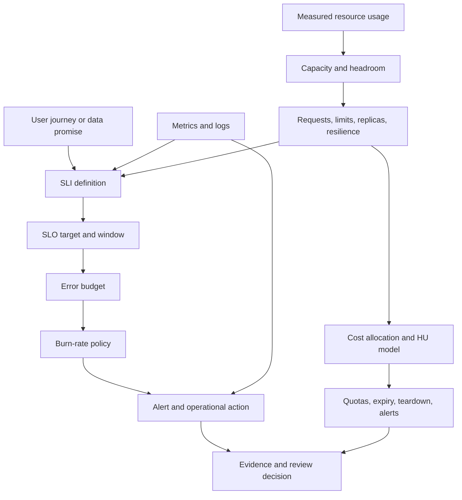

# M17 — Cost and Reliability Rubric

> **Unit 5 of M17 — Production DevOps Integrated Capstone**  
> Target: `Stage 2E — Production DevOps & Platform Engineering/17-Production-DevOps-Integrated-Capstone/cost-and-reliability-rubric.md`

## Abstract and metadata

| Field | Value |
|---|---|
| Module / stage | M17 — Production DevOps Integrated Capstone / Stage 2E |
| Unit | 5 — Cost and reliability rubric |
| Audience | Learner who completed M01–M16 |
| Prerequisites | M03, M05, M08, M10, M11, M13, M15 and M17 Unit 1 |
| Estimated study time | `[ASSUMPTION]` 12–18 hours |
| Estimated implementation/review time | `[ASSUMPTION]` 12–24 hours |
| Last authoring review | 2026-11-04 |
| Default environment | WSL2 Ubuntu or native Linux; `kind` context `kind-m17-lab` |
| Tool baseline | Record actual installed versions in `versions.txt`; use `<VERSION>` until measured |
| Version policy | Verify commands against current official documentation; version-sensitive syntax is marked |
| Human technical validation | Pending; code, tests, alerts, load tests, and teardown remain unexecuted until the learner runs them |

All populated numeric values in worked examples are synthetic or illustrative. Learner measurement tables remain blank until actual experiments are run. No command, test, load test, alert, or teardown is claimed to have been executed during authoring.

## Linked table of contents

1. [Purpose, Scope, and What This Rubric Can Prove](#1-purpose-scope-and-what-this-rubric-can-prove)
2. [Prerequisites and M01–M16 Handoffs](#2-prerequisites-and-m01m16-handoffs)
3. [Unit 5 Learning Objectives (L1–L4)](#3-unit-5-learning-objectives-l1l4)
4. [Core Vocabulary and Concept Map](#4-core-vocabulary-and-concept-map)
5. [Reliability and Cost Reference Model](#5-reliability-and-cost-reference-model)
6. [SLI, SLO, Error Budget, and Burn-Rate Design](#6-sli-slo-error-budget-and-burn-rate-design)
7. [The 100-Point Cost and Reliability Rubric](#7-the-100-point-cost-and-reliability-rubric)
8. [Measurement and Evidence Contract](#8-measurement-and-evidence-contract)
9. [Alert Rules, promtool Tests, and Live Fault Verification](#9-alert-rules-promtool-tests-and-live-fault-verification)
10. [Capacity, Right-Sizing, and Resilience Controls](#10-capacity-right-sizing-and-resilience-controls)
11. [Cost Labels, Hypothetical-Unit Cost Model, and Guardrails](#11-cost-labels-hypothetical-unit-cost-model-and-guardrails)
12. [Reliability-versus-Cost Trade-Off Analysis](#12-reliability-versus-cost-trade-off-analysis)
13. [Required Implementation Artifacts](#13-required-implementation-artifacts)
14. [Hands-on Labs](#14-hands-on-labs)
15. [Self-Check Questions and Answer Key](#15-self-check-questions-and-answer-key)
16. [L4 Reviewer-Chair Exercise and Calibration](#16-l4-reviewer-chair-exercise-and-calibration)
17. [Common Failure Modes and Review-Board Questions](#17-common-failure-modes-and-review-board-questions)
18. [Traceability to Stage Exit Criteria and Other M17 Instruments](#18-traceability-to-stage-exit-criteria-and-other-m17-instruments)
19. [Sources and Verification Notes](#19-sources-and-verification-notes)
20. [Audit Report and Human Sign-Off](#20-audit-report-and-human-sign-off)

---

## 1. Purpose, Scope, and What This Rubric Can Prove

### 1.1 Why this matters in production

A service can be deployed and monitored while still being operated badly. A technical uptime number can look healthy while users experience stale data, slow inference, failed scheduled jobs, or expensive over-provisioning. Conversely, reducing replicas or CPU requests may lower a cost estimate while increasing outage probability and recovery impact.

This rubric assesses **SLO-driven reliability and cost-aware operation**: define a meaningful user outcome, measure it, alert on material degradation, respond when the error budget burns, size resources from evidence, explain cost allocation, and verify that temporary resources are removed.

### 1.2 Scope

The M17 domain contains three workloads:

1. **PostgreSQL data service** — stateful workload with storage and recovery implications.
2. **Scheduled data pipeline** — CronJob or equivalent, with completion and freshness outcomes.
3. **Toy ML inference service** — request success/latency and model-artifact identity.

The default implementation is a local `kind` cluster using synthetic data and learner-owned services only.

### 1.3 What a pass proves — and does not prove

A strong submission demonstrates repeatable **lab-scale** measurement and a defensible reliability/cost decision with traceable evidence. A laptop `kind` cluster demonstrates mechanics, measurement practice, reproducibility, and evidence discipline.

It does **not** demonstrate real multi-region behavior, production traffic, real cloud limits, production billing accuracy, or end-to-end production readiness. It does not prove that a production SLO is achievable or that a local load test predicts production capacity.

### 1.4 Assessment philosophy

- Score evidence, not narrative confidence.
- Require positive and negative tests for important controls.
- Record method, population, time window, sample count, and limitations.
- Distinguish measured fact, inference, assumption, and synthetic example.
- Missing/invalid evidence is visible; it is never silently converted to a pass.
- Budgets are **alerts, not caps**. A budget alert does not itself prevent spending.

## 2. Prerequisites and M01–M16 Handoffs

M17 integrates prior capabilities; it does not re-teach their tools from scratch.

| Module | Handoff | Evidence expected in this rubric |
|---|---|---|
| M03 | Operations and troubleshooting | Timestamped diagnostics, controlled experiment notes, runbook execution |
| M05 | Storage/stateful service operations | PostgreSQL resource usage, storage and recovery dependency notes |
| M08 | GitOps/progressive delivery | Git commit and deployed revision association; rollback considerations |
| M10 | SRE, SLIs/SLOs, error budgets, incidents, postmortems, ORR | SLO document, burn calculation, response policy |
| M11 | Observability | Prometheus metrics/queries, dashboards, alert state, correlated logs |
| M13 | Backup, DR, chaos/fault testing | Recovery context, safe fault exercise, cleanup verification |
| M15 | Capacity, cost labels, compute economics, FinOps | Measured usage, workload labels, HU model, guardrails |
| M17 Unit 1 | Requirements, evidence index, traceability, reproducibility | Stable acceptance criteria, evidence index, commit/run/digest linkage |
| M17 Units 2–4 and 6 | Readiness, incident/recovery, security/release, platform/delivery | Consume this rubric's SLO, alert, capacity, cost and teardown evidence |

M16 golden-path templates may be reused optionally. Backstage and Crossplane are not required.

## 3. Unit 5 Learning Objectives (L1–L4)

1. **[L1]** Define SLI, SLO, error budget, burn rate, capacity, headroom, and resource-unit cost model.
2. **[L1]** Explain why user-centric measurement and a defensible denominator matter.
3. **[L2]** Produce an SLO document and calculate its allowed bad-event budget.
4. **[L2]** Query actual lab metrics, test alert rules with `promtool`, and demonstrate a live alert through a bounded benign fault.
5. **[L2]** Measure load-test behavior and resource usage without claiming laptop results are production benchmarks.
6. **[L2]** Build a reproducible hypothetical-unit cost model with tests and teardown evidence.
7. **[L3]** Analyze uncertainty, percentiles, headroom, correlated failure, and the cost of an additional “nine.”
8. **[L3]** Simulate error-budget policy decisions and document trade-offs in an ADR.
9. **[L4]** Review planted flaws, calibrate scores, and defend a go/no-go recommendation with explicit limitations.

## 4. Core Vocabulary and Concept Map

| Term | Meaning | Common mistake |
|---|---|---|
| SLI | Service Level Indicator: measured user-relevant outcome | Using CPU as the only user outcome |
| SLO | Service Level Objective: target over a defined window | Omitting window or denominator |
| SLA | Service Level Agreement: external/contractual commitment | Treating every SLO as a contract |
| Error budget | Allowed bad events implied by target and eligible population/window | Using an unrelated request count |
| Burn rate | Observed bad-event ratio divided by allowed bad-event ratio | Treating one error as a universal paging threshold |
| Availability | Whether eligible request succeeds under a defined rule | Counting health-check success as user success |
| Freshness | How recently usable data was produced/updated | Counting job start as successful publication |
| p95 latency | Value at or below which 95% of observations fall | Treating p95 as a maximum or trusting tiny samples |
| Throughput | Completed work per unit time | Counting failed attempts |
| Saturation | Pressure on a finite resource | Assuming CPU alone captures all pressure |
| Headroom | Deliberate spare capacity for expected variation and risk | Applying an unexplained universal percentage |
| PDB | PodDisruptionBudget constraining certain voluntary disruptions | Assuming it protects against every outage |
| Request / limit | Kubernetes scheduling input / runtime resource boundary | Assuming request is a hard runtime cap |
| HU | Hypothetical educational cost unit | Presenting it as currency or invoice |
| TTL | Time-to-live/expiry policy | Assuming custom labels enforce TTL automatically |



## 5. Reliability and Cost Reference Model

| Workload | User-relevant promise | Candidate SLI | Cost drivers |
|---|---|---|---|
| PostgreSQL data service | Application can read/write valid records | Successful eligible transaction ratio; query latency | Memory, CPU, storage, I/O, backup retention |
| Scheduled pipeline | Expected dataset is complete and fresh by deadline | Successful runs by deadline; data age | Runtime, retries, schedule frequency, storage |
| ML inference | Valid inference request completes usefully | Successful valid requests; latency percentile | CPU/memory, replicas, model size, artifact storage |

“Real metrics” means metrics emitted by the learner's running lab workload and scraped by the local monitoring stack. Fixtures can test arithmetic and rule logic, but cannot replace live measurements.

### Decision loop

1. State the user outcome and SLO.
2. Identify failure mode and affected workload.
3. Measure baseline behavior.
4. List candidate controls and resource/cost effects.
5. Estimate reliability benefit and uncertainty.
6. Evaluate correlated failure and dependency constraints.
7. Compare scenarios in hypothetical units.
8. Define guardrails and rollback conditions.
9. Run a bounded lab test.
10. Record the decision in an ADR and review after evidence collection.

## 6. SLI, SLO, Error Budget, and Burn-Rate Design

### 6.1 Define an SLI

A robust SLI states the eligible population, good event, bad event, numerator, denominator, source, window, and missing-data treatment. Do not silently exclude timeouts, failed jobs, or missing partitions. Missing telemetry must be treated explicitly as unknown, bad, or a justified exclusion.

\[
SLI = \frac{\text{good eligible events}}{\text{all eligible events}}
\]

For target \(T\) and \(N\) eligible events:

\[
\text{allowed bad events} = N(1-T)
\]

**[ILLUSTRATIVE]** A 99% target over 10,000 eligible requests permits \(10{,}000 \times 0.01 = 100\) bad events. This is arithmetic instruction, not a recommended target.

If 35 bad events occurred, budget consumed is \(35/100=35\%\).

### 6.2 Burn rate

\[
\text{burn rate} =
\frac{\text{observed bad-event ratio}}{1-\text{SLO target}}
\]

For a synthetic 99% SLO, the allowed bad ratio is 1%. If an interval has 4% bad events, burn rate is \(4\%/1\%=4\). The service consumes budget at four times the sustainable rate for that interval. Meaning depends on event population and window. Any lab threshold is `[ASSUMPTION]`, not universal.

### 6.3 SLI categories

- **Availability/success:** Did an eligible request complete successfully?
- **Latency:** Did it complete within a defined boundary?
- **Correctness:** Was the returned result valid, not merely HTTP 200?
- **Freshness:** Was the dataset available by its deadline?
- **Pipeline completion:** Did the run finish and publish complete output?

For latency, define either the fraction below a threshold or a percentile objective with sample-count caveats.

### 6.4 SLO gaming and repair

Bad definition: “The service is available when `/health` returns HTTP 200.” A health endpoint may succeed while user operations fail or data is stale.

Repair: define an eligible user transaction, count valid completions, specify the window, and test a failure while health remains reachable.

Other gaming patterns: excluding timeouts; counting job starts rather than publication; selecting a tiny window; using a metric disconnected from user experience; treating missing telemetry as success; silently changing the denominator.

### 6.5 SLO is not an SLA

An SLO is an internal objective for operational decisions. An SLA is an external or contractual agreement and may contain commitments or consequences. This document does not invent contractual terms.

### 6.6 Error-budget policy

Example lab policy `[ASSUMPTION]`:

| State | Example trigger | Response |
|---|---|---|
| Healthy | Burn within planned rate | Normal release cadence |
| Attention | Short-window burn exceeds declared lab threshold | Inspect recent changes/dependencies; increase review |
| Exhaustion risk | Remaining budget projected to be consumed before window end | Pause non-essential risky changes; prioritize reliability |
| Exhausted | Budget consumed | Require recovery plan and reviewer approval before discretionary risk |

Thresholds must be selected and justified for the lab. A policy identifies owner, action, escalation, and return-to-normal condition.

#### Synthetic error-budget policy simulation

`[SYNTHETIC SCENARIO] [ILLUSTRATIVE]` Assume a 99% SLO over a 10,000-event window. The total allowed bad-event budget is `10,000 × (1 - 0.99) = 100` events.

| Interval | Eligible events | Bad events | Interval bad ratio | Burn rate | Cumulative budget consumed | Example policy interpretation |
|---|---:|---:|---:|---:|---:|---|
| Baseline interval | 1,000 | 5 | 0.5% | 0.5x | 5% | Normal review; no freeze implied |
| Fault interval | 500 | 20 | 4.0% | 4.0x | 25% | Investigate and pause risky discretionary changes if the declared policy says so |
| Recovery interval | 1,000 | 0 | 0% | 0x | 25% | Confirm recovery; do not erase consumed budget |

Calculation: the first interval consumes `5/100 = 5%` of the window budget. The fault interval consumes another `20/100 = 20%`. Cumulative consumption is `25/100 = 25%`. The 4x interval burn rate is not the same as 4% of the total window budget. Learners must state the event population, interval, SLO target, and policy trigger before deciding whether to slow releases or prioritize reliability work.


### 6.7 Three worked SLO examples

All numeric values are `[ILLUSTRATIVE] [ASSUMPTION]`, not industry standards.

**A — Data API request success:** good valid reads / all eligible reads; hypothetical 99% target over 7 days. For 20,000 eligible reads, allowed bad reads = 200. Gaming risk: excluding timeouts or invalid payloads. Negative test: controlled handler failure increases bad-event count.

**B — ML inference latency and errors:** successful valid inferences / eligible requests, plus fraction below a documented latency threshold. Hypothetical 95% under 500 ms in a 1-hour window. This is a product assumption, not a benchmark. Gaming risk: excluding cold starts or failures. Negative test: bounded local delay/failure mode.

**C — Pipeline freshness:** partitions published correctly by deadline / eligible scheduled partitions. Hypothetical 98% over 30 days. For 50 partitions, allowed late/missing partitions = 1. Gaming risk: counting job start without publication. Negative test: fail a synthetic run before publication.

### 6.8 Reusable SLO template

```yaml
# docs/slos/<workload>-slo.yaml
service: "<service-or-workload>"
owner: "<team-or-learner-role>"
user_journey: "<user outcome>"
sli:
  name: "<stable-name>"
  definition: "<good eligible events / all eligible events>"
  numerator: "<good eligible events>"
  denominator: "<all eligible events>"
  source_metric_or_query: "<metric and exact query>"
  missing_data_treatment: "<unknown / bad / justified exclusion>"
window: "<chosen window and rationale>"
target:
  value: 0.99
  rationale: "<user harm approximated and why>"
exclusions: []
error_budget:
  formula: "eligible_events * (1 - target)"
  allowed_bad_events: "<calculated for stated population>"
burn_rate:
  query: "<query>"
  policy: "<windows, threshold assumptions, owner, response>"
response_policy:
  attention: "<action>"
  exhausted: "<action>"
data_freshness_and_retention: "<scrape, retention, gaps>"
test_procedure: "<positive and negative tests>"
evidence_path: "evidence/cost-reliability/<workload>/"
limitations: ["<known limitation>"]
review_date: "<YYYY-MM-DD>"
```

## 7. The 100-Point Cost and Reliability Rubric

### 7.1 Levels and scoring convention

| Level | Meaning | Fraction of criterion weight |
|---|---|---:|
| L1 — Beginner | Identifies criterion and explains evidence needed | 0% |
| L2 — Intermediate | Produces valid measurements, evidence, and repeatable tests | 50% |
| L3 — Advanced | Analyzes uncertainty, trade-offs, failure modes, and improves instrument | 75% |
| L4 — Expert | Reviews flawed evidence, challenges assumptions, calibrates, defends go/no-go | 100% |

This proportional mapping is the rubric's defined scoring convention, not an industry standard. L1 earns zero because recognition alone is not demonstrated operational capability.

Statuses:
- `PASS`: valid evidence exists and an achieved level is selected.
- `FAIL`: required test/control failed; score no higher than L1 and any critical gate fails.
- `NOT_DEMONSTRATED`: evidence missing/insufficient; zero points and visible flag.
- `NOT_APPLICABLE`: requires rationale and reviewer approval; no automatic points. Mandatory stage exit obligations cannot be waived.
- `WAIVED`: only non-mandatory criterion with owner, reason, expiry, compensating control, and reviewer approval. Critical or mandatory stage-exit obligations cannot be waived.

### 7.2 Criteria and weights

| ID | Criterion | Weight | Critical gate | Scope |
|---|---|---:|---|---|
| CR-01 | SLO definition quality | 15 | Yes | Data service, pipeline, ML |
| CR-02 | SLI measurement and telemetry integrity | 10 | Yes | Shared platform/all workloads |
| CR-03 | Burn-rate alerting and live verification | 15 | Yes | Shared platform/all workloads |
| CR-04 | Error-budget policy and operational decisions | 10 | No | All workloads |
| CR-05 | Capacity measurement and right-sizing | 15 | No | All workloads |
| CR-06 | Resilience mechanisms and failure behavior | 15 | Yes | All workloads |
| CR-07 | Cost visibility and allocation model | 10 | No | All workloads |
| CR-08 | Cost guardrails and teardown proof | 10 | Yes | Shared platform |

**Total: exactly 100 points.**

### 7.3 Observable performance descriptors

| Criterion | L1 — Beginner | L2 — Intermediate | L3 — Advanced | L4 — Expert |
|---|---|---|---|---|
| **CR-01 SLO definition (15)** | Identifies user outcome and required fields; no complete definition | Complete SLO with eligible population, good/bad rule, window, target, rationale, exclusions and missing-data handling | Tests denominator integrity, sample size, gaming risks and decision impact | Finds flawed/impossible SLOs in review and proposes measurable repairs |
| **CR-02 Measurement (10)** | Identifies metric source and numerator/denominator | Runs query against scraped lab metrics; records query, window, sample count and raw evidence | Evaluates gaps, warm-up, cardinality, overhead and confounders; repeats runs | Reconstructs result from raw telemetry and challenges flawed metrics |
| **CR-03 Alerting (15)** | Explains burn rate and evidence required | Healthy/failing `promtool` fixtures pass and live bounded fault demonstrates alert path | Justifies windows/thresholds; evaluates false positives/negatives and correlation | Finds/repairs flawed alert and defends calibrated response policy |
| **CR-04 Budget policy (10)** | Explains SLO, remaining budget and operational decisions | Documents owner, actions, thresholds, escalation and correct calculation | Simulates burn data and evaluates policy under uncertainty | Finds perverse incentives and defends go/no-go conditions |
| **CR-05 Capacity (15)** | Explains requests, limits, percentiles, peaks and headroom | Records lab usage and justifies settings from workload behavior | Repeats comparable runs; quantifies uncertainty and alternative sizing | Reviews flawed sizing and defends bounded recommendation/rollback trigger |
| **CR-06 Resilience (15)** | Identifies mechanisms and their limits | Shows applicable configuration and bounded failure test with before/during/after observations | Analyzes correlated failure, dependencies, retry amplification and recovery | Challenges unsupported resilience claims and defends go/no-go with residual risk |
| **CR-07 Cost visibility (10)** | Explains labels, units, time basis and HU limitations | Provides labels and tested per-workload model with baseline/alternative | Tests sensitivity, shared allocation, uncertainty and equivalent windows | Finds double-counting/false precision and defends evidence-based decision |
| **CR-08 Guardrails (10)** | Explains quotas, limits, expiry, alerts and budget limitations | Shows guardrails, cost-risk table and teardown verification | Tests residual detection; analyzes partial cleanup and billing delay | Challenges cleanup claims; requires proof and next-day cloud check where applicable |

### 7.4 Criterion verification contract

| ID | Risk and required scope | Evidence and verification | Positive test | Negative test / failure | Handoffs and later project links |
|---|---|---|---|---|---|
| CR-01 | Meaningless SLO; PostgreSQL, pipeline, ML | `docs/slos/`, query, negative-case record; inspect fields and recalculate | Valid eligible event classified correctly | Timeout, invalid result, or missing telemetry not silently good | M10, M11, Unit 1; Projects 02–03 |
| CR-02 | Broken instrumentation; all workloads | PromQL, query result, metric exposition, timestamps; rerun query | Known good event increments good metric | Controlled failure increments bad metric; missing telemetry follows policy | M11, M10, Unit 1; Projects 01–03 |
| CR-03 | Alert never fires/noisy alert; shared | Rule, fixtures, `promtool` output, live state, timeline and recovery | Failing fixture and live fault fire | Healthy fixture stays inactive | M10, M11, M13, Unit 1; Projects 02–04 |
| CR-04 | SLO without operational action; all | Policy, calculation, simulation, ADR; recalculate inputs | Simulated threshold triggers documented action | Healthy/missing-data case does not cause unjustified action | M10, M08, Unit 1; Projects 02–04 |
| CR-05 | Under/over-provisioning; all | Usage queries, manifests, test method, comparison and limitations | Settings trace to measured use/headroom | Single-average proposal rejected | M05, M10, M11, M15; Projects 01–04 |
| CR-06 | Shared dependency/correlated failure; all | Config, fault record, metrics, recovery and runbook | Workload recovers to declared lab expectation | Controlled failure creates detectable degradation | M03, M05, M08, M10, M11, M13; Projects 01–04 |
| CR-07 | Unallocated waste; all | Label inventory, model input/output, tests and assumptions | Quantities allocated once by documented rule | Missing labels/negative quantities rejected or reported | M15, Unit 1; Projects 01–04 |
| CR-08 | Unmanaged resources/charges; shared | Guardrail config, inventory, expiry, cost-risk table, teardown report | Lab resources absent or accounted for | Retained lab resource reported; non-zero exit | M03, M07, M13, M15; Projects 01–04 |

### 7.5 Score calculation and worked example

For criterion weight \(W\): L1 = \(0W\), L2 = \(0.50W\), L3 = \(0.75W\), L4 = \(1.00W\).

**[ILLUSTRATIVE]** CR-01 L3 = \(15 \times 0.75 = 11.25\); CR-02 L2 = 5; CR-03 L2 = 7.5; CR-04 L3 = 7.5; CR-05 L2 = 7.5; CR-06 L2 = 7.5; CR-07 L3 = 7.5; CR-08 L2 = 5. Total = **58.75/100**. If CR-03 lacks live-fault evidence, it is `NOT_DEMONSTRATED`, scores zero, and the critical gate fails regardless of the numeric total.

A `PASS` recommendation requires all critical criteria demonstrated, mandatory stage-exit obligations satisfied through the full M17 assessment, no fabricated evidence, and human reviewer sign-off. This unit alone cannot approve the entire capstone.

## 8. Measurement and Evidence Contract

Every record contains workload/environment, commit SHA and deployed digest where applicable, tool/version, command/query, timestamps/timezone, window/scrape interval, sample count/eligible population, warm-up, concurrency/rate/duration, successful/failed events, latency distribution including p95 where available, resource observations, fault/recovery timing, confounders, limitations, raw evidence path, and checksum where appropriate.

| Type | Example | Label |
|---|---|---|
| Measurement | Prometheus result from running lab workload | `MEASURED` with timestamp/query |
| Inference | CPU pressure likely contributed to latency | `INFERENCE` plus observations |
| Assumption | Workload approximates expected local behavior | `[ASSUMPTION]` |
| Synthetic example | Values used for arithmetic instruction | `[SYNTHETIC SCENARIO]` / `[ILLUSTRATIVE]` |

### Blank learner measurement table

| Run ID | Phase | Start/end timestamp | Requests/jobs | Successes | Failures | p95 latency | Error rate | CPU/memory | Notes |
|---|---|---|---:|---:|---:|---:|---:|---|---|
| | Before fault | | | | | | | | |
| | During fault | | | | | | | | |
| | After recovery | | | | | | | | |

### Statistical honesty

- State warm-up, cache/model loading, and connection-pool treatment.
- Report sample count; p95 from a small sample is unstable.
- Load generator and scrape overhead consume resources.
- Laptop contention, WSL2/Docker overhead, background processes, thermal/power behavior, and memory limits confound results.
- Scrape intervals may miss or blur short events.
- The client may saturate before the service.
- Repeat runs and report variation; do not cherry-pick.
- p50/p95/p99 can reveal tail behavior but depend on representative population and sufficient observations.
- Report completed successful throughput, not attempted requests.
- Define recovery start/end events precisely.

No laptop measurement may be extrapolated to production capacity, cloud cost, or real-world SLO attainment. Critical criteria require automated/live verification, not screenshot alone. Associate evidence with commit, run ID, timestamp, and digest; follow Unit 1 evidence-index/checksum rules and redact secrets.

## 9. Alert Rules, promtool Tests, and Live Fault Verification

### 9.1 Metric contract

These are sample instrumentation names, not built-in Kubernetes metrics:

- `m17_http_requests_total{service,code}` — completed HTTP requests by response code.
- `m17_http_request_duration_seconds_bucket{service,le}` — request-duration histogram buckets.
- `m17_pipeline_runs_total{pipeline,result}` — completed pipeline runs by result.

The service must emit and Prometheus must scrape these metrics, or the learner must adapt the rule and fixtures consistently.

### 9.2 Example SLO burn-rate rule

`prometheus/m17-alerts.yaml`:

```yaml
# File: prometheus/m17-alerts.yaml
groups:
  - name: m17-cost-reliability
    rules:
      - alert: M17HighRequestErrorBurn
        expr: |
          (
            (
              sum(rate(m17_http_requests_total{service="ml-inference",code=~"5.."}[5m]))
              /
              clamp_min(sum(rate(m17_http_requests_total{service="ml-inference"}[5m])), 1)
            ) / (1 - 0.99) > 2
          )
          and
          (
            (
              sum(rate(m17_http_requests_total{service="ml-inference",code=~"5.."}[10m]))
              /
              clamp_min(sum(rate(m17_http_requests_total{service="ml-inference"}[10m])), 1)
            ) / (1 - 0.99) > 2
          )
        for: 2m
        labels:
          severity: warning
          workload: ml-inference
        annotations:
          summary: "ML inference is burning its request-success error budget"
          description: "The 5m and 10m error ratios both exceed the illustrative 2x burn-rate threshold."
```

The example assumes a 99% request-success SLO, so the allowed bad-event ratio is 1%. Burn rate is observed bad-event ratio divided by the allowed bad-event ratio. The `> 2` threshold, 5m/10m windows, and 2m hold are `[ASSUMPTION]` for a bounded local exercise—not universal paging policy. The two-window condition reduces sensitivity to a brief spike, but the selected windows must be justified against the workload and measurement volume. A production policy may use different windows and thresholds.

### 9.3 `promtool` fixtures

`prometheus/m17-alerts.test.yaml`:

```yaml
# File: prometheus/m17-alerts.test.yaml
# [VERSION-SENSITIVE] Verify test syntax and range evaluation with installed promtool.
rule_files:
  - m17-alerts.yaml
evaluation_interval: 1m
tests:
  - name: healthy traffic does not alert
    interval: 1m
    input_series:
      - series: 'm17_http_requests_total{service="ml-inference",code="200"}'
        values: '0+100x10'
      - series: 'm17_http_requests_total{service="ml-inference",code="500"}'
        values: '0+0x10'
    alert_rule_test:
      - eval_time: 10m
        alertname: M17HighRequestErrorBurn
        exp_alerts: []
  - name: sustained failing traffic alerts
    interval: 1m
    input_series:
      - series: 'm17_http_requests_total{service="ml-inference",code="200"}'
        values: '0+80x10'
      - series: 'm17_http_requests_total{service="ml-inference",code="500"}'
        values: '0+20x10'
    alert_rule_test:
      - eval_time: 10m
        alertname: M17HighRequestErrorBurn
        exp_alerts:
          - exp_labels:
              severity: warning
              workload: ml-inference
            exp_annotations:
              summary: "ML inference is burning its request-success error budget"
              description: "The 5m and 10m error ratios both exceed the illustrative 2x burn-rate threshold."
```

The synthetic failing fixture has a 20% bad-event ratio. Against a 99% SLO, its illustrative burn rate is `20% / 1% = 20x`, which exceeds the `2x` test threshold. The healthy fixture has no 5xx events. Fixture values are synthetic and do not represent a measured workload.

**[VERSION-SENSITIVE]** Verify fixture syntax, counter-series notation, `for` timing, and range evaluation against the installed Prometheus version.

```bash
promtool check rules prometheus/m17-alerts.yaml
promtool test rules prometheus/m17-alerts.test.yaml
```

Representative example — your output will differ:

```text
Checking prometheus/m17-alerts.yaml
  SUCCESS: 1 rules found

Unit Testing: prometheus/m17-alerts.test.yaml
  SUCCESS
```

Interpretation: local `promtool` accepted the rule and the two fixture expectations. This does not prove that the application emits the metric, Prometheus scrapes it, Alertmanager routes it, a notification is delivered, or a live fault triggers the path. The live benign-fault exercise below remains mandatory.

### 9.4 Live benign fault

**⚠ FAULT INJECTION (BENIGN, OWN LAB)**

Target only learner-owned `ml-inference` in `kind-m17-lab`.

Before mutation: assert `kubectl --context kind-m17-lab config current-context`; inspect `kubectl --context kind-m17-lab get pods,svc -n m17-ml`; confirm namespace ownership; define abort conditions (unexpected context/namespace, unrelated workloads, resource pressure, uncertain recovery); capture baseline.

Use a reviewed, bounded application fault mode that returns controlled 5xx responses. Do not inject into shared/external systems. Capture query, alert state, timestamps, logs and impact. Disable fault mode, verify successful requests and alert resolution, and confirm no temporary fault configuration remains. Any mutating command must include `--context kind-m17-lab`.

### 9.5 Runbook snippet

| Field | Instruction |
|---|---|
| Trigger | `M17HighRequestErrorBurn` fires for `ml-inference` |
| Impact | Some inference requests may fail; quantify from eligible request metrics |
| Prerequisites | Confirm context, namespace, commit/digest, dashboard access |
| Safe diagnostics | Query request rate and 5xx ratio; inspect readiness, recent rollout, logs and dependencies |
| Decision | Correlate increase with recent change or dependency failure |
| Mitigation | Disable lab fault or roll back via documented GitOps workflow |
| Recovery | Restore known-good revision; verify ready endpoints and successful requests |
| Verification | Error ratio returns to baseline range, alert resolves, fault setting absent |
| Stop/escalate | Unexpected target, unstable cluster, or uncertain recovery path |

Fixture tests prove rule behavior for supplied series. A live fault proves the selected local instrumentation-to-alert path during that experiment. Neither proves production notification delivery, real traffic coverage, correct SLO design, or production resilience.

## 10. Capacity, Right-Sizing, and Resilience Controls

### 10.1 Measure before sizing

Collect CPU/memory distributions, throttling where available, OOM/restarts, requests/limits, replica placement/readiness, pipeline duration/backlog/freshness, model load time/inference concurrency, and storage behavior. Include startup, steady-state, burst and recovery conditions where possible.

An average can conceal bursts and startup peaks. Report p50/p95/p99 or appropriate percentiles, peak, sample count, workload duration, burst frequency, growth assumptions, headroom rationale, risk tolerance, and rollback trigger. There is no universal production headroom percentage. If data is noisy or too small, state low confidence.

### 10.2 Requests, limits, and resilience

- CPU requests influence scheduling; they do not guarantee CPU availability in every condition.
- CPU limits can constrain execution and lead to throttling.
- Memory limit breaches can lead to OOM termination.
- Requests too low can create contention; requests too high can prevent scheduling and waste allocatable capacity.
- Replicas improve serving flexibility only when capacity, placement, dependencies and storage permit. They do not fix a shared database or saturated node.
- PodDisruptionBudgets constrain certain voluntary disruptions; they do not protect against involuntary node failure, application bugs, dependency outages, or every deletion.
- Startup probes allow slow starts; readiness controls traffic eligibility; liveness detects a process that should be restarted. Poor liveness checks can cause restart loops during dependency slowness.
- Retries require bounded attempts, backoff and jitter. Unbounded synchronized retries amplify overload.
- Timeouts bound waiting and resource occupancy.
- Graceful shutdown should stop new work, finish or safely abandon in-flight work, and release resources predictably.
- Pipeline retries can worsen backlog and create duplicates unless runs are idempotent.

### 10.3 VPA awareness

Vertical Pod Autoscaler recommendations are optional decision support, not automatic truth. They depend on history, workload changes, policy, and available observations. VPA is **Awareness/optional**, not required. Record version/mode if used and compare recommendations with direct measurements.

### 10.4 Resilience experiment

Record baseline success/error rate, p95, throughput and resource use; fault and expected signal; during-fault impact; mitigation/recovery action; time to return to declared range; data integrity/freshness; and what the experiment cannot prove.

## 11. Cost Labels, Hypothetical-Unit Cost Model, and Guardrails

### 11.1 Labels and allocation

```yaml
metadata:
  labels:
    app.kubernetes.io/part-of: m17-capstone
    m17.example/workload: ml-inference
    m17.example/environment: local
    m17.example/owner: learner
    m17.example/managed-by: m17-capstone
    m17.example/project: production-devops-capstone
    m17.example/ephemeral: "false"
```

For temporary resources use `m17.example/ephemeral: "true"` and record expiry/TTL in the owning inventory/automation. A custom Kubernetes label does not enforce TTL by itself. Labels support grouping but may not precisely attribute shared node, registry, monitoring, or storage overhead. State the shared-resource allocation rule and avoid double-counting.

### 11.2 Hypothetical-unit model

\[
\text{estimated cost units} =
\sum(\text{resource quantity} \times \text{hypothetical unit rate} \times \text{time quantity})
\]

Define dimensions explicitly: quantity is measured in `vCPU`, `GiB` of memory, or `GiB` of storage; the rate denominator is respectively `vCPU-hour`, `GiB-hour`, or `GiB-day`; and the time quantity is in matching `hour` or `day` units. The formula is `quantity × time × rate`, where rate is HU per rate-unit. Do not multiply a quantity already expressed in resource-hours by time again. HU is educational, not currency or a cloud invoice.

`cost-model/input.json`:

```json
{
  "rate_basis": "hypothetical",
  "scenarios": {
    "baseline": [
      {"workload":"data-service","resource":"cpu","quantity":1.0,"resource_unit":"vCPU","rate_unit":"vCPU-hour","rate":2.0,"time":24.0,"time_unit":"hour","rate_source":"hypothetical-example"},
      {"workload":"scheduled-pipeline","resource":"cpu","quantity":0.5,"resource_unit":"vCPU","rate_unit":"vCPU-hour","rate":2.0,"time":4.0,"time_unit":"hour","rate_source":"hypothetical-example"},
      {"workload":"ml-inference","resource":"memory","quantity":2.0,"resource_unit":"GiB","rate_unit":"GiB-hour","rate":0.5,"time":24.0,"time_unit":"hour","rate_source":"hypothetical-example"}
    ],
    "alternative": [
      {"workload":"data-service","resource":"cpu","quantity":1.0,"resource_unit":"vCPU","rate_unit":"vCPU-hour","rate":2.0,"time":24.0,"time_unit":"hour","rate_source":"hypothetical-example"},
      {"workload":"scheduled-pipeline","resource":"cpu","quantity":0.5,"resource_unit":"vCPU","rate_unit":"vCPU-hour","rate":2.0,"time":4.0,"time_unit":"hour","rate_source":"hypothetical-example"},
      {"workload":"ml-inference","resource":"memory","quantity":1.0,"resource_unit":"GiB","rate_unit":"GiB-hour","rate":0.5,"time":24.0,"time_unit":"hour","rate_source":"hypothetical-example"}
    ]
  }
}
```

`[ILLUSTRATIVE]` Baseline ML memory cost = \(2 \times 0.5 \times 24 = 24\) HU; alternative = 12 HU. This does not establish whether halving memory is safe. If it increases OOM risk or latency, apparent savings may be a poor decision.

### 11.3 Cost model script

`cost-model/model.py`:

```python
# File: cost-model/model.py
from __future__ import annotations
import json
import math
import sys
from collections import defaultdict
from pathlib import Path
from typing import Any

# Quantity unit, rate denominator, and time unit must be dimensionally aligned.
UNIT_RULES = {
    "cpu": ("vCPU", "vCPU-hour", "hour"),
    "memory": ("GiB", "GiB-hour", "hour"),
    "storage": ("GiB", "GiB-day", "day"),
}


def number(value: Any, field: str) -> float:
    if isinstance(value, bool) or not isinstance(value, (int, float)):
        raise ValueError(f"{field} must be numeric")
    result = float(value)
    if not math.isfinite(result) or result < 0:
        raise ValueError(f"{field} must be finite and non-negative")
    return result


def estimate_rows(rows: list[dict[str, Any]]) -> dict[str, Any]:
    if not isinstance(rows, list) or not rows:
        raise ValueError("scenario rows must be a non-empty list")
    by_workload: dict[str, float] = defaultdict(float)
    for i, row in enumerate(rows):
        if not isinstance(row, dict):
            raise ValueError(f"row {i} must be a mapping")
        for key in ("workload", "resource", "resource_unit", "rate_unit",
                    "time_unit", "rate_source"):
            if not isinstance(row.get(key), str) or not row[key].strip():
                raise ValueError(f"row {i}: {key} must be non-empty text")
        expected = UNIT_RULES.get(row["resource"])
        if expected is None:
            raise ValueError(f"row {i}: unsupported resource {row['resource']!r}")
        if (row["resource_unit"], row["rate_unit"], row["time_unit"]) != expected:
            raise ValueError(
                f"row {i}: units must be resource_unit/rate_unit/time_unit={expected}"
            )
        quantity = number(row.get("quantity"), "quantity")
        rate = number(row.get("rate"), "rate")
        duration = number(row.get("time"), "time")
        by_workload[row["workload"]] += quantity * duration * rate
    return {
        "by_workload_hu": {k: round(v, 6) for k, v in sorted(by_workload.items())},
        "total_hu": round(sum(by_workload.values()), 6),
        "rate_basis": "hypothetical",
    }


def estimate(document: dict[str, Any]) -> dict[str, Any]:
    if not isinstance(document, dict) or document.get("rate_basis") != "hypothetical":
        raise ValueError("rate_basis must be 'hypothetical'")
    scenarios = document.get("scenarios")
    if not isinstance(scenarios, dict) or not scenarios:
        raise ValueError("scenarios must be a non-empty mapping")
    result = {}
    for name, rows in scenarios.items():
        if not isinstance(name, str) or not name.strip() or not isinstance(rows, list):
            raise ValueError("each scenario needs a name and rows list")
        result[name] = estimate_rows(rows)
    return {
        "scenarios": result,
        "currency": None,
        "warning": "Hypothetical educational units; not an invoice.",
    }


def main() -> int:
    if len(sys.argv) != 2:
        print("usage: python cost-model/model.py cost-model/input.json", file=sys.stderr)
        return 2
    try:
        doc = json.loads(Path(sys.argv[1]).read_text(encoding="utf-8"))
        result = estimate(doc)
    except (OSError, json.JSONDecodeError, ValueError) as exc:
        print(f"invalid input: {exc}", file=sys.stderr)
        return 2
    print(json.dumps(result, indent=2, sort_keys=True))
    return 0


if __name__ == "__main__":
    raise SystemExit(main())
```

`cost-model/test_model.py`:

```python
# File: cost-model/test_model.py
import unittest
from model import estimate, estimate_rows


def row(**overrides):
    value = {
        "workload": "ml-inference",
        "resource": "memory",
        "quantity": 2,
        "resource_unit": "GiB",
        "rate_unit": "GiB-hour",
        "rate": 0.5,
        "time": 24,
        "time_unit": "hour",
        "rate_source": "hypothetical-test-rate",
    }
    value.update(overrides)
    return value


class CostModelTests(unittest.TestCase):
    def test_hypothetical_cost(self):
        result = estimate_rows([row()])
        self.assertEqual(result["total_hu"], 24.0)

    def test_negative_quantity_rejected(self):
        with self.assertRaises(ValueError):
            estimate_rows([row(quantity=-1)])

    def test_negative_rate_rejected(self):
        with self.assertRaises(ValueError):
            estimate_rows([row(rate=-0.5)])

    def test_non_hypothetical_basis_rejected(self):
        with self.assertRaises(ValueError):
            estimate({"rate_basis": "USD", "scenarios": {"base": [row()]}})

    def test_scenario_comparison(self):
        doc = {"rate_basis": "hypothetical", "scenarios": {
            "base": [row()],
            "small": [row(quantity=1)],
        }}
        result = estimate(doc)
        self.assertEqual(result["scenarios"]["base"]["total_hu"], 24.0)
        self.assertEqual(result["scenarios"]["small"]["total_hu"], 12.0)

    def test_inconsistent_units_rejected(self):
        with self.assertRaisesRegex(ValueError, "units must be"):
            estimate_rows([row(resource_unit="vCPU", rate_unit="vCPU-hour")])

    def test_boolean_quantity_rejected(self):
        with self.assertRaises(ValueError):
            estimate_rows([row(quantity=True)])

    def test_non_mapping_row_rejected(self):
        with self.assertRaises(ValueError):
            estimate_rows(["not-a-row"])


if __name__ == "__main__":
    unittest.main()
```

Run:

```bash
python -m unittest discover -s cost-model -p 'test_*.py'
python cost-model/model.py cost-model/input.json
```

Representative example — your output will differ:

```json
{
  "currency": null,
  "scenarios": {
    "baseline": {"total_hu": 76.0, "rate_basis": "hypothetical"},
    "alternative": {"total_hu": 64.0, "rate_basis": "hypothetical"}
  },
  "warning": "Hypothetical educational units; not an invoice."
}
```

The example is illustrative. It does not prove resource consumption equals requested allocation, reliability is unchanged, or HU matches provider charges.

### 11.4 Guardrails and cost-risk table

Use applicable quotas/limits, owner/environment/workload labels, explicit expiry for temporary resources, idle-resource inventory, preflight checks, teardown verification, and optional cloud budget/alert evidence only after approval. Budgets alert; they do not necessarily block resource creation or charges.

| Resource/workload | Owner/environment/labels | Purpose | Quantity/unit | Rate/source | Time window | Estimated HU | Waste hypothesis | Waste validation method | Reliability impact if reduced | Guardrail/alert | Expiry/TTL | Teardown proof | Risk/assumption/approver |
|---|---|---|---|---|---|---:|---|---|---|---|---|
| | | | | Hypothetical by default | | | | | | | |

Optional cloud requires resource diagram/inventory, account/region assumptions without IDs, preflight, cost-risk table, redacted budget/alert evidence, written teardown contract, proof of removal, and next-day cost check with billing-delay note.

## 12. Reliability-versus-Cost Trade-Off Analysis

### 12.1 Decision method

State user outcome/SLO; identify failure mode; measure baseline; list candidate controls and cost effects; estimate reliability benefit/uncertainty; evaluate correlated failure/dependencies; compare HU scenarios; define guardrails/rollback; run bounded lab test; record ADR and review after evidence.

### 12.2 Three trade-offs

**One additional replica:** reducing replicas may save HU but leave no serving capacity after a pod disruption. An extra replica costs resources and may improve serving flexibility only if capacity, placement and dependencies permit. Check shared database, node placement, storage, and failure domains. Replica count alone is not HA.

**Higher requests/headroom:** more requests can reduce contention but consume allocatable capacity and block scheduling; lower requests improve packing but may increase contention/throttling. Compare equivalent runs and document distribution, headroom rationale and rollback trigger. No universal production percentage.

**More frequent pipeline processing/retries:** shorter intervals may improve freshness but increase compute and overlapping jobs; retries can help transient faults but amplify load, duplicate work and backlog. Measure duration, deadline, backlog, retry count and idempotency.

### 12.3 Cost of an additional “nine”

Tightening 99% to 99.9% reduces allowed bad-event fraction from 1% to 0.1%, a tenfold reduction for the same population. It does **not** imply a universal tenfold cost increase.

`[ILLUSTRATIVE] [ASSUMPTION]` For 100,000 events:
- 99% target: 1,000 allowed bad events.
- 99.9% target: 100 allowed bad events.

Hypothetical architecture comparison: baseline 40 HU/window; enhanced design 52 HU/window; incremental modeled cost 12 HU/window. This does not prove the enhanced design meets 99.9%; that requires measurements and fault tests. Additional nines may require redundancy, independent failure domains, dependency redesign or stronger operations, with system-specific costs.

`[ILLUSTRATIVE] [ASSUMPTION]` Suppose a design change raises modeled cost from 40 HU to 52 HU per equivalent window (+12 HU). It is only justified if the declared 99.9% user-outcome target is supported by a measurable design hypothesis (for example, an independently placed serving replica plus a verified dependency/recovery path), and the learner demonstrates improved SLI behavior under the relevant lab fault without unacceptable regressions. The extra 12 HU alone does not buy an additional nine; evidence must connect the control to the SLO.


### 12.4 ADR template

```markdown
# ADR-NNN — <decision title>
- Status: proposed / accepted / rejected / superseded
- Date:
- Owner:
- Review date:

## Context
User outcome, SLO, workload, failure mode and constraints.

## Options
Include doing nothing.

## Evidence
Queries, window, sample count, commit/digest, test conditions,
confounders and evidence paths. Separate measurement from inference.

## Cost model
Hypothetical inputs, units, rates, time basis, assumptions and sensitivity.

## Reliability risks
Failure domains, dependency constraints, data integrity and recovery.

## Decision
Selected option and rationale.

## Guardrails
SLI/SLO, alert, quota/limit and cost signal.

## Rollback trigger
Measurable condition and safe reversal.

## Owner and review date
```

## 13. Required Implementation Artifacts

The following are artifacts for the learner's **capstone implementation repository**, not changes to the learning-roadmap repository.

| Artifact | Responsibility | Verification |
|---|---|---|
| `rubric/cost-reliability-rubric.yaml` | Weights, IDs, levels, evidence, criticality | Parse and sum weights |
| `rubric/submission.yaml` | Status, level, evidence per criterion | Scoring script |
| `rubric/score.py`, `rubric/test_score.py` | Deterministic scoring and negative tests | Unit test |
| `docs/slos/` | Workload SLOs | Field/query review |
| `prometheus/m17-alerts.yaml` and `.test.yaml` | Rules and fixtures | `promtool` |
| `load-test/` | Local-only bounded test and records | Target guard |
| `cost-model/` | HU input, model and tests | Unit tests |
| `scripts/verify-teardown.sh` | Inspect residual lab resources | Non-zero on residuals |
| `docs/cost-risk-table.md` | Resource risk/expiry inventory | Reviewer inspection |
| `evidence/cost-reliability/` | Raw queries, outputs, timestamps, checksums | Unit 1 evidence index |

### 13.1 Rubric YAML

`rubric/cost-reliability-rubric.yaml`:

```yaml
# File: rubric/cost-reliability-rubric.yaml
schema_version: 1
score_convention:
  L1: 0.0
  L2: 0.5
  L3: 0.75
  L4: 1.0
  note: "Defined M17 rubric convention; not an industry standard."
criteria:
  - id: CR-01
    name: SLO definition quality
    risk_rationale: "A weak or gameable denominator can hide user-visible failures and make the SLO meaningless."
    weight: 15
    critical: true
    stage_exit_gate: false
    scope: [data-service, scheduled-pipeline, ml-inference]
    levels:
      L1: "Identifies user outcome and required fields; no complete definition."
      L2: "Complete SLO with population, good/bad events, window, target, rationale, exclusions and missing-data handling."
      L3: "Tests denominator integrity, sample size, gaming risks and decision impact."
      L4: "Finds flawed SLOs in review and proposes measurable repairs."
    evidence_required: [slo_document, metric_query, negative_case, review_notes]
    positive_test: "Valid eligible event is counted and classified correctly."
    negative_test: "Timeout, invalid result or missing telemetry is not silently good."
    handoffs: [M10, M11, M17-Unit-1]
    projects: [Project-02, Project-03]
  - id: CR-02
    name: SLI measurement and telemetry integrity
    risk_rationale: "Missing, stale, or incorrectly labelled telemetry can create false confidence and invalid scoring."
    weight: 10
    critical: true
    stage_exit_gate: true
    scope: [shared-platform, data-service, scheduled-pipeline, ml-inference]
    levels:
      L1: "Identifies metric source and numerator/denominator."
      L2: "Queries scraped lab metrics and records query, window, sample count and raw evidence."
      L3: "Evaluates gaps, warm-up, cardinality, overhead and confounders; repeats runs."
      L4: "Reconstructs result from raw telemetry and challenges flawed metrics."
    evidence_required: [promql_query, query_result, instrumentation_reference, timestamps]
    positive_test: "Known good event increments good-event metric."
    negative_test: "Controlled failure increments bad-event metric; missing telemetry follows policy."
    handoffs: [M11, M10, M17-Unit-1]
    projects: [Project-01, Project-02, Project-03]
  - id: CR-03
    name: Burn-rate alerting and live verification
    risk_rationale: "An alert that never fires or is disconnected from live telemetry delays detection of budget-consuming failures."
    weight: 15
    critical: true
    stage_exit_gate: true
    scope: [shared-platform, data-service, scheduled-pipeline, ml-inference]
    levels:
      L1: "Explains burn rate, alert purpose and required evidence."
      L2: "Passes healthy/failing promtool fixtures and demonstrates live alert during bounded benign fault."
      L3: "Justifies windows/thresholds and evaluates false positives/negatives."
      L4: "Finds/repairs flawed alert and defends calibrated response policy."
    evidence_required: [rule_file, promtool_output, live_alert_state, fault_timeline, recovery_record]
    positive_test: "Failing fixture and live fault produce intended alert."
    negative_test: "Healthy fixture does not alert."
    handoffs: [M10, M11, M13, M17-Unit-1]
    projects: [Project-02, Project-03, Project-04]
  - id: CR-04
    name: Error-budget policy and operational decisions
    risk_rationale: "A budget without an owner/action policy does not change risky operational behavior."
    weight: 10
    critical: false
    stage_exit_gate: false
    scope: [data-service, scheduled-pipeline, ml-inference]
    levels:
      L1: "Explains SLO, remaining budget and operational decisions."
      L2: "Documents owner, actions, thresholds, escalation and correct calculation."
      L3: "Simulates burn data and evaluates policy under uncertainty."
      L4: "Finds perverse incentives and defends go/no-go conditions."
    evidence_required: [budget_policy, calculation, simulation, adr_or_review]
    positive_test: "Simulated threshold produces documented action."
    negative_test: "Healthy/missing-data case does not trigger unjustified action."
    handoffs: [M10, M08, M17-Unit-1]
    projects: [Project-02, Project-03, Project-04]
  - id: CR-05
    name: Capacity measurement and right-sizing
    risk_rationale: "Poor sizing can cause saturation, latency, OOM events, wasted capacity, or unschedulable workloads."
    weight: 15
    critical: false
    stage_exit_gate: false
    scope: [data-service, scheduled-pipeline, ml-inference]
    levels:
      L1: "Explains requests, limits, percentiles, peaks and headroom."
      L2: "Records lab usage and justifies settings from observed workload behavior."
      L3: "Repeats comparable runs and quantifies uncertainty and alternatives."
      L4: "Reviews flawed sizing and defends bounded recommendation/rollback trigger."
    evidence_required: [usage_queries, resource_manifests, test_method, comparison, limitations]
    positive_test: "Settings trace to measured usage and headroom rationale."
    negative_test: "Single-average proposal without peak/headroom evidence is rejected."
    handoffs: [M05, M10, M11, M15, M17-Unit-1]
    projects: [Project-01, Project-02, Project-03, Project-04]
  - id: CR-06
    name: Resilience mechanisms and failure behavior
    risk_rationale: "Unverified redundancy and retry behavior can amplify failures or leave shared dependencies as single points of failure."
    weight: 15
    critical: true
    stage_exit_gate: true
    scope: [data-service, scheduled-pipeline, ml-inference]
    levels:
      L1: "Identifies resilience mechanisms and limits."
      L2: "Shows applicable config and bounded fault test with before/during/after observations."
      L3: "Analyzes correlated failure, dependencies, retry amplification and recovery."
      L4: "Challenges unsupported claims and defends go/no-go with residual risk."
    evidence_required: [configuration, fault_record, metrics, recovery_verification, runbook]
    positive_test: "Workload recovers to declared lab expectation and SLI returns to range."
    negative_test: "Controlled failure creates detectable degradation; controls do not overclaim."
    handoffs: [M03, M05, M08, M10, M11, M13, M17-Unit-1]
    projects: [Project-01, Project-02, Project-03, Project-04]
  - id: CR-07
    name: Cost visibility and allocation model
    risk_rationale: "Unlabelled or dimensionally inconsistent allocation hides waste and creates false precision."
    weight: 10
    critical: false
    stage_exit_gate: false
    scope: [data-service, scheduled-pipeline, ml-inference, shared-platform]
    levels:
      L1: "Explains labels, units, time basis and HU limits."
      L2: "Provides labels and tested per-workload model with baseline/alternative."
      L3: "Tests sensitivity, shared allocation, uncertainty and equivalent windows."
      L4: "Finds double-counting/false precision and defends evidence-based decision."
    evidence_required: [label_inventory, model_input, model_output, tests, assumptions]
    positive_test: "Workload quantities allocated once by documented rule."
    negative_test: "Missing labels and invalid quantities are rejected or reported."
    handoffs: [M15, M17-Unit-1]
    projects: [Project-01, Project-02, Project-03, Project-04]
  - id: CR-08
    name: Cost guardrails and teardown proof
    risk_rationale: "Unbounded ephemeral resources and unverified cleanup can leave residual resource use or charges."
    weight: 10
    critical: true
    stage_exit_gate: true
    scope: [shared-platform]
    levels:
      L1: "Explains quotas, limits, expiry, alerts and budget limitations."
      L2: "Shows guardrails, cost-risk table and teardown verification."
      L3: "Tests residual detection and analyzes partial cleanup/billing delay."
      L4: "Challenges cleanup claims and requires proof/next-day cloud check when applicable."
    evidence_required: [guardrail_config, inventory, expiry_record, cost_risk_table, teardown_report]
    positive_test: "Lab resources absent or accounted for after teardown."
    negative_test: "Retained lab resource is reported with non-zero exit."
    handoffs: [M03, M07, M13, M15, M17-Unit-1]
    projects: [Project-01, Project-02, Project-03, Project-04]
```

### 13.2 Sample learner submission

`rubric/submission.yaml`:

```yaml
# File: rubric/submission.yaml
schema_version: 1
submission_type: incomplete_example_not_a_pass
criteria:
  - id: CR-01
    status: NOT_DEMONSTRATED
    level: L1
    evidence: []
    reason: "SLO document, query, negative case, and review evidence have not been submitted."
  - id: CR-02
    status: NOT_DEMONSTRATED
    level: L1
    evidence: []
    reason: "Metric query and telemetry integrity evidence have not been submitted."
  - id: CR-03
    status: NOT_DEMONSTRATED
    level: L1
    evidence: []
    reason: "Promtool fixtures and live alert/fault evidence have not been submitted."
  - id: CR-04
    status: NOT_DEMONSTRATED
    level: L1
    evidence: []
    reason: "Budget policy, calculation, simulation, and review evidence have not been submitted."
  - id: CR-05
    status: NOT_DEMONSTRATED
    level: L1
    evidence: []
    reason: "Resource measurements and sizing comparison have not been submitted."
  - id: CR-06
    status: NOT_DEMONSTRATED
    level: L1
    evidence: []
    reason: "Configuration, fault record, recovery verification, and runbook evidence have not been submitted."
  - id: CR-07
    status: NOT_DEMONSTRATED
    level: L1
    evidence: []
    reason: "Label inventory, model inputs/outputs, tests, and assumptions have not been submitted."
  - id: CR-08
    status: NOT_DEMONSTRATED
    level: L1
    evidence: []
    reason: "Guardrail configuration, inventory, expiry, cost-risk table, and teardown report have not been submitted."
```

Run the scorer against the implementation repository's evidence root:

```bash
python -m unittest discover -s rubric -p 'test_score.py'
python rubric/score.py --rubric rubric/cost-reliability-rubric.yaml --submission rubric/submission.yaml --evidence-root .
```

Representative example — your output will differ: the deliberately incomplete sample submission returns a zero score, lists critical gate failures `CR-01`, `CR-02`, `CR-03`, `CR-06`, and `CR-08`, and exits non-zero. That is the intended result for an unproven sample; it is not a passing learner score.

This is deliberately an incomplete schema illustration, not a passing submission. It keeps every criterion visibly `NOT_DEMONSTRATED` until the full required artifact set exists. A real `PASS` submission must provide one evidence record for every `evidence_required` artifact, a real file path, matching SHA-256, timestamp, and commit provenance. Synthetic examples cannot satisfy learner evidence.

### 13.3 Scoring script

`rubric/score.py`:

```python
# File: rubric/score.py
from __future__ import annotations
import argparse
import hashlib
import json
import re
import sys
from datetime import date, datetime
from pathlib import Path
from typing import Any
import yaml

FRACTIONS = {"L1": 0.0, "L2": 0.5, "L3": 0.75, "L4": 1.0}
STATUSES = {"PASS", "FAIL", "NOT_DEMONSTRATED", "NOT_APPLICABLE", "WAIVED"}
SHA256_RE = re.compile(r"^[0-9a-fA-F]{64}$")
COMMIT_RE = re.compile(r"^[0-9a-fA-F]{7,64}$")
EVIDENCE_CLASSES = {"learner_artifact", "measured", "derived", "inference", "assumption"}


def read_yaml(path: str) -> dict[str, Any]:
    with Path(path).open(encoding="utf-8") as stream:
        value = yaml.safe_load(stream)
    if not isinstance(value, dict):
        raise ValueError(f"{path}: root must be a mapping")
    return value


def validate_rubric(rubric: dict[str, Any]) -> dict[str, dict[str, Any]]:
    rows = rubric.get("criteria")
    if not isinstance(rows, list) or not rows:
        raise ValueError("criteria must be a non-empty list")
    found: dict[str, dict[str, Any]] = {}
    total = 0
    for row in rows:
        if not isinstance(row, dict):
            raise ValueError("criterion must be a mapping")
        cid = row.get("id")
        if not isinstance(cid, str) or not cid.strip():
            raise ValueError("criterion id must be non-empty text")
        if cid in found:
            raise ValueError(f"duplicate criterion id: {cid}")
        weight = row.get("weight")
        if isinstance(weight, bool) or not isinstance(weight, int) or weight <= 0:
            raise ValueError(f"{cid}: weight must be a positive integer")
        levels = row.get("levels")
        if not isinstance(levels, dict) or set(levels) != set(FRACTIONS):
            raise ValueError(f"{cid}: must define L1, L2, L3, L4")
        if not all(isinstance(levels[k], str) and levels[k].strip() for k in FRACTIONS):
            raise ValueError(f"{cid}: level descriptions must be non-empty")
        required_fields = (
            "name", "risk_rationale", "scope", "evidence_required",
            "positive_test", "negative_test", "critical", "stage_exit_gate",
        )
        for key in required_fields:
            if key not in row:
                raise ValueError(f"{cid}: missing {key}")
        if not isinstance(row["critical"], bool) or not isinstance(row["stage_exit_gate"], bool):
            raise ValueError(f"{cid}: critical and stage_exit_gate must be boolean")
        for field in ("name", "risk_rationale"):
            if not isinstance(row[field], str) or not row[field].strip():
                raise ValueError(f"{cid}: {field} must be non-empty text")
        if not isinstance(row["scope"], list) or not row["scope"]:
            raise ValueError(f"{cid}: scope must be a non-empty list")
        artifacts = row["evidence_required"]
        if (not isinstance(artifacts, list) or not artifacts
                or not all(isinstance(x, str) and x.strip() for x in artifacts)
                or len(set(artifacts)) != len(artifacts)):
            raise ValueError(f"{cid}: evidence_required must be a unique non-empty string list")
        if not isinstance(row["positive_test"], str) or not row["positive_test"].strip():
            raise ValueError(f"{cid}: positive_test must be non-empty text")
        if not isinstance(row["negative_test"], str) or not row["negative_test"].strip():
            raise ValueError(f"{cid}: negative_test must be non-empty text")
        total += weight
        found[cid] = row
    if total != 100:
        raise ValueError(f"weights must sum to exactly 100; got {total}")
    return found


def safe_evidence_file(root: Path, relative: str) -> Path:
    rel = Path(relative)
    if rel.is_absolute() or ".." in rel.parts:
        raise ValueError(f"unsafe evidence path: {relative}")
    resolved_root = root.resolve()
    candidate = (resolved_root / rel).resolve()
    if candidate != resolved_root and resolved_root not in candidate.parents:
        raise ValueError(f"evidence path escapes root: {relative}")
    if not candidate.is_file():
        raise ValueError(f"evidence file missing: {relative}")
    return candidate


def score(rubric: dict[str, Any], submission: dict[str, Any],
          evidence_root: Path) -> dict[str, Any]:
    specs = validate_rubric(rubric)
    if submission.get("schema_version") != 1:
        raise ValueError("submission schema_version must equal 1")
    rows = submission.get("criteria")
    if not isinstance(rows, list):
        raise ValueError("submission.criteria must be a list")

    submitted = {}
    for row in rows:
        if not isinstance(row, dict) or not isinstance(row.get("id"), str):
            raise ValueError("each submission row requires an id")
        cid = row["id"]
        if cid in submitted:
            raise ValueError(f"duplicate submission criterion: {cid}")
        if cid not in specs:
            raise ValueError(f"unknown criterion: {cid}")
        submitted[cid] = row

    for cid in specs.keys() - submitted.keys():
        submitted[cid] = {
            "id": cid, "status": "NOT_DEMONSTRATED", "level": "L1",
            "evidence": [], "reason": "No submission row.",
        }

    total = 0.0
    gates, details = [], []
    for cid, spec in specs.items():
        row = submitted[cid]
        status, level = row.get("status"), row.get("level")
        evidence = row.get("evidence", [])
        if not isinstance(status, str) or status not in STATUSES:
            raise ValueError(f"{cid}: invalid status {status!r}")
        if not isinstance(level, str) or level not in FRACTIONS:
            raise ValueError(f"{cid}: invalid level {level!r}")
        if not isinstance(evidence, list):
            raise ValueError(f"{cid}: evidence must be a list")

        points = 0.0
        if status == "NOT_APPLICABLE":
            if spec["critical"] or spec["stage_exit_gate"]:
                raise ValueError(f"{cid}: critical/stage-exit criterion cannot be NOT_APPLICABLE")
            if not row.get("reason") or not row.get("reviewer_approval"):
                raise ValueError(f"{cid}: NOT_APPLICABLE needs reason and reviewer_approval")
        elif status == "WAIVED":
            waiver = row.get("waiver", {})
            required = ("owner", "reason", "expiry", "compensating_control", "reviewer_approval")
            if not isinstance(waiver, dict) or not all(waiver.get(k) for k in required):
                raise ValueError(f"{cid}: WAIVED requires owner/reason/expiry/compensating_control/reviewer_approval")
            try:
                expiry = date.fromisoformat(waiver["expiry"])
            except (TypeError, ValueError):
                raise ValueError(f"{cid}: waiver expiry must be an ISO date")
            if expiry <= date.today():
                raise ValueError(f"{cid}: waiver has expired")
            if spec["critical"] or spec["stage_exit_gate"]:
                raise ValueError(f"{cid}: critical/stage-exit criterion cannot be waived")
        elif status in {"FAIL", "NOT_DEMONSTRATED"}:
            points = 0.0
        else:
            if level == "L1":
                raise ValueError(f"{cid}: PASS requires L2 or above")
            if not evidence:
                raise ValueError(f"{cid}: PASS without evidence")

            artifacts_seen = set()
            for ev in evidence:
                if not isinstance(ev, dict):
                    raise ValueError(f"{cid}: each evidence item must be a mapping")
                for field in ("artifact", "path", "kind", "sha256", "measured_at", "commit", "classification"):
                    if not isinstance(ev.get(field), str) or not ev[field].strip():
                        raise ValueError(f"{cid}: evidence requires non-empty {field}")
                if ev["artifact"] not in spec["evidence_required"]:
                    raise ValueError(f"{cid}: unexpected evidence artifact {ev['artifact']!r}")
                if ev["classification"] not in EVIDENCE_CLASSES:
                    raise ValueError(f"{cid}: invalid evidence classification {ev['classification']!r}")
                if not SHA256_RE.fullmatch(ev["sha256"]):
                    raise ValueError(f"{cid}: invalid SHA-256 format for {ev['path']}")
                if not COMMIT_RE.fullmatch(ev["commit"]):
                    raise ValueError(f"{cid}: commit must be a 7–64 character hexadecimal SHA")
                try:
                    measured_at = datetime.fromisoformat(ev["measured_at"].replace("Z", "+00:00"))
                except ValueError:
                    raise ValueError(f"{cid}: measured_at must be ISO-8601 with timezone")
                if measured_at.tzinfo is None:
                    raise ValueError(f"{cid}: measured_at must include a timezone")
                evidence_file = safe_evidence_file(evidence_root, ev["path"])
                digest = hashlib.sha256(evidence_file.read_bytes()).hexdigest()
                if digest.lower() != ev["sha256"].lower():
                    raise ValueError(f"{cid}: SHA-256 mismatch for {ev['path']}")
                artifacts_seen.add(ev["artifact"])

            missing = set(spec["evidence_required"]) - artifacts_seen
            if missing:
                raise ValueError(f"{cid}: missing required evidence artifacts: {sorted(missing)}")
            points = spec["weight"] * FRACTIONS[level]

        if (spec["critical"] or spec["stage_exit_gate"]) and (status != "PASS" or level == "L1" or not evidence):
            gates.append(cid)
        total += points
        details.append({
            "id": cid, "name": spec["name"], "status": status,
            "level": level, "weight": spec["weight"],
            "points": round(points, 4), "critical": spec["critical"],
            "evidence_count": len(evidence),
        })

    return {
        "score": round(total, 4),
        "available_points": 100,
        "critical_gate_failures": gates,
        "mandatory_gate_pass": not gates,
        "criteria": details,
        "warning": "Scoring verifies required artifact coverage, repository-local file existence and SHA-256 under evidence_root; human review must still judge relevance, freshness, and commit/run/digest provenance.",
    }


def main() -> int:
    parser = argparse.ArgumentParser()
    parser.add_argument("--rubric", required=True)
    parser.add_argument("--submission", required=True)
    parser.add_argument("--evidence-root", required=True)
    parser.add_argument("--output", default="-")
    args = parser.parse_args()
    try:
        result = score(
            read_yaml(args.rubric),
            read_yaml(args.submission),
            Path(args.evidence_root),
        )
    except (OSError, yaml.YAMLError, ValueError) as exc:
        print(json.dumps({"valid": False, "error": str(exc)}, indent=2), file=sys.stderr)
        return 2
    output = json.dumps(result, indent=2, sort_keys=True)
    if args.output == "-":
        print(output)
    else:
        Path(args.output).write_text(output + "\n", encoding="utf-8")
    return 1 if not result["mandatory_gate_pass"] else 0


if __name__ == "__main__":
    raise SystemExit(main())
```

### 13.4 Scoring tests

`rubric/test_score.py`:

```python
# File: rubric/test_score.py
import hashlib
import tempfile
import unittest
from pathlib import Path
from score import score, validate_rubric


def spec(weight=100, critical=True):
    return {
        "id": "CR-01",
        "name": "test",
        "risk_rationale": "A missing proof can conceal an operational failure.",
        "weight": weight,
        "critical": critical,
        "stage_exit_gate": critical,
        "scope": ["ml-inference"],
        "levels": {"L1": "identify", "L2": "produce", "L3": "analyze", "L4": "review"},
        "evidence_required": ["record"],
        "positive_test": "valid result is observed",
        "negative_test": "invalid result is rejected",
    }


def rubric():
    return {"criteria": [spec()]}


def submission(root: Path):
    evidence_file = root / "evidence" / "result.txt"
    evidence_file.parent.mkdir(parents=True, exist_ok=True)
    evidence_file.write_text("verified synthetic test record\n", encoding="utf-8")
    digest = hashlib.sha256(evidence_file.read_bytes()).hexdigest()
    return {
        "schema_version": 1,
        "criteria": [{
            "id": "CR-01",
            "status": "PASS",
            "level": "L4",
            "evidence": [{
                "artifact": "record",
                "path": "evidence/result.txt",
                "kind": "file",
                "sha256": digest,
                "measured_at": "2026-11-04T10:00:00Z",
                "commit": "abcdef0",
                "classification": "learner_artifact",
            }],
        }],
    }


class ScoreTests(unittest.TestCase):
    def test_valid(self):
        with tempfile.TemporaryDirectory() as tmp:
            root = Path(tmp)
            self.assertEqual(score(rubric(), submission(root), root)["score"], 100)

    def test_duplicate_id(self):
        with self.assertRaisesRegex(ValueError, "duplicate"):
            validate_rubric({"criteria": [spec(), spec()]})

    def test_weight_sum(self):
        with self.assertRaisesRegex(ValueError, "sum"):
            validate_rubric({"criteria": [spec(weight=99)]})

    def test_missing_critical_evidence(self):
        with tempfile.TemporaryDirectory() as tmp:
            root = Path(tmp)
            data = submission(root)
            data["criteria"][0]["evidence"] = []
            with self.assertRaisesRegex(ValueError, "without evidence"):
                score(rubric(), data, root)

    def test_invalid_level(self):
        with tempfile.TemporaryDirectory() as tmp:
            root = Path(tmp)
            data = submission(root)
            data["criteria"][0]["level"] = "L5"
            with self.assertRaisesRegex(ValueError, "invalid level"):
                score(rubric(), data, root)


    def test_invalid_status(self):
        with tempfile.TemporaryDirectory() as tmp:
            root = Path(tmp)
            data = submission(root)
            data["criteria"][0]["status"] = "UNKNOWN"
            with self.assertRaisesRegex(ValueError, "invalid status"):
                score(rubric(), data, root)

    def test_stage_exit_gate_cannot_be_waived(self):
        with tempfile.TemporaryDirectory() as tmp:
            root = Path(tmp)
            data = {"schema_version": 1, "criteria": [{
                "id": "CR-01", "status": "WAIVED", "level": "L1", "evidence": [],
                "waiver": {
                    "owner": "learner", "reason": "reason", "expiry": "2099-01-01",
                    "compensating_control": "control", "reviewer_approval": "reviewer"
                }
            }]}
            noncritical_gate = {"criteria": [spec(critical=False) | {"stage_exit_gate": True}]}
            with self.assertRaisesRegex(ValueError, "stage-exit criterion"):
                score(noncritical_gate, data, root)

    def test_pass_without_evidence(self):
        with tempfile.TemporaryDirectory() as tmp:
            root = Path(tmp)
            data = submission(root)
            data["criteria"][0]["evidence"] = []
            with self.assertRaisesRegex(ValueError, "without evidence"):
                score(rubric(), data, root)

    def test_missing_required_artifact(self):
        with tempfile.TemporaryDirectory() as tmp:
            root = Path(tmp)
            data = submission(root)
            data["criteria"][0]["evidence"][0]["artifact"] = "unrelated"
            with self.assertRaisesRegex(ValueError, "unexpected evidence artifact"):
                score(rubric(), data, root)

    def test_hash_mismatch(self):
        with tempfile.TemporaryDirectory() as tmp:
            root = Path(tmp)
            data = submission(root)
            data["criteria"][0]["evidence"][0]["sha256"] = "0" * 64
            with self.assertRaisesRegex(ValueError, "SHA-256 mismatch"):
                score(rubric(), data, root)

    def test_missing_file(self):
        with tempfile.TemporaryDirectory() as tmp:
            root = Path(tmp)
            data = submission(root)
            (root / "evidence" / "result.txt").unlink()
            with self.assertRaisesRegex(ValueError, "evidence file missing"):
                score(rubric(), data, root)

    def test_path_escape(self):
        with tempfile.TemporaryDirectory() as tmp:
            root = Path(tmp)
            data = submission(root)
            data["criteria"][0]["evidence"][0]["path"] = "../outside.txt"
            with self.assertRaisesRegex(ValueError, "unsafe evidence path"):
                score(rubric(), data, root)


    def test_timestamp_requires_timezone(self):
        with tempfile.TemporaryDirectory() as tmp:
            root = Path(tmp)
            data = submission(root)
            data["criteria"][0]["evidence"][0]["measured_at"] = "2026-11-04T10:00:00"
            with self.assertRaisesRegex(ValueError, "must include a timezone"):
                score(rubric(), data, root)

    def test_expired_waiver_rejected(self):
        with tempfile.TemporaryDirectory() as tmp:
            root = Path(tmp)
            data = {"schema_version": 1, "criteria": [{
                "id": "CR-01", "status": "WAIVED", "level": "L1", "evidence": [],
                "waiver": {
                    "owner": "learner", "reason": "reason", "expiry": "2000-01-01",
                    "compensating_control": "control", "reviewer_approval": "reviewer"
                }
            }]}
            noncritical = {"criteria": [spec(critical=False)]}
            with self.assertRaisesRegex(ValueError, "has expired"):
                score(noncritical, data, root)

    def test_na_requires_reason_and_approval(self):
        with tempfile.TemporaryDirectory() as tmp:
            root = Path(tmp)
            data = {"schema_version": 1, "criteria": [{
                "id": "CR-01", "status": "NOT_APPLICABLE", "level": "L1", "evidence": []
            }]}
            with self.assertRaisesRegex(ValueError, "NOT_APPLICABLE"):
                score(rubric(), data, root)

    def test_critical_cannot_be_na(self):
        with tempfile.TemporaryDirectory() as tmp:
            root = Path(tmp)
            data = {"schema_version": 1, "criteria": [{
                "id": "CR-01", "status": "NOT_APPLICABLE", "level": "L1",
                "evidence": [], "reason": "reason", "reviewer_approval": "reviewer"
            }]}
            with self.assertRaisesRegex(ValueError, "critical/stage-exit criterion"):
                score(rubric(), data, root)

    def test_waiver_metadata(self):
        with tempfile.TemporaryDirectory() as tmp:
            root = Path(tmp)
            data = {"schema_version": 1, "criteria": [{
                "id": "CR-01", "status": "WAIVED", "level": "L1", "evidence": [],
                "waiver": {"owner": "learner", "reason": "test"}
            }]}
            with self.assertRaisesRegex(ValueError, "WAIVED requires"):
                score(rubric(), data, root)


if __name__ == "__main__":
    unittest.main()
```

These unit tests use a one-criterion test rubric for isolation. The full rubric YAML above has eight criteria and weights summing to 100. Install and pin PyYAML in the learner lockfile; no package version is invented here. The scorer validates evidence metadata shape; a separate verifier must check file existence, hashes, freshness and commit association.

### 13.5 Bounded local load-test harness

This is a complete standard-library sequential HTTP probe, not a distributed load generator or benchmark suite. It only accepts localhost targets.

`load-test/local_probe.py`:

```python
# File: load-test/local_probe.py
from __future__ import annotations
import argparse
import json
import math
import statistics
import sys
import time
import urllib.error
import urllib.request
from datetime import datetime, timezone
from urllib.parse import urlparse


def validate_target(target: str) -> str:
    parsed = urlparse(target)
    if parsed.scheme not in {"http", "https"}:
        raise ValueError("target scheme must be http or https")
    if (parsed.hostname or "").lower() not in {"localhost", "127.0.0.1", "::1"}:
        raise ValueError("refusing non-local target; only loopback hosts are allowed")
    if parsed.username or parsed.password:
        raise ValueError("credentials in target URLs are refused")
    _ = parsed.port  # Validate malformed port syntax.
    return target


class LoopbackRedirectHandler(urllib.request.HTTPRedirectHandler):
    def redirect_request(self, req, fp, code, msg, headers, newurl):
        # Refuse a redirect to a non-loopback host before another request is made.
        validate_target(newurl)
        return super().redirect_request(req, fp, code, msg, headers, newurl)


def request_once(opener, target: str, timeout: float) -> bool:
    request = urllib.request.Request(target, method="GET")
    try:
        with opener.open(request, timeout=timeout) as response:
            response.read(4096)
            return 200 <= response.status < 400
    except (urllib.error.URLError, urllib.error.HTTPError, TimeoutError, OSError, ValueError):
        return False


def main() -> int:
    parser = argparse.ArgumentParser(
        description="Bounded sequential HTTP probe; loopback targets only."
    )
    parser.add_argument("--target", required=True)
    parser.add_argument("--requests", type=int, default=20)
    parser.add_argument("--warmup-requests", type=int, default=0)
    parser.add_argument("--timeout", type=float, default=2.0)
    parser.add_argument("--pause-ms", type=float, default=100.0)
    args = parser.parse_args()

    try:
        target = validate_target(args.target)
        if not 1 <= args.requests <= 100:
            raise ValueError("requests must be 1..100")
        if not 0 <= args.warmup_requests <= 10:
            raise ValueError("warmup-requests must be 0..10")
        if not 0.1 <= args.timeout <= 5.0:
            raise ValueError("timeout must be 0.1..5 seconds")
        if not 0 <= args.pause_ms <= 1000:
            raise ValueError("pause-ms must be 0..1000")
    except ValueError as exc:
        print(f"refused: {exc}", file=sys.stderr)
        return 2

    # Disable environment proxies; do not let a local probe be routed through one.
    opener = urllib.request.build_opener(
        urllib.request.ProxyHandler({}),
        LoopbackRedirectHandler(),
    )
    warmup_failures = 0
    for _ in range(args.warmup_requests):
        if not request_once(opener, target, args.timeout):
            warmup_failures += 1

    durations, successes, failures = [], 0, 0
    started_utc = datetime.now(timezone.utc).isoformat()
    start = time.perf_counter()
    try:
        for _ in range(args.requests):
            tick = time.perf_counter()
            if request_once(opener, target, args.timeout):
                successes += 1
            else:
                failures += 1
            durations.append((time.perf_counter() - tick) * 1000)
            time.sleep(args.pause_ms / 1000)
    except KeyboardInterrupt:
        print("aborted by operator; inspect service and fault state before cleanup", file=sys.stderr)
        return 130

    duration = max(time.perf_counter() - start, 1e-9)
    ordered = sorted(durations)
    p95_index = max(0, min(len(ordered) - 1, math.ceil(0.95 * len(ordered)) - 1))
    print(json.dumps({
        "target": target,
        "python_version": sys.version.split()[0],
        "started_at_utc": started_utc,
        "requests_attempted": args.requests,
        "warmup_requests": args.warmup_requests,
        "warmup_failures": warmup_failures,
        "concurrency": 1,
        "pause_ms": args.pause_ms,
        "timeout_seconds": args.timeout,
        "successes": successes,
        "failures": failures,
        "error_rate": failures / args.requests,
        "request_rate_per_second": round(args.requests / duration, 4),
        "latency_ms": {
            "min": round(min(durations), 3),
            "median": round(statistics.median(durations), 3),
            "p95_nearest_rank": round(ordered[p95_index], 3),
            "max": round(max(durations), 3),
        },
        "duration_seconds": round(duration, 3),
        "method": "sequential standard-library HTTP GET; one request at a time",
        "limitations": [
            "loopback-only; redirects to non-loopback targets are refused",
            "local-only, not a production load test",
            "small-sample p95 is unstable",
            "client/laptop/WSL2/monitoring overhead may dominate",
            "does not model concurrency or distributed traffic",
            "operator must abort if host or cluster resource pressure becomes unsafe",
        ],
    }, indent=2))
    return 0


if __name__ == "__main__":
    raise SystemExit(main())
```

Example command:

```bash
python load-test/local_probe.py --target http://127.0.0.1:8080/health --requests 20 --timeout 2 --pause-ms 100
```

Representative example — your output will differ:

```json
{
  "target": "http://127.0.0.1:8080/health",
  "python_version": "<record the installed version>",
  "started_at_utc": "<actual UTC timestamp>",
  "requests_attempted": 20,
  "warmup_requests": 2,
  "warmup_failures": 0,
  "concurrency": 1,
  "pause_ms": 100.0,
  "timeout_seconds": 2.0,
  "successes": 20,
  "failures": 0,
  "error_rate": 0.0,
  "request_rate_per_second": 9.1,
  "latency_ms": {"min": 1.2, "median": 2.8, "p95_nearest_rank": 5.4, "max": 6.1},
  "duration_seconds": 2.19,
  "method": "sequential standard-library HTTP GET; one request at a time"
}
```

The values are synthetic. Record Python/tool version, command, warm-up, request count, timeout, pause, success/failure counts, latency distribution and before/during/after fault results. Abort on unexpected target, resource pressure or instability. A sequential probe cannot characterize concurrent capacity.

### 13.6 Inspect-only teardown verifier

`scripts/verify-teardown.sh` is a **read-only verifier**. It never deletes a cluster, namespace, volume, image, container, key, or kubeconfig entry. It checks only reserved M17 names/prefixes, labels, and explicitly supplied M17 temporary directories. Adapt those names to the lab inventory before running it.

```bash
#!/usr/bin/env bash
# File: scripts/verify-teardown.sh
set -euo pipefail

EXPECTED_CONTEXT="kind-m17-lab"
EXPECTED_CLUSTER="m17-lab"
LAB_OWNER_LABEL="m17.example/managed-by=m17-capstone"
REGISTRY_NAME="m17-registry"
TEMP_DIR="${M17_TEMP_DIR:-}"
TEMP_CREDENTIAL_DIR="${M17_TEMP_CREDENTIAL_DIR:-}"
failures=0
incomplete=0

report() { printf '%s\\n' "$1"; }
residual() { report "RESIDUAL: $1"; failures=$((failures+1)); }
incomplete_check() { report "INCOMPLETE: $1"; incomplete=$((incomplete+1)); }

# Missing tools are not interpreted as proof that resources are absent.
for tool in kubectl kind docker; do
  if ! command -v "$tool" >/dev/null 2>&1; then
    incomplete_check "$tool is unavailable; related inventory cannot be verified"
  fi
done

contexts=""
cluster_exists="unknown"
if command -v kubectl >/dev/null 2>&1; then
  if contexts="$(kubectl config get-contexts -o name 2>/dev/null)"; then
    if printf '%s\\n' "$contexts" | grep -Fxq "$EXPECTED_CONTEXT"; then
      residual "kubeconfig context entry remains: $EXPECTED_CONTEXT"
    else
      report "OK: M17 kubeconfig context entry absent"
    fi
  else
    incomplete_check "could not inspect kubeconfig context entries"
  fi

  current="$(kubectl config current-context 2>/dev/null || true)"
  if [[ "$current" == "$EXPECTED_CONTEXT" ]]; then
    residual "M17 context is still current: $EXPECTED_CONTEXT"
  elif [[ -n "$current" ]]; then
    report "OK: current context is not the M17 context"
  else
    incomplete_check "current kubeconfig context could not be determined"
  fi
fi

if command -v kind >/dev/null 2>&1; then
  clusters=""
  if clusters="$(kind get clusters 2>/dev/null)"; then
    if printf '%s\\n' "$clusters" | grep -Fxq "$EXPECTED_CLUSTER"; then
      cluster_exists="yes"
      residual "kind cluster remains: $EXPECTED_CLUSTER"
    else
      cluster_exists="no"
      report "OK: named kind cluster absent"
    fi
  else
    incomplete_check "kind cluster inventory command failed"
  fi
fi

# Resource operations always name the expected lab context explicitly.
if [[ "$cluster_exists" == "yes" ]]; then
  if ! printf '%s\\n' "$contexts" | grep -Fxq "$EXPECTED_CONTEXT"; then
    incomplete_check "cluster exists but expected kubeconfig context is unavailable"
  elif command -v kubectl >/dev/null 2>&1; then
    namespaces=""
    if namespaces="$(kubectl --context "$EXPECTED_CONTEXT" get namespaces -l "$LAB_OWNER_LABEL" -o name 2>/dev/null)"; then
      if [[ -n "$namespaces" ]]; then
        residual "M17-owned namespaces remain: $namespaces"
      else
        report "OK: no M17-owned namespaces remain"
      fi
    else
      incomplete_check "could not inspect M17-owned namespaces"
    fi

    pvs=""
    if pvs="$(kubectl --context "$EXPECTED_CONTEXT" get pv -l "$LAB_OWNER_LABEL" -o name 2>/dev/null)"; then
      if [[ -n "$pvs" ]]; then
        residual "M17-owned persistent volumes remain: $pvs"
      else
        report "OK: no M17-owned persistent volumes remain"
      fi
    else
      incomplete_check "could not inspect M17-owned persistent volumes"
    fi

    pvcs=""
    if pvcs="$(kubectl --context "$EXPECTED_CONTEXT" get pvc -A -l "$LAB_OWNER_LABEL" -o name 2>/dev/null)"; then
      if [[ -n "$pvcs" ]]; then
        residual "M17-owned persistent volume claims remain: $pvcs"
      else
        report "OK: no M17-owned PVCs remain"
      fi
    else
      incomplete_check "could not inspect M17-owned PVCs"
    fi
  fi
elif [[ "$cluster_exists" == "no" ]]; then
  report "NOTE: Kubernetes PV/PVC inventory is unavailable after cluster removal; retain pre-teardown inventory and inspect host-side volumes below"
else
  incomplete_check "kind cluster presence is unknown"
fi

if command -v docker >/dev/null 2>&1; then
  containers=""
  if containers="$(docker ps -a --format '{{.Names}}' 2>/dev/null)"; then
    if printf '%s\\n' "$containers" | grep -Fxq "$REGISTRY_NAME"; then
      residual "local registry container remains: $REGISTRY_NAME"
    fi
    remaining="$(printf '%s\\n' "$containers" | grep -E '^(m17-|kind-m17-)' || true)"
    if [[ -n "$remaining" ]]; then
      residual "M17-named containers remain: $remaining"
    fi
  else
    incomplete_check "could not inspect Docker containers"
  fi

  volumes=""
  if volumes="$(docker volume ls --format '{{.Name}}' 2>/dev/null)"; then
    remaining_volumes="$(printf '%s\\n' "$volumes" | grep -E '^(m17-|kind-m17-)' || true)"
    if [[ -n "$remaining_volumes" ]]; then
      residual "M17-named Docker volumes remain: $remaining_volumes"
    fi
  else
    incomplete_check "could not inspect Docker volumes"
  fi

  images=""
  if images="$(docker image ls --format '{{.Repository}}:{{.Tag}}' 2>/dev/null)"; then
    remaining_images="$(printf '%s\\n' "$images" | grep -E '(^|/)(m17-|kind-m17-)' || true)"
    if [[ -n "$remaining_images" ]]; then
      residual "M17-named local images remain: $remaining_images"
    fi
  else
    incomplete_check "could not inspect Docker images"
  fi
else
  incomplete_check "Docker inventory unavailable; containers, volumes, and images are unverified"
fi

# Only inspect explicitly configured lab-owned directories.
for var_name in M17_TEMP_DIR M17_TEMP_CREDENTIAL_DIR; do
  if [[ "$var_name" == "M17_TEMP_DIR" ]]; then
    candidate="$TEMP_DIR"
  else
    candidate="$TEMP_CREDENTIAL_DIR"
  fi
  if [[ -z "$candidate" ]]; then
    incomplete_check "$var_name is unset; its cleanup cannot be verified"
  elif [[ "$candidate" == "/" || "$candidate" == "$HOME" || "$candidate" == "$HOME/"* ]]; then
    incomplete_check "$var_name points to an unsafe/broad path; refusing to inspect it"
  elif [[ -e "$candidate" ]]; then
    residual "$var_name path remains: $candidate"
  else
    report "OK: $var_name path absent"
  fi
done

report "NOTE: this script does not delete resources or prove issuer-side credential revocation."
report "NOTE: retain a redacted revocation/absence record for throwaway keys; never print secret values."
report "NOTE: it cannot prove provider-side billing absence or inspect unrelated external resources."

if (( failures > 0 || incomplete > 0 )); then
  report "RESULT: INCOMPLETE — residuals=$failures, incomplete_checks=$incomplete; no resources were deleted."
  exit 1
fi

report "RESULT: no checked M17 residuals found; reconcile with the pre-teardown inventory."
exit 0
```

The verifier depends on an ownership contract: M17-created namespaces, PersistentVolumes, and PersistentVolumeClaims carry `m17.example/managed-by=m17-capstone`; M17-owned containers, images, and Docker volumes use the reserved `m17-`/`kind-m17-` prefixes. Label every M17-owned namespace and PVC, including any dedicated monitoring namespace, rather than scanning shared namespaces by name. If the implementation uses different names or labels, add those exact resources to a reviewed inventory and extend the verifier; do not broaden matching until it risks unrelated resources. If the cluster has already been removed, Kubernetes cannot report its former PV/PVC objects, so preserve a pre-teardown inventory and inspect host-side Docker volumes separately.

Before destructive cleanup, use a **separate** reviewed procedure with a read-only inventory, exact target, dry-run/inspect phase, explicit confirmation tied to `kind-m17-lab`, abort condition, recovery/backup plan, and post-cleanup verification. This verifier intentionally does not perform cleanup. It cannot prove provider resources, issuer-side key revocation, billing records, or unrelated user resources.

## 14. Hands-on Labs

All durations are `[ASSUMPTION]`. Measure the selected stack profile's CPU, memory and disk footprint. Do not imply every heavy component fits simultaneously in 8 GB RAM. Use Cap-Core by default; Cap+Security and Cap+Chaos are optional. Every Kubernetes command below uses `--context kind-m17-lab`.

### LAB-CR-01 — Define an SLI, SLO, and error budget

- **Level / duration:** L1–L2; `[ASSUMPTION]` 60–90 minutes.
- **Goal:** Define and defend an SLO for one workload.
- **Prerequisites/profile:** M10/M11 concepts; Cap-Core; choose PostgreSQL, pipeline, or ML service.
- **Footprint:** Measure before and after.
- **Safety:** Documentation/read-only query design; synthetic data allowed.
- **Steps:**
  1. State the user promise and choose one measurable outcome.
  2. Define eligible population, good/bad event, numerator, denominator, source, window, target, rationale, exclusions and missing-data treatment.
  3. Calculate allowed bad events for a stated hypothetical population.
  4. Define a negative case that must count as bad or unknown.
  5. Save `docs/slos/<workload>-slo.yaml`.
- **Expected output:** Complete SLO document and arithmetic record.
- **Representative example — your output will differ:** `10,000 eligible events × 1% allowed bad fraction = 100 allowed bad events`.
- **Interpretation / limitation:** Arithmetic follows the declared population; it does not prove target attainability.
- **Evidence:** SLO document, calculation, negative-case definition, review notes.
- **Pass condition:** Every required field exists and another reviewer can recalculate the budget.
- **Planted negative:** An SLO excludes timeouts from the denominator; find and repair it.
- **Cleanup:** No runtime resources required.
- **Stretch:** Define a second correctness/freshness SLI and explain how it complements availability.

### LAB-CR-02 — Burn-rate alert and live fault

- **Level / duration:** L2–L4; `[ASSUMPTION]` 90–150 minutes.
- **Goal:** Test a Prometheus alert with fixtures and demonstrate its live path.
- **Prerequisites/profile:** Prometheus instrumentation/alerting; Cap-Core.
- **Footprint:** Measure monitoring and cluster footprint before installation.
- **Safety:** **⚠ FAULT INJECTION (BENIGN, OWN LAB)**. Learner-owned inference service only.
- **Steps:**
  1. Assert context: `kubectl --context kind-m17-lab config current-context`.
  2. Inspect: `kubectl --context kind-m17-lab get pods,svc -A`.
  3. Verify `m17_http_requests_total` is emitted and scraped.
  4. Save rule and healthy/failing fixtures.
  5. Run `promtool check rules` and `promtool test rules`.
  6. Capture baseline query and alert state.
  7. Enable a reviewed, bounded 5xx lab fault mode.
  8. Capture alert, metrics, logs, timestamps and impact.
  9. Disable fault and verify service/alert recovery.
- **Expected output:** Healthy fixture stays inactive; failing fixture alerts; live fault reaches alert path.
- **Representative example — your output will differ:** `SUCCESS` from rule validation and a firing alert in the learner's local monitoring UI.
- **Interpretation / limitation:** Fixtures validate rule logic; live fault validates selected lab path. Neither proves production notification delivery.
- **Evidence:** Rule/fixture files, versions, test output, query, alert state, fault/recovery timeline.
- **Pass condition:** Both unit fixtures and live fault/recovery evidence exist; no unexpected target was touched.
- **Planted negative:** Undefined metric or expression that never crosses threshold.
- **Cleanup:** Disable fault; verify successful requests, alert resolution, and absence of temporary fault config.
- **Stretch:** Add a pipeline freshness alert with justified threshold assumption.

### LAB-CR-03 — Bounded local load experiment

- **Level / duration:** L2–L3; `[ASSUMPTION]` 60–120 minutes.
- **Goal:** Record p95 latency and error rate before, during and after a fault.
- **Prerequisites/profile:** Local service endpoint and metrics; Cap-Core.
- **Footprint:** Measure CPU/memory/disk and stop if pressure rises.
- **Safety:** Local-only harness; no external target, distributed generator or unbounded loop.
- **Steps:**
  1. Start the probe against a learner-owned `localhost` endpoint.
  2. Record command, Python version, request count, timeout, pause, warm-up and timestamp.
  3. Capture baseline probe and Prometheus query.
  4. Trigger a bounded benign fault using the reviewed LAB-CR-02 mechanism.
  5. Run the same probe during fault.
  6. Remove fault and run same probe after recovery.
  7. Fill the blank table in Section 8.
- **Expected output:** Three comparable result records.
- **Representative example — your output will differ:** JSON with request count, successes/failures, error rate, latency distribution and limitations.
- **Interpretation / limitation:** Compare like-for-like runs. Small samples and sequential probes are noisy; they do not model concurrency.
- **Evidence:** Raw JSON, command/version, metrics, fault timeline, cleanup record.
- **Pass condition:** Target is local, bounds respected, before/during/after captured, limitations stated.
- **Planted negative:** Non-local target; harness must refuse.
- **Cleanup:** Stop lab-owned service if appropriate, disable fault, verify endpoint state.
- **Stretch:** Repeat runs and report variation without cherry-picking.

### LAB-CR-04 — Resource measurement and right-sizing

- **Level / duration:** L2–L3; `[ASSUMPTION]` 90–150 minutes.
- **Goal:** Propose requests/limits using measured usage and headroom rationale.
- **Prerequisites/profile:** Kubernetes resource basics and Prometheus; Cap-Core.
- **Footprint:** Record selected stack/workload footprint; stop non-required components.
- **Safety:** Read-only inspection first. Manifest changes limited to lab namespace with rollback manifest.
- **Steps:**
  1. Inspect: `kubectl --context kind-m17-lab get deploy -A`.
  2. Capture current requests/limits and CPU/memory over a declared interval.
  3. Include startup, steady state and bounded load where possible.
  4. Summarize percentiles, peaks, sample count and confounders.
  5. Propose a resource change and explain headroom/risk tolerance.
  6. Before apply, verify context, namespace, target, abort condition and rollback.
  7. Repeat equivalent measurement and compare.
- **Expected output:** Before/after sizing note with raw evidence.
- **Representative example — your output will differ:** “Observed peak and p95 recorded; proposed request justified by measured distribution and startup allowance.”
- **Interpretation / limitation:** Local observations support a lab decision only, not production sizing.
- **Evidence:** Queries, manifest revisions, measurements, comparison, rollback plan.
- **Pass condition:** Resource choice traces to measured data and includes uncertainty/rollback trigger.
- **Planted negative:** Proposal uses one average and no peak/headroom rationale.
- **Cleanup:** Restore original manifest or retain documented lab state; verify rollout/config.
- **Stretch:** Compare VPA recommendation as optional decision support; do not apply automatically.

### LAB-CR-05 — Hypothetical-unit cost model

- **Level / duration:** L2–L3; `[ASSUMPTION]` 60–120 minutes.
- **Goal:** Build and test per-workload cost model.
- **Prerequisites/profile:** Python and M15 allocation concepts; no cluster required.
- **Footprint:** Record local runtime; expected to be lightweight.
- **Safety:** Hypothetical rates only.
- **Steps:**
  1. Save sample input/model/tests.
  2. Run unit tests.
  3. Run baseline and alternative scenarios.
  4. Check units/time bases.
  5. Document shared-resource allocation to avoid double-counting.
  6. Add sensitivity scenario and reliability-risk note.
- **Expected output:** Per-workload and total HU estimates.
- **Representative example — your output will differ:** Baseline and alternative totals in JSON.
- **Interpretation / limitation:** Educational proxy, not cloud invoice.
- **Evidence:** Input, script, test output, model output, assumptions and sensitivity.
- **Pass condition:** Tests pass locally; invalid/negative inputs fail; units are explicit.
- **Planted negative:** Negative quantity or real-currency rate basis; validation rejects it.
- **Cleanup:** No infrastructure cleanup; retain or remove temporary output according to evidence policy.
- **Stretch:** Add shared monitoring overhead with explicit allocation and uncertainty.

### LAB-CR-06 — L4 flawed-submission review and calibration

- **Level / duration:** L3–L4; `[ASSUMPTION]` 90–120 minutes.
- **Goal:** Identify planted flaws and produce defensible score/recommendation.
- **Prerequisites/profile:** Labs 1–5; any profile.
- **Footprint:** Measure only if supporting tools run.
- **Safety:** Review exercise; no production changes.
- **Steps:**
  1. Review Section 16 flawed submission.
  2. Record affected criterion, evidence, risk, correction and required test.
  3. Score each criterion using the descriptors.
  4. Compare with answer key only after independent review.
  5. Write go/no-go recommendation and conditions.
  6. If possible, compare with a second reviewer and explain differences.
- **Expected output:** Scored review and defect register.
- **Representative example — your output will differ:** “CR-03: zero points; critical gate fails because live-fault evidence is absent.”
- **Interpretation / limitation:** Review quality comes from descriptors and evidence, not confidence.
- **Evidence:** Score sheet, defect log, calibration notes, decision.
- **Pass condition:** All planted flaws found or recorded as unresolved; mandatory gaps not waived.
- **Planted negative:** Screenshot offered as sole proof of critical alert.
- **Cleanup:** Retain review artifacts.
- **Stretch:** Create a second variant with incorrect budget math and calibrate scoring.

### LAB-CR-07 — Teardown and residual-resource report

- **Level / duration:** L2–L4; `[ASSUMPTION]` 45–90 minutes.
- **Goal:** Verify cleanup and produce residual-resource report.
- **Prerequisites/profile:** Lab inventory and teardown contract; any profile.
- **Footprint:** Record remaining containers, cluster, volumes and disk use.
- **Safety:** Inspect-only by default. **⚠ DESTRUCTIVE (LAB ONLY)** applies only to separately reviewed cleanup.
- **Steps:**
  1. Capture pre-teardown inventory and identify lab-owned resources.
  2. Set `M17_TEMP_DIR` only to a known lab-owned temporary directory.
  3. Run inspect-only verifier.
  4. Review each residual; do not delete unknown resources.
  5. If cleanup is needed, use a separate target-specific procedure with dry-run, confirmation, abort and recovery.
  6. Run verifier again and record warnings.
  7. Verify temporary credentials/keys absent without printing values.
  8. For cloud tabletop, inspect cost-risk table, teardown proof and next-day cost-check plan.
- **Expected output:** Residual-resource report with limitations.
- **Representative example — your output will differ:** `RESULT: INCOMPLETE — inspect residuals; no resources were deleted.`
- **Interpretation / limitation:** Local report covers inspected resources only; not provider billing or unrelated resource absence.
- **Evidence:** Pre/post inventory, verifier output, credential cleanup record, teardown contract.
- **Pass condition:** Each lab resource absent or recorded as residual with owner/action; no unknown resource deleted.
- **Planted negative:** Leave lab-owned registry container; verifier reports it.
- **Cleanup:** Execute only reviewed cleanup plan and verify again.
- **Stretch:** Complete optional cloud gate as tabletop; do not provision resources just to complete lab.

## 15. Self-Check Questions and Answer Key

### Questions

1. Why is `/health` returning 200 often insufficient as a user-facing availability SLI?
2. A hypothetical 99.5% SLO covers 20,000 eligible events. How many bad events are allowed?
3. What is the difference between an SLO and an SLA?
4. `promtool test rules` passes, but no live fault was performed. Is CR-03 complete?
5. Why report sample count and repeated runs alongside p95?
6. Why is a memory request based on one average risky?
7. A local HU model reports 12 HU saved by halving memory. What else is needed before accepting?
8. Why is a cloud budget alert not a hard spending cap?
9. Does a second replica guarantee HA?
10. A criterion is `PASS`, but only a screenshot exists with no timestamp, commit, query or raw output. How score it?

### Answer key

1. Health endpoint may remain healthy while user transactions fail, data is invalid, or latency is unacceptable. Define the eligible user event and negative test. Health checks are simple, but not necessarily representative.
2. \(20{,}000 \times (1-0.995)=100\) bad events. Common arithmetic error: multiplying by 0.995 instead of 0.005.
3. SLO is internal objective over a defined window; SLA is external/contractual and may define commitments or consequences. Similar targets do not make terms interchangeable.
4. No. CR-03 requires fixtures and a live benign fault demonstrating the alert path. Unit tests do not prove instrumentation, scraping, routing or live behavior.
5. Small samples make p95 unstable; warm-up, client bottlenecks, scrape gaps and laptop contention distort results. Repeats expose variation.
6. Average hides peaks, startup memory, bursts and variation; under-sizing can cause OOM/restarts. Use distributions and headroom.
7. Compare equivalent workload conditions, memory distribution, OOM/restarts, p95/error rate, recovery and allocation uncertainty. HU estimate alone does not prove safe capacity.
8. Billing data may be delayed; budget usually notifies rather than blocking resource use. Add preflight, quotas/limits, teardown and next-day checks.
9. No. Replicas can share node, dependency, storage or failure domain; cluster may lack capacity. Test and state limits.
10. `NOT_DEMONSTRATED` or `FAIL` depending on actual test result; require raw evidence tied to time, commit/run and query. Screenshot may supplement, not replace critical proof.

## 16. L4 Reviewer-Chair Exercise and Calibration

### 16.1 Deliberately flawed submission

`[SYNTHETIC SCENARIO]` A learner claims:

1. Availability is 100% because `/health` returned 200 whenever checked.
2. SLO denominator excludes timeouts and failed requests.
3. Alert refers to `m17_request_failures_total`, but app emits only `m17_http_requests_total`.
4. `promtool` fixture contains healthy traffic only; learner calls it tested.
5. A 99.9% target over 10,000 events is said to allow 1,000 bad events.
6. Workload has no owner/workload labels.
7. Replicas are halved and savings claimed without measuring error rate, placement or dependencies.
8. Requests/limits are selected from one average.
9. Laptop test is described as proof of production traffic capacity.
10. Budget alert is described as “provider stops charges at this amount.”
11. Cloud plan has no teardown proof or next-day cost check.
12. CR-03 is `PASS` based on dashboard screenshot only.

### 16.2 Reviewer task

For each defect, identify criterion, operational/financial risk, measurable correction, positive/negative test, required evidence, and whether it blocks pass. Distinguish observed fact, inference and unsupported claim.

### 16.3 Answer key

| Defect | Criterion | Correction/evidence | Gate impact |
|---|---|---|---|
| Health endpoint only | CR-01 | Define user transaction SLI and failure classification | Critical |
| Timeouts excluded | CR-01/02 | Include eligible timeouts as bad or justify population; test it | Critical |
| Undefined metric | CR-02/03 | Align instrumentation/query/fixtures and capture scrape evidence | Critical |
| Healthy fixture only | CR-03 | Add failing fixture and expected alert state | Critical |
| Incorrect budget math | CR-01/04 | 0.1% of 10,000 = 10 allowed bad events | Invalidates calculation |
| Missing labels | CR-07 | Add workload/owner/environment/project labels | Non-critical score gap |
| Replica cut without risk analysis | CR-05/06 | Compare equivalent runs, failure behavior, dependencies and recovery | Critical if resilience proof absent |
| Single-average sizing | CR-05 | Capture distribution, sample count and headroom | Non-critical score gap |
| Laptop extrapolation | CR-02/05 | Restrict claim to lab and state limitations | Invalid production claim |
| Budget called a cap | CR-08 | Correct semantics; add applicable quotas/limits and teardown | Critical if guardrail claim depends on it |
| No teardown proof | CR-08 | Inventory, contract, residual report and next-day cloud check | Critical |
| Screenshot-only alert | CR-03 | Fixture tests plus live fault evidence | Critical |

### 16.4 Calibration protocol

1. Two reviewers independently assign levels.
2. Each score cites a specific artifact and verification result.
3. Compare disagreements criterion by criterion.
4. Resolve by descriptor/evidence, not seniority or confidence.
5. Record rationale and ambiguity.
6. If rubric itself is ambiguous, version an ADR/change proposal; do not silently alter scoring mid-review.

For the synthetic submission, recommendation is **FAIL / NOT READY FOR PASS** because CR-01, CR-02, CR-03, CR-06 and CR-08 contain critical gaps or invalid claims. A numeric total must not conceal critical gate failures.

## 17. Common Failure Modes and Review-Board Questions

| Failure | Risk | Correction |
|---|---|---|
| SLO cannot realistically be violated | False confidence | User-relevant population and negative test |
| Alert never fires | Incident goes undetected | Healthy/failing fixtures plus live fault |
| Incorrect budget arithmetic | Wrong operational policy | Show formula and independently recalculate |
| Unlabelled resources | Cost ownership disappears | Workload/owner/environment/project labels |
| Savings from removing redundancy | Risk shifted to users | Measure failure behavior and dependencies |
| Requests/limits from one average | Peaks/startup ignored | Distribution, sample count, headroom |
| Laptop result called production benchmark | Unsupported extrapolation | State lab-only fidelity |
| Budget described as hard cap | Spending risk misunderstood | Explain alert semantics; add guardrails |
| No teardown proof | Residual resources/charges | Inventory, contract, proof, next-day check |
| Screenshot-only critical evidence | Cannot reproduce/inspect | Raw output, timestamp, commit and query |
| Unbounded retries | Retry storm/duplicate work | Bounded attempts, backoff, jitter, idempotency |
| Replica count treated as HA | Shared failure domains remain | Test placement/dependencies and limits |

### Five review-board questions with model answers

**1. What user outcome does this SLO protect, and why is its denominator trustworthy?**  
A good answer identifies user journey, eligible population, numerator/denominator, exclusions, missing-data policy, query and negative test. If timeouts or failed publications disappear, repair the population before acceptance.

**2. How do you know the alert works?**  
Show exact rule, `promtool` output for healthy/failing fixtures, live lab fault, alert state, timestamps and recovery. A dashboard screenshot alone is insufficient.

**3. Why are these requests and limits appropriate?**  
Show distributions, peaks/startup, sample count, workload method, headroom rationale and rollback trigger. Do not infer production sizing from a laptop.

**4. What is the cost of this reliability control, and what risk does removing it create?**  
Show explicit units, hypothetical rates, equal windows, uncertainty, dependency/failure-domain analysis and SLO guardrail. Distinguish estimate from invoice.

**5. How do you know the lab is torn down?**  
Show pre-inventory, ownership, inspect-only residual report, cleanup record, secret-safe credential verification and post-check. Optional cloud adds redacted alert evidence, removal proof and next-day cost check acknowledging billing delay.

## 18. Traceability to Stage Exit Criteria and Other M17 Instruments

Preserve the stage exit criteria verbatim:

> deploy a service through the full tested pipeline; reconcile desired state from Git; apply identity and security controls; demonstrate metrics/logs/alerts; execute a failure, rollback, backup restore, and teardown; map every acceptance criterion to evidence.

This rubric most directly contributes evidence for metrics/logs/alerts, controlled failure/recovery measurement, cost-aware capacity/guardrails, teardown and traceability. It does not independently prove all exit criteria.

| Stage exit criterion | Cost/reliability IDs | Test | Evidence | Related M17 instrument/project | Gap/limitation |
|---|---|---|---|---|---|
| Deploy service through full tested pipeline | CR-02, CR-06 (support only) | Verify deployed workload emits metrics | Commit/digest, query output | Unit 4, Unit 6, Projects 01–04 | Pipeline acceptance owned elsewhere |
| Reconcile desired state from Git | CR-06 (support only) | Correlate deployed revision and GitOps state | Revision/fault record | Unit 6, Project 04 | GitOps scoring not owned here |
| Apply identity/security controls | CR-08 (cost interface only) | Check evidence is secret-free | Redacted evidence | Unit 4 | Security proof belongs to Unit 4 |
| Demonstrate metrics/logs/alerts | CR-01/02/03 | Query SLI, fixtures, live fault | Query, tests, alert timeline, logs | Unit 2, Unit 3, Projects 02–04 | Requires actual lab instrumentation |
| Execute failure | CR-03/06 | Bounded benign fault | Timeline, before/during/after metrics | Unit 3, Projects 02–04 | Lab fault does not prove production tolerance |
| Execute rollback | CR-06 (supporting) | Verify recovery after rollback | Revision/digest and SLI recovery | Unit 3, Unit 4, Project 04 | Rollback scoring primarily elsewhere |
| Execute backup restore | CR-06 (recovery interface) | Reflect service recovery in user outcome | Restore evidence and SLI record | Unit 3, M13, Project 01/04 | Integrity/RPO/RTO scored elsewhere |
| Execute teardown | CR-08 | Inspect-only residual verification | Inventory/teardown report | Unit 2, Unit 6, Project 04 | Cannot prove provider billing absence |
| Map every acceptance criterion to evidence | CR-01–CR-08 | Traceability/evidence index review | `evidence/index.yaml`, checksums, matrix | Unit 1 and all instruments | Exact project acceptance IDs resolved by owning files |

### Unit 1 requirement interface

The links below are supporting relationships to the Unit 1 requirement register, not new or renamed REQ obligations. Unit 1 remains authoritative for requirement status and stage-exit acceptance.

| Unit 5 criterion | Related Unit 1 REQ IDs | Relationship and boundary |
|---|---|---|
| CR-01 SLO definition | REQ-011, REQ-014, REQ-019 | Defines user-outcome measurement and workload freshness/alert semantics; Unit 1 owns the requirement statements |
| CR-02 SLI measurement | REQ-011–013 | Supplies metric/query evidence for the metrics, logs, and dashboard obligations |
| CR-03 Burn-rate alerting | REQ-014, REQ-015 | Supplies alert-rule, fixture, live-fault, and incident-signal evidence |
| CR-04 Error-budget policy | REQ-014, REQ-015, REQ-032 | Supports operational response and governance; it does not replace incident-policy acceptance |
| CR-05 Capacity/right-sizing | REQ-032 (supporting governance link) | Capacity evidence supports risk/assumption decisions; Unit 1 does not define a separate numeric capacity target |
| CR-06 Resilience | REQ-015–020 | Supports failure, rollback, restore, integrity, pipeline rerun, and teardown evidence; owning units score their respective controls |
| CR-07 Cost visibility | REQ-032 (supporting governance link) | Cost allocation and assumptions support the risk/ADR record; no cloud-price obligation is inferred |
| CR-08 Guardrails/teardown | REQ-020, REQ-032 | Supports verified teardown and the optional cloud gate; it cannot prove provider billing absence |

### Cross-unit interfaces

- **Unit 1:** Supplies requirement IDs, evidence index, checksums and reproducibility contract. This rubric uses `CR-01`–`CR-08`.
- **Unit 2:** Consumes SLO, alert, runbook, capacity, cost and teardown evidence as readiness inputs.
- **Unit 3:** Consumes fault impact, telemetry timeline, recovery behavior and budget impact.
- **Unit 4:** Owns security/release scoring; cost evidence remains secret-free and tied to release identity.
- **Unit 6:** Consumes resource guardrails, quotas/limits, labels and operational defaults.
- **Projects:** Names are descriptive; exact project acceptance IDs must be resolved in their project files. Do not invent IDs.

## 19. Sources and Verification Notes

### 19.1 Primary design sources

1. `PROMPT-Production-DevOps-Integrated-Capstone.md` — M17 Unit 5 intent, constraints, handoffs, stack profiles and fidelity caveat.
2. `Roadmap_ptree.md` (uploaded equivalent) — Stage 2E/M17 repository structure.
3. M17 Unit 1 `capstone-requirements.md` — requirements/evidence/traceability interfaces.

### 19.2 Source artifacts inspected and availability boundaries

| Artifact | What it establishes | Review treatment |
|---|---|---|
| `Pasted markdown(20261104-061015).md` | Unit 5 generation instructions, required section order, eight scoring domains, YAML/scoring/tests, SLO, Prometheus, load test, HU model, teardown, labs, traceability and audit rules | Treated as the Unit 5 specification |
| `PROMPT-Production-DevOps-Integrated-Capstone.md` | M17 unit order, local-first profiles, zero-budget/cloud gate, stage exit criteria, teaching and safety contract | Treated as the governing M17 contract |
| `Roadmap(20261104-055747).md` | Actual Stage 2E/M17 tree and exact target filename/location | Treated as repository-tree authority |
| Current-session `capstone-requirements.md` (1,270 lines) | REQ-001…REQ-032, `kind-m17-lab`, evidence/index/traceability and pass/fail interfaces | Used as the Unit 1 interface; an earlier 3-line placeholder was not treated as the completed contract |
| Earlier `cost-and-reliability-rubric.md` (1,889 lines; 2026-10-31 authoring) | Baseline Unit 5 content, rubric, YAML, scripts, labs and audit | Audited against the newer 2026-11-04 Unit 5 specification; corrected in this revision |
| Available neighboring M17 rubrics and generation prompts | Cross-unit vocabulary, rubric boundaries and handoff expectations | Used for interface alignment; no unsupported criterion IDs were invented |

The roadmap confirms the names of Projects 1–4 and the readiness, incident, security/release, cost/reliability, and platform/delivery files. The final contents of every project and every neighboring unit were not all available for complete inspection in this source set; some corresponding generation prompts and selected final companion documents were available. Missing final companion content is not inferred. Project-specific acceptance IDs therefore remain owned by those project documents. This rubric uses its own stable IDs `CR-01`–`CR-08` and descriptive cross-unit references only.

### 19.2 Technical references to verify

Use official documentation for installed versions; verify the specific behavior and version before execution:
- Prometheus documentation: **Recording rules**, **Alerting rules**, **Unit testing for rules**, and PromQL functions such as `rate()`.
- Kubernetes documentation: **Resource Management for Pods and Containers**, **Configure Liveness, Readiness and Startup Probes**, **Pod Disruptions**, **Configure a PodDisruptionBudget**, **Resource Quotas**, and **Persistent Volumes**.
- kind documentation: cluster lifecycle, kubeconfig context naming, and local registry setup.
- Grafana documentation for dashboard provisioning and alert visualization, if used.
- Python standard-library documentation for `urllib.request`, `urllib.error`, `statistics`, `argparse`, and URL parsing.
- PyYAML documentation if the learner uses the YAML-based scoring script; pin the installed version in the implementation lockfile.
- Google SRE Book/Workbook chapters on **Service Level Objectives**, **Error Budgets**, and alerting.
- No external version, price, benchmark, or test result is asserted by this document.

Written from established documentation knowledge; verify against current official documentation before execution.

### 19.3 Version-sensitive notes

`promtool` fixture syntax/evaluation, Kubernetes resource semantics/API versions, and `kubectl`/`kind`/Prometheus/Grafana behavior must be checked against installed versions. Record actual versions in `versions.txt`; do not copy `<VERSION>` as if real. No examples are claimed to have been executed.

### 19.4 Claim register

| ID | Section | Claim | Source | Confidence | Tag |
|---|---|---|---|---|---|
| CL-01 | 1, 5 | M17 assesses lab evidence, not production readiness | Governing M17 prompt, fidelity constraint | High | Source-derived |
| CL-02 | 2 | M03/M05/M08/M10/M11/M13/M15 handoffs apply | Governing prompt, handoffs | High | Source-derived |
| CL-03 | 6 | Error budget derives from target and eligible event population | Established SRE concepts; verify current reference | High | General concept |
| CL-04 | 9 | `promtool` validates rules and tests fixtures | Prometheus docs; verify installed version | High, syntax-sensitive | `[VERSION-SENSITIVE]` |
| CL-05 | 10 | Requests/limits/probes/PDBs have distinct semantics | Kubernetes docs; verify cluster version | High, version-sensitive | `[VERIFY]` |
| CL-06 | 11–12 | HU model is educational proxy, not bill | Model defined in this document | High | `[ILLUSTRATIVE]` |
| CL-07 | 13 | Scoring code validates metadata and scoring rules | Code shown; not executed | Unverified | `[VERIFY]` |
| CL-08 | 13 | Teardown verifier is inspect-only with named checks | Code shown; not executed | Unverified | `[VERIFY]` |
| CL-09 | 13 | Local probe rejects non-local targets and bounds requests/timeouts | Code shown; not executed | Unverified | `[VERIFY]` |
| CL-10 | 14–16 | Sample values/reviewer submission are synthetic | This document | High | `[SYNTHETIC SCENARIO]` |
| CL-11 | 9 | Alert expression divides observed bad-event ratio by the 1% budget ratio for the illustrative 99% SLO and uses 5m/10m windows | Rule shown in this document; verify with installed Prometheus | Design claim; unexecuted | `[VERSION-SENSITIVE]` |
| CL-12 | 13.5 | Local probe refuses non-loopback targets and non-loopback redirects, and disables environment proxies | Code shown in this document; unexecuted | Unverified until tests run | `[VERIFY]` |
| CL-13 | 11, 13.3 | Cost-model units are dimensionally aligned and scorer requires evidence-artifact coverage plus file/hash checks | Code shown in this document; unexecuted | Unverified until tests run | `[VERIFY]` |
| CL-14 | 13.6 | Teardown verifier is inspect-only and checks declared M17 resource names/labels and configured temp paths | Code shown in this document; unexecuted | Unverified against actual lab inventory | `[VERIFY]` |

No industry statistics, fabricated benchmarks, CVEs or fictional incidents are presented as real. Thresholds and prices not supplied by learner are assumptions or hypothetical units.

## 20. Audit Report and Human Sign-Off

### 20.1 Static authoring self-audit

This audit combines a static authoring review with a limited isolated validation of selected embedded examples. It is not evidence that the learner's capstone repository, cluster, or installed toolchain has been validated. The exact checks performed and the checks still outstanding are separated below.

| # | Audit | Status | Defects/fixes/residual risk |
|---:|---|---|---|
| 1 | Roadmap completeness | PASS | Covers SLO, burn, alert fixtures/live fault, load test, capacity, resilience, cost model, teardown, cloud gate, labs and review. Human confirms final roadmap alignment. |
| 2 | Rubric integrity | PASS | Eight stable criteria; weights 15+10+15+10+15+15+10+10 = 100; four descriptors each. |
| 3 | Arithmetic integrity | PASS | Error-budget, score fractions and HU examples shown; recalculate learner-modified values. |
| 4 | Code consistency | PARTIAL | In an isolated temporary directory, the embedded scorer suite (17 tests) and cost-model suite (8 tests) passed; rubric/submission YAML and cost input JSON parsed; sample scoring returned zero with expected critical gates; model returned 76 HU baseline / 64 HU alternative. These checks do not validate the learner's repository or installed cluster. |
| 5 | Technical authenticity | OPEN | Prometheus fixture syntax and Kubernetes behavior are version-sensitive. Human: verify installed docs/versions. |
| 6 | Measurement integrity | PASS | Examples labelled synthetic; learner table blank; no production extrapolation. |
| 7 | Safety/security | PARTIAL | Local probe refused a non-loopback target and a non-loopback redirect; teardown script passed `bash -n`. The teardown verifier was not run against a real lab inventory, and no live fault or load experiment was performed. |
| 8 | Cross-unit traceability | PASS | Descriptive interfaces used; exact project IDs left to owning files. |
| 9 | Pedagogy/reviewer quality | PASS | L1–L4, examples, negative tests, seven labs, answer key, flawed submission and calibration included. |
| 10 | Cost honesty/laptop feasibility | PASS | HU default, budget-alert caveat, footprint measurement, local-first path and optional cloud gate included. |

### 20.1.1 Authoring-time checks actually performed

The following checks were run against code blocks extracted from this Markdown into an isolated temporary directory; they did not modify the learning-roadmap repository:

| Check | Result | Boundary |
|---|---|---|
| Rubric scoring unit tests | 17 tests passed | Exercises the embedded scorer and its test fixture, not learner evidence in a real repository |
| Cost-model unit tests | 8 tests passed | Exercises the embedded HU model and invalid-input cases |
| Incomplete sample submission | Returned `0/100`, exit code `1`, with critical gates `CR-01`, `CR-02`, `CR-03`, `CR-06`, `CR-08` | Expected non-pass behavior; not a learner score |
| HU model example | Baseline `76 HU`; alternative `64 HU` | Synthetic input only |
| Local-target safety | Non-loopback target refused; non-loopback redirect handler refused | No external request was sent; no real service load test was run |
| Static syntax/data checks | Embedded Python parsed; Prometheus YAML and cost input JSON parsed; teardown shell passed `bash -n` | Does not establish `promtool` semantic validity or Kubernetes behavior |

Not executed: `promtool check rules`, `promtool test rules`, live Prometheus scrape/Alertmanager delivery, any Kubernetes deployment or fault injection, an actual localhost load experiment, teardown against a real `kind` cluster, cloud provisioning, or next-day billing verification. These remain learner/human validation steps. The scoring and cost-model tests must be rerun from the learner's clean clone and pinned environment.

### 20.2 Human execution checklist

- [ ] Record installed versions in `versions.txt`.
- [ ] Parse YAML and verify weights sum to 100.
- [ ] Run scoring tests, including planted invalid cases.
- [ ] Implement separate evidence file/hash/freshness/commit verifier.
- [ ] Verify SLO queries use metrics actually emitted by the workload.
- [ ] Run `promtool check rules` on installed version.
- [ ] Run healthy and failing `promtool` fixtures.
- [ ] Perform live benign fault; verify alert and recovery.
- [ ] Confirm load probe refuses non-loopback targets and redirects, disables environment proxies, and respects request/time bounds.
- [ ] Verify scorer rejects incomplete required-evidence coverage, missing files, path traversal, malformed hashes, and hash mismatches.
- [ ] Collect before/during/after results and limitations.
- [ ] Base capacity recommendation on measured usage/headroom.
- [ ] Run cost model tests; keep rates hypothetical unless separately sourced.
- [ ] Review teardown verifier and classify residual resources.
- [ ] Verify temporary credentials absent without exposing values.
- [ ] If cloud approved, complete all cloud gate artifacts and next-day check.
- [ ] Index/checksum secret-free evidence with timestamp and commit/run/digest.

### 20.3 Human sign-off

| Role | Name/identifier | Decision | Date | Evidence/reference | Notes |
|---|---|---|---|---|---|
| Learner | | Pass / Needs work | | | |
| Technical reviewer | | Pass / Conditional / Fail | | | |
| SRE/reliability reviewer | | Pass / Conditional / Fail | | | |
| Cost/FinOps reviewer | | Pass / Conditional / Fail | | | |

**Final decision:** `NOT REVIEWED` until a human runs required validation and reviews evidence.

**Residual-risk statement:** Passing this unit demonstrates lab-scale SLO, reliability and cost-evidence practice. It does not establish production readiness, production capacity, multi-region resilience, or actual cloud billing accuracy.
