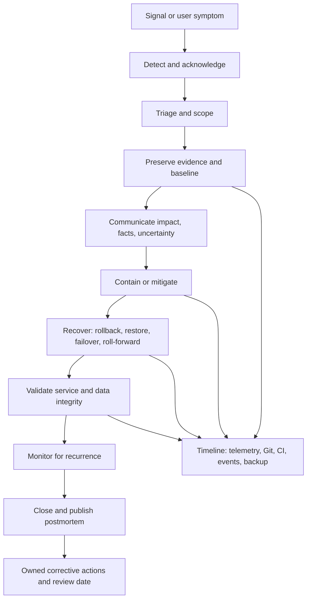

# Incident and Recovery Rubric — M17

**Module:** M17 — Production DevOps Integrated Capstone  
**Unit:** 3 — Incident and recovery rubric  
**Target file:** `incident-and-recovery-rubric.md`  
**Estimated time:** [ASSUMPTION] 10–16 hours including study, drills, evidence capture, and review.  
**Prerequisites (earlier modules):** M03, M05, M08, M09, M10, M11, M12, M13; supporting M01, M02, M04, M06, M07, M14, M15, M16 as relevant  
**Core tools:** Git, GitHub Actions evidence, kind, kubectl, Helm/Kustomize, Argo CD, Prometheus/Grafana, backup/verification tooling  
**Awareness / optional:** Chaos Mesh or Litmus; scripted fault injection is the core-track alternative  
**Last reviewed:** 2026-11-04  
**Tool baseline assumed:** Record actual installed versions in `docs/versions.txt`; no versions are pinned here because the learner's environment has not been inspected. Verify version-sensitive commands against official documentation.  
**Stack profile:** Cap-Core by default; Cap+Security / Cap+Chaos optional  
**Footprint:** measure yours

> **Authoring status:** This is a teaching artifact. All incidents, timestamps, data, measurements, scores, and outputs are synthetic or illustrative unless the learner records their own run. No cluster operation, fault injection, restore, alert delivery, test suite, or external tool verification is claimed to have been executed while authoring. Human technical validation remains required.

> **Repository boundary:** This is the only learning-roadmap deliverable. YAML, Python, shell, templates, tests, and evidence paths shown below are examples for the learner's separate capstone implementation repository, not instructions to create or modify other learning-roadmap files.

---

## Unit 3 — Incident and recovery rubric

### 3.0 Why this matters in production

A system is not operationally reliable merely because it deploys successfully. Production operations are tested when a dependency fails, a release introduces a regression, a scheduled pipeline produces incorrect output, a workload disappears, or a backup must be restored under a declared recovery objective.

This unit assesses whether the learner can **detect, respond, mitigate, recover, validate, and learn** from controlled failures. It is an evidence instrument, not a tutorial for installing every M01–M16 tool. The learner is expected to apply prior operational, GitOps, observability, security, storage, backup, and SRE knowledge in one repeatable incident workflow.

The governing principle is: **evidence over assertion; tested recovery over documented recovery; reproducibility over a one-time demo.** A response protects people, users, data, security, and evidence before optimizing for a fast-looking recovery. Speed matters, but a fast response that destroys diagnostic evidence, restores corrupt data, or hides stale service is not successful recovery.

#### What this rubric measures

- Detection from a relevant signal, with a defined time-to-detect measurement.
- Disciplined triage, blast-radius scoping, and evidence preservation.
- Safe containment and mitigation, including Git/GitOps rollback where applicable.
- Actual backup restore and independent data-integrity verification.
- Honest measurement of Recovery Point Objective (RPO) and Recovery Time Objective (RTO).
- Incident communications, role boundaries, and a blameless postmortem.
- Runbooks that another person can follow safely.
- Corrective actions with owners, dates, and verification tests.
- Honest treatment of uncertainty, limitations, and `NOT_DEMONSTRATED` work.

#### What this rubric does not measure

It does not certify production readiness, production traffic capacity, real cloud failure-domain behavior, regional disaster recovery, multi-region failover, enterprise identity integration, or a staffed on-call team's performance. A local `kind` cluster demonstrates mechanics, repeatability, and evidence discipline at lab scale only. A passing Unit 3 score does not certify the full M17 capstone.

#### M17 stage contract and Unit 3 contribution

The governing stage exit criteria are:

> deploy a service through the full tested pipeline; reconcile desired state from Git; apply identity and security controls; demonstrate metrics/logs/alerts; execute a failure, rollback, backup restore, and teardown; map every acceptance criterion to evidence.

The evidence artifact set is:

> capstone repository, architecture diagram, runbooks, CI/GitOps evidence, incident report, restore evidence, signed-off checklist.

The pass rule is:

> every criterion is demonstrated, evidence is committed or safely retained, and the lab is reproducible from its README/runbook.

Unit 3 contributes incident timeline, alert/metric/log evidence, rollback evidence, restore logs, baseline and post-restore integrity results, measured RPO/RTO, pipeline rerun/idempotency checks, status updates, postmortem, runbook, score report, cleanup proof, and a gap register. It does not independently certify the pipeline, security, cost, readiness, or platform-delivery units.

#### M17 handoffs

| Module | Handoff consumed | Evidence expected here |
|---|---|---|
| M01 | Container images and registry | Image identity/digest before and after rollback |
| M02 | CI/CD | Pipeline run ID, source commit, test result, release provenance |
| M03 | Operations and troubleshooting | Safe diagnostics, scoped action, timeline, cleanup |
| M04 | Networking and TLS | Dependency reachability and TLS symptoms distinguished |
| M05 | Storage and stateful services | PostgreSQL persistence, backup, isolated restore, integrity |
| M06 | Packaging | Selected Helm/Kustomize desired state can be inspected/reverted |
| M07 | Infrastructure as Code | Lab resources and recovery dependencies are repeatable |
| M08 | GitOps and progressive delivery | Git desired state; rollback reconciled by Argo CD |
| M09 | Secrets and identity | Least privilege and safe recovery credential handling |
| M10 | SRE, incidents, SLIs/SLOs, postmortems, ORR | Lifecycle, objectives, communication, blameless review |
| M11 | Observability | Metrics, logs, dashboards, alerts, timestamps |
| M12 | Security and software supply chain | Artifact identity, provenance, redaction, evidence integrity |
| M13 | Backup, DR, chaos/fault testing | Restore, RPO/RTO, bounded failure injection |
| M14 | Multi-cluster concepts | Limits of single-cluster evidence |
| M15 | Capacity and FinOps | Safe footprint; avoid uncontrolled retries/resource growth |
| M16 | Platform engineering and golden paths | Reusable runbook/automation interfaces; Backstage/Crossplane not required |

### 3.1 Learning objectives (6–10, tagged L1–L4)

1. **[L1]** Distinguish alert, event, incident, and problem; explain severity, priority, impact, and urgency without assuming a universal taxonomy.
2. **[L1]** Define detection, triage, containment, mitigation, recovery, validation, monitoring, closure, and postmortem; use RPO/RTO with explicit measurement boundaries.
3. **[L2]** Follow symptom → scope → recent change → hypotheses → discriminating test → result → next action, preserving evidence before change where safely possible.
4. **[L2]** Execute and verify Git/GitOps rollback, bounded dependency recovery, synthetic backup restore, scoped pod disruption, and idempotent pipeline rerun.
5. **[L2]** Produce a timestamped incident record, status updates, restore-integrity report, and blameless postmortem with owned corrective actions.
6. **[L3]** Calibrate scores, reconstruct timelines from source artifacts, design randomized solo drills, and quantify RPO/RTO uncertainty.
7. **[L3]** Design safe fault experiments with hypothesis, baseline, bounded blast radius, abort condition, expected signals, recovery plan, and cleanup.
8. **[L4]** Review a submission adversarially, identify unmeasured recovery claims and contradictory evidence, and make a defensible go/no-go recommendation.
9. **[L4]** Analyze compound incidents without confusing correlation with causation and explain recovery of recovery tooling.

### 3.2 Concept map and vocabulary (glossary table; at least one diagram)



Immediate containment may precede full evidence capture when delay would cause greater harm. Record what could not safely be preserved and why.

| Term | Meaning | Assessment implication |
|---|---|---|
| Event | Recorded change or occurrence | Context; not every event is an incident |
| Alert | Rule-generated signal that a condition may need attention | Record evaluation, delivery, and acknowledgement separately |
| Incident | Unplanned interruption/degradation requiring response | Record impact, owner, timeline, decisions, closure criteria |
| Problem | Underlying cause/systemic condition associated with incidents | Investigate through postmortem and corrective work |
| Severity | Impact classification under a defined local policy | No universal taxonomy assumed |
| Priority | Work order considering impact, urgency, risk, constraints | Explain response order |
| Impact | Effect on users, data, service objectives, dependencies | Quantify where evidence permits |
| Urgency | How quickly action is needed to avoid greater harm | May differ from severity |
| Detection | Recognition that failure/degradation exists | TTD needs declared start/end |
| Acknowledgement | Responder accepts ownership | Alert delivery is not acknowledgement |
| Triage | Initial classification, scope, hypothesis formation | Separate facts from hypotheses |
| Containment | Limits further harm or spread | May be temporary |
| Mitigation | Reduces impact or restores acceptable service | Verify user-visible behavior |
| Recovery | Returns a defined service/data capability to required state | Requires technical and functional verification |
| Validation | Independent checks service and data are correct | Pod Ready or HTTP 200 alone is insufficient |
| Rollback | Reverts release/configuration to prior known-good revision | Does not reverse irreversible data/schema changes |
| Roll-forward | Applies a new corrective revision | Requires test and release evidence |
| Restore | Reconstructs data/system state from backup/recovery point | Backup job success is not restore proof |
| Failover | Switches to alternate instance/site/system | Does not prove freshness or integrity |
| RPO | Maximum acceptable data loss measured in time | Compare actual data-loss interval with declared objective |
| RTO | Target time to restore a defined service level | Declare start and end before drill |
| TTD | Time from defined fault/symptom start to detection | Alert fired/delivered/acknowledged/detected differ |
| Timeline | Ordered events with timestamps and source references | Reconstruct from records, not memory |
| Blameless postmortem | Analysis of system conditions/safeguards/decisions without personal blame | “Human error” alone is not a root cause |
| Corrective action | Owned work that changes a system condition and has a test | Owner, due/review date, verification |
| Idempotency | Repetition with same logical input creates no unintended additional effects | Verify uniqueness and invariants |
| Evidence provenance | Metadata tying evidence to run, time, commit, digest, method | Prevents orphaned/unreviewable claims |

An event is not necessarily an incident; an alert may be false or unrelated to user impact; an incident may be detected by a user before an alert fires. A problem is the deeper systemic condition. Record the signal source and the point at which the incident was recognized.

`[ILLUSTRATIVE]` A small lab may define SEV-1 as synthetic data integrity at risk/all lab paths unavailable; SEV-2 as one workload unavailable/freshness objective breached; SEV-3 as non-critical dashboard/runbook degradation while service remains usable. This is a teaching taxonomy, not an industry standard.

#### RPO/RTO measurement contract

Declare boundaries before fault injection:

- `T_fault`: controlled failure/corruption becomes effective.
- `T_detect`: learner first recognizes the incident from a signal or user-visible symptom.
- `T_restore_start`: recovery action begins.
- `T_service_restored`: declared service-level condition is met.
- `T_data_validated`: required data-integrity checks pass.

For data recovery, RTO may be `T_data_validated - T_fault`; for service availability, it may be `T_service_restored - T_fault`. State which one is measured. Do not change the definition after seeing the result.

RPO is not restore duration. If the latest recoverable consistent data point is `T_recovery_point`, observed data-loss interval is `T_fault - T_recovery_point` under the declared boundary. If no valid recovery point timestamp exists, RPO is `NOT_DEMONSTRATED`, not zero.

#### Worked synthetic incident — pipeline fails after release

`[SYNTHETIC SCENARIO]` All values are fictional.

| Step | Observation | Evidence/interpretation |
|---|---|---|
| Symptom | 09:00Z synthetic pipeline run exits non-zero | Job record/run ID; symptom, not cause |
| Impact | One synthetic date partition delayed; PostgreSQL and toy inference endpoint healthy | Freshness query and workload checks scope impact |
| Recent change | GitOps commit `a1b2c3d` changes pipeline image digest at 08:52Z | Git/Argo records show temporal correlation, not causation |
| Hypotheses | Image regression; DB unavailable; input schema changed | Competing explanations |
| Discriminating test | Replay same input against prior image in isolation; probe DB; validate schema | Prior image succeeds; DB/schema checks succeed |
| Action | Revert GitOps digest; wait for reconciliation; rerun one bounded partition | Revert SHA, Argo revision, run ID, digest |
| Validation | Compare unique keys, row count, checksum, domain invariants, freshness | Green job alone is insufficient |
| Timeline | 08:52 release; 09:00 failure; 09:04 alert; 09:07 ack; 09:12 revert; 09:15 reconcile; 09:19 rerun; 09:21 integrity pass | Synthetic timestamps; replace with actual source times |
| RTO/RPO | If RTO is fault-to-validated output: 21 min. RPO depends on last valid partition/recovery point | Without recovery-point evidence, RPO is not demonstrated |
| Uncertainty | One partition/prior-image replay does not prove all partitions or production scale | Record follow-up test |

Conclusion: “Evidence supports an image regression as the most likely cause in this synthetic run; the prior image restored the pipeline path and selected output checks passed. This does not prove production RTO or all-partition correctness.”

### 3.3 Level 1 — Beginner

#### Incident lifecycle

1. **Detect:** recognize a user-visible symptom or relevant alert.
2. **Acknowledge:** record who/what accepted ownership and when.
3. **Triage/scope:** identify affected workload, users/data, dependencies, and time window.
4. **Preserve evidence:** capture telemetry, events, Git/CI history, artifact identity, and baseline.
5. **Communicate:** report impact, facts, hypotheses, actions, uncertainty, owner, next update.
6. **Contain:** prevent additional harm, such as stopping an unsafe rerun.
7. **Mitigate/recover:** rollback, repair dependency, restore data, or use another justified action.
8. **Validate:** prove user-visible service behavior and data correctness.
9. **Monitor/close:** watch for recurrence and document unresolved risk.
10. **Learn:** write a blameless postmortem and assign corrective actions.

A solo learner may perform multiple roles but must record role transitions. A solo exercise is not represented as a staffed incident-response organization.

| Role | Responsibility | Solo-lab treatment |
|---|---|---|
| Incident commander/coordinator | Objective, severity, priority, decisions, escalation | Record “IC/coordinator assumed” and decision times |
| Technical lead | Diagnostics and recovery direction | Record hypotheses and action owner |
| Communications lead | Stakeholder updates | Write timestamped updates separately from raw diagnostics |
| Scribe | Timeline, decisions, evidence references | Maintain record; do not reconstruct solely from memory |
| Subject-matter responder | Component/dependency investigation | Record subsystem and evidence used |

#### Troubleshooting loop

`Symptom → Scope → Recent change → Hypotheses → Discriminating test → Result → Next action`

- Symptom: what was observed, by whom, and when?
- Scope: which service, namespace, workload, users, partition, dependencies?
- Recent change: code, config, image, model, schema, secret reference, infrastructure, data?
- Hypotheses: competing explanations and evidence that would support/refute each.
- Discriminating test: safest test that separates hypotheses.
- Result: command/query, exit status, timestamp, raw output.
- Next action: why it follows from the result and what risk it introduces.

A recent deployment is a lead, not proof of root cause.

#### Evidence preservation

Where safely possible, capture UTC timestamps/time source, metrics and query window, logs, Kubernetes events, alert state, Git commit, CI run ID, image/model digest, configuration revision, Argo CD revision, synthetic data row counts/checksums/invariants, input partition/window, output version, commands/exit codes, and action rationale. Do not collect secrets, private keys, real credentials, personal data, or unnecessary environment dumps.

If immediate containment must precede full evidence capture, record why, what was preserved, and what was lost.

#### Recovery vocabulary

- Rollback reverts code/config/model to a known-good revision; it may not reverse a schema/data mutation.
- Roll-forward deploys a corrective revision and may be safer when state changed irreversibly.
- Restore reconstructs data from backup/recovery point, preferably into an isolated target first.
- Failover switches to an alternate system but can expose stale/inconsistent data.
- Containment limits harm; remediation removes/corrects cause; validation proves the result.

A Pod `Running`/`Ready`, HTTP 200, successful backup job, or completed pipeline task is only one signal. Stateful recovery requires independent integrity checks.

### 3.4 Level 2 — Intermediate

#### Complete 100-point rubric

Scoring: choose exactly one level per criterion: `0 = Not demonstrated`, `1 = Emerging`, `2 = Competent`, `3 = Strong`. Points = `weight × level ÷ 3`, rounded to two decimals. Weights sum to 100. A missing mandatory artifact/broken reference forces the affected criterion to level 0. A critical gate failure blocks Unit 3 pass regardless of numeric score.

`[ASSUMPTION]` Suggested threshold: 80/100, with all critical gates at level 2 or 3 and all five drills executed/evidenced. This is a local teaching policy, not a universal SRE standard.

| ID | Criterion | Weight | Observable behavior/evidence | 0 — Not demonstrated | 1 — Emerging | 2 — Competent | 3 — Strong | Critical |
|---|---|---:|---|---|---|---|---|---|
| IR-01 | Detection and alert quality | 10 | Correct signal, declared TTD, alert/query and firing/delivery/ack records | No relevant signal/timestamps | Symptom found; signal/TTD incomplete | Relevant signal and TTD measured from declared boundaries | Repeated healthy/failing tests, noise/missing telemetry analysis | No |
| IR-02 | Triage, scoping, evidence preservation | 15 | Scope, recent changes, hypotheses, tests, timeline, baseline | No scope/evidence; unrecorded changes | Partial diagnostics; missing hypotheses/time/baseline | Troubleshooting loop followed; safe evidence captured before remediation | Independent reconstruction, clock-skew/gap analysis, minimal blast radius | Yes |
| IR-03 | Mitigation, containment, rollback | 15 | Git revert, Argo revision, runtime digest, service checks, drift | No safe mitigation/rollback evidence | Action taken; reconciliation/verification incomplete | Safe bounded action; GitOps rollback and runtime identity verified | Stateful risk, rollback vs roll-forward, stale-data impact and alternate variant reviewed | Yes |
| IR-04 | Recovery, restore, integrity, RPO/RTO | 20 | Backup ID/checksum, isolated restore, baseline/post checks, objective boundaries/actuals | Restore not run or integrity not checked | Restore ran; integrity or objective boundary incomplete | Actual isolated restore; two independent checks; measured RPO/RTO compared to targets | Repeatable restore, corrupt fixture rejected, recovery-point and tool failure analyzed | Yes |
| IR-05 | Communication and coordination | 10 | Initial/progress/recovery updates, impact, facts, actions, owner, next update | No usable updates/misleading | Updates omit required fields | Timestamped updates contain impact, facts/hypotheses, action, owner, next update, uncertainty | Cadence justified; updates evolve with evidence | No |
| IR-06 | Blameless postmortem and timeline | 10 | Source-linked timeline, contributing factors, safeguard/detection gaps, actions | No postmortem or person-blaming conclusion | Memory-led timeline/shallow analysis | Evidence-backed timeline and systemic analysis | Competing causes/incentives/action effectiveness assessed | Yes |
| IR-07 | Runbook quality and usability | 10 | Trigger, impact, prerequisites, diagnostics, decisions, recovery, verification, abort, cleanup | Missing/unsafe | Partial; preconditions/verification weak | Another learner can follow safely | Blinded execution and failure branches verified | No |
| IR-08 | Prevention and corrective actions | 10 | Owner, priority, due/review date, verification test, contributing-factor link | No actions/vague advice | Missing owner/date/test | Actions map to factors and have owners/dates/tests | Implemented, retested, side effects reviewed | No |
| **Total** |  | **100** | **10 + 15 + 15 + 20 + 10 + 10 + 10 + 10 = 100** |  |  |  |  |  |

Negative tests: IR-01 healthy fixture must not alert; missing telemetry must not silently appear healthy. IR-02 baseline must predate disruptive action. IR-03 intended digest must be running and rollback must not mask data loss. IR-04 incomplete restore fixture must fail. IR-05 update must separate facts/hypotheses. IR-06 must not blame an individual. IR-07 a second person must follow without guessing. IR-08 every action must have a verification test.

#### Missing evidence and integrity policy

| Condition | Treatment |
|---|---|
| Mandatory restore not executed | IR-04 = 0; critical gate fails |
| Restore run, no integrity verification | IR-04 = 0; critical gate fails |
| RTO without declared boundaries/source timestamps | IR-04 cannot exceed 1; critical gate fails |
| Rollback without Git commit, reconciled revision, runtime identity | IR-03 = 0; critical gate fails |
| Broken path/checksum/provenance contradiction | Affected criterion = 0 pending investigation |
| Missing non-critical detail | Score only demonstrated evidence |
| Honest `NOT_DEMONSTRATED` | Valid gap, not a pass |
| Fabricated/materially doctored evidence | Stop scoring; integrity failure under Unit 1 |

#### Worked synthetic score

`[SYNTHETIC SCORING EXAMPLE]`

| Criterion | Weight | Level | Points |
|---|---:|---:|---:|
| IR-01 | 10 | 2 | 6.67 |
| IR-02 | 15 | 3 | 15.00 |
| IR-03 | 15 | 2 | 10.00 |
| IR-04 | 20 | 1 | 6.67 |
| IR-05 | 10 | 2 | 6.67 |
| IR-06 | 10 | 2 | 6.67 |
| IR-07 | 10 | 3 | 10.00 |
| IR-08 | 10 | 2 | 6.67 |
| **Total** | **100** |  | **68.35** |

IR-04 is Emerging because restore ran but integrity evidence is incomplete. The critical recovery gate fails. Even a score above 80 would remain NO PASS. A successful restore command is not proof of correct data.

#### Unit 1 requirements and acceptance IDs

Reuse existing Unit 1 IDs: `REQ-008` controlled failure/investigation; `REQ-009` verified rollback; `REQ-010` actual isolated restore; `REQ-011` integrity plus measured RPO/RTO; `REQ-012` teardown (cross-reference only); `REQ-014`–`REQ-018` traceability/evidence; `REQ-023` context guard; `REQ-027` negative tests; `REQ-028` honest gaps; `REQ-030` traceability; `REQ-031` workload slices; `REQ-032` lab-fidelity caveat. Relevant acceptance criteria: `AC-005`, `AC-006`, `AC-007`. Do not invent or renumber IDs.

### 3.5 Level 3 — Advanced

#### Evidence rigor and assessor consistency

Use anchor submissions for each level, each with raw evidence references. Reviewers score independently, compare criterion-level differences, resolve disagreements by citing descriptors and artifacts (not seniority), and record initial score, disagreement, evidence, final decision, and reviewer. Recalibrate after rubric changes.

`[ASSUMPTION]` Suggested calibration rule: reconcile any criterion difference greater than one level or total-score difference greater than five points. This is a local operating rule, not a benchmark.

#### Timeline reconstruction

Reconstruct from Prometheus queries/alert transitions, application logs, Kubernetes events, Git/CI history, Argo CD revision/sync history, backup IDs/timestamps, restore logs, and timestamped command transcripts. Memory is a hypothesis source, not authoritative timeline evidence. Record time source/timezone/clock skew. Missing telemetry creates uncertainty; do not invent timestamps.

`[SYNTHETIC TIMELINE]`

| UTC timestamp | Signal/action | Evidence | Interpretation | Uncertainty |
|---|---|---|---|---|
| 2026-10-31 09:00Z | Controlled failure injected | EV-DRILL-A-001 | Fault start | Synthetic |
| 2026-10-31 09:02Z | Alert enters firing | EV-DRILL-A-002 | Rule evaluated firing | Delivery differs |
| 2026-10-31 09:04Z | Learner acknowledges | EV-DRILL-A-003 | Response ownership | Solo exercise |
| 2026-10-31 09:07Z | Baseline captured | EV-DRILL-A-004 | Evidence before mitigation | Scrape delay possible |
| 2026-10-31 09:12Z | Git revert committed | EV-DRILL-A-005 | Desired-state correction | Not runtime proof |
| 2026-10-31 09:16Z | Argo reports intended revision | EV-DRILL-A-006 | Reconciliation observed | Runtime digest still needed |
| 2026-10-31 09:18Z | Runtime digest/smoke test verified | EV-DRILL-A-007 | Tested path recovered | Not all paths |

#### Component-specific recovery objectives

Targets are illustrative placeholders; justify and declare your own before the drill.

| Component | Example target | Measurement | Evidence | Limitation |
|---|---|---|---|---|
| PostgreSQL | `[ILLUSTRATIVE]` RTO 15 min; RPO 5 min | Isolated restore; last valid transaction; integrity checks | Backup ID, recovery point, restore start/end, count/hash/invariants | Local time is not production throughput |
| Scheduled pipeline | `[ILLUSTRATIVE]` freshness recovery 30 min; no duplicate outputs | Rerun partition; compare keys/count/hash/freshness | Run ID, input window, output version, timestamps | Does not prove every schedule/backfill |
| ML inference | `[ILLUSTRATIVE]` service RTO 5 min | Roll back code/model digest; smoke test | Release SHA, model hash, Argo revision, endpoint checks | Toy model does not prove model quality/load |

#### Fault-injection experiment design

State falsifiable hypothesis, steady state, baseline, exact cluster/namespace/workload/data partition, bounded operation, maximum duration, abort criteria, authorized operator, recovery path, and cleanup. Start read-only/dry-run. Never target production or an unverified cluster. Chaos Mesh/Litmus are optional awareness tools; a scripted benign fault is sufficient. `kind` does not prove node/zone/region failure domains.

#### Idempotency: rerun is not restore

A retry repeats an operation; a restore reconstructs from a recovery point. For a scheduled pipeline, use a stable logical key such as `(pipeline_name, input_partition, output_version)` and a verified write strategy preventing duplicate logical outputs. Record run ID, input window, source revision, output version; prevent unintended concurrent writers; rerun the same input; compare count, unique keys, canonical checksum, and invariants; repeat to test idempotency. A green Job status is not output correctness.

#### Recovery-tool failure scenarios

| Failure | Safe response | Evidence/gate |
|---|---|---|
| Backup credentials unavailable | Stop unsafe attempts; use documented recovery/rotation or mark blocked | Access audit without secret values; restore not demonstrated |
| Backup target unreachable | Check identity/network/permissions read-only; do not switch to untrusted target | Target health/access test and decision |
| Restore process broken | Preserve logs/metadata; repair in isolated lab; test disposable copy | Tool version, repair commit, negative test, restore report |
| Decryption key unavailable | Do not bypass encryption/search uncontrolled locations | Key-custody evidence without key material; blocker stays open |
| Evidence storage unavailable | Use approved temporary location with owner/retention/checksum | Locator, access owner, retention and migration record |

#### Conflicting/stale/misleading evidence

A green dashboard may hide stale data; a successful restore may have wrong row counts; a Git revert may not yet be reconciled; a Ready Pod may serve stale output; a screenshot may lack commit/run provenance. Preserve contradictory evidence, explain source authority, and mark uncertainty. Evidence predating the last relevant deploy/config change is stale.

#### Solo game-master protocol

Create variants A/B/C with different hidden causes/timing; learner must not see answer key until self-assessment.

| Variant | Visible symptom | Hidden cause | Discriminating evidence |
|---|---|---|---|
| A | Errors after release | Bad image | Prior digest succeeds; dependency/schema pass |
| B | Same errors | Dependency unavailable | Dependency probe fails; image unchanged |
| C | Pipeline output incomplete after retry | Missing input records | Source count/output invariant mismatch |

A solo learner randomizes the variant and delays answer-key review. Self-grading is not equivalent to independent review.

### 3.6 Level 4 — Expert

#### Review-board method

1. Confirm scope, objectives, RPO/RTO boundaries, target, context, namespace, and safety preconditions.
2. Inspect evidence index and local/external references.
3. Verify timestamps against source artifacts and note clock skew/gaps.
4. Re-run safe read-only checks using explicit lab context; inspect Git commit, image digest, workload identity, namespace, and Argo revision.
5. Independently inspect baseline and restored dataset; run integrity verifier.
6. Recompute score from YAML/submission.
7. Inspect critical gates and `NOT_DEMONSTRATED` entries.
8. Issue go/no-go with conditions, compensating controls, owners, and review dates.

#### Four-level calibration anchors

| Anchor | Evidence pattern | Expected assessment |
|---|---|---|
| L1 — Beginner | Explains lifecycle/evidence but has not executed drills | Mostly 0–1; understands instrument, no operational pass |
| L2 — Intermediate | Drills executed; rollback/restore evidence exists; some timeline gaps | Mostly 2; pass only if gates and threshold met |
| L3 — Advanced | Repeated variants, source-linked timeline, uncertainty quantified, recovery-tool failure tested | Mostly 3; strong lab-scale evidence |
| L4 — Expert | Challenges planted flaws, detects contradictions, calibrates assessors, issues conditional decision | Reviewer competence, not production certification |

#### Planted weaknesses to detect

- RTO claimed without declared start/end and source timestamps → `NOT_DEMONSTRATED`.
- Restore command succeeded but integrity was never checked → recovery incomplete.
- Postmortem blames an individual → ask which system conditions/safeguards permitted the action.
- Rollback makes endpoint healthy but serves stale data → user-visible availability is not data correctness.
- Alert fired but was not delivered/acknowledged → distinguish alert stages.
- Pipeline Job succeeded but duplicate keys exist → idempotency failed.
- Evidence predates last deploy/config change → stale.
- Git digest and runtime digest differ → runtime identity not proven.

#### Compound incident: bad release plus dependency/database failure

`[SYNTHETIC SCENARIO]` A new inference release introduces a connection-pool regression while the synthetic database dependency becomes intermittently unavailable. Competing hypotheses: release regression; independent dependency failure; release retry behavior amplifies dependency failure; test harness concurrency causes symptoms. Compare prior image in isolation, inspect dependency health, correlate connections/retries, replay bounded synthetic requests. Do not blindly roll back if schema/data compatibility is uncertain. Separate initiating event, contributing conditions, amplifiers, detection gaps, and recovery safeguards. Coincident timestamps do not prove one cause.

#### Go/no-go

- **GO:** all mandatory Unit 3 criteria demonstrated; critical gates pass; declared threshold met; evidence current/traceable; all five drills and cleanup evidenced.
- **CONDITIONAL GO for further lab work only:** non-critical gaps have owners/dates/compensating controls, but no critical/stage-exit gate is waived. Not a capstone pass.
- **NO-GO:** restore/integrity untested; rollback unverified; fabricated/contradictory evidence; wrong target; no cleanup proof; missing critical artifacts; mandatory drill not demonstrated.

#### Facilitator answer key — keep closed until self-assessment

- A: compare current/prior image digest on same synthetic input; check dependency/schema; GitOps revert; verify Argo revision/runtime digest.
- B: compare dependency probe and app revision; stop retry amplification; restore dependency; verify request and connection recovery.
- C: compare source partition, checkpoint, output keys; do not retry missing-input partition; correct/reload synthetic input or controlled backfill; verify uniqueness/checksum.
- Compound: test release and dependency hypotheses independently; identify retry amplification; do not infer cause from coincident timestamps.
- Recovery tooling: preserve metadata/logs, do not expose key material; if backup cannot be restored/decrypted, mark `NOT_DEMONSTRATED`.


### 3.7 SRE lens (SLIs/SLOs, failure modes, runbook snippet)

An SLI is a measurement of a user-relevant service property. An SLO is a target for that property over a declared window. This unit consumes M10 SRE concepts and M11 telemetry; it does not define universal thresholds.

| Workload | Candidate SLI | Example failure condition | Recovery validation |
|---|---|---|---|
| PostgreSQL data service | Successful synthetic read/write transactions; consistency checks | Transaction fails or invariant breaks | Read/write smoke test plus row count/checksum/domain invariant |
| Scheduled pipeline | Partition freshness age; valid partition completion | Latest required partition exceeds declared freshness window or output is invalid | Rerun/backfill evidence plus uniqueness/integrity checks |
| ML inference | Successful schema-valid responses; latency distribution | Error/timeout or invalid response schema | Known-input smoke test, model hash, error/latency query |

`[ILLUSTRATIVE]` A learner might declare a 99% success objective over a fixed synthetic test window. This is not an M17-wide required SLO. Define denominator, eligible population, missing-telemetry behavior, exclusions, and window before using it for scoring.

**Alert stages are distinct:**
- **Evaluated/fired:** rule entered firing state.
- **Delivered:** notification reached the configured receiver.
- **Acknowledged:** responder accepted the alert.
- **Incident detected:** responder recognized and recorded the incident.

Measure each separately. TTD may be fault start to first valid detection, but declare the definition before the drill. Do not substitute alert evaluation time for acknowledgement time.

| Failure mode | Likely symptom | Useful evidence | Common false positive |
|---|---|---|---|
| Bad release | Error rate, crash loop, failed smoke test | Git SHA, image digest, CI run, rollout/app logs | Dependency outage at same time |
| Database unavailable | Connection errors, failed transactions | Dependency probe, DB logs, connection metrics | DNS/TLS/client configuration |
| Data corruption | Count/hash/invariant mismatch | Pre-fault baseline, backup ID, restore report | Canonicalization or dataset-version mismatch |
| Pod disruption | Restart/pending state, transient errors | Events, pod status, readiness, service test | Normal rollout/image pull delay |
| Scheduled job failure | Failed Job, freshness age rises | Run ID, input window, output version, error | Late scheduler/missing source partition |
| Telemetry gap | No signal or conflicting timestamps | Scrape status, log timestamps, source clocks | Dashboard time-range mismatch |

#### Compact incident runbook

```text
RUNBOOK: M17 synthetic workload incident

Trigger
- Relevant SLI/alert fires or synthetic user/data check fails.

Impact
- Identify workload, namespace, input partition, synthetic user path.
- State whether data integrity is at risk.

Prerequisites
- Confirm Cap-Core profile.
- Confirm target context is kind-m17-lab and namespace/workload is allowlisted.
- Confirm synthetic data and recovery path exist.
- Stop if target identity is ambiguous.

Safe diagnostics
- Capture workload/pod/job state, events, logs, metrics query,
  Git SHA, image digest, Argo CD revision, and pre-fault data baseline.
- Record UTC timestamps and exit codes.
- Do not print secrets or broad environment dumps.

Decision points
- User-visible symptom or alert only?
- One workload or shared dependency?
- Recent change correlated with event?
- Which test distinguishes hypotheses?

Mitigation/recovery
- Use smallest reversible action.
- Bad release: revert GitOps change and wait for reconciliation.
- Data recovery: restore to isolated target first.
- Do not retry pipeline until concurrency/idempotency are understood.

Verification
- Check service behavior, runtime artifact identity, data count/hash/invariants,
  freshness, and alert resolution.
- Compare actual RPO/RTO with predeclared boundaries.

Abort/escalation
- Stop if context, namespace, target, data, or recovery path is uncertain;
  if a secret is exposed; if fault exceeds scope; or if evidence suggests
  non-synthetic/production data.

Cleanup
- Restore normal desired lab state, remove only named temporary fixtures,
  verify no test job/credential/temporary resource remains, record proof.
```

### 3.8 Security lens (threats, controls, negative tests)

| Threat | Control | Evidence | Negative test |
|---|---|---|---|
| Excess incident privilege | Least-privilege responder/service account; time-bounded elevation where supported | RBAC/identity audit and action log | Prohibited action is denied |
| Secret copied into logs/history | Secret references; redacted commands; avoid tracing secret use | Redaction checklist and synthetic scan | Dummy token fixture is detected |
| Backup credential/key exposure | Keep key material outside repo/evidence | Access audit without secret value | Dummy key marker in evidence bundle is flagged |
| Evidence tampering/deletion | Checksums, provenance, restricted write access, preserve failed artifacts | Evidence index/checksum verification | Modify one byte in disposable copy; checksum fails |
| Emergency manual drift | Record actor/time/reason; reconcile to Git | Incident timeline, Git correction, Argo revision | Disposable drift is detected/reconciled |
| Wrong cluster/namespace | Explicit context and namespace/workload allowlist | Guard test output | Wrong context/target rejected before mutation |
| Broad destructive action | Dry-run/read-only first; exact target; explicit opt-in; abort criteria | Preflight and operation log | Missing opt-in or unapproved target returns non-zero |
| Privacy exposure | Synthetic data and redaction | Evidence review | Synthetic PII-like marker is flagged |

**Context-guard negative test:** context not exactly `kind-m17-lab`, namespace/workload not allowlisted, failed lookup, missing `--apply`, or unavailable target check must refuse before mutation. A user-supplied string is not proof of safety.

**Secret-hygiene negative test:** create a disposable file containing `M17_DUMMY_SECRET_DO_NOT_USE=not-a-real-secret`, run the scanner/check, verify it flags the marker, delete the fixture, and verify it is absent. Never plant a real credential.

### 3.9 Unit checklist (each item verifiable by command, query, test, or record)

| ID | Check | Verification method | Pass condition | Evidence | Failure behavior |
|---|---|---|---|---|---|
| INC-CHK-01 | Context/namespace/workload preflight | Guard output and read-only lookup with explicit context | Exact context and allowlisted targets found | `evidence/incidents/preflight/` | Stop before mutation |
| INC-CHK-02 | Explicit context in all kubectl commands | Static review/search of scripts and transcripts | Every command has `--context kind-m17-lab` | `evidence/validation/kubectl-context/` | Reject affected artifact |
| INC-CHK-03 | Baseline before fault | Timestamped state/metric/log/data baseline | Baseline predates fault and identifies target | `evidence/incidents/<drill>/baseline/` | Evidence criterion fails |
| INC-CHK-04 | TTD measured | Timeline arithmetic and source timestamps | Start/end declared before drill | `timeline.csv` | TTD not demonstrated |
| INC-CHK-05 | Timeline evidence-linked | Reviewer opens every source reference | Material events have evidence or uncertainty | `evidence/incidents/<drill>/` | Timeline not accepted as fact |
| INC-CHK-06 | Git rollback reconciled | Git history, Argo revision, runtime digest | Intended prior revision/digest match | `evidence/rollback/` | IR-03 gate fails |
| INC-CHK-07 | Dependency recovery | Dependency probe and service test | Dependency restored and user path passes | `evidence/incidents/DRILL-B/` | Do not claim recovery |
| INC-CHK-08 | Backup restore executed | Restore log and isolated target identity | Restore completed from recorded backup | `evidence/restore/` | IR-04 gate fails |
| INC-CHK-09 | Integrity independently checked | Row count plus checksum or invariant | At least two independent checks pass | `evidence/restore/verification/` | Recovery incomplete |
| INC-CHK-10 | RPO/RTO measured | Timestamp arithmetic and target comparison | Boundaries/recovery point declared; actuals compared | `objectives.json` | Objectives not demonstrated |
| INC-CHK-11 | Pipeline rerun idempotent | Repeat partition; compare keys/count/hash | No duplicate logical output/corruption | `evidence/pipeline-rerun/` | Data recovery gap |
| INC-CHK-12 | Concurrent duplicate prevented | Job inventory and concurrency config | No unintended concurrent writers | `evidence/pipeline-rerun/concurrency/` | Stop rerun |
| INC-CHK-13 | Communications complete | Review timestamped updates | Impact, facts, action, owner, next update, uncertainty | `evidence/incidents/communications/` | IR-05 loses credit |
| INC-CHK-14 | Postmortem blameless | Review causal language/system conditions | Safeguards/contributing factors; no person-blaming conclusion | `evidence/postmortems/` | IR-06 max level 1 |
| INC-CHK-15 | Corrective actions testable | Action register | Owner, priority, dates, test, status | `docs/corrective-actions.md` | IR-08 loses credit |
| INC-CHK-16 | Scorer detects invalid evidence | Unit tests with missing/broken fixtures | Invalid evidence/gate returns non-zero | `evidence/rubric/` | Score invalid |
| INC-CHK-17 | Cleanup verified | Scoped before/after inventory | Drill resources/fixtures accounted for | `evidence/teardown/` | Stage exit remains open |
| INC-CHK-18 | Gaps explicit | Gap register/score report | Missing work is `NOT_DEMONSTRATED` | `evidence/gaps.md` | Integrity review if fabricated |

### 3.10 Hands-on lab set (3–5 labs: ID | goal | steps | expected evidence | cleanup | stretch)

The five mandatory drills are separately identifiable. They may be grouped into fewer sessions, but each retains its own run ID, variant, evidence, score, and cleanup record.

#### Shared safety contract

- Default Cap-Core; start only components needed for the current drill.
- WSL2 Ubuntu/native Linux; local `kind`; synthetic data only.
- Unit 1 planning envelope: approximately 4 CPU, 8 GB RAM, 30 GB disk. Measure actual footprint; this is not a guarantee.
- Context: `kind-m17-lab`. Every Kubernetes command must explicitly include `--context kind-m17-lab`.
- Placeholders: `<m17-namespace>`, `<api-deployment>`, `<pipeline-cronjob>`, `<exact-disposable-pod-name>`. Replace only with learner-created allowlisted lab names.
- Before each fault: read-only preflight, target allowlist, baseline, abort condition, recovery path, evidence destination.
- `⚠ FAULT INJECTION (BENIGN, OWN LAB)` applies to each injection. Never target production, shared clusters, real data, or unverified targets.
- Stop if context, namespace, workload, data ownership, or cleanup boundary is uncertain.

#### Drill A — Bad release → rollback through Git/GitOps

**ID/objective:** `DRILL-A`; prove detection, evidence preservation, Git-based rollback, reconciliation, and service validation. Maps to `REQ-008`, `REQ-009`, `REQ-014`, `REQ-023`, `REQ-027`; `AC-006`; IR-01/02/03/05/06/07/08.

**Scope/prerequisites/profile/risk:** One disposable stateless API deployment in Cap-Core; known-good GitOps revision/digest; deliberately bad lab-only revision; Argo CD evidence and smoke test. Risk Medium: wrong target or stateful migration makes rollback unsafe. Use an application/config regression without irreversible schema change.

**Preflight/baseline:**

```bash
kubectl --context kind-m17-lab get namespace <m17-namespace>
kubectl --context kind-m17-lab get deployment <api-deployment> -n <m17-namespace>
kubectl --context kind-m17-lab get pods -n <m17-namespace> -o wide
kubectl --context kind-m17-lab get events -n <m17-namespace> --sort-by=.lastTimestamp
```

Capture known-good Git SHA, image digest, Argo observed revision, rollout state, endpoint smoke output, baseline metrics/logs.

**Injection:** `⚠ FAULT INJECTION (BENIGN, OWN LAB)` Commit a faulty image/config digest in a dedicated Git branch or lab-only GitOps path. Declare expected symptom (smoke test fails or error signal rises). Do not change shared/production branches.

**Expected signals/false positives:** Unhealthy deployment, failed smoke test, error metric/log. False positives include dependency outage, DNS/TLS, bad fixture.

**Learner tasks:** detect and measure TTD; capture baseline/logs/events/Git SHA/digest/Argo revision; state scope and competing hypotheses; run discriminating test; decide rollback vs roll-forward; revert GitOps through a new Git commit; wait for reconciliation; verify Git SHA, Argo revision, runtime digest; run smoke test and stale-data/integrity check.

**Abort:** wrong context/namespace/workload; unknown digest; shared/real data; irreversible schema change; unexpected blast radius; secret exposure; unknown recovery revision. Stop injection and preserve state/evidence.

**Recovery/verification:** Git/GitOps revert; confirm prior digest; check manual drift; smoke test; verify rollback did not serve stale output or hide data loss.

**RPO/RTO/TTD:** Measure TTD. RTO = declared fault start to verified service restoration. RPO only applies if persisted data affected; otherwise state not applicable with reason.

**Evidence:** `EV-DRILL-A-BASELINE`, `FAULT`, `TIMELINE`, `GIT-REVERT`, `ARGO`, `RUNTIME-DIGEST`, `SMOKE`, `CLEANUP`; under `evidence/incidents/DRILL-A/` and `evidence/rollback/`.

**Cleanup:** Return lab branch to known-good; wait reconciliation; smoke test; verify no faulty workload/branch remains; record final revision. Do not casually delete namespace/PV.

**Stretch/variants:** A faulty image; B faulty config; hidden cause: coincident dependency failure. Expected distinction: inspect config for B; probe dependency before attributing hidden-cause variant.

**Facilitator key:** Passing evidence identifies bad revision, captures baseline first, reverts through Git, waits for Argo, verifies digest and user behavior, checks stale data/state. Rollout success alone is insufficient.

**Unsafe shortcuts:** untracked `kubectl --context kind-m17-lab set image`; namespace deletion; blind schema rollback; Pod Ready as sole proof; unrecorded bad commit.

#### Drill B — Dependency/database failure

**ID/objective:** `DRILL-B`; prove bounded dependency diagnosis, containment, recovery, and service validation. Maps to `REQ-008`, `REQ-027`, `REQ-031`; IR-01/02/03/05/06/07/08.

**Scope/prerequisites/profile/risk:** One synthetic service and dedicated disposable dependency in Cap-Core. Risk Medium. Do not delete/corrupt/restart a real database. Prefer synthetic dependency endpoint or lab-only config switch. If mechanism is unverified, mark `[VERIFY: mechanism and reversal]` and use simulated failure response.

**Preflight/baseline:**

```bash
kubectl --context kind-m17-lab get namespace <m17-namespace>
kubectl --context kind-m17-lab get deployment <api-deployment> -n <m17-namespace>
kubectl --context kind-m17-lab get pods -n <m17-namespace> -o wide
```

Record dependency identity (redacted), baseline success rate, connection/error metrics, logs, smoke test, Git/config revision, synthetic request ID.

**Injection:** `⚠ FAULT INJECTION (BENIGN, OWN LAB)` Make only the synthetic dependency return a controlled unavailable response via a reversible lab-only switch. Do not block shared DB, exhaust real pools, or alter persistent data. Exact implementation `[VERIFY]`.

**Signals/false positives:** Dependency probe fails; application logs show errors; synthetic request fails. False positives: DNS, TLS, credentials, client config.

**Learner tasks:** record symptom/scope; compare dependency health, app logs, recent config, network/TLS hypotheses; choose stop retries/queue/degrade/switch only if justified; restore synthetic dependency; verify app recovery and no duplicate writes.

**Abort:** real/external dependency targeted; ownership unclear; persistent data at risk; fault exceeds duration; unexpected shared blast radius.

**Recovery/verification:** restore lab config; verify dependency probe and transaction; compare pre/post error signals; inspect synthetic invariants if writes attempted.

**RPO/RTO/TTD:** TTD from declared failure start to recognition; service RTO to verified dependency-backed request. RPO only if writes/data lost.

**Evidence:** `EV-DRILL-B-BASELINE`, `FAULT`, `DEPENDENCY-PROBE`, `APP-LOG`, `RECOVERY`, `INTEGRITY`, `CLEANUP`; under `evidence/incidents/DRILL-B/`.

**Cleanup:** Restore original config, wait reconciliation, verify dependency/service, remove disposable fixture, inspect residuals.

**Stretch/variants:** A dependency unavailable; B wrong dependency hostname/config; hidden cause: TLS certificate validation fails while TCP reachability remains. Evidence must distinguish application dependency and TLS diagnosis.

**Facilitator key:** Isolate symptom, show service path recovers after dependency restored, verify no duplicate/corrupt data. Pod restart is not diagnosis.

**Unsafe shortcuts:** restart all workloads; delete PVC/PV; disable TLS; copy credentials into transcripts; retry writes without idempotency checks.

#### Drill C — Data corruption → backup restore

**ID/objective:** `DRILL-C`; prove actual backup restore to isolated target, independent integrity checks, measured RPO/RTO. Maps to `REQ-010`, `REQ-011`, `REQ-015`, `REQ-027`; `AC-007`; IR-02/04/05/06/07/08.

**Scope/prerequisites/profile/risk:** Synthetic PostgreSQL dataset or equivalent isolated dataset; Cap-Core. Risk High if target boundaries unclear. Restore to isolated target; corrupt disposable copy only. Never corrupt the only valid backup.

**Preflight/baseline:**

```bash
kubectl --context kind-m17-lab get namespace <m17-namespace>
kubectl --context kind-m17-lab get pods -n <m17-namespace> -o wide
kubectl --context kind-m17-lab get pvc -n <m17-namespace>
```

Create deterministic synthetic rows. Record baseline row count, unique-key count, canonical checksum, domain invariants, dataset version, last valid transaction/recovery-point timestamp, backup ID/checksum. Confirm target isolation.

**Injection:** `⚠ FAULT INJECTION (BENIGN, OWN LAB)` Corrupt only a disposable working copy or use deliberately incomplete fixture. Never corrupt the only valid dataset/backup.

**Signals/false positives:** Count/hash/invariant mismatch. False positives: row ordering, serialization, timezone normalization, wrong dataset version. Canonicalize first.

**Learner tasks:** declare RPO/RTO targets/boundaries; capture baseline/backup metadata; inject synthetic corruption; restore recorded backup to isolated target using verified tool procedure; run two independent checks (e.g. row count + canonical checksum; uniqueness/domain invariant); compare to baseline; calculate actual RPO/RTO; if command succeeds but integrity fails, mark recovery incomplete.

**Abort:** isolation unproven; backup identity unknown; key exposure; only valid backup at risk; ambiguous context/target; synthetic-data boundary violated.

**Recovery/verification:** isolated restore, integrity verifier, baseline comparison, preserve failed output; remove target only after evidence retained.

**RPO/RTO example:** fault at 10:00Z; last consistent recovery point 09:58Z; data validation at 10:12Z. Observed data-loss interval 2 min; RTO fault-to-data-validation 12 min. Service restoration is separate unless service test also passed.

**Evidence:** `EV-DRILL-C-BASELINE`, `BACKUP`, `FAULT`, `RESTORE-LOG`, `INTEGRITY`, `OBJECTIVES`, `CLEANUP`; under `evidence/restore/`.

**Cleanup:** Retain approved backup/evidence; remove only named isolated target and disposable corrupt fixture; verify source unchanged and target gone.

**Stretch/variants:** A missing row; B changed value with same count; hidden cause: canonicalization differs due to ordering/serialization. A fails count/hash; B may pass count but fails hash/invariant; hidden case requires stable canonicalization/dataset version.

**Facilitator key:** Restore is complete only after independent integrity checks and RPO/RTO calculations. Restore exit code 0 with failed verifier is a critical failure.

**Unsafe shortcuts:** restore over source; corrupt only backup; backup job success as restore proof; hash non-canonical raw file; RPO=0 without recovery point.

#### Drill D — Node/pod disruption

**ID/objective:** `DRILL-D`; diagnose scoped pod disruption, observe scheduling/restart, verify service recovery, and state local limits. Maps to `REQ-008`, `REQ-023`, `REQ-027`; IR-01/02/03/05/06/07.

**Scope/prerequisites/profile/risk:** One disposable stateless deployment in Cap-Core. Risk Medium. Prefer one pod disruption over node operation; does not prove real node/zone behavior.

**Preflight/baseline:**

```bash
kubectl --context kind-m17-lab get namespace <m17-namespace>
kubectl --context kind-m17-lab get deployment <api-deployment> -n <m17-namespace>
kubectl --context kind-m17-lab get pods -n <m17-namespace> -o wide
kubectl --context kind-m17-lab get events -n <m17-namespace> --sort-by=.lastTimestamp
```

Record replica count, pod identities, readiness, smoke test, restart count, metrics/logs, workload revision.

**Injection:** `⚠ FAULT INJECTION (BENIGN, OWN LAB)` After allowlist check, delete only one exact disposable Pod:

```bash
kubectl --context kind-m17-lab delete pod <exact-disposable-pod-name> -n <m17-namespace>
```

Do not delete node, namespace, PVC, or PV.

**Signals/false positives:** Pod replacement/events/readiness, possible transient request errors. False positives: normal rollout, probe transition, image pull delay.

**Learner tasks:** verify target/baseline; inject one disruption; observe events/replacement/readiness/service; decide wait/investigate/abort; verify user behavior and telemetry; state what local test cannot prove.

**Abort:** stateful/non-disposable target; only replica serving critical data; unclear target; second pod fails; impact exceeds envelope.

**Recovery/verification:** controller restores desired replicas; inspect new pod/readiness; smoke test; verify data integrity if applicable.

**RPO/RTO/TTD:** TTD and service recovery from deletion to validated service behavior. RPO N/A only with reason if no data loss.

**Evidence:** `EV-DRILL-D-BASELINE`, `FAULT`, `EVENTS`, `POD-RECOVERY`, `SMOKE`, `CLEANUP`; under `evidence/incidents/DRILL-D/`.

**Cleanup:** Confirm desired replica count, smoke test, no temporary config/pod remains; no namespace-wide cleanup.

**Stretch/variants:** A delete one pod; B lab-only readiness failure; hidden cause scheduling delay due to insufficient resources. Evidence: controller replacement vs readiness vs scheduling/resource events.

**Facilitator key:** Verify exact pod identity, observe controller behavior, test service path, state `kind` cannot prove real node/zone/region resilience.

**Unsafe shortcuts:** delete all pods/namespace/node/PVC; claim HA because pod restarted; ignore service errors because replacement Pod Ready.

#### Drill E — Failed scheduled pipeline → idempotent rerun

**ID/objective:** `DRILL-E`; prove bounded rerun, duplicate prevention, output correctness. Maps to `REQ-008`, `REQ-027`, `REQ-031`; IR-01/02/03/04/05/06/07/08.

**Scope/prerequisites/profile/risk:** One synthetic scheduled pipeline and isolated input partition in Cap-Core. Risk Medium. Require deterministic logical partition/window and verification query.

**Preflight/baseline:**

```bash
kubectl --context kind-m17-lab get namespace <m17-namespace>
kubectl --context kind-m17-lab get cronjob <pipeline-cronjob> -n <m17-namespace>
kubectl --context kind-m17-lab get jobs -n <m17-namespace>
```

Record run ID, input window, source/output version, row count, unique-key count, checksum, invariants, concurrency config, freshness timestamp.

**Injection:** `⚠ FAULT INJECTION (BENIGN, OWN LAB)` Cause one synthetic run to fail at a known non-destructive step (test assertion or synthetic dependency response). Do not corrupt canonical output. If mechanism unverified, use test-only failure branch and mark `[VERIFY]`.

**Signals/false positives:** Job non-zero, failure step, freshness rises. False positives: scheduler delay, missing input, resource pressure, duplicate run.

**Learner tasks:** record run/partition/output/error; decide retry vs backfill vs restore; ensure no concurrent writer; correct cause; rerun same logical input once; compare count/keys/hash/invariants; repeat same logical run to test idempotency; confirm freshness/service behavior.

**Abort:** unknown partition ownership; concurrent writers; non-synthetic data; missing baseline; output not isolated; overwrite risk.

**Recovery/verification:** Correct cause; bounded rerun; verify task status and output separately; document retry/backfill/restore choice.

**RPO/RTO/TTD:** TTD from failed-run event to recognition; pipeline RTO from failure to validated output. RPO only if data lost/overwritten.

**Evidence:** `EV-DRILL-E-BASELINE`, `FAILED-RUN`, `CAUSE`, `RERUN`, `IDEMPOTENCY`, `FRESHNESS`, `CLEANUP`; under `evidence/pipeline-rerun/`.

**Cleanup:** Ensure no duplicate job active; retain logs; remove only disposable fixtures; verify canonical output count/hash/invariants and scheduler restored.

**Stretch/variants:** A transient dependency failure; B deterministic input validation failure; hidden cause: overlapping runs. Evidence distinguishes retry, input correction, and concurrency guard.

**Facilitator key:** Distinguish retry/backfill/restore; identify logical partition; prevent concurrent writers; prove idempotency. Job Complete alone is insufficient.

**Unsafe shortcuts:** rerun all history; allow overlapping jobs; delete output to make counts match; skip second-run idempotency test.

#### Learner worksheet

```markdown
# Incident worksheet — <DRILL-ID> / Variant <A|B|C>
- Date/time zone:
- Operator / role transitions:
- Stack profile and measured footprint:
- Cluster context:
- Namespace / workload / data partition:
- Severity and rationale:
- Hypotheses:
- Discriminating test and why:
- Baseline evidence IDs:
- Fault start definition and timestamp:
- Detection definition and timestamp:
- Timeline (timestamp, action/signal, evidence ID, interpretation, uncertainty):
- Decision and reason:
- Mitigation/recovery:
- Service validation:
- Data-integrity validation:
- RPO target / actual / recovery-point source:
- RTO target / actual / declared start/end:
- Cleanup and verification:
- Remaining uncertainty:
- NOT_DEMONSTRATED items:
- Self-score IR-01…IR-08 and evidence rationale:
- Answer-key review date:
- Corrective actions, owners, due/review dates:
```

Assessment process: read criterion before drill; randomize variant; preserve answer key; capture raw evidence; self-score with references; reviewer/delayed answer-key review; scorer computes points/gates; record corrective actions/retest. Solo self-score is not independent assessment.

### 3.11 Self-check questions (6–10, with answer keys and why wrong options tempt)

**1 — RPO vs RTO.** Restore takes 14 minutes from fault to integrity validation; latest consistent recovery point is 3 minutes before fault.  
A. RPO 14m/RTO 3m. B. RPO 3m/RTO 14m. C. Both 14m. D. RPO 0/RTO 3m.  
**Answer: B.** RPO is data-loss interval; RTO is recovery duration. A tempts because both are time values.

**2 — Alert vs detection.** Alert fires 10:02, delivers 10:04, learner acknowledges 10:07.  
A. Always 10:02. B. Always 10:04. C. Use predeclared detection definition and record all stages. D. Postmortem time.  
**Answer: C.** Evaluation, delivery, acknowledgement, and human detection differ.

**3 — Evidence preservation.** No immediate containment needed.  
A. Delete Pod then inspect. B. Capture scope, telemetry, events, recent changes, baseline. C. Restart all workloads. D. Root cause from memory.  
**Answer: B.** A/C may destroy evidence/widen blast radius; D is not reliable timeline evidence.

**4 — Rollback vs roll-forward.** Irreversible schema changed and new app wrote data.  
A. Always revert schema. B. Git revert reverses any file/state. C. Assess compatibility/data; forward fix may be safer. D. Delete PVC.  
**Answer: C.** Git rollback does not reverse data mutation.

**5 — Restore vs integrity.** Backup tool exits 0, restored row count lower than baseline.  
A. Recovery complete. B. Pod Ready proves it. C. Integrity failed; recovery incomplete. D. Green dashboard proves it.  
**Answer: C.** Restore execution and correct data are separate.

**6 — Idempotent rerun.** Job succeeds but duplicate logical keys exist.  
A. Idempotent. B. Job green but output correctness failed. C. Delete backup. D. Close incident.  
**Answer: B.** Task status does not prove output correctness.

**7 — Blameless postmortem.**  
A. Operator mistake. B. Human error. C. Workflow allowed unreviewed config, alert missed user symptom, runbook lacked rollback verification. D. Be careful.  
**Answer: C.** It identifies system conditions and changeable safeguards.

**8 — Context guard.** Namespace allowlisted but context cannot be verified.  
A. Proceed. B. Use default context. C. Refuse before mutation and record failed preflight. D. Delete namespace.  
**Answer: C.** Safety requires verified context and target.

**9 — Evidence scoring.** Detailed postmortem and screenshot of restore command; no target identity or integrity report.  
A. Strong. B. Competent. C. Critical restore/integrity not demonstrated. D. Full credit if confident.  
**Answer: C.** Narrative/screenshot cannot replace executable verification.

### 3.12 Evidence artifacts

| Artifact | Minimum content | Rubric | Unit 1 requirement |
|---|---|---|---|
| `incident-record.md` | Impact, scope, severity, roles, decisions, uncertainty | IR-02/05/06 | REQ-008/015 |
| `timeline.csv` | UTC event/action/source/interpretation/uncertainty | IR-01/02/06 | REQ-008/015 |
| Alert evidence | Rule/query/window/firing/delivery/ack record | IR-01 | REQ-006/007 |
| Baseline | Workload state, telemetry, data count/hash/invariants | IR-02/04 | REQ-008/011 |
| Git/GitOps rollback | Before/after commit, Argo revision, digest, drift check | IR-03 | REQ-009 |
| Dependency recovery | Probe/log/action/post-recovery test | IR-02/03 | REQ-008 |
| Restore log | Backup ID/checksum, isolated target, timestamps, tool version | IR-04 | REQ-010 |
| Integrity report | Baseline/restored count/hash/uniqueness/invariants | IR-04 | REQ-011 |
| RPO/RTO record | Targets, boundaries, recovery point, actual calculations | IR-04 | REQ-011 |
| Pipeline rerun | Run ID, partition, output version, uniqueness/hash/freshness | IR-03/04 | REQ-031 |
| Status updates | Initial/progress/recovery, owner/next update | IR-05 | REQ-008/015 |
| Postmortem | Timeline, factors, gaps, corrective actions | IR-06/08 | REQ-008/028 |
| Runbook | Trigger, preflight, diagnostics, recovery, verification, abort, cleanup | IR-07 | REQ-008/020 |
| Score report | Rubric version, levels, points, gaps, gates, reviewer | All | REQ-014/018/030 |
| Cleanup proof | Before/after inventory, fixture/target removal | IR-07 | REQ-012 |
| Gap register | NOT_DEMONSTRATED, reason, owner, next action/date | All | REQ-028 |

#### Unit 1 evidence-index interface

Do not create a competing index. Use Unit 1 `evidence/index.yaml` field names:

```yaml
# File: evidence/index.yaml — interface example
schema_version: "1"
evidence:
  - evidence_id: EV-DRILL-C-RESTORE-001
    requirement_ids: [REQ-010, REQ-011]
    acceptance_criteria: [AC-007]
    path: evidence/restore/DRILL-C/restore-report.json
    storage: local
    evidence_type: automated_test
    timestamp_utc: "2026-11-04T10:15:00Z"
    source_commit: "<git-sha-required>"
    run_id: "<restore-run-id-required>"
    artifact_digest: "<backup-id-or-checksum>"
    checksum_algorithm: sha256
    checksum: "<computed-file-checksum>"
    verification_method: "row count, canonical checksum, domain invariant"
    result: NOT_DEMONSTRATED
    automated: true
    notes: "Synthetic lab evidence; redacted and secret-free"
```

This follows Unit 1 field names; validate required fields against the canonical Unit 1 validator. `NOT_DEMONSTRATED` is an honest status. An unavailable external artifact is not verified.

Evidence strength ordering: `assertion < screenshot < command output < automated test < continuously run check`. This is not proof of correctness; review method, scope, source, provenance, freshness, and relevance. Critical recovery requires executable test evidence plus result artifacts, not screenshots alone. Refresh evidence after relevant deployment/configuration changes. Unit 1 owns the freshness policy.

#### Traceability matrix

| Stage exit criterion | REQ-ID | AC-ID | Unit 3 criterion | Drill/evidence | Contribution |
|---|---|---|---|---|---|
| Failure/investigation | REQ-008 | AC-005 | IR-01/02/05/06 | A–E; incident timeline/alerts | Controlled failure and response |
| Rollback | REQ-009 | AC-006 | IR-03 | A; Git revert, Argo revision, digest | Verified rollback |
| Backup restore | REQ-010 | AC-007 | IR-04 | C; backup ID/restore log | Actual isolated restore |
| Integrity and RPO/RTO | REQ-011 | AC-007 | IR-04 | C; baseline/integrity/objectives | Correct data and measured recovery |
| Evidence mapping | REQ-014/015/018/030 | AC-005–007 | All IR | Unit 1 index/checker | Auditable claims |
| Context guard | REQ-023 | Relevant AC | IR-02/03/07 | Guard negative tests | Safe lab targeting |
| Negative tests | REQ-027 | Relevant AC | IR-01–08 | Drills/scorer/verifier | Controls challenged |
| Honest gaps | REQ-028 | Applicable AC | All IR | Gap register | No invented success |
| Teardown | REQ-012 | AC-008 | Cross-reference | Cleanup records | Supports overall teardown; Unit 3 does not own it |
| Three workloads | REQ-031 | AC-010 | IR-02/04 | B/C/E and workload evidence | Data/pipeline/ML operation |
| Fidelity caveat | REQ-032 | Applicable AC | IR-06/review | Postmortem/reviewer report | No production overclaim |

Unit 1 remains authoritative for REQ/AC IDs, evidence schema, and traceability policy. Unit 3 defines only `IR-01`–`IR-08`.

#### Blameless postmortem template

```markdown
# M17 Incident Postmortem — <incident-id>
- Status: draft / reviewed / actions tracking / closed
- Date/timezone:
- Workload / namespace / synthetic data scope:
- Coordinator / technical lead / scribe:
- Severity and rationale:
- User impact (synthetic lab impact where applicable):

## Summary
What happened, affected scope, what is known.

## Measurement boundaries
T_fault; T_detect; T_service_restored; T_data_validated;
RPO target/actual/recovery-point source; RTO target/actual/start/end; TTD.

## Timeline
| UTC timestamp | Event/action | Evidence ID | Interpretation | Uncertainty |
|---|---|---|---|---|

## Detection and response
Detection source; alert fired/delivered/acknowledged/incident detected;
containment; mitigation; recovery; validation; monitoring/closure.

## Contributing factors and safeguards
Trigger; system conditions; failed/missing safeguards; detection/response gaps;
what went well; what did not; remaining uncertainty.

## Data integrity
Baseline version; backup ID/checksum; restore target; row count;
canonical checksum; uniqueness/domain invariants; evidence/result.

## Decisions
Decision; alternatives; rationale; accepted risk; compensating control.

## Corrective actions
| Action | Contributing factor | Owner | Priority | Due | Review | Verification test | Status |
|---|---|---|---|---|---|---|---|

## Evidence links
Evidence IDs only; no secrets.

## NOT_DEMONSTRATED and limitations
List every unproven claim and why.

## Follow-up review date
```

Do not use “human error” as a root cause without examining system conditions, interfaces, safeguards, incentives, and decision context.

#### Status-update template and synthetic examples

```text
INCIDENT UPDATE — <incident-id> — <UTC timestamp>
Impact/scope:
Known facts:
Hypotheses (not proven):
Actions completed/current mitigation:
Risk/data-integrity status:
Next action and owner:
Next update time:
Evidence references:
Uncertainty / unknowns:
```

`[SYNTHETIC INITIAL UPDATE]` At 09:05Z, synthetic partition is delayed; job `<run-id>` failed at 09:00Z. No other workload impact confirmed. Hypotheses: image regression or dependency failure. Baseline, logs, input window, Git revision captured; no rerun started. Next: dependency probe and prior-image comparison, owner technical lead, update 09:15Z. Integrity remains unknown.

`[SYNTHETIC RECOVERY UPDATE]` At 09:25Z, GitOps revert reconciled to prior digest; bounded rerun completed. Argo revision, runtime digest, row count, unique keys, checksum verified for the selected partition. Next: add release smoke test, owner learner, update 10:00Z. One partition does not prove all history or production-scale behavior.

#### Restore verification script — synthetic SQLite/JSON example

This is a bounded data-integrity reference, not a substitute for the selected PostgreSQL backup tool. Restore PostgreSQL into an isolated target, export synthetic rows in the documented JSON shape, and run equivalent checks. Canonicalization sorts by `record_id` and serializes stable fields with sorted keys/compact separators. A raw file hash can change for benign row-order/whitespace/serialization differences.

```python
# File: scripts/verify_restore.py
import argparse
import hashlib
import json
import sys
from pathlib import Path

REQUIRED = {"record_id", "event_time_utc", "amount_minor"}

def load_rows(path):
    if not path.is_file():
        raise ValueError(f"input missing: {path}")
    try:
        data = json.loads(path.read_text(encoding="utf-8"))
    except (OSError, json.JSONDecodeError) as exc:
        raise ValueError(f"invalid input: {exc}") from exc
    if not isinstance(data, list) or not data:
        raise ValueError("dataset must be a non-empty list")
    rows = []
    for i, row in enumerate(data):
        if not isinstance(row, dict) or not REQUIRED.issubset(row):
            raise ValueError(f"row {i} missing required fields")
        if not isinstance(row["record_id"], str) or not row["record_id"]:
            raise ValueError(f"row {i} invalid record_id")
        if not isinstance(row["event_time_utc"], str) or not row["event_time_utc"]:
            raise ValueError(f"row {i} invalid event_time_utc")
        amount = row["amount_minor"]
        if isinstance(amount, bool) or not isinstance(amount, int):
            raise ValueError(f"row {i} amount_minor must be integer")
        rows.append({k: row[k] for k in REQUIRED})
    return rows

def digest(rows):
    ordered = sorted(rows, key=lambda x: x["record_id"])
    payload = json.dumps(ordered, sort_keys=True, separators=(",", ":")).encode()
    return hashlib.sha256(payload).hexdigest()

def verify(baseline_path, restored_path):
    baseline = load_rows(baseline_path)
    restored = load_rows(restored_path)
    b_ids = [r["record_id"] for r in baseline]
    r_ids = [r["record_id"] for r in restored]
    if len(set(b_ids)) != len(b_ids):
        raise ValueError("baseline contains duplicate keys")
    if len(set(r_ids)) != len(r_ids):
        raise ValueError("restored data contains duplicate keys")
    if any(r["amount_minor"] < 0 for r in restored):
        raise ValueError("domain invariant amount_minor >= 0 failed")
    checks = {
        "row_count_match": len(baseline) == len(restored),
        "canonical_checksum_match": digest(baseline) == digest(restored),
        "primary_key_unique": len(set(r_ids)) == len(restored),
        "domain_invariant_non_negative": all(r["amount_minor"] >= 0 for r in restored),
    }
    return {
        "baseline_rows": len(baseline),
        "restored_rows": len(restored),
        "baseline_sha256": digest(baseline),
        "restored_sha256": digest(restored),
        "checks": checks,
        "integrity_pass": all(checks.values()),
    }

def main():
    parser = argparse.ArgumentParser()
    parser.add_argument("--baseline", type=Path, required=True)
    parser.add_argument("--restored", type=Path, required=True)
    parser.add_argument("--report", type=Path, required=True)
    args = parser.parse_args()
    try:
        result = verify(args.baseline, args.restored)
        args.report.parent.mkdir(parents=True, exist_ok=True)
        args.report.write_text(json.dumps(result, indent=2) + "\n", encoding="utf-8")
    except (OSError, ValueError) as exc:
        print(f"ERROR: verification refused: {exc}", file=sys.stderr)
        return 2
    print(json.dumps(result, indent=2))
    return 0 if result["integrity_pass"] else 1

if __name__ == "__main__":
    raise SystemExit(main())
```

**Representative example — your output will differ.**

```json
{"baseline_rows":3,"restored_rows":3,"checks":{"row_count_match":true,"canonical_checksum_match":true,"primary_key_unique":true,"domain_invariant_non_negative":true},"integrity_pass":true}
```

Tests must cover success, missing baseline, row-count mismatch, checksum mismatch, duplicate key, and malformed JSON. Expected success exits 0; mismatch exits 1; missing/malformed/duplicate inputs exit non-zero. These tests have not been executed here. `[VERIFY: selected PostgreSQL export method and backup tool/version]`.

```python
# File: tests/test_verify_restore.py
import json
import tempfile
import unittest
from pathlib import Path
from scripts.verify_restore import verify

BASE = [
    {"record_id":"r1","event_time_utc":"2026-11-04T09:00:00Z","amount_minor":100},
    {"record_id":"r2","event_time_utc":"2026-11-04T09:01:00Z","amount_minor":200},
]

class RestoreTests(unittest.TestCase):
    def setUp(self):
        self.tmp = tempfile.TemporaryDirectory()
        self.root = Path(self.tmp.name)
        self.b = self.root / "baseline.json"
        self.r = self.root / "restored.json"
        self.write(self.b, BASE)
        self.write(self.r, BASE)
    def tearDown(self):
        self.tmp.cleanup()
    def write(self, path, rows):
        path.write_text(json.dumps(rows), encoding="utf-8")
    def test_success(self):
        self.assertTrue(verify(self.b, self.r)["integrity_pass"])
    def test_missing_baseline(self):
        with self.assertRaisesRegex(ValueError, "missing"):
            verify(self.root / "absent.json", self.r)
    def test_row_count_mismatch(self):
        self.write(self.r, BASE[:1])
        self.assertFalse(verify(self.b, self.r)["checks"]["row_count_match"])
    def test_checksum_mismatch(self):
        changed = [dict(BASE[0]), dict(BASE[1], amount_minor=201)]
        self.write(self.r, changed)
        self.assertFalse(verify(self.b, self.r)["checks"]["canonical_checksum_match"])
    def test_duplicate_key(self):
        self.write(self.r, [BASE[0], BASE[0]])
        with self.assertRaisesRegex(ValueError, "duplicate"):
            verify(self.b, self.r)
    def test_malformed(self):
        self.r.write_text("{bad", encoding="utf-8")
        with self.assertRaisesRegex(ValueError, "invalid"):
            verify(self.b, self.r)

if __name__ == "__main__":
    unittest.main()
```

### 3.13 Common review-board questions (5, with senior model answers)

**1. “How do you know the rollback restored the intended revision?”**  
Show bad release Git SHA/digest, revert commit, Argo CD observed revision, runtime image digest, and user-visible smoke test. Inspect manual drift. A rollout message alone proves neither intended artifact nor state correctness.

**2. “What proves restored data is correct?”**  
Identify baseline version and backup ID/checksum, isolated target, restore log, then compare row count and canonical checksum plus uniqueness/domain invariant. Tie checks to the same restore run. Any failed check means recovery incomplete.

**3. “From what precise event did you measure RTO?”**  
Declare start event before drill (e.g. fault injection) and end event (service restored/validated or data integrity validated). Show source timestamps, arithmetic, and target comparison. Missing timestamp means `NOT_DEMONSTRATED`.

**4. “What did the local lab fail to prove?”**  
`kind` proves only exercised mechanics, repeatability, and evidence discipline at lab scale. It does not prove production traffic, cloud quotas, independent node/zone/region failures, multi-region failover, enterprise identity, real billing, or production-sized restore throughput.

**5. “Which corrective action prevents recurrence, and how will you verify it?”**  
Choose an action tied to a contributing factor (e.g. release smoke test against synthetic dependency). Name owner, priority, due/review date, and test. Verify the negative fixture blocks promotion and healthy fixture passes with CI evidence. “Be careful” is not an action.

### 3.14 Sources and verification notes

#### Source-derived requirements

This document follows the supplied Unit 3 generation prompt and governing M17 syllabus-generation prompt. It preserves the fixed eight-unit M17 sequence and limits this deliverable to Unit 3. It consumes M01–M16 handoffs and Unit 1 requirements/evidence contracts.

Unit 1 `capstone-requirements.md` is authoritative for stage exit criteria, evidence statement, pass rule, REQ-001–REQ-032, AC-005/AC-006/AC-007, `evidence/index.yaml`, status values, provenance, `REQ-023` context guard, `REQ-027` negative tests, `REQ-028` honest gaps, `REQ-030` traceability, and `REQ-032` fidelity caveat. Unit 3 defines `IR-01`–`IR-08`; these do not replace REQ or AC IDs.

#### Illustrative choices and assumptions

- Suggested 80/100 threshold is `[ASSUMPTION]`, not a stage-wide rule.
- Severity model, SLOs, recovery targets, timestamps, scores, and outputs are illustrative/synthetic.
- SQLite/JSON verifier demonstrates canonical integrity checks; actual PostgreSQL restore uses the selected backup tool and isolated target.
- Harness/scorer snippets require validation in the learner's environment.

#### Technical verification items

| Area | Verify | Where/how |
|---|---|---|
| kind | Cluster/context name and local setup | kind official documentation; inspect local cluster |
| kubectl | Commands, flags, output fields/events for installed version | Kubernetes kubectl reference; read-only preflight |
| Argo CD | Revision/sync/health fields and reconciliation | Argo CD official docs for installed version |
| Helm/Kustomize | Selected packaging and revert behavior | Official docs for selected tool |
| Prometheus/Alertmanager | Rule, delivery, and test syntax | Official docs and installed `promtool` help |
| PostgreSQL/backup | Backup, restore, export, transaction time, integrity | Selected backup tool and PostgreSQL docs; disposable data |
| Python/PyYAML | Runtime and locked dependency | Python/PyYAML docs |
| Git/GitHub Actions | Provenance/run IDs/artifact retention | Official docs; local emulation fidelity may differ |
| Fault injection | Reversible bounded mechanism | Test in disposable namespace; use synthetic failure if uncertain |

Do not run examples against production. Verify syntax and target identity in the learner's lab. Every Kubernetes command shown explicitly includes `--context kind-m17-lab`.

#### Audit report and human sign-off

| Audit area | Result | Notes |
|---|---|---|
| Target/scope | PASS by document inspection | One M17 Unit 3 document |
| Mandatory headings | PASS by document inspection | 3.0–3.14 in order |
| Rubric | PASS by arithmetic/design inspection | Eight criteria, four levels, weights total 100 |
| Five drills | PASS by document inspection | A–E separately identifiable; safety, evidence, cleanup, variants, keys included |
| Unit 1 alignment | PASS by source comparison | Reuses existing REQ/AC and evidence-index field names |
| Context guard | NEEDS HUMAN VALIDATION | Commands include explicit context; run guard negative tests |
| Scripts/YAML | NOT EXECUTED | Python, tests, YAML parser/scorer not run in learner environment |
| Live drills/restore | NOT EXECUTED | No fault injection, rollback, restore, or pipeline rerun performed |
| Official version verification | OPEN | Installed versions unknown |
| Production fidelity | NOT CLAIMED | Local `kind` is lab-scale only |

**Human sign-off**

- Learner:
- Reviewer:
- Rubric version:
- Tool versions recorded:
- All five drills executed:
- Critical gates passed:
- Evidence index validated:
- Cleanup verified:
- Open `[VERIFY]` items:
- Review date:
- Decision: PASS / NO-PASS / NOT-DEMONSTRATED

**Final limitation:** AI-assisted authoring and document inspection do not replace a human running scripts, tests, drills, restore, and cleanup with installed tool versions. A Unit 3 pass measures demonstrated lab-scale incident/recovery evidence quality; it is not production-readiness certification.


#### Machine-readable rubric YAML

```yaml
# File: rubric/incident-recovery-rubric.yaml
schema_version: "1"
rubric_id: M17-UNIT-3-INCIDENT-RECOVERY
rubric_version: "1.0"
review_date: "2026-11-04"
score_convention:
  levels: {0: "Not demonstrated", 1: "Emerging", 2: "Competent", 3: "Strong"}
  formula: "round(weight * level / 3, 2)"
  maximum_points: 100
  pass_threshold: 80
  threshold_tag: "[ASSUMPTION]"
criteria:
  - id: IR-01
    name: "Detection and alert quality"
    weight: 10
    critical_gate: false
    required_evidence: [alert_rule, detection_timeline, healthy_and_failing_test]
    levels: {0: "No signal/timestamps", 1: "Partial signal/TTD", 2: "Relevant signal and declared TTD", 3: "Repeated tests and noise analysis"}
  - id: IR-02
    name: "Triage, scoping, evidence preservation"
    weight: 15
    critical_gate: true
    required_evidence: [incident_scope, pre_fault_baseline, hypotheses, timeline]
    levels: {0: "No scope/evidence", 1: "Partial diagnostics", 2: "Troubleshooting loop and safe preservation", 3: "Independent reconstruction and uncertainty"}
  - id: IR-03
    name: "Mitigation, containment, rollback"
    weight: 15
    critical_gate: true
    required_evidence: [git_revert, gitops_revision, runtime_digest, service_check]
    levels: {0: "No safe mitigation", 1: "Incomplete reconciliation", 2: "GitOps rollback and runtime identity verified", 3: "Stateful risk/drift/alternatives reviewed"}
  - id: IR-04
    name: "Recovery, restore, integrity, RPO, RTO"
    weight: 20
    critical_gate: true
    required_evidence: [backup_id_checksum, isolated_restore_log, integrity_report, rpo_rto_record]
    levels: {0: "No restore/integrity", 1: "Restore but incomplete checks", 2: "Isolated restore, two checks, measured objectives", 3: "Repeatable restore and failure analysis"}
  - id: IR-05
    name: "Communication and coordination"
    weight: 10
    critical_gate: false
    required_evidence: [initial_update, progress_update, recovery_update]
    levels: {0: "No usable updates", 1: "Missing fields", 2: "Impact/facts/actions/owner/next update/uncertainty", 3: "Cadence and audience justified"}
  - id: IR-06
    name: "Blameless postmortem and timeline"
    weight: 10
    critical_gate: true
    required_evidence: [source_linked_timeline, contributing_factors, response_gaps, blameless_review]
    levels: {0: "No postmortem or blameful conclusion", 1: "Memory-led/shallow", 2: "Evidence-backed systemic analysis", 3: "Competing causes and action effectiveness"}
  - id: IR-07
    name: "Runbook quality and usability"
    weight: 10
    critical_gate: false
    required_evidence: [trigger_impact, preflight_diagnostics, recovery_verification, abort_cleanup]
    levels: {0: "Missing/unsafe", 1: "Partial", 2: "Another learner can follow safely", 3: "Blinded execution/failure branches verified"}
  - id: IR-08
    name: "Prevention and corrective actions"
    weight: 10
    critical_gate: false
    required_evidence: [action_register, owners_dates, verification_tests]
    levels: {0: "No actions", 1: "Missing owner/date/test", 2: "Mapped actions with owner/date/test", 3: "Implemented/retested/reviewed"}
```

#### Scoring script and tests

This script reads the rubric, a submission, and the canonical Unit 1 evidence index. It validates IDs, levels, weight total, evidence references, local paths, SHA-256, and critical gates. It cannot prove semantic correctness; the reviewer must inspect the artifacts and rerun safe checks. PyYAML must be included in the implementation repository's locked dependency policy: `[VERIFY: installed PyYAML version and lockfile convention]`.

```python
# File: rubric/score_incident_recovery.py
import argparse
import hashlib
import sys
from pathlib import Path
import yaml

EXPECTED = {f"IR-{i:02d}" for i in range(1, 9)}
LEVELS = {0, 1, 2, 3}

def read_yaml(path):
    if not path.is_file():
        raise ValueError(f"missing input: {path}")
    try:
        value = yaml.safe_load(path.read_text(encoding="utf-8"))
    except (OSError, yaml.YAMLError) as exc:
        raise ValueError(f"cannot parse {path}: {exc}") from exc
    if not isinstance(value, dict):
        raise ValueError(f"{path} must contain a mapping")
    return value

def sha256(path):
    h = hashlib.sha256()
    with path.open("rb") as stream:
        for block in iter(lambda: stream.read(1024 * 1024), b""):
            h.update(block)
    return h.hexdigest()

def score(rubric, submission, index, root):
    errors, gates, rows = [], [], []
    criteria = rubric.get("criteria")
    if not isinstance(criteria, list):
        raise ValueError("rubric.criteria must be a list")
    ids = [x.get("id") for x in criteria if isinstance(x, dict)]
    if set(ids) != EXPECTED or len(ids) != 8:
        errors.append("rubric must define IR-01 through IR-08 exactly once")
    if sum(x.get("weight", 0) for x in criteria if isinstance(x, dict)) != 100:
        errors.append("criterion weights must sum to 100")

    evidence_rows = index.get("evidence")
    if not isinstance(evidence_rows, list):
        raise ValueError("evidence index must contain an evidence list")
    evidence = {}
    for item in evidence_rows:
        if not isinstance(item, dict) or not item.get("evidence_id"):
            errors.append("malformed evidence record")
            continue
        eid = item["evidence_id"]
        if eid in evidence:
            errors.append(f"duplicate evidence ID: {eid}")
        evidence[eid] = item

    submitted = submission.get("criteria")
    if not isinstance(submitted, list):
        raise ValueError("submission.criteria must be a list")
    by_id = {}
    for item in submitted:
        cid = item.get("criterion_id") if isinstance(item, dict) else None
        if cid not in EXPECTED:
            errors.append(f"unknown criterion: {cid}")
        elif cid in by_id:
            errors.append(f"duplicate submission criterion: {cid}")
        else:
            by_id[cid] = item

    rubric_by_id = {x["id"]: x for x in criteria if isinstance(x, dict)}
    total = 0.0
    for cid in sorted(EXPECTED):
        rule, entry = rubric_by_id.get(cid), by_id.get(cid)
        if rule is None or entry is None:
            errors.append(f"missing rubric/submission row: {cid}")
            gates.append(cid)
            continue
        level = entry.get("level")
        if isinstance(level, bool) or level not in LEVELS:
            errors.append(f"{cid}: invalid level {level!r}")
            continue
        refs = entry.get("evidence_refs", [])
        if not isinstance(refs, list):
            errors.append(f"{cid}: evidence_refs must be a list")
            refs = []
        required_keys = rule.get("required_evidence", [])
        evidence_map = entry.get("evidence_map")
        invalid = []
        if not isinstance(evidence_map, dict):
            invalid.append("evidence_map must map every required evidence key to an evidence ID")
            evidence_map = {}
        missing_keys = set(required_keys) - set(evidence_map)
        extra_keys = set(evidence_map) - set(required_keys)
        if missing_keys:
            invalid.append("missing required evidence keys: " + ", ".join(sorted(missing_keys)))
        if extra_keys:
            invalid.append("unknown evidence keys: " + ", ".join(sorted(extra_keys)))
        mapped_refs = []
        for key, value in evidence_map.items():
            if isinstance(value, str):
                mapped_refs.append(value)
            elif isinstance(value, list) and value and all(isinstance(x, str) for x in value):
                mapped_refs.extend(value)
            else:
                invalid.append(f"{key}: evidence_map value must be an evidence ID or non-empty ID list")
        refs = sorted(set(refs + mapped_refs))
        if not refs:
            invalid.append("no evidence references supplied")
        for ref in refs:
            ev = evidence.get(ref)
            if ev is None:
                invalid.append(f"{ref}: unknown evidence ID")
                continue
            if ev.get("storage") == "local":
                rel = ev.get("path")
                if not isinstance(rel, str):
                    invalid.append(f"{ref}: local path missing")
                    continue
                path = (root / rel).resolve()
                try:
                    path.relative_to(root.resolve())
                except ValueError:
                    invalid.append(f"{ref}: path escapes repository")
                    continue
                if not path.is_file():
                    invalid.append(f"{ref}: file missing")
                elif ev.get("checksum_algorithm") != "sha256" or ev.get("checksum") != sha256(path):
                    invalid.append(f"{ref}: checksum metadata/match failed")
            elif ev.get("storage") == "external":
                if not all(ev.get(k) for k in ("locator", "owner", "retention")):
                    invalid.append(f"{ref}: external locator/owner/retention missing")
            else:
                invalid.append(f"{ref}: storage must be local or external")
        if invalid:
            errors.extend(f"{cid}: {msg}" for msg in invalid)
            level = 0
        points = round(rule["weight"] * level / 3, 2)
        total += points
        failed = bool(rule.get("critical_gate")) and level < 2
        if failed:
            gates.append(cid)
        rows.append({"criterion_id": cid, "level": level, "weight": rule["weight"],
                     "points": points, "evidence_refs": refs,
                     "invalid_evidence": invalid, "critical_gate_failed": failed})
    total = round(total, 2)
    threshold = rubric.get("score_convention", {}).get("pass_threshold", 80)
    status = "PASS" if not errors and not gates and total >= threshold else "NO_PASS"
    return {"score_out_of_100": total, "critical_gate_failures": sorted(set(gates)),
            "errors": errors, "criteria": rows, "unit3_result": status}

def main():
    parser = argparse.ArgumentParser()
    parser.add_argument("--rubric", type=Path, required=True)
    parser.add_argument("--submission", type=Path, required=True)
    parser.add_argument("--evidence-index", type=Path, required=True)
    parser.add_argument("--repo-root", type=Path, default=Path.cwd())
    parser.add_argument("--output", type=Path, required=True)
    args = parser.parse_args()
    try:
        rubric = read_yaml(args.rubric)
        submission = read_yaml(args.submission)
        index = read_yaml(args.evidence_index)
        result = score(rubric, submission, index, args.repo_root.resolve())
        args.output.parent.mkdir(parents=True, exist_ok=True)
        args.output.write_text(yaml.safe_dump(result, sort_keys=True), encoding="utf-8")
    except (OSError, ValueError, yaml.YAMLError) as exc:
        print(f"ERROR: scoring refused: {exc}", file=sys.stderr)
        return 2
    print(yaml.safe_dump(result, sort_keys=True))
    return 0 if result["unit3_result"] == "PASS" else 1

if __name__ == "__main__":
    raise SystemExit(main())
```

```python
# File: tests/test_score_incident_recovery.py
import tempfile
import unittest
from pathlib import Path
from rubric.score_incident_recovery import score

IDS = [f"IR-{i:02d}" for i in range(1, 9)]
WEIGHTS = [10, 15, 15, 20, 10, 10, 10, 10]

def fixtures():
    rubric = {
        "score_convention": {"pass_threshold": 80},
        "criteria": [
            {"id": cid, "weight": weight,
             "critical_gate": cid in {"IR-02", "IR-03", "IR-04", "IR-06"},
             "required_evidence": ["fixture_a", "fixture_b"]}
            for cid, weight in zip(IDS, WEIGHTS)
        ],
    }
    submission = {"criteria": [
        {"criterion_id": cid, "level": 3, "evidence_refs": [f"EV-{cid}"],
         "evidence_map": {"fixture_a": f"EV-{cid}", "fixture_b": f"EV-{cid}"}}
        for cid in IDS
    ]}
    index = {"evidence": [
        {"evidence_id": f"EV-{cid}", "storage": "external",
         "locator": f"fixture://{cid}", "owner": "reviewer", "retention": "test"}
        for cid in IDS
    ]}
    return rubric, submission, index

class ScoringTests(unittest.TestCase):
    def setUp(self):
        self.tmp = tempfile.TemporaryDirectory()
        self.root = Path(self.tmp.name)
    def tearDown(self):
        self.tmp.cleanup()
    def test_perfect_score(self):
        r,s,e = fixtures()
        self.assertEqual(score(r,s,e,self.root)["score_out_of_100"], 100.0)
    def test_partial_score(self):
        r,s,e = fixtures()
        s["criteria"][0]["level"] = 1
        self.assertLess(score(r,s,e,self.root)["score_out_of_100"], 100)
    def test_missing_evidence(self):
        r,s,e = fixtures()
        s["criteria"][0]["evidence_map"] = {}
        s["criteria"][0]["evidence_refs"] = []
        self.assertTrue(score(r,s,e,self.root)["errors"])
    def test_unknown_criterion(self):
        r,s,e = fixtures()
        s["criteria"][0]["criterion_id"] = "IR-99"
        self.assertTrue(score(r,s,e,self.root)["errors"])
    def test_invalid_level(self):
        r,s,e = fixtures()
        s["criteria"][0]["level"] = 9
        self.assertTrue(score(r,s,e,self.root)["errors"])
    def test_wrong_weight_total(self):
        r,s,e = fixtures()
        r["criteria"][0]["weight"] += 1
        self.assertTrue(score(r,s,e,self.root)["errors"])
    def test_broken_local_evidence_path(self):
        r,s,e = fixtures()
        e["evidence"][0] = {"evidence_id":"EV-IR-01","storage":"local",
                            "path":"evidence/missing.txt","checksum_algorithm":"sha256",
                            "checksum":"0"*64}
        self.assertTrue(score(r,s,e,self.root)["errors"])
    def test_critical_restore_integrity_gate(self):
        r,s,e = fixtures()
        s["criteria"][3]["level"] = 0
        result = score(r,s,e,self.root)
        self.assertIn("IR-04", result["critical_gate_failures"])
        self.assertEqual(result["unit3_result"], "NO_PASS")

if __name__ == "__main__":
    unittest.main()
```

Run:

```bash
python -m unittest tests.test_score_incident_recovery
python rubric/score_incident_recovery.py \
  --rubric rubric/incident-recovery-rubric.yaml \
  --submission rubric/submission.yaml \
  --evidence-index evidence/index.yaml \
  --repo-root . \
  --output evidence/rubric/incident-recovery-score.yaml
```

**Representative example — your output will differ.** A valid all-level-3 fixture can score 100/100; missing restore evidence or IR-04 below level 2 yields `NO_PASS`. These tests have not been executed here.

#### Submission YAML example

```yaml
# File: rubric/submission.yaml
schema_version: "1"
rubric_id: M17-UNIT-3-INCIDENT-RECOVERY
rubric_version: "1.0"
criteria:
  - criterion_id: IR-01
    level: 2
    evidence_refs: [EV-IR-01-ALERT, EV-IR-01-TIMELINE]
    evidence_map: {alert_rule: EV-IR-01-ALERT, detection_timeline: EV-IR-01-TIMELINE, healthy_and_failing_test: EV-IR-01-ALERT}
  - criterion_id: IR-02
    level: 2
    evidence_refs: [EV-IR-02-BASELINE, EV-IR-02-INCIDENT]
    evidence_map: {incident_scope: EV-IR-02-INCIDENT, pre_fault_baseline: EV-IR-02-BASELINE, hypotheses: EV-IR-02-INCIDENT, timeline: EV-IR-02-INCIDENT}
  - criterion_id: IR-03
    level: 2
    evidence_refs: [EV-IR-03-REVERT, EV-IR-03-DIGEST]
    evidence_map: {git_revert: EV-IR-03-REVERT, gitops_revision: EV-IR-03-REVERT, runtime_digest: EV-IR-03-DIGEST, service_check: EV-IR-03-DIGEST}
  - criterion_id: IR-04
    level: 2
    evidence_refs: [EV-IR-04-RESTORE, EV-IR-04-INTEGRITY, EV-IR-04-OBJECTIVES]
    evidence_map: {backup_id_checksum: EV-IR-04-RESTORE, isolated_restore_log: EV-IR-04-RESTORE, integrity_report: EV-IR-04-INTEGRITY, rpo_rto_record: EV-IR-04-OBJECTIVES}
  - criterion_id: IR-05
    level: 2
    evidence_refs: [EV-IR-05-INITIAL, EV-IR-05-RECOVERY]
    evidence_map: {initial_update: EV-IR-05-INITIAL, progress_update: EV-IR-05-INITIAL, recovery_update: EV-IR-05-RECOVERY}
  - criterion_id: IR-06
    level: 2
    evidence_refs: [EV-IR-06-POSTMORTEM, EV-IR-06-TIMELINE]
    evidence_map: {source_linked_timeline: EV-IR-06-TIMELINE, contributing_factors: EV-IR-06-POSTMORTEM, response_gaps: EV-IR-06-POSTMORTEM, blameless_review: EV-IR-06-POSTMORTEM}
  - criterion_id: IR-07
    level: 2
    evidence_refs: [EV-IR-07-RUNBOOK]
    evidence_map: {trigger_impact: EV-IR-07-RUNBOOK, preflight_diagnostics: EV-IR-07-RUNBOOK, recovery_verification: EV-IR-07-RUNBOOK, abort_cleanup: EV-IR-07-RUNBOOK}
  - criterion_id: IR-08
    level: 2
    evidence_refs: [EV-IR-08-ACTIONS]
    evidence_map: {action_register: EV-IR-08-ACTIONS, owners_dates: EV-IR-08-ACTIONS, verification_tests: EV-IR-08-ACTIONS}
```

Every referenced ID must exist in the canonical Unit 1 evidence index. Do not copy the sample into a real submission without creating and validating the artifacts.

#### Drill harness — dry-run by default

The harness demonstrates one allowlisted pod-disruption operation. It uses subprocess argument arrays, not shell interpolation. Mutation requires `--apply`. Review and test dry-run/negative cases before use.

```python
# File: drills/drill_harness.py
import argparse
import json
import subprocess
import sys
from datetime import datetime, timezone

EXPECTED_CONTEXT = "kind-m17-lab"
ALLOWLIST = {
    ("m17-lab", "demo-api"): {
        "namespace": "m17-lab", "deployment": "demo-api",
        "selector": "app=demo-api", "operation": "delete-one-pod",
    }
}

def run(command):
    return subprocess.run(command, check=True, capture_output=True,
                          text=True, timeout=20).stdout.strip()

def main():
    parser = argparse.ArgumentParser()
    parser.add_argument("--context", required=True)
    parser.add_argument("--namespace", required=True)
    parser.add_argument("--workload", required=True)
    parser.add_argument("--variant", choices=["A", "B"], default="A")
    parser.add_argument("--apply", action="store_true")
    args = parser.parse_args()

    if args.context != EXPECTED_CONTEXT:
        print("REFUSED: context must be kind-m17-lab", file=sys.stderr)
        return 2
    target = ALLOWLIST.get((args.namespace, args.workload))
    if target is None:
        print("REFUSED: namespace/workload not allowlisted", file=sys.stderr)
        return 2

    base = ["kubectl", "--context", "kind-m17-lab"]
    record = {
        "drill_id": "DRILL-D", "variant": args.variant,
        "preflight": "not_started", "fault": target["operation"],
        "scope": {"namespace": target["namespace"], "workload": target["deployment"]},
        "abort": False, "expected_signal": "one pod replaced",
        "observed_signal": "not_observed", "recovery_action": "controller_recreates_pod",
        "integrity_verification": "pending", "cleanup_verification": "pending",
        "start_utc": datetime.now(timezone.utc).isoformat(),
    }
    try:
        run(base + ["get", "namespace", target["namespace"], "-o", "name"])
        run(base + ["get", "deployment", target["deployment"],
                    "-n", target["namespace"], "-o", "name"])
        pod_text = run(base + ["get", "pods", "-n", target["namespace"],
                               "-l", target["selector"], "-o", "name"])
    except (subprocess.CalledProcessError, subprocess.TimeoutExpired) as exc:
        record["preflight"] = "failed"
        record["abort"] = True
        print(json.dumps(record, indent=2))
        print(f"REFUSED: preflight failed: {exc}", file=sys.stderr)
        return 3

    pods = [line.removeprefix("pod/") for line in pod_text.splitlines() if line]
    if not pods:
        print("REFUSED: no allowlisted pod found", file=sys.stderr)
        return 3
    record["preflight"] = "passed"
    record["target_pod"] = pods[0]

    if not args.apply:
        record["mode"] = "dry-run"
        print("Representative example — your output will differ.")
        print(json.dumps(record, indent=2))
        return 0

    try:
        run(base + ["delete", "pod", pods[0], "-n", target["namespace"]])
    except (subprocess.CalledProcessError, subprocess.TimeoutExpired) as exc:
        record["abort"] = True
        print(json.dumps(record, indent=2))
        print(f"ERROR: operation failed: {exc}", file=sys.stderr)
        return 4
    record["mode"] = "apply"
    record["observed_signal"] = "deletion requested; verify replacement/service"
    record["end_utc"] = datetime.now(timezone.utc).isoformat()
    print("Representative example — your output will differ.")
    print(json.dumps(record, indent=2))
    return 0

if __name__ == "__main__":
    raise SystemExit(main())
```

The harness records drill ID/variant, preflight, timestamps, fault/scope, abort state, expected/observed signals, recovery action, integrity result, and cleanup status. Before use, add a post-operation verifier that records evidence IDs and checks the service path; a deletion request is not recovery. Negative tests must prove wrong context, unapproved namespace/workload, failed lookup, and missing `--apply` refuse before mutation.

#### Final audit and human verification

| Check | Result | Limitation |
|---|---|---|
| Target and headings | PASS by document inspection | One Unit 3 document |
| 8 criteria × 4 levels; weights 100 | PASS by design/arithmetic inspection | Scorer execution pending |
| Five drills A–E | PASS by document inspection | Live drills not run |
| Unit 1 REQ/AC/evidence alignment | PASS by source comparison | Validate against canonical Unit 1 schema |
| Explicit Kubernetes context | PASS by text inspection | Test guard negative cases |
| Scripts/YAML | NOT EXECUTED | Run syntax checks/unit tests/parser in learner environment |
| Live drills/restore/rollback | NOT EXECUTED | No cluster actions performed |
| Official version verification | OPEN | Installed versions unknown |
| Production fidelity | NOT CLAIMED | `kind` is lab-scale only |

**Human sign-off:** learner; reviewer; rubric version; tool versions; five drills executed; critical gates passed; evidence index validated; cleanup verified; open `[VERIFY]` items; review date; decision (PASS / NO-PASS / NOT-DEMONSTRATED).

AI-assisted authoring does not replace a human running scripts, tests, drills, restore, and cleanup with installed versions. A Unit 3 pass measures lab-scale evidence quality; it is not production-readiness certification.
