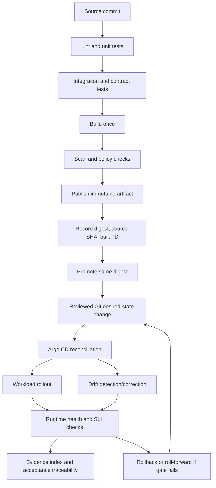

# Platform and Delivery Rubric — M17

**Module:** M17 — Production DevOps Integrated Capstone  
**Unit:** 6 — Platform and delivery rubric  
**Target file:** `platform-and-delivery-rubric.md`  
**Estimated time:** [ASSUMPTION] 14–20 hours for study, implementation, evidence capture, and review; actual duration depends on stack profile and host resources.  
**Prerequisites (earlier modules):** M02, M06, M08, M16; supporting M01, M03, M04, M07, M09, M10, M11, M12, M13, M14, M15 as relevant. M17 Units 1–5 are required interfaces.  
**Core tools:** GitHub Actions, Git, kind, kubectl, Helm or Kustomize, Argo CD.  
**Awareness / optional:** Argo Rollouts, cosign, Kyverno/Gatekeeper, local workflow runners, Backstage/Crossplane (not required).  
**Last reviewed:** 2026-11-04  
**Tool baseline assumed:** Record actual versions in `docs/versions.txt`; no tool version is prescribed here. Verify syntax against installed versions.  
**Stack profile:** Cap-Core by default; Cap+Security / Cap+Chaos optional.  
**Footprint:** measure yours.

> **Scope:** This is a lab-scale delivery and platform assessment instrument. A passing result demonstrates repeatable delivery mechanics and reviewable evidence in the declared local scope. It is not certification of production readiness, enterprise governance, real production traffic behavior, managed CI identity, or multi-region operations.

> **Repository boundary:** This is the only learning-roadmap deliverable for this task. YAML, Python, workflow, shell, tests, and implementation paths below are teaching examples for the learner's separate capstone implementation repository. They are not instructions to add files to the learning-roadmap repository.

## Unit 6 — Platform and delivery rubric

### 6.0 Why this matters in production

A delivery platform is not “CI plus Kubernetes.” It is the controlled path by which a reviewed source change becomes a verified running service, with enough evidence to explain exactly what was built, tested, approved, promoted, reconciled, and operated.

The delivery chain is:

1. A source commit is reviewed.
2. Fast checks and appropriate tests run.
3. A build creates an artifact.
4. Security and policy checks evaluate the artifact and its inputs.
5. The artifact is published and identified immutably.
6. The same artifact digest is promoted between logical environments.
7. A reviewed Git change declares the desired deployment state.
8. Argo CD reconciles the cluster toward that Git state.
9. The workload rolls out and runtime behavior is verified.
10. Evidence is indexed, retained, and mapped to requirements.

A green CI badge is not proof that the artifact in production is the artifact tested. An Argo CD `Synced` state is not proof that the application is healthy. A running Pod is not proof that business behavior or data correctness is right. A rollback claim is not proof unless the intended revision and runtime identity are verified.

**This rubric assesses three connected capabilities:**

- **Delivery pipeline quality:** fast, reproducible, visible, appropriately tested, and securely permissioned CI.
- **GitOps correctness:** Git is the authorized desired-state path; reconciliation, drift behavior, health, and rollback are demonstrated.
- **Platform operability:** packaging, runtime health, probes, graceful shutdown, configuration, logs, runbooks, fresh-clone reproducibility, and lifecycle safety are evidenced.

It does not assess tool count, optional Backstage/Crossplane presence, optional Argo Rollouts installation, or screenshot polish.

**M17 stage contract — quoted verbatim**

> deploy a service through the full tested pipeline; reconcile desired state from Git; apply identity and security controls; demonstrate metrics/logs/alerts; execute a failure, rollback, backup restore, and teardown; map every acceptance criterion to evidence.

**Evidence artifact set — quoted verbatim**

> capstone repository, architecture diagram, runbooks, CI/GitOps evidence, incident report, restore evidence, signed-off checklist.

**Pass rule — quoted verbatim**

> every criterion is demonstrated, evidence is committed or safely retained, and the lab is reproducible from its README/runbook.

Unit 6 supplies evidence for the tested delivery path, immutable artifact promotion, GitOps reconciliation and drift, packaging, rollout and rollback, runtime operability, fresh-clone deployment, and platform lifecycle/teardown. It complements, but does not replace:

- Unit 1 `capstone-requirements.md`: requirement IDs, acceptance criteria, repository/evidence contracts, and traceability.
- Unit 2 `production-readiness-checklist.md`: launch/readiness review.
- Unit 3 `incident-and-recovery-rubric.md`: incident handling, recovery, rollback and restore validation.
- Unit 4 `security-and-release-rubric.md`: security controls and release integrity.
- Unit 5 `cost-and-reliability-rubric.md`: SLI/SLO, reliability and cost evidence.

**Local fidelity caveat:** a laptop `kind` cluster demonstrates mechanics, repeatability, and evidence discipline at lab scale. It does not demonstrate real multi-region behavior, real cloud limits, real production traffic, managed identity federation, or end-to-end production readiness.

**M17 handoffs**

| Earlier module | Handoff consumed | Unit 6 application |
|---|---|---|
| M01 | Container images and registry | Record immutable image identity and verify runtime digest. |
| M02 | CI/CD | Review workflow quality, required checks, build metadata, and promotion. |
| M03 | Operations | Use safe preflight, diagnostics, runbooks, and teardown. |
| M04 | Networking and TLS | Validate service/dependency reachability where relevant. |
| M05 | Storage and stateful services | Respect persistent-state and schema compatibility during rollout/rollback. |
| M06 | Packaging | Select Helm or Kustomize and validate rendered manifests. |
| M07 | Infrastructure as Code | Keep configuration/deployment state declarative and reviewed. |
| M08 | GitOps and progressive delivery | Demonstrate reconciliation, drift behavior, rolling update, and rollback. |
| M09 | Secrets and identity | Use least privilege and secret references; never expose secrets in workflows/logs. |
| M10 | SRE, incidents, SLOs, error budgets, postmortems, ORR | Define rollout health gates and escalation/rollback conditions. |
| M11 | Observability | Correlate deployment, metrics, logs, alerts, and runtime identity. |
| M12 | Security and software supply chain | Pin actions, scan/provenance where feasible, protect artifact trust boundaries. |
| M13 | Backup, disaster recovery, and chaos | Consider stateful rollback and safe fault/verification practices. |
| M14 | Multi-cluster concepts | State that one local cluster does not prove multi-cluster behavior. |
| M15 | Capacity and FinOps | Measure laptop resource use and stop unused components. |
| M16 | Platform engineering and golden paths | Assess template conformance and reproducibility; Backstage/Crossplane are not required. |

M17 integrates and assesses these capabilities; it does not re-teach M01–M16 tools from scratch.

**Zero-budget and stack-profile contract**

- Default to Local: WSL2 Ubuntu or native Linux; planning envelope approximately 4 CPU / 8 GB RAM / 30 GB disk; `kind` is primary, minikube is an alternative.
- **Cap-Core:** kind + Argo CD + minimal Prometheus/Grafana + local registry + backup tooling.
- **Cap+Security:** add one policy engine and/or cosign where feasible.
- **Cap+Chaos:** add one chaos tool or scripted fault injection instead.
- Do not run all optional components simultaneously. Use one GitOps controller and one policy engine at a time.
- Measure actual host resources and stack footprint; stop unused components.
- GitHub Actions is the reference CI platform. Local runners/emulators are optional and do not prove GitHub-hosted identity, branch protection, runner image, or permission behavior.
- Real cloud is optional and requires separate approval plus Unit 5 cost-safety evidence. Budgets are alerts, not caps. No cloud account is required.

### 6.1 Learning objectives (6–10, tagged L1–L4)

1. **[L1]** Explain the difference between CI, a deployment pipeline, GitOps reconciliation, and a platform/golden path.
2. **[L1]** Explain why a digest identifies artifact content while a mutable tag does not provide stable promotion identity.
3. **[L2]** Produce CI evidence showing required tests/checks ran, failures were visible, and the built artifact is linked to its source commit.
4. **[L2]** Promote the same immutable artifact digest through two logical environments without rebuilding it.
5. **[L2]** Demonstrate Git as the authorized desired-state path, including drift detection/correction and one-commit rollback.
6. **[L2]** Validate Helm or Kustomize output and verify rollout, probes, health endpoints, graceful shutdown, configuration, and structured logs.
7. **[L3]** Review CI/GitOps design trade-offs, failure modes, evidence freshness, and platform change risk across multiple projects.
8. **[L3]** Design positive and negative tests for delivery controls and calibrate rubric scores against ambiguous or contradictory evidence.
9. **[L4]** Review a flawed submission, challenge artifact identity and GitOps claims, and issue a defensible go/no-go decision with conditions.
10. **[L4]** Chair a staged rollout/change-risk review for a shared workflow or golden-path change, with blast-radius mapping, abort criteria, rollback, and owner communication.

### 6.2 Concept map and vocabulary (glossary table; at least one diagram)

#### Delivery and reconciliation map



The diagram is conceptual. Repository topology and promotion automation are implementation choices that must be documented and reviewed.

#### Vocabulary

| Term | Meaning | Assessment implication |
|---|---|---|
| CI | Automated validation of source changes, such as linting, tests, and build checks. | Prove required checks executed and were enforced. |
| Delivery pipeline | Controlled path from source change through artifact creation, promotion, deployment, and verification. | Evidence must connect each stage. |
| Deployment pipeline | Release selection, desired-state update, deployment, and runtime verification. | A build alone is not a deployment. |
| GitOps controller | Reconciler comparing declared Git state with observed cluster state. | Installing Argo CD is not proof of correct reconciliation. |
| Platform | Shared capabilities, workflows, interfaces, guardrails, and support for delivery/operations. | Grade usability, safe defaults, ownership, and repeatability—not product count. |
| Golden path | Supported, opinionated route for a common engineering task, with safe defaults and extension points. | A template must be tested and conformant; existence alone earns no credit. |
| Commit SHA | Identifier for a specific source revision. | Tie test/build/promotion records to the exact commit. |
| Artifact | Built output, such as a container image or model package. | Identify the exact artifact used by the workload. |
| Digest | Content-derived immutable identifier, commonly `sha256:<digest>`. | Compare digest at build, promotion, manifest, and runtime. |
| Mutable tag | Human-readable reference that can be moved to different content. | `latest` or `staging` alone is not a stable release identity. |
| Provenance | Information describing how, from what source, and by which process an artifact was produced. | Supports trust analysis; not automatic proof of correctness. |
| Attestation | Verifiable statement about an artifact/build/process. | Optional signing tools do not replace digest identity and review. |
| Promotion | Moving the same approved artifact through environments under controlled approval. | Do not rebuild between environments. |
| Rendered manifest | Final Kubernetes resource representation after Helm/Kustomize processing. | Review actual output, not only templates. |
| Reconciliation | Repeated comparison and convergence between declared and observed state. | Capture sync, history, drift, and runtime health separately. |
| Drift | Difference between declared desired state and observed live state. | Test bounded lab drift and correction or alert path. |
| Prune | Removal of resources no longer declared by desired state. | Requires ownership and deletion-risk review. |
| Self-heal | Automatic correction of out-of-band drift toward declared state. | If disabled, define alerting and manual ownership. |
| Sync status | Whether observed resources match declared state under controller comparison rules. | `Synced` does not mean application is healthy. |
| Health status | Controller/runtime assessment of resource health. | Health can be green while data/business behavior is broken. |
| Readiness probe | Indicates whether a container should receive traffic. | Failed readiness should remove it from service endpoints. |
| Liveness probe | Indicates whether a container should be restarted. | Misconfigured liveness can create restart loops. |
| Startup probe | Gives a slow-starting application time to initialize. | Avoid killing legitimate slow startup. |
| Graceful shutdown | Stops new work and lets in-flight work finish within a bounded period. | Test shutdown, not just configuration presence. |
| Progressive delivery | Gradual exposure of a release with health checks and abort/rollback decisions. | Rolling update is core; canary/blue-green tooling optional. |
| Fresh-clone reproducibility | A new working copy follows documented instructions without undocumented local state. | REQ-013 must be tested independently. |

#### Digest is not a complete trust decision

A digest answers: “Is this the same content?” It does not answer whether the source was reviewed, tests ran, the build process was trusted, the artifact is safe, the configuration is compatible, or the runtime is actually executing that digest. A defensible release decision combines source commit, CI run, build record, digest, scan/provenance evidence where applicable, approval, GitOps revision, and runtime identity.

#### Worked synthetic delivery example

[ILLUSTRATIVE — all IDs, hashes, timestamps, repository names, and results below are synthetic.]

| Stage | Synthetic event | Evidence | What it proves / does not prove |
|---|---|---|---|
| Commit | `4d8f...c912` is merged after review. | `EV-CI-001` | Identifies source revision; not test success. |
| Fast checks | Lint/unit and contract tests pass. | `EV-CI-002` | Shows named checks ran; required-check enforcement is separate. |
| Build | Run `run-1042` creates `ghcr.io/example/api@sha256:aaaa...`. | `EV-BUILD-001` | Links source/build to artifact identity; retain full digest in evidence. |
| Scan/provenance | Declared scan and provenance checks complete. | `EV-SUPPLY-001` | Shows checks ran; reviewer inspects findings and decisions. |
| Staging | GitOps staging overlay references approved digest. | `EV-PROMOTE-STG-001` | Proves desired state reference; compare runtime digest. |
| Reconcile | Argo CD reconciles revision `a8b1...`; runtime digest matches. | `EV-ARGO-STG-001` | Proves selected staging reconciliation/identity. |
| Production | Reviewed Git change promotes same digest; no new build. | `EV-PROMOTE-PROD-001` | Proves promotion metadata; runtime still needs verification. |
| Runtime | Health checks and smoke test pass; metrics/logs reviewed. | `EV-RUNTIME-001` | Demonstrates selected runtime behavior in this test scope. |

**Broken example — do not copy**

[ILLUSTRATIVE] CI tests digest A, but deployment rebuilds and deploys digest B, or uses `api:latest`. The same source SHA does not guarantee identical artifact bytes: base images, dependencies, caches, and build environments can differ. Mutable tags can resolve to different content later. This fails artifact identity/promotion. Correct design: build once, capture the full digest, pass it as promotion metadata, and update Git desired state to that digest. Environment configuration may differ; artifact identity must not.

An exception for intentionally environment-bound artifacts requires an ADR explaining why environment-neutral promotion is impossible, how equivalence is tested, how provenance is linked, and who approves the risk.

### 6.3 Level 1 — Beginner

#### 6.3.1 What each part does

- **CI:** Does this source revision pass required automated checks?
- **Artifact build:** What exact deployable output was produced?
- **Promotion:** Are we moving the same approved output to the next environment?
- **GitOps:** What deployment state has been declared, reviewed, and reconciled?
- **Runtime verification:** Does the running service behave as required?
- **Platform/golden path:** Can teams perform the common delivery task safely and repeatably?

#### 6.3.2 Why CI green can mislead

A green workflow may still be weak if a required test was skipped, a job is `continue-on-error`, a command suppresses failure with `|| true`, retries hide a flaky test, the artifact is rebuilt after tests, branch protection does not enforce checks, or privileged secrets are available to untrusted pull-request code. Review both workflow definition and run record. Repository ruleset details are platform-specific: `[VERIFY: inspect current GitHub repository ruleset and required status-check settings]`.

#### 6.3.3 Build once, promote the same digest

The source commit identifies code. The build creates an artifact. The registry digest identifies artifact content. Staging and production manifests should reference the same digest. Environment settings such as database host or replica count may vary through explicit configuration overlays; image content should not be rebuilt for each environment.

A tag such as `v1.2.0` is human-readable but may be moved unless immutability is enforced. Deploy by digest; record readable version and digest. Digest proves content identity, not safety.

#### 6.3.4 Git and Argo CD

Normal flow: reviewed Git change → Argo observes revision → reconciles desired state → sync/health checks → runtime smoke/SLI verification. `Synced` does not prove app requests work, schema compatibility, pipeline freshness, model correctness, telemetry completeness, or correct artifact identity if a mutable tag is used.

Do not use direct `kubectl --context kind-m17-lab apply` as the normal deployment path in GitOps-managed workloads. A manual command is permitted only as a clearly labelled, guarded drift-injection test.

#### 6.3.5 Helm or Kustomize

Choose one core path.

- **Helm:** chart templates and values; validate chart/values, render, inspect output, and review hidden defaults.
- **Kustomize:** base resources and overlays/patches; render each environment and inspect the output.

Do not require both. Prove validation, rendered output, explicit/minimal environment differences, and secret-free configuration.

#### 6.3.6 Rollouts and probes

A conventional rolling update is the required baseline. Verify rollout completion, readiness behavior, liveness behavior, startup behavior where needed, service usability during update, and rollback identity. Argo Rollouts can support canary/blue-green but is Awareness/optional.

#### 6.3.7 Platform operability

A service should have health/readiness behavior, graceful shutdown, externalized non-secret config, secret references, structured logs without credentials, appropriate resource requests/limits and probes, and a README/runbook another person can follow.

#### 6.3.8 Local lab fidelity

A local `kind` lab proves repeatable mechanics at measured lab scale. It does not prove cloud-provider behavior, managed identity, enterprise branch governance, regional resilience, production traffic capacity, or production support readiness.

### 6.4 Level 2 — Intermediate
#### 6.4.1 Complete 100-point rubric

Use four performance levels consistently:

- **0 — Not demonstrated:** behavior/evidence is absent, unsafe, contradicted, or unverifiable.
- **1 — Emerging:** partial implementation; material evidence or failure handling is missing.
- **2 — Competent:** behavior is demonstrated with relevant, attributable evidence.
- **3 — Strong:** behavior is repeatable, independently reviewable, tested positively and negatively, and limitations are explicit.

For criterion \(i\):

\[
\text{points}_i = \text{weight}_i \times \frac{\text{level}_i}{3}
\]

Round each criterion to two decimal places using decimal `ROUND_HALF_UP`, then sum the rounded points.

| ID | Criterion | Weight | Level 0 — Not demonstrated | Level 1 — Emerging | Level 2 — Competent | Level 3 — Strong | Required evidence and negative/failure test |
|---|---|---:|---|---|---|---|---|
| PD-01 | CI quality and required checks | 15 | Workflow absent, tests skipped, or failure hidden. | Jobs exist, but test selection, required-check enforcement, or failure visibility is unclear. | Appropriate lint/unit/integration checks run; run records tie to commit; failures are visible; required checks are enforced where supported. | Fast feedback, risk-based tests, safe caches, reproducible inputs, flaky-test tracking, pinned actions, and planted skip defects detected. | Workflow, run ID/URL, test report, branch-rule evidence, conformance report. Negative: plant skipped test or `continue-on-error`; checker/reviewer flags it. |
| PD-02 | Artifact identity and promotion by digest | 15 | Mutable tag only or digest missing. | Build digest recorded, but one environment rebuilds or runtime identity is unverified. | One artifact is built; full digest recorded; both logical environments reference same digest; runtime is compared. | Source SHA, CI, build, scan/provenance, digest and runtime identity independently linked; verifier catches rebuild, missing digest, tag-only reference, mismatch. | Build metadata, registry digest, environment manifests, runtime image evidence. Negative: change one environment digest or replace with tag-only reference; verifier fails. |
| PD-03 | Packaging and configuration quality | 10 | No rendered review; invalid/secret-bearing configuration deployed. | Packaging exists, but validation/overlays/rendered output are incomplete. | Helm or Kustomize validated; rendered output reviewed; environment differences explicit; no plaintext secrets. | Schema/values and negative fixtures tested; overlays minimal; secure defaults and rendered diffs reviewable. | Chart/overlay, validation output, rendered manifests, secret scan. Negative: invalid value/overlay or planted secret is rejected/flagged. |
| PD-04 | GitOps correctness and drift handling | 15 | Git bypassed or controller state not evidenced. | Argo CD installed and sync shown, but drift, health, or ownership unclear. | Git is normal deployment path; sync/history/health captured; bounded drift corrected or explicit alert/manual path proven. | Sync loops, ownership conflicts, prune/self-heal, repo identity, unhealthy-but-synced cases tested/reasoned; drift correction repeatable. | Git revision, Argo status/history, drift test, runtime state. Negative: lab drift corrected or documented alert path fires. |
| PD-05 | Environment promotion and rollback | 15 | No approval/promotion trail or rollback untested/incorrect. | Promotion/rollback attempted, but digest, Git revision, or runtime outcome incomplete. | Promotion approval documented; one-commit Git rollback executed; prior commit/digest and runtime behavior verified. | Rollback includes schema/data compatibility, no hidden drift, abort criteria, freshness, and repeatable re-promotion path. | Promotion record, approval/PR, before/after Git SHA, Argo revision, digest, smoke test. Negative: wrong digest or incompatible schema is rejected. |
| PD-06 | Progressive delivery and rollout safety | 10 | No rollout evidence or unsafe probes. | Rolling update exists, but probes/stall behavior or failure response untested. | Conventional rolling update observed; suitable probes tested; rollout and rollback behavior evidenced. | Health gates and abort thresholds justified; stalled rollout/probe misconfiguration planted; optional canary/blue-green reviewed where used. | Deployment spec, rollout status, probe tests, runtime telemetry. Negative: bad readiness endpoint prevents false healthy rollout. |
| PD-07 | Application/platform operability | 10 | No reliable health behavior, unsafe config, or secrets in logs. | Some controls exist but shutdown/runtime verification incomplete. | Health endpoints, graceful shutdown, externalized non-secret config, structured logs, resource/probe behavior tested. | Controlled termination/config change, in-flight behavior, log quality, secret hygiene, resource behavior, limitations independently verified. | Smoke test, termination test, redacted logs, config review, resource/probe evidence. Negative: planted secret marker detected. |
| PD-08 | Documentation and fresh-clone reproducibility | 5 | Deploy depends on undocumented local state or cannot be reproduced. | README/runbook partial; fresh clone reveals unresolved prerequisites. | Another person or isolated fresh clone follows instructions and deploys/verifies declared core profile. | Blinded evaluator succeeds without author assistance; prerequisites, failure branches, rollback, evidence, cleanup, limitations complete. | Fresh-clone record, clone SHA, host profile, README/runbook. Negative: remove undocumented prerequisite; clean clone exposes gap. |
| PD-09 | Platform lifecycle, preflight, and teardown | 5 | Unsafe setup/teardown or residual resources unaccounted for. | Some preflight/cleanup exists but inventory/context guard incomplete. | Preflight checks tools/resources/context; operations scoped; teardown inventory and residual checks recorded. | Bootstrap/verify/drill/teardown repeatable, fail closed on wrong target, no unexplained residuals; resource use measured. | Preflight report, context guard tests, before/after inventory, teardown report. Negative: wrong context, unselected drill, or unknown target refused. |

**Weight arithmetic**

\[
15 + 15 + 10 + 15 + 15 + 10 + 10 + 5 + 5 = \boxed{100}
\]

**Scoring and pass interpretation**

- Numeric score is descriptive; it does not override the M17 stage pass rule.
- Level 2 (`Competent`) is the minimum level that demonstrates a criterion.
- **Unit 6 complete:** all applicable mandatory criteria are at least Level 2, all critical gates pass, all five lab scenarios are evidenced, and evidence is indexed/reproducible.
- **Not complete:** any mandatory criterion is below Level 2, a critical gate fails, a required lab scenario is omitted, or mandatory evidence is missing.
- This does not create a separate M17-wide percentage threshold. The governing stage pass rule remains that every criterion is demonstrated, evidence is committed or safely retained, and the lab is reproducible from its README/runbook.
- `N/A` is allowed only when a requirement is genuinely inapplicable and the reviewer records why. Optional Argo Rollouts is not required; conventional rolling-update assessment still applies.
- Missing evidence is not `N/A`; mark it `NOT_DEMONSTRATED`.
- Contradictory evidence is scored against the verified state. Evidence predating the last material change cannot prove the current release.
- A narrative, screenshot, or workflow file without run evidence cannot establish a critical claim.

**Critical gates**

| Gate | Required condition | Consequence if failed |
|---|---|---|
| CG-01 — Safe target | Every cluster operation is explicitly scoped to `kind-m17-lab`; unknown context/namespace/target is refused before mutation. | Stop lab operation; Unit 6 incomplete. |
| CG-02 — Artifact identity | Artifact tested in CI is the artifact promoted to both logical environments and referenced by runtime digest; no silent rebuild. | Unit 6 incomplete regardless of score. |
| CG-03 — GitOps authority | Git is authorized normal desired-state path; reconciliation and drift are demonstrated or alert/manual path is proven. | Unit 6 incomplete. |
| CG-04 — Rollback | One-commit Git rollback is performed and verified against expected revision, digest, and runtime behavior. | Unit 6 incomplete. |
| CG-05 — Reproducibility/integrity | Fresh-clone instructions work; evidence is secret-free and provenance-linked; no fabricated evidence. | Unit 6 incomplete; fabrication triggers integrity review. |

#### 6.4.2 Worked synthetic score calculation

**Representative example — your output will differ.**

[ILLUSTRATIVE]

| Criterion | Weight | Level | Calculation | Points |
|---|---:|---:|---|---:|
| PD-01 | 15 | 3 | 15 × 3/3 | 15.00 |
| PD-02 | 15 | 2 | 15 × 2/3 | 10.00 |
| PD-03 | 10 | 2 | 10 × 2/3 | 6.67 |
| PD-04 | 15 | 2 | 15 × 2/3 | 10.00 |
| PD-05 | 15 | 1 | 15 × 1/3 | 5.00 |
| PD-06 | 10 | 2 | 10 × 2/3 | 6.67 |
| PD-07 | 10 | 2 | 10 × 2/3 | 6.67 |
| PD-08 | 5 | 3 | 5 × 3/3 | 5.00 |
| PD-09 | 5 | 2 | 5 × 2/3 | 3.33 |
| **Total** | **100** | | | **68.34** |

PD-05 is Level 1 because the learner attempted rollback but did not prove the intended digest was running. CG-04 fails. The unit is incomplete even if unrelated criterion scores are high.

Defect effects: skipped tests reduce PD-01; rebuild-per-environment or mutable-tag-only deployment reduces PD-02 and fails CG-02; untested rollback reduces PD-05 and fails CG-04; stale evidence cannot support current state; `Synced` with unhealthy app weakens PD-04/PD-06/PD-07; undocumented fresh-clone prerequisites fail PD-08 and CG-05.

#### 6.4.3 Evidence contract

| Criterion | Minimum evidence bundle | Unacceptable as sole evidence |
|---|---|---|
| PD-01 | Workflow, run ID/URL, commit SHA, executed test summary, required-check enforcement record, conformance report. | Workflow YAML or green badge alone. |
| PD-02 | Build ID, source SHA, full digest, promotion metadata, staging/production manifest digest, runtime digest comparison. | Tag string, abbreviated digest, narrative. |
| PD-03 | Chart/overlay revision, validation output, rendered manifests, environment diff, secret scan. | Template source without rendered output. |
| PD-04 | Git revision, Argo status/history, drift test, correction/alert evidence, app health check. | Argo CD installed or one `Synced` screenshot. |
| PD-05 | Approval, before/after Git SHA, rollback commit, Argo revision, runtime digest, smoke test. | “Rollback available” documentation. |
| PD-06 | Rollout status, probe behavior, metrics/logs, planted-failure result, recovery. | Deployment object exists. |
| PD-07 | Health endpoint test, graceful shutdown test, redacted structured logs, config/resource review. | Pod `Running` only. |
| PD-08 | Fresh clone SHA, clean environment/profile, README-only procedure, verification result, reviewer notes. | Author's workstation demo. |
| PD-09 | Preflight, context guard, inventory before/after, cleanup output, residual-resource review. | `make teardown` exit code alone. |

### 6.5 Level 3 — Advanced

#### 6.5.1 Pipeline design review

**Feedback speed and test selection**

- Run deterministic lint/unit tests early.
- Run integration/contract tests where boundaries and external behavior justify them.
- Run slower end-to-end checks on the smallest meaningful release-candidate set.
- Do not treat a rigid test pyramid as universal; select layers based on architecture, risk, and failure cost.
- Record mandatory checks and why they exist.
- Retries may diagnose transient infrastructure failures but must not hide persistent flaky tests. Track attempts and final status.

**Required checks and branch protection**

A workflow definition says what could run. Repository rules say what must pass before merge/release. Verify both. GitHub rulesets/branch protection are platform-specific: `[VERIFY: inspect current repository ruleset and required status-check settings]`.

**Reproducible builds and cache safety**

Pin toolchain/dependencies, record base-image identity and build inputs, use cache keys including relevant lockfiles/toolchain inputs, avoid sharing untrusted cache entries with privileged release jobs, and record build ID/source SHA/parameters/digest. A cache hit is an optimization, not proof. Do not claim bit-for-bit reproducibility unless independent builds were compared.

**Artifact promotion**

Compare source SHA, CI run ID and executed checks, build record, artifact digest, scan/provenance decisions, environment manifest digest, and runtime identity. Digest equality proves content identity—not safety, provenance, or correctness.

**Helm vs Kustomize trade-offs**

| Dimension | Helm | Kustomize |
|---|---|---|
| Model | Templates + values + chart packaging. | Base resources + overlays/patches. |
| Benefits | Reusable charts, parameterized values, release packaging. | Declarative composition and explicit overlays. |
| Risks | Template complexity, hidden defaults, values drift. | Patch complexity, overlay interactions, duplicated config. |
| Evidence | Chart/values validation and rendered output per environment. | Build output per overlay, patch review, rendered diff. |
| Decision rule | Use when reusable parameterized packaging is central and chart ownership is clear. | Use when overlays/patches are simpler and easier to review. |

Neither is universally superior. Do not require both.

**GitOps failure modes**

- Sync loop: controller repeatedly applies a change another controller/process reverses.
- Ownership conflict: two controllers claim the same resource/field.
- Drift fighting: manual changes are overwritten or self-heal is disabled without alerting.
- Secrets in Git: credentials enter history or rendered manifests.
- Mutable tags: artifact behind a tag changes while manifest text remains stable.
- Synced but unhealthy: fields match while the app cannot serve correct requests.
- Self-heal disabled: drift may persist silently without alert/owner.
- Prune without review: deleted manifests can remove resources with valuable state.
- Repo/cluster mismatch: controller watches wrong repo/path/branch/cluster.
- Manual deployment bypass: direct mutation creates drift from source of truth.

**Auto-sync vs manual sync**

| Context | Auto-sync benefits/risks | Manual-sync benefits/risks | Decision rule/evidence |
|---|---|---|---|
| Lab/staging | Fast convergence; bad Git commit may propagate quickly. | Explicit approval; but can delay and invite undocumented actions. | Choose by blast radius; record policy, approval, and rollback. |
| Critical production | Safe with strong gates, health checks, staged promotion. | Human-controlled release window and audit trail. | Require risk-based controls, audit trail, and tested abort/rollback. |

No universal answer.

**Monorepo vs split repositories**

| Context | Monorepo | Split repositories | Decision rule/evidence |
|---|---|---|---|
| Shared service/GitOps | Atomic cross-file change; simpler review. Risk: broad access and coupling. | Separate deployment permissions/ownership. Risk: cross-repo coordination and version drift. | Choose by ownership, trust boundary, auditability, and change coupling. |
| Multiple teams | Shared standards and visibility. Risk: shared workflow blast radius. | Team autonomy. Risk: policy duplication/drift. | Require owners, compatibility tests, staged rollout either way. |

**Rolling update vs canary/blue-green**

| Strategy | Benefits | Risks | Evidence / decision rule |
|---|---|---|---|
| Rolling update (core) | Built-in Kubernetes deployment model; no extra controller. | Mixed versions during rollout; probe quality matters. | Required baseline: revision, status, probes, SLI checks, rollback. |
| Canary | Gradual exposure and measurable comparison. | Needs reliable metrics, traffic control, abort logic. | Optional when risk/traffic architecture justifies it. |
| Blue/green | Clear cutover and possible fast traffic reversal. | Duplicate capacity and state coordination. | Optional; justify cost and state complexity. |

Argo Rollouts is Awareness/optional.

**Golden-path reuse vs custom implementation**

| Option | Benefits | Risks | Evidence / decision rule |
|---|---|---|---|
| Golden path | Consistent defaults, less repeated work, standard evidence. | Template may encode unsafe assumptions or become stale. | Require conformance tests, owner, versioning, extension points, security/lifecycle checks. |
| Custom | Fits unusual constraints. | More maintenance and inconsistency. | Require ADR, same rubric evidence, owner, tests, documentation. |

Backstage and Crossplane are not required.

#### 6.5.2 Rollback and stateful compatibility

Application rollback is not automatically database rollback. If release N+1 writes a new format or removes a column, reverting code to N may fail. Use a compatible expand/contract migration where appropriate: add backward-compatible schema, deploy code supporting both representations, migrate data, verify compatibility, and remove obsolete schema only after the rollback window closes. Document the approach in an ADR and coordinate with Unit 3 recovery evidence. Never claim code rollback reverses irreversible data changes.

#### 6.5.3 Pipeline change-risk review

A shared workflow or golden-path template can affect many projects. Treat it as a platform release. Require:

- affected repositories/services and owners;
- dependency/version compatibility matrix;
- security/permission change review;
- CI test matrix and representative fixture repositories;
- staged rollout rings;
- telemetry and success criteria;
- abort conditions and rollback commit;
- communication plan and owner acknowledgements;
- post-change verification and expiry of temporary exceptions.

[ILLUSTRATIVE] Ring model:

| Ring | Scope | Entry evidence | Continue condition | Abort condition |
|---|---|---|---|---|
| 0 — Internal | Platform fixture repository | Unit/contract tests and rollback tested. | No policy regression; conformance passes. | Permission expansion or artifact mismatch. |
| 1 — Pilot | One low-risk service | Fresh-clone and CI/GitOps evidence. | No new failures; owner signs off. | Deployment blocked or unexplained drift. |
| 2 — Small cohort | Named small service set | Compatibility matrix and communication. | Telemetry within declared baseline. | Error/latency/queue signal breaches predeclared limit. |
| 3 — Broad rollout | Remaining approved services | Pilot evidence reviewed. | Owners acknowledge; audit passes. | Any critical gate fails. |

Thresholds are service-specific and declared before rollout; no universal error-rate or duration is assumed.

#### 6.5.4 Evidence quality and freshness

Evidence must be relevant, attributable to commit/run/artifact/environment/time, fresh after the last material change, integrity-protected where appropriate, reproducible, and scoped to what the lab proves.

A practical strength heuristic is:

`Assertion < Screenshot < Command output < Automated test < Continuously run check`

This is not an automatic truth ranking. A poorly designed test may be weaker than a carefully reviewed command. Critical claims need executable results and identity linkage, not screenshots alone.

Unit 1 defines `evidence/index.yaml`; evidence must be secret-free, timestamped, provenance-linked, and checksummed where appropriate. Refresh after material changes. Do not overwrite failed evidence silently; preserve history and mark stale records.

### 6.6 Level 4 — Expert

#### 6.6.1 Review-chair procedure

1. Confirm scope, profile, environment, intended source commit, and non-goals.
2. Read requirement/acceptance traceability and evidence index.
3. Verify required CI jobs ran and repository policy enforces them.
4. Trace source SHA → CI run → build ID → digest → environment manifest → Argo revision → runtime digest.
5. Inspect action pins, workflow permissions, secret boundaries, skip paths, cache use, and untrusted PR behavior.
6. Inspect rendered Helm/Kustomize output and environment diffs.
7. Verify GitOps repo/path/branch/cluster mapping, sync, health, history, drift, self-heal, and prune rationale.
8. Reproduce a safe subset from a fresh clone.
9. Verify one-commit rollback and runtime outcome; review stateful compatibility.
10. Review probes, graceful shutdown, structured logs, and runtime signals.
11. Review cleanup, resource inventory, and residual credentials/resources.
12. Score each criterion and evaluate gates separately.
13. Record go/no-go, conditions, owners, expiry/review dates, and not-demonstrated items.

#### 6.6.2 Planted defects

| Defect | Why it matters | Reviewer action |
|---|---|---|
| Artifact rebuilt per environment | Tested artifact may differ from deployed artifact. | Compare build IDs/digests; fail CG-02 if different. |
| Mutable tag deployed | Tag can point to different content. | Require full digest and runtime comparison. |
| Self-heal disabled without alert/owner | Drift may persist silently. | Require tested alert/manual path. |
| Rollback claimed but never executed | Documentation is not proof. | Require one-commit rollback and runtime digest. |
| CI passes while tests skipped | Green status hides missing validation. | Inspect run and branch rules; plant skip defect. |
| Argo `Synced` while app unhealthy | Desired state does not imply service health. | Inspect health and user-visible smoke/SLI. |
| Prune enabled without deletion review | May delete stateful resources. | Inspect ownership, deletion/recovery plan, policy. |
| Broad permissions/secrets to untrusted code | Supply-chain/credential risk. | Review job permissions, triggers, secret scopes. |
| Golden path fails rubric | Template can propagate unsafe defaults. | Test generated service and review ownership/escape hatch. |
| Fresh clone depends on local state | Submission is not reproducible. | Blinded clone; fail PD-08 until corrected. |

#### 6.6.3 Four reference submission anchors

| Anchor | Evidence characteristics | Indicative scoring | Gate result | Rationale |
|---|---|---|---|---|
| Level 0 — Not demonstrated | No run records, mutable tags, manual deploy, no rollback/fresh clone. | Many criteria 0. | CG-02/03/04/05 fail. | Claims unsupported. |
| Level 1 — Emerging | CI exists; digest captured once; Argo sync screenshot; no rendered diff; rollback documented only. | Partial level 1. | Critical gates fail. | Tool presence shown, behavior incomplete. |
| Level 2 — Competent | Required CI tests run; same digest in both envs; drift tested; rollback verified; fresh clone works. | Mandatory criteria ≥2. | Gates pass if evidence current. | Meets declared local scope. |
| Level 3 — Strong | Repeatable build/promotion, negative tests, staged rollout, independent clone, clear ownership. | Level 3 where independently supported. | Gates pass. | Reviewer can reconstruct release and limitations. |

These are calibration anchors, not claims about an actual learner or production service.

#### 6.6.4 Go/no-go with conditions

- **Go for declared lab scope:** all mandatory criteria demonstrated, all gates pass, evidence indexed/reproducible, limitations explicit.
- **Conditional/retest:** only non-critical gaps remain; each has owner, due/review date, compensating control, and verification test. It is not a final pass while a mandatory criterion is undemonstrated.
- **No-go:** any gate fails, artifact identity is unknown, GitOps authority is bypassed, rollback is unverified, evidence is fabricated, or fresh-clone reproducibility fails.

A waiver must be explicit, time-bounded, approved by the accountable owner, include compensating controls, and have expiry/review date. A waiver does not turn an unmet mandatory requirement into a pass unless the governing requirement explicitly permits it.

### 6.7 SRE lens (SLIs/SLOs, failure modes, runbook snippet)

#### Deployment health signals

| Signal | What it detects | Common trap |
|---|---|---|
| Rollout progress/available replicas | Controller completed rollout. | Deployment completion does not prove user behavior. |
| Readiness | Whether Pod should receive traffic. | Weak readiness can pass while dependencies fail. |
| Liveness/restarts | Process failure/restart loops. | Aggressive liveness amplifies incidents. |
| Error rate | User-visible failures. | Low traffic/missing telemetry misleads. |
| Latency | Slow responses/dependencies. | Averages hide tail latency. |
| Freshness/business correctness | Expected data/model output is current and valid. | HTTP 200 does not prove correctness. |
| Logs | Event context/correlation. | Logs may be incomplete or leak secrets. |
| Argo sync/health | Desired-state convergence/resource health. | `Synced` is not business health. |

Halt promotion or trigger rollback when a predeclared critical health gate fails, artifact identity is wrong, data compatibility is uncertain, or required telemetry is missing. Numeric thresholds are service-specific and must be declared before release; values not supplied by the roadmap are `[ILLUSTRATIVE]`.

#### Failure modes

| Failure | Symptom | Discriminating evidence | Response |
|---|---|---|---|
| Bad release | Increased errors after rollout. | Commit/digest timeline, logs, SLI query. | Halt promotion; verify target; rollback through Git if safe. |
| Dependency failure | Timeout/connection errors. | Dependency health, DNS/TLS/network checks, logs. | Scope dependency impact; avoid broad restarts. |
| Stale image | Manifest changed but runtime digest did not. | Git revision, Argo history, live digest. | Correct image reference and verify reconciliation. |
| Config mismatch | App starts but behaves incorrectly. | Rendered manifest, overlay diff, redacted config logs. | Revert/fix config; avoid unnecessary rebuild. |
| Sync loop | Resource repeatedly changes. | Controller events/diff/ownership. | Identify owner and remove conflict. |
| Probe misconfiguration | Restart loop or no traffic. | Probe events, endpoint behavior, restarts. | Correct semantics and retest. |
| Graceful shutdown failure | Requests dropped during termination. | Termination logs/request traces. | Correct shutdown and rollout policy. |
| Stalled rollout | New replicas never become ready. | Events, scheduling/resource state, probes. | Abort promotion and diagnose. |
| Synced but unhealthy | Desired state matches; smoke test fails. | Argo health plus user-visible check. | Treat as release failure. |

#### Compact deployment runbook

**Trigger:** release candidate approved or rollout/health alert indicates degradation.  
**Impact:** identify service, environment, commit, digest, affected users/data, and stateful risk.  
**Prerequisites:** confirm local context `kind-m17-lab`, namespace/workload allowlist, current Git revision, approved digest, baseline health, and rollback revision. Stop if identity is ambiguous.

**Safe diagnostics:**

```bash
kubectl --context kind-m17-lab get deployments -n "<LAB_NAMESPACE>"
kubectl --context kind-m17-lab get pods -n "<LAB_NAMESPACE>" -o wide
kubectl --context kind-m17-lab get events -n "<LAB_NAMESPACE>" --sort-by=.metadata.creationTimestamp
kubectl --context kind-m17-lab rollout status "deployment/<LAB_DEPLOYMENT>" -n "<LAB_NAMESPACE>"
kubectl --context kind-m17-lab get deployment "<LAB_DEPLOYMENT>" -n "<LAB_NAMESPACE>" -o yaml
```

Replace placeholders only with allowlisted values. Verify installed kubectl syntax `[VERSION-SENSITIVE]`.

**Decision points:** digest mismatch → stop promotion; Synced but smoke fails → treat app as unhealthy; stalled rollout/probe failures → stop promotion; uncertain schema/data compatibility → do not blindly revert code.

**Rollback:** revert the Git desired-state commit through the authorized workflow; wait for reconciliation; verify Argo revision, runtime digest, rollout, and smoke test.

**Verification:** app health, user-visible behavior, telemetry, logs, and data/freshness invariants.  
**Abort/escalation:** wrong context/namespace, unknown target, unexpected persistent-state change, missing rollback revision, missing telemetry, or secret exposure.  
**Cleanup:** remove only declared lab resources after inventory; verify residuals.
### 6.8 Security lens (threats, controls, negative tests)

| Threat | Control | Positive evidence | Negative test |
|---|---|---|---|
| Excessive workflow permissions | Explicit workflow/job permissions; least privilege. | Permission review and successful least-privilege run. | Plant `write-all` or unnecessary write permission; checker flags it. |
| Untrusted third-party action | Pin actions to immutable commit references under chosen policy. | Action reference inventory and approved pin policy. | Replace SHA pin with version tag; checker flags it. |
| Secret exposure in pull requests | Separate untrusted PR validation from privileged release jobs; restrict secrets to trusted context. | Trigger/job/permission review. | Synthetic fork/PR fixture tries to reach privileged job; policy test rejects it. |
| Secret leakage in logs/artifacts | Secret references; never echo secrets; redact evidence. | Redaction scan and reviewed logs. | Plant `FAKE_TEST_SECRET_DO_NOT_USE`; scanner flags it. |
| Artifact substitution | Digest identity and, where feasible, provenance/signature verification. | Build metadata, digest comparisons, attestation if enabled. | Change one environment digest; verifier fails. |
| Unauthorized cluster mutation | GitOps as normal path; RBAC and explicit context guards. | Git commit and Argo history. | Lab drift must be detected/corrected or alerted. |
| Secrets in Git/rendered manifests | Secret references or approved secret integration. | Secret scan and rendered-manifest review. | Planted dummy secret is rejected. |
| Prune deletes stateful resource | Ownership review, deletion policy, backup/recovery plan. | Prune rationale and diff review. | Disposable fixture tests deletion behavior under approval. |
| Emergency manual change persists | Record emergency action and reconcile to Git. | Incident/change record and post-change diff. | Inject lab drift and confirm correction or alert. |

Cosign and a policy engine are optional/Awareness. Cap-Core must still prove immutable digest identity and safe release behavior. Digest equality does not replace signature/provenance verification where the threat model requires it.

### 6.9 Unit checklist (every item verifiable by command, query, test, or record)

| ID | Verification item | Method | Pass condition | Evidence | Failure behavior |
|---|---|---|---|---|---|
| UC-01 | Required CI jobs/checks exist and run. | Inspect workflow and CI run. | Mandatory checks executed for source SHA. | `evidence/ci/` | PD-01 below Level 2. |
| UC-02 | Required checks are enforced where supported. | Inspect ruleset/branch-protection record. | Merge/release policy requires intended checks. | `evidence/ci/branch-rules/` | Not demonstrated; YAML alone is insufficient. |
| UC-03 | No test silently skipped/ignored. | Conformance checker and run review. | Exceptions explicit and approved. | `evidence/ci/conformance/` | Fail PD-01 for hidden skip. |
| UC-04 | Third-party actions follow immutable pin policy. | Parse workflow references. | Approved SHA pin or documented verified exception. | `evidence/ci/action-pins/` | Flag unpinned action. |
| UC-05 | Workflow/job permissions minimal and explicit. | Workflow review. | No unnecessary broad permissions. | `evidence/ci/permissions/` | Fail/condition by severity. |
| UC-06 | Source commit and artifact digest recorded. | Build metadata inspection. | Full SHA, build ID, full digest linked. | `evidence/release/build/` | CG-02 fails if identity absent. |
| UC-07 | Same digest promoted without rebuild. | Promotion verifier. | Staging and production refs equal approved digest/build ID. | `evidence/release/promotion/` | CG-02 fails. |
| UC-08 | Mutable-tag-only deployment rejected. | Manifest scan and negative fixture. | Deployment references immutable digest. | `evidence/release/negative-tests/` | CG-02 fails. |
| UC-09 | Packaging validated and rendered. | Helm/Kustomize validation/render. | Render succeeds and output retained/reviewed. | `evidence/packaging/` | PD-03 below Level 2. |
| UC-10 | Environment overlays explicit and secret-free. | Rendered diff and secret scan. | Intentional differences; no plaintext secrets. | `evidence/packaging/overlays/` | Stop promotion for secret exposure. |
| UC-11 | Git is authorized normal deployment path. | Repository/Argo configuration review. | Normal release updates Git. | `evidence/gitops/` | CG-03 fails. |
| UC-12 | Argo status/history and runtime health separate. | Argo record plus smoke test. | Sync, health, revision, app behavior distinct. | `evidence/gitops/` | PD-04 below Level 2. |
| UC-13 | Drift behavior tested. | Guarded lab drift injection. | Self-heal/correction or alert/manual path works. | `evidence/gitops/drift/` | CG-03 fails. |
| UC-14 | Prune/self-heal rationale recorded. | ADR/config review. | Ownership, deletion risk, alert path documented. | `docs/adr/`, `evidence/gitops/` | PD-04 below Level 2. |
| UC-15 | One-commit rollback executed and verified. | Git revert, Argo history, runtime digest, smoke test. | Prior revision and runtime behavior restored. | `evidence/rollback/` | CG-04 fails. |
| UC-16 | Rolling update/probes exercised. | Deployment spec, rollout status, negative probe fixture. | Correct rollout and failure response observed. | `evidence/rollout/` | PD-06 below Level 2. |
| UC-17 | Shutdown/config/logging tested. | Controlled termination, config change, log scan. | Bounded in-flight behavior; config externalized; no secret leak. | `evidence/operability/` | PD-07 below Level 2. |
| UC-18 | Fresh-clone deployment succeeds. | Isolated clone and README-only procedure. | Independent clone deploys/verifies without undocumented state. | `evidence/reproducibility/` | CG-05 fails. |
| UC-19 | Conformance checker catches planted defects. | Checker tests. | Pin, permission, skip, privileged PR, digest defects flagged. | `evidence/ci/conformance-tests/` | PD-01 below Level 2. |
| UC-20 | Digest verifier catches mismatch/tag-only/missing digest. | Unit tests. | Negative fixtures fail. | `evidence/release/verifier-tests/` | PD-02 below Level 2. |
| UC-21 | Cleanup/teardown verified. | Before/after inventory. | All created resources accounted for. | `evidence/teardown/` | PD-09 below Level 2. |
| UC-22 | Limitations and gaps explicit. | Final evidence/gap review. | No unsupported production claim. | `evidence/gaps.md` | CG-05 may fail if integrity compromised. |
| UC-23 | Shared workflow/template change-risk review complete. | Review record. | Blast radius, rings, telemetry, abort, rollback, owners, post-check. | `evidence/platform-change-review/` | PD-08/PD-09 affected. |
| UC-24 | Tool versions and footprint recorded. | `docs/versions.txt`, host measurement. | Actual versions/resources recorded. | `evidence/preflight/` | Reproducibility score reduced. |

### 6.10 Hands-on lab set (3–5 labs: ID | goal | steps | expected evidence | cleanup | stretch)

Five lab packages are mandatory. They can be scheduled across sessions, but all five scenarios must be individually identifiable and assessed.

**Global safety/preflight**

- Use synthetic data and a disposable local environment.
- Confirm stack profile and measure CPU/RAM/disk before starting.
- Use explicit `kind-m17-lab` context on every cluster-targeting command.
- Confirm namespace/workload allowlist.
- Capture baseline Git revision, artifact digest, Argo state, rendered manifests, and health before drift/rollback.
- Use read-only inspection first; mutation requires dry-run plan and explicit opt-in.
- Stop if context, namespace, target, stateful ownership, or cleanup path is ambiguous.
- No production credentials, real customer data, public endpoints, or cloud resources.

#### Lab A — CI quality and conformance

| Field | Instructions |
|---|---|
| ID / level | `LAB-PD-A`; L2–L3 |
| Goal | Demonstrate CI checks, least privilege, failure visibility, action pinning, and planted-defect detection. |
| Time | [ASSUMPTION] 2–4 hours |
| Prerequisites | M02, Git, Python, GitHub Actions repository or workflow fixture. |
| Profile/footprint | Cap-Core; no cluster required for checker portion. Measure local runner footprint if used. |
| Scope/non-goals | Source repo with validation jobs and trusted build path. Does not prove GitHub-hosted identity with local runner. |
| Preflight | Record commit, workflow revision, repository ruleset, parser version, hosted/local execution. |
| Steps | Inspect triggers/permissions; run lint/unit/contract checks; run conformance checker; plant unpinned action, `write-all`, `continue-on-error`, skipped test, privileged PR secret, missing digest output; require checker to flag each; inspect actual CI run and required-check enforcement. |
| Positive/negative tests | Conformant fixture passes. Each planted defect is detected and checker exits non-zero. |
| Signals/false positives | Unpinned SHA, broad permissions, suspicious skip, privileged secrets in PR job. Legitimate diagnostic `continue-on-error` still requires review. |
| Evidence | `evidence/ci/workflow.yml`, `run-record.json`, `conformance-report.json`, `conformance-tests/`; PD-01. |
| Cleanup/post-check | Remove fixture branches/files; preserve redacted reports; confirm no secrets or test changes remain in release branch. |
| Stretch/variant | Compare test-stage designs. Variant A hides integration tests behind `if:`; B uses `continue-on-error`. |
| Facilitator key | Workflow file is not enforcement. Run record must show checks executed for source SHA; repository rules must require them. Checker is a policy aid, not full semantic proof. |
| Common failures | YAML 1.1 parses `on` as boolean; parser defaults are misread; local runner differs from hosted runner. |

#### Lab B — Promotion by digest

| Field | Instructions |
|---|---|
| ID / level | `LAB-PD-B`; L2 |
| Goal | Prove same artifact digest promoted staging → production without rebuild. |
| Time | [ASSUMPTION] 1–3 hours |
| Prerequisites | M01/M02/M06/M12; local or approved registry. |
| Profile/footprint | Cap-Core; measure registry/build footprint. |
| Scope/non-goals | One synthetic image and two logical environment manifests. No production cluster required. |
| Preflight | Record source SHA, build ID, registry/repository, approved digest, overlay paths, baseline manifest hashes. |
| Steps | Build once; capture full digest/build metadata; update staging desired state; verify manifest/runtime; promote same digest to production through reviewed change; run verifier; do not rebuild. |
| Positive/negative tests | Both environments have same approved digest/build ID. Change production digest, remove digest, or use `:latest`; verifier fails. |
| Signals/false positives | Human display may abbreviate digest; evidence must retain full digest. Tag may exist, but manifest must deploy by digest. |
| Evidence | `evidence/release/build/`, `promotion/staging.json`, `promotion/production.json`, `digest-verification.json`; PD-02/PD-05. |
| Cleanup/post-check | Remove only disposable test artifacts if safe; preserve evidence; ensure no overlay references mutable tag. |
| Stretch/variant | Add signature/provenance verification as optional Cap+Security. Variant A reuses tag; B rebuilds same commit to different digest. |
| Facilitator key | Full digest and build ID remain constant. Same tag or source SHA is insufficient. Digest equality proves identity only. |
| Common failures | Comparing shortened digest, tag metadata instead of runtime digest, rebuilding in deployment job. |

#### Lab C — GitOps drift and rollback

| Field | Instructions |
|---|---|
| ID / level | `LAB-PD-C`; L2–L4 |
| Goal | Prove Git is normal deployment path, drift is corrected/alerted, and one-commit rollback restores expected runtime. |
| Time | [ASSUMPTION] 3–5 hours |
| Prerequisites | M08/M03, kind, Argo CD, known-good Git revision, digest-pinned workload. |
| Profile/footprint | Cap-Core; start only required components; measure yours. |
| Scope/non-goals | One disposable stateless deployment in allowlisted namespace. No multi-cluster failover or stateful destructive migration. |
| Preflight | Verify context/target; capture Git SHA, Argo status/history, rendered desired state, runtime digest, rollout, smoke test, cleanup plan. |
| Steps | Read-only inventory; compare Git/live; prepare drift plan; dry-run and require explicit `--apply`; inject one harmless field drift; observe self-heal or alert/manual path; revert release Git commit; wait for reconciliation; verify revision/digest/health/smoke. |
| Positive/negative tests | Git change reconciles; drift corrected or alerted. Wrong context, unknown namespace/resource, or missing opt-in refuses before mutation. |
| Signals/false positives | `Synced` may coexist with unhealthy app; inspect smoke/telemetry. |
| Evidence | `evidence/gitops/baseline/`, `drift/`, `rollback/`, Argo history, runtime digest, guard tests; PD-04/PD-05/PD-09. |
| Cleanup/post-check | Restore stable Git revision; remove only declared drift; verify live state matches Git and no manual changes remain. |
| Stretch/variant | Compare self-heal enabled vs disabled with alert/manual path. Hidden defect: competing controller owns same field. |
| Facilitator key | Normal deployment is via Git. Direct mutation is a labelled drift test only. Need before/after evidence, not a `Synced` screenshot. |
| Common failures | Wrong context, broad mutation, field ownership conflict, sync loop, missing baseline, rollback not tied to runtime digest. |

**Guarded drift script (dry-run default)**

This implementation-repository example uses one fixed allowlisted annotation mutation; it accepts no arbitrary shell command. The active-context query is a special kubeconfig query; all resource operations explicitly select `kind-m17-lab`.

```python
# File: scripts/drift_guard.py
from __future__ import annotations
import argparse, json, subprocess, sys
from datetime import datetime, timezone
from pathlib import Path

EXPECTED = "kind-m17-lab"
ALLOWED = {("m17-lab", "deployment", "demo-api")}
NAMESPACE_LABEL = "m17.example/managed-by"
NAMESPACE_VALUE = "m17-capstone"
ANNOTATION = "m17.example/drift-marker=injected-for-gitops-test"

def run(args):
    return subprocess.run(args, text=True, capture_output=True, check=False, timeout=20)

def safe_repo_path(root, relative):
    if not relative:
        return None
    candidate = (root / relative).resolve()
    try:
        candidate.relative_to(root.resolve())
    except ValueError:
        return None
    return candidate

def main(argv=None):
    parser = argparse.ArgumentParser()
    parser.add_argument("--repo-root", required=True)
    parser.add_argument("--context", required=True)
    parser.add_argument("--namespace", required=True)
    parser.add_argument("--resource", required=True)
    parser.add_argument("--name", required=True)
    parser.add_argument("--evidence-file", required=True)
    parser.add_argument("--cleanup-runbook", required=True)
    parser.add_argument("--apply", action="store_true")
    args = parser.parse_args(argv)

    if args.context != EXPECTED:
        print("REFUSED: context must be exactly kind-m17-lab", file=sys.stderr)
        return 20
    if (args.namespace, args.resource, args.name) not in ALLOWED:
        print("REFUSED: namespace/resource/name is not allowlisted", file=sys.stderr)
        return 21
    root = Path(args.repo_root).resolve()
    evidence_path = safe_repo_path(root, args.evidence_file)
    cleanup_path = safe_repo_path(root, args.cleanup_runbook)
    if not root.is_dir() or evidence_path is None or cleanup_path is None:
        print("REFUSED: repository/evidence/runbook path is invalid or escapes repo-root", file=sys.stderr)
        return 19
    if not evidence_path.parent.is_dir() or evidence_path.exists():
        print("REFUSED: evidence parent must exist and evidence file must be new", file=sys.stderr)
        return 19
    if not cleanup_path.is_file():
        print("REFUSED: cleanup runbook must exist before the drill", file=sys.stderr)
        return 19

    namespace_result = run([
        "kubectl", "--context", EXPECTED, "get", "namespace", args.namespace, "-o", "json"
    ])
    if namespace_result.returncode:
        print("REFUSED: namespace inspection failed", file=sys.stderr)
        return 22
    try:
        namespace_doc = json.loads(namespace_result.stdout)
    except json.JSONDecodeError:
        print("REFUSED: namespace response is invalid JSON", file=sys.stderr)
        return 22
    labels = namespace_doc.get("metadata", {}).get("labels", {})
    if labels.get(NAMESPACE_LABEL) != NAMESPACE_VALUE:
        print("REFUSED: namespace lab ownership marker missing", file=sys.stderr)
        return 23

    target = run([
        "kubectl", "--context", EXPECTED, "get", args.resource, args.name,
        "-n", args.namespace, "-o", "json"
    ])
    if target.returncode:
        print("REFUSED: target inspection failed", file=sys.stderr)
        return 24
    try:
        target_doc = json.loads(target.stdout)
    except json.JSONDecodeError:
        print("REFUSED: target response is invalid JSON", file=sys.stderr)
        return 24
    metadata = target_doc.get("metadata", {})
    spec = target_doc.get("spec", {})
    pod_spec = spec.get("template", {}).get("spec", {})
    containers = pod_spec.get("containers", [])
    if not metadata.get("resourceVersion") or not containers:
        print("REFUSED: baseline lacks resourceVersion or container identity", file=sys.stderr)
        return 24

    record = {
        "recorded_at_utc": datetime.now(timezone.utc).isoformat(),
        "context": EXPECTED, "namespace": args.namespace,
        "resource": args.resource, "name": args.name,
        "resource_version_before": metadata["resourceVersion"],
        "generation_before": metadata.get("generation"),
        "replicas_before": spec.get("replicas"),
        "container_images_before": [
            {"name": item.get("name"), "image": item.get("image")} for item in containers
        ],
        "cleanup_runbook": str(cleanup_path.relative_to(root)),
        "mode": "apply_requested" if args.apply else "dry_run",
        "result": "DRY_RUN_ONLY: no cluster mutation" if not args.apply else "baseline_recorded_before_mutation",
    }
    try:
        evidence_path.write_text(json.dumps(record, indent=2) + "\n", encoding="utf-8")
    except OSError as exc:
        print(f"REFUSED: could not persist baseline evidence: {exc}", file=sys.stderr)
        return 25

    if not args.apply:
        print(json.dumps({"evidence_file": str(evidence_path), **record}, indent=2))
        return 0

    changed = run([
        "kubectl", "--context", EXPECTED, "annotate", args.resource, args.name,
        "-n", args.namespace, ANNOTATION, "--overwrite"
    ])
    record["result"] = "MUTATION_ATTEMPTED" if changed.returncode == 0 else "MUTATION_FAILED"
    record["mutation_exit_code"] = changed.returncode
    record["mutation_stdout"] = changed.stdout[-1000:]
    record["mutation_stderr"] = changed.stderr[-1000:]
    evidence_path.write_text(json.dumps(record, indent=2) + "\n", encoding="utf-8")
    print(json.dumps({"evidence_file": str(evidence_path), **record}, indent=2))
    return 0 if changed.returncode == 0 else 26

if __name__ == "__main__":
    raise SystemExit(main())
```

Example dry-run:

```bash
python scripts/drift_guard.py --repo-root . --context kind-m17-lab --namespace m17-lab --resource deployment --name demo-api --evidence-file evidence/gitops/drift/drill-D.json --cleanup-runbook runbooks/drift-rollback.md
```

**Representative example — your output will differ.**

```json
{
  "evidence_file": "evidence/gitops/drift/drill-D.json",
  "recorded_at_utc": "<actual UTC timestamp>",
  "context": "kind-m17-lab",
  "namespace": "m17-lab",
  "resource": "deployment",
  "name": "demo-api",
  "resource_version_before": "<observed resourceVersion>",
  "generation_before": 2,
  "replicas_before": 1,
  "container_images_before": [
    {"name": "api", "image": "example/api@sha256:<64-hex-digest>"}
  ],
  "cleanup_runbook": "runbooks/drift-rollback.md",
  "mode": "dry_run",
  "result": "DRY_RUN_ONLY: no cluster mutation"
}
```

This proves only preflight, not drift correction. Every Kubernetes request explicitly selects `kind-m17-lab`; the namespace must carry the lab ownership label `m17.example/managed-by=m17-capstone`, which the learner must place in the GitOps-managed namespace manifest before the drill. The allowlist is intentionally narrow. The script writes a minimal pre-fault baseline (resourceVersion, generation, replica count, container names/images) to the required evidence path before any mutation. It refuses path escape, evidence overwrite, missing cleanup runbook, wrong context, unowned namespace, or unallowlisted workload. The example assumes a namespace manifest with the ownership marker; adapt the marker only through a reviewed ADR and matching tests. Add `--apply` only after reviewing the saved baseline and cleanup plan.


**Required cleanup and rollback runbook files**

The scripts fail closed unless these runbooks already exist inside the learner's implementation repository. The templates are intentionally short; extend them with the selected app's actual health check and Argo application name.

```markdown
# File: runbooks/drift-rollback.md

1. Confirm the recorded namespace, workload, context, and evidence file.
2. If Argo self-heal is enabled, wait for reconciliation and capture Argo history/status.
3. If the marker remains, remove only the test annotation with:
   `kubectl --context kind-m17-lab annotate deployment demo-api m17.example/drift-marker- -n m17-lab`
4. Verify the marker is absent, Argo desired/live state agrees, rollout is healthy, and the smoke test succeeds.
5. Record the cleanup command, UTC timestamp, result, and evidence checksum.
6. Abort if the context, namespace label, or workload identity differs from the recorded baseline.
```

```markdown
# File: runbooks/gitops-rollback.md

1. Verify the bad-release commit, approved known-good revision, current GitOps branch, and clean worktree.
2. Run `rollback_gitops_guard.py` without `--apply`; review its baseline evidence and target.
3. Apply only on a dedicated rollback review branch. Do not push directly to a protected branch.
4. Open a GitOps pull request; require normal review and required checks.
5. After merge, verify Argo source revision, sync/health, workload revision, full runtime digest, probes, and smoke/SLI checks.
6. If rollback is incompatible with schema/data state, stop and use the Unit 3 recovery/roll-forward plan; never blindly revert stateful changes.
7. If the revert itself is wrong, create a separately reviewed revert-of-revert change; do not mutate the cluster imperatively.
8. Record final state, owner, timestamps, evidence checksum, and residual gaps.
```

**Drift-guard negative tests**

```python
# File: tests/test_drift_guard.py
import json, subprocess, tempfile, unittest
from pathlib import Path
from unittest.mock import patch
from scripts.drift_guard import main, EXPECTED

def cp(args, code=0, stdout="", stderr=""):
    return subprocess.CompletedProcess(args, code, stdout, stderr)

def ns_result():
    return cp([], stdout=json.dumps({"metadata":{"labels":{"m17.example/managed-by":"m17-capstone"}}}))

def target_result():
    return cp([], stdout=json.dumps({
        "metadata":{"resourceVersion":"17","generation":2},
        "spec":{"replicas":1,"template":{"spec":{"containers":[{"name":"api","image":"example/api@sha256:"+"a"*64}]}}}
    }))

def make_root():
    tmp=tempfile.TemporaryDirectory()
    root=Path(tmp.name)
    (root/"evidence/gitops/drift").mkdir(parents=True)
    (root/"runbooks").mkdir()
    (root/"runbooks/drift-rollback.md").write_text("cleanup instructions")
    return tmp,root

def args(root,*extra):
    return ["--repo-root",str(root),"--context",EXPECTED,"--namespace","m17-lab",
            "--resource","deployment","--name","demo-api",
            "--evidence-file","evidence/gitops/drift/drill-D.json",
            "--cleanup-runbook","runbooks/drift-rollback.md",*extra]

class DriftGuardTests(unittest.TestCase):
    def test_wrong_context_refused_before_cluster_call(self):
        with tempfile.TemporaryDirectory() as tmp:
            with patch("scripts.drift_guard.run") as run:
                bad=args(Path(tmp)); bad[bad.index("--context")+1]="production"
                self.assertEqual(main(bad),20); run.assert_not_called()
    def test_missing_namespace_refused(self):
        with tempfile.TemporaryDirectory() as tmp:
            with patch("scripts.drift_guard.run") as run:
                bad=args(Path(tmp)); bad[bad.index("--namespace")+1]=""
                self.assertEqual(main(bad),21); run.assert_not_called()
    def test_unknown_resource_refused(self):
        with tempfile.TemporaryDirectory() as tmp:
            with patch("scripts.drift_guard.run") as run:
                bad=args(Path(tmp)); bad[bad.index("--resource")+1]="service"
                self.assertEqual(main(bad),21); run.assert_not_called()
    def test_missing_cleanup_runbook_refused(self):
        tmp,root=make_root()
        try:
            (root/"runbooks/drift-rollback.md").unlink()
            with patch("scripts.drift_guard.run") as run:
                self.assertEqual(main(args(root)),19); run.assert_not_called()
        finally: tmp.cleanup()
    def test_evidence_path_escape_refused(self):
        tmp,root=make_root()
        try:
            with patch("scripts.drift_guard.run") as run:
                bad=args(root); bad[bad.index("--evidence-file")+1]="../outside.json"
                self.assertEqual(main(bad),19); run.assert_not_called()
        finally: tmp.cleanup()
    def test_absent_apply_records_baseline_but_does_not_mutate(self):
        tmp,root=make_root()
        try:
            with patch("scripts.drift_guard.run") as run:
                run.side_effect=[ns_result(),target_result()]
                self.assertEqual(main(args(root)),0)
                self.assertEqual(run.call_count,2)
                self.assertIn("resource_version_before",json.loads((root/"evidence/gitops/drift/drill-D.json").read_text()))
                self.assertNotIn("annotate"," ".join(run.call_args_list[-1].args[0]))
                for call in run.call_args_list:
                    self.assertIn("--context",call.args[0]); self.assertIn(EXPECTED,call.args[0])
        finally: tmp.cleanup()
    def test_missing_namespace_marker_refused(self):
        tmp,root=make_root()
        try:
            with patch("scripts.drift_guard.run") as run:
                run.return_value=cp([],stdout='{"metadata":{"labels":{}}}')
                self.assertEqual(main(args(root)),23)
                self.assertEqual(run.call_count,1)
        finally: tmp.cleanup()
    def test_apply_mutates_only_after_baseline_is_saved(self):
        tmp,root=make_root()
        try:
            with patch("scripts.drift_guard.run") as run:
                run.side_effect=[ns_result(),target_result(),cp([],stdout="annotated")]
                self.assertEqual(main(args(root,"--apply")),0)
                mutation=run.call_args_list[-1].args[0]
                self.assertEqual(mutation[:3],["kubectl","--context",EXPECTED])
                self.assertIn("annotate",mutation)
                saved=json.loads((root/"evidence/gitops/drift/drill-D.json").read_text())
                self.assertEqual(saved["result"],"MUTATION_ATTEMPTED")
        finally: tmp.cleanup()

if __name__ == "__main__":
    unittest.main()
```

**Rollback drill — guarded Git revert**

A rollback is a GitOps desired-state change, not a direct `kubectl --context kind-m17-lab set image`. Create a dedicated rollback review branch from the approved GitOps base, then run the script in dry-run mode. It requires an existing cleanup runbook and a new evidence path, records the current Git and runtime image baseline before any revert, and refuses `main`, a dirty worktree, a commit that is not an ancestor of the branch, an unapproved workload, or an unexpected context. `--apply` creates only a local Git revert commit; it does not push, merge, sync Argo CD, or claim runtime recovery.

```bash
git switch -c rollback/release-test "<APPROVED_BASE_SHA>"  # [VERIFY] Git version supports `switch`; otherwise use `git checkout -b`
python scripts/rollback_gitops_guard.py \\
  --repo-root . \\
  --expected-branch rollback/release-test \\
  --bad-release-sha "<FULL_BAD_RELEASE_COMMIT_SHA>" \\
  --context kind-m17-lab \\
  --namespace m17-lab \\
  --deployment demo-api \\
  --evidence-file evidence/rollback/drill-A.json \\
  --cleanup-runbook runbooks/gitops-rollback.md
```

**Representative example — your output will differ.**

```text
DRY RUN — no Git or cluster mutation performed.
Would create a revert commit for: <short-sha> <bad-release-summary>
After review, open a GitOps PR; merge/reconciliation and runtime verification are separate steps.
```

```python
# File: scripts/rollback_gitops_guard.py
from __future__ import annotations
import argparse, json, re, subprocess, sys
from datetime import datetime, timezone
from pathlib import Path

EXPECTED_CONTEXT = "kind-m17-lab"
ALLOWED_TARGETS = {("m17-lab", "demo-api")}
NAMESPACE_LABEL = "m17.example/managed-by"
NAMESPACE_VALUE = "m17-capstone"
SHA = re.compile(r"^[0-9a-f]{40}$")

def run(command, cwd):
    return subprocess.run(command, cwd=cwd, text=True, capture_output=True,
                          check=False, timeout=30)

def safe_repo_path(root, relative):
    if not relative:
        return None
    candidate = (root / relative).resolve()
    try:
        candidate.relative_to(root.resolve())
    except ValueError:
        return None
    return candidate

def validate_inputs(context, namespace, deployment, bad_release_sha):
    if context != EXPECTED_CONTEXT:
        return "context must be exactly kind-m17-lab"
    if not namespace:
        return "namespace is required"
    if (namespace, deployment) not in ALLOWED_TARGETS:
        return "namespace/deployment is not allowlisted"
    if not isinstance(bad_release_sha, str) or not SHA.fullmatch(bad_release_sha):
        return "bad-release-sha must be a full 40-character lowercase Git SHA"
    return None

def main(argv=None):
    parser = argparse.ArgumentParser()
    parser.add_argument("--repo-root", required=True)
    parser.add_argument("--expected-branch", required=True,
                        help="dedicated rollback review branch; never use main")
    parser.add_argument("--bad-release-sha", required=True)
    parser.add_argument("--context", required=True)
    parser.add_argument("--namespace", required=True)
    parser.add_argument("--deployment", required=True)
    parser.add_argument("--evidence-file", required=True)
    parser.add_argument("--cleanup-runbook", required=True)
    parser.add_argument("--apply", action="store_true")
    args = parser.parse_args(argv)

    error = validate_inputs(args.context, args.namespace, args.deployment, args.bad_release_sha)
    if error:
        print(f"REFUSED: {error}", file=sys.stderr)
        return 20
    if not args.expected_branch.startswith("rollback/"):
        print("REFUSED: expected-branch must be a dedicated rollback/* review branch", file=sys.stderr)
        return 21

    root = Path(args.repo_root).resolve()
    evidence_path = safe_repo_path(root, args.evidence_file)
    cleanup_path = safe_repo_path(root, args.cleanup_runbook)
    if not root.is_dir() or evidence_path is None or cleanup_path is None:
        print("REFUSED: repository/evidence/runbook path is invalid or escapes repo-root", file=sys.stderr)
        return 22
    if not evidence_path.parent.is_dir() or evidence_path.exists():
        print("REFUSED: evidence parent must exist and evidence file must be new", file=sys.stderr)
        return 22
    if not cleanup_path.is_file():
        print("REFUSED: cleanup runbook must exist before rollback", file=sys.stderr)
        return 22

    top = run(["git", "rev-parse", "--show-toplevel"], root)
    if top.returncode or Path(top.stdout.strip()).resolve() != root:
        print("REFUSED: repo-root is not the Git top-level directory", file=sys.stderr)
        return 23
    branch = run(["git", "branch", "--show-current"], root)
    if branch.returncode or branch.stdout.strip() != args.expected_branch:
        print("REFUSED: current branch does not match expected rollback review branch", file=sys.stderr)
        return 24
    status = run(["git", "status", "--porcelain"], root)
    if status.returncode or status.stdout.strip():
        print("REFUSED: working tree must be clean", file=sys.stderr)
        return 25
    head = run(["git", "rev-parse", "HEAD"], root)
    if head.returncode or not SHA.fullmatch(head.stdout.strip()):
        print("REFUSED: current HEAD cannot be verified", file=sys.stderr)
        return 26
    ancestor = run(["git", "merge-base", "--is-ancestor", args.bad_release_sha, "HEAD"], root)
    if ancestor.returncode:
        print("REFUSED: bad release commit is not an ancestor of HEAD", file=sys.stderr)
        return 27

    namespace_result = run([
        "kubectl", "--context", EXPECTED_CONTEXT, "get", "namespace", args.namespace, "-o", "json"
    ], root)
    if namespace_result.returncode:
        print("REFUSED: namespace preflight failed", file=sys.stderr)
        return 28
    try:
        namespace_doc = json.loads(namespace_result.stdout)
    except json.JSONDecodeError:
        print("REFUSED: namespace response is invalid JSON", file=sys.stderr)
        return 28
    labels = namespace_doc.get("metadata", {}).get("labels", {})
    if labels.get(NAMESPACE_LABEL) != NAMESPACE_VALUE:
        print("REFUSED: namespace lab ownership marker missing", file=sys.stderr)
        return 29

    live = run([
        "kubectl", "--context", EXPECTED_CONTEXT, "get", "deployment",
        args.deployment, "-n", args.namespace, "-o", "json"
    ], root)
    if live.returncode:
        print("REFUSED: allowlisted lab deployment preflight failed", file=sys.stderr)
        return 30
    try:
        live_doc = json.loads(live.stdout)
    except json.JSONDecodeError:
        print("REFUSED: deployment response is invalid JSON", file=sys.stderr)
        return 30
    live_meta = live_doc.get("metadata", {})
    containers = live_doc.get("spec", {}).get("template", {}).get("spec", {}).get("containers", [])
    if not live_meta.get("resourceVersion") or not containers:
        print("REFUSED: runtime baseline lacks resourceVersion/container identity", file=sys.stderr)
        return 30
    summary = run(["git", "show", "--no-patch", "--format=%h %s", args.bad_release_sha], root)
    if summary.returncode:
        print("REFUSED: cannot inspect target commit", file=sys.stderr)
        return 31

    record = {
        "recorded_at_utc": datetime.now(timezone.utc).isoformat(),
        "context": EXPECTED_CONTEXT, "namespace": args.namespace,
        "deployment": args.deployment, "branch": args.expected_branch,
        "head_before": head.stdout.strip(), "bad_release_commit": args.bad_release_sha,
        "bad_release_summary": summary.stdout.strip(),
        "runtime_resource_version_before": live_meta["resourceVersion"],
        "container_images_before": [
            {"name": item.get("name"), "image": item.get("image")} for item in containers
        ],
        "cleanup_runbook": str(cleanup_path.relative_to(root)),
        "mode": "apply_requested" if args.apply else "dry_run",
        "result": "DRY_RUN_ONLY: no Git or cluster mutation" if not args.apply else "baseline_recorded_before_revert",
    }
    try:
        evidence_path.write_text(json.dumps(record, indent=2) + "\n", encoding="utf-8")
    except OSError as exc:
        print(f"REFUSED: could not persist rollback baseline: {exc}", file=sys.stderr)
        return 32

    if not args.apply:
        print(json.dumps({"evidence_file": str(evidence_path), **record}, indent=2))
        return 0

    reverted = run(["git", "revert", "--no-edit", args.bad_release_sha], root)
    if reverted.returncode:
        record["result"] = "REVERT_FAILED"
        record["revert_stderr"] = reverted.stderr[-1000:]
        evidence_path.write_text(json.dumps(record, indent=2) + "\n", encoding="utf-8")
        print("ERROR: git revert failed; resolve conflicts manually on this review branch.", file=sys.stderr)
        return 33
    new_head = run(["git", "rev-parse", "HEAD"], root)
    if new_head.returncode or not SHA.fullmatch(new_head.stdout.strip()):
        record["result"] = "REVERT_CREATED_BUT_HEAD_UNVERIFIED"
        evidence_path.write_text(json.dumps(record, indent=2) + "\n", encoding="utf-8")
        print("ERROR: revert ran but new HEAD could not be recorded.", file=sys.stderr)
        return 34
    record["revert_commit"] = new_head.stdout.strip()
    record["result"] = "LOCAL_REVERT_COMMIT_CREATED_NOT_PUSHED_OR_DEPLOYED"
    evidence_path.write_text(json.dumps(record, indent=2) + "\n", encoding="utf-8")
    print(f"Local revert commit created: {new_head.stdout.strip()}")
    print(f"Baseline/rollback record: {evidence_path}")
    print("Not pushed or deployed. Open/review/merge the GitOps PR, then verify Argo revision, runtime digest, and smoke test.")
    return 0

if __name__ == "__main__":
    raise SystemExit(main())
```

```python
# File: tests/test_rollback_gitops_guard.py
import json, tempfile, subprocess, unittest
from pathlib import Path
from unittest.mock import patch
from scripts.rollback_gitops_guard import main, validate_inputs, EXPECTED_CONTEXT

SHA = "4d8f00000000000000000000000000000000c912"

def cp(args, code=0, stdout="", stderr=""):
    return subprocess.CompletedProcess(args, code, stdout, stderr)

def namespace_result():
    return cp([], stdout=json.dumps({"metadata":{"labels":{"m17.example/managed-by":"m17-capstone"}}}))

def deployment_result():
    return cp([], stdout=json.dumps({
        "metadata":{"resourceVersion":"22"},
        "spec":{"template":{"spec":{"containers":[{"name":"api","image":"example/api@sha256:"+"a"*64}]}}}
    }))

def make_root():
    tmp=tempfile.TemporaryDirectory()
    root=Path(tmp.name)
    (root/"evidence/rollback").mkdir(parents=True)
    (root/"runbooks").mkdir()
    (root/"runbooks/gitops-rollback.md").write_text("rollback and cleanup instructions")
    return tmp,root

def argv(root,*extra):
    return ["--repo-root",str(root),"--expected-branch","rollback/release-test",
            "--bad-release-sha",SHA,"--context",EXPECTED_CONTEXT,
            "--namespace","m17-lab","--deployment","demo-api",
            "--evidence-file","evidence/rollback/drill-A.json",
            "--cleanup-runbook","runbooks/gitops-rollback.md",*extra]

class RollbackGuardTests(unittest.TestCase):
    def test_wrong_context(self):
        self.assertIn("context",validate_inputs("production","m17-lab","demo-api",SHA))
    def test_missing_namespace(self):
        self.assertIn("namespace",validate_inputs(EXPECTED_CONTEXT,"","demo-api",SHA))
    def test_unknown_deployment(self):
        self.assertIn("allowlisted",validate_inputs(EXPECTED_CONTEXT,"m17-lab","other",SHA))
    def test_invalid_sha(self):
        self.assertIn("40-character",validate_inputs(EXPECTED_CONTEXT,"m17-lab","demo-api","short"))
    @patch("scripts.rollback_gitops_guard.run")
    def test_non_rollback_branch_refused(self, run):
        tmp,root=make_root()
        try:
            bad=argv(root)
            bad[bad.index("--expected-branch")+1]="main"
            self.assertEqual(main(bad),21)
            run.assert_not_called()
        finally: tmp.cleanup()
    @patch("scripts.rollback_gitops_guard.run")
    def test_wrong_context_refused_before_external_call(self, run):
        tmp,root=make_root()
        try:
            bad=argv(root); bad[bad.index("--context")+1]="production"
            self.assertEqual(main(bad),20); run.assert_not_called()
        finally: tmp.cleanup()
    @patch("scripts.rollback_gitops_guard.run")
    def test_missing_cleanup_runbook_refused(self, run):
        tmp,root=make_root()
        try:
            (root/"runbooks/gitops-rollback.md").unlink()
            self.assertEqual(main(argv(root)),22); run.assert_not_called()
        finally: tmp.cleanup()
    @patch("scripts.rollback_gitops_guard.run")
    def test_dry_run_records_baseline_and_does_not_revert(self, run):
        tmp,root=make_root()
        try:
            run.side_effect=[
                cp([],stdout=str(root)), cp([],stdout="rollback/release-test"),
                cp([],stdout=""), cp([],stdout="f"*40), cp([],code=0),
                namespace_result(), deployment_result(), cp([],stdout="abc123 bad release"),
            ]
            self.assertEqual(main(argv(root)),0)
            commands=[call.args[0] for call in run.call_args_list]
            self.assertFalse(any(command[:2]==["git","revert"] for command in commands))
            kube=[command for command in commands if command[0]=="kubectl"]
            self.assertTrue(all(command[1:3]==["--context",EXPECTED_CONTEXT] for command in kube))
            record=json.loads((root/"evidence/rollback/drill-A.json").read_text())
            self.assertEqual(record["runtime_resource_version_before"],"22")
            self.assertEqual(record["result"],"DRY_RUN_ONLY: no Git or cluster mutation")
        finally: tmp.cleanup()
    @patch("scripts.rollback_gitops_guard.run")
    def test_dirty_tree_refused(self, run):
        tmp,root=make_root()
        try:
            run.side_effect=[cp([],stdout=str(root)),cp([],stdout="rollback/release-test"),
                             cp([],stdout=" M deploy/app.yaml")]
            self.assertEqual(main(argv(root),),25)
            self.assertEqual(run.call_count,3)
        finally: tmp.cleanup()
    @patch("scripts.rollback_gitops_guard.run")
    def test_apply_creates_local_revert_only_after_guards(self, run):
        tmp,root=make_root()
        try:
            run.side_effect=[
                cp([],stdout=str(root)), cp([],stdout="rollback/release-test"),
                cp([],stdout=""), cp([],stdout="f"*40), cp([],code=0),
                namespace_result(), deployment_result(), cp([],stdout="abc123 bad release"),
                cp([],stdout="revert: restore old image"), cp([],stdout="e"*40),
            ]
            self.assertEqual(main(argv(root,"--apply"),),0)
            commands=[call.args[0] for call in run.call_args_list]
            self.assertTrue(any(command[:2]==["git","revert"] for command in commands))
            self.assertFalse(any(command[:2]==["git","push"] for command in commands))
            record=json.loads((root/"evidence/rollback/drill-A.json").read_text())
            self.assertEqual(record["revert_commit"],"e"*40)
            self.assertEqual(record["result"],"LOCAL_REVERT_COMMIT_CREATED_NOT_PUSHED_OR_DEPLOYED")
        finally: tmp.cleanup()

if __name__ == "__main__":
    unittest.main()
```

After the local revert commit, create/review/merge the GitOps PR through the approved path. Then capture Argo CD source revision, sync/health, runtime digest, rollout status, and a user-visible smoke test. A local Git revert commit alone is not proof that the cluster rolled back.

#### Lab D — Packaging, rendered manifests, operability

| Field | Instructions |
|---|---|
| ID / level | `LAB-PD-D`; L2–L3 |
| Goal | Validate Helm or Kustomize output; test health, probes, graceful shutdown, configuration, logs. |
| Time | [ASSUMPTION] 2–4 hours |
| Prerequisites/profile | M06/M03; Cap-Core; one disposable app; no cloud. |
| Scope/non-goals | One service and one environment overlay; choose Helm OR Kustomize. Both are not mandatory. |
| Preflight | Record tool version, commit, values/overlay revision, context, namespace, baseline render, secret-scan status. |
| Steps | Validate chart/values or Kustomize base/overlay; render; inspect digest/resources/probes/security context/labels/secrets; compare overlays; deploy via GitOps; test probes; perform controlled termination; inspect structured logs and synthetic secret marker scan. |
| Positive/negative tests | Render/validation and smoke pass; shutdown bounded; logs structured/secret-free. Invalid value/overlay, unhealthy readiness endpoint, or planted secret must fail/flag. |
| Signals/false positives | `Running` is not `Ready`; readiness may pass while dependency fails. Use application smoke test. |
| Evidence | `evidence/packaging/`, rendered output, overlay diff, probe/shutdown tests, redacted logs; PD-03/06/07. |
| Cleanup/post-check | Revert test config; verify stable GitOps revision; remove secret fixture; re-render and scan. |
| Stretch/variant | Compare Helm/Kustomize and write ADR. Variant A readiness fails; B startup is slow; hidden defect: readiness precedes dependency readiness. |
| Facilitator key | Review rendered output and application behavior. Readiness controls traffic; liveness restart; startup protects slow init. |
| Common failures | Probe semantics confused, secret rendered, overlays diverge, shutdown only configured not tested. |

Read-only inspection commands:

```bash
kubectl --context kind-m17-lab get deployment "<LAB_DEPLOYMENT>" -n "<LAB_NAMESPACE>" -o yaml
kubectl --context kind-m17-lab get pods -n "<LAB_NAMESPACE>" -o wide
kubectl --context kind-m17-lab get events -n "<LAB_NAMESPACE>" --sort-by=.metadata.creationTimestamp
```

Helm/Kustomize syntax is version-sensitive. Verify installed version and capture exact output.

#### Lab E — Fresh-clone deployment and shared-platform change review

| Field | Instructions |
|---|---|
| ID / level | `LAB-PD-E`; L2–L4 |
| Goal | Prove README/runbook reproducibility and review a shared workflow/golden-path change with staged rollout/rollback. |
| Time | [ASSUMPTION] 3–5 hours |
| Prerequisites/profile | M16, Git, Cap-Core implementation, README/runbook; measure resources. |
| Scope/non-goals | Fresh clone deploys minimal service; synthetic shared change affects example services. Not proof of enterprise adoption. |
| Preflight | Record original SHA, host profile, tools/versions, disk, context, cleanup plan. |
| Steps | Clone into clean directory or use second person; follow only README/runbook; record missing prerequisites; bootstrap/verify/deploy through GitOps; verify digest/Argo/runtime/telemetry; teardown and inventory; review synthetic shared workflow change; map affected services/owners, compatibility tests, rings, metrics, abort, rollback, communication, post-check. |
| Positive/negative tests | Fresh clone succeeds without author-only steps; change-risk review complete. Remove a prerequisite or plant hidden local file dependency; fresh clone reveals gap. |
| Signals/false positives | Same-machine clone may inherit global tools/config; record isolation limits. |
| Evidence | `evidence/reproducibility/`, clone SHA, host profile, command log, teardown, `evidence/platform-change-review/`; PD-08/09. |
| Cleanup/post-check | Remove isolated clone and only lab-created resources; check cluster, containers, volumes, registry, temporary credentials, test branches. |
| Stretch/variant | Blinded evaluator. Variant A missing env variable; B hidden registry state; hidden defect undocumented manual manifest. |
| Facilitator key | Reproducibility requires another person/clean clone. Shared change requires blast-radius map, compatibility tests, staged rings, telemetry, abort/rollback, communication, post-check. |
| Common failures | Existing image cache/kubeconfig masks prerequisites; README omits registry setup; teardown leaves volumes/credentials; no change owner. |

**Facilitator key across labs**

- A: checks must execute and be enforced; checker is not a full Actions interpreter.
- B: same full digest and build ID; tag equality insufficient.
- C: Git is normal source of truth; drift injection is only a test.
- D: inspect rendered manifests and app behavior; Pod state alone insufficient.
- E: fresh clone exposes hidden state; shared changes need staged rollout and rollback.

#### 6.10.1 Rubric YAML

The YAML is an implementation-repository example. Its nine criterion IDs and weights match the human-readable rubric. Level descriptors are concise machine-readable summaries; the prose table remains the full assessment standard.

```yaml
# File: assessment/platform-delivery-rubric.yaml
rubric_id: M17-PD
rubric_version: "1"
reviewed_on: "2026-11-04"
score:
  levels: [0, 1, 2, 3]
  formula: "weight * level / 3"
  decimal_places: 2
  rounding: ROUND_HALF_UP
criteria:
  - id: PD-01
    name: ci_quality_and_required_checks
    weight: 15
    critical_gate: false
    required_evidence: [evidence/ci/run-record.json, evidence/ci/conformance-report.json]
    levels:
      0: "Workflow absent, tests skipped, or failure hidden."
      1: "Partial jobs; enforcement or run evidence unclear."
      2: "Appropriate checks executed and required; failures visible."
      3: "Fast feedback, safe cache, reproducible inputs, pinned actions, planted defects caught."
  - id: PD-02
    name: artifact_identity_and_digest_promotion
    weight: 15
    critical_gate: true
    gate_id: CG-02
    required_evidence: [evidence/release/build/build-metadata.json, evidence/release/promotion/staging.json, evidence/release/promotion/production.json]
    levels:
      0: "Mutable tag only or digest absent."
      1: "Digest recorded but rebuild/runtime identity unresolved."
      2: "Same digest and build ID promoted across environments."
      3: "Source, CI, build, digest, promotion, and runtime identity linked."
  - id: PD-03
    name: packaging_and_configuration
    weight: 10
    critical_gate: false
    required_evidence: [evidence/packaging/validation.txt, evidence/packaging/rendered/]
    levels:
      0: "No rendered review or unsafe config."
      1: "Packaging exists; validation or overlays incomplete."
      2: "Selected packager validated; rendered output and overlays reviewed."
      3: "Negative fixtures, minimal overlays, secure defaults, and diffs reproducible."
  - id: PD-04
    name: gitops_correctness_and_drift
    weight: 15
    critical_gate: true
    gate_id: CG-03
    required_evidence: [evidence/gitops/application-status.txt, evidence/gitops/history.txt, evidence/gitops/drift/]
    levels:
      0: "Git bypassed or controller behavior not evidenced."
      1: "Sync shown; drift, health, or ownership unclear."
      2: "Git is normal path; drift corrected or alert/manual path proven."
      3: "Drift, ownership, prune/self-heal, health, and failure cases reviewed."
  - id: PD-05
    name: promotion_and_rollback
    weight: 15
    critical_gate: true
    gate_id: CG-04
    required_evidence: [evidence/release/approval.txt, evidence/rollback/git-revisions.txt, evidence/rollback/runtime-verification.txt]
    levels:
      0: "No executed verified rollback."
      1: "Attempted but revision/digest/runtime not all proven."
      2: "One-commit rollback and runtime verified."
      3: "Stateful compatibility, drift, abort, and re-promotion risks addressed."
  - id: PD-06
    name: rollout_and_probe_safety
    weight: 10
    critical_gate: false
    required_evidence: [evidence/rollout/status.txt, evidence/rollout/probe-tests/]
    levels:
      0: "No rollout/probe evidence."
      1: "Rolling update exists; failure behavior unclear."
      2: "Rolling update and appropriate probes tested."
      3: "Stalled rollout and probe defects tested; abort logic justified."
  - id: PD-07
    name: application_platform_operability
    weight: 10
    critical_gate: false
    required_evidence: [evidence/operability/health-tests.json, evidence/operability/shutdown-test.txt, evidence/operability/log-review.txt]
    levels:
      0: "Health/config/log behavior unsafe or absent."
      1: "Partial runtime controls; shutdown/log review missing."
      2: "Health, shutdown, config, structured logs, and resources tested."
      3: "Failure behavior, secret hygiene, and limitations independently verified."
  - id: PD-08
    name: documentation_and_fresh_clone
    weight: 5
    critical_gate: true
    gate_id: CG-05
    required_evidence: [evidence/reproducibility/fresh-clone-report.md, README.md]
    levels:
      0: "Undocumented local state prevents reproduction."
      1: "Partial README; clean clone has blockers."
      2: "Fresh clone deploys from documented instructions."
      3: "Blinded evaluator succeeds; failure branches and cleanup clear."
  - id: PD-09
    name: lifecycle_preflight_and_teardown
    weight: 5
    critical_gate: true
    gate_id: CG-01
    required_evidence: [evidence/preflight/report.json, evidence/context-guard/tests.txt, evidence/teardown/inventory-after.txt]
    levels:
      0: "Unsafe target or unexplained residual resources."
      1: "Partial preflight/cleanup; inventory incomplete."
      2: "Context/target guard, preflight, teardown pass."
      3: "Lifecycle repeatable, measured, and fails closed."
critical_gates:
  - id: CG-01
    description: "Safe context, namespace, target guards, and complete teardown inventory."
  - id: CG-02
    description: "Same approved immutable digest/build identity promoted; runtime identity verified."
  - id: CG-03
    description: "Git is normal deployment path; drift correction or alert/manual path proven."
  - id: CG-04
    description: "One-commit rollback restores expected revision, digest, and runtime behavior."
  - id: CG-05
    description: "Fresh-clone deployment reproducible; evidence secret-free and integrity-linked."
pass_policy:
  criterion_minimum_level: 2
  all_critical_gates_required: true
  all_five_lab_scenarios_required: true
missing_evidence_policy: "Missing mandatory evidence sets the affected criterion to level 0; human reviewers judge relevance, provenance, freshness, and sufficiency."
```

Weight check: `15 + 15 + 10 + 15 + 15 + 10 + 10 + 5 + 5 = 100`.

#### 6.10.2 Scoring script and tests

This small standard-library scorer accepts a JSON representation of the rubric and submission. Convert the YAML rubric with the implementation repository's pinned PyYAML dependency, then review the generated JSON before scoring:

```bash
python -c 'import json, yaml; from pathlib import Path; data=yaml.safe_load(Path("assessment/platform-delivery-rubric.yaml").read_text()); Path("assessment/platform-delivery-rubric.json").write_text(json.dumps(data, indent=2))'
```

The submission JSON must contain a `scores` mapping for every `PD-01`–`PD-09`, a `gates` mapping for `CG-01`–`CG-05`, `all_five_lab_scenarios_completed`, and `unmapped_evidence_ids` copied from the Unit 1 traceability-check result. Each criterion's `evidence` list contains paths that must also be represented by the canonical Unit 1 evidence index. The scorer validates local paths and score/gate structure; Unit 1's evidence-index validator remains authoritative for index schema, checksums, metadata, and orphan detection. It does not determine whether evidence content is genuine or sufficient; that remains human review.

```json
{
  "scores": {
    "PD-01": {"level": 0, "evidence": []},
    "PD-02": {"level": 0, "evidence": []},
    "PD-03": {"level": 0, "evidence": []},
    "PD-04": {"level": 0, "evidence": []},
    "PD-05": {"level": 0, "evidence": []},
    "PD-06": {"level": 0, "evidence": []},
    "PD-07": {"level": 0, "evidence": []},
    "PD-08": {"level": 0, "evidence": []},
    "PD-09": {"level": 0, "evidence": []}
  },
  "gates": {
    "CG-01": false,
    "CG-02": false,
    "CG-03": false,
    "CG-04": false,
    "CG-05": false
  },
  "all_five_lab_scenarios_completed": false,
  "unmapped_evidence_ids": []
}
```

This is deliberately a **not-demonstrated** starting template, not a passing submission. Keep all gate values false until the corresponding tests and evidence have actually passed. An empty `unmapped_evidence_ids` list is valid only when it is the real output of the Unit 1 traceability checker.


```python
# File: scripts/score_platform_rubric.py
from __future__ import annotations
import json, sys
from decimal import Decimal, ROUND_HALF_UP
from pathlib import Path

VALID_LEVELS = {0, 1, 2, 3}

def safe_path(root: Path, relative: str):
    if not isinstance(relative, str) or not relative.strip():
        return None
    candidate = (root / relative).resolve()
    try:
        candidate.relative_to(root.resolve())
    except ValueError:
        return None
    return candidate

def score(rubric, submission, root: Path):
    criteria = rubric.get("criteria")
    if not isinstance(criteria, list) or not criteria:
        raise ValueError("criteria must be a non-empty list")
    ids = [x.get("id") for x in criteria if isinstance(x, dict)]
    if len(ids) != len(criteria) or len(set(ids)) != len(ids):
        raise ValueError("criteria must have unique IDs")
    weights = [Decimal(str(x.get("weight", "-1"))) for x in criteria]
    if any(w <= 0 for w in weights) or sum(weights) != Decimal("100"):
        raise ValueError("weights must be positive and sum to exactly 100")
    for item in criteria:
        levels = item.get("levels")
        if not isinstance(levels, dict) or {str(k) for k in levels} != {"0", "1", "2", "3"}:
            raise ValueError(f"{item['id']}: exactly four level descriptors (0,1,2,3) are required")
        required = item.get("required_evidence", [])
        if not isinstance(required, list) or not all(isinstance(x, str) for x in required):
            raise ValueError(f"{item['id']}: required_evidence must be a list of paths")

    submitted = submission.get("scores")
    if not isinstance(submitted, dict):
        raise ValueError("scores must be a mapping")
    unknown = set(submitted) - set(ids)
    if unknown:
        raise ValueError(f"unknown criterion IDs: {sorted(unknown)}")

    rows, total = [], Decimal("0.00")
    root = root.resolve()
    for item, weight in zip(criteria, weights):
        cid = item["id"]
        record = submitted.get(cid)
        if not isinstance(record, dict):
            raise ValueError(f"missing score record: {cid}")
        level = record.get("level")
        if type(level) is not int or level not in VALID_LEVELS:
            raise ValueError(f"{cid}: level must be integer 0, 1, 2, or 3")
        refs = record.get("evidence", [])
        if not isinstance(refs, list) or not all(isinstance(x, str) for x in refs):
            raise ValueError(f"{cid}: evidence must be a list of relative paths")
        if not refs:
            raise ValueError(f"{cid}: at least one evidence path is required")

        missing, unreadable, broken, unsafe = [], [], [], []
        for rel in item.get("required_evidence", []):
            path = safe_path(root, rel)
            if path is None:
                unsafe.append(rel)
            elif not path.exists() or (path.is_dir() and not any(p.is_file() for p in path.rglob("*"))):
                missing.append(rel)
            else:
                try:
                    if path.is_file():
                        with path.open("rb"):
                            pass
                    else:
                        next((p for p in path.rglob("*") if p.is_file()), None)
                except OSError:
                    unreadable.append(rel)
        for rel in refs:
            path = safe_path(root, rel)
            if path is None:
                unsafe.append(rel)
            elif not path.exists():
                broken.append(rel)
            else:
                try:
                    if path.is_file():
                        with path.open("rb"):
                            pass
                except OSError:
                    unreadable.append(rel)

        if missing or unreadable or broken or unsafe:
            level = 0
        points = (weight * Decimal(level) / Decimal(3)).quantize(
            Decimal("0.01"), rounding=ROUND_HALF_UP)
        total += points
        rows.append({
            "criterion_id": cid, "level": level, "weight": str(weight),
            "points": str(points), "missing": missing, "unreadable": unreadable,
            "broken_references": broken, "unsafe_paths": unsafe,
        })

    gates = submission.get("gates")
    if not isinstance(gates, dict):
        raise ValueError("gates must be a mapping")
    required_gates = {g["id"] for g in rubric.get("critical_gates", [])}
    if set(gates) != required_gates:
        raise ValueError("report every declared critical gate exactly once")
    failed = sorted(k for k, value in gates.items() if value is not True)
    minimum = int(rubric.get("pass_policy", {}).get("criterion_minimum_level", 2))
    below = [r["criterion_id"] for r in rows if r["level"] < minimum]
    all_labs = submission.get("all_five_lab_scenarios_completed") is True
    if "unmapped_evidence_ids" not in submission:
        raise ValueError("submission must include unmapped_evidence_ids from the Unit 1 traceability check")
    unmapped = submission["unmapped_evidence_ids"]
    if not isinstance(unmapped, list):
        raise ValueError("unmapped_evidence_ids must be a list from the Unit 1 traceability check")
    complete = not failed and not below and all_labs and not unmapped
    return {
        "numeric_score": str(total), "maximum_score": "100.00",
        "failed_gates": failed, "criteria_below_minimum": below,
        "unmapped_evidence_ids": unmapped,
        "all_five_lab_scenarios_completed": all_labs,
        "unit_complete": complete, "criteria": rows,
        "human_review_required": True,
        "limitation": "Path existence/readability is not proof of relevance, provenance, freshness, or truth; Unit 1's evidence-index validator remains authoritative.",
    }

def main():
    if len(sys.argv) != 4:
        print("usage: python scripts/score_platform_rubric.py rubric.json submission.json repo-root", file=sys.stderr)
        return 2
    try:
        rubric = json.loads(Path(sys.argv[1]).read_text(encoding="utf-8"))
        submission = json.loads(Path(sys.argv[2]).read_text(encoding="utf-8"))
        report = score(rubric, submission, Path(sys.argv[3]))
    except (OSError, json.JSONDecodeError, ValueError, KeyError) as exc:
        print(f"ERROR: {exc}", file=sys.stderr)
        return 1
    print(json.dumps(report, indent=2))
    return 0 if report["unit_complete"] else 3

if __name__ == "__main__":
    raise SystemExit(main())
```

```python
# File: tests/test_score_platform_rubric.py
import tempfile, unittest
from pathlib import Path
from scripts.score_platform_rubric import score

def rubric():
    return {"criteria":[
        {"id":"PD-01","weight":50,"required_evidence":["evidence/a.txt"],
         "levels":{0:"none",1:"partial",2:"competent",3:"strong"}},
        {"id":"PD-02","weight":50,"required_evidence":["evidence/b.txt"],
         "levels":{0:"none",1:"partial",2:"competent",3:"strong"}}],
        "critical_gates":[{"id":"CG-01"},{"id":"CG-02"}],
        "pass_policy":{"criterion_minimum_level":2}}

def submission(level=3):
    return {"scores":{
        "PD-01":{"level":level,"evidence":["evidence/a.txt"]},
        "PD-02":{"level":level,"evidence":["evidence/b.txt"]}},
        "gates":{"CG-01":True,"CG-02":True},
        "all_five_lab_scenarios_completed":True,
        "unmapped_evidence_ids":[]}

class ScorerTests(unittest.TestCase):
    def setUp(self):
        self.tmp=tempfile.TemporaryDirectory()
        self.root=Path(self.tmp.name); (self.root/"evidence").mkdir()
        (self.root/"evidence/a.txt").write_text("synthetic")
        (self.root/"evidence/b.txt").write_text("synthetic")
    def tearDown(self): self.tmp.cleanup()
    def test_perfect(self):
        self.assertEqual(score(rubric(),submission(),self.root)["numeric_score"],"100.00")
    def test_partial(self):
        self.assertEqual(score(rubric(),submission(2),self.root)["numeric_score"],"66.66")
    def test_wrong_weights(self):
        r=rubric(); r["criteria"][0]["weight"]=49
        with self.assertRaisesRegex(ValueError,"exactly 100"): score(r,submission(),self.root)
    def test_duplicate_id(self):
        r=rubric(); r["criteria"][1]["id"]="PD-01"
        with self.assertRaisesRegex(ValueError,"unique IDs"): score(r,submission(),self.root)
    def test_unknown_level(self):
        s=submission(); s["scores"]["PD-01"]["level"]=4
        with self.assertRaisesRegex(ValueError,"level"): score(rubric(),s,self.root)
    def test_missing_evidence(self):
        (self.root/"evidence/a.txt").unlink()
        self.assertEqual(score(rubric(),submission(),self.root)["criteria"][0]["level"],0)
    def test_broken_reference(self):
        s=submission(); s["scores"]["PD-01"]["evidence"]=["evidence/missing.txt"]
        self.assertTrue(score(rubric(),s,self.root)["criteria"][0]["broken_references"])
    def test_gate_blocks_high_score(self):
        s=submission(); s["gates"]["CG-02"]=False
        result=score(rubric(),s,self.root)
        self.assertEqual(result["numeric_score"],"100.00")
        self.assertFalse(result["unit_complete"])
    def test_unmapped_evidence_blocks_completion(self):
        s=submission(); s["unmapped_evidence_ids"]=["EV-ORPHAN-001"]
        result=score(rubric(),s,self.root)
        self.assertFalse(result["unit_complete"])
    def test_path_escape_is_rejected(self):
        outside=self.root.parent/"outside-evidence.txt"
        outside.write_text("must not be accepted")
        try:
            s=submission(); s["scores"]["PD-01"]["evidence"]=["../outside-evidence.txt"]
            result=score(rubric(),s,self.root)
            self.assertTrue(result["criteria"][0]["unsafe_paths"])
            self.assertEqual(result["criteria"][0]["level"],0)
        finally:
            outside.unlink(missing_ok=True)
    def test_incomplete_level_descriptors_rejected(self):
        r=rubric(); r["criteria"][0]["levels"].pop(3)
        with self.assertRaisesRegex(ValueError,"four level descriptors"): score(r,submission(),self.root)

if __name__=="__main__": unittest.main()
```

#### 6.10.3 Pipeline-conformance checker

This bounded teaching implementation uses PyYAML. It checks required jobs, action pin shape, permissions, obvious skip/failure-suppression patterns, untrusted PR secret exposure, and digest capture. It is not a full GitHub Actions semantic analyzer.

```python
# File: scripts/check_workflow_conformance.py
from __future__ import annotations
import json, re, sys
from pathlib import Path
import yaml

SHA = re.compile(r"^[0-9a-f]{40}$")
REQUIRED = {"validate", "build_publish"}
ALLOWED_WRITE = {"contents", "packages", "pull-requests"}
SUSPICIOUS = ("|| true", "SKIP_TESTS=true", "pytest --ignore")

def load(path):
    data = yaml.safe_load(path.read_text(encoding="utf-8"))
    if not isinstance(data, dict):
        raise ValueError("workflow root must be a mapping")
    # PyYAML's YAML 1.1 resolver may parse the key 'on' as boolean True.
    if "on" not in data and True in data:
        data["on"] = data.pop(True)
    return data

def check(path):
    wf = load(path)
    findings = []
    jobs = wf.get("jobs", {})
    if not isinstance(jobs, dict):
        raise ValueError("jobs must be a mapping")
    missing = REQUIRED - set(jobs)
    if missing:
        findings.append(f"missing required jobs: {sorted(missing)}")

    workflow_permissions = wf.get("permissions")
    if not isinstance(workflow_permissions, dict):
        findings.append("workflow-level permissions must be an explicit mapping")
    elif any(value == "write" for value in workflow_permissions.values()):
        findings.append("workflow-level write permissions are prohibited; grant write only to a trusted job")
    elif any(scope == "write-all" for scope in workflow_permissions):
        findings.append("workflow-level write-all permissions are prohibited")

    triggers = wf.get("on", {})
    has_pr = isinstance(triggers, dict) and any(
        key in triggers for key in ("pull_request", "pull_request_target")
    )
    downstream_digest_consumed = False

    for name, job in jobs.items():
        if not isinstance(job, dict):
            findings.append(f"{name}: job must be a mapping")
            continue
        permissions = job.get("permissions") or {}
        if permissions == "write-all":
            findings.append(f"{name}: write-all permissions")
            permissions = {}
        if not isinstance(permissions, dict):
            findings.append(f"{name}: permissions must be a mapping")
            permissions = {}
        for scope, value in permissions.items():
            if value == "write" and scope not in ALLOWED_WRITE:
                findings.append(f"{name}: unapproved write scope {scope}")

        job_text = json.dumps(job)
        job_condition = str(job.get("if", ""))
        if has_pr and ("secrets." in job_text or job.get("environment") or job.get("secrets")):
            if "push" not in job_condition:
                findings.append(
                    f"{name}: privileged secret/environment in a PR-enabled workflow without a push-only job condition"
                )
        if has_pr and permissions.get("packages") == "write" and "push" not in job_condition:
            findings.append(f"{name}: packages: write is not restricted to a trusted push job")

        needs = job.get("needs", [])
        if isinstance(needs, str):
            needs = [needs]
        if "build_publish" in needs and "needs.build_publish.outputs.digest" in job_text:
            downstream_digest_consumed = True

        for step in job.get("steps", []):
            if not isinstance(step, dict):
                continue
            uses = step.get("uses")
            if isinstance(uses, str):
                ref = uses.rsplit("@", 1)[-1] if "@" in uses else ""
                if not SHA.fullmatch(ref):
                    findings.append(f"{name}: action not pinned to 40-hex SHA: {uses}")
            run = step.get("run", "")
            for marker in SUSPICIOUS:
                if isinstance(run, str) and marker in run:
                    findings.append(f"{name}: suspicious skip/suppression marker: {marker}")
            if step.get("continue-on-error") is True:
                findings.append(f"{name}: continue-on-error requires explicit exception review")

    raw = path.read_text(encoding="utf-8")
    if "containerimage.digest" not in raw:
        findings.append("no visible artifact digest capture interface")
    if not downstream_digest_consumed:
        findings.append("no downstream job consuming needs.build_publish.outputs.digest")
    return {"workflow": str(path), "passed": not findings, "findings": findings}

def main():
    if len(sys.argv) != 2:
        print("usage: python scripts/check_workflow_conformance.py WORKFLOW.yml", file=sys.stderr)
        return 2
    try:
        report = check(Path(sys.argv[1]))
    except (OSError, yaml.YAMLError, ValueError) as exc:
        print(f"ERROR: {exc}", file=sys.stderr)
        return 1
    print(json.dumps(report, indent=2))
    return 0 if report["passed"] else 3

if __name__ == "__main__":
    raise SystemExit(main())
```

```python
# File: tests/test_workflow_conformance.py
import tempfile, unittest
from pathlib import Path
from scripts.check_workflow_conformance import check

GOOD = """
name: ci
on:
  pull_request:
  push:
    branches: [main]
permissions:
  contents: read
jobs:
  validate:
    permissions: {contents: read}
    steps:
      - uses: actions/checkout@11bd71901bbe5b1630ceea73d27597364c9af683
      - run: python -m pytest
  build_publish:
    if: github.event_name == 'push'
    needs: [validate]
    permissions: {contents: read, packages: write}
    outputs:
      digest: ${{ steps.build.outputs.digest }}
    steps:
      - run: docker buildx build --metadata-file metadata.json .
      - run: jq -r '."containerimage.digest"' metadata.json
  promote:
    if: github.event_name == 'push'
    needs: [build_publish]
    permissions: {contents: write, pull-requests: write}
    steps:
      - run: echo "${{ needs.build_publish.outputs.digest }}"
"""

class CheckerTests(unittest.TestCase):
    def run_fixture(self, text):
        tmp = tempfile.TemporaryDirectory()
        self.addCleanup(tmp.cleanup)
        path = Path(tmp.name) / "workflow.yml"
        path.write_text(text, encoding="utf-8")
        return check(path)
    def test_good(self):
        self.assertTrue(self.run_fixture(GOOD)["passed"])
    def test_unpinned_action(self):
        bad = GOOD.replace(
            "actions/checkout@11bd71901bbe5b1630ceea73d27597364c9af683",
            "actions/checkout@v4")
        self.assertFalse(self.run_fixture(bad)["passed"])
    def test_write_all(self):
        bad = GOOD.replace("permissions:\n  contents: read", "permissions: write-all", 1)
        self.assertFalse(self.run_fixture(bad)["passed"])
    def test_continue_on_error(self):
        bad = GOOD.replace("- run: python -m pytest",
                           "- run: python -m pytest\n        continue-on-error: true")
        self.assertFalse(self.run_fixture(bad)["passed"])
    def test_missing_digest_capture(self):
        bad = GOOD.replace("containerimage.digest", "image.name")
        self.assertFalse(self.run_fixture(bad)["passed"])
    def test_missing_promotion_consumption(self):
        bad = GOOD.replace("needs.build_publish.outputs.digest", "unused")
        self.assertFalse(self.run_fixture(bad)["passed"])
    def test_privileged_secret_in_untrusted_pr_job(self):
        bad = GOOD.replace("- run: python -m pytest",
                           "- run: echo ${{ secrets.DEPLOY_TOKEN }}")
        self.assertFalse(self.run_fixture(bad)["passed"])
    def test_packages_write_without_push_guard(self):
        bad = GOOD.replace("if: github.event_name == 'push'\n    needs: [validate]",
                           "if: always()\n    needs: [validate]")
        self.assertFalse(self.run_fixture(bad)["passed"])

if __name__ == "__main__":
    unittest.main()
```

**Checker limitations:** it does not evaluate all GitHub expressions, reusable/composite workflows, branch rules, environment protection, or secret resolution. It may flag legitimate diagnostic `continue-on-error`; reviewer judgment is required. It cannot prove branch protection. A SHA-shaped pin is not proof that an action is trusted; maintain an approved action allowlist. Pin PyYAML and record its version.

#### 6.10.4 Promotion-by-digest verifier and tests

The verifier accepts one approved build record and one record per logical environment. For each environment it checks both the rendered manifest digest and the observed runtime digest against the approved build digest. It rejects missing digests, mutable-tag-only references, manifest/runtime mismatch, source/build identity mismatch, and missing environment evidence.

```python
# File: scripts/verify_promotion.py
from __future__ import annotations
import json, re, sys
from pathlib import Path

DIGEST = re.compile(r"^sha256:[0-9a-f]{64}$")
COMMIT = re.compile(r"^[0-9a-f]{40}$")

def verify(approved, environments):
    if not isinstance(approved, dict) or not isinstance(environments, dict):
        raise ValueError("approved build and environments must be mappings")
    required = {"source_commit", "build_id", "artifact_digest"}
    missing = required - set(approved)
    if missing:
        raise ValueError(f"approved build missing: {sorted(missing)}")
    if not isinstance(approved["source_commit"], str) or not COMMIT.fullmatch(approved["source_commit"]):
        raise ValueError("source_commit must be a full 40-character lowercase Git SHA")
    if not isinstance(approved["build_id"], str) or not approved["build_id"].strip():
        raise ValueError("build_id must be non-empty")
    digest = approved["artifact_digest"]
    if not isinstance(digest, str) or not DIGEST.fullmatch(digest):
        raise ValueError("artifact_digest must be full sha256:<64 lowercase hex>")

    results = {}
    for name in ("staging", "production"):
        rec = environments.get(name)
        if not isinstance(rec, dict):
            results[name] = {"passed": False, "reasons": ["environment evidence missing"]}
            continue
        reasons = []
        manifest_digest = rec.get("artifact_digest")
        runtime_digest = rec.get("runtime_digest")
        if not isinstance(manifest_digest, str) or not DIGEST.fullmatch(manifest_digest):
            reasons.append("missing/invalid manifest digest; mutable tag is not accepted")
        elif manifest_digest != digest:
            reasons.append("manifest digest mismatch")
        if not isinstance(runtime_digest, str) or not DIGEST.fullmatch(runtime_digest):
            reasons.append("missing/invalid runtime digest")
        elif runtime_digest != digest:
            reasons.append("runtime digest mismatch")
        if rec.get("build_id") != approved["build_id"]:
            reasons.append("build ID mismatch/rebuild suspected")
        if rec.get("source_commit") != approved["source_commit"]:
            reasons.append("source commit mismatch")
        if not rec.get("evidence_ref"):
            reasons.append("evidence_ref missing")
        results[name] = {"passed": not reasons, "reasons": reasons}

    passed = all(item["passed"] for item in results.values())
    return {
        "passed": passed, "approved_digest": digest,
        "approved_build_id": approved["build_id"], "environments": results,
        "interpretation": "Manifest and runtime digest equality proves content identity only; not artifact safety, provenance validity, or correctness.",
    }

def main():
    if len(sys.argv) != 3:
        print("usage: python scripts/verify_promotion.py approved-build.json environments.json", file=sys.stderr)
        return 2
    try:
        approved = json.loads(Path(sys.argv[1]).read_text(encoding="utf-8"))
        envs = json.loads(Path(sys.argv[2]).read_text(encoding="utf-8"))
        report = verify(approved, envs)
    except (OSError, json.JSONDecodeError, ValueError) as exc:
        print(f"ERROR: {exc}", file=sys.stderr)
        return 1
    print(json.dumps(report, indent=2))
    return 0 if report["passed"] else 3

if __name__ == "__main__":
    raise SystemExit(main())
```

Synthetic build record:

```json
{
  "source_commit": "4d8f00000000000000000000000000000000c912",
  "build_id": "run-1042",
  "artifact_digest": "sha256:aaaaaaaaaaaaaaaaaaaaaaaaaaaaaaaaaaaaaaaaaaaaaaaaaaaaaaaaaaaaaaaa"
}
```

Synthetic environment record:

```json
{
  "staging": {
    "source_commit": "4d8f00000000000000000000000000000000c912",
    "build_id": "run-1042",
    "artifact_digest": "sha256:aaaaaaaaaaaaaaaaaaaaaaaaaaaaaaaaaaaaaaaaaaaaaaaaaaaaaaaaaaaaaaaa",
    "runtime_digest": "sha256:aaaaaaaaaaaaaaaaaaaaaaaaaaaaaaaaaaaaaaaaaaaaaaaaaaaaaaaaaaaaaaaa",
    "evidence_ref": "EV-PROMOTE-STG-001"
  },
  "production": {
    "source_commit": "4d8f00000000000000000000000000000000c912",
    "build_id": "run-1042",
    "artifact_digest": "sha256:aaaaaaaaaaaaaaaaaaaaaaaaaaaaaaaaaaaaaaaaaaaaaaaaaaaaaaaaaaaaaaaa",
    "runtime_digest": "sha256:aaaaaaaaaaaaaaaaaaaaaaaaaaaaaaaaaaaaaaaaaaaaaaaaaaaaaaaaaaaaaaaa",
    "evidence_ref": "EV-PROMOTE-PROD-001"
  }
}
```

```python
# File: tests/test_verify_promotion.py
import unittest
from scripts.verify_promotion import verify

A = "sha256:" + "a"*64
B = "sha256:" + "b"*64
COMMIT = "4d8f00000000000000000000000000000000c912"

def fixture():
    approved = {"source_commit": COMMIT, "build_id": "run-1", "artifact_digest": A}
    envs = {
        name: {"source_commit": COMMIT, "build_id": "run-1",
               "artifact_digest": A, "runtime_digest": A, "evidence_ref": "EV-"+name}
        for name in ("staging", "production")
    }
    return approved, envs

class PromotionTests(unittest.TestCase):
    def test_same_digest_and_runtime_pass(self):
        approved, envs = fixture()
        self.assertTrue(verify(approved, envs)["passed"])
    def test_manifest_mismatch_fails(self):
        approved, envs = fixture(); envs["production"]["artifact_digest"] = B
        self.assertFalse(verify(approved, envs)["passed"])
    def test_runtime_mismatch_fails(self):
        approved, envs = fixture(); envs["production"]["runtime_digest"] = B
        self.assertFalse(verify(approved, envs)["passed"])
    def test_missing_runtime_digest_fails(self):
        approved, envs = fixture(); envs["production"].pop("runtime_digest")
        self.assertFalse(verify(approved, envs)["passed"])
    def test_missing_digest_fails(self):
        approved, envs = fixture(); envs["production"].pop("artifact_digest")
        self.assertFalse(verify(approved, envs)["passed"])
    def test_mutable_tag_fails(self):
        approved, envs = fixture(); envs["production"]["artifact_digest"] = "ghcr.io/example/api:latest"
        self.assertFalse(verify(approved, envs)["passed"])
    def test_missing_environment_evidence_fails(self):
        approved, envs = fixture(); envs.pop("staging")
        self.assertFalse(verify(approved, envs)["passed"])
    def test_rebuild_build_id_fails(self):
        approved, envs = fixture(); envs["production"]["build_id"] = "run-2"
        self.assertFalse(verify(approved, envs)["passed"])
    def test_invalid_commit_fails(self):
        approved, envs = fixture(); approved["source_commit"] = "short"
        with self.assertRaisesRegex(ValueError, "40-character"):
            verify(approved, envs)

if __name__ == "__main__":
    unittest.main()
```

#### 6.10.5 Representative GitHub Actions workflow and local execution notes

This is a representative implementation pattern. It separates untrusted pull-request validation from the trusted `push`-to-main build/publish job. It builds once, captures the digest, and opens a GitOps promotion pull request. It does not deploy directly to the cluster.

```yaml
# File: .github/workflows/ci-and-promotion.yml
name: ci-and-promotion

on:
  pull_request:
  push:
    branches: [main]

permissions:
  contents: read

jobs:
  validate:
    runs-on: ubuntu-latest
    permissions:
      contents: read
    steps:
      - name: Checkout source
        uses: actions/checkout@11bd71901bbe5b1630ceea73d27597364c9af683
      - name: Lint
        run: make lint
      - name: Unit tests
        run: make test-unit
      - name: Contract tests
        run: make test-contract
      - name: Validate packaging
        run: make validate-manifests

  build_publish:
    if: github.event_name == 'push' && github.ref == 'refs/heads/main'
    needs: [validate]
    runs-on: ubuntu-latest
    permissions:
      contents: read
      packages: write
    outputs:
      digest: ${{ steps.build.outputs.digest }}
      image: ${{ steps.image.outputs.name }}
    steps:
      - name: Checkout source
        uses: actions/checkout@11bd71901bbe5b1630ceea73d27597364c9af683
      - name: Set image name
        id: image
        shell: bash
        run: |
          set -euo pipefail
          echo "name=ghcr.io/${GITHUB_REPOSITORY,,}/api" >> "$GITHUB_OUTPUT"
      - name: Login to GHCR
        env:
          GH_TOKEN: ${{ github.token }}
        shell: bash
        run: |
          set -euo pipefail
          printf '%s' "$GH_TOKEN" | docker login ghcr.io \
            --username "$GITHUB_ACTOR" --password-stdin
      - name: Build and push once
        id: build
        env:
          IMAGE: ${{ steps.image.outputs.name }}
        shell: bash
        run: |
          set -euo pipefail
          docker buildx version
          docker buildx build \
            --push \
            --tag "${IMAGE}:${GITHUB_SHA}" \
            --metadata-file "$RUNNER_TEMP/build-metadata.json" \
            .
          DIGEST="$(jq -r '."containerimage.digest"' "$RUNNER_TEMP/build-metadata.json")"
          test -n "$DIGEST"
          case "$DIGEST" in sha256:*) ;; *) echo "invalid digest format" >&2; exit 1 ;; esac
          echo "digest=$DIGEST" >> "$GITHUB_OUTPUT"
          mkdir -p evidence/release
          jq -n --arg source_commit "$GITHUB_SHA" \
            --arg build_id "$GITHUB_RUN_ID" --arg artifact_digest "$DIGEST" \
            '{source_commit:$source_commit,build_id:$build_id,artifact_digest:$artifact_digest}' \
            > evidence/release/approved-build.json
      - name: Upload build identity
        uses: actions/upload-artifact@<VERIFY_IMMUTABLE_COMMIT_SHA>
        with:
          name: approved-build-identity
          path: evidence/release/approved-build.json

  create_gitops_promotion_pr:
    if: github.event_name == 'push' && github.ref == 'refs/heads/main'
    needs: [build_publish]
    runs-on: ubuntu-latest
    permissions:
      contents: write
      pull-requests: write
    steps:
      - name: Checkout source
        uses: actions/checkout@11bd71901bbe5b1630ceea73d27597364c9af683
      - name: Update GitOps image reference
        env:
          IMAGE: ${{ needs.build_publish.outputs.image }}
          DIGEST: ${{ needs.build_publish.outputs.digest }}
        run: |
          set -euo pipefail
          python scripts/update_gitops_image.py \
            --file deploy/overlays/staging/deployment.yaml \
            --image "${IMAGE}@${DIGEST}"
      - name: Create promotion branch and pull request
        env:
          GH_TOKEN: ${{ github.token }}
        shell: bash
        run: |
          set -euo pipefail
          BRANCH="promotion/${GITHUB_RUN_ID}"
          git config user.name "github-actions[bot]"
          git config user.email "41898282+github-actions[bot]@users.noreply.github.com"
          git checkout -b "$BRANCH"
          git add deploy/overlays/staging/deployment.yaml
          git commit -m "Promote ${GITHUB_SHA} by immutable digest"
          git push origin "$BRANCH"
          gh pr create --base main --head "$BRANCH" \
            --title "Promote API ${GITHUB_SHA}" \
            --body "Review approved build digest and staging promotion evidence."
```

**Workflow notes**

- Replace `actions/upload-artifact@<VERIFY_IMMUTABLE_COMMIT_SHA>` with a verified 40-character immutable SHA before use. This placeholder intentionally makes the example non-runnable until verified.
- Verify the `actions/checkout` SHA against the official action repository and the organization's approved action policy.
- Verify runner availability/versions for Docker Buildx, `jq`, and GitHub CLI.
- Verify GitHub Actions syntax, permissions, GHCR package access, and repository rulesets.
- The example uses GHCR and a same-repository GitOps overlay. A separate GitOps repository requires separately scoped approved authentication; do not use a broad personal token.
- The pull request is the authorized desired-state change. Argo CD reconciles after review/merge; this workflow does not directly mutate the cluster.
- `packages: write` exists only in the trusted push job. PR validation has read-only contents permission and no release secrets.
- Do not put secrets in build args, workflow output, artifacts, or logs.
- No workflow or test was executed during authoring.

**Example image updater**

```python
# File: scripts/update_gitops_image.py
from __future__ import annotations
import argparse, re, sys
from pathlib import Path

def main():
    p=argparse.ArgumentParser()
    p.add_argument("--file",required=True)
    p.add_argument("--image",required=True)
    a=p.parse_args()
    if "@sha256:" not in a.image:
        print("REFUSED: image must be digest-pinned",file=sys.stderr); return 20
    path=Path(a.file)
    if not path.is_file():
        print("REFUSED: manifest not found",file=sys.stderr); return 21
    text=path.read_text(encoding="utf-8")
    pattern=re.compile(r"(?m)^(\s*image:\s*)\S+(\s+# M17_IMAGE_REF\s*)$")
    updated,count=pattern.subn(lambda m:f"{m.group(1)}{a.image}{m.group(2)}",text)
    if count!=1:
        print(f"REFUSED: expected exactly one marked image line; found {count}",file=sys.stderr); return 22
    path.write_text(updated,encoding="utf-8")
    print(f"updated one digest-pinned image reference in {path}")
    return 0

if __name__=="__main__": raise SystemExit(main())
```

The manifest must contain exactly one marked line:

```yaml
# File: deploy/overlays/staging/deployment.yaml
apiVersion: apps/v1
kind: Deployment
metadata:
  name: demo-api
spec:
  template:
    spec:
      containers:
        - name: api
          image: ghcr.io/example/api@sha256:aaaaaaaaaaaaaaaaaaaaaaaaaaaaaaaaaaaaaaaaaaaaaaaaaaaaaaaaaaaaaaaa # M17_IMAGE_REF
```

The digest is synthetic. Production use requires manifest parsing/validation and a test proving only the intended container changes.

**Local runner fidelity**

A local workflow emulator may help fast feedback, but verify support for events, actions, services, permissions, OIDC, secrets, and runner images. It does not prove GitHub-hosted identity/image, branch protection, environment approvals, token behavior for all events, or managed OIDC trust. Record whether evidence came from hosted execution or local emulation.

### 6.11 Self-check questions (6–10, with answer keys and why wrong options tempt)

**Q1. What does a digest establish?**

A. The artifact is safe and vulnerability-free.  
B. The artifact content identity.  
C. The source code was reviewed.  
D. The deployment is healthy.

**Answer: B.** A digest identifies content. It does not prove safety, provenance, source review, or runtime health.

**Q2. CI tests digest A, but deployment rebuilds and deploys digest B from the same commit. Is build-once/promote-many satisfied?**

A. Yes, because the source commit is the same.  
B. Yes, if the image tag has the same name.  
C. No; the deployed artifact is not proven to be the tested artifact.  
D. Yes, if both builds pass.

**Answer: C.** Same source SHA does not guarantee identical artifact bytes; base images, dependencies, caches, or build environments can differ.

**Q3. A workflow file contains a required test job. What else must be verified?**

A. Nothing; YAML declaration proves it ran.  
B. The CI run shows the test executed, and repository policy enforces the check where supported.  
C. A screenshot of the workflow editor.  
D. The job name contains “required”.

**Answer: B.** A declared job may be skipped or not enforced by branch rules. Inspect actual run and repository protection settings.

**Q4. What is the normal deployment path in GitOps?**

A. Direct `kubectl --context kind-m17-lab apply` from a developer laptop.  
B. A reviewed Git desired-state change reconciled by the GitOps controller.  
C. Manual edit in Argo CD UI.  
D. Rebuilding the image on the cluster.

**Answer: B.** Manual changes can be bounded drift-injection tests, not the normal source of desired state.

**Q5. Argo CD reports `Synced`, but the application smoke test fails. Correct interpretation?**

A. Release is healthy because sync is green.  
B. Service is healthy if Pods are Running.  
C. Desired state is reconciled, but runtime/application health is not demonstrated.  
D. Ignore the smoke test.

**Answer: C.** Sync status and application health are separate; user-visible behavior must be checked.

**Q6. When should prune be enabled?**

A. Always; it keeps the cluster clean.  
B. Never; it is inherently unsafe.  
C. Only with an understood ownership/deletion model and reviewed recovery implications.  
D. Whenever the app has one replica.

**Answer: C.** Prune can remove resources no longer declared. Review stateful ownership, deletion protection, backups, and expected diff.

**Q7. A code rollback follows a migration that removed a column used by the previous version. What should the reviewer ask?**

A. Nothing; Git rollback always reverses database changes.  
B. Whether the old app remains schema-compatible and whether restore/roll-forward is required.  
C. Whether the image tag is `latest`.  
D. Whether the Pod restarts.

**Answer: B.** Application rollback does not automatically reverse schema/data changes.

**Q8. How should Helm and Kustomize be selected?**

A. Both are mandatory.  
B. Choose one core path based on packaging needs; validate and inspect rendered output.  
C. Use whichever produces more YAML.  
D. Neither needs tests if deployment is Synced.

**Answer: B.** The assessment is about reproducible packaging and review, not using every tool.

**Q9. Is Argo Rollouts required to pass the core unit?**

A. Yes, canary is mandatory.  
B. Yes, blue/green is mandatory.  
C. No; conventional rolling update with suitable probes and verified rollback is the core baseline.  
D. Only if using Kustomize.

**Answer: C.** Argo Rollouts is Awareness/optional.

**Q10. What proves fresh-clone reproducibility?**

A. The author's original workstation deployment.  
B. A README with many commands.  
C. Another person or isolated clean clone following documented steps and verifying the result.  
D. A screenshot of a successful Pod.

**Answer: C.** A clean clone exposes hidden local state and undocumented prerequisites.

### 6.12 Evidence artifacts

#### Unit 1 requirement and acceptance interfaces

**Unit 1 is the canonical source for requirement IDs, acceptance-criterion IDs, and the evidence-index schema.** Unit 6 consumes those contracts; it does not renumber or redefine them.

The Unit 1 requirement register defines these relevant IDs:

| Unit 1 requirement | Canonical meaning | Unit 6 relationship |
|---|---|---|
| `REQ-001` | Build, test, publish, and deploy through the documented CI pipeline. | PD-01, PD-02, PD-03, PD-06 |
| `REQ-002` | Record immutable image/model artifact identity by digest/hash. | PD-02, PD-05 |
| `REQ-003` | Build, test, and security gates run before promotion. | PD-01 |
| `REQ-004` | Git is the declared source of deployment desired state. | PD-04 |
| `REQ-005` | Argo CD reconciliation and drift behavior are evidenced. | PD-04 |
| `REQ-006`–`REQ-010` | Workload identity, CI credentials, secret hygiene, workload hardening, and declared network access. | PD-03/PD-07 consume relevant evidence; Unit 4 owns security/release scoring. |
| `REQ-011`–`REQ-014` | Metrics, logs, dashboards, and an end-to-end alert path. | PD-06/PD-07 consume operational evidence; Unit 5 owns SLO/cost scoring. |
| `REQ-015` | Controlled failure is investigated using the documented method. | Cross-reference Unit 3; not rescored here. |
| `REQ-016` | Rollback is executed and verified through Git-controlled state. | PD-05 |
| `REQ-017`–`REQ-018` | Backup/restore and restore integrity with measured RPO/RTO. | Cross-reference Unit 3; not rescored here. |
| `REQ-019` | CronJob freshness SLO and idempotent failed-run rerun. | Consume project-specific evidence; Unit 5/Project 2 own freshness and reliability scoring. |
| `REQ-020` | Teardown removes and verifies lab-created resources. | PD-09 |
| `REQ-021` | Clean clone bootstraps and verifies the selected local profile. | PD-08 |
| `REQ-022`–`REQ-027` | Acceptance/evidence traceability, provenance/timestamps, checksums, requirements/index validators, and planted-defect tests. | PD-08/PD-09 consume these shared controls. |
| `REQ-028`–`REQ-029` | Required implementation-repository layout and safe Make target contracts. | PD-08/PD-09 |
| `REQ-030` | Tool versions are recorded and deployment promotes digests, not mutable tags. | PD-02/PD-05 |
| `REQ-031` | Preflight/context guard refuses unexpected context. | PD-09 and all cluster labs. |
| `REQ-032` | Risks, assumptions, non-goals, ADRs, milestones, and cloud approval gate are recorded. | PD-09 and the shared-platform change-risk review. |

The Unit 1 acceptance-criterion IDs are:

| Acceptance criterion | Canonical scope | Unit 6 use |
|---|---|---|
| `AC-001` | CI delivery (`REQ-001`–`REQ-003`) | PD-01/PD-02/PD-03/PD-06 |
| `AC-002` | GitOps reconciliation (`REQ-004`–`REQ-005`) | PD-04 |
| `AC-003` | Identity/RBAC (`REQ-006`, `REQ-009`) | Consume; Unit 4 owns security scoring |
| `AC-004` | Secret hygiene (`REQ-007`–`REQ-008`) | Consume; Unit 4 owns secret-control scoring |
| `AC-005` | Metrics/alert (`REQ-011`–`REQ-014`) | PD-06/PD-07 |
| `AC-006` | Incident investigation (`REQ-015`) | Cross-reference Unit 3 |
| `AC-007` | Rollback (`REQ-016`) | PD-05 |
| `AC-008` | Backup/restore (`REQ-017`–`REQ-018`) | Cross-reference Unit 3 |
| `AC-009` | CronJob freshness/idempotency (`REQ-019`) | Cross-reference Unit 5 and Project 2 |
| `AC-010` | ML artifact identity (`REQ-002`, `REQ-030`) | PD-02 |
| `AC-011` | Teardown (`REQ-020`) | PD-09 |
| `AC-012` | Fresh clone/traceability (`REQ-021`–`REQ-031`) | PD-08/PD-09 |

**Cross-document discrepancy detected:** the generated Unit 3 document's Unit 1 crosswalk labels `REQ-008` as controlled failure, `REQ-009` as rollback, `REQ-010` as restore, and `REQ-011` as restore integrity. Those meanings do not match the supplied completed Unit 1 register: `REQ-008` is plaintext-secret prevention, `REQ-015` is controlled failure investigation, `REQ-016` is rollback, and `REQ-017`/`REQ-018` are backup/restore and integrity/RPO/RTO. Unit 1 is the canonical contract. This Unit 6 document uses the Unit 1 meanings above; the Unit 3 file requires a separate correction under its own scope. No Unit 3 file is changed here.

Maintain the AC-to-criterion mapping in the implementation repository's traceability artifact and run the Unit 1 traceability checker. Do not invent additional Unit 1 AC IDs. The platform change-risk review is a Unit 6 reviewer exercise mapped to `REQ-032`; Unit 1 does not define a separate AC solely for that exercise.

#### Suggested evidence layout

This is a suggested structure in the learner's capstone implementation repository, not a new learning-roadmap folder:

```text
evidence/
├── ci/
│   ├── run-record.json
│   ├── test-summary.txt
│   ├── branch-rules/
│   └── conformance/
├── release/
│   ├── build/
│   ├── promotion/
│   └── negative-tests/
├── packaging/
│   ├── validation.txt
│   ├── rendered/
│   └── overlays/
├── gitops/
│   ├── application-status.txt
│   ├── history.txt
│   └── drift/
├── rollback/
├── rollout/
├── operability/
├── reproducibility/
├── platform-change-review/
├── preflight/
├── context-guard/
├── teardown/
├── rubric/
└── gaps.md
```

#### Example evidence-index records

Reuse the exact Unit 1 `evidence/index.yaml` record shape. The schema uses the singular `requirement_id` field and the fields shown below; do not introduce a competing `requirement_ids`, `storage`, or `acceptance_criteria` schema. These are placeholder records, not actual learner evidence.

```yaml
# File: evidence/index.yaml (illustrative records only)
schema_version: "1"
evidence:
  - evidence_id: EV-PD-CI-001
    requirement_id: REQ-001
    path: evidence/ci/run-record.json
    evidence_type: automated_test
    timestamp_utc: "<actual UTC timestamp>"
    source_commit: "<full source commit SHA>"
    run_id: "<actual CI run ID>"
    artifact_digest: "sha256:<actual full artifact digest>"
    checksum: "sha256:<computed evidence-file checksum>"
    verification_method: "Inspect executed required checks and bind run to source commit/digest"
    result: NOT_DEMONSTRATED
    owner: learner
    notes: "Placeholder only; replace after a real lab run."

  - evidence_id: EV-PD-DIGEST-001
    requirement_id: REQ-002
    path: evidence/release/promotion/digest-verification.json
    evidence_type: automated_test
    timestamp_utc: "<actual UTC timestamp>"
    source_commit: "<full source commit SHA>"
    run_id: "<actual promotion verifier run ID>"
    artifact_digest: "sha256:<actual full artifact digest>"
    checksum: "sha256:<computed evidence-file checksum>"
    verification_method: "Compare approved build digest with staging, production, and runtime identities"
    result: NOT_DEMONSTRATED
    owner: learner
    notes: "Placeholder only; digest must be measured from the learner's artifact."

  - evidence_id: EV-PD-GITOPS-001
    requirement_id: REQ-005
    path: evidence/gitops/application-status.txt
    evidence_type: command_output
    timestamp_utc: "<actual UTC timestamp>"
    source_commit: "<GitOps source commit SHA>"
    run_id: "<actual drift-test ID>"
    artifact_digest: "not-applicable"
    checksum: "sha256:<computed evidence-file checksum>"
    verification_method: "Review Argo source revision, sync/health status, drift result, and live desired state"
    result: NOT_DEMONSTRATED
    owner: learner
    notes: "Redact output; do not include credentials or cluster secrets."

  - evidence_id: EV-PD-ROLLBACK-001
    requirement_id: REQ-016
    path: evidence/rollback/runtime-verification.txt
    evidence_type: automated_test
    timestamp_utc: "<actual UTC timestamp>"
    source_commit: "<rollback Git commit SHA>"
    run_id: "<actual rollback drill ID>"
    artifact_digest: "sha256:<known-good full digest>"
    checksum: "sha256:<computed evidence-file checksum>"
    verification_method: "Compare rollback commit, Argo revision, runtime digest, and smoke-test result"
    result: NOT_DEMONSTRATED
    owner: learner
    notes: "A local revert commit alone is not proof that the cluster reconciled."

  - evidence_id: EV-PD-REPRO-001
    requirement_id: REQ-021
    path: evidence/reproducibility/fresh-clone-report.md
    evidence_type: human_attestation
    timestamp_utc: "<actual UTC timestamp>"
    source_commit: "<clone source SHA>"
    run_id: "<actual fresh-clone run ID>"
    artifact_digest: "not-applicable"
    checksum: "sha256:<computed evidence-file checksum>"
    verification_method: "Independent evaluator follows README/runbook from a clean clone"
    result: NOT_DEMONSTRATED
    owner: learner
    notes: "Identify evaluator role without personal data."

  - evidence_id: EV-PD-TEARDOWN-001
    requirement_id: REQ-020
    path: evidence/teardown/inventory-after.txt
    evidence_type: command_output
    timestamp_utc: "<actual UTC timestamp>"
    source_commit: "<implementation commit SHA>"
    run_id: "<actual teardown run ID>"
    artifact_digest: "not-applicable"
    checksum: "sha256:<computed evidence-file checksum>"
    verification_method: "Compare preflight inventory with post-teardown inventory and residual checks"
    result: NOT_DEMONSTRATED
    owner: learner
    notes: "A successful teardown command without residual inventory is insufficient."
```

Unit 1 owns the evidence-index schema and validation rules. The Unit 6 scorer consumes the Unit 1 traceability check result; it does not replace the canonical evidence-index validator. `NOT_DEMONSTRATED` is an honest placeholder, not a pass.

#### Traceability matrix

The following mappings use the canonical Unit 1 requirement and acceptance-criterion register. A row may consume evidence owned/scored by another M17 unit; Unit 6 does not take ownership of that unit's assessment.

| Unit 6 criterion/lab | Unit 1 requirement IDs | Unit 1 acceptance criteria | Stage exit criterion supported | Evidence expected | Earlier handoff |
|---|---|---|---|---|---|
| PD-01 / LAB A CI conformance | REQ-001, REQ-003, REQ-027 | AC-001 | Deploy a service through the full tested pipeline. | CI run, executed test summary, required-check record, conformance report, source SHA. | M02 |
| PD-02 / LAB B digest promotion | REQ-001, REQ-002, REQ-030 | AC-001, AC-010 | Deploy through the tested pipeline; apply identity/security controls. | Build metadata, source SHA, full digest, staging/production manifest references, runtime digest comparison. | M01/M02/M12 |
| PD-03 / LAB D packaging | REQ-001, REQ-008, REQ-009, REQ-028 | AC-001, AC-003, AC-004 | Deploy through the tested pipeline; apply identity/security controls. | Chart/overlay revision, validation, rendered manifests, secret scan, workload security evidence. | M06/M07/M09/M12 |
| PD-04 / LAB C GitOps | REQ-004, REQ-005 | AC-002 | Reconcile desired state from Git. | Git commit, Argo source revision/status/history, drift test, correction/alert evidence. | M08 |
| PD-05 / LAB C rollback | REQ-002, REQ-016, REQ-030 | AC-007 | Execute a failure and rollback. | Bad-release SHA, revert SHA, Argo revision, expected/runtime digest, smoke test. | M08/M10 |
| PD-06 / LAB D rollout | REQ-001, REQ-011, REQ-013, REQ-014 | AC-001, AC-005 | Deploy through the tested pipeline; demonstrate metrics/logs/alerts. | Rollout status, probe behavior, relevant SLI/telemetry, alert path. | M03/M08/M10/M11 |
| PD-07 / LAB D operability | REQ-011, REQ-012, REQ-013, REQ-014 | AC-005 | Demonstrate metrics/logs/alerts. | Health tests, structured redacted logs, configuration/shutdown evidence, dashboard/query/alert evidence. | M03/M09/M10/M11 |
| PD-08 / LAB E reproducibility | REQ-021, REQ-022, REQ-023, REQ-024, REQ-025, REQ-026, REQ-027, REQ-028, REQ-029 | AC-012 | Map every acceptance criterion to evidence; reproduce from README/runbook. | Fresh-clone report, source SHA, validators, traceability report, evidence-index/checksum output, Make target transcripts. | M02/M07/M16 |
| PD-09 / LAB E lifecycle | REQ-020, REQ-031, REQ-032 | AC-011, AC-012 | Execute teardown; preserve safe, governed reproducibility. | Preflight/context guard, resource inventory before/after, cleanup verification, risk/ADR/cloud gate record. | M03/M07/M13/M15 |
| Platform change-risk review | REQ-027, REQ-032 | No separate Unit 1 AC is defined solely for this reviewer exercise. | Evidence mapping and governed, reproducible change. | Blast-radius map, compatibility tests, staged rings/canary plan, abort criteria, rollback, owner communication, post-change review. | M07/M10/M16 |
| Cross-unit evidence handoff | REQ-006–REQ-019, as applicable | AC-003–AC-010, as applicable | Identity/security; telemetry; incident/rollback/restore; workload-specific operation. | Refer to the Unit 2 readiness checklist, Unit 3 incident/recovery rubric, Unit 4 security/release rubric, and Unit 5 cost/reliability rubric by filename. | M01–M16 |

The M17 tree also includes `Projects/README.md` and four named project documents. Unit 6 provides their delivery/platform assessment interface; it does not rewrite those project files.

### 6.13 Common review-board questions (5, with senior model answers)

**1. “How do you prove the artifact tested in CI is the artifact running in each environment?”**

I link source commit to CI run/build ID, capture the full artifact digest, and pass it as promotion metadata. Staging and production manifests reference the same digest. I compare declared digest with runtime image identity. A matching tag or source commit alone is insufficient. Digest equality proves content identity, not safety or correctness; I also review test, scan, and provenance evidence.

**2. “How did you verify that Git—not a manual command—is the source of deployed desired state?”**

The normal deployment path is a reviewed Git change. I capture commit SHA and Argo CD revision/status. I perform a bounded lab-only out-of-band drift test and observe automatic correction or the documented alert/manual reconciliation path. I verify live state matches Git again. The drift mutation is a test, not the deployment method.

**3. “What evidence shows drift was detected and corrected?”**

I preserve baseline desired/live state, record the test mutation and timestamp, capture Argo status/events or alert, and compare post-reconciliation live state with Git-rendered state. If self-heal is disabled, I require an alert and owned manual reconciliation procedure. A `Synced` screenshot without before/after evidence is insufficient.

**4. “What would you do if Argo CD reports Synced but the service is unhealthy?”**

I treat sync and health as separate. I inspect rollout status, readiness/restart events, app logs, dependency reachability, smoke tests, and service SLIs. I stop promotion. If release-related and schema/data rollback is safe, I revert Git desired state and verify known-good digest and behavior. If compatibility is uncertain, I follow recovery/roll-forward plan rather than blindly reverting code.

**5. “How would you safely roll out a shared pipeline change affecting multiple teams?”**

I map affected repos/services/owners, workflow dependencies, and permission changes. I test representative fixtures and negative cases, then roll out in rings: internal fixture, one pilot service, small cohort, broad adoption. Each ring has predeclared telemetry, success criteria, abort conditions, and rollback commit. Owners receive the change summary. I verify post-change CI, artifact identity, GitOps behavior, and policy conformance, then close temporary exceptions with owner and review date.

### 6.14 Sources and verification notes

#### Source-derived requirements

Derived from the supplied Unit 6 prompt, governing M17 syllabus prompt, supplied roadmap tree, and earlier M17 Unit 1/3/5 work:

- Unit 6 position, target filename, headings, outcomes, rubric dimensions, five lab scenarios, code artifacts, and audit checklist.
- Fixed eight-unit sequence and M01–M16 handoffs.
- Stage exit criteria, evidence artifact set, pass rule quoted verbatim in Section 6.0.
- Zero-budget local-first default, Cap-Core / Cap+Security / Cap+Chaos, core/awareness distinctions, and local `kind` fidelity caveat.
- Unit 1 requirement IDs `REQ-001`–`REQ-032`, acceptance criteria, evidence-index contract, and traceability requirement.
- Unit 3 incident/rollback/recovery handoff and Unit 5 evidence/cost/reliability conventions.
- Actual M17 tree includes `platform-and-delivery-rubric.md` and the four named project documents under `Projects/`.

#### Earlier-file availability and alignment

- **Inspected:** `capstone-requirements.md` (Unit 1), `incident-and-recovery-rubric.md` (Unit 3), `cost-and-reliability-rubric.md` (Unit 5), governing M17 prompt, and timestamped roadmap tree.
- **Prompt/tree cross-reference:** Unit 2 `production-readiness-checklist.md` and Unit 4 `security-and-release-rubric.md` are named in the M17 tree and governing sequence. Their generation prompts were discoverable, but completed generated learning documents were not present among files inspected for this task. This module preserves their ownership boundaries and cross-references them without claiming to have audited their final contents.
- Unit 6 does not duplicate Unit 3 incident/recovery scoring or Unit 4 security/release scoring. It consumes their evidence and focuses on delivery/platform correctness.
- **Cross-document issue recorded:** the inspected Unit 3 file contains a Unit 1 REQ crosswalk that conflicts with the canonical Unit 1 register. Unit 6 uses Unit 1's actual meanings and does not silently repeat the Unit 3 mismatch. Correcting Unit 3 would be a separate, explicitly scoped task.

#### Technical verification notes

Authoring-time checks were run only in an isolated scratch directory using code blocks extracted from this Markdown: 46 Python unit tests across five suites passed; all 11 Python code blocks parsed; all four YAML blocks parsed; all four JSON blocks parsed; and `bash -n` passed for all five shell blocks. Drift/rollback tests mock subprocess calls. No live Kubernetes command, cluster mutation, Git revert in a real repository, GitHub Actions workflow, image build/push, Argo CD sync, live drift correction, or fresh-clone deployment was executed. The examples remain instructional artifacts, not proof of learner-environment behavior.

Verify before use:

- `[VERIFY]` `actions/checkout` immutable SHA against official repository and approved action policy.
- `[VERIFY]` Replace `actions/upload-artifact@<VERIFY_IMMUTABLE_COMMIT_SHA>` with a verified 40-character SHA.
- `[VERIFY]` GitHub Actions syntax/permissions, GHCR package access, runner versions for Buildx, `jq`, GitHub CLI.
- `[VERIFY]` GitHub ruleset/branch-protection and required status-check names.
- `[VERIFY]` PyYAML version/parser behavior; conformance checker is intentionally bounded.
- `[VERIFY]` confirm the `kind-m17-lab` kubeconfig context resolves to the intended disposable cluster and that the required namespace ownership label is present.
- `[VERIFY]` Argo CD status/history fields and sync/health behavior for installed version.
- `[VERIFY]` Helm/Kustomize validation/render syntax for selected version.
- `[VERIFY]` Probe, graceful-shutdown, and rollout settings against actual workload behavior.
- `[VERIFY]` Registry digest format and runtime image identity inspection method.
- `[VERIFY]` Run the Unit 1 evidence-index validator and traceability checker against the learner's actual implementation repository before accepting evidence records.
- `[VERIFY]` Verify `git switch` support in the installed Git version; use `git checkout -b` only as the documented equivalent if unavailable.

Use official primary documentation for installed GitHub Actions, Kubernetes, kind, Argo CD, Helm/Kustomize, and optional Argo Rollouts versions. Stable URLs are not guessed here; consult official docs for selected versions and record them in learner reference notes.

#### Final audit

| Audit item | Result |
|---|---|
| Correct target `platform-and-delivery-rubric.md`, M17 Unit 6 | Complete |
| Required headings 6.0–6.14 in exact order | Included |
| Stage exit criteria, evidence set, and pass rule quoted verbatim | Included |
| M01–M16 handoffs preserved; no re-teaching from scratch | Included |
| Backstage/Crossplane not required; Argo Rollouts optional | Included |
| Cap-Core / Cap+Security / Cap+Chaos and local-first constraints | Included |
| Nine rubric criteria; four levels each; weights total 100 | Included |
| Scoring and critical gates separated | Included |
| Five lab packages cover all required scenarios | Included |
| Rubric YAML matches criterion IDs and weights | Included |
| Scoring script/tests, conformance checker/tests, digest verifier/tests | Included |
| Drift and rollback scripts default to dry-run; require explicit opt-in, lab context, allowlisted targets, saved baseline evidence, and existing cleanup runbooks | Included; mock-based negative tests pass |
| Representative GitHub Actions workflow included | Included; one action pin remains `[VERIFY]` |
| Resource-targeting kubectl examples explicitly use `--context kind-m17-lab` | Included |
| Traceability maps to Unit 1 REQ/AC IDs and stage exit criteria | Included |
| Exactly five review-board questions | Included |
| Ten self-check questions with answer keys | Included |
| No fabricated external execution/build/deployment claims | PASS; only isolated code tests and static checks are reported |
| Remaining version-sensitive items | Listed above |
| Authoring-time automated checks | 46 Python unit tests passed; 11 Python blocks parsed; 4 YAML blocks parsed; 4 JSON blocks parsed; 5 shell blocks passed `bash -n` |
| Live cluster/workflow/build/deployment labs | NOT RUN |
| Other learning-roadmap files modified | No |

**Authoring limitations:** The 46 Python unit tests ran in an isolated scratch directory; drift/rollback tests use mocked subprocess operations and do not contact a cluster or mutate a real Git repository. They do not prove the learner's installed toolchain or live cluster behavior. The conformance checker is a bounded subset analyzer, not a full GitHub Actions interpreter. The representative workflow contains one action-pin placeholder and must be completed/verified before execution; the checker should flag that placeholder. Drift and rollback scripts explicitly pass `--context kind-m17-lab` for every Kubernetes request, save a baseline record before mutation, require a pre-existing cleanup runbook, and require explicit `--apply` for mutation. Human review remains required for evidence relevance, provenance, freshness, and correctness.
