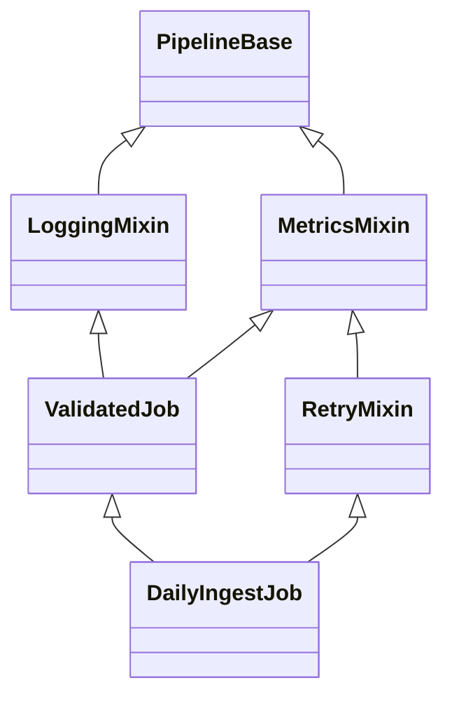

# MRO, `super()`, and Cooperative Inheritance

> **Level:** Beginner → advanced  
> **Runtime:** Python 3.12+ (examples also work on CPython 3.13)  
> **Module:** Stage 1 · Module 11 — Advanced Python Data Model and Object Design  
> **Lesson:** 08 — `08-mro-super-and-cooperative-inheritance.md`

## Why this lesson matters

Python method resolution order (MRO) defines the order in which Python searches a class hierarchy for an attribute or method. `super()` follows that order; it does **not** simply call “my parent.” This distinction is essential when multiple classes contribute behavior, as in framework extension points, plugin systems, `unittest` setup hooks, and mixin-based designs.

A correct cooperative hierarchy has three properties:

1. Its inheritance graph has a consistent MRO.
2. Each participating implementation delegates with `super()` using a compatible calling convention.
3. The chain has a deliberate endpoint that does not forward arguments to a method that cannot accept them.

This lesson covers the mechanics and engineering practices needed to reason about those properties. The next lesson focuses more specifically on mixin design and multiple-inheritance pitfalls.

## Learning objectives

By the end, you should be able to:

- Explain method lookup in single and multiple inheritance.
- Inspect a class's MRO using `Class.__mro__`, `Class.mro()`, and `inspect.getmro()`.
- Derive a non-trivial C3 linearization from a class graph.
- Explain the C3 constraints: child before parents, preserve local precedence order, and monotonicity.
- Explain what zero-argument and two-argument `super()` mean.
- Build a cooperative method and constructor chain in which each implementation runs exactly once.
- Diagnose a missing `super()` call, an incompatible signature, or an unlinearisable hierarchy.
- Explain why direct calls such as `Parent.method(self)` can break cooperative behavior.
- Use `super()` in ordinary methods, class methods, and `__init_subclass__` hooks.
- Understand the distinction between normal attribute lookup and special-method lookup on the type.
- Recognize the role of `functools.singledispatchmethod` when method dispatch and inheritance interact.

## Prerequisites

You should already understand classes and instances, inheritance, method overriding, `self`, `classmethod`, `__init__`, `*args`/`**kwargs`, and exceptions. Prior familiarity with descriptors helps, but is not required.

## 1. The basic mental model

A class hierarchy is a directed graph: an arrow from a child class to a base class means “inherits from.” Python needs a deterministic linear order to search that graph. The MRO is that order.

### Single inheritance

```text
object
  ▲
  │
 Base
  ▲
  │
Child
```

```python
class Base:
    def describe(self) -> str:
        return "base"


class Child(Base):
    def describe(self) -> str:
        return "child"


print(Child().describe())
print(Child.__mro__)
```

Expected output (the class representations may include the module name):

```text
child
(<class '__main__.Child'>, <class '__main__.Base'>, <class 'object'>)
```

Python checks `Child` first. Since `describe` is defined there, it uses that implementation; it does not continue to `Base.describe` unless the overriding method explicitly delegates.

### Multiple inheritance

```text
      BaseA     BaseB
         ▲       ▲
          \     /
           Child
```

```python
class BaseA:
    def identify(self) -> str:
        return "A"


class BaseB:
    def identify(self) -> str:
        return "B"


class Child(BaseA, BaseB):
    pass


print(Child().identify())
print([cls.__name__ for cls in Child.__mro__])
```

Expected output:

```text
A
['Child', 'BaseA', 'BaseB', 'object']
```

The order of bases in the class declaration matters. `BaseA` precedes `BaseB` in this class's local precedence order, so `BaseA.identify` is found first. Reversing the base list can change the result, provided the resulting hierarchy is consistent.

## 2. Inspecting the MRO

Every ordinary Python class exposes two common ways to inspect its MRO:

- `SomeClass.__mro__`: a tuple of classes in lookup order.
- `SomeClass.mro()`: a list of classes in lookup order; class creation uses the metaclass's MRO machinery to calculate this list.

`inspect.getmro(SomeClass)` is a convenient introspection API that returns the MRO as a tuple.

```python
from inspect import getmro


class Record:
    pass


class TimestampedRecord(Record):
    pass


print([cls.__name__ for cls in TimestampedRecord.__mro__])
print([cls.__name__ for cls in TimestampedRecord.mro()])
print([cls.__name__ for cls in getmro(TimestampedRecord)])
```

All three produce the same class order, with tuple/list container differences hidden by the list comprehensions:

```text
['TimestampedRecord', 'Record', 'object']
['TimestampedRecord', 'Record', 'object']
['TimestampedRecord', 'Record', 'object']
```

**Debugging habit:** when behavior in a multiple-inheritance hierarchy is surprising, print the MRO before guessing which parent is “winning.”

## 3. C3 linearization

Python uses the C3 method resolution order algorithm for new-style classes. C3 converts the inheritance graph into a linear sequence while respecting important ordering constraints.

### The three constraints

1. **Children precede their parents.** A class must appear before its base classes.
2. **Local precedence order is preserved.** If a class is declared as `class C(A, B)`, `A` must precede `B` in `C`'s MRO.
3. **Monotonicity is preserved.** If a base class already has an ordering between two classes, a subclass must not reverse that ordering. A subclass extends a base's ordering rather than contradicting it.

C3 is not simply “depth-first, left-to-right.” A naive depth-first walk can repeat a shared ancestor or violate ordering constraints. C3 merges the already-linearized base MROs with the declared base list.

### The merge rule

For a class `C(B1, B2, ...)`, the algorithm is:

```text
L(C) = [C] + merge(L(B1), L(B2), ..., [B1, B2, ...])
```

At each step, inspect the head (first item) of each remaining list. Select the first head that does **not** appear in the tail (everything after the head) of any remaining list. Append it to the result and remove it from the head of every list where it appears. Repeat until all lists are empty.

If no head is eligible, no consistent C3 order exists, and Python raises `TypeError` while creating the class.

### Step-by-step derivation with a non-trivial diamond

Consider this class graph:

The class declarations below define a deliberately non-trivial hierarchy. `RetryMixin` inherits from `MetricsMixin`, while `ValidatedJob` inherits from `LoggingMixin` and `MetricsMixin`. The final class combines `ValidatedJob` with `RetryMixin`, forcing C3 to preserve the ordering constraints from both branches.

```python
class PipelineBase:
    pass


class LoggingMixin(PipelineBase):
    pass


class MetricsMixin(PipelineBase):
    pass


class RetryMixin(MetricsMixin):
    pass


class ValidatedJob(LoggingMixin, MetricsMixin):
    pass


class DailyIngestJob(ValidatedJob, RetryMixin):
    pass
```

Its graph is:



First derive the smaller MROs:

```text
L(PipelineBase) = [PipelineBase, object]
L(LoggingMixin) = [LoggingMixin, PipelineBase, object]
L(MetricsMixin) = [MetricsMixin, PipelineBase, object]
L(RetryMixin) = [RetryMixin, MetricsMixin, PipelineBase, object]
L(ValidatedJob) = [ValidatedJob, LoggingMixin, MetricsMixin, PipelineBase, object]
```

Now derive `L(DailyIngestJob)`:

```text
[DailyIngestJob] + merge(
    [ValidatedJob, LoggingMixin, MetricsMixin, PipelineBase, object],
    [RetryMixin, MetricsMixin, PipelineBase, object],
    [ValidatedJob, RetryMixin],
)
```

1. Choose `ValidatedJob`: it is a head and is not in any list's tail. Remove it from the first and third lists.
2. Choose `LoggingMixin`: it is an eligible head. Remove it from the first list.
3. `MetricsMixin` is now a head in the first list, but it appears in the tail of the second list (`[RetryMixin, MetricsMixin, ...]`), so it is **not eligible yet**. Choose `RetryMixin`, which is an eligible head in the second and third lists.
4. Now `MetricsMixin` is eligible. Choose it and remove it from every list where it is at the head.
5. Choose `PipelineBase`, then `object`.

The result is:

```text
DailyIngestJob
ValidatedJob
LoggingMixin
RetryMixin
MetricsMixin
PipelineBase
object
```

The inheritance graph is not itself a list; C3 creates the linearization while preserving each base's required order. Verify the derivation with Python:

```python
print([cls.__name__ for cls in DailyIngestJob.__mro__])
```

Expected output:

```text
['DailyIngestJob', 'ValidatedJob', 'LoggingMixin', 'RetryMixin', 'MetricsMixin', 'PipelineBase', 'object']
```

This example is intentionally more than a simple diamond: `MetricsMixin` must wait until `RetryMixin` has appeared because the latter's MRO places `RetryMixin` before `MetricsMixin`.

### An inconsistent hierarchy

```python
class Root:
    pass


class Left(Root):
    pass


class Right(Root):
    pass


class LeftFirst(Left, Right):
    pass


class RightFirst(Right, Left):
    pass


# Raises TypeError: no consistent MRO exists.
class Impossible(LeftFirst, RightFirst):
    pass
```

`LeftFirst` requires `Left` before `Right`; `RightFirst` requires `Right` before `Left`. `Impossible` would need to preserve both incompatible orders. C3 cannot satisfy them, so Python rejects the class. A fix is not to shuffle bases blindly: redesign the hierarchy so the constraints agree, or use composition if the behaviors do not form a coherent subtype relationship.

## 4. What `super()` actually means

`super()` is a proxy for lookup that starts **after a specified class in the MRO of a specified object or class**. In a method defined in class `C`, zero-argument `super()` behaves conceptually like `super(C, first_argument)`:

- In an instance method, the first argument is usually `self`.
- In a class method, it is usually `cls`.

The next class is determined by the actual instance's (or class's) MRO, not by looking up a single declared parent. Therefore the same method body can delegate to different next implementations when used in different valid hierarchies.

```python
class Base:
    def greet(self) -> str:
        return "base"


class Child(Base):
    def greet(self) -> str:
        return "child + " + super().greet()


print(Child().greet())
```

Expected output:

```text
child + base
```

### Zero-argument `super()` and the `__class__` cell

When a method uses zero-argument `super()`, the compiler arranges for the method to have access to a `__class__` closure cell. The runtime combines that defining class with the method's first argument. This is why the idiom works inside normal class methods without spelling out the class and instance.

A function defined outside a class generally has no compiler-created `__class__` cell, so calling zero-argument `super()` there raises `RuntimeError: super(): no arguments` (or another error if the function has an inappropriate context). A nested function also needs care: the compiler's `__class__` cell can exist, but the nested function's first argument is not automatically the original method's `self`.

### Two-argument `super`

- `super(C, obj)` starts after `C` in `type(obj).__mro__`, provided `obj` is an instance of `C` or a suitable subtype.
- `super(C, SomeClass)` is the class-method form: the second argument must be a subtype of `C`, and lookup uses that class's MRO.

```python
class Base:
    @classmethod
    def label(cls) -> str:
        return f"Base via {cls.__name__}"


class Child(Base):
    @classmethod
    def label(cls) -> str:
        return "Child -> " + super().label()


print(Child.label())
print(super(Child, Child).label())
```

Expected output:

```text
Child -> Base via Child
Base via Child
```

The first call uses zero-argument `super()` in `Child.label`; the second starts after `Child` in `Child`'s MRO directly.

### Extending versus replacing behavior

An override can deliberately replace behavior by not delegating. When the hierarchy is designed to cooperate, however, an override should usually do its own work and then call `super()` exactly once. Delegation can happen before or after local work depending on the method's contract; for wrapper-like behavior, “before → delegate → after” is common.

## 5. Cooperative method chaining in a realistic pipeline

The following example models a data ingestion pipeline. Logging, validation, retry, and metrics behavior all wrap a terminal implementation. Each participating method has the same signature and delegates exactly once.

```python
from dataclasses import dataclass, field


@dataclass
class RunContext:
    dataset: str
    events: list[str] = field(default_factory=list)


class PipelineBase:
    def run(self, context: RunContext) -> None:
        """Terminal implementation: do the actual work once."""
        context.events.append("execute")


class LoggingMixin(PipelineBase):
    def run(self, context: RunContext) -> None:
        context.events.append("log:start")
        super().run(context)
        context.events.append("log:end")


class MetricsMixin(PipelineBase):
    def run(self, context: RunContext) -> None:
        context.events.append("metrics:start")
        super().run(context)
        context.events.append("metrics:end")


class RetryMixin(MetricsMixin):
    def run(self, context: RunContext) -> None:
        context.events.append("retry:check")
        super().run(context)


class ValidatedJob(LoggingMixin, MetricsMixin):
    def run(self, context: RunContext) -> None:
        context.events.append("validate")
        super().run(context)


class DailyIngestJob(ValidatedJob, RetryMixin):
    def run(self, context: RunContext) -> None:
        context.events.append("daily-job")
        super().run(context)


if __name__ == "__main__":
    context = RunContext(dataset="orders")
    DailyIngestJob().run(context)
    print([cls.__name__ for cls in DailyIngestJob.__mro__])
    print(context.events)
```

Expected output:

```text
['DailyIngestJob', 'ValidatedJob', 'LoggingMixin', 'RetryMixin', 'MetricsMixin', 'PipelineBase', 'object']
['daily-job', 'validate', 'log:start', 'retry:check', 'metrics:start', 'execute', 'metrics:end', 'log:end']
```

Read the call chain carefully:

1. `DailyIngestJob.run` delegates to the next class, `ValidatedJob`.
2. `ValidatedJob.run` delegates to `LoggingMixin`.
3. `LoggingMixin.run` delegates to `RetryMixin`, because that is the next class in the actual MRO—not its only explicitly declared base.
4. `RetryMixin.run` delegates to `MetricsMixin`.
5. `MetricsMixin.run` delegates to `PipelineBase`, the terminal operation.
6. Control returns through the wrappers in reverse order.

`MetricsMixin` and `PipelineBase` each participate once. The diamond in the graph does not imply duplicate execution when the hierarchy uses cooperative `super()` consistently.

> **Engineering note:** these methods use an event list to make call order observable. Production code should give each wrapper a clear contract for exception handling, retries, logging, and metrics. A real retry loop must distinguish retryable exceptions and enforce a bound; the example intentionally demonstrates dispatch order rather than a full retry policy.

## 6. Cooperative constructors

Multiple-inheritance constructors need a shared convention. A robust pattern is to use keyword-only parameters for a class's own settings and pass remaining keywords through `**kwargs`. Each class consumes what it owns, delegates once, and the endpoint rejects unexpected leftover keywords by calling `object.__init__` with no arguments.

```python
class Entity:
    def __init__(self, **kwargs: object) -> None:
        if kwargs:
            unexpected = ", ".join(sorted(kwargs))
            raise TypeError(f"unexpected constructor arguments: {unexpected}")
        super().__init__()


class HasName(Entity):
    def __init__(self, *, name: str, **kwargs: object) -> None:
        self.name = name
        super().__init__(**kwargs)


class HasRegion(Entity):
    def __init__(self, *, region: str, **kwargs: object) -> None:
        self.region = region
        super().__init__(**kwargs)


class DataAsset(HasName, HasRegion):
    def __init__(self, *, asset_id: int, **kwargs: object) -> None:
        self.asset_id = asset_id
        super().__init__(**kwargs)


asset = DataAsset(asset_id=17, name="orders", region="ap-south")
print(asset.asset_id, asset.name, asset.region)
print([cls.__name__ for cls in DataAsset.__mro__])
```

Expected output:

```text
17 orders ap-south
['DataAsset', 'HasName', 'HasRegion', 'Entity', 'object']
```

The keyword `name` is consumed by `HasName`; `region` is consumed by `HasRegion`; the remaining empty dictionary reaches `Entity`. If an unsupported argument is passed, the endpoint reports it rather than silently discarding it.

### Constructor-chain design rules

- Use one shared argument convention throughout the cooperative hierarchy.
- Prefer keyword arguments for settings owned by different classes; they make ownership explicit and avoid positional ambiguity.
- Consume each keyword in the class that owns it, then forward the rest.
- Every cooperating `__init__` calls `super().__init__(**kwargs)` exactly once.
- The terminal class must consume or reject all remaining arguments and call `object.__init__()` without unexpected arguments.
- Do not mix a cooperative chain with a class that silently skips `super()`.
- Type annotations help document each class's public arguments, but `**kwargs: object` does not by itself provide perfect static checking of all combinations. For large APIs, consider explicit constructors, typed configuration objects, or composition.

### Failure: an incompatible constructor signature

```python
class NeedsPath:
    def __init__(self, path: str) -> None:
        self.path = path
        super().__init__()


class NeedsRegion:
    def __init__(self, region: str) -> None:
        self.region = region
        super().__init__()


class BrokenAsset(NeedsPath, NeedsRegion):
    pass


# BrokenAsset(path="/data", region="west") raises TypeError:
# NeedsPath.__init__ does not accept the region keyword and has no **kwargs.
```

The problem is not the MRO alone. The call protocol is incompatible. A cooperative hierarchy needs signatures designed together. One possible corrected version is:

```python
class NeedsPath:
    def __init__(self, *, path: str, **kwargs: object) -> None:
        self.path = path
        super().__init__(**kwargs)


class NeedsRegion:
    def __init__(self, *, region: str, **kwargs: object) -> None:
        self.region = region
        super().__init__(**kwargs)


class CooperativeAsset(NeedsPath, NeedsRegion):
    def __init__(self, **kwargs: object) -> None:
        super().__init__(**kwargs)


# In real code, use an explicit typed signature on CooperativeAsset if it is
# part of a public API; this minimal forwarding class is for the chain demo.
```

As written, `CooperativeAsset(path="/data", region="west")` still needs a terminal class to consume the remaining arguments before `object.__init__`. Add an endpoint for a complete runnable pattern:

```python
class ConstructorEnd:
    def __init__(self, **kwargs: object) -> None:
        if kwargs:
            raise TypeError(f"unexpected arguments: {', '.join(sorted(kwargs))}")
        super().__init__()


class NeedsPath(ConstructorEnd):
    def __init__(self, *, path: str, **kwargs: object) -> None:
        self.path = path
        super().__init__(**kwargs)


class NeedsRegion(ConstructorEnd):
    def __init__(self, *, region: str, **kwargs: object) -> None:
        self.region = region
        super().__init__(**kwargs)


class CooperativeAsset(NeedsPath, NeedsRegion):
    def __init__(self, *, path: str, region: str) -> None:
        super().__init__(path=path, region=region)


asset = CooperativeAsset(path="/data", region="west")
print(asset.path, asset.region)
print([cls.__name__ for cls in CooperativeAsset.__mro__])
```

Expected output:

```text
/data west
['CooperativeAsset', 'NeedsPath', 'NeedsRegion', 'ConstructorEnd', 'object']
```

This final version is self-contained and demonstrates the complete protocol. Notice that the earlier `Entity` example already supplies its own terminal class, so no extra endpoint is needed there.

## 7. Why direct parent calls break cooperation

Calling a named parent explicitly is sometimes appropriate for a deliberately non-cooperative API, but it is dangerous in a cooperative diamond. It hard-codes one edge of the inheritance graph and bypasses the MRO's next implementation.

```python
class Root:
    def __init__(self) -> None:
        print("Root")


class Left(Root):
    def __init__(self) -> None:
        print("Left")
        Root.__init__(self)  # Wrong for a cooperative diamond.


class Right(Root):
    def __init__(self) -> None:
        print("Right")
        Root.__init__(self)  # Also calls Root directly.


class Diamond(Left, Right):
    def __init__(self) -> None:
        print("Diamond")
        Left.__init__(self)
        Right.__init__(self)
```

`Diamond()` prints:

```text
Diamond
Left
Root
Right
Root
```

`Root.__init__` ran twice. The caller explicitly invoked both branches, and each branch invoked the shared root directly. In a real initializer this can reset state, duplicate registrations, open resources twice, or repeat expensive work.

Correct cooperative version:

```python
class Root:
    def __init__(self) -> None:
        print("Root")
        super().__init__()


class Left(Root):
    def __init__(self) -> None:
        print("Left")
        super().__init__()


class Right(Root):
    def __init__(self) -> None:
        print("Right")
        super().__init__()


class Diamond(Left, Right):
    def __init__(self) -> None:
        print("Diamond")
        super().__init__()


Diamond()
```

Expected output:

```text
Diamond
Left
Right
Root
```

The MRO is `Diamond → Left → Right → Root → object`. Each class calls the next implementation once, so `Root` executes once. In production, the terminal implementation normally calls `super().__init__()` with no arguments to complete the chain to `object`.

## 8. `super()` beyond `__init__`

`super()` is not constructor-only. Any method that is designed to extend a method from the next MRO class can use it.

### Ordinary methods

```python
class Serializer:
    def serialize(self, value: str) -> str:
        return value


class PrefixSerializer(Serializer):
    def serialize(self, value: str) -> str:
        return "v1:" + super().serialize(value)


print(PrefixSerializer().serialize("record"))
```

Expected output: `v1:record`.

### Class methods

A class method's `cls` participates in the same MRO-based lookup:

```python
class Plugin:
    @classmethod
    def describe(cls) -> list[str]:
        return ["Plugin"]


class AuditedPlugin(Plugin):
    @classmethod
    def describe(cls) -> list[str]:
        return ["AuditedPlugin", *super().describe()]


print(AuditedPlugin.describe())
```

Expected output: `['AuditedPlugin', 'Plugin']`.

### `__init_subclass__`

`__init_subclass__` is invoked when a subclass is created. If multiple bases participate, its overrides should also cooperate and forward keywords they do not own.

```python
class RegistrationBase:
    def __init_subclass__(cls, **kwargs: object) -> None:
        print(f"register:{cls.__name__}")
        super().__init_subclass__(**kwargs)


class Tagged(RegistrationBase):
    def __init_subclass__(cls, *, tag: str, **kwargs: object) -> None:
        cls.tag = tag
        super().__init_subclass__(**kwargs)


class DailyTask(Tagged, tag="daily"):
    pass


print(DailyTask.tag)
```

Expected output:

```text
register:Tagged
register:DailyTask
daily
```

`RegistrationBase.__init_subclass__` sees `Tagged` being created and then `DailyTask`. `Tagged` consumes `tag`, then forwards the remaining keywords. In more complex hierarchies, every participating hook must follow a compatible keyword protocol.

## 9. When a class forgets `super()`

A missing `super()` call silently cuts off all later implementations in the MRO. This is often harder to detect than a `TypeError` because the program can still appear to work.

```python
class Root:
    def setup(self) -> list[str]:
        return ["root"]


class Left(Root):
    def setup(self) -> list[str]:
        return ["left"]  # Does not delegate.


class Right(Root):
    def setup(self) -> list[str]:
        return ["right", *super().setup()]


class App(Left, Right):
    pass


print([cls.__name__ for cls in App.__mro__])
print(App().setup())
```

Expected output:

```text
['App', 'Left', 'Right', 'Root', 'object']
['left']
```

`Right` and `Root` are present in the MRO, but `Left.setup` prevents the chain from reaching them. If a method is meant to be a cooperative extension point, call `super()` exactly once. If replacement is intentional, document it as a non-cooperative override.

## 10. Attribute lookup versus special-method lookup

For ordinary attribute access such as `instance.name`, Python considers instance/class lookup rules and the class hierarchy. The MRO is central to finding attributes on classes and inherited methods. Data descriptors and instance dictionaries add details covered in the earlier descriptor lesson.

Many **implicit special-method operations** look up methods on the type rather than performing ordinary instance attribute lookup. For example, assigning `obj.__len__ = ...` generally does not change what `len(obj)` invokes. The special-method lookup rules are intentionally different from a plain `obj.method` expression.

```python
class Items:
    def __len__(self) -> int:
        return 3


items = Items()
items.__len__ = lambda: 99
print(items.__len__())
print(len(items))
```

Expected output:

```text
99
3
```

The instance attribute shadows the ordinary lookup expression `items.__len__`, but `len(items)` uses the special method on the type. This is a useful reminder that not every operation dispatches in exactly the same way as an ordinary attribute access.

## 11. `functools.singledispatchmethod` and `super()` — awareness

`functools.singledispatchmethod` provides method dispatch based on the type of the first non-`self`/`cls` argument. It is useful for type-directed behavior, but it is a separate dispatch mechanism from MRO-based `super()` lookup. The decorator's placement matters: to use `.register` on the resulting method, `@singledispatchmethod` should be the outermost decorator, above `@classmethod` if both are used.

```python
from functools import singledispatchmethod


class Formatter:
    @singledispatchmethod
    def format(self, value: object) -> str:
        return f"object:{value}"

    @format.register
    def _(self, value: int) -> str:
        return f"int:{value}"


print(Formatter().format(4))
print(Formatter().format("x"))
```

Expected output:

```text
int:4
object:x
```

Do not assume singledispatch registration replaces or duplicates the MRO. It chooses an implementation based on the argument's type; `super()` determines where attribute lookup starts in a class hierarchy. More advanced combinations should be tested explicitly, especially when a subclass overrides a dispatched method.

## 12. Debugging checklist

When a chain is wrong, investigate in this order:

1. **Print the MRO:** `print([c.__name__ for c in type(obj).__mro__])`.
2. **Trace delegation:** add temporary logging immediately before and after each `super().method(...)` call.
3. **Check signatures:** every implementation must accept the arguments forwarded by the previous one. For constructors, prefer keyword-only parameters plus `**kwargs`.
4. **Find the chain break:** search for an override that returns without calling `super()`.
5. **Find direct parent calls:** search for `Base.method(self, ...)` or `Base.__init__(self, ...)` inside a cooperative hierarchy.
6. **Check the endpoint:** the final implementation must terminate the operation; constructor endpoints should not pass leftover keywords into `object.__init__`.
7. **Check the graph:** a `TypeError` at class definition time may mean the base order constraints are inconsistent, not that a method body is wrong.
8. **Test the actual combined class:** a mixin can behave correctly alone and fail when combined with another base whose signature or MRO position differs.
9. **Use `inspect.getmro(SomeClass)`** when you want an explicit introspection helper or are writing diagnostics.

Do not fix a C3 conflict by repeatedly swapping base classes until the exception disappears. First identify which local precedence constraints conflict, then change the design deliberately.

## 13. Pytest tests

Save the following as `test_mro_super.py`. The examples are intentionally small enough to run in isolation. Run with `python -m pytest -q test_mro_super.py` using Python 3.12+ and pytest installed.

```python
from __future__ import annotations

from dataclasses import dataclass, field

import pytest


class Root:
    def process(self) -> list[str]:
        return ["root"]


class Left(Root):
    def process(self) -> list[str]:
        return ["left", *super().process()]


class Right(Root):
    def process(self) -> list[str]:
        return ["right", *super().process()]


class Diamond(Left, Right):
    def process(self) -> list[str]:
        return ["diamond", *super().process()]


@dataclass
class RunContext:
    dataset: str
    events: list[str] = field(default_factory=list)


class PipelineBase:
    def run(self, context: RunContext) -> None:
        context.events.append("execute")


class LoggingMixin(PipelineBase):
    def run(self, context: RunContext) -> None:
        context.events.append("log:start")
        super().run(context)
        context.events.append("log:end")


class MetricsMixin(PipelineBase):
    def run(self, context: RunContext) -> None:
        context.events.append("metrics:start")
        super().run(context)
        context.events.append("metrics:end")


class RetryMixin(MetricsMixin):
    def run(self, context: RunContext) -> None:
        context.events.append("retry:check")
        super().run(context)


class ValidatedJob(LoggingMixin, MetricsMixin):
    def run(self, context: RunContext) -> None:
        context.events.append("validate")
        super().run(context)


class DailyIngestJob(ValidatedJob, RetryMixin):
    def run(self, context: RunContext) -> None:
        context.events.append("daily-job")
        super().run(context)


def test_mro_is_c3_cooperative_order() -> None:
    assert [cls.__name__ for cls in Diamond.__mro__] == [
        "Diamond", "Left", "Right", "Root", "object"
    ]


def test_each_cooperative_method_runs_once() -> None:
    assert Diamond().process() == ["diamond", "left", "right", "root"]


def test_realistic_pipeline_mro() -> None:
    assert [cls.__name__ for cls in DailyIngestJob.__mro__] == [
        "DailyIngestJob", "ValidatedJob", "LoggingMixin", "RetryMixin",
        "MetricsMixin", "PipelineBase", "object",
    ]


def test_realistic_pipeline_call_order() -> None:
    context = RunContext(dataset="orders")
    DailyIngestJob().run(context)
    assert context.events == [
        "daily-job", "validate", "log:start", "retry:check",
        "metrics:start", "execute", "metrics:end", "log:end",
    ]


def test_class_mro_and_inspect_agree() -> None:
    from inspect import getmro

    assert tuple(Diamond.mro()) == Diamond.__mro__ == getmro(Diamond)


def test_inconsistent_c3_order_is_rejected() -> None:
    class A:
        pass

    class B:
        pass

    class AB(A, B):
        pass

    class BA(B, A):
        pass

    with pytest.raises(TypeError, match="consistent method resolution order"):
        class Impossible(AB, BA):
            pass


def test_cooperative_constructor_consumes_keywords() -> None:
    class End:
        def __init__(self, **kwargs: object) -> None:
            if kwargs:
                raise TypeError(f"unexpected: {', '.join(sorted(kwargs))}")
            super().__init__()

    class Name(End):
        def __init__(self, *, name: str, **kwargs: object) -> None:
            self.name = name
            super().__init__(**kwargs)

    class Region(End):
        def __init__(self, *, region: str, **kwargs: object) -> None:
            self.region = region
            super().__init__(**kwargs)

    class Asset(Name, Region):
        def __init__(self, *, name: str, region: str) -> None:
            super().__init__(name=name, region=region)

    item = Asset(name="events", region="west")
    assert (item.name, item.region) == ("events", "west")


def test_constructor_rejects_unknown_keyword() -> None:
    class End:
        def __init__(self, **kwargs: object) -> None:
            if kwargs:
                raise TypeError(f"unexpected: {', '.join(sorted(kwargs))}")
            super().__init__()

    with pytest.raises(TypeError, match="unexpected: typo"):
        End(typo=1)


def test_missing_super_cuts_off_later_methods() -> None:
    class Base:
        def chain(self) -> list[str]:
            return ["base"]

    class Skip(Base):
        def chain(self) -> list[str]:
            return ["skip"]

    class Later(Base):
        def chain(self) -> list[str]:
            return ["later", *super().chain()]

    class Combined(Skip, Later):
        pass

    assert Combined().chain() == ["skip"]


def test_explicit_parent_call_duplicates_diamond_root() -> None:
    calls: list[str] = []

    class Base:
        def __init__(self) -> None:
            calls.append("base")

    class A(Base):
        def __init__(self) -> None:
            calls.append("A")
            Base.__init__(self)

    class B(Base):
        def __init__(self) -> None:
            calls.append("B")
            Base.__init__(self)

    class C(A, B):
        def __init__(self) -> None:
            calls.append("C")
            A.__init__(self)
            B.__init__(self)

    C()
    assert calls == ["C", "A", "base", "B", "base"]
```

Expected pytest summary on Python 3.12+ with pytest installed:

```text
10 passed
```

The suite checks both the small diamond and the realistic pipeline hierarchy, including its exact C3 order and observable cooperative call sequence.

The tests assert behavior rather than relying only on visual inspection of example output. The intentionally broken examples are isolated from the corrected cooperative versions.

## 14. Exercises

### Exercise 1 — Predict an MRO

Given:

```python
class Root: pass
class A(Root): pass
class B(Root): pass
class C(A, B): pass
class D(B): pass
class E(C, D): pass
```

Predict `E.__mro__` before running it. Explain why `Root` appears once.

### Exercise 2 — Find the chain break

```python
class Base:
    def run(self) -> list[str]:
        return ["base"]

class First(Base):
    def run(self) -> list[str]:
        return ["first"]

class Second(Base):
    def run(self) -> list[str]:
        return ["second", *super().run()]

class App(First, Second):
    pass
```

Why does `App().run()` not include `second` or `base`? Fix `First` if the intended contract is cooperative extension.

### Exercise 3 — Make constructors cooperate

Create a `HasOwner` class that consumes a keyword-only `owner: str`, a `HasFormat` class that consumes `format_name: str`, and an `ExportJob` that combines both. Ensure unknown keywords fail clearly and each constructor delegates exactly once.

### Exercise 4 — Diagnose C3 failure

Create `AB(A, B)` and `BA(B, A)`, then try to create `Conflict(AB, BA)`. Explain the incompatible ordering constraints and propose a design-level fix.

### Exercise 5 — Explain `super()` precisely

In a method defined in `B`, called on an instance of `D`, what does `super()` mean? Answer using the defining class and the actual instance's MRO, not “the parent.”

## 15. Exercise solutions

### Solution 1

The MRO is:

```text
E, C, A, D, B, Root, object
```

C3 must preserve `C`'s ordering `A` before `B`, while `D` requires `D` before `B`. The merge inserts `D` after `A` but before `B`, allowing both constraints to hold. `Root` appears once because the linearization merges shared ancestors rather than repeating them.

Verify in Python:

```python
print([cls.__name__ for cls in E.__mro__])
# ['E', 'C', 'A', 'D', 'B', 'Root', 'object']
```

### Solution 2

`First.run` replaces the behavior and never delegates. Correct it to:

```python
class First(Base):
    def run(self) -> list[str]:
        return ["first", *super().run()]
```

Then `App().run()` returns `['first', 'second', 'base']` because the MRO is `App, First, Second, Base, object`.

### Solution 3

One valid implementation is:

```python
class End:
    def __init__(self, **kwargs: object) -> None:
        if kwargs:
            raise TypeError(f"unexpected: {', '.join(sorted(kwargs))}")
        super().__init__()

class HasOwner(End):
    def __init__(self, *, owner: str, **kwargs: object) -> None:
        self.owner = owner
        super().__init__(**kwargs)

class HasFormat(End):
    def __init__(self, *, format_name: str, **kwargs: object) -> None:
        self.format_name = format_name
        super().__init__(**kwargs)

class ExportJob(HasOwner, HasFormat):
    def __init__(self, *, owner: str, format_name: str) -> None:
        super().__init__(owner=owner, format_name=format_name)

job = ExportJob(owner="analytics", format_name="parquet")
assert (job.owner, job.format_name) == ("analytics", "parquet")
```

Both mixins consume their own keyword, pass the rest onward, and reach the endpoint with no unknown arguments.

### Solution 4

`AB` requires `A` before `B`; `BA` requires `B` before `A`. `Conflict` cannot preserve both orders, so C3 rejects it. Refactor so both branches agree on one precedence order, remove the conflicting multiple inheritance, or use composition to combine the behaviors.

### Solution 5

Inside a method defined in `B`, zero-argument `super()` starts lookup immediately after `B` in the MRO of the actual instance's type (for example, `D.__mro__`). It does not mean “call the base class written next to `B` in the source.” The next implementation may be in a sibling mixin that occurs after `B` in `D`'s MRO.

## 16. Roadmap self-check — answers

### 1. Predict the print order for `D(B, C)` when `B` forgets to call `super().__init__`.

Using the roadmap's example:

```python
class A:
    def __init__(self, **kw):
        print("A")
        super().__init__(**kw)

class B(A):
    def __init__(self, **kw):
        print("B")  # forgot super()

class C(A):
    def __init__(self, **kw):
        print("C")
        super().__init__(**kw)

class D(B, C):
    def __init__(self, **kw):
        print("D")
        super().__init__(**kw)


D()
```

Expected output:

```text
D
B
```

`B` does not delegate, so neither `C` nor `A` runs. The MRO still contains those classes; a missing delegation call prevents execution from reaching them.

### 2. Why does `class X(A, B)` fail if `class A(B)`? Write the C3 reasoning.

**Correction to the premise:** in Python, this exact hierarchy does **not** fail:

```python
class B: pass
class A(B): pass
class X(A, B): pass

assert [c.__name__ for c in X.__mro__] == ["X", "A", "B", "object"]
```

C3 can satisfy the order because `A` already precedes its base `B`; the explicit base list `[A, B]` agrees with that order. The reverse declaration `class X(B, A)` is rejected because the declared local precedence `B before A` conflicts with the inherited constraint `A before B`. This lesson preserves the roadmap's self-check topic while correcting the premise so learners do not memorize an incorrect Python rule.

### 3. What does `super()` resolve to inside `B` when called on a `D` instance?

It starts lookup after `B` in `D.__mro__`, assuming the method is defined in `B` and uses zero-argument `super()`. In the roadmap's hierarchy `class D(B, C)` where both `B` and `C` inherit from `A`, the MRO is `D, B, C, A, object`; therefore `super()` inside `B` continues at `C`. It does not automatically jump to `B`'s directly declared base `A`.

## 17. Common mistakes to avoid

- **Calling `Parent.method(self)` instead of `super()`:** hard-codes one class and can bypass mixins or invoke a shared ancestor multiple times.
- **Using different constructor signatures along the MRO:** a class forwards a keyword that the next method cannot accept. Establish a consistent keyword protocol and test the combined class.
- **Assuming `super()` always refers to the declared base:** it resolves to the next implementation after the defining class in the actual MRO.
- **Treating C3 as depth-first traversal:** C3 is a constrained merge; use the head-not-in-any-tail rule.
- **Assuming an MRO entry guarantees its method runs:** an earlier override that omits `super()` can terminate the chain.
- **Mixing cooperative and non-cooperative classes without a boundary:** a single legacy class can cut off the chain or reject forwarded arguments. Adapt it deliberately or prefer composition.
- **Dropping unrecognized `**kwargs`:** silently discarding configuration hides misspellings. Consume owned keys and validate leftovers at the endpoint.
- **Assuming all method dispatch is ordinary instance attribute lookup:** implicit special methods such as `len(obj)` are looked up on the type.

## 18. Final engineering checklist

Before shipping a multiple-inheritance design, verify:

- [ ] The class graph expresses a coherent “is-a” or extension relationship.
- [ ] `Class.__mro__` matches the order you expect.
- [ ] The C3 order respects child-before-parent, local precedence, and monotonicity.
- [ ] Every cooperative implementation uses `super()` and delegates exactly once.
- [ ] Method signatures accept the arguments forwarded by the previous implementation.
- [ ] Constructors use a consistent convention and the endpoint validates leftover keywords.
- [ ] No direct named-parent calls duplicate shared ancestor behavior in a cooperative diamond.
- [ ] Tests cover the final combined class, not only each base in isolation.
- [ ] Missing-super and invalid-MRO failures are understood and covered where appropriate.
- [ ] Framework hooks such as `__init_subclass__` forward supported keywords correctly.
- [ ] If the hierarchy is hard to explain or maintain, composition is considered instead.

## Further reading

- Python Language Reference — [Data model: custom classes and special method lookup](https://docs.python.org/3/reference/datamodel.html)
- Python Library Reference — [`super`](https://docs.python.org/3/library/functions.html#super)
- Python Library Reference — [`inspect.getmro`](https://docs.python.org/3/library/inspect.html#inspect.getmro)
- Python Library Reference — [`functools.singledispatchmethod`](https://docs.python.org/3/library/functools.html#functools.singledispatchmethod)
- Python HOWTO — [Multiple inheritance and method resolution order](https://www.python.org/download/releases/2.3/mro/)

---

**Lesson complete:** MRO is the linear order produced from the inheritance graph; `super()` delegates to the next class in that order; cooperative inheritance works only when the hierarchy and every participating method follow a consistent protocol.
