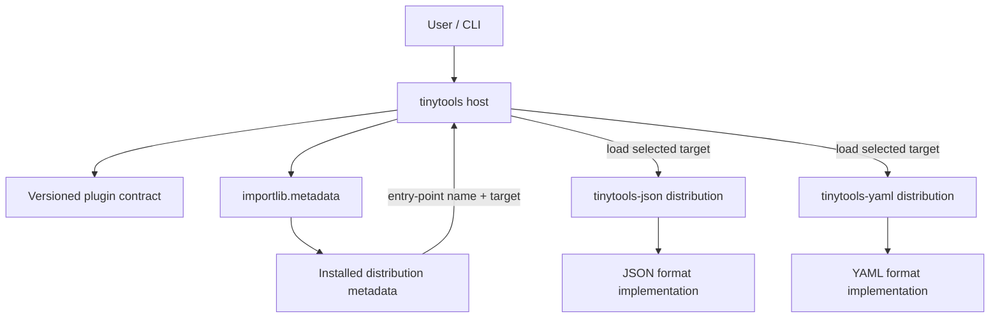

# Plugin Architectures with Entry Points

**Stage 1 — Programming & Computational Thinking · Module 1.18 · Lesson 04**  
**Baseline:** Python 3.12+; packaging metadata follows PEP 621 and standard entry-point conventions.

## Learning objectives

By the end of this lesson, you should be able to:

- Explain the host/plugin model and why installed distribution metadata is useful for extension discovery.
- Declare, discover, inspect, load, validate, and test entry-point plugins.
- Define a documented, versioned contract using `Protocol` or an abstract base class.
- Keep discovery separate from importing and instantiating plugins; handle failures and duplicate names predictably.
- Make explicit decisions about plugin trust, dependency constraints, configuration, ordering, lifecycle, observability, and performance.
- Compare entry points with import-time registries, namespace packages, framework-specific extension mechanisms, and `pluggy`.
- Build a small `tinytools` host with separately installable JSON and YAML format plugins.

## Prerequisites and connections

You should already understand imports and `__main__`, `src/` package layout, `pyproject.toml`, console scripts, virtual environments, semantic versioning, protocols/interfaces, decorators, registries, dependency inversion, pytest fixtures and monkeypatching, and basic secure-coding principles. This lesson applies those ideas to installed packages rather than only to modules in one repository.

Related roadmap concepts: Module 1.11's protocols and dependency inversion; Module 1.12's plugin/registry patterns; Module 1.16's testing of boundaries and installed artifacts; Module 1.22's secure Python coding; and the previous Module 1.18 lesson on entry points and console scripts. The module roadmap is the syllabus authority: use `tinytools` as the running example and build/test installed distributions rather than relying only on imports from the source tree.

## 1. The plugin mental model

A **plugin architecture** is a stable host API plus a mechanism for finding and invoking optional implementations. The host owns the contract and user experience; plugins provide capabilities without requiring edits to the host source.

Examples include adding a file format, database driver, authentication backend, report renderer, or model provider. A plugin architecture is useful when implementations are independently developed, installed, upgraded, or removed. It is unnecessary overhead when there are only a few fixed implementations that can be selected with an ordinary function or dictionary.

### Host, metadata, and plugin packages



An entry point is **metadata**, not a running plugin. A plugin distribution declares a name, a group, and an import target. The host scans installed distribution metadata for a group, then chooses when to import the target. This means the host need not import each plugin module just to learn that it is installed.

Three distinct operations matter:

1. **Discovery** reads installed metadata and returns `EntryPoint` objects.
2. **Loading** calls `EntryPoint.load()`, which imports/resolves the declared target and returns the referenced Python object.
3. **Activation** validates and, in this example, instantiates the plugin class, then calls its methods.

The second and third operations can execute plugin-controlled code. They are not safe, side-effect-free metadata queries.

## 2. Entry-point declarations

The host defines a stable group name. This lesson uses `tinytools.formats`.

In `tinytools-json/pyproject.toml`:

```toml
[project.entry-points."tinytools.formats"]
json = "tinytools_json:JsonFormat"
```

In `tinytools-yaml/pyproject.toml`:

```toml
[project.entry-points."tinytools.formats"]
yaml = "tinytools_yaml:YamlFormat"
```

The table key (`json` or `yaml`) is the **entry-point name**. The value is an import target, usually `module:object`. `tinytools_json:JsonFormat` means “import module `tinytools_json`, then retrieve attribute `JsonFormat`.” The module path is an import name, not a filesystem path. The group is a namespace chosen by the host; entry-point group names should be specific enough to avoid accidental collisions.

A distribution can publish multiple entry points, and multiple distributions can publish into the same group. Entry-point names are not globally unique across all installed packages, so the host must define collision behavior.

## 3. A coherent example project

Use a workspace or sibling directories so each package can be installed independently. The following layout is intentionally small but represents three distinct distributions:

```text
plugin-lab/
├── tinytools/
│   ├── pyproject.toml
│   └── src/tinytools/
│       ├── __init__.py
│       ├── contracts.py
│       ├── plugins.py
│       └── cli.py
├── tinytools-json/
│   ├── pyproject.toml
│   └── src/tinytools_json/__init__.py
├── tinytools-yaml/
│   ├── pyproject.toml
│   └── src/tinytools_yaml/__init__.py
└── tests/
    ├── test_contracts.py
    └── test_plugins.py
```

### 3.1 Host distribution: `tinytools`

`tinytools/pyproject.toml`:

```toml
[build-system]
requires = ["hatchling"]
build-backend = "hatchling.build"

[project]
name = "tinytools"
version = "1.0.0"
description = "A small host application with format plugins"
requires-python = ">=3.12"
dependencies = []

[project.scripts]
tinytools = "tinytools.cli:main"
```

`tinytools/src/tinytools/__init__.py`:

```python
"""Host application for optional format plugins."""

__version__ = "1.0.0"
```

### 3.2 Define the plugin contract

`tinytools/src/tinytools/contracts.py`:

```python
from __future__ import annotations

from typing import Protocol, runtime_checkable

PLUGIN_API_VERSION = 1


@runtime_checkable
class FormatPlugin(Protocol):
    """Public contract implemented by a tinytools format plugin.

    `name` must match the entry-point name. `api_version` must equal
    `PLUGIN_API_VERSION`. `dumps` returns text; `loads` parses that text.
    Implementations should raise documented exceptions for invalid input.
    """

    name: str
    api_version: int

    def dumps(self, value: object) -> str: ...

    def loads(self, text: str) -> object: ...
```

A `Protocol` describes the required shape without forcing third-party classes to inherit from the host's class. That reduces coupling and supports structural typing. `@runtime_checkable` permits a shallow runtime `isinstance` check, but **does not prove method signatures or semantic correctness**. The host below therefore performs explicit attribute/callable checks and tests exercise behavior. An abstract base class (ABC) is a reasonable alternative when plugins should inherit shared behavior or must be registered nominally; it adds tighter coupling to the host API.

The `api_version` field is part of the contract, not the package's distribution version. The distribution version answers “which plugin release is installed?”; the API version answers “which host contract does this plugin implement?” Keep them separate.

### 3.3 JSON plugin distribution: `tinytools-json`

`tinytools-json/pyproject.toml`:

```toml
[build-system]
requires = ["hatchling"]
build-backend = "hatchling.build"

[project]
name = "tinytools-json"
version = "1.0.0"
description = "JSON format plugin for tinytools"
requires-python = ">=3.12"
dependencies = ["tinytools>=1.0,<2"]

[project.entry-points."tinytools.formats"]
json = "tinytools_json:JsonFormat"
```

`tinytools-json/src/tinytools_json/__init__.py`:

```python
import json


class JsonFormat:
    name = "json"
    api_version = 1

    def dumps(self, value: object) -> str:
        return json.dumps(value, ensure_ascii=False, sort_keys=True)

    def loads(self, text: str) -> object:
        return json.loads(text)
```

### 3.4 YAML plugin distribution: `tinytools-yaml`

`tinytools-yaml/pyproject.toml`:

```toml
[build-system]
requires = ["hatchling"]
build-backend = "hatchling.build"

[project]
name = "tinytools-yaml"
version = "1.0.0"
description = "YAML format plugin for tinytools"
requires-python = ">=3.12"
dependencies = ["tinytools>=1.0,<2", "PyYAML>=6,<7"]

[project.entry-points."tinytools.formats"]
yaml = "tinytools_yaml:YamlFormat"
```

`tinytools-yaml/src/tinytools_yaml/__init__.py`:

```python
import yaml


class YamlFormat:
    name = "yaml"
    api_version = 1

    def dumps(self, value: object) -> str:
        return yaml.safe_dump(value, sort_keys=True, allow_unicode=True)

    def loads(self, text: str) -> object:
        # safe_load avoids constructing arbitrary Python objects from tags;
        # still validate the resulting data for your application's schema.
        return yaml.safe_load(text)
```

The plugin imports `yaml` only when its module is loaded, so a host that discovers but does not load the YAML plugin need not import PyYAML. Package metadata installs the declared dependency when the plugin distribution is installed. `safe_load` is preferable to unsafe object construction for untrusted YAML, but it is not a substitute for schema validation, resource limits, or a security review.

## 4. Discovery, loading, and validation

`importlib.metadata.entry_points(group="tinytools.formats")` returns an iterable/collection of `EntryPoint` objects matching that group. Each entry point exposes metadata such as `.name`, `.group`, `.value`, `.module`, `.attr`, `.dist`, and a `.load()` method. Exact convenience attributes can vary by Python version; this lesson targets Python 3.12+, where the keyword `group=` is supported.

`EntryPoint.load()` resolves the module and attribute. It can raise import-related errors, dependency errors, or arbitrary exceptions triggered by module-level plugin code. It returns the referenced object; it does not automatically instantiate a class or validate the contract.

### 4.1 Host loader with explicit policy

`tinytools/src/tinytools/plugins.py`:

```python
from __future__ import annotations

from dataclasses import dataclass
from importlib.metadata import EntryPoint, entry_points
import logging
import re
from typing import Iterable

from tinytools.contracts import FormatPlugin, PLUGIN_API_VERSION

GROUP = "tinytools.formats"
logger = logging.getLogger(__name__)


def canonicalize_distribution(name: str) -> str:
    """Normalize a distribution name for comparisons (PEP 503-style)."""
    return re.sub(r"[-_.]+", "-", name).lower()


def distribution_name(ep: EntryPoint) -> str:
    """Return the declaring distribution name when metadata is available."""
    dist = ep.dist
    if dist is None:
        return "<unknown-distribution>"
    return dist.metadata.get("Name", "<unknown-distribution>")


def distribution_version(ep: EntryPoint) -> str:
    dist = ep.dist
    return dist.version if dist is not None else "<unknown>"


@dataclass(frozen=True)
class PluginStatus:
    entry_point: str
    distribution: str
    version: str
    status: str
    detail: str = ""


@dataclass(frozen=True)
class LoadedFormat:
    name: str
    distribution: str
    version: str
    plugin: FormatPlugin


def discover_format_entry_points() -> list[EntryPoint]:
    """Discover metadata only; this does not import plugin target modules."""
    return sorted(
        entry_points(group=GROUP),
        key=lambda ep: (ep.name.casefold(), canonicalize_distribution(distribution_name(ep))),
    )


def _validate_plugin(candidate: object, expected_name: str) -> FormatPlugin:
    """Validate the minimum runtime contract before exposing a plugin."""
    required = ("name", "api_version", "dumps", "loads")
    missing = [name for name in required if not hasattr(candidate, name)]
    if missing:
        raise TypeError(f"missing required attributes: {', '.join(missing)}")

    if not callable(getattr(candidate, "dumps")) or not callable(getattr(candidate, "loads")):
        raise TypeError("dumps and loads must be callable")
    if getattr(candidate, "name") != expected_name:
        raise ValueError(
            f"plugin name {getattr(candidate, 'name')!r} does not match entry-point name {expected_name!r}"
        )
    api_version = getattr(candidate, "api_version")
    if type(api_version) is not int or api_version != PLUGIN_API_VERSION:
        raise ValueError(
            f"API version {api_version!r} is incompatible; "
            f"host supports {PLUGIN_API_VERSION}"
        )
    return candidate  # structural contract; behavior is covered by tests


def load_format_plugins(
    *,
    names: set[str] | None = None,
    allowed_distributions: set[str] | None = None,
    preferred_distributions: dict[str, str] | None = None,
) -> tuple[dict[str, LoadedFormat], list[PluginStatus]]:
    """Load compatible plugins, isolating ordinary per-plugin failures.

    If `names` is supplied, consider only those entry-point names. This lets a
    CLI load the selected plugin rather than importing every installed plugin.
    `allowed_distributions`, when supplied, is an allow-list of distribution
    names, not entry-point names. Duplicate entry-point names are skipped
    unless `preferred_distributions` explicitly selects one distribution.
    This policy is deterministic; it does not imply that allowed code is safe.
    """
    allowed = (
        {canonicalize_distribution(name) for name in allowed_distributions}
        if allowed_distributions is not None else None
    )
    preferred = {
        name: canonicalize_distribution(dist)
        for name, dist in (preferred_distributions or {}).items()
    }
    grouped: dict[str, list[EntryPoint]] = {}
    statuses: list[PluginStatus] = []

    # Discovery is done once for this invocation; do not call this in a hot loop.
    for ep in discover_format_entry_points():
        if names is not None and ep.name not in names:
            continue
        dist_name = distribution_name(ep)
        if allowed is not None and canonicalize_distribution(dist_name) not in allowed:
            statuses.append(PluginStatus(ep.name, dist_name, distribution_version(ep), "blocked", "not allow-listed"))
            continue
        grouped.setdefault(ep.name, []).append(ep)

    selected: list[EntryPoint] = []
    for name, candidates in grouped.items():
        if len(candidates) == 1:
            selected.append(candidates[0])
            continue

        preferred_dist = preferred.get(name)
        matches = [
            ep for ep in candidates
            if canonicalize_distribution(distribution_name(ep)) == preferred_dist
        ] if preferred_dist else []
        if len(matches) == 1:
            selected.append(matches[0])
            for ep in candidates:
                if ep is not matches[0]:
                    statuses.append(PluginStatus(
                        ep.name, distribution_name(ep), distribution_version(ep),
                        "shadowed", f"preferred distribution is {distribution_name(matches[0])}",
                    ))
        else:
            for ep in candidates:
                statuses.append(PluginStatus(
                    ep.name, distribution_name(ep), distribution_version(ep),
                    "duplicate", "name collision; configure one preferred distribution",
                ))

    loaded: dict[str, LoadedFormat] = {}
    for ep in selected:
        dist_name = distribution_name(ep)
        dist_version = distribution_version(ep)
        try:
            target = ep.load()              # import/resolve the module:object target
            candidate = target() if isinstance(target, type) else target
            plugin = _validate_plugin(candidate, ep.name)
            # Probe a minimal behavior contract; real inputs need app-specific tests.
            sample = {"plugin_contract_probe": True}
            encoded = plugin.dumps(sample)
            if not isinstance(encoded, str):
                raise TypeError("dumps(value) must return str")
            plugin.loads(encoded)
            loaded[ep.name] = LoadedFormat(ep.name, dist_name, dist_version, plugin)
            statuses.append(PluginStatus(ep.name, dist_name, dist_version, "loaded"))
        except Exception as exc:
            # A plugin's ordinary exception is recorded; other plugins can load.
            # Do not catch BaseException (KeyboardInterrupt/SystemExit) by default.
            logger.exception("Could not load plugin %r from %s", ep.name, dist_name)
            statuses.append(PluginStatus(ep.name, dist_name, dist_version, "error", f"{type(exc).__name__}: {exc}"))

    return loaded, statuses
```

**Important design notes:**

- The loader accepts a class target or an already-created object. The published contract recommends a class with a no-argument constructor; if object/factory targets are supported in a production API, document that rule precisely rather than guessing whether every callable should be called.
- Duplicate names are not resolved by whichever distribution happens to be returned first. Without an explicit preference, all colliding entries remaining after the allow-list filter are skipped and reported. A host configuration or direct call to `load_format_plugins(preferred_distributions={"json": "trusted-json-plugin"})` can select one distribution. The sample CLI deliberately exposes no preference flag, so it rejects duplicates unless the host application is extended with a documented configuration option.
- `allowed_distributions=None` means no host-level allow-list is applied; production deployments with a trust policy should configure one. An allow-list is a policy gate, not a sandbox, and distribution names alone do not prove publisher identity.
- The probe catches common contract defects early but may itself have side effects or reject a plugin whose format cannot round-trip arbitrary values. Keep probes deliberately small and document them; stronger semantic guarantees belong in tests.
- `except Exception` isolates normal load/validation failures. It cannot protect the host from malicious code, process termination, native crashes, resource exhaustion, or all possible side effects. Use process isolation for untrusted code.

### 4.2 Why discovery and loading are separate

A `list-plugins` command can display entry-point names and distribution versions without importing plugin code. Loading only the selected plugin keeps startup costs and failure surface smaller. **Lazy discovery** means postponing the metadata scan; **lazy loading** means postponing `.load()` and activation. These are different choices: a host can scan once at startup but still defer imports until selection.

## 5. CLI and user control

`tinytools/src/tinytools/cli.py`:

```python
from __future__ import annotations

import argparse
import json
import logging
import sys
from importlib.metadata import entry_points

from tinytools.plugins import GROUP, load_format_plugins


def main(argv: list[str] | None = None) -> int:
    parser = argparse.ArgumentParser(prog="tinytools")
    parser.add_argument("--list-plugins", action="store_true", help="list discovered format entry points")
    parser.add_argument("--format", default="json", help="format plugin name (default: json)")
    parser.add_argument("--allow-plugin-distribution", action="append", default=None,
                        help="allow this installed plugin distribution; repeat to allow more")
    parser.add_argument("--input", default='{"hello": "world"}', help="JSON input value")
    args = parser.parse_args(argv)

    logging.basicConfig(level=logging.INFO, format="%(levelname)s %(name)s: %(message)s")

    if args.list_plugins:
        # Metadata-only listing; does not call EntryPoint.load().
        for ep in sorted(entry_points(group=GROUP), key=lambda item: (item.name, item.value)):
            dist = ep.dist
            dist_name = dist.metadata.get("Name", "<unknown>") if dist else "<unknown>"
            version = dist.version if dist else "<unknown>"
            print(f"{ep.name}\t{dist_name}=={version}\t{ep.value}")
        return 0

    try:
        value = json.loads(args.input)
    except json.JSONDecodeError as exc:
        parser.error(f"--input must contain valid JSON: {exc}")

    allowed = set(args.allow_plugin_distribution) if args.allow_plugin_distribution is not None else None
    # Load only the requested format; unrelated installed plugins are not imported.
    loaded, statuses = load_format_plugins(names={args.format}, allowed_distributions=allowed)
    for status in statuses:
        if status.status not in {"loaded", "shadowed"}:
            logging.getLogger(__name__).warning(
                "Plugin %s unavailable (%s): %s", status.entry_point, status.status, status.detail
            )

    plugin = loaded.get(args.format)
    if plugin is None:
        print(f"format plugin {args.format!r} is unavailable; run `tinytools --list-plugins`", file=sys.stderr)
        return 2

    try:
        print(plugin.plugin.dumps(value))
    except Exception as exc:
        logging.getLogger(__name__).exception("Plugin %s failed while formatting input", args.format)
        print(f"format failed: {type(exc).__name__}: {exc}", file=sys.stderr)
        return 1
    return 0


if __name__ == "__main__":
    raise SystemExit(main())
```

The CLI uses `argparse` to keep the example dependency-free. In a larger tool, configuration might come from a config file, environment variables, or a dedicated settings object. Define precedence explicitly, for example: CLI override > config file > documented default. Never silently load every installed plugin when the user expects a restricted set. The sample's allow-list is intentionally a simple repeated CLI option; it is not a full policy engine.

For this educational CLI, `--list-plugins` lists metadata and does not attempt to show whether a plugin's code will load. Normal execution passes only the requested format name to the loader, so unrelated plugins are not imported. A production `doctor` command can offer an optional `--probe` mode that loads each plugin, records status, and makes clear that probing executes code.

### Install and run the example

From a development shell, build/install the host and plugin distributions into the same virtual environment. With `uv`, run from the repository root if the three package directories are siblings:

```bash
uv venv
uv pip install -e ./tinytools -e ./tinytools-json -e ./tinytools-yaml
uv run tinytools --list-plugins
uv run tinytools --format json --input '{"hello":"world"}'
uv run tinytools --format yaml --input '{"hello":"world"}'
```

The exact `uv` command behavior depends on the installed `uv` version; an ordinary activated virtual environment with `python -m pip install -e ./tinytools -e ./tinytools-json -e ./tinytools-yaml` is an equivalent fallback. For release validation, build wheels and test them in a clean environment rather than relying only on editable installs. Install the host and plugin packages from their wheels into that environment, then run `tinytools --list-plugins` and both format commands.

## 6. Failure isolation and collision policy

A plugin can fail during import, construction, validation, or later method execution. These are separate failure points and need separate handling:

| Phase | Typical failure | Host response |
|---|---|---|
| Discovery | metadata missing or malformed | report discovery failure; continue only if policy permits |
| Load | missing dependency, import cycle, module-level exception | mark that plugin `error`; keep other plugins available |
| Validation | missing method, wrong name/API version | reject plugin and report the contract mismatch |
| Invocation | unsupported data, plugin bug | catch at the call boundary; return a clear error for that operation |
| Process execution | native crash, `os._exit`, memory exhaustion | in-process exception handling cannot reliably isolate it; use a worker process/container |

Do not catch errors silently. Include the plugin name, distribution, version, phase, and exception type in logs or diagnostics. Avoid exposing secrets or sensitive user input in logs. A host may choose a strict mode that fails startup if a required plugin is unavailable; optional plugins can be skipped. Make that policy visible and test both modes.

### Name collisions

Choose one policy and document it:

- **Reject all duplicates** (the default in the sample): predictable and avoids accidental shadowing.
- **Explicit preference**: configuration selects a distribution for a name; verify exactly one match.
- **Namespaced plugin IDs**: e.g. `vendor_a.json`, avoiding global short-name collisions.
- **Priority ordering**: only when priority is a documented, validated field and tie-breaking is deterministic.

Do not rely on filesystem order, installation order, or unspecified metadata ordering. Consider distribution identity and version when reporting collisions. An allow-list keyed only by distribution name is not enough to verify provenance; supply-chain controls and index policy still matter.

## 7. Testing the plugin boundary

Tests should cover metadata discovery, `.load()` behavior, contract conformance, duplicate resolution, allow-list behavior, and failures. Keep unit tests independent of whichever plugins happen to be installed on a developer's machine. Integration tests should create a temporary virtual environment or install built wheels, because source-tree imports can hide packaging mistakes.

### 7.1 Contract tests

`tests/test_contracts.py` (run after installing both plugin packages):

```python
import pytest

from tinytools.plugins import load_format_plugins


@pytest.fixture(scope="module")
def plugins():
    loaded, statuses = load_format_plugins()
    assert not [s for s in statuses if s.status == "error"]
    return loaded


@pytest.mark.parametrize("name", ["json", "yaml"])
def test_plugin_round_trip(plugins, name):
    plugin = plugins[name].plugin
    original = {"name": "Ada", "items": [1, True, None]}
    encoded = plugin.dumps(original)
    assert isinstance(encoded, str)
    assert plugin.loads(encoded) == original
```

This is an integration-flavored contract test: it expects both optional plugins to be installed. If the host's default test environment does not install optional plugins, split the test into a plugin-specific CI job or use a fake plugin for host unit tests.

### 7.2 Fake entry points and load failures

`tests/test_plugins.py`:

```python
from dataclasses import dataclass

import tinytools.plugins as plugin_module


class FakeFormat:
    name = "fake"
    api_version = 1

    def dumps(self, value: object) -> str:
        return repr(value)

    def loads(self, text: str) -> object:
        # This fake is only for contract plumbing; do not eval its output.
        return text


class FakeDistribution:
    def __init__(self, name: str, version: str = "1.2.3"):
        self.metadata = {"Name": name}
        self.version = version


@dataclass
class FakeEntryPoint:
    name: str
    value: str
    dist: object
    loader: object

    def load(self):
        return self.loader()


def ep(name: str, dist: str, target: str, loader) -> FakeEntryPoint:
    return FakeEntryPoint(name, target, FakeDistribution(dist), loader)


def test_loads_fake_plugin(monkeypatch):
    item = ep("fake", "tinytools-fake", "not_used:FakeFormat", lambda: FakeFormat)
    monkeypatch.setattr(plugin_module, "discover_format_entry_points", lambda: [item])

    loaded, statuses = plugin_module.load_format_plugins()

    assert loaded["fake"].plugin.name == "fake"
    assert any(s.status == "loaded" for s in statuses)


def test_one_broken_plugin_does_not_block_another(monkeypatch):
    def broken_loader():
        raise ImportError("optional dependency missing")

    broken = ep("broken", "tinytools-broken", "broken:Missing", broken_loader)
    healthy = ep("fake", "tinytools-fake", "fake:FakeFormat", lambda: FakeFormat)

    monkeypatch.setattr(plugin_module, "discover_format_entry_points", lambda: [broken, healthy])

    loaded, statuses = plugin_module.load_format_plugins()

    assert "fake" in loaded
    assert "broken" not in loaded
    assert any(s.entry_point == "broken" and s.status == "error" for s in statuses)


class WrongApiFormat(FakeFormat):
    api_version = 99


def test_rejects_incompatible_api(monkeypatch):
    item = ep("fake", "tinytools-fake", "fake:WrongApiFormat", lambda: WrongApiFormat)
    monkeypatch.setattr(plugin_module, "discover_format_entry_points", lambda: [item])

    loaded, statuses = plugin_module.load_format_plugins()

    assert "fake" not in loaded
    assert any(s.status == "error" and "incompatible" in s.detail for s in statuses)


def test_duplicate_names_require_explicit_preference(monkeypatch):
    first = ep("fake", "tinytools-fake-a", "fake:FakeFormat", lambda: FakeFormat)
    second = ep("fake", "tinytools-fake-b", "fake:FakeFormat", lambda: FakeFormat)
    monkeypatch.setattr(plugin_module, "discover_format_entry_points", lambda: [first, second])

    loaded, statuses = plugin_module.load_format_plugins()
    assert "fake" not in loaded
    assert sum(s.status == "duplicate" for s in statuses) == 2

    loaded, statuses = plugin_module.load_format_plugins(
        preferred_distributions={"fake": "tinytools-fake-b"}
    )
    assert loaded["fake"].distribution == "tinytools-fake-b"
    assert any(s.status == "shadowed" for s in statuses)


def test_selected_name_does_not_load_unrelated_plugins(monkeypatch):
    def must_not_load():
        raise AssertionError("unselected plugin must not be loaded")

    unrelated = ep("unrelated", "tinytools-unrelated", "unused:Plugin", must_not_load)
    selected = ep("fake", "tinytools-fake", "fake:FakeFormat", lambda: FakeFormat)
    monkeypatch.setattr(
        plugin_module, "discover_format_entry_points", lambda: [unrelated, selected]
    )

    loaded, statuses = plugin_module.load_format_plugins(names={"fake"})

    assert set(loaded) == {"fake"}
    assert all(status.entry_point != "unrelated" for status in statuses)


def test_allow_list_blocks_unapproved_distribution_without_loading(monkeypatch):
    def should_not_load():
        raise AssertionError("blocked plugin must not be loaded")

    item = ep("fake", "unapproved-plugin", "fake:FakeFormat", should_not_load)
    monkeypatch.setattr(plugin_module, "discover_format_entry_points", lambda: [item])

    loaded, statuses = plugin_module.load_format_plugins(allowed_distributions={"approved-plugin"})

    assert not loaded
    assert any(s.status == "blocked" for s in statuses)
```

The unit tests use a small `FakeEntryPoint` object rather than mutating the standard library's `EntryPoint` internals. The production loader relies on the same small set of attributes exposed by real entry points. Use actual installed entry points in an integration test, and avoid tests that depend on every plugin installed globally in the developer environment.

### 7.3 What else to test

- A target that raises `ImportError` during load is reported and does not prevent a healthy plugin from loading.
- Wrong `api_version`, mismatched `name`, missing methods, and non-string `dumps` output are rejected.
- Duplicate names are skipped unless exactly one preferred distribution is selected.
- A plugin outside the configured allow-list is never loaded.
- `--list-plugins` displays metadata without calling `.load()`.
- A plugin invocation failure returns a nonzero CLI exit code and useful diagnostics.
- Wheel-installed tests work in a clean environment with only declared dependencies.

## 8. Real-world mechanisms: similar goals, different designs

Not every framework uses entry points for every extension path. Distinguish the general pattern from a specific implementation detail, and verify current framework documentation before depending on a particular group name or loading sequence.

| Example | What to understand |
|---|---|
| **pytest** | Third-party plugins can advertise under the `pytest11` entry-point group. pytest discovers them and has its own hook system for behavior. Entry-point discovery and hook execution are separate layers. |
| **Flask extensions** | Many extensions are installed packages imported and initialized by application code (`app = Flask(...)`, then `extension.init_app(app)` or equivalent). The ecosystem is not defined solely by one universal entry-point group. Check the extension's own discovery convention. |
| **Console scripts** | `console_scripts` (and the modern `[project.scripts]` declaration) creates executable command launchers. It is entry-point metadata, but the purpose is invoking a CLI function, not discovering implementations of a host plugin contract. |
| **Airflow providers** | Provider packages integrate with Airflow using package metadata and framework-specific conventions, including entry-point groups in relevant versions. Provider discovery, registration, and compatibility are version-specific; inspect the Airflow version's docs. |
| **dbt adapters** | Adapter packages use entry-point/plugin conventions in supported dbt versions, alongside adapter-specific contracts and dependency constraints. Do not assume every dbt integration path is just a generic entry point. |
| **`setuptools.finalize_distribution_options`** | This is a setuptools-specific extension point for distribution-finalization behavior, not a general runtime plugin group for application features. |

The lesson: standard metadata discovery is portable, but the contract and activation semantics belong to the host framework. For production work, read the exact framework version's plugin docs and test against its supported version matrix.

## 9. Registration alternatives and their trade-offs

### `__init_subclass__` or decorator registries

A registry can collect subclasses or decorated functions in a module-level dictionary. This is simple and useful for a closed set of built-in implementations.

```python
class BuiltinFormat:
    registry: dict[str, type["BuiltinFormat"]] = {}

    def __init_subclass__(cls, *, name: str, **kwargs):
        super().__init_subclass__(**kwargs)
        if name in BuiltinFormat.registry:
            raise ValueError(f"duplicate built-in format: {name}")
        BuiltinFormat.registry[name] = cls


class BuiltinJson(BuiltinFormat, name="json"):
    pass
```

The registry only contains classes whose defining modules have already been imported. That makes import order part of discovery and can introduce side effects or cycles. Entry points use installed distribution metadata, so the host can discover third-party packages without importing their implementation modules first.

| Mechanism | Strength | Cost / limitation |
|---|---|---|
| Explicit dictionary | Obvious, easy to type-check | Implementations are fixed in host code |
| Decorator / `__init_subclass__` | Convenient in one process/repository | Modules must be imported; global mutable state and import order matter |
| Entry points | Standard installed-distribution metadata; independent plugin packages | Metadata scan, collision policy, loading failures, installed code trust |
| Namespace packages | Packages can contribute modules under a shared namespace | Requires import-path scanning/conventions; no built-in contract, priority, or provenance policy |
| `pluggy` | Structured hook specifications, implementations, ordering and result handling | Adds a dependency and a hook-oriented mental model; entry points may still be used for discovery |

### Namespace package alternative

A host might scan `tinytools_plugins.*` namespace-package modules. This avoids declaring a custom entry-point group but does not itself provide a reliable inventory of installed distributions or a contract. Namespace packages can be split across distributions, but their `__path__` and import behavior need care, and discovering submodules may require filesystem/import-system scanning. Avoid confusing a namespace package with an automatic plugin registry. Entry points are usually clearer for independently distributed plugins.

## 10. `pluggy` and hook-based extension

`pluggy` (used by pytest and tox) separates **hook specifications**—the operations a host offers—from **hook implementations** provided by plugins. Entry points can be one way to find plugins, while `pluggy` manages hook registration and invocation. It is not a replacement for packaging metadata by itself.

A tiny educational hook design helps explain the model without adding a dependency. This example is deliberately smaller than `pluggy` and should not be treated as a production replacement.

```python
from collections.abc import Callable
from dataclasses import dataclass
from typing import Any


@dataclass(frozen=True)
class HookImplementation:
    name: str
    priority: int
    function: Callable[..., Any]


class MiniHookManager:
    """Small ordered hook runner; production systems need more policy."""

    def __init__(self) -> None:
        self._hooks: dict[str, list[HookImplementation]] = {}

    def register(self, hook_name: str, implementation: HookImplementation) -> None:
        implementations = self._hooks.setdefault(hook_name, [])
        if any(item.name == implementation.name for item in implementations):
            raise ValueError(f"duplicate hook implementation: {implementation.name}")
        implementations.append(implementation)
        implementations.sort(key=lambda item: (-item.priority, item.name))

    def call(self, hook_name: str, **kwargs: object) -> list[object]:
        results: list[object] = []
        for implementation in self._hooks.get(hook_name, []):
            results.append(implementation.function(**kwargs))
        return results


# Hook specification, expressed as a documented host-owned name and signature:
# `before_serialize(value: object, format_name: str) -> object`
manager = MiniHookManager()
manager.register(
    "before_serialize",
    HookImplementation(
        name="audit-marker",
        priority=100,
        function=lambda value, format_name: value,
    ),
)
results = manager.call("before_serialize", value={"x": 1}, format_name="json")
```

The educational manager illustrates named hooks, ordered implementations, duplicate detection, and multiple results. A real hook framework needs explicit hook specifications, argument validation, plugin registration/lifecycle, error policy, first-result versus all-results semantics, historic calls if needed, and robust diagnostics. Prefer `pluggy` when the application needs a mature hook system rather than gradually rebuilding it.

## 11. Security and trust boundaries

**Loading a plugin is code execution inside the host process.** `EntryPoint.load()` imports Python modules, and module-level statements execute. Constructing a plugin and calling its methods execute more code. There is no safe general-purpose way to import arbitrary Python code and guarantee that it cannot read files, access credentials, open network connections, mutate process globals, or terminate the process.

Use these controls according to risk:

1. **Trust policy:** install only from controlled indexes and trusted publishers; review source, release history, licenses, and dependencies.
2. **Allow-list:** permit specific plugin distributions or, more strongly, verified artifact hashes/provenance in deployment policy. Do not treat a name match as proof of identity.
3. **Dependency hygiene:** constrain host compatibility (`tinytools>=1,<2`), review transitive dependencies, pin/lock production environments, scan vulnerabilities, and avoid dependency-confusion risks between public and private indexes.
4. **Least privilege:** run the host with only the filesystem, credentials, and network access it needs.
5. **Isolation for untrusted plugins:** execute plugins in a separate process or container with constrained permissions and communicate through a narrow IPC protocol. Define timeouts, message schemas, size limits, restart behavior, and authentication as appropriate. A subprocess is not automatically a sandbox; OS/container controls matter.
6. **Operational controls:** record plugin distribution/version and load status, disable plugins through configuration, and provide a recovery mode that starts without optional plugins.

An allow-list reduces accidental activation; it does not prevent an allowed plugin from being malicious or compromised. Catching exceptions is reliability engineering, not a security boundary.

## 12. API compatibility, capability negotiation, and deprecation

A robust plugin API has an explicit compatibility policy. For example:

- `PLUGIN_API_VERSION = 1` identifies the host contract major version.
- The plugin declares `api_version = 1` and the loader rejects unsupported values.
- Plugin package metadata declares `Requires-Dist: tinytools>=1.0,<2`, represented in `pyproject.toml` by `dependencies = ["tinytools>=1.0,<2"]`.
- The host and plugin distributions each have their own semantic versions.

The dependency range is a resolver constraint, not proof that the plugin actually conforms. Runtime validation and compatibility tests are still required.

A compatibility matrix should be concrete and maintained with each release. For example, if the host has not implemented an adapter for API v2, document the support boundary honestly:

| Host release line | Plugin API 1 | Plugin API 2 |
|---|---|---|
| `tinytools` 1.x | Supported and tested | Rejected as incompatible |
| `tinytools` 2.x (planned) | Supported only if a compatibility adapter remains tested | Supported only after the API 2 contract ships |

Treat the `planned` row as a planning example, not a promise. Replace it with actual tested releases in the project README and CI matrix. Package dependency constraints, runtime API checks, and integration tests solve different parts of compatibility.

### Capability negotiation

A single API version can be too coarse when features are optional. Consider a documented capability set, such as `{"streaming", "binary-output"}`, and let the host intersect it with capabilities it understands. Validate capability names and define fallback behavior. Do not infer capabilities from the presence of arbitrary private attributes.

### Deprecation and compatibility matrix

Before removing a method or changing semantics:

1. Document the replacement and deprecation window.
2. Warn through a controlled deprecation mechanism, ideally once per plugin/API version rather than on every call.
3. Keep a compatibility test suite for supported host/plugin versions.
4. Publish a matrix, for example host API 1 supports plugin API 1; host API 2 supports plugin API 1 through an adapter only if explicitly tested.
5. Remove deprecated behavior only at the announced boundary.

An adapter can translate an old plugin contract to a new one, but it should be small, explicit, tested, and temporary. Avoid silently accepting unknown API versions.

## 13. Performance and import hygiene

Entry-point discovery reads metadata for installed distributions and may become noticeable in environments with many installed packages. The exact cost depends on the environment and implementation; measure rather than assuming a fixed duration.

- Restrict discovery to the specific group: `entry_points(group=GROUP)`.
- Scan once at a deliberate lifecycle point and cache the resulting inventory when appropriate.
- Do not scan entry points for every record, request, or serialization call.
- Keep metadata discovery separate from `.load()` and plugin instantiation.
- Load only the selected plugin when startup latency or optional dependencies matter.
- Invalidate/rebuild caches if the application supports installing plugins at runtime; otherwise document that changes require restart.
- Profile startup and plugin call latency before optimizing.

A simple process-local cache can be as straightforward as storing the list returned by `discover_format_entry_points()` in the application service object. Be aware that caching loaded plugin instances also caches their mutable state and may make tests order-dependent. Choose whether plugins are singleton instances, factories, or per-operation instances and document the lifecycle.

### Import cycles and global side effects

Avoid plugin modules that import the host CLI during module initialization. Put the public contract in a small, stable module; keep it free of plugin discovery and heavyweight dependencies. A plugin should not call discovery at import time, mutate global registries unexpectedly, or perform network/file operations just because it was imported. Prefer explicit `setup(context)` activation after validation and dependency injection.

Expensive imports can be deferred inside plugin methods when safe. Do not hide critical import failures indefinitely; report them at a clear boundary. Test import behavior in a clean process when module globals or import cycles are involved.

## 14. Dependency injection, configuration, lifecycle, and ordering

### Dependency injection

Rather than having plugins reach into global state, pass a documented host context to setup or factory functions. The context may expose a logger, configuration values, metrics, or narrow service interfaces. Avoid handing plugins unrestricted application internals when a smaller interface is sufficient.

### Plugin-specific configuration

Treat configuration as untrusted input. Each plugin should document its options and types. Validate configuration before activation using a schema library or explicit validators, reject unknown keys when that is the policy, and redact secrets from logs. Namespaced config such as:

```toml
[plugins.yaml]
allow_unicode = true
sort_keys = true
```

should be associated with the `yaml` entry-point name and passed only to that plugin. Do not let one plugin silently consume another plugin's settings.

### Lifecycle and ordering

A larger host may define hooks such as `setup(context)`, `health_check()`, and `teardown()`. Specify whether setup is called once, whether teardown runs after partial startup, how errors are handled, and whether plugins can be disabled. Teardown should be best-effort and should not mask the original failure.

If plugins participate in a pipeline, define deterministic ordering explicitly. A numeric priority plus stable tie-breaker can work; dependencies between plugins may require a dependency graph and cycle detection. Never assume entry-point enumeration order defines execution order.

## 15. Observability and supportability

Expose plugin inventory in a `tinytools --list-plugins` or `tinytools doctor` command. Useful fields include:

- entry-point name and group;
- distribution name and installed version;
- target (`module:object`);
- allow-list decision;
- status: discovered, blocked, duplicate, loaded, incompatible, or error;
- failure phase and concise reason.

Separate **metadata inventory** from **load status**. A plugin can be installed but not loadable, or loadable but incompatible. Do not call `.load()` simply to display installed versions. Make the diagnostic command's execution behavior clear, and ensure logs avoid secrets and untrusted terminal control sequences.

## 16. Common mistakes and troubleshooting

| Symptom | Likely cause | Fix |
|---|---|---|
| No plugins found | Plugin distribution is not installed in the same environment, group typo, bad metadata/build | Inspect `importlib.metadata.entry_points(group=GROUP)` in the target environment and inspect the built wheel metadata |
| `ModuleNotFoundError` on `.load()` | Import target typo or undeclared dependency | Check `module:object`, package contents, and declared dependencies; test the built wheel in a clean environment |
| Plugin loads but is rejected | Wrong `name`, missing methods, unsupported API version, bad return type | Follow the published contract and run contract tests |
| One plugin prevents startup | Loader has no per-plugin exception boundary | Catch and report ordinary load/validation errors per entry point; distinguish required from optional plugins |
| Duplicate name behaves unpredictably | Host relies on enumeration or installation order | Reject duplicates or use explicit preference/namespace policy |
| Startup slows as environment grows | Repeated full metadata scans or eager imports | Restrict group, cache inventory, and defer `.load()` until selection |
| Unit tests pass but wheel install fails | Tests import from source tree or undeclared dependencies | Build and install wheels into a clean environment, then run integration tests |
| Plugin appears in `--list-plugins` but fails in use | Listing reports metadata only | Add an explicit diagnostic/probe mode and show load status separately |
| Catching exceptions does not stop harmful behavior | In-process exception handling mistaken for sandboxing | Use process isolation and OS-level controls for untrusted plugins |

Common design errors to avoid:

- Unhandled `EntryPoint.load()` failures.
- A contract with no version or no developer documentation.
- Repeated entry-point scans on a performance-critical path.
- Importing every plugin during listing or help output.
- Assuming `Protocol` runtime checks verify signatures or semantics.
- Treating `entry_points` as a trust mechanism.
- Using plugin order from metadata as an implicit priority.

## 17. Plugin developer interface and template

A plugin author should be able to answer these questions from the host documentation without reading host internals:

1. Which entry-point group must be declared?
2. What names are allowed, and how are duplicates handled?
3. What target shape is required (class, factory, or object)?
4. Which methods, types, exceptions, and semantics are part of the contract?
5. Which API versions and host versions are supported?
6. How are dependencies and plugin-specific configuration declared?
7. When are plugins loaded, instantiated, and shut down?
8. What is the trust/install policy, and how are plugins disabled?
9. How can a plugin run the host's contract test suite locally?
10. What diagnostic output is expected on failure?

A reusable template should include a minimal `pyproject.toml`, package source, entry-point declaration, README with compatibility table, type annotations, contract tests, CI that installs a built wheel, dependency/license checks, and a release checklist. Tools such as Cookiecutter or Copier can generate the boilerplate, but a template is useful only if it is kept synchronized with the current contract.

## 18. Hands-on lab

### Task

Build the three distributions shown in this lesson and verify the host can use optional plugins without importing all of them eagerly.

### Steps

1. Create `tinytools`, `tinytools-json`, and `tinytools-yaml` with the listed package layouts and valid `pyproject.toml` files.
2. Install all three into a fresh virtual environment. Confirm `tinytools --list-plugins` lists both plugins and their distribution versions.
3. Run JSON and YAML serialization commands. Confirm output is valid for each format.
4. Add a fake plugin distribution with a deliberately broken import target. Verify the healthy plugin still loads and the broken one is reported.
5. Add a second entry point named `json` from a fake distribution. Verify the host rejects the duplicate unless a preference explicitly selects one distribution.
6. Add an incompatible `api_version` and a missing-method implementation; verify both are rejected with diagnostic status.
7. Add a test proving metadata listing does not call `.load()`.
8. Build wheels, install them into a clean environment, and rerun the integration tests.
9. Write a short README section defining API version, duplicate policy, trust assumptions, config precedence, and supported host/plugin versions.

### Acceptance criteria

- The host discovers plugin metadata without importing target modules.
- JSON and YAML are independent installable distributions and declare the correct entry-point group.
- The contract and API version are documented and validated.
- One plugin's ordinary import/validation failure does not prevent unrelated plugins from loading.
- Duplicate handling is deterministic and tested.
- Tests cover success, failure, allow-listing, and installed-wheel behavior.
- The README explains that entry-point loading executes trusted Python code and that untrusted plugins require process isolation.
- The solution does not claim that tests passed unless you ran them in your environment.

## 19. Self-checks with answers

### 1. How can a host discover a plugin that it has never explicitly imported?

The plugin distribution declares an entry point in its installed package metadata. The host calls `importlib.metadata.entry_points(group="tinytools.formats")`, which returns metadata objects without importing each target module. The host can list those objects, then call `.load()` only when it decides to activate a plugin.

### 2. How can one failing plugin be prevented from taking down the host?

Wrap each plugin's load, construction, validation, and invocation boundary in an explicit per-plugin error policy; record the failing distribution, phase, and exception; continue loading independent optional plugins; and return a clear error for an operation that selects a failed plugin. Do not silently suppress errors. This protects against ordinary Python exceptions, not malicious behavior or native crashes. For untrusted extensions, use a separate process with a constrained IPC interface.

### 3. How can `tinytools` be extended with separate `tinytools-json` and `tinytools-yaml` packages, a `list-plugins` command, and tests using a fake plugin?

Keep the host contract and loader in `tinytools`; declare `[project.entry-points."tinytools.formats"]` in each plugin distribution, mapping `json` to `tinytools_json:JsonFormat` and `yaml` to `tinytools_yaml:YamlFormat`. Each class implements `name`, `api_version`, `dumps`, and `loads`. The host's `--list-plugins` command lists metadata without loading code; serialization selects one name and loads only as needed. Unit tests monkeypatch the discovery function with deterministic fake entry-point objects and assert success, contract rejection, duplicate policy, allow-list behavior, and failure isolation. Integration tests build/install wheels in a clean environment and exercise both real plugins.

## 20. Final competency checklist

- [ ] I can explain the difference between discovery, loading, and activation.
- [ ] I can declare a plugin entry point in `pyproject.toml` and explain `module:object`.
- [ ] I can define a documented `Protocol`/ABC contract and separate API version from package version.
- [ ] I can validate plugin shape and behavior without overclaiming what runtime protocol checks prove.
- [ ] I can list metadata without importing plugin code and load only a selected plugin.
- [ ] I can handle load, validation, collision, and invocation failures with visible diagnostics.
- [ ] I can test with fake entry points and test installed wheels in a clean environment.
- [ ] I can explain entry points versus import-time registries, namespace packages, and `pluggy`.
- [ ] I can state the security boundary and explain why in-process exception handling is not a sandbox.
- [ ] I can design allow-lists, compatibility policy, configuration, lifecycle, ordering, caching, and observability.
- [ ] I can provide plugin authors with a template and compatibility/test instructions.

## References

- Python standard library: [`importlib.metadata`](https://docs.python.org/3/library/importlib.metadata.html)
- PyPA: [Entry points specification](https://packaging.python.org/en/latest/specifications/entry-points/)
- PyPA: [Declaring project metadata in `pyproject.toml`](https://packaging.python.org/en/latest/specifications/pyproject-toml/)
- Python typing: [`typing.Protocol`](https://docs.python.org/3/library/typing.html#typing.Protocol)
- pytest: [Writing plugins](https://docs.pytest.org/en/stable/how-to/writing_plugins.html)
- pluggy: [Documentation](https://pluggy.readthedocs.io/)
- Flask: [Extensions](https://flask.palletsprojects.com/en/stable/extensiondev/)
- Apache Airflow: [Providers documentation](https://airflow.apache.org/docs/)
- dbt: [Developer documentation](https://docs.getdbt.com/)

Consult version-specific framework documentation before depending on an extension group, load order, or compatibility behavior; those details can evolve independently of Python's standard entry-point API.
