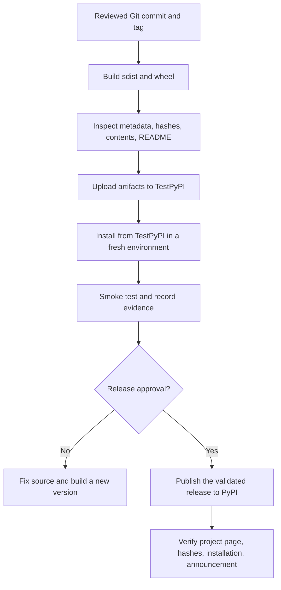

# Publishing to TestPyPI and PyPI

> **Release rule:** build from a clean, reviewed source tree; validate the exact artifacts; publish to **TestPyPI first**; install those artifacts in a fresh environment; publish to production PyPI only after an explicit release decision. This lesson teaches the workflow. It does not create accounts, configure permissions, or publish anything on your behalf.

## Learning objectives

By the end of this lesson, you can:

- explain the difference between TestPyPI and production PyPI;
- prepare and inspect package metadata and distribution artifacts;
- build a wheel and source distribution with `uv build`, check them with `uvx twine check`, and upload them with `uv publish`;
- authenticate without committing credentials and install a published package in a clean environment;
- choose PEP 440 versions, handle pre-releases, and respond correctly to a defective release;
- follow a repeatable release checklist and preserve evidence in a runbook.

## Prerequisites and scope

You should already understand `pyproject.toml`, a PEP 517 build backend, wheels versus source distributions (sdists), a `src/` layout, virtual environments, dependency resolution, basic Git, semantic versioning, automated tests, and secret hygiene. The running package is `tinytools`, a pure-Python example. Commands assume a recent `uv`, Python 3.10 or newer, and a shell with environment-variable syntax shown for POSIX shells. On Windows PowerShell, use `$env:TEST_PYPI_TOKEN = "..."` and `$env:UV_PUBLISH_TOKEN = "..."` as appropriate; never paste secrets into tracked files.

The module roadmap recommends `uv`, `twine`, Hatchling, installed-artifact tests, supply-chain awareness, and TestPyPI-first practice. This lesson follows that progression. The separate next lesson covers Trusted Publishing and attestations in depth; those are preferred for supported CI workflows when configured correctly.

## 1. Publishing architecture and terminology



- **Distribution/package project:** the named project on an index, with release versions and uploaded files.
- **Wheel (`.whl`):** a built distribution designed for installation. A pure-Python package usually has a platform-independent wheel.
- **Source distribution (`.tar.gz`):** source plus metadata needed by a build frontend to build a wheel.
- **Index:** a repository of distributions and metadata. PyPI and TestPyPI are different services, not different views of one database.
- **Build frontend/backend:** `uv build` orchestrates the configured PEP 517 backend (Hatchling in this example).
- **Uploader:** `uv publish` and Twine upload already-built files. Uploading is distinct from building.

### PyPI versus TestPyPI

| Property | TestPyPI | Production PyPI |
|---|---|---|
| Base URL | `https://test.pypi.org/` | `https://pypi.org/` |
| Simple index | `https://test.pypi.org/simple/` | `https://pypi.org/simple/` |
| Upload endpoint | `https://test.pypi.org/legacy/` | `https://upload.pypi.org/legacy/` |
| Purpose | Practice and integration testing | Public distribution to real consumers |
| Accounts/projects | Separate account database and project namespace | Separate account database and project namespace |
| Artifact namespace | Independent from PyPI | Independent from TestPyPI |

You need a separate TestPyPI account; a PyPI login does not automatically sign you in to TestPyPI. TestPyPI may periodically prune its database. Both PyPI and TestPyPI require account two-factor authentication before management actions and uploads; confirm current account requirements in each service's documentation. A name or version available on TestPyPI does **not** establish availability on production PyPI. Do not use TestPyPI as a permanent mirror or depend on its artifacts for production installs.

### Names, normalization, and ownership

Distribution names are compared after normalization: runs of `.`, `_`, and `-` are treated as `-`, and comparison is case-insensitive. For example, `Tiny.Tools`, `tiny_tools`, and `tiny-tools` normalize to the same project name. The normalized name must be unique on the target index. Check the index's project page and search before choosing a name, but remember that a search result is not a guarantee of future availability or ownership. First upload generally creates the project if it is not already claimed; only authorized maintainers can publish subsequent releases.

Do not squat on names, impersonate another project, register common misspellings to capture users, or assume an abandoned project is free to reuse. PyPI's name-retention policy (PEP 541) has specific reachability, activity, evidence, and review criteria; abandonment does not automatically make a name available, and PyPI does not remove projects solely because they are abandoned. Follow the target index's current naming and dispute policies. For valuable names, reserve them only for a real project you intend to maintain, and protect the account and project permissions. See [PyPI Name Retention](https://docs.pypi.org/project-management/name-retention/).

## 2. Prepare metadata and release source

### Example project metadata

A minimal, modern `pyproject.toml` for the running example could contain:

```toml
[build-system]
requires = ["hatchling>=1.26"]
build-backend = "hatchling.build"

[project]
name = "tinytools"
version = "0.1.0"
description = "Small, reliable command-line utilities for learning packaging"
readme = "README.md"
requires-python = ">=3.10"
license = "MIT"
authors = [{ name = "Tinytools Maintainers" }]
keywords = ["cli", "utilities", "packaging"]
classifiers = [
  "Development Status :: 3 - Alpha",
  "Environment :: Console",
  "Intended Audience :: Developers",
  "License :: OSI Approved :: MIT License",
  "Operating System :: OS Independent",
  "Programming Language :: Python :: 3",
  "Programming Language :: Python :: 3.10",
  "Programming Language :: Python :: 3.11",
  "Programming Language :: Python :: 3.12",
  "Programming Language :: Python :: 3.13",
  "Programming Language :: Python :: 3.14",
]
dependencies = []

[project.urls]
Homepage = "https://github.com/EXAMPLE-ORG/tinytools"
Source = "https://github.com/EXAMPLE-ORG/tinytools"
Issues = "https://github.com/EXAMPLE-ORG/tinytools/issues"
Changelog = "https://github.com/EXAMPLE-ORG/tinytools/blob/main/CHANGELOG.md"
Documentation = "https://github.com/EXAMPLE-ORG/tinytools#readme"

[project.scripts]
tinytools = "tinytools.cli:main"

[tool.hatch.build.targets.wheel]
packages = ["src/tinytools"]
```

Replace `EXAMPLE-ORG` with a real repository URL before publishing. Do not claim Python-version support merely because a classifier exists: test every claimed interpreter and remove classifiers for versions you do not support. The example uses `license = "MIT"`, supported by current metadata tooling implementing PEP 639. If your pinned backend does not support this form, upgrade and test it rather than silently publishing incomplete license metadata. Include a complete `LICENSE` file in the source repository and ensure the expression matches the actual grant and third-party notices.

Metadata purpose:

- **`name`, `version`:** identify the project and immutable release version.
- **`readme`:** becomes the long description shown on the project page; the file must be included in the source tree at build time.
- **`license` and `LICENSE`:** communicate permissions and include the actual license text. Audit bundled code, fonts, data, and copied snippets separately.
- **`requires-python`:** installer compatibility constraint. Set it to the real minimum supported Python version.
- **classifiers:** searchable descriptors, not enforcement or a substitute for testing. `Development Status` should honestly reflect maintenance maturity.
- **`project.urls`:** provide useful source, issue, changelog, documentation, and homepage links.
- **dependencies:** list runtime requirements only; keep development/build dependencies separate where possible.

### README and project-page quality

Before publishing, preview `README.md` using the rendering rules supported by PyPI's Markdown renderer. Relative links and relative image paths that work on a Git hosting site may not resolve on the project page. Prefer stable absolute HTTPS links for images and links intended to work from PyPI; verify the target is public and does not require a login. Avoid enormous images, broken badges, remote content that is likely to disappear, and instructions that only work from the repository root. Ensure the README answers: what the package does, supported Python versions, installation, a minimal example, CLI usage, configuration, known limitations, license, support channels, and security-reporting path.

`uvx twine check dist/*` checks that distribution metadata and long descriptions are acceptable to Twine; it does not prove that every link works, that examples run, or that the package is safe. Review the rendered project page after TestPyPI upload.

### Release source hygiene

Use a reviewed commit and a clean working tree. Update tests, documentation, changelog, version, compatibility policy, and license notices. Confirm the intended version in `pyproject.toml` and in the tag. Avoid building from a dirty tree where generated artifacts or uncommitted changes cannot be traced to a commit.

Example checks (adapt paths and commands to your project):

```bash
git status --short
git diff --check
git diff -- pyproject.toml README.md CHANGELOG.md
uv run --group dev pytest
```

If the project uses a different test command or dependency-group setup, use that documented command instead. Do not proceed while unexplained changes remain.

## 3. Versions and immutability

### PEP 440 essentials

Public versions must be valid PEP 440 identifiers and unique for a distribution on the target index. Typical forms:

| Kind | Example | Meaning |
|---|---|---|
| Development | `0.2.0.dev1` | Early development snapshot, ordered before the corresponding release candidates/final release |
| Alpha | `0.2.0a1` | Early feature preview |
| Beta | `0.2.0b1` | Broader pre-release testing |
| Release candidate | `0.2.0rc1` | Candidate for final release |
| Final | `0.2.0` | General release |
| Post-release | `0.2.0.post1` | Follow-up release, commonly for a packaging/documentation correction when appropriate |

PEP 440 also defines epochs, local version identifiers, normalization, and ordering. Local versions such as `0.2.0+company.1` are for downstream/private builds and are not accepted for public PyPI uploads. For public releases, choose a clean public version. Do not use a local identifier to work around an already-published version.

Installers generally exclude pre-releases unless the user explicitly requests them, a matching pre-release is already installed, or no final/post release satisfies the requirement. To test a published pre-release intentionally, use `--pre` and an exact version where practical:

```bash
python -m pip install --pre "tinytools==0.2.0rc1"
```

This command targets the configured default index. Use a separate environment and explicit index only when testing a TestPyPI artifact, as described below.

### Published artifacts are not mutable slots

Treat every published file and version as immutable. An index rejects attempts to replace an already-uploaded filename/version combination; deleting a release is not a way to erase its history or make a release safe to forget. If an upload partially succeeded, inspect the project page and the exact filenames already present before retrying.

- **Yanking:** marks a release as unsuitable and can include a reason. PyPI currently supports yanking whole releases, not individual files. Installers ignore a yanked release unless it is the only release matching an exact `==` or `===` version specifier. Yanking is non-destructive and does not remove files. Use it sparingly because it affects downstream resolution. See [PyPI's yanking documentation](https://docs.pypi.org/project-management/yanking/).
- **Deleting:** removes a release or file where the index permits it, but is more disruptive and does not erase mirrors, caches, logs, or copies held by consumers. PyPI's current documentation warns that deletion is permanent and can break pinned installs. Do not assume a universal time window or a guaranteed ability to delete: [PEP 763, which proposed a 72-hour deletion window, was withdrawn in September 2025](https://peps.python.org/pep-0763/) and is not itself an implemented PyPI deletion rule. Consult the live [PyPI storage and deletion guidance](https://docs.pypi.org/project-management/storage-limits/) before any deletion.
- **Corrective release:** publish a new version with the fix, for example `0.1.1` after `0.1.0`, or a suitable post-release such as `0.1.0.post1` when the change and project policy justify that form. If a release is dangerously broken, consider yanking it with a clear reason and publishing a corrected new version. Communicate the upgrade path.

A failed upload does not automatically mean no artifact was created. The PyPI upload API creates a release when the first file for a version is uploaded and records release metadata from that first file; each distribution is uploaded separately, so a multi-file upload is not atomic. Inspect the index before deciding the next version or retry strategy. Never try to overwrite an existing filename/version, and do not treat deletion as a reliable way to reuse it. See the [PyPI upload API](https://docs.pypi.org/api/upload/).

## 4. Build and validate local artifacts

Run from the project root in a clean checkout. Remove stale build output first so `dist/` cannot accidentally contain an old release:

```bash
rm -rf dist build *.egg-info
uv build
```

On Windows, remove those paths with PowerShell or a file manager. `uv build` normally creates both an sdist and a wheel in `dist/`. Check that the version and filenames are the ones you expect:

```bash
ls -l dist/
uvx twine check dist/*
```

Expected: one `.tar.gz` sdist and one `.whl` for this pure-Python example, and Twine reports successful metadata/long-description checks. Projects with compiled extensions may need several platform-specific wheels; a universal wheel is not appropriate for every project.

Inspect artifacts, not just source files. Useful checks include:

```bash
python -m zipfile -l dist/tinytools-0.1.0-py3-none-any.whl
python -c "import tarfile; print('\n'.join(tarfile.open('dist/tinytools-0.1.0.tar.gz').getnames()))"
sha256sum dist/*
```

`python -m zipfile -l` lists wheel contents; the `tarfile` one-liner lists sdist members and works without relying on the newer `tarfile` command-line interface. On Windows, `Get-FileHash dist\* -Algorithm SHA256` can calculate hashes. Confirm package modules, license, metadata, README/source files as appropriate, and absence of credentials, local configuration, test secrets, private data, and unrelated files. Compare the file list with your intended release contents.

Keep a record of the Git commit, tag, build tool versions, artifact filenames, byte sizes, and SHA-256 hashes. After upload, compare the local hash of each exact artifact with the digest reported by the index's release JSON API (example for TestPyPI: `https://test.pypi.org/pypi/tinytools/0.1.0/json`; production uses `https://pypi.org/pypi/tinytools/0.1.0/json`). For example, `curl -fsS https://test.pypi.org/pypi/tinytools/0.1.0/json | jq -r '.urls[] | [.filename, .digests.sha256] | @tsv'` lists the uploaded filenames and SHA-256 digests; compare these with `sha256sum dist/*` (or `Get-FileHash` on Windows). Treat the JSON API digest as an index-reported value and verify the downloaded bytes independently when stronger evidence is needed. Hashes detect mismatches between copies; they do not alone prove who built an artifact. Provenance/attestations and reproducible builds are separate, stronger supply-chain practices.

## 5. Authenticate and publish to TestPyPI

### Account and token setup

1. Create or sign in to an account at `https://test.pypi.org/account/register/` (separate from production PyPI).
2. Enable two-factor authentication before account management or upload actions; PyPI and TestPyPI require it for those actions. Prefer phishing-resistant WebAuthn/security keys or passkeys where supported, and securely retain recovery codes.
3. Create a TestPyPI API token with the narrowest practical scope. For an existing project, use project-scoped permissions when the service offers them. Initial project creation may require a token scope appropriate to creating the project; follow current TestPyPI UI guidance.
4. Store the token in a password manager, operating-system keyring, or CI secret store. A shell environment variable is convenient for a short interactive session, but can be exposed through shell history, process inspection, crash dumps, or debug logs depending on the environment. Avoid `set -x`, verbose logging, screenshots, and commands that echo the token.
5. Keep TestPyPI and production PyPI credentials separate. Revoke a token that is lost, copied into a repository, or shown in a log.

`UV_PUBLISH_TOKEN` is supported by current `uv` as the equivalent of `--token`; confirm options against `uv publish --help` for the installed version. Environment variables are not a perfect secret vault: avoid debug dumps, shell tracing, shared machines, and unnecessary child processes. In CI, use the CI secret store or preferably Trusted Publishing when configured. **Do not load the token until the build and artifact validation are complete**, because build backends and build-time dependencies execute code.

### Build, check, upload

Use the exact artifact set built and validated in Section 4; do not rebuild between validation and upload. Re-run the check if any artifact changed:

```bash
uvx twine check dist/*
```

After the build and checks pass, enter the TestPyPI token immediately before uploading, then run the publish command and check its exit status:

```bash
unset UV_PUBLISH_URL UV_PUBLISH_INDEX
read -rsp "TestPyPI token: " UV_PUBLISH_TOKEN; export UV_PUBLISH_TOKEN; printf '\n'
uv publish --publish-url https://test.pypi.org/legacy/ dist/*
```

The `--publish-url` value is the TestPyPI upload endpoint. Do not confuse it with the browser project URL or `/simple/` installation index. `uv publish` uploads the paths passed to it; specifying `dist/*` publishes the matching artifacts. Confirm the option syntax with `uv publish --help` for your installed version before a real release. Never use a production token for this TestPyPI upload. After recording the command result, clear the token from the current shell with `unset UV_PUBLISH_TOKEN`; this does not revoke the token at the service. In scripts, use a cleanup trap or equivalent that does not mask the uploader's exit status.

If authentication fails, check the target URL, token prefix/value, token scope, account, and whether the token was revoked. If an upload reports that a file already exists, inspect the TestPyPI project page and local hashes; do not blindly retry with `--skip-existing`.

### Alternative uploader: Twine

Twine is a mature, widely used uploader and is useful when you want an explicit repository configuration:

```bash
uvx twine upload --repository-url https://test.pypi.org/legacy/ dist/*
```

Twine will prompt for credentials if none are configured. For token authentication, the username is `__token__` and the password is the token value, usually including its `pypi-` prefix. Avoid putting the token in a tracked `.pypirc`. If you use a local `~/.pypirc`, understand that plaintext storage is a risk; restrict file permissions and prefer a credential manager or trusted publishing where possible.

**`uv publish` versus Twine:** both upload built artifacts; neither replaces build validation. `uv` offers an integrated workflow and token option; Twine is a dedicated uploader with broad familiarity and repository options. Pick one documented path, verify the endpoint, and do not upload the same files to different targets by accident.

## 6. Install and smoke-test from TestPyPI

Use a fresh environment so the local checkout and previously installed package cannot hide packaging defects. This example has no runtime dependencies, which makes a TestPyPI-only index the safest and simplest choice.

```bash
python -m venv .venv-testpypi
# macOS/Linux:
. .venv-testpypi/bin/activate
# Windows PowerShell instead:
# .\.venv-testpypi\Scripts\Activate.ps1
python -m pip --isolated install --upgrade pip
python -m pip --isolated install --no-deps --index-url https://test.pypi.org/simple/ "tinytools==0.1.0"
python -m pip show tinytools
python -c "import tinytools; print(tinytools.__file__)"
tinytools --help
```

Use the actual version you uploaded. `--isolated` tells pip to ignore environment variables and user configuration that could silently add another package index; in hardened environments, also inspect system-wide pip configuration; `--no-deps` is appropriate here because this running example declares no runtime dependencies. For a real package with dependencies, install reviewed dependencies from their intended trusted source separately, then install the exact TestPyPI artifact without re-resolving dependencies, or use a deliberately controlled index/mirror. Never assume `--extra-index-url` means strict fallback or priority. Run smoke tests from outside the source checkout (for example, a temporary working directory) so local files cannot shadow the installed distribution. Confirm the import path is inside the new virtual environment's `site-packages`, not your source checkout. Exercise a representative CLI command and library API, verify exit codes, and run a short end-to-end smoke test. Then deactivate the environment and preserve the commands and results in the runbook.

### What if the package has dependencies?

TestPyPI is not a reliable mirror of production PyPI, and ordinary dependencies may not be present there. Avoid casually using `--extra-index-url` as if it gave strict priority to TestPyPI: pip considers candidates from configured indexes together, and this can create dependency-confusion risk if an attacker publishes a same-named dependency at a higher version. Safer approaches:

1. Test the dependency-free package from TestPyPI alone, as above.
2. For a project with dependencies, install the required third-party dependencies from the intended trusted index in a controlled environment, then install the exact TestPyPI artifact without resolving dependencies again. One approach is to download the exact wheel from TestPyPI, verify its hash and filename, and install it with `--no-deps` after installing reviewed dependencies from the intended index.
3. If a combined index is unavoidable, use a deliberately configured internal proxy/mirror or a resolver workflow with documented source controls; do not assume `--extra-index-url` is a security boundary.

Never install arbitrary unreviewed packages into a privileged environment just to test an upload. Use disposable virtual environments and avoid running smoke tests with production credentials present.

## 7. Production PyPI release workflow

**Do not run the production publish command during the TestPyPI lab.** A real PyPI release requires project ownership/authorization, a reviewed release decision, and the appropriate credentials or configured trusted publisher.

### Pre-release gate

Before promoting a release:

- confirm the normalized project name and production project ownership;
- confirm version, changelog, README, license, classifiers, URLs, Python support policy, and dependencies;
- run unit, integration, and supported-Python matrix tests;
- build once from a clean checkout of the reviewed tag and preserve that exact artifact set through TestPyPI validation and production publication; if a rebuild is necessary, repeat TestPyPI validation for the new bytes;
- inspect both sdist and wheel; run `uvx twine check dist/*` and any project-specific wheel/content/security checks;
- install the TestPyPI artifact in a fresh environment and run smoke tests;
- inspect TestPyPI's project page and compare artifact names, sizes, and hashes with your local record;
- ensure the exact release artifacts correspond to the intended source commit;
- obtain explicit approval, especially for a production CI environment.

For a small pure-Python project, the wheel is generally easy for consumers to install; the sdist gives downstream users a source-based route and should also be validated. For compiled projects, build and test the complete platform/interpreter wheel matrix and understand which artifact types the index and consumers need.

### Authentication and permissions on production PyPI

Use a separate production PyPI account and production credential. Two-factor authentication is required for account management and upload actions; prefer phishing-resistant WebAuthn/security keys or passkeys where supported, and retain recovery codes. Use project-scoped API tokens when applicable. PyPI supports **Trusted Publishing** for supported CI identity providers: CI exchanges a short-lived OIDC identity token for an upload credential, avoiding long-lived upload tokens in CI secrets. Configure the publisher explicitly for the correct repository, workflow, and environment, and protect the production environment with review/approval. Trusted Publishing is not automatic merely because a GitHub workflow exists; it must be configured on the index and correctly constrained.

For a one-off manual release, set a production token only in the session that needs it. Prefer Trusted Publishing for supported CI workflows. The following manual example uses the explicit production upload endpoint to reduce the chance of publishing to the wrong index; run it only after production approval and after verifying the command options for your installed `uv` version:

```bash
# Bash: enter the token without echoing it or placing its value in shell history.
# Remove stale target overrides before loading the production secret.
unset UV_PUBLISH_URL UV_PUBLISH_INDEX
read -rsp "PyPI token: " UV_PUBLISH_TOKEN; export UV_PUBLISH_TOKEN; printf '\n'
uv publish --publish-url https://upload.pypi.org/legacy/ dist/*
```

The explicit URL is PyPI's upload endpoint, not the browser project URL or `/simple/` index. `UV_PUBLISH_TOKEN` is supported by current `uv`; see [uv's publishing guide](https://docs.astral.sh/uv/guides/publish/) and [environment-variable reference](https://docs.astral.sh/uv/configuration/environment/). After recording the command result, clear the token with `unset UV_PUBLISH_TOKEN`; this does not revoke it. In scripts, use cleanup that preserves the publish command's exit status. Never put a real token in documentation, source, issue comments, or a shell script committed to Git.

Promote the exact artifact files that passed TestPyPI validation; do not rebuild between TestPyPI and production and assume the bytes are identical. If a rebuild is unavoidable, treat it as a new candidate: revalidate the new hashes, upload that exact build to TestPyPI, and repeat the install/smoke test before production. After upload, inspect the production project page, check that all expected artifacts are present, compare local SHA-256 hashes with the production JSON API digests and downloaded copies where available, and install the exact version in a clean environment from production PyPI (for example, `python -m pip --isolated install --index-url https://pypi.org/simple/ "tinytools==0.1.0"`). Publish the GitHub release notes/changelog, announce what changed, and monitor issues and reports. The source tag should already exist and have been reviewed before building the release artifacts.

### Existing artifacts, retries, and upload ordering

An upload of multiple artifacts is not necessarily an all-or-nothing transaction across every file. If a command fails partway through, some files may already exist. Inspect the target release before retrying and verify exact filenames and hashes. `--skip-existing` (where supported by the uploader/version) skips files the server says already exist; it can conceal the fact that a wrong artifact was uploaded first. Use it only when you have independently verified that every skipped file is exactly the intended artifact. A safer response is usually to inspect the index, compare hashes, and publish only missing, validated files or create a corrected version if the existing artifact is wrong.

Upload all artifacts for a version from the same validated build. Upload ordering is a practical operational concern for platform-specific wheels and CI jobs, but do not assume the index provides a multi-file atomic transaction. For a wheel matrix, build and test each target, collect artifacts into a release artifact set, verify uniqueness and naming, then publish in a controlled job. Avoid parallel uploads that race on the same filename/version.

### Size limits and rate limits

PyPI imposes per-file upload size limits and service protections, and limits can change. The current official PyPI storage-limits documentation states a default limit of 100 MB per file and 10 GB total per project, with a process to request a per-file increase where justified. These are mutable service policies, so re-check the linked live documentation and project settings before planning large artifacts; do not treat today’s values as a timeless guarantee. Do not split or compress artifacts in a way that breaks the packaging format; remove unnecessary test data, datasets, build caches, or vendored files. If a package legitimately requires larger artifacts, follow the current official request process and provide a justification. Respect service rate limits, avoid repeated blind retries, use bounded backoff for transient failures, and coordinate release automation to avoid concurrent duplicate uploads. This lesson does not assert a fixed upload rate limit because current operational limits may vary or be unpublished.

## 8. Ownership, governance, and supply-chain expectations

### Maintainers, organizations, and transfer

A project can have owners/maintainers with different permissions; organization/team features and exact role names depend on current PyPI account/project-management features. Apply least privilege, keep at least two trusted maintainers for important projects, review membership periodically, and remove access promptly when people leave. Verify roles in the live project settings rather than relying on an old screenshot or remembered UI. Transfer ownership only through the supported workflow, after verifying the recipient and agreeing on responsibilities. Never hand over an account password. Preserve release keys/automation configuration, issue history, domains, documentation, and incident contacts during a handoff.

If an account or project is taken over, do not assume that changing the README is enough. Secure affected accounts, revoke tokens, remove unauthorized maintainers where you retain authority, contact PyPI support through the official process, inspect release history and CI credentials, warn users through a trusted channel, and coordinate a safe recovery. Do not publish speculative accusations or destroy evidence.

### Provenance, reproducibility, and build dependencies

Consumers increasingly expect to know where a release came from and how it was built. Use a reviewed commit/tag, pin or constrain build requirements deliberately, record toolchain versions, build in a clean environment, and make builds reproducible where practical. Build isolation helps separate build dependencies but does not make arbitrary build code trustworthy. Review build backends and plugins as executable dependencies. Use lockfiles/constraints where the workflow supports them, scan dependencies and artifacts, and consider SBOMs and vulnerability/license tools for projects with meaningful supply-chain risk.

Trusted Publishing and attestations are complementary: short-lived identity reduces long-lived secret exposure, while provenance attestations can link an artifact to a repository/workflow. Neither proves the source code is benign or prevents a compromised authorized workflow from publishing malicious code. Apply review, branch/tag protection, least privilege, and environment approval as separate controls.

### Licensing and contributor obligations

Choose a license based on the rights you intend to grant and obligations you can meet; MIT, BSD, Apache-2.0, GPL, and AGPL have different terms. Do not choose a license only from a classifier. Track third-party licenses and notices for copied code, generated assets, bundled binaries, and data. Review dependency license compatibility for your intended distribution. Some organizations require a Developer Certificate of Origin (DCO) sign-off; others require a Contributor License Agreement (CLA). These are project governance decisions, not universal PyPI requirements. State the policy in CONTRIBUTING.md and enforce it consistently.

### Maintenance policy

Document supported Python versions and test them in CI. Maintain a `SECURITY.md` (or an equivalent clearly linked policy) with a monitored private vulnerability-reporting channel, response expectations, and the project's advisory/CVE coordination approach where applicable. Define issue triage expectations, supported platforms, release cadence, deprecation windows, and end-of-life behavior. Deprecate public APIs before removal where feasible, explain migration paths, and use a new release to communicate breaking changes. A handoff plan should identify maintainers, build/publish ownership, CI environments, issue queues, domains, docs, and recovery contacts.

### Project status and long-term signals

PyPI supports project-wide status markers through [PEP 792](https://peps.python.org/pep-0792/). As documented by PyPI's [2025 implementation announcement](https://blog.pypi.org/posts/2025-08-14-project-status-markers/), the service supports `active` (default), `archived`, and `quarantined`; do not assume every status defined by the PEP is currently implemented by PyPI or by every other index. Archiving prevents new uploads while leaving existing distributions downloadable; quarantine indicates the index considers the project unsafe and blocks distribution. These are different from a yanked individual release and from a `Development Status` classifier in package metadata. Check current project status and current index API behavior before adopting a dependency, and keep project status/current maintenance intent clear for consumers.

### Distribution alternatives

| Channel | Distribution model and trade-offs |
|---|---|
| PyPI | Default public Python package index; works with pip and common Python installers. |
| TestPyPI | Test index for rehearsing packaging/upload/install; not production hosting. |
| Private index / internal registry | Controlled distribution inside an organization; requires access control, retention, availability, and dependency-confusion defenses. |
| GitHub Packages | Registry service integrated with GitHub; verify its current Python package support, authentication, and installer compatibility before selecting it. |
| conda-forge | Community-maintained Conda recipes/feedstocks and Conda package distribution; not simply a second PyPI endpoint. Build/metadata and environment model differ. |
| GitHub Releases | Release assets attached to repository releases; useful for binaries, archives, and manually distributed artifacts, but not automatically a pip-compatible package index. |

Choose based on the consumer's environment, authentication, dependency-resolution model, platform artifacts, and maintenance capacity. A GitHub Release asset named `.whl` is not automatically discoverable by pip as an index package.

## 9. Troubleshooting and incident response

| Symptom | Likely cause | Safe response |
|---|---|---|
| `project already exists` / name unavailable | Normalized name is claimed or you lack project permission | Verify normalized spelling and ownership on the intended index; do not try to impersonate or bypass ownership. |
| Authentication failure | Wrong index, wrong token, revoked token, insufficient scope, or account mismatch | Confirm endpoint and scope; create a narrowly scoped replacement if authorized; never paste token into logs. |
| Upload went to the wrong index | Stale `UV_PUBLISH_URL`, `UV_PUBLISH_INDEX`, repository config, or incorrect command target | Stop further publication, confirm the project page and upload history on both indexes, preserve evidence, and never assume the intended target was used. Use an explicit endpoint and review environment/config overrides before the next upload. |
| TestPyPI passes but production artifacts differ | A second build was created after testing or the artifact set changed | Compare filenames and SHA-256 digests. Promote the exact validated files; otherwise repeat the full validation and TestPyPI smoke test for the new build. |
| `File already exists` | Version/file immutable on that index | Inspect uploaded artifacts and hashes. If wrong, prepare a new version; don't try to overwrite. |
| Only some files appear | Multi-artifact upload failed partway | Inspect the release and compare each file; upload only missing validated artifacts or use a corrective version. |
| README rendering failure | Unsupported Markdown, broken relative links/images, invalid metadata | Fix source, rebuild and validate. If already published, issue a new version for changed artifacts/metadata rather than expecting the old file to change. |
| Install works from checkout but not after publishing | Missing package files, wrong package discovery, missing dependency, or import accidentally relying on repository files | Reproduce in a fresh environment using the index artifact; inspect wheel and sdist contents; fix and publish a new version. |
| TestPyPI install cannot find a dependency | Dependency is not on TestPyPI | Install trusted dependencies from their intended index separately, then install the exact TestPyPI artifact with dependency resolution disabled; avoid unsafe index mixing. |
| Token appears in Git or CI logs | Credential leak | Revoke immediately, inspect use/audit evidence where available, replace with a new credential or Trusted Publishing, purge copies where feasible, and treat cached/forked copies as potentially exposed. |
| A release is broken or vulnerable | Defect escaped validation | Assess impact; consider yanking with a clear reason; publish a new corrected version; notify users through a trusted channel; coordinate security disclosure when appropriate. |
| Suspected malicious takeover | Unauthorized release or maintainer change | Secure accounts and CI, revoke credentials, preserve logs/artifacts, contact platform support, review all releases and automation, and communicate with users from a trusted channel. |
| Upload seems to hang or is rate-limited | Network/service throttling, oversized artifact, or repeated concurrent uploads | Check official service status and current limits; avoid tight retry loops; use bounded backoff and a single controlled uploader. |

### Token leak response

1. Revoke the leaked token immediately from the correct index/account. PyPI and TestPyPI credentials are separate; revoke each exposed credential on its own service.
2. Identify where it appeared and whether it was used; inspect repository history, CI logs, package releases, and account activity available to you.
3. Remove the secret from active files/logs where feasible, but assume forks, caches, logs, and clones may retain it.
4. Rotate affected credentials, reduce scope, and prefer Trusted Publishing for supported CI.
5. Review recent releases and maintainer/automation changes; publish a security notice if consumers may be affected.

### Broken release response

1. Stop further automation and establish which artifacts and consumers are affected.
2. Preserve evidence: filenames, hashes, commit/tag, build logs, upload timestamps, and observed behavior.
3. If appropriate, yank the defective release and provide a specific reason; do not assume yanking removes it from every environment.
4. Fix source and tests, bump to a new version, rebuild from a clean commit, and re-run the full release gate.
5. Publish the corrected release and communicate migration instructions. If the defect is security-sensitive, coordinate disclosure and follow the project's security policy.

## 10. Hands-on lab: publish `tinytools` to TestPyPI

**Goal:** rehearse the full workflow without touching production PyPI.

### Lab procedure

1. **Prepare the repository.** Confirm `tinytools` metadata, README, license, classifiers, supported Python range, URLs, tests, and changelog. Use a unique, authorized project name if `tinytools` is not available on TestPyPI; document the exact name you chose.
2. **Record the source identity.** Run `git status --short`, `git rev-parse HEAD`, and record the commit. Require a clean working tree for the release candidate.
3. **Run tests.** Run the repository's documented test and lint/type-check commands. Record Python and tool versions.
4. **Build and validate.** Remove stale `dist/`, run `uv build`, run `uvx twine check dist/*`, inspect archive contents, and compute SHA-256 hashes.
5. **Authenticate to TestPyPI.** Create a separate account and appropriately scoped token, store it securely, and export it only into the session that publishes.
6. **Upload.** After validating the artifacts, enter the TestPyPI token securely as `UV_PUBLISH_TOKEN`, run `uv publish --publish-url https://test.pypi.org/legacy/ dist/*`, check the command result, and then clear the variable with `unset UV_PUBLISH_TOKEN`. Confirm the release page and expected files appear. Never include the token in the runbook.
7. **Install in a clean environment.** Create a new virtual environment, install the exact version from `https://test.pypi.org/simple/`, inspect `pip show`, and run a representative CLI/API smoke test.
8. **Verify and record.** Compare project-page artifact names and sizes with local artifacts; record local hashes and note what you could and could not independently verify from the index. Capture command outputs without tokens.
9. **Clean up.** Deactivate/remove the test environment when finished, revoke temporary credentials if no longer needed, and ensure no token entered Git or logs.
10. **Do not promote automatically.** Production PyPI publication is a separate, explicitly approved step after the release checklist and, ideally, the Trusted Publishing workflow in the next lesson.

### Runbook template

Record a runbook in your repository or release system, excluding all secrets:

```text
Project and index:
Release version:
Normalized distribution name:
Source commit and tag:
Working tree clean (yes/no):
Python version and OS:
uv / build backend / Twine versions:
Test command and result:
Artifact filenames and byte sizes:
SHA-256 hashes:
Twine check result:
TestPyPI upload timestamp and project URL:
Fresh-environment install command/result:
Smoke-test commands and results:
Artifact/page comparison:
Known limitations or failures:
Reviewer / approval:
Next action (remain on TestPyPI / approved production release):
```

### Acceptance criteria

- [ ] `pyproject.toml` metadata matches the intended project and supported Python versions.
- [ ] The working tree and commit/tag are recorded and clean.
- [ ] `uv build` creates the expected sdist and wheel.
- [ ] `uvx twine check dist/*` passes and the archive contents have been inspected.
- [ ] TestPyPI authentication is separate from production credentials; two-factor authentication is enabled and no token is committed or logged.
- [ ] Upload target is explicitly TestPyPI and the project page shows the expected artifacts.
- [ ] A fresh virtual environment installs the exact uploaded version from TestPyPI.
- [ ] The smoke test runs against the installed artifact, not the source checkout.
- [ ] Artifact names, sizes, and local hashes are recorded in the runbook.
- [ ] No production upload is attempted during this lab.

## 11. Self-checks with explained answers

### 1. Why can a published file or version not simply be uploaded again to replace the existing release?

Indexes treat a release's artifact filenames/version combinations as immutable to preserve reproducibility and avoid silently changing what an installed version means. Replacing bytes under an existing version could make two users installing the same version receive different code. Inspect partial uploads rather than retrying blindly. Fix the source and publish a new version; yank a defective release when warranted, with a reason.

### 2. What is the difference between yanking and deleting a release?

Yanking is a non-destructive signal that a release should normally be ignored by installers; the files remain available and a reason can be displayed. Deleting removes a release or file where permitted, is more disruptive, and cannot erase copies in caches, mirrors, or consumer environments. Both should be rare; neither is a substitute for publishing a corrected version and communicating clearly.

### 3. How do you publish `tinytools` to TestPyPI, install it in a fresh environment, and record the process as a runbook?

Check out a clean reviewed commit, run tests, remove stale build output, run `uv build`, inspect the sdist and wheel, and run `uvx twine check dist/*`. Enter a TestPyPI-only token securely as `UV_PUBLISH_TOKEN` only after validation, upload with `uv publish --publish-url https://test.pypi.org/legacy/ dist/*`, check the result, and clear the variable with `unset UV_PUBLISH_TOKEN`. Verify the TestPyPI project page, then create a fresh venv and install the exact version with `python -m pip --isolated install --no-deps --index-url https://test.pypi.org/simple/ "tinytools==VERSION"`. Confirm the installed path with `pip show` and run smoke tests. Record commit/tag, tool versions, commands/results, artifact filenames, sizes, hashes, project URL, and reviewer decision in the runbook. Never put the token in that record. Do not use `--extra-index-url` casually; for a dependency-free example, TestPyPI alone is sufficient.

## 12. Release-readiness checklist

### Source and metadata
- [ ] Clean working tree; reviewed commit and annotated/reproducible tag identified.
- [ ] Version is valid PEP 440 and has never been published to the target index.
- [ ] Name normalization, project ownership, and target index verified.
- [ ] README rendering, links, images, license text/expression, classifiers, `requires-python`, URLs, dependencies, and changelog reviewed.
- [ ] Third-party licenses/notices and DCO/CLA policy checked.
- [ ] `SECURITY.md` or an equivalent monitored vulnerability-reporting policy and contact is available.

### Quality and artifacts
- [ ] Tests pass on the supported Python/OS matrix.
- [ ] Build requirements and tools are controlled and recorded.
- [ ] Stale `dist/` output removed; sdist and wheel built from the intended source.
- [ ] Twine check passes; archive contents inspected; no secrets or unrelated files included.
- [ ] Hashes, sizes, filenames, and build provenance recorded.
- [ ] Installed-artifact test passes in a clean environment.

### TestPyPI
- [ ] Separate TestPyPI account and least-privilege token or configured trusted publisher used.
- [ ] Upload URL is explicitly TestPyPI.
- [ ] All expected artifacts and metadata are visible.
- [ ] Clean install and smoke test succeed; dependency-index strategy is documented.
- [ ] Runbook evidence saved without secrets.

### Production PyPI
- [ ] Explicit release approval received; production project and permissions verified.
- [ ] Production credential/trusted publisher is separate from TestPyPI.
- [ ] CI identity, protected environment, and least-privilege permissions reviewed where applicable.
- [ ] Exact artifacts to publish are validated; existing filenames and partial uploads checked.
- [ ] Production project page and downloaded artifacts verified after upload.
- [ ] Release notes, GitHub release, announcement, support/security channels, and monitoring ready.
- [ ] Rollback/incident plan understands immutable artifacts, yanking, and corrective versions.

### Ongoing maintenance
- [ ] Python support, deprecation, issue triage, security response, and sunset policies are documented.
- [ ] Maintainers and organization roles are reviewed; handoff and credential-revocation plans exist.
- [ ] Provenance/attestation, reproducible builds, SBOM, and vulnerability/license review are considered proportionately to project risk.

## 13. Authoritative references

Check current official documentation before each real release, especially for changing limits, account security, and UI/permission details.

- [Python Packaging User Guide: Using TestPyPI](https://packaging.python.org/en/latest/guides/using-testpypi/) — separate TestPyPI service, upload and install endpoints.
- [Python Packaging User Guide: The Packaging Flow](https://packaging.python.org/en/latest/flow/) — source, metadata, artifacts, upload, and installation lifecycle.
- [Python Packaging User Guide: Building and Publishing](https://packaging.python.org/en/latest/guides/section-build-and-publish/) — official build and release guides.
- [Python Packaging User Guide: Making a PyPI-friendly README](https://packaging.python.org/en/latest/guides/making-a-pypi-friendly-readme/) — long descriptions and rendering concerns.
- [Python Packaging specification: Version specifiers (PEP 440)](https://packaging.python.org/en/latest/specifications/version-specifiers/) — version syntax, ordering, and pre-release handling.
- [PyPI documentation: Trusted Publishers](https://docs.pypi.org/trusted-publishers/) — OIDC-based publication and short-lived credentials.
- [PyPI Help: Two-factor authentication](https://pypi.org/help/#two-factor-authentication) and [PyPI 2FA enforcement announcement](https://blog.pypi.org/posts/2024-01-01-2fa-enforced/) — account-management and upload requirements.
- [PyPI documentation: Yanking](https://docs.pypi.org/project-management/yanking/) — current release-yanking behavior.
- [PyPI documentation: Name Retention](https://docs.pypi.org/project-management/name-retention/) — name disputes and abandoned-project handling.
- [PyPI documentation: Upload API](https://docs.pypi.org/api/upload/) — one-file-at-a-time upload behavior and first-file release metadata.
- [PEP 792 — Project status markers in the simple index](https://peps.python.org/pep-0792/) and [PyPI implementation announcement](https://blog.pypi.org/posts/2025-08-14-project-status-markers/) — current project-wide status semantics.
- [PEP 763 — Limiting deletions on PyPI](https://peps.python.org/pep-0763/) — historical proposal; withdrawn in September 2025, not current deletion policy.
- [PyPI documentation: Storage Limits](https://docs.pypi.org/project-management/storage-limits/) — current per-file and total-project storage limits and the increase request process.
- [PyPI documentation: Roles and Entities](https://docs.pypi.org/organization-accounts/roles-entities/) — current organization and project role distinctions.
- [PyPI documentation](https://docs.pypi.org/) — current project management, account security, upload, file-size, and operational policies.
- [uv documentation: Packaging projects](https://docs.astral.sh/uv/guides/package/) — project metadata and build workflow.
- [uv documentation: Building and publishing](https://docs.astral.sh/uv/guides/publish/) — current `uv publish`, token, and upload-target options.
- [Twine documentation](https://twine.readthedocs.io/en/stable/) — artifact validation and upload options.
- [Python Packaging User Guide: Publishing with GitHub Actions](https://packaging.python.org/en/latest/guides/publishing-package-distribution-releases-using-github-actions-ci-cd-workflows/) — trusted publishing and CI release flow.

---

**Release principle:** validate the artifact consumers will install, publish to TestPyPI first, preserve evidence, and treat production publication as a deliberate, auditable event.
