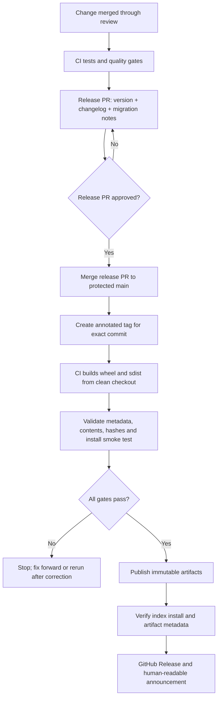

# Versioning, Changelogs, and Release Automation

> **Module 1.18 · Lesson 07 · Stage 1 — Programming & Computational Thinking**  
> Running example: `tinytools` · Target baseline: Python 3.12+ · Packaging workflow: `uv`

This lesson follows the Module 1.18 roadmap: consistent package versions and changelogs, conventional commits and automation, a reviewable release lifecycle, compatibility policy, and repeatable release quality gates. The commands are examples to run in your own repository; no release, tag, or CI workflow is created by reading this document.

## 1. Learning objectives and prerequisites

By the end, you should be able to:

- Select and explain a versioning policy, including the limits of SemVer for Python packages.
- Choose exactly one authoritative source for the package version and expose it correctly at runtime.
- Maintain a user-facing changelog that explains impact rather than merely listing commits.
- Explain how Conventional Commits feed tools that suggest versions or produce changelog content—and why those are separate responsibilities.
- Design a release path from reviewed changes through tests, a release PR, a tag, artifact validation, publication, and announcement.
- Define the public API of a library broadly enough to cover Python, CLI, configuration, file formats, dependencies, and supported runtimes.
- Use compatibility checks, staged deprecation, recovery procedures, and release metrics to reduce risk.

### Prerequisites

Be comfortable with `pyproject.toml`, package builds, wheels and sdists, Git branches and tags, automated tests, dependency constraints and lock files, PyPI/TestPyPI publishing, and release-security fundamentals. Earlier Module 1.18 lessons cover these topics in more detail. This lesson focuses on coordinating them into a coherent release policy.

## 2. Versioning fundamentals

### 2.1 Semantic Versioning

Semantic Versioning (SemVer) describes compatibility intent using `MAJOR.MINOR.PATCH`:

- **MAJOR**: incompatible public API change.
- **MINOR**: backward-compatible functionality added.
- **PATCH**: backward-compatible bug fix.

For a stable public library, `tinytools 1.2.3` communicates a different compatibility promise from `tinytools 2.0.0`. The promise is only meaningful if the project has documented its public API and consistently tests compatibility.

SemVer does not decide what your public API is. For Python libraries, that boundary can include more than importable functions: public classes, exceptions, type signatures, documented behavior, CLI commands and flags, exit codes, configuration keys, file formats, serialization behavior, supported Python versions, and declared dependency constraints.

#### What does `0.x` mean?

SemVer treats `0.y.z` as initial development: anything may change and the public API should not be assumed stable. Projects often still try to minimize surprises, but a `0.8.2` to `0.9.0` transition does not carry the same stable compatibility guarantee as `1.8.2` to `1.9.0`. State your policy explicitly; do not use `0.x` as an excuse to omit migration notes.

### 2.2 A release policy example

For `tinytools`, suppose version `1.2.0` supports Python 3.12 and later and documents the `tinytools convert` CLI:

| Change | Typical version decision | Why |
|---|---|---|
| Add a documented `--format yaml` option without changing defaults | `1.3.0` | Additive functionality |
| Fix incorrect handling of an empty input | `1.2.1` | Bug fix, no intended contract break |
| Remove a public `--fmt` flag | `2.0.0` | Existing scripts may stop working |
| Raise `requires-python` from `>=3.12` to `>=3.13` | Usually major for a stable library, or a clearly communicated support-policy change | Existing supported users can no longer install/use the new release |
| Change the default output format from JSON to YAML | Usually major if callers rely on JSON | Observable behavior changes even if function signatures do not |
| Add a deprecation warning for `--fmt` while retaining it | Usually minor | Existing use still works, assuming the warning is non-fatal |

These are policy decisions, not a mechanical law for every project. Document exceptions before a release rather than rationalizing them after users report breakage.

For `0.y.z` projects, write down how your team interprets breaking changes before configuring automation. SemVer itself says the public API should not be considered stable before `1.0.0`; teams may nevertheless promise stability for selected interfaces. Release tools can apply different pre-`1.0` bump policies, so explicitly configure and test the chosen behavior rather than assuming every `feat` means `0.(y+1).0` or every breaking marker means `1.0.0`.

## 3. PEP 440 versus SemVer

Python package installers use **PEP 440** version semantics. SemVer and PEP 440 overlap, but they are not interchangeable specifications.

| Intent | Common PEP 440 form | Notes |
|---|---|---|
| Stable release | `1.2.3` | Works naturally with SemVer-style numbering |
| Alpha | `1.3.0a1` | PEP 440 uses `a`, not SemVer's `-alpha.1` spelling |
| Beta | `1.3.0b2` | A pre-release; installers commonly prefer a final release unless pre-releases are requested or needed to satisfy constraints |
| Release candidate | `1.3.0rc1` | Candidate for the final release |
| Development build | `1.3.0.dev4` | Sorts before the corresponding final/pre-release sequence according to PEP 440 rules |
| Post-release | `1.2.3.post1` | Often useful for a follow-up release such as corrected packaging metadata or documentation, but do not use it to disguise a behavior fix that deserves a normal patch release |
| Local version | `1.2.3+acme.4` | Intended for downstream/local builds. PEP 440 does not permit local-version identifiers for distributions uploaded to a public index such as PyPI; do not use this as a public release version |

Do not blindly translate every SemVer string into PEP 440. For example, SemVer build metadata and PEP 440 local versions have different comparison semantics. Use a PEP 440-aware parser such as `packaging.version.Version` when validating Python distribution versions.

### Pre-release installation behavior

Pre-releases are not generally selected as casually as final releases. If testing `tinytools==1.3.0rc1`, ask the installer explicitly when needed:

```bash
uv pip install --pre 'tinytools==1.3.0rc1'
# or, in a pip-based test environment:
python -m pip install --pre 'tinytools==1.3.0rc1'
```

A pinned exact pre-release requirement can make the intended version explicit; `--pre` is especially relevant when the requirement is a range and a resolver would otherwise prefer stable releases. Test the actual resolver and constraints used by consumers.

## 4. Choose one source of truth for the version

A version should not be independently maintained in `pyproject.toml`, `tinytools/__init__.py`, a CLI string, a changelog, and a workflow file. Repeated version literals drift. Choose one source and derive other displays from it.

### Strategy A — static metadata

For a small project with deliberate release PRs, static metadata is straightforward:

```toml
# pyproject.toml
[build-system]
requires = ["hatchling>=1.25"]
build-backend = "hatchling.build"

[project]
name = "tinytools"
version = "1.2.0"
description = "Small utilities for repeatable data workflows"
readme = "README.md"
requires-python = ">=3.12"
license = "MIT"
dependencies = []

[project.urls]
Homepage = "https://github.com/example/tinytools"
Source = "https://github.com/example/tinytools"
Issues = "https://github.com/example/tinytools/issues"
Changelog = "https://github.com/example/tinytools/blob/main/CHANGELOG.md"
Documentation = "https://example.github.io/tinytools/"
```

The release PR changes `version = "1.2.0"` to the next version. At runtime, query installed distribution metadata rather than duplicating the literal:

```python
from importlib.metadata import PackageNotFoundError, version

try:
    __version__ = version("tinytools")
except PackageNotFoundError:  # source checkout not installed as a distribution
    __version__ = "0+unknown"
```

The fallback is for developer convenience; do not silently report `0+unknown` in a release validation job. That job should install the built wheel and assert that its metadata reports the expected release version.

**Advantages:** explicit and easy to understand; release diff is visible in the PR.  
**Trade-off:** someone must update the metadata during the release process.

### Strategy B — version derived from Git tags

For projects that want the tag to be authoritative, derive version metadata from VCS tags using a backend plugin such as `hatch-vcs` or `setuptools-scm`. These tools integrate with the build backend; they are not runtime metadata readers.

Illustrative Hatchling configuration (check the current plugin documentation for exact supported versions and settings before adopting it):

```toml
[build-system]
requires = ["hatchling", "hatch-vcs"]
build-backend = "hatchling.build"

[project]
name = "tinytools"
dynamic = ["version"]
requires-python = ">=3.12"

[tool.hatch.version]
source = "vcs"
```

With a tag `v1.2.3`, the VCS plugin derives the project version according to its configuration and available Git metadata. Ensure the build environment contains the tag and the required repository metadata. An exported source archive or shallow checkout may not contain enough information unless the project configures and tests fallback behavior.

`setuptools-scm` plays a similar role for setuptools-based builds. Do not configure two independent version providers at once.

**Advantages:** tags and generated metadata can be aligned naturally; development builds can encode distance from a tag.  
**Trade-offs:** builds from incomplete source exports may behave differently; tag policy becomes critical; developers need to understand how the version is derived.

### Role separation

- `hatch-vcs`: build-time version source integrated with Hatchling.
- `setuptools-scm`: build-time version source commonly integrated with setuptools.
- `importlib.metadata.version("tinytools")`: runtime query of the installed distribution metadata; it does not derive a version from Git.
- Git tag: a repository reference, not automatically the installed package version unless the build configuration connects them.
- Changelog: a human-readable record of changes, not the version authority.

Pick static or dynamic metadata and validate the choice in CI. A practical release check for static metadata is to compare `pyproject.toml`, built wheel metadata, the intended tag, and the release notes. For dynamic metadata, compare the tag-derived version and built artifacts instead.

## 5. Changelog design

### 5.1 Keep a Changelog

A changelog is a curated, user-facing record of notable changes. Keep a Changelog recommends grouping changes into categories such as:

- **Added** — new features.
- **Changed** — changes to existing behavior.
- **Deprecated** — features that still work but are planned for removal.
- **Removed** — features removed in this release.
- **Fixed** — bug fixes.
- **Security** — security-related changes.

Not every release needs every heading. Do not create empty sections merely to fill a template. Put the most important user impact first, link issues/PRs where useful, and explain required actions.

### 5.2 Example changelog

The following is a coherent example for the `1.2.0` release on 2026-10-14. The links are illustrative and should be replaced with real repository URLs in a real project.

```markdown
# Changelog

All notable changes to `tinytools` are documented here.

The format follows [Keep a Changelog](https://keepachangelog.com/en/1.1.0/),
and versions follow PEP 440 with a SemVer-compatible public policy.

## [1.2.0] - 2026-10-14

### Added
- Add `tinytools convert --format yaml` for YAML output ([#42](https://github.com/example/tinytools/pull/42)).

### Changed
- Improve error messages for malformed input; exit code remains `2` for usage errors.

### Deprecated
- Deprecate `--fmt`; use `--format`. The compatibility alias remains available in 1.x and is scheduled for removal in 2.0.0.

### Fixed
- Preserve Unicode characters in JSON output ([#39](https://github.com/example/tinytools/pull/39)).

[1.2.0]: https://github.com/example/tinytools/compare/v1.1.2...v1.2.0
[1.1.2]: https://github.com/example/tinytools/releases/tag/v1.1.2
```

A release note should answer: what changed, who is affected, whether behavior changes, what to do before upgrading, and where to find more detail. A terse commit subject like `fix edge case` is rarely sufficient for consumers.

### 5.3 When to update it

Update changelog content as part of the change or release PR—not from memory after the release. If contributors submit fragments, make the fragment format and naming convention part of the contribution guide. Review whether each entry belongs in the public changelog; internal refactors with no user-visible effect may not.

## 6. Conventional Commits and release tools

### 6.1 Conventional Commits

Conventional Commits provide structured commit messages that tools can parse. Common forms include:

```text
feat: add YAML output
fix: preserve Unicode in JSON output
feat(cli)!: remove the obsolete --fmt flag

BREAKING CHANGE: callers must use --format instead of --fmt.
```

- `feat:` commonly signals a minor release under a SemVer policy.
- `fix:` commonly signals a patch release.
- `!` in the header and/or a `BREAKING CHANGE:` footer signals an incompatible change to automation that understands the convention.
- Other types such as `docs:`, `test:`, `build:`, `ci:`, `refactor:` and `chore:` are useful for filtering and reports, but their version impact depends on project policy.

These are **inputs to policy**, not proof that the code is compatible. A commit labeled `fix:` can still break users. Review the actual API and tests.

### 6.2 Commit linting

A commit linter can reject messages that violate the agreed syntax, usually in local hooks or CI. Linting improves consistency, but does not by itself determine a release version, update the changelog, create a release PR, build artifacts, or publish. Those are separate stages that may consume the structured messages.

Squash merges need a clear policy: if release automation reads commit history, ensure the final squash title/body preserves the intended type and breaking-change footer. If it reads PR labels or a release manifest instead, document that alternative source.

### 6.3 Tool responsibilities and trade-offs

| Tool | Main role | What it does not automatically guarantee |
|---|---|---|
| `towncrier` | Assembles curated news fragments into a changelog/release-note document | Does not infer compatibility correctly or publish a package by itself |
| `release-please` | Uses repository history/configuration to propose release PRs and changelog/version updates | A release PR still needs review and properly configured downstream publishing |
| `python-semantic-release` | Automates version calculation and release operations from commit conventions and project configuration | Commit labels cannot replace API compatibility review or quality gates |
| `bump-my-version` | Performs controlled version-file bumps | Does not independently decide whether a change is major/minor/patch unless you supply policy/workflow |
| `commitizen` | Supports conventional commits and version/changelog workflows depending on configuration | Behavior depends on the selected adapter/configuration; it is not interchangeable with every release tool |
| `uv version --bump` | Updates project version according to a requested bump strategy | It does not infer the compatibility impact of arbitrary code changes or run a complete release pipeline by itself |
| `hatch-vcs` / `setuptools-scm` | Derive build metadata version from VCS state | They do not write a human-reviewed changelog |

Choose a small set of tools with clearly assigned responsibilities. Two tools both attempting to own the version or release tag can create races and inconsistent results. Configure the selected tool for your `0.x` policy: for example, Release Please exposes `bump-minor-pre-major` and `bump-patch-for-minor-pre-major` options, and its defaults/configuration can change the result expected from `feat` and breaking-change commits. Verify the behavior with representative commits before trusting it on a release branch. A generated bump is a proposal, not a compatibility decision.

Illustrative commands (run only after reading the repository-specific configuration and reviewing the resulting diff):

```bash
# Preview the combined changelog without modifying the changelog or consuming fragments.
towncrier build --draft

# After reviewing the preview, update the changelog on a clean working branch.
# This normal build can update the news file and remove processed fragments;
# inspect `git diff` and recover/revert if the output is not intended.
towncrier build
git diff -- CHANGELOG.md newsfragments

# Bump static project metadata by one patch version; inspect the changed files.
uv version --bump patch
git diff -- pyproject.toml

# Commitizen commands depend on the configured adapter; inspect its current docs
# before using commands such as `cz bump` in a real release workflow.
```

`uv version --bump patch` changes version metadata; it does not prove that a patch release is the correct compatibility decision. A release tool's output is a proposal to review, not an approval to publish.

## 7. Release workflow architecture

A safe release is a controlled sequence, not a single `publish` command.



The workflow must stop before publication if tests, metadata validation, artifact inspection, or smoke tests fail. Publication should consume the exact artifacts that passed validation, not rebuild different files in a later job without a deliberate provenance/reproducibility design.

### 7.1 Git tags and GitHub Releases

Use annotated tags for releases because they record tagger metadata, a timestamp, and a message. Example:

```bash
git status --short                 # must be clean before release work
git log -1 --oneline
# Replace <approved-commit-sha> with the exact reviewed release-PR commit.
git tag -a v1.2.0 <approved-commit-sha> -m "tinytools 1.2.0"
git show --no-patch --format=fuller v1.2.0
git rev-parse 'v1.2.0^{commit}'
# Compare the output with the approved commit SHA before pushing.
# Push only after confirming repository/tag policy:
git push origin v1.2.0
```

Do not create or push a tag while the release commit is still under review. Protect release tags using repository rules where available. A tag name alone does not prove that the tag points to the reviewed commit; review the commit ID and the protection rules. GitHub Releases attach human-readable notes and optionally artifacts to a tag, but the Python package artifacts still need to be published to the intended package index.

### 7.2 Example CI quality-gate outline

The exact YAML depends on your chosen CI provider and release tool. At minimum, configure checks for:

- Unit and integration tests on the supported Python/OS matrix.
- Tests against the **lowest supported dependency versions** as well as a normal resolved environment.
- Static analysis/type checks as appropriate.
- Coverage thresholds and mutation testing for critical logic where the project can maintain them.
- Dependency and security scanning.
- Documentation build and link checks.
- Build of both wheel and sdist.
- Wheel-content and metadata validation.
- Installation of the built wheel into a clean environment, then import/CLI smoke tests.
- Release tag/version/changelog consistency.

A CI job that checks out the repository and runs `pytest` against the source tree is not equivalent to testing the built wheel. A broken wheel can pass source tests and fail for consumers.

### 7.3 Release PR discipline

A release PR should include:

1. Version update or verified tag-derived version.
2. Final changelog and migration notes.
3. Supported Python/dependency policy changes.
4. Any API-diff or compatibility-test result.
5. Confirmation that CI quality gates pass.
6. Explicit release approval from an authorized maintainer.

After merging, create the tag from the exact approved commit. Ensure the workflow trigger accepts only the intended tag pattern and that publishing permissions are confined to the publish job. See the previous Module 1.18 lessons on Trusted Publishing for the identity and credential model.

### 7.4 Release governance and communication

Document who may propose, approve, tag, and publish a release; require independent review for high-impact changes; and protect the default branch and release-tag namespace. Define a release calendar or cadence when it helps users plan upgrades. If the project offers long-term support (LTS), name the supported lines, support windows, security-fix policy, backport rules, and end-of-life dates. A branch or an informal promise is not an LTS policy.

Release notes should lead with user-relevant highlights, compatibility impact, upgrade instructions, and migration snippets for breaking changes. Credit contributors and link to issues, pull requests, and full diffs where useful. Commit logs can be source material, but are not a substitute for reviewed release notes.

## 8. Pre-releases, maintenance branches, and backports

### 8.1 Pre-release channels

Use PEP 440-compatible identifiers consistently:

- Development snapshots: `1.3.0.dev1`
- Alpha: `1.3.0a1`
- Beta: `1.3.0b1`
- Release candidate: `1.3.0rc1`
- Final: `1.3.0`

A release candidate should be a candidate for the same final version, not a separate feature release. If a blocking issue is found in `1.3.0rc1`, fix it, increment the candidate number (`1.3.0rc2`), and repeat the gates. If the release is abandoned, explain why and choose a new version plan rather than silently reusing published artifacts.

### 8.2 Maintenance branches and backports

When `2.x` is current but a critical bug affects users on `1.x`, maintain a branch such as `1.x` only if the project has committed to supporting it. Fix the bug on the appropriate development branch, then backport by cherry-pick or a reviewed equivalent. Test the patch on the maintenance line and publish a patch release such as `1.8.4`; do not merge new `2.x` features accidentally into the maintenance release.

Record which branches are supported, how long they receive fixes, and whether security fixes are backported. A branch name is not itself a support promise—publish a maintenance policy.

## 9. Define the public API and compatibility contract

A library's public API is every behavior users are reasonably entitled to rely on based on documentation and established project policy. It can include:

- Python import paths, public functions/classes, signatures, exceptions, return types, and side effects.
- Documented defaults, ordering, serialization and error behavior.
- CLI command names, flags, environment variables, exit codes, and output formats.
- Configuration files, keys, defaults, and validation rules.
- Supported Python versions and platform/wheel support.
- Minimum dependency versions and documented integration points.
- Public file formats, schemas, plugin contracts, and persistence behavior.

Private names beginning with `_` are a useful convention, not an absolute legal shield. If a private behavior has become a documented de facto contract, changing it may still surprise users.

### 9.1 Supported Python and dependency policy

State a support window such as “Python 3.12 and newer, subject to CI coverage and upstream security support.” Update it deliberately and treat dropping a supported interpreter as a compatibility change. Keep `requires-python` consistent with code syntax, dependencies, and CI.

Test the declared lower bounds. If `tinytools` says `httpx>=0.27`, a CI job that always installs only the latest `httpx` does not prove the lower bound works. Use a constrained environment or matrix to install the oldest supported versions and run meaningful tests. Do not add arbitrary upper bounds merely to avoid testing; add them when there is a documented incompatibility and revisit them.

### 9.2 Deprecation windows and compatibility shims

A safe deprecation is a process:

1. Announce the intended change and reason.
2. Introduce a replacement.
3. Keep the old behavior working during the stated window.
4. Emit an appropriate warning or CLI notice without flooding normal output.
5. Provide migration examples and, where feasible, a compatibility shim or codemod.
6. Remove only in a release allowed by the published compatibility policy.

Python warning categories matter. `DeprecationWarning` is often hidden by default for library consumers; it is useful in tests and for developer-facing deprecations but may not reach CLI users. A CLI can emit a clear, actionable warning to stderr. Use `FutureWarning` only when its intended visibility matches the project; avoid making warnings noisy or ambiguous.

Example CLI compatibility shim:

```python
import argparse
import sys
import warnings


def build_parser() -> argparse.ArgumentParser:
    parser = argparse.ArgumentParser(prog="tinytools")
    parser.add_argument("--format", choices=("json", "yaml"), default="json")
    parser.add_argument("--fmt", dest="legacy_format", choices=("json", "yaml"), help=argparse.SUPPRESS)
    return parser


def resolve_format(args: argparse.Namespace) -> str:
    if args.legacy_format is not None:
        print("tinytools: --fmt is deprecated; use --format", file=sys.stderr)
        return args.legacy_format
    return args.format
```

In a real implementation, also reject conflicting use of `--fmt` and `--format`, define precedence explicitly, and test exit codes and stderr. The snippet demonstrates the compatibility idea, not a complete CLI.

## 10. Advanced versioning decisions

### 10.1 CalVer versus SemVer

**CalVer** uses calendar-based identifiers such as `2026.10` or `2026.10.1`. It can be useful when release date/cadence is the most meaningful signal, such as applications, operating-system distributions, datasets, or continuously updated tools. Examples of date-oriented schemes include Ubuntu's `YY.MM` releases and projects such as `pip` and Black that use calendar-oriented release numbering. Confirm each project's current convention rather than assuming all three use the same number of date components. SemVer is often more informative for libraries when compatibility guarantees matter.

Neither scheme eliminates the need for a compatibility policy. A date-like version does not tell users whether an API broke unless the project documents how it uses the components. PEP 440 still governs how Python tooling parses and orders the published version.

### 10.2 Version non-code artifacts

Data engineering and ML systems ship more than Python code. Version separately or jointly, with explicit relationships, for:

- Data schemas and event contracts.
- Datasets and feature definitions.
- Model weights, model-serving artifacts, prompts, evaluation sets, and configuration bundles.
- Pipeline definitions and serialized intermediate formats.

Avoid pretending the Python package version alone fully identifies all runtime behavior if a package downloads mutable models or reads external schemas. Record artifact identifiers, content hashes, schema compatibility, training/evaluation metadata, and registry references. A compatibility matrix may state which `tinytools` version supports schema `v3` and model artifact `classifier-2026-10-14`.

### 10.3 Monorepos: independent versus lockstep versions

- **Lockstep versioning:** all packages release together, for example `tinytools-core==2.0.0` and `tinytools-cli==2.0.0`. It simplifies coordinated changes but may force unrelated packages to release.
- **Independent versioning:** each package has its own version and release lifecycle. It preserves autonomy but requires dependency-graph analysis, change propagation, and a clear release order.

For independently versioned packages, do not assume a shared Git tag maps unambiguously to every package version. Tools such as Changesets or package-specific release automation can collect intent, but the repository must define which changed package gets which version and when dependents need a bump.

### 10.4 API-diff tooling and compatibility tests

`griffe check` can compare documented/public API information across package versions when configured with the correct package and baseline. The roadmap also names `api-diff`; evaluate it against the package's actual public surface and baseline rather than assuming every tool sees the same symbols. API-diff tools can reveal removed members, signature changes, and some type/API changes; they cannot fully infer semantic behavior or every runtime compatibility break.

Use several layers:

- Compare public API against the last release.
- Run compatibility tests written against the previous release's documented behavior.
- Where practical, run the previous release's consumer/compatibility test suite against the candidate release, or install the candidate wheel into a dedicated environment and execute those tests there. Record unavoidable test-fixture/API differences instead of treating a green current-version suite as sufficient.
- Test type stubs and static type contracts when published.
- Exercise CLI snapshots, exit codes, configuration parsing, and file-format round trips.
- Install the new wheel and test it independently from the checkout.

Do not treat “API diff is clean” as proof of full backward compatibility.

## 11. Release quality gates and metrics

A release pipeline should make the intended checks repeatable and visible. Possible gates include:

- Tests across supported Python versions and operating systems.
- Coverage thresholds, with review of untested high-risk paths.
- Mutation testing for critical parsers, validation, and security-sensitive logic where the cost is justified.
- Linting, type checking, dependency auditing, and secret scanning.
- Documentation builds and links.
- Changelog and release-note checks.
- Build from a clean checkout with declared build requirements.
- Artifact validation (`twine check`, wheel-content checks, metadata/version inspection).
- Clean-environment wheel installation and smoke tests.
- Compatibility tests against the prior release and declared dependency lower bounds.
- Provenance/attestation verification where configured.

Track useful metrics without optimizing for vanity counts:

- Release lead time from merge to publication.
- Failed release rate and rollback/yank frequency.
- Critical-path mutation score or mutation-test pass rate, where mutation testing is part of the release policy.
- Time to remediate a release regression or vulnerability.
- Percentage of releases with complete notes, tested wheels, and provenance evidence.
- Supported-version CI coverage and time spent with broken main.

Metrics should help find bottlenecks and risk, not pressure maintainers to publish unreviewed changes.

## 12. Troubleshooting and recovery

### Version mismatch

**Symptoms:** `--version` reports a different version than the package page, or the wheel filename disagrees with the tag.  
**Response:** stop publication; inspect built `METADATA`, configured version source, Git tags and checkout depth. Remove duplicated version literals. Rebuild from the intended clean commit and verify again.

### Missing changelog entry

Add the missing entry in a follow-up release note or corrective release communication; do not silently rewrite published artifacts. Improve PR templates or enforce towncrier fragments/release-PR checks so the omission is caught before release.

### Accidental breaking change in a patch release

First determine scope and consumer impact. If the artifact is already published, you cannot replace its bytes under the same version. Depending on severity, yank the affected version where supported, communicate the issue, and publish a corrected release with a new version after testing. A patch release containing a breaking change is a policy failure; the fix is not merely to relabel the changelog.

### Release automation publishes too early

Disable or pause the publishing trigger, revoke credentials if exposure or misuse is suspected, inspect the workflow logs and published files, and determine whether consumers could have installed the artifact. Move validation into a required upstream job and ensure publication depends on its exact successful result. Never make a publish job run on arbitrary branch pushes or unreviewed pull requests.

### Tag points at the wrong commit

Do not force-move a tag that users may already rely on without a deliberate incident plan. Inspect the published artifact and the commit relationship. If publication has not happened, remove/correct the local or remote tag according to repository policy and recreate only after approval. If publication happened, treat the version as immutable and use the established yank/fix-forward process.

### Recovery principles

- Published version identifiers and artifacts are immutable in the normal package-index workflow; do not plan around overwriting them.
- Prefer a tested fix-forward release with a new version for artifact corrections.
- Yank a bad version when appropriate to discourage new installations, but communicate that existing installs and pins may still use it.
- If no package artifact was published, correct an erroneous tag only under repository policy and approval; if a release was published, do not force-move or recreate its tag as though that undid publication. A source revert is not a substitute for yanking/fix-forward and consumer communication.
- Keep incident communication factual: affected versions, symptoms, mitigations, fixed version, and whether action is needed.
- After recovery, record the root cause and add a preventive quality gate.

## 13. Hands-on release-automation lab

1. Start from a clean branch and confirm tests pass.
2. Inspect `pyproject.toml` and choose static metadata or a VCS-derived version—not both.
3. Ensure runtime `--version` reads installed metadata.
4. Create or update `CHANGELOG.md` with an `Unreleased` section and the agreed categories.
5. Document public API and supported Python/dependency policy.

Acceptance criteria:

- One version source is documented.
- Built wheel metadata, CLI version behavior, and release tag plan have a single intended value.
- Changelog entries describe user impact and link to PRs/issues when appropriate.

### Part B — use structured commits

Create example commits on a disposable branch (do not rewrite shared history):

```text
feat: add YAML output
fix: preserve Unicode in JSON output
feat(cli)!: remove the obsolete --fmt flag

BREAKING CHANGE: use --format instead of --fmt.
```

Configure a commit linter or CI check if your project uses Conventional Commits. Verify how squash merge titles and breaking-change footers are preserved. Decide which tool owns version calculation and which owns changelog rendering.

Acceptance criteria:

- A `feat` and `fix` map to the project's documented version policy.
- A breaking marker cannot silently be treated as a patch.
- The team can explain what each automation tool changes and what it leaves for human review.

### Part C — simulate a release PR

1. Prepare a release PR updating version/changelog/migration notes.
2. Run all CI gates, including lower-bound dependencies and a built-wheel smoke test.
3. Review an API diff against the previous release.
4. Confirm tag policy and the exact commit that would be tagged.
5. Build artifacts locally if appropriate:

```bash
uv build
uvx twine check dist/*
python -m pip install --no-deps --target /tmp/tinytools-smoke dist/*.whl
```

The final command uses `--target` to install the wheel payload into a temporary directory; it does not fully test dependency resolution or a CLI launcher. For a real smoke test, use a clean virtual environment and install the built wheel there, then run the import and CLI checks. Example:

```bash
python -m venv .venv-release-check
# Activate the environment using the command for your shell, then:
python -m pip install --upgrade pip
python -m pip install dist/*.whl
python -c "from importlib.metadata import version; print(version('tinytools'))"
tinytools --help
```

If `tinytools` is not a CLI entry point in your project, adapt the last command to the actual installed entry point. Remove the temporary environment after validation.

Acceptance criteria:

- Release cannot proceed if any required quality gate fails.
- The tested artifacts are the artifacts designated for publication.
- The release notes, tag, package metadata and GitHub Release all agree on version and commit.

### Part D — document the runbook

Write a release runbook containing: prerequisites, who approves, how the version is selected, how changelog entries are assembled, exact test/build commands, tag rules, publication method, post-publication install check, announcement channels, and incident steps for a bad release.

Acceptance criteria:

- A second maintainer can follow the runbook without guessing.
- It distinguishes steps automated by CI from steps requiring human/account access.
- It defines a recovery path that never relies on reusing a published version.

## 14. Self-check questions and explained answers

The following questions are reproduced from the Module 1.18 roadmap for Lesson 07.

### 1. Which of these is a breaking change under SemVer: removing a CLI flag, raising the minimum Python version, changing a default? Defend each.

**Answer:** Removing a documented public CLI flag is a breaking change because existing scripts and users can fail. Raising the minimum supported Python version is also generally breaking for users on the dropped interpreter; it narrows the set of environments that can install or run the package. Changing a default is breaking when it changes observable behavior users may rely on—for example, changing default output from JSON to YAML. A default change that is strictly additive or has no user-visible behavioral effect may not be breaking, but that should be demonstrated and documented. Under a stable SemVer policy, these changes usually require a MAJOR release. During `0.x`, SemVer does not promise the same stable API guarantee, but the project should still explain the impact and use migration notes.

### 2. Set up `towncrier` (or `release-please`) for `tinytools` and produce a release PR.

**Answer:** This is a practical exercise rather than an action completed by this document. For `towncrier`, configure the package name, version source, fragment directory and fragment types in the project configuration; add a small fragment such as `123.feature.md` or the naming format configured by the project; then run the configured towncrier build command to render the changelog. `towncrier` assembles human-authored fragments; it does not itself determine compatibility or publish the package. For `release-please`, configure the repository-specific manifest/config and release type, grant the GitHub App or token only the permissions required by the workflow, and run its workflow on the intended default branch. Review the generated release PR, especially the version, changelog and breaking-change notes, rather than auto-merging it. Exact configuration fields evolve; follow the current official documentation for the selected tool. Acceptance means the PR is visible and reviewable, all CI gates pass, and the generated version/notes match the intended changes—not that publication has happened.

### 3. Write a release checklist that CI enforces automatically.

**Answer:** A practical CI-enforced checklist includes:

- [ ] Tests pass on the supported Python and operating-system matrix.
- [ ] Declared dependency lower bounds are tested.
- [ ] Lint/type checks and required coverage thresholds pass.
- [ ] Critical-path mutation tests pass if the project uses them as a gate.
- [ ] Dependency/security scans and secret checks pass.
- [ ] Documentation builds and links validate.
- [ ] Changelog/release notes exist and required migration notes are present for breaking changes.
- [ ] Version metadata is valid and agrees with the release plan/tag.
- [ ] Wheel and sdist build successfully from a clean checkout.
- [ ] `twine check` and wheel-content checks pass.
- [ ] Built wheel installs in a clean environment and import/CLI smoke tests pass.
- [ ] Public API diff and compatibility tests pass or receive an explicit reviewed exception.
- [ ] Release workflow has the required protected environment/permissions and publishes only after successful validation.

CI can enforce objective checks. It cannot reliably decide every compatibility promise or the quality of user-facing prose; require human release approval for those decisions.

## 15. Release-readiness checklist

### Version and policy

- [ ] One authoritative version source is selected and documented.
- [ ] PEP 440 syntax is valid; pre-release and maintenance versioning follows policy.
- [ ] `requires-python` and dependency lower bounds match tested support.
- [ ] Public API changes have the appropriate compatibility decision.

### Changelog and communication

- [ ] Changelog contains all notable user-facing changes.
- [ ] Added/Changed/Deprecated/Removed/Fixed/Security categories are used where applicable.
- [ ] Breaking changes include migration instructions and an upgrade warning.
- [ ] Contributors and issue/PR references are credited where appropriate.
- [ ] GitHub Release notes are readable without requiring users to inspect commits.

### Build and validation

- [ ] Working tree is clean; reviewed commit and tag target are known.
- [ ] CI tests, lower-bound dependency tests, security checks and documentation build pass.
- [ ] Wheel and sdist build from the intended commit.
- [ ] Metadata, contents, hashes and wheel smoke test pass.
- [ ] API-diff/compatibility tests pass or deviations are approved and documented.

### Publish and recover

- [ ] Release is approved by an authorized maintainer.
- [ ] Tag policy and publishing identity/permissions are correct.
- [ ] Publication happens only after all required validation.
- [ ] Post-publication install/version check succeeds.
- [ ] Announcement and support channels are ready.
- [ ] A yank/fix-forward and incident communication plan is available.

## 16. Authoritative references

Use the current official documentation before adopting tool-specific configuration or CI actions; commands and supported options can change.

- Semantic Versioning: https://semver.org/
- Python version specifiers and PEP 440: https://peps.python.org/pep-0440/
- Python packaging version handling (`packaging.version`): https://packaging.pypa.io/en/stable/version.html
- Python packaging metadata / `pyproject.toml`: https://packaging.python.org/en/latest/specifications/pyproject-toml/
- `importlib.metadata`: https://docs.python.org/3/library/importlib.metadata.html
- Keep a Changelog: https://keepachangelog.com/en/1.1.0/
- Conventional Commits: https://www.conventionalcommits.org/en/v1.0.0/
- Towncrier: https://towncrier.readthedocs.io/
- Release Please: https://github.com/googleapis/release-please
- Python Semantic Release: https://python-semantic-release.readthedocs.io/
- bump-my-version: https://callowayproject.github.io/bump-my-version/
- Commitizen: https://commitizen-tools.github.io/commitizen/
- uv version command: https://docs.astral.sh/uv/reference/cli/#uv-version
- hatch-vcs: https://github.com/ofek/hatch-vcs
- setuptools-scm: https://setuptools-scm.readthedocs.io/
- Griffe: https://mkdocstrings.github.io/griffe/
- PyPI publishing and Trusted Publishing: https://packaging.python.org/en/latest/guides/ and https://docs.pypi.org/trusted-publishers/
- Git annotated tags: https://git-scm.com/book/en/v2/Git-Basics-Tagging
- GitHub Releases: https://docs.github.com/en/repositories/releasing-projects-on-github/about-releases
- Release Please manifest configuration and versioning options: https://github.com/googleapis/release-please/blob/main/docs/manifest-releaser.md
- Towncrier command behavior, including draft builds: https://towncrier.readthedocs.io/en/stable/cli.html

---

**Core principle:** a version number is a compatibility promise, a changelog is the human explanation of that promise, and release automation is the repeatable enforcement of the project’s policy. Automation should make a correct release easier and an unsafe release harder—not replace engineering judgment.
