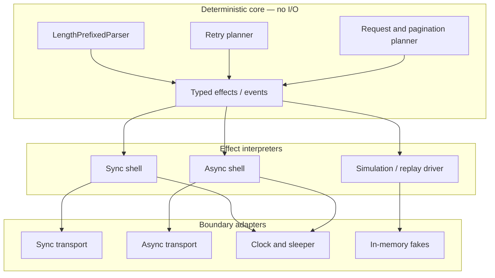

# 09 — Sans-I/O and Testable Library Design

> **Module:** Stage 1 — Programming & Computational Thinking  
> **Module 1.20:** Design Patterns and Library API Design  
> **Lesson:** 09 — Sans-I/O and Testable Library Design  
> **Runtime target:** Python 3.12+  
> **Core principle:** the core decides what should happen; a driver or shell performs it.

## 1. Objectives and prerequisites

By the end of this lesson, you should be able to:

- Define sans-I/O architecture and distinguish protocol/domain logic from I/O and runtime effects.
- Draw and enforce a functional-core / imperative-shell boundary.
- Build an incremental parser that accepts arbitrary byte chunks and emits typed events.
- Use protocols for clocks, sleepers, randomness, and transports without importing concrete I/O clients into the core.
- Model retries as data, interpret effects in a driver, and simulate ten minutes of outage time without waiting ten minutes.
- Reuse one deterministic core from synchronous and asynchronous shells without blocking an event loop.
- Test chunk boundaries, retry limits, resource ownership, shell contracts, and architecture imports.
- Explain trade-offs among two drivers, `anyio`, code generation such as `unasync`, and bridging approaches.

### Prerequisites

You should understand functions and classes, iterators/generators, `Protocol`, exceptions, context managers, dependency injection, pytest, and basic HTTP/retry concepts. The earlier lessons on adapters, Strategy, error hierarchies, and public APIs provide useful context.

### Roadmap alignment

The roadmap describes sans-I/O as separating a protocol engine that consumes bytes/events and emits bytes/events from the code that reads and writes those bytes. It specifically asks for a `fetchkit` core (retry policy, pagination planning, parsing, request building), sync and async shells, testing fakes, arbitrary-chunk parser tests, effect-driven retry simulation, and an architecture diagram. This lesson follows that sequence.

## 2. Sans-I/O mental model

**Sans-I/O** means a protocol or domain component does not perform input/output itself. It transforms supplied values and events into values, events, or explicit effect requests. It does not open sockets, call an HTTP client, read a file, consult wall-clock time, sleep, or depend on an async framework.

A sans-I/O core is not necessarily a collection of pure functions only. It may be a stateful protocol object whose state transitions are deterministic given the inputs it receives. The important constraint is that external effects are controlled by its caller.

### Three responsibilities

- **Core:** parsing, validation of protocol messages, request construction, pagination decisions, retry policy, and state transitions. It receives data and returns data or effects.
- **Shell/driver:** coordinates the core with the outside world; performs actual reads, writes, sleeps, clock reads, logging, and cancellation handling.
- **Adapters:** translate a concrete dependency into a small interface. Examples include an HTTPX transport adapter, a real clock, a deterministic fake transport, and an event-loop-specific sleep adapter.

```text
                 bytes / responses / explicit time
                              │
                              ▼
  ┌───────────────────────────────────────────────────────────┐
  │                    fetchkit core                          │
  │ parser · request builder · pagination · retry planner    │
  │ deterministic state transitions; returns events/effects  │
  └──────────────────────────────┬────────────────────────────┘
                                 │ SendRequest / Sleep / Done
                  ┌──────────────┴───────────────┐
                  ▼                              ▼
       ┌────────────────────┐         ┌────────────────────┐
       │ synchronous shell  │         │ asynchronous shell │
       │ blocking transport │         │ async transport    │
       └──────────┬─────────┘         └──────────┬─────────┘
                  │                              │
                  └──────────────┬───────────────┘
                                 ▼
                  adapters / sockets / clocks / OS
```

**Dependency rule:** imports point inward. The core may define a `Transport` protocol, but must not import a concrete HTTP client to use that protocol. The shells depend on the core interfaces; adapters implement those interfaces. Tests can replace adapters with in-memory fakes.

### Why this improves testing and reuse

A test of `parse_frame()` should not need a socket. A test of retry policy should not wait for a real timeout. A test of pagination should not call a remote server. Once decisions are deterministic, tests can explore boundary cases cheaply and repeatably. The same core can be driven by blocking code, `asyncio`, `anyio`, a replay tool, a simulator, or a test harness.

Sans-I/O does **not** mean “no side effects anywhere.” It means side effects are explicit and owned by the outer layers. A real shell still needs timeouts, cleanup, connection management, and careful error translation.

## 3. Beginner separation of logic and effects

### 3.1 Functional core, imperative shell

The functional-core / imperative-shell pattern is the simplest entry point. The core computes a decision; the shell acts on it.

```python
from dataclasses import dataclass

@dataclass(frozen=True)
class RetryDecision:
    retry: bool
    delay_seconds: float


def decide_retry(
    attempt: int,
    status_code: int,
    *,
    max_attempts: int = 4,
) -> RetryDecision:
    """Return a retry decision; do not sleep or send requests here."""
    if attempt < 1:
        raise ValueError("attempt must be >= 1")
    if max_attempts < 1:
        raise ValueError("max_attempts must be >= 1")

    retryable_statuses = {429, 502, 503, 504}
    should_retry = status_code in retryable_statuses and attempt < max_attempts
    delay = min(2 ** (attempt - 1), 30) if should_retry else 0.0
    return RetryDecision(should_retry, float(delay))
```

The function has no hidden dependence on the network or clock. Its inputs fully determine its output. The shell can interpret `RetryDecision` by sleeping and retrying, or a test can assert the decision directly.

### 3.2 Inject effects through small protocols

Use protocols to describe capabilities, not implementations. Keep the protocols small enough that test fakes are straightforward.

```python
from dataclasses import dataclass
from typing import Protocol, TypeVar

T = TypeVar("T")

class Clock(Protocol):
    def monotonic(self) -> float: ...

class Sleeper(Protocol):
    def sleep(self, seconds: float) -> None: ...

class RandomSource(Protocol):
    def random(self) -> float: ...

class Transport(Protocol):
    def get(self, url: str, *, timeout: float) -> "Response": ...

class AsyncTransport(Protocol):
    async def get(self, url: str, *, timeout: float) -> "Response": ...

@dataclass(frozen=True)
class Response:
    status_code: int
    body: bytes = b""
```

`Clock` should normally expose monotonic time for elapsed durations and deadlines; wall-clock time is for timestamps that must map to calendar time. A `Sleeper` is an effect boundary. `RandomSource` lets tests fix jitter. A transport protocol keeps HTTP implementation details out of the core. In a production package, put shared domain types in a low-level module to avoid circular imports.

That snippet is self-contained with its imports. Keep protocol definitions small; avoid unused imports in production code.

### 3.3 Core, shell, adapter: ownership rules

| Concern | Core | Shell | Adapter |
|---|---|---|---|
| Parse byte framing | Yes | Feeds chunks | No |
| Decide retry and delay | Yes | Interprets decision/effect | No |
| Read monotonic clock | No; accept a value/deadline | Yes | Real/fake clock implementation |
| Sleep | No | Yes | Real/fake sleeper implementation |
| Open/close network resources | No | Owns lifecycle | Wraps concrete client/socket |
| Build request URL/headers from domain inputs | Yes, when deterministic | Supplies runtime credentials/config | Converts to vendor request shape |
| Translate vendor response/error | No vendor types | Handles stable library errors | Yes, at boundary |

**Resource ownership:** the component that creates or explicitly receives ownership of a client/connection must document who closes it. Sans-I/O does not remove the need for `with`/`async with`, `close()`, cancellation-safe cleanup, or timeouts. It makes those responsibilities easier to isolate.

## 4. Intermediate implementation techniques

### 4.1 Incremental parser as a protocol object

A stream may split one frame across many reads or combine multiple frames in one read. Never assume one `recv()` corresponds to one message. This example uses a two-byte unsigned big-endian length prefix followed by that many payload bytes. It emits complete payloads only; the caller can parse each payload as JSON or another format.

```python
from dataclasses import dataclass, field

class ProtocolParseError(ValueError):
    """Input violates the length-prefixed framing protocol."""

@dataclass
class LengthPrefixedParser:
    max_frame_size: int = 65_535
    max_buffer_size: int = 65_537
    _buffer: bytearray = field(default_factory=bytearray, init=False, repr=False)

    def __post_init__(self) -> None:
        if isinstance(self.max_frame_size, bool) or not isinstance(self.max_frame_size, int) or not 0 <= self.max_frame_size <= 65_535:
            raise ValueError("max_frame_size must be an integer between 0 and 65535")
        if isinstance(self.max_buffer_size, bool) or not isinstance(self.max_buffer_size, int) or self.max_buffer_size < self.max_frame_size + 2:
            raise ValueError("max_buffer_size must fit the largest frame and its header")

    def receive_data(self, data: bytes) -> list[bytes]:
        """Feed any chunk; return zero or more complete payloads."""
        if not isinstance(data, bytes):
            raise TypeError("data must be bytes")
        frames: list[bytes] = []
        offset = 0
        while offset < len(data):
            room = self.max_buffer_size - len(self._buffer)
            if room <= 0:
                raise ProtocolParseError("parser buffer limit exceeded")
            take = min(room, len(data) - offset)
            self._buffer.extend(data[offset:offset + take])
            offset += take
            while len(self._buffer) >= 2:
                frame_size = int.from_bytes(self._buffer[:2], "big")
                if frame_size > self.max_frame_size:
                    self._buffer.clear()
                    raise ProtocolParseError(
                        f"frame size {frame_size} exceeds limit {self.max_frame_size}"
                    )
                frame_end = 2 + frame_size
                if len(self._buffer) < frame_end:
                    break
                frames.append(bytes(self._buffer[2:frame_end]))
                del self._buffer[:frame_end]
        return frames

    @property
    def buffered_bytes(self) -> int:
        return len(self._buffer)
```

The parser has no socket imports, no clock, and no file access. It stores partial bytes between calls. A zero-length frame is valid in this framing format; change that rule only if the protocol specification says otherwise. The size limit is a security boundary against oversized frames. The implementation caps its internal buffer and feeds large caller chunks in bounded slices. The caller already owns the incoming `bytes` object, so the parser cannot control memory allocated before `receive_data()` is called. On an oversized declared frame it clears the buffer and raises.

### 4.2 Generator protocol engines with `yield` and `send`

A generator can suspend the core while the shell performs an effect, then receive the result and continue the state machine. This is useful for small command/response workflows, but explicit effect dataclasses are often easier to inspect, type, serialize, and test.

```python
from collections.abc import Generator
from dataclasses import dataclass

@dataclass(frozen=True)
class GetRequest:
    url: str

@dataclass(frozen=True)
class GotResponse:
    status_code: int
    body: bytes


def one_request_flow(url: str) -> Generator[GetRequest, GotResponse, bytes]:
    response = yield GetRequest(url)
    if response.status_code != 200:
        raise RuntimeError(f"unexpected status: {response.status_code}")
    return response.body

flow = one_request_flow("https://example.invalid/data")
request = next(flow)  # driver sees GetRequest
try:
    flow.send(GotResponse(200, b"ok"))
except StopIteration as finished:
    assert finished.value == b"ok"
```

The generator is the protocol engine; it does not make the request itself. The driver interprets `GetRequest` and sends back a `GotResponse`. Note that a generator must be primed before `.send(non_none_value)`, and the sent value must match the state at the current yield. Real drivers should handle generator exceptions and resource cleanup deliberately.

### 4.3 Effects as data

An effect model makes decisions explicit. The core emits commands; a driver interprets those commands against real dependencies or simulated ones.

```python
from dataclasses import dataclass
from typing import TypeAlias

@dataclass(frozen=True)
class SendRequest:
    url: str
    timeout_seconds: float

@dataclass(frozen=True)
class Sleep:
    seconds: float

@dataclass(frozen=True)
class Log:
    level: str
    message: str

@dataclass(frozen=True)
class Done:
    result: object

Effect: TypeAlias = SendRequest | Sleep | Log | Done
```

Effects are not magically executed. A `Sleep(5)` value does not sleep until a driver interprets it. This enables tests to record effects, replay them, or advance a fake clock. Avoid using arbitrary callables as effects if you need deterministic inspection or serialization.

### 4.4 Deadlines, timeouts, and cancellation

- Pass an absolute **monotonic deadline** or remaining budget into the core; do not call `time.time()` from a retry planner.
- A shell computes remaining time immediately before I/O and caps each operation timeout to that budget.
- A timeout is not automatically retryable: the request may have reached the server, and retrying a non-idempotent operation can duplicate effects.
- Async shells must use `await asyncio.sleep(...)` or the chosen async runtime’s sleep; `time.sleep(...)` blocks the event loop.
- Cancellation is control flow, not a transient network error. Do not swallow `asyncio.CancelledError`; use `finally` or async context managers for cleanup and re-raise cancellation.
- The shell owns transport lifetime and cleanup; core logic should not close a caller-owned client.

### 4.5 Test strategy

1. Exhaustively unit-test deterministic core functions and parser states.
2. Use fake clock/sleeper/transport adapters for retry behavior.
3. Contract-test sync and async shells against the same expected outcomes.
4. Use a small number of local-server end-to-end tests to validate real adapter wiring.
5. Add mutation testing for core decisions where useful; a test suite that survives a mutation to retry bounds may be missing an important assertion.

## 5. Advanced effect interpretation and concurrency

### 5.1 A retry planner that returns effects

The planner below accepts an explicit current time and returns a sequence of effects. It never sleeps, reads a clock, or sends a request. For clarity, this planner models a fixed outage/retry schedule and caps attempts; a production policy should additionally account for idempotency, `Retry-After`, jitter, total deadline, and error classification.

```python
from dataclasses import dataclass
from typing import TypeAlias

@dataclass(frozen=True)
class SleepFor:
    seconds: float

@dataclass(frozen=True)
class AttemptRequest:
    attempt: int

@dataclass(frozen=True)
class Stop:
    reason: str

RetryEffect: TypeAlias = SleepFor | AttemptRequest | Stop


def plan_retry(attempt: int, *, now: float, deadline: float, max_attempts: int = 8) -> tuple[RetryEffect, ...]:
    import math

    if isinstance(attempt, bool) or not isinstance(attempt, int) or attempt < 1:
        raise ValueError("attempt must be an integer >= 1")
    if isinstance(max_attempts, bool) or not isinstance(max_attempts, int) or max_attempts < 1:
        raise ValueError("max_attempts must be an integer >= 1")
    if not math.isfinite(now) or not math.isfinite(deadline):
        raise ValueError("now and deadline must be finite numbers")
    if now >= deadline:
        return (Stop("deadline exceeded"),)
    if attempt >= max_attempts:
        return (Stop("attempt limit reached"),)
    delay = min(30.0, float(2 ** (attempt - 1)))
    if now + delay >= deadline:
        return (Stop("next retry would exceed deadline"),)
    return (SleepFor(delay), AttemptRequest(attempt + 1))
```

This tuple describes a plan; it does not mean the request is actually sent after the sleep. A real driver may interpret the effects one at a time and stop when a response succeeds. For a richer production engine, model each response as input to a state machine and emit one next effect at a time rather than precomputing an entire run.

### 5.2 Driver and simulated time

The following compact simulation demonstrates a ten-minute outage without a real wait. Each retry delay is added to a simulated monotonic clock. The test runs in milliseconds because it performs arithmetic, not sleeping.

```python
from dataclasses import dataclass

@dataclass
class FakeClock:
    now: float = 0.0

    def monotonic(self) -> float:
        return self.now

    def advance(self, seconds: float) -> None:
        if seconds < 0:
            raise ValueError("cannot move time backwards")
        self.now += seconds


def simulate_outage(duration_seconds: float = 600.0, *, step_seconds: float = 5.0) -> tuple[float, int]:
    if duration_seconds < 0 or step_seconds <= 0:
        raise ValueError("duration must be >= 0 and step must be > 0")
    clock = FakeClock()
    attempts = 0
    while clock.now < duration_seconds:
        attempts += 1
        clock.advance(min(step_seconds, duration_seconds - clock.now))
    return clock.now, attempts

assert simulate_outage() == (600.0, 120)
```

To make the interpreter boundary explicit, this small driver consumes attempt/sleep effects. It advances the fake clock instead of calling a real sleeper:

```python
from dataclasses import dataclass
from typing import TypeAlias

@dataclass(frozen=True)
class SimulatedAttempt:
    number: int

@dataclass(frozen=True)
class SimulatedSleep:
    seconds: float

SimulatedEffect: TypeAlias = SimulatedAttempt | SimulatedSleep


def interpret_simulated_effects(
    effects: tuple[SimulatedEffect, ...],
    *,
    clock: FakeClock,
    trace: list[str],
) -> None:
    for effect in effects:
        if isinstance(effect, SimulatedAttempt):
            trace.append(f"attempt:{effect.number}@{clock.monotonic():.1f}")
        elif isinstance(effect, SimulatedSleep):
            clock.advance(effect.seconds)
            trace.append(f"sleep:{effect.seconds:.1f}")


def simulate_outage_with_effects(
    duration_seconds: float = 600.0,
    *,
    step_seconds: float = 5.0,
) -> tuple[float, int, list[str]]:
    if duration_seconds < 0 or step_seconds <= 0:
        raise ValueError("duration must be >= 0 and step must be > 0")
    clock = FakeClock()
    trace: list[str] = []
    attempts = 0
    while clock.monotonic() < duration_seconds:
        attempts += 1
        wait = min(step_seconds, duration_seconds - clock.monotonic())
        interpret_simulated_effects(
            (SimulatedAttempt(attempts), SimulatedSleep(wait)),
            clock=clock,
            trace=trace,
        )
    return clock.monotonic(), attempts, trace

elapsed, attempts, trace = simulate_outage_with_effects()
assert (elapsed, attempts) == (600.0, 120)
assert trace[0] == "attempt:1@0.0"
assert trace[-1] == "sleep:5.0"
```

This is a simulation of elapsed time and repeated attempts, not a claim that the remote system becomes healthy at minute ten. Tests should model the recovery event explicitly. If testing backoff, assert the schedule and deadline separately from whether a simulated remote service succeeds.

### 5.3 Sharing a core across sync and async

There are several valid strategies; choose based on the size of the core and support burden.

| Approach | Advantages | Costs / risks | Good fit |
|---|---|---|---|
| One pure core, two small drivers | Clear semantics, no duplicate policy logic, explicit effects | Must maintain two interpreters and test parity | Stable protocol logic with sync and async users |
| `anyio` abstractions | Portable async primitives across supported backends | Async-first design; does not make blocking clients nonblocking | Async shell must support multiple async backends |
| `unasync` / generated variants | Can reduce duplicated syntax for similar sync/async modules | Generated code complicates debugging and review; semantics can diverge | Large, mechanically parallel APIs with strong generated-code checks |
| `asyncio.to_thread` bridge | Reuses blocking library without rewriting it | Thread-pool capacity, cancellation semantics, context propagation and shutdown need care | Temporary integration for blocking I/O |
| Separate sync/async implementations | Direct use of each runtime’s idioms | Policy drift and duplicated bug fixes | Fundamentally different execution or resource models |

Do not call a blocking transport from an async shell unless it is intentionally offloaded. `asyncio.to_thread()` can prevent blocking the event loop, but it is not a universal substitute for a native async transport: cancellation may not stop a running thread operation.

### 5.4 Streaming and backpressure

For a streaming parser, process chunks incrementally rather than collecting an unbounded response. Use bounded queues and propagate backpressure when consumers are slower than producers. Set limits for frame size, total buffered bytes, event count, and decompressed size where relevant. Decide whether a malformed frame terminates the stream or yields a recoverable protocol error. These are protocol and security contracts, not mere implementation details.

Sans-I/O applies beyond HTTP:

- **Parsers:** bytes in, typed records/errors out.
- **LLM streaming:** SSE or token chunks in, structured content/tool-call events out.
- **Retry planners:** attempt and response metadata in, delay/stop decisions out.
- **Agent tool loops:** model/tool results in, next tool request or final answer out; the shell performs the calls.
- **Data pipelines:** input metadata in, transformation/dispatch plan out; adapters execute storage and compute operations.

### 5.5 Import boundaries and architecture tests

The core should be importable without `httpx`, `requests`, `asyncio`, or any cloud SDK merely to parse a frame or compute a retry plan. `asyncio` belongs in the async shell; concrete network libraries belong in adapters. Standard-library imports are not automatically harmless, but a module can use a standard library dependency if it does not introduce an effect into the core.

Example package layout:

```text
fetchkit/
  __init__.py           # curated public exports; no network client construction
  core.py               # pure decisions and domain data
  framing.py            # incremental parser, no I/O
  effects.py            # effect dataclasses
  sync.py               # synchronous driver and shell
  async_client.py       # asynchronous driver and shell
  adapters/
    httpx_transport.py  # optional adapter; imports httpx here only
  testing.py            # fakes for consumers/tests
```

A simplified `import-linter` configuration can express forbidden dependencies. This example is a starting point, not proof that the installed CLI accepts it: validate syntax against the exact pinned version and run it in CI. In particular, ensure `source_modules` and `forbidden_modules` are valid for that version's contract schema.

```ini
[importlinter]
root_package = fetchkit

[importlinter:contract:core-is-independent]
name = Core does not depend on shells or adapters
type = forbidden
source_modules = fetchkit.core, fetchkit.framing, fetchkit.effects
forbidden_modules = fetchkit.sync, fetchkit.async_client, fetchkit.adapters
```

**Configuration note:** validate the contract against the exact `import-linter` version pinned by the project. A simpler CI alternative is an AST-based test that rejects imports of `socket`, `httpx`, `requests`, `asyncio`, and shell modules from designated core files. Do not claim architecture enforcement until that check runs in CI.

## 6. Architecture diagram and dependency rules



Rules to review in every pull request:

1. Core code accepts inputs explicitly and returns values/events/effects.
2. Core modules do not import concrete transports, file APIs, clock/sleep functions, or async runtime modules.
3. Drivers interpret effects and own external resources.
4. Adapters translate vendor types and exceptions at the boundary.
5. Sync and async shells share policy decisions rather than copying them.
6. Tests use deterministic fakes for timing and transport; only a few tests require a local server.
7. Streaming buffers and protocol frames have explicit limits.

## 7. `fetchkit` case study

The following implementation is self-contained and uses only Python 3.12 standard-library features. It contains the deterministic core, incremental parser, effect model, and fake-time simulation. Network adapters are intentionally represented by protocols rather than a mandatory third-party dependency.

### 7.1 Core and effects (`fetchkit_sansio.py`)

```python
from __future__ import annotations

from dataclasses import dataclass, field
from typing import Protocol, TypeAlias

@dataclass(frozen=True)
class Request:
    method: str
    url: str
    headers: tuple[tuple[str, str], ...] = ()

@dataclass(frozen=True)
class PagePlan:
    page: int
    next_page: int | None


def build_request(url: str, *, method: str = "GET") -> Request:
    if not url.startswith(("https://", "http://")):
        raise ValueError("url must use http or https")
    normalized_method = method.upper()
    if not normalized_method.isalpha():
        raise ValueError("method must contain alphabetic characters only")
    return Request(normalized_method, url)


def plan_next_page(page: int, *, has_more: bool, max_pages: int) -> PagePlan:
    if page < 1 or max_pages < 1:
        raise ValueError("page and max_pages must be >= 1")
    next_page = page + 1 if has_more and page < max_pages else None
    return PagePlan(page, next_page)

@dataclass(frozen=True)
class RetryDecision:
    retry: bool
    delay_seconds: float
    reason: str


def decide_retry(
    attempt: int,
    status_code: int,
    *,
    max_attempts: int = 4,
    retry_after: float | None = None,
) -> RetryDecision:
    if (isinstance(attempt, bool) or not isinstance(attempt, int) or attempt < 1
            or isinstance(max_attempts, bool) or not isinstance(max_attempts, int) or max_attempts < 1):
        raise ValueError("attempt and max_attempts must be integers >= 1")
    if retry_after is not None:
        import math
        if not math.isfinite(retry_after) or retry_after < 0:
            raise ValueError("retry_after must be a finite number >= 0")
    retryable = status_code in {429, 502, 503, 504}
    if not retryable:
        return RetryDecision(False, 0.0, "status is not retryable")
    if attempt >= max_attempts:
        return RetryDecision(False, 0.0, "attempt limit reached")
    delay = retry_after if retry_after is not None else min(2.0 ** (attempt - 1), 30.0)
    return RetryDecision(True, float(delay), "retryable status")

class ProtocolParseError(ValueError):
    """A malformed or oversized length-prefixed frame."""

class FetchFailed(RuntimeError):
    """The shell completed attempts without obtaining a successful response."""

@dataclass
class LengthPrefixedParser:
    max_frame_size: int = 65_535
    max_buffer_size: int = 1_048_576
    _buffer: bytearray = field(default_factory=bytearray, init=False, repr=False)

    def __post_init__(self) -> None:
        if isinstance(self.max_frame_size, bool) or not isinstance(self.max_frame_size, int) or not 0 <= self.max_frame_size <= 65_535:
            raise ValueError("max_frame_size must be an integer in [0, 65535]")
        if isinstance(self.max_buffer_size, bool) or not isinstance(self.max_buffer_size, int) or self.max_buffer_size < 2:
            raise ValueError("max_buffer_size must be an integer >= 2")
        if self.max_frame_size + 2 > self.max_buffer_size:
            raise ValueError("max_buffer_size must fit the largest allowed frame")

    def receive_data(self, data: bytes) -> list[bytes]:
        if not isinstance(data, bytes):
            raise TypeError("data must be bytes")
        # Process bounded slices so a single large caller chunk is not copied
        # into the internal buffer in one unbounded extend operation.
        frames: list[bytes] = []
        offset = 0
        while offset < len(data):
            room = self.max_buffer_size - len(self._buffer)
            if room <= 0:
                raise ProtocolParseError("parser buffer limit exceeded")
            take = min(room, len(data) - offset)
            self._buffer.extend(data[offset:offset + take])
            offset += take
            while len(self._buffer) >= 2:
                size = int.from_bytes(self._buffer[:2], "big")
                if size > self.max_frame_size:
                    self._buffer.clear()
                    raise ProtocolParseError(
                        f"frame size {size} exceeds configured maximum {self.max_frame_size}"
                    )
                if len(self._buffer) < 2 + size:
                    break
                frames.append(bytes(self._buffer[2:2 + size]))
                del self._buffer[:2 + size]
            # If the buffer contains only a partial header/payload, it is
            # smaller than max_buffer_size because max_frame_size is bounded.
        return frames

    @property
    def buffered_bytes(self) -> int:
        return len(self._buffer)

@dataclass(frozen=True)
class Sleep:
    seconds: float

@dataclass(frozen=True)
class SendRequest:
    request: Request
    timeout_seconds: float

@dataclass(frozen=True)
class Log:
    level: str
    message: str

@dataclass(frozen=True)
class Done:
    result: object

Effect: TypeAlias = Sleep | SendRequest | Log | Done

class Clock(Protocol):
    def monotonic(self) -> float: ...

class Sleeper(Protocol):
    def sleep(self, seconds: float) -> None: ...

class RandomSource(Protocol):
    def random(self) -> float: ...

class Transport(Protocol):
    def get(self, url: str, *, timeout: float) -> "Response": ...

@dataclass(frozen=True)
class Response:
    status_code: int
    body: bytes = b""

@dataclass
class FakeClock:
    now: float = 0.0

    def monotonic(self) -> float:
        return self.now

    def advance(self, seconds: float) -> None:
        if seconds < 0:
            raise ValueError("seconds must be >= 0")
        self.now += seconds


def simulate_outage(duration_seconds: float = 600.0, *, step_seconds: float = 5.0) -> tuple[float, int]:
    if duration_seconds < 0 or step_seconds <= 0:
        raise ValueError("duration must be >= 0 and step must be > 0")
    clock = FakeClock()
    attempts = 0
    while clock.monotonic() < duration_seconds:
        attempts += 1
        clock.advance(min(step_seconds, duration_seconds - clock.monotonic()))
    return clock.monotonic(), attempts
```

`RandomSource` is included as an injection seam for a production jitter strategy; this minimal deterministic retry function deliberately does not use randomness. The `Transport` protocol is defined here without importing a concrete networking library. In a larger package, put protocols in a `ports.py` module if that improves dependency direction.

### 7.2 Thin synchronous shell

```python
from typing import Protocol
from fetchkit_sansio import FetchFailed, Response, Transport, decide_retry

class SyncSleeper(Protocol):
    def sleep(self, seconds: float) -> None: ...

def fetch_sync(
    url: str,
    *,
    transport: Transport,
    sleeper: SyncSleeper,
    timeout: float = 5.0,
    max_attempts: int = 4,
) -> Response:
    """Execute core retry decisions through injected synchronous adapters.

    `timeout` is a per-operation timeout, not a total deadline. A production
    API should expose a monotonic total deadline separately when required.
    """
    import math
    if not math.isfinite(timeout) or timeout <= 0:
        raise ValueError("timeout must be a finite number > 0")
    if isinstance(max_attempts, bool) or not isinstance(max_attempts, int) or max_attempts < 1:
        raise ValueError("max_attempts must be an integer >= 1")
    for attempt in range(1, max_attempts + 1):
        response = transport.get(url, timeout=timeout)
        decision = decide_retry(attempt, response.status_code, max_attempts=max_attempts)
        if not decision.retry:
            if response.status_code >= 400:
                raise FetchFailed(f"fetch failed with status {response.status_code}")
            return response
        sleeper.sleep(decision.delay_seconds)
    raise AssertionError("loop is exhaustive")
```

This shell is intentionally small. These teaching shells intentionally demonstrate status-based retry policy only. They do not translate transport exceptions, enforce a total deadline, honor `Retry-After`, or prove request idempotency. Add those as explicit policy/adapter contracts before treating this as production-ready. Validate retry safety before retrying a request whose server-side outcome may be unknown. It should not log and re-raise at every layer.

### 7.3 Thin asynchronous shell

```python
from typing import Protocol
from fetchkit_sansio import FetchFailed, Response, decide_retry

class AsyncTransport(Protocol):
    async def get(self, url: str, *, timeout: float) -> Response: ...

class AsyncSleeper(Protocol):
    async def sleep(self, seconds: float) -> None: ...

async def fetch_async(
    url: str,
    *,
    transport: AsyncTransport,
    sleeper: AsyncSleeper,
    timeout: float = 5.0,
    max_attempts: int = 4,
) -> Response:
    import math
    if not math.isfinite(timeout) or timeout <= 0:
        raise ValueError("timeout must be a finite number > 0")
    if isinstance(max_attempts, bool) or not isinstance(max_attempts, int) or max_attempts < 1:
        raise ValueError("max_attempts must be an integer >= 1")
    for attempt in range(1, max_attempts + 1):
        response = await transport.get(url, timeout=timeout)
        decision = decide_retry(attempt, response.status_code, max_attempts=max_attempts)
        if not decision.retry:
            if response.status_code >= 400:
                raise FetchFailed(f"fetch failed with status {response.status_code}")
            return response
        await sleeper.sleep(decision.delay_seconds)
    raise AssertionError("loop is exhaustive")
```

For a runnable package, `FetchFailed` lives in the shared `fetchkit_sansio` module and is imported by both shells. Never use `time.sleep()` inside `fetch_async`. The example naturally propagates `asyncio.CancelledError` because it does not catch it. A production implementation must also clean up any resources it owns with `async with`/`finally`, and should document that cancellation may not stop a request already running in a worker thread.

### 7.4 Optional real transport adapters

These adapters are intentionally isolated in optional modules. Install `httpx` only when using these examples; parsing, planning, fake transports, and core tests do not require it. The client is borrowed rather than created by the adapter, so the caller retains ownership and must close it.

```python
# fetchkit/adapters/httpx_sync.py — optional dependency: httpx
import httpx
from fetchkit_sansio import Response

class HttpxSyncTransport:
    def __init__(self, client: httpx.Client) -> None:
        self._client = client  # borrowed; this adapter does not close it

    def get(self, url: str, *, timeout: float) -> Response:
        response = self._client.get(url, timeout=timeout)
        return Response(status_code=response.status_code, body=response.content)
```

```python
# fetchkit/adapters/httpx_async.py — optional dependency: httpx
import httpx
from fetchkit_sansio import Response

class HttpxAsyncTransport:
    def __init__(self, client: httpx.AsyncClient) -> None:
        self._client = client  # borrowed; this adapter does not close it

    async def get(self, url: str, *, timeout: float) -> Response:
        response = await self._client.get(url, timeout=timeout)
        return Response(status_code=response.status_code, body=response.content)
```

A caller can own client lifetime explicitly:

```python
import httpx

with httpx.Client() as client:
    transport = HttpxSyncTransport(client)
    # pass transport to fetch_sync(...)

# For async code, use `async with httpx.AsyncClient() as client:` and await fetch_async(...).
```

These are deliberately thin response adapters. A production adapter should translate `httpx` exceptions into stable `fetchkit` errors at the boundary and decide how to represent headers, redirects, streaming bodies, and status handling. Do not let vendor exception types escape accidentally. These examples are not required for core tests and should only be executed in an environment where `httpx` is installed.

### 7.5 Example fake adapters

```python
from collections import deque
from fetchkit_sansio import Response

class FakeTransport:
    def __init__(self, *responses: Response) -> None:
        self._responses = deque(responses)
        self.calls: list[tuple[str, float]] = []

    def get(self, url: str, *, timeout: float) -> Response:
        self.calls.append((url, timeout))
        if not self._responses:
            raise AssertionError("unexpected extra request")
        return self._responses.popleft()

class FakeSleeper:
    def __init__(self) -> None:
        self.delays: list[float] = []

    def sleep(self, seconds: float) -> None:
        self.delays.append(seconds)
```

For async contract tests, use an `async def get()` fake and an `async def sleep()` fake that records calls without waiting. Core tests do not need any external service.

## 8. Tests and hands-on exercises

### 8.1 Parser accepts arbitrary chunks

The frame format is `2-byte length + payload`. The helper below intentionally splits a wire stream at different boundaries, including inside the length prefix, inside the payload, and between adjacent frames.

```python
from fetchkit_sansio import LengthPrefixedParser


def frame(payload: bytes) -> bytes:
    if len(payload) > 65_535:
        raise ValueError("payload too large")
    return len(payload).to_bytes(2, "big") + payload


def test_parser_accepts_arbitrary_chunks() -> None:
    wire = frame(b"alpha") + frame(b"") + frame(b"omega")
    parser = LengthPrefixedParser()
    chunks = [wire[:1], wire[1:4], wire[4:9], wire[9:10], wire[10:]]
    output: list[bytes] = []
    for chunk in chunks:
        output.extend(parser.receive_data(chunk))
    assert output == [b"alpha", b"", b"omega"]
    assert parser.buffered_bytes == 0
```

A stronger property-based test can generate a sequence of payloads, concatenate the frames, split the wire stream at arbitrary positions, feed each chunk, and assert the emitted payloads equal the originals. Also test an incomplete header, incomplete payload, oversized frame, empty chunk, a single input chunk larger than `max_buffer_size`, and multiple frames in one chunk.

### 8.2 Retry policy and fake-time tests

```python
from fetchkit_sansio import decide_retry, simulate_outage


def test_retry_decision_is_deterministic() -> None:
    assert decide_retry(1, 503, max_attempts=4).retry is True
    assert decide_retry(1, 503, max_attempts=4).delay_seconds == 1.0
    assert decide_retry(4, 503, max_attempts=4).retry is False
    assert decide_retry(1, 400).retry is False


def test_ten_minute_outage_is_simulated_without_sleeping() -> None:
    elapsed, attempts = simulate_outage(600.0, step_seconds=5.0)
    assert elapsed == 600.0
    assert attempts == 120
```

These tests verify deterministic policy and simulation, not actual network recovery. Do not substitute a fake clock into code that still calls global `time.sleep()`; all time-related effects must cross the injected boundary.

### 8.3 Shell contract tests

Use the same cases for sync and async shells: a success on the first attempt, a retryable status followed by success, a permanent status with no sleep, and exhausted retries. For async tests, use `pytest.mark.asyncio` if `pytest-asyncio` is installed or `anyio`'s test support if the project already depends on it; do not add a runtime dependency just for the core tests.

Example synchronous test using the snippets above:

```python
from fetchkit_sansio import Response


def test_sync_shell_retries_then_succeeds() -> None:
    transport = FakeTransport(Response(503), Response(200, b"ok"))
    sleeper = FakeSleeper()
    result = fetch_sync(
        "https://example.invalid/data",
        transport=transport,
        sleeper=sleeper,
    )
    assert result == Response(200, b"ok")
    assert len(transport.calls) == 2
    assert sleeper.delays == [1.0]
```

### 8.4 Async cancellation contract

The shell must not translate cancellation into an ordinary retryable failure. This focused test proves that cancellation propagates and does not trigger a retry loop:

```python
import asyncio
import pytest

class CancelingTransport:
    async def get(self, url: str, *, timeout: float) -> Response:
        raise asyncio.CancelledError

class NoWaitAsyncSleeper:
    async def sleep(self, seconds: float) -> None:
        raise AssertionError("sleep must not run after cancellation")


def test_async_shell_propagates_cancellation() -> None:
    async def scenario() -> None:
        with pytest.raises(asyncio.CancelledError):
            await fetch_async(
                "https://example.invalid/data",
                transport=CancelingTransport(),
                sleeper=NoWaitAsyncSleeper(),
            )
    asyncio.run(scenario())
```

If a shell owns resources, add a companion test asserting that its `finally`/`async with` cleanup executes on cancellation. This example passes a borrowed transport and therefore does not close it.

### 8.5 Retry planner boundary regression tests

```python
import pytest


def test_retry_planner_never_schedules_past_attempt_limit() -> None:
    assert plan_retry(3, now=0.0, deadline=100.0, max_attempts=3) == (
        Stop("attempt limit reached"),
    )


def test_retry_planner_stops_when_deadline_cannot_fit_delay() -> None:
    assert plan_retry(1, now=0.0, deadline=1.0, max_attempts=3) == (
        Stop("next retry would exceed deadline"),
    )


def test_retry_planner_rejects_non_finite_times() -> None:
    with pytest.raises(ValueError):
        plan_retry(1, now=float("nan"), deadline=10.0)


def test_parser_rejects_oversized_declared_frame_and_bounds_buffer() -> None:
    parser = LengthPrefixedParser(max_frame_size=8, max_buffer_size=10)
    with pytest.raises(ProtocolParseError):
        parser.receive_data((9).to_bytes(2, "big"))
    assert parser.buffered_bytes == 0
```

These tests cover the attempt-limit off-by-one, deadline boundary, invalid non-finite time, and malformed-frame cleanup. The parser constructor requires `max_buffer_size` to accommodate the largest configured frame plus its two-byte header.

### 8.6 Architecture and import tests

A lightweight AST test can scan `fetchkit/core.py`, `fetchkit/framing.py`, and `fetchkit/effects.py` and reject imports of concrete network clients or shell modules. Prefer `import-linter` when the project needs richer contracts. Test import-time behavior separately: importing `fetchkit.core` should not instantiate clients, open files, or import optional heavy adapters.

### 8.7 Exercises

1. Add a maximum aggregate-buffer limit to `LengthPrefixedParser`; test that malformed input cannot grow memory without bound.
2. Add `Retry-After` support and a total monotonic deadline. Ensure the next delay cannot exceed the remaining budget.
3. Add a pagination planner that stops on a repeated cursor to prevent infinite loops.
4. Write equivalent sync/async contract tests and prove both use the same `decide_retry()` function.
5. Use mutation testing to change `< max_attempts` to `<= max_attempts`; ensure a test fails.
6. Document which layer owns client creation and closure for both borrowed and internally-created transports.

## 9. Common mistakes

The roadmap explicitly calls out these mistakes; use them as review gates.

### Mistake 1: Core logic imports the HTTP client

**Why it fails:** it couples parsing and policy to a particular transport, makes core imports heavier, and forces unit tests to configure networking dependencies.

**Instead:** define a small protocol or pass data in and out. Put HTTPX/Requests imports in optional adapter modules. Test that core modules cannot import adapter modules.

### Mistake 2: Time and sleep calls inside decision logic

**Why it fails:** retry tests become slow and nondeterministic; policy is entangled with runtime scheduling.

**Instead:** pass `now`/deadline into decisions and return a delay/effect. Interpret that effect in a real or fake driver. A fake clock alone does not help if the code still calls global `time.sleep()`.

### Mistake 3: Duplicating logic across sync and async clients

**Why it fails:** fixes and policy changes drift, especially around retries, pagination, and protocol edge cases.

**Instead:** keep decisions in a shared deterministic core and write thin sync and async drivers. Where the execution models truly differ, keep separate shells but share core contract tests.

Other important failure modes:

- Treating each socket read as one complete frame; streams have arbitrary chunk boundaries.
- Letting parser buffers grow without a protocol limit.
- Calling blocking I/O or `time.sleep()` in async code.
- Hiding resource ownership or failing to clean up after cancellation/errors.
- Overengineering effects for a tiny pure function; use the lightest abstraction that makes effects explicit.
- Claiming a simulation proves network recovery; simulated time proves scheduling logic, not the behavior of a real service.

## 10. Self-check questions with model answers

### 1. Why does sans-I/O make a library easier to test and usable under both sync and async?

**Model answer:** The core consumes explicit values/events and returns deterministic outputs or effects. Tests can supply bytes and fake responses without sockets or sleeps. Sync and async shells interpret the same decisions using their respective I/O primitives, so protocol and retry policy are not duplicated. The shells still need separate lifecycle, timeout, cancellation, and resource-management tests.

### 2. Write a length-prefixed protocol parser as a sans-I/O class and test it with arbitrarily chunked input.

**Model answer:** `LengthPrefixedParser.receive_data(bytes)` appends each chunk to an internal buffer, waits until the full length header and payload exist, emits all complete payloads, and retains any incomplete tail. Test with splits inside the header and payload, multiple frames in one chunk, empty frames, and malformed/oversized frames. The parser must not read a socket or assume chunk boundaries match frame boundaries.

### 3. Implement an effect-returning retry planner and a driver that simulates time.

**Model answer:** A pure planner accepts attempt/status/deadline/current-time values and returns a typed `Sleep`, `SendRequest`, or `Done`/`Stop` effect. A driver interprets those effects. A fake clock advances its numeric time when it sees `Sleep`, so a simulated ten-minute outage takes milliseconds. The test must assert retry bounds and deadline behavior; it must not claim that a real service becomes healthy after the simulated interval.

## 11. Summary and completion checklist

Sans-I/O is an architectural boundary, not a framework. The core owns deterministic protocol/domain decisions; shells and adapters own effects. Generators and effect dataclasses can make interaction explicit, while fake clocks and transports make retry and streaming tests fast. A good design also makes resource ownership, cancellation, limits, and import boundaries visible.

- [ ] I can draw the core/shell/adapter boundary and explain dependency direction.
- [ ] Core functions do not read clocks, sleep, open files, or call concrete transports.
- [ ] I can parse frames split across arbitrary input chunks.
- [ ] Retry planning returns decisions/effects rather than performing waits.
- [ ] Sync and async shells share the same core policy.
- [ ] Async code does not block the event loop and propagates cancellation.
- [ ] Resource ownership and cleanup are documented.
- [ ] Frame and internal-buffer limits are enforced; the caller remains responsible for the memory cost of the input bytes object it already created.
- [ ] Core tests use deterministic fakes; shell contracts and end-to-end tests are separate.
- [ ] Architecture boundaries are checked in CI or explicitly recorded as a remaining task.
- [ ] Retry limits, per-operation timeouts, total deadlines, idempotency, and transport-error translation have distinct documented contracts; this lesson's compact shells are teaching examples, not a complete production client.

## 12. Authoritative references

### Roadmap source

- `roadmap-Design-Patterns-and-Library-API-Design.md`, Module 1.20, Lesson 09 — *Sans-I/O and testable library design*. Its specified topics include functional core/imperative shell, protocol objects, arbitrary-chunk parsers, dependency injection, generator drivers, sync/async shells, effect interfaces, time simulation, streaming/backpressure, testing strategy, `import-linter`, and the `fetchkit` case study.
- `Roadmap_ptree.md`, Stage 1 — Programming & Computational Thinking, Module 1.20. Use the module tree to place this lesson alongside the preceding patterns, plugin, public API, compatibility, and exception-design lessons.

### Python documentation

- Python `typing.Protocol`: <https://docs.python.org/3/library/typing.html#typing.Protocol>
- Python generators and `send()`: <https://docs.python.org/3/reference/expressions.html#yield-expressions>
- Python `asyncio` tasks and cancellation: <https://docs.python.org/3/library/asyncio-task.html>
- Python context managers: <https://docs.python.org/3/library/contextlib.html>
- Python `time.monotonic()`: <https://docs.python.org/3/library/time.html#time.monotonic>

### Relevant projects and tools

- `h11` — sans-I/O HTTP/1.1 state machine: <https://github.com/python-hyper/h11>
- `h2` — HTTP/2 protocol implementation: <https://python-hyper.org/projects/h2/>
- `wsproto` — sans-I/O WebSocket implementation: <https://github.com/python-hyper/wsproto>
- `httpcore` — low-level HTTP networking used by HTTPX: <https://github.com/encode/httpcore>
- `anyio` — async compatibility layer: <https://anyio.readthedocs.io/>
- `unasync` — transform async source into sync variants: <https://github.com/python-trio/unasync>
- `import-linter` — enforce import architecture contracts: <https://import-linter.readthedocs.io/>
- `mutmut` — Python mutation testing: <https://mutmut.readthedocs.io/>

These references support the techniques discussed; library APIs and tool configuration are version-sensitive, so pin and verify tool versions in the project’s CI.
