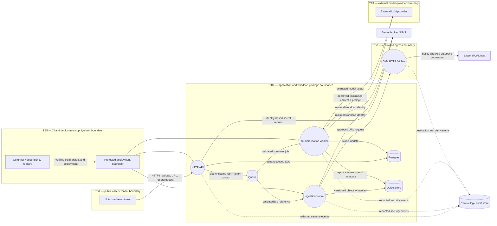

# 08 — Threat Modelling Small Python Services

> **Module:** Stage 1 — Programming & Computational Thinking / 22 — Secure Python Coding  
> **Audience:** Python application, data-platform, and AI engineers  
> **Scope:** Defensive design review and authorized, local validation only. This lesson uses an illustrative upload-and-summarise service; it does not assert that these components exist in any particular real system.

## 1. Learning outcomes, prerequisites, and vocabulary

By the end of this lesson, you should be able to:

- Explain why threat modelling complements secure coding, scanners, code review, and penetration testing.
- Draw a data-flow diagram (DFD) with processes, stores, external entities, data flows, and explicit trust boundaries.
- Inventory assets, actors, entry points, assumptions, and security objectives for a small Python service.
- Apply STRIDE to each relevant DFD element and include business-logic and LLM-specific abuse cases.
- Record a threat as a testable risk with impact, likelihood, mitigation, owner, status, verification, and residual risk.
- Prioritise mitigations proportionately, including controls that remove entire classes of bugs.
- Produce a concise, versioned `docs/threat-model.md`, risk register, security requirements, incident-response one-pager, and review triggers.
- Turn a `vulnpy` threat model into tests, CI checks, remediation work, and a revised model.

### Prerequisites

This lesson assumes basic Python, HTTP, databases, files and permissions, subprocesses, exceptions/logging, testing, dependency management, and familiarity with the previous Module 22 lessons on injection, unsafe deserialization, safe file handling, subprocesses, secrets/cryptography, SSRF, and static analysis. If those topics are new, threat modelling can still begin now, but implementation decisions should be verified against those lessons.

### Vocabulary

| Term | Meaning | Example |
|---|---|---|
| **Asset** | Something worth protecting | tenant report, API credential, compute budget, audit record |
| **Actor** | A person, service, or process that interacts with the system | anonymous visitor, tenant user, admin, worker, compromised dependency |
| **Entry point** | A way input or control enters the system | route, upload, queue message, CLI, webhook, configuration, dependency update |
| **Trust boundary** | A point where control, identity, privilege, or trust changes | public internet to API; worker to object store; CI to production |
| **Threat** | A plausible action or condition that could cause harm | one tenant reads another tenant's report |
| **Attack path** | A sequence of actions that can realise a threat | guess report ID → call download endpoint → missing ownership check |
| **Vulnerability** | A weakness that makes an attack path possible | endpoint checks authentication but not object ownership |
| **Impact** | Consequence if the threat succeeds | confidential data disclosure, outage, fraud, cost spike |
| **Mitigation/control** | A design or operational measure that reduces likelihood or impact | query by `(tenant_id, report_id)` and test cross-tenant denial |
| **Residual risk** | Risk remaining after controls | privileged operator can still access records under audited break-glass procedure |
| **Abuse case** | A legitimate feature used in a harmful way | repeatedly request expensive summaries to exhaust the LLM budget |
| **Security requirement** | A verifiable statement of required behavior | every report read must enforce tenant ownership at the data-access boundary |

A **threat is not the same as a vulnerability**. A threat describes what could go wrong; a vulnerability is a weakness; an attack path connects conditions and actions; impact describes the harm. A mitigation changes the path or consequence. Residual risk remains and must be understood rather than hidden.

## 2. Threat-modelling mindset and repeatable workflow

Threat modelling is a structured conversation about system design. It should begin before implementation, continue during implementation, and be revisited when the architecture, data, privileges, integrations, or threat landscape changes. It is not a one-time form completed for compliance.

### The four questions

Use Adam Shostack's practical framing:

1. **What are we working on?** Establish scope, architecture, assets, actors, flows, boundaries, and assumptions.
2. **What can go wrong?** Identify threats, abuse cases, attack paths, and failure modes.
3. **What are we going to do about it?** Eliminate, reduce, transfer, or explicitly accept risks; assign owners.
4. **Did we do a good job?** Verify mitigations, test assumptions, review residual risks, and update the model.

### A repeatable workflow

<pre>
Scope and assumptions
        |
        v
Assets + actors + entry points
        |
        v
DFD + trust boundaries
        |
        v
STRIDE per relevant element + abuse cases
        |
        v
Impact / likelihood / exposure / business context
        |
        v
Treatment + owner + status + verification
        |
        v
Tests, CI controls, operational detections, residual risks
        |
        v
Review on change, incidents, or new evidence
</pre>

Keep the first pass lightweight. A small service may need only a focused 30–60 minute session to expose major design problems, followed by tickets and tests. Do not confuse a long threat list with a good model: the useful output is a prioritised set of actionable decisions.

### What threat modelling does—and does not—replace

- **SAST/static analysis** finds known code patterns or suspicious constructs. It may flag unsafe deserialization, but it usually cannot decide whether tenant A is allowed to read report B.
- **SCA/dependency scanning** identifies known vulnerabilities or policy issues in dependencies. It does not prove safe use of the dependency.
- **Secret scanning** finds likely credentials in tracked content. It does not establish the full blast radius of a credential.
- **Code review and design review** evaluate correctness and architecture; threat modelling gives them a repeatable security lens.
- **Penetration testing/red teaming** probes an implementation or environment for exploitable paths. It is a point-in-time activity and may miss untested designs or future changes.
- **Threat modelling** reasons about assets, trust, misuse, attack paths, consequences, and controls before and during implementation. It complements—not replaces—testing, review, monitoring, and incident response.

A clean scanner report is not proof of security, and a threat model is not proof that every threat has been found.

## 3. Define the system: assets, actors, entry points, assumptions, and DFD

### Illustrative system and explicit assumptions

For practice, assume `vulnpy` is a deliberately vulnerable local learning service that accepts files and URLs, generates summaries/reports, and exposes report downloads. The example architecture below is illustrative; adapt it to observed code and documented deployment facts rather than treating assumptions as facts.

**Assumptions for the model:**

- An HTTPS API accepts uploads and requests to summarise a document or a URL.
- A relational database stores tenants, users, report metadata, job status, and audit events.
- An object store holds original uploads and generated reports.
- A queue dispatches jobs to workers.
- An ingestion worker parses files and may fetch approved URLs.
- A summarisation worker calls an external LLM provider.
- Secrets/configuration are supplied by a deployment secret mechanism; logs go to a central logging service.
- Users may belong to different tenants. Some users are untrusted; a worker or dependency may be compromised.
- Actual network controls, provider retention settings, authentication method, and IAM grants are **unknown until verified**.

### Assets and security objectives

Classify data before deciding controls. One useful scheme is `public`, `internal`, `confidential`, and `restricted`; the organisation should define the exact handling rules for each class.

| Asset | Security objective | Example failure |
|---|---|---|
| User-uploaded source files | Confidentiality, integrity, availability | cross-tenant disclosure or malicious parser input |
| Generated reports and prompts/responses | Confidentiality, integrity, correct tenant binding | report URL leaks data or prompt content is logged |
| Tenant/user identities and authorization data | Integrity, confidentiality | object-level authorization bypass |
| API, database, object-store, and LLM credentials | Confidentiality, limited authority, revocability | leaked key enables bulk access or spend |
| Database and object-store metadata | Integrity, availability, tenant separation | report points to another tenant's object |
| Queue messages and job state | Integrity, authenticity, bounded resource use | forged job, replay, queue flooding |
| Audit records | Integrity, availability, appropriate confidentiality | attacker erases evidence or logs expose PII |
| Compute, storage, and LLM budget | Availability and cost bounds | zip bomb or denial-of-wallet |
| Build pipeline and dependencies | Integrity, provenance | compromised dependency ships to production |
| Service reputation and legal obligations | Trust, privacy, accountability | incident, contractual breach, regulatory consequences |

### Actors and entry points

Actors to consider: anonymous internet user, authenticated tenant user, tenant administrator, platform operator, malicious insider, compromised account, compromised dependency, malicious uploaded file, malicious URL host, external LLM provider, cloud control plane, CI runner, and another tenant.

Entry points include HTTP routes, upload/download endpoints, URL ingestion, webhook handlers, queue messages, scheduled jobs, admin/metrics/health endpoints, CLI arguments, environment/configuration, object-store events, dependency and container-image updates, and the CI/CD pipeline. Internal components are not automatically trusted: a queue message or database row may have been influenced by an untrusted actor earlier in the flow.

### Data-flow diagram (DFD)

The diagram below is a starting hypothesis for the exercise. Nodes represent actors, processes, stores, or external services; labelled arrows represent data/control flows; subgraphs mark conceptual trust zones. Replace the diagram with the real architecture when working on a real service.



**Diagram notation and scope:** the subgraphs are conceptual trust zones; Mermaid subgraphs do not guarantee that every arrow physically crosses a drawn boundary in a particular renderer. Validate the actual network, IAM, tenancy, and deployment boundaries against infrastructure configuration. The external URL host is untrusted, and the LLM response is untrusted data. The secret broker, log store, database, queue, and object store each need their own access/retention policies even when drawn in the same application zone. The deployment boundary represents an artifact trust path, not a claim that artifact signatures or provenance are already enforced.

**How to read it:**

- An arrow means a data or control flow, not necessarily a network protocol. Label important flows with data class, identity, authentication, and expected limits.
- `[(Postgres)]`, `[(Queue)]`, and `[(Object store)]` are data stores with distinct access policies and retention requirements.
- TB1 separates the public/tenant caller from the API. TB2 separates components with different permissions. TB3 marks the outbound-network boundary; an HTTP fetcher must not inherit arbitrary internal reachability. TB4 marks disclosure to an external model provider.
- CI and the dependency registry form a separate supply-chain boundary: code and configuration can affect production even when runtime endpoints are protected.
- The log/audit store and secret broker are shown separately because their access and integrity requirements differ from ordinary application data.

For a useful DFD, annotate at least: authentication identity, tenant context, data classification, encryption, maximum sizes/rates, trust boundary crossings, and who can write or read each store. If a queue message contains only an object key, model how the worker proves that key belongs to the intended tenant.

### Assumptions and unknowns log

Record each assumption with a validation owner and due date. Example: “Assumption: LLM provider retention is disabled for this workload. Validation: obtain current contract/settings evidence; owner: AI platform lead; status: unverified.” Do not convert “we think it is configured” into a control claim.

## 4. Apply STRIDE step by step

STRIDE is a prompt for systematic reasoning, not a checklist that automatically produces a complete threat model. Apply the categories to relevant processes, flows, stores, and boundaries; include abuse of legitimate business logic. For each element and crossing, record which STRIDE categories were considered and why any category is not applicable. Do not force a threat into every category; document meaningful exclusions and separately examine tenant/role abuse, quota abuse, workflow bypass, replay, and other business-logic paths.

| STRIDE category | Core question | `vulnpy` example | Possible control and verification |
|---|---|---|---|
| **S — Spoofing** | Can an actor impersonate another identity or component? | forged queue message or stolen bearer token creates a job as another tenant | authenticate requests and job producers; bind tenant identity server-side; test invalid/replayed credentials |
| **T — Tampering** | Can data or control be modified without authorization? | upload content or object metadata changed after approval | integrity checks, immutable/versioned object policy, signed artifacts where relevant; test tampered metadata/content |
| **R — Repudiation** | Can an action be denied because evidence is missing or mutable? | user denies exporting a sensitive report | append-only/audited events with actor, object, decision, timestamp, request ID; test audit event emission and access controls |
| **I — Information disclosure** | Can data be seen by an unauthorized actor? | BOLA, PII in logs, prompts sent to an unapproved provider | object-level authorization, minimisation, redaction, approved data-processing path; cross-tenant and log-redaction tests |
| **D — Denial of service** | Can an actor exhaust availability or cost? | zip bomb, huge upload, unbounded queue, repeated expensive LLM jobs | size/time/CPU limits, queue quotas, per-tenant budgets, backpressure; test limit enforcement and alerting |
| **E — Elevation of privilege** | Can an actor gain authority beyond intended rights? | SSRF reaches metadata endpoint, worker uses overbroad IAM role, unsafe pickle executes in worker | egress deny-by-default, least privilege, safe formats, isolated worker; verify denied network paths and IAM policy |

### Walk the diagram, not just the code

For every relevant DFD element, ask the six STRIDE questions, then write the plausible attack path and consequence. Avoid writing “SSRF” as the entire finding. A useful finding is more specific:

> An authenticated tenant can submit a URL that the ingestion worker fetches. If the worker has unrestricted egress and a cloud identity with broad permissions, an attacker may cause requests to internal services or a metadata endpoint. This could expose credentials or pivot into other resources. Enforce a policy-controlled fetcher and egress restrictions, remove unnecessary worker credentials, and verify with a local mock DNS/redirect test plus deployment-level egress tests.

Threats frequently span multiple STRIDE categories. A stolen API key may be spoofing; the resulting data access may be information disclosure; the resulting spend may be denial of service/cost abuse. Track one primary risk with linked consequences instead of duplicating it without explanation.

### Example threat families to consider

- **Authentication/authorization:** weak token validation, missing authentication, function-level authorization gaps, admin endpoint exposure, BOLA/IDOR, confused deputy behavior, stale membership, overbroad service identities.
- **Integrity:** path traversal during upload/download, file replacement after scanning, object-key substitution, mutable configuration, unverified artifacts, unsafe deserialization, SQL injection, template or command injection.
- **Repudiation/audit:** missing actor/object/action, mutable logs, forged log fields, clock skew, inadequate retention, operators able to alter evidence.
- **Disclosure/privacy:** verbose errors, PII or secrets in logs, prompts/responses retained without approval, object-store ACL mistakes, cross-tenant reads, URLs or tokens in telemetry.
- **Availability/cost:** oversized files, decompression bombs, parser CPU/memory exhaustion, catastrophic regex, unbounded queues/retries, high-cardinality requests, expensive LLM calls, retry storms, denial-of-wallet.
- **Privilege/escape:** SSRF, unsafe pickle/YAML, command injection, container running as root, writable code directories, mounted credentials, unrestricted egress, compromised package, tool-enabled LLM with excessive authority.
- **Business-logic abuse:** repeatedly regenerating reports, exporting data beyond a role's purpose, using shared links after revocation, bypassing approval through retries, abusing “free” quota or referral flows.

### BOLA/IDOR: three examples

1. **Read:** tenant A requests `/reports/123`, where report 123 belongs to tenant B. Prevent by resolving the report through the authenticated tenant (`WHERE tenant_id = ? AND report_id = ?`), not by checking only that the caller is logged in. Test that A receives a generic not-found/denied response and no report bytes.
2. **Update/delete:** tenant A sends a valid report ID to change or delete tenant B's report. Enforce object-level authorization for every mutation and use a tenant-scoped database operation/transaction. Test both update and delete paths.
3. **Bulk export/job status:** a user guesses another tenant's job ID or supplies a foreign object key in a queue/API request. Derive tenant context from trusted identity, validate job/object ownership at the service boundary, and avoid treating client-supplied storage keys as authority. Test cross-tenant status polling and export.

Authentication (authN) answers “who are you?”; authorization (authZ) answers “may this identity perform this action on this object in this context?” Both are required.

## 5. Turn threats into risk, treatment, owners, and testable requirements

### Risk register fields

For every actionable finding, record:

- **ID and threat statement:** actor + capability/weakness + target + consequence.
- **Affected asset and trust boundary.**
- **Attack path / preconditions:** required identity, network reachability, configuration, and attacker effort.
- **Impact:** confidentiality, integrity, availability, privacy, cost, legal, operational, and reputational consequences.
- **Likelihood:** qualitative reasoning based on exposure, prerequisites, exploitability, existing controls, and observed attempts.
- **Priority/rating:** chosen method and assumptions; not a claim of objective precision.
- **Treatment:** eliminate, reduce, transfer, or accept; describe the control and residual risk.
- **Owner, status, due date, ticket, and verification method.**
- **Evidence:** test, policy, configuration, review record, or detection exercise.

### Risk rating without false precision

A simple qualitative method is often sufficient:

- **Impact:** Low / Medium / High / Critical, based on data sensitivity, blast radius, service availability, cost, and obligations.
- **Likelihood:** Low / Medium / High, based on exposure, attacker prerequisites, exploitability, and existing controls.
- **Priority matrix (example policy; adapt and approve it):**

  | Impact \ Likelihood | Low | Medium | High |
  |---|---|---|---|
  | **Critical** | High | Critical | Critical |
  | **High** | Medium | High | Critical |
  | **Medium** | Low | Medium | High |
  | **Low** | Low | Low | Medium |

  Treat this as an initial estimate, not mathematical truth. Define “critical impact” using the service's own data, availability, tenant, and business consequences. An exposure or regulatory factor may justify a documented upward override; explain any downward override and compensating controls. Revisit the rating when assumptions change.

If using DREAD, score Damage, Reproducibility, Exploitability, Affected users, and Discoverability using a consistent rubric. DREAD scores can be subjective; use them to support discussion, not to imply precision. CVSS is a vulnerability-severity scoring system, not a complete business-risk model. EPSS estimates the probability of exploitation in the wild for known CVEs; it does not directly score a custom authorization flaw or your service's business impact. Combine relevant external scores with exposure, data sensitivity, compensating controls, and business context. Record the method and version/date used.

### Treatment choices

- **Eliminate:** remove a risky feature, unnecessary data collection, arbitrary URL fetch, or unsafe file format.
- **Reduce:** apply parameterised queries, tenant-scoped access, limits, sandboxing, least privilege, safe HTTP, secret redaction, egress policy, or stronger monitoring.
- **Transfer:** use a managed service or contractual/insurance arrangement where appropriate. Transfer does not eliminate responsibility for configuration, data-processing choices, or residual risk.
- **Accept:** a named accountable owner explicitly accepts a defined residual risk for a time-limited period, with rationale, compensating controls, expiry/review date, and exit criteria. “Won't fix” without ownership is not risk acceptance.

Prefer controls that eliminate whole bug classes. For example, parameterised SQL is stronger than attempting to filter dangerous SQL characters; server-generated object IDs plus tenant-scoped authorization are stronger than trying to guess whether a user-supplied path looks safe.

### Sample risk register (illustrative, not measured findings)

Ratings below are example starting judgments for the assumed architecture. Re-rate them using actual exposure, provider settings, data classes, and deployment controls. Owner roles are responsible roles, not named individuals. The table is a teaching register, not an assessed production register: before adopting a row, write its concrete attack path and likelihood rationale for the observed system, validate preconditions, assign a due date, and attach evidence. “Open” means no mitigation or verification is claimed to be complete.

| ID | Threat / impact | Initial priority (assumption) | Mitigation / treatment | Owner role | Status | Verification / residual risk |
|---|---|---|---|---|---|---|
| TM-01 | Missing object-level authorization lets tenant A read tenant B's report; confidentiality breach | Critical | Tenant-scoped queries and authorization on every read/export | API lead | Open | Cross-tenant tests for read, update, delete, and export; residual privileged operator access audited |
| TM-02 | Stolen or weakly validated token impersonates user/admin | High | vetted token library, issuer/audience/expiry/algorithm checks, key rotation | Identity lead | Open | Invalid issuer/audience/expired/wrong-algorithm tests; key-rotation drill |
| TM-03 | Upload path traversal overwrites or reads local files | High | ID-based names, containment, safe storage API, restrictive filesystem permissions | Storage lead | Open | traversal/symlink regression suite; filesystem isolation remains deployment-dependent |
| TM-04 | Malicious document exploits parser or unsafe deserializer | High | safe formats, patched parsers, isolated no-credential worker, CPU/memory/time limits | Ingestion lead | Open | malicious fixture corpus and worker resource-limit test; parser zero-days remain residual risk |
| TM-05 | URL ingestion performs SSRF to internal service/metadata | Critical | approved destination policy, connect-time enforcement or egress proxy, deny internal egress, no unnecessary identity | Platform lead | Open | local redirect/rebinding tests plus deployment egress tests; validator-only controls are insufficient alone |
| TM-06 | Uploaded file changed after scan but before processing | High | immutable/versioned object references, content hash binding, scan/process same version | Storage lead | Open | replace-after-scan test and version binding verification |
| TM-07 | SQL injection alters report query or data | High | parameterised SQL and constrained query construction | API lead | Open | payload regression tests; SAST helps but cannot prove all query paths safe |
| TM-08 | Template/HTML injection executes or discloses data in report | High | context-aware output encoding, safe template defaults, sanitised rendering | Report lead | Open | hostile markup fixtures in isolated renderer tests |
| TM-09 | Queue message spoofing/replay runs a job as another tenant | High | authenticated producer, signed/validated message context, tenant binding, idempotency key | Worker lead | Open | forged/replayed/cross-tenant message tests; broker configuration reviewed |
| TM-10 | Unbounded upload/zip bomb exhausts disk, memory, or CPU | High | compressed and expanded size, file count, time, CPU, and disk quotas | Ingestion lead | Open | bounded test fixtures and resource telemetry; OS/container quota required |
| TM-11 | Unbounded LLM requests create denial-of-wallet | High | per-tenant budgets, concurrency and token caps, rate limits, approval for expensive operations | AI platform lead | Open | quota and concurrency tests, budget alert simulation |
| TM-12 | PII or secrets leak through logs, errors, URLs, prompts | High | data minimisation, structured logging, redaction, generic client errors, approved provider path | Privacy/security lead | Open | canary-string tests in logs/errors; redaction cannot replace access controls |
| TM-13 | Worker identity has broad cloud permissions | Critical | workload identity and per-service least privilege; separate ingestion and summarisation roles | Cloud/platform lead | Open | IAM policy review and negative permission tests; cloud control-plane evidence needed |
| TM-14 | Artifact or model/config tampering changes worker behavior | High | provenance, signed artifacts, verified digests, protected release process | Build/release lead | Open | invalid signature/digest rejected; signing-key compromise remains residual risk |
| TM-15 | Mutable logs allow attacker to erase evidence | Medium/High | append-only or immutable destination, separate write/read roles, retention and alerting | SRE/security ops | Open | attempt alteration/deletion with app role; verify alert and retention |
| TM-16 | Prompt injection in uploaded text causes tool misuse or data disclosure | High | treat content as untrusted, separate instructions/data, narrow tools, no secrets in model context, human approval | AI security lead | Open | adversarial corpus and tool-authorization tests; model behavior remains probabilistic |
| TM-17 | LLM output rendered or executed unsafely | High | treat output as untrusted; encode for context; validate structured output; never execute generated code by default | AI application lead | Open | malicious-output fixtures and sink tests |
| TM-18 | External provider retains data beyond approved policy | High | data minimisation, approved contract/settings, retention controls, provider review, alternative local processing if required | Data protection owner | Open | configuration/contract evidence and periodic revalidation; provider assurances need governance |
| TM-19 | Secrets committed in repo or container image | High | secret broker, scanning hooks/CI, short-lived identity, revoke/rotate first on exposure | DevSecOps lead | Open | seeded dummy-secret scan test; repository history and image scan checks |
| TM-20 | Compromised dependency enters build/runtime | High | lock/pin review, vulnerability/provenance checks, minimal dependencies, controlled updates and rollback | Supply-chain owner | Open | CI gate and dependency update review; scanners cannot detect every compromise |
| TM-21 | Admin/metrics/debug endpoint exposed | High | network and auth controls, production debug disabled, minimal endpoint data | Service owner | Open | deployed-route inventory and unauthenticated access tests |
| TM-22 | Retry storm or unbounded queue causes cascading failure | High | bounded retries with jitter, dead-letter handling, backpressure, queue age/concurrency limits | Reliability lead | Open | fault-injection/tabletop; inspect queue and alert behavior |
| TM-23 | User guesses report IDs or abuses shared links after revocation | Medium/High | high-entropy IDs as defence-in-depth only; authorization on every access; revocable links and expiry | API lead | Open | enumeration and revoked-link tests; IDs are not authorization |
| TM-24 | CI pipeline or dependency update can deploy unreviewed code | High | protected branches, least-privilege CI identity, signed/provenanced artifacts, environment approvals | DevSecOps lead | Open | simulate untrusted PR and deploy denial; CI trust configuration reviewed |
| TM-25 | Audit events omit actor/decision or can be forged | Medium/High | schema-required fields, server timestamps, request/job correlation, restricted append-only writer | Security ops | Open | schema validation and missing-field test; clocks and ingestion pipeline remain dependencies |
| TM-26 | Backup/recovery is unavailable during destructive incident | High | isolated backups, restore tests, recovery objectives, access separation | SRE/platform lead | Open | restore drill with evidence; recovery time depends on capacity and scope |

The register is deliberately longer than the minimum capstone requirement. In a real model, remove inapplicable rows only with a reason, add system-specific threats, and update status based on evidence. “Open” is an example state, not a claim about an actual project.

### Convert findings into testable security requirements

Write requirements so a test or control review can decide pass/fail. Examples:

- `SEC-01`: Every report read, update, delete, and export verifies tenant ownership at the data-access boundary. Tests cover same-tenant success and cross-tenant denial.
- `SEC-02`: Uploads use server-generated storage identifiers; path components from users are never used as storage paths. Traversal and symlink tests are included.
- `SEC-03`: All outbound HTTP initiated by URL ingestion uses the approved fetch policy and an egress control that blocks prohibited destinations at connection time. Local unit tests and deployment-level negative tests are required.
- `SEC-04`: Upload and archive processing enforce compressed size, expanded size, entry count, CPU/time, and disk limits.
- `SEC-05`: Secrets, authorization headers, signed URLs, and sensitive prompts do not appear in application logs or client-facing errors. Tests inject canary values and inspect captured output.
- `SEC-06`: Every LLM tool invocation is authorized by application policy independently of model-generated text; high-impact actions require human approval.
- `SEC-07`: Per-tenant request, queue, and LLM budget limits are enforced and emit alerts when thresholds are crossed.
- `SEC-08`: Production workers use separate least-privilege identities; the ingestion worker has no unnecessary database administration or broad cloud permissions.
- `SEC-09`: Release artifacts are verified against an approved digest/signature before execution or deployment.
- `SEC-10`: Incident response has tested credential revocation/rotation, evidence preservation, notification, and recovery steps.

A requirement may need both automated tests and deployment evidence. A unit test cannot prove that a cloud firewall or IAM policy is deployed correctly.

## 6. Prioritisation, trade-offs, and residual risk

### Practical prioritisation

Start with risks that combine severe impact, credible exposure, and a short or likely attack path. Consider:

1. Can an anonymous or low-privilege actor reach it?
2. Is the target data restricted, multi-tenant, or tied to powerful credentials?
3. Can one action cross a trust boundary or create a large blast radius?
4. Does the control remove a whole class of failures?
5. Is there evidence that the mitigation works, and can it be bypassed by configuration or race conditions?
6. Can the service detect and recover from failure?

For this illustrative architecture, tenant isolation, SSRF/egress, unsafe document processing, broad workload identity, and secrets leakage are plausible early priorities. The final ordering depends on actual reachability, data classification, IAM, deployment, and existing controls.

### Example: choose between mitigations

**Threat:** user-submitted URLs are fetched by a worker.

- **Weak option:** reject a few known metadata IP strings. This is brittle across address encodings, DNS changes, redirects, proxies, and new internal ranges.
- **Better application control:** strict destination allow-list, HTTPS-only policy where required, no ambient credentials, redirect revalidation, response/time limits, and safe logging.
- **Stronger boundary control:** route fetching through an egress proxy/firewall that enforces destination policy at connection time; isolate the worker from internal networks and metadata endpoints.
- **Residual risk:** allowed domains may be compromised or serve hostile content; parser vulnerabilities and DNS/proxy misconfiguration remain possible. Restrict content types, sandbox parsing, monitor denied egress, and keep the service identity minimal.

**Threat:** malicious uploaded document.

- **Weak option:** file extension validation alone.
- **Better:** allow-listed formats, content sniffing, size limits, safe parsing libraries, malware scanning where appropriate, and safe storage.
- **Stronger architecture:** separate no-credential ingestion worker with restricted egress, read-only root filesystem, bounded CPU/memory/time, temporary storage quota, and no ability to reach production control-plane endpoints.
- **Residual risk:** a parser zero-day can still compromise the isolated worker. Minimise its data and authority, patch quickly, and monitor abnormal exits and resource use.

### Data classification, minimisation, and retention

- Collect only the data needed for the feature. If a prompt does not need an email address, do not send it to the LLM provider.
- Define whether each class may be stored, logged, exported, or sent to third parties.
- Encrypt in transit and at rest using managed, approved mechanisms; encryption does not fix missing authorization.
- Define retention and deletion behavior for source files, reports, prompts/responses, queue payloads, logs, backups, and provider-side data.
- Mask or pseudonymise where useful, while recognising that pseudonymised data may still be personal data.
- Include data-subject access/deletion obligations and data-processing agreements where applicable.

### Supporting frameworks and catalogues

Use these as lenses or checklists, not replacements for understanding the system:

- **PASTA:** a risk-centric, multi-stage threat-analysis approach that connects business objectives, technical scope, and attack analysis.
- **LINDDUN:** a privacy threat taxonomy, useful for linkability, identifiability, non-repudiation, detectability, disclosure, unawareness, and non-compliance questions.
- **Attack trees:** decompose an attacker goal into alternative or dependent steps; useful for showing prerequisites and defensive choke points.
- **Kill-chain thinking:** identify stages from reconnaissance through initial access, execution, persistence, and impact; adapt terminology to the context rather than assuming every attack follows one fixed chain.
- **OWASP Top 10 Web, API Security Top 10, and OWASP Top 10 for LLM Applications:** useful issue families for web/API/AI-specific review. Verify the edition in use; lists evolve.
- **MITRE ATT&CK:** enterprise adversary tactics and techniques; **MITRE ATLAS:** AI-system threat techniques. Map only when the mapping helps detection or response.
- **CWE Top 25:** common dangerous weakness classes, useful for code review and training.
- **DREAD, CVSS, EPSS:** supporting prioritisation inputs with different purposes and limitations, not interchangeable scores.

Compliance frameworks and laws—such as SOC 2, ISO 27001, GDPR/CCPA, HIPAA awareness, and applicable EU AI Act obligations—may shape evidence, privacy, risk ownership, and process. A mapping or certificate is not proof that a specific application is secure or compliant. Confirm applicability with qualified legal/compliance staff; do not infer legal obligations solely from this lesson.

## 7. Advanced process, tools, data/AI architecture, and operations

### Threat modelling as code and process

Possible tools include:

- **OWASP Threat Dragon:** collaborative threat-model diagrams and threat tracking.
- **`pytm`:** Python library for representing system elements and generating threat-model views/reports. Validate generated results; modelling syntax cannot infer every real trust relationship.
- **Microsoft Threat Modeling Tool (TMT):** diagram-based threat modelling in supported environments.
- **IriusRisk:** platform for structured threat models and security requirements.

Tool capabilities and licensing change; choose based on current support, team workflow, export/versioning, and review needs. Do not claim a tool was run merely because the model mentions it. This lesson does not report a completed Threat Dragon, `pytm`, Microsoft TMT, IriusRisk, tabletop, red-team, purple-team, or penetration-test exercise; those are proposed validation options, not completed activities.

Keep diagrams and risk registers in version control. In pull requests, require threat-model review when a change introduces a new data class, external integration, privilege, endpoint, queue, tool, trust boundary, tenant-visible operation, or material change to retention or deployment. A lightweight ten-minute review of an ADR can be enough for a small change; high-impact architecture deserves deeper analysis. Use a security champion or service owner to ensure findings have owners and due dates.

A useful PR checklist asks:

- Did the change introduce a new actor, entry point, asset, or trust boundary?
- Does it send data to a new service/provider or change data retention?
- Does it grant new permissions or add a secret?
- Are authorization, resource limits, egress, and error/logging behavior changed?
- Are the DFD, threat register, tests, and residual risks updated?

### Architecture controls for data and AI platforms

- **Isolated ingestion workers:** separate them from privileged application workers; no unnecessary credentials, minimal internal network access, restricted filesystem, bounded resources, and short-lived jobs.
- **Least-privilege workload identities:** separate API, ingestion, summarisation, and deployment roles. Grant access to only the required tenant-scoped objects and operations.
- **Tenant isolation:** enforce tenant context at every data-access boundary; consider separate prefixes, keys, schemas, databases, or row-level security based on risk and operational complexity. Storage layout alone is not authorization.
- **Artifact integrity:** pin and review dependencies; verify signed or digest-bound artifacts where appropriate; protect signing keys and release identities.
- **Immutable audit records:** separate application write permissions from retention/admin controls; monitor changes and preserve evidence.
- **Egress controls:** default-deny where practical, allow only required destinations, block metadata/internal ranges at the network boundary, and monitor denied requests.
- **Secret brokers/workload identity:** avoid baking secrets into images or source; use short-lived credentials, narrow scopes, rotation, and audit trails.
- **Human approval for risky agent actions:** model output is untrusted data. Independently authorize tool calls; require approval for destructive, externally visible, or high-cost actions.
- **Cost budgets:** per-tenant quotas, token/size caps, concurrency controls, retries with backoff, and alerts for denial-of-wallet patterns.

### LLM-specific trust zones and threats

Add the model provider, retrieval corpus, tool runtime, and human approver as separate trust zones where they have different control or data access. Do not treat model-generated text as trusted instructions.

- **Direct prompt injection:** a user asks the model to ignore policy or disclose data.
- **Indirect prompt injection:** retrieved documents, uploaded files, web pages, or tool output contain instructions designed to manipulate the model.
- **Tool abuse/excessive agency:** the model invokes a valid tool for an unauthorized object or performs too many actions.
- **Data exfiltration:** prompts or retrieved records are placed in model output, links, markdown images, tool arguments, or external requests.
- **Unsafe output handling:** generated text is rendered as HTML, used in SQL/shell, or treated as executable code.
- **Model/dependency/supply-chain risk:** a model artifact, plugin, package, prompt template, or tool server is compromised or unreviewed.
- **Sensitive-information disclosure:** system prompts, retrieved content, credentials, or another tenant's records enter the context window.

Controls include data minimisation, tenant-filtered retrieval, narrow tool schemas, server-side authorization on every tool call, allow-listed destinations, output encoding, approval gates, no secrets in model context unless specifically necessary and approved, and tests using adversarial but harmless fixtures. Prompt wording alone is not a security boundary. Residual model uncertainty must be reflected in the design.

### Detection, tabletop exercises, and incident response

Threat modelling should identify what defenders need to observe. Useful signals include authentication failures, authorization denials, privilege changes, unusual report exports, upload volume, queue age, worker crashes, denied egress, unexpected destinations, secret access, cost anomalies, and changes to security configuration. Log enough to investigate without logging raw secrets or unnecessary PII.

Validate the model with:

- **Tabletop exercise:** walk through a scenario (leaked key, cross-tenant disclosure, malicious file, SSRF attempt) and ask who decides, who contains, what evidence is preserved, and how recovery is verified.
- **Red/purple teaming:** safely exercise agreed attack paths and validate both prevention and detection.
- **Penetration tests:** scoped tests against an authorized staging or production environment with rules of engagement.
- **Control-failure simulation:** revoke a test key, expire a test certificate, block a required egress destination, or simulate an LLM provider outage; confirm safe failure and alerting.
- **Rotation drills:** rotate a test credential, revoke the old one, verify dependent workloads recover, and measure time to completion.
- **Backup/restore and ransomware resilience:** test restore from isolated backups and confirm credentials/access are separated.

#### Incident-response one-pager template

1. **Trigger and severity:** what evidence starts the incident and who declares severity?
2. **Roles:** incident commander, service owner, security lead, communications/legal/privacy contacts.
3. **Containment:** disable the affected feature/egress, revoke credentials, isolate a worker, block a release, or pause queue consumption as appropriate.
4. **Evidence:** preserve relevant logs, request/job IDs, artifact digests, timestamps, access events, and configuration snapshots with access controls and chain-of-custody as appropriate.
5. **Scope:** identify affected tenants, records, credentials, artifacts, deployments, and time window.
6. **Eradication/recovery:** patch or roll back, rotate secrets, rebuild from trusted artifacts, restore data, verify permissions and controls.
7. **Communications:** notify internal stakeholders and affected parties according to policy and applicable obligations; do not speculate before facts are known.
8. **Validation:** run regression/security tests, monitor for recurrence, verify alerts, and confirm old credentials are rejected.
9. **Lessons learned:** root cause and contributing factors, follow-up owners/dates, update threat model and playbooks.

For a leaked credential, **revoke/rotate first**; history cleanup does not make the credential safe. For suspected RCE, isolate the workload and preserve evidence before destructive cleanup where feasible; rebuild from trusted artifacts and rotate any secrets the process could access.

### Review triggers

Revisit the threat model after any of these changes: new endpoint or data type, new external provider, new outbound fetch behavior, new LLM tool, broader IAM scope, new queue or worker, tenant model change, retention change, new deployment boundary, dependency/model supply-chain change, security incident, penetration-test finding, or major regulatory/contractual change.

## 8. Capstone: threat-model and harden `vulnpy`

The roadmap describes `vulnpy` as a deliberately vulnerable, approximately 300-line upload-and-summarise/report service that you build or are given. Perform exploit demonstrations only against your own isolated local lab. Do not probe real systems or cloud metadata services. If a supplied implementation differs from the assumed diagram, update the model to match the code and observed configuration.

### Required deliverables

1. **DFD and inventory:** `docs/threat-model.md` with actors, assets, entry points, trust boundaries, data flows, assumptions, and unknowns.
2. **Threat register:** at least 20 STRIDE and LLM-specific threats, each with impact, likelihood rationale, priority, mitigation or accepted risk, owner, status, and verification method.
3. **Prioritisation:** identify top risks using a documented qualitative method; explain why the top five outrank other risks.
4. **Top five mitigations implemented:** choose from controls such as `safe_storage`, `safe_http`, parameterised queries, secret redaction, rate/size limits, safe deserialization, least privilege, and sandboxed processing. Match the chosen fixes to actual findings.
5. **Regression tests:** one test per discovered issue proving the exploit path fails after remediation; include fuzz/property tests for validators and path containment where appropriate.
6. **Automated security requirements:** convert at least five threat-model findings into tests or CI rules, with clear pass/fail behavior.
7. **CI security gate:** Ruff `S`, Bandit with SARIF where supported by the selected workflow, `pip-audit`, Gitleaks or `detect-secrets`, a Semgrep custom rule, and a dependency update bot with a documented release-age policy. Use a baseline only for existing legacy findings, not to hide newly introduced issues.
8. **Operations:** `SECURITY.md` with reporting guidance and response expectations, an incident-response one-pager covering leaked keys and suspected RCE, and a key-rotation procedure.
9. **Report:** `HARDENING_REPORT.md` with before/after findings, CWE IDs where applicable, controls and what they prevent, evidence/tests, residual risks, and out-of-scope items (for example, cloud IAM/network controls that belong to later platform modules).
10. **Peer review:** present the model to a peer or record a structured self-review, incorporate feedback, and revise the threat model. Do not claim peer review unless it occurred.

### Suggested lab workflow

1. Create a local branch and use disposable test data and dummy credentials only.
2. Map the actual routes, file operations, database queries, fetcher, deserializer/config loader, thumbnail subprocess, logging, and dependencies.
3. Create a baseline DFD and assumptions list before changing code.
4. For each issue, record the threat and expected safe behavior before implementing a fix.
5. Demonstrate the issue locally in a controlled test, then add a regression test that asserts the unsafe behavior is no longer possible. Avoid destructive payloads or real network targets.
6. Implement the safest class-level fix, not just an input blacklist. Examples: parameterized queries, server-generated storage IDs, safe formats, argv-only subprocesses, a policy-enforcing HTTP fetcher, Argon2id for password storage, secret retrieval/redaction, and explicit rate/size budgets.
7. Run tests and configured scanners; record the actual commands, versions, and results. Never invent scanner findings or claim a gate passed if it was not run.
8. Review the top risks with a peer or use a documented self-review checklist; revise assumptions, scores, owners, and residual risks.
9. Confirm all tests and CI controls block reintroduction; document what they do not prove.

### `docs/threat-model.md` starter outline

Use this as a template; fill it with observed facts and label assumptions explicitly.

```markdown
# Threat Model — vulnpy

## Status and review metadata
- Owner:
- Review date / version:
- Reviewers:
- Next review trigger/date:

## 1. Scope and purpose
- In scope:
- Out of scope:
- Security objectives:

## 2. Architecture and DFD
- Diagram path/version:
- Processes, stores, external entities, and flows:
- Trust boundaries and why they exist:

## 3. Assets and classification
| Asset | Classification | Owner | Retention | Required controls |
|---|---|---|---|---|

## 4. Actors and entry points
- Actors:
- HTTP/CLI/queue/file/config/dependency entry points:

## 5. Assumptions and unknowns
| Item | Type (fact/assumption/unknown) | Evidence | Validation owner | Due date |
|---|---|---|---|---|

## 6. Threat register
| ID | STRIDE / abuse case | Threat and attack path | Asset/boundary | Impact | Likelihood rationale | Priority | Mitigation/treatment | Owner | Status/due date | Verification/evidence | Residual risk |
|---|---|---|---|---|---|---|---|---|---|---|---|

## 7. Security requirements
| ID | Testable requirement | Automated test / policy | Owner | Evidence |
|---|---|---|---|---|

## 8. Top risks and decisions
- Top risks and reasons for priority:
- Accepted risks, accountable approver, expiry, compensating controls:
- Open tickets and due dates:

## 9. Detection and incident response
- Required signals and alerts:
- Runbook links:
- Recovery/rotation/restore evidence:

## 10. Review triggers and change history
- New data classes, integrations, privileges, trust boundaries, tools, incidents:
- Revision history:
```

### Sample threat entry

| Field | Example |
|---|---|
| ID | TM-SSRF-01 |
| Threat | A tenant supplies a URL that causes the ingestion worker to reach an internal service. |
| Attack path | URL submission → fetcher follows redirect or resolves an allowed name to a prohibited address → worker makes outbound request. |
| Impact | Internal data disclosure or pivot through workload identity; severity depends on reachable services and identity permissions. |
| Likelihood rationale | Higher if arbitrary URLs are accepted and egress is unrestricted; lower if a connection-enforcing proxy blocks internal destinations and only approved hosts are reachable. |
| Treatment | Reduce; route through policy-enforcing fetcher and deny-by-default egress; remove unnecessary credentials. |
| Owner/status | Platform lead / Open (illustrative). |
| Verification | Local redirect and DNS-rebinding tests plus deployment-level egress-denial test; review workload IAM. |
| Residual risk | Compromised allow-listed destination or proxy misconfiguration; monitor egress and re-review allow-list. |

### Five example security requirements and evidence

| Requirement | Automated evidence | Non-unit evidence that may still be required |
|---|---|---|
| Cross-tenant object access is denied | API tests across read/update/delete/export | review database policy and deployed identity model |
| File paths are never derived from user path strings | traversal/symlink tests and code review | filesystem permissions/container mount review |
| Fetcher cannot reach prohibited networks | local policy/redirect tests | egress firewall/proxy test in staging |
| Logs do not contain secrets/PII test markers | captured-log and exception-output tests | central logging access/retention review |
| New critical scanner findings block CI | seeded safe test fixture or controlled pipeline test | review branch protection and required-check settings |

### Capstone acceptance criteria

The capstone is complete only when:

- [ ] The DFD shows data flows and trust boundaries and matches the implementation/deployment facts available to you.
- [ ] At least 20 threats include STRIDE and LLM-specific cases, with risk rationale and prioritisation.
- [ ] Each high-priority threat has a concrete mitigation or time-bounded accepted risk, accountable owner, and verification method.
- [ ] The top five mitigations are implemented and tested.
- [ ] Every discovered issue has a regression test; validators/path checks have fuzz/property coverage where appropriate.
- [ ] At least five security requirements are automated as tests or CI rules.
- [ ] CI blocks reintroduction of the relevant issues and the configured security gate has been run with real results recorded.
- [ ] No real secrets remain in current files, history, images, or outputs; exposed secrets were revoked/rotated before history cleanup.
- [ ] `SECURITY.md`, incident-response one-pager, key-rotation procedure, and `HARDENING_REPORT.md` exist.
- [ ] Threat model is peer-reviewed or self-reviewed transparently, updated, and understandable to a non-expert manager.
- [ ] Residual risks and out-of-scope network/IAM controls are explicit.

## 9. Common mistakes, self-check answers, and completion checklist

### Common mistakes

- Treating the threat model as a one-time document. Revisit it when data, privilege, trust boundaries, dependencies, integrations, or deployment change.
- Listing only technical bugs and ignoring legitimate-feature abuse, tenant boundaries, denial-of-wallet, or business logic.
- Listing generic labels (“SSRF”, “auth issue”) without attack path, impact, preconditions, and affected asset.
- Drawing arrows without marking trust boundaries or explaining what data crosses them.
- Treating a DFD or framework checklist as proof that the model is complete.
- Scoring risks with arbitrary numbers and presenting them as objective truth.
- Writing mitigations without an owner, status, due date, verification method, or residual risk.
- Treating “authenticated” as equivalent to “authorized for this object.”
- Trusting internal queues, databases, model outputs, or retrieved documents simply because they are inside the system.
- Relying on prompt wording as the security boundary for LLM tools.
- Assuming scanners, compliance mappings, or penetration tests prove absence of risk.
- Accepting risk without a named approver, expiry/review date, compensating controls, and explicit rationale.

### Self-check questions with answers

**1. Identify the trust boundaries in a service that ingests user URLs, stores files, and calls an LLM provider.**

**Answer:** At minimum, public caller → API; API → database/queue; workload → object store; ingestion worker → outbound fetcher/external hosts; worker → cloud identity/secret broker; summarisation worker → LLM provider; workload → central logs; CI/dependency registry → release/deployment. Boundaries should reflect actual identity, privilege, network, and data-handling changes. A boundary is not just a network line: it can also be a privilege or ownership change.

**2. Give three BOLA/IDOR examples and how to prevent each.**

**Answer:** (a) Reading another tenant's report: tenant-scoped lookup and object-level authorization on every read. (b) Updating/deleting another tenant's report: authorize the mutation in the same transaction or tenant-scoped database operation. (c) Polling/exporting another tenant's job/object: bind job and object ownership to trusted identity; never treat a guessed ID or client-supplied storage key as permission. Add cross-tenant tests for each operation.

**3. Convert five findings into automated tests or CI rules.**

**Answer:** Examples include cross-tenant report access tests; traversal/symlink tests for storage; a local-only SSRF redirect policy test plus staging egress-denial check; canary-secret redaction test for logs and errors; and CI rules that fail on new high-severity SAST/dependency findings. The first four are application tests; the egress test also requires deployment-level verification. A scanner rule alone is not enough to prove runtime behavior.

**4. How does threat modelling differ from penetration testing?**

**Answer:** Threat modelling reasons about architecture, assets, trust, abuse, and controls before or during implementation; penetration testing attempts to exploit a scoped implementation/environment. They complement each other: model-derived attack paths inform test scope, while test results revise the model.

**5. Why is a high-entropy report ID not sufficient authorization?**

**Answer:** IDs can leak through logs, browser history, shared links, referrers, or another vulnerability. Every access still needs object-level authorization and appropriate expiry/revocation behavior.

**6. Why should an ingestion worker have no unnecessary credentials or internal network access?**

**Answer:** Untrusted files and URLs create a parser and SSRF attack surface. Isolation limits what a compromised worker can read, change, or reach. It reduces blast radius but does not eliminate parser vulnerabilities; keep resource limits, patching, monitoring, and recovery controls.

**7. When is a risk “accepted”?**

**Answer:** When a named accountable owner documents the rationale, scope, residual risk, compensating controls, expiry/review date, and exit criteria. An unresolved ticket without explicit ownership is not acceptance.

### Completion checklist

- [ ] I can answer the four threat-modelling questions and explain how modelling complements scanners and penetration tests.
- [ ] I can identify assets, actors, entry points, assumptions, and trust boundaries.
- [ ] I can draw and explain a DFD with labelled flows and stores.
- [ ] I can apply STRIDE and include business-logic, privacy, cost, and LLM-specific abuse cases.
- [ ] I distinguish threats, vulnerabilities, attack paths, impacts, mitigations, and residual risk.
- [ ] I can prioritise risks transparently and assign owners, due dates, and verification methods.
- [ ] I can write testable security requirements and map them to tests or deployment evidence.
- [ ] I can use frameworks/tools as supporting checklists without treating them as proof.
- [ ] I have a concise, versioned `docs/threat-model.md` and defined review triggers.
- [ ] I have completed the `vulnpy` capstone deliverables, regression tests, CI gate, `SECURITY.md`, incident-response one-pager, and `HARDENING_REPORT.md`.
- [ ] I have documented residual risks and revised the model after review.

---

**Key principle:** Threat modelling is successful when it changes design and operational decisions, assigns accountable work, and creates evidence that controls behave as intended—not when it merely produces a diagram.
