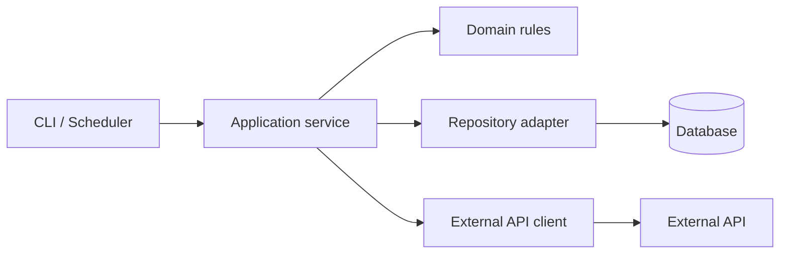
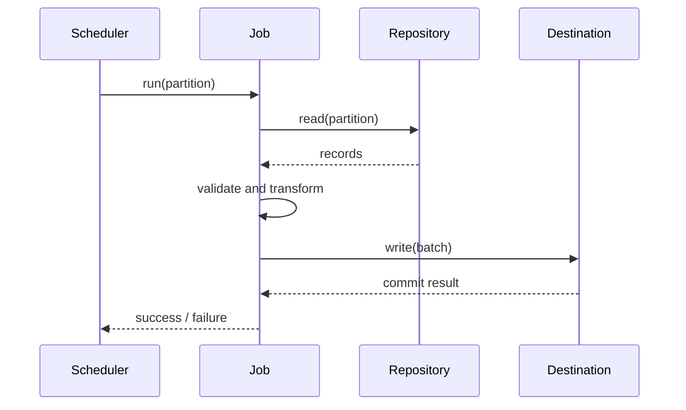
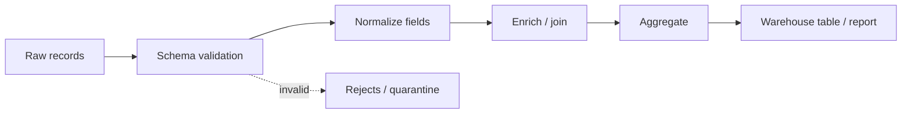

# Reading Unfamiliar Codebases

> **Stage 1 — Programming & Computational Thinking**  
> **Module 1.23 — Code Reading, Refactoring and Code Review**  
> **Lesson 01 of 08**  
> **Target path:** `Stage 1 — Programming & Computational Thinking/23-Code-Reading-Refactoring-and-Code-Review/01-reading-unfamiliar-codebases.md`  
> **Target environment:** Python 3.12+, Git 2.40+, `uv`, `pytest`; optional tools are identified where used.

## 1. Learning objectives and prerequisites

After completing this lesson, you should be able to:

- Orient yourself in an unfamiliar repository in a disciplined first 30 minutes.
- Establish a reproducible local environment, run tests and a representative workload, and record exact commands and failures.
- Locate executable entry points and trace one concrete input-to-output path.
- Build a layered mental model of architecture, data, control flow, cross-cutting concerns, and operations.
- Use tests, types, documentation, static searches, history, runtime inspection, and dependency tools as complementary evidence.
- Investigate large frameworks, asynchronous systems, data pipelines, and ML/AI repositories without reading every file.
- Form and test hypotheses, time-box exploration, escalate with a precise question, and document unresolved uncertainty.
- Produce a concise architecture note with a dependency diagram, main execution flows, extension points, and three unresolved questions.

### Prerequisites and connections

This lesson assumes basic Python syntax, functions, exceptions, modules, Git, and command-line navigation. Review these Stage 1 topics if needed:

| Prior topic | Why it matters here |
|---|---|
| Module 1.6 — Modules, packages, dependencies and code quality | Imports, `pyproject.toml`, package layout, linting, typing |
| Module 1.7 — Testing and systematic debugging | Pytest, tracebacks, breakpoints, fixtures, minimal reproductions |
| Module 1.8 — Object-oriented design, data modelling and functional style | Interfaces, domain models, side effects, dependency boundaries |
| Module 1.17 — Profiling, memory and runtime performance | Hot paths and evidence-based performance investigation |
| Module 1.18 — Packaging, distribution and publishing | Entry points, dependency versions and release metadata |
| Module 1.19 — CPython internals and runtime behaviour | Import timing, frames and advanced runtime questions |
| Module 1.20 — Design patterns and library API design | Extension points and architectural conventions |
| Module 1.22 — Secure Python coding | Trust boundaries, secrets, unsafe input and supply-chain risks |
| Stage 0 — Git and developer environment | Repository history, IDE navigation and reproducible workspaces |

You do **not** need to understand every tool in advance. Start with Git, Python, a shell, and the project's documented commands; add specialist tools only when they answer a specific question.

## 2. Why code-reading is a production skill

In production engineering, the task is rarely “write a new function in an empty file.” More often it is to determine why a scheduled job skipped a partition, why an API retries too aggressively, why a dependency upgrade changed behaviour, or where a model's serving features diverge from training features.

A repository is evidence about a system, but no single source is complete:

- **Documentation** describes intended use, often at a high level.
- **Source code** describes implemented behaviour, including accidental behaviour.
- **Tests** describe selected expectations and examples.
- **Configuration and deployment files** reveal how code is actually assembled and run.
- **Logs, metrics, traces and dashboards** reveal observed behaviour in a particular environment.
- **Git history and issues** explain context, previous decisions and known failures.

The professional method triangulates these sources. A README claim is a hypothesis until confirmed against implementation and tests. A test passing locally is useful evidence, not proof that production configuration, external services, concurrency, and data volumes are equivalent.

### The investigation loop

Use this loop repeatedly:

1. **Ask a concrete question.** Example: “How does a CSV row become a warehouse record?”
2. **Form a hypothesis.** Example: “The CLI parses the file, then a transform function normalizes fields.”
3. **Choose the cheapest discriminating evidence.** Search for the CLI, inspect tests, or run one sample.
4. **Observe and record.** Include file/line references, commands, output, and environment assumptions.
5. **Update the model.** Keep confirmed facts separate from assumptions.
6. **Stop or escalate.** Stop when the question is answered well enough for the task; escalate when the remaining uncertainty affects correctness, security, or production risk.

This is more efficient than reading the repository from the first file to the last.

## 3. Beginner: orient in the first 30 minutes

### 3.1 A practical 30-minute checklist

The times are a guide, not a deadline. For a complex or security-sensitive system, extend the investigation and explicitly record what remains unknown.

| Time | Action | Questions to answer | Evidence to record |
|---|---|---|---|
| 0–5 min | Establish repository state and read the README | What does it do? Who uses it? How is it run? | Branch, commit, working-tree status, purpose |
| 5–10 min | Inspect project metadata and contributor docs | Python version? Dependencies? Test/lint/type-check commands? | `pyproject.toml`, lockfile, `CONTRIBUTING`, build files |
| 10–15 min | Inspect the tree, tests, CI, licence and recent project history | Where is application code? What does CI actually run? Are there known deprecations or active defects? | Top-level directories, test layout, workflow names, licence file, changelog/release notes, a small sample of recent issues/PRs or commits |
| 15–20 min | Find entry points and important data models | What starts execution? What enters and leaves the system? | CLI, `__main__.py`, routes, DAGs, key schemas |
| 20–25 min | Create or verify the environment and run a small safe check | Can dependencies resolve? Can tests collect or run? | Exact commands, failures, runtime versions |
| 25–30 min | Trace one small path and create an investigation log | Which functions are called? Where are the boundaries? | Call chain, sample input/output, open questions |

**First five actions and why:**

1. Check `git status` and the current commit so you know whether local changes exist and which version you are inspecting.
2. Read the README to learn the stated purpose and the project's own run instructions.
3. Inspect `pyproject.toml` and lockfiles to identify Python constraints, dependencies, entry points and tools.
4. Inspect the directory tree, tests and CI configuration to find likely code paths and quality gates.
5. Run the smallest documented, non-destructive check and record its exact command and result.

Do not begin by changing code. First establish what version you have, what “normal” means, and whether the project can be exercised safely.

### 3.2 Read repository documentation strategically

Look for these files if present; not every project has all of them.

| File or location | What it tells you | Limitations |
|---|---|---|
| `README.md` | Purpose, installation, quick start, examples | May be outdated or omit operational details |
| `CONTRIBUTING.md` | Local setup, test conventions, PR expectations | May describe contributor workflow rather than runtime architecture |
| `docs/` | Concepts, architecture, configuration, API usage | Verify version and whether pages match the checked-out code |
| `pyproject.toml` | Build backend, Python requirement, dependencies, scripts, tool configuration | Some settings may live in other files |
| `uv.lock`, `poetry.lock`, other lockfile | Resolved dependency versions | Lockfile format and package manager vary |
| `Makefile`, `justfile`, `noxfile.py`, `tox.ini` | Standard developer tasks and environment matrix | Commands may invoke external services or mutate state |
| `.github/workflows/` or equivalent CI config | What CI installs, tests, checks and deploys | CI secrets and protected environments may not be available locally |
| `Dockerfile`, Compose or deployment manifests | Runtime image, service dependencies, environment variables | Do not launch services blindly; inspect ports, mounts and commands first |
| `LICENSE` or `LICENSE.txt` | Terms under which code is distributed | Presence alone does not prove every file or dependency has the same licence |
| `CHANGELOG.md`, release notes, tags | User-visible changes, migrations, deprecations | Entries may be incomplete |
| Issues, pull requests and discussions | Known bugs, design rationale, workarounds and maintainer expectations | Discussions can be stale or reflect rejected proposals |

Check `.gitignore`, `.dockerignore`, `CODEOWNERS`, security policy files, and release configuration when they are relevant to your task. Never paste secrets, customer data, or internal logs into public issues or external tools.

### 3.3 Inspect the tree before opening files

Start shallow, then deepen in the relevant subtree. A tree helps you form a map; it does not explain runtime flow by itself.

```bash
# From the repository root; requires the optional `tree` utility.
tree -L 2 -I '__pycache__|.venv|node_modules|.git'

# Portable fallback when `tree` is unavailable:
python -c "from pathlib import Path; root=Path('.'); [print(p.as_posix()) for p in sorted(root.iterdir())]"

# Show tracked files only; respects Git's index and does not include untracked files.
git ls-files | head -80
```

The `head` example is available in common Unix-like shells and Git Bash. In PowerShell, use `Select-Object -First 80` instead. The Python fallback lists only immediate children; it intentionally avoids an uncontrolled recursive dump.

Common patterns:

- `src/package_name/`: source-layout Python package.
- `tests/`: unit/integration tests and fixtures.
- `docs/`: user and developer documentation.
- `scripts/`: maintenance or operational utilities; inspect before running.
- `notebooks/`: exploratory analysis, experiments, or reports.
- `migrations/`: database schema evolution.
- `deploy/`, `helm/`, `infra/`, `Dockerfile`: deployment/runtime configuration.
- `.github/workflows/`: CI and release automation.

These are conventions, not guarantees. A legacy project may put all code in one directory or have several packages in a monorepo.

### 3.4 Understand project configuration and dependencies

In a Python project, `pyproject.toml` is a high-value orientation file. Search for:

- `[project]`: name, version, `requires-python`, runtime dependencies.
- `[project.optional-dependencies]`: extras such as `dev`, `test`, or `docs`.
- `[project.scripts]`: installed command-line entry points.
- `[build-system]`: build backend requirements.
- Tool sections such as `[tool.pytest.ini_options]`, `[tool.ruff]`, `[tool.mypy]` or `[tool.pyright]`.

Example:

```toml
[project]
name = "ledger-tools"
version = "0.1.0"
requires-python = ">=3.12"
dependencies = ["pydantic>=2"]

[project.scripts]
ledger-check = "ledger_tools.cli:main"
```

This means the installed `ledger-check` command calls `main` in `ledger_tools.cli`. It does **not** tell you every internal call that follows; inspect the function and trace its callers/callees. The exact dependency and build configuration of a real project may differ.

Dependency investigation should distinguish direct dependencies from transitive dependencies, runtime from development dependencies, and declared ranges from the exact versions selected by a lockfile. Check whether the repository uses `uv`, Poetry, Hatch, PDM, pip, Conda, or a custom build system before choosing commands.

### 3.5 Create a reproducible environment

Follow the project's documented workflow first. For a project using `uv` and a committed `uv.lock`, the usual starting point is:

```bash
uv --version
python --version
uv sync
uv run pytest -x -q
```

- `uv sync` resolves/installs the environment according to project metadata and lockfile. It can modify the local environment and lockfile depending on flags and state; inspect `git status` before and after.
- `uv run pytest -x -q` runs pytest in the project environment, stops at the first failure, and uses quiet output.
- If pytest is not a project dependency or tests require optional extras, consult the README/CI configuration and use the project's documented command rather than improvising.

For a pip-managed project without `uv`, follow its documented virtual-environment instructions, for example:

```bash
python -m venv .venv
# POSIX shell:
. .venv/bin/activate
python -m pip install -e ".[test]"
python -m pytest -q
```

Activation differs by shell: PowerShell uses `.venv\Scripts\Activate.ps1`; Command Prompt uses `.venv\Scripts\activate.bat`. The `".[test]"` extra only works if the project defines an extra named `test`. Do not install arbitrary dependencies globally.

**Safety before running:** inspect setup scripts, test fixtures, Docker mounts, environment files and test configuration. Tests can access the network, databases, cloud credentials, or local files. Prefer disposable databases, sample data and a least-privilege environment. Do not run an unfamiliar migration, deployment, destructive script, or integration test against production.

Record:

- OS and shell, Python version, package-manager version.
- Commit hash and branch.
- Environment setup command and whether the lockfile changed.
- Test command, exit code, failures, and known external prerequisites.
- Sample workload command and output location.

“Works on my machine” becomes reproducible evidence only when the setup and observed result are documented.

### 3.6 Find entry points

A repository may have multiple entry points. Identify each relevant execution mode:

- **CLI:** `[project.scripts]`, `argparse`, Click, Typer, console scripts.
- **Module execution:** `package/__main__.py` or `if __name__ == "__main__":`.
- **Web service:** application construction, route registration, ASGI/WSGI server command.
- **Data orchestration:** Airflow DAGs, task decorators, Prefect flows, Dagster assets, scheduled scripts.
- **Batch jobs:** cron configuration, workflow YAML, shell scripts, job manifests.
- **Notebooks:** notebooks that act as entry points for experiments or reports.
- **Tests and fixtures:** a test may be the safest way to exercise a narrow component without launching the entire system.

Search for likely markers:

```bash
rg -n '__main__|argparse|click|typer|FastAPI\(|@app\.|@task|DAG\(' src
rg -n 'def main|project\.scripts|console_scripts' pyproject.toml src
# Search common deployment/configuration locations when they exist.
for path in .github deploy docker-compose.yml; do
  [ -e "$path" ] || continue
  if rg -n 'schedule|cron|entrypoint|command:' "$path"; then
    :
  else
    status=$?
    [ "$status" -eq 1 ] || exit "$status"
  fi
done
```

These commands are starting points, not complete parsers. The loop skips absent paths, treats `rg` exit code 1 as “no matches”, and propagates other search errors. Adjust paths and patterns to the actual repository. In `rg`, use `-g` patterns to include/exclude files when the repository is large.

### 3.7 Navigate with search and IDE tools

```bash
rg -n 'def process_order' src tests
rg -n 'class .*Error' src
rg -n 'TODO|FIXME|HACK|deprecated' src
git grep -n 'process_order' -- '*.py'
git log --oneline -- src/package_name
```

- `rg` (ripgrep) searches working-tree files quickly and typically respects ignore files.
- `git grep` searches tracked files at the selected revision; it may not include untracked files.
- IDE **Go to Definition** finds a symbol's definition; **Find References** locates usages; **Call Hierarchy** approximates callers/callees.
- Search results are leads. Dynamic dispatch, plugin registries, decorators, reflection, string-based imports, generated code, and dependency injection can make static call graphs incomplete.

Useful search sequence: identify the public symbol → find definition → find callers → find tests → inspect configuration → search history if context remains unclear.

## 4. Worked example: trace a concrete flow end to end

Consider this miniature order-processing package. It is illustrative, not a claim about a particular repository.

```text
src/order_app/
    __init__.py
    cli.py
    service.py
    rules.py
tests/
    test_service.py
```

`cli.py`:

```python
import argparse
import json
from pathlib import Path

from order_app.service import process_order


def main() -> int:
    parser = argparse.ArgumentParser()
    parser.add_argument("input", type=Path)
    args = parser.parse_args()

    payload = json.loads(args.input.read_text(encoding="utf-8"))
    result = process_order(payload)
    print(json.dumps(result, sort_keys=True))
    return 0


if __name__ == "__main__":
    raise SystemExit(main())
```

`service.py`:

```python
from order_app.rules import calculate_total


def process_order(payload: dict[str, object]) -> dict[str, object]:
    order_id = str(payload["order_id"])
    items = payload["items"]

    if not isinstance(items, list):
        raise ValueError("'items' must be a list")

    total = calculate_total(items)
    return {"order_id": order_id, "total": total, "status": "accepted"}
```

`rules.py`:

```python
def calculate_total(items: list[object]) -> float:
    total = 0.0
    for item in items:
        if not isinstance(item, dict):
            raise ValueError("each item must be an object")
        price = float(item["price"])
        quantity = int(item["quantity"])
        if price < 0 or quantity < 0:
            raise ValueError("price and quantity must be non-negative")
        total += price * quantity
    return round(total, 2)
```

Sample `order.json`:

```json
{"order_id": "A-17", "items": [{"price": 12.5, "quantity": 2}, {"price": 3, "quantity": 1}]}
```

### Trace the flow

1. **Input boundary:** `cli.main()` parses a file path and reads UTF-8 JSON.
2. **Decode boundary:** `json.loads()` converts JSON text into Python values. Invalid JSON raises a decoding exception.
3. **Service boundary:** `process_order()` reads `order_id` and `items`, checks the outer collection type, and delegates calculation.
4. **Domain calculation:** `calculate_total()` validates each item and accumulates `price * quantity`.
5. **Output boundary:** `process_order()` builds a result dictionary; the CLI serializes it to JSON and writes it to stdout.

The expected output is:

```json
{"order_id": "A-17", "status": "accepted", "total": 28.0}
```

The `sort_keys=True` option sorts keys alphabetically, so the displayed key order is deterministic for this example. The code is intentionally small; production code would need stronger schema validation, currency/decimal handling, explicit error policy, and appropriate tests.

### Run and observe

If these files are placed in an installable project, use the documented entry point. For a quick local experiment with `src` layout, set the package path explicitly rather than assuming it is installed:

```bash
PYTHONPATH=src python -m order_app.cli order.json
```

On Windows PowerShell, use `$env:PYTHONPATH = "src"; python -m order_app.cli order.json`. The `python -m` form requires `order_app/cli.py` to be importable as a module; if `order_app/__main__.py` is absent, `python -m order_app` will not work.

For a debugger, place `breakpoint()` immediately before `process_order(payload)` or run:

```bash
python -m pdb -m order_app.cli order.json
```

The exact debugger invocation can vary by Python/tooling version; if the `pdb` module invocation is not supported by your environment, insert `breakpoint()` and run the CLI normally. Inspect `payload`, step into `process_order`, then step into `calculate_total`. Remove temporary breakpoints before committing.

A useful investigation note is a call chain plus boundaries:

```text
cli.main
  -> read file / decode JSON
  -> service.process_order
      -> rules.calculate_total
  -> JSON encode / stdout

Questions:
- What happens when price is missing or non-numeric?
- Is quantity zero valid?
- Are monetary values allowed to have more than two decimal places?
- Can callers bypass the CLI and call process_order directly?
- Is the input schema documented and tested?
```

This is the central technique: trace one real path deeply enough to understand data shape, decisions, side effects, errors, and output—not every line in the repository.

## 5. Intermediate: build a layered mental model

Create the model in layers, from external purpose to internal implementation and operations. Each layer answers a different question.

### Layer 1 — Purpose and users

**What:** the problem solved, users, business invariants, and success criteria.  
**Why:** names such as “ledger”, “feature”, or “sync” are domain-specific and can be misleading without context.  
**How:** read README/docs, CLI help, API schemas, issue reports, sample input/output, and operational runbooks.  
**Use when:** starting any investigation, especially a bug report framed in business language.  
**Limit:** docs may describe intended behaviour rather than actual behaviour. Verify important claims.

### Layer 2 — Architecture and dependencies

**What:** packages, layers, services, external systems, and allowed dependency directions.  
**Why:** helps locate responsibility and identify where an issue crosses boundaries.  
**How:** inspect imports, package metadata, composition roots, dependency injection, service clients, deployment manifests, and tests. Draw a module graph.  
**Use when:** tracing a feature across multiple modules or deciding where a fix belongs.  
**Limit:** import graphs do not capture every runtime relationship; callbacks, queues, reflection and configuration can create implicit edges.

### Layer 3 — Data model and contracts

**What:** important types, schemas, tables, payloads, validation rules, and producer/consumer expectations.  
**Why:** many production failures are contract mismatches rather than algorithmic errors.  
**How:** inspect dataclasses, Pydantic models, `TypedDict`, `Protocol`, SQL schemas, migrations, serializers, API schemas, fixtures and sample data.  
**Use when:** debugging ingestion, transformations, APIs, serialization or model features.  
**Limit:** annotations are not always runtime validation; a schema may be stale or only partially enforced.

### Layer 4 — Control flow and state

**What:** the main success path, error path, retry loops, branching, state transitions, asynchronous tasks, and concurrency.  
**Why:** a correct function in isolation can behave incorrectly when called in the wrong order or retried after partial completion.  
**How:** trace from an entry point; inspect callers/callees; use tests, logs, debugger breakpoints, and sequence diagrams. Identify state owners and cleanup/cancellation paths.  
**Use when:** explaining a request, job, event, or task from start to finish.  
**Limit:** a single trace covers one execution path; explore relevant edge cases and failure paths separately.

### Layer 5 — Cross-cutting concerns

Investigate each concern where it matters:

- **Configuration:** defaults, environment variables, precedence, validation, secret sources and per-environment overrides.
- **Logging and observability:** structured fields, correlation/request IDs, metrics, traces, alert conditions, redaction and log levels.
- **Authentication and authorization:** trust boundaries, identity propagation, permission checks and token lifecycle.
- **Retries and timeouts:** retryable exception classes/statuses, exponential backoff, jitter, maximum attempts, deadlines, and whether operations are safe to repeat.
- **Caching:** cache key, TTL/invalidation, consistency, memory bounds and whether cached data is tenant/user scoped.
- **Resource lifecycle:** database connections, file handles, locks, executors, sessions and shutdown hooks.
- **Security:** input validation, path and command construction, unsafe deserialization, secret exposure and dependency provenance.

**Why:** these concerns often explain bugs that are invisible when reading only business logic.  
**How:** search for configuration loaders, client constructors, decorators, middleware, context managers, exception handlers and test doubles.  
**Limit:** a keyword search can miss indirect behaviour; follow the actual call chain and check deployment configuration.

### Layer 6 — Operations and deployment

**What:** how the software is built, deployed, scheduled, monitored, recovered and rolled back.  
**Why:** code behaviour depends on runtime version, permissions, environment variables, service topology and deployment sequencing.  
**How:** inspect CI workflows, Dockerfiles, manifests, scheduler definitions, migrations, dashboards, runbooks, release notes and incident history.  
**Use when:** investigating “works locally, fails in production”, performance regressions, deployment failures or data freshness issues.  
**Limit:** local access may not include production dashboards or credentials; do not attempt to bypass access controls.

### Draw three complementary diagrams

#### Dependency diagram

Shows static or configured relationships between modules and systems.



Use it to answer “who depends on whom?” Annotate dependencies that are inferred rather than confirmed. Do not imply that the example graph describes a real repository.

#### Sequence diagram

Shows the order of calls and responses for one scenario.



Use it to reason about time, retries, partial failure, and ownership. Add alternative paths for timeout, cancellation, duplicate delivery, and rollback when those are material.

#### Data-flow diagram

Shows how values change from source to sink.



Use it to identify schema boundaries, lossy transformations, sensitive data, and where counts/checksums should be measured.

### Tests as documentation

Tests reveal examples of intended or historically preserved behaviour. Start with test names and fixtures before reading every implementation detail.

```bash
uv run pytest --collect-only -q
uv run pytest -q tests/test_service.py
rg -n 'fixture|pytest\.mark|parametrize|monkeypatch|tmp_path' tests
```

Inspect `conftest.py` to understand shared fixtures, fake services, database setup and test configuration. A fixture may hide important environment setup. Test names and assertions tell you what is checked, but not necessarily what is missing. A passing test suite can coexist with uncovered branches, weak assertions, stale snapshots or untested production integration.

When a test fails, distinguish:
- environment/setup failure,
- collection/import failure,
- assertion failure,
- nondeterminism/flakiness,
- external service failure,
- a pre-existing failure unrelated to your change.

Do not “fix” a failing test merely to get green; determine whether the failure exposes a real defect, changed expectation, or broken environment.

### Types, docstrings and public interfaces

Public function signatures, dataclasses, Pydantic models, enums and protocols often provide a compact map of expected inputs and outputs. Use IDE hover or inspect annotations, but treat annotations as design information rather than proof of runtime safety.

```python
from dataclasses import dataclass
from typing import Protocol


@dataclass(frozen=True)
class Event:
    event_id: str
    event_type: str
    payload: dict[str, object]


class EventSink(Protocol):
    def write(self, event: Event) -> None: ...


def publish(event: Event, sink: EventSink) -> None:
    """Send an event to a configured sink."""
    sink.write(event)
```

The `Protocol` describes the method expected of a sink without requiring a specific inheritance relationship. This reveals an extension boundary: multiple sink implementations may be substituted. The dataclass annotations do not validate values at runtime, and `publish()` does not validate the event; validate it at the appropriate boundary if the application requires that guarantee. The protocol also does not guarantee that implementations are reliable, thread-safe, or semantically equivalent.

Inspect docstrings for intended contract, exceptions, side effects, complexity, and examples. Compare them with tests and implementation if the behaviour matters.

### Dynamic exploration and runtime introspection

When static reading is ambiguous, use a controlled experiment.

```python
import inspect
import package_name

print(package_name.__file__)
print(dir(package_name))
print(inspect.signature(package_name.some_function))
print(inspect.getsource(package_name.some_function))
help(package_name.some_function)
```

This only works if the package is importable and source is available. `inspect.getsource()` can fail for built-ins, compiled extensions, generated objects, or objects whose source cannot be located. Importing a module executes its top-level code; inspect it first if import-time network access, file writes, credential reads or other side effects are plausible. Use a disposable environment.

Useful runtime tools:

- `pdb` / `breakpoint()`: step through a call, inspect locals and examine the call stack.
- `python -X importtime -c "import package_name"`: investigate import-time cost; output can be large and varies by Python version.
- `coverage run -m pytest` and `coverage report`: identify executed lines; `coverage html` produces a browsable report.
- `sys.settrace`: low-level tracing hook useful for specialised experiments, but it can slow execution substantially and may interact poorly with debuggers or tracing tools.
- IPython or a REPL: instantiate a component with a small, representative input and inspect outputs and exceptions.

Runtime exploration proves what happened in that experiment, under those conditions. It does not prove behaviour for all inputs, all environments or concurrent schedules.

### Prioritize files and questions

Read in this order unless the task suggests a better one:

1. Public interfaces and data structures.
2. Entry points and composition/configuration.
3. One main execution flow.
4. Tests and fixtures for that flow.
5. Error/retry paths and external boundaries.
6. Utilities called by the flow.
7. Broader architecture and history as needed.

Avoid reading generated files, vendored dependencies, build artifacts and large datasets unless your question is specifically about them. Skim large modules by class/function outline or IDE symbol tree before reading a specific function.

Identify likely **hot spots** using evidence, not line count alone:

```bash
# Largest Python source files by line count (Unix-like shell; adjust `src` if needed):
find src -type f -name '*.py' -exec wc -l {} + | sort -nr | head -20

# Most frequently named files in Git history (Unix-like shell):
git log --format= --name-only -- '*.py' |
  sort | uniq -c | sort -rn | head -20

# Complexity for a Python source tree; requires `radon` in the project environment:
uv run radon cc -s -a src

# One-off alternative with uv; does not add radon to project dependencies:
uvx --from radon radon cc -s -a src
```

The history command is a rough count of file mentions, not a precise count of meaningful edits or defects. It can include repeated merge history and paths that no longer exist. PowerShell pipelines need different sorting/counting syntax; use Git and Python for a portable custom report if needed. `radon` grades cyclomatic complexity; high complexity is a prompt to investigate, not proof that code is bad.

Also search for `TODO`, `FIXME`, `HACK`, deprecation warnings, broad exception handlers and code that changes often. A file with high complexity and high change frequency deserves attention before a large but stable generated file. Do not infer defect probability from a metric alone.

### Keep an investigation log

Create `investigation-log.md` outside production source changes if the repository's contribution policy does not specify another location.

```markdown
# Investigation log

## Question
How does the nightly ingestion job write one partition?

## Environment
- Commit: <hash>
- Python: <version>
- Setup command: `uv sync`
- Test command: `uv run pytest -q`

## Evidence
- Entry point: `src/app/jobs/nightly.py:...`
- Call chain: scheduler -> job -> reader -> transform -> writer
- Test: `tests/test_nightly.py::test_...`
- Experiment: <command and observed result>

## Confirmed facts
- ...

## Hypotheses / unknowns
- [ ] Does a retry repeat the destination write?
- [ ] Where is the checkpoint committed?

## Glossary
- partition: ...
- watermark: ...

## Next action
- ...
```

Use real file paths and line numbers in your actual log. Mark assumptions and confidence explicitly. This log becomes an onboarding note or pull request documentation once verified.

## 6. Advanced investigation strategies

### 6.1 Large frameworks: find the extension point first

For a large framework—Django, Airflow, scikit-learn, FastAPI, pandas or a similar project—do not attempt to understand the entire framework. Learn the conventions that govern the feature you are investigating:

- Where are settings loaded and validated?
- How are plugins, apps, providers, operators, middleware or estimators registered?
- Which abstract base class, protocol or public interface must an extension implement?
- Which lifecycle hooks are called, and in what order?
- Which official architecture documents, design documents, tests or PEPs explain the intended contract?
- Which smallest test exercises the feature?

Choose one vertical slice, such as “a FastAPI request reaches a dependency and returns a response” or “an Airflow task instance executes an operator.” Follow it from public entry point through registration, configuration, execution and error handling. Prefer stable public APIs over private internals unless the bug specifically requires internal investigation.

**Trade-off:** framework conventions narrow the search quickly, but relying on a familiar convention can cause you to miss project-specific overrides. Confirm the convention in the checked-out version.

### 6.2 Asynchronous and concurrent code

Concurrency bugs often depend on timing and ownership, not only on local function logic. Identify:

- Event loops, tasks, threads, executors, queues and worker pools.
- Which task/thread owns each mutable object and whether it is shared.
- Lock acquisition order, queue backpressure, timeout semantics and cancellation propagation.
- What happens when one task fails while sibling tasks are active.
- Whether cancellation runs cleanup (`finally`, context managers, `aclose`, shutdown hooks).
- Whether shutdown waits for workers, drains queues and closes clients.
- Whether retries can overlap with an earlier attempt.

Draw a task/thread timeline or sequence diagram. Inspect tests for cancellation, timeout, duplicate work, shutdown and race conditions. Use deterministic barriers/events in tests instead of relying on sleeps wherever possible. A single successful debug run cannot prove a race is absent; debuggers can also change timing.

### 6.3 Data pipelines

Trace a pipeline as **source → ingestion → validation → transformation → enrichment/join → sink**, then include orchestration, checkpointing, backfills and observability.

Ask:

- What is the source of truth and how is source data paginated or partitioned?
- What schema and semantic contract does each stage expect and emit?
- How are nulls, duplicates, late-arriving events, malformed rows and schema evolution handled?
- Is a job idempotent? If retried after a partial write, can it duplicate or corrupt output?
- When is a checkpoint/watermark committed relative to the destination write?
- How are backfills scoped, bounded, and prevented from overwriting newer data?
- Are transaction boundaries or atomic partition swaps used?
- Are row counts, rejected records, freshness, lag and reconciliation metrics emitted?
- Does configuration differ across local, staging and production environments?
- Can the pipeline run locally with a small, anonymized fixture?

**Idempotency** means repeating the same logical operation does not produce an unintended additional effect. It must be evaluated at the correct scope: per record, batch, partition, or whole job. “The function is deterministic” does not automatically make a database write idempotent.

**Checkpointing** records progress so a job can resume. If a checkpoint advances before output is durable, data can be lost; if output is committed before the checkpoint, a retry can replay data. The system needs a deliberate consistency strategy, such as transactions, idempotent upserts, deduplication keys or atomic commit protocols.

**Schema evolution** requires understanding both producer and consumer compatibility. A new nullable field may be backward-compatible for one consumer but break a strict positional CSV parser elsewhere. Search migrations, schema registries, contracts, fixtures and downstream queries—not just the transform function.

These risks are directly relevant to ETL, ELT, CDC, streaming and warehouse code. If a repository has no pipeline, do not force these concepts into an unrelated investigation.

### 6.4 ML and AI repositories

Trace the full lifecycle, not only the model class:

1. Data sources and dataset versioning.
2. Split strategy and leakage controls.
3. Preprocessing and feature generation.
4. Model definition and training loop.
5. Seeds, hyperparameters, configuration and environment.
6. Evaluation data, metrics, baselines and acceptance thresholds.
7. Artifact serialization and model registry.
8. Serving-time preprocessing, inference, post-processing and monitoring.
9. Retraining triggers, feedback loops and rollback strategy.

**Training/serving skew** occurs when features or transformations differ between training and production inference. Compare shared feature code, schema definitions, defaults, missing-value treatment, time windows, categorical encoders and versioning. Do not assume two functions with similar names behave identically.

**Data leakage** occurs when information unavailable at prediction time influences training or evaluation, such as future outcomes or target-derived fields. Inspect temporal splits, join keys, label construction and feature timestamps. High metrics alone do not establish validity.

**Reproducibility** depends on code, data snapshot, dependency versions, seeds, hardware/runtime behaviour, configuration and external services. A seed alone is not sufficient. Record model/data versions and the exact command used to reproduce an experiment. For LLM applications, also identify prompt/template versions, model identifiers, retrieval corpora, tool schemas, evaluation sets and nondeterministic external responses.

### 6.5 Hypothesis-driven exploration and time-boxing

A good hypothesis predicts where evidence should be found. Example:

> Hypothesis: API retries are implemented in the client wrapper rather than in each caller.

Test it with a small set of searches:

```bash
rg -n 'retry|backoff|Retry-After|max_attempts|retries' src tests
rg -n 'raise_for_status|HTTPStatus|status_code|timeout' src
```

Then inspect candidate implementations and tests. If the evidence contradicts the hypothesis, update it; do not keep searching only for confirming evidence.

A useful time-box:

- **0–30 minutes:** orientation and setup.
- **30–90 minutes:** trace one primary path and inspect its tests.
- **90–150 minutes:** investigate failure paths, boundaries, configuration and dependency behaviour.
- **150–210 minutes:** build diagrams, test important assumptions, and inspect history or operations evidence.
- **210–240 minutes:** write the architecture note and list unresolved questions.

Adjust to the task; the four-hour capstone later in this lesson uses the same principle. At each checkpoint ask: “What decision or next action will this evidence change?” If none, stop exploring that branch.

### 6.6 Escalate responsibly

Escalate after roughly 30–60 minutes of focused investigation when a consequential uncertainty remains, or sooner for security, data-loss, privacy or production-availability risks. Do not wait merely to satisfy a timer.

A high-quality escalation includes:

- The exact question and why it matters.
- Repository URL/path, commit and relevant file/line references.
- Expected versus observed behaviour.
- Commands/tests run and their results.
- Hypothesis and evidence that supports or contradicts it.
- What remains unknown and the smallest decision/help needed.

Example:

> “At commit `<hash>`, `writer.py` commits the partition before `checkpoint.py` advances the watermark. I reproduced a retry after a simulated checkpoint failure with the local fixture; the destination contains duplicate rows. Is the destination contract intended to be append-only, or should this path use an idempotent upsert keyed by event ID? I have not tested the production warehouse adapter.”

This is more useful than “the pipeline is confusing.” Never share credentials, personal data or sensitive production payloads in an escalation channel that is not approved for them.

### 6.7 Reverse-engineering when documentation is missing

When docs are absent or stale, triangulate:

1. Inspect package metadata, CLI help, environment variables and deployment manifests.
2. Read tests, fixtures and example configuration.
3. Search logs/traces/metrics and compare a known input with observed output.
4. Inspect database schemas, migrations and anonymized samples.
5. Use a debugger or narrowly scoped tracing to observe control flow.
6. Inspect dependency source or disassembly only if simpler evidence is insufficient.
7. Record what was observed, the exact conditions, and what remains inferred.

`strace` (Linux) can reveal system calls; `ltrace` is available on some Unix-like systems for library calls. Network captures require appropriate authorization and may expose secrets or personal data. Use a local test environment and synthetic payloads. Never intercept production traffic or bypass controls without explicit permission.

Python bytecode inspection with `dis` can help when source is unavailable or to answer a runtime-specific question, but bytecode is version-dependent and not a substitute for a source-level design explanation. Native extensions may require source, symbols or platform-specific debugging tools.

### 6.8 Investigate dependency source and version changes

When a stack trace enters a third-party library:

1. Record the installed version and import path.
2. Reproduce the issue with the smallest input.
3. Inspect the dependency's public API and tests.
4. If needed, inspect the installed source in the virtual environment.
5. Compare the affected version with a known-good or known-bad release.
6. Check changelog, release notes, issue/PR history and compatibility notes.
7. Prefer a supported upgrade, downgrade, configuration change or minimal upstream report over editing installed files.

```bash
uv run python -c "import package_name; print(package_name.__file__); print(getattr(package_name, '__version__', 'version not exposed'))"
uv tree
```

Replace `package_name` with the actual import name. `uv tree` is appropriate for a `uv` project and shows dependency relationships; other package managers have their own commands. `__version__` is optional and not universally available.

For release comparison, use the project's official source repository and tags/compare view where possible. A local `pip download` plus recursive directory diff can be useful, but wheel layouts and generated files may differ between releases; compare relevant source and tests rather than assuming every textual difference is meaningful. Do not edit `site-packages` as a permanent fix: it is not reproducible and will be overwritten by reinstalling the package.

### 6.9 Build reusable investigation tooling

Once you repeat a task, automate the boring part. Useful small tools include:

- A repository summary: Python files, approximate lines of code, test directories and entry points.
- A dependency graph report.
- A public API inventory.
- A coverage report by package.
- Saved `rg` queries and IDE bookmarks.
- A standard `ONBOARDING.md` or investigation-log template.

Automation should be read-only by default, explicit about exclusions, and safe on untrusted repositories. Do not import every discovered Python module merely to inventory it: imports can execute arbitrary top-level code. For static inventory, parse files with `ast` or inspect paths and text. A script that reports “no result” should distinguish “nothing found” from “scan failed.”

## 7. Command and tool reference

Install only what is needed, preferably in a project-specific tool environment. The commands below are investigative; review repository-specific scripts before running them.

| Tool | Example | Best use | Limitations / caution |
|---|---|---|---|
| `git status`, `git rev-parse HEAD` | `git status --short --branch` | Establish working state and commit | Does not explain runtime behaviour |
| `tree` | `tree -L 2 -I '.git\|.venv\|__pycache__'` | Fast directory overview | Optional utility; syntax varies by implementation |
| `rg` | `rg -n 'def process_order' src tests` | Search working-tree text | Not a complete semantic call graph |
| `git grep` | `git grep -n 'process_order' -- '*.py'` | Search tracked files | Untracked files are excluded |
| IDE / Pyright / Pylance | Go to definition, references, call hierarchy | Navigate symbols and types | Dynamic code can defeat static analysis |
| `pytest` | `uv run pytest --collect-only -q` | Discover tests and fixtures | Collection can import modules and execute import-time code |
| `coverage` | `uv run coverage run -m pytest` | Find executed lines | Coverage is not correctness or quality |
| `radon` | `uv run radon cc -s -a src` or `uvx --from radon radon cc -s -a src` | Estimate cyclomatic complexity | Install in the project environment for `uv run`; one-off `uvx` avoids adding a dependency. Metrics are signals, not verdicts |
| `pydeps` | `uv run pydeps package_name --max-bacon=2` or `uvx --from pydeps pydeps package_name --max-bacon=2` | Visualize imports | Requires `pydeps` in the project environment for `uv run`; the package must be importable and the graph may be incomplete |
| `pyreverse` | `uv run pyreverse -o png package_name` or `uvx --from pylint pyreverse -o png package_name` | Explore package/class relationships | Requires `pylint` in the project environment for `uv run`, an importable package/module, and Graphviz for rendering; output depends on tool version |
| `import-linter` | Project-configured `lint-imports` | Enforce import-layer contracts | Requires configuration and installed tool |
| `python -X importtime` | `python -X importtime -c "import package_name"` | Investigate import cost | Verbose; timing varies by environment |
| `inspect`, `help`, `dir` | See Section 5 | Runtime API exploration | Import can run side effects; source may be unavailable |
| `pdb` | Add `breakpoint()` and run a sample | Step through execution | Alters timing; remove temporary instrumentation |
| `git log` | `git log --oneline -- path/to/file.py` | History and change context | Commit messages can be incomplete |

### Shell and platform notes

- `rg`, `git`, `uv`, `pytest`, and Python work on common platforms when installed, but quoting and environment-variable syntax differ by shell.
- `tree -L` is common in Unix `tree`; Windows implementations may not support the same flags. Check `tree --help`.
- Examples using `sort | uniq -c | sort -rn | head` target Unix-like shells. PowerShell has different pipeline semantics.
- Use `git grep` when you want tracked source at the current checkout; use `rg` when you also need untracked local files.
- A search returning no matches is not necessarily an error in the code. Check command exit status and path spelling.
- Avoid broad `sudo`, global package installation, recursive deletion, production credentials, or destructive database commands as part of orientation.

## 8. Hands-on exercises

Use a practice repository you are authorized to inspect. The roadmap recommends a deliberately messy project of roughly 1,500 lines, such as an old ETL/report script collection or a small open-source project at an older commit. Keep an `investigation-log.md` throughout. Do not choose a repository whose license or access terms prohibit the intended use.

### Exercise 1 — First 30 minutes

**Task:** Set a 30-minute timer. Complete the orientation checklist without reading every source file.

**Deliverables:**
- Current branch and commit hash.
- Purpose and likely users.
- Python requirement and dependency manager.
- Test/lint/type-check commands from project metadata or CI.
- Top-level tree and likely entry point.
- One documented run command and its observed result.
- Three open questions.

**Expected outcome:** You can explain where the application begins, how to run at least one safe check, and what you do not yet know.

### Exercise 2 — Locate entry points

**Task:** Search for CLI declarations, `__main__`, `main`, web routes, task/DAG definitions and scheduled jobs.

**Deliverable:** A table of entry point, trigger, module/function, input, output/side effect, and evidence.

**Expected outcome:** You distinguish installed commands from internal functions and can explain how each execution mode starts.

### Exercise 3 — Trace one flow

**Task:** Choose one representative request, order, file, event or pipeline partition. Follow it from input to output, including at least one validation or error branch.

**Deliverable:** A call chain, one sample input/output (synthetic or anonymized), a sequence or data-flow diagram, and five evidence-backed statements.

**Expected outcome:** You can state where data changes shape, where I/O occurs, and which exception or failure path is possible.

### Exercise 4 — Tests as documentation

**Task:** Run test collection, read fixtures for the chosen flow, and execute the smallest relevant test.

**Deliverable:** Three behaviours the tests establish, two behaviours they do not establish, and any environment assumptions.

**Expected outcome:** You understand the difference between tested behaviour and untested assumptions.

### Exercise 5 — Investigate a pipeline or ML repository

Choose the applicable track.

**Data track:** trace source → transformation → sink. Identify schema contracts, retry behaviour, idempotency strategy, checkpoint location, backfill mechanism, and metrics. Mark any unanswered item as unknown rather than guessing.

**ML/AI track:** trace data → preprocessing → training/evaluation → artifact → serving. Identify data/model versions, split strategy, seed/configuration, evaluation set, serving preprocessing and likely skew/leakage risks.

**Deliverable:** A diagram plus a risk table with risk, evidence, impact, and next verification step.

**Expected outcome:** You can identify consequential gaps without claiming a risk exists when evidence is insufficient.

### Exercise 6 — Form a hypothesis and test it

**Task:** Write one hypothesis about where a behaviour lives. Run no more than three targeted searches, inspect candidate code/tests, then record whether the evidence supports or rejects it.

**Deliverable:** Hypothesis, search commands, observations, conclusion, and revised hypothesis if needed.

**Expected outcome:** Your search is question-driven rather than an unbounded keyword hunt.

### Exercise 7 — Dependency investigation

**Task:** Pick one stack trace or suspicious dependency call. Record installed version and import path, inspect the relevant implementation or test, and compare release notes if version behaviour is relevant.

**Deliverable:** Minimal reproduction or explanation, version evidence, and a recommended next action.

**Expected outcome:** You can distinguish an application bug from a dependency behaviour or compatibility issue, while acknowledging uncertainty.

## 9. Common mistakes and troubleshooting

### Mistake: reading files linearly

**Why it fails:** the repository may have thousands of files and many paths irrelevant to the current question.  
**Better approach:** start with interfaces, entry points, data structures, tests and one concrete flow. Expand only when evidence demands it.

### Mistake: refusing to run code

**Why it fails:** static reading cannot reveal every runtime configuration, import side effect, dynamic dispatch, or actual output.  
**Better approach:** run the smallest safe, documented workload in a disposable environment. If it cannot run, record the exact blocker and continue with tests, metadata and source evidence.

### Mistake: not writing down findings

**Why it fails:** the same searches are repeated, assumptions become “facts,” and future engineers cannot reproduce conclusions.  
**Better approach:** maintain an investigation log with commit, commands, observations, file/line references, glossary and open questions.

### Mistake: trusting the README or tests blindly

**Why it fails:** docs can be stale and tests only cover selected behaviour.  
**Better approach:** triangulate docs, implementation, tests, configuration, history and observed runtime behaviour.

### Mistake: assuming a search result proves the whole call graph

**Why it fails:** decorators, plugin registration, reflection, callbacks, dynamic imports and dependency injection can hide edges.  
**Better approach:** inspect the composition root and runtime path; label static diagrams as approximate.

### Mistake: treating complexity or churn as a defect

**Why it fails:** metrics are context-free and can flag generated, stable or performance-critical code.  
**Better approach:** combine complexity, change frequency, incident evidence, business impact and test quality. Inspect before proposing a change.

### Troubleshooting: environment setup fails

1. Confirm Python and package-manager versions.
2. Read `requires-python`, lockfile and contributor instructions.
3. Check whether optional extras or system libraries are required.
4. Verify network/index access and proxy settings without exposing credentials.
5. Re-run the documented command and capture the complete error.
6. Do not delete lockfiles or upgrade every dependency as the first response.

### Troubleshooting: tests fail before running

Check import paths, test extras, `conftest.py`, environment variables and test collection output. Import-time side effects can fail before a test body executes. Use the same command as CI where possible and compare Python/dependency versions.

### Troubleshooting: sample workload requires secrets or production services

Do not use production credentials simply to make a local command work. Look for fake clients, fixtures, sandbox endpoints, local containers or a documented dry-run mode. If none exists, record the missing prerequisite and ask the owner for an approved test path.

### Troubleshooting: no docs or useful tests exist

Treat that as an investigation constraint, not a reason to guess. Inspect package metadata, examples, schemas, history, release notes, logs and deployment configuration. Create a minimal experiment with synthetic data, then document observations and uncertainty.

## 10. Self-check questions and answer key

Try answering before opening the key.

### Questions

1. What are your first five actions in an unfamiliar repository, and why?
2. How would you trace one request or scheduled job from input to output?
3. Why should README claims be checked against source code, tests and runtime evidence?
4. What does `[project.scripts]` reveal? What does it not reveal?
5. Explain the difference between a dependency diagram, sequence diagram and data-flow diagram.
6. How can tests and fixtures function as documentation? What are their limits?
7. Why is `git grep` not equivalent to `rg`?
8. Name four questions to ask when investigating an asynchronous/concurrent component.
9. Name four production risks to examine in a data pipeline.
10. What is training/serving skew, and how would you investigate it?
11. What should an escalation message include?
12. What is the purpose of an investigation log?
13. Why is importing a module not always a harmless introspection technique?
14. How would you investigate a dependency regression between two releases?
15. What should you deliver after the four-hour capstone?

### Answer key

1. Check Git state/commit; read README; inspect project metadata and contributor instructions; inspect tree/tests/CI; run the smallest safe documented check. This establishes version, purpose, tooling, likely flow and baseline.
2. Start at the actual entry point; identify input parsing and validation; follow callers/callees through the main path; inspect tests and error paths; observe a representative run with logs/debugger; record outputs, side effects and open questions.
3. Documentation may be stale; implementation may contain accidental behaviour; tests cover only selected cases; runtime behaviour depends on configuration and environment. Triangulation reduces unsupported assumptions.
4. It maps an installed command to a Python callable. It does not show the callable's full internal call chain, data transformations, or external side effects.
5. Dependency graph: static/configured relationships. Sequence diagram: time-ordered interactions. Data-flow diagram: values and transformations from source to sink.
6. Test names, assertions and fixtures provide examples of expected behaviour and setup. Limits include missing coverage, weak assertions, stale snapshots, mocks that hide integration issues, and untested edge cases.
7. `git grep` searches tracked files at a Git revision; `rg` searches the working tree and typically includes untracked files unless ignored/excluded.
8. Identify event loop/tasks/threads/queues; state ownership; lock/timeout/cancellation behaviour; failure propagation; cleanup/shutdown; retry overlap and backpressure.
9. Schema/contract compatibility, idempotency and duplicate writes, checkpoint ordering, late/malformed data, backfills, transaction boundaries, environment-specific configuration and observability. Any four with evidence are acceptable.
10. It is a mismatch between training-time and serving-time feature logic or data semantics. Compare feature code, schemas, defaults, null handling, time windows, versions and tests on the same representative examples.
11. Exact question and impact; commit/path/line references; expected vs observed behaviour; commands and results; hypothesis/evidence; remaining uncertainty and the smallest help needed. Avoid sensitive data.
12. It preserves reproducible evidence, assumptions, decisions, glossary and unresolved questions, preventing repeated work and enabling onboarding.
13. Importing executes top-level module code, which can read secrets, write files, open connections or perform other side effects. Inspect first and use a disposable environment.
14. Record installed versions and import path; reproduce minimally; inspect implementation/tests and release notes; compare relevant tags/commits; test the candidate version in isolation; prefer a reproducible supported fix over editing `site-packages`.
15. A two-page architecture note with dependency diagram, main execution flows, extension points, and three unresolved questions, produced within four hours. It should cite repository paths/lines and separate facts from hypotheses.

## 11. Capstone — four-hour architecture investigation

### Objective

Choose an unfamiliar medium-sized open-source project and build a defensible architecture model within **four hours**. Suitable examples from the roadmap include `httpx`, `rich`, `typer`, the Python layer of `pydantic-core`, a subset of `dbt-core`, or an Airflow provider. Choose a project whose licence and setup permit your work. Avoid a project so large that the selected scope cannot be investigated in four hours.

### Rules

- Record the exact repository URL, commit/tag and date of investigation.
- Do not read the whole repository linearly.
- Use a documented environment and safe, representative tests or examples.
- Do not include secrets, personal data or proprietary material.
- Keep an evidence log. Label facts, hypotheses and unknowns separately.
- Do not claim a command or experiment succeeded unless you observed the result.

### Suggested schedule

| Time box | Work | Required evidence |
|---|---|---|
| 0:00–0:30 | Orientation, Git state, README, metadata, tree, CI | Setup notes and first questions |
| 0:30–1:15 | Entry points, public interfaces, data structures, tests | Entry-point table and test references |
| 1:15–2:15 | Trace one main flow end to end | Call chain and sequence/data-flow diagram |
| 2:15–3:00 | Dependencies, extension points, configuration and failure paths | Dependency graph and key boundaries |
| 3:00–3:30 | Run a focused test/example; inspect relevant history or dependency source | Commands, results and caveats |
| 3:30–4:00 | Write and audit the architecture note | Final two-page note and open questions |

If setup fails, spend a bounded amount of time diagnosing it. Record the blocker and continue through static evidence; the inability to run a project is itself a finding, not permission to invent runtime results.

### Required two-page architecture note

Aim for two concise pages. Include:

1. **Purpose and scope:** what the project does, likely users, exact commit, what part you investigated.
2. **Dependency diagram:** internal modules and important external systems/libraries. Mark inferred edges.
3. **Main execution flows:** one or two concrete flows, entry point through output/side effect, with paths and line references.
4. **Data model and contracts:** important input/output types, schemas, protocols or validation boundaries.
5. **Extension points:** plugin/registry hooks, subclass/protocol interfaces, middleware, adapters, callbacks or configuration points.
6. **Operational and risk notes:** relevant configuration, errors/retries, concurrency, data integrity, security or performance concerns. Include only what applies and is supported by evidence.
7. **Three unresolved questions:** each should explain why it matters and the next evidence or person needed.
8. **Evidence and reproducibility:** commands run, observed results, tests used, environment and limitations.

A compact note is preferable to a long tour of unrelated files. Every important architectural claim should have a source path, test, command result or other evidence reference.

### Acceptance criteria

The capstone is complete when all criteria below are met:

- [ ] Work finished within four hours, with time spent recorded.
- [ ] Repository URL, commit/tag, environment and commands are recorded.
- [ ] A dependency diagram distinguishes confirmed from inferred relationships.
- [ ] At least one main execution flow is traced from input to output/side effect.
- [ ] Tests or a sample workload are run when feasible; failures and limitations are documented honestly.
- [ ] Extension points and key data contracts are identified.
- [ ] Relevant error paths and production risks are considered without inventing unsupported claims.
- [ ] Exactly three unresolved questions are written with rationale and next steps.
- [ ] The note is approximately two pages, concise, evidence-backed and understandable to another engineer.
- [ ] An independent audit catches and corrects unsupported claims, missing references, broken commands and contradictions.

## 12. Final competency checklist

Before moving to Lesson 02, confirm that you can:

- [ ] Orient yourself in a new repository without reading it linearly.
- [ ] Inspect README, contribution docs, metadata, CI, deployment files, licence, changelog and relevant issue/PR history.
- [ ] Set up a reproducible environment and record exact commands and results.
- [ ] Locate CLI, module, web, scheduled-job, DAG, notebook and test entry points where applicable.
- [ ] Use `tree`, `rg`, `git grep`, IDE navigation and Git history appropriately.
- [ ] Trace one concrete flow and explain input validation, transformations, output, side effects and errors.
- [ ] Build a layered model of purpose, architecture, data, control flow, cross-cutting concerns and operations.
- [ ] Use tests, fixtures, types, docstrings, runtime introspection, coverage and complexity metrics as evidence—not guarantees.
- [ ] Investigate asynchronous code, pipelines and ML/AI systems with the relevant risk questions.
- [ ] Form and test hypotheses, time-box exploration, escalate with useful evidence and record uncertainty.
- [ ] Produce the four-hour, two-page architecture note with a dependency diagram, main flows, extension points and three open questions.

## 13. References and further reading

Use the documentation for the exact version checked out. Tool flags and framework internals can change between releases.

### Project and Python tooling

- Python Packaging User Guide — `pyproject.toml` and packaging: https://packaging.python.org/
- Python `inspect` documentation: https://docs.python.org/3/library/inspect.html
- Python `pdb` documentation: https://docs.python.org/3/library/pdb.html
- Python `dis` documentation: https://docs.python.org/3/library/dis.html
- Python `trace` documentation: https://docs.python.org/3/library/trace.html
- pytest documentation: https://docs.pytest.org/
- Coverage.py documentation: https://coverage.readthedocs.io/
- uv documentation: https://docs.astral.sh/uv/
- ripgrep guide: https://github.com/BurntSushi/ripgrep
- Git documentation: https://git-scm.com/docs
- Radon documentation: https://radon.readthedocs.io/
- pydeps documentation: https://pydeps.readthedocs.io/

### Architecture and engineering practice

- Diátaxis documentation framework: https://diataxis.fr/
- Python Enhancement Proposals (PEPs): https://peps.python.org/
- The source repository's `CONTRIBUTING`, architecture/design docs, tests, release notes and issue/PR history should be treated as the primary project-specific references.

### Roadmap alignment

This lesson follows **Lesson 01 — `01-reading-unfamiliar-codebases.md`** in `roadmap-Code-Reading-Refactoring-and-Code-Review.md`. It prepares you for Lesson 02, **characterization tests for legacy code**, by establishing how to find the relevant execution path, determine existing behaviour, and document uncertainty before changing code. It does not attempt to teach the remaining seven lessons.
