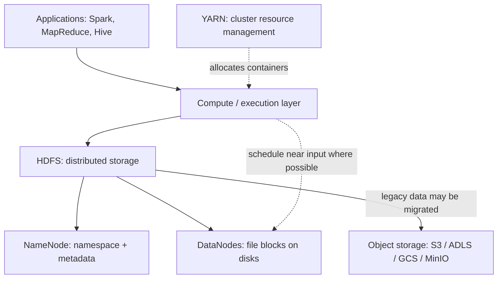
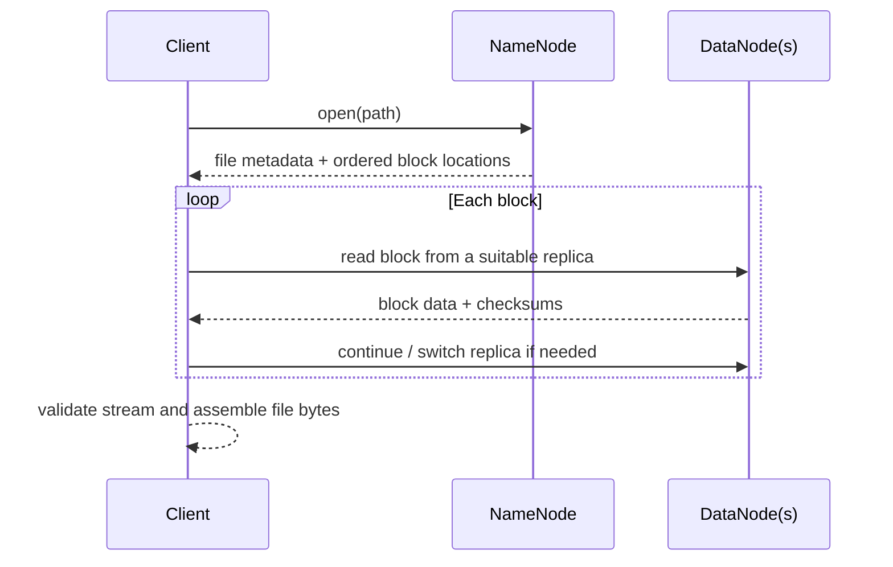
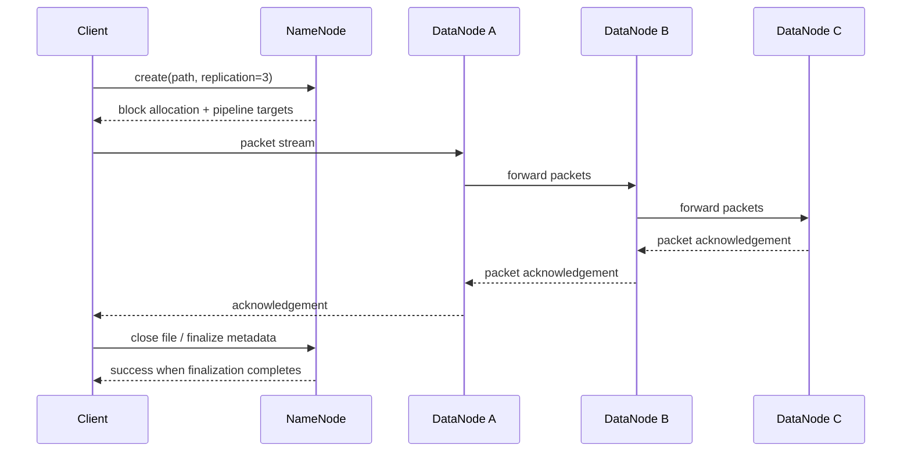

# HDFS Architecture: NameNode, DataNodes, and Replication

> **Roadmap position:** Stage 2C — Data Engineering_3 → `02-Hadoop-Ecosystem-and-Legacy-Big-Data/` → Topic 01. This is the storage foundation for YARN (Topic 02), MapReduce (03), Hive (04), HBase (05), legacy ingestion/scheduling (06), and the Hadoop-to-cloud-lakehouse migration (07).
>
> **Learning stance:** Understand, operate safely, and migrate legacy Hadoop workloads. This lesson is not a recommendation to deploy a new HDFS cluster for every new data platform.

## Learning objectives

By the end, you should be able to:

- Explain why HDFS was designed for large files, high-throughput sequential access, commodity hardware, and moving computation close to data.
- Trace the namespace, file-to-block mapping, NameNode metadata, DataNode storage, read path, and write path.
- Explain block size, replication factor, rack awareness, heartbeats, block reports, under-replication, and recovery.
- Interpret `hdfs fsck`, `hdfs dfsadmin -report`, and the NameNode web UI without inventing conclusions from partial output.
- Explain fsimage, edit logs, checkpointing, NameNode memory pressure, and the small-files problem.
- Use common `hdfs dfs` commands, permissions, ACLs, quotas, trash, and snapshots safely.
- Describe HA, federation, erasure coding, balancing, decommissioning, safe mode, and security at an operational-awareness level.
- Access HDFS from Python and Spark when the cluster and client environment support it.
- Compare HDFS with object storage and explain migration implications.

## Prerequisites and lab assumptions

This lesson assumes familiarity with Linux shell commands, filesystem permissions, processes, Python environments, distributed-computing basics, Spark, Parquet/ORC, partitioned data layouts, object storage, Docker Compose, and data reconciliation. These map to Stage 0, Stage 2, and Stage 2B in the project tree.

The roadmap suggests a small disposable Docker lab with a NameNode, two or three DataNodes, YARN, a Hive metastore/HiveServer2, and MinIO. The HDFS experiments below require a running, reachable Hadoop cluster and appropriate privileges; commands that alter cluster state require a disposable lab or explicit operator approval. Exact Docker images, ports, authentication, config files, and command syntax can differ by distribution.

Examples assume Hadoop 3.x unless stated otherwise. The common NameNode UI port is `9870` in Hadoop 3.x; older Hadoop 2 deployments commonly used `50070`. The UI may be bound to a different interface or protected by authentication. The examples use `/user/$USER` as a working HDFS area, not a universal home-directory policy.

---

## 1. Why HDFS exists

HDFS (Hadoop Distributed File System) was designed for workloads that process very large datasets across a cluster of ordinary servers. It optimizes for throughput and fault tolerance rather than low-latency random updates to many tiny records.

Its historical design assumptions include:

1. **Files can be very large.** A dataset may be hundreds of gigabytes or terabytes.
2. **Sequential streaming reads are common.** Batch analytics often scans most or all of a file.
3. **Commodity machines and disks fail.** Failures are expected, not exceptional.
4. **Data is distributed.** A file is divided into blocks stored across DataNodes.
5. **Computation can run near the data.** Hadoop schedulers can place tasks on nodes that hold input blocks, reducing network transfer where practical.
6. **High aggregate throughput matters more than low-latency random writes.** HDFS is not a general-purpose POSIX filesystem and is a poor fit for huge numbers of tiny files or frequent in-place updates.

HDFS does not make failures disappear. It uses replication or erasure coding, metadata management, health monitoring, and recovery mechanisms to keep data accessible within configured failure assumptions.

### HDFS in the Hadoop ecosystem



HDFS is the storage layer. YARN allocates compute resources; MapReduce, Spark, and Hive use storage and compute services to execute workloads. This lesson covers HDFS only, while introducing those dependencies where needed.

## 2. Architecture and responsibilities

### 2.1 NameNode

The NameNode is the metadata authority for an HDFS namespace. It manages:

- Directory and file namespace, names, hierarchy, and filesystem metadata.
- Ownership, permissions, replication policy, timestamps, and file-to-block relationships.
- The in-memory mapping from blocks to DataNodes that report replicas of those blocks. This live block-location map is reconstructed/updated from DataNode reports; do not assume the fsimage is a durable inventory of every current replica location.
- Namespace operations such as create, open, rename, and delete.

The NameNode normally **does not carry the bulk file contents**. Clients transfer file data directly to/from DataNodes after obtaining metadata and locations from the NameNode.

The namespace and much of the block metadata are maintained in memory for fast operations. This makes NameNode heap sizing and metadata cardinality operationally important.

### 2.2 DataNodes

DataNodes store actual block replicas or erasure-coded block groups on local disks. They:

- Serve block reads to clients.
- Participate in writes and pipelines.
- Send periodic heartbeats and block reports to the NameNode.
- Perform replication, deletion, and recovery work directed by the NameNode.
- Expose health information about storage volumes and their own service state.

A DataNode does not independently decide the namespace. The NameNode tracks the namespace and block-location metadata; DataNodes store blocks and report what they hold.

### 2.3 Blocks and file-to-block mapping

A file is split into blocks. Each block is stored as one or more replicas, according to the file's replication policy, or as a set of fragments under erasure coding. A file's final block is often smaller than the configured block size.

A **128 MiB block size** is a common Hadoop 3.x default example, but block size is configurable and may be overridden per file or client. Do not assume every cluster or file uses 128 MiB. Verify the actual configuration and inspect files with `hdfs fsck`.

Block size is a logical storage unit, not a guarantee that a block occupies exactly that many bytes on every disk. A partial final block stores only the bytes present, and replication multiplies physical storage requirements.

### 2.4 Metadata persistence: fsimage, edit log, and checkpointing

- **Fsimage** is a persistent checkpoint of the filesystem namespace and persistent inode/file-to-block metadata. It is not a snapshot of every currently live DataNode replica location.
- **Edit log** records namespace changes made since the checkpoint.
- At startup, the NameNode loads the fsimage and replays applicable edits to reconstruct the current namespace; current block locations are then learned from DataNode block reports and maintained as DataNodes register, fail, or report changes.
- **Checkpointing** periodically merges a checkpoint and edit history into a newer fsimage. In HA deployments, checkpointing and edit-log sharing are integrated into the configured HA architecture; do not assume every deployment uses the same checkpoint node or schedule.

A checkpoint is not a backup strategy by itself. Protect metadata with the cluster's documented backup and recovery procedures and test restoration.

### 2.5 What metadata means for capacity

The roadmap uses an approximate **150 bytes per object** as a simplified rule of thumb for a learning calculation. It is not a production sizing constant. Real NameNode memory depends on Hadoop version, namespace structure, block count, replication, Java object overhead, ACLs, snapshots, xattrs, and workload.

Simplified object-only comparison:

| Namespace count | Assumed bytes/object | Arithmetic | Decimal estimate |
|---|---:|---:|---:|
| 100,000,000 small-file objects | 150 B | 100,000,000 × 150 | 15,000,000,000 B ≈ 15 GB |
| 1,000,000 large-file objects | 150 B | 1,000,000 × 150 | 150,000,000 B ≈ 150 MB |

Using binary units, these are about 13.97 GiB and 143 MiB respectively. The estimate deliberately ignores blocks, directory entries, replicas, Java heap overhead, and other metadata. Large files usually have multiple blocks, so counting one object per file is not a full NameNode model. If 1 million large files average 1 GiB with 128 MiB blocks, they average roughly 8 blocks each; block-location metadata adds significant overhead. The lesson is the cardinality effect, not a sizing formula. Production sizing must be based on measured namespace and block counts for the specific Hadoop release and distribution, plus operational headroom.

### 2.6 Why small files hurt

A small file still needs namespace metadata and typically at least one block record. Fifty thousand 1 KiB files may contain only about 49 MiB of payload but require tens of thousands of namespace entries and block records, plus open/listing work. Consequences include:

- Higher NameNode heap and garbage-collection pressure.
- More metadata operations and slower directory listings.
- More task scheduling overhead for analytics engines.
- Inefficient storage and scan patterns.

Prefer compaction into appropriately sized Parquet/ORC files, archive formats, or table layouts that match query and partitioning patterns. Compaction must preserve schema, partition semantics, record counts, and downstream expectations.

---

## 3. Read and write paths

### 3.1 Read path



Step by step:

1. The client requests `open(path)` from the NameNode.
2. The NameNode checks path existence and access permissions, then returns block IDs and replica locations.
3. The client connects to a suitable DataNode, often preferring network proximity.
4. The DataNode streams block data and checksums to the client.
5. The client verifies checksums and moves to the next block. If a replica fails or a checksum is invalid, the client may retry another replica and report the issue.
6. The NameNode coordinates metadata; it is not normally in the data stream.

**Failure implication:** If one DataNode is unavailable but another valid replica exists, the client can usually read from another replica. If no usable replica exists, the read can fail until recovery or restoration is possible.

### 3.2 Write path



The diagram shows a three-DataNode pipeline for explanation; the exact pipeline topology depends on placement and current cluster state.

1. The client asks the NameNode to create a file. The NameNode validates permissions, path state, and policy.
2. The NameNode allocates a block and chooses DataNode targets according to replication policy, rack awareness, available nodes, and configuration.
3. The client streams packets to the first DataNode. DataNodes forward packets along the pipeline while writing locally.
4. Acknowledgements flow back through the pipeline. Checksums protect data integrity.
5. When a block fills, the client asks the NameNode for targets for the next block. The process repeats.
6. On close, the client finalizes the file's metadata. A file is not complete merely because a local command began writing; confirm the command succeeded and inspect the resulting path.

If a pipeline member fails, the client can recover the pipeline with surviving targets and request replacement targets. A write can still fail if the cluster cannot satisfy the minimum required pipeline or other policy constraints. Do not assume that every write immediately has all desired replicas in every failure scenario.

### 3.3 Worked example: a 300 MB file, replication factor three

Assumptions for arithmetic:

- “300 MB” means **300 MiB** for this example.
- Configured block size is 128 MiB.
- Replication factor is 3.
- At least four suitable DataNodes are available across two racks, and the example writer is on Rack 1.
- No erasure coding is applied to this file.
- The placement below illustrates a common three-replica, two-rack arrangement; the configured policy, topology, writer location, and available nodes determine actual placement.

Block count:

- Block 1: 128 MiB
- Block 2: 128 MiB
- Block 3: 44 MiB
- Total: 128 + 128 + 44 = 300 MiB → **3 logical blocks**.

With replication factor three, the nominal replica count is 3 blocks × 3 replicas = **9 block replicas**. Nominal stored payload is about 900 MiB (excluding checksums, metadata, and filesystem overhead), though the final block's replicas contain only about 44 MiB each.

Illustrative placement:

| Logical block | Size | Replica A | Replica B | Replica C |
|---|---:|---|---|---|
| blk_1 | 128 MiB | Rack 1 / DN1 | Rack 2 / DN3 | Rack 2 / DN4 |
| blk_2 | 128 MiB | Rack 1 / DN2 | Rack 2 / DN3 | Rack 2 / DN4 |
| blk_3 | 44 MiB | Rack 1 / DN1 | Rack 2 / DN3 | Rack 2 / DN4 |

This table is a plausible illustration of a common policy when the writer is on Rack 1: one replica on the writer's rack and two on a remote rack. It is not a guarantee for every block. Real placement is affected by Hadoop's block placement policy, rack topology script/configuration, available DataNodes, storage policies, decommissioning, and current failures. Do not infer that every block must use this exact pattern in every Hadoop version and situation.

**Failure prediction:** If DN1 fails, the example still has other replicas of each block. The NameNode marks DN1's replicas unavailable after detecting the failure and schedules re-replication if the surviving count is below policy. If an entire rack fails, rack diversity can preserve access only if sufficient replicas exist outside the failed rack. Replication protects against configured failure scenarios, not every correlated failure or operator mistake.

---

## 4. Blocks, replication, rack awareness, and recovery

### 4.1 Replication factor

A replication factor of **3** is a common default for ordinary HDFS files in standard configurations, but it is configurable at cluster, directory, file, and client levels. Verify with `hdfs getconf -confKey dfs.replication` and inspect actual files. Administrators may choose a different factor or use erasure coding for eligible directories.

Replication increases storage cost but makes reads resilient to node/disk loss and allows parallel reads from multiple replicas. It is not the same as a backup: accidental deletion, corruption replicated to all copies, and compromised credentials can affect all replicas.

### 4.2 Rack awareness and placement

A rack-aware placement policy uses network topology information to avoid concentrating all replicas in one rack, balancing fault tolerance against network traffic and write throughput. Exact rules vary by policy, replication factor, cluster size, and available nodes. A misconfigured topology script can make HDFS believe all nodes are in one rack or create misleading placement assumptions. Confirm topology from cluster configuration and observed block locations.

### 4.3 Heartbeats, block reports, and under-replication

- **Heartbeat:** a periodic signal that a DataNode is alive and communicating with the NameNode.
- **Block report:** a DataNode's report of the blocks it stores. Full and incremental reporting behavior depends on version/configuration.
- **Under-replicated block:** a block with fewer valid replicas than its effective replication target.
- **Re-replication:** the NameNode schedules creation of additional replicas when it detects under-replication and suitable storage is available.

After a node failure, the NameNode does not instantly know every detail at the exact moment power is lost; detection follows configured timeouts and reporting. Recovery speed depends on detection intervals, replication work queues, network/storage throughput, cluster load, and remaining capacity. Alert on prolonged under-replication rather than treating every transient warning as data loss.

### 4.4 Failure scenarios

| Failure | Likely effect | What to inspect |
|---|---|---|
| One disk/volume fails | Some replicas may become unavailable; DataNode may report volume failure | DataNode logs, `dfsadmin -report`, volume health |
| One DataNode stops | Its replicas become unavailable after failure detection; blocks may become under-replicated | `fsck`, report, NameNode UI, logs |
| One rack loses power/network | Many replicas may be unavailable together | Rack topology, block locations, under-replication, network |
| NameNode process fails in non-HA cluster | Metadata operations stop until recovery/restart; data blocks may remain on disks | NameNode logs, fsimage/edit log, recovery runbook |
| NameNode fails in correctly configured HA | Standby may become active through failover | HA state, JournalNodes, ZooKeeper, fencing logs |
| Too many files/blocks | Heap/GC and namespace operations degrade | NameNode heap, GC logs, namespace/block counts |
| Full disks or no eligible targets | Writes or re-replication may fail or stall | capacity report, disk errors, policies, decommissioning |

**Never stop a production DataNode to learn this.** Use a disposable cluster and record baseline health before the experiment.

---

## 5. Essential `hdfs dfs` commands

The examples below use shell variables and a dedicated lab directory. Run commands as a user authorized by the cluster. HDFS commands are not local filesystem commands: paths such as `/user/$USER` are HDFS paths, while `./sample.txt` is local.

```bash
# Confirm client and cluster configuration.
hadoop version
hdfs getconf -confKey fs.defaultFS
hdfs getconf -confKey dfs.blocksize
hdfs getconf -confKey dfs.replication

# Create a lab directory if your account is allowed to do so.
HDFS_LAB="/user/$USER/hdfs-lesson"
hdfs dfs -mkdir -p "$HDFS_LAB"

# List a path.
hdfs dfs -ls "$HDFS_LAB"

# Upload a local file (destination directory must exist or use an explicit target path).
printf 'hdfs lesson sample\n' > sample.txt
hdfs dfs -put sample.txt "$HDFS_LAB/sample.txt"

# Read a small text file to the terminal.
hdfs dfs -cat "$HDFS_LAB/sample.txt"

# Download from HDFS to a local directory.
mkdir -p ./downloaded
hdfs dfs -get "$HDFS_LAB/sample.txt" ./downloaded/

# Show logical HDFS size. -h formats values for humans.
hdfs dfs -du -h "$HDFS_LAB"

# Change permissions only when you own the path or have appropriate privilege.
hdfs dfs -chmod 640 "$HDFS_LAB/sample.txt"

# Delete only the known lab file after verifying the target.
hdfs dfs -ls "$HDFS_LAB/sample.txt"
# Destructive: execute only after verifying the path and that the file is disposable.
hdfs dfs -rm "$HDFS_LAB/sample.txt"
```

Expected observations, not fabricated output:

- `hdfs getconf` prints the effective value seen by that client configuration; it may differ from a generic tutorial's value.
- `-ls` lists entries and metadata; an empty directory may show no file rows.
- `-put` fails if the destination conflicts or the caller lacks permission.
- `-cat` writes file bytes to stdout; use it for small text, not huge binary files.
- `-get` creates a local copy; check local path permissions and available disk space.
- `-du -h` reports HDFS usage; replica-accounting presentation can differ with flags/version.
- `-chmod` changes mode bits; it does not override ACLs or bypass ownership checks.
- `-rm` removes the HDFS namespace entry. With trash enabled and applicable configuration, deletion may move data to trash; do not rely on trash as a safety guarantee.

### 5.1 Replication and file inspection

```bash
# Inspect file, blocks, and locations (requires a path the user can inspect).
hdfs fsck "$HDFS_LAB/sample.txt" -files -blocks -locations

# Inspect cluster capacity and DataNode status.
hdfs dfsadmin -report

# View filesystem status; output depends on version/configuration.
hdfs dfsadmin -safemode get
```

`fsck` reports can include file status, block IDs, replica locations, missing/corrupt blocks, and overall health. Read the full report: “under-replicated” is not synonymous with “missing,” and a successful command exit alone does not prove that every block meets the desired replication factor. `dfsadmin -report` summarizes configured/live/dead/decommissioning DataNodes and capacity. Verify against the NameNode UI and logs when results disagree.

### 5.2 NameNode web UI

Open the NameNode web UI configured for your cluster; `http://namenode-host:9870/` is a common Hadoop 3.x example, not a guaranteed reachable endpoint. Check the cluster configuration, reverse proxy, firewall, and authentication if unavailable. Inspect live/dead nodes, capacity, blocks, under-replicated/missing blocks, and storage policies. Never expose an unauthenticated management UI to the public internet.

---

## 6. Permissions, ACLs, quotas, trash, and snapshots

### 6.1 Permissions and ACLs

HDFS has owner/group/other mode bits similar to Unix. Directory execute permission controls traversal; write permission on a parent directory is relevant to creating or deleting entries. Superuser privileges and cluster authorization policies may alter what an operation permits.

```bash
hdfs dfs -ls "$HDFS_LAB"
hdfs dfs -chmod 750 "$HDFS_LAB"
hdfs dfs -getfacl "$HDFS_LAB"
# ACL changes are environment-specific; example only if authorized:
# hdfs dfs -setfacl -m user:analyst:r-x "$HDFS_LAB"
```

ACL support must be enabled/configured appropriately. Do not use broad recursive `chmod` or ACL changes on shared paths without an access review.

### 6.2 Quotas

Directory quotas constrain namespace count and/or space consumption. Exact options and privilege requirements depend on Hadoop distribution/version.

```bash
# Illustrative: reserve a dedicated disposable directory first.
HDFS_QUOTA="/user/$USER/hdfs-quota-lab"
hdfs dfs -mkdir -p "$HDFS_QUOTA"

# Requires HDFS superuser/admin privileges in typical configurations.
# Set a namespace quota, then inspect it:
# hdfs dfsadmin -setQuota 3 "$HDFS_QUOTA"
# hdfs dfs -count -q "$HDFS_QUOTA"
```

To trigger a safe quota error in a disposable lab, set a very low namespace quota (for example, 3) on a dedicated directory, then attempt to create more entries than allowed. Verify the failure message, then remove only the lab directory and clear/change the quota according to administrator procedures. Do not test quota failures in a shared or production directory.

### 6.3 Trash and deletion

When trash is enabled, a normal `hdfs dfs -rm` may move the path into a user trash directory instead of deleting it immediately. Retention intervals and behavior are configuration-dependent; `-skipTrash` bypasses this safety mechanism and should be avoided unless explicitly approved. Check the configured trash policy and use the documented restore procedure.

### 6.4 Snapshots

HDFS snapshots are read-only point-in-time views of a snapshottable directory. They can help protect against accidental changes and support recovery workflows, but they are not a replacement for off-cluster backup, disaster recovery, or independent copies. Snapshot creation requires the directory to be configured as snapshottable and sufficient metadata/storage capacity.

Illustrative commands (requires permission and a dedicated lab directory):
```bash
# hdfs dfsadmin -allowSnapshot "$HDFS_LAB"
# hdfs dfs -createSnapshot "$HDFS_LAB" before-change
# hdfs dfs -ls "$HDFS_LAB/.snapshot/before-change"
```

---

## 7. NameNode HA and federation

### 7.1 High availability (HA)

In an HA deployment, two NameNodes commonly run in **active** and **standby** roles. The active serves namespace operations; the standby keeps its state synchronized and can take over when the active fails.

Typical components include:

- **JournalNodes:** a quorum-based shared edit-log mechanism in the common QJM HA design. Active writes edits to the quorum; standby tails edits to remain current.
- **ZooKeeper and ZKFC (ZooKeeper Failover Controller):** coordinate automatic failover in a typical automatic-failover setup.
- **Fencing:** prevents a former active from continuing to act as active after failover. This protects against split-brain writes; it is not optional conceptual decoration. The fencing method must be configured and tested.
- **Shared storage alternatives:** some deployments use other supported shared edit-log arrangements; do not assume every HA cluster uses the same design.

HA improves NameNode service availability, but does not by itself protect against data loss, all DataNode failures, a bad operator command, or a complete site disaster. Test failover, fencing, and recovery procedures.

Hadoop 2 and 3 both support NameNode HA in common deployments, but exact features, defaults, and operational tooling depend on the release and distribution. Confirm the installed version and vendor documentation.

### 7.2 Federation is different from HA

**Federation** allows multiple independent NameNodes/namespaces to share a cluster of DataNodes, each with its own namespace and block pool. It can scale namespace/metadata management and provide namespace isolation.

- **HA:** redundancy for a given namespace service (active/standby).
- **Federation:** multiple namespaces/block pools to scale or isolate metadata.
- They can be combined: federated namespaces may each have HA.

Do not describe federation as merely “two NameNodes for failover.”

---

## 8. Replication versus Hadoop 3 erasure coding

Replication stores full copies. Erasure coding stores data and parity fragments across DataNodes and reconstructs lost fragments from the remaining fragments.

For illustration, a **6+3** erasure-coding policy stores six data units plus three parity units: 9 units total for 6 units of logical data, a nominal storage overhead of 50% before other overheads. Three-way replication stores 3 units for every 1 logical unit, nominal 200% overhead. These ratios are illustrative; actual policies, cell sizes, file sizes, and implementation affect realized usage.

| Consideration | Replication | Erasure coding |
|---|---|---|
| Storage overhead | Common RF=3 means ~3× payload | Often lower; depends on data/parity policy |
| Failure tolerance | Up to the number/pattern of lost replicas supported by placement | Depends on parity count and independent fragment placement |
| Reads | Often simple; multiple full replicas can serve reads | Normal reads may be efficient, but missing fragments require reconstruction |
| Recovery | Copy a healthy replica | Read fragments and reconstruct lost fragment(s); can be CPU/network intensive |
| Best fit | General workloads, low-latency reads, small files, frequent access | Large, relatively cold data where storage efficiency matters |
| Caveats | Higher storage cost | Small files and reconstruction can reduce benefits; policy eligibility/configuration matters |

Hadoop 3 supports erasure coding, but support and policy defaults vary by distribution and version. Do not assume every directory uses it. Check the effective storage policy and verify that file size and layout make it appropriate.

---

## 9. Balancing, decommissioning, and safe mode

- **HDFS Balancer:** redistributes block replicas among DataNodes to bring utilization closer to configured thresholds. It moves data over the network and consumes disk/network bandwidth; schedule and monitor it.
- **Disk Balancer:** redistributes data across volumes within a DataNode, where supported/configured. This addresses uneven disk usage on one node rather than cluster-wide node imbalance. It is a separate tool from the cluster-wide HDFS Balancer; confirm support and syntax for the installed Hadoop release.
- **Decommissioning:** administratively removes a DataNode from service in a controlled way. HDFS waits for required replicas to be safely placed elsewhere according to policy and configuration. Monitor decommission progress; do not simply shut down and delete a node's disks.
- **Safe mode:** a NameNode state that restricts namespace modifications while it waits for required block reports/conditions or while an administrator investigates. It may enter safe mode during startup. Do not force-leave safe mode just to make an alert disappear; first understand why it is active.

Useful checks:
```bash
hdfs dfsadmin -report
hdfs dfsadmin -safemode get
# Admin-only actions; consult the exact version's documentation before use:
# hdfs dfsadmin -refreshNodes
# hdfs balancer -threshold 10
# Hadoop 3 releases that include Disk Balancer may support commands like:
# hdfs diskbalancer -query datanode.example.internal
# hdfs diskbalancer -plan datanode.example.internal
# Review the generated plan before any execute/apply step; do not run a plan blindly.
```

The balancer threshold example is illustrative, not a universal recommended value. Check command availability and flags in the installed release (`hdfs balancer -help`).

---

## 10. Security awareness

- **Kerberos:** provides authentication for Hadoop services and users in secure clusters. In a secure cluster, commands may require a valid ticket (for example, via `kinit`) and correct principal/keytab configuration. A keytab is a credential and must be protected as a secret.
- **Delegation tokens:** allow authenticated clients/services to access Hadoop services for a bounded period without repeatedly presenting a password; tokens are credentials, and expiry/renewal/cancellation behavior depends on token type, service, and application. Do not print or commit token contents.
- **Encryption zones:** HDFS transparent encryption uses encryption-zone metadata and key management (often via a configured Key Management Server). Client-side encryption/decryption protects file contents at rest and the data stream between client and DataNode for files in configured zones. It does not automatically cover every dataset, encrypt unrelated service traffic, replace access controls, or remove the need for key rotation and audit controls.
- **Authorization:** HDFS mode bits and ACLs work alongside service-level security and distribution-specific controls such as Ranger. Never place keytabs, passwords, or tokens in source control or logs.

For migration, inventory Kerberos principals, service identities, ACLs, encryption zones, key ownership, audit requirements, and the target cloud identity/encryption model before copying data.

---

## 11. Python and Spark access

HDFS clients depend on the cluster's configuration, authentication, Hadoop client libraries, and network access. There is no single Python connection method that works unchanged for every cluster.

### 11.1 WebHDFS with the `hdfs` Python package

Use this when WebHDFS/HttpFS is enabled, reachable, and permitted by the cluster's authentication model. Install into the project's Python environment:

```bash
uv add hdfs
```

Example:
```python
"""List and read a small text file through WebHDFS.

Prerequisites:
- WebHDFS or HttpFS is enabled and reachable.
- Authentication mode and URL match the cluster.
- The identity has read permission for the path.
- Do not use this example for huge files or secrets.
"""
from __future__ import annotations

import os
import sys
from hdfs import InsecureClient
from hdfs.util import HdfsError


def main() -> int:
    url = os.environ.get("WEBHDFS_URL")
    user = os.environ.get("HDFS_USER")
    path = os.environ.get("HDFS_PATH", "/user/example/hello.txt")

    if not url or not user:
        print("Set WEBHDFS_URL and HDFS_USER for your lab.", file=sys.stderr)
        return 2

    try:
        client = InsecureClient(url, user=user)
        status = client.status(path, strict=True)
        print(f"Path exists; size={status.get('length')} bytes")
        with client.read(path, encoding="utf-8") as reader:
            print(reader.read(4096))
    except HdfsError as exc:
        print(f"HDFS request failed: {exc}", file=sys.stderr)
        return 1
    except OSError as exc:
        print(f"Network or local I/O failure: {exc}", file=sys.stderr)
        return 1
    return 0


if __name__ == "__main__":
    raise SystemExit(main())
```

`InsecureClient` uses a simple user identity parameter and is appropriate only where the WebHDFS setup allows that mode, such as a controlled lab. It is **not** a secure-cluster authentication recipe. Use the authentication mechanism supported by your deployment, restrict network exposure, and never treat the `user` query parameter as strong authentication.

### 11.2 `pyarrow.fs.HadoopFileSystem`

PyArrow can expose HDFS through `pyarrow.fs.HadoopFileSystem`, but this generally requires compatible Hadoop native libraries/JNI and client configuration. It can be difficult to set up on modern Python/OS combinations. Confirm compatibility with your PyArrow version and Hadoop distribution before choosing it.

```python
from __future__ import annotations

import sys
import pyarrow.fs as fs


def main() -> int:
    try:
        hdfs = fs.HadoopFileSystem(
            host="namenode.example.internal",
            port=8020,
            user="labuser",
        )
        info = hdfs.get_file_info("/user/labuser/sample.parquet")
        if info.type == fs.FileType.NotFound:
            print("HDFS path does not exist", file=sys.stderr)
            return 1
        print(info)
    except (OSError, RuntimeError, ValueError) as exc:
        print(f"HDFS connection failed: {exc}", file=sys.stderr)
        return 1
    return 0


if __name__ == "__main__":
    raise SystemExit(main())
```

The host, RPC port, identity, native libraries, and authentication are deployment-specific. A successful import of PyArrow alone does not prove HDFS support is installed.

### 11.3 Spark

Spark usually reads HDFS using Hadoop filesystem configuration and the cluster's Hadoop libraries:

```python
from pyspark.sql import SparkSession

spark = (
    SparkSession.builder
    .appName("hdfs-parquet-read")
    .getOrCreate()
)

try:
    df = spark.read.parquet("hdfs:///warehouse/events")
    df.printSchema()
    print(f"Partitions: {df.rdd.getNumPartitions()}")
    df.show(5, truncate=False)
finally:
    spark.stop()
```

Run this in an environment configured with the appropriate Hadoop client, `core-site.xml`/`hdfs-site.xml` (or equivalent configuration), network routes, and credentials. `hdfs:///...` uses the configured default filesystem; if the default filesystem is not HDFS, use an explicit URI such as `hdfs://nameservice1/path` appropriate to the cluster. Avoid collecting large datasets to the driver.

---

## 12. HDFS versus object storage

Object storage (S3, ADLS, GCS, MinIO) is a common modern target because it separates durable storage from ephemeral compute and can scale independently. It is not a drop-in semantic replacement for every HDFS application.

| Dimension | HDFS | Object storage |
|---|---|---|
| Data model | Files/directories represented through a namespace; blocks on DataNodes | Objects addressed by keys in buckets/containers; directory hierarchy is often a prefix convention |
| Capacity and durability | Cluster-owned disks, replication/EC, hardware and operations managed by the cluster team | Provider/service manages underlying durability and scaling; semantics vary by provider |
| Consistency | Namespace operations coordinated by NameNode; HDFS is designed for coherent filesystem semantics | Modern major services often provide strong read-after-write/list consistency, but exact behavior depends on provider/API and operation |
| Rename | Namespace rename is generally a metadata operation; atomicity/semantics are filesystem-specific | Often implemented as copy + delete or service-specific operation, not equivalent to cheap atomic filesystem rename |
| Compute coupling | Storage nodes and compute historically co-located; data locality can help | Storage and compute can scale independently; network I/O replaces local data locality assumptions |
| Operations | Must operate/upgrade NameNodes, DataNodes, disks, racks, HA, balancing, security | Less infrastructure to manage, but IAM, network, request costs, lifecycle, catalog and format management remain |
| Cost profile | Hardware, power, rack/network, support, staffing, capacity planning | Storage, requests, retrieval tiers, data transfer/egress, compute, and service-specific charges |
| Best fit | Existing Hadoop workloads, data-local batch, legacy systems | Cloud lakehouses, elastic compute, multi-engine access, decoupled storage |

Avoid the outdated blanket statement that object stores are eventually consistent: major cloud object stores have improved consistency guarantees. At the same time, do not assume every object store implements filesystem rename, locking, atomic commit, or directory semantics like HDFS. Table formats such as Iceberg and Delta add commit/catalog protocols on top of object storage; migration requires validating the engine and catalog's semantics.

### Historical trade-off

HDFS made sense when large clusters of commodity servers and data-local batch compute were practical ways to process enormous datasets. It provided block replication, rack-aware placement, and a central namespace over distributed disks. Modern object storage often wins on independent scaling, service-managed durability, and cloud integration, but adds request/network costs and different rename/commit behavior. Migration is therefore a redesign and validation effort, not merely a file copy.

---

## 13. Operational troubleshooting workflow

Use a repeatable sequence:

1. **Define impact:** which paths, jobs, users, and time window are affected? Avoid restarting components before collecting evidence.
2. **Check basic health:** `hdfs dfsadmin -report`, NameNode UI, DataNode/NameNode logs, disk and network health.
3. **Inspect the path:** `hdfs dfs -ls`, permissions/ACLs, quota, file status.
4. **Inspect blocks:** `hdfs fsck <path> -files -blocks -locations`; distinguish missing, corrupt, and under-replicated blocks.
5. **Check capacity and placement:** live/dead nodes, failed volumes, rack topology, decommissioning, storage policies.
6. **Check metadata service:** NameNode heap/GC, RPC latency, namespace count, edit-log/JournalNode health in HA.
7. **Form a hypothesis and change one thing:** follow the runbook; record before/after evidence.
8. **Verify recovery:** repeat reports and read a sample; confirm desired replication and application-level correctness.
9. **Document for migration:** record data size, block/file counts, access patterns, permissions, encryption, job dependencies, and SLA.

Example commands:
```bash
hdfs dfsadmin -report
hdfs fsck /path/to/dataset -files -blocks -locations
hdfs dfs -ls -d /path/to/dataset
hdfs dfs -count -q /path/to/dataset
hdfs dfs -getfacl /path/to/dataset
hdfs dfsadmin -safemode get
```

Command output and supported flags vary by version. Consult `hdfs <subcommand> -help` and the installed distribution's documentation. Do not paste secrets, keytabs, tokens, or sensitive paths into public bug reports.

---

## 14. Hands-on lab: `experiments/01_hdfs/`

Run experiments only in a disposable lab. Keep notes in `module-2c2-notes.md` as prescribed by the module roadmap. For every experiment, record the exact Hadoop version, configuration, command, observed output, interpretation, and cleanup.

### Experiment 1 — Upload a large file and inspect blocks

**Requires:** reachable HDFS, enough local and HDFS space, write permission, and a file large enough to span several blocks.

```bash
mkdir -p ./data
# Generate a lab file; this writes 300 MiB locally.
dd if=/dev/zero of=./data/hdfs-300m.bin bs=1M count=300 status=progress

HDFS_LAB="/user/$USER/hdfs-lesson"
hdfs dfs -mkdir -p "$HDFS_LAB"
hdfs dfs -put ./data/hdfs-300m.bin "$HDFS_LAB/hdfs-300m.bin"

hdfs fsck "$HDFS_LAB/hdfs-300m.bin" -files -blocks -locations
hdfs dfsadmin -report
```

**Observe:** block count and sizes, replica locations, live DataNodes, and whether blocks are under-replicated. With a configured 128 MiB block size and a 300 MiB file, expect three logical blocks; actual size semantics and effective configuration must be verified. Do not copy example output into your notes as if it came from your cluster.

**Cleanup:** verify the exact HDFS lab path, then remove only the generated file. Check trash behavior and retention before assuming space is reclaimed immediately.

### Experiment 2 — Stop a DataNode and observe recovery

**Requires:** disposable cluster, at least three DataNodes for a useful RF=3 demonstration, administrative access to stop/start a container/service, and enough free capacity to re-replicate.

1. Record baseline `hdfs dfsadmin -report` and `fsck` for the test file.
2. Stop one DataNode using the lab's documented mechanism (for example, stopping the specific DataNode container—not the NameNode).
3. Wait for configured failure detection. A missing heartbeat is not always reflected instantly.
4. Inspect `hdfs dfsadmin -report`, NameNode UI, and `hdfs fsck ... -files -blocks -locations`.
5. Observe whether blocks become under-replicated and whether the NameNode schedules re-replication to surviving nodes.
6. Restart the DataNode and observe registration, block reporting, and any excess-replica handling.

**Interpretation:** exact timing and placement depend on heartbeat/dead-node configuration, replication queues, capacity, and cluster load. If all replicas were on the failed node due to a broken/small topology, data may become unavailable. Do not force-delete block files or manually edit NameNode metadata.

### Experiment 3 — Create 50,000 small files and compact them

**Requires:** disposable HDFS namespace, enough quota/metadata capacity, local disk space, and permission to create and delete the lab files. This can be expensive even if each file is tiny; monitor NameNode and client performance.

Example local generation (creates 50,000 tiny files):
```bash
mkdir -p ./data/small-files
python - <<'PY'
from pathlib import Path
root = Path("./data/small-files")
root.mkdir(parents=True, exist_ok=True)
for i in range(50_000):
    (root / f"part-{i:05d}.txt").write_text(f"{i},sample\n", encoding="utf-8")
print("Generated local files; inspect disk usage before upload.")
PY
```

Upload them into an isolated lab directory using a method appropriate to the lab. A shell loop issuing 50,000 separate `hdfs dfs -put` commands is intentionally inefficient; use a controlled bulk-copy approach and measure the client/metadata impact. One possible approach is to place all files in a local directory and use `hdfs dfs -put ./data/small-files "$HDFS_LAB/"`, then verify the destination layout. Ensure the resulting command semantics match your intended directory structure.

Compare:
- Namespace/file count with `hdfs dfs -count`.
- Listing time and NameNode memory/GC before, during, and after.
- One compact representation (for example, newline-delimited text or a Parquet dataset written by Spark) containing the same logical records.
- Query/scan behavior and schema/partition implications.

Compaction demonstration for text only (streaming Python avoids shell argument-list limits):
```python
from pathlib import Path

source = Path('./data/small-files')
target = Path('./data/compacted.txt')
with target.open('w', encoding='utf-8', newline='') as out:
    for path in sorted(source.glob('part-*.txt')):
        with path.open('r', encoding='utf-8') as src:
            for line in src:
                out.write(line)
print(f'Wrote {target}; bytes={target.stat().st_size}')
```

Upload the compacted file to a separate HDFS path, for example `hdfs dfs -put ./data/compacted.txt "$HDFS_LAB/compacted.txt"`. Compare record counts and deterministic content/checksums against the small-file set before cleanup. Do not claim a specific speedup without measurements.

### Experiment 4 — Configure a quota and trigger a quota error

**Requires:** admin/superuser rights to set the quota in typical deployments, isolated directory, and a disposable cluster.

```bash
Q="/user/$USER/hdfs-quota-lab"
hdfs dfs -mkdir -p "$Q"

# Admin-only; uncomment only in a disposable lab:
# hdfs dfsadmin -setQuota 3 "$Q"
hdfs dfs -count -q "$Q"

# Create a few distinct files in the directory; stop once quota behavior is observed.
for i in 1 2 3 4; do
  printf '%s\n' "$i" > "/tmp/quota-$i.txt"
  hdfs dfs -put "/tmp/quota-$i.txt" "$Q/file-$i.txt" || break
done
```

A namespace quota of 3 can reject additional namespace entries depending on whether the directory itself counts and on exact quota semantics. Treat the command's actual error and `-count -q` result as evidence; do not assume the fourth file must be the exact failing operation. If the quota was not set because you lack privileges, stop and ask the lab administrator rather than repeatedly retrying. After recording evidence, remove only the lab data and clear or adjust the quota through approved admin procedures.

### Experiment 5 — Compare Spark reads from HDFS and MinIO

**Requires:** Spark configured for both filesystems, HDFS and MinIO endpoints/credentials, a compatible S3A connector (Hadoop AWS library versions aligned with Hadoop), and identical Parquet data/schema. Do not embed access keys in code or commit them.

Prepare identical datasets using the same upstream source and write one copy to HDFS and one to MinIO. Validate row counts, schema, partition layout, and a deterministic aggregate before comparing performance. Example skeleton:

```python
from __future__ import annotations

import time
from pyspark.sql import SparkSession

HDFS_PATH = "hdfs:///lab/parquet/events"
MINIO_PATH = "s3a://lab-bucket/parquet/events"


def timed_count(spark: SparkSession, path: str) -> tuple[int, float]:
    start = time.perf_counter()
    count = spark.read.parquet(path).count()
    return count, time.perf_counter() - start


def main() -> None:
    spark = (
        SparkSession.builder
        .appName("hdfs-vs-minio-parquet")
        .getOrCreate()
    )
    try:
        for path in (HDFS_PATH, MINIO_PATH):
            count, elapsed = timed_count(spark, path)
            print(f"{path}: rows={count}, elapsed_seconds={elapsed:.3f}")
    finally:
        spark.stop()


if __name__ == "__main__":
    main()
```

Configure MinIO's S3A endpoint, path-style access, credentials provider, and SSL setting in the Spark/Hadoop configuration appropriate to the lab. Exact settings depend on the Hadoop AWS connector version and MinIO TLS setup; do not paste a generic credential-bearing configuration into source code. Run multiple trials, control caching, use the same Spark version and resource allocation, and record median/variance rather than relying on one run. A `.count()` may be affected by caching, file listing, partition count, object-store latency, network bandwidth, and executor placement. The experiment is a controlled comparison, not proof that one storage system is always faster.

---

## 15. Required learning activities

Complete these activities in your notes before moving to Topic 02:

1. **Draw the write path** for a 300 MiB file with replication factor 3 across two racks. Label client, NameNode, block allocation, DataNode pipeline, packet acknowledgements, and file close.
2. **Predict node and disk failures:** for each block in your drawing, identify which replicas survive one DataNode failure and one rack failure. State when data remains readable and when recovery is needed.
3. **Inspect reports:** capture your own `fsck`, `dfsadmin -report`, and NameNode UI observations; explain each finding in your own words.
4. **Compare HDFS with object storage:** use the table in Section 12, then add your actual migration constraints: rename/commit behavior, credentials, encryption, access patterns, cost drivers, and consumers.
5. **Explain historical trade-offs:** in one paragraph, explain why HDFS used large blocks, replication, rack awareness, and data locality circa the Hadoop era, and why object storage plus elastic compute is attractive today.
6. **Migration note:** record how the dataset could be moved to MinIO/object storage, what validation is required (counts, checksums, schema, partition layout, query-result diff), and which security/ACL assumptions must be translated.

## 16. Common mistakes

- Assuming 128 MiB block size or replication factor 3 is universal; check effective configuration and actual file metadata.
- Thinking the NameNode stores the file payload or that DataNodes own the namespace.
- Assuming replicas are always placed in a fixed rack pattern.
- Equating under-replicated blocks with missing/corrupt blocks.
- Treating replication as a backup.
- Ignoring small-file metadata costs and Spark task overhead.
- Assuming a successful `put` proves the intended replica count is already satisfied.
- Force-leaving safe mode without understanding why it was entered.
- Stopping production nodes or using `-skipTrash` for a learning exercise.
- Treating object storage as a POSIX filesystem or assuming rename has HDFS semantics.
- Benchmarking HDFS vs MinIO without controlling data, configuration, caching, and resources.
- Claiming a migration is complete after copying bytes without validating counts, checksums, schema, permissions, encryption, and consumers.

---

## 17. Interview questions with model answers

### 1. What is the NameNode's job?
It manages the HDFS namespace and metadata, including file-to-block relationships and reported block locations. DataNodes serve the file data itself.

### 2. Why does HDFS use blocks?
Blocks allow large files to be distributed across machines, make placement and replication manageable, and allow compute tasks to process portions of files in parallel.

### 3. What happens when a DataNode stops?
After missing heartbeats beyond the configured detection threshold, the NameNode treats it as dead, marks its replicas unavailable, and schedules re-replication if the remaining replicas are below the effective target and capacity is available.

### 4. Does replication factor 3 mean three racks?
No. It means three replicas per block under the file's effective policy. Rack-aware placement attempts to spread replicas according to the topology and policy; it does not guarantee three distinct racks.

### 5. What are fsimage and edit log?
Fsimage is a persistent namespace checkpoint. The edit log records namespace changes since the checkpoint. The NameNode reconstructs state by loading the image and replaying edits; checkpointing limits replay work.

### 6. Why are small files a problem?
Each file and block adds metadata and namespace operations, while analytics engines may create a task or scan overhead for many small files. Compaction reduces metadata and query-planning overhead when semantics are preserved.

### 7. How are HA and federation different?
HA gives a namespace service active/standby NameNodes with coordinated edits and failover. Federation provides multiple namespaces/block pools for scale or isolation. They solve different problems and can be combined.

### 8. Why use erasure coding?
For eligible large datasets, erasure coding can reduce storage overhead compared with full replication, at the cost of more complex and potentially expensive reconstruction after failures.

### 9. Why is HDFS not a direct substitute for S3/MinIO?
HDFS is a distributed filesystem with a namespace and filesystem-style rename semantics. Object storage is key/object based, often with different rename, locking, and commit behavior. Clients, table formats, IAM, and migration validation must account for those differences.

### 10. What must be validated in a Hadoop-to-object-store migration?
Inventory paths, data sizes, block/file counts, formats, partitions, permissions, encryption, owners, jobs and SLAs; transfer data; compare row counts/checksums/schema/query results; run old and new pipelines in parallel; and define rollback/cutover criteria.

---

## 18. Checkpoint and self-assessment

Do not move to Topic 02 — YARN resource management until you can complete these without notes:

- [ ] Explain HDFS purpose and place in the Hadoop ecosystem.
- [ ] Explain blocks, NameNode, DataNodes, and file-to-block mapping.
- [ ] Trace a read and write path and describe checksum/pipeline behavior.
- [ ] Explain replication factor, rack awareness, heartbeat, block report, under-replication, and re-replication.
- [ ] Calculate the logical blocks and nominal replicas for a file given size, block size, and replication factor.
- [ ] Explain fsimage, edit log, checkpointing, NameNode memory, and the small-files problem.
- [ ] Use `hdfs dfs` commands safely and interpret `fsck` and `dfsadmin -report`.
- [ ] Explain permissions, ACLs, quotas, trash, and snapshots.
- [ ] Explain HA, JournalNodes, ZooKeeper failover, fencing, federation, and erasure coding at a high level.
- [ ] Explain balancing, disk balancing, decommissioning, safe mode, and security terms.
- [ ] Complete or document the five lab experiments, marking any that could not be run because the cluster was unavailable.
- [ ] Compare HDFS and object storage without assuming identical consistency or rename semantics.
- [ ] Describe a migration validation and cutover plan.

## Further references

Use the official documentation matching the **installed Hadoop version and distribution** before changing production systems. These links are authoritative reference points, not a claim that every command was executed in this lesson:

- [Apache Hadoop HDFS User Guide](https://hadoop.apache.org/docs/current3/hadoop-project-dist/hadoop-hdfs/HdfsUserGuide.html) and [HDFS Architecture](https://hadoop.apache.org/docs/current3/hadoop-project-dist/hadoop-hdfs/HdfsDesign.html).
- [HDFS Commands Guide](https://hadoop.apache.org/docs/current3/hadoop-project-dist/hadoop-hdfs/HDFSCommands.html) for `hdfs dfs`, `fsck`, `dfsadmin`, balancer, and related commands.
- [HDFS High Availability Using the Quorum Journal Manager](https://hadoop.apache.org/docs/r3.4.2/hadoop-project-dist/hadoop-hdfs/HDFSHighAvailabilityWithQJM.html).
- [HDFS Erasure Coding](https://hadoop.apache.org/docs/r3.4.2/hadoop-project-dist/hadoop-hdfs/HDFSErasureCoding.html).
- [HDFS Transparent Encryption](https://hadoop.apache.org/docs/r3.4.2/hadoop-project-dist/hadoop-hdfs/TransparentEncryption.html) and the [HDFS Permissions Guide](https://hadoop.apache.org/docs/current3/hadoop-project-dist/hadoop-hdfs/HdfsPermissionsGuide.html).
- [HdfsCLI API documentation](https://hdfscli.readthedocs.io/en/latest/api.html) for `InsecureClient`, `TokenClient`, and `HdfsError`.
- [PyArrow `HadoopFileSystem`](https://arrow.apache.org/docs/python/generated/pyarrow.fs.HadoopFileSystem.html) and [PyArrow filesystem setup](https://arrow.apache.org/docs/20.0/python/filesystems.html).
- [Spark Parquet data source documentation](https://spark.apache.org/docs/latest/sql-data-sources-parquet.html).
- The module roadmap, `roadmap-Hadoop-Ecosystem-and-Legacy-Big-Data.md`, is the syllabus authority for this lesson.

**Version discipline:** The documentation links above can advance to newer releases over time. Hadoop 2 and Hadoop 3 share core HDFS concepts, but UI ports, commands, supported policies, and operational defaults can differ. Confirm `hadoop version`, effective configuration, connector/library compatibility, and vendor support status before applying a command or migration assumption.
