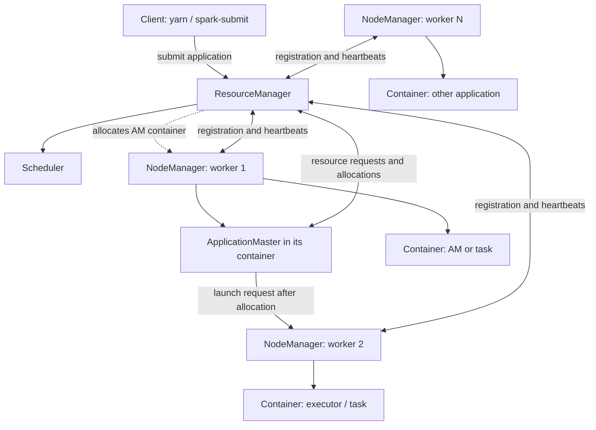
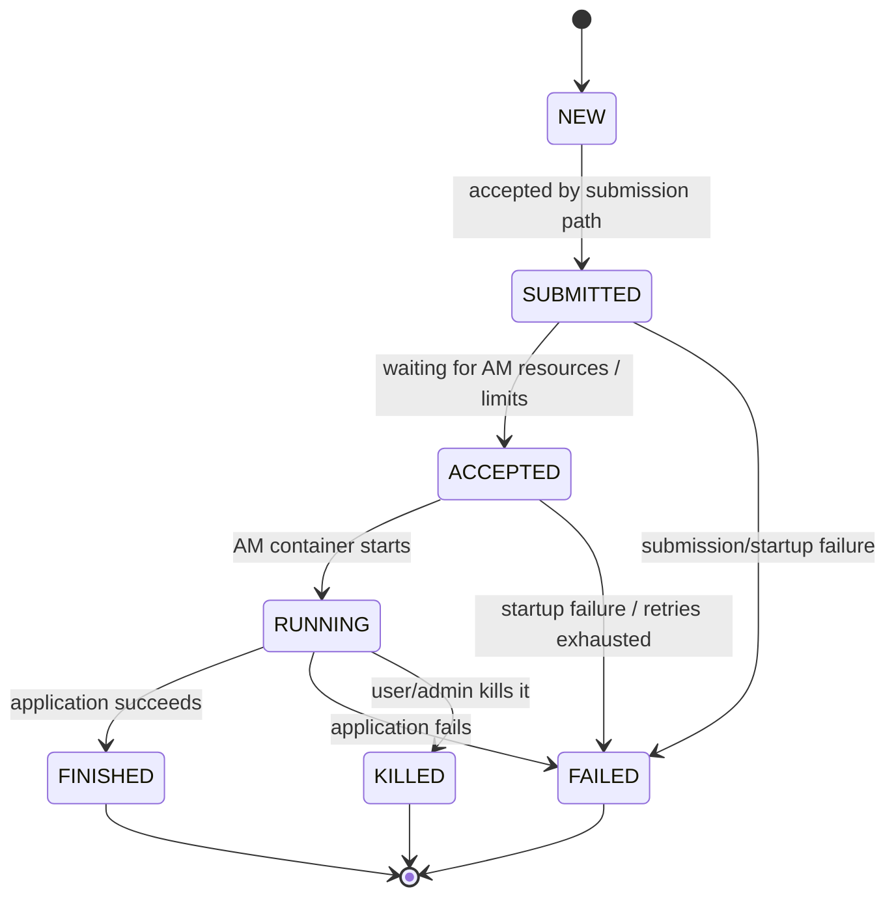
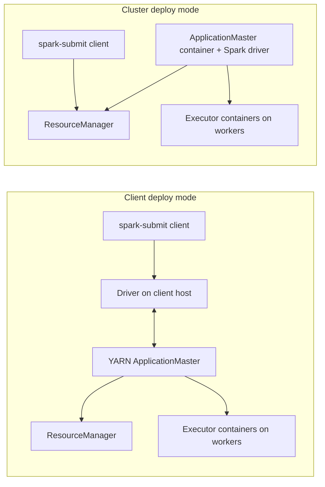

# YARN Resource Management: Architecture, Scheduling, Spark, and Production Operations

> **Roadmap location:** `Stage 2C — Data Engineering_3/02-Hadoop-Ecosystem-and-Legacy-Big-Data/02-yarn-resource-management.md`  
> **Predecessor:** `01-hdfs-architecture-namenode-datanodes-and-replication.md`  
> **Next lesson:** `03-mapreduce-model-and-why-spark-replaced-it.md`

## 1. Purpose and learning outcomes

YARN (Yet Another Resource Negotiator) is Hadoop's cluster resource-management layer. It separates cluster resource allocation from the processing framework using those resources. A shared cluster can therefore run MapReduce, Spark, Tez, and other YARN-compatible applications without each framework independently managing the entire cluster.

This lesson is about **understanding, operating, debugging, and eventually migrating existing Hadoop workloads**. It is not a recommendation to deploy a new Hadoop cluster by default.

By the end, you should be able to:

- Explain why YARN exists and distinguish resource management from data storage and job execution.
- Identify the ResourceManager, NodeManagers, ApplicationMaster, containers, queues, and scheduler.
- Trace an application from submission through `NEW`, `ACCEPTED`, `RUNNING`, and a terminal state.
- Inspect application status, cluster nodes, container logs, and the ResourceManager UI.
- Compare FIFO, Capacity, and Fair scheduling, including the configuration and version caveats.
- Size Spark-on-YARN drivers and executors with memory overhead, vcores, and YARN allocation limits accounted for.
- Diagnose pending applications, rejected resource requests, failed containers, memory kills, and missing logs systematically.
- Explain queue guarantees, elastic sharing, preemption, ACLs, user limits, node labels, and GPU awareness.
- Design two Capacity Scheduler queues for a ten-node cluster and explain what a 60%/40% capacity target actually guarantees.
- Compare YARN with Kubernetes for data workloads without treating either as universally superior.

## 2. Prerequisites and lab assumptions

### Prerequisites

You should already understand:

- Linux shell basics, processes, permissions, environment variables, and log files.
- The HDFS NameNode/DataNode model, block placement, and HDFS paths from Topic 01.
- Spark jobs, partitions, shuffles, driver/executor roles, and basic PySpark from Stage 2, Module 2.14.
- CPU cores, RAM, and the difference between a process's heap and total process memory.

### Lab assumptions

Examples use Hadoop **3.x** concepts and Spark **3.5.x** syntax unless stated otherwise. Hadoop vendor distributions may backport features, alter defaults, or rename service-management steps. Always check the exact installed versions and distribution documentation before changing a production cluster.

The configuration snippets below are **illustrative examples, not tested configurations**. They are fragments to merge carefully into the appropriate existing files, not complete production-ready configuration files. Never overwrite an existing cluster configuration with a snippet without preserving its other settings.

Useful environment checks:

```bash
hadoop version
yarn version
spark-submit --version
printf 'HADOOP_CONF_DIR=%s\nYARN_CONF_DIR=%s\n' "$HADOOP_CONF_DIR" "$YARN_CONF_DIR"
```

`HADOOP_CONF_DIR` or `YARN_CONF_DIR` should point to the client-side Hadoop configuration directory for the target cluster. The Spark distribution must include YARN support and be compatible with the cluster's Hadoop libraries and Java runtime.

## 3. Why YARN exists

Before YARN, Hadoop MapReduce handled both computation and much of cluster resource management. This tightly coupled model made it harder to share a cluster across different processing engines. YARN split those responsibilities:

- **Resource management:** track cluster resources and decide where containers can be allocated.
- **Application coordination:** let each application use an ApplicationMaster to negotiate resources and coordinate its own work.
- **Execution:** run framework-specific processes in containers on worker nodes.

YARN does not store files. HDFS or another storage system does that. YARN does not itself execute Spark SQL or map/reduce logic; it allocates containers in which the relevant application processes run.

### The three operations to distinguish

1. **Scheduling:** the scheduler evaluates requests, queue policy, priorities, and available resources to decide which request is eligible for allocation.
2. **Allocation:** the ResourceManager grants a container allocation to an application; the ApplicationMaster and NodeManager participate in launching the requested process.
3. **Execution:** the container process actually runs the ApplicationMaster, driver, executor, task, or other framework process.

A job can be submitted successfully but wait in `ACCEPTED` because it has not yet received the resources needed to start. A request can be valid but unallocatable on current nodes. A container can be allocated and then fail while its process is running. These are different failure classes and require different evidence.

## 4. YARN architecture



This diagram is conceptual. In an actual cluster, the ApplicationMaster is launched inside a container on a NodeManager, and containers may be placed on many nodes. The ResourceManager communicates with NodeManagers and application masters through multiple service protocols; it is not a single direct process-launch command.

### 4.1 ResourceManager (RM)

The ResourceManager is the cluster-wide authority for YARN resource allocation. It has two major responsibilities:

- **Scheduler:** allocates resources subject to queue, priority, resource, and placement policies. The scheduler does not monitor application task progress or restart arbitrary failed tasks on its own.
- **ApplicationsManager:** accepts submissions, manages application startup, and helps launch/restart an ApplicationMaster as configured.

The ResourceManager tracks cluster capacity and allocations, but it is not the worker process that executes each task. ResourceManager high availability, when configured, protects the control plane against an RM host/process failure; it does not eliminate all application or worker failures.

### 4.2 NodeManager (NM)

A NodeManager runs on each participating worker. It:

- Registers with the ResourceManager and sends heartbeats and node/resource status.
- Launches and monitors containers assigned to that node.
- Enforces local container resource limits according to the configured isolation mechanisms.
- Collects container diagnostics and, when configured, participates in log aggregation.

A NodeManager can be healthy while one container fails. Conversely, a lost NodeManager can make all containers on that node unavailable and cause affected applications to retry or fail.

### 4.3 ApplicationMaster (AM)

Each YARN application has an ApplicationMaster for its active application attempt. The AM is framework/application-specific. It:

- Negotiates resources from the ResourceManager.
- Requests containers for the application's work.
- Coordinates launch and monitoring of application processes.
- Reacts to failures according to the framework's recovery behavior.

For Spark, the AM role differs by deploy mode. In **cluster mode**, the AM process hosts the Spark driver. In **client mode**, the driver runs in the submitting client process, while the AM requests executor resources and coordinates with YARN. This distinction is central to debugging driver failures and client disconnects.

### 4.4 Containers

A YARN container is a resource allocation on a particular node, described by resources such as memory and virtual CPU cores (vcores), plus any configured custom resources. It is not a Docker container and does not necessarily mean an OS-level container runtime is involved. YARN's container-execution and isolation configuration determines how processes are launched and constrained.

A container is a **budget and placement decision**, not a guarantee that the application code will succeed. If a process exceeds enforced memory limits, the NodeManager may terminate it. If a request exceeds configured allocation limits, the scheduler may reject it before launch.

### 4.5 Scheduler and queues

The scheduler decides which pending requests may receive available resources. Queues partition capacity among workloads or teams. Queue policy can control capacity targets, maximum use, user limits, priorities, access, and (when enabled and supported) preemption.

### 4.6 ResourceManager UI

The common default ResourceManager web UI address is `http://<rm-host>:8088`, but ports, proxying, TLS, and authentication can differ. Use the actual configured URL, and do not expose an unsecured RM UI to untrusted networks. Inspect:

- Applications: state, final status, user, queue, start time, and diagnostics.
- Nodes: registered NodeManagers, health, and available/allocated resources.
- Scheduler: queues, configured capacity, used resources, and pending requests where exposed by the distribution.
- Application details: attempt/container links and tracking URLs when available.

## 5. CPU, memory, vcores, and resource requests

### 5.1 Physical resources versus YARN-advertised resources

A worker has physical CPU and RAM, but YARN uses configured resource values to decide how much is schedulable. For example, a 64 GiB host should not necessarily advertise all 64 GiB to YARN: the operating system, NodeManager, DataNode, monitoring agents, and other services also need resources.

Common `yarn-site.xml` settings include:

```xml
<configuration>
  <!-- Illustrative values only: adapt to the actual worker size and services. -->
  <property>
    <name>yarn.nodemanager.resource.memory-mb</name>
    <value>49152</value>
  </property>
  <property>
    <name>yarn.nodemanager.resource.cpu-vcores</name>
    <value>12</value>
  </property>
</configuration>
```

Here each NodeManager advertises 49,152 MiB (48 GiB) and 12 vcores to YARN. These numbers are not recommendations for every 64 GiB/12-core host; leave suitable headroom based on the host's workload and operational measurements.

**A vcore is a schedulable CPU unit, not necessarily one physical core.** Administrators choose the advertised vcore count. It is a useful scheduling abstraction, but it does not automatically guarantee a particular CPU share or prevent CPU contention unless CPU scheduling/isolation is correctly configured. A vcore-to-physical-core ratio is a capacity-planning choice, not a universal constant.

### 5.2 Minimum and maximum allocations

Cluster-wide resource request limits commonly include:

```xml
<configuration>
  <property>
    <name>yarn.scheduler.minimum-allocation-mb</name>
    <value>1024</value>
  </property>
  <property>
    <name>yarn.scheduler.maximum-allocation-mb</name>
    <value>8192</value>
  </property>
  <property>
    <name>yarn.scheduler.minimum-allocation-vcores</name>
    <value>1</value>
  </property>
  <property>
    <name>yarn.scheduler.maximum-allocation-vcores</name>
    <value>8</value>
  </property>
</configuration>
```

These are example limits. Verify the names and values supported by the exact Hadoop version/distribution and scheduler. A queue may impose stricter per-container maximums than the cluster-wide maximum. The scheduler can normalize requests according to its minimum/increment rules; do not assume a requested memory value is always allocated byte-for-byte as written.

Related settings to inspect include:

- `yarn.nodemanager.resource.memory-mb`
- `yarn.nodemanager.resource.cpu-vcores`
- `yarn.scheduler.minimum-allocation-mb`
- `yarn.scheduler.maximum-allocation-mb`
- `yarn.scheduler.minimum-allocation-vcores`
- `yarn.scheduler.maximum-allocation-vcores`
- Capacity Scheduler per-queue maximum allocation properties, where applicable.

The per-node advertised resource must be large enough to satisfy a container request, and the request must be within applicable cluster and queue limits. Even then, resources must be available on a suitable node and queue policy must permit allocation.

### 5.3 Resource allocation is multidimensional

A request for 8 GiB and 4 vcores needs both resources. A node with 12 GiB free but only 2 schedulable vcores cannot satisfy that request. Similarly, free CPU on one node does not combine with free memory on another to create one container: a container must fit on a single eligible node.

### 5.4 Resource accounting layers

Keep these layers separate:

1. **Physical host:** actual RAM and CPU.
2. **NodeManager advertised capacity:** resources YARN can schedule on that node.
3. **Queue capacity/maximum:** policy governing a queue's share and possible elasticity.
4. **Container request:** memory, vcores, and custom resources requested by an application.
5. **Process usage:** actual heap, native memory, Python processes, direct buffers, thread stacks, and other memory used at runtime.

Many production incidents occur because operators compare only two of these layers and assume they are equivalent.

## 6. Application submission and lifecycle



State labels and transitions shown are a simplified teaching model. The RM API exposes additional details, attempts, and final statuses, and a particular Hadoop release may report intermediate states slightly differently.

### Typical lifecycle

1. **Client submits.** The client packages the application metadata, configuration, credentials, and required resources and sends an application submission request to the RM.
2. **RM validates and accepts.** Authentication, queue ACLs, queue state, application limits, and request validity are checked. An accepted application is not necessarily running.
3. **Scheduler finds an AM allocation.** The RM scheduler must allocate resources for the AM container. If capacity, queue/user limits, AM resource limits, or placement constraints prevent this, the application can remain `ACCEPTED`.
4. **NodeManager launches the AM.** The selected NM localizes resources and starts the AM container. Launch failures produce diagnostics and may trigger an application-attempt retry.
5. **AM registers and requests work containers.** The AM negotiates further containers with the RM according to the framework's needs.
6. **NMs launch containers.** Processes such as Spark executors or MapReduce tasks start on selected workers.
7. **Application executes and recovers.** The framework reports progress and handles task/executor failures according to its own retry and recovery policy.
8. **Application terminates.** The AM reports completion; the RM records state/final status and releases allocations. Logs may remain accessible for a retention period if aggregation and retention are configured.

### Scheduling versus allocation versus execution: example

Suppose a Spark application requests an executor container of 8 GiB and 4 vcores. The scheduler sees that the queue has capacity and a worker has enough free resources, so the request is eligible. The RM allocates the container; a NodeManager launches the executor process. If that executor's actual memory usage exceeds the enforced container limit, the process can still be killed. A successful allocation is not a successful task execution.

## 7. Essential YARN commands

Run commands with credentials and configuration for the correct cluster. Use the application's full ID, for example `application_1700000000000_0042`.

```bash
# List applications (default listing commonly shows running applications).
yarn application -list

# Include applications in selected states when supported by the installed CLI.
yarn application -list -appStates ALL

# Inspect a specific application.
yarn application -status application_1700000000000_0042

# Request that an application be killed.
yarn application -kill application_1700000000000_0042

# Read aggregated logs for the application, if aggregation is enabled and logs retained.
yarn logs -applicationId application_1700000000000_0042

# List cluster nodes and their states.
yarn node -list

# Inspect one known queue (Apache Hadoop 3.4.1 supports -status, not -list).
yarn queue -status root.etl

# To inspect queue hierarchy and live usage, use the ResourceManager UI
# (typically http://<resourcemanager-host>:8088) or release-specific admin tooling.

# Inspect configured RM/YARN settings in the installed configuration directory.
grep -R "yarn.scheduler\|yarn.nodemanager.resource" "$HADOOP_CONF_DIR" 2>/dev/null
```

**Operational cautions:**

- `-kill` is destructive. Confirm the ID, owner, business impact, and whether cancellation is approved before using it in production.
- `yarn application -list` may default to running applications. Use the supported `-appStates` options to find completed/failed applications where needed.
- CLI options can vary by Hadoop release and vendor packaging. In Apache Hadoop 3.4.1, `yarn queue` supports `-status <QueueName>` rather than `-list`; use the ResourceManager UI or release-specific administrative tooling to inspect queue hierarchy. Check `yarn application -help`, `yarn queue -help`, `yarn logs -help`, or the distribution's documentation.
- `yarn logs` depends on log aggregation and retention. If aggregation is disabled or the logs have expired, inspect the relevant NodeManager's local log directories using the cluster's supported operational access path.

### Find container logs systematically

1. Get the application ID from the submit command, scheduler UI, or `yarn application -list`.
2. Run `yarn application -status <application_id>` and record diagnostics, tracking URL, queue, and final status.
3. Run `yarn logs -applicationId <application_id>`; if output is large, use supported container/node/log-type filters from `yarn logs -help` for your installed version.
4. In the RM UI, open the application and identify the failed attempt and container ID.
5. Check the NodeManager log/diagnostics for that container, especially the first failure, not only the final retry message.
6. Correlate timestamps across the application log, NM log, RM log, and host metrics.

## 8. Scheduling algorithms: FIFO, Capacity, and Fair

The scheduler is selected in Hadoop configuration; the names are not merely labels for UI behavior.

| Scheduler | Core idea | Strengths | Trade-offs and cautions | Typical fit |
|---|---|---|---|---|
| FIFO | Applications are ordered in a queue, broadly first-in-first-out subject to configured priorities and resource constraints. | Simple mental model; small single-tenant clusters. | A long job can delay later work; does not provide the same multi-tenant queue guarantees as a well-designed Capacity Scheduler setup. | Small labs or simple environments. |
| Capacity Scheduler | Hierarchical queues receive configured capacity targets; queues may use idle resources elastically up to configured maximums. | Team/workload isolation, capacity targets, queue ACLs, user limits, and optional preemption. | Requires deliberate queue design and administration. A capacity target is not a reservation of specific nodes and may not mean instant availability under contention. | Shared enterprise Hadoop clusters with teams, SLAs, or workload classes. |
| Fair Scheduler | Attempts to share resources fairly among applications or pools over time, according to configured policies. | Useful when many jobs of varying duration should share resources and pools are configured appropriately. | Behavior depends on pools, weights, minimum shares, and version/distribution. Do not assume it is enabled or identically configured everywhere. | Environments with fair-sharing goals and established Fair Scheduler operations. |

### 8.1 Configuration selection

A common Capacity Scheduler class name is:

```xml
<property>
  <name>yarn.resourcemanager.scheduler.class</name>
  <value>org.apache.hadoop.yarn.server.resourcemanager.scheduler.capacity.CapacityScheduler</value>
</property>
```

The commonly used Fair Scheduler class name in Hadoop distributions that include it is:

```xml
<property>
  <name>yarn.resourcemanager.scheduler.class</name>
  <value>org.apache.hadoop.yarn.server.resourcemanager.scheduler.fair.FairScheduler</value>
</property>
```

A FIFO Scheduler class exists in Hadoop releases that support it:

```xml
<property>
  <name>yarn.resourcemanager.scheduler.class</name>
  <value>org.apache.hadoop.yarn.server.resourcemanager.scheduler.fifo.FifoScheduler</value>
</property>
```

Only one scheduler class is active for the RM at a time. The exact availability and support status of schedulers depends on Hadoop version and vendor distribution. Do not switch the scheduler in production as a casual tuning change: queue definitions, policies, monitoring, and application expectations may all be affected.

### 8.2 Capacity, maximum capacity, and elasticity

For a parent queue with two children configured at 60% and 40%, the child capacities must total 100% in legacy percentage mode. The configured capacity expresses a queue's share of the parent's schedulable resources when there is competing demand. Capacity Scheduler can allow a queue to consume more than its capacity if other queues are not using resources, subject to its maximum capacity and other limits.

- **Capacity:** configured share/target used for allocation and fair distribution under contention.
- **Maximum capacity:** ceiling on elastic use, not a guarantee that the queue will receive that much.
- **Current usage:** what the queue has allocated now.
- **Pending demand:** resources requested but not yet allocated.
- **Available cluster resource:** schedulable resources that remain after allocations and policy constraints.

Do not describe a 60% capacity queue as “always has 60% of the machines idle and waiting.” Containers are placed on eligible nodes, and actual immediate availability depends on current allocations, request sizes, labels, queue policy, and whether preemption is enabled.

### 8.3 Preemption

Preemption allows the scheduler to reclaim containers from over-capacity queues so under-served queues can approach their configured targets. It is **not universally enabled by default**, and behavior depends on the Hadoop version and scheduler. In Capacity Scheduler, system-level monitoring/policy settings must enable the appropriate preemption policy; a queue can also have settings that affect whether its containers may be preempted.

Illustrative Hadoop 3.x `yarn-site.xml` fragment for Capacity Scheduler preemption:

```xml
<property>
  <name>yarn.resourcemanager.scheduler.monitor.enable</name>
  <value>true</value>
</property>
<property>
  <name>yarn.resourcemanager.scheduler.monitor.policies</name>
  <value>org.apache.hadoop.yarn.server.resourcemanager.monitor.capacity.ProportionalCapacityPreemptionPolicy</value>
</property>
```

Review the complete policy list before setting it: this property may contain multiple policies in some configurations, and replacing it blindly can remove other behavior. Test in a disposable cluster. Preemption may be gradual; it is not necessarily immediate. Consider workload disruption and the framework's response to killed containers.

Fair Scheduler has separate configuration and policy behavior; do not copy Capacity Scheduler preemption settings into a Fair Scheduler deployment and assume they apply.

## 9. Capacity Scheduler queue configuration

The Capacity Scheduler's configuration is commonly stored in `capacity-scheduler.xml`, with the active scheduler selected in `yarn-site.xml`. The built-in root queue is named `root`. Queue paths use dots, such as `root.etl`.

### 9.1 Two queues: ETL 60%, ad hoc 40%

For the design exercise, assume:

- Ten identical worker nodes, each advertising **48 GiB** and **12 vcores** to YARN after reserving host headroom.
- Aggregate advertised cluster capacity: `10 × 48 = 480 GiB` and `10 × 12 = 120 vcores`.
- No node labels or custom resources in the first version of the design.
- Two sibling leaf queues under `root`, both with demand during the scenario.
- Capacity Scheduler in legacy percentage mode; capacities at the same level sum to 100%.

The arithmetic target under sustained competing demand is:

| Queue | Capacity target | Approximate memory share of 480 GiB | Approximate vcore share of 120 |
|---|---:|---:|---:|
| `root.etl` | 60% | 288 GiB | 72 vcores |
| `root.adhoc` | 40% | 192 GiB | 48 vcores |
| **Total** | **100%** | **480 GiB** | **120 vcores** |

These are planning approximations, not an assertion that the scheduler always allocates exactly those aggregate amounts at every instant. Allocation granularity, currently running containers, node-level fit, AM limits, user limits, labels, and resource dimensions affect observed allocations. **Important resource-calculator caveat:** in Hadoop Capacity Scheduler legacy percentage mode, the configured percentages do not automatically mean independent hard guarantees of the same percentage of both memory and vcores. The active `yarn.scheduler.capacity.resource-calculator` matters; the common `DefaultResourceCalculator` is memory-oriented, while `DominantResourceCalculator` considers multiple resource dimensions. Verify the installed release's supported calculator and its behavior before promising CPU as well as memory shares. The 72/48 vcore figures above are capacity-planning ratios for this exercise, not a claim that those vcore shares are guaranteed by percentage settings alone.

Illustrative `capacity-scheduler.xml` fragment:

```xml
<configuration>
  <property>
    <name>yarn.scheduler.capacity.root.queues</name>
    <value>etl,adhoc</value>
  </property>

  <property>
    <name>yarn.scheduler.capacity.root.etl.capacity</name>
    <value>60</value>
  </property>
  <property>
    <name>yarn.scheduler.capacity.root.etl.maximum-capacity</name>
    <value>100</value>
  </property>

  <property>
    <name>yarn.scheduler.capacity.root.adhoc.capacity</name>
    <value>40</value>
  </property>
  <property>
    <name>yarn.scheduler.capacity.root.adhoc.maximum-capacity</name>
    <value>100</value>
  </property>

  <property>
    <name>yarn.scheduler.capacity.root.etl.state</name>
    <value>RUNNING</value>
  </property>
  <property>
    <name>yarn.scheduler.capacity.root.adhoc.state</name>
    <value>RUNNING</value>
  </property>
</configuration>
```

This is a minimal queue illustration, not a complete secure production configuration. Queue ACLs, user limits, maximum allocations, AM resource limits, application limits, labels, and other policies should be designed explicitly for a real cluster.

If your cluster uses a configuration-store mode other than file-based queue configuration, follow that mode's administration procedure. In a traditional file-backed setup, admins commonly update the queue file and refresh it with:

```bash
yarn rmadmin -refreshQueues
```

Confirm the queue names and capacities in the RM UI after refresh. A refresh does not magically make an invalid queue hierarchy valid; check RM logs and scheduler diagnostics.

### 9.2 Resource guarantees versus immediate availability

Suppose ETL is using 20% of the cluster and ad hoc demand is high. If ETL has no pending demand, ad hoc may use idle resources above its 40% target up to its maximum capacity (100% in the example). If ETL later submits work, the scheduler can allocate newly freed resources to ETL. If the cluster is fully occupied by ad hoc containers, the ETL queue may have to wait for natural completion or configured preemption to reclaim resources. Preemption may be delayed and disruptive.

Therefore, a 60% capacity target is a **queue-level scheduling policy**, not a hard guarantee that 60% of physical machines are permanently idle for ETL. For strict latency/SLA needs, combine queue policy with workload sizing, admission controls, capacity planning, reservations where supported, and carefully tested preemption.

### 9.3 Queue ACLs and user limits

Capacity Scheduler supports queue-level submission and administration ACLs. A queue's `acl_submit_applications` controls who may submit; `acl_administer_queue` controls who may administer applications/queue according to the scheduler's ACL semantics. Parent queue ACL inheritance and syntax must be checked against the installed Hadoop release.

Illustrative fragment:

```xml
<property>
  <name>yarn.scheduler.capacity.root.etl.acl_submit_applications</name>
  <value>etl_user1,etl_user2 etl_group</value>
</property>
<property>
  <name>yarn.scheduler.capacity.root.etl.acl_administer_queue</name>
  <value>yarn_admin etl_platform_admins</value>
</property>
<property>
  <name>yarn.scheduler.capacity.root.etl.user-limit-factor</name>
  <value>1</value>
</property>
```

ACL values typically use a user list, a space, and a group list. Avoid `*` in production unless open submission is an explicit and reviewed policy. Validate actual identity mapping, group lookup, proxy-user rules, and service accounts. The `user-limit-factor` controls how far a user may exceed queue capacity; it does not itself enforce business priority or an application-specific SLA.

Noisy-neighbour controls can include:

- Separate queues for ETL, interactive/ad hoc, streaming, and service workloads.
- Queue and user maximums, application-count limits, and AM resource limits.
- Sensible per-container memory/vcore maxima.
- ACLs and user-to-queue mapping rules.
- Preemption only where its operational impact is understood.
- Monitoring of pending containers, queue usage, long-running applications, and user-level consumption.

## 10. Spark on YARN

Spark uses YARN as its cluster manager when submitted with `--master yarn`. In this mode, the ResourceManager address is read from Hadoop configuration; it is not usually supplied as the `--master` URL.

### 10.1 Client mode versus cluster mode



| Topic | Client mode | Cluster mode |
|---|---|---|
| Driver location | Submitting client process/host | Inside the YARN application master container on a worker |
| AM role | Requests executor resources and coordinates with YARN; it does not host the Spark driver | Hosts the Spark driver and performs AM coordination |
| Client lifetime/connectivity | Client host must remain alive and reachable for the driver; losing it typically loses the driver | Client can disconnect after submission; driver continues on the cluster, assuming the application remains healthy |
| Driver logs | Primarily in the client process/log destination; executor logs are in YARN containers | Driver logs are in the AM/driver container; executor logs are in their containers |
| Common use | Interactive development or a persistent client environment | Scheduled jobs and unattended production batch jobs |

Spark's terminology can be confusing: in cluster mode the AM container hosts the driver, while client mode uses a separate AM for resource negotiation. Do not size or troubleshoot them as though both modes placed the driver identically.

### 10.2 Submit examples

The following example uses the SparkPi example JAR shipped with a compatible Spark binary distribution. Adapt the path and queue name to your installation.

```bash
# Client mode: driver stays on the submitting host.
spark-submit \
  --master yarn \
  --deploy-mode client \
  --queue etl \
  --driver-memory 2g \
  --executor-memory 4g \
  --executor-cores 2 \
  --num-executors 4 \
  --class org.apache.spark.examples.SparkPi \
  "$SPARK_HOME/examples/jars/spark-examples_2.12-3.5.7.jar" 100

# Cluster mode: driver runs inside the YARN AM container.
spark-submit \
  --master yarn \
  --deploy-mode cluster \
  --queue etl \
  --driver-memory 2g \
  --driver-cores 1 \
  --executor-memory 4g \
  --executor-cores 2 \
  --num-executors 4 \
  --class org.apache.spark.examples.SparkPi \
  "$SPARK_HOME/examples/jars/spark-examples_2.12-3.5.7.jar" 100
```

**Check the actual JAR name** under `$SPARK_HOME/examples/jars/`; Scala binary suffixes and version strings vary. If the exact file does not exist, use the matching JAR bundled with your Spark distribution rather than assuming this illustrative path is present.

The queue can also be selected with Spark property `spark.yarn.queue`, for example `--conf spark.yarn.queue=etl`. Use one clear source of configuration to avoid ambiguity.

### 10.3 Driver and executor resource model

Spark's principal settings include:

- `spark.driver.memory`: driver JVM heap. In cluster mode, it contributes to the driver/AM container request; in client mode, it sizes the client-side driver JVM and does not make the client host a YARN worker.
- `spark.driver.cores`: driver CPU cores in cluster mode where supported; do not assume it has the same effect in client mode.
- `spark.executor.memory`: executor JVM heap.
- `spark.executor.cores`: task slots/cores per executor, subject to the Spark/YARN configuration and resource allocation.
- `spark.executor.instances`: static executor count; dynamic allocation changes how many executors are requested over time.
- `spark.executor.memoryOverhead`: extra container memory for non-heap/native and other processes in the executor container.
- `spark.driver.memoryOverhead`: extra driver container memory in cluster mode.
- `spark.yarn.am.memory` and `spark.yarn.am.memoryOverhead`: AM resources in client mode.

Spark configuration defaults and property availability vary by Spark release. For Spark 3.5.x, consult the matching official Spark documentation, not just a newer `latest` page.

### 10.4 Executor sizing walkthrough

Assume a worker advertises 48 GiB RAM and 12 vcores to YARN. For an initial sizing exercise, reserve resources for the OS and node services *before* choosing those advertised values; the 48 GiB figure is already the schedulable YARN budget in this example.

Choose an executor with:

- Heap: 4 GiB = 4096 MiB.
- Memory overhead: 1 GiB = 1024 MiB.
- Off-heap memory: 0 MiB in this example.
- Separate `spark.executor.pyspark.memory`: not configured, so Python worker/native memory may need to fit within the overhead budget.
- Cores: 2 vcores.

Approximate YARN executor container request:

`4096 MiB heap + 1024 MiB overhead = 5120 MiB (5 GiB), 2 vcores`.

With 48 GiB advertised memory and 12 vcores per node, a purely arithmetic upper bound is `floor(48 / 5) = 9` such containers by memory, and `floor(12 / 2) = 6` by vcores. Therefore, at most **6** of these containers fit on one node under the simplified model, using 30 GiB and 12 vcores. Real placement can be lower because of other applications, AMs, allocation increments, node labels, queue policy, and the need to leave resources for other services if those services consume advertised capacity. Never plan to use every schedulable vcore for one application without considering other workloads.

For 4 executors, approximate executor container request totals are:

- Memory: `4 × 5120 MiB = 20,480 MiB = 20 GiB`.
- vcores: `4 × 2 = 8 vcores`.

In **cluster mode**, add the driver/AM container. For a driver heap of 2 GiB (2048 MiB), 512 MiB overhead, and 1 vcore, the illustrative driver container is 2560 MiB (2.5 GiB) and 1 vcore. Total requested container resources for four executors plus driver are therefore approximately `20 GiB + 2.5 GiB = 22.5 GiB` and `8 + 1 = 9 vcores`, before any other application components. In **client mode**, the driver lives outside the worker's YARN allocation, while the YARN AM has its own container; account for the AM using `spark.yarn.am.memory` and its overhead rather than incorrectly adding a YARN driver container.

This is a resource request calculation, not a throughput prediction. It does not guarantee all containers can be placed at once or that the job will perform well. Task parallelism, input partitioning, shuffle, data skew, CPU generation, garbage collection, and I/O determine actual performance.

### 10.5 Memory overhead and container-killed errors

For Spark on YARN, the executor container request is generally based on executor heap plus overhead and any configured off-heap/PySpark memory additions. The precise formula depends on the Spark version and which properties are set. In Spark 3.5.x, `spark.executor.memoryOverhead` is supported on YARN; Spark also documents `spark.executor.pyspark.memory`, `spark.memory.offHeap.size`, and the overhead factor. Do not assume the JVM heap is the total process memory.

Memory used outside the Java heap may include:

- Python worker processes in PySpark.
- Native libraries and direct byte buffers.
- JVM metaspace, thread stacks, code cache, and native allocations.
- Off-heap Spark memory if configured.
- Other processes accounted for within the container's resource model.

A typical diagnostic might say that a container was killed for exceeding its physical memory limit. The exact wording differs by Hadoop/Spark release. The fix is not automatically “increase driver memory”: first identify the killed container and whether it is the driver/AM or an executor, then compare the container limit with actual usage and the Spark configuration.

Illustrative executor settings for a workload that needs more native/Python headroom:

```bash
--conf spark.executor.memory=4g \
--conf spark.executor.memoryOverhead=1536m \
--conf spark.executor.cores=2
```

This changes the executor container request to approximately 4 GiB heap + 1.5 GiB overhead = 5.5 GiB, plus other configured resource additions. It must still fit under the cluster and queue per-container maximums and on a suitable worker. Increase overhead based on evidence; it reduces the memory available for other containers and can reduce concurrency. If the heap itself is too small, adjust heap and workload behavior too. A memory-overhead increase cannot fix an invalid YARN maximum-allocation setting or a queue that lacks capacity.

### 10.6 Dynamic allocation

With dynamic allocation, Spark can request more executors when there is demand and remove idle executors according to its policy. It is not automatically enabled in every installation and it does not bypass YARN queue capacity, per-container limits, node capacity, or queue/user limits.

Append this illustrative option fragment to a `spark-submit` command; it is not a standalone shell command:

```bash
--conf spark.dynamicAllocation.enabled=true \
--conf spark.dynamicAllocation.minExecutors=2 \
--conf spark.dynamicAllocation.initialExecutors=4 \
--conf spark.dynamicAllocation.maxExecutors=20
```

On Spark 3.x, dynamic allocation requires an appropriate shuffle-preservation mechanism, such as the external shuffle service, or another supported configuration for that Spark version. Check the matching Spark 3.5.x documentation and the cluster's shuffle service setup before enabling it. Spark's YARN integration and vendor packaging affect the details. `spark.executor.instances` may influence the initial executor count; do not combine static and dynamic assumptions without checking the version-specific semantics.

Dynamic allocation improves flexibility, not guaranteed latency. An application can wait for containers because its queue is busy, the cluster is full, node labels restrict placement, or its requested resources are too large to fit.

## 11. Node labels and GPU scheduling awareness

Node labels let administrators partition nodes by attributes such as high-memory, SSD, or GPU capability and restrict which queues/applications can use those nodes. A label is a scheduling/placement feature, not a general-purpose hardware discovery mechanism.

Before relying on labels, confirm:

- Labels exist and are assigned to the intended nodes.
- Queue accessibility and capacity for each label are configured correctly.
- Application requests target the intended label/partition where required.
- There is sufficient labeled capacity for the AM and all required containers.

YARN 3.x supports custom resource types and GPU-related resource scheduling in supported configurations, but the cluster must register/configure the resource type, NodeManagers must advertise it, scheduling/isolation must be configured, and the application must request it. Spark's YARN GPU resource integration is version-sensitive; newer Spark properties may not exist in older Spark 3.x releases. Treat this section as awareness unless you have a lab with compatible Hadoop/Spark versions and GPU hardware.

## 12. Log aggregation and systematic debugging

### 12.1 Log aggregation

Container stdout/stderr and application logs are initially written on the worker running the container. YARN log aggregation, when enabled, collects them to a configured remote location (commonly HDFS) after container/application completion. Retention and aggregation behavior depend on configuration and distribution.

Relevant settings to inspect include `yarn.log-aggregation-enable`, the remote log directory/suffix, retention settings, and NodeManager local log directory configuration. Names and defaults should be checked against the exact Hadoop release. Do not turn log aggregation off in production merely to simplify a lab.

### 12.2 Diagnostic workflow

For any failed or pending job, follow this order:

1. **Identify:** application ID, user, queue, submit time, deployment mode, and current/final state.
2. **Classify:** pending/`ACCEPTED`, submission rejected, AM startup failure, driver failure, executor/container failure, task failure, or successful application with incorrect output.
3. **Read diagnostics:** `yarn application -status <id>`, RM UI diagnostics, and `yarn logs -applicationId <id>`.
4. **Locate the first failing component:** client/driver, AM, executor, task, NodeManager, or ResourceManager.
5. **Check resource request:** heap, overhead, vcores, custom resources, YARN min/max, queue max, node-advertised capacity, and actual node free resources.
6. **Check policy:** queue state, ACL, user/application limits, AM resource percent, label accessibility, queue capacity and maximum capacity, and preemption configuration.
7. **Check node health:** NM registration/health, disk health, local directories, process/container exit status, host memory/CPU, and network/connectivity.
8. **Make one controlled change:** record the old/new config and hypothesis; rerun a small reproducible workload.
9. **Validate:** check final status, logs, resource usage, output correctness, and whether the change affected other queues.

Avoid changing heap, overhead, executor count, queue limits, and preemption simultaneously. Doing so makes cause and effect difficult to determine.

## 13. Common incident patterns

### 13.1 Application remains in `ACCEPTED`

Possible causes include:

- The AM container cannot be allocated because there is not enough suitable free memory/vcores.
- The queue is at capacity and no elastic resources are available.
- The queue's maximum capacity, user limit, or application limit is reached.
- The maximum AM resource percentage limits the number of concurrently active applications.
- A user-level parallel-application limit is reached.
- The queue is stopped or the application has a queue/placement issue.
- A node-label or resource request constraint leaves no eligible node.

Procedure:

1. Run `yarn application -status <id>` and capture diagnostics.
2. Check the RM UI's scheduler page for queue usage, pending resources, and application/AM status.
3. Inspect `yarn node -list` and the node resource view; verify whether nodes are healthy and registered.
4. Check queue state/capacity/maximum, user limits, AM resource limits, app limits, and labels.
5. Confirm that the AM resource request is below cluster and queue maximum allocations and fits on an eligible node.
6. Do not immediately kill/re-submit the application or raise all limits; determine the blocking policy/resource first.

### 13.2 Container fails immediately at launch

Likely areas: bad localized file/path, permissions, missing environment variables, Java mismatch, missing libraries, invalid container launch context, disk/local-dir problems, or an invalid resource request. Check the first AM/NM diagnostic, container launch error, and localization log rather than focusing only on the final application state.

### 13.3 Container killed for memory overrun

1. Identify whether the killed container is the driver/AM or an executor.
2. Read the container diagnostic and actual memory peak if metrics are available.
3. Compare `spark.executor.memory` with `spark.executor.memoryOverhead` and any off-heap/PySpark additions.
4. Check for large shuffles, skew, caching, Python/native memory, too many concurrent tasks per executor, and leaks.
5. Increase the correct memory component only after confirming the request fits YARN and queue limits.
6. If appropriate, reduce executor cores/concurrent tasks, reduce per-task memory demand, repartition/skew-handle, or avoid unnecessary caching.
7. Rerun with metrics and compare container peak usage and task behavior.

A JVM `OutOfMemoryError` and a YARN physical-memory kill are not the same failure. The former may indicate heap exhaustion; the latter can happen while the JVM heap is below its configured maximum because the total process/container usage exceeded the limit.

### 13.4 Logs are missing

Check whether log aggregation is enabled, whether the application has completed, whether retention expired, whether the right application ID and attempt were used, and whether the container ran on an unexpected node. If aggregation is unavailable, authorized operators may need to inspect the NodeManager's local container logs. Do not assume the absence of `yarn logs` output means the container produced no logs.

### 13.5 Queue says resources are available, but an application is waiting

Check multidimensional fit (memory *and* vcores), per-container maxima, allocation increments, node labels, queue-specific limits, AM allocation, user/application limits, and whether “available” is an aggregate number that cannot fit the requested container on any single eligible node. Fragmentation can matter even when the aggregate free resource looks sufficient.

## 14. Runbook: application stuck in ACCEPTED

Use this runbook in the lab and adapt it to the organization's access and escalation model.

**Goal:** identify why an accepted application has not entered `RUNNING`, without making speculative configuration changes.

1. Record application ID, owner, queue, submit timestamp, application type, and business SLA.
2. Run `yarn application -status <application_id>` and save the diagnostics.
3. Open the application in the RM UI; record current state, attempt state, queue, and tracking link.
4. Confirm that the queue is `RUNNING` and the owner is permitted to submit.
5. Check queue used/capacity/max capacity, pending requests, user limits, maximum applications, per-user parallel-app limits, and maximum AM resource percentage.
6. Check NodeManager registration and health with `yarn node -list` and the RM node view.
7. Compare the AM request to cluster/queue min/max allocation settings and node-advertised resources. Confirm a suitable node can fit it.
8. Check node labels and custom resources if the application uses them.
9. Check RM and NM logs for scheduling, launch, or localization diagnostics.
10. If the cause is normal contention, communicate the expected queue policy and wait for resources or follow the approved priority/escalation process. If a configuration defect is confirmed, propose one bounded correction and obtain approval.
11. After the application starts, monitor its AM and executor/container logs; `RUNNING` alone does not prove the job will finish successfully.
12. Record root cause, evidence, mitigation, follow-up owner, and whether the runbook or queue configuration needs updating.

Do not promise an ETA based solely on a queue capacity percentage. It is not a queueing-time guarantee.

## 15. Multi-tenancy, noisy neighbours, and SLAs

A production queue design should answer these questions:

- Which teams and service accounts can submit to each queue?
- Which workloads are latency-sensitive, deadline-bound, interactive, or throughput-oriented?
- What capacity targets, maximum elastic capacity, and user limits are appropriate?
- How large can a single container request be? Can one executor occupy most of a worker?
- How many application masters may start concurrently?
- Is preemption enabled, and what disruption is acceptable?
- Which workloads need node labels or custom resources?
- Who owns queue changes and on-call response?
- What dashboards and alerts cover queue pending resources, application age, failed containers, node health, and user consumption?

A queue is not a substitute for application-level resource hygiene. A badly sized executor can still monopolize a worker, and many small executors can create overhead and scheduling pressure. Use queue isolation and per-application sizing together.

## 16. YARN versus Kubernetes for data workloads

| Dimension | YARN | Kubernetes |
|---|---|---|
| Primary model | Hadoop-oriented cluster resource manager and application containers | General-purpose container orchestration platform with pods, controllers, services, and scheduling |
| Common ecosystem fit | Existing Hadoop, HDFS, MapReduce, Hive/Tez, Spark-on-YARN clusters | Cloud-native services, Spark-on-Kubernetes, platform workloads, and containerized applications |
| Resource isolation | YARN containers and configured NodeManager isolation; enforcement depends on deployment | Pod/container resource requests and limits plus configured runtime/cgroup behavior |
| Multi-tenancy | Queues, capacities, ACLs, user limits, and optional preemption | Namespaces, RBAC, quotas, policies, node pools, and scheduling controls; configuration is required |
| Operations | Often closely coupled to Hadoop distribution, HDFS, and cluster services | Broader platform surface: control plane, networking, storage, image lifecycle, security, and operators |
| Migration concerns | Existing operational knowledge and Hadoop-native workflows | Packaging, identity/security, data access, storage/networking, observability, shuffle, autoscaling, and cost need redesign |

Organizations migrate from YARN for reasons such as standardizing on Kubernetes, using managed/serverless platforms, decoupling compute from HDFS, aligning with cloud-native deployment practices, or reducing dependence on legacy Hadoop distributions. Others retain YARN because existing jobs, data locality, operational expertise, and migration cost make it appropriate for current workloads.

Kubernetes is not a drop-in replacement for YARN. A migration must validate Spark runtime compatibility, shuffle behavior, identity and secret handling, HDFS/object-store access, autoscaling, logs/metrics, scheduling isolation, and operational ownership. This module's goal is to understand YARN well enough to operate and migrate it responsibly.

## 17. Hands-on labs — `experiments/02_yarn/`

Run these in a disposable Docker Compose or test cluster. Never intentionally trigger resource exhaustion or preemption on a shared production cluster.

### Lab 1 — Submit Spark in client and cluster modes

1. Confirm Spark/YARN versions and `HADOOP_CONF_DIR`/`YARN_CONF_DIR`.
2. Submit the same small Spark job with `--deploy-mode client` and `--deploy-mode cluster`.
3. Capture application IDs, queue, state transitions, and final status.
4. Compare where driver logs appear, where the AM runs, and how executor logs are retrieved.
5. In a disposable environment only, observe behavior when the submitting terminal/client disconnects. Do not assume all shells or wrappers handle disconnection identically; the key distinction is driver location.
6. Write a short comparison and explain which mode is preferable for scheduled production batch jobs and why.

**Evidence to retain:** commands, versions, application status output, relevant log excerpts, and a short conclusion. Do not include credentials or sensitive logs.

### Lab 2 — Deliberately undersize memory, inspect the failure, correct it

1. Choose a small workload and set executor heap/overhead deliberately too low in an isolated lab.
2. Submit the job and identify the first failing executor/container from YARN diagnostics.
3. Distinguish a JVM heap `OutOfMemoryError` from a YARN container physical-memory kill.
4. Inspect executor heap, overhead, off-heap/PySpark memory settings, executor cores, and per-container allocation limits.
5. Increase `spark.executor.memoryOverhead` where evidence indicates non-heap/native/Python usage is the problem; if heap is the problem, adjust heap or application behavior instead.
6. Confirm the new total container request fits the cluster and queue maximum allocation and can fit on a suitable node.
7. Rerun and compare failure diagnostics, peak memory if available, and completion status.

**Safety:** do not set values that can exhaust the host or interfere with other lab users. Avoid production nodes.

### Lab 3 — Two queues, workload sharing, and preemption

1. Configure `root.etl` at 60% and `root.adhoc` at 40% in a test Capacity Scheduler deployment.
2. Refresh the queue configuration using the method supported by the cluster, then verify both queues in the RM UI.
3. Submit a workload to each queue and capture capacity, used resources, pending requests, and application states.
4. Let one queue become idle and observe whether the other can use elastic capacity, subject to maximum capacity.
5. In the disposable cluster, enable and test the appropriate Capacity Scheduler preemption policy if supported. Compare behavior with preemption disabled and enabled.
6. Record the delay and effects; do not claim preemption is immediate or enabled by default.

**Evidence to retain:** queue configuration, refresh result, UI observations, application IDs, and a concise interpretation of configured capacity versus current usage.

### Lab 4 — Write and rehearse the `ACCEPTED` runbook

1. Use a test workload or a deliberately constrained queue to produce a pending/`ACCEPTED` application without destabilizing the cluster.
2. Follow Section 14 in order.
3. Record the actual blocking cause, evidence, and the smallest safe mitigation.
4. Repeat with a different cause if feasible, such as queue capacity versus AM/application limits.
5. Have another learner follow the runbook without verbal hints; revise ambiguous steps.

## 18. Interview questions and answers

### Q1. Why was YARN introduced?

To separate cluster resource management from MapReduce so multiple processing frameworks can share a Hadoop cluster under a common resource manager.

### Q2. What is the difference between the ResourceManager and ApplicationMaster?

The RM manages cluster-wide allocation and scheduling. An AM coordinates one application's resource requests and execution lifecycle through the framework's logic.

### Q3. Is a YARN container the same as a Docker container?

No. A YARN container is a resource allocation and process-launch context. It may use configured OS/container isolation, but it is not inherently a Docker container.

### Q4. Why can an application be in `ACCEPTED` for a long time?

Its AM may be waiting for suitable resources, queue capacity, user/application/AM limits, a running queue, or an eligible node/label. Inspect RM diagnostics and scheduler state before changing configuration.

### Q5. What is the difference between queue capacity and maximum capacity?

Capacity is the configured share/target under competing demand. Maximum capacity limits elastic use. Neither promises a fixed set of idle machines or instant application start.

### Q6. Does Capacity Scheduler always preempt containers automatically?

No. Preemption requires the appropriate supported scheduler policy and configuration. Behavior and defaults depend on Hadoop version/distribution; verify the active configuration.

### Q7. Why can a Spark executor be killed even if `spark.executor.memory` is not exhausted?

The YARN container limit covers more than JVM heap. Native allocations, Python workers, direct buffers, thread stacks, off-heap memory, and other process usage can push total usage over the container limit.

### Q8. What changes between Spark client and cluster mode on YARN?

Client mode keeps the driver on the submitting host and uses an AM to request executor resources. Cluster mode runs the driver inside the AM container on a worker. This changes failure domains, driver logs, and resource accounting.

### Q9. Does dynamic allocation guarantee more executors immediately?

No. It can request executors as demand changes, but YARN must still find eligible resources and honor queue, user, and per-container constraints. The necessary shuffle-preservation setup must also be supported and configured.

### Q10. Why can a request wait even when the cluster appears to have free memory?

It may lack enough vcores, exceed a queue or cluster maximum, require a container too large to fit on any one eligible node, be restricted by labels, or be blocked by queue/user/AM limits.

### Q11. What does a 60% ETL capacity target mean in a two-queue design?

It configures ETL's share of the parent queue's schedulable resources under contention. Idle resources can be shared elastically if maximum capacity allows; current allocations and preemption affect when ETL can actually obtain resources.

### Q12. When might Kubernetes be preferable to YARN?

When the platform strategy favors general container orchestration, cloud-native operations, managed services, or unified deployment practices. It is not a drop-in replacement; data access, shuffle, identity, scheduling, and operations must be validated.

## 19. Common mistakes to avoid

- Treating YARN as a storage system instead of a resource manager.
- Assuming a successful submission means the application is running.
- Treating scheduling, allocation, and execution as the same event.
- Assuming one vcore always equals one physical CPU core.
- Configuring YARN to advertise all host RAM/CPU without leaving headroom for system services.
- Increasing Spark heap when the actual problem is container overhead or Python/native memory.
- Forgetting that a container must fit on one eligible node and meet both memory and vcore constraints.
- Assuming Capacity Scheduler preemption is always enabled or instantaneous.
- Assuming queue capacity means reserved idle nodes or an application start-time SLA.
- Enabling dynamic allocation without checking the supported shuffle-preservation mechanism for the Spark version.
- Looking only at the submit terminal log while ignoring driver, AM, executor, and NodeManager diagnostics.
- Assuming missing aggregated logs mean no logs were produced.
- Copying configuration from a different Hadoop/Spark version without verifying property availability and defaults.
- Making multiple unrelated configuration changes before retesting.
- Testing memory exhaustion or preemption on a shared production cluster.

## 20. Final self-assessment checklist

You are ready to move to Topic 03 — MapReduce model and why Spark replaced it — when you can do the following without relying on notes:

- [ ] Explain why YARN exists and how it differs from HDFS and the execution framework.
- [ ] Describe the responsibilities of ResourceManager, NodeManager, ApplicationMaster, scheduler, queue, and container.
- [ ] Explain the difference between physical resources, NodeManager-advertised resources, queue capacity, container requests, and actual process usage.
- [ ] Trace application submission, AM allocation, container launch, execution, and completion.
- [ ] Use `yarn application -list`, `-status`, `-kill`, `yarn logs`, and `yarn node -list` safely.
- [ ] Locate application state, queue usage, and diagnostics in the ResourceManager UI.
- [ ] Compare FIFO, Capacity, and Fair scheduling and identify which scheduler is configured in a given cluster.
- [ ] Explain capacity, maximum capacity, elastic sharing, user limits, queue ACLs, and preemption.
- [ ] Explain Spark client versus cluster mode and identify where the driver, AM, and executors run.
- [ ] Calculate a Spark executor's approximate YARN memory request including overhead and cores.
- [ ] Explain why a container can exceed its memory limit while JVM heap usage is below the configured heap maximum.
- [ ] Diagnose an application stuck in `ACCEPTED` using evidence rather than guesses.
- [ ] Describe how node labels and GPU resource scheduling can constrain placement.
- [ ] Design the 60% ETL / 40% ad hoc queues for the ten-node scenario and state the assumptions behind the arithmetic.
- [ ] Explain trade-offs between YARN and Kubernetes for existing data workloads.
- [ ] Complete the four labs in a disposable environment and document observed behavior without inventing test results.

## 21. Reference documentation

Use documentation matching the versions installed in your lab. Official references consulted while preparing this lesson:

- Apache Hadoop 3.4.1 YARN Commands: <https://hadoop.apache.org/docs/r3.4.1/hadoop-yarn/hadoop-yarn-site/YarnCommands.html>
- Apache Hadoop 3.4.1 Fair Scheduler: <https://hadoop.apache.org/docs/r3.4.1/hadoop-yarn/hadoop-yarn-site/FairScheduler.html>
- Apache Hadoop 3.4.1 Capacity Scheduler: <https://hadoop.apache.org/docs/r3.4.1/hadoop-yarn/hadoop-yarn-site/CapacityScheduler.html>
- Apache Hadoop cluster setup and YARN resource configuration: <https://hadoop.apache.org/docs/r3.4.1/hadoop-project-dist/hadoop-common/ClusterSetup.html>
- Apache Spark 3.5.7 — Running Spark on YARN: <https://spark.apache.org/docs/3.5.7/running-on-yarn.html>
- Apache Spark 3.5.7 — Configuration: <https://spark.apache.org/docs/3.5.7/configuration.html>
- Apache Hadoop documentation for the exact release/vendor distribution deployed in the lab.

These references describe documented behavior, not a claim that the examples in this lesson were executed. Before using a snippet in a real cluster, validate it against the installed Hadoop/Spark versions, current configuration, security model, and operational procedures.
