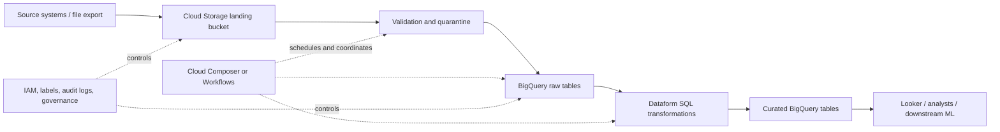
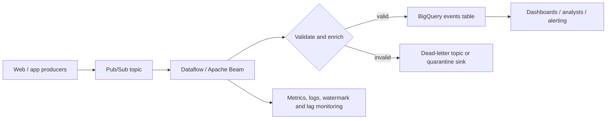
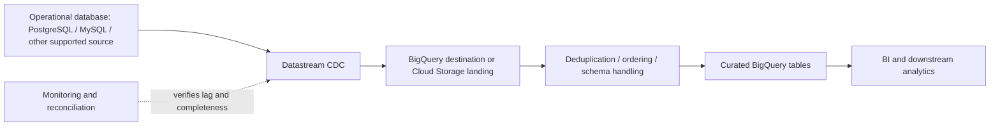
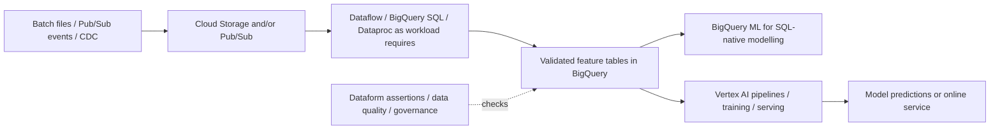

# Topic 01 — GCP Data Services Landscape

**Roadmap location:** Stage 2C — Data Engineering_3 → `04-Google-Cloud-BigQuery-and-GCP-Data-Engineering/`  
**Next lesson:** `02-bigquery-architecture-slots-and-storage.md`  
**Level:** Beginner → Intermediate → Advanced  
**Primary tools:** Google Cloud Console, `gcloud`, `bq`, Cloud Storage, BigQuery; Terraform is the preferred repeatable provisioning path for the full lab.

> **Syllabus authority.** This lesson follows Topic 01 in `roadmap-Google-Cloud-BigQuery-and-GCP-Data-Engineering.md`. The complete project tree in `Roadmap_ptree.md` places this file as the first lesson in module `04-Google-Cloud-BigQuery-and-GCP-Data-Engineering`. The roadmap asks learners to map services, explain projects/IAM/service accounts, design a daily-sales-plus-real-time-clickstream architecture, create a project and budget alert, use a least-privilege service account, create a bucket and dataset, load CSV with `bq`, inspect or enable billing export, and write a service map.
>
> **Scope boundary.** This is the platform landscape, not the deep-dive lesson for BigQuery internals, Dataflow programming, Dataproc, orchestration, or governance. Those subjects are introduced here and developed in later topics.

## 1. Learning objectives and expected outcomes

By the end, you should be able to:

1. Explain the organisation → folder → project → resource hierarchy and how billing accounts relate to it.
2. Select a region or multi-region deliberately and understand location constraints.
3. Explain IAM principals, predefined roles, service accounts, and Application Default Credentials (ADC); use a basic `gcloud` workflow.
4. Categorise GCP data services by responsibility and describe how they work together.
5. Map common AWS and Azure data services to reasonable GCP counterparts without assuming equivalence is exact.
6. Choose services for batch lake-to-warehouse, streaming analytics, change data capture (CDC), and ML feature pipelines.
7. Distinguish Datastream, Data Fusion, Dataform, and BigLake by purpose and trade-offs.
8. Explain the role of VPCs, Private Google Access, VPC Service Controls, organisation policies, labels, and billing export.
9. Compare serverless services with managed clusters, and explain portability considerations for Apache Beam, Spark, and Apache Iceberg.
10. Describe the main BigQuery query, capacity, storage, and streaming-related cost dimensions and set practical cost guardrails.
11. Complete the `experiments/01_landscape/` exercise and defend a service map and reference architecture.

**Deliverable:** a concise service-map document plus an architecture for daily sales files and real-time clickstream events.

## 2. Prerequisites and foundational vocabulary

### 2.1 Prerequisites from the roadmap

The module expects you to have encountered:

- SQL, window functions, and partitions (Stage 2, Module 2.6).
- Columnar formats and partitioning (Stage 2, Module 2.5).
- Dimensional modelling (Stage 2, Module 2.8).
- Streaming concepts such as event time, windows, and watermarks (Stage 2, Module 2.16).
- Spark (Stage 2, Module 2.14) and Airflow (Stage 2, Module 2.13).
- Cloud storage, IAM, Terraform, and CI/CD (Stage 2, Module 2.17; Stage 2B; Module 2.18).
- Snowflake warehouses and cost models (Module 2C.3), useful as a contrast to BigQuery slots.

You do not need to be a GCP expert yet. This lesson supplies the platform vocabulary needed for later topics.

### 2.2 Vocabulary

| Term | Meaning | Why a data engineer cares |
|---|---|---|
| Resource | A Google Cloud object, such as a bucket, dataset, topic, or VM | Resources have configuration, location, permissions, and lifecycle. |
| Project | A resource container and major boundary for APIs, IAM, quotas, and billing attribution | Projects help separate environments and workloads. |
| Region / zone | A geographic region / an isolated location within a region | Location affects latency, availability design, data residency, and service compatibility. |
| IAM principal | A user, group, service account, or other supported identity | Permissions are granted to principals on resources. |
| Service account | A workload identity for applications and automation | Jobs need controlled permissions without sharing a human login. |
| ADC | Application Default Credentials, a credential-discovery mechanism used by Google client libraries | Local development and deployed workloads can use different safe credential sources. |
| Serverless | A service where the provider manages most underlying infrastructure and scaling | Less cluster operations, but not necessarily zero configuration or zero cost. |
| CDC | Change data capture: replication of inserts, updates, and deletes from a source system | Supports incremental replication without repeated full extracts. |
| Lake / warehouse | A lake stores files in flexible formats; a warehouse provides managed analytical tables and SQL | Many architectures use both rather than choosing only one. |
| Control plane / data plane | Control plane configures resources; data plane processes or transfers workload data | Helps distinguish API/IAM setup from actual pipeline execution. |

### 2.3 A reliable service-selection mindset

Start with workload requirements, not product names. Write down:

- **Data shape:** files, relational rows, key/value lookups, events, or features.
- **Access pattern:** point reads/writes, transactional queries, analytical scans, or continuous streams.
- **Latency:** milliseconds, seconds, minutes, or daily batch.
- **Scale and variability:** bytes per day, events per second, concurrency, and peak-to-average ratio.
- **Consistency and correctness:** ordering, deduplication, replay, transactionality, and acceptable lateness.
- **Security and residency:** identities, sensitive columns, network boundaries, and required location.
- **Operations:** who owns schema changes, retries, upgrades, scaling, and incident response.
- **Cost shape:** bytes stored, bytes scanned, compute time, provisioned capacity, messages, network egress, and always-on resources.
- **Portability:** whether the design must run across cloud providers or on other compatible engines.

A sound architecture often uses several services, each with one clear responsibility.

## 3. GCP resource hierarchy and project setup

### 3.1 Resource hierarchy

A common hierarchy is:

```text
Organisation (company identity / policy boundary)
└── Folder (optional grouping, e.g. production or data-platform)
    └── Project (APIs, IAM bindings, quotas, resource container)
        ├── Cloud Storage bucket
        ├── BigQuery dataset and tables
        ├── Pub/Sub topic and subscription
        └── Dataflow job / other service resources
```

The organisation is associated with a Google Workspace or Cloud Identity domain when an organisation resource is available. Folders are optional and can be nested. Projects are the primary resource containers used for enabling APIs, applying many IAM bindings, tracking quotas, and associating resources with billing. Not every resource is a direct child of a project in the same way; some resources have service-specific parent models.

**Billing accounts are related to, but not a parent tier in, the resource hierarchy.** A billing account pays for eligible usage in linked projects. A project can have billing disabled or no linked billing account; some services and features then cannot be used. Billing permissions and resource permissions are separate concerns.

**Practical environment separation:** use distinct projects for development, staging, and production where feasible. Separate projects reduce accidental cross-environment changes, make IAM and billing analysis clearer, and help isolate quotas. A small learning lab may use one disposable project, but do not treat that as a universal production design.

### 3.2 Project identifiers

A project has a human-readable display name, a globally unique project ID, and a numeric project number. The project ID is used in many CLI commands and resource names. Choose a clear, stable ID; project IDs are not freely renameable after creation.

Inspect the active account and project:

```bash
gcloud auth list
gcloud config list
gcloud projects list
```

Set the intended project explicitly for the current CLI configuration:

```bash
gcloud config set project YOUR_PROJECT_ID
gcloud config get-value project
```

These commands inspect or change local CLI configuration; they do not create a project or grant permissions.

Create a project only if you have permission to create projects under the intended organisation or without an organisation, and only after confirming billing and ownership requirements:

```bash
gcloud projects create YOUR_UNIQUE_PROJECT_ID \
  --name="GCP Data Engineering Lab"
```

If your organisation requires a folder or organisation parent, specify the appropriate supported parent flag and ID. Do not guess the parent ID. Project creation alone does **not** guarantee billing is linked or required APIs are enabled.

Link billing only if you are authorised and have confirmed the billing account ID:

```bash
gcloud billing accounts list
gcloud billing projects link YOUR_PROJECT_ID \
  --billing-account=YOUR_BILLING_ACCOUNT_ID
```

**Safety:** do not paste billing IDs, access tokens, private keys, or account-specific output into public repositories. In a managed workplace, ask the cloud administrator to create or attach the project if your role does not allow it.

### 3.3 Regions, zones, and multi-regions

- A **region** is a geographic area containing multiple zones.
- A **zone** is a deployment location within a region, designed to be isolated from other zones in the same region.
- A **multi-region** is a broader geographic location choice offered by some services. It is not a promise that every operation is active-active across all locations or that all data is stored in every location.

Choose a location based on data residency, user and source proximity, availability requirements, service availability, disaster-recovery design, and cost. Keep interacting resources in compatible locations when required. For example, BigQuery datasets and Cloud Storage buckets used in a load job must have compatible locations; a mismatch can cause job failures. Check the service-specific location rules rather than assuming all services share identical location options.

Use a single region when residency, latency, and cost favour it and the availability design is adequate. Consider multi-region options where the service offers them and broader geographic availability is useful. Multi-region does not eliminate the need to design recovery, replication, RPO/RTO, or regional dependencies.

Example variables used later:

```bash
export PROJECT_ID="YOUR_PROJECT_ID"
export REGION="asia-south1"       # Mumbai; choose an approved region for your workload
export DATASET="landscape_lab"
export BUCKET="YOUR_GLOBALLY_UNIQUE_BUCKET_NAME"
```

These are placeholders. Confirm that the selected region is approved for your organisation and available for every service you intend to use.

### 3.4 IAM fundamentals and least privilege

IAM answers **who can do what on which resource**. A principal receives roles that contain permissions. Permissions are commonly inherited down the resource hierarchy, so a broad role at organisation or folder level can affect many projects.

- **Basic roles** such as Owner, Editor, and Viewer are broad. Avoid them for routine workload identities.
- **Predefined roles** are maintained by Google for a service or job function, for example BigQuery Job User or BigQuery Data Editor. Select the narrowest role that supports the required actions and scope it as low as practical.
- **Custom roles** can provide narrower permission sets, but create operational overhead and require deliberate maintenance.
- **Service accounts** are principals used by workloads. Grant them only the permissions the workload needs. A service account is not inherently secure merely because it is a service account.
- **Service account impersonation** lets a permitted principal obtain short-lived credentials as a service account. Prefer this or workload identity mechanisms over distributing long-lived service-account keys.

Typical role separation for this lab:

| Actor | Example access needed | Scope / caution |
|---|---|---|
| Human lab operator | Project creation/billing/API administration as required | Use a human account and only the admin permissions actually needed. |
| Pipeline runtime service account | Write to a specific bucket or dataset, publish/consume messages if needed | Grant data-plane permissions on the relevant resources; do not give Owner. |
| BigQuery query operator | `roles/bigquery.jobUser` plus read access to target data | Job User permits running jobs in the project; it does not itself grant access to every table. |
| CSV loader | BigQuery job creation and source-object read access | Grant only the source bucket and destination dataset permissions needed. |

Exact roles vary with the command, destination, service agent, and whether a job creates resources. Verify the permission requirements for the chosen workflow. Avoid granting a project-wide data-editor role merely to make an example work.

### 3.5 Application Default Credentials (ADC)

ADC is how Google Cloud client libraries discover credentials. It is not a credential itself and does not mean “use a service-account key.” Common patterns include:

- **Local developer:** authenticate with `gcloud auth application-default login` using an approved developer account. This creates local ADC credentials for client libraries; it is distinct from `gcloud auth login` used by the CLI.
- **Google Cloud workload:** use the attached runtime service account or supported workload identity. The environment supplies credentials without a manually copied key file.
- **External workload:** prefer Workload Identity Federation or another supported short-lived identity method over static keys.

Do not commit ADC files, access tokens, service-account key JSON, or environment files containing secrets. A developer's ADC may have more privileges than a production runtime identity; successful local testing does not prove that deployed permissions are correct.

### 3.6 Basic `gcloud` workflow

```bash
# Authenticate the CLI interactively where permitted
gcloud auth login

# Select and verify the target project
gcloud config set project "$PROJECT_ID"
gcloud config get-value project

# Enable APIs required by this lesson's lab (may require API-admin permissions)
gcloud services enable \
  storage.googleapis.com \
  bigquery.googleapis.com

# Verify APIs and project context
gcloud services list --enabled --project="$PROJECT_ID"
gcloud projects describe "$PROJECT_ID"
```

API enablement may incur costs indirectly when resources are used, and it can require permissions not held by a learner. Do not enable every API “just in case.” Enable only what the lab uses; later topics will require additional APIs.

## 4. Data-platform architecture and service-selection principles

### 4.1 The main workload categories

| Workload | Typical input/output | Main question | Common GCP starting point |
|---|---|---|---|
| Object storage / landing zone | Files and objects | Where should durable raw files live? | Cloud Storage |
| Transactional application database | Small transactions, relational constraints | What consistency, schema, and transaction model does the app need? | Cloud SQL, AlloyDB, Spanner, or Firestore depending on model |
| Wide-column, high-throughput key access | Huge sparse tables and key-based reads/writes | Is the access pattern key-oriented at very large scale? | Bigtable |
| Analytics warehouse | Large analytical SQL scans and aggregations | Is the workload analytical rather than transactional? | BigQuery |
| Event transport | Independent event messages | How are producers and consumers decoupled? | Pub/Sub |
| Stream/batch data transformation | Stateful/event-time pipelines, enrichment, windows | Does the pipeline need Beam's unified model and managed execution? | Dataflow |
| Spark/Hadoop processing | Existing Spark/Hadoop jobs and libraries | Is Spark/Hadoop compatibility a real requirement? | Dataproc or Dataproc Serverless |
| CDC replication | Database change logs to analytical destination | Is continuous replication preferable to repeated extracts? | Datastream, often into BigQuery or Cloud Storage |
| Visual integration / connectors | Many systems with managed visual pipelines | Does the team need a connector-oriented integration tool? | Data Fusion |
| SQL transformation workflow | Versioned SQL models, dependencies, assertions | Are transformations primarily SQL and warehouse-native? | Dataform |
| Governance and metadata | Discovery, classification, lineage, policy context | How should data assets be found and governed? | Dataplex capabilities / Dataplex Universal Catalog naming as documented |
| BI / ML | Dashboards, model training and serving | Is the need analytics consumption or full ML lifecycle? | Looker / Vertex AI; BigQuery ML for SQL-native models |

These are starting points, not rigid mappings. Service capabilities overlap, and Google Cloud product naming and feature sets evolve. Confirm current product documentation before making a procurement or production decision.

### 4.2 Storage and database services are not interchangeable

**Cloud Storage (GCS):** durable object storage for raw files, exports, logs, backups, and data-lake formats such as Parquet and Avro. It is not a relational database or a SQL warehouse by itself.

**Bigtable:** wide-column NoSQL database optimised for high-throughput, low-latency access patterns keyed by row key. It is not a general-purpose relational database; row-key design is central to performance and distribution.

**Spanner:** globally distributed relational database with strong consistency and horizontal scale. Choose it when relational semantics and scale/availability requirements justify its cost and data-model constraints; do not select it simply because it is “more scalable” than a smaller database.

**Cloud SQL:** managed relational database service for common MySQL, PostgreSQL, and SQL Server use cases (availability varies by engine and feature). Good for conventional application databases where engine compatibility matters.

**AlloyDB for PostgreSQL:** managed PostgreSQL-compatible database designed for demanding transactional and analytical PostgreSQL workloads. Compatibility is substantial but not a guarantee that every extension, operational behaviour, or migration will be identical to self-managed PostgreSQL.

**Firestore:** serverless document database for application-oriented document access and real-time application patterns. Model documents and indexes around application access patterns; it is not a substitute for ad hoc analytical SQL over large datasets.

**BigQuery:** managed analytical data warehouse and analytics platform for SQL-based analysis at scale. It is not the default primary database for latency-sensitive row-by-row application transactions.

### 4.3 Processing and integration services

- **Pub/Sub** transports events from producers to subscribers, decoupling event production from processing. Delivery semantics, ordering, acknowledgement, retries, and deduplication must be designed explicitly.
- **Dataflow** executes Apache Beam pipelines for batch and streaming transformations. It manages workers and scaling, but pipeline correctness, windowing, state, error handling, and cost remain engineering responsibilities.
- **Dataproc** runs managed Spark, Hadoop, and related ecosystem jobs on clusters; **Dataproc Serverless for Spark** runs Spark workloads without the learner managing a persistent cluster. Serverless removes cluster lifecycle work, not the need to tune Spark jobs or manage dependencies.
- **Datastream** provides serverless change data capture and replication from supported source databases to supported destinations. Validate source engine/version, destination, connectivity, and replication limitations before committing to a design.
- **Data Fusion** is a managed integration service with a visual interface and connector-oriented pipeline design. It can accelerate integration work, but instances, plugins, pipeline execution, and connector limitations create their own cost and operational model.
- **Dataform** manages SQL transformation workflows in BigQuery: dependencies, version-controlled definitions, assertions, and incremental transformations. It is not a general-purpose streaming engine.
- **BigLake** provides a governance and table-access layer for data across supported lake and warehouse storage patterns, including open file formats and Iceberg-related integrations. It does not make every external dataset behave exactly like a native BigQuery table; performance, metadata, supported formats, access control, and feature availability vary by table type and configuration.

### 4.4 Orchestration, governance, BI, and ML

**Cloud Composer** is managed Apache Airflow. Use it when a workflow needs DAG-based dependency management, a rich operator ecosystem, retries, scheduling, and Airflow compatibility. Composer environments can have material ongoing costs, even when workflows are idle.

**Workflows** orchestrates service/API calls using YAML or JSON definitions. It is often a lighter fit for straightforward service sequences and API coordination. It is not a drop-in Airflow replacement for every complex data DAG. Cloud Scheduler can trigger scheduled work; Cloud Run Jobs may suit containerised batch jobs.

**Dataplex** remains the syllabus term for the GCP data governance service family. As of the current official documentation reviewed for this lesson, **Dataplex Universal Catalog is now called Knowledge Catalog**; the API, client library, CLI, and IAM names remain unchanged. Use the current product documentation when configuring catalog features. Catalog/discovery capabilities help organise, discover, classify, and govern data assets, but governance still requires correct IAM, data classification, ownership, and operating processes.

**Looker** supports governed BI and semantic modelling. **Vertex AI** supports broader machine-learning development, pipelines, model deployment, and related AI workflows. **BigQuery ML** allows selected models to be created and used through SQL inside BigQuery; it is often a good first option when data and transformations are already in BigQuery, but it does not replace every full ML engineering workflow.

## 5. Detailed service-family explanations

### 5.1 Service-family map

| Family | Services | Responsibility | Key decision / limitation |
|---|---|---|---|
| Object storage | Cloud Storage | Store raw/curated files, exports, and data-lake objects | Choose location, lifecycle, access, retention, format, and object layout. |
| Operational data | Bigtable, Spanner, Cloud SQL, AlloyDB, Firestore | Serve application data with different models and consistency/scale characteristics | Select from the access pattern and consistency requirements, not a generic “database” label. |
| Analytics | BigQuery | SQL analytics, warehouse tables, large aggregations | Control bytes scanned or use capacity/slots; design datasets and query access. |
| Messaging | Pub/Sub | Durable event transport and producer/consumer decoupling | Plan acknowledgement, retry, replay, ordering, deduplication, and dead-letter paths. |
| Stream/batch processing | Dataflow / Apache Beam | Transform unbounded and bounded data | Strong fit for event-time and portable Beam pipelines; requires pipeline engineering. |
| Spark/big-data processing | Dataproc, Dataproc Serverless | Run Spark/Hadoop jobs and migrate existing ecosystem code | Prefer BigQuery SQL when it solves the problem more simply. |
| Orchestration | Cloud Composer, Workflows, Cloud Scheduler | Schedule and coordinate tasks | Composer is richer but operationally heavier; Workflows is lighter for API sequences. |
| Integration / CDC | Data Fusion, Datastream | Connector-led integration / database log replication | Check connectors, source limitations, latency, schema evolution, and cost. |
| SQL transformation | Dataform | Versioned SQL models and dependencies in BigQuery | Best when transformations are primarily SQL; not a general compute engine. |
| Lake governance | BigLake, Dataplex capabilities | Access and governance across data assets and lake/warehouse patterns | Feature support depends on table type, location, permissions, and current product surface. |
| BI / ML | Looker, BigQuery ML, Vertex AI | Business consumption and ML lifecycle | Match tool to semantic BI, SQL-native modelling, or broader ML lifecycle needs. |

### 5.2 BigQuery cost models at landscape level

BigQuery commonly offers two query-compute models:

- **On-demand analysis:** charges based on data processed by eligible queries, subject to current pricing rules, free allowances, and billing configuration. It suits variable or modest workloads when scan volume is controlled.
- **Capacity-based analysis:** uses slots, which represent units of query compute capacity. Reservations and editions provide capacity management and can improve cost predictability for sustained or concurrent workloads. Capacity pricing is not the same as storage pricing.

Additional cost dimensions can include storage (logical or physical billing options where applicable), streaming ingestion or write paths, BI Engine, materialised views, data transfer/egress, Dataflow worker resources, Dataproc cluster or serverless runtime, Composer environments, and integration services. Pricing and product-specific exceptions change over time; use the official pricing pages and a cost estimate rather than memorised rates.

**Important:** a budget alert is not a hard spending cap. Budgets notify you based on configured thresholds and can be delayed; they do not automatically stop all usage. Combine budgets with quotas, `maximum_bytes_billed`, query controls, labels, monitoring, and operational procedures. Quotas are not universal dollar caps either.

### 5.3 Portability: Beam, Spark, and Iceberg

- **Apache Beam:** a programming model and SDK with runners such as Dataflow's runner and local DirectRunner. Beam code can be more portable than code tied to one execution engine, but runner-specific features, connectors, deployment, and performance behaviour can differ.
- **Apache Spark:** a widely used distributed processing engine supported by Dataproc and other platforms. Spark code and file formats can aid migration, but cloud connectors, IAM, catalog integration, runtime versions, and managed-service features create portability work.
- **Apache Iceberg:** an open table format that defines metadata and table semantics for analytical data on files. Using Iceberg does not make every engine's support identical; check catalog integration, read/write capabilities, schema/partition evolution support, and concurrency guarantees.

Portability is an architectural trade-off, not a binary property. Avoid introducing an open-source abstraction if it adds complexity without a realistic portability requirement.

## 6. AWS / GCP / Azure comparison table

These are **functional analogies**, not claims of feature-for-feature parity. Azure names can change across product generations, and AWS services can be composed in multiple ways.

| Capability | AWS examples | GCP examples | Azure examples | Caveat |
|---|---|---|---|---|
| Object/data-lake storage | Amazon S3 | Cloud Storage (GCS) | Azure Data Lake Storage Gen2 / Blob Storage | IAM, ACLs, namespaces, lifecycle, and lake integrations differ. |
| Cloud data warehouse | Amazon Redshift | BigQuery | Azure Synapse Analytics dedicated SQL pool / Microsoft Fabric Warehouse, depending on architecture | Execution, pricing, storage, and workload models differ significantly. |
| Serverless ad hoc SQL on files | Athena | BigQuery external tables / BigLake patterns, depending on needs | Synapse serverless SQL / Fabric capabilities depending on tenant and design | Do not assume all table formats and governance semantics match. |
| Event/messaging service | Kinesis Data Streams; Amazon MSK for managed Kafka | Pub/Sub; managed Kafka alternatives may be used when Kafka protocol compatibility is needed | Event Hubs; Azure managed Kafka options depend on the required compatibility | Pub/Sub is not Kafka; event ordering and consumer semantics differ. |
| Stream processing | Managed Flink/Kinesis Data Analytics and other AWS services | Dataflow (Apache Beam) | Azure Stream Analytics / managed Spark or Flink options depending on workload | Programming model, state, windows, and operational controls differ. |
| ETL / data integration | AWS Glue | Dataflow for code-based processing; Data Fusion for connector-oriented integration; Dataform for BigQuery SQL | Azure Data Factory / Fabric Data Factory | “ETL” spans different types of service; compare workload, not only category. |
| Spark / Hadoop | Amazon EMR | Dataproc / Dataproc Serverless for Spark | Azure Databricks / Synapse Spark / Fabric Spark depending on environment | Spark runtime versions, catalog, network, and connectors affect migration. |
| Workflow orchestration | Amazon MWAA (managed Airflow), Step Functions | Cloud Composer (managed Airflow), Workflows | Managed Airflow offerings / Azure Data Factory / Logic Apps depending on workflow | Airflow-to-Airflow is conceptually close but not operationally identical. |
| Data governance / lake permissions | AWS Lake Formation, Glue Data Catalog | Dataplex capabilities, BigLake, IAM and BigQuery policy controls | Microsoft Purview plus service-specific access controls | Catalog, lineage, fine-grained permissions, and enforcement are not one-to-one. |
| Database CDC | AWS DMS | Datastream | Azure Data Factory CDC/integration patterns or other supported replication options | Source/target support, log retention, latency, and schema evolution must be checked. |
| BI | Amazon QuickSight | Looker | Power BI | Semantic models, embedding, and licensing differ. |
| ML platform | Amazon SageMaker | Vertex AI; BigQuery ML for SQL-native use cases | Azure Machine Learning / Fabric data science features | Compare model lifecycle, deployment, governance, and integration requirements. |

### 6.1 Mapping notes that prevent common mistakes

- **S3 ↔ GCS** is a strong object-storage analogy, but bucket policies, IAM, lifecycle, and data-lake integrations differ.
- **Redshift ↔ BigQuery** is a warehouse analogy; **Athena ↔ BigQuery external-table patterns** is closer for serverless SQL over object storage. Neither mapping is exact.
- **Kinesis / MSK ↔ Pub/Sub** is only approximate. Pub/Sub is a managed messaging service, not a Kafka cluster. If Kafka API compatibility, partition-level semantics, or an existing Kafka ecosystem is essential, evaluate an appropriate managed Kafka offering separately.
- **Glue ↔ Dataflow / Data Fusion / Dataform** depends on whether the task is code-based processing, connector-led integration, or SQL transformation. One AWS product can cover several responsibilities that are split across GCP services.
- **EMR ↔ Dataproc** is the closest managed Spark/Hadoop analogy. Use BigQuery SQL or Dataflow instead when the workload does not actually need Spark/Hadoop.
- **MWAA ↔ Cloud Composer** is close at the managed-Airflow concept level, but versions, plugins, networking, identity, and operations differ.
- **Lake Formation ↔ Dataplex** is not a direct replacement mapping: governance in GCP also involves IAM, BigQuery policy tags/row access policies, BigLake capabilities, and service-specific controls.

## 7. Reference architectures

### 7.1 Batch lake-to-warehouse

**Use when:** daily files arrive in a landing area and can be processed on a schedule or when a file arrives.



**Design notes:**

1. Land source files in Cloud Storage with deterministic paths, a documented schema, and retention/lifecycle rules.
2. Validate format, schema, required fields, and file completeness before loading. Route malformed rows/files to quarantine rather than silently discarding them.
3. Use BigQuery load jobs for batch ingestion where latency permits; do not use a streaming API just because it exists.
4. Separate raw and curated datasets or apply another explicit layering convention. Dataform can version SQL transformation dependencies and assertions.
5. Use Composer for complex DAGs with multiple operators and dependencies; use Workflows or Scheduler for a simple service sequence.
6. Apply least privilege to the runtime identity. Keep buckets and datasets in compatible locations and set lifecycle/retention intentionally.

### 7.2 Streaming analytics

**Use when:** clickstream or application events need to be processed continuously and analysed quickly.



**Design notes:**

- Define event schema, event ID, event timestamp, and producer identity.
- Plan for duplicate delivery, retries, late events, schema evolution, and dead-letter handling. Do not assume Pub/Sub delivers every message exactly once or globally in order.
- Beam windowing and triggers determine when aggregates are emitted. Choose event time versus processing time deliberately.
- Decide whether BigQuery direct subscriptions are sufficient or whether Dataflow is needed for validation, enrichment, windows, state, or complex error handling.
- A continuously running streaming pipeline can incur ongoing costs. Monitor throughput, backlog, watermark lag, and worker scaling.

### 7.3 CDC replication

**Use when:** operational database changes must reach analytical storage incrementally.



Datastream captures changes from supported sources using the configured source's replication/logging mechanism and writes to supported destinations. The exact source prerequisites, permissions, connectivity, table limitations, and delivery behaviour depend on the source and destination. Validate those requirements before implementation. If using a landing zone and then applying changes with `MERGE`, design deterministic keys, ordering, delete handling, and replay/idempotency. CDC is not a substitute for reconciliation and data-quality checks.

### 7.4 ML feature pipeline



The “feature pipeline” here means repeatable preparation and delivery of model inputs; it does not imply that every feature store or online-serving requirement is met by BigQuery. For low-latency online features, evaluate an online store and serving architecture explicitly. Use BigQuery ML when the model family and operational needs fit its supported capabilities. Use Vertex AI when broader model development, custom training, managed pipelines, deployment, or lifecycle controls are required.

### 7.5 Daily sales files plus real-time clickstream — recommended design

A practical design combines the batch and streaming patterns:

- Daily sales exports → Cloud Storage landing → validation → BigQuery batch load.
- Clickstream events → Pub/Sub → Dataflow for validation, enrichment, event-time aggregation, and dead-letter routing → BigQuery event tables.
- BigQuery SQL/Dataform combines sales and clickstream into curated facts and dimensions.
- Looker or other authorised consumers read curated data; ML workloads consume approved tables.
- IAM, project separation, audit logs, labels, billing export, and data governance span the architecture.

Keep the raw source representation long enough to support replay and reconciliation, subject to retention and privacy policy. Use stable business keys and event IDs. Define freshness SLAs separately for daily sales and streaming events; they have different latency expectations.

## 8. Service-selection decision framework

### 8.1 Workload-first decision table

| If the primary requirement is… | Start by evaluating… | Choose something else when… |
|---|---|---|
| Store raw files cheaply and durably | Cloud Storage | You need transactional row access rather than objects. |
| Run complex analytical SQL over large datasets | BigQuery | The workload is primarily point reads/writes or app transactions. |
| Serve relational OLTP with familiar engine compatibility | Cloud SQL / AlloyDB | Global horizontal relational scale or other requirements justify Spanner. |
| Globally distributed relational transactions at scale | Spanner | A conventional managed relational database is sufficient and cheaper/simpler. |
| Low-latency, key-oriented access at very high throughput | Bigtable | You need general relational joins/transactions or document queries. |
| Document-oriented application data | Firestore | You need analytical SQL over large tables. |
| Decouple producers and consumers with events | Pub/Sub | Kafka protocol compatibility or Kafka-specific operations are a hard requirement. |
| Batch + streaming pipelines with event-time semantics | Dataflow / Beam | The transformation is simple SQL and BigQuery can do it directly. |
| Existing Spark/Hadoop application or library | Dataproc / Dataproc Serverless | A warehouse query or Beam pipeline is simpler and better suited. |
| Replicate supported database changes | Datastream | The source is unsupported or only periodic full extracts are needed. |
| Build connector-led visual integration pipelines | Data Fusion | Code-first Beam, SQL-first Dataform, or native service integration is a better fit. |
| Build versioned SQL models in BigQuery | Dataform | Processing is streaming/stateful or not primarily SQL. |
| Query governed data in supported lake formats | BigLake / BigQuery table patterns | Required format/catalog/access semantics are not supported by the selected configuration. |
| Coordinate a complex DAG with retries and rich operators | Cloud Composer | A few API calls are enough; Workflows is lighter. |
| Orchestrate a small sequence of Google Cloud APIs | Workflows | You need Airflow DAG ecosystem and richer scheduling patterns. |
| Discover and govern assets | Dataplex capabilities + IAM + service controls | Do not expect a catalog alone to enforce every access policy. |
| Governed BI and semantic layer | Looker | Another BI tool is already the strategic platform. |
| SQL-native modelling close to BigQuery data | BigQuery ML | You need unsupported model types, custom training, or broader lifecycle controls. |
| Full ML lifecycle and custom deployment | Vertex AI | A simple SQL model fully meets the need. |

### 8.2 A repeatable decision record

For each proposed service, record:

1. Requirement and measurable SLO (latency, freshness, throughput, availability, RPO/RTO).
2. Data model and access pattern.
3. Candidate service(s) and why the first choice fits.
4. Alternatives rejected and the reason (not just “more complex”).
5. Cost drivers and guardrails.
6. IAM/networking/location assumptions.
7. Reliability strategy: retries, replay, idempotency, backup/recovery, monitoring.
8. Operational owner and upgrade/maintenance burden.
9. Portability constraints and exit strategy.

This makes service selection reviewable and avoids architecture by brand familiarity.

## 9. Cost, security, reliability, and operational trade-offs

### 9.1 Serverless versus managed clusters

| Dimension | Serverless / managed execution (e.g. BigQuery, Dataflow, Dataproc Serverless) | Managed cluster (e.g. Dataproc cluster) |
|---|---|---|
| Operations | Less infrastructure lifecycle work | Cluster sizing, lifecycle, runtime configuration, and patch/upgrade choices require more attention. |
| Startup / reuse | Service-specific startup and allocation behaviour | A warm long-running cluster can avoid repeated startup but costs while provisioned. |
| Cost shape | Often based on processing, capacity, or execution duration | Compute and attached resources may accrue while the cluster exists, including idle time. |
| Control | Less control over underlying infrastructure | More control over cluster configuration and ecosystem dependencies. |
| Best fit | Variable workloads, simple operations, supported runtimes | Existing Spark/Hadoop needs, repeated jobs, custom configuration, or predictable sustained usage. |

The choice is workload-specific. Do not assume serverless is always cheaper or that clusters are always faster. Benchmark representative workloads and include idle time, data movement, retries, and operational cost.

### 9.2 BigQuery pricing overview

| Cost dimension | What influences it | Practical controls |
|---|---|---|
| On-demand query compute | Bytes processed by eligible query jobs and current pricing rules | Dry runs, `maximum_bytes_billed`, partition filters, selecting only needed columns, query review. |
| Capacity / slots | Reservation capacity, edition, duration, autoscaling/commitment choices, concurrency | Measure slot utilisation and contention; use reservations/assignments thoughtfully. |
| Storage | Data volume, storage billing model, table type, retention, and applicable long-term storage rules | Lifecycle/retention, partition expiration, remove unnecessary copies, understand logical vs physical billing. |
| Streaming / write path | Ingestion API and method, volume, and current pricing rules | Use batch loads when latency allows; choose write method based on semantics and throughput. |
| Adjacent services | Dataflow workers, Dataproc, Composer, Data Fusion, networking/egress, BI Engine, etc. | Set budgets, monitor service-level metrics, delete ephemeral resources, avoid idle always-on services. |

No price is hard-coded here because prices, free allowances, regions, and product details can change. Consult the official pricing links in Section 16 before estimating a production bill.

### 9.3 Budgets and hard controls

A Cloud Billing budget can send alerts at configured thresholds and can be scoped and monitored. It is an **alerting mechanism**, not a universal automatic spend cap. Notifications may lag actual usage, and not every cost can be prevented instantly. Use several layers:

- Budget thresholds and notifications to owners.
- Quotas and service-specific limits where applicable.
- BigQuery dry runs and `maximum_bytes_billed` for query guardrails.
- Labels and billing export for attribution and investigation.
- Monitoring/alerts for streaming backlog, job runtime, resource creation, and anomalous usage.
- Automated shutdown/cleanup for disposable lab resources, with safe exception handling.

Do not deploy an automatic “disable billing when budget is exceeded” action without a reviewed impact plan; it can interrupt production and does not guarantee all charges stop at the threshold.

### 9.4 VPC, Private Google Access, and VPC Service Controls

**VPC (Virtual Private Cloud):** provides networking constructs such as subnets, routes, firewall rules, and connectivity. Many managed data services are not deployed like a VM inside a subnet; private access is configured through service-specific mechanisms.

**Private Google Access (PGA):** allows eligible VMs without external IP addresses to reach Google APIs and services through supported Google network paths when the subnet and DNS/network configuration are correct. It is useful for private workloads that need APIs such as Cloud Storage. It is not a general replacement for IAM or all private connectivity options.

**VPC Service Controls (VPC SC):** creates service perimeters around supported Google-managed services to mitigate data-exfiltration risk. It complements IAM; it does not replace IAM, encryption, audit logs, or secure application design. Perimeters can block legitimate API calls if ingress/egress, service support, identities, and network paths are not designed carefully. Use dry-run mode and test expected traffic before enforcement.

A production design may also require Private Service Connect, Cloud VPN/Interconnect, Cloud NAT, DNS, restricted Google API VIPs, and service-specific private connectivity. These are not interchangeable; select them from the connectivity and threat model.

### 9.5 Organisation policies, labels, and billing export

- **Organisation policies** constrain how resources can be configured across an organisation, folders, or projects (for example, permitted resource locations or restrictions on certain resource behaviours). They are guardrails, not a substitute for IAM. The available constraints and enforcement behaviour are constraint-specific.
- **Labels** are key-value metadata useful for cost attribution, ownership, environment, and workload classification. Apply a consistent label taxonomy where the resource supports labels. Labels do not grant or deny access.
- **Cloud Billing export to BigQuery** exports billing data into BigQuery datasets for analysis. Setup requires billing-account permissions and a destination project/dataset with appropriate access; export options and schemas are documented by Google. Historical data availability and export start times depend on configuration. Do not assume enabling export backfills every earlier charge automatically.

A common label set might include `env`, `team`, `cost_center`, and `workload`. Follow the organisation's naming and policy standards; labels are not secrets and should not contain personal or sensitive values.

### 9.6 Reliability and data correctness

Reliability is not supplied by a service name. Design for:

- Idempotent batch loads and transformations.
- Stable event IDs and deduplication for event pipelines.
- Explicit retry policy and dead-letter/quarantine paths.
- Schema evolution and compatibility tests.
- Reconciliation between source counts/totals and destination results.
- Backfill and replay procedures.
- Monitoring freshness, backlog, job failures, latency, and data-quality metrics.
- Backups, retention, and disaster recovery aligned to business RPO/RTO.
- Explicit data ownership and on-call responsibility.

### 9.7 Operational complexity and portability

Use native managed services where they materially reduce operational burden and meet the requirements. Prefer open standards where portability is a real business requirement and the team can operate the resulting complexity. Record the portability boundary: SQL dialect, cloud IAM, networking, storage APIs, catalog, runtime, connectors, and managed service features are common sources of lock-in even when Beam, Spark, or Iceberg is used.

## 10. Practical walkthrough: project, bucket, dataset, CSV, and billing

This walkthrough is intentionally small. It creates billable cloud resources if billing is enabled and services are used. Run it only in an approved lab project. The example uses a regional bucket and a BigQuery dataset in the same region.

### 10.1 Prerequisites and safety gate

You need:

- A Google Cloud account and a project you are authorised to use.
- `gcloud` and `bq` CLI installed and authenticated.
- Permission to enable APIs, create a bucket and dataset, create/load BigQuery tables, and configure budget/billing export as applicable.
- Billing linked for services that require it. BigQuery sandbox may support some BigQuery exploration without billing, but it has limits and does not remove all restrictions for this multi-service exercise.
- A unique Cloud Storage bucket name. Bucket names are globally unique.
- A location approved for your data. This example uses `asia-south1` (Mumbai) only as a sample; change it if policy, residency, or service availability requires another location.

Check context before changing anything:

```bash
gcloud auth list
gcloud config list
gcloud projects describe "$PROJECT_ID"
gcloud billing projects describe "$PROJECT_ID"
```

The billing command can fail if the caller lacks billing visibility or if billing is not linked. Do not interpret that failure alone as proof of a particular billing state; inspect the console or ask the billing administrator.

### 10.2 Terraform path for project, budget, identity, bucket, and dataset

The roadmap specifically asks you to create a project, budget alert, and least-privilege service account with Terraform. This compact example also creates the lab bucket and dataset. Use it **instead of** the corresponding manual creation commands below, not alongside them, or you may create duplicate resources.

Prerequisites: Terraform installed; authenticated credentials; an existing quota project; `billingbudgets.googleapis.com` enabled in that quota project; `serviceusage.services.use` granted to the Terraform caller on it; and permission to create projects under the selected organisation/folder (if applicable), link the billing account, enable APIs, create a billing budget, create storage resources, and create BigQuery datasets. Project creation and budget configuration may require different administrative permissions. The provider uses `billing_project_id` as the API quota project so the budget resource works with User ADC when the documented prerequisites are met. Use a disposable, approved project ID and budget amount. The budget currency must match the billing account's supported currency.

Create `experiments/01_landscape/terraform/main.tf`:

```hcl
terraform {
  required_version = ">= 1.5.0"
  required_providers {
    google = {
      source  = "hashicorp/google"
      version = "~> 7.0"
    }
  }
}

variable "billing_project_id" {
  description = "ID of an existing quota project used for provider API calls. It must already exist, have billingbudgets.googleapis.com enabled, and grant serviceusage.services.use to the Terraform caller."
  type        = string
}

provider "google" {
  project               = var.project_id
  region                = var.region
  billing_project       = var.billing_project_id
  user_project_override = true
}

variable "project_id" {
  description = "Globally unique Google Cloud project ID for this disposable lab."
  type        = string
}
variable "project_name" {
  type    = string
  default = "GCP Data Engineering Landscape Lab"
}
variable "billing_account_id" {
  description = "Existing billing account ID; never commit sensitive account metadata to a public repository."
  type        = string
}
variable "org_id" {
  description = "Optional numeric organisation ID. Leave empty for a project not under an organisation, if allowed."
  type        = string
  default     = ""
}
variable "folder_id" {
  description = "Optional numeric folder ID. Use either org_id or folder_id, not both."
  type        = string
  default     = ""
}
variable "region" {
  type    = string
  default = "asia-south1"
}
variable "bucket_name" {
  description = "Globally unique bucket name."
  type        = string
}
variable "dataset_id" {
  type    = string
  default = "landscape_lab"
}
variable "budget_currency" {
  description = "Currency code supported by the billing account, for example USD or INR. Confirm before apply."
  type        = string
}
variable "budget_units" {
  description = "Whole currency units for the budget amount; choose a low but realistic lab threshold."
  type        = number
}

resource "google_project" "lab" {
  project_id      = var.project_id
  name            = var.project_name
  billing_account = var.billing_account_id
  org_id          = var.org_id == "" ? null : var.org_id
  folder_id       = var.folder_id == "" ? null : var.folder_id
  labels = {
    env         = "lab"
    workload    = "data-engineering"
    managed_by  = "terraform"
  }

  lifecycle {
    precondition {
      condition     = !(var.org_id != "" && var.folder_id != "")
      error_message = "Set at most one of org_id or folder_id."
    }
  }
}

resource "google_project_service" "required" {
  for_each = toset([
    "storage.googleapis.com",
    "bigquery.googleapis.com",
    "cloudbilling.googleapis.com",
    "billingbudgets.googleapis.com",
  ])
  project            = google_project.lab.project_id
  service            = each.value
  disable_on_destroy = false
}

resource "google_service_account" "loader" {
  project      = google_project.lab.project_id
  account_id   = "landscape-loader"
  display_name = "Landscape lab loader"
  depends_on   = [google_project_service.required]
}

# These bindings form a deliberately narrow example for a loader that reads
# objects from this bucket and writes tables in this dataset. They do not grant
# project administration, and they do not cause the interactive bq commands
# below to run as this service account automatically.
resource "google_project_iam_member" "loader_job_user" {
  project = google_project.lab.project_id
  role    = "roles/bigquery.jobUser"
  member  = "serviceAccount:${google_service_account.loader.email}"
}

resource "google_storage_bucket_iam_member" "loader_source_reader" {
  bucket = google_storage_bucket.landing.name
  role   = "roles/storage.objectViewer"
  member = "serviceAccount:${google_service_account.loader.email}"
}

resource "google_bigquery_dataset_iam_member" "loader_dataset_editor" {
  project    = google_project.lab.project_id
  dataset_id = google_bigquery_dataset.lab.dataset_id
  role       = "roles/bigquery.dataEditor"
  member     = "serviceAccount:${google_service_account.loader.email}"
}

resource "google_storage_bucket" "landing" {
  project                     = google_project.lab.project_id
  name                        = var.bucket_name
  location                    = var.region
  uniform_bucket_level_access = true
  public_access_prevention    = "enforced"
  labels = {
    env        = "lab"
    workload   = "data-engineering"
    managed_by = "terraform"
  }
  depends_on = [google_project_service.required]
}

resource "google_bigquery_dataset" "lab" {
  project                    = google_project.lab.project_id
  dataset_id                 = var.dataset_id
  location                   = var.region
  description                = "Disposable dataset for the GCP data services landscape lab"
  delete_contents_on_destroy = false
  labels = {
    env        = "lab"
    workload   = "data-engineering"
    managed_by = "terraform"
  }
  depends_on = [google_project_service.required]
}

resource "google_billing_budget" "lab" {
  billing_account = var.billing_account_id
  display_name    = "${var.project_name} budget alert"

  budget_filter {
    projects = ["projects/${google_project.lab.number}"]
  }
  amount {
    specified_amount {
      currency_code = var.budget_currency
      units         = var.budget_units
    }
  }
  threshold_rules {
    threshold_percent = 0.5
  }
  threshold_rules {
    threshold_percent = 0.9
  }
  threshold_rules {
    threshold_percent = 1.0
    spend_basis       = "FORECASTED_SPEND"
  }
  depends_on = [google_project_service.required]
}

output "project_id" {
  value = google_project.lab.project_id
}
output "bucket_name" {
  value = google_storage_bucket.landing.name
}
output "dataset_id" {
  value = google_bigquery_dataset.lab.dataset_id
}
output "loader_service_account" {
  value = google_service_account.loader.email
}
```

Create a local, untracked `terraform.tfvars` with the required values. Do not put it in a public repository if it contains organisation or billing metadata:

```hcl
project_id         = "replace-with-a-unique-project-id"
billing_account_id = "REPLACE-WITH-BILLING-ACCOUNT-ID"
billing_project_id = "EXISTING_QUOTA_PROJECT_ID" # must exist before Terraform runs
org_id             = "" # or a numeric organisation ID
folder_id          = "" # or a numeric folder ID; do not set both
region             = "asia-south1"
bucket_name        = "replace-with-a-globally-unique-bucket-name"
dataset_id         = "landscape_lab"
budget_currency    = "USD" # change to the billing account's supported currency
budget_units       = 20    # example only; set an amount appropriate for your lab
```

Then run from the Terraform directory:

```bash
terraform init
terraform fmt -check
terraform validate
terraform plan -out=tfplan
# Review tfplan carefully: it creates a project and billing resources.
terraform apply tfplan
```

Expected outcomes: a project linked to the supplied billing account, required APIs enabled, a budget with threshold notifications, a dedicated service account, a private bucket, and a BigQuery dataset. `terraform validate` checks configuration structure; it does not prove that the credentials have permissions or that Google Cloud will accept the plan. Review `terraform plan` before applying.

**Least privilege:** the example grants the loader `roles/bigquery.jobUser` on the lab project, `roles/storage.objectViewer` on the landing bucket, and `roles/bigquery.dataEditor` on the lab dataset. This is an illustrative profile for reading the source object and writing the destination table; remove or narrow any binding not required by your actual job. It does not grant Owner/Editor or project-wide BigQuery data editing. The human `bq` commands below still run as the active CLI identity unless you explicitly use an approved impersonation path. To test the service account, grant the operator temporary service-account impersonation permission only if approved, verify the audit identity, and remove the temporary grant afterwards.

**Budget alert behaviour:** the resource creates alert thresholds, not a hard spending cap. Default billing-account recipients may receive alerts unless notification routing is configured. Verify recipients in the billing console. The provider is configured with `billing_project` and `user_project_override = true`, as required for the documented User ADC path for `google_billing_budget`; the existing quota project must have `billingbudgets.googleapis.com` enabled and grant `serviceusage.services.use` to the caller. Budget creation also requires billing-account permissions and the Billing Budgets API to be available. If your organisation standardises on a different workload identity/provider configuration, follow the current provider documentation rather than removing the quota-project requirements without testing.

**Cleanup:** after the CSV object and table have been removed, run `terraform destroy` and review the plan. The dataset is configured not to delete contents automatically, and the bucket does not force-delete objects; remove lab data deliberately first. Deleting a project is consequential, so verify the project ID and ensure no unrelated resources depend on it. Keep Terraform state private because it can contain resource metadata.

### 10.3 Enable only the required APIs (CLI alternative)

```bash
gcloud services enable \
  storage.googleapis.com \
  bigquery.googleapis.com \
  --project="$PROJECT_ID"
```

Expected outcome: the Storage and BigQuery APIs are enabled if your identity has permission. Validate with:

```bash
gcloud services list --enabled --project="$PROJECT_ID" \
  --filter='NAME:(storage.googleapis.com OR bigquery.googleapis.com)'
```

### 10.4 Create a bucket

```bash
gcloud storage buckets create "gs://$BUCKET" \
  --project="$PROJECT_ID" \
  --location="$REGION" \
  --uniform-bucket-level-access
```

This creates a bucket in the selected location and enables uniform bucket-level access so access is managed through IAM rather than a mixture of object ACLs and IAM. Bucket names are globally unique; if creation fails because the name is taken, choose a different name. For production, review public access prevention, retention, versioning, lifecycle rules, encryption requirements, and access logging/audit requirements before storing real data.

Validate:

```bash
gcloud storage buckets describe "gs://$BUCKET"
```

### 10.5 Create a BigQuery dataset

```bash
bq --location="$REGION" mk \
  --dataset \
  --description="Disposable dataset for GCP landscape lab" \
  "$PROJECT_ID:$DATASET"
```

Expected outcome: a dataset named `landscape_lab` (or your chosen dataset) in the specified location. Dataset IDs must follow BigQuery naming rules. Dataset location is important: it constrains the location of tables and supported query jobs.

Validate:

```bash
bq show --format=prettyjson "$PROJECT_ID:$DATASET"
```

### 10.6 Create and upload a small CSV

Create a file named `sales_sample.csv` in your current directory:

```csv
order_id,order_date,region,amount
1001,2026-10-01,IN-WEST,1250.50
1002,2026-10-01,IN-EAST,800.00
1003,2026-10-02,IN-SOUTH,2100.25
```

Upload it to the bucket:

```bash
gcloud storage cp sales_sample.csv "gs://$BUCKET/landing/sales_sample.csv"
```

Load it into BigQuery with an explicit schema rather than relying on schema autodetection:

```bash
bq --location="$REGION" load \
  --source_format=CSV \
  --skip_leading_rows=1 \
  "$PROJECT_ID:$DATASET.sales_sample" \
  "gs://$BUCKET/landing/sales_sample.csv" \
  order_id:INT64,order_date:DATE,region:STRING,amount:NUMERIC
```

The command creates/loads the destination table using the supplied schema. Explicit schema makes the intended types reproducible. If the table already exists, load behaviour depends on write disposition and schema compatibility; for this first run, use a fresh table or specify a deliberate disposition such as append or truncate after understanding its effect. Do not blindly rerun a load into a production table.

Validate the table and rows:

```bash
bq show "$PROJECT_ID:$DATASET.sales_sample"
bq query --use_legacy_sql=false \
  "SELECT region, COUNT(*) AS orders, SUM(amount) AS revenue
   FROM \`$PROJECT_ID.$DATASET.sales_sample\`
   GROUP BY region ORDER BY revenue DESC"
```

Expected result: three rows total and revenue grouped by region. The query is small, but for large tables always estimate bytes processed and use guardrails. For scripting, quoting can vary by shell; if your shell does not accept the backtick quoting as shown, use a SQL file or carefully quote the query string.

### 10.7 Budget alert setup

Create a budget in **Cloud Billing → Budgets & alerts** for the billing account and scope it to the lab project where supported. Set a low, realistic threshold appropriate to your currency and expected use, and add alert recipients. Budget creation requires billing-account permissions; the CLI/API route is available but the console is often the clearest first exercise because the exact setup fields depend on budget scope and alert configuration.

Checklist:

1. Select the correct billing account.
2. Scope the budget to the lab project (not the entire company unless intended).
3. Choose the budget amount and threshold rules.
4. Configure email notifications or supported notification channels.
5. Review whether forecasted-spend alerts are enabled.
6. Save and confirm the budget appears in the billing console.

**Limit:** a budget sends notifications; it does not guarantee that spending stops when the amount is reached. A learning project should also avoid creating always-on services, use query caps, and delete resources after the exercise.

### 10.8 Least-privilege service account

For a production-like workflow, create a dedicated runtime service account and grant only the permissions needed on the specific resources. The following creates the identity but intentionally does not grant broad project roles:

```bash
gcloud iam service-accounts create landscape-loader \
  --project="$PROJECT_ID" \
  --display-name="Landscape lab loader"
```

Get its email:

```bash
gcloud iam service-accounts describe \
  "landscape-loader@$PROJECT_ID.iam.gserviceaccount.com" \
  --project="$PROJECT_ID" \
  --format='value(email)'
```

**Do not automatically grant Owner, Editor, or project-wide data-editor roles.** For a complete deployment, derive the minimum permissions from the actual runtime path: reading the source object, creating a BigQuery job, writing to the destination dataset/table, and any required service-agent interactions. Scope data access to the bucket or dataset where possible. The exact binding set differs between a human-operated `bq load`, a scheduled workload, and a service-to-service pipeline. Test with the runtime identity and document each required permission. Do not create a JSON key for this lab; prefer impersonation or a supported workload identity.

### 10.9 Application Default Credentials for Python (optional)

For local Python client-library development, after installing the library in a virtual environment, authenticate ADC with an approved developer identity:

```bash
gcloud auth application-default login
```

This opens an interactive authentication flow. It does not grant new IAM permissions; the identity still needs the required roles. In production, use the platform's attached service account or a supported federated identity rather than copying local ADC credentials to a server.

### 10.10 Billing export to BigQuery

Billing export is configured in the Cloud Billing console, generally under **Billing export**, with a destination BigQuery project and dataset. You need suitable billing-account permissions and permissions to configure/access the destination. Select the export type appropriate to your analysis (standard usage-cost data and, if needed, detailed usage-cost data; pricing export availability/configuration is separate). Follow current documentation for exact options and schemas.

Steps:

1. Open the billing account associated with the lab project.
2. Open Billing export and choose BigQuery export.
3. Select a destination project and dataset in a supported location.
4. Configure the export and review access requirements.
5. Confirm export status and wait for data to appear; exports are not necessarily instantaneous.
6. Query the exported tables using the schema documented for the configured export.

Choose the export dataset location carefully. Cloud Billing export supports the US and EU multi-regions plus a subset of regional locations. The current official supported-location list includes `asia-south1` (Mumbai), which is the example region used in this lesson; still check the live list before implementation because support can change. Multi-region datasets can include eligible data from the start of the previous month after initial backfill (which can take up to five days); supported regional datasets generally export usage from the date the export is enabled. Pricing export has separate timing/availability behaviour and can take up to 48 hours to begin. If you are using a BigQuery sandbox or lack billing-account access, you may not be able to enable the export. In that case, inspect the console settings with an administrator or record this as an access limitation rather than claiming export is configured. Billing export provides data for analysis and attribution; it does not itself prevent spending.

### 10.11 Build the service-map document

Create `experiments/01_landscape/service-map.md` and include at least:

```markdown
# GCP service map

| Task | GCP choice | AWS analogy | Azure analogy | Why it fits | Main trade-off |
|---|---|---|---|---|---|
| Raw file landing | Cloud Storage | S3 | ADLS Gen2 / Blob | Durable object storage | Location, access, lifecycle |
| Analytical warehouse | BigQuery | Redshift / Athena by workload | Synapse / Fabric by workload | SQL analytics | Query/capacity and storage costs |
| Event transport | Pub/Sub | Kinesis / MSK by protocol need | Event Hubs | Decoupled event delivery | Delivery, ordering, deduplication |
| Stream processing | Dataflow / Beam | Managed stream processing | Stream Analytics / Spark options | Windows, validation, enrichment | Worker cost and pipeline complexity |
| SQL transformations | Dataform | Glue/dbt-like workflow by use case | Data Factory/Fabric SQL workflows | Versioned SQL dependencies | SQL-centric scope |
```

Add rows for Datastream, Data Fusion, Dataproc, Composer/Workflows, BigLake/Dataplex, Looker, and Vertex AI. Explain why the mapping is approximate where necessary.

## 11. Hands-on exercise — `experiments/01_landscape/`

### 11.1 Suggested folder structure

```text
experiments/01_landscape/
├── README.md
├── service-map.md
├── architecture.md
├── sales_sample.csv
├── scripts/
│   ├── 01-check-context.sh
│   ├── 02-create-resources.sh
│   ├── 03-load-sample.sh
│   └── 99-cleanup.sh
└── notes/
    └── validation-results.md
```

Keep real IDs, account details, exported billing data, and credentials out of version control. Put placeholders in committed scripts and supply local environment variables separately. Do not include service-account key files.

### 11.2 Tasks

1. **Project and context:** identify the intended project, region, billing state, active identity, and required permissions. If you cannot create a project, use an approved existing lab project and document why.
2. **Budget alert:** create a project-scoped budget alert or record the exact blocker if you lack billing permissions. Explain why it is not a hard cap.
3. **Runtime identity:** create a dedicated service account. Write down the required operations and the minimum role/resource scopes; do not use primitive roles.
4. **Bucket and dataset:** create the bucket and BigQuery dataset in compatible locations. Record the location and access model.
5. **CSV load:** load the supplied sample CSV with an explicit schema using `bq`; query the result and compare the row count and revenue total with the input.
6. **Billing export:** enable it if authorised, otherwise inspect/record the sandbox or permission limitation. Do not claim success without visible evidence of the export configuration and data.
7. **Service map:** complete the mapping table for storage, analytics, messaging, processing, CDC, orchestration, governance, BI, and ML.
8. **Architecture:** diagram the daily-sales-plus-real-time-clickstream design. Include identity boundaries, invalid-record handling, monitoring, and cost controls.
9. **Review:** explain which components are serverless, where Spark would be justified, and what would change if Kafka compatibility or strict cross-cloud portability were required.
10. **Cleanup:** remove lab-created resources after retaining the written evidence. Confirm that no billable environment remains running.

### 11.3 Acceptance criteria

- [ ] Project and active CLI context are identified and verified.
- [ ] Budget alert exists or a documented permissions/sandbox blocker exists.
- [ ] Dedicated service account exists; no primitive Owner/Editor grant was used for the runtime identity.
- [ ] Bucket and dataset exist in intended locations.
- [ ] CSV table has the expected three rows and the correct numeric/date types.
- [ ] Query results match the sample data.
- [ ] Billing export status is evidenced or its access limitation is recorded honestly.
- [ ] Service map includes all required service families and AWS/Azure comparisons.
- [ ] Architecture includes batch sales, streaming clickstream, validation/dead-letter path, warehouse, transformations, consumers, governance, and monitoring.
- [ ] Cleanup was completed or any retained resource and its owner/cost reason are documented.

## 12. Troubleshooting and common mistakes

| Symptom / mistake | Likely cause | Response |
|---|---|---|
| `gcloud` command targets the wrong project | Active configuration differs from intended project | Run `gcloud config list`, set the project explicitly, and re-check before creating resources. |
| `PERMISSION_DENIED` while enabling an API | Missing service usage permission or organisation policy | Ask the administrator for the narrow required permission or policy change; do not escalate to Owner by default. |
| Project created but services cannot run | Billing not linked, API disabled, quota/policy restriction, or missing IAM | Check billing status, enabled APIs, quotas, organisation policy, and exact error details. |
| Bucket creation fails because name is unavailable | Bucket name is globally unique and already taken | Choose a new unique name; do not repeatedly reuse a known name. |
| BigQuery load fails due to location mismatch | Bucket and dataset/job locations are incompatible | Recreate the lab resources in compatible locations or follow the documented supported transfer path. |
| `bq` cannot find a dataset/table | Wrong project/dataset ID, wrong location, or resource not created | Run `bq ls`, `bq show`, and check the explicit project and location. |
| CSV fields are malformed or shifted | Delimiter/header/schema assumptions do not match the file | Inspect the source, set `--skip_leading_rows` correctly, use explicit schema, and quarantine bad records in production. |
| Load rerun duplicates data | Append behaviour or pipeline is not idempotent | Choose explicit write disposition, deterministic job IDs where appropriate, stable keys, and deduplication. |
| ADC works locally but workload fails | Local identity has broader access than runtime identity | Test with the intended runtime service account/identity and grant only the missing permissions. |
| Budget threshold is crossed but usage continues | Budgets are alerts, not universal spend caps | Apply query caps, quotas, monitoring, and reviewed automated controls. Do not rely on a budget alone. |
| Streaming pipeline costs more than expected | Idle streaming workers, high volume, retries, inefficient state, or poor autoscaling settings | Review worker utilisation, backlog, throughput, windowing, state, and workload latency requirements. |
| Dataproc cluster is idle but billable | Cluster left running after job completion | Prefer ephemeral clusters where appropriate and automate cleanup with safeguards. |
| Choosing Dataproc for a simple aggregation | Tool chosen by familiarity rather than workload | Evaluate BigQuery SQL first; use Spark when Spark-specific requirements justify it. |
| VPC Service Controls blocks valid traffic | Missing ingress/egress rule, unsupported service method, or incorrect perimeter design | Test in dry-run mode, inspect audit logs, and update policy with security review. Do not disable the perimeter blindly. |
| Billing export has no rows yet | Setup propagation delay, wrong destination, wrong billing account, or permissions | Verify export status/dataset access and allow for documented ingestion delay; inspect the current billing export docs. |
| “Dataplex equals Lake Formation” assumption | Governance features and enforcement models differ | Map each required control to IAM, BigQuery policy features, catalog/lineage, and service-specific capabilities. |

## 13. Knowledge-check questions with answers and explanations

### Q1. Is a billing account a parent level between a folder and project?

**Answer:** No. Organisation, folders, and projects form a resource hierarchy. Billing accounts are linked to projects for payment and cost attribution, but are not a parent tier in that hierarchy. Billing permissions are distinct from project IAM.

### Q2. Why should a runtime service account not receive Owner?

**Answer:** Owner grants broad project-level authority, far beyond most data jobs' needs. A compromised job could alter resources or IAM. Grant the minimum roles at the narrowest practical scope, and prefer short-lived workload identity over long-lived keys.

### Q3. When is BigQuery a better fit than Dataproc?

**Answer:** For analytical SQL, aggregations, joins, and warehouse transformations that BigQuery can express efficiently. Dataproc is justified when Spark/Hadoop libraries, runtime compatibility, or a Spark-specific processing model is required. Benchmark the actual workload.

### Q4. Does Pub/Sub guarantee that all events are processed exactly once and in global order?

**Answer:** No. Delivery, acknowledgement, ordering, retries, and deduplication must be designed according to the subscription and pipeline semantics. Do not infer exactly-once business effects from a messaging service alone.

### Q5. What is the difference between Datastream and Dataflow?

**Answer:** Datastream is for supported database change-data capture and replication. Dataflow executes Beam pipelines that transform bounded or unbounded data. A CDC architecture may use Datastream for capture and Dataflow or BigQuery SQL for downstream transformation, but they solve different responsibilities.

### Q6. Is Dataform a replacement for Dataflow?

**Answer:** No. Dataform manages SQL transformation workflows in BigQuery. Dataflow is a distributed processing service for Apache Beam pipelines, including streaming and event-time workloads. Choose based on the transformation model.

### Q7. Does a Cloud Billing budget stop spend at 100%?

**Answer:** No. It provides alerts and reporting. Usage can continue; combine budgets with workload-specific controls, quotas, query limits, monitoring, and operational procedures.

### Q8. What does Private Google Access do, and what does it not do?

**Answer:** It enables eligible private-IP resources to access supported Google APIs/services without requiring an external IP, subject to subnet and network configuration. It does not grant IAM permissions and is not the same as VPC Service Controls or every private service-connectivity mechanism.

### Q9. What additional protection does VPC Service Controls provide beyond IAM?

**Answer:** It creates perimeters for supported managed services and helps mitigate data exfiltration across those boundaries. IAM still governs who can perform actions. Both controls should be designed together; VPC SC is not a universal firewall for every metadata path or service.

### Q10. Why is “S3 = GCS” a useful but incomplete mapping?

**Answer:** Both are object-storage services and often occupy the same architectural role. Their APIs, IAM/policy models, features, integrations, and operational behaviour differ, so migration still requires validation.

### Q11. What is the main trade-off between Cloud Composer and Workflows?

**Answer:** Composer provides managed Airflow and a rich DAG/operator ecosystem but has more operational and ongoing cost overhead. Workflows is lighter for orchestrating API calls and straightforward sequences, but does not replace every Airflow pattern.

### Q12. Why should data locations be decided early?

**Answer:** Residency and latency matter, and services such as BigQuery datasets and Cloud Storage buckets have location compatibility constraints. Changing location later can require data movement, migration, downtime, or additional cost.

### Q13. When should you consider BigLake and Iceberg?

**Answer:** When open-format lake data, multi-engine access, table metadata, and governance needs make them valuable. Confirm the exact engine/catalog integration and supported read/write semantics; open format alone does not guarantee identical behaviour across engines.

### Q14. Why should a team use labels and billing export together?

**Answer:** Labels attach ownership/workload context to supported resources, while billing export provides usage/cost records in BigQuery. Together they help attribute and investigate spend. Labels alone do not enforce access or prove all costs can be attributed.

### Q15. What should the sales-plus-clickstream architecture do with invalid events?

**Answer:** Validate schema and required fields, route malformed records to a dead-letter or quarantine path, emit metrics/alerts, and preserve enough context for diagnosis or replay. Silently dropping invalid events hides data-quality and business-impact problems.

## 14. Practical checkpoint mapped to the syllabus

| Syllabus requirement | Evidence to produce | Pass condition |
|---|---|---|
| Projects, folders, organisation, billing accounts | Explain hierarchy and show project context | Correctly distinguish resource hierarchy from billing linkage. |
| Regions and multi-regions | `architecture.md` location rationale | Justifies location with residency, latency, availability, and service compatibility. |
| Service accounts, IAM, ADC, `gcloud` | Command notes and identity design | Uses least privilege, understands local vs workload ADC, and avoids key files. |
| Storage, analytics, messaging, processing, orchestration, governance, BI/ML families | `service-map.md` | Every mandatory service is classified by responsibility and limitation. |
| AWS/Azure mapping | Completed comparison table | Covers S3, Redshift, Athena, Kinesis, MSK, Glue, EMR, MWAA, Lake Formation and suitable Azure counterparts. |
| Batch, streaming, CDC, ML architectures | Four diagrams or equivalent | Correct data flow and explicit error/security/monitoring paths. |
| Datastream, Data Fusion, Dataform, BigLake | Short comparison notes | Explains purpose, fit, and trade-offs without treating them as interchangeable. |
| VPC, PGA, VPC SC | Security notes | Correctly separates networking, API reachability, IAM, and exfiltration perimeter controls. |
| Org policy, labels, billing export | Governance/cost notes | Explains policy guardrails, cost attribution, and billing export prerequisites. |
| Serverless vs cluster; Beam/Spark/Iceberg portability | Decision record | Explains operations, cost, control, and portability limits. |
| Pricing: on-demand, slots, storage, streaming | Cost worksheet | Names the main cost drivers and guardrails without relying on stale price figures. |
| Hands-on lab | Validation notes | Resources and CSV load are evidenced, or blockers are documented honestly. |

**Roadmap checkpoint:**

- [ ] Map GCP services to AWS/Azure equivalents.
- [ ] Explain projects, IAM, and service accounts.
- [ ] Choose services for a reference architecture.

**Common mistakes explicitly called out by the syllabus:** broad Owner/Editor roles, using one project for everything, missing budget alerts, and choosing Dataproc when BigQuery SQL is sufficient.

## 15. Summary and readiness criteria for Topic 02

The core mental model is to separate responsibilities: Cloud Storage lands objects; operational databases serve application access patterns; BigQuery serves analytics; Pub/Sub transports events; Dataflow transforms event and batch streams; Dataproc serves Spark/Hadoop needs; Datastream captures supported database changes; Data Fusion handles connector-oriented integration; Dataform manages SQL transformations; Composer and Workflows coordinate execution; BigLake and Dataplex-related capabilities support lake access/governance; Looker serves BI; Vertex AI supports broader ML workflows.

No single mapping or product name is enough to select a service. Compare latency, data model, consistency, scale, reliability, security, location, cost, operations, and portability. In later lessons, BigQuery's architecture and slot model will explain how to tune query performance and cost; this lesson gives the platform context for those decisions.

You are ready for Topic 02 when you can, without copying a product list:

1. Explain the resource and billing model and demonstrate a safe CLI context check.
2. Choose an appropriate service for at least six distinct workloads and justify one rejected alternative for each.
3. Draw the sales-file plus clickstream architecture, including batch/stream paths, error handling, and security boundaries.
4. Explain the differences between Datastream, Dataflow, Dataproc, Data Fusion, Dataform, and BigLake.
5. Describe how you would monitor and control cost without claiming a budget is a spending cap.
6. Complete the hands-on lab or record exactly which organisation/billing permissions blocked a step.

## 16. Official documentation references

Use current official documentation for implementation details, supported features, exact IAM permissions, quotas, locations, and prices. Product names and capabilities evolve, so verify these pages when implementing a real platform.

### Resource model, identity, and CLI

- [Google Cloud resource hierarchy](https://cloud.google.com/resource-manager/docs/cloud-platform-resource-hierarchy)
- [Create and manage projects](https://cloud.google.com/resource-manager/docs/creating-managing-projects)
- [Cloud Billing documentation](https://cloud.google.com/billing/docs)
- [IAM overview](https://cloud.google.com/iam/docs/overview)
- [Service accounts overview](https://cloud.google.com/iam/docs/service-account-overview)
- [Application Default Credentials](https://cloud.google.com/docs/authentication/application-default-credentials)
- [Google Cloud CLI overview](https://cloud.google.com/sdk/docs)
- [Cloud Storage locations](https://cloud.google.com/storage/docs/locations)
- [BigQuery locations](https://cloud.google.com/bigquery/docs/locations)

### Data services and architecture

- [Cloud Storage documentation](https://cloud.google.com/storage/docs)
- [Bigtable documentation](https://cloud.google.com/bigtable/docs)
- [Spanner documentation](https://cloud.google.com/spanner/docs)
- [Cloud SQL documentation](https://cloud.google.com/sql/docs)
- [AlloyDB documentation](https://cloud.google.com/alloydb/docs)
- [Firestore documentation](https://cloud.google.com/firestore/docs)
- [BigQuery documentation](https://cloud.google.com/bigquery/docs)
- [Pub/Sub documentation](https://cloud.google.com/pubsub/docs)
- [Dataflow documentation](https://cloud.google.com/dataflow/docs)
- [Dataproc documentation](https://cloud.google.com/dataproc/docs)
- [Datastream documentation](https://cloud.google.com/datastream/docs)
- [Cloud Data Fusion overview](https://cloud.google.com/data-fusion/docs/concepts/overview)
- [Dataform documentation](https://cloud.google.com/dataform/docs)
- [BigLake documentation](https://cloud.google.com/biglake/docs)
- [Cloud Composer documentation](https://cloud.google.com/composer/docs)
- [Workflows documentation](https://cloud.google.com/workflows/docs)
- [Knowledge Catalog overview (formerly Dataplex Universal Catalog)](https://docs.cloud.google.com/dataplex/docs/introduction)
- [Dataplex documentation and APIs](https://cloud.google.com/dataplex/docs)
- [Looker documentation](https://cloud.google.com/looker/docs)
- [Vertex AI documentation](https://cloud.google.com/vertex-ai/docs)

### Security, governance, and networking

- [VPC overview](https://cloud.google.com/vpc/docs/overview)
- [Private Google Access](https://cloud.google.com/vpc/docs/private-google-access)
- [VPC Service Controls overview](https://cloud.google.com/vpc-service-controls/docs/overview)
- [Organisation policy overview](https://cloud.google.com/resource-manager/docs/organization-policy/overview)
- [Resource Manager labels](https://cloud.google.com/resource-manager/docs/creating-managing-labels)
- [Cloud Audit Logs](https://cloud.google.com/logging/docs/audit)

### Cost and practical implementation

- [BigQuery pricing](https://cloud.google.com/bigquery/pricing)
- [Cloud Storage pricing](https://cloud.google.com/storage/pricing)
- [Dataflow pricing](https://cloud.google.com/dataflow/pricing)
- [Dataproc pricing](https://cloud.google.com/dataproc/pricing)
- [Cloud Billing budgets](https://cloud.google.com/billing/docs/how-to/budgets)
- [Set up Cloud Billing data export to BigQuery](https://docs.cloud.google.com/billing/docs/how-to/export-data-bigquery-setup)
- [Terraform `google_project` resource](https://registry.terraform.io/providers/hashicorp/google/latest/docs/resources/google_project)
- [Terraform `google_billing_budget` resource](https://registry.terraform.io/providers/hashicorp/google/latest/docs/resources/google_billing_budget)
- [Load CSV data from Cloud Storage into BigQuery](https://cloud.google.com/bigquery/docs/loading-data-cloud-storage-csv)
- [BigQuery command-line tool (`bq`)](https://cloud.google.com/bigquery/docs/bq-command-line-tool)
- [Apache Beam documentation](https://beam.apache.org/documentation/)
- [Apache Iceberg documentation](https://iceberg.apache.org/docs/latest/)

---

## Verification notes (maintainer-facing)

This section is retained in the lesson file to make the artifact's verification status transparent; it is not a substitute for a live cloud test.

- **Source alignment:** Topic 01 requirements and checkpoint were compared against `roadmap-Google-Cloud-BigQuery-and-GCP-Data-Engineering.md`; target placement was checked in `Roadmap_ptree.md`.
- **Static review:** command sequences, SQL, Mermaid syntax, IAM cautions, cost caveats, location caveats, architecture coverage, required service mappings, and Terraform examples were re-reviewed after correction. The User ADC quota-project configuration and resource-scoped loader grants are now explicit.
- **External documentation review:** official Google Cloud pages were consulted for VPC Service Controls, Private Google Access, BigQuery pricing, Cloud Storage-to-BigQuery CSV loading, Data Fusion, Cloud Billing export locations, and the current Terraform provider schema for project and budget resources. The documented User ADC quota-project requirement is reflected in the Terraform example. See linked references above.
- **Execution status:** commands, SQL, Mermaid diagrams, and cloud resource creation were **not executed against a live Google Cloud project** in this authoring session. Cloud permissions, billing, API availability, quotas, project policy, and resource-name uniqueness remain environment-specific. Follow the walkthrough and acceptance criteria in an approved lab before treating the exercise as operationally verified.
- **Known boundary:** the service map is an orientation, not a complete feature/price matrix. Exact prices, current product branding, source/target support for Datastream, BigLake/Iceberg feature support, and IAM permissions must be confirmed in current service documentation before production deployment.
