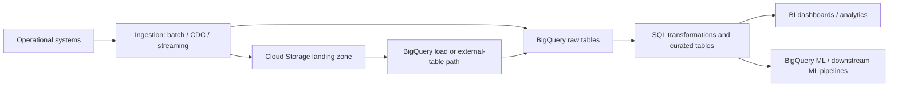
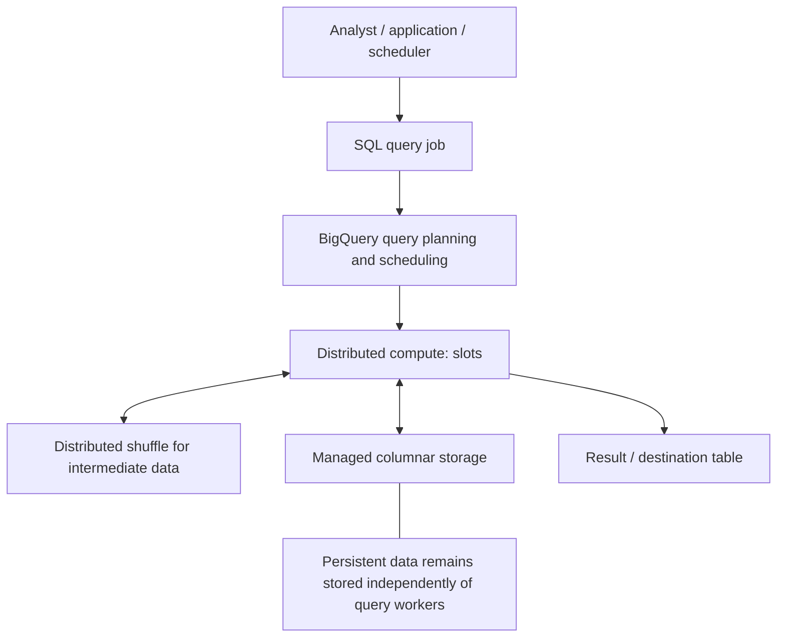
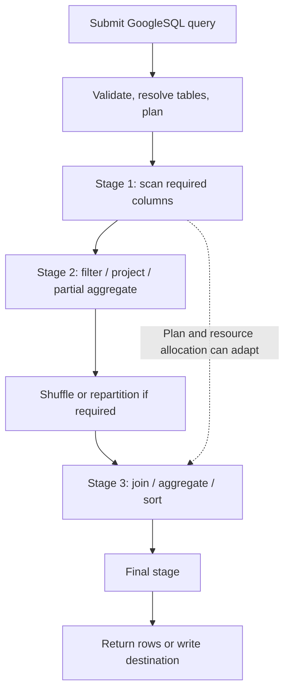

# BigQuery Architecture, Slots, and Storage

> **Roadmap location:** `Stage 2C — Data Engineering_3/04-Google-Cloud-BigQuery-and-GCP-Data-Engineering/02-bigquery-architecture-slots-and-storage.md`  
> **Authoritative syllabus:** `roadmap-Google-Cloud-BigQuery-and-GCP-Data-Engineering.md`, Topic 02  
> **Prerequisite:** Topic 01 — GCP data services landscape  
> **Next lesson:** Topic 03 — Partitioning, clustering, and query cost control

---

## 1. Learning objectives and prerequisites

### By the end of this lesson, you should be able to

1. Explain BigQuery's serverless analytical model and its core resources: projects, datasets, tables, views, and jobs.
2. Run Standard SQL through the console, `bq`, and the Python client.
3. Distinguish bytes processed, bytes billed, slot milliseconds, elapsed time, and storage consumption.
4. Explain the documented concepts of Dremel, Colossus, Capacitor, Jupiter, and distributed shuffle without treating them as a guaranteed fixed implementation path.
5. Explain slots, reservations, assignments, editions, autoscaling, and workload isolation.
6. Read a query execution graph and use job metadata to investigate performance.
7. Model one-to-many data with `STRUCT` and `ARRAY`, and query arrays using `UNNEST`.
8. Compare logical and physical storage billing, long-term storage, time travel, and fail-safe.
9. Choose among native, external, BigLake, BigQuery-managed Apache Iceberg, materialized-view, snapshot, and clone patterns.
10. Compare BigQuery's workload model with Snowflake virtual warehouses and Amazon Redshift.
11. Estimate on-demand versus capacity economics using explicit assumptions rather than invented or fixed throughput guarantees.

### Prerequisites

The module roadmap assumes familiarity with:

- SQL, joins, window functions, and partitions (Stage 2, Module 2.6).
- Columnar formats and partitioning (Stage 2, Module 2.5).
- Dimensional modelling and star schemas (Stage 2, Module 2.8).
- Cloud storage and IAM (Stage 2, Module 2.17 and Stage 2B).
- Snowflake warehouses and cost concepts (Stage 2C, Module 2C.3).
- Basic shell usage and Python environments.

Topic 01 should already have introduced Google Cloud projects, locations, IAM, the `gcloud` workflow, and the broad GCP data-service landscape.

### Lab safety

BigQuery has a no-cost sandbox with limitations, but not every capability or operation is available there. For a billable project:

- Set a budget alert; it is a notification mechanism, **not** a hard spending cap.
- Use public datasets or small lab tables.
- Dry-run queries before executing them.
- For on-demand jobs, set a `maximum_bytes_billed` guard where appropriate.
- Do not create slot commitments or reservations for this lesson unless you have approval and understand their billing.
- Do not use production datasets for experiments.

---

## 2. BigQuery's role in an analytical platform

BigQuery is a managed analytical data warehouse and analytics platform. You submit SQL or supported jobs; Google manages the underlying execution infrastructure. You do not provision or patch a database server cluster for ordinary BigQuery SQL workloads.

A simplified analytical path looks like this:



BigQuery is not a replacement for every operational database. It is optimized for analytical workloads—scanning, joining, aggregating, and analysing large datasets. An application that needs many tiny, low-latency transactional reads and writes may fit Cloud SQL, Spanner, Firestore, or another operational database better.

### 2.1 Core resource vocabulary

| Resource | Meaning | Engineering implication |
|---|---|---|
| Google Cloud project | Administrative and billing boundary for resources and jobs | Use separate projects where ownership, environment, or billing boundaries justify them |
| Dataset | Container for BigQuery tables, views, routines, and access settings; located in a region or multi-region | Keep data-processing locations compatible; location choices matter |
| Table | Structured data object queried with SQL | Schema, partitioning, clustering, retention, and access policy affect operations |
| View | Saved SQL definition; normally does not store its own result | Repeated use may re-run underlying logic unless cache/other optimisations apply |
| Materialized view | Managed precomputed results for supported query patterns | Can accelerate eligible queries; refresh and eligibility behaviour have constraints |
| Query job | Asynchronous job representing a SQL query execution | Job metadata is useful for auditing, cost analysis, and performance diagnosis |
| Reservation | Pool of BigQuery slot capacity assigned to workloads | Capacity-based compute can isolate workloads and improve cost predictability |
| Slot | Abstract unit of BigQuery compute capacity | Not a physical core and not a fixed query-throughput guarantee |

### 2.2 Standard SQL and entry points

BigQuery uses GoogleSQL, commonly called **GoogleSQL for BigQuery** or BigQuery Standard SQL. Use Standard SQL unless an exceptional legacy dependency requires otherwise.

**Console:** useful for interactive exploration, query-plan inspection, and metadata discovery.

**`bq` CLI:** useful for repeatable scripts and command-line workflows.

```bash
# Check the active gcloud identity and project.
gcloud auth list
gcloud config get-value project

# List datasets in a project (requires access to that project).
bq ls --project_id=YOUR_PROJECT_ID

# Run a bounded query. Replace the project ID if needed.
bq query --use_legacy_sql=false \
  'SELECT 1 AS sanity_check'
```

These commands inspect configuration and run a trivial query; they do not create resources. `YOUR_PROJECT_ID` is a placeholder, not a literal project identifier.

**Python client:** useful for application code, scheduled jobs, and automated checks.

```python
from google.cloud import bigquery

# Uses Application Default Credentials (ADC).
client = bigquery.Client(project="YOUR_PROJECT_ID")

job_config = bigquery.QueryJobConfig(
    maximum_bytes_billed=10 * 1024**3  # 10 GiB guard for on-demand billing
)

query = "SELECT 1 AS sanity_check"
job = client.query(query, job_config=job_config)
rows = list(job.result())

print(rows[0]["sanity_check"])
print(f"Job ID: {job.job_id}")
print(f"Bytes processed: {job.total_bytes_processed}")
print(f"Bytes billed: {job.total_bytes_billed}")
```

Install the client in a managed Python environment, for example with `uv add google-cloud-bigquery`. Authenticate using an approved ADC workflow such as `gcloud auth application-default login` for local development, or workload identity/service-account attachment in deployed environments. Do not commit service-account key files.

The `maximum_bytes_billed` setting is useful as a guardrail for on-demand query cost. It is not a universal cap on all BigQuery charges, and bytes billed may not be the main compute billing dimension under capacity pricing.

---

## 3. Serverless architecture and resource model

“Serverless” means that Google manages the underlying infrastructure lifecycle for the service. It does **not** mean compute is unlimited, free, instantaneous, or exempt from quotas, location constraints, IAM, or cost management.

BigQuery separates persistent data storage from query compute. This lets data remain stored without requiring a user-managed query cluster to run continuously. Query capacity is provided when jobs execute, through the on-demand model or assigned capacity reservations.



This is a conceptual model, not a literal service topology or guarantee that every query uses every depicted component. The optimiser can change the execution plan and resource distribution while a query runs.

### 3.1 What separation of storage and compute changes

**Benefits**

- Data does not require a permanently running user-managed warehouse cluster.
- Different workloads can query shared datasets while using different billing and capacity strategies.
- Teams can scale or isolate compute policy without copying every dataset for each compute cluster.
- Data and query compute lifecycles can be managed independently.

**Trade-offs**

- Query execution still consumes resources and can incur charges.
- Shared datasets create governance, noisy-neighbour, and concurrency considerations.
- Data locality, region compatibility, and external data-source performance still matter.
- The user has less low-level control over worker placement and the internal query engine than with a self-managed database or Spark cluster.

### 3.2 Projects, datasets, tables, views, and jobs in practice

A query job runs in a project context and accesses tables using fully qualified identifiers:

```sql
SELECT
  state,
  COUNT(*) AS event_count
FROM `bigquery-public-data.samples.natality`
GROUP BY state
ORDER BY event_count DESC
LIMIT 10;
```

The public sample dataset is used here to illustrate fully qualified table names. Dataset/table availability and permissions can change; if the example is unavailable in your environment, select a currently available public dataset from the BigQuery console. `LIMIT` limits returned rows; it does **not** by itself guarantee that fewer bytes are scanned or billed.

The query job's project, the data's project, and the billing project may not always be the same conceptually. Confirm which project owns the job and which billing model applies before attributing cost.

---

## 4. Internal architecture and query execution lifecycle

The module syllabus names Dremel, Colossus, Capacitor, Jupiter, and the in-memory shuffle service. These are useful conceptual landmarks for understanding BigQuery's distributed design. They should not be treated as a promise that a query follows one fixed sequence or that every current implementation detail is publicly exposed.

### 4.1 Architecture vocabulary

| Term | High-level role | What to remember |
|---|---|---|
| **Dremel** | Distributed query-processing architecture and execution-tree concept associated with BigQuery | SQL work is decomposed into parallel stages; aggregation and reduction combine distributed work |
| **Colossus** | Google's distributed storage system | Provides durable, distributed storage infrastructure beneath services including BigQuery |
| **Capacitor** | BigQuery's columnar storage format | Columnar layout supports reading selected columns and analytical scans efficiently |
| **Jupiter** | Google's high-performance datacenter network architecture | Large distributed jobs depend on fast communication among compute and storage components |
| **Shuffle service** | Fast distributed in-memory data exchange for intermediate records between execution stages | Joins, grouping, sorting, and repartitioning may move substantial data; shuffle can become a bottleneck, and spilled shuffle data can be written to disk |

These names explain architectural ideas. They do not expose a supported API for manually configuring Dremel trees, Colossus blocks, Capacitor encoding, or Jupiter network paths.

### 4.2 Query lifecycle: a simplified model

1. **Submission.** The console, API, CLI, or client library submits a query job.
2. **Validation and planning.** BigQuery checks the query, resolves objects and permissions, and creates an execution plan.
3. **Distributed execution.** The engine executes stages using available slots. A stage contains work that can be parallelized.
4. **Data exchange.** When a later stage needs data from multiple workers—such as a join or aggregation—BigQuery may use distributed shuffle.
5. **Adaptive decisions.** The plan and resource allocation can change as execution proceeds, data distribution becomes clearer, or competing jobs start and finish.
6. **Completion.** Results are returned or written to a destination table; job metadata records information about the run.



A real query can have more or fewer stages, parallel branches, multiple shuffles, dynamic repartitioning, or a different join strategy. Use the execution graph for evidence rather than inferring a fixed plan from SQL syntax.

### 4.3 Why shuffle matters

Imagine joining a large event table to a customer table by `customer_id`. The engine may need to partition rows by the join key so matching keys can be processed together. Moving intermediate rows across workers is shuffle.

Potential symptoms of expensive shuffle include:

- a stage with large input/output volume;
- long stage duration relative to earlier stages;
- skew where a few keys carry far more data than others;
- spill indicators or large intermediate data;
- slot time increasing without a proportional reduction in elapsed time.

Do not assume every shuffle is a problem. Distributed joins and aggregations often require it. Investigate whether the volume, skew, or chosen query design is avoidable.

---

## 5. Slots, reservations, editions, and capacity planning

### 5.1 What is a slot?

A **slot** is an abstract unit of BigQuery compute capacity. BigQuery determines how many slots a query uses based on its work and the capacity available. Users do not directly assign a precise number of slots to an individual query in the way they choose a VM's CPU count.

More capacity can allow more concurrent work or faster execution for a parallelizable query, but it does not guarantee a linear speedup. Query shape, input volume, skew, shuffle, I/O, and other bottlenecks affect the result.

### 5.2 On-demand versus capacity-based compute

| Dimension | On-demand | Capacity-based (reservations / editions) |
|---|---|---|
| Primary compute meter | Data processed by queries, usually priced per TiB under published terms | Allocated slot capacity over time, with edition-specific pricing |
| Capacity management | BigQuery manages shared execution capacity subject to limits | You configure reservations, assignments, baseline and/or autoscaling capacity |
| Cost predictability | Sensitive to query volume and bytes processed | More predictable for known capacity profiles, but depends on baseline, autoscaling, commitments, and usage |
| Best fit | Variable or modest workloads where bytes-scanned economics work | Sustained or predictable workloads, concurrency needs, workload separation, or explicit capacity governance |
| Key risk | Expensive scans and unbounded query patterns | Paying for baseline capacity that is idle or over-provisioned; autoscaling charges |
| Important nuance | All queries still use slots internally | Capacity pricing does not mean storage, BI Engine, and all ingestion costs are included |

Pricing rules and product features evolve. Check the current pricing page and reservation documentation before making a purchasing decision.

### 5.3 Reservations, assignments, baseline, autoscaling

- **Reservation:** a named pool of slot capacity in a region and edition.
- **Assignment:** links a project, folder, or organisation to a reservation. The most specific applicable assignment wins; a project assignment can override a folder or organisation assignment.
- **Baseline slots:** capacity allocated continuously and billed whether fully used or not.
- **Autoscaling slots:** capacity added when demand rises, subject to reservation configuration, quotas, and available system capacity.
- **Idle slot sharing:** eligible idle baseline/committed capacity may be shared when configured and compatible. Do not assume all capacity is universally pooled across regions or editions.
- **Edition:** the feature and pricing tier associated with a reservation. The current documented edition names are Standard, Enterprise, and Enterprise Plus. Feature eligibility and pricing must be verified in current documentation. Assignment scopes also differ by edition: for example, folder and organization assignments are not available to Standard edition reservations in the current assignment documentation.

Autoscaling is not a hard performance guarantee. Capacity may be subject to availability and quota. A high maximum autoscaling setting is not free: the billed capacity and billing granularity depend on current configuration and pricing terms.

### 5.4 Capacity planning from workload evidence

Do not select “100 slots” because the syllabus exercise mentions 100. Treat it as a scenario to model.

1. Gather representative jobs across peak and quiet periods.
2. Record `total_slot_ms`, elapsed time, bytes processed, concurrency, and failures.
3. Classify interactive BI, scheduled transformation, ad hoc exploration, and critical batch workloads.
4. Test representative query sets with realistic concurrency.
5. Compare latency objectives and throughput at different capacity levels.
6. Model baseline and autoscaling costs from current published rates.
7. Re-check after query changes, new datasets, and traffic growth.

A query can use more total slot time when more slots shorten elapsed time because greater parallelism may add overhead. Evaluate both elapsed time and total slot time.

### 5.5 Multi-tenant workload isolation

Reservations can help separate workload classes such as:

- `bi_interactive`: dashboards and interactive analyst queries;
- `etl_batch`: scheduled transformations;
- `data_science`: exploration and model preparation.

Isolation is not merely naming reservations. Create appropriate assignments, understand edition and region constraints, monitor queueing and concurrency, and verify that critical projects inherit the intended reservation. A project without an applicable reservation assignment may use on-demand pricing. Reservations are regional; capacity in one location does not serve jobs in another. Concurrency controls can queue newly submitted work when the configured admission limit is reached, while slot contention and fair scheduling can affect jobs already admitted. Diagnose queue delay separately from execution-stage time.

**Common design:** keep production BI and heavy scheduled transformations from unintentionally competing for the same constrained pool. The exact split should follow observed contention and service-level objectives, not a universal ratio.

---

## 6. Storage architecture and table types

### 6.1 Logical versus physical storage billing

BigQuery stores data physically in a managed compressed representation. The storage billing model determines how stored bytes are measured for billing; it does not switch the table to a different physical representation.

- **Logical storage billing:** bills based on logical (uncompressed) bytes. This is the default model for new datasets unless configured otherwise.
- **Physical storage billing:** bills based on compressed physical bytes. Time-travel and fail-safe storage can be charged separately under this model.
- The best option depends on compression characteristics, retention, update/delete patterns, and current prices. Do not choose based on a single table's compression ratio alone.
- Changing a dataset's storage billing model has timing and cooldown constraints documented by Google. Check the current docs before changing production datasets.

### 6.2 Long-term storage

For eligible BigQuery table data that has not been modified for the documented period (commonly 90 consecutive days), long-term storage pricing may apply automatically. Modifications can reset the age for affected data. Confirm current rules and pricing for partitioned tables and the specific storage model.

Long-term storage is a billing classification, not an archive tier that requires manually moving the table. It does not mean the data is slower to query by definition.

### 6.3 Time travel and fail-safe

The module roadmap describes time travel “up to 7 days.” Current BigQuery documentation states that the time-travel window is configurable from **2 to 7 days**, with 7 days as the default. The window applies at the dataset or project configuration level.

Time travel can allow recovery/querying of changed or deleted data within the configured window. Fail-safe is an additional **7-day** recovery period after time travel, intended for emergency recovery and not normal user-directed historical querying. Fail-safe is not configurable, and recovery can require support; do not treat it as a backup strategy or a guaranteed self-service restore.

Example: query a table as it existed at a timestamp within its configured time-travel window:

```sql
-- Replace project.dataset.table and timestamp with your own values.
-- The timestamp must be within the dataset's time-travel window
-- and later than the table's creation time.
SELECT *
FROM `YOUR_PROJECT.YOUR_DATASET.YOUR_TABLE`
FOR SYSTEM_TIME AS OF TIMESTAMP_SUB(CURRENT_TIMESTAMP(), INTERVAL 1 HOUR)
LIMIT 100;
```

This is a syntax example. It only works if the named table exists, the caller has access, and the timestamp is eligible. `LIMIT 100` does not guarantee a small scan on its own.

**Recovery planning:** use time travel for short-window operational recovery, and use appropriate snapshots, exports, or other backup mechanisms to meet longer retention and disaster-recovery objectives.

### 6.4 Table and query-result patterns

| Pattern | Where data lives | Use it when | Main trade-offs |
|---|---|---|---|
| Native BigQuery table | Managed BigQuery storage | General analytical tables, performance-sensitive curated data | Storage charges apply; loading and transformation design still matter |
| External table | Data remains in an external source such as Cloud Storage | Querying files in place, exploration, avoiding an initial copy | Performance and capabilities depend on source format and layout; external scans may be less predictable |
| BigLake table | Governed access layer for supported external data, with BigQuery integration | Need lake data access plus fine-grained governance and compatible engines | Setup, supported formats, metadata and access-control details must be checked |
| Apache Iceberg managed table (the current name for BigQuery's BigLake tables for Apache Iceberg) | BigQuery manages table metadata and operations while data files reside in a customer-owned Cloud Storage bucket | Open-format lakehouse interoperability with supported BigQuery-managed workflows and other Iceberg engines | Cloud Storage storage charges apply; table-management/optimization compute and query/job charges can also apply. Feature and engine compatibility differ from native tables; validate current limitations |
| Materialized view | Managed precomputed results for eligible query definitions | Repeated supported aggregations where refresh/query rewrite can help | Not every SQL shape is supported; refresh, freshness, and maintenance have constraints |
| Snapshot | Read-only point-in-time representation of a table | Recovery, audit, or retaining a point-in-time view | Storage billing depends on shared/changed data and current rules; not an independent full-copy guarantee |
| Clone | Writable table created efficiently from a base table | Development/test branches or quick copies | Storage is charged for changed data and other applicable usage; not a universal zero-cost copy |

**Native versus external decision:** if a dataset is queried heavily and repeatedly, loading it into native BigQuery tables may improve performance and make query cost more predictable. If data must remain in a lake, is queried infrequently, or must be shared in an open format, external/BigLake/Iceberg patterns may fit better. Benchmark representative queries.

### 6.5 Materialized views, snapshots, and clones are not interchangeable

- A **materialized view** accelerates eligible query patterns by maintaining precomputed results.
- A **snapshot** represents table data at a point in time and is read-only.
- A **clone** is a writable copy that can initially share underlying data and accrue storage for changes.
- A regular **view** is a stored query definition, not a precomputed table.

Choose according to semantics, retention, access control, and expected changes—not merely storage cost.

---

## 7. Nested and repeated data modelling

BigQuery supports nested and repeated fields, which can represent hierarchical data without flattening every child into a separate row.

- `STRUCT` represents a record with named fields.
- `ARRAY` represents an ordered collection of values.
- An array of structs is a common representation for a one-to-many relationship such as an order with line items.

### 7.1 Example schema

```sql
CREATE TABLE `YOUR_PROJECT.lab.orders_nested` (
  order_id STRING,
  order_date DATE,
  customer STRUCT<
    customer_id STRING,
    country STRING
  >,
  items ARRAY<STRUCT<
    sku STRING,
    quantity INT64,
    unit_price NUMERIC
  >>
);
```

This DDL creates a table in a dataset that must already exist. Replace the placeholder project and dataset with real identifiers. Creating a table may require permissions and billing/API setup.

Insert a small example:

```sql
INSERT INTO `YOUR_PROJECT.lab.orders_nested`
  (order_id, order_date, customer, items)
VALUES
  (
    'O-1001',
    DATE '2026-01-15',
    STRUCT('C-10' AS customer_id, 'IN' AS country),
    [
      STRUCT('SKU-A' AS sku, 2 AS quantity, NUMERIC '12.50' AS unit_price),
      STRUCT('SKU-B' AS sku, 1 AS quantity, NUMERIC '7.00' AS unit_price)
    ]
  );
```

### 7.2 Query a repeated field using `UNNEST`

```sql
SELECT
  order_id,
  customer.country AS country,
  item.sku,
  item.quantity,
  item.unit_price,
  item.quantity * item.unit_price AS line_total
FROM `YOUR_PROJECT.lab.orders_nested`
CROSS JOIN UNNEST(items) AS item;
```

`UNNEST` converts each array element into a row. `CROSS JOIN UNNEST` produces one output row per item, so an order with three items becomes three rows. Orders with an empty array produce no rows in this form; use a suitable `LEFT JOIN UNNEST` pattern when retaining parent rows is required.

### 7.3 Why nesting can help

- Related parent and child data can be read together.
- Some joins and repeated scans can be avoided.
- The data model can match the natural event or transaction structure.
- Columnar storage allows queries to select only relevant fields.

Nesting is not always superior. Very large arrays, high-cardinality relationships, independently managed child entities, and query patterns that frequently aggregate children across parents may justify a separate child table. Model around access patterns and validate with measurements.

---

## 8. Query execution plans and performance diagnosis

### 8.1 What to inspect

In the BigQuery console, open the completed query job and inspect the **Execution graph** (or query-plan details as labelled in the current UI). Examine:

- stages and dependencies;
- input and output rows/bytes where available;
- slot time and elapsed time;
- shuffle volume and spill indicators;
- skewed stages and unusually long-running work;
- whether filters and projections reduce data early;
- whether a join unexpectedly multiplies rows.

The exact UI labels can evolve. The principle is to compare stage-level evidence with the SQL and data model.

### 8.2 Metrics that must not be confused

| Metric | Meaning | What it does not mean |
|---|---|---|
| Bytes processed | Logical amount of table data processed by a query, as exposed by job metadata | Not the same as compressed storage size or total bytes billed in every situation |
| Bytes billed | Bytes used for on-demand query billing after applicable billing rules and minimums; for example, billing rounds to MB and applies documented minimums per query and per referenced table | Not a universal measure of capacity compute charges; queries served from cache generally incur no query-processing charge, and some job types have different billing behaviour |
| `total_slot_ms` | Aggregate slot time attributed to the job, in slot-milliseconds (including retries in the documented job metric) | Not elapsed wall-clock milliseconds and not a direct dollar amount |
| Elapsed time | Wall-clock duration between job start and completion | Not total CPU/slot work; concurrency and parallelism affect it |
| Storage bytes | Logical or physical bytes stored, depending on the metric | Not query scan bytes |
| Shuffle/spill metrics | Evidence about intermediate data movement and execution pressure | Not automatically proof of a query bug |

### 8.3 Query job metadata

For project-level analysis, use the region-qualified `INFORMATION_SCHEMA.JOBS_BY_PROJECT` view. The region in the view name must match the location of the jobs being inspected. You need the appropriate BigQuery metadata permissions, and the query itself must run in a compatible location.

```sql
-- Replace `region-us` with the region of your jobs, for example
-- `region-europe-west2`. Run this query in that same location.
SELECT
  creation_time,
  job_id,
  user_email,
  statement_type,
  state,
  total_bytes_processed,
  total_bytes_billed,
  total_slot_ms,
  TIMESTAMP_DIFF(end_time, start_time, MILLISECOND) AS elapsed_ms,
  error_result
FROM `region-us`.INFORMATION_SCHEMA.JOBS_BY_PROJECT
WHERE creation_time >= TIMESTAMP_SUB(CURRENT_TIMESTAMP(), INTERVAL 24 HOUR)
  AND job_type = 'QUERY'
  AND state = 'DONE'
ORDER BY creation_time DESC
LIMIT 100;
```

`total_slot_ms` and byte metrics can be `NULL` for some job types or cases. For successful jobs, `error_result` is normally `NULL`. This query is an inspection pattern; validate region and permissions before use.

### 8.4 Dry runs and safe query execution

Python dry-run example:

```python
from google.cloud import bigquery

# The public samples.natality table is in the US location.
client = bigquery.Client(project="YOUR_PROJECT_ID", location="US")
sql = """
SELECT state, COUNT(*) AS n
FROM `bigquery-public-data.samples.natality`
GROUP BY state
"""

config = bigquery.QueryJobConfig(dry_run=True, use_query_cache=False)
job = client.query(sql, job_config=config)

print(f"Estimated bytes processed: {job.total_bytes_processed:,}")
```

A dry run validates the query and estimates bytes processed without executing the query. It is not a perfect forecast of every cost dimension, and estimates can differ from billed usage depending on query type and billing rules.

### 8.5 Optimizer fundamentals

BigQuery's optimiser selects an execution plan based on query semantics, table metadata, statistics, and runtime conditions. Engineers influence the inputs and SQL shape but should not assume the optimiser follows a particular physical plan forever.

**Broadcast join:** a relatively small input can be distributed to workers processing a larger input. It can reduce the need to repartition both sides, but broadcasting a large input can be expensive.

**Hash/shuffle join:** rows from inputs may be repartitioned by join key so matching keys are processed together. This can require significant shuffle, particularly when both sides are large or keys are skewed.

The optimiser decides the strategy; SQL syntax alone does not force a stable join algorithm. Inspect the plan and stage statistics. Reduce input size before joining, select needed columns, filter appropriately, and investigate skew.

### 8.6 Approximate aggregation

Functions such as `APPROX_COUNT_DISTINCT` and approximate quantile functions trade exactness for lower resource use in supported scenarios. They are useful for exploratory analytics and some dashboards when the error characteristics are acceptable. They are not a substitute for exact counts in billing, reconciliation, or other correctness-sensitive workflows.

### 8.7 BI Engine

BI Engine is an in-memory acceleration service that can accelerate eligible BigQuery analytics and BI queries. It is not a replacement for data modelling, partition pruning, or query optimisation. Eligibility, reservation/capacity configuration, memory limits, and pricing should be verified for the workload. Do not assume every query is cached or accelerated.

---

## 9. Pricing models and workload economics

Pricing changes by region, edition, contract, and product configuration. Always use the current official pricing page; the equations below are decision tools, not price quotes.

### 9.1 Compute and storage are separate dimensions

Potential cost components include:

- on-demand query processing;
- capacity-based slots and applicable commitments/autoscaling;
- storage under the selected logical or physical model;
- BI Engine capacity;
- ingestion/streaming and other separately priced features;
- data transfer or related services where applicable.

Do not assume a slot reservation includes storage or every ingestion cost.

### 9.2 Break-even model

Define:

- \(Q\): monthly billable query volume in TiB;
- \(p_q\): current on-demand price per TiB;
- \(C_s\): monthly capacity compute cost for the workload under a proposed reservation configuration;
- \(C_o\): additional monthly costs unique to the capacity option, if any.

A simple first-pass comparison is:

\[
C_{\text{on-demand}} = Q \times p_q
\]

\[
C_{\text{capacity}} = C_s + C_o
\]

Capacity looks cheaper on compute when:

\[
Q \times p_q > C_s + C_o
\]

This model is intentionally simplified. It excludes differences in performance value, free usage, concurrency, edition features, commitment discounts, autoscaling billing, storage, and workloads that remain on-demand. Use real job data and current prices for a final decision.

### 9.3 Illustrative calculation — not a current price quote

Suppose a workload processes 300 TiB/month and an example on-demand rate is **$6.25/TiB**. This is a hypothetical rate used only to demonstrate arithmetic, not a claim about current Google Cloud pricing.

\[
300 \times \$6.25 = \$1{,}875
\]

If an independently estimated capacity configuration costs $1,500/month for the same compute workload, its simple compute cost would be $375 lower. That does not establish that capacity is actually the right choice: validate slot demand, query latency, reservation utilisation, other charges, and the current region/edition price.

### 9.4 Why “100 slots” is not a universal benchmark

The roadmap asks you to compare on-demand with 100 slots. Treat 100 slots as one capacity scenario. A reservation's cost depends on edition, baseline, autoscaling, billing granularity, commitments, and current pricing. Query performance depends on the actual workload. There is no universal conversion such as “one slot processes X GB/s” that guarantees a query runtime.

For an experiment:

1. Measure a representative workload's monthly bytes processed and slot milliseconds.
2. Get current on-demand and capacity rates for the intended region and edition.
3. Model a 100-slot baseline and a separately configured autoscaling option.
4. Estimate capacity cost from the official pricing model and proposed configuration.
5. Compare cost, p95 latency, concurrency, queueing, and operational risk.
6. Document assumptions and sensitivity to a 2× or 5× workload increase.

---

## 10. Comparison with Snowflake and Amazon Redshift

This is a conceptual comparison, not a claim that the products are identical. All three evolve and offer multiple configuration choices.

| Concern | BigQuery | Snowflake | Amazon Redshift |
|---|---|---|---|
| Compute abstraction | Slots, on-demand or reservations/editions | Virtual warehouses using credits; separate warehouse sizing and scaling choices | Provisioned clusters/nodes or serverless capacity model |
| Storage/compute relationship | Managed storage separated from query compute | Storage separated from virtual warehouse compute | Architecture varies by deployment model; managed storage and compute options exist |
| User-managed cluster | No ordinary BigQuery SQL cluster to manage | No underlying warehouse servers to manage; users configure virtual warehouses | Provisioned model requires cluster sizing/management decisions; Serverless reduces this burden |
| Main cost intuition | Bytes processed for on-demand queries or slot capacity over time; storage separate | Credits for compute and storage charges; warehouse size and running time matter | Node/cluster or serverless capacity pricing plus storage and related charges |
| Workload isolation | Reservations and assignments; on-demand projects share applicable capacity limits | Separate virtual warehouses can isolate workloads | Workload management and deployment model provide isolation choices |
| Performance tuning focus | SQL shape, partitioning/clustering, slots, shuffle, data model | Warehouse sizing, caching, micro-partitions, clustering, SQL and workload management | Distribution/sort design where applicable, workload management, query plans and capacity |
| Operational strengths | Serverless operations and integration with GCP analytics ecosystem | Warehouse abstraction and data sharing ecosystem | AWS integration and multiple warehouse deployment models |
| Key trade-off | Less low-level infrastructure control; billing and workload governance still need design | Credit consumption and warehouse policies require monitoring | Provisioned resources can require capacity management; serverless has a different cost model |

The earlier Snowflake module is the direct comparison point for warehouse compute and cost. The right choice depends on existing cloud commitments, data gravity, governance, concurrency, workload shape, ecosystem, and team skills—not a single feature comparison.

---

## 11. Hands-on labs — `experiments/02_bigquery_architecture/`

Create this folder within the GCP module:

```text
experiments/
└── 02_bigquery_architecture/
    ├── README.md
    ├── 01_public_dataset_and_execution_plan.sql
    ├── 02_nested_vs_flattened.sql
    ├── 03_job_metrics.sql
    ├── 04_time_travel.sql
    ├── 05_pricing_break_even.md
    └── python/
        └── dry_run_and_job_metrics.py
```

The sections below provide the lab contents and execution instructions. Keep all created resources in a dedicated lab dataset, and delete it when finished.

### Lab 0 — setup and cost controls

1. Choose a project where you have permission to run BigQuery jobs.
2. Confirm the billing model and location; if using sandbox, note its feature and storage limits.
3. Set a budget alert and review query quotas with the project administrator.
4. Use a lab dataset in a known region.
5. Ensure your account has the permissions required to create/query tables and inspect project-level job metadata. Do not grant broad Owner/Editor roles just to make the lab work.
6. Authenticate using ADC or the console's signed-in identity.

Example dataset creation using `bq`:

```bash
# Replace placeholders. Dataset location must match your intended lab location.
bq --location=US mk --dataset YOUR_PROJECT_ID:lab_architecture
```

This command creates a dataset and may incur storage charges after data is written. If it already exists, inspect it rather than repeatedly creating resources.

### Lab 1 — public dataset and execution graph

Save as `01_public_dataset_and_execution_plan.sql`:

```sql
SELECT
  state,
  COUNT(*) AS row_count
FROM `bigquery-public-data.samples.natality`
GROUP BY state
ORDER BY row_count DESC
LIMIT 20;
```

Run in the console or with:

```bash
bq query --use_legacy_sql=false < experiments/02_bigquery_architecture/01_public_dataset_and_execution_plan.sql
```

Before executing, use the console's query validator/dry-run facility or the Python dry-run example in Section 8.4.

**Observe:** open the completed job, inspect the execution graph, note the stages, and record elapsed time, bytes processed, bytes billed, and slot milliseconds where available.

**Interpret:** a small result does not prove a small scan. The query aggregates the table before returning 20 rows; `LIMIT` does not itself reduce the scan.

**Validation:** confirm the result has at most 20 rows and that the aggregation returns a row count per state. Exact result contents may change if the public dataset changes.

### Lab 2 — nested versus flattened representation

Create a small nested table and a corresponding flattened table:

```sql
CREATE OR REPLACE TABLE `YOUR_PROJECT.lab_architecture.orders_nested` AS
SELECT
  'O-1' AS order_id,
  DATE '2026-01-01' AS order_date,
  'C-1' AS customer_id,
  [
    STRUCT('SKU-A' AS sku, 2 AS quantity, NUMERIC '10.00' AS unit_price),
    STRUCT('SKU-B' AS sku, 1 AS quantity, NUMERIC '5.00' AS unit_price)
  ] AS items
UNION ALL
SELECT
  'O-2',
  DATE '2026-01-02',
  'C-2',
  [STRUCT('SKU-C' AS sku, 4 AS quantity, NUMERIC '2.50' AS unit_price)];

CREATE OR REPLACE TABLE `YOUR_PROJECT.lab_architecture.orders_flat` AS
SELECT
  order_id,
  order_date,
  customer_id,
  item.sku,
  item.quantity,
  item.unit_price
FROM `YOUR_PROJECT.lab_architecture.orders_nested`
CROSS JOIN UNNEST(items) AS item;
```

Compare the same business calculation:

```sql
-- Nested representation
SELECT
  order_id,
  SUM(item.quantity * item.unit_price) AS order_total
FROM `YOUR_PROJECT.lab_architecture.orders_nested`
CROSS JOIN UNNEST(items) AS item
GROUP BY order_id;

-- Flattened representation
SELECT
  order_id,
  SUM(quantity * unit_price) AS order_total
FROM `YOUR_PROJECT.lab_architecture.orders_flat`
GROUP BY order_id;
```

**Expected observation:** both queries should return the same order totals. The flattened table has one row per item; the nested table has one row per order with an array of items.

**Important limitation:** this tiny synthetic dataset is for correctness and schema learning, not a meaningful benchmark of bytes processed or performance. To compare scan bytes, repeat with a sufficiently large representative dataset, select comparable columns, use dry runs and query job metrics, and keep data volume and query semantics equivalent. Nested data is not guaranteed to be faster for every query.

### Lab 3 — inspect job metrics

Save as `03_job_metrics.sql`:

```sql
-- Replace region-us with the job location, and use the same location
-- for this INFORMATION_SCHEMA query.
SELECT
  creation_time,
  job_id,
  statement_type,
  total_bytes_processed,
  total_bytes_billed,
  total_slot_ms,
  TIMESTAMP_DIFF(end_time, start_time, MILLISECOND) AS elapsed_ms,
  error_result
FROM `region-us`.INFORMATION_SCHEMA.JOBS_BY_PROJECT
WHERE creation_time >= TIMESTAMP_SUB(CURRENT_TIMESTAMP(), INTERVAL 1 DAY)
  AND job_type = 'QUERY'
  AND state = 'DONE'
ORDER BY creation_time DESC
LIMIT 100;
```

**Permissions and location:** use the correct region qualifier for the jobs, and ensure the caller can read project-level job metadata. The query must execute in the corresponding location. Metrics can be null in some cases.

**Task:** run two different queries, locate their job IDs, and compare scan volume, slot milliseconds, and elapsed time. Explain why none of these metrics alone completely describes cost or performance.

### Lab 4 — time travel

After creating the lab table in Lab 2, record its contents and then change a row:

```sql
UPDATE `YOUR_PROJECT.lab_architecture.orders_nested`
SET customer_id = 'C-CHANGED'
WHERE order_id = 'O-1';
```

Query the table as it existed shortly before the update:

```sql
SELECT order_id, customer_id
FROM `YOUR_PROJECT.lab_architecture.orders_nested`
FOR SYSTEM_TIME AS OF TIMESTAMP_SUB(CURRENT_TIMESTAMP(), INTERVAL 10 MINUTE)
ORDER BY order_id;
```

**Important:** the example only succeeds if the chosen timestamp is within the dataset's time-travel window and later than table creation. If you created the table less than ten minutes ago, choose a timestamp that is after creation and before the update, or use the console to identify a valid timestamp. If no eligible earlier version exists, the query fails; that is expected.

Time travel is not a substitute for long-term backups. Do not change a production dataset's time-travel settings for this exercise.

### Lab 5 — break-even calculation

Save as `05_pricing_break_even.md` and fill it using actual job history and current published rates:

```text
Monthly query volume (TiB):                 ______
Current on-demand rate for chosen region:   ______
Estimated on-demand query cost:             ______
Proposed edition / region:                  ______
Baseline slots and billing assumptions:     ______
Autoscaling maximum and billing assumptions:______
Estimated monthly capacity compute cost:     ______
Other included/excluded costs:               ______
Latency/concurrency objective:               ______
Decision and uncertainty:                    ______
```

For an illustrative calculation, if 300 TiB/month were billed at an assumed $6.25/TiB, the arithmetic would be $1,875/month. The rate is hypothetical; retrieve the actual rate from the official pricing page.

### Python lab helper — dry run and recent job metrics

Save as `python/dry_run_and_job_metrics.py`:

```python
from google.cloud import bigquery

PROJECT_ID = "YOUR_PROJECT_ID"
LOCATION = "US"

client = bigquery.Client(project=PROJECT_ID, location=LOCATION)

sql = """
SELECT state, COUNT(*) AS row_count
FROM `bigquery-public-data.samples.natality`
GROUP BY state
ORDER BY row_count DESC
LIMIT 20
"""

dry_run_config = bigquery.QueryJobConfig(
    dry_run=True,
    use_query_cache=False,
)
dry_run_job = client.query(sql, job_config=dry_run_config)

print("Estimated bytes processed:", dry_run_job.total_bytes_processed)

# Only execute after reviewing the estimate and confirming cost controls.
# For on-demand billing, choose an appropriate maximum for your workload.
run_config = bigquery.QueryJobConfig(
    maximum_bytes_billed=10 * 1024**3,
)
job = client.query(sql, job_config=run_config)
rows = list(job.result())

print("Job ID:", job.job_id)
print("Returned rows:", len(rows))
print("Bytes processed:", job.total_bytes_processed)
print("Bytes billed:", job.total_bytes_billed)
print("Total slot milliseconds:", job.slot_millis)
```

Install with `uv add google-cloud-bigquery`. Replace the project ID and use a location appropriate for your query context. The 10 GiB maximum is an example guardrail, not a universal value; if the estimated query exceeds it, BigQuery can reject the query rather than exceed that cap under the applicable on-demand semantics. This cap is not a complete monthly spend limit.

### Cleanup

Delete only the lab dataset you created and confirmed is disposable:

```bash
bq rm -r -f YOUR_PROJECT_ID:lab_architecture
```

This is destructive: it recursively deletes the dataset and its contents. Confirm the project and dataset before running it. Do not run this against production data.

---

## 12. Troubleshooting and common misconceptions

| Symptom or misconception | Likely explanation | Response |
|---|---|---|
| “Serverless means unlimited compute.” | Capacity, quotas, scheduling, and concurrency still apply | Inspect job metrics and capacity configuration |
| “Slots are CPU cores I can assign to a query.” | Slots are abstract capacity units managed by BigQuery | Use reservations for workload-level capacity; inspect actual job metrics |
| “More slots always make queries faster.” | Serial work, shuffle, skew, I/O, and overhead can dominate | Compare elapsed time and slot milliseconds under representative concurrency |
| “Bytes processed equals bytes billed.” | Billing rules, minimums, cached results, and job types can differ | Inspect both metrics and current pricing rules |
| “`LIMIT 10` makes a scan cheap.” | `LIMIT` can restrict returned rows without pruning scanned data | Select fewer columns, filter and partition-prune; learn Topic 03 |
| “A query returning 10 rows must have read 10 rows.” | Aggregation and joins can process large input before producing a small result | Inspect bytes processed and execution stages |
| “Fail-safe is a backup I can restore whenever I want.” | It is a limited emergency recovery period and may require support | Maintain a separate backup/retention strategy |
| “External tables are always cheaper.” | Query frequency, format, source location, and performance matter | Benchmark against native tables and account for source-storage costs |
| “A materialized view is just a regular view.” | Materialized views maintain precomputed results for supported queries | Check eligibility, refresh, freshness, and cost behaviour |
| “Capacity reservation means every project uses it.” | Projects need an applicable assignment or inherited assignment | Inspect assignment hierarchy and verify job execution context |
| “100 slots has a known universal throughput.” | Query shape and available capacity alter performance | Use measured workload evidence, not a fixed GB/s assumption |
| “All joins use broadcast or all joins use shuffle.” | The optimizer selects strategies based on the workload | Inspect the plan and do not depend on a fixed implementation |
| `INFORMATION_SCHEMA` query fails | Wrong region qualifier, location mismatch, or missing metadata permissions | Correct the location and request least-privilege access |
| Time-travel query fails | Timestamp is outside the configured window or predates table creation | Choose a valid timestamp and confirm retention settings |

---

## 13. Interview questions with detailed answers

### Q1. Why is BigQuery called serverless if it uses compute slots?

“Serverless” means the service manages the infrastructure and execution lifecycle rather than requiring users to provision and maintain a database cluster. Slots are the compute abstraction used to execute jobs. Users still choose a billing model, manage quotas and reservations where relevant, and pay for usage.

### Q2. Explain the difference between bytes processed and `total_slot_ms`.

Bytes processed describes data processed by the query under BigQuery's job metrics; `total_slot_ms` accumulates slot time across execution. A query may scan relatively few bytes but perform expensive joins or transformations, or scan many bytes with a simple parallel aggregation. Neither metric alone is a complete performance or cost model.

### Q3. What are Dremel, Colossus, Capacitor, Jupiter, and shuffle?

They are architectural concepts named in BigQuery's design ecosystem: distributed query execution, distributed storage, columnar storage format, high-performance network architecture, and intermediate data movement. They help explain distributed analytics but are not knobs that users directly configure, nor a guarantee of a fixed plan for every query.

### Q4. What is a slot reservation, and how is it assigned?

A reservation is a pool of BigQuery slot capacity. An assignment connects a project, folder, or organisation to a reservation. The most specific applicable assignment takes precedence. Reservations can be used to manage capacity and isolate workload classes, but correct assignment, location, edition, and monitoring are still required.

### Q5. When is on-demand better than capacity pricing?

On-demand can be attractive for variable, low-volume, or exploratory workloads where bytes-scanned pricing is economical and the capacity limits are sufficient. Capacity may fit sustained high-volume work, concurrency objectives, or workload isolation. Use actual job history, current rates, reservation utilisation, and latency requirements to decide.

### Q6. What does a high `total_slot_ms` with low elapsed time indicate?

It may indicate that a job used substantial aggregate parallel compute but completed quickly. It is not necessarily inefficient. Compare with a baseline, bytes processed, concurrency, stage graph, and the workload's latency objective.

### Q7. When would you use nested data rather than a star schema?

Nested/repeated fields can be effective when child records are naturally accessed with the parent and denormalization reduces repeated joins. Separate child tables can be better when child entities are independently queried, arrays become unwieldy, or cross-parent analysis dominates. Benchmark representative queries and keep semantics correct.

### Q8. What is the difference between time travel and fail-safe?

Time travel is a configurable window—currently 2 to 7 days in the cited documentation—during which users can query or restore prior data states using supported mechanisms. Fail-safe is an additional fixed seven-day emergency recovery period, not a normal queryable history or guaranteed self-service backup.

### Q9. How do snapshots differ from clones and materialized views?

Snapshots preserve a read-only point-in-time table state. Clones are writable and can initially share underlying data, with changed data incurring applicable storage. Materialized views maintain precomputed results for supported query definitions. They solve different problems.

### Q10. What would you investigate if a query became slower?

Compare recent job metadata and execution graphs. Check bytes processed, total slot time, elapsed time, stage skew, shuffle volume/spills, concurrency and reservation assignment. Then inspect changes in SQL, table size, data distribution, and query plan. Avoid increasing capacity before understanding the bottleneck.

### Q11. Why might a capacity reservation cost more than expected?

Possible reasons include baseline slots running while idle, autoscaling, a workload assigned to the wrong reservation, unexpected concurrency, an expired commitment with remaining baseline configuration, or separate storage/BI Engine/ingestion costs. Reconcile reservation configuration with billing data and current pricing terms.

### Q12. Is BigQuery always faster or cheaper than Snowflake or Redshift?

No. Performance and cost depend on workload, data layout, query shape, concurrency, caching, configuration, region, cloud commitments, and team operations. Use representative benchmarks and equivalent cost assumptions rather than product slogans.

---

## 14. Syllabus-mapped checkpoint

Mark each item only after you can explain it without copying the lesson.

- [ ] Explain BigQuery's serverless model and resources: projects, datasets, tables, views, jobs.
- [ ] Run Standard SQL from the console, `bq`, and Python client.
- [ ] Explain on-demand pricing versus capacity pricing and define slots.
- [ ] Describe Dremel, Colossus, Capacitor, Jupiter, and shuffle as architectural concepts.
- [ ] Explain slots, reservations, assignments, editions, autoscaling, and workload isolation.
- [ ] Read an execution graph and interpret stages, slot milliseconds, elapsed time, and shuffle/spill evidence.
- [ ] Use `STRUCT`, `ARRAY`, and `UNNEST` correctly.
- [ ] Compare logical and physical storage billing.
- [ ] Explain long-term storage, time travel, and fail-safe limits.
- [ ] Choose among native/external/BigLake/Iceberg tables, materialized views, snapshots, and clones.
- [ ] Explain broadcast versus hash/shuffle joins, approximate aggregation, and BI Engine with limitations.
- [ ] Compare BigQuery, Snowflake, and Redshift without assuming identical billing models.
- [ ] Complete the five lab activities and record actual job IDs and metrics.
- [ ] Estimate the break-even point using current prices and measured workload data.

**Evidence to retain:** query IDs, dry-run estimates, execution graph observations, nested-versus-flat result comparison, metadata query output, a valid time-travel example, and a short cost-decision note.

---

## 15. Summary and transition to Topic 03

BigQuery is a managed analytical engine whose storage and query compute are separated. Queries execute as distributed jobs using slots; the execution plan may include parallel stages, shuffle, and adaptive changes. Performance and cost depend on query shape, data layout, concurrency, capacity configuration, and the selected billing model.

The key operational discipline is to measure rather than guess: dry-run queries, inspect job metrics, read execution graphs, and use representative workloads to evaluate capacity. Storage billing and recovery policies are separate design decisions from query compute. Nested data can reduce repeated joins, but should be chosen based on access patterns and measured results.

**Topic 03 builds on this lesson** by focusing on partitioning, clustering, pruning, `maximum_bytes_billed`, and practical query-cost control. Before moving on, make sure you can explain why bytes processed, slot time, elapsed time, and stored bytes are different.

---

## 16. Official references

Use these official references to validate current behaviour and pricing. Product features, pricing, and UI labels can change.

1. [BigQuery documentation overview](https://cloud.google.com/bigquery/docs)
2. [Understand slots](https://cloud.google.com/bigquery/docs/slots)
3. [Introduction to BigQuery reservations and workload management](https://cloud.google.com/bigquery/docs/reservations-workload-management)
4. [BigQuery pricing](https://cloud.google.com/bigquery/pricing)
5. [BigQuery storage overview](https://cloud.google.com/bigquery/docs/storage_overview)
6. [Time travel and fail-safe data retention](https://cloud.google.com/bigquery/docs/time-travel)
7. [Query execution graph](https://cloud.google.com/bigquery/docs/query-plan-explanation)
8. [INFORMATION_SCHEMA.JOBS views](https://cloud.google.com/bigquery/docs/information-schema-jobs)
9. [Nested and repeated fields](https://cloud.google.com/bigquery/docs/nested-repeated)
10. [Approximate aggregate functions](https://cloud.google.com/bigquery/docs/reference/standard-sql/approximate_aggregate_functions)
11. [BI Engine overview](https://cloud.google.com/bigquery/docs/bi-engine-intro)
12. [Table snapshots](https://cloud.google.com/bigquery/docs/table-snapshots-intro)
13. [Table clones](https://cloud.google.com/bigquery/docs/table-clones-intro)
14. [External tables](https://cloud.google.com/bigquery/docs/external-tables)
15. [BigLake overview](https://cloud.google.com/bigquery/docs/biglake-intro)
16. [Apache Iceberg managed tables in BigQuery (formerly BigLake tables for Apache Iceberg)](https://docs.cloud.google.com/bigquery/docs/biglake-iceberg-tables-in-bigquery)
17. [Snowflake documentation](https://docs.snowflake.com/)
18. [Amazon Redshift documentation](https://docs.aws.amazon.com/redshift/)
19. [Manage workload assignments](https://docs.cloud.google.com/bigquery/docs/reservations-assignments)
20. [BigQuery storage billing models and storage overview](https://docs.cloud.google.com/bigquery/docs/storage_overview)
21. [BigQuery table storage metadata and storage billing estimates](https://docs.cloud.google.com/bigquery/docs/information-schema-table-storage)
22. [BigQuery Python client reference](https://cloud.google.com/python/docs/reference/bigquery/latest)

---

## Verification note

This lesson was checked against the supplied project-tree and module-roadmap context, including Topic 01 prerequisites and Topic 03 downstream cost-control concepts. The required Topic 02 concepts are represented across the sections and labs.

**Verification level:** static review of lesson structure, SQL/Python examples, diagram syntax, terminology, cost assumptions, and documentation links. No live Google Cloud project was accessed; commands and queries were not executed against BigQuery in this task. Public dataset availability, project permissions, regional settings, UI labels, and current prices must be confirmed in the learner's environment. The pricing example is explicitly hypothetical, and the time-travel example requires a valid timestamp inside the configured window.
