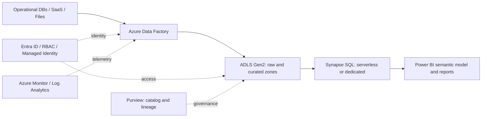
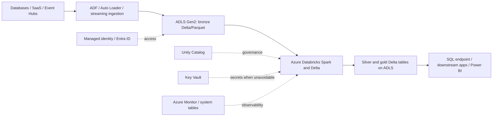
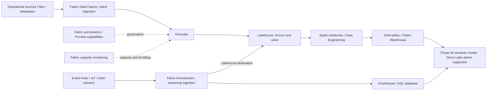

# Azure Data Services Landscape

> **Stage 2C — Data Engineering_3 · Module 05 — Azure Data Engineering and Microsoft Fabric · Topic 01**  
> Level: Beginner → Advanced · Focus: platform selection, architecture, governance, and safe first deployment

## 1. Purpose, scope, and prerequisites

Azure has multiple services that can ingest, store, transform, query, stream, govern, and visualize data. Some overlap, some are complementary, and Microsoft's product packaging is evolving around Microsoft Fabric. This lesson builds a decision map before the later lessons teach individual services in depth.

**Scope:** Azure resource management; service roles and relationships; AWS/GCP mapping; Fabric-era architecture; three reference architectures; networking, governance, and cost; and a small infrastructure lab. This is an orientation lesson, **not** a full implementation tutorial for ADLS, Data Factory, Synapse, Event Hubs, Fabric, Databricks, Entra ID, or Purview.

### Prerequisites

You should recognize SQL, ETL/ELT, orchestration, Parquet and Delta, medallion layers, Spark, streaming/Kafka concepts, cloud IAM and object storage, Databricks/Unity Catalog, secrets, CI/CD, governance, and lineage. These are covered earlier in the roadmap. If unfamiliar, review the relevant Stage 2 and Stage 2B modules before the advanced decision sections.

### Learning objectives

By the end, you can:

- Explain tenants, management groups, subscriptions, resource groups, and regions.
- Choose between Azure Portal, Azure CLI, ARM/Bicep, and Terraform for a task.
- Describe the responsibility of each major Azure data service without confusing adjacent products.
- Map common AWS/GCP services to Azure while identifying non-equivalences.
- Explain what Fabric integrates, what remains separate, and why migration is not simply a rename.
- Sketch classic warehouse, Databricks lakehouse, and Fabric architectures.
- Identify the key network, identity, governance, region, capacity, and cost decisions.
- Make a reasoned initial choice among Fabric, Azure Databricks, and Synapse.
- Complete the `experiments/01_landscape/` lab and produce a service-selection guide.

## 2. A beginner's mental model of the Azure data platform

Think of a data platform as a set of responsibilities, not a list of product names:

1. **Land data:** receive files, database extracts, events, and application data.
2. **Store data:** preserve raw and curated data reliably and securely.
3. **Move and orchestrate:** schedule dependencies, retries, and ingestion.
4. **Transform and compute:** clean, join, enrich, and aggregate data.
5. **Serve and query:** expose data for SQL analytics, applications, and BI.
6. **Stream:** process continuously arriving events with latency requirements.
7. **Govern and secure:** control identities, network paths, discovery, classification, and lineage.
8. **Operate:** monitor health, control costs, deploy repeatably, and recover from failure.

A typical Azure solution combines several services. ADLS Gen2 may store the lake, Data Factory may orchestrate ingestion, Databricks may run Spark transformations, a warehouse may serve SQL consumers, Power BI may expose metrics, and Entra ID/RBAC/Key Vault/Purview provide cross-cutting controls. Fabric packages more of the analytics lifecycle into a SaaS experience using OneLake, but it does not eliminate every Azure service or every architecture decision.

### Control plane versus data plane

- **Control plane:** create, configure, tag, secure, scale, and delete resources. Azure Resource Manager (ARM), Azure CLI, Bicep, Terraform, and the Azure Portal commonly operate here.
- **Data plane:** read/write blobs, execute SQL, publish events, query tables, or read secrets. Data-plane permissions are service-specific.

A user with Azure `Contributor` at a resource group can generally manage resource configuration but does **not** automatically receive all data-plane permissions (for example, permission to read blob contents). Conversely, a data role does not necessarily allow changing the resource configuration. Design both layers deliberately.

## 3. Azure resource hierarchy and workflow

### 3.1 Hierarchy

```text
Microsoft Entra tenant (identity boundary)
└── Management group(s) (governance across subscriptions)
    └── Subscription(s) (billing, quotas, policy and access boundary)
        └── Resource group(s) (lifecycle grouping)
            └── Resources (storage account, vault, workspace, etc.)
```

**Tenant:** an instance of Microsoft Entra ID containing identities and directory configuration. A tenant is not the same thing as an Azure subscription.

**Management group:** groups subscriptions so policies and role assignments can be governed consistently. A subscription belongs to one management-group hierarchy at a time, and subscriptions under a management group must trust the same Entra tenant.

**Subscription:** an administrative and billing boundary with quotas and access controls. Separate dev/test/prod subscriptions can reduce blast radius and improve cost accountability.

**Resource group:** a logical container for resources that share a lifecycle. It is not a network boundary and does not imply that all resources are physically located in one region. Resource-group metadata location and individual resource deployment regions are separate concepts.

**Resource:** an instance of a service, identified by an Azure Resource Manager resource ID. Examples include a storage account, Key Vault, Data Factory, or virtual network.

**Region and availability zone:** a region is a geographic Azure deployment area; supported services, SKUs, features, and zone redundancy differ by region. An availability zone is a physically separate location within a supported region. Check regional support before committing to an architecture, especially for regulated data, disaster recovery, and Fabric capacity.

### 3.2 Management tools

| Tool | What it is good for | Trade-offs and failure modes |
|---|---|---|
| Azure Portal | Learning, exploration, one-off inspection, cost review, and troubleshooting | Click paths are hard to reproduce; manual drift is easy; screenshots are not a deployment strategy |
| Azure CLI (`az`) | Scripting, resource inspection, repeatable operational commands, CI/CD | Scripts need error handling, idempotency, quoting, and a known subscription context |
| ARM templates | Azure's declarative deployment format and resource-provider contract | JSON is verbose; API versions and resource schemas matter |
| Bicep | Concise Azure-native declarative IaC compiled to ARM templates | Azure-specific; still requires review, deployment permissions, and lifecycle planning |
| Terraform | Declarative, provider-based IaC, especially useful across clouds and shared Terraform workflows | State must be protected and managed; provider behavior and Azure API support may lag new service features |

**Rule of thumb:** use the Portal to learn and inspect, CLI for controlled operational commands, and Bicep/Terraform for reviewed, repeatable infrastructure. Do not let a one-time CLI command silently become undocumented production infrastructure.

### 3.3 A safe resource-management workflow

1. Confirm tenant and subscription: `az account show`.
2. Choose region, naming convention, environment, tags, and resource lifecycle.
3. Check policy, quota, regional availability, service tier, and cost.
4. Review IaC and run validation/what-if where supported.
5. Deploy with least-privilege permissions.
6. Verify resource properties, network exposure, identity permissions, diagnostic settings, and tags.
7. Inspect Cost Management after usage data becomes available.
8. Record ownership and cleanup instructions; delete lab resources when finished.

## 4. Azure data services by responsibility

| Responsibility | Service | What it does and when it fits | Trade-offs / common failure |
|---|---|---|---|
| Lake/object storage | **Azure Data Lake Storage Gen2 (ADLS Gen2)** | Azure Storage with hierarchical namespace, suited to analytical files, lake zones, Spark and batch processing | Not a warehouse by itself; ACL/RBAC/network configuration can be subtle; tiny files and egress/transactions affect cost |
| Data movement/orchestration | **Azure Data Factory (ADF)** | Managed pipelines, connectors, scheduling, copy, control flow, integration runtimes, and visual mapping data flows | Pipeline/activity overhead can be wasteful for tiny jobs; heavy custom transformations may fit Spark/dbt better; Fabric Data Factory is a related but distinct experience |
| Integrated analytics | **Azure Synapse Analytics** | Existing enterprise workspace combining SQL pools, Spark pools, pipelines, and lake querying | Multiple components have distinct billing and lifecycle behavior; do not assume every Synapse component has a one-to-one Fabric replacement; check current product guidance before new investment |
| Event ingestion | **Azure Event Hubs** | High-throughput event streaming with partitions, consumer groups, retention, and Kafka-compatible endpoint | It is not a general-purpose relational database or arbitrary stream-processing engine; partition keys and consumer lag matter |
| SQL-like stream processing | **Azure Stream Analytics** | Managed SQL-like event processing with time windows and managed inputs/outputs | Less flexible for complex stateful logic than a general stream-processing engine; late/out-of-order event policy needs explicit design |
| Spark/lakehouse | **Azure Databricks** | Managed Databricks platform on Azure for Spark, Delta, ML/data engineering, and governed lakehouse workloads | Separate workspace/compute and platform operating model; total cost includes Databricks usage and underlying cloud resources; governance and network setup require care |
| Relational OLTP | **Azure SQL Database** | Managed SQL Server-compatible relational database for cloud applications and transactional systems | Not a replacement for every analytical warehouse workload; sizing, service tier, compatibility, and network access matter |
| SQL Server instance compatibility | **Azure SQL Managed Instance (SQL MI)** | Managed instance-level SQL Server capabilities for workloads needing higher compatibility with SQL Server features | More instance-oriented than Azure SQL Database; service tier, migration compatibility, and network design affect cost and complexity |
| Distributed operational NoSQL | **Azure Cosmos DB** | Globally distributed operational database with multiple APIs and tunable consistency options | RU/s or other billing model, partition key, consistency, and multi-region replication are architecture decisions; not a drop-in analytical warehouse |
| Integrated analytics SaaS | **Microsoft Fabric** | Data Engineering, Data Factory, Warehouse, Real-Time Intelligence, Data Science, and Power BI experiences over OneLake and shared platform capabilities | Capacity planning and workload throttling matter; item/feature support and regional availability vary; migration may require refactoring |
| Governance/discovery | **Microsoft Purview** | Data catalog, scanning, classification, lineage, and governance capabilities across supported sources | Coverage and lineage depend on supported connectors, permissions, scan configuration, and workload integration; it does not replace service-level authorization |
| BI and semantic analytics | **Power BI** | Semantic models, reports, dashboards, and self-service/business analytics; integrated with Fabric but also used with non-Fabric sources | Licensing and sharing/capacity choices matter; report-layer security is not a substitute for securing source data |
| Secret/key/certificate storage | **Azure Key Vault** | Centralized secrets, keys, and certificates with identity-based access | Network and authorization settings can block access; secrets should not be placed in source code, pipeline JSON, or logs |
| Identity and authorization | **Microsoft Entra ID + Azure RBAC** | Human/workload identities and management/data-plane role assignments | Broad roles and user-by-user grants create excessive privilege and difficult offboarding |
| Network isolation | **Virtual Network (VNet), private endpoints, service endpoints, firewalls** | Controls reachability and service access paths | Private endpoints need DNS and routing design; a private endpoint alone does not automatically disable public access |

### 4.1 Distinguish the SQL options

- Use **Azure SQL Database** for many cloud-native relational application databases.
- Use **SQL Managed Instance** when instance-level SQL Server compatibility is important and the workload fits its managed-instance model.
- Use **Synapse dedicated SQL pool** for a provisioned massively parallel analytical warehouse already built around Synapse; account for provisioned compute and pause/resume behavior where available.
- Use **Synapse serverless SQL pool** for on-demand SQL queries over lake files when its query and performance model fits; scan volume and file layout influence cost.
- Use **Fabric Warehouse** for managed analytical SQL in the Fabric capacity model.
- Use **Cosmos DB** for operational, distributed NoSQL access patterns, not as a default warehouse substitute.

These services overlap only at a broad level. Choose by workload semantics, compatibility, latency, scale, governance, and operational model—not by the word “SQL.”

## 5. AWS/GCP-to-Azure mapping—with caveats

Mappings are architectural analogies, not proof of feature parity.

| AWS | Google Cloud | Azure / Fabric analogue | Important caveat |
|---|---|---|---|
| Amazon S3 | Cloud Storage | Azure Blob Storage / ADLS Gen2; OneLake within Fabric | ADLS Gen2 hierarchical namespace and ACL behavior differ from S3/GCS. OneLake is a Fabric logical lake and SaaS storage experience, not just another storage account |
| AWS Glue Data Catalog + Glue ETL | Dataproc/Dataplex components (depending on job) | Data Factory, Purview, Databricks/Fabric Spark | Glue combines catalog and ETL capabilities; Azure splits orchestration, compute, and governance across products |
| AWS Glue workflows / Step Functions (depending on orchestration) | Cloud Composer / Workflows | Azure Data Factory pipelines; Fabric Data Factory; Azure Logic Apps for some workflows | No single service maps to every orchestration use case. ADF is not a general-purpose replacement for all workflow engines |
| Redshift | BigQuery | Synapse dedicated SQL pool or Fabric Warehouse; sometimes other Azure SQL analytics patterns | BigQuery is serverless-first in ways that differ from provisioned Synapse dedicated pools. Fabric capacity is shared across workloads and has a different cost model |
| Athena | BigQuery external/federated query patterns | Synapse serverless SQL pool; Fabric SQL/lakehouse query experiences | Supported file formats, SQL functions, security model, and billing unit differ |
| Kinesis Data Streams | Pub/Sub | Event Hubs | Partitioning, retention, consumer model, protocol compatibility, throughput scaling, and ecosystem integrations differ |
| Kinesis Data Analytics / managed stream processing | Dataflow streaming | Stream Analytics; Fabric Real-Time Intelligence; Spark Structured Streaming | Stream Analytics is managed SQL-like processing; Spark is more programmable; Fabric Eventstream/Eventhouse is a different integrated experience |
| EMR | Dataproc | Azure Databricks, Fabric Spark, HDInsight for some legacy Hadoop workloads | Not a strict equivalence. Databricks is a separate platform; Fabric Spark runs within Fabric capacity; HDInsight is for specific managed Hadoop/Spark scenarios and should be evaluated against current lifecycle guidance |
| Lake Formation + Glue catalog + IAM | Dataplex + IAM | Purview + Entra ID/RBAC + service-specific permissions | Purview cataloging does not itself grant data access. Authorization remains enforced by the source platform and its security model |
| IAM roles / policies | IAM | Microsoft Entra ID, Azure RBAC, managed identities, Azure Policy | Identity federation, scope inheritance, and data-plane role semantics differ |
| Secrets Manager / KMS | Secret Manager / Cloud KMS | Key Vault / Managed HSM where applicable | Key lifecycle, HSM requirements, identity permissions, and network controls need workload-specific review |
| QuickSight | Looker / Looker Studio | Power BI | Semantic modeling, sharing, licensing, and capacity are not identical |
| DynamoDB | Firestore / Bigtable (depending on access pattern) | Cosmos DB | API compatibility and consistency choices are workload-specific; do not assume migration is schema-free |

**Mapping exercise:** choose ten rows and write: (1) the business workload, (2) source service, (3) Azure candidate, (4) feature gaps, (5) migration risks, and (6) validation test. This is more useful than memorizing a service-name dictionary.

## 6. The Fabric era: what is integrated and what remains separate

Microsoft Fabric is a SaaS analytics platform with multiple experiences operating around **OneLake** and shared platform capabilities. It brings together data engineering, data integration, warehouse analytics, real-time analytics, data science, and Power BI in one product experience. OneLake is built on ADLS Gen2 technology, but it abstracts much of the infrastructure-management experience from users.

### 6.1 Relationship map

- **OneLake:** logical tenant-wide data lake for Fabric items. Lakehouses and warehouses store data using Fabric-managed patterns; shortcuts can provide access to supported external locations without first copying all data.
- **Fabric Data Factory:** pipelines and Dataflows Gen2 within Fabric. It is related to Azure Data Factory, but it is not a blanket rename or a guarantee that every ADF feature, integration runtime, deployment artifact, and operational behavior is identical.
- **Fabric Warehouse / Lakehouse:** alternative analytical experiences for different modeling and compute needs. Lakehouse supports files, tables, notebooks and Spark; Warehouse provides a managed SQL analytics experience.
- **Power BI:** a core Fabric experience for semantic models and reporting, but Power BI can also operate outside an end-to-end Fabric architecture.
- **Real-Time Intelligence:** includes Eventstream and Eventhouse/KQL experiences. Event Hubs and other event sources can feed these experiences. This does not mean the Azure Event Hubs resource disappears or that all existing Stream Analytics jobs are automatically migrated.
- **Azure Synapse Analytics:** remains relevant to existing systems and specific workloads. Fabric is a strategic alternative for many new analytics solutions, but migration depends on feature parity, runtime differences, security, networking, capacity, and operational requirements.
- **Azure Databricks:** remains a separate platform with its own workspace, compute, governance, and cost model. It can coexist with ADLS, Azure services, Fabric/OneLake, and Power BI.
- **Purview:** governance and catalog capabilities span supported data estates; Fabric also has integrated catalog and governance experiences. Exact capabilities depend on workload and configuration.

### 6.2 Migration is an engineering project

Do not migrate because a product name appears newer. Inventory SQL objects, notebooks, Spark runtime and libraries, pipelines, triggers, identities, secrets, networking, data locations, lineage, SLAs, and cost. Then choose one of: keep as-is, modernize in place, migrate in phases, run in parallel, or retire. Validate row counts, aggregates, schema contracts, access controls, performance, recovery, and cost before switching consumers. Use official migration guidance for the exact Synapse component; SQL pools, Spark, and pipelines do not necessarily share one migration path.

### 6.3 When Fabric's integration is valuable

Fabric is attractive when teams want a cohesive SaaS experience, OneLake sharing, integrated engineering and BI, and a capacity-based operating model. A separate Azure service may remain appropriate when the workload needs specific infrastructure/network controls, an existing operational service, a particular connector or feature, or a platform model not offered by Fabric. Integrated product packaging reduces some integration work; it does not remove governance, data-quality, semantic-model, capacity, or lifecycle decisions.

## 7. Three reference architectures

### 7.1 Classic modern data warehouse on Azure



**Flow:** (1) ADF copies source data on a schedule or trigger. (2) ADLS retains raw data and transformed/curated files. (3) SQL queries the lake or loads modeled tables into a dedicated pool, depending on concurrency and latency needs. (4) Power BI semantic models serve business metrics. (5) Entra identities, RBAC/ACLs, Key Vault, network controls, monitoring, and Purview are designed as cross-cutting controls.

**Use when:** an organization already uses Azure SQL/ADF/Synapse and needs a conventional warehouse architecture. **Trade-off:** more separately configured services and cost meters; carefully choose serverless versus provisioned compute.

### 7.2 Azure Databricks lakehouse on ADLS Gen2



**Flow:** (1) Sources land in ADLS. (2) Databricks reads through governed storage credentials/external locations, ideally using managed identities rather than account keys. (3) Spark validates and transforms data into bronze/silver/gold Delta tables. (4) Consumers access governed outputs via SQL, applications, or BI. (5) Monitor DBUs plus underlying Azure compute/storage/network costs.

**Use when:** complex Spark engineering, open lakehouse patterns, advanced transformations, or ML/data science integration are central. **Trade-off:** separate platform administration, compute policies, networking, Unity Catalog, and multi-part cost management.

### 7.3 End-to-end Microsoft Fabric



**Flow:** (1) Fabric Data Factory ingests batch data while Eventstream can handle supported event-ingestion patterns. (2) Data lands in OneLake. (3) Lakehouse tables and Spark notebooks perform engineering. (4) A warehouse or curated lakehouse tables serve analytics. (5) Power BI uses a semantic model; Direct Lake is available only when the model, source, and feature requirements are met. (6) Capacity Metrics and governance controls are part of operations.

**Use when:** a unified SaaS analytics and BI experience is a priority. **Trade-off:** shared capacity requires workload planning and throttling awareness; feature availability, regional support, and licensing/capacity terms must be checked at design time.

## 8. Networking, landing zones, and governance boundaries

### 8.1 Networking basics

- **VNet:** private IP address space and network boundary for supported resources. Subnets segment workloads and can attach network security controls.
- **Private endpoint:** a private IP in your VNet that reaches a supported Azure service over Private Link. Correct private DNS, name resolution, routing, and service configuration are required.
- **Service endpoint:** extends a VNet/subnet identity to supported Azure services over the Azure backbone; it does not assign the service a private IP in your VNet. It is not equivalent to Private Link.
- **Storage firewall/network rules:** restrict which network paths can reach a storage account. Network access and data authorization are separate gates.

A secure storage design commonly combines restricted public network access or an appropriate firewall policy, private endpoint(s) where required, private DNS, Entra ID authorization, data roles/ACLs, diagnostics, and an explicit exception process. **Do not assume “private endpoint created” means public access is disabled.** Test from both an allowed and disallowed network path. Avoid enabling anonymous blob access for a learning lab.

### 8.2 Landing zones

An Azure landing zone is a governed foundation for workloads, not simply a resource group. At enterprise scale it usually includes subscription/management-group organization, identity and access design, network topology, policy guardrails, logging/monitoring, security operations, and cost management. A hub-and-spoke network is one common pattern: shared connectivity/security in a hub, workload VNets in spokes. Use it when shared controls and isolation justify the added complexity.

### 8.3 Naming and tags

Use a documented convention that is short, predictable, environment-aware, and compliant with each service's naming constraints. Example pattern:

`<org>-<workload>-<environment>-<region>-<resource>`

Illustrative names: `contoso-orders-dev-eus2-rg`, `contosoordersdevst01`, `contoso-orders-dev-kv`. These are examples only; actual naming constraints vary by resource type. Storage account names are globally unique and have stricter character/length rules than resource-group names.

Recommended tags (where supported):

- `environment`: `dev`, `test`, `prod`
- `owner`: team alias, not a person's private details
- `costCenter`: approved internal code
- `workload`: stable application or platform identifier
- `dataClassification`: approved classification value
- `managedBy`: `bicep`, `terraform`, or platform team

Tags aid inventory and cost allocation, but not every service or charge is taggable and tags do not automatically propagate to every child resource. Use Azure Policy where enforcement is required.

## 9. Cost, regions, capacity, SKUs, and licensing

### 9.1 Cost-management fundamentals

Cloud cost is not just compute. Consider storage capacity and transactions, data egress, replication, private networking, logging ingestion/retention, managed-service units, SQL scan volume, Spark/warehouse compute, Power BI/Fabric licensing, and idle resources.

- **Budget:** a planning threshold with actual/forecast alerts. A budget alert alone does **not** stop resources or consumption.
- **Spending control:** depends on offer/subscription type and service behavior. Some subscription offers may have a spending limit, but this is not a general guarantee for all Azure subscriptions or services. To automate a response, configure a supported action group/runbook or policy/process with safeguards; do not rely on a budget as a kill switch.
- **Cost Analysis:** use scope filters, time ranges, service/resource breakdowns, and tags. Data can arrive with delay, so a newly created resource may not immediately show a cost line.
- **Reservations/savings options:** may reduce eligible committed usage costs but introduce commitment and utilization risk. Verify which service, SKU, region, and term qualify; don't purchase reservations for a short-lived lab.
- **Cleanup:** stop/delete billable resources and dependent resources. Some services bill even while not actively processing; storage, logs, reserved capacity, and external resources may continue to incur charges.

### 9.2 Region planning

Check: data residency and compliance; source-system proximity; supported service/SKU/features; availability zones; quota; paired-region/DR options; replication cost; latency; and capacity availability. A region supported for Azure Storage does not imply Fabric capacity, every Databricks SKU, or every feature is supported there.

### 9.3 Capacity, SKU, and licensing

- **Azure services:** tiers/SKUs may be provisioned compute, consumption-based, or a mix. Understand minimum billing units, autoscaling, pause/resume, throughput limits, and reservation eligibility.
- **Fabric:** capacity SKUs (including F SKUs) provide shared capacity for Fabric workloads. Capacity is a shared pool; concurrent engineering, warehouse, and BI workloads can compete and experience throttling. Capacity purchase/reservation options and Power BI licensing implications change; verify current terms before procurement.
- **Power BI:** user licensing and capacity-based sharing are separate considerations. A Fabric capacity does not mean every user scenario has no additional licensing requirements; confirm current Microsoft licensing guidance for the intended audience and sharing model.
- **Azure Databricks:** budget for Databricks units plus underlying Azure VM, storage, networking, and any related services. Cluster policies, autoscaling bounds, auto-termination, and tagging improve control.
- **Synapse:** dedicated SQL pools and Spark pools have service-specific compute/billing behavior; serverless SQL is commonly scan-based. Confirm the current meter and limits for the exact component.

**Before approval:** estimate a normal month and a peak month, include non-production environments, add a buffer, set actual and forecast alerts, identify an owner for alerts, and agree on an action plan.

## 10. Decision matrix: Fabric vs Azure Databricks vs Synapse

| Dimension | Microsoft Fabric | Azure Databricks | Azure Synapse Analytics |
|---|---|---|---|
| Best fit | Integrated SaaS analytics and BI; OneLake and Power BI-centered workflow | Flexible Spark/lakehouse engineering, complex data processing, ML and mature Databricks workflows | Existing Synapse estate; specific SQL pool, serverless lake query, or Spark workloads that fit its components |
| Operational responsibility | Less infrastructure management; administer workspaces, items, access, capacity, deployment, and governance | Operate workspace, identity/network integration, compute policies, Unity Catalog, jobs, and observability | Operate workspace and component-specific settings; understand pool lifecycle, networking, pipelines, and monitoring |
| Performance model | Shared Fabric capacity across workloads; monitor utilization, concurrency, and throttling | Cluster/runtime/worker sizing and workload tuning; account for DBUs and Azure resources | Dedicated pools have provisioned MPP compute; serverless has different query/scan economics; Spark pools have their own model |
| Integration | Strong integration among OneLake, Fabric Data Factory, engineering, warehouse, real-time experiences, and Power BI | Strong Spark/Delta ecosystem, Unity Catalog, ADLS, and job/workflow options | Integrated Synapse workspace components; broad Azure data estate integration |
| Cost model | Capacity-based shared pool; SKU and licensing choices; concurrency can affect user experience | Databricks consumption plus Azure infrastructure and adjacent services | Different meters for dedicated/serverless SQL, Spark, storage, and related services |
| Strengths | Unified user experience, shared data, integrated BI and engineering | Flexibility, ecosystem, advanced Spark/data engineering, mature lakehouse patterns | Useful incumbent platform and specific existing analytics capabilities |
| Limitations | Not every feature is identical to standalone Azure services; capacity, region, licensing and migration checks are required | More platform choices to operate; total cost and security/networking complexity can be significant | Component-specific complexity; migration/roadmap must be checked before starting a new long-lived platform |
| New workload signal | Strong candidate when end-to-end integration and Power BI alignment dominate | Strong candidate when Spark flexibility, complex processing, or existing Databricks standards dominate | Choose deliberately for a specific fit or existing estate; check current Microsoft roadmap and alternatives first |
| Migration signal | Assess feature parity, data location, identity/security, and capacity model | Assess Spark/Delta portability, governance, cluster policy, network, and cost | Inventory exact component; do not treat all Synapse components as one migration unit |

### 10.1 Practical decision framework

Ask in order:

1. **What is the primary workload?** BI-first warehouse, advanced Spark/lakehouse, event processing, operational OLTP, or simple lake query?
2. **What is already standardized?** Existing skills, Unity Catalog, Power BI semantic models, SQL Server compatibility, and CI/CD patterns are real constraints.
3. **What does security require?** Private connectivity, data residency, managed identity, customer-managed keys, auditing, and governance requirements can eliminate candidates.
4. **What is the operating model?** SaaS simplicity versus cluster/runtime control; central platform team versus product team autonomy.
5. **What is the cost model under load?** Estimate typical and peak concurrency, data scanned, storage, idle time, cross-region traffic, and license requirements.
6. **What is the migration risk?** Test actual SQL, notebooks, pipeline triggers, libraries, data formats, lineage, access controls, and rollback.
7. **Can a small proof of concept validate the assumption?** Measure performance, operational effort, cost, and developer experience before commitment.

Avoid “Fabric replaces everything” and “Databricks is always faster” as architecture principles. Both are unsupported generalizations.

## 11. Hands-on lab — `experiments/01_landscape/`

### 11.1 Lab goal and safety

Create a resource group with standard tags, configure a budget alert, deploy a private-by-default storage account and a Key Vault with Bicep, inspect configuration and cost data, then write a service-selection guide.

**This lab creates billable cloud resources.** Use a sandbox subscription where possible, obtain approval, set a budget before deploying, and delete resources afterward. Budget evaluation and cost reporting may be delayed. The examples do not create a Fabric capacity, Databricks workspace, Event Hubs namespace, or SQL pool because those add unnecessary cost for a landscape exercise.

### 11.2 Prerequisites and permissions

- An Azure subscription where you are authorized to create resources in the selected region.
- Azure CLI installed and signed in (`az login`).
- Bicep CLI available through Azure CLI (`az bicep install` if needed).
- Permission to create a resource group and deploy resources; typically `Contributor` at the target scope or a suitably scoped custom role. Budget creation needs Cost Management budget permissions at the chosen scope; exact role availability depends on the subscription/offer.
- Key Vault resource creation permission. Reading/writing secrets is a separate data-plane permission and is not required for this lab.
- A globally unique storage-account name: 3–24 lowercase letters/numbers only. Key Vault name must also be globally unique and follow its naming rules.

Never paste credentials, subscription IDs, tenant IDs, secrets, or personal data into this lesson or source control. Use your own local shell variables and do not share command output that contains identifiers.

### 11.3 Suggested directory

```text
experiments/01_landscape/
├── bootstrap.bicep  # subscription scope: resource group and tags
├── budget.bicep     # resource-group scope: budget alert
├── main.bicep       # resource-group scope: Storage and Key Vault
├── deploy.sh
└── README.md  # optional notes and service-selection guide
```

Save the following Bicep as `experiments/01_landscape/main.bicep`:

```bicep
@description('Azure region for the resources. Must support the selected resource types.')
param location string = resourceGroup().location

@description('Globally unique storage account name: 3-24 lowercase letters/numbers.')
@minLength(3)
@maxLength(24)
param storageAccountName string

@description('Globally unique Key Vault name, 3-24 alphanumeric characters and hyphens, beginning with a letter and ending with a letter or digit.')
@minLength(3)
@maxLength(24)
param keyVaultName string

@description('Environment tag value.')
@allowed([
  'dev'
  'test'
  'lab'
])
param environment string = 'lab'

@description('Team or group responsible for the resources; use a non-personal team alias.')
param owner string = 'data-platform-learning'

@description('Cost-center tag. Replace with an approved non-sensitive value if required.')
param costCenter string = 'training'

var commonTags = {
  environment: environment
  owner: owner
  costCenter: costCenter
  workload: 'azure-data-landscape'
  managedBy: 'bicep'
}

resource storage 'Microsoft.Storage/storageAccounts@2023-05-01' = {
  name: storageAccountName
  location: location
  tags: commonTags
  sku: {
    name: 'Standard_LRS'
  }
  kind: 'StorageV2'
  properties: {
    accessTier: 'Hot'
    allowBlobPublicAccess: false
    allowSharedKeyAccess: false
    minimumTlsVersion: 'TLS1_2'
    supportsHttpsTrafficOnly: true
    publicNetworkAccess: 'Enabled'
    networkAcls: {
      bypass: 'AzureServices'
      defaultAction: 'Deny'
      ipRules: []
      virtualNetworkRules: []
    }
    isHnsEnabled: true
  }
}

resource vault 'Microsoft.KeyVault/vaults@2023-07-01' = {
  name: keyVaultName
  location: location
  tags: commonTags
  properties: {
    tenantId: subscription().tenantId
    sku: {
      family: 'A'
      name: 'standard'
    }
    enableRbacAuthorization: true
    enableSoftDelete: true
    softDeleteRetentionInDays: 7
    enablePurgeProtection: false
    publicNetworkAccess: 'Enabled'
    networkAcls: {
      bypass: 'AzureServices'
      defaultAction: 'Allow'
      ipRules: []
      virtualNetworkRules: []
    }
  }
}

output storageAccountId string = storage.id
output storageAccountName string = storage.name
output keyVaultId string = vault.id
output keyVaultName string = vault.name
```

**Network note:** this is a learning deployment, not a production network architecture. Storage's default network action is `Deny` while public network access is enabled, so data access from an unconfigured client can fail; management-plane deployment can still succeed. The Key Vault uses `defaultAction: 'Allow'` for lab usability and is **not** private-network hardened. Do not use that Key Vault network setting as a production template. In production, design private endpoints/DNS or explicit firewall rules and test access paths. For a strictly private lab, provision a VNet, private endpoints, DNS, and a controlled runner rather than changing firewall settings blindly.

### 11.4 Create the resource group and tags with Bicep

The bootstrap template runs at **subscription scope** and creates the dedicated lab resource group with tags. Save it as `experiments/01_landscape/bootstrap.bicep`:

```bicep
targetScope = 'subscription'

@description('Resource group dedicated to this lab.')
param resourceGroupName string = 'rg-data-landscape-lab'

@description('Azure region for the resource group and subscription deployment metadata.')
param location string = 'eastus2'

resource rg 'Microsoft.Resources/resourceGroups@2025-04-01' = {
  name: resourceGroupName
  location: location
  tags: {
    environment: 'lab'
    owner: 'data-platform-learning'
    costCenter: 'training'
    workload: 'azure-data-landscape'
    managedBy: 'bicep'
  }
}

output resourceGroupName string = rg.name
```

Run from Bash, WSL, or a compatible shell. Confirm the subscription first; do not commit subscription identifiers.

```bash
az login
az account show --output table
az account set --subscription "<YOUR_SUBSCRIPTION_NAME_OR_ID>"

export LOCATION="eastus2"
export RG="rg-data-landscape-lab"
export STORAGE="stlandscape$(python -c 'import secrets,string; print("".join(secrets.choice(string.ascii_lowercase+string.digits) for _ in range(12)))')"
export VAULT="kv-landscape-$(python -c 'import secrets,string; print("".join(secrets.choice(string.ascii_lowercase+string.digits) for _ in range(10)))')"

az bicep build --file bootstrap.bicep
az deployment sub what-if \
  --name landscape-bootstrap-whatif \
  --location "$LOCATION" \
  --template-file bootstrap.bicep \
  --parameters resourceGroupName="$RG" location="$LOCATION"
```

Review the proposed resource group and tags, then create them:

```bash
az deployment sub create \
  --name landscape-bootstrap \
  --location "$LOCATION" \
  --template-file bootstrap.bicep \
  --parameters resourceGroupName="$RG" location="$LOCATION" \
  --output jsonc

az group show --name "$RG" --query '{name:name,location:location,tags:tags}' --output json
```

The deploying identity needs permission to create/update the resource group at subscription scope. If the group already exists, the deployment may update its tags; use only a resource group dedicated to this lab.

### 11.5 Create the budget alert with Bicep

Azure Cost Management supports budgets at resource-group scope. This lab uses a resource-group-scoped budget rather than creating a subscription budget and filtering it. Save the following as `experiments/01_landscape/budget.bicep` and deploy it **before** the Storage and Key Vault resources. The template uses the current documented `Microsoft.Consumption/budgets` API shape; confirm support for your subscription/offer and the selected API version before deployment.

```bicep
@description('Monthly budget amount in the billing currency for this resource group.')
@minValue(1)
param budgetAmount int = 50

@description('Budget period start: first day of the current month, ISO 8601 UTC format.')
param budgetStartDate string

@description('Budget end date in ISO 8601 UTC format; choose a valid future date.')
param budgetEndDate string

@description('One or more email addresses controlled by the lab owner.')
param contactEmails array

resource budget 'Microsoft.Consumption/budgets@2024-08-01' = {
  name: 'data-landscape-lab-budget'
  properties: {
    category: 'Cost'
    amount: budgetAmount
    timeGrain: 'Monthly'
    timePeriod: {
      startDate: budgetStartDate
      endDate: budgetEndDate
    }
    notifications: {
      Actual50: {
        enabled: true
        operator: 'GreaterThan'
        threshold: 50
        thresholdType: 'Actual'
        contactEmails: contactEmails
      }
      Actual80: {
        enabled: true
        operator: 'GreaterThan'
        threshold: 80
        thresholdType: 'Actual'
        contactEmails: contactEmails
      }
      Actual100: {
        enabled: true
        operator: 'GreaterThan'
        threshold: 100
        thresholdType: 'Actual'
        contactEmails: contactEmails
      }
    }
  }
}

output budgetName string = budget.name
```

Set the start date to the first day of the current month and choose a valid future end date. The following dates are examples only; replace them when running the lab.

```bash
export BUDGET_START="2026-10-01T00:00:00Z" # Example only: first day of current month
export BUDGET_END="2036-10-01T00:00:00Z"   # Example only: choose a valid future end date
export BUDGET_AMOUNT="50"                  # In the billing currency
export CONTACT_EMAIL="<YOUR_EMAIL_ADDRESS>"

az bicep build --file budget.bicep
az deployment group what-if \
  --resource-group "$RG" \
  --template-file budget.bicep \
  --parameters budgetAmount="$BUDGET_AMOUNT" budgetStartDate="$BUDGET_START" \
    budgetEndDate="$BUDGET_END" contactEmails="[\"$CONTACT_EMAIL\"]"
```

Review the budget amount, period, actual-spend thresholds, and recipient. Then deploy:

```bash
az deployment group create \
  --name landscape-budget \
  --resource-group "$RG" \
  --template-file budget.bicep \
  --parameters budgetAmount="$BUDGET_AMOUNT" budgetStartDate="$BUDGET_START" \
    budgetEndDate="$BUDGET_END" contactEmails="[\"$CONTACT_EMAIL\"]" \
  --output jsonc
```

The identity needs the required Cost Management budget permissions at the resource-group scope. The budget can alert at 50%, 80%, and 100% of its configured amount, but cost data and notifications may be delayed. **A budget alert is not a spending cap** and does not stop resource consumption. If the subscription/offer does not support this workflow, stop and follow the supported Microsoft Cost Management path; do not broaden permissions as a workaround.

### 11.6 Validate and deploy the data resources with Bicep

The `main.bicep` resource-group template below creates the Storage account and Key Vault. The bootstrap step must have completed successfully first. Resource names must be globally unique; regenerate names if Azure reports a naming conflict.

Save `main.bicep` in the lab folder. Run from that folder or adjust the path:

```bash
az bicep build --file main.bicep
az deployment group what-if \
  --resource-group "$RG" \
  --template-file main.bicep \
  --parameters location="$LOCATION" storageAccountName="$STORAGE" keyVaultName="$VAULT" environment=lab

az deployment group create \
  --name landscape-lab-deploy \
  --resource-group "$RG" \
  --template-file main.bicep \
  --parameters location="$LOCATION" storageAccountName="$STORAGE" keyVaultName="$VAULT" environment=lab \
  --output jsonc
```

Expected outputs include storage and vault resource IDs and names. Deployment success only proves ARM accepted the configuration; it does not prove data-plane connectivity or that every security requirement is met.

### 11.7 Inspect resources and cost

```bash
az resource list --resource-group "$RG" --output table
az storage account show --name "$STORAGE" --resource-group "$RG" \
  --query '{name:name,location:location,sku:sku.name,hns: isHnsEnabled,publicNetworkAccess:publicNetworkAccess,allowBlobPublicAccess:allowBlobPublicAccess,allowSharedKeyAccess:allowSharedKeyAccess}' \
  --output json

az keyvault show --name "$VAULT" --resource-group "$RG" \
  --query '{name:name,location:location,enableRbacAuthorization:properties.enableRbacAuthorization,publicNetworkAccess:properties.publicNetworkAccess}' \
  --output json

az group show --name "$RG" --query tags --output json
```

Then open **Cost Management → Cost analysis**, select the subscription and resource-group scope, and set the date range to the current month. Filter/group by service and resource where available. Allow time for usage data to arrive. A missing cost row immediately after deployment does not mean the resource is free; some charges are small, delayed, or shown at a different billing scope.

Optional inventory check for the budget: inspect Cost Management at the resource-group scope; confirm the budget amount, period, thresholds, and recipients. CLI listing behavior varies by scope and CLI version. Avoid printing secrets or identifiers into shared logs.

### 11.8 Troubleshooting

| Symptom | Likely cause | Response |
|---|---|---|
| `AuthorizationFailed` | The signed-in identity lacks management-plane permission at the target scope | Confirm tenant/subscription and request least-privilege resource-group deployment permission |
| Storage name unavailable | Name is globally taken or invalid | Generate a new 3–24 character lowercase alphanumeric name |
| Key Vault name unavailable | Name is globally taken or invalid | Generate a new valid vault name |
| Bicep validation/API-version error | Unsupported API version or typo/schema mismatch | Check the current resource-template reference and rerun `az bicep build` / `what-if` |
| Deployment succeeds but blob access fails | Storage network ACL default is deny; no allowed network path or data-plane role | Use an approved network path and assign only required data roles; do not open access broadly as a shortcut |
| Key Vault secret operation is denied | No Key Vault data-plane role or network path | This lab does not grant secret access; add a narrowly scoped role only if the next lab requires it |
| Budget cannot be created | Offer or scope does not support the selected budget workflow, or insufficient Cost Management permissions | Use an allowed scope and current Microsoft documentation; ask subscription administrator for appropriate access |
| Cost view is empty | Usage/cost ingestion delay, date/scope mismatch, or minimal consumption | Recheck scope/date later; do not infer that resources have no cost |

### 11.9 Cleanup

First verify the resource group contains only resources created for this lab. Deleting a resource group deletes its contained resources and is irreversible for those resources.

```bash
az resource list --resource-group "$RG" --output table
# Run only after confirming the resource group is dedicated to this lab:
az group delete --name "$RG" --yes --no-wait
```

Confirm deletion later with `az group exists --name "$RG"`. Confirm whether the resource-group-scoped budget remains after deleting the lab group; if it remains in your billing scope, delete it explicitly after verifying its exact name and scope. Review Cost Management again after usage data settles. Do not leave Fabric trial capacity, Databricks clusters, SQL pools, or other paid resources running from later lessons.

### 11.10 Service-selection guide deliverable

Write one page with one row per workload:

| Workload | Initial candidate | Why | Validate before commitment |
|---|---|---|---|
| Raw/curated analytical files | ADLS Gen2 or OneLake | Lake storage; choose based on standalone Azure vs Fabric operating model | HNS/ACLs, data access, private networking, lifecycle and cost |
| Scheduled copy and orchestration | ADF or Fabric Data Factory | Managed connectors, pipelines, triggers | Connector/IR support, runtime, retries, CI/CD, cost per activity/data flow |
| Complex Spark/Delta engineering | Azure Databricks or Fabric Spark | Distributed transformation and lakehouse patterns | Runtime/library compatibility, governance, capacity/cluster cost, network |
| Existing Synapse SQL estate | Maintain or modernize Synapse; evaluate Fabric Warehouse/serverless alternatives | Avoid a blind migration | Feature parity, SQL behavior, performance, security, cost and rollback |
| High-throughput events | Event Hubs | Durable event ingestion and consumer groups | Partition strategy, retention, lag, throughput and downstream processing |
| Simple managed stream aggregation | Stream Analytics or Fabric Real-Time Intelligence | Managed windowing and outputs | Latency, late events, query complexity, supported connectors and cost |
| Transactional relational app | Azure SQL Database / SQL MI | Relational OLTP and SQL Server compatibility | Feature compatibility, SLA, HA/DR, network and tier |
| Globally distributed operational NoSQL | Cosmos DB | Distributed operational access patterns | Partition key, consistency, RU/throughput, regions and cost |
| Business reporting | Power BI, often with Fabric | Semantic models and BI | Licensing, refresh/Direct Lake suitability, row/column security and sharing |
| Discovery/classification/lineage | Purview and platform-native governance | Catalog and governance across supported sources | Connector coverage, scan identity, lineage coverage and source authorization |

## 12. Practice questions and answers

1. **Is a tenant the same as a subscription?** No. The Entra tenant is an identity directory boundary; subscriptions are Azure resource-management/billing scopes associated with a tenant.
2. **Does Contributor guarantee blob-reading access?** No. Control-plane management permissions do not automatically grant all data-plane operations.
3. **Does Fabric mean Azure Data Factory and Power BI no longer exist?** No. Fabric has an integrated Data Factory experience and Power BI workload, while standalone Azure services and Power BI usage continue in supported scenarios. Feature parity is not assumed.
4. **What is the key difference between a private endpoint and service endpoint?** Private Endpoint maps a service to a private IP in your VNet through Private Link; service endpoint extends subnet identity to supported services without placing the service behind a private IP in that VNet.
5. **Why isn't S3 exactly equivalent to ADLS Gen2?** ADLS Gen2 can enable hierarchical namespace and POSIX-style ACL behavior; storage APIs, identity, directory semantics, and authorization differ.
6. **Does a budget alert cap spend?** No. It alerts; spending continues unless a separate supported spending control or explicitly designed action stops or reduces usage.
7. **When might Databricks be preferred over Fabric?** When advanced Spark flexibility, existing Databricks standards, Unity Catalog patterns, or specific platform requirements outweigh the benefits of Fabric's integrated SaaS/capacity model.
8. **Why might Fabric be preferred?** When a team wants integrated engineering, data integration, warehouse, real-time analytics and Power BI experiences over OneLake with shared capacity and less infrastructure management.
9. **Why not automatically migrate Synapse to Fabric?** SQL pools, Spark, pipelines, security, runtime, networking, data paths and billing models differ; assess each component and validate the migration.
10. **What should be checked before choosing a region?** Data residency, service/SKU/feature availability, capacity, quota, zones/DR, latency, egress and price.

## 13. Scenario-based exercises

### Scenario A — Existing enterprise warehouse

A company has Azure SQL sources, ADF pipelines, Synapse dedicated SQL pools, and Power BI reports. The team wants lower operating overhead.

**Task:** propose a keep/modernize/migrate assessment. Inventory pipeline dependencies, T-SQL features, pool usage, data location, semantic models, security, SLAs, and cost. Compare staying on Synapse with Fabric Warehouse/Lakehouse. Design a parallel-run test with reconciliation and rollback. Do not recommend a wholesale migration without compatibility evidence.

### Scenario B — Advanced lakehouse engineering

A product team runs complex Spark transformations, Delta tables, custom libraries, and data science workloads on Azure.

**Task:** compare Databricks and Fabric Spark using library/runtime requirements, governance, network restrictions, workload isolation, operational skills, and total cost. Identify a representative job and benchmark output equivalence, runtime, cost, and recovery behavior.

### Scenario C — IoT telemetry

Devices publish events continuously; analysts need one-minute aggregations and a curated history for ML.

**Task:** choose Event Hubs plus Stream Analytics, Fabric Eventstream/Eventhouse, or Spark Structured Streaming. Document partition key, consumer groups, retention, late-event policy, replay strategy, idempotency, alerting, and downstream storage. State the latency and recovery objective that would change your choice.

### Scenario D — Regulated data

A platform stores sensitive customer data and must restrict network access and provide lineage.

**Task:** draw the network and identity boundaries; define private endpoint/DNS and firewall requirements; assign separate control-plane and data-plane roles; describe Key Vault, diagnostics, Purview scan identity, and validation from both allowed and denied paths. Identify which controls are preventive and which are detective.

## 14. Knowledge checkpoint

Before moving to Topic 02, you should be able to check every item below without referring to notes:

- [ ] Map at least ten AWS/GCP services to Azure candidates and state a limitation for each.
- [ ] Explain tenant → management group → subscription → resource group → resource.
- [ ] Distinguish control-plane from data-plane authorization.
- [ ] Explain the responsibilities of ADLS Gen2, Data Factory, Synapse, Event Hubs, Stream Analytics, Databricks, Azure SQL/SQL MI/Cosmos DB, Fabric, Purview, and Power BI.
- [ ] Explain how OneLake, Fabric Data Factory, Warehouse/Lakehouse, Eventstream/Eventhouse, and Power BI relate—and what remains a separate Azure service.
- [ ] Draw the three reference architectures and narrate their data flow.
- [ ] Explain VNet, private endpoint, service endpoint, and storage firewall differences.
- [ ] Explain tags, budgets, reservations, region/SKU/capacity/licensing decisions and why a budget does not stop spend.
- [ ] Defend a Fabric vs Databricks vs Synapse choice for a new workload and a migration.
- [ ] Complete the lab, inspect configuration/cost, and clean up resources.
- [ ] Produce the one-page service-selection guide.

**Completion criterion:** do not just memorize the table. Explain the workload, candidate service, trade-offs, security boundaries, cost model, migration risks, and the test that would prove your choice.

## 15. Production-engineering recommendations

1. Use IaC for repeatability and review; keep environment-specific values parameterized.
2. Separate dev/test/prod according to blast radius and governance needs; do not rely on naming alone for isolation.
3. Prefer managed identities and least privilege over long-lived keys. Separate management-plane roles from data-plane roles.
4. Treat network reachability and authorization as independent gates; verify both from actual clients.
5. Establish tags, ownership, budgets, cost alert recipients, diagnostics, and cleanup/retention before production workloads launch.
6. Test failure behavior: retries, duplicate delivery, late events, schema drift, permissions removed, and regional/service outage assumptions.
7. Measure total cost with representative data and concurrency; include logs, storage transactions, network transfer, capacity, and licensing.
8. For migration, use inventory, compatibility tests, parallel run, reconciliation, performance tests, access review, rollback plan, and sign-off.
9. Check current official documentation for API versions, feature support, lifecycle status, SKU/region availability, pricing and licensing immediately before implementation.

## 16. Official documentation

The following official Microsoft documentation supports the platform concepts and should be rechecked before production decisions because service features, APIs, regions, and licensing change.

- [Azure Resource Manager overview](https://learn.microsoft.com/en-us/azure/azure-resource-manager/management/overview)
- [Organize Azure resources / management hierarchy](https://learn.microsoft.com/en-us/azure/cloud-adoption-framework/ready/azure-setup-guide/organize-resources)
- [Management groups overview](https://learn.microsoft.com/en-us/azure/governance/management-groups/overview)
- [Create and manage Cost Management budgets](https://learn.microsoft.com/en-us/azure/cost-management-billing/costs/tutorial-acm-create-budgets)
- [Create a budget with Bicep](https://learn.microsoft.com/en-us/azure/cost-management-billing/costs/quick-create-budget-bicep)
- [Microsoft.Consumption/budgets Bicep resource reference](https://learn.microsoft.com/en-us/azure/templates/microsoft.consumption/2024-08-01/budgets)
- [Apply tags with Bicep](https://learn.microsoft.com/en-us/azure/azure-resource-manager/management/tag-resources-bicep)
- [Monitor usage and spending with cost alerts](https://learn.microsoft.com/en-us/azure/cost-management-billing/costs/cost-mgt-alerts-monitor-usage-spending)
- [Microsoft Fabric overview](https://learn.microsoft.com/en-us/fabric/fundamentals/microsoft-fabric-overview)
- [Understand Microsoft Fabric licenses and capacity](https://learn.microsoft.com/en-us/fabric/enterprise/licenses)
- [Data Factory in Microsoft Fabric overview](https://learn.microsoft.com/en-us/fabric/data-factory/data-factory-overview)
- [Synapse Spark migration overview](https://learn.microsoft.com/en-us/fabric/data-engineering/migrate-synapse-overview)
- [Plan a Synapse Spark migration to Fabric](https://learn.microsoft.com/en-us/fabric/data-engineering/synapse-migration-strategy-planning)
- [Azure Storage account Bicep resource reference](https://learn.microsoft.com/en-us/azure/templates/microsoft.storage/2023-05-01/storageaccounts)
- [Azure Key Vault Bicep resource reference](https://learn.microsoft.com/en-us/azure/templates/microsoft.keyvault/vaults)
- [Azure Private Endpoint overview](https://learn.microsoft.com/en-us/azure/private-link/private-endpoint-overview)
- [Azure Storage network security](https://learn.microsoft.com/en-us/azure/storage/common/storage-network-security-overview)
- [Azure service endpoints overview](https://learn.microsoft.com/en-us/azure/virtual-network/virtual-network-service-endpoints-overview)
- [Azure landing zone resource organization](https://learn.microsoft.com/en-us/azure/cloud-adoption-framework/ready/landing-zone/design-area/resource-org-management-groups)
- [Azure Cost Management overview](https://learn.microsoft.com/en-us/azure/cost-management-billing/costs/overview-cost-management)

---

**Next lesson:** `02-adls-gen2-and-blob-storage.md` — storage accounts, hierarchical namespace, authorization, networking, performance, lifecycle, and cost in detail.
