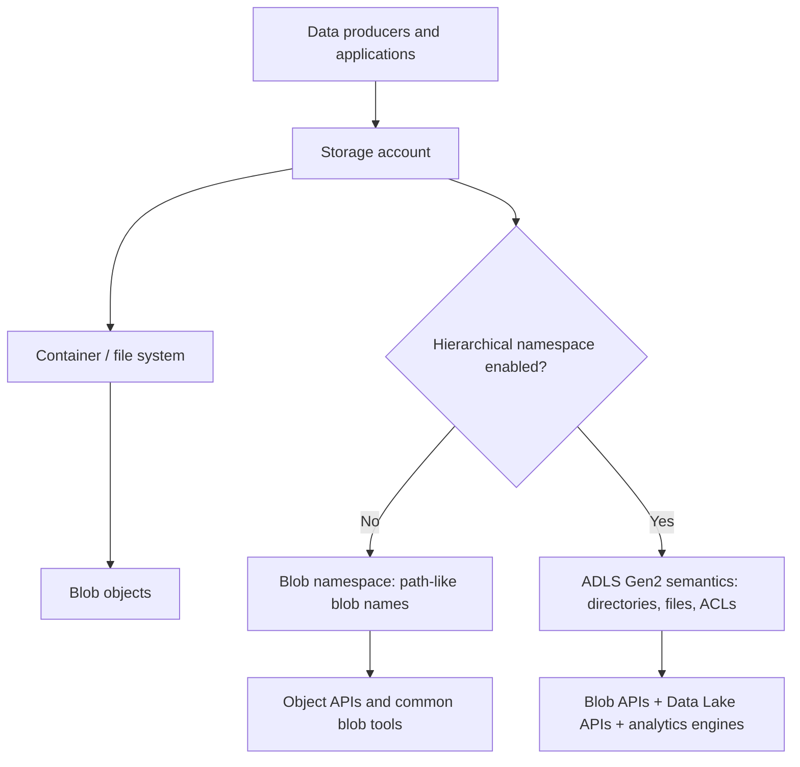

# Azure Data Lake Storage Gen2 and Blob Storage

> **Stage:** 2C — Data Engineering_3  
> **Module:** 05 — Azure Data Engineering and Microsoft Fabric  
> **Lesson:** `02-adls-gen2-and-blob-storage.md`  
> **Level:** Beginner → Intermediate → Advanced  
> **Estimated effort:** 6–8 hours, excluding long-running benchmark and optional managed Spark setup

## 1. Purpose and scope

This lesson explains how Azure Blob Storage and Azure Data Lake Storage Gen2 (ADLS Gen2) fit into a production data platform. You will learn the storage model, choose redundancy/performance/access tiers, design a medallion layout, reason about authorization, use supported tools and SDKs, and provision a secure learning environment.

This is an architectural and operational foundation, not a complete tutorial on every storage feature. The roadmap's next lessons cover pipeline orchestration and analytics engines. Here, focus on choosing and operating the storage layer correctly.

### Prerequisites

You should be comfortable with:

- Files, directories, CSV/JSON/Parquet, and basic SQL/data-pipeline concepts.
- Cloud identities and role-based access control at a conceptual level.
- Python virtual environments and command-line tools.
- Basic Azure concepts: subscription, resource group, region, Azure CLI, and Microsoft Entra ID.

### Learning objectives

By the end, you can:

1. Explain storage accounts, containers, blobs, directories, Blob Storage, and ADLS Gen2.
2. Decide when to enable hierarchical namespace (HNS), including its benefits and compatibility checks.
3. Compare LRS, ZRS, GRS, GZRS, Standard/Premium, and Hot/Cool/Cold/Archive.
4. Distinguish management-plane permissions from data-plane authorization and combine RBAC with ACLs correctly.
5. Design a bronze/silver/gold layout for three source systems.
6. Use Azure Storage Explorer, AzCopy, `abfss://`, the Python SDK, `adlfs`/`fsspec`, Spark, and Pandas appropriately.
7. Apply secure networking, managed identity, encryption, immutability, and recovery controls.
8. Identify performance bottlenecks and model lifecycle, transaction, retrieval, and egress costs.
9. Complete the lab, test two identities, inspect outcomes, and clean up safely.

## 2. Mental model: one storage platform, two access styles

Azure Blob Storage is Microsoft's object-storage service. Objects (blobs) live in containers inside a storage account. Applications commonly address objects using HTTP APIs and blob names. Blob names can contain `/` characters that look like folders, but in an account without HNS those path segments are generally naming conventions, not first-class directories.

ADLS Gen2 is not a separate unrelated storage engine. It is Blob Storage with **hierarchical namespace enabled**. HNS gives directories and files first-class semantics, directory operations, and POSIX-like ACLs, while Blob APIs and Data Lake Storage APIs can access the same data (multi-protocol access). HNS is especially useful for analytics engines that list, traverse, rename, and secure directory trees.



### Why the distinction matters

| Requirement | Blob without HNS | ADLS Gen2 with HNS |
|---|---|---|
| General object storage, static assets, backups, application objects | Strong fit | Also possible, but HNS may not be necessary |
| Analytics directory trees and filesystem-style traversal | Possible with object-prefix conventions | First-class directories and filesystem operations |
| POSIX-like file/directory ACLs | No ADLS ACL model | Supported, alongside Azure RBAC |
| Efficient directory rename semantics | Usually implemented as copy/delete of many objects by clients | Namespace operation can update directory metadata rather than copying every child object; actual latency still depends on service behavior and workload |
| Compatibility | Broad Blob feature set | Verify feature support for HNS accounts and the exact workload before adoption |

**Decision rule:** for a new analytics lake, normally choose an HNS-enabled account unless a required feature, protocol, or workload is incompatible. For an existing account, assess feature compatibility and migration/upgrade constraints before changing its namespace model. HNS enablement is a consequential architectural decision; do not assume every setting can be freely reversed.

## 3. Storage anatomy and URI patterns

- **Storage account:** top-level namespace, security boundary, region, redundancy choice, performance account type, and billing aggregation point.
- **Container / file system:** logical grouping inside an account. In ADLS APIs, a container is commonly referred to as a file system.
- **Blob / file:** the stored object or file content. In an HNS account, a file is addressed through directory semantics.
- **Directory:** a first-class namespace object in HNS accounts. Directory traversal requires execute permission when access is authorized through ACLs.
- **Endpoint:** a network address such as `https://<account>.blob.core.windows.net` or `https://<account>.dfs.core.windows.net`.

Typical URI patterns:

```text
Blob URL:          https://<account>.blob.core.windows.net/<container>/<blob-path>
ADLS Gen2 URL:     https://<account>.dfs.core.windows.net/<filesystem>/<directory>/<file>
Spark ABFS URI:    abfss://<filesystem>@<account>.dfs.core.windows.net/<path>
```

`abfss://` is the secure ABFS scheme commonly used by Spark/Hadoop integrations; it does not mean that every Python library automatically understands the URI. SDKs such as `azure-storage-file-datalake` use endpoint-based clients, while Pandas integrations commonly use `adlfs` through `fsspec`.

### Naming and partitioning conventions

Use lowercase, stable names and delimiters consistently. Avoid embedding credentials, personal data, or secrets in paths. Blob names are case-sensitive in practice for path matching and should be treated consistently. Define whether dates are UTC event dates or ingestion dates; do not mix them silently.

Example partition path:

```text
bronze/erp/orders/ingest_date=2026-10-19/part-00001.parquet
silver/erp/orders/order_date=2026-10-18/part-00001.parquet
```

Partition on fields that match common filters and data volume. Too many tiny partitions create excessive file listings and metadata operations; too few partitions can reduce parallelism or make selective reads expensive.

## 4. Redundancy and disaster recovery

Redundancy protects against infrastructure failures. It is not a replacement for deletion recovery, immutable backups, or a tested disaster-recovery plan.

| Option | Replication behavior | Typical fit | Main trade-off |
|---|---|---|---|
| **LRS** (locally redundant storage) | Multiple copies within one physical location in the primary region | Re-creatable data, development, or workloads whose resilience needs are modest | Does not protect against loss of the entire primary region or all copies in the location |
| **ZRS** (zone-redundant storage) | Synchronous copies across availability zones in a supported region | Production workloads requiring resilience to a zone failure | Region-level disaster protection is not provided by ZRS alone |
| **GRS** (geo-redundant storage) | Locally redundant primary plus asynchronous replication to a secondary region | Regional disaster-recovery requirements | Secondary data can lag; secondary access/failover behavior depends on the configuration |
| **GZRS** (geo-zone-redundant storage) | Zone-redundant primary plus asynchronous geo-replication | Higher resilience requirements including zone and regional failure scenarios | Usually costs more; asynchronous replication means non-zero potential data loss at regional failover |

Read the current regional availability and redundancy documentation before choosing. Not every redundancy option is available for every account type, region, or feature. Read-access geo-redundant options may also exist; compare them against the actual recovery objective.

Define **RPO** (how much data loss is acceptable) and **RTO** (how long recovery may take). Confirm whether recovery requires customer-initiated failover, whether the secondary endpoint is readable, and which application settings must change. Test the runbook periodically.

## 5. Performance account types and access tiers

### Standard vs Premium

| Choice | What it means | Consider when | Watch out for |
|---|---|---|---|
| **Standard** | General-purpose storage designed for broad workloads and cost-effective capacity | Data lakes, landing zones, backups, and common object/file data | Request patterns, transaction count, and throughput can dominate cost/performance |
| **Premium** | Higher-performance storage options for supported account types/workloads | Latency-sensitive or high-transaction workloads that fit the selected premium account type | Premium account types have feature/tiering constraints; premium block blob data cannot simply be tiered using Hot/Cool/Cold/Archive operations |

Premium is not a generic “faster checkbox” for every storage account. Choose an account type supported by the workload and required features. Benchmark representative data and request patterns.

### Access tiers

Access tiers primarily trade storage cost against access and retrieval cost. The exact minimum retention, early-deletion charge, retrieval latency, supported account types, and regional availability are version-sensitive; check current pricing and tier documentation before production use.

| Tier | Access pattern | Typical use | Important constraints/costs |
|---|---|---|---|
| **Hot** | Frequent reads/writes | Current landing data, active curated datasets | Higher storage cost than colder tiers, often lower access cost |
| **Cool** | Infrequent access, still online | Older raw/curated data that may be read periodically | Lower storage cost; access/retrieval costs and minimum retention considerations apply |
| **Cold** | Rare access, still online | Longer-lived data with infrequent reads | Lower storage cost than warmer tiers but typically higher access costs; check minimum retention and supported account settings |
| **Archive** | Offline, rarely accessed | Long-term retention, compliance archives | Not immediately readable; rehydration to an online tier takes time and incurs charges. Lifecycle policy does not directly rehydrate archived blobs to an online tier |

Access tiers are not equivalent to backup. A lifecycle policy can transition data or expire it based on rules, but it will not know whether a downstream team still depends on the data unless you encode that policy correctly.

### Lifecycle policy design

A lifecycle policy can use filters such as prefix and blob type, and rules based on age since modification or other supported timestamps. Typical policy: move eligible bronze files to Cool after a retention window, then delete after the approved retention period. Validate rule filters against real paths, and test with a disposable prefix before applying to production.

Do not confuse **tiering** with **deletion**. Consider versions and snapshots when configuring deletion: deleting current blobs does not necessarily remove older versions, snapshots, or soft-deleted data. Policies for previous versions and snapshots may need explicit actions.

## 6. Authorization: management plane vs data plane

Azure has two distinct questions:

1. **Management plane:** may the principal create or configure the storage account, networking, lifecycle policy, or role assignments? Azure Resource Manager RBAC controls these actions.
2. **Data plane:** may the principal list, read, create, modify, or delete blobs/files? Data access requires a supported data authorization mechanism.

Being **Contributor** on a resource group lets a principal manage many resource settings but does not by itself grant permission to read blob contents. For data operations, use an appropriate storage data role or ACLs. The roles `Storage Blob Data Reader`, `Storage Blob Data Contributor`, and `Storage Blob Data Owner` have different scopes and privileges; grant the narrowest role at the narrowest useful scope.

### Mechanism comparison

| Mechanism | Identity model | Scope / use | Main risk or limitation |
|---|---|---|---|
| **Azure RBAC data roles** | Microsoft Entra principal | Coarse-grained data access at account/container scopes, with assignments inherited down resource hierarchy | Broad roles can grant more access than intended; role propagation can take time |
| **ADLS ACLs** | Entra user, group, service principal, or managed identity | Fine-grained file/directory permissions on HNS accounts | Parent-directory traversal and default ACL behavior are frequent sources of errors |
| **User delegation SAS** | SAS signed using an Entra-backed user delegation key | Time-limited, constrained access to selected resources and permissions | Treat the token as a bearer secret; constrain expiry, permissions, and resource scope |
| **Service SAS / account SAS** | Signed with storage account key | Delegated access using a shared-key model | Account key compromise can have broad impact; prefer Entra and user delegation SAS where feasible |
| **Account key / Shared Key** | Account-level secret | Broad compatibility and legacy integrations | High blast radius; avoid embedding in code, notebooks, URLs, or logs; consider disabling Shared Key where supported by all clients |

### How RBAC and ACL evaluation work

For ADLS Gen2 requests authorized with Microsoft Entra ID, Azure first evaluates applicable Azure RBAC/ABAC permissions. If an applicable role grants the requested data operation, the request is authorized through that role; ACLs are not an extra mandatory restriction that can subtract permission granted by a broad data role. If RBAC does not grant the data action, ACL evaluation can grant access based on the path's ACLs. This is why assigning a broad `Storage Blob Data Contributor` role can defeat the intended fine-grained isolation of ACLs. Keep broad data roles narrow, and use ACLs where path-level isolation is the goal.

Shared Key and many SAS authorization flows do not associate the caller with an Entra identity for ACL evaluation. A user-delegation SAS is Entra-backed and has special ACL interaction; do not generalize this behavior to all SAS types. Check current Microsoft documentation for the exact request type and authorization path.

### ACL permissions and inheritance

The directory/file ACL bits are **Read (R), Write (W), Execute (X)**:

- On a file, `R` reads file content; `W` permits writing/appending; `X` has no file-execution meaning in this storage model.
- On a directory, `R` plus `X` is required to list contents; `W` plus `X` is required to create child entries; `X` permits traversal through that directory.
- A principal reading `container/bronze/source/date/file.parquet` needs traversal (`X`) on the relevant parent directories plus read permission on the file, unless RBAC already grants the operation.
- **Access ACLs** apply to the object. **Default ACLs** on a directory are templates for newly created children. Changing a default ACL does not retroactively update existing descendants; apply recursive ACL changes for existing trees when needed.

Prefer Microsoft Entra groups for ACL entries rather than maintaining individual users one by one. Test both a permitted and denied operation using the actual identity that the production job will run as.

## 7. Production medallion layout for three sources

A medallion layout separates raw arrivals (**bronze**), validated/conformed datasets (**silver**), and business-ready outputs (**gold**). Use it to clarify ownership, data quality, retention, and access. It is a logical pattern, not a requirement to create a separate storage account for every layer.

Example sources: ERP orders, CRM customers, and IoT device events.

```text
<account>/<container-or-filesystem>/
├── bronze/
│   ├── erp/orders/ingest_date=YYYY-MM-DD/...
│   ├── crm/customers/ingest_date=YYYY-MM-DD/...
│   └── iot/device_events/ingest_date=YYYY-MM-DD/hour=HH/...
├── silver/
│   ├── erp/orders/order_date=YYYY-MM-DD/...
│   ├── crm/customers/snapshot_date=YYYY-MM-DD/...
│   └── iot/device_events/event_date=YYYY-MM-DD/hour=HH/...
└── gold/
    ├── sales/daily_order_metrics/business_date=YYYY-MM-DD/...
    ├── customer/360/snapshot_date=YYYY-MM-DD/...
    └── operations/device_health/event_date=YYYY-MM-DD/...
```

### Layout design principles

- Keep raw bronze data immutable where feasible; record source, ingest timestamp, schema/version, and run ID in metadata or manifests.
- Prefer Parquet/Delta for analytical data when the engine and downstream contract support them; avoid using one file per row.
- Choose partitions based on filter selectivity and data volume, not by habit. `ingest_date` supports replay/audit; `event_date` or business date supports query pruning. They represent different concepts.
- Use deterministic paths and idempotent ingestion. A rerun should not silently duplicate data or overwrite a different batch.
- Separate sensitive domains with containers/accounts and role scopes when the security boundary requires it. A folder name alone is not a security boundary.
- Define retention for each zone. Bronze may have shorter or longer retention depending on replay/compliance needs; gold may require controlled business retention.

## 8. Tools and access patterns

### Azure Storage Explorer

A desktop GUI for browsing storage resources, uploading/downloading files, and inspecting ACLs. Sign in with Microsoft Entra ID where possible. It is useful for learning and troubleshooting, but production deployment should still be reproducible through scripts/IaC.

### AzCopy

AzCopy is a command-line utility for high-throughput data transfers. It supports parallel transfers and can use Microsoft Entra authorization. Avoid SAS tokens in shell history or logs; if SAS is required, constrain scope and expiry. Start with a small test, verify source/destination paths, and inspect exit status and logs before scaling.

Example after `az login` and assignment of a suitable data role:

```bash
azcopy copy "./sample-data/" "https://<account>.dfs.core.windows.net/bronze/training/" --recursive=true
```

Use an HNS-enabled account and verify the exact AzCopy version and endpoint behavior. For local folder upload, the trailing slash and destination path affect layout; list the destination after the copy rather than assuming the path.

### Python SDK: `azure-storage-file-datalake`

Install in a virtual environment:

```bash
python -m venv .venv
# Linux/macOS
source .venv/bin/activate
# Windows PowerShell: .venv\Scripts\Activate.ps1
python -m pip install --upgrade azure-identity azure-storage-file-datalake
```

Use `DefaultAzureCredential` for local development (for example, an authenticated Azure CLI session) and managed identity in Azure-hosted compute. The principal needs the appropriate data role, or ACL permissions for HNS paths. Avoid account keys in source code.

```python
from pathlib import Path
from azure.core.exceptions import ResourceExistsError
from azure.identity import DefaultAzureCredential
from azure.storage.filedatalake import DataLakeServiceClient

ACCOUNT_NAME = "<storage-account-name>"
FILESYSTEM = "bronze"
LOCAL_FILE = Path("sample.csv")
REMOTE_PATH = "training/sample.csv"

credential = DefaultAzureCredential()
service = DataLakeServiceClient(
    account_url=f"https://{ACCOUNT_NAME}.dfs.core.windows.net",
    credential=credential,
)
filesystem = service.get_file_system_client(FILESYSTEM)

# Upload. The parent directory must exist or be created first.
parent = "training"
directory = filesystem.get_directory_client(parent)
try:
    directory.create_directory()
except ResourceExistsError:
    # The directory already exists; authentication and network errors still surface.
    pass

file_client = filesystem.get_file_client(REMOTE_PATH)
with LOCAL_FILE.open("rb") as stream:
    file_client.upload_data(stream, overwrite=True)

# List files at the filesystem root (recursive listing shown separately).
for path in filesystem.get_paths(path="training", recursive=True):
    print(path.name, path.is_directory)

# Download to a local path.
download = file_client.download_file()
with Path("downloaded-sample.csv").open("wb") as output:
    output.write(download.readall())

service.close()
```

**Important:** the sample is an instructional pattern. Configure retries/timeouts, stream large downloads rather than calling `readall()` for very large files, validate checksums/row counts, and use an explicit idempotency strategy. It catches only the SDK's `ResourceExistsError` for the expected already-exists case; authentication, authorization, and network errors are allowed to surface.

A simpler upload helper that avoids directory creation if you know the directory already exists:

```python
from azure.identity import DefaultAzureCredential
from azure.storage.filedatalake import DataLakeServiceClient

account = "<storage-account-name>"
service = DataLakeServiceClient(
    f"https://{account}.dfs.core.windows.net", credential=DefaultAzureCredential()
)
fs = service.get_file_system_client("bronze")
with open("sample.csv", "rb") as data:
    fs.get_file_client("training/sample.csv").upload_data(data, overwrite=True)
```

The Python SDK supports data-plane operations; it does not provision your account or grant itself access. Those are separate Azure management/identity tasks.

### Reading Parquet with Python and Pandas

For Pandas-style file access, `adlfs` integrates Azure Data Lake Storage with `fsspec`. Install the required packages:

```bash
python -m pip install --upgrade pandas pyarrow adlfs azure-identity
```

Example with a filesystem object authenticated by the current supported credential chain:

```python
import pandas as pd
from adlfs import AzureBlobFileSystem
from azure.identity import DefaultAzureCredential

account = "<storage-account-name>"
credential = DefaultAzureCredential()
fs = AzureBlobFileSystem(account_name=account, credential=credential)
with fs.open("bronze/training/sample.parquet", "rb") as handle:
    df = pd.read_parquet(handle)
print(df.head())
```

`adlfs` configuration and credential support evolve; check the installed version's documentation. Do not assume a local Azure CLI credential works in a hosted environment. For large datasets, Pandas may load data into local memory; use a distributed engine if the dataset exceeds memory or requires distributed transforms.

### Spark and `abfss://`

For Spark environments with the appropriate ABFS connector and Microsoft Entra authentication configuration, a path can look like:

```python
path = "abfss://bronze@<storage-account-name>.dfs.core.windows.net/erp/orders/"
df = spark.read.parquet(path)
df.printSchema()
df.show(5, truncate=False)
```

The URI alone does not configure authentication. In Azure Databricks, Fabric Spark, Synapse Spark, or another environment, follow that platform's recommended identity integration. Prefer managed identity/workload identity or a service principal with secret material held in a managed secret store. Do not paste client secrets into notebooks or Spark configuration committed to Git. For Databricks, prefer Unity Catalog storage credentials/external locations where applicable rather than legacy mounts and account keys.

### Service principal vs managed identity

- **Managed identity:** Azure-managed identity for supported Azure resources; no client secret lifecycle for the workload to manage.
- **Service principal:** application identity, often used for CI/CD or workloads outside Azure; protect credentials, rotate them, and prefer certificate/federated credentials where supported.
- **Local development:** `DefaultAzureCredential` can chain developer credentials such as Azure CLI login. This is not a substitute for configuring the deployed runtime identity.

## 9. Provisioning with Bicep

The following Bicep file provisions an HNS-enabled Standard general-purpose v2 storage account with secure baseline settings. It uses placeholders for location and account name; storage account names must be globally unique and meet Azure naming rules.

Save as `infra/storage.bicep`:

```bicep
@description('Globally unique lowercase storage account name (3-24 letters/numbers).')
param storageAccountName string

@description('Azure region, for example eastus. Confirm regional support before deployment.')
param location string = resourceGroup().location

@description('Environment tag value.')
@allowed([
  'dev'
  'test'
  'prod'
])
param environment string = 'dev'

resource storage 'Microsoft.Storage/storageAccounts@2023-05-01' = {
  name: storageAccountName
  location: location
  kind: 'StorageV2'
  sku: {
    name: 'Standard_LRS'
  }
  tags: {
    environment: environment
    workload: 'data-engineering-learning'
    owner: 'data-platform-team'
    costCenter: 'training'
  }
  properties: {
    isHnsEnabled: true
    minimumTlsVersion: 'TLS1_2'
    supportsHttpsTrafficOnly: true
    allowBlobPublicAccess: false
    allowSharedKeyAccess: false
    publicNetworkAccess: 'Enabled'
    networkAcls: {
      bypass: 'None'
      defaultAction: 'Deny'
      ipRules: []
      virtualNetworkRules: []
    }
    accessTier: 'Hot'
  }
}

resource bronze 'Microsoft.Storage/storageAccounts/blobServices/containers@2023-05-01' = {
  name: '${storage.name}/default/bronze'
  properties: {
    publicAccess: 'None'
  }
}

output storageAccountId string = storage.id
output dfsEndpoint string = 'https://${storage.name}.dfs.core.windows.net'
```

### Networking note about the example

The sample sets the network default action to `Deny` but leaves no IP or VNet exceptions. This is deliberately restrictive and may block your current machine unless it is connected through an allowed network path. It is a secure starting point for a private-network lab, not a promise that you can immediately connect from a public workstation. For a first connectivity lab, either add a narrowly scoped temporary IP rule through an approved process or use a managed private endpoint/approved network. Do not solve connectivity by making the account public to everyone.

Some platform-level deployment or service interactions may require specific network exceptions. Do not add `AzureServices` bypass casually: understand which trusted services it covers and whether it satisfies your threat model. Verify the exact Bicep API version and properties against the current resource reference before using this in production. If Shared Key is disabled, ensure all clients use Entra-based authorization and are compatible with that setting.

Deploy into an existing resource group:

```bash
az login
az account show --output table
az group create --name rg-adls-learning-dev --location <region>
az deployment group create \
  --resource-group rg-adls-learning-dev \
  --template-file infra/storage.bicep \
  --parameters storageAccountName=<globally-unique-name> environment=dev
```

The deployer needs permission to deploy resources at the resource-group scope. Creating role assignments later requires additional authorization; do not assume the template or storage account grants data access automatically.

### Lifecycle management policy example

Lifecycle policy is a storage-account management-plane configuration. For illustration, the following JSON policy transitions eligible block blobs under `bronze/` to Cool after 30 days and deletes eligible current blobs after 365 days. These values are examples, not universal retention recommendations. Test filters and actions against a disposable prefix first.

Save as `infra/lifecycle.json`:

```json
{
  "rules": [
    {
      "enabled": true,
      "name": "bronze-retention-example",
      "type": "Lifecycle",
      "definition": {
        "filters": {
          "blobTypes": ["blockBlob"],
          "prefixMatch": ["bronze/"]
        },
        "actions": {
          "baseBlob": {
            "tierToCool": { "daysAfterModificationGreaterThan": 30 },
            "delete": { "daysAfterModificationGreaterThan": 365 }
          }
        }
      }
    }
  ]
}
```

Apply the policy (confirm the account and JSON schema supported by your current CLI version):

```bash
az storage account management-policy create \
  --account-name <storage-account-name> \
  --resource-group rg-adls-learning-dev \
  --policy @infra/lifecycle.json
```

The lifecycle engine runs asynchronously; do not expect an immediate tier change. A lifecycle rule is not a backup, and a current-blob deletion rule must be reviewed alongside soft delete, versioning, snapshots, and previous-version retention. In an HNS account, confirm current feature support and limitations for the exact protection features you enable.

## 10. Security and resilience controls

### Private endpoints, firewalls, and service endpoints

- **Storage firewall:** restricts which network paths may reach the public storage endpoint. Network rules do not grant data authorization.
- **Private endpoint:** gives a private IP in a VNet for a supported storage subresource (Blob/DFS). Configure private DNS correctly; HNS workloads may use both Blob and DFS endpoints depending on APIs.
- **Service endpoint:** allows a subnet to reach the storage public endpoint through Azure's backbone with subnet-based network rules. It does not provide a private IP for the storage service.
- **VNet:** network isolation and routing boundary; a VNet alone does not make storage private.

For production, validate DNS resolution from the actual compute subnet, use least-privilege identity permissions, and test both allowed and denied network paths. Network allowlisting and RBAC/ACL are independent controls.

### Encryption and customer-managed keys

Azure Storage encrypts data at rest by default using Microsoft-managed keys. Customer-managed keys (CMK) in Azure Key Vault or Managed HSM provide additional key-control requirements, such as customer-controlled rotation and revocation. CMK adds operational dependencies: permissions, key availability, soft delete/purge protection, rotation procedures, monitoring, and disaster-recovery planning. Confirm the selected account configuration and current service support before enabling it.

### Immutability / WORM

Immutable Blob Storage policies can protect data from modification/deletion for a retention period or legal hold, subject to the supported account and blob types. WORM can be appropriate for regulated records, audit evidence, and tamper-resistant archives. It can also make cleanup impossible until policy conditions permit it. Test policies on a non-production container and obtain records-retention approval before locking a time-based policy.

### Recovery options and limits

| Feature | Helps with | HNS / design constraint |
|---|---|---|
| **Blob soft delete** | Recovering a deleted blob or directory within configured retention; container recovery requires container soft delete | Supported for HNS, but do **not** assume that it protects overwrites in an HNS account. It does not recover a deleted storage account, and expired retention is permanent. |
| **Blob versioning** | Recovering earlier versions after overwrites/deletes in supported flat-namespace accounts | **Not supported when HNS is enabled.** Do not design an ADLS Gen2 recovery plan around blob versions. |
| **Change feed** | Durable ordered log of blob changes for downstream processing/audit patterns in supported accounts | **Not supported when HNS is enabled.** It is not a backup or direct point-in-time restore mechanism. |
| **Point-in-time restore (PITR)** | Restoring supported block-blob data to an earlier point within configured retention and account constraints | **Not supported for HNS accounts or operations through the Data Lake Storage API.** In supported flat-namespace accounts it also has prerequisites and scope limits. |
| **Redundancy** | Infrastructure/zone/region failure protection depending on selected option | Does not recover logical deletion/corruption or enforce retention by itself. Geo-replication is asynchronous. |
| **Immutable retention / legal hold** | Preventing changes/deletion during the enforced period, subject to policy state | Can block corrections and cleanup; validate account/feature compatibility and obtain records-retention approval. |

**Important ADLS Gen2 recovery rule:** HNS accounts support blob soft delete, container soft delete, and immutable storage under the current feature-support matrix, but blob versioning, change feed, and PITR are not supported with HNS. For an HNS account, plan around supported soft-delete protections, redundancy, immutability where appropriate, and an independent backup/export strategy if the threat model requires it. Do not imply soft delete alone protects against accidental overwrite: Microsoft's HNS behavior differs from flat-namespace overwrite protection. Re-check the feature-support matrix before enabling a new feature because support changes over time.

Enable a recovery combination based on threat model and RPO/RTO. Lifecycle rules should be reviewed alongside supported recovery controls; for HNS accounts, do not configure lifecycle actions that depend on versions or change feed. Soft-deleted data remains billed during its retention period, and a deleted storage account is not recoverable through blob soft delete.

## 11. Performance and scale

### Request patterns and throughput

Storage performance depends on account type, region, network, object sizes, concurrency, partitioning, client retry policy, and request distribution. Review current scalability targets and monitor actual throttling rather than relying on a single universal request-per-second number.

- **Parallel transfers:** AzCopy can increase throughput by transferring multiple objects/blocks concurrently. Too much concurrency can saturate client CPU, network, or service request limits.
- **Large files:** block-based parallel upload/download can improve throughput when network and compute support it.
- **Small-file problem:** millions of tiny objects increase listing, metadata, request, and Spark scheduling overhead. Compact files where the engine and table format support safe compaction.
- **Partitioning:** choose partitions to balance pruning with file counts and parallelism. Avoid high-cardinality partition columns that create thousands of tiny directories.
- **Retries:** use exponential backoff for transient failures and observe throttling signals; avoid tight retry loops that amplify pressure.
- **Benchmarking:** use representative data, warm/cold cache conditions, same region/network, fixed concurrency, repeated runs, and record size/file count/elapsed time/errors. Report measured numbers with test context; do not extrapolate one run into a universal claim.

### Directory rename comparison

On an HNS account, directory rename is a first-class namespace operation and can avoid copying every child blob. On a non-HNS account, a client often emulates a rename by copying each object to the new prefix and deleting the old objects. The exact behavior and time depend on client/tool, object count, bytes, API, network, and service behavior.

For a fair lab comparison, create two disposable accounts in the same region with comparable redundancy and network path. Upload a representative directory tree with identical file count and total bytes. Record the command/tool version, object count, total bytes, elapsed time, transfer operations, errors, and resulting content hashes. Use the same tool where possible; do not compare a server-side HNS rename with a local download/re-upload workflow and call the result an apples-to-apples benchmark. No benchmark results are asserted by this lesson because the lab has not been executed here.

## 12. Cost engineering

A storage estimate should include more than capacity:

- Stored GB-month by tier, redundancy, and account type.
- Read/write/list and other transaction classes.
- Retrieval/rehydration costs for cool/cold/archive tiers.
- Early deletion charges where minimum retention applies.
- Data transfer/egress across regions or out of Azure, depending on route and service.
- Soft-deleted data and supported snapshots; versions and change-feed retention apply only to compatible account configurations (blob versioning and change feed are not supported with HNS).
- Replication, monitoring/logging, and supporting compute/network costs.

Cost practices:

1. Tag resource groups and accounts with `environment`, `owner`, `workload`, and `costCenter` where organizational policy permits.
2. Choose the tier based on access patterns and minimum retention, not only storage price per GB.
3. Use lifecycle policies only after testing filters and retention requirements.
4. Avoid creating excessive small files and unnecessary copies.
5. Use Cost Management to review actuals; price calculators and estimates are not invoices.
6. A budget alert notifies stakeholders; it does **not** automatically stop storage requests or prevent charges.
7. Clean up test accounts after validating outputs, but preserve evidence and any data required by policy.

## 13. Hands-on lab — `experiments/02_adls/`

### Lab outcome

Provision an HNS-enabled account, upload sample data with AzCopy, compare directory rename behavior, configure ACLs for two identities, apply a lifecycle policy, and read Parquet from Python and Spark using Entra-based credentials.

### Safety and prerequisites

- An Azure subscription and permission to create a resource group and storage account in an allowed region.
- Azure CLI, Bicep CLI (or Azure CLI's Bicep integration), AzCopy, Python 3.10+ (use the version supported by the selected SDK), and optional Spark environment.
- Two test Entra principals or groups: a pipeline identity and an analyst identity. Do not use production identities for permission experiments.
- Permission to assign data roles if you will create role assignments. Role assignment creation typically requires `Microsoft.Authorization/roleAssignments/write` or a suitable built-in role at the relevant scope.
- Budget/cost awareness. Storage capacity, transactions, redundancy, and cross-region transfer can incur charges.

### Lab folder structure

```text
experiments/02_adls/
├── README.md                  # lab runbook (this section)
├── infra/storage.bicep        # account + container
├── infra/lifecycle.json       # lifecycle example
├── data/sample.csv            # create locally; do not commit private data
└── notes/benchmark-results.md # record measured results, never invent them
```

### Step 1 — Set variables and create a resource group

**Placeholder rule:** replace every `<...>` token with a real value before running a command. Do not paste angle-bracket placeholders literally into Bash or PowerShell, because characters such as `<` and `>` can be interpreted as redirection operators.

```bash
az login
az account show --output table
az group create --name rg-adls-lab-dev --location <region>
```

Set a globally unique account name containing only lowercase letters and numbers (3–24 characters). Choose a region where the desired account features are available. Do not paste subscription IDs into public notes.

Deploy the Bicep template from Section 9, changing the resource-group name if needed:

```bash
az deployment group create \
  --resource-group rg-adls-lab-dev \
  --template-file experiments/02_adls/infra/storage.bicep \
  --parameters storageAccountName=<unique-name> environment=dev
```

If using the template's default-deny firewall, access from your workstation will fail unless you have an allowed network path. Establish an approved path before continuing; do not make the account open to all networks as a shortcut.

### Step 2 — Confirm HNS and the account configuration

```bash
az storage account show \
  --name <storage-account-name> \
  --resource-group rg-adls-lab-dev \
  --query '{name:name,location:location,isHnsEnabled:isHnsEnabled,httpsOnly:enableHttpsTrafficOnly,publicNetworkAccess:publicNetworkAccess,allowSharedKeyAccess:allowSharedKeyAccess}' \
  --output yaml
```

Expected result: the account name and region match your parameters; HNS is enabled; HTTPS-only is enabled; public network access and Shared Key settings match the template. If the query returns `null` for a property, inspect the full object and the current API/CLI field name rather than assuming the control was applied.

### Step 3 — Create sample data and upload with AzCopy

Create a harmless CSV locally, for example:

```csv
order_id,order_date,amount
1001,2026-10-01,42.50
1002,2026-10-02,17.25
```

Authenticate with an identity authorized for the target data path. For Entra-based AzCopy authorization, the identity needs the appropriate data role or ACLs. Upload:

```bash
azcopy login
azcopy copy "./sample.csv" \
  "https://<storage-account-name>.dfs.core.windows.net/bronze/training/sample.csv"
```

If the filesystem/container `bronze` was created by the Bicep template, the directory `training` may need to exist or be created depending on the command/API behavior. Create it through Storage Explorer, the CLI, or SDK as needed. Verify the resulting object:

```bash
az storage fs file list \
  --account-name <storage-account-name> \
  --file-system bronze \
  --path training \
  --auth-mode login \
  --output table
```

The CLI command family and authentication flags can vary by installed version; consult `az storage fs file list --help`. If Shared Key is disabled, use Entra authorization (`--auth-mode login`) and ensure your identity has a data role or suitable ACL access.

### Step 4 — Rename benchmark: HNS vs non-HNS

1. Provision a second disposable Standard GPv2 account without HNS, in the same region and with comparable settings. Use synthetic data only.
2. Generate a dataset with many files and record the exact file count and total bytes.
3. Upload identical data to both accounts.
4. Rename the directory using the same version of Storage Explorer, AzCopy, or a controlled SDK harness. Record the tool's semantics: a tool may not expose the same operation on both account types.
5. Measure elapsed time and record API errors, request counts if available, total bytes, and verification results.
6. Verify destination file counts and checksums; verify the original path is absent only after confirming the destination is complete.
7. Delete the second account when finished.

`notes/benchmark-results.md` should contain: date/time, region, account type, HNS status, tool/version, file count, total bytes, network location, operation used, elapsed time, errors/retries, and validation outcome. **Do not fill in fabricated timing values.** Explain why an HNS namespace rename differs from copy/delete semantics on a flat namespace.

### Step 5 — Configure ACLs for two identities

Use two test principals/groups:

- **Pipeline identity:** needs read/write on a controlled landing path.
- **Analyst identity:** read-only on a curated path; no access to unrelated bronze folders.

First decide whether coarse RBAC or ACLs should grant access. If you assign `Storage Blob Data Contributor` at the account scope to the analyst, ACL restrictions will not provide the intended isolation. For an ACL-focused test, grant only the management/ACL administration permission to the operator and use ACLs for the data identities; avoid broad data roles on those identities.

Example ACL strategy for `bronze/training`:

- Root `/` and every parent directory on the path: `--x` traversal for the intended principal/group as required.
- The target directory: pipeline identity/group gets `rwx`; analyst gets no permission.
- A separate `gold/metrics` directory: analyst gets `r-x` on directories and `r--` on files, plus traversal on each parent.
- Configure default ACLs on directories **before** creating child data if new files should inherit the policy. Existing files require explicit/recursive ACL updates.

Use Storage Explorer's Manage ACL interface or the supported CLI/SDK to set access and default ACLs. The following CLI examples show the supported `update-recursive` pattern for named users; replace the placeholders with Entra **object IDs** and inspect the existing ACL before changing it. Unlike `set`, `update-recursive` updates the specified entries rather than replacing the entire ACL. The operator needs `Storage Blob Data Owner` at an appropriate scope or the required ownership rights.

```bash
# Add pipeline identity read/write/traverse to existing entries in this tree.
az storage fs access update-recursive \
  --acl "user:<PIPELINE_OBJECT_ID>:rwx" \
  --path training/ --file-system bronze \
  --account-name <STORAGE_ACCOUNT_NAME> --auth-mode login

# Add analyst read/traverse permissions on the curated tree, not bronze.
az storage fs access update-recursive \
  --acl "user:<ANALYST_OBJECT_ID>:r-x" \
  --path metrics/ --file-system gold \
  --account-name <STORAGE_ACCOUNT_NAME> --auth-mode login

# Inspect the effective ACL entries on each target path.
az storage fs access show --path training/ --file-system bronze \
  --account-name <STORAGE_ACCOUNT_NAME> --auth-mode login --output json
az storage fs access show --path metrics/ --file-system gold \
  --account-name <STORAGE_ACCOUNT_NAME> --auth-mode login --output json
```

These commands update access ACL entries on the existing tree; they do not automatically grant the named principals execute/traversal permission on every ancestor directory. Before testing, verify `X` on the file-system root and each parent path using Storage Explorer or the CLI; also verify that no broad RBAC data role already grants access. `update-recursive` can touch many descendants, so use synthetic lab data and inspect the target path carefully. Configure default ACL entries separately on the target **directory** (for example, with Storage Explorer) before creating new children. If using `az storage fs access set` for default ACLs, first capture and preserve all existing ACL entries because `set` replaces the full ACL; do not blindly paste a partial ACL.

Test as each identity, not as the subscription owner:

1. Pipeline identity lists and writes under its assigned path.
2. Analyst identity reads the allowed gold dataset.
3. Analyst identity attempts to list/read the restricted bronze path and receives an authorization failure.
4. Remove a permission from the test ACL using Storage Explorer or `az storage fs access remove-recursive`, then repeat the test to observe the failure mode. Restore the intended entry after recording the result.

The CLI command family is supported in current Azure CLI; check `az storage fs access --help` for the installed version and read the official ACL guide before changing production ACLs. Never put a client secret or account key in the command line. A failed test can also be caused by missing `X` on a parent directory, RBAC granting/denying at a broader scope, network restrictions, or token/role propagation delay; isolate these variables one at a time.

### Step 6 — Apply a lifecycle rule

Use the policy in `infra/lifecycle.json` with a test prefix. For a quick lab, age-based rules may take days to trigger; do not claim that the tier changed immediately. Verify policy creation through the portal or CLI, inspect the exact filter, and use a supported test approach for lifecycle execution if available. Never shorten production retention merely to force a lab result without explicit approval.

### Step 7 — Read Parquet with Python and Spark

Create or upload a small Parquet dataset. For Python, install `pandas`, `pyarrow`, `adlfs`, and `azure-identity`, then use the Section 8 `AzureBlobFileSystem` example with the actual account and path. Ensure the active Entra principal has read access.

For Spark, use the `abfss://` example from Section 8 in an environment whose connector and Entra authentication are configured. On Azure-hosted compute, use the platform's managed identity integration where supported. For a service principal, store credentials in a managed secret store and configure the supported authentication provider for that runtime. Do not assume that a Python `DefaultAzureCredential` object automatically configures Hadoop's ABFS connector.

Expected result: Python/Pandas and Spark can read the same rows and schema from the same dataset; the actual runtime identity is known and documented. If either path fails, verify network/DNS, endpoint, credential provider, data role/ACL, parent traversal, and file path separately.

### Step 8 — Inspect cost and clean up

Open Azure Cost Management for the subscription/resource group and inspect available cost data. Newly created or low-usage resources may not appear immediately, and very small test activity can be below reporting granularity. Record the observation time and do not interpret missing immediate cost rows as proof that the resource is free.

After preserving notes and confirming there is no needed data, delete the lab resource group:

```bash
az group delete --name rg-adls-lab-dev --yes --no-wait
```

This deletes resources in the resource group, including the storage account and data. Verify that no resource must be retained and that the account is not shared with another workload before running it. If the non-HNS benchmark account was created elsewhere, delete it separately. Immutable retention or legal hold can prevent deletion until its conditions allow it.

### Troubleshooting table

| Symptom | Likely cause | Diagnostic action |
|---|---|---|
| `AuthorizationPermissionMismatch` / 403 | Missing data role, ACL, or parent `X`; wrong auth mode | Identify the exact principal; inspect role scope and every parent ACL; check if a broad role is changing evaluation |
| CLI can create account but cannot list files | Management-plane role exists, data-plane permission does not | Use Entra auth and grant least-privilege data access or ACLs |
| Works in Storage Explorer but not Spark | Different identity/credential provider, endpoint, or network path | Log the runtime identity; verify ABFS configuration and DNS/network route |
| Access denied through private endpoint | Private DNS missing/wrong, endpoint not approved, or route issue | Resolve Blob and DFS FQDNs from the compute subnet; inspect endpoint approval and DNS zones |
| ACL appears set but new files lack it | Default ACL configured after child creation, or wrong parent | Set default ACL before creating children; apply recursive updates to existing objects |
| Lifecycle policy does not change tier | Rule is asynchronous, prefix mismatch, unsupported account/tier, age condition not met | Validate policy JSON and blob path, check account type and current feature support, allow processing time |
| AzCopy is slow or throttled | Too much/too little concurrency, small files, network/client bottleneck, request limits | Capture logs, measure file sizes and throughput, tune concurrency gradually |
| Cost is higher than expected | Transactions, retrieval, early deletion, versions, redundancy, egress | Break down capacity and operation charges; inspect versions and lifecycle rules |

## 14. Practice questions with answers

1. **Is ADLS Gen2 a completely separate storage service from Blob Storage?**  
   No. It is Blob Storage with HNS enabled, adding first-class directory semantics and ACLs while supporting Blob APIs through multi-protocol access.

2. **Why can a user read a file fail even when the file ACL includes read permission?**  
   The identity may lack execute/traversal permission on a parent directory, may be blocked by network controls, or the authentication/authorization path may differ from the assumed one.

3. **Does `Contributor` on a resource group guarantee that a principal can read Parquet files?**  
   No. It grants management-plane permissions; data access requires a supported data role, ACL, SAS, or Shared Key authorization.

4. **When should you use a user delegation SAS?**  
   When you need constrained, time-limited access to selected storage resources and can authorize the SAS using Microsoft Entra credentials. Protect the token as a secret and minimize its permissions and lifetime.

5. **Does GRS guarantee zero data loss during regional failover?**  
   No. Geo-replication is asynchronous, so replicated data may lag. Define and test RPO/RTO.

6. **Can archived blobs be read immediately like hot-tier blobs?**  
   No. Archive is offline; rehydration is required and takes time and can incur charges.

7. **Does changing a default ACL update every existing file?**  
   No. Default ACLs are templates for newly created children. Existing descendants require explicit or recursive updates.

8. **Why can too many small Parquet files hurt Spark performance?**  
   Listing, metadata, task scheduling, and request overhead increase, often outweighing parallelism benefits.

9. **Is a lifecycle policy a backup, and can an HNS account use versioning or PITR?**  
   No. A lifecycle policy applies deterministic tiering/expiry rules. HNS accounts support soft delete, but blob versioning, change feed, and PITR are not supported with HNS. Design the recovery approach around verified supported features, redundancy, immutable retention where appropriate, and independent backup/export when required.

10. **Why is cost per GB alone an incomplete storage comparison?**  
    Transactions, retrieval, early deletion, versions/snapshots, redundancy, and egress can materially affect total cost.

## 15. Scenario exercises

### Scenario A — Department-level data isolation

A pipeline writes raw finance data and a sales analyst should only read curated sales metrics. Design account/container/folder boundaries, RBAC scopes, ACLs, identity groups, and negative tests. Explain why assigning broad data roles to the analyst would undermine ACL-based isolation.

**Expected reasoning:** use group-based access; separate sensitive data at a stronger boundary where required; avoid broad account-level data roles for the analyst; grant traversal and read only to the curated path; test both allowed and denied access using the actual analyst identity.

### Scenario B — 5 TB of monthly raw data, accessed rarely after 90 days

Choose tiers and lifecycle transitions. State what additional information you need before selecting exact days/tier: retrieval frequency, retention requirements, minimum retention/early-deletion implications, rehydration tolerance, redundancy, and regional transfer pattern.

**Expected reasoning:** keep active data online in a suitable tier; evaluate Cool/Cold after the access window; use Archive only if offline rehydration delay is acceptable; price storage plus operations/retrieval/egress and test lifecycle filters.

### Scenario C — Billions of events in small files

Propose a layout and performance improvement plan. Include partition choice, compaction, transfer concurrency, and monitoring.

**Expected reasoning:** use bounded partitions aligned with queries and retention; compact small files with the chosen processing engine; benchmark representative data; monitor request throttling, listing time, network, and Spark task overhead; avoid assuming a universal throughput limit.

### Scenario D — Regional outage and accidental overwrite

Propose a recovery design and distinguish the role of GZRS, blob versioning, soft delete, PITR, and immutable storage.

**Expected reasoning:** redundancy addresses infrastructure/region failures; versioning and soft delete address logical mistakes within supported retention; PITR supports defined restoration scenarios subject to prerequisites; immutability protects specified records from modification/deletion. Validate supported feature combinations and test restore procedures.

## 16. Knowledge checkpoint

You are ready to proceed when you can explain without notes:

- [ ] Blob Storage vs ADLS Gen2 and why HNS matters.
- [ ] The storage account → container/filesystem → directory → file/blob hierarchy and URI forms.
- [ ] LRS/ZRS/GRS/GZRS and the relationship between RPO/RTO and redundancy.
- [ ] Standard vs Premium and Hot/Cool/Cold/Archive trade-offs.
- [ ] Management-plane vs data-plane permissions.
- [ ] How RBAC, ACLs, SAS, and Shared Key differ; why parent `X` matters.
- [ ] A bronze/silver/gold layout for ERP, CRM, and IoT data.
- [ ] How to use AzCopy, Storage Explorer, the Python SDK, `adlfs`/`fsspec`, and Spark `abfss://` paths.
- [ ] Private endpoint/firewall behavior, managed identity, CMK, and WORM trade-offs.
- [ ] Why small files and unbounded concurrency can hurt performance.
- [ ] What soft delete, versioning, change feed, and PITR do—and do not—guarantee.
- [ ] How lifecycle, transactions, retrieval, redundancy, versions, and egress contribute to cost.
- [ ] How to validate access with two identities and clean up a lab safely.

## 17. Production engineering checklist

Before approving a production storage design, confirm:

- [ ] HNS and account type are chosen after compatibility review.
- [ ] Region, redundancy, performance tier, and access tiers match business RPO/RTO and workload behavior.
- [ ] Public access is disabled unless there is a documented, approved reason; network access is restricted and tested.
- [ ] Workloads use managed identities or another approved Entra credential approach; no account keys or secrets are committed to source.
- [ ] Management-plane and data-plane roles are separated; data roles are scoped narrowly.
- [ ] ACLs include required parent traversal, default ACLs are set before child creation, and existing trees are handled recursively where necessary.
- [ ] Recovery features are enabled based on requirements, feature compatibility is verified, and restore tests are documented.
- [ ] Lifecycle rules are reviewed for current blobs, versions, snapshots, minimum retention, and deletion implications.
- [ ] Performance is benchmarked using representative file counts/sizes and recorded with context.
- [ ] Cost includes transactions, retrieval, egress, replication, versions, and supporting compute.
- [ ] Diagnostic logging, alerts, ownership tags, retention, and cleanup responsibilities are defined.
- [ ] IaC changes are reviewed and deployed through the team's standard release process.

## 18. Official references

Use current Microsoft Learn documentation because storage feature support, API versions, regional availability, SDK behavior, and pricing can change.

1. [Create a storage account for Data Lake Storage](https://learn.microsoft.com/en-us/azure/storage/blobs/create-data-lake-storage-account) — account types and HNS.
2. [Multi-protocol access on Azure Data Lake Storage](https://learn.microsoft.com/en-us/azure/storage/blobs/data-lake-storage-multi-protocol-access) — Blob APIs and DFS APIs on HNS accounts.
3. [Access control model for ADLS Gen2](https://learn.microsoft.com/en-us/azure/storage/blobs/data-lake-storage-access-control-model) — how RBAC/ABAC and ACLs combine.
4. [Access control lists in ADLS Gen2](https://learn.microsoft.com/en-us/azure/storage/blobs/data-lake-storage-access-control) — ACL types, R/W/X, inheritance, and traversal.
5. [Use Azure CLI to manage ADLS ACLs](https://learn.microsoft.com/en-us/azure/storage/blobs/data-lake-storage-acl-cli) — ACL commands and prerequisites.
6. [Access tiers for blob data](https://learn.microsoft.com/en-us/azure/storage/blobs/access-tiers-overview/) — Hot/Cool/Cold/Archive and constraints.
7. [Optimize costs by automating access tiers](https://learn.microsoft.com/en-us/azure/storage/blobs/lifecycle-management-overview) — lifecycle policy concepts and schema.
8. [Azure Blob Storage redundancy](https://learn.microsoft.com/en-us/azure/storage/common/storage-redundancy) — LRS/ZRS/GRS/GZRS behavior and availability.
9. [Authorize access to Blob data with Azure CLI](https://learn.microsoft.com/en-us/azure/storage/blobs/authorize-data-operations-cli) — Entra, Shared Key, and SAS authorization.
10. [Azure Data Lake Storage Python SDK](https://learn.microsoft.com/en-us/python/api/overview/azure/storage-file-datalake-readme) — package and client interfaces.
11. [Azure Identity for Python](https://learn.microsoft.com/en-us/python/api/overview/azure/identity-readme) — `DefaultAzureCredential` and supported credential options.
12. [AzCopy overview](https://learn.microsoft.com/en-us/azure/storage/common/storage-use-azcopy-v10) — transfer tooling and authentication.
13. [Private endpoints for Azure Storage](https://learn.microsoft.com/en-us/azure/storage/common/storage-private-endpoints) — private networking and DNS.
14. [Blob versioning](https://learn.microsoft.com/en-us/azure/storage/blobs/versioning-overview) — versioning behavior and limitations.
15. [Point-in-time restore for block blobs](https://learn.microsoft.com/en-us/azure/storage/blobs/point-in-time-restore-overview) — prerequisites, retention, and restore limitations.
16. [Immutable storage for Blob Storage](https://learn.microsoft.com/en-us/azure/storage/blobs/immutable-storage-overview) — time-based retention and legal holds.
17. [Azure Storage scalability and performance targets](https://learn.microsoft.com/en-us/azure/storage/common/scalability-targets-standard-account) — current scale targets; check account-type-specific documentation.
18. [Azure Storage pricing](https://azure.microsoft.com/en-us/pricing/details/storage/) — current regional pricing, transactions, and data transfer charges.
19. [Bicep resource reference: storageAccounts](https://learn.microsoft.com/en-us/azure/templates/microsoft.storage/storageaccounts) — supported API versions and properties.
20. [Blob Storage feature support in Azure storage accounts](https://learn.microsoft.com/en-us/azure/storage/blobs/storage-feature-support-in-storage-accounts) — current HNS compatibility matrix, including versioning, change feed, PITR, soft delete, tiers, and immutability.
21. [Soft delete for blobs](https://learn.microsoft.com/en-us/azure/storage/blobs/soft-delete-blob-overview) — HNS delete recovery behavior and overwrite limitations.

### Verification note

This lesson was prepared from the module roadmap's Topic 02 scope and the project tree's exact target path. The recovery section explicitly distinguishes HNS support from flat-namespace-only features: the current Microsoft feature matrix lists blob versioning, change feed, and PITR as unsupported with HNS, while blob soft delete is supported. Documentation links are provided for version-sensitive validation. No Azure resources were deployed and no SDK, AzCopy, Spark, ACL, lifecycle, or rename benchmark was executed as part of preparing this file; expected outcomes are learning checks, not claims of observed success.
