# Microsoft Purview: Governance and Lineage

> **Roadmap location:** `Stage 2C — Data Engineering_3/05-Azure-Data-Engineering-and-Microsoft-Fabric/09-purview-governance-and-lineage.md`  
> **Level:** Beginner → intermediate → advanced operations  
> **Companion lab:** `experiments/09_purview/`  
> **Scope:** Microsoft Purview Data Map and Unified Catalog, scanning/classification, lineage, stewardship, information protection, quality/health, APIs, and multi-cloud governance.

> **Product-version note (important):** Microsoft Purview is evolving. The current experience distinguishes **Data Map** (technical metadata and source/asset management) from **Unified Catalog** (governance domains, data products, glossary, data health and related governance workflows). Some Microsoft Learn pages describe the classic governance portal and its **collections** roles; newer experiences use **governance domains** and catalog-level/domain-level roles. Use the permission model documented for the account type and portal you actually have. Do not mix role names across experiences as if they were interchangeable.

## 1. Purpose, prerequisites, and learning objectives

### Purpose

Purview is the governance and discovery layer over the Azure data platform built in earlier lessons: ADLS Gen2, Azure SQL, Synapse, Data Factory (ADF), Fabric/OneLake, Databricks, and Power BI. It helps people discover assets, understand meaning and sensitivity, trace dependencies, assign stewardship, and measure governance coverage. It is not a replacement for storage/database authorization, pipeline monitoring, data-quality tests, or source-system security controls.

### Prerequisites

You should be able to explain:

- ADLS Gen2 containers/folders, Azure SQL databases/tables, and schemas.
- ADF pipelines, linked services, datasets, activities, and source-to-sink movement.
- Synapse/Fabric/Databricks as transformation or analytics layers and Power BI semantic models/reports.
- Microsoft Entra ID identities, Azure RBAC, managed identities, private endpoints, and Key Vault from Topic 08.
- Basic SQL, JSON, REST/HTTP, and Python.

### Learning objectives

By the end, you should be able to:

1. Distinguish catalog metadata, classifications, sensitivity labels, lineage, and runtime access enforcement.
2. Register and scan supported sources using a least-privilege connection and suitable integration runtime.
3. Review built-in/custom classifications and route uncertain matches to a human steward.
4. Organize technical assets and business concepts with collections/domains, glossary terms, ownership, and data products.
5. Draw and validate an end-to-end lineage graph, and identify where integrations cannot provide complete lineage.
6. Explain sensitivity labels, data quality/health, access-request workflows, retention, DSPM, and insider-risk capabilities at the correct scope.
7. Use supported REST/Atlas APIs and assess Terraform/provider coverage without assuming every portal feature is exposed as code.
8. Operate a catalog using coverage, freshness, ownership, classification-review, and lineage-completeness metrics.

## 2. Governance fundamentals

| Concept | What it answers | Example | What it does not guarantee |
|---|---|---|---|
| Catalog / metadata | What assets exist and what are their technical properties? | `sales.orders`, columns, formats, location | That a user can read the underlying table |
| Classification | What kind of information might an asset/column contain? | Email address, credit-card number | That every match is correct or that access is blocked |
| Sensitivity label | What organizational sensitivity/protection category applies? | Confidential | Universal enforcement on every storage format or query path |
| Lineage | Where did data come from and what depends on it? | ADLS → ADF → SQL table → Power BI semantic model | Complete column-level lineage for every tool or custom code path |
| Glossary / business term | What does the business mean by a term? | “Net Revenue” definition and calculation owner | That the SQL expression actually implements that definition |
| Ownership / stewardship | Who is accountable for definition, quality, and review? | Sales data product owner | Automatic repair of data defects |
| Data quality / health | Does data meet defined expectations, and how healthy is governance? | Null-rate threshold, freshness objective, coverage view | Correctness unless rules and evidence are meaningful |
| Access policy / request workflow | How is access requested or governed in supported integrations? | Request access to a data product | A generic replacement for Azure RBAC, SQL grants, OneLake permissions, or Unity Catalog grants |

A governance program combines technical metadata with business context, clear ownership, review workflows, and enforceable security controls. A scan alone is not a governance program.

## 3. Purview architecture and the enforcement boundary

### 3.1 The main components

- **Microsoft Purview Data Map:** metadata map for registered sources, technical assets, schemas, classifications, scan configuration, and supported lineage relationships.
- **Unified Catalog:** business-facing discovery and governance experience, including governance domains, data products, glossary, ownership, and supported data-health capabilities.
- **Scanners and integration runtimes:** connect to source systems, extract permitted metadata, and report it to the map. Depending on source/network, use the supported Azure runtime, managed virtual network runtime/private endpoints, or self-hosted integration runtime (SHIR).
- **Governance and information-protection services:** capabilities such as labels, DLP, retention, DSPM, and Insider Risk Management have separate prerequisites, licenses, configuration, and scopes.
- **APIs:** Data Map/Atlas APIs and product-specific APIs can automate metadata and lineage operations; the exact API surface depends on the account and capability.

### 3.2 Catalog metadata is not source authorization

Registering a source or seeing an asset in Purview does not grant the user permission to read its data. A scan identity needs its own access to enumerate/read metadata at the source. A catalog user needs permission to view metadata in the applicable Data Map collection/domain and/or Unified Catalog governance scope. A data consumer still needs authorization in the source platform to query or download the actual data.

Example: a user may find `customer_email` and its classification in Purview but still be denied by ADLS ACLs, Azure RBAC, SQL grants, Fabric permissions, or Unity Catalog. Conversely, a user with direct source permissions may be able to access data even if the governance catalog is incomplete. Governance discovery is not a security boundary.

### 3.3 Two permission planes to reason about

1. **Azure resource plane:** Azure RBAC controls who can administer the Purview Azure resource, networking, managed identity, and related Azure resources.
2. **Purview governance plane:** tenant/catalog/domain/collection roles control who can configure scans, curate assets, view insights, manage glossary, and administer governance artifacts. Source access permissions are a third, separate consideration.

Avoid broad subscription Owner/Contributor assignments simply to make a scan work. Determine which identity is connecting, which source it needs, which Purview operation it needs, and grant the smallest appropriate permission at the narrowest scope.

## 4. Registering sources and configuring scans

### 4.1 General scan workflow

1. **Confirm support:** check the current Data Map connector matrix and the source-specific page. “Supported source” does not mean every feature (classification, lineage, labels, data quality, policies, and private networking) is supported.
2. **Choose scope:** register only the subscription/resource/source and schema/container/folder that the governance project requires. Use a dedicated collection or appropriate domain structure.
3. **Choose identity/authentication:** Purview managed identity is commonly used for Azure sources where the connector supports it; some sources require other supported authentication. Do not embed credentials in scan descriptions, notebooks, screenshots, or source control.
4. **Choose network path:** public endpoint/firewall rules, managed virtual network with managed private endpoint, or SHIR according to the connector and topology. Validate DNS, routing, firewall, and source-side allowlists.
5. **Grant source permissions:** the scanner identity must be able to read the metadata required by the connector. A role that grants storage data access is not the same as a role to manage the Azure resource.
6. **Register source and create scan:** configure scan rules, credentials, scope, and schedule according to the source guide.
7. **Run scan and inspect status:** review errors, discovered asset counts, schema extraction, classifications, and scan logs. Record the timestamp and scan scope.
8. **Curate:** assign owner/steward, review classifications, attach glossary terms, and validate lineage.
9. **Schedule recurring scans:** cadence should reflect change frequency, risk, cost, and operational expectations.

### 4.2 Source capability matrix

This is an orientation matrix, not a substitute for the current connector documentation. Capabilities change and vary by connector, account type, region, authentication, and integration path.

| Source | Typical registration/scanning purpose | Lineage notes | Important caveat |
|---|---|---|---|
| ADLS Gen2 | Discover containers/folders/files and supported schema metadata; classifications for supported formats | Can participate as ADF/Synapse source/sink where integration captures it | Direct storage scans do not mean Delta transaction-log semantics or all column details are always reconstructed; supported file formats matter |
| Azure SQL Database | Discover database/schema/table/column metadata and supported classifications | SQL assets can participate in supported ADF/Synapse and Power BI lineage paths | Firewall/private endpoint and scanner identity configuration are common failure points |
| Azure Synapse | Discover supported workspace/SQL assets | Synapse pipeline lineage is supported in documented scenarios | Not every artifact or custom notebook transformation yields the same granularity |
| Microsoft Fabric / OneLake | Discover supported Fabric items and supported lineage relationships | Fabric lineage is available for supported item types and scenarios | Capabilities differ by item type; do not assume all OneLake shortcuts or transformations produce complete lineage |
| Power BI | Discover tenant artifacts and supported semantic-model/report relationships | External-source lineage is limited to documented source types and scenarios; column-level lineage is not universal | Tenant settings, permissions, dynamic parameters, dataflows, and source types affect results |
| Azure Databricks / Unity Catalog | Discover supported Unity Catalog metadata and classifications as documented | Lineage may be available through supported integrations; custom pipeline code may need explicit lineage emission | Verify connector/authentication/permissions and current support matrix; do not assume classic Hive metastore and Unity Catalog have identical capabilities |
| OpenLineage/custom tools | Add lineage from systems not automatically captured, where supported by an integration or custom ingestion path | Requires mapping producer/job/dataset identifiers into the target lineage model | “OpenLineage-compatible” does not imply automatic native ingestion by every Purview account; verify the supported connector or build an adapter |

### 4.3 Integration runtime and network choices

- **Azure integration runtime:** suitable for supported sources reachable through the supported service path.
- **Managed virtual network integration runtime / managed private endpoint:** useful where the connector supports it and the source is private. Approve the private endpoint request on the target resource and validate private DNS/routing requirements.
- **Self-hosted integration runtime:** useful for on-premises or network-isolated sources; maintain host patching, required drivers/JDK, outbound connectivity, and credentials safely.
- **Kubernetes SHIR:** use only for supported source/runtime scenarios and according to current documentation.

A registered source can be visible while its scan fails. Registration stores the source reference and associates it with a governance location; it does not prove network reachability or authentication success.

### 4.4 Scan schedule and freshness

Use a risk-based schedule, not “scan once.” For a frequently changing operational dataset, consider daily or event-driven operational review if the connector supports the workflow; for stable reference data, a less frequent scan may be appropriate. Confirm incremental scan support per source. A scan timestamp indicates when metadata was last ingested, not necessarily when the underlying data was last refreshed.

Track at least:

- Last successful scan time and failure rate.
- Assets discovered versus expected inventory.
- Percentage of in-scope assets with owners and glossary terms.
- Classification-review backlog and false-positive rate.
- Percentage of critical data products with verified lineage.
- Metadata freshness SLA and overdue scans.

## 5. Classification and sensitive-data review

### 5.1 Built-in and custom classifiers

Built-in classifiers look for known patterns or signatures such as identifiers, financial information, or contact information. Custom classifiers let an organization recognize domain-specific patterns, keywords, dictionaries, or structured values when the supported classifier type fits the data. Exact classifier options and authoring paths vary by source and current Purview experience.

A classifier match is a **candidate finding**, not proof. False positives can arise from test data, identifiers that resemble sensitive formats, or overly broad patterns. False negatives can arise from encoding, unsupported file types, sparse samples, or unfamiliar formats.

### 5.2 Review workflow

1. Start with a small, representative source scope.
2. Run a scan and record which classifier matched which asset/column.
3. Check the match context without exporting raw sensitive values unnecessarily.
4. Confirm with the data owner/steward and a data-protection specialist where appropriate.
5. Tune custom classifier patterns and scan scope.
6. Document accepted false positives/known blind spots.
7. Define what action follows a classification: label, access review, retention review, DLP policy, data minimization, or simply monitoring.
8. Reassess after schema or data changes.

Never copy production personal data into issue trackers or screenshots just to prove a classifier worked. Use synthetic test values and approved evidence handling.

### 5.3 Classification versus sensitivity label

- **Classification** is a technical metadata annotation that describes a detected data type.
- **Sensitivity label** is an organizational label from Microsoft Purview Information Protection that may carry protection settings in supported applications and content types.
- A Data Map sensitivity label may be metadata about an asset; in some Data Map labeling scenarios it does **not** modify the underlying file or database column. Confirm the feature's current preview/GA status, supported source list, and licensing before relying on it.

Do not describe a classifier as an access-control policy. A classifier does not by itself block a query, encrypt a table, or stop an export.

## 6. Collections, domains, roles, glossary, ownership, and data products

### 6.1 Collections and governance domains are related but distinct

**Collections** organize sources/assets and govern access in Data Map. **Governance domains** organize business ownership and data products in Unified Catalog. The two structures can be linked operationally, but they are not the same object and their role names/permission inheritance are not identical. Design both deliberately; avoid creating a single unstructured root bucket or mirroring every Azure resource group without a governance reason.

A useful pattern:

- Collections by security/administrative boundary and source ownership (for example `enterprise/sales/production` and `enterprise/finance/production`).
- Governance domains by business accountability (for example Sales, Finance, Customer Operations).
- Data products within domains with clear purpose, approved consumers, owners, quality expectations, and refresh commitments.

### 6.2 Role terminology depends on the experience

In the classic Data Map collection model, commonly documented roles include **Data curator**, **Data reader**, **Data source administrator**, **Collection administrator**, and **Insights reader**. In Unified Catalog, roles include tenant/catalog roles such as **Governance Domain Creator**, **Global Catalog Reader**, **Data Health Owner/Reader**, and domain-level roles such as **Governance Domain Owner**, **Data Product Owner**, and **Data Steward** (availability and names depend on current product experience/account type).

| Responsibility | Typical least-privilege assignment to evaluate | Why |
|---|---|---|
| Search catalog assets without editing | Data reader / appropriate catalog reader | Read-only discovery |
| Curate metadata, classifications, glossary in Data Map | Data curator on the relevant collection | Metadata editing without broad Azure administration |
| Configure source registrations and scans | Data source administrator on relevant source/collection, plus additional role only when needed | Source/scan administration |
| Manage collection role assignments | Collection administrator on the relevant collection | Permission delegation is sensitive |
| Own a business domain | Governance Domain Owner | Manage domain-level governance objects and roles |
| Maintain a data product | Data Product Owner / Data Steward as supported | Accountability for definition, quality, and access workflow |
| View or manage health artifacts | Data Health Reader/Owner as required | Separate data-health permissions |

Check the live permissions documentation before assigning roles. A Data Map role does not automatically grant Azure Storage access, SQL query rights, Fabric workspace access, or Databricks table privileges.

### 6.3 Business glossary

A glossary term should include:

- **Name and definition:** unambiguous business meaning.
- **Synonyms and abbreviations:** help search and avoid duplicate terms.
- **Owner/steward:** named team or role accountable for review.
- **Examples and exclusions:** prevent interpretation drift.
- **Related terms:** hierarchy, synonyms, and dependencies.
- **Linked assets:** tables, columns, semantic models, reports, or data products where supported.
- **Review cadence and status:** draft, approved, deprecated, or equivalent supported workflow.

Example (illustrative):

- **Term:** Net Revenue
- **Definition:** Recognized sales revenue less approved discounts, refunds, and returns for the reporting period, according to the Finance metric policy.
- **Owner:** Finance Data Product Owner
- **Steward:** Revenue Analytics Steward
- **Linked assets:** `curated.finance.fact_revenue`, semantic model `Finance KPIs`, report `Monthly Revenue Review`.
- **Validation note:** the glossary term does not prove that the SQL or DAX implements the definition; reconcile the metric expression with Finance.

### 6.4 Data products and ownership

A data product is more than a table with a label. Define purpose, intended consumers, owner, steward, source assets, access-request route (if supported), quality rules, refresh SLA, known limitations, lineage, sensitivity, and change process. Use the domain's permission model to delegate responsibility while avoiding broad catalog-wide administrative rights.

## 7. Lineage: from source to Power BI

### 7.1 Example architecture

```mermaid
flowchart LR
    A[Azure SQL: operational.orders] -->|ADF copy activity| B[ADLS Gen2: bronze/orders]
    B -->|Databricks notebook / Delta transform| C[Curated Delta table: sales.orders]
    C -->|Supported catalog / SQL integration| D[Synapse or Fabric serving model]
    D -->|Semantic model refresh| E[Power BI semantic model]
    E --> F[Power BI report: Sales Performance]
```



This is an **illustrative intended architecture**, not a claim that Purview will capture every edge automatically. Each edge is only visible if the relevant connector/integration emits it, the identity has required permissions, the scan/metadata ingestion succeeds, and identifiers can be mapped consistently. If your implementation writes to a different serving layer, adapt the diagram.

### 7.2 Lineage layers and granularity

- **Asset/entity lineage:** source table/file → process/job → destination table/file/report.
- **Column lineage:** source column → transformed destination column. Availability is connector- and scenario-specific; do not assume all notebook SQL/Python transformations provide column-level mappings.
- **Process/run metadata:** supported integrations may include job or execution information, but Purview does not replace ADF Monitor, Databricks job history, Synapse monitoring, or Power BI refresh history.
- **Business lineage:** link technical assets to terms, owners, and data products so the graph has business meaning.

### 7.3 Common lineage gaps

| Gap | Why it happens | Practical response |
|---|---|---|
| ADF source/sink exists but a transform edge is absent | Unsupported activity/connector, custom code, missing identity permission, or unsupported metadata path | Check connector/activity support, run status, identity permissions, and integration configuration; add custom lineage only if supported and governed |
| Databricks notebook writes a table but no process edge appears | The integration may not infer arbitrary Python or every Spark transformation | Validate Unity Catalog integration and documented lineage capabilities; emit custom lineage through a supported path where necessary |
| Power BI report appears without full upstream lineage | Unsupported source type, dynamic M parameters, dataflow boundary, permissions, or scan limitations | Check Power BI connector prerequisites/known limitations; scan both sides only where supported; record unresolved edge |
| Duplicate assets | Case/name differences, overlapping scans, or multiple ingestion paths | Normalize registration/scopes and document canonical assets; avoid destructive cleanup until ownership is confirmed |
| Asset exists but lineage is stale | Scan/ingestion cadence differs from pipeline deployment or source changes | Record timestamps, schedule scans, and set freshness SLA; do not treat old lineage as current |
| Column-level mapping is absent | Connector captures only entity-level lineage | State the granularity honestly; use SQL/query metadata or custom integration where supported |

### 7.4 How to validate lineage

1. Write the expected graph before running anything.
2. Capture the pipeline run ID, source and sink names, execution time, and success status from the native platform.
3. Inspect Purview for each expected source, process, and target node.
4. Compare each edge to actual pipeline configuration and logs.
5. Record missing, extra, duplicate, or stale edges and the likely reason.
6. Re-run the pipeline or metadata ingestion after a controlled change and confirm whether the graph updates.

A successful pipeline run is not evidence that Purview captured lineage. A visible graph is not proof of data correctness.

## 8. Sensitivity labels, access requests, data quality, and compliance

### 8.1 Sensitivity labels in Power BI and Fabric

Power BI supports sensitivity labels from Microsoft Purview Information Protection on supported artifacts such as reports, dashboards, semantic models, dataflows, and files, subject to tenant settings, permissions, licensing, and the particular artifact. The lab focuses on a semantic model/dataset where supported. Applying a label requires the organization to enable labels and the user to have appropriate permissions; Pro/PPU and other licensing conditions can apply.

Labels should follow a documented taxonomy (for example Public, General, Confidential, Highly Confidential), with owners, intended audience, protection behavior, and downgrade/override rules. Test export paths and downstream behavior. A label does not automatically mean every connected source has matching access controls.

Data Map sensitivity labeling is a distinct capability; Microsoft documents it as preview in current guidance for that feature. Labels on Data Map assets can be metadata-only and do not necessarily change the underlying files or database columns. Check the current source-specific capability and licensing matrix before designing controls around it.

### 8.2 Access requests and policies

Unified Catalog data products can support access request/policy workflows for supported source types and configurations. Availability is not universal. Treat the workflow as an intake/approval experience, then verify that the approved access is provisioned by the supported integration or the organization's separate process. Do not promise automated provisioning for unsupported sources or infer that a request itself grants source permissions.

### 8.3 Data quality and data health

Purview Unified Catalog data quality is a separate workflow from Data Map metadata scanning: register and scan the source in Data Map, add eligible assets to a data product, configure a data-quality connection, then profile assets and define/run rules using the Unified Catalog workflow. A successful metadata scan alone does not mean a quality profile or quality scan has run.

Supported sources and formats are feature-specific. Current Microsoft documentation lists ADLS Gen2, Azure Databricks Unity Catalog, Azure Synapse serverless and warehouse offerings, Azure SQL, Fabric, Snowflake, Google BigQuery, and other sources with different profiling, quality-scan, file-format, and virtual-network support. For example, S3 and Google Cloud Storage support in this quality workflow is described through Fabric shortcuts, not as a blanket guarantee that every Purview feature works directly against those stores. The current data-quality connection guidance says native Microsoft sources can use managed identity, while Azure Databricks, Snowflake, and Google BigQuery cannot use managed identity for this connection flow. Read access to the source is required, and network/firewall/private-endpoint conditions still apply. Confirm the current support matrix before promising a feature or designing a control.

For each critical data product define rules such as:

- Completeness: required keys and business-critical fields are not null.
- Validity: values conform to accepted domains or formats.
- Uniqueness: natural/business keys meet expected uniqueness.
- Freshness: latest load time is within the SLA.
- Referential integrity: child records map to valid parent keys.
- Reconciliation: source and target counts or totals reconcile within an agreed tolerance.

A data-quality score is meaningful only if rules, thresholds, scope, and freshness are documented. Keep engineering tests in the transformation pipeline as well; catalog-level data quality does not replace CI tests or source-system validation.

### 8.4 Retention, DSPM, DLP, and insider risk (awareness)

- **Data lifecycle/retention:** retention labels and policies are information-governance controls whose scope depends on the workload and license. Do not confuse retention with a catalog classification or storage lifecycle tier.
- **DLP:** detects/prevents defined sensitive-data actions in supported workloads and contexts. It requires policy design, testing, and licensing.
- **DSPM:** provides data-security posture insights and recommendations across supported data estate/security capabilities; it is not a single universal scanner or permission system.
- **Insider Risk Management:** helps authorized compliance/security teams investigate risk indicators using governed workflows and appropriate privacy safeguards. It is not a general-purpose employee monitoring tool.

These capabilities can involve Microsoft 365/Office 365/E5 or other licensing and pay-as-you-go requirements depending on the feature. Verify the current licensing terms, supported workloads, and tenant configuration with the compliance/security administrator. Use least-privilege access and the organization's privacy, legal, and employee-notice policies.

## 9. API automation, Atlas, OpenLineage, and Terraform

### 9.1 Choose the right API surface

Purview exposes Data Map REST APIs and Apache Atlas-compatible APIs for supported metadata entities, searches, relationships, and lineage. The correct endpoint, API version, token audience, and permission model depend on the Purview account/API. Use the official REST reference and a least-privilege application identity. Avoid copying an API endpoint from an old sample without checking the current API version and account type.

Typical automation jobs:

- Search or enumerate assets and derive coverage counts.
- Read/write supported metadata and glossary-like artifacts where the API supports them.
- Create supported custom entities and lineage relationships.
- Reconcile catalog metadata with an authoritative source inventory.
- Report freshness, ownership, and lineage gaps to stewards.

### 9.2 Coverage metrics: a defensible approach

Define the denominator first. Example: `expected_assets` is the set of in-scope assets from an approved source inventory, not merely the number returned by Purview. Then compute:

- `catalog_coverage = discovered_expected_assets / expected_assets`
- `owner_coverage = expected_assets_with_owner / expected_assets`
- `classification_review_coverage = sensitive_assets_reviewed / assets_requiring_review`
- `lineage_coverage = critical_expected_edges_verified / critical_expected_edges`
- `freshness_compliance = assets_scanned_within_SLA / in_scope_assets`

A search API result count alone is not “catalog coverage” unless it is reconciled with the expected inventory and the search scope/pagination are complete. Use paging, handle throttling, and log only non-sensitive identifiers and counts.

### 9.3 Illustrative Python REST request

The following is a **pattern**, not a drop-in script for every Purview account. Verify the supported API version and token audience from the current API documentation for your account. It intentionally uses placeholders and does not print tokens or asset payloads.

```python
import os
import requests
from azure.identity import DefaultAzureCredential

# Example environment variable: PURVIEW_ACCOUNT_NAME=<your-account-name>
account_name = os.environ["PURVIEW_ACCOUNT_NAME"]
endpoint = f"https://{account_name}.purview.azure.com"

# Confirm the required audience/scope for the exact API version in current docs.
# Data Map APIs commonly use the Purview resource scope shown in their docs.
credential = DefaultAzureCredential()
token = credential.get_token("https://purview.azure.net/.default")

url = f"{endpoint}/datamap/api/search/query"
continuation_token = None
page_count = 0
entity_count = 0

while True:
    body = {"keywords": "sales", "limit": 100}
    if continuation_token:
        body["continuationToken"] = continuation_token
    response = requests.post(
        url,
        params={"api-version": "2023-09-01"},
        headers={"Authorization": f"Bearer {token.token}", "Accept": "application/json"},
        json=body,
        timeout=30,
    )
    response.raise_for_status()
    data = response.json()
    page_count += 1
    entity_count += len(data.get("value", []))
    continuation_token = data.get("continuationToken")
    if not continuation_token:
        break

# Do not dump the full response: metadata may contain sensitive names or attributes.
print("Returned result count:", entity_count)
print("Pages retrieved:", page_count)
```

**Before running:** install `azure-identity` and `requests`; authenticate with `az login` for local development or a configured workload identity in deployment; grant the identity the documented Purview role; confirm the endpoint, API version, token audience, and pagination fields in the official REST reference. This example uses the documented Data Map Discovery Query API (`2023-09-01`) with `keywords`, `limit`, and `continuationToken`; confirm current schema and supported filters before use. Never print the bearer token or commit it to source control.

### 9.4 Custom lineage and OpenLineage

OpenLineage standardizes job/run/dataset events, but a producer emitting OpenLineage does not mean Purview automatically ingests them. Microsoft documents a **preview** integration for collecting Airflow lineage through OpenLineage and Azure Event Hubs; its documented support is bounded by Airflow versions and source connectors, captures workspace/DAG/task metadata, and does not currently provide column-level lineage. Review the current preview article for the supported source list and setup details before using it. For other producers or workloads, confirm a supported integration or implement a governed adapter that maps job and dataset identifiers to supported Purview entities and relationships. Define canonical names, stable identifiers, environment names, schema evolution, retries/idempotency, and deletion/update semantics. Avoid fabricating lineage edges from naming similarity alone.

Custom lineage should preserve:

- Producer/job identity and run time (when available).
- Source and target asset identifiers that can be resolved.
- Transformation/process relationship and useful metadata.
- Provenance of the lineage assertion (native connector, API ingestion, or manually curated).
- Last-updated timestamp and owner of the integration.

### 9.5 Terraform and infrastructure as code

Use Terraform or Bicep/ARM for the Azure resources and Purview configuration that the selected provider/API explicitly supports. For example, the AzureRM provider documents an `azurerm_purview_account` resource; this does **not** imply it manages every Data Map scan, Unified Catalog domain, glossary term, or custom lineage operation. Verify the pinned provider version and resource schema (including account properties that can force replacement) before planning. For unsupported governance artifacts, use supported REST/API automation or controlled portal operations, and document drift detection and ownership. Review plans before apply; test in a non-production subscription and never commit credentials.

## 10. Comparison: Purview, Unity Catalog, Dataplex, and Glue/Lake Formation

| Dimension | Microsoft Purview | Databricks Unity Catalog | Google Cloud Dataplex / catalog capabilities | AWS Glue Data Catalog + Lake Formation |
|---|---|---|---|---|
| Primary center of gravity | Cross-estate discovery, metadata, governance domains/products, information protection integration | Databricks data/AI governance: catalogs, schemas, tables, volumes, functions, permissions, lineage | Google Cloud data discovery/governance and quality/metadata capabilities; exact feature set depends on current Dataplex generation | Technical metadata catalog plus lake permissions/governance for supported AWS analytics services |
| Runtime access enforcement | Usually remains in source platform; Purview governance policies are only for supported integrations | Unity Catalog enforces supported Databricks object permissions and governed storage access | Source/service IAM and supported governance controls enforce access | Lake Formation permissions and IAM/service controls govern supported lake access |
| Lineage | Cross-source lineage where connectors/integrations capture it; granularity varies | Strong lineage for supported Unity Catalog-governed workloads; boundaries still exist | Lineage/metadata for supported Google Cloud services and integrations | Lineage varies by AWS service integration; Glue catalog records metadata, Lake Formation governs access |
| Multi-cloud | Broad source connector ecosystem, with feature-specific limitations | Primarily Databricks governance plane across supported cloud workspaces | Centered on Google Cloud with supported cross-cloud capabilities/connectors | Centered on AWS services and supported integrations |
| Business glossary/data products | Unified Catalog governance domains, glossary, data products and related workflows, depending on account/capability | Business metadata and catalog constructs, but not a one-for-one equivalent to Purview's cross-estate Unified Catalog experience | Governance catalog features depend on current Dataplex product generation | Catalog metadata and AWS governance constructs; not a direct feature-for-feature equivalent |
| Best fit | Enterprise-wide catalog and governance across heterogeneous Microsoft and connected data estate | Fine-grained governance and lineage for Databricks workloads | Google Cloud-centric discovery, governance, and data management | AWS lake governance and catalog integration |

These are complementary, not always mutually exclusive. An enterprise may use Purview for cross-estate discovery while Unity Catalog, Lake Formation, Azure RBAC, SQL permissions, and cloud IAM remain authoritative enforcement layers. Product features change; compare current documentation, not only product names.

## 11. Catalog operations and governance operating model

### 11.1 Suggested ownership model

- **Platform team:** owns Purview account, integrations, scan reliability, API automation, access model, and platform monitoring.
- **Source owner:** grants least-privilege scanner access and validates source registration/scope.
- **Data product owner:** accountable for product purpose, access process, quality commitments, and lifecycle.
- **Data steward:** maintains glossary definitions, owner metadata, classifications, and review workflow.
- **Security/compliance:** defines sensitivity taxonomy, labels, retention, DLP/DSPM/insider-risk policy, and audit requirements.
- **Consumer/analyst:** reports inaccurate metadata and validates whether an asset meets the use case.

### 11.2 Operating cadence

| Frequency | Activity | Evidence |
|---|---|---|
| Each scan | Review status, errors, asset delta, and freshness | Scan run record and issue/ticket if failed |
| Weekly | Review failed scans, critical lineage gaps, and high-risk classification findings | Operations dashboard/backlog |
| Monthly | Review owner coverage, glossary completeness, stale assets, and critical product SLAs | Stewardship review |
| Quarterly | Review roles/permissions, connector support changes, retention/label policy, and data product ownership | Access review and governance decision log |
| On schema/pipeline change | Revalidate scan scope, lineage edges, glossary mapping, and downstream impact | Change record and lineage validation |

### 11.3 Recommended metrics

Use stable denominators and document exclusions:

- In-scope assets discovered / expected assets.
- Critical assets with named owner and steward / critical assets.
- Sensitive assets with reviewed classification / assets requiring review.
- Critical lineage edges validated / critical expected edges.
- Assets scanned within freshness SLA / in-scope assets.
- Successful scan runs / scheduled scan runs.
- Data products with current quality SLA and definition / published data products.
- Access requests completed within target / supported requests.

Avoid vanity metrics such as “number of glossary terms” without measuring whether terms are approved, linked to assets, and used by consumers.

## 12. Hands-on lab: `experiments/09_purview/`

### Lab objective

Build a small, governed catalog for a sample data flow: register ADLS Gen2 and Azure SQL, scan metadata, review classifications, attach glossary terms, capture an ADF lineage edge, document one deliberate/known gap, apply a Power BI label where licensed, and export a defensible coverage summary through an API.

**Safety and cost:** use a non-production subscription and synthetic data. Do not scan broad production scopes without approval. Private endpoints, SHIR, Fabric/Power BI labeling, and advanced governance features may require additional permissions, network changes, capacity, or licenses. If a feature is unavailable, complete the evidence worksheet with the documented limitation; do not claim the feature ran.

### Lab prerequisites

- Microsoft Purview account and access to the current governance portal.
- Non-production ADLS Gen2 account with synthetic CSV/Parquet data and Azure SQL Database with a synthetic table.
- ADF instance and a simple copy pipeline from SQL to ADLS (or the reverse), with a successful native pipeline run available for comparison.
- Microsoft Entra identity and approved scan identity (commonly Purview managed identity for supported Azure sources).
- Permission to register sources and configure scans in the appropriate Data Map scope; source-side read permissions for the scan identity.
- For API export: an identity with documented Data Map API permissions, Python 3.10+ recommended, `azure-identity`, and `requests`.
- For Power BI labels: a tenant where sensitivity labels are enabled, appropriate Power BI permissions/license, and an approved test semantic model.

### Task 1 — Register ADLS Gen2 and Azure SQL and scan

**Prerequisites/roles:** source administrator or equivalent source-registration permission; data source admin and/or data curator in the relevant Data Map scope according to current account model; source-side metadata/read permissions for the scanner identity. For Azure resources, a resource administrator may need to grant the scanner identity appropriate access. Exact source roles vary by connector.

**Connection requirements:** confirm region, firewall, private endpoint/managed private endpoint or SHIR requirements, DNS, and the authentication methods supported by each source connector. For ADLS, configure the necessary storage data permissions and any required ACL traversal. For Azure SQL, configure network access and the supported authentication/database metadata permissions.

**Steps:**
1. Create or select a lab collection in Data Map and, if available in the current experience, the appropriate business governance domain.
2. Register ADLS Gen2 and Azure SQL as separate sources. Use a narrow lab scope and descriptive names.
3. Create a scan for each source using supported authentication and an appropriate scan rule set.
4. Run the scans. Capture scan status, timestamps, selected scope, discovered asset counts, and non-sensitive error summaries.
5. Inspect table/column/file metadata and classifications. Compare discovered assets with the expected inventory.

**Expected evidence:** screenshots or exported notes showing source registration, scan status, selected scope, asset names/counts, and scan timestamps. Redact tenant/subscription IDs and any sensitive asset names in evidence shared outside the team.

**Validation:** a successful scan status plus expected lab assets and schema metadata. If a scan fails, do not mark the task complete; classify the failure as identity/permission, network/DNS, connector/runtime, unsupported format, or scan-scope issue.

**Cleanup:** stop unnecessary scheduled scans; remove only lab-created registrations/scans and role grants after evidence is captured. Do not delete shared source resources.

### Task 2 — Review classifications and attach glossary terms

**Prerequisites/roles:** Data curator or the equivalent current role for metadata curation; approved glossary steward/owner. Use synthetic columns such as `customer_email`, `order_id`, and `order_total`.

**Steps:**
1. Inspect built-in classification matches from the scan.
2. Mark each relevant match as accepted, false positive, or requiring review in the lab worksheet. Do not expose real values.
3. If supported, create a custom classifier for a clearly synthetic domain pattern; test both expected matches and false positives.
4. Create glossary terms such as `Customer Email`, `Order Identifier`, and `Net Revenue` with definitions, owner/steward, examples, and review status.
5. Attach terms to the appropriate supported assets/columns and add ownership metadata.

**Expected evidence:** classification name and asset/column, review disposition, glossary term definitions, owner/steward, and linked assets.

**Validation:** every classification used to drive a governance decision has a review disposition; glossary terms are not ambiguous and are linked to the intended assets. Automatic classification alone is not accepted as validation.

**Cleanup:** remove temporary test classifiers/terms only if lab-created and unused elsewhere; retain approved glossary terms if the team chooses to keep the lab catalog.

### Task 3 — Run ADF and validate lineage; document a gap

**Prerequisites/roles:** ADF author/operator access to run the lab pipeline; Purview integration configured as supported; ADF managed identity or connection identity granted the documented Purview permissions needed for lineage publishing; reader/curator access to inspect the graph. The ADF integration setup may require a collection administrator on the default/root collection depending on the documented configuration.

**Connection requirements:** ADF, Purview, and the source/sink must be reachable under the configured network/authentication model. Verify the supported ADF activity/source/sink combination. Pipeline monitoring and Purview lineage are separate systems.

**Steps:**
1. Record the intended graph before running: source asset → ADF process → sink asset.
2. Run the pipeline and capture its native run ID, start/end time, and status from ADF Monitor.
3. Wait for supported lineage metadata to be ingested, then inspect the source, process, and target assets in Purview.
4. Compare observed edges with the intended graph.
5. Identify a gap—e.g. a custom notebook transformation or unsupported activity boundary—or document a real gap if one occurs. Do not break a shared/production pipeline just to create a gap. If no live gap occurs, mark the scenario as simulated and explain the unsupported boundary.
6. Record cause, confidence, owner, workaround, and whether custom lineage ingestion is feasible.

**Expected evidence:** ADF run ID/status and a lineage diagram or notes showing observed versus expected edges; a gap register entry with reason and owner.

**Validation:** do not count the lineage task complete solely because ADF succeeded. Verify each expected edge in Purview and label the granularity (entity-level or column-level).

**Cleanup:** restore any lab-only pipeline change and remove temporary integration permissions if not needed. Keep native monitoring logs according to lab retention policy.

### Task 4 — Apply a Power BI sensitivity label (where supported)

**Prerequisites/roles:** tenant sensitivity labels enabled and published; suitable Power BI license/permissions and workspace role; permission to edit the test semantic model/dataset; approved label policy and security group membership where required.

**Steps:**
1. Use a synthetic semantic model, not a production model.
2. Review the label taxonomy and choose the approved label that matches the data's sensitivity.
3. Apply the label through the Power BI service or Desktop using the currently supported UI.
4. Verify the label is visible on the supported artifact and check any documented export/protection behavior applicable to the test.
5. Record license/tenant blockers if the label control is unavailable; do not substitute a Data Map classification and call it a Power BI sensitivity label.

**Expected evidence:** artifact type, label name, timestamp, and the relevant UI evidence with sensitive names redacted.

**Validation:** label appears on the intended Power BI artifact and the user understands whether the label applies to the artifact, exported content, or only catalog metadata. Do not infer source-level access changes from label presence.

**Cleanup:** restore the previous approved label or delete the test artifact according to the workspace owner's instructions. Do not remove tenant-wide label configuration.

### Task 5 — Export catalog coverage statistics through an API

**Prerequisites/roles:** API-capable identity with the documented Purview Data Map API permissions; current API endpoint/version and token audience verified; network access; Python packages installed. Do not use a Global Administrator identity for routine exports.

**Steps:**
1. Define an expected asset inventory from the lab source list (for example, known SQL tables and ADLS assets).
2. Authenticate with `DefaultAzureCredential` and a supported Data Map/Atlas API as shown in Section 9.3, after verifying the current API reference.
3. Query in-scope assets with paging and a narrow filter. Store only identifiers, entity types, and counts in the report; avoid dumping full metadata.
4. Reconcile the returned inventory against the expected inventory and calculate discovered/expected coverage, owner coverage, scan freshness, and verified lineage coverage.
5. Record API version, query scope, extraction timestamp, page count, and any errors/throttling.

**Expected evidence:** sanitized CSV/JSON summary containing counts, denominators, timestamp, and query scope. The output must distinguish illustrative/sample data from actual API output.

**Validation:** paging is complete; counts reconcile with a manual spot-check; coverage denominators are explicit. A single search page or total returned by an unscoped search is not a defensible coverage metric.

**Cleanup:** revoke temporary role assignments and remove local output files containing internal asset identifiers if required by policy. Never store bearer tokens in files or logs.

### Optional extension — data quality and multi-cloud scan

If the tenant and license support it, configure a data-quality scan for a supported source and format, define two or three quality rules, and compare results with pipeline tests. For multi-cloud, select one officially supported connector (for example, a supported AWS or Google Cloud source), check its authentication/network limitations, and record which metadata/classification/lineage capabilities are and are not available. Do not assume a source is fully supported just because it can be registered.

## 13. Troubleshooting guide

| Symptom | Likely causes | Investigation path |
|---|---|---|
| Source registers but scan fails | Scanner identity lacks source access; firewall/network/DNS; wrong credential; unsupported runtime/source option | Check source-specific prerequisites, scan logs, source role/ACL, private DNS and endpoint approval, then retry a narrow scope |
| Scan succeeds but expected files/tables are missing | Scope filters, unsupported format, naming limitation, permissions to enumerate folders/schema, resource-set behavior | Compare scan scope to expected inventory and connector format matrix; inspect scan warnings |
| Classifications look wrong | Broad pattern, sample limitations, custom classifier configuration, unsupported encoding/format | Validate with synthetic positive/negative examples, adjust rule, add human review |
| Glossary term cannot be attached | Wrong role, wrong governance experience, asset type does not support association, term state or domain permission issue | Confirm current role model and supported object relationship; check Data Map vs Unified Catalog boundary |
| ADF run succeeds but lineage is absent | Integration not configured; identity lacks Purview role; unsupported activity/connector; metadata ingestion delay | Inspect ADF integration, managed identity grants, source/sink registration, and documented lineage support |
| Power BI upstream lineage incomplete | Unsupported external source, dynamic M parameters, dataflow or permission boundary, scan limitation | Check Power BI connector known limitations and source types; document the gap instead of inferring a missing edge |
| Label option missing | Tenant labels not enabled/published, license or workspace permission insufficient, artifact not supported | Verify tenant settings, security-group access, artifact support, license, and label scope |
| API returns 401/403 | Wrong token audience, endpoint/API version mismatch, identity not granted required Purview role, wrong tenant | Verify official API docs, token scope, role, endpoint, and identity used; never print token for debugging |
| API result count seems too low | Pagination ignored, filter/scope too narrow, permissions hide assets, unsupported asset type | Follow continuation token/page fields, inspect query scope, compare to expected inventory |
| Duplicate or stale assets | Overlapping scans, naming/case differences, changed source scope, scans not recurring | Establish canonical registration, review source scopes, re-scan, and document reconciliation decisions |

## 14. Practice questions and scenario exercises

### Questions

1. Explain the difference between registration, scanning, classification, and lineage ingestion.
2. A user can see a table in Purview but receives `403` when querying it. Is this contradictory? Explain the enforcement boundary.
3. Why does assigning the scanner identity `Owner` on the subscription violate least privilege for a metadata scan?
4. Describe one reason a built-in classifier might produce a false positive and one reason it might miss sensitive data.
5. What is the difference between a Data Map collection and a Unified Catalog governance domain?
6. ADF copied a table successfully, but Purview shows no lineage edge. Give at least four checks before concluding the connector is unsupported.
7. Why can a Power BI report have incomplete upstream lineage even when the report and semantic model are visible?
8. What evidence is required before reporting “95% catalog coverage” to leadership?
9. Explain why a Data Map sensitivity label should not automatically be treated as encryption or source-level access enforcement.
10. What controls should be reviewed before enabling retention, DLP, DSPM, or Insider Risk Management features?
11. What must be confirmed before assuming OpenLineage events can be ingested directly into Purview?
12. When is Terraform appropriate for Purview configuration, and when should the engineer use a supported API or controlled portal workflow instead?

### Scenario exercises

**Scenario A — New customer data lake:** ADLS scan detects email-like strings in a column that is documented as a synthetic test identifier. Define the review steps, classifier tuning decision, label/policy decision, and audit evidence.

**Scenario B — Revenue report mismatch:** Finance says a Power BI KPI is wrong. Draw the source-to-report lineage, identify which platform logs to inspect, and list the cases where Purview lineage may be incomplete. Separate lineage diagnosis from metric correctness.

**Scenario C — Stale catalog:** a team says the catalog is 100% complete based on last quarter's scan. Design a defensible freshness and coverage report with denominator, scan SLA, ownership, critical edges, and exception handling.

**Scenario D — Multi-cloud governance:** data lives in Azure, AWS, and Google Cloud. Decide which governance capabilities remain in Purview and which permissions remain in the native cloud platforms. Include connector capability validation and a source-of-truth model for access enforcement.

## 15. Checkpoint

- [ ] Register and scan supported data sources with the correct identity, network path, and least-privilege source permissions.
- [ ] Review classifications and explain why automated matches need human validation.
- [ ] Explain Data Map collections/roles versus Unified Catalog domains/roles.
- [ ] Create glossary terms and assign accountable owners/stewards.
- [ ] Draw lineage from source through ADF/Databricks/Synapse/Fabric to Power BI, and label unsupported or unverified edges.
- [ ] Explain Power BI labels, catalog labels, data quality, access requests, retention, DSPM, and insider-risk capabilities without overclaiming scope.
- [ ] Use a supported API or documented workflow to export coverage with explicit denominators and pagination.
- [ ] Compare Purview, Unity Catalog, Dataplex, and Glue/Lake Formation.
- [ ] Define scan cadence, metadata freshness SLA, stewardship cadence, and remediation process.

## 16. Common mistakes to avoid

- Scanning once and never refreshing metadata.
- Treating a successful scan as proof of complete inventory or governance.
- Assuming registration or catalog visibility grants access to source data.
- Granting broad Owner/Contributor roles to the scanner identity rather than the required source metadata permissions.
- Treating automatic classification as infallible or as an enforcement policy.
- Confusing a sensitivity label with a classifier, encryption, or source permission.
- Treating collections and governance domains, or classic roles and newer Unified Catalog roles, as interchangeable.
- Assuming every ADF, Synapse, Fabric, Databricks, or Power BI path provides complete column-level lineage.
- Claiming OpenLineage events are natively ingested without validating the integration.
- Calling a count from one API page “coverage” without pagination or an expected inventory denominator.
- Assuming Terraform supports every Data Map/Unified Catalog artifact.
- Enabling compliance features without validating licensing, scope, privacy, and operational ownership.
- Recording raw sensitive values or access tokens in screenshots, logs, tickets, or source control.

## 17. Official references

Use these as the starting points and confirm the latest source-specific guidance before implementation.

### Core architecture and scanning

- [Microsoft Purview data sources and connector capabilities](https://learn.microsoft.com/en-us/purview/purview-connector-overview)
- [Data sources that connect to Microsoft Purview Data Map](https://learn.microsoft.com/en-us/purview/data-map-data-sources)
- [Scan data sources in Data Map](https://learn.microsoft.com/en-us/purview/data-map-scan-data-sources)
- [Choose an integration runtime configuration](https://learn.microsoft.com/en-us/purview/data-map-integration-runtime-choose)
- [Best practices for scanning](https://learn.microsoft.com/en-us/purview/data-map-scanning-best-practices)
- [Sample setup: Unified Catalog and Data Map](https://learn.microsoft.com/en-us/purview/data-governance-setup-sample)

### Permissions and governance

- [Data governance roles and permissions](https://learn.microsoft.com/en-us/purview/roles-permissions)
- [Classic Data Map access control and collection roles](https://learn.microsoft.com/en-us/purview/data-gov-classic-permissions)
- [Data Map domains and collections best practices](https://learn.microsoft.com/en-us/purview/data-gov-best-practices-domains-collections)

### Lineage and APIs

- [Data lineage in classic Data Catalog — concepts and granularity](https://learn.microsoft.com/en-us/azure/purview/concept-data-lineage)
- [Power BI lineage in Microsoft Purview](https://learn.microsoft.com/en-us/purview/data-map-lineage-power-bi)
- [Create and get lineage relationships using REST API](https://learn.microsoft.com/en-us/purview/data-gov-api-create-lineage-relationships)
- [Data Map Discovery Query REST API](https://learn.microsoft.com/en-us/rest/api/purview/datamapdataplane/discovery/query?view=rest-purview-datamapdataplane-2023-09-01)
- [Data Map lineage REST API reference](https://learn.microsoft.com/en-us/rest/api/purview/datamapdataplane/lineage?view=rest-purview-datamapdataplane-2023-09-01)
- [Airflow lineage through OpenLineage (preview): supported capabilities and Event Hubs setup](https://learn.microsoft.com/en-us/purview/data-map-lineage-airflow)

### Labels, quality, and compliance

- [Sensitivity labels overview](https://learn.microsoft.com/en-us/purview/sensitivity-labels)
- [Sensitivity labels in Data Map FAQ (preview)](https://learn.microsoft.com/en-us/purview/data-map-sensitivity-labels-faq)
- [Apply sensitivity labels in Power BI](https://learn.microsoft.com/en-us/power-bi/enterprise/service-security-apply-data-sensitivity-labels)
- [Supported sources for Unified Catalog data quality](https://learn.microsoft.com/en-us/purview/unified-catalog-data-quality-supported-sources-file-formats)
- [Set up data-source connections for Unified Catalog data quality](https://learn.microsoft.com/en-us/purview/how-to-create-connection-to-datasources-for-data-quality-scan)
- [Data Security Posture Management deployment guide](https://learn.microsoft.com/en-us/purview/deploymentmodels/depmod-dspm-intro)

### Infrastructure as code

- [AzureRM Terraform resource: `azurerm_purview_account`](https://registry.terraform.io/providers/hashicorp/azurerm/latest/docs/resources/purview_account)

### Comparative platforms

- [Databricks Unity Catalog documentation](https://learn.microsoft.com/en-us/azure/databricks/data-governance/unity-catalog/)
- [Google Cloud Dataplex documentation](https://cloud.google.com/dataplex/docs)
- [AWS Glue Data Catalog documentation](https://docs.aws.amazon.com/glue/latest/dg/catalog-and-crawler.html)
- [AWS Lake Formation documentation](https://docs.aws.amazon.com/lake-formation/latest/dg/what-is-lake-formation.html)

---

## Implementation and verification status

This lesson is a source-aligned learning artifact. The architecture diagrams and sample data are illustrative. No tenant was accessed; no sources were registered or scanned; no classification, lineage, Power BI label, API call, Terraform plan, or policy workflow was executed. Connector capabilities, role names, licensing, API versions, and preview status must be checked against the official documentation linked above and the learner's actual Purview account before production use.
