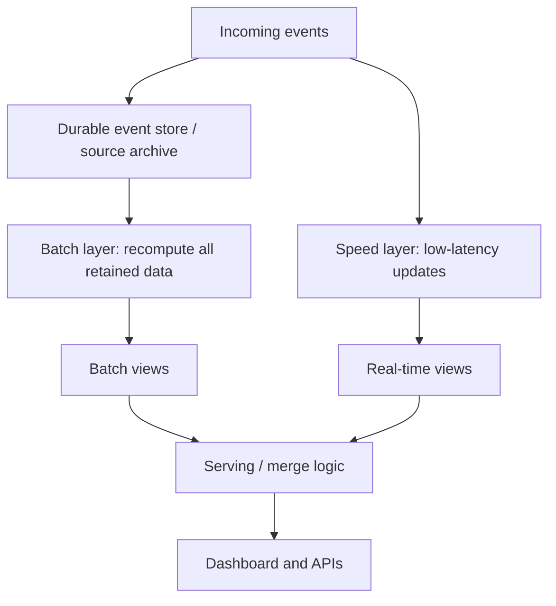
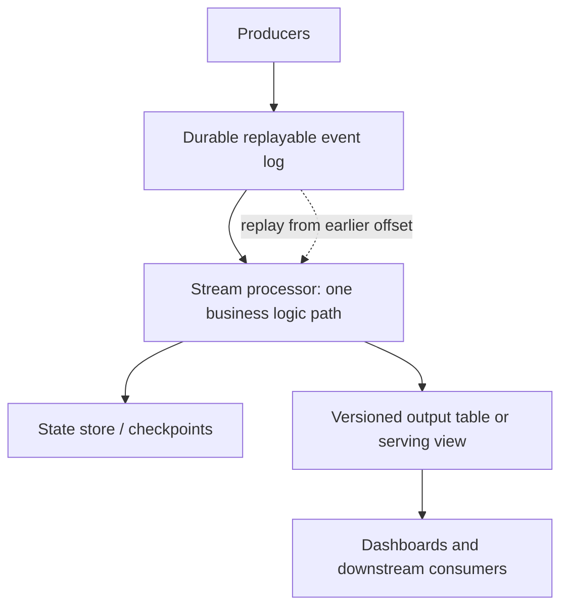
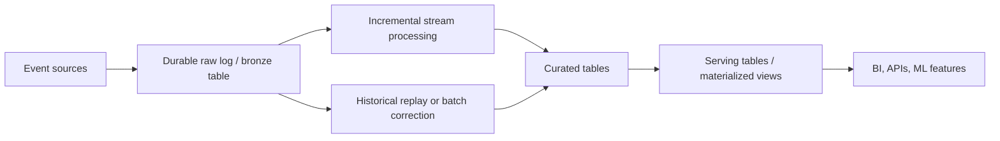

# Lambda vs Kappa Architecture
**Module:** Stage 2C — Data Engineering_3 / 08-Data-Platform-Architecture-and-Data-Products  
**Target path:** `Stage 2C — Data Engineering_3/08-Data-Platform-Architecture-and-Data-Products/01-lambda-vs-kappa-architecture.md`  
**Lesson:** `01-lambda-vs-kappa-architecture.md`  
**Level:** Beginner → Advanced  
**Practical lab:** `experiments/01_lambda_kappa/`

---

## 1. Learning objectives

After completing this lesson, you should be able to:

1. Distinguish processing latency, completeness, and correctness.
2. Explain batch and stream processing without treating either as an architecture by itself.
3. Draw Lambda's batch, speed, and serving layers and explain how their outputs are reconciled.
4. Explain Kappa's single replayable-log processing path, including retention, offsets, state recovery, and replay.
5. Evaluate modern unified streaming/lakehouse patterns and the differences among their execution models.
6. Reason about event time, late data, watermarks, idempotency, exactly-once semantics, and backfills.
7. Select batch, Lambda, Kappa, or a unified lakehouse pattern using explicit requirements.
8. Run and test a small local simulation, then document a decision in an Architecture Decision Record (ADR).

## 2. Prerequisites

You should be familiar with:

- Python functions, lists, dictionaries, exceptions, and basic testing.
- SQL aggregation such as `GROUP BY` and `SUM`.
- The difference between a data source, a transformation, and a serving table.
- Basic batch and streaming vocabulary.

You do **not** need to have operated Kafka, Flink, Spark, or a cloud lakehouse to understand the lesson. Those production technologies are discussed conceptually.

## 3. Fundamental concepts

### 3.1 Why latency and correctness can pull in different directions

Imagine an e-commerce dashboard that shows revenue by minute. The business wants the dashboard to update in seconds, but payment events can arrive late because a mobile device was offline, a partner API retried a request, or an upstream service recovered from an outage.

Two needs coexist:

- **Low latency:** show a useful result quickly after an event is produced.
- **Completeness and correctness:** include valid events, handle duplicates, and account for late corrections according to a defined business rule.

A fast answer is not necessarily wrong, and a delayed answer is not automatically correct. These are separate properties.

| Property | Meaning | Example measurement |
|---|---|---|
| Processing latency | Time between an event becoming available and its result being updated | p95 event-to-dashboard delay |
| Freshness | Age of the newest data represented in a product | Latest event timestamp is less than 2 minutes old |
| Completeness | Fraction of expected/valid records represented | 99.9% of accepted source events are accounted for |
| Correctness | Whether the result matches the defined business semantics | Revenue equals deduplicated, eligible payments after refunds and corrections |
| Availability | Whether a consumer can retrieve a result | 99.9% successful reads over a month |

A platform must state how each metric is measured. “Real time” without a target is not an engineering requirement.

### 3.2 Batch processing versus stream processing

**Batch processing** operates on a bounded collection of data. A job may process all events for yesterday, compute totals, validate them, and publish a corrected table. Batch is often simple to reason about and is useful for authoritative recomputation.

**Stream processing** continuously processes events as they arrive, often maintaining state and emitting updates. It can keep a dashboard fresh, but must handle event ordering, duplicates, failures, state recovery, and late arrivals.

Batch and streaming are processing modes, not complete architecture choices. A platform can use one engine for both, different engines for each, or a streaming engine that periodically processes bounded data.

### 3.3 Event time and processing time

- **Event time:** when the business event happened, as recorded by the producer.
- **Processing time:** when the processing system handled the event.
- **Ingestion time:** when the platform accepted the event.

For example, an order payment occurs at 10:00, arrives in the platform at 10:07, and is processed at 10:07. Its event time is 10:00; ingestion and processing times are around 10:07.

Revenue grouped by processing time can put the payment in the wrong minute. Event-time processing can place it in the correct minute, but the system needs a policy for how long to wait for late events and how to revise old results.

### 3.4 Why two paths became an architectural problem

Historically, a common design used a batch engine for complete results and a separate low-latency stream engine for fast results. This can work, but each path may encode business rules independently.

If one implementation excludes cancelled orders while the other does not, their totals diverge. The team must maintain two codebases, deploy them separately, debug two failure modes, reconcile outputs, and explain which result consumers should trust.

Lambda and Kappa are two responses to this problem:

- **Lambda:** retain separate batch and speed paths, then merge their results.
- **Kappa:** use one stream-processing logic path over an event log that can be replayed to recompute results.

Neither pattern automatically guarantees correctness. Correct semantics, durable data, deterministic logic, and operational controls remain necessary.

---

## 4. Lambda architecture

### 4.1 Definition and purpose

**Lambda architecture** combines a batch layer, a speed layer, and a serving layer. The batch layer periodically computes results over the full retained dataset. The speed layer computes low-latency updates for events not yet reflected in the batch view. The serving layer combines the views for consumers.

It was motivated by the difficulty of getting both fast updates and complete recomputation from the systems commonly available when the pattern became popular.

### 4.2 Data flow



1. Events are retained in a durable source or archive.
2. The batch layer periodically scans a defined history and writes batch views.
3. The speed layer consumes new events and updates real-time views.
4. The serving layer combines the batch view with the speed-layer contribution not yet represented by the batch view.
5. When a new batch view is published, the merge logic must avoid counting the same event in both views.

### 4.3 The three layers

**Batch layer**
- Computes authoritative results from retained history.
- Can correct prior output when late data arrives or logic is fixed.
- May be expensive or slow for very large histories.
- Needs a clear input snapshot or cutoff so the serving layer knows what history is included.

**Speed layer**
- Processes events with low latency.
- Usually maintains incremental state or recent-event views.
- Must define deduplication, ordering, late-event, and recovery behavior.
- Can temporarily disagree with the batch layer.

**Serving layer**
- Exposes queryable views to dashboards, APIs, or downstream jobs.
- Combines batch and speed results according to a documented boundary.
- Must handle the transition when a new batch view replaces an older one.
- Can become complex if the views have different keys, schemas, or business semantics.

### 4.4 Worked example: live revenue and nightly corrected totals

Assume the live dashboard shows revenue for a business date. The batch view contains events through a published cutoff `C`; the speed view contains only accepted events not yet represented in that batch view. If the batch view reports ₹100,000 and the disjoint speed view contributes ₹7,500, the serving result is ₹107,500. This addition is valid **only if** the event sets are disjoint and both paths use the same eligibility, currency, refund, and rounding rules.

At 10:00, a payment worth ₹500 occurs but does not arrive until 10:08. The live dashboard may initially omit it or place it in the wrong minute if it groups by processing time. At night, the batch job scans the authoritative retained history, includes the late payment, and publishes corrected daily totals. The next serving read must not add the speed view on top of a batch view that already includes those same events. A robust system exposes the correction time and reason to consumers.

A safe merge requires more than `batch_total + speed_total`. It needs a published cutoff, stable event identity, consistent transformations, and an atomic or otherwise safe view-switching protocol. The hands-on lab deliberately demonstrates the incorrect overlap case before discussing how a production implementation would enforce disjointness.

### 4.5 Failure modes and trade-offs

- **Semantic drift:** two code paths implement different filters, currency conversion, refund handling, or rounding.
- **Double counting:** an event appears in both batch and speed views during a cutoff transition.
- **Gaps:** an event falls into neither view due to an incorrect boundary.
- **Late data:** batch results change after a speed result has been shown.
- **Deployment skew:** one path gets a bug fix while the other does not.
- **Operational duplication:** separate jobs, state stores, alerting, capacity planning, and on-call runbooks.

Lambda can still be justified when batch and speed requirements genuinely need different algorithms, engines, or operational boundaries, and the organization can afford to keep their semantics aligned. Do not adopt it merely because it is a famous pattern.

---

## 5. Kappa architecture

### 5.1 Definition and principles

**Kappa architecture** uses one primary stream-processing logic path over an append-only, replayable event log. If logic changes or a historical correction is required, a new job version can replay the retained events and rebuild output rather than maintaining a separate batch implementation of the same business transformation.

The key is not “everything must be processed instantly.” The key is **one processing logic path with replay as the recomputation mechanism**.

### 5.2 Data flow



1. Producers publish events to a durable log.
2. The processor consumes records from offsets and maintains state.
3. Checkpoints or snapshots help recover state after failures.
4. Results are written to a sink using idempotent or transactional patterns where available.
5. For a logic change or backfill, a new processor version replays an appropriate range into an isolated output.
6. After validation, the new output is switched into service.

### 5.3 Retention, offsets, and replay

A log is only replayable while the required events remain available or have been archived. A production design must answer:

- How long does the online log retain events?
- Is there an immutable archive for longer history?
- Can the consumer reset offsets or start a new consumer group?
- How much throughput is available for replay without harming live processing?
- Is the processor deterministic for a given input and configuration?
- How are schema versions and reference data handled during replay?
- Can output be rebuilt without duplicating external side effects?

Offsets record a consumer's position in a partitioned log; they are not a substitute for business event IDs. A processor may commit offsets after writing output, or coordinate progress and output transactionally depending on the stack. Incorrect ordering can lead to lost or repeated effects.

### 5.4 Idempotency and duplicate events

An operation is **idempotent** when repeating it has the same final effect as performing it once. For example, upserting a payment by stable `event_id` can avoid counting a retried event twice. Blindly incrementing a counter for every delivery is not idempotent.

Common controls include:

- Stable event IDs and deduplication state.
- Upserts or merge operations keyed by business identity.
- Transactional sinks or atomic commits where supported.
- Replay-safe side effects: write to a versioned table rather than sending emails or issuing payments again.
- Retention of deduplication state long enough to cover the duplicate/replay horizon.

Idempotency has a cost: storing deduplication state consumes memory or storage, and TTL policies can allow old duplicates through after state expires.

### 5.5 Backfills and limitations

Replay is not free. Reprocessing a long history can compete with live workloads, increase compute and storage costs, stress downstream systems, and take longer than the required recovery objective. The online log may not retain all data; external reference tables may have changed; and a new algorithm may not be compatible with historical schemas.

For substantial backfills, use a **shadow pipeline**:
1. Launch a new version with isolated output.
2. Replay the required history.
3. Validate counts, totals, duplicates, and key invariants.
4. Catch up with live events or briefly coordinate a cutover.
5. Atomically switch consumers to the new version.
6. Keep rollback and audit evidence.

Kappa is strongest when the log is durable and replayable, processing logic is suitable for streaming, and the team can operate replay and versioned output. If history is not retained or the batch algorithm is fundamentally different, Kappa may not be the simplest answer.

---

## 6. Lambda versus Kappa

| Dimension | Lambda | Kappa |
|---|---|---|
| Core architecture | Separate batch and speed paths, merged at serving | One main stream-processing path over a replayable log |
| Latency | Low latency from speed layer; batch corrects later | Low latency from stream processor; replay rebuilds output |
| Correctness | Depends on matching semantics and safe merge boundaries | Depends on stream logic, replayability, state, and sink semantics |
| Replay | Usually batch recomputes retained history; stream path handles recent data | Replay log/history through the same logic path |
| Backfills | Often use batch path; can be efficient for large scans | Replay can be expensive and contend with live traffic |
| Code maintenance | Often two implementations of business logic | One primary transformation path, but replay/versioning machinery is still needed |
| Operational complexity | Two compute paths plus reconciliation and serving merge | Replay, log retention, state recovery, versioned outputs, and live/replay capacity |
| Cost profile | Duplicated logic/compute; batch scans can be optimized separately | Potentially simpler logic, but long replay and retention can be costly |
| Best fit | Distinct batch and speed algorithms/SLAs; legacy dual-path systems | Streaming-native workloads with durable replay and compatible processing logic |
| Main risk | Drift, double counting, gaps, and reconciliation defects | Retention gaps, replay bottlenecks, nondeterministic logic, and sink side effects |

Neither architecture is universally superior. A simple daily report may need neither. A modern streaming lakehouse may reduce duplicated business logic while retaining separate incremental and historical execution mechanisms underneath.

---

## 7. Modern unified processing approaches

“Unified” does not mean all systems execute every workload in exactly the same way. It means a platform can reuse more of the logic, storage, table format, or operational model across batch and streaming.

### 7.1 Spark Structured Streaming with Delta Lake or Apache Iceberg

**Spark Structured Streaming** expresses streaming computations using Spark's DataFrame/SQL model and shares structured APIs with batch Spark. Micro-batch is the common execution model for analytical pipelines. Spark also documents lower-latency continuous/real-time modes, but supported sources, operators, sinks, output modes, and fault-tolerance guarantees differ by Spark version and mode. For example, the Spark 3.5 guide describes Continuous Processing as experimental and at-least-once, while its default micro-batch engine can provide exactly-once fault-tolerance guarantees within supported source/sink boundaries. Verify the guide for the deployed runtime rather than transferring a guarantee across modes: [Spark Structured Streaming programming guide](https://spark.apache.org/docs/latest/streaming/index.html).

**Delta Lake** is a transactional table layer over data files. It can support streaming reads/writes and batch operations over the same tables, subject to table and connector semantics.

**Apache Iceberg** is an open table format with snapshots, schema/partition evolution, and support from multiple compute engines. Spark can read/write Iceberg tables in batch and streaming-oriented workflows when configured with compatible versions and capabilities.

These combinations can share transformations and table semantics across incremental processing and historical recomputation. They do not automatically make arbitrary external side effects exactly-once or guarantee that every streaming source/sink combination has the same behavior.

### 7.2 Apache Flink with Iceberg

**Apache Flink** is a distributed stream-processing engine designed for stateful event processing, event-time operations, and checkpoint-based recovery. It can write to Iceberg through supported connectors. Flink is often chosen for low-latency stateful streaming, while Iceberg provides table snapshots and interoperable storage.

The engine and table format play different roles: Flink executes computation; Iceberg organizes table data and metadata. The Iceberg Flink sink documents exactly-once semantics for its supported sink integration, but that guarantee does not automatically extend to arbitrary external APIs, unrelated sinks, or side effects outside the coordinated commit boundary. End-to-end correctness still depends on checkpointing, connector commit behavior, retention/maintenance settings, idempotency, and compatible deployed versions. See the [Iceberg Flink writes documentation](https://iceberg.apache.org/docs/latest/flink-writes/).

### 7.3 Databricks streaming tables and materialized views

Databricks provides lakehouse capabilities and managed data-processing abstractions. As of October 2026, the managed declarative pipeline product is called **Lakeflow pipelines** (formerly Delta Live Tables); its exact capabilities differ from the open Apache Spark Declarative Pipelines project. In the Databricks model, streaming tables use streaming semantics and are suited to append/incremental ingestion, while materialized views use batch semantics and maintain query results, incrementally where supported. Do not treat a materialized view as synonymous with a continuously running event-time operator. Verify current product/runtime and feature limitations in the [Lakeflow pipelines documentation](https://docs.databricks.com/aws/en/ldp/concepts/pipelines) and [streaming tables documentation](https://docs.databricks.com/gcp/en/ldp/concepts/streaming-tables).

### 7.4 Snowflake dynamic tables

Snowflake dynamic tables declaratively define a target result and use `TARGET_LAG` as a staleness target. It is **not a guaranteed refresh interval or hard freshness bound**: actual lag can exceed the target when refreshes take too long or resources are constrained. Refresh mode (for example, incremental or full) and supported query constructs also affect behavior. This is not the same as manually writing a Kafka/Flink event-time processor, nor should it be assumed to expose identical latency, state, or replay controls. Review [target lag and scheduling](https://docs.snowflake.com/en/user-guide/dynamic-tables/target-lag) and [refresh modes](https://docs.snowflake.com/en/user-guide/dynamic-tables/refresh-modes) for the required workload.

### 7.5 Streaming lakehouse pattern

A common pattern is to land durable raw events in object storage/table format, process incrementally with a streaming engine, and expose governed tables and materialized serving views. The same retained source can support corrections and backfills.



This pattern can reduce duplicated business logic, but the platform still needs a defined source of truth, schema evolution, retention, checkpointing, late-data policies, quality checks, and cutover procedures.

### 7.6 Batch, micro-batch, and continuous processing

- **Batch:** process a bounded dataset as a job. Often efficient for large historical scans and scheduled reporting.
- **Micro-batch:** process small bounded chunks repeatedly. This is the execution model used by many streaming systems, including common Structured Streaming deployments.
- **Continuous/record-at-a-time processing:** process records continuously with lower scheduling overhead in systems/modes that support it. This can impose different feature and guarantee trade-offs.

Choose based on measured consumer needs. If the product can tolerate five-minute freshness, paying the complexity cost for sub-second processing may not be justified.

---

## 8. Advanced correctness, replay, and recovery

### 8.1 Exactly-once semantics: define the boundary

“Exactly once” is not one universal end-to-end property. It may describe processing state, delivery semantics, or a transactional boundary. A system can recover its internal state consistently while a non-transactional external API receives a duplicate request.

A production design should document:
- Source delivery behavior and event identity.
- How source offsets relate to checkpointed state.
- Whether sink writes are transactional, idempotent, or at-least-once.
- How retries, failures, and partial commits are handled.
- Whether downstream side effects can be safely repeated.

Prefer the concrete claim “deduplicated upserts into a transactional table keyed by event ID” over an unqualified “exactly once.”

### 8.2 Late-arriving data and watermarks

A **watermark** is an estimate or policy boundary for event-time progress. It lets a processor decide when to finalize or evict some event-time state. A watermark is not proof that no earlier event can ever arrive. Events later than the watermark may be dropped, routed, or handled as corrections depending on configuration and engine semantics.

Example policy:
- Keep a 30-minute event-time window open for ordinary late events.
- Route events later than 30 minutes to a correction stream/table.
- Recompute affected daily totals in a controlled process.
- Expose the last-corrected timestamp to consumers.

This is a business policy, not merely a technical setting. Finance may prefer correctness over immediate finality; fraud detection may prioritize immediate action and accept later review.

### 8.3 Reconciliation

Reconciliation compares independently produced outputs or compares incremental output with a trusted recomputation. Useful checks include:
- Event counts by time bucket and source.
- Sum of revenue by currency and business date.
- Unique event-ID counts and duplicate rates.
- Missing or unexpected keys.
- Aggregate deltas above an agreed tolerance.
- Watermark lag and late-event volume.

Reconciliation should specify what happens when checks fail: alert, hold publication, quarantine data, or publish with an explicit degraded status. Avoid silently overwriting discrepancies.

### 8.4 Event sourcing and CQRS

**Event sourcing** stores a sequence of domain events as the authoritative history from which current state can be derived. An event log can be a system of record when the domain deliberately defines the event history as authoritative and maintains schema, retention, audit, and correction policies. A Kafka topic used only as transport is not automatically the system of record.

**CQRS (Command Query Responsibility Segregation)** separates the write/command model from read/query models. Events or changes can update one or more read models. Kappa-like replay can rebuild a read model from the event history, but event sourcing and Kappa are not the same concept: one is a domain persistence pattern, the other is a data-processing architecture pattern.

### 8.5 State recovery and output versioning

Checkpoints record enough processor state and source progress to recover from a failure. Recovery depends on checkpoint durability, compatibility, and the source/sink integration. If a processor's state schema changes incompatibly, a savepoint or replay may be required.

For major logic changes:
- Give each output version an explicit identifier.
- Keep the old output serving while the new one builds.
- Compare results on a shared time range.
- Catch up the new version.
- Switch consumers through a controlled pointer, view, or catalog change.
- Keep rollback possible until acceptance checks pass.

### 8.6 Backfill cost model

A rough estimate is:

`replay duration ≈ retained records to process / sustainable replay throughput`

This is only a first approximation. Real duration also includes decoding, state warm-up, skew, output commits, compaction, throttling, and competition with live traffic. Measure on representative data; do not infer production capacity from this educational example.

### 8.7 Relationship to other architecture patterns

- **Lakehouse:** storage/table architecture combining data-lake storage with table management and analytics capabilities. It can host batch and streaming workloads; it is not itself Lambda or Kappa.
- **Medallion architecture:** organizes data into progressively refined layers such as bronze, silver, and gold. It describes data refinement, not whether processing is Lambda or Kappa.
- **Data fabric:** an approach emphasizing integrated metadata, governance, and access across distributed data assets. It is not a replacement name for a stream-processing topology.
- **Real-time serving layer:** a low-latency query interface or store used by applications. It can serve outputs from Lambda, Kappa, or a unified lakehouse.

---

## 9. Architecture selection framework

Start with requirements, not pattern names.

### 9.1 Decision questions

1. What freshness does the consumer truly need: seconds, minutes, hours, or next day?
2. Which events can arrive late, be duplicated, be corrected, or be retracted?
3. What is the authoritative source of truth?
4. How much history must be replayable, and for how long?
5. Can the same business transformation serve incremental and historical processing?
6. What are the RPO/RTO and recovery expectations?
7. Can backfills run without affecting live service?
8. What skills and operational maturity does the team have?
9. What are the cost, compliance, data-residency, and audit constraints?

### 9.2 Quick decision guide

| Situation | Starting point | Why |
|---|---|---|
| Daily reports; hours of latency acceptable | Batch | Simplest operational model |
| Seconds-level updates; same logic can replay from retained events | Kappa or unified streaming/lakehouse | One primary transformation path |
| Distinct low-latency algorithm and large batch algorithm, with clear justification | Lambda | Different paths may be worthwhile if reconciliation is engineered |
| Existing Lambda system with stable operations | Improve and measure before replacing | Migration risk may exceed duplication cost |
| Historical log not retained and full recomputation needed | Batch/archive plus an explicit hybrid design | Kappa replay cannot recover data that no longer exists |
| Strong event-time/stateful needs with low latency | Flink-style streaming or suitable managed equivalent | Rich state and event-time capabilities may fit |
| Freshness of several minutes is sufficient and managed SQL fits | Managed incremental tables/materialized views | Lower operational burden, subject to feature limits |

### 9.3 Worked architecture decision

**Scenario:** An online marketplace needs a live seller revenue dashboard and a trusted daily finance report.

Assumptions (illustrative requirements, not measured benchmark results):
- 20,000 events/second peak, 2,000 events/second average.
- Dashboard target: p95 freshness under 60 seconds.
- Finance report: corrected by 06:00 local time each day.
- Events are retained in a durable archive for 13 months.
- Late events under 24 hours are common enough to matter.
- The platform must recover from a processor failure without losing accepted events.
- A small platform team prefers managed operations but can operate one streaming system.

**Option A — Lambda**
- Separate streaming path for the dashboard and batch recomputation for finance.
- Strength: independent optimization of low-latency and historical workloads.
- Weakness: duplicate transformation logic, merge boundaries, reconciliation, and two operating paths.

**Option B — Kappa/unified lakehouse**
- Retain events durably, run a primary incremental transformation, and use versioned replay/backfill for corrections; expose curated tables to dashboard and finance consumers.
- Strength: reuse of business logic and a common curated representation.
- Weakness: replay competes for resources; long historical reprocessing needs capacity planning and safe output switching.

**Option C — batch only**
- Recompute the dashboard and finance totals on a schedule from retained history.
- Strength: simplest processing and reconciliation model.
- Weakness: rejected for the dashboard because scheduled processing cannot be assumed to meet the 60-second freshness target without evidence of an unusual design.

| Decision criterion | Lambda | Kappa / unified lakehouse | Batch only |
|---|---|---|---|
| Dashboard freshness under 60 seconds | Plausible with a dedicated speed path; benchmark required | Plausible with a suitable engine and sink; benchmark required | Does not meet the stated target under ordinary scheduled-batch assumptions |
| Corrected finance totals by 06:00 | Natural batch recomputation path | Feasible if replay/backfill and correction windows meet the deadline | Natural fit |
| Semantic consistency | Highest risk of duplicated rules and merge-boundary defects | More logic reuse, but source/sink and late-data correctness still require proof | One computation path; freshness is the trade-off |
| Recovery and historical reprocessing | Batch rebuild can be efficient; speed-path recovery is separate | Depends on retained history, replay throughput, checkpoint/state compatibility, and output versioning | Depends on archive availability and batch completion window |
| Operational burden | Two compute paths and reconciliation | One primary logic path but streaming, replay, checkpoint, and cutover operations | Lowest of these options if the SLA permits it |
| Cost evidence required | Benchmark both paths and reconciliation/serving costs | Measure live processing plus 13-month replay and storage costs | Measure full-history scans and scheduled compute; fails if latency is mandatory |

These are qualitative fit assessments derived from the stated requirements, not benchmark results or vendor claims. The proof of concept must produce measured freshness, correction-window completion, reconciliation, recovery, and cost evidence before the recommendation is approved.

**Recommendation:** Start with a unified streaming/lakehouse approach if a proof of concept demonstrates the 60-second freshness target, event-time correction behavior, replay throughput, and finance reconciliation. Do not claim Kappa is automatically cheaper or simpler: measure replay time and operational burden. Keep a separate batch correction path only if the historical finance computation materially differs or cannot meet its SLA through the shared processing path.

**Change the recommendation if:** the streaming path cannot meet the dashboard target under peak load; replay cannot finish within the correction window; batch finance logic is substantially different; source retention is insufficient; or the team cannot operate the streaming stack reliably.

### 9.4 Sample Architecture Decision Record (ADR)

```markdown
# ADR-0001: Revenue processing architecture

- Status: Proposed
- Date: YYYY-MM-DD
- Decision owners: Data Platform and Finance Analytics

## Context
The marketplace requires a dashboard with p95 freshness below 60 seconds
and a corrected daily finance report by 06:00. Events are retained for
13 months, and late events can revise prior business dates.

## Decision
Prototype a unified streaming/lakehouse path with durable raw events,
incremental curated tables, idempotent event-ID handling, reconciliation,
and versioned replay outputs. Promote it only after the acceptance criteria
below pass.

## Alternatives
1. Lambda: independent speed and batch paths with an explicit serving merge.
2. Batch-only: rejected for the dashboard freshness requirement.
3. Unified incremental path: preferred for shared business semantics.

## Consequences
Positive: less duplicated transformation logic and shared curated data.
Negative: replay needs capacity isolation; output versioning and recovery
procedures must be engineered; platform-specific semantics need validation.

## Risks and mitigations
- Replay delays live traffic: isolate replay capacity and rate-limit it.
- Late events produce incorrect totals: event-time policy and reconciliation.
- Duplicate delivery: stable event IDs and idempotent sink writes.
- Breaking logic change: shadow output, compare, then switch.

## Review criteria
- p95 dashboard freshness < 60 seconds at expected peak load.
- Daily finance output available by 06:00 in test runs.
- Reconciliation differences are explained and within approved tolerances.
- Failure injection demonstrates recoverability without lost accepted events.
- Replay of the agreed correction horizon completes within its time budget.
- Revisit if workload, retention, latency, compliance, or team constraints change.
```

---

## 10. Hands-on implementation

This lab follows the module roadmap exercise in `experiments/01_lambda_kappa/`. It uses Python and DuckDB for an executable **local educational simulation**.

**Important boundary:** a Python list is not a durable event broker. This lab illustrates architecture and correctness problems; it does not model distributed partitions, broker retention, checkpoint coordination, concurrent consumers, or production throughput.

### 10.1 Lab structure

Create a folder with these files:

```text
experiments/01_lambda_kappa/
├── pyproject.toml
├── architecture_demo.py
└── test_architecture_demo.py
```

### 10.2 Setup

`pyproject.toml`:

```toml
[build-system]
requires = ["setuptools>=68"]
build-backend = "setuptools.build_meta"

[project]
name = "lambda-kappa-architecture-lab"
version = "0.1.0"
requires-python = ">=3.11"
dependencies = ["duckdb>=1.1,<2"]

[project.optional-dependencies]
test = ["pytest>=8,<10"]

[tool.setuptools]
py-modules = ["architecture_demo"]
```

From the lab directory, create and synchronize the project environment with `uv`:

```bash
uv sync --extra test
```

Then run commands with `uv run` as shown below. With standard `venv`, create and activate the environment, then run `python -m pip install -e ".[test]"`. These commands require package-index access on the first install; use your organization's approved package mirror if direct access is unavailable.

### 10.3 Implementation

`architecture_demo.py`:

```python
from __future__ import annotations

from dataclasses import dataclass
from typing import Iterable

@dataclass(frozen=True)
class Event:
    event_id: str
    event_time: str
    revenue: float


# Input order represents arrival order, not event-time order.
INITIAL_EVENTS = [
    Event("e-001", "2026-01-01T10:00:00", 100.0),
    Event("e-002", "2026-01-01T10:02:00", 50.0),
]
LATE_EVENT = Event("e-003", "2026-01-01T10:01:00", 25.0)


def total(events: Iterable[Event]) -> float:
    """Compute revenue after deduplicating by stable event ID."""
    unique: dict[str, Event] = {}
    for event in events:
        previous = unique.get(event.event_id)
        if previous is not None and previous != event:
            raise ValueError(f"Conflicting payload for event_id={event.event_id}")
        unique[event.event_id] = event
    return round(sum(event.revenue for event in unique.values()), 2)


def lambda_demo() -> dict[str, float]:
    """Simulate separate batch and speed views, then expose their mismatch."""
    # Import locally so the pure-Python replay/idempotency tests can still run
    # in constrained environments where the optional SQL engine is unavailable.
    import duckdb

    con = duckdb.connect(":memory:")
    con.execute(
        """
        CREATE TABLE raw_events (
            event_id VARCHAR,
            event_time TIMESTAMP,
            revenue DOUBLE
        )
        """
    )

    # Batch view is computed before the late event has been ingested.
    con.executemany(
        "INSERT INTO raw_events VALUES (?, ?, ?)",
        [(e.event_id, e.event_time, e.revenue) for e in INITIAL_EVENTS],
    )
    batch_total = con.execute(
        "SELECT COALESCE(SUM(revenue), 0) FROM raw_events"
    ).fetchone()[0]

    # Simulated speed-layer counter processes the first two arrivals.
    speed_total = sum(e.revenue for e in INITIAL_EVENTS)

    # A late event arrives. The speed layer updates, but the old batch view
    # remains stale until the next batch recomputation.
    speed_total += LATE_EVENT.revenue
    con.execute(
        "INSERT INTO raw_events VALUES (?, ?, ?)",
        (LATE_EVENT.event_id, LATE_EVENT.event_time, LATE_EVENT.revenue),
    )

    # Materialize the two conceptual views and a deliberately naive serving
    # view. This serving view is intentionally incorrect because its inputs
    # overlap; the lab makes the reconciliation problem visible.
    con.execute("CREATE TABLE batch_view AS SELECT ?::DOUBLE AS revenue", [batch_total])
    con.execute("CREATE TABLE speed_view AS SELECT ?::DOUBLE AS revenue", [speed_total])
    con.execute("""
        CREATE VIEW serving_view AS
        SELECT batch_view.revenue + speed_view.revenue AS revenue
        FROM batch_view CROSS JOIN speed_view
    """)
    naive_serving_sum = con.execute(
        "SELECT revenue FROM serving_view"
    ).fetchone()[0]

    # The next batch recomputation includes all retained events and corrects
    # the authoritative total.
    authoritative_total = con.execute(
        "SELECT COALESCE(SUM(revenue), 0) FROM raw_events"
    ).fetchone()[0]

    # Correct current total is the batch recomputation over all retained rows.
    return {
        "batch_view_before_late_event": float(batch_total),
        "speed_view_after_late_event": float(speed_total),
        "naive_batch_plus_speed": float(naive_serving_sum),
        "recomputed_batch_after_late_event": float(authoritative_total),
    }


def kappa_replay(event_log: Iterable[Event]) -> dict[str, float | int]:
    """Replay a single event log through one deduplicating processing function."""
    log = list(event_log)

    first_pass = total(log[: len(INITIAL_EVENTS)])
    replayed_total = total(log)  # Rebuild from the beginning of the retained log.

    return {
        "events_in_log": len(log),
        "first_pass_total": first_pass,
        "replayed_total": replayed_total,
    }


def main() -> None:
    lambda_result = lambda_demo()
    print("Lambda-style simulation:")
    for key, value in lambda_result.items():
        print(f"  {key} = {value:.2f}")

    kappa_result = kappa_replay([*INITIAL_EVENTS, LATE_EVENT])
    print("Kappa-style replay simulation:")
    for key, value in kappa_result.items():
        if isinstance(value, float):
            print(f"  {key} = {value:.2f}")
        else:
            print(f"  {key} = {value}")


if __name__ == "__main__":
    main()
```

### 10.4 Automated tests

`test_architecture_demo.py`:

```python
import pytest

from architecture_demo import (
    Event,
    INITIAL_EVENTS,
    LATE_EVENT,
    kappa_replay,
    lambda_demo,
    total,
)


def test_lambda_batch_view_is_stale_until_recomputed():
    pytest.importorskip("duckdb")
    result = lambda_demo()
    assert result["batch_view_before_late_event"] == 150.0
    assert result["speed_view_after_late_event"] == 175.0
    assert result["recomputed_batch_after_late_event"] == 175.0


def test_naive_lambda_merge_double_counts_overlap():
    pytest.importorskip("duckdb")
    result = lambda_demo()
    assert result["naive_batch_plus_speed"] == 325.0
    assert result["naive_batch_plus_speed"] != result[
        "recomputed_batch_after_late_event"
    ]


def test_kappa_replay_rebuilds_correct_total():
    result = kappa_replay([*INITIAL_EVENTS, LATE_EVENT])
    assert result["events_in_log"] == 3
    assert result["first_pass_total"] == 150.0
    assert result["replayed_total"] == 175.0


def test_duplicate_delivery_is_deduplicated_by_event_id():
    duplicate = INITIAL_EVENTS[0]
    assert total([duplicate, duplicate]) == 100.0


def test_conflicting_duplicate_is_rejected():
    original = Event("e-001", "2026-01-01T10:00:00", 100.0)
    conflict = Event("e-001", "2026-01-01T10:00:00", 999.0)
    with pytest.raises(ValueError, match="Conflicting payload"):
        total([original, conflict])
```

### 10.5 Run the lab

From `experiments/01_lambda_kappa/`:

```bash
uv run python architecture_demo.py
uv run pytest -q
```

Expected demonstration output:

```text
Lambda-style simulation:
  batch_view_before_late_event = 150.00
  speed_view_after_late_event = 175.00
  naive_batch_plus_speed = 325.00
  recomputed_batch_after_late_event = 175.00
Kappa-style replay simulation:
  events_in_log = 3
  first_pass_total = 150.00
  replayed_total = 175.00
```

Expected test summary with the declared dependencies installed:

```text
5 passed
```

If DuckDB is not installed in a constrained environment, the two DuckDB integration tests are explicitly skipped while the three pure-Python correctness tests run. A skipped DuckDB test is not evidence that the SQL path passed; install the declared dependency and rerun to verify the integration.

**Verification limitation for this delivered revision:** the available audit environment did not have DuckDB installed, and package installation could not reach the package index. The actual local result was `3 passed, 2 skipped`; the two DuckDB integration tests and the full `architecture_demo.py` command therefore remain unverified at runtime in this environment. The SQL schema and queries were statically reviewed, but that is not equivalent to executing them against DuckDB. In a network-enabled environment, run `uv sync --extra test`, then rerun both commands above; do not treat the skipped tests as a successful DuckDB integration test.

The exact pytest duration varies by machine. The SQL example uses an in-memory DuckDB connection, a `TIMESTAMP` column, parameter placeholders, and `COALESCE(SUM(revenue), 0)` to produce a numeric zero for an empty input. The SQL path is intended to be verified with the declared DuckDB dependency installed. The naive Lambda merge result of `325.00` is deliberately wrong: the batch view and speed view overlap because the demo does not implement a cutoff boundary. That is the lesson. A production Lambda serving layer must define disjoint contributions or otherwise deduplicate/replace them. The Kappa simulation replays all three retained events through one function and obtains `175.00`.

### 10.6 What the lab proves—and does not prove

It demonstrates:
- A batch view can be stale when a late event arrives.
- Simply adding batch and speed totals can double-count overlapping data.
- Recomputing a total from retained events can correct the output.
- Stable event IDs support a simple idempotent deduplication rule.

It does **not** demonstrate:
- Distributed stream processing, broker offsets, partition rebalancing, or durable event retention.
- Real event-time watermarks or window state.
- Atomic transactions between source offsets and output writes.
- Production exactly-once behavior or a throughput benchmark.

A production extension would use a durable log, a real streaming engine, a transactional or idempotent sink, checkpointing, metrics, and failure-injection tests.

---

## 11. Production engineering checklist

Before operating a Lambda, Kappa, or unified streaming platform, specify:

### Data semantics
- [ ] Stable event identity and duplicate policy.
- [ ] Event-time versus processing-time semantics.
- [ ] Late-event, correction, refund, and deletion policy.
- [ ] Schema compatibility and replay behavior.
- [ ] Currency, rounding, and business-date rules.

### Reliability and recovery
- [ ] Source retention exceeds the replay/recovery requirement or a durable archive exists.
- [ ] Checkpoints/state snapshots are durable and tested.
- [ ] Offset/commit ordering and sink idempotency are documented.
- [ ] Backfills have resource limits and do not silently starve live traffic.
- [ ] Shadow output, validation, cutover, and rollback are rehearsed.
- [ ] RPO and RTO are measurable and tested.

### Observability and operations
- [ ] Freshness, event lag, throughput, failures, retries, and watermark lag are monitored.
- [ ] Duplicate rate, late-event rate, and reconciliation deltas are measured.
- [ ] Alerts have owners and runbooks.
- [ ] Serving output exposes its latest successful update and correction status.
- [ ] Costs are attributed to live processing, storage, replay, and serving.

### Governance and consumers
- [ ] Access control and sensitive-data handling apply to raw and curated data.
- [ ] Retention and deletion requirements cover archives, derived tables, and replay outputs.
- [ ] Data contracts and schema deprecation are communicated to consumers.
- [ ] Consumers know whether a value is provisional, corrected, or final for a defined period.

---

## 12. Common mistakes and misconceptions

1. **“Lambda means batch plus streaming.”** Batch and streaming are processing modes; Lambda is a specific architecture with batch, speed, and serving layers.
2. **“Kappa means no batch jobs anywhere.”** It means one primary processing logic path can be replayed. Other batch workloads may still exist.
3. **“Exactly once means no duplicates can ever happen.”** Guarantees are bounded by source, processor, sink, and side-effect boundaries.
4. **“A watermark proves all earlier events have arrived.”** It is a policy/estimate used to manage event-time progress.
5. **“Replay is always cheaper than a batch job.”** Large replay can be slower and more expensive than optimized historical scans.
6. **“The event log is automatically the system of record.”** A transport log becomes authoritative only when retention, audit, correction, and domain semantics make it so.
7. **“A lakehouse is a Kappa architecture.”** A lakehouse is a storage/table platform pattern; it can support many processing topologies.
8. **“Adding batch and speed totals is enough.”** Without a precise boundary, overlapping data is double-counted and gaps are possible.
9. **“One code path eliminates correctness problems.”** It reduces semantic duplication but not late data, bad source data, nondeterminism, or sink failure.
10. **“The lowest possible latency is always best.”** Choose latency to meet consumer needs; lower latency often costs more and increases complexity.

---

## 13. Practice questions with answers and explanations

### Q1. Why are latency and completeness different?
**Answer:** Latency measures how quickly a result updates; completeness measures whether expected valid events are represented. A fast dashboard can omit a late event, while a later recomputation can include it.

### Q2. What are Lambda's three layers?
**Answer:** Batch layer, speed layer, and serving layer. The batch layer recomputes history, the speed layer updates low-latency views, and serving merges them under a defined boundary.

### Q3. Why can a Lambda serving result double-count revenue?
**Answer:** If an event is included in both the batch view and the speed view, summing both views counts it twice. The architecture needs a cutoff, replacement, or deduplication strategy.

### Q4. What makes Kappa replay useful?
**Answer:** The retained event log can be reprocessed through the same business transformation to rebuild outputs after a bug fix or backfill, avoiding a second implementation of the transformation.

### Q5. Name two reasons replay may fail to reproduce an old result exactly.
**Answer:** Required events may have expired, and the logic may depend on changed external reference data or nondeterministic inputs. Schema incompatibility can also prevent replay.

### Q6. Does exactly-once processing guarantee exactly-once external API calls?
**Answer:** No. The processor may provide consistent state/output semantics within a specific transaction boundary, but an external API may receive retries unless the API supports idempotency or a coordinated transaction.

### Q7. What does a watermark do?
**Answer:** It lets event-time processing estimate progress and decide when to finalize or evict window state. It does not prove no late event can arrive.

### Q8. When is ordinary batch processing enough?
**Answer:** When consumer freshness requirements can be met by scheduled jobs and the operational cost of streaming is not justified.

### Q9. When might Lambda be preferable?
**Answer:** When batch and speed workloads require meaningfully different algorithms or operational characteristics and the team can maintain semantic parity and reconciliation.

### Q10. How is event sourcing different from Kappa?
**Answer:** Event sourcing is a domain persistence model where events are authoritative history. Kappa is a processing architecture using replayable events for a primary processing path. They can be combined but are not synonyms.

### Q11. Why use a shadow pipeline for a major logic change?
**Answer:** It isolates the new version, enables historical replay and comparison, and permits controlled cutover or rollback without corrupting the currently served output.

### Q12. Why does a unified lakehouse not remove all operational complexity?
**Answer:** It can reuse tables and transformations, but still needs retention, schema evolution, checkpoints, sink semantics, late-data policy, backfill capacity, governance, and reconciliation.

---

## 14. Practical exercises

### Exercise A — Draw both architectures
Use the same marketplace revenue use case. Draw Lambda and Kappa diagrams. Mark where duplicates, late events, and corrections are handled. Explain how each output is published.

### Exercise B — Add a correct Lambda boundary
Modify the lab to maintain a batch cutoff and ensure the speed view only includes events not represented in the batch view. Add tests for no gaps and no double counting when the batch cutoff advances.

### Exercise C — Add late-event policies
Add event-time windows and a configurable late-arrival horizon to a simulation. Route events beyond the horizon to a correction table. State explicitly what the system does if a very late event arrives.

### Exercise D — Replay with a changed transformation
Change the business rule (for example, exclude test transactions). Build a shadow output from the retained log, compare counts and totals, and document the cutover procedure.

### Exercise E — Architecture ADR
For a workload you know, document latency, volume, retention, correctness, recovery, cost, and team constraints. Compare at least two architectures and state what evidence would reverse your decision.

### Exercise F — Failure and recovery plan
Describe behavior when the processor crashes after writing output but before committing its source offset. Explain how the sink prevents double counting or how reconciliation repairs it.

---

## 15. Completion checklist

- [ ] I can explain latency, freshness, completeness, and correctness separately.
- [ ] I can draw Lambda's batch, speed, and serving layers.
- [ ] I can explain Lambda's merge boundary and identify double-counting risks.
- [ ] I can describe Kappa's replayable log, offsets, retention, and state recovery.
- [ ] I can explain idempotency and why exactly-once guarantees have boundaries.
- [ ] I can explain late data, event time, processing time, and watermarks.
- [ ] I can compare Spark Structured Streaming, Flink, Delta Lake, Iceberg, Databricks managed tables, and Snowflake dynamic tables without conflating their roles.
- [ ] I can select batch, Lambda, Kappa, or a unified approach from explicit requirements.
- [ ] I ran the lab and tests and can explain why the naive Lambda merge is wrong.
- [ ] I wrote an ADR with alternatives, consequences, risks, and review criteria.

**Move-on criterion:** complete the lab, pass the tests, draw both architectures from memory, and defend an ADR that includes the conditions under which you would change your decision.

---

## 16. References and further reading

Use official documentation for current version-specific behavior; product capabilities and guarantees can change.

- Apache Spark Structured Streaming: https://spark.apache.org/docs/latest/streaming/index.html
- Delta Lake documentation: https://docs.delta.io/
- Apache Iceberg documentation: https://iceberg.apache.org/docs/latest/
- Apache Flink documentation: https://flink.apache.org/
- Apache Kafka documentation: https://kafka.apache.org/documentation/
- Databricks Lakeflow pipelines: https://docs.databricks.com/aws/en/ldp/concepts/pipelines
- Databricks streaming tables: https://docs.databricks.com/gcp/en/ldp/concepts/streaming-tables
- Snowflake Dynamic Tables target lag: https://docs.snowflake.com/en/user-guide/dynamic-tables/target-lag
- Snowflake Dynamic Tables refresh modes: https://docs.snowflake.com/en/user-guide/dynamic-tables/refresh-modes
- Apache Iceberg Flink writes: https://iceberg.apache.org/docs/latest/flink-writes/
- Martin Kleppmann, *Designing Data-Intensive Applications*, O’Reilly Media.
- Jay Kreps, “Questioning the Lambda Architecture”: https://www.oreilly.com/radar/questioning-the-lambda-architecture/

**Version note:** consult the documentation matching the exact deployed runtime, connector, table format, and cloud service. Do not infer a production guarantee from a generic architecture diagram or from a feature name alone.
