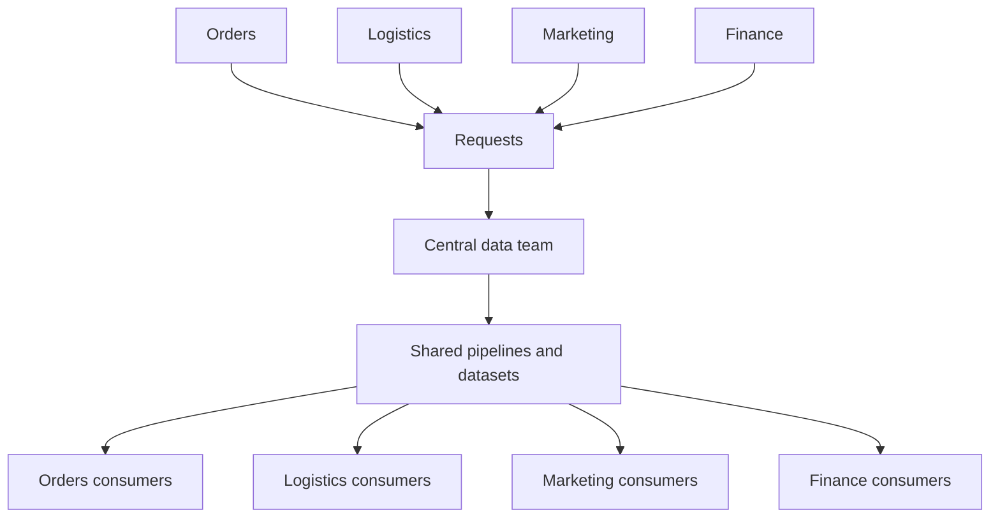
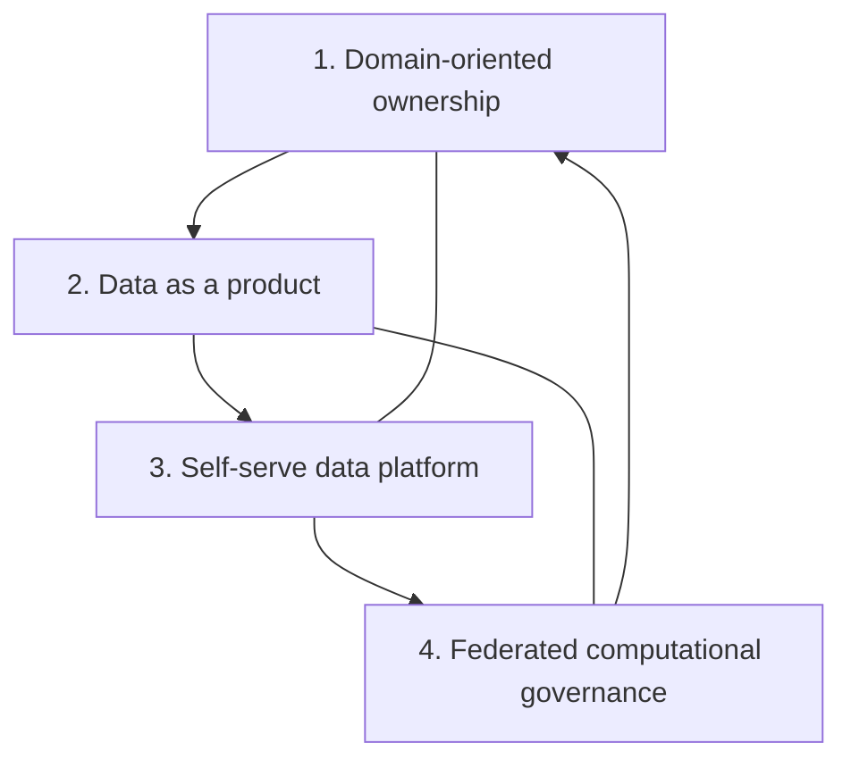
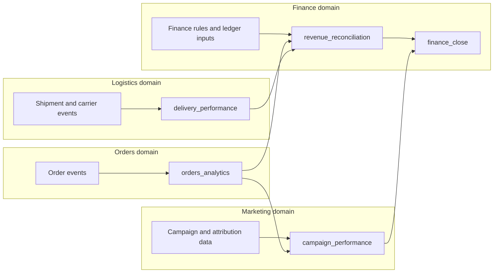
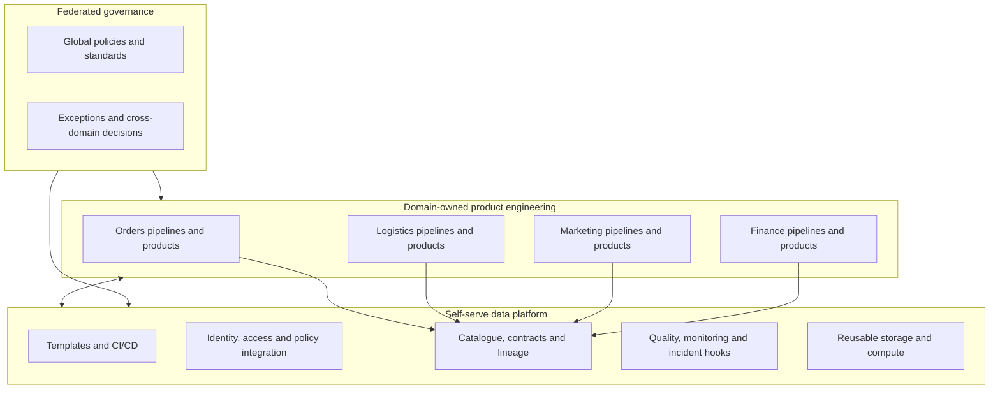
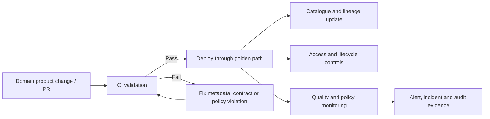
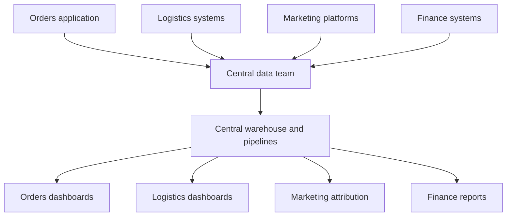
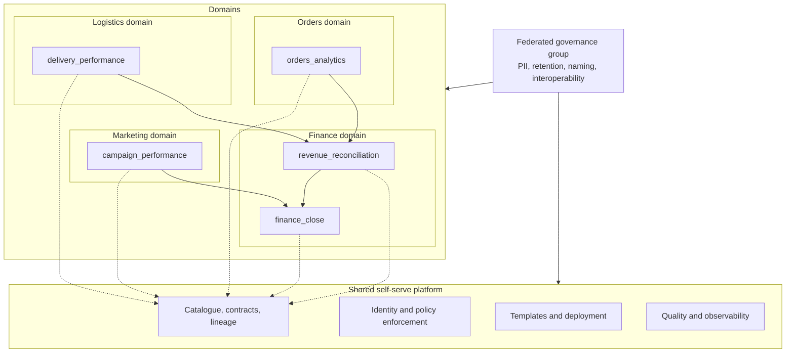

# Data Mesh Principles and Domain Ownership

**Roadmap location:** Stage 2C — Data Engineering_3 / Module 2C.8 — Data Platform Architecture and Data Products  
**Target file:** `02-data-mesh-principles-and-domain-ownership.md`  
**Level:** Intermediate → Advanced  
**Case study:** A fictional e-commerce company with Orders, Logistics, Marketing, and Finance domains  
**Practical exercise:** `experiments/02_data_mesh/`

> **Scope and source note:** The module roadmap is the controlling syllabus for this lesson. It calls for the four data-mesh principles, source-aligned/aggregate/consumer-aligned domain boundaries, domain ownership, platform and governance responsibilities, policy-as-code, anti-patterns, alternatives, technology enablers, operating-model design, and a staged migration exercise. Explanations, tables, the fictional case study, and the measurable exercise criteria below are supplementary teaching material that operationalizes those requirements. Vendor references are linked to official documentation where available; capabilities and product names can change.

---

## 1. Learning objectives

By the end of this lesson, you should be able to:

1. Explain the organizational problem data mesh addresses and why it is not a product you can simply purchase.
2. State and apply the four principles: domain-oriented ownership, data as a product, self-serve data platform, and federated computational governance.
3. Identify source-aligned, aggregate-oriented, and consumer-aligned domains and justify boundaries based on business responsibilities and coupling.
4. Assign clear accountability for data products, contracts, quality, documentation, access, incidents, and change management.
5. Design a shared platform that makes compliant domain ownership easier rather than forcing every domain to build infrastructure.
6. Translate global governance requirements into machine-enforced policies with CI checks, metadata, access controls, and audit evidence.
7. Compare data mesh with centralized lakehouse, embedded data engineering, data fabric, and hybrid operating models.
8. Evaluate whether a company is ready for mesh and plan a staged adoption with measurable outcomes and reassessment triggers.

## 2. Prerequisites and terminology

### 2.1 Prerequisites

Helpful prior knowledge includes data modelling, data contracts, data quality, metadata/catalogues, lineage, IAM, lakehouse architecture, orchestration, and basic system design. You do not need a particular vendor or platform.

### 2.2 Essential terms

| Term | Meaning in this lesson |
|---|---|
| **Business domain** | An area of business responsibility with recognizable concepts, processes, expertise, and decision rights, such as Orders or Logistics. |
| **Domain ownership** | The domain team is accountable for the data it produces and the data products it publishes, within enterprise policy. |
| **Data product** | A deliberately maintained data capability designed for consumers, with an owner, defined meaning, interface, quality expectations, access rules, documentation, and support. It can be a table, stream, API, file collection, metric interface, or combination. |
| **Producer** | The team that publishes a data product or supplies an upstream interface. |
| **Consumer** | A person, team, application, or model that uses a product. |
| **Data contract** | An explicit agreement about interface semantics such as schema, meaning, quality, freshness, compatibility, and change handling. |
| **Self-serve platform** | Shared capabilities that let teams provision, publish, discover, secure, observe, and operate data products without bespoke central-team tickets for every routine task. |
| **Federated governance** | Shared enterprise policies and decision-making, implemented with participation from domains and enforced through automated controls where possible. |
| **Lineage** | Evidence of how data flows from sources through transformations to downstream assets and consumers. |
| **Policy as code** | Governance rules expressed in machine-readable configuration or executable tests so they can be validated and enforced consistently. |

A data product is not automatically a data mesh. A company can build well-owned data products in a centralized model. Mesh is the combination of an organizational ownership model and supporting product, platform, and governance principles.

---

## 3. The problem data mesh addresses

### 3.1 A centralized data team can become a bottleneck

In a centralized model, one data team often owns ingestion, transformation, the warehouse/lakehouse, and many downstream datasets for all business units. Centralization can be an excellent starting point: it encourages consistency, concentrates scarce skills, and makes governance easier to coordinate.

As the company grows, demand may outgrow that team's capacity. Finance wants a new metric, Marketing needs campaign attribution, Logistics needs delivery performance, and Orders changes its event schema. Each request competes for the same engineers. The central team may know the technology well but lack the domain context to decide what a cancelled order means or when a delivery should count as late.



**What goes wrong when demand grows:**
- Queue time and prioritization disputes become significant.
- Domain knowledge is repeatedly transferred through tickets and meetings.
- Teams can optimize local business processes without understanding downstream data effects.
- Ownership of defects becomes unclear: the source team says the warehouse team owns the table, while the data team says the source is wrong.
- A central team becomes responsible for too many business definitions and cannot maintain deep expertise in every domain.

These are scaling risks, not proof that centralization is always wrong. A small company may be better served by a strong central team.

### 3.2 Source-system teams may not own downstream data quality

A source application team is often measured on application uptime and transaction correctness, not on whether its data is understandable and useful to analysts, finance, or ML teams. The central analytics team may own transformations but lack authority to fix upstream semantics. The result is a gap between who understands the business process and who is expected to deliver trustworthy data.

Mesh attempts to align responsibility with domain knowledge: the domain that understands and produces the data owns the data product and its quality commitments. That does not mean the source team must operate every piece of infrastructure; the platform team should make the work safe and repeatable.

### 3.3 Data mesh is not a technology purchase

Data mesh is an **organizational and architectural approach**. A catalog, lakehouse, semantic layer, data-sharing feature, or workflow tool may enable parts of it, but no single tool creates domain accountability or product thinking.

A mesh requires explicit choices about:
- Which teams own which business concepts and products.
- What each product promises to consumers.
- Which capabilities are shared platform services.
- Which policies are global and which decisions are local.
- How funding, incentives, incident response, and cross-domain changes work.

Buying a catalog without changing ownership can produce a searchable inventory of assets that nobody is accountable for. Splitting a warehouse into many schemas does not by itself create a mesh.

### 3.4 Three broad operating models

| Model | Ownership pattern | Strengths | Risks | Often suitable when |
|---|---|---|---|---|
| Centralized data team | A central team owns most pipelines and analytical outputs | Consistent tooling, concentrated expertise, straightforward coordination | Queueing, weak domain context, unclear source accountability at scale | Small/medium organization, few domains, limited engineering capacity |
| Embedded/domain-aligned engineers | Engineers sit with business domains; shared practices may be informal | Strong domain knowledge and local responsiveness | Tool duplication, inconsistent contracts and definitions, uneven quality | Domains need local delivery but platform/governance maturity is still developing |
| Data mesh | Domains own data products; a self-serve platform and federated governance provide common capabilities and constraints | Domain accountability with reusable platform capabilities and enterprise-wide interoperability | Organizational complexity, higher skill requirements, governance coordination costs | Many distinct domains, durable ownership, strong engineering culture, platform investment |

These are trade-offs, not a mandatory maturity ladder. A hybrid model may be the right long-term design.

---

## 4. The four principles

The four principles are interdependent. Domain ownership without product thinking can produce poorly documented datasets. Product thinking without a self-serve platform can make every team reinvent deployment and monitoring. A platform without federated governance can scale unsafe behavior. Governance without domain ownership can recreate a central approval bottleneck.



The cycle is intentional: shared governance sets constraints; the platform encodes them; domain teams use the platform to publish products; consumer feedback improves those products and the governance rules.

### 4.1 Principle 1 — Domain-oriented ownership

**Definition:** Data responsibility is aligned to business domains that understand the data's meaning and operational context.

**Problem solved:** A central team cannot be the expert and accountable owner for every business concept as the organization scales.

**Responsibilities of a domain team**
- Understand the business semantics of the data it publishes.
- Own source-aligned data transformations or product pipelines within its remit.
- Name a product owner and technical owner for each important product.
- Define and monitor quality, freshness, completeness, and schema expectations.
- Document meaning, known limitations, lineage, and intended use.
- Respond to incidents and communicate breaking changes.
- Classify sensitive data and apply enterprise access/retention requirements.
- Coordinate with upstream producers and downstream consumers.

**Implementation mechanisms**
- A domain map with explicit boundaries and accountable teams.
- Named product owners and on-call/support channels.
- Reusable product templates and contracts.
- Shared CI/CD, monitoring, access, and catalogue capabilities.
- Published interfaces that avoid direct dependency on private implementation details.

**Benefits**
- Business meaning is closer to the people making data decisions.
- Teams can prioritize improvements based on consumer value.
- Quality ownership becomes explicit.
- Cross-domain requests can be handled through stable product interfaces rather than ad hoc data extraction.

**Failure modes**
- “Everyone owns it” means no one owns it.
- A domain is named, but no staff time or budget is allocated.
- Ownership is assigned to the source application team even though it has no remit for analytical use cases.
- Teams publish data without accepting incident response or consumer support.
- Domain boundaries follow the org chart even when business concepts cross team boundaries.

**Dependency:** Domain ownership only works if products have real consumers, platform capabilities reduce operational burden, and governance makes cross-domain use safe.

### 4.2 Principle 2 — Data as a product

**Definition:** A domain treats its data output as a maintained capability for known consumers, not merely a table left behind by a pipeline.

A product should be discoverable, addressable, trustworthy, self-describing, interoperable, and secure. It should have a purpose, owner, consumer expectations, support route, and lifecycle.

**Problem solved:** Raw datasets frequently require consumers to reverse-engineer columns, guess refresh schedules, find an expert to explain definitions, and discover quality failures after reports break.

**Product responsibilities**
- Publish schema and business definitions.
- State freshness and quality objectives, access conditions, and limitations.
- Maintain documentation, sample queries, ownership, lineage, and change history.
- Provide compatibility and deprecation policies.
- Monitor usage and solicit consumer feedback.
- Publish incident status and communicate corrections.

**Example:** `orders_analytics` is not simply a copy of an operational `orders` table. It defines what counts as an accepted order, how cancellations are represented, which timestamps are used, how refunds are related, when the product refreshes, and which roles can access customer-identifying columns.

**Failure modes**
- Every table is called a product, regardless of use or support.
- Documentation exists but is not updated with schema changes.
- An SLA is declared but never measured.
- No one tracks consumers or communicates breaking changes.
- Product teams optimize producer convenience rather than consumer usability.

**Dependency:** Product thinking needs domain ownership for decisions, platform support for publishing/observability, and governance for consistent minimum standards.

### 4.3 Principle 3 — Self-serve data platform

**Definition:** A shared platform provides reusable capabilities so domain teams can create and operate compliant data products without building the underlying infrastructure from scratch.

The platform team owns the **platform as a product**: its users are domain engineers, analysts, and data product teams. It should understand their workflows and reduce the effort required to deliver a safe product.

**Typical platform capabilities**
- Approved project and pipeline templates.
- Identity, role and policy integration.
- Standard deployment workflows and CI checks.
- Storage/compute provisioning and environment management.
- Catalogue registration, ownership metadata, and lineage collection.
- Data-quality checks and contract validation.
- Freshness/availability monitoring, alert routing, and runbooks.
- Standard secrets handling, audit logging, and retention controls.
- Product discovery, access requests, and usage/cost reporting.

**Self-service does not mean unrestricted self-provisioning.** The platform should make the safe path the easiest path and constrain risky actions through guardrails. A domain can make local decisions within supported choices; it should not bypass legal, security, or interoperability rules.

**Failure modes**
- A “platform” is just a ticket queue with a portal on top.
- Each domain has to learn a different deployment stack.
- The platform team builds features without measuring adoption or developer friction.
- A golden path cannot accommodate legitimate use cases, so teams bypass it.
- Platform abstraction hides failures without exposing enough diagnostics.

**Dependency:** Platform investments need stable standards and clear product requirements from domain teams. Federated governance must be designed into the platform rather than left to manual review.

### 4.4 Principle 4 — Federated computational governance

**Definition:** Domains participate in governance decisions while enterprise-wide policies define common constraints. Those policies are encoded and enforced through technology where feasible.

**Problem solved:** Fully centralized governance can become slow, while fully decentralized governance can produce incompatible definitions, privacy breaches, inconsistent retention, and inaccessible products.

**Global rules may cover**
- Sensitive-data classification and permitted use.
- Access control and least privilege.
- Retention and deletion.
- Naming and metadata minimums.
- Contract/schema compatibility.
- Quality and observability requirements for critical products.
- Audit evidence, lineage, and regulatory controls.
- Approved sharing patterns and cross-region restrictions.

**Local decisions may cover**
- Domain-specific business definitions.
- Product-specific freshness targets above enterprise minimums.
- Domain schema details that preserve interoperability.
- Local transformation logic and pipeline implementation.
- Product roadmap, support model, and consumer onboarding.

Local autonomy is bounded: a domain cannot override a legal retention requirement simply because it prefers to keep data indefinitely.

**Governance mechanisms**
- A federated governance group defines policy, exception, and escalation processes.
- CI checks validate product metadata, contracts, classifications, and compatibility.
- Catalog tags record sensitivity, owner, purpose, retention, and access tier.
- IAM policies enforce permissions at the relevant data and compute layers.
- Monitoring and audit logs provide evidence of policy execution.
- Exceptions have an owner, rationale, expiry date, and review process.

**Failure modes**
- Governance becomes a committee that approves every change.
- Policies are written as prose but not translated into enforceable checks.
- Domains can silently bypass controls.
- Global standards are so prescriptive that they erase domain-specific meaning.
- “Federated” is used as an excuse to abandon enterprise accountability.

**Dependency:** Governance needs reliable metadata, a platform capable of enforcement, and domain owners accountable for compliance.

---

## 5. Domain boundaries and ownership

### 5.1 Three useful domain-boundary patterns

These are design lenses, not mandatory mutually exclusive categories. A real product portfolio may combine them.

#### Source-aligned domain

Organized around the business process or operational system that originates data.

Examples:
- Orders owns order placement, order state transitions, and order line semantics.
- Logistics owns shipment milestones, carrier events, and delivery outcomes.

**Strength:** ownership and meaning are close to the source process.  
**Risk:** consumers may need to combine multiple source-aligned products to answer a business question.

#### Aggregate-oriented domain

Organized around a coherent aggregate or entity family that spans related sources or processes.

Examples:
- Customer identity/relationship, if the company has an accountable customer domain.
- Product catalogue and product hierarchy, if multiple systems contribute product attributes.

**Strength:** creates a coherent, reusable view of a business concept.  
**Risk:** boundaries can become too broad; the aggregate domain may become a new central team if it takes over every consumer's transformations.

#### Consumer-aligned domain

Organized around a specific class of consumption or business outcome.

Examples:
- Finance close and recognized revenue reporting.
- Seller performance analytics for a commercial organization.

**Strength:** aligns output to consumer decisions and semantics.  
**Risk:** if every consumer creates its own overlapping product, duplicated logic and conflicting definitions can grow.

### 5.2 How to choose a boundary

Ask:

1. Who has the business authority to define this concept?
2. Which team can fix defects at the source of the meaning?
3. Who can make trade-offs about quality, freshness, and change?
4. Are the concepts changed together, or do they have independent lifecycles?
5. Which consumers need a stable reusable interface?
6. Does this boundary create a single accountable owner, or merely rename a shared responsibility?
7. Are cross-domain dependencies explicit and limited?
8. Can the domain staff the ownership and incident responsibilities?

A useful boundary minimizes unclear accountability and excessive coupling. Avoid creating a domain for every table or forcing all related data into one enormous domain.

### 5.3 Example domain map for e-commerce



**Interpretation:** Orders owns order facts and order semantics; Logistics owns delivery facts; Marketing owns campaign attribution; Finance owns finance-specific reconciliation and close definitions. Finance consumes upstream products but should not silently redefine the source meaning of an order or delivery.

### 5.4 Product interfaces and dependency rules

A product interface should expose stable, documented semantics rather than internal implementation details. For example:

- `orders_analytics` exposes `order_id`, `order_status`, `ordered_at`, `currency`, `gross_amount`, and documented cancellation/refund treatment.
- `delivery_performance` exposes `shipment_id`, `order_id`, milestone timestamps, delivery outcome, and a definition of “late.”
- `campaign_performance` exposes campaign identifiers, attribution method/version, conversion window, and documented limitations.
- `revenue_reconciliation` exposes finance-approved measures with currency and accounting-period semantics.

Consumers should depend on published interfaces, not private staging tables or undocumented source internals. When a product changes, producers communicate compatibility and deprecation; consumers own their migration plans.

### 5.5 Ownership must include operational duties

A product owner cannot be merely a name in the catalogue. For each critical product, define:
- **Business owner:** accountable for meaning, priority, and consumer value.
- **Technical owner:** accountable for implementation, operation, and technical change.
- **Quality owner:** accountable for quality rules and response to violations; may be the same person as technical owner in a small domain.
- **Support/on-call route:** who acknowledges incidents and communicates status.
- **Consumer contact:** how users request changes and report defects.
- **Governance obligations:** classification, access, retention, audit, and contract requirements.

One person may hold multiple roles, but each responsibility must be assigned explicitly.

---

## 6. Organisational operating model

### 6.1 Domain teams

A domain team is accountable for its products and domain-specific meaning. It typically includes or has reliable access to:
- Business subject-matter expertise.
- Data engineering skills.
- Analytics/product skills where appropriate.
- Source-system and operational expertise.
- A named data product owner.

The team need not own every platform component. Its responsibility is to deliver a reliable product through shared capabilities.

### 6.2 Platform team

The platform team is accountable for the internal platform experience, not for defining every domain's business semantics. This is **platform-as-a-product**: treat domain engineers as customers, publish a roadmap and service expectations, gather feedback, and measure adoption and friction. It provides reusable infrastructure, safe defaults, templates, deployment workflows, governance integration, observability, and support.

It should measure whether teams can onboard products independently, how often they need platform intervention, how quickly they recover from failures, and whether the platform's abstractions fit real workloads.

### 6.3 Data product owner

The product owner understands the consumers and is accountable for product scope and value. This role:
- Prioritizes product improvements.
- Defines consumer-facing promises with engineering.
- Reviews adoption, quality, and support trends.
- Coordinates deprecation and consumer communication.
- Ensures the product's purpose and intended uses are clear.

The owner does not replace engineering accountability or enterprise governance.

### 6.4 Federated governance group / governance guild

A cross-domain group includes domain representatives and relevant security, privacy, architecture, legal/compliance, and platform stakeholders. It defines global policies, resolves conflicts, reviews exceptions, and evolves standards.

It should not become a central ticket queue for ordinary product changes. Its work should focus on policies and decision rights that need cross-domain coordination.

### 6.5 Responsibility matrix

R = responsible for execution; A = ultimately accountable; C = consulted; I = informed. Adapt this matrix to the company; it is an example, not a universal organization chart.

| Activity | Domain team / product owner | Platform team | Federated governance | Consumer team |
|---|---|---|---|---|
| Business meaning and product scope | A/R | I | C for enterprise terms | C |
| Pipeline implementation and product operation | A/R | C / platform service owner | I | I |
| Product quality rules and remediation | A/R | Provides reusable checks | Sets minimum controls | Reports observed issues |
| Contract and schema changes | A/R for producer interface | Provides tooling and validation | Sets compatibility policy | R for consumer migration; C during change |
| Catalogue metadata and documentation | A/R for product content | R for automated registration/integration | Sets required fields/tags | Uses and gives feedback |
| Identity, platform infrastructure, standard deployment | Uses platform | A/R | C on policy requirements | Uses approved access path |
| Enterprise privacy, retention, classification policy | Applies to product | Implements controls | A/R for policy | Complies with policy |
| Product-specific access approval | A/R where delegated by policy | Enforces technical grant | Defines guardrails / exception rules | Requests access |
| Security incident affecting product | R for product triage and containment | R for platform-side investigation | C / escalation | I or C as affected |
| Consumer-facing data incident communication | A/R | C | I; C for enterprise impact | Receives update and validates impact |
| Cross-domain standards and disputes | C / participates | C / implements | A/R for shared decision process | C |

**Important:** accountability should follow actual authority. If a domain team cannot deploy, change access, or fix the pipeline, do not hold it solely accountable for outcomes it cannot control.

### 6.6 Team topologies, funding, and incentives

The organizational design must avoid creating a mesh in name only.

- **Domain-aligned teams** own products and business semantics.
- **Platform team** provides an internal product with documented golden paths and service expectations.
- **Enabling capabilities** (security, architecture, data governance) help domains adopt standards and build competence.
- **Federated governance** handles shared policies and cross-domain decisions.

Funding should allocate capacity for product maintenance, quality work, and incidents—not just new feature delivery. Incentives should reward product reliability, consumer adoption, and interoperability rather than the number of tables or pipelines produced.

Possible funding mechanisms:
- Central funding for shared platform and mandatory enterprise controls.
- Domain budgets for product roadmaps and operational ownership.
- Transparent showback of compute/storage consumption.
- Explicit funding for shared products that serve multiple domains.
- A governance process for resolving disputes when a product's cost and value are distributed across teams.

### 6.7 Measuring operating-model health

Measure outcomes, not the number of teams renamed as domains.

| Measure | What it tells you | Example interpretation |
|---|---|---|
| Time to onboard a new source/product | Self-service effectiveness | Falling time suggests templates and workflows are working |
| Percentage of critical products with named owners and contracts | Accountability coverage | Gaps identify unowned operational risk |
| Freshness/quality SLO attainment | Product reliability | Repeated misses indicate product or source issues |
| Mean time to acknowledge and resolve data incidents | Operational response | Slow response may indicate unclear ownership or weak observability |
| Consumer adoption and repeat usage | Product value/discoverability | Low usage may mean poor fit, poor discovery, or redundant products |
| Breaking changes without notice | Interface stability | Any recurring incident suggests contract/versioning weaknesses |
| Policy compliance and exception age | Governance effectiveness | Long-lived exceptions may signal bad defaults or weak enforcement |
| Platform self-service completion rate | Platform usability | Low rate indicates hidden manual work or missing capabilities |
| Duplicate products/definitions for the same concept | Interoperability | Growth may reveal poor boundaries or missing shared interfaces |
| Cost per useful query/product/consumer cohort | Economic sustainability | Rising cost without value may justify optimization or retirement |

Set baselines before migration. Targets depend on business criticality and current maturity; do not copy arbitrary industry numbers without context.

---

## 7. Technical architecture and platform responsibilities

### 7.1 Logical architecture



**The domain teams own the products.** The platform team owns the reusable capabilities that make products easier to build and operate. Governance defines and evolves the shared rules. The diagram does not imply a single physical platform or one storage engine; multiple technologies can be used if interfaces, identity, metadata, and governance remain coherent.

### 7.2 Domain-owned pipelines on a shared platform

A domain might own its source ingestion and product transformations while using the same approved deployment pipeline, identity provider, catalogue integration, data-quality library, and observability stack as other domains.

This separation enables autonomy without forcing each team to build its own secrets manager, scheduler, logging stack, or access-control system. The platform should provide stable APIs and documented escape hatches for exceptional workloads.

### 7.3 Standard interfaces and interoperability

Interoperability is the ability for products to be understood and used across teams and tools. It needs:
- Consistent metadata fields and naming conventions.
- Published schemas and business definitions.
- Explicit keys, units, currencies, time zones, and null semantics.
- Contract and compatibility checks.
- Discoverable owners, lineage, and access instructions.
- Stable identifiers and agreed definitions for shared concepts.
- Access patterns that do not require consumers to know private implementation details.

Standards should focus on what needs to be shared. Do not force every domain to use identical internal models when those models are not exposed to consumers.

### 7.4 Contracts, lineage, and discoverability

**Contracts** tell consumers what they can rely on.  
**Lineage** helps identify upstream causes and downstream impact.  
**Catalogues** make products findable and provide metadata and ownership context.  
**Semantic layers** can centralize or share definitions of business metrics, reducing disagreement about measures such as gross revenue or on-time delivery.

These capabilities complement each other. A catalogue listing without current ownership or quality metadata is not sufficient; lineage without contracts does not establish a product's promises; a semantic layer cannot repair incorrect source facts by itself.

---

## 8. Federated computational governance

### 8.1 Global policies and local decisions

A useful policy has four parts:
1. **Intent:** why the rule exists.
2. **Scope:** which products or data classes it applies to.
3. **Enforcement:** where the rule is checked or prevented.
4. **Evidence and exception:** how compliance is demonstrated and who may approve a time-limited exception.

Example policy: all products containing direct identifiers must carry a sensitivity classification, have an accountable owner, restrict access to approved roles, and define retention/deletion behavior. The domain chooses the detailed product schema; it cannot choose to omit classification.

### 8.2 Example policy catalogue

| Policy | Global minimum | Domain discretion | Automated enforcement/evidence |
|---|---|---|---|
| PII classification | Sensitive fields/assets must be tagged | Field-level classification details within the standard taxonomy | CI validates tags; catalogue stores classification; access layer applies grants/masking |
| Retention | Every product declares retention; regulated classes follow mandated limits | Shorter retention or stricter domain rules where allowed | Metadata validation, lifecycle rules, deletion jobs, audit evidence |
| Access | Least privilege; no public exposure of restricted data | Product-specific roles and approved use cases | IAM/role policies, access request workflow, automated tests for unauthorized access |
| Naming/metadata | Owner, purpose, domain, schema version, support channel required | Domain-specific names within namespace rules | CI schema validation and catalogue registration checks |
| Data quality | Critical products define measurable checks and alert routes | Additional domain-specific business rules | Contract tests, scheduled checks, quality alerts, incident records |
| Schema compatibility | Breaking changes require versioning/deprecation or approved exception | Product-specific release schedule | CI compatibility checks and consumer-impact analysis |
| Lineage | Critical products record source and transformation lineage | Tooling choice where it meets the standard | Automated lineage ingestion; coverage report |
| Sharing | Cross-domain sharing uses approved interfaces and permissions | Product-specific consumer eligibility | Policy checks, role grants, audit logs, share revocation workflow |
| Incident handling | Severity, owner, response path, and communications are defined | Domain runbook details | Alert routing, incident ticket metadata, response-time reporting |

### 8.3 A simple policy-as-code example

The following small Python example illustrates **metadata validation**, not a complete security enforcement system. A production system should use a formal schema, authenticated identity, actual IAM controls, audit logging, and tests at deployment/runtime boundaries.

```python
from dataclasses import dataclass
from datetime import date


@dataclass(frozen=True)
class ProductMetadata:
    name: str
    domain: str
    owner: str
    classification: str
    retention_days: int
    support_channel: str
    retention_exception_approved: bool = False
    retention_exception_id: str | None = None
    retention_exception_expires_on: date | None = None


ALLOWED_CLASSIFICATIONS = {"public", "internal", "confidential", "restricted"}


def validate_product(
    metadata: ProductMetadata,
    *,
    as_of: date | None = None,
) -> list[str]:
    """Validate a small metadata policy example; this is not IAM enforcement."""
    as_of = as_of or date.today()
    errors: list[str] = []

    for field_name in ("name", "domain", "owner", "support_channel"):
        value = getattr(metadata, field_name)
        if not isinstance(value, str) or not value.strip():
            errors.append(f"{field_name} must be a non-empty string")

    if not isinstance(metadata.classification, str) or metadata.classification not in ALLOWED_CLASSIFICATIONS:
        errors.append("classification is not in the approved taxonomy")

    # bool is a subclass of int in Python, so require the exact int type.
    if type(metadata.retention_days) is not int or metadata.retention_days <= 0:
        errors.append("retention_days must be a positive integer")

    if type(metadata.retention_exception_approved) is not bool:
        errors.append("retention_exception_approved must be a boolean")

    if metadata.retention_exception_id is not None and (
        not isinstance(metadata.retention_exception_id, str)
        or not metadata.retention_exception_id.strip()
    ):
        errors.append("retention_exception_id must be a non-empty string or None")

    if metadata.retention_exception_expires_on is not None and not isinstance(
        metadata.retention_exception_expires_on, date
    ):
        errors.append("retention_exception_expires_on must be a date or None")

    if (
        metadata.classification == "restricted"
        and type(metadata.retention_days) is int
        and metadata.retention_days > 365
    ):
        if metadata.retention_exception_approved is not True:
            errors.append("restricted retention above 365 days requires an approved exception")
        if not isinstance(metadata.retention_exception_id, str) or not metadata.retention_exception_id.strip():
            errors.append("retention exception must reference an auditable exception record")
        if metadata.retention_exception_expires_on is None:
            errors.append("retention exception must have an expiry date")
        elif (
            isinstance(metadata.retention_exception_expires_on, date)
            and metadata.retention_exception_expires_on <= as_of
        ):
            errors.append("retention exception is expired")

    return errors


candidate = ProductMetadata(
    name="orders_analytics",
    domain="orders",
    owner="orders-data-owner",
    classification="internal",
    retention_days=180,
    support_channel="#orders-data-support",
)
assert validate_product(candidate, as_of=date(2026, 10, 19)) == []

expired_exception = ProductMetadata(
    name="restricted_export",
    domain="finance",
    owner="finance-data-owner",
    classification="restricted",
    retention_days=400,
    support_channel="#finance-data-support",
    retention_exception_approved=True,
    retention_exception_id="EXC-2026-001",
    retention_exception_expires_on=date(2026, 10, 1),
)
assert validate_product(expired_exception, as_of=date(2026, 10, 19)) == [
    "retention exception is expired"
]
print("Metadata policy example: valid product accepted; expired exception rejected.")
```

This example shows how a global rule can be checked consistently while leaving domain-specific business definitions local. The 365-day threshold is an **illustrative fictional policy**, not a legal rule or recommendation. Real retention periods must come from applicable law, contracts, security risk, and company policy.

### 8.4 Where to enforce policy



A mature implementation uses multiple layers:
- **At authoring time:** templates, linting, schema validation, and developer feedback.
- **At CI/deployment:** contract compatibility, required metadata, security scans, policy tests, and approval gates for high-risk changes.
- **At runtime:** IAM, row/column controls where supported, masking, lifecycle/deletion rules, quality monitoring, and alerting.
- **At audit time:** immutable or appropriately protected evidence showing what policy ran, against which asset, with what result, and who approved exceptions.

A CI check that a product is tagged `restricted` does not itself protect the data. The access control system must enforce the tag-derived policy, and the platform must test that the enforcement works.

### 8.5 Exceptions and policy evolution

Some products have legitimate exceptional requirements. Use an explicit exception record with:
- Policy identifier and affected product(s).
- Business rationale and risk assessment.
- Compensating controls.
- Named approver(s).
- Expiry/review date.
- Evidence and remediation plan.

Exceptions should expire or be renewed deliberately. If many teams request the same exception, reconsider whether the global policy or platform defaults are poorly designed.

---

## 9. Technology enablers and their roles

The roadmap names Unity Catalog, DataHub, Microsoft Purview, Dataplex, contracts, semantic layers, dbt Mesh, Snowflake sharing, and Delta Sharing as examples. They address different parts of the problem and are not interchangeable. Choose based on the current stack, governance requirements, integrations, deployment model, cost, and operational skills.

| Capability | Examples | What it can help with | What it does not do by itself |
|---|---|---|---|
| Data/AI catalog and governance | Databricks Unity Catalog | Access control, discovery, lineage, auditing, classification, and supported governance capabilities within the Databricks ecosystem | Assign real business accountability or guarantee every policy is correctly designed; the separate open-source Unity Catalog project has a different deployment/capability context |
| Metadata catalog and lineage | DataHub | Discoverability, metadata, ownership context, lineage, impact analysis | Automatically fix data quality or enforce every access policy in every system |
| Enterprise governance, security and compliance | Microsoft Purview | Governance/catalogue and data security/compliance capabilities across supported sources and services | Replace the domain operating model or make all source systems equally observable |
| Google Cloud catalog/governance capabilities | **Knowledge Catalog** (formerly Dataplex Universal Catalog) | Discovery, metadata context, lineage, quality and governance capabilities in supported Google Cloud workflows | Establish domain ownership or provide identical behavior across all vendors |
| Contracts | Open Data Contract Standard (ODCS), contract tooling | Express schemas, semantics, quality expectations, ownership, and compatibility in machine-readable form | Guarantee compliance unless checks are integrated into CI/runtime and enforced |
| Transformation and cross-project collaboration | dbt Mesh | Multi-project references, model access/versioning, cross-project lineage and governance features subject to product/plan constraints | Create a complete data mesh operating model or replace platform/security governance |
| Shared business metric definitions | Semantic layer tools | Standardize metrics and dimensions for supported consumers | Reconcile conflicting business ownership without explicit decisions |
| Data sharing within a platform | Snowflake Secure Data Sharing | Provider-controlled access to selected supported objects across Snowflake accounts; shared objects are read-only to consumers | Automatically solve semantic compatibility, privacy classification, or access policy design |
| Open data sharing protocol | Delta Sharing | Securely share supported data across compatible clients/platforms through an open protocol | Replace product ownership, contracts, or every platform's access controls |

### 9.1 Important selection cautions

- A catalogue is metadata infrastructure, not a substitute for product documentation and active ownership.
- A contract is useful only if producers publish it, consumers can rely on it, and automated checks catch violations.
- A semantic layer needs explicit metric owners and change governance.
- Cross-project references can create coupling if teams expose too many internal models or change public models without version discipline.
- Data-sharing mechanisms need classification, consumer authorization, auditing, revocation, and lifecycle policies.
- Check current editions, plans, connector support, and feature limitations before making vendor decisions.

Official product documentation linked in the reference section supports the specific capability descriptions above. The operating-model conclusions are architectural synthesis, not vendor guarantees.

---

## 10. Data mesh versus alternatives

### 10.1 Data mesh versus data fabric

| Dimension | Data mesh | Data fabric |
|---|---|---|
| Primary emphasis | Domain ownership, data products, platform self-service, federated computational governance | Integrating data access, metadata, automation, and governance across a distributed data estate |
| Main question | Who owns and operates trustworthy products, and how do domains collaborate? | How can data be connected, discovered, governed, and accessed across disparate systems? |
| Organizational change | Explicitly central | May be modest or substantial depending on implementation |
| Technology | Uses catalogues, contracts, platforms, and sharing tools as enablers | Often emphasizes metadata integration, automation, and data integration technologies |
| Can coexist? | Yes | Yes |

“Data fabric” is used inconsistently across vendors and organizations. Treat it as a broad architectural approach, not a universally standardized product category. A fabric can support a mesh by providing metadata and integration capabilities; it does not automatically create domain accountability.

### 10.2 Data mesh versus a centralized lakehouse with product thinking

A centralized lakehouse can still publish well-documented products, assign owners, enforce contracts, and use automated governance. It may be the best design when there are few domains or when scarce skills make distributed operations impractical.

| Question | Centralized lakehouse with product thinking | Data mesh |
|---|---|---|
| Who operates most pipelines? | Central platform/data team | Domain teams operate domain products using shared platform capabilities |
| Who defines domain semantics? | Ideally domain experts with central engineering support | Domain product teams are directly accountable |
| Platform burden | Central team owns most infrastructure and delivery workflows | Platform team owns reusable self-service capabilities; domains operate products |
| Governance | Can be centralized and automated | Federated decision-making with automated global constraints |
| Main scaling risk | Central delivery bottleneck | Uneven domain maturity, duplicated products, governance fragmentation |
| Appropriate when | Few domains, limited engineering capacity, need for consistent central operation | Many distinct domains with durable ownership and strong platform maturity |

The difference is not merely where the data is stored. It is the distribution of decision rights and operational accountability.

### 10.3 Hybrid models

A pragmatic hybrid can include:
- Central ownership for foundational infrastructure, identity, cataloguing, security, and highly shared reference data.
- Domain ownership for source-aligned and business-specific products.
- Centralized semantic definitions for a limited set of enterprise metrics, with domain participation.
- Federated governance for global rules and domain exceptions.
- A shared lakehouse or warehouse where physical storage is centralized but product ownership is distributed.

Hybrid is not a failure to adopt mesh. It is often the right response to uneven domain maturity and different risk profiles.

---

## 11. Adoption criteria and anti-patterns

### 11.1 When mesh is more likely to help

Positive signals:
- Many business domains have distinct concepts and product roadmaps.
- A central data team is a demonstrated bottleneck, not merely assumed to be one.
- Domain teams can own data quality and support responsibilities.
- Leadership funds product maintenance and platform capabilities.
- Engineering practices support CI/CD, observability, access control, contracts, and automated testing.
- Consumers need reusable products across domain boundaries.
- The organization can make and enforce common governance decisions.

### 11.2 When mesh may hurt

Warning signals:
- The company has only a handful of engineers and a few data products.
- Domains are not well-defined or change constantly.
- No team has time to own product quality or respond to incidents.
- Platform capabilities are weak and each domain would need to build its own stack.
- Governance is either absent or requires manual central approval for routine work.
- Leadership rewards only new features, not reliability and maintenance.
- Existing centralized delivery is not a meaningful bottleneck.
- Business concepts have no agreed definitions or decision owners.

For a small organization, a central team with domain subject-matter experts, clear product ownership, contracts, and self-service templates may deliver most of the value at lower cost.

### 11.3 Anti-patterns

**Mesh in name only**  
Teams are renamed as domains, but all work still flows through a central queue and no domain owns quality or support.

**Every domain builds its own stack**  
Different schedulers, catalogues, secrets handling, and access systems make the estate expensive and hard to govern. Shared platform capabilities are missing.

**No platform**  
Domain teams must learn infrastructure, security, deployment, and monitoring before delivering data products. Self-service becomes decentralization of toil.

**Governance abandoned**  
Local teams publish incompatible definitions or expose sensitive data because global policies are not encoded or monitored.

**Ownership without authority or budget**  
A domain is accountable for quality but cannot fix source semantics, deploy changes, or allocate engineering time.

**Every table is a product**  
The product catalogue becomes noise, while important consumer-facing interfaces are not distinguished from intermediate models.

**Central team renamed as governance**  
The governance group approves every pipeline and schema change. Federated governance should define common rules and handle exceptions, not centralize routine delivery again.

**Domain boundaries mirror the org chart blindly**  
Reorganizations change ownership and interfaces even when business concepts remain stable. Use domain semantics, decision rights, and change coupling to define boundaries.

**Global metric definitions without owners**  
A semantic layer exposes metrics, but no accountable business group decides the official meaning. Technology cannot settle an unresolved business disagreement.

### 11.4 Adoption decision scorecard

Score each dimension from 1 (weak) to 5 (strong) and record evidence. Do not use a total score as an automatic decision; a critical weakness such as absent ownership or no security controls may block adoption regardless of the sum.

| Dimension | Evidence to collect | Low score implies |
|---|---|---|
| Domain clarity | Stable business capabilities, decision rights, named owners | Define boundaries and accountability first |
| Demand pressure | Queue time, backlog, lead time, repeated central bottlenecks | Mesh may not solve a demonstrated problem yet |
| Domain engineering maturity | Deployment, testing, observability, incident response | Invest in enablement and platform before decentralizing |
| Platform readiness | Golden paths, IAM, catalogue, contracts, monitoring | Build platform capabilities before broad rollout |
| Governance readiness | Policy owners, classification, automated controls, exception process | Improve governance before multiplying producers |
| Product culture | Consumer research, documentation, SLOs, lifecycle and support | Establish product responsibilities and incentives |
| Funding/incentives | Maintenance capacity and cross-domain cost model | Ownership may be nominal without sustainable investment |

---

## 12. Worked enterprise case study

### 12.1 Fictional company

**ShopSphere** is a growing e-commerce company. It has four major business areas:
- **Orders:** order lifecycle, order lines, cancellations, refunds initiation.
- **Logistics:** shipment, carrier, delivery milestones, delivery outcomes.
- **Marketing:** campaign execution, attribution rules, campaign spend.
- **Finance:** accounting periods, recognized revenue, reconciliations, close reporting.

Assume the central data team has six engineers, supports dozens of stakeholder groups, and owns most analytics pipelines. The team has a growing backlog and frequently needs business experts to explain source semantics. These are fictional case assumptions for the exercise, not claims about a real company.

### 12.2 Current state



The central team controls delivery, but domain owners are not consistently accountable for data products. When a delivery status definition changes, the central team must discover all downstream effects. Finance may build its own adjustment logic in a spreadsheet because the warehouse queue is too long.

### 12.3 Proposed operating model



**Arrow semantics:** solid arrows are data-product dependencies; dashed arrows show products registered in the shared catalogue/contract/lineage capabilities. `orders_analytics` and `delivery_performance` feed `revenue_reconciliation` where the finance policy needs order and fulfillment evidence. `campaign_performance` feeds `finance_close` for campaign-spend or marketing-cost reconciliation; it does not silently redefine recognized revenue. `revenue_reconciliation` is an input to `finance_close`.

**Ownership rules**
- Orders owns the meaning and quality of `orders_analytics`.
- Logistics owns the meaning and quality of `delivery_performance`.
- Marketing owns attribution logic and `campaign_performance`.
- Finance owns finance-specific reconciliation and close outputs, and is accountable for the accounting interpretation of its product.
- The platform team owns shared deployment, policy integration, catalogue/lineage plumbing, and monitoring capabilities.
- The governance group defines global policies, resolves shared semantic conflicts, and manages exceptions.
- Consumers own their use of products and must plan for published changes; producers must provide notice and compatibility paths.

### 12.4 Upstream/downstream contract example

Finance consumes Orders and Logistics products for `revenue_reconciliation` where the applicable accounting policy needs order or fulfillment evidence; this is a case-specific dependency, not a universal rule that delivery data determines revenue recognition. Marketing campaign/spend data may feed `finance_close` or expense reconciliation, but should not be treated as a revenue input without an explicit business rule. Finance should not rely on private staging tables. Contracts should clarify:
- Join keys and cardinality assumptions.
- Which timestamp defines the business date.
- How cancelled orders, partial shipments, refunds, and late updates are represented.
- Currency and rounding semantics.
- Freshness and correction windows.
- Schema version and deprecation timeline.
- How incidents and data corrections are communicated.

Finance can define recognized revenue according to accounting policy, but must distinguish that measure from an Orders-owned gross order value. Shared names do not imply identical semantics.

### 12.5 Global governance and automation

| Rule | Where it is defined | Automated mechanism | Evidence |
|---|---|---|---|
| Every product has owner, domain, purpose, and support channel | Enterprise product metadata standard | CI schema validation; deployment blocked if missing | Validation result and catalogue record |
| Sensitive products carry approved classification | Security policy | CI classification check plus metadata integration with access control | Classification record, IAM policy, audit log |
| Retention is declared and conforms to policy | Privacy/legal policy | CI checks declared retention; lifecycle system enforces approved policy | Retention configuration and deletion logs |
| Critical products define quality and freshness checks | Data reliability standard | Contract validation and monitoring alerts | Test results, SLO dashboards, incident history |
| Breaking changes are versioned and consumers notified | Contract/change policy | Compatibility checks, dependency/lineage impact analysis, release workflow | PR approval, consumer notification, deprecation record |
| Cross-domain sharing uses approved roles/interfaces | Security and architecture standards | IAM grants, access workflow, policy tests | Access log and periodic review |

### 12.6 One-page adoption assessment

**Recommendation: adopt a staged hybrid now, not a big-bang mesh migration.**

**Why:** ShopSphere has multiple domains and a real central delivery bottleneck, but its six-person central team and uncertain domain maturity make immediate full decentralization risky. Begin by creating named product ownership in the four domains and providing a shared platform golden path. Keep core infrastructure and enterprise controls centralized while domain teams take responsibility for a small set of high-value products.

**First pilot:** `orders_analytics` and `delivery_performance`, with Finance as an explicit consumer. These products test producer ownership, cross-domain contracts, lineage, quality alerts, and consumer communication. Add Marketing after the platform and governance path has been exercised.

**Required prerequisites:** named business and technical owners; protected capacity for maintenance; a product template; a catalogue and access process; contract and quality checks; an incident route; global classification/retention rules; and leadership agreement on domain decision rights.

**Risks:** domain teams may not have capacity; platform work may be underfunded; multiple definitions may emerge; central teams may retain informal approval power; and consumer migration may be underestimated.

**Success evidence after the pilot:** all pilot products have accountable owners and published contracts; consumers can find them and understand their semantics; CI blocks missing metadata and incompatible changes; access controls are tested; quality incidents have a clear owner; onboarding lead time improves against baseline; and Finance can trace its outputs to upstream products.

**Do not expand** if teams lack time to maintain products, policy enforcement is manual, ownership disputes remain unresolved, or the platform forces teams to bypass it. In that case, retain a centralized delivery model with stronger product ownership and self-service workflows, then reassess.

### 12.7 Staged migration plan

**Stage 0 — Diagnose and agree (weeks 0–4; illustrative planning window)**
- Measure central queue time, backlog, incidents, duplicated datasets, and consumer pain.
- Map domains, critical data assets, owners, consumers, and dependencies.
- Agree decision rights, global policies, and product selection criteria.
- Choose pilot products with willing producers and real consumers.

**Exit criteria:** named executive sponsor, domain owners, baseline metrics, agreed pilot, and documented governance responsibilities.

**Stage 1 — Establish minimum product ownership (weeks 4–8)**
- Assign product owners and technical owners.
- Write product specs and contracts for pilot products.
- Define quality checks, freshness expectations, support route, and deprecation policy.
- Keep the central team as an enablement partner.

**Exit criteria:** product owners can explain semantics and support incidents; contracts are reviewed by consumers.

**Stage 2 — Build the golden path (weeks 6–12)**
- Provide templates, CI checks, deployment workflow, catalogue registration, lineage, identity integration, and monitoring.
- Automate metadata and contract validation.
- Add access and retention controls and an exception workflow.

**Exit criteria:** a domain can publish or update a pilot product without bespoke central implementation, while required controls remain enforced.

**Stage 3 — Transfer operational ownership for pilots (weeks 12–16)**
- Domain teams handle product incidents and change communication.
- Platform team handles shared platform incidents and capability improvements.
- Run failure drills and verify lineage, alert routing, and access restrictions.
- Gather consumer feedback and measure onboarding time.

**Exit criteria:** incident ownership is unambiguous; SLOs and policy evidence are available; consumer changes are managed through contracts.

**Stage 4 — Expand selectively (after pilot review)**
- Add Marketing and additional products based on evidence.
- Standardize shared concepts and resolve duplication through product interfaces.
- Introduce cost showback and product usage/health reviews.
- Retire redundant products with consumer migration plans.

**Exit criteria:** expansion is justified by product adoption, operational reliability, and lower delivery friction—not by a target number of domains.

**Stage 5 — Reassess the operating model quarterly**
- Compare results to baseline.
- Review policy exceptions, ownership gaps, duplicate definitions, and platform friction.
- Keep central ownership where shared risk or economics justify it.
- Adjust boundaries when business responsibilities or coupling change.

**Rollback/reassessment triggers**
- A critical access or retention control fails.
- Domain teams repeatedly miss product SLOs without capacity to remediate.
- Platform self-service is bypassed by most teams.
- Cross-domain incidents have no accountable owner.
- Duplicate/conflicting products increase without a resolution mechanism.
- Onboarding and delivery lead times do not improve after a reasonable pilot period.
- The organizational cost of distributed operation exceeds the demonstrated benefit.

---

## 13. Hands-on exercise — `experiments/02_data_mesh/`

### 13.1 Goal

Produce an architecture and operating-model dossier for ShopSphere. The goal is not to deploy a vendor stack; it is to demonstrate that you can make coherent decisions about domain boundaries, product interfaces, governance, platform responsibilities, and adoption.

### 13.2 Suggested folder structure

```text
experiments/02_data_mesh/
├── README.md
├── domain-map.mmd
├── responsibility-matrix.md
├── governance-policies.md
├── adoption-assessment.md
├── migration-plan.md
└── product-contracts/
    ├── orders_analytics.md
    └── delivery_performance.md
```

These are suggested deliverables, not files that must already exist in your repository.

### 13.3 Deliverable A — Domain map

Create a Mermaid diagram showing:
- Orders, Logistics, Marketing, and Finance.
- Each domain's owner and at least one product.
- Upstream and downstream product dependencies.
- Shared platform services.
- Federated governance and its connection to domains/platform.

For every cross-domain arrow, state what is being shared and why. Avoid arrows that mean only “teams talk to each other.”

### 13.4 Deliverable B — Responsibility matrix

Complete a matrix for:
- Product scope and business meaning.
- Schema/contract changes.
- Data-quality definitions and remediation.
- Access approvals and technical enforcement.
- Documentation, catalogue metadata, and lineage.
- Incident detection, triage, and consumer communication.
- Retention/deletion.
- Platform reliability.
- Cross-domain standards and exceptions.

For each row, name one accountable role and distinguish accountability from execution. If two teams appear jointly accountable, clarify the decision rule.

### 13.5 Deliverable C — Governance policies

Define at least six policies. For each, document:
1. Policy intent and scope.
2. Global requirement.
3. Local domain choice.
4. Enforcement point (CI, deployment, IAM, runtime, catalogue, or audit).
5. Evidence generated.
6. Exception owner and expiry.
7. Failure behavior: block, warn, quarantine, revoke, or escalate.

Required examples: PII classification, retention, naming/required metadata, access, quality, and schema compatibility.

### 13.6 Deliverable D — Automation plan

Map each policy to a concrete mechanism. Example:

| Policy | CI | Catalogue metadata | Access/runtime enforcement | Evidence |
|---|---|---|---|---|
| PII | Reject missing/invalid classification | Store sensitivity tag | Apply approved role/masking policy | CI result and access audit |
| Retention | Require retention declaration | Record approved retention class | Lifecycle/deletion workflow | Deletion and exception logs |
| Contract | Compare schema to published contract | Link contract and version | Prevent incompatible release or route through deprecation | CI report and consumer notification |
| Quality | Require tests for critical product | Store quality ownership and links | Run checks and alert on failure | Test history and incident record |

Explain which checks are preventative and which are detective. A catalogue tag is metadata; enforcement must occur in the systems that control access and lifecycle.

### 13.7 Deliverable E — One-page adoption assessment

Choose one:
- Adopt mesh now.
- Adopt a staged/hybrid mesh.
- Delay mesh and strengthen a centralized model.
- Use a lighter domain-aligned model.

Your assessment must include:
- Evidence of the problem being solved.
- Domain and engineering maturity.
- Platform readiness and funding.
- Governance readiness.
- Benefits and risks.
- Pilot scope.
- Measurable success criteria.
- Reassessment/rollback triggers.

Do not recommend mesh simply because the organization is large. Explain the specific bottleneck and why the proposed operating model addresses it.

### 13.8 Deliverable F — Staged migration

Write a phased plan with exit criteria. Include:
- Current-state metrics.
- Pilot selection and ownership.
- Minimum platform capabilities.
- Policy automation.
- Incident and consumer-change process.
- Expansion criteria.
- Retirement of redundant products.
- Quarterly reassessment.

### 13.9 Suggested success criteria

Set targets after collecting a baseline. These are example measures, not universal thresholds:

- 100% of pilot products have named business and technical owners.
- 100% of pilot products publish a contract, purpose, classification, retention declaration, support route, and lineage/source description.
- CI blocks missing required metadata and unapproved breaking changes.
- Unauthorized access tests fail as expected.
- Every critical quality alert routes to a named team.
- Product onboarding lead time is measured and improves against baseline.
- Consumer teams can answer “what does this field mean, how fresh is it, who owns it, and how do I request access?” from published documentation.
- The pilot has a documented incident drill and a completed review of risks and exceptions.

### 13.10 Review rubric

| Area | Strong evidence | Weak evidence |
|---|---|---|
| Domain map | Clear decision rights and meaningful dependencies | Boxes named after teams with vague arrows |
| Ownership | One accountable role per responsibility | “Shared responsibility” without decision rules |
| Product thinking | Consumers, semantics, quality, support, and lifecycle are explicit | Dataset list with no promises |
| Platform | Reusable golden paths and guardrails | Every domain builds its own tooling |
| Governance | Policies have enforcement and evidence | Principles written only as prose |
| Adoption decision | Evidence-based, balanced, includes triggers to change course | Mesh recommended by default |
| Migration | Phases have measurable exit criteria | Big-bang reorganization |
| Technical accuracy | Catalogue, contracts, IAM, lineage, and sharing roles are distinct | Tool names treated as interchangeable solutions |

---

## 14. Common mistakes and misconceptions

1. **“Data mesh is a tool.”** It is an operating and architectural approach supported by tools.
2. **“Every domain owns all infrastructure.”** Domains own products and semantics; shared platform capabilities reduce duplicated infrastructure.
3. **“Federated governance means no central rules.”** Global policies remain necessary; domain autonomy operates within them.
4. **“A data product is just a table.”** A product includes its interface, meaning, owner, quality expectations, access, documentation, support, and lifecycle.
5. **“The source team automatically owns every downstream use.”** Ownership must be agreed based on business authority, product scope, and operational control.
6. **“A catalogue creates accountability.”** Metadata is useful only when owners are real and responsibilities are acted upon.
7. **“A contract guarantees quality.”** It expresses expectations; automated checks and operational response are needed to uphold them.
8. **“The platform team is just infrastructure operations.”** It should design a usable internal product that improves domain-team delivery.
9. **“All domains should use identical technology.”** Shared interfaces and controls matter more than identical internal implementation.
10. **“Mesh always scales better.”** It can distribute bottlenecks but also multiply operational complexity and governance work.
11. **“A domain map is an org chart.”** Domain boundaries should reflect business concepts, decision rights, and change coupling.
12. **“A semantic layer settles all metric disagreements.”** Business owners must still agree on definitions and their scope.
13. **“The governance group approves every release.”** Routine changes should flow through automated policies; humans focus on genuine exceptions and shared decisions.
14. **“Data mesh is always the destination.”** A centralized or hybrid model can be the better fit for a company's size, skills, risks, and economics.

---

## 15. Practice questions with answers

### Q1. What problem does data mesh primarily address?
**Answer:** It addresses organizational scaling problems in which a central data team becomes a bottleneck and domain knowledge is separated from accountability for data products. It is not a universal remedy for poor data quality or weak engineering practices.

### Q2. State the four principles.
**Answer:** Domain-oriented ownership, data as a product, self-serve data platform, and federated computational governance.

### Q3. Why are the principles interdependent?
**Answer:** Domain ownership creates accountability; product thinking defines consumer-facing promises; the platform makes reliable delivery repeatable; federated governance makes domain autonomy compatible with enterprise requirements.

### Q4. What is the difference between a source-aligned and consumer-aligned domain?
**Answer:** A source-aligned domain is organized around the business process/system that originates data. A consumer-aligned domain is organized around a consumer outcome or use case, such as finance close. The former emphasizes source semantics; the latter emphasizes a specific consumption need.

### Q5. Who should own a product's business definition?
**Answer:** The domain with the business authority and expertise for that concept should be accountable. A downstream consumer can define its own derived measure, but should document that it is a derived interpretation rather than silently redefining the upstream product.

### Q6. What is the platform team's main responsibility?
**Answer:** Provide a self-service internal platform with reusable deployment, identity, policy, metadata, quality, and observability capabilities. It should reduce domain-team toil without taking over every domain's business semantics.

### Q7. How is federated governance different from decentralized governance?
**Answer:** Federated governance combines domain participation and local decisions with enterprise-wide constraints and shared decision mechanisms. Pure decentralization can allow incompatible standards and unmanaged risk.

### Q8. Why is a CI check for a `restricted` tag not sufficient to secure data?
**Answer:** The check only validates metadata. Actual access control, masking, retention, and audit systems must enforce the policy derived from that metadata, and those controls must be tested.

### Q9. What does data mesh have in common with data fabric, and how do they differ?
**Answer:** Both can support discoverability, governance, and use of distributed data. Mesh emphasizes domain ownership and data products as an operating model; fabric commonly emphasizes integration, metadata, automation, and access across a distributed estate. The terms are used differently across organizations and vendors.

### Q10. Can a centralized lakehouse publish data products?
**Answer:** Yes. Product ownership, contracts, documentation, and quality practices can be used in a centralized model. Mesh adds distributed domain accountability supported by a self-service platform and federated governance.

### Q11. Why is “every domain builds its own stack” an anti-pattern?
**Answer:** It duplicates infrastructure and expertise, creates inconsistent security and operations, and makes enterprise governance and interoperability harder. Domains should reuse shared platform capabilities unless a justified exception exists.

### Q12. When should an organization delay mesh adoption?
**Answer:** When domains lack clear owners, engineering maturity, platform support, funding, or governance enforcement—or when centralized delivery is not a demonstrated bottleneck. A lighter model with explicit product ownership may provide better value.

### Q13. How should breaking changes be handled?
**Answer:** Publish the change, assess downstream impact through contracts and lineage, version or provide a compatibility path, notify consumers, set a deprecation window, and monitor migration. Emergency changes need a documented incident/exception process.

### Q14. What evidence would justify expanding a mesh pilot?
**Answer:** Products have real owners, contracts and quality checks; access policies are enforced; incidents have clear routes; consumers can discover and use the products; onboarding friction improves against baseline; and the platform is not routinely bypassed.

### Q15. Name two reasons a mesh migration might need to be rolled back or reassessed.
**Answer:** A critical governance control fails, or domain teams cannot sustainably own product reliability. Other triggers include rising duplicate products, unresolved ownership disputes, no measurable lead-time improvement, or platform self-service bypass.

---

## 16. Completion checklist

- [ ] I can explain why centralized data teams become bottlenecks and when centralization remains appropriate.
- [ ] I can accurately state and explain all four principles.
- [ ] I can distinguish source-aligned, aggregate-oriented, and consumer-aligned boundaries.
- [ ] I can draw the ShopSphere domain map and explain every cross-domain dependency.
- [ ] Every critical product has explicit business and technical ownership, quality responsibilities, and a support route.
- [ ] I can distinguish domain-team, platform-team, product-owner, consumer, and governance responsibilities.
- [ ] I can define global policies and local domain decisions without confusing autonomy with absence of control.
- [ ] I can show how CI, metadata, IAM, runtime controls, and audit evidence work together.
- [ ] I can explain the roles and limitations of catalogues, contracts, semantic layers, dbt Mesh, and data-sharing tools.
- [ ] I can compare mesh, data fabric, centralized lakehouse with product thinking, and hybrid models.
- [ ] I can identify mesh anti-patterns and state evidence that would change an adoption decision.
- [ ] I completed the `experiments/02_data_mesh/` dossier with a staged migration plan and measurable criteria.

**Move-on criterion:** You are ready for the next module topic when you can defend the operating model, show who owns every important responsibility, demonstrate how global policies are enforced, and explain why your chosen model is preferable to at least one viable alternative.

---

## 17. Verified references and further reading

The module roadmap supplies the lesson scope. The sources below are supplementary references for original framing and current product capabilities. Product documentation describes supported features; it does not prove that adopting a particular tool creates a successful mesh.

### Data mesh concepts

- Martin Fowler, *Data Mesh Principles and Logical Architecture*: https://martinfowler.com/articles/data-mesh-principles.html
- Zhamak Dehghani, *Data Mesh: Delivering Data-Driven Value at Scale* (O’Reilly): https://www.oreilly.com/library/view/data-mesh/9781492092384/

### Catalogues, governance, and lineage

- Databricks Unity Catalog documentation: https://docs.databricks.com/aws/en/data-governance/unity-catalog
- Open-source Unity Catalog project (a distinct distribution/project): https://docs.unitycatalog.io/
- DataHub lineage documentation: https://docs.datahub.com/docs/features/feature-guides/lineage
- Microsoft Purview documentation: https://learn.microsoft.com/en-us/purview/
- Google Cloud Knowledge Catalog documentation (formerly Dataplex Universal Catalog): https://docs.cloud.google.com/knowledge-catalog/docs

### Contracts, cross-project transformation, and sharing

- Open Data Contract Standard: https://github.com/bitol-io/open-data-contract-standard
- dbt Mesh overview: https://docs.getdbt.com/docs/mesh/about-mesh
- Snowflake Secure Data Sharing: https://docs.snowflake.com/en/user-guide/data-sharing-intro
- Delta Sharing documentation: https://docs.delta.io/delta-sharing/

**Verification note:** Official documentation pages above were consulted for the product-specific distinctions in this lesson. Names, editions, plans, supported connectors, and capabilities can change; validate them against the exact deployment and current vendor documentation before an architecture decision.
