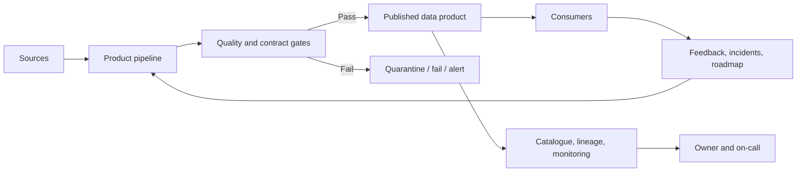

# Data Products and SLAs

**Roadmap location:** Stage 2C — Data Engineering_3 / `08-Data-Platform-Architecture-and-Data-Products/`  
**Target file:** `03-data-products-and-slas.md`  
**Level:** Beginner → Advanced  
**Hands-on lab:** `experiments/03_data_products/`

> **Source and scope note:** The module roadmap is the controlling syllabus. Topic 03 requires data-product characteristics and output ports; a complete product specification; SLIs/SLOs/SLAs; contracts and ODCS/datacontract-cli awareness; versioning, quality gates, monitoring, incidents and error budgets; discoverability, onboarding, product management, usage/cost/value, tiering, YAML automation, and AI-oriented products. The implementation and e-commerce examples below are supplementary teaching material designed to make those requirements operational.

## 1. Learning objectives

By completing this lesson, you should be able to:

1. Decide when a dataset deserves to be operated as a data product.
2. Define a product specification that communicates purpose, ownership, schema, semantics, lineage, access, quality, support, lifecycle, and consumer commitments.
3. Define measurable SLIs, set SLOs from consumer needs, and distinguish objectives from contractual SLAs.
4. Measure freshness, completeness, validity, accuracy, availability, latency, and schema stability without confusing different dimensions.
5. Design data contracts, quality gates, versioning, compatibility rules, deprecation windows, and incident workflows.
6. Use error budgets to make explicit reliability-versus-change trade-offs.
7. Manage discoverability, onboarding, consumer feedback, usage, cost, and retirement.
8. Explain how product specs can drive automation, and how data products support ML and AI workloads.
9. Run the educational `orders` product lab and interpret its results.

---

## 2. Prerequisites and terminology

### 2.1 Prerequisites

Helpful foundations include SQL, data pipelines, schemas, data quality, metadata/catalogues, access control, testing, and basic software versioning. The lab uses Python 3.10+, Pydantic 2, PyYAML, and pytest.

### 2.2 Dataset, pipeline output, and data product

- **Dataset:** a collection of records, such as a table of orders. It may have no explicit owner, consumer promise, or lifecycle.
- **Pipeline output:** data produced by a transformation or job. It might be an intermediate staging table that exists only to support another model.
- **Data product:** a deliberately maintained data capability with identified consumers, an accountable owner, clear semantics, an interface, quality and service expectations, access rules, documentation, support, and a lifecycle.

Not every table should become a product. A temporary intermediate table can be an implementation detail. A table used by Finance to close the books or by a service to make a customer decision deserves explicit ownership and reliability commitments.

### 2.3 Essential terms

| Term | Definition |
|---|---|
| **Consumer** | A person, team, application, dashboard, model, or service that relies on a product. |
| **Output port** | A supported interface through which consumers access a product: table, file, API, stream, or metric endpoint. |
| **Data contract** | A machine-readable or documented agreement about structure, meaning, quality, service levels, access, and change handling. |
| **SLI** | Service Level Indicator: a measured signal of service behavior. |
| **SLO** | Service Level Objective: a target for an SLI over a defined window. |
| **SLA** | Service Level Agreement: a formal or customer-facing commitment, potentially including remedies, escalation, or contractual consequences. |
| **Error budget** | The permitted amount of SLO failure over a measurement window. |
| **Freshness** | How recent the data available to consumers is, defined using explicit event/ingestion/publication timestamps. |
| **Completeness** | Whether the expected records, fields, partitions, or entities arrived. The denominator must be defined. |
| **Accuracy** | Agreement with the real-world truth or an authoritative source; often difficult to measure automatically without an oracle. |
| **Validity** | Conformance to defined types, formats, ranges, and business constraints. |
| **Availability** | Whether the product's supported interface is usable when required. It is not the same as freshness. |
| **Latency** | Time taken for an event or input to become available through the product. The start and end points must be stated. |
| **Schema stability** | The extent to which the published interface remains compatible with consumer expectations. |
| **SLO window** | The time interval over which compliance is evaluated, such as a rolling 30-day window. |
| **Error-rate burn multiple** | Observed failure rate divided by the allowed failure rate. A value of 10× means the current observed rate is ten times the allowed rate; it is not the same as percent of budget consumed. |

### 2.4 A single mental model



A product is not finished when the job writes a table. It is finished when a consumer can discover it, understand it, access it appropriately, use it safely, and get a predictable response when it fails or changes.

---

## 3. Data products and consumer value

### 3.1 Begin with the consumer's decision

A product exists to support a consumer task. Start by asking:
- Who uses it, and what decision or workflow does it support?
- What does a row represent?
- What are the business definitions and non-goals?
- How stale can the data be before the use case is harmed?
- Which errors are tolerable, and which are dangerous?
- What access and retention rules apply?
- How will consumers learn about defects or breaking changes?
- What is the fallback if the product is unavailable or late?

Do not choose a 99.99% target because it sounds professional. A daily executive report might be valuable with a 06:00 delivery objective, while a fraud-detection feature stream may need seconds-level latency. Stronger targets require additional compute, redundancy, monitoring, support coverage, and testing.

### 3.2 Good versus poorly defined products

| Poorly defined output | Why it is weak | Product-oriented version |
|---|---|---|
| `table_17` | No meaning, owner, or supported use | `orders` with purpose, owner, schema, keys, quality rules, freshness objective, and support route |
| “Updated frequently” | No measurable freshness definition | “At least 99% of hourly probes over a rolling 30 days observe latest event age ≤15 minutes” |
| “High quality” | No test or threshold | “At least 99% of observations have row count ≥99.5% of the expected upstream manifest; no null or duplicate order IDs in accepted snapshots” |
| “Schema should not change” | Unrealistic and no process for evolution | Additive changes follow compatibility policy; breaking changes use a new major version, notice period, migration guide, and sunset date |
| “Ask the data team” | No owner or escalation path | Named business/technical owners, support channel, severity levels, and response expectations |

## 4. Product characteristics and output ports

A mature data product should be:

- **Discoverable:** searchable in a catalogue or registry, with meaningful tags and owner information.
- **Addressable:** available through a stable logical name or documented endpoint, not an undocumented path known only to one engineer.
- **Trustworthy:** has measurable quality rules, monitoring, lineage, and a process for corrections.
- **Self-describing:** schema, semantics, units, keys, null meaning, examples, freshness, and limitations are documented.
- **Interoperable:** uses understandable identifiers, types, units, timestamps, and shared definitions where appropriate.
- **Secure:** classification, least-privilege access, retention, audit, and approved usage are enforced.
- **Owned:** business and technical accountability are explicit.
- **Consumer-oriented:** known consumers and supported use cases influence product design.
- **Operable:** has a support route, runbook, incident response, change process, and lifecycle status.

These characteristics are related but not interchangeable. A catalogue entry improves discovery but does not prove quality. A schema is self-description but does not tell a consumer whether the data is fresh. An access policy can secure a table without making its semantics clear.

### 4.1 Output ports

| Output port | Example | Important contract details |
|---|---|---|
| Table or view | `lakehouse.analytics.orders` | Schema, keys, partitioning expectations, freshness, access, query cost |
| File collection | Daily Parquet exports | Path/partition layout, encoding, manifest, checksum, delivery time, retention |
| API | Customer profile API | Request/response schema, latency, availability, rate limits, auth, error semantics |
| Stream | Order lifecycle events | Event schema, keying, ordering guarantees, delivery semantics, retention, late events |
| Metric endpoint / semantic layer | `net_revenue` metric | Formula, grain, dimensions, time zone, filters, ownership, refresh and correction policy |

A product may expose multiple ports, but they should share a coherent meaning and clearly document differences. An API and a table named `customer_360` are not equivalent if they differ in freshness, filtering, or semantics.

---

## 5. Data-product specification design

### 5.1 Product specification checklist

A practical specification should describe:

1. **Identity:** name, stable ID, version, lifecycle status, description.
2. **Purpose:** business decision supported, supported use cases, non-goals, known limitations.
3. **Ownership:** accountable business owner, technical owner, support channel, escalation path, incident hours.
4. **Consumers:** current consumers, intended consumers, onboarding route, access process.
5. **Output port:** type, logical address, format, and environment.
6. **Schema:** field names, data types, nullability, keys, units, sample records, semantic definitions.
7. **Lineage:** upstream sources, transformations, dependencies, and correction path.
8. **Quality:** validity, uniqueness, nullability, referential integrity, reconciliation, and completeness rules.
9. **Service levels:** SLIs, targets, windows, measurement method, exclusions, and alert policy.
10. **Security:** classification, roles, restricted fields, purpose limitations, retention/deletion.
11. **Contract/change policy:** compatibility rules, versioning, deprecation notice, sunset, and consumer notification.
12. **Documentation:** catalogue entry, sample queries, changelog, known issues, runbook.
13. **Usage and economics:** consumers, usage measures, cost attribution, product value and health.
14. **Lifecycle:** draft, active, deprecated, retired; exit criteria for each transition.

### 5.2 Example `orders` product summary

The lab's `specs/orders.yaml` is a custom educational specification validated with Pydantic. It defines:
- Product name `orders`, version `1.2.0`, and active status.
- Owner, technical on-call, support channel, escalation route, and three consumers.
- A table output port at `lakehouse.analytics.orders`.
- Fields including `order_id`, `customer_id`, `ordered_at`, `order_status`, `currency`, and `order_total`.
- Upstream dependencies and transformation description.
- Internal classification, 400-day illustrative retention, default-deny access, and roles.
- Freshness and completeness SLOs, basic key-quality rules, and a schema compatibility policy.

The 400-day retention and SLO values are fictional product decisions for the exercise, not legal advice or industry benchmarks.

### 5.3 Example `customer_360` product and SLO rationale

The included `specs/customer_360.yaml` is a worked design example. It provides a governed customer profile for support and customer analytics, with consent-aware use restrictions.

| Consumer | Example need | Proposed commitment | Trade-off |
|---|---|---|---|
| Customer support | Recent profile and preferences during a live interaction | Freshness: 99% of hourly probes show latest event age ≤60 minutes | Hourly checks and correction monitoring are less expensive than sub-minute streaming |
| Customer analytics | Reliable segmentation and reporting | Completeness: at least 99% of observations meet a 99% expected-row ratio threshold | Daily or hourly reconciliation may be enough; denominator quality matters |
| Personalization service | Current consent-aware fields for online decisions | If this consumer truly requires low-latency serving, publish a separate API/feature product with its own latency and availability SLO | Lower latency needs separate serving infrastructure, stricter on-call, and explicit consent propagation |

The table illustrates an important design decision: one logical business concept does not require one universal service level. A batch table can serve analytics while a separately operated API or feature product serves a latency-sensitive application. Do not claim that the `customer_360` table in this lab provides online low-latency guarantees; the API/feature port would need its own contract.

### 5.4 YAML as an automation input

Machine-readable specs can drive:
- Catalogue registration and owner metadata.
- Provisioning templates and standard deployment workflows.
- CI checks for required fields, schema compatibility, and quality tests.
- Access policy generation or review.
- Monitoring configuration and alert routing.
- Documentation pages, sample query pages, and changelogs.

A spec does not magically enforce a policy. The automation must be implemented and tested at the systems that provision resources, authorize access, validate data, and route alerts. The lab validates metadata and local fixtures; it does not provision real infrastructure.

### 5.5 ODCS and custom specifications

The **Open Data Contract Standard (ODCS)** is a vendor-neutral YAML contract format maintained by the Bitol project. It defines fields for fundamentals, schemas, quality, stakeholders, support channels, service-level agreements, and infrastructure/server information. `datacontract-cli` can lint contracts, compare changes, detect breaking changes, test configured sources, and export contracts to other formats.

The lab uses a deliberately small **custom teaching schema** so Pydantic validation and SLO logic are visible. It is **not claimed to be ODCS-compliant**. For interoperable production contracts, adopt an ODCS version and validate with ODCS-compatible tooling rather than inventing fields and assuming another tool will understand them.

---

## 6. SLIs, SLOs, and SLAs

### 6.1 The distinction

**SLI — Service Level Indicator**  
A measured quantity. Example: the proportion of hourly probes where the latest event is no more than 15 minutes old.

**SLO — Service Level Objective**  
A target for the indicator over a defined window. Example: freshness SLI passes in at least 99% of hourly probes in a rolling 30-day window.

**SLA — Service Level Agreement**  
A formal or consumer-facing agreement. It may specify support response, reporting, escalation, credits, penalties, or other remedies. An SLA should be built from measurable indicators and objectives, but not every internal SLO is a contractual SLA.

An SLO is not meaningful unless the measurement method, target, window, and failure treatment are explicit.

### 6.2 Common data-product SLIs

| SLI | Example definition | Common pitfall |
|---|---|---|
| Freshness | Age of latest eligible event at observation time, measured as `observation_time - latest_event_time` | Measuring job completion time instead of data recency; ignoring late events |
| Delivery latency | Percent of source events published within a specified duration from source commit to consumer availability | Undefined start/end timestamps and clock skew |
| Completeness | `actual eligible rows / expected eligible rows × 100`, where expected count comes from an upstream manifest or control total | Using yesterday's row count as today's denominator when volume changed |
| Validity | Percent of records passing defined type, range, format, and business-rule checks | Treating syntactic validity as business correctness |
| Accuracy | Percent agreeing with a trusted reference or independently verified sample | No authoritative reference exists, so “accuracy” becomes an unsupported claim |
| Availability | Successful valid reads or deliveries divided by attempted eligible requests/probes | Counting a reachable endpoint as available when it returns stale/invalid data |
| Schema stability | Number/proportion of releases that preserve compatibility; count of unannounced breaking changes | Assuming additive fields are always safe for every consumer |
| Uniqueness | Duplicate key count or duplicate rate at a defined grain | Not defining the key or grain |
| Reconciliation | Difference between product totals and an authoritative control total within tolerance | Tolerance and timing are unspecified |

Freshness, completeness, and accuracy are different. A product can be fresh but incomplete, complete but stale, or structurally valid but inaccurate. Report them separately before producing an overall health score.

### 6.3 Set targets from consumer needs

Use this process:

1. **Identify the consumer decision.** What breaks if the product is late or wrong?
2. **Measure current behavior.** Establish baseline freshness, failure rate, volume variation, incidents, and correction lag.
3. **Define failure semantics.** Is the product considered failed when a probe is late, when the dataset is empty, or when one critical quality rule fails?
4. **Choose an achievable target.** Balance business impact, architecture capability, operational capacity, and cost.
5. **Define the measurement window and exclusions.** Include scheduled maintenance or upstream dependency exclusions only when agreed and observable.
6. **Set alerting and response policy.** An SLO without an owner or response path is just documentation.
7. **Review with consumers.** Confirm that the target supports their workflow and that they understand what is not guaranteed.

Avoid arbitrary targets like “99.99% accuracy.” Accuracy usually needs a reference truth and sampling method; percentages without those definitions create false confidence.

### 6.4 Example SLO definitions

**Orders freshness SLO**
- SLI: each hourly probe checks the age of the latest eligible order event visible through the published product.
- Passing probe: age ≤15 minutes.
- Target: at least 99% passing probes in a rolling 30-day window.
- Expected probes: 30 × 24 = 720, assuming one probe per hour and no missing scheduled probes.
- Error budget: 1% × 720 = 7.2 failed probes. Because actual failures are integer counts, eight failed probes exceed the budget; seven do not.
- **Monitoring trade-off:** an hourly probe can miss short-lived failures and may detect a 15-minute freshness breach late. This hourly cadence is retained to keep the fixture simple; for actionable production alerting on a 15-minute threshold, use a substantially shorter probe interval (for example, five minutes) and align alerting with the consumer's recovery needs.
- Exclusions: only documented, approved exclusions that are consistently recorded. Do not retroactively remove failures just to improve the score.

**Orders completeness SLO**
- SLI: each hourly evaluation checks `actual_rows / expected_rows × 100`.
- Passing observation: ratio ≥99.5%.
- Target: at least 99% passing observations over a rolling 30-day window, with one hourly observation.
- The expected count must come from a reliable manifest, source control total, or a documented alternative. If the denominator is untrustworthy, the completeness SLI is untrustworthy.

**Important:** the single-snapshot result in the lab shows whether that observation passes. It does not by itself prove the rolling 30-day SLO. The history fixture is used separately for the window-level calculation.

### 6.5 Measurement windows and missing probes

Define how missing measurements are treated. If the monitoring system fails to collect a scheduled probe, treating it as “unknown” may hide service failure; treating it as failed may penalize a monitoring outage. A production policy should distinguish:
- Product failure.
- Monitoring-system failure.
- Approved maintenance/exclusion.
- Missing or invalid source denominator.

The educational lab assumes every listed probe is an eligible probe and has a boolean pass/fail outcome. It does not implement a production-grade probe scheduler or exclusion system. The ten-row fixture covers only ten observations against a configured 720-probe/30-day window (1.389% of the expected probes). The reported budget consumption is therefore provisional for the recorded failures; the code does not automatically count missing probes as failures. Production monitoring must define how missed probes, monitoring outages, and approved exclusions affect both the SLI and budget.

### 6.6 SLA language must be precise

An SLA might specify:
- The supported product and contract version.
- Consumer eligibility and access conditions.
- SLI definition, SLO target, and measurement window.
- Support coverage and incident acknowledgement target.
- Exclusions, reporting, escalation, and remedy if applicable.
- Producer and consumer obligations.
- Change notice, deprecation, and data correction process.

Do not write “99% available” without defining the denominator and measurement method. Do not promise “accurate data” without a definition and evidence method. Avoid legal or financial remedies unless reviewed by the appropriate business/legal stakeholders.

---

## 7. Data contracts and quality gates

### 7.1 What belongs in a contract?

A data contract should communicate:
- Identity and version.
- Schema, data types, keys, nullability, and semantics.
- Quality rules and expectations.
- Service-level definitions and targets.
- Owner and support channel.
- Access and classification expectations.
- Source/consumer interface details.
- Compatibility and change process.
- Lifecycle and deprecation rules.

The contract is a boundary agreement. It should make producer obligations and consumer assumptions explicit. It cannot guarantee correctness merely by existing.

### 7.2 Quality gates

Use several layers of checks:

1. **Specification validation:** required metadata, allowed field types, valid target ranges, named owners.
2. **Schema validation:** field names/types/nullability/key constraints match the published contract.
3. **Record-level checks:** nulls, duplicates, value ranges, accepted enumerations, referential integrity.
4. **Dataset-level checks:** completeness, freshness, volume anomalies, reconciliation, partition coverage.
5. **Compatibility checks:** schema changes do not silently break consumers.
6. **Operational checks:** pipeline completion, expected delivery, lineage capture, alert route, access controls.
7. **Release gates:** fail, quarantine, or require an explicit exception when a critical rule fails.

Not all failures should have identical behavior. A critical privacy violation should block publication or access; a minor non-critical distribution anomaly may warn and trigger investigation. Define severity and action per rule.

### 7.3 ODCS and `datacontract-cli`

Use ODCS when interoperability across teams/tools matters. At awareness level, know that `datacontract-cli` supports commands such as:
- `datacontract lint contract.yaml`
- `datacontract breaking old.yaml new.yaml`
- `datacontract changelog old.yaml new.yaml`
- `datacontract test contract.yaml`
- export of contracts to formats such as SQL or HTML.

Exact syntax and supported integrations depend on the installed CLI version and contract version; consult the official documentation before production adoption. The educational lab's custom YAML is validated with Pydantic and should not be passed to ODCS tooling as though it were an ODCS contract.

---

## 8. Versioning and deprecation

### 8.1 Schema changes are consumer changes

A schema is a public interface. A change that appears simple to a producer can break SQL queries, dashboards, feature pipelines, API clients, and scheduled jobs.

A useful default semantic versioning policy:
- **Patch:** documentation or implementation correction that does not change the contract semantics or interface.
- **Minor:** backward-compatible additive capability, subject to consumer compatibility rules.
- **Major:** incompatible schema or semantic change, such as removing/renaming a field or changing its meaning.

Semantic versioning is a policy convention, not a guarantee that all additions are backward compatible. Adding a non-null field without a default may break some consumers; changing units or the meaning of a field can be breaking even if the data type is unchanged.

### 8.2 Breaking-change workflow

1. Propose change with business reason and impact analysis.
2. Compare old and proposed contract.
3. Use lineage, query logs, catalogue metadata, and consumer declarations to identify affected consumers.
4. Publish a migration guide and mapping.
5. Create a new major version or a compatible transition path.
6. Notify consumers with the deadline and support route.
7. Run both versions or provide a compatibility view during the migration window, if feasible.
8. Measure consumer migration and confirm no active critical dependencies remain.
9. Deprecate old version with a published sunset date.
10. Retire only after owner approval, evidence review, and consumer communication.

### 8.3 Lab lifecycle example

The lab starts with `orders` version `1.2.0`, whose field is `order_status`. The proposed `2.0.0` replaces it with `status_code` and adds `source_system`. The field removal/rename is breaking.

Illustrative timeline:
- **2026-10-19:** publish the v2 proposal and migration guide; notify known consumers.
- **2026-10-19 to 2027-01-17:** 90-day notice window; provide v1 and v2 in parallel if technically feasible; consumers migrate and validate results.
- **Before 2027-01-17:** review usage logs, obtain consumer acknowledgements, and resolve exceptions.
- **2027-01-17:** retire v1 only if the retirement criteria are met. If critical consumers have not migrated, explicitly extend the date or accept a documented risk; do not silently break them.

A 90-day window is a teaching assumption. Regulated, external, or highly coupled products may need longer notice.

### 8.4 Consumer notification

The lab writes a JSON file to `reports/notification_outbox.json`. This is a **mock notification mechanism**: no email, Slack, or API message is sent. In production, use an authenticated delivery service, retry policy, delivery receipt, audit log, and escalation for undelivered notifications.

---

## 9. Monitoring, incidents, and error budgets

### 9.1 Monitoring dimensions

Monitor:
- SLI results and rolling SLO compliance.
- Freshness lag and late-data distribution.
- Completeness versus expected manifests/control totals.
- Invalid, null, duplicate, and rejected rows.
- Pipeline duration and failures.
- Schema/contract changes.
- Access denials and policy violations.
- Consumer-facing incident count, acknowledgement time, and resolution time.
- Usage, query cost, and product adoption.

Dashboards should distinguish current observation, rolling-window compliance, and trend. A product can pass its latest check while still failing its rolling SLO due to earlier incidents.

### 9.2 Error budget calculation

For an SLO target \(T\), allowed failure fraction is:

\[
B = 1 - T
\]

For \(N\) eligible observations, allowed failed observations are:

\[
E_{\text{allowed}} = N \times B
\]

Cumulative budget consumed is:

\[
\text{Budget consumed \%} =
\frac{\text{Observed failures}}{E_{\text{allowed}}} \times 100
\]

The observed error-rate burn multiple is:

\[
\text{Burn multiple} =
\frac{\text{Observed failure fraction}}{\text{Allowed failure fraction}}
\]

These answer different questions:
- **Budget consumed** tells how much of the total window's allowed failure budget has been used.
- **Burn multiple** compares the current sample's failure rate with the allowed rate. It needs a defined sample/time window and should not be confused with cumulative budget consumption.

**Lab example:** target is 99% successful hourly freshness probes in 30 days. \(N=720\); allowed failures \(=720 \times 0.01=7.2\). The sample history has 1 failure in 10 probes. Budget consumed \(=1/7.2 \times 100=13.889\%\). The observed sample failure rate is 10%, so its burn multiple is \(10\%/1\%=10\times\). The fixture covers only 10 of the 720 expected probes (1.389%); the result is provisional consumption for recorded failures, not a full-window assessment. Missing probes are not automatically counted as failures by this lab, so production policy must define their treatment.

### 9.3 What should happen when the budget burns?

A sensible policy could be:
- **Low consumption:** continue normal delivery and monitor.
- **Rapid burn:** page the owning team, investigate upstream dependencies, and assess consumer impact.
- **Budget exhausted:** pause risky non-essential changes until reliability is restored, unless a documented business exception is approved.
- **Repeated budget exhaustion:** revisit architecture, target feasibility, source quality, staffing, or product tier.

An error budget is a decision mechanism, not just a chart. It helps balance new features and reliability work. It should not be used to punish a team for failures it has no authority to fix.

### 9.4 Incident responsibilities

A product runbook should define:
- Severity and consumer impact.
- Who acknowledges and owns triage.
- Where alerts route.
- How to isolate source, transformation, platform, and consumer failures.
- Whether to block, quarantine, mark stale, or publish with a warning.
- How to correct/backfill data and identify affected downstream assets.
- How to communicate status, workarounds, and resolution.
- How to perform post-incident review and prevent recurrence.

The producer owns product-level triage and communication; platform owners handle platform-side incidents; consumers own their downstream recovery while the producer communicates material defects and corrections.

---

## 10. Discovery, onboarding, and product management

### 10.1 Catalogue and documentation

A catalogue entry should provide:
- Name, purpose, owner, domain, consumers, and support route.
- Schema, business definitions, examples, and sample queries.
- Source lineage and transformation summary.
- Freshness/quality indicators and current status.
- Classification, access request instructions, and retention.
- Contract and version history.
- Known limitations, deprecation notices, and incident links.
- Usage information where permitted.

Searchability without trustworthy metadata creates false discoverability. Automate registration where possible, but keep business semantics and known limitations reviewed by the owner.

### 10.2 Consumer onboarding guide

A useful onboarding path:
1. Find the product and confirm it supports the intended use.
2. Read purpose, non-goals, schema, key semantics, quality/SLOs, and known limitations.
3. Request least-privilege access.
4. Review example query/client and validate results against a known sample.
5. Subscribe to release and incident notifications.
6. Understand compatibility policy, support hours, and correction behavior.
7. Record the consuming job/application if dependency tracking is required.

A complete sample guide is included in `experiments/03_data_products/CONSUMER_ONBOARDING.md`.

### 10.3 Product management

Data product management is ongoing:
- Interview consumers and observe how they use the product.
- Maintain a roadmap based on value, reliability, and consumer friction.
- Prioritize quality defects and contract improvements alongside features.
- Track adoption, repeat usage, consumer satisfaction, incidents, and cost.
- Review unused or redundant products.
- Communicate roadmap, changes, and deprecations.

A product owner should not optimize only for new features. Maintenance, documentation, incident prevention, and migration support are part of product work.

### 10.4 Gold / silver / bronze service tiers

Tier names are not standards. Define their actual differences.

| Dimension | Bronze (exploratory) | Silver (team-critical) | Gold (business-critical) |
|---|---|---|---|
| Typical use | Ad hoc analysis, discovery | Recurring team reporting | Financial close, operational or customer-facing critical workflows |
| Freshness | Best effort or agreed batch schedule | Measured objective tied to workflow | Tighter objective where justified by business impact |
| Quality | Basic schema and validity checks | Completeness/reconciliation and alerting | Strong controls, reconciliation, incident drills, and evidence |
| Support | Community/best-effort channel | Named owner and business-hours response | Explicit on-call and severity response targets |
| Change policy | Notice where practical | Contracted compatibility and notice | Consumer impact review, migration path, controlled release |
| Cost | Lowest operational overhead | Moderate monitoring and support | Highest monitoring, redundancy, testing, and staffing cost |

A gold label is meaningless without a written SLO and an owner. Tiers should be chosen from risk and consumer need, not used as a marketing badge.

---

## 11. Usage, cost, and product health

### 11.1 Usage and value

Track product usage at an appropriate grain:
- Active consumers and repeat consumers.
- Queries, API requests, downstream jobs, or stream subscriptions.
- Business outcomes enabled, where measurable.
- Onboarding time and consumer-reported friction.
- Quality/SLO performance and incident trends.
- Compute, storage, transfer, and support cost.

Do not assume high query count equals high value. A heavily queried product may be expensive because consumers cannot find a better interface; a rarely used product may be essential during monthly close or regulatory reporting.

### 11.2 Chargeback and showback

- **Showback:** report costs to teams to increase transparency without directly charging budgets.
- **Chargeback:** allocate or bill costs to a team or product according to an agreed model.

Cost allocation may use compute time, storage, query attribution, data transfer, or a shared allocation rule. Document shared-cost treatment and avoid false precision where the platform cannot attribute costs accurately.

### 11.3 Example product health score

A score can summarize health, but it must not hide critical failures. Example weights:
- Reliability/SLO attainment: 30%.
- Quality and contract compliance: 25%.
- Consumer adoption and satisfaction: 20%.
- Documentation/discoverability: 10%.
- Cost/value trend: 15%.

Use it as a review aid, not a universal truth. A product with a high average score but a critical privacy breach is not healthy. Apply hard gates for critical security, legal, or data-integrity failures.

### 11.4 Retiring unused products

Before retirement:
1. Confirm usage from query/API/job logs over a window appropriate to the business cycle.
2. Identify downstream dependencies using lineage and owner declarations.
3. Ask product consumers and owners to validate that usage is genuinely obsolete.
4. Publish deprecation and sunset notice.
5. Provide replacement or export path where needed.
6. Preserve legally required evidence and records.
7. Revoke access, stop compute, delete data according to policy, and update catalogue status.
8. Record the retirement decision and verify no unexpected critical dependencies remain.

Do not retire based only on a 30-day query count if the product is used quarterly, annually, or for emergency response.

---

## 12. AI-oriented data products

The same product principles apply to AI data assets, but the contracts must include additional semantics.

### 12.1 Feature products

A feature product may publish features for training and online inference. Document:
- Entity key and feature definitions.
- Event-time and point-in-time correctness rules.
- Freshness, availability, and null/default behavior.
- Training/serving consistency and feature version.
- Leakage risks and permitted use.
- Lineage from source data and transformation code.
- Access and retention.

A feature table that is fresh but uses future information during training is not trustworthy for model evaluation.

### 12.2 Embedding products

An embedding product may include:
- Source document identity and version.
- Text extraction and chunking rules.
- Embedding model/version and vector dimension.
- Metadata and source lineage.
- Refresh/re-embedding policy.
- Access, deletion propagation, and retention.
- Evaluation signals for retrieval quality.

When source documents change or are deleted, the product needs an explicit re-indexing/deletion process. A vector store alone does not provide the source-of-truth or governance lifecycle.

### 12.3 Governed context / RAG products

A retrieval/context product for an LLM should specify:
- Approved source collections and user permissions.
- Provenance/citations and document version.
- Retrieval freshness and indexing lag.
- Tenant boundaries and access filtering.
- Deletion propagation and audit.
- Known coverage gaps and evaluation methods.
- Incident handling for stale, missing, or unauthorized context.

The data product team may own governed retrieval inputs and quality signals without owning the model itself. Data engineers support the pipeline, lineage, access, evaluation datasets, and reproducibility.

---

## 13. Hands-on implementation

### 13.1 What the lab implements

The project is in `experiments/03_data_products/`. It includes:
- `specs/orders.yaml`: the primary machine-readable product specification.
- `specs/customer_360.yaml`: the worked customer profile example.
- `product_lab.py`: Pydantic validation, snapshot SLI checks, rolling-window sample error-budget calculations, schema comparison, and mock notification.
- `data/`: deterministic JSON fixtures for snapshot, probe history, consumers, and schema versions.
- `tests/`: automated tests.
- `CONSUMER_ONBOARDING.md`: example onboarding guide.
- `reports/`: generated report and local notification outbox.

The lab is intentionally local and dependency-light. It does not connect to a warehouse, send real notifications, or register with a live catalogue.

### 13.2 Setup

Python 3.10+ is required. From the lab directory:

```bash
cd experiments/03_data_products
python -m venv .venv

# macOS/Linux
source .venv/bin/activate

# Windows PowerShell
# .venv\Scripts\Activate.ps1

python -m pip install -e ".[test]"
```

Run the demonstration and tests:

```bash
python product_lab.py
pytest -q
```

The CLI uses a fixed `--now` timestamp for reproducibility. To test a different observation time:

```bash
python product_lab.py --now 2026-10-19T10:00:00Z
```

### 13.3 Sample snapshot

`data/orders_snapshot.json` includes:
- Observation time `2026-10-19T09:00:00Z`.
- Latest event time `2026-10-19T08:52:00Z`.
- Expected rows `1000`.
- Actual rows `997`.
- Zero duplicate/null order IDs.

At the fixed observation time, event age is 8 minutes, which passes the 15-minute freshness threshold. Completeness is \(997/1000 \times 100=99.7\%\), which passes the 99.5% observation threshold. The basic key-quality checks pass.

### 13.4 Sample SLO history and budget

The fixture contains 10 hourly probes, one freshness failure, and no completeness failures. The configured SLO window is 30 days with hourly probes, so the theoretical full-window probe count is 720. With a 99% target, the allowed failed probes are 7.2. One recorded failure consumes \(1/7.2 \times 100 = 13.889\%\) of the theoretical full-window budget. The fixture contains only 10 of 720 expected probes (1.389% coverage), so this is **provisional cumulative consumption for recorded failures**, not a complete 30-day SLO assessment. Since the sample failure rate is 10%, and the allowed failure rate is 1%, the sample's error-rate burn multiple is 10×.

This is a cumulative budget calculation using a short fixture, not a production multi-window alerting algorithm. Missing probes are not automatically counted as failures. A production implementation should define missing-probe policy, evaluate rolling windows continuously, and use time-normalized multi-window burn alerts to detect rapid failures.

### 13.5 Schema change and notification

The comparison fixture removes `order_status` and adds `status_code` plus `source_system`. The lab flags it as breaking because `order_status` disappeared. Its schema comparator checks field presence and field metadata (type/nullability/key), and verifies that a breaking change increases the major version. It recommends a parallel major version, migration path, consumer notification, and retirement after the 90-day notice period. This remains a teaching comparator: it cannot detect semantic changes that are not represented in the schema metadata, so human contract review is still required.

The notification writes `reports/notification_outbox.json` and explicitly records `"sent": false`. It is a mock outbox, not an actual email or chat message.

### 13.6 Catalogue registration

No live DataHub/OpenMetadata service or credentials are configured in this environment, so catalogue registration is **not attempted**. The product spec includes catalogue metadata and a URL placeholder for teaching purposes. Production integration should use the chosen catalogue's supported API/SDK, authenticate securely, map the spec to that catalogue's entity model, make the operation idempotent, and test the published owner/schema/lineage/tags.

---

## 14. Tests and expected results

The project includes eighteen tests covering:
- Valid `orders` spec.
- Rejection of `restricted` products with default-allow access.
- Freshness and completeness snapshot checks.
- Failure when the snapshot is stale.
- Freshness error-budget calculation.
- Completeness error-budget calculation.
- Detection of a removed field in a schema change.
- Local mock notification output.
- Rejection of timestamps without a time zone.
- Failure when the latest event timestamp is after the snapshot observation time.
- Exact freshness-threshold boundary behavior.
- Rejection of negative row counts.
- Rejection of probes outside the declared history window.
- JSON-safe behavior for a 100% target with zero allowed failures.
- Exact completeness-threshold boundary behavior.
- Detection of a field-type change as a breaking schema change.
- Rejection of a naive evaluation timestamp.
- Rejection of a breaking schema change without a major-version bump.

**Verified local run:** `python product_lab.py` exited successfully; `pytest -q` reported **18 passed** in the available Python environment. These results apply to the included deterministic fixtures and local code, not to a production warehouse, external catalogue, or notification service.

Representative report values:

```json
{
  "product": "orders",
  "version": "1.2.0",
  "spec_validation": "passed",
  "snapshot_evaluation": {
    "latest_event_age_minutes": 8.0,
    "freshness_sli_pass": true,
    "expected_rows": 1000,
    "actual_rows": 997,
    "completeness_percent": 99.7,
    "completeness_sli_pass": true,
    "quality_sli_pass": true,
    "overall_pass": true
  },
  "freshness_error_budget": {
    "probes_observed": 10,
    "sli_failures_observed": 1,
    "observed_failure_percent": 10.0,
    "expected_probes_per_slo_window": 720,
    "observed_probe_coverage_percent": 1.389,
    "allowed_failed_probes_per_slo_window": 7.2,
    "budget_consumed_percent": 13.889,
    "error_rate_burn_multiple": 10.0
  },
  "schema_change": {
    "old_version": "1.2.0",
    "new_version": "2.0.0",
    "removed_fields": ["order_status"],
    "added_fields": ["source_system", "status_code"],
    "changed_fields": [],
    "breaking": true,
    "versioning_policy_pass": true
  },
  "consumer_notification": {
    "mechanism": "local-json-outbox",
    "sent": false,
    "recipient_count": 3
  },
  "catalogue_registration": {
    "status": "not_attempted"
  }
}
```

**Why no test proves the product is production-ready:** the tests validate the educational spec and deterministic logic. They do not prove source data accuracy, IAM enforcement, actual delivery latency, catalogue integration, consumer migration, or operational readiness.

---

## 15. Common mistakes and misconceptions

1. **Calling every table a product.** Intermediate artifacts do not necessarily need consumer-facing support and SLOs.
2. **Writing vague promises.** “Fresh,” “accurate,” and “available” need measurable definitions and denominators.
3. **Confusing SLI, SLO, and SLA.** Measurement, internal objective, and formal agreement are different things.
4. **Setting targets arbitrarily.** Derive targets from consumer decisions, risk, baseline, and operational cost.
5. **Using the wrong completeness denominator.** Expected volume should come from a defensible source, manifest, or control total.
6. **Equating validity with accuracy.** A value can fit a schema and still be wrong.
7. **Measuring job uptime instead of product service.** A successful pipeline can publish stale or incomplete data.
8. **Ignoring missing probes.** Unmeasured periods need explicit treatment.
9. **Confusing budget consumption and burn rate.** Percent of total budget spent differs from the observed error rate relative to the allowed rate.
10. **Treating contracts as enforcement.** Contracts need CI/runtime checks and incident response.
11. **Breaking schemas without consumer impact analysis.** Use contracts, lineage, usage evidence, migration guides, and notice.
12. **Assuming additive changes are always safe.** Consumers may use strict schemas or positional reads; semantics can change without types changing.
13. **Using one SLO for every consumer.** Different latency and criticality requirements may justify separate ports or products.
14. **Treating a catalogue as proof of quality.** A catalogue helps discovery; monitoring and ownership establish trust.
15. **Sending notifications without tracking delivery.** Production communications need retries, receipts, and escalation.
16. **Retiring based on a short usage window.** Account for quarterly, annual, and emergency use.
17. **Treating a health score as the truth.** Critical privacy, security, or integrity failures need hard gates.
18. **Claiming a local mock is a live integration.** Label local fixtures, outboxes, and unattempted catalogue registration honestly.

---

## 16. Practice questions with answers

### Q1. What makes a dataset a data product?
**Answer:** Known consumers and purpose, accountable owner, stable interface, explicit schema/semantics, measurable quality/service expectations, access controls, documentation, support, and lifecycle.

### Q2. How does a pipeline output differ from a product?
**Answer:** A pipeline output is the result of computation. A product is operated as a consumer-facing capability with a contract, owner, reliability practices, and change/support lifecycle.

### Q3. What is an SLI?
**Answer:** A measured signal such as the proportion of hourly freshness probes meeting a threshold.

### Q4. What is an SLO?
**Answer:** A target for an SLI over a specified window, such as at least 99% of eligible hourly probes passing during a rolling 30-day window.

### Q5. How is an SLA different from an SLO?
**Answer:** An SLA is a formal or customer-facing agreement and may define obligations, escalation, and remedies. An SLO is an engineering objective; it may support an SLA but does not automatically create a contractual commitment.

### Q6. Why are freshness and completeness separate?
**Answer:** Fresh data can omit expected records; complete data can be stale. Their indicators need separate definitions and thresholds.

### Q7. How should completeness be calculated?
**Answer:** Define an expected population or count from a reliable manifest/control total, then compare actual eligible records to that denominator. The expected and actual populations must be comparable.

### Q8. What is an error budget?
**Answer:** The permitted amount of SLO failure in the measurement window, often calculated as the allowed failure fraction times the eligible observation count.

### Q9. In the lab, why is one failure in ten probes 10× burn but only 13.889% budget consumed?
**Answer:** The sample failure rate is 10% versus a 1% allowed rate, so it is 10× the allowed rate. The full 30-day budget allows 7.2 failures, so one recorded failure consumes 1/7.2 = 13.889% of the theoretical budget. The fixture covers only 1.389% of expected probes, so this is provisional and does not establish full-window SLO compliance; missing-probe treatment must be defined separately.

### Q10. Is the lab YAML ODCS?
**Answer:** No. It is a custom educational schema validated by Pydantic. ODCS is a separate interoperable standard; use ODCS-compatible tooling and the relevant schema version for real contracts.

### Q11. What makes a schema change breaking?
**Answer:** Removing/renaming a field, changing semantics, tightening nullability, changing type/units, or other changes that violate consumer assumptions. Impact depends on the published compatibility policy and actual consumer behavior.

### Q12. When should a product version be retired?
**Answer:** After the published notice window and migration path, once consumer dependencies and usage are reviewed, critical consumers have migrated or an explicit exception is approved, and access/retention actions are planned.

### Q13. Why should product owners monitor usage and cost?
**Answer:** Usage and cost help prioritize improvements, identify redundant products, support showback/chargeback, and make retirement decisions. Raw usage alone does not equal business value.

### Q14. How do data products support AI systems?
**Answer:** They provide governed, versioned feature datasets, embeddings, document/context collections, metadata, lineage, access, freshness, and deletion/reprocessing guarantees.

### Q15. What is the limitation of the lab's notification and catalogue functionality?
**Answer:** Notifications are written to a local JSON outbox and are not sent. Catalogue registration is not attempted because no live service or credentials are configured.

---

## 17. Completion checklist

- [ ] I can distinguish a dataset, pipeline output, and consumer-facing data product.
- [ ] I can define all required product-spec fields and explain why they matter.
- [ ] I can define measurable freshness, completeness, validity, accuracy, availability, latency, and schema-stability SLIs.
- [ ] I can state an SLO with threshold, denominator, measurement window, exclusions, and alert policy.
- [ ] I can distinguish SLI, SLO, and SLA.
- [ ] I can calculate allowed failures, cumulative error-budget consumption, and error-rate burn multiple without mixing them up.
- [ ] I can explain how ODCS and `datacontract-cli` fit into contract workflows.
- [ ] I can design quality gates, compatibility checks, versioning, migration, deprecation, and retirement.
- [ ] I can describe product discovery, onboarding, support, roadmap, usage, cost, and health measures.
- [ ] I can explain why a catalogue registration or notification mock is not the same as a live integration.
- [ ] I can run the `experiments/03_data_products/` demo and all tests.
- [ ] I can design a governed data product for a feature, embedding, or retrieval/context use case.

**Checkpoint:** You are ready to move on when you can draft a product spec for `customer_360`, defend its SLOs from consumer requirements, demonstrate how they are measured, and safely change and retire its contract.

---

## 18. Verified references and further reading

The roadmap defines the required scope; the following official documentation provides supplementary technical reference. Product behavior depends on version, configuration, edition, and integration.

- **Open Data Contract Standard (ODCS) — Bitol/Linux Foundation AI & Data:** https://github.com/bitol-io/open-data-contract-standard
- **Data Contract CLI — ODCS format and contract concepts:** https://docs.datacontract.com/open-data-contract-standard
- **Data Contract CLI — commands (`lint`, `breaking`, `changelog`, `test`, `export`):** https://docs.datacontract.com/commands
- **Data Contract CLI — official repository and usage examples:** https://github.com/datacontract/datacontract-cli
- **Pydantic v2 — models and validation:** https://pydantic.dev/docs/validation/latest/get-started/
- **OpenMetadata Python SDK:** https://github.com/open-metadata/openmetadata/tree/main/ingestion/src/metadata/sdk
- **OpenMetadata Python SDK documentation:** https://docs.open-metadata.org/v1.12.x/api-reference/sdk/python
- **DataHub lineage documentation:** https://docs.datahub.com/docs/features/feature-guides/lineage

**Reference distinction:** ODCS/datacontract-cli and Pydantic documentation support the format/tooling descriptions. The SLO definitions, error-budget math, product operating practices, and fictional targets are engineering explanations and examples in this lesson, not guarantees made by those projects.

---

# Appendix A — Complete lab source files

The following listings are generated from the lab files in `experiments/03_data_products/` after the audit. Keep the project files as the executable source of truth; regenerate these listings when the project changes.


## A.1 `pyproject.toml`


```toml
[project]
name = "data-products-sla-lab"
version = "0.1.0"
description = "Educational data-product contract and SLO lab"
requires-python = ">=3.10"
dependencies = [
  "pydantic>=2.7,<3",
  "PyYAML>=6.0,<7"
]

[project.optional-dependencies]
test = ["pytest>=8,<9"]

[tool.pytest.ini_options]
testpaths = ["tests"]
pythonpath = ["."]
```


## A.2 `specs/orders.yaml`


```yaml
product:
  name: orders
  version: "1.2.0"
  lifecycle_status: active
  description: "Curated order facts for analytics and operational reporting."
  purpose: "Provide one row per order with stable order status, timestamps, currency, and order amount semantics."
  non_goals:
    - "Does not represent recognized accounting revenue."
    - "Does not expose payment-card data or raw authentication secrets."
  owner:
    team: "commerce-data"
    business_owner: "orders-product-owner"
    technical_owner: "orders-data-oncall"
    support_channel: "#orders-data-support"
    escalation: "commerce-data-oncall@example.invalid"
  consumers:
    - "finance-analytics"
    - "customer-analytics"
    - "operations-reporting"
  output_port:
    type: "table"
    address: "lakehouse.analytics.orders"
    format: "parquet"
  schema:
    - name: order_id
      type: string
      nullable: false
      description: "Stable unique order identifier."
      key: primary
    - name: customer_id
      type: string
      nullable: false
      description: "Pseudonymous customer identifier."
    - name: ordered_at
      type: datetime
      nullable: false
      description: "UTC timestamp when the order was accepted."
    - name: order_status
      type: string
      nullable: false
      description: "accepted, cancelled, fulfilled, or refunded."
    - name: currency
      type: string
      nullable: false
      description: "ISO 4217 currency code."
    - name: order_total
      type: number
      nullable: false
      description: "Gross order amount in the stated currency, before finance recognition rules."
  lineage:
    sources:
      - "commerce.orders"
      - "commerce.order_lines"
    transformation: "Normalize order status; aggregate order lines; retain cancelled orders with explicit status."
  classification: internal
  retention_days: 400
  access:
    default: "deny"
    roles:
      - name: "orders-consumer"
        permissions: ["read"]
      - name: "orders-owner"
        permissions: ["read", "write", "admin"]
    restricted_fields: []
  slos:
    freshness:
      max_age_minutes: 15
      target_percent: 99.0
      window_days: 30
      probe_interval_minutes: 60
    completeness:
      min_expected_row_ratio_percent: 99.5
      target_percent: 99.0
      window_days: 30
      probe_interval_minutes: 60
    quality:
      max_duplicate_order_ids: 0
      max_null_order_ids: 0
  contract:
    compatibility_policy: "backward-compatible additive changes only within v1"
    deprecation_notice_days: 90
    support_hours: "business hours, 09:00-18:00 Asia/Kolkata; P1 data incidents acknowledged within 30 minutes"
  documentation:
    catalogue_url: "https://catalog.example.invalid/products/orders"
    sample_query: "SELECT order_status, COUNT(*) FROM lakehouse.analytics.orders GROUP BY order_status"
    changelog:
      - version: "1.2.0"
        date: "2026-10-01"
        change: "Documented explicit cancellation semantics; no schema change."
```


## A.3 `specs/customer_360.yaml`


```yaml
product:
  name: customer_360
  version: "2.1.0"
  lifecycle_status: active
  description: "Governed customer profile for support and customer analytics."
  purpose: "Provide a consent-aware, current view of customer identity links, lifecycle, preferences, and recent interactions."
  non_goals:
    - "Not a system of record for legal identity."
    - "Not approved for automated credit or eligibility decisions."
  owner:
    team: "customer-data"
    business_owner: "customer-product-owner"
    technical_owner: "customer-data-oncall"
    support_channel: "#customer-data-support"
    escalation: "customer-data-oncall@example.invalid"
  consumers:
    - "customer-support"
    - "customer-analytics"
    - "personalization-service"
  output_port:
    type: "table"
    address: "lakehouse.customer.customer_360"
    format: "delta"
  schema:
    - name: customer_key
      type: string
      nullable: false
      description: "Stable internal customer key."
      key: primary
    - name: profile_updated_at
      type: datetime
      nullable: false
      description: "UTC time of last profile update."
    - name: consent_status
      type: string
      nullable: false
      description: "Current permitted-use status."
    - name: lifetime_order_count
      type: integer
      nullable: false
      description: "Count of eligible orders under the documented order definition."
    - name: last_order_at
      type: datetime
      nullable: true
      description: "UTC time of latest eligible order."
  lineage:
    sources:
      - "orders"
      - "customer_preferences"
      - "support_interactions"
    transformation: "Resolve identity links under approved rules; apply consent filtering; aggregate eligible order and interaction facts."
  classification: confidential
  retention_days: 365
  access:
    default: "deny"
    roles:
      - name: "customer-support"
        permissions: ["read"]
      - name: "personalization-service"
        permissions: ["read:consented-fields"]
      - name: "customer-data-owner"
        permissions: ["read", "write", "admin"]
    restricted_fields: ["customer_key"]
  slos:
    freshness:
      max_age_minutes: 60
      target_percent: 99.0
      window_days: 30
      probe_interval_minutes: 60
    completeness:
      min_expected_row_ratio_percent: 99.0
      target_percent: 99.0
      window_days: 30
      probe_interval_minutes: 60
    quality:
      max_duplicate_order_ids: 0
      max_null_order_ids: 0
  contract:
    compatibility_policy: "backward-compatible additive changes only within v2"
    deprecation_notice_days: 120
    support_hours: "24x5; P1 privacy or profile corruption incident acknowledged within 15 minutes"
  documentation:
    catalogue_url: "https://catalog.example.invalid/products/customer_360"
    sample_query: "SELECT consent_status, COUNT(*) FROM lakehouse.customer.customer_360 GROUP BY consent_status"
    changelog:
      - version: "2.1.0"
        date: "2026-09-15"
        change: "Added consent-aware access notes."
```


## A.4 `product_lab.py`


```python
from __future__ import annotations

import argparse
import json
import re
from datetime import datetime, timezone
from pathlib import Path
from typing import Literal

import yaml
from pydantic import BaseModel, ConfigDict, Field, ValidationError, model_validator


ROOT = Path(__file__).resolve().parent


class Owner(BaseModel):
    model_config = ConfigDict(extra="forbid")
    team: str = Field(min_length=1)
    business_owner: str = Field(min_length=1)
    technical_owner: str = Field(min_length=1)
    support_channel: str = Field(min_length=1)
    escalation: str = Field(min_length=1)


class FieldSpec(BaseModel):
    model_config = ConfigDict(extra="forbid")
    name: str = Field(min_length=1)
    type: Literal["string", "integer", "number", "boolean", "datetime"]
    nullable: bool
    description: str = Field(min_length=1)
    key: str | None = None


class OutputPort(BaseModel):
    model_config = ConfigDict(extra="forbid")
    type: Literal["table", "file", "api", "stream", "metric_endpoint"]
    address: str = Field(min_length=1)
    format: str = Field(min_length=1)


class Lineage(BaseModel):
    model_config = ConfigDict(extra="forbid")
    sources: list[str] = Field(min_length=1)
    transformation: str = Field(min_length=1)


class AccessRole(BaseModel):
    model_config = ConfigDict(extra="forbid")
    name: str = Field(min_length=1)
    permissions: list[str] = Field(min_length=1)


class Access(BaseModel):
    model_config = ConfigDict(extra="forbid")
    default: Literal["deny", "allow"]
    roles: list[AccessRole] = Field(min_length=1)
    restricted_fields: list[str]


class FreshnessSLO(BaseModel):
    model_config = ConfigDict(extra="forbid")
    max_age_minutes: int = Field(gt=0)
    target_percent: float = Field(gt=0, le=100)
    window_days: int = Field(gt=0)
    probe_interval_minutes: int = Field(gt=0)


class CompletenessSLO(BaseModel):
    model_config = ConfigDict(extra="forbid")
    min_expected_row_ratio_percent: float = Field(gt=0, le=100)
    target_percent: float = Field(gt=0, le=100)
    window_days: int = Field(gt=0)
    probe_interval_minutes: int = Field(gt=0)


class QualityRules(BaseModel):
    model_config = ConfigDict(extra="forbid")
    max_duplicate_order_ids: int = Field(ge=0)
    max_null_order_ids: int = Field(ge=0)


class SLOs(BaseModel):
    model_config = ConfigDict(extra="forbid")
    freshness: FreshnessSLO
    completeness: CompletenessSLO
    quality: QualityRules


class Contract(BaseModel):
    model_config = ConfigDict(extra="forbid")
    compatibility_policy: str = Field(min_length=1)
    deprecation_notice_days: int = Field(gt=0)
    support_hours: str = Field(min_length=1)


class ChangelogEntry(BaseModel):
    model_config = ConfigDict(extra="forbid")
    version: str = Field(min_length=1)
    date: str = Field(min_length=1)
    change: str = Field(min_length=1)


class Documentation(BaseModel):
    model_config = ConfigDict(extra="forbid")
    catalogue_url: str = Field(min_length=1)
    sample_query: str = Field(min_length=1)
    changelog: list[ChangelogEntry]


class Product(BaseModel):
    model_config = ConfigDict(extra="forbid", populate_by_name=True)
    name: str = Field(pattern=r"^[a-z][a-z0-9_]*$")
    version: str = Field(pattern=r"^\d+\.\d+\.\d+$")
    lifecycle_status: Literal["draft", "active", "deprecated", "retired"]
    description: str = Field(min_length=1)
    purpose: str = Field(min_length=1)
    non_goals: list[str]
    owner: Owner
    consumers: list[str] = Field(min_length=1)
    output_port: OutputPort
    schema_fields: list[FieldSpec] = Field(alias="schema", min_length=1)
    lineage: Lineage
    classification: Literal["public", "internal", "confidential", "restricted"]
    retention_days: int = Field(gt=0)
    access: Access
    slos: SLOs
    contract: Contract
    documentation: Documentation

    @model_validator(mode="after")
    def unique_fields_and_keys(self):
        names = [field.name for field in self.schema_fields]
        if len(names) != len(set(names)):
            raise ValueError("schema field names must be unique")
        primary_keys = [field.name for field in self.schema_fields if field.key == "primary"]
        if len(primary_keys) > 1:
            raise ValueError("this lab permits at most one primary key")
        if self.access.default == "allow" and self.classification in {"confidential", "restricted"}:
            raise ValueError("confidential/restricted products cannot use default allow access")
        unknown_restricted = set(self.access.restricted_fields) - set(names)
        if unknown_restricted:
            raise ValueError(f"restricted_fields are not present in schema: {sorted(unknown_restricted)}")
        for label, slo in (("freshness", self.slos.freshness), ("completeness", self.slos.completeness)):
            if 1440 % slo.probe_interval_minutes != 0:
                raise ValueError(f"{label} probe_interval_minutes must divide evenly into 1440 minutes")
        return self


class ProductDocument(BaseModel):
    model_config = ConfigDict(extra="forbid")
    product: Product


def load_spec(path: Path) -> ProductDocument:
    with path.open("r", encoding="utf-8") as handle:
        raw = yaml.safe_load(handle)
    return ProductDocument.model_validate(raw)


def parse_time(value: str) -> datetime:
    parsed = datetime.fromisoformat(value.replace("Z", "+00:00"))
    if parsed.tzinfo is None:
        raise ValueError(f"timestamp must include a timezone: {value}")
    return parsed.astimezone(timezone.utc)


def evaluate_snapshot(spec: Product, snapshot: dict, now: datetime) -> dict:
    required = {"observed_at", "latest_event_at", "expected_rows", "actual_rows", "duplicate_order_ids", "null_order_ids"}
    missing = required - set(snapshot)
    if missing:
        raise ValueError(f"snapshot missing required fields: {sorted(missing)}")
    observed_at = parse_time(snapshot["observed_at"])
    latest_event_at = parse_time(snapshot["latest_event_at"])
    if now.tzinfo is None or now.utcoffset() is None:
        raise ValueError("evaluation time must include a timezone")
    now = now.astimezone(timezone.utc)
    if now < observed_at:
        raise ValueError("evaluation time cannot precede snapshot observed_at")
    if latest_event_at > observed_at:
        raise ValueError("latest_event_at cannot be later than snapshot observed_at")
    # Freshness is measured at evaluation time; the row-count/quality checks describe
    # the captured snapshot at observed_at. A production monitor should publish these
    # as separate timestamped observations rather than pretending the snapshot is live.
    age_minutes = (now - latest_event_at).total_seconds() / 60
    freshness_ok = 0 <= age_minutes <= spec.slos.freshness.max_age_minutes
    numeric_fields = ("expected_rows", "actual_rows", "duplicate_order_ids", "null_order_ids")
    for key in numeric_fields:
        value = snapshot[key]
        if isinstance(value, bool) or not isinstance(value, int) or value < 0:
            raise ValueError(f"{key} must be a non-negative integer")
    expected = snapshot["expected_rows"]
    actual = snapshot["actual_rows"]
    if expected <= 0:
        raise ValueError("expected_rows must be positive")
    invalid_rows = snapshot.get("invalid_rows", 0)
    if isinstance(invalid_rows, bool) or not isinstance(invalid_rows, int) or invalid_rows < 0:
        raise ValueError("invalid_rows must be a non-negative integer")
    ratio = actual / expected * 100
    completeness_ok = ratio >= spec.slos.completeness.min_expected_row_ratio_percent
    quality_ok = (
        int(snapshot["duplicate_order_ids"]) <= spec.slos.quality.max_duplicate_order_ids
        and int(snapshot["null_order_ids"]) <= spec.slos.quality.max_null_order_ids
        and invalid_rows == 0
    )
    return {
        "observed_at": observed_at.isoformat().replace("+00:00", "Z"),
        "latest_event_age_minutes": round(age_minutes, 2),
        "freshness_sli_pass": freshness_ok,
        "expected_rows": expected,
        "actual_rows": actual,
        "completeness_percent": round(ratio, 3),
        "completeness_sli_pass": completeness_ok,
        "quality_sli_pass": quality_ok,
        "overall_pass": freshness_ok and completeness_ok and quality_ok,
    }


def evaluate_budget(spec: Product, history: dict, sli_name: str = "freshness") -> dict:
    if sli_name not in {"freshness", "completeness"}:
        raise ValueError("sli_name must be freshness or completeness")
    if not {"window_start", "window_end", "probes"}.issubset(history):
        raise ValueError("history requires window_start, window_end, and probes")
    window_start = parse_time(history["window_start"])
    window_end = parse_time(history["window_end"])
    if window_end < window_start:
        raise ValueError("history window_end must not precede window_start")
    probes = history["probes"]
    if not probes:
        raise ValueError("history must contain at least one probe")
    slo = spec.slos.freshness if sli_name == "freshness" else spec.slos.completeness
    target = slo.target_percent / 100
    allowed_fail_fraction = 1 - target
    seen_times = []
    for index, probe in enumerate(probes):
        if "at" not in probe or f"{sli_name}_ok" not in probe:
            raise ValueError(f"probe {index} requires at and {sli_name}_ok")
        at = parse_time(probe["at"])
        if not window_start <= at <= window_end:
            raise ValueError(f"probe {index} timestamp is outside the declared history window")
        if not isinstance(probe[f"{sli_name}_ok"], bool):
            raise ValueError(f"probe {index} {sli_name}_ok must be boolean")
        seen_times.append(at)
    if seen_times != sorted(seen_times) or len(seen_times) != len(set(seen_times)):
        raise ValueError("probe timestamps must be strictly increasing and unique")
    failures = sum(not p[f"{sli_name}_ok"] for p in probes)
    total = len(probes)
    observed_fail_fraction = failures / total
    # Budget consumption uses the configured 30-day target window, not just the sample length.
    expected_probes = (
        slo.window_days * 24 * 60 / slo.probe_interval_minutes
    )
    allowed_failed_probes = expected_probes * allowed_fail_fraction
    consumed_fraction = (failures / allowed_failed_probes) if allowed_failed_probes else (None if failures else 0.0)
    error_rate_burn_multiple = (observed_fail_fraction / allowed_fail_fraction) if allowed_fail_fraction else (None if failures else 0.0)
    return {
        "window_start": window_start.isoformat().replace("+00:00", "Z"),
        "window_end": window_end.isoformat().replace("+00:00", "Z"),
        "probes_observed": total,
        "sli_failures_observed": failures,
        "observed_failure_percent": round(observed_fail_fraction * 100, 3),
        "sli": sli_name,
        "target_percent": slo.target_percent,
        "configured_window_days": slo.window_days,
        "configured_probe_interval_minutes": slo.probe_interval_minutes,
        "expected_probes_per_slo_window": int(expected_probes),
        "observed_probe_coverage_percent": round(total / expected_probes * 100, 3),
        "allowed_failed_probes_per_slo_window": round(allowed_failed_probes, 3),
        "budget_consumed_percent": round(consumed_fraction * 100, 3) if consumed_fraction is not None else None,
        "error_rate_burn_multiple": round(error_rate_burn_multiple, 3) if error_rate_burn_multiple is not None else None,
        "warning": "This is a simple cumulative budget-consumption ratio, not a time-normalized burn-rate alert. The fixture may cover only part of the configured SLO window; missing probes are not automatically counted as failures, so production must define missing-probe policy. When the target is 100%, a failed observation has no finite budget ratio, represented as null."
    }


def notify_consumers(consumer_file: Path, message: str, out_file: Path) -> dict:
    """Write a deterministic local notification outbox; no email is sent."""
    data = json.loads(consumer_file.read_text(encoding="utf-8"))
    payload = {
        "mechanism": "local-json-outbox",
        "sent": False,
        "reason": "simulation only; no SMTP/API configured",
        "message": message,
        "recipients": data["consumers"],
    }
    out_file.parent.mkdir(parents=True, exist_ok=True)
    out_file.write_text(json.dumps(payload, indent=2) + "\n", encoding="utf-8")
    return payload


def compare_schemas(v1_path: Path, v2_path: Path) -> dict:
    v1 = json.loads(v1_path.read_text(encoding="utf-8"))
    v2 = json.loads(v2_path.read_text(encoding="utf-8"))
    if not isinstance(v1.get("fields"), dict) or not isinstance(v2.get("fields"), dict):
        raise ValueError("schema fixtures must map field names to field metadata")
    old_fields, new_fields = set(v1["fields"]), set(v2["fields"])
    removed = sorted(old_fields - new_fields)
    added = sorted(new_fields - old_fields)
    changed = []
    for name in sorted(old_fields & new_fields):
        old_meta, new_meta = v1["fields"][name], v2["fields"][name]
        if old_meta != new_meta:
            changed.append({"field": name, "old": old_meta, "new": new_meta})
    # This teaching comparator treats removals and any field metadata change as breaking.
    breaking = bool(removed or changed)
    try:
        old_version = v1["version"]
        new_version = v2["version"]
        if not re.fullmatch(r"\d+\.\d+\.\d+", old_version) or not re.fullmatch(r"\d+\.\d+\.\d+", new_version):
            raise ValueError("schema versions must use numeric major.minor.patch form")
        old_major = int(old_version.split(".")[0])
        new_major = int(new_version.split(".")[0])
    except (KeyError, ValueError, AttributeError) as exc:
        raise ValueError("schema versions must use numeric major.minor.patch form") from exc
    versioning_policy_pass = not breaking or new_major > old_major
    if breaking and not versioning_policy_pass:
        action = "breaking change detected; increase the major version before release, then migrate consumers and retire the old version after notice period"
    elif breaking:
        action = "publish a parallel major version, migrate consumers, then retire old version after notice period"
    else:
        action = "review compatibility and publish additive change"
    return {
        "old_version": v1["version"],
        "new_version": v2["version"],
        "removed_fields": removed,
        "added_fields": added,
        "changed_fields": changed,
        "breaking": breaking,
        "versioning_policy_pass": versioning_policy_pass,
        "recommended_action": action,
    }


def main() -> int:
    parser = argparse.ArgumentParser(description="Educational data-product specification and SLO lab")
    parser.add_argument("--spec", type=Path, default=ROOT / "specs/orders.yaml")
    parser.add_argument("--snapshot", type=Path, default=ROOT / "data/orders_snapshot.json")
    parser.add_argument("--history", type=Path, default=ROOT / "data/slo_history.json")
    parser.add_argument("--now", default="2026-10-19T09:00:00Z", help="UTC/offset-aware timestamp for reproducible evaluation")
    parser.add_argument("--out", type=Path, default=ROOT / "reports")
    args = parser.parse_args()

    try:
        doc = load_spec(args.spec)
    except (ValidationError, yaml.YAMLError, OSError, ValueError) as exc:
        print(f"SPEC_INVALID: {exc}")
        return 2

    try:
        now = parse_time(args.now)
        snapshot = json.loads(args.snapshot.read_text(encoding="utf-8"))
        history = json.loads(args.history.read_text(encoding="utf-8"))
        current = evaluate_snapshot(doc.product, snapshot, now)
        freshness_budget = evaluate_budget(doc.product, history, "freshness")
        completeness_budget = evaluate_budget(doc.product, history, "completeness")
        schema_change = compare_schemas(ROOT / "data/schema_v1.json", ROOT / "data/schema_v2_breaking.json")
        notification = notify_consumers(
            ROOT / "data/consumer_list.json",
            "orders v2.0.0 is planned as a breaking release; migrate by 2027-01-17. See migration guide in the product documentation.",
            args.out / "notification_outbox.json",
        )
    except (ValueError, KeyError, TypeError, json.JSONDecodeError, OSError) as exc:
        print(f"INPUT_INVALID: {exc}")
        return 2

    report = {
        "product": doc.product.name,
        "version": doc.product.version,
        "spec_validation": "passed",
        "snapshot_evaluation": current,
        "freshness_error_budget": freshness_budget,
        "completeness_error_budget": completeness_budget,
        "schema_change": schema_change,
        "consumer_notification": {
            "mechanism": notification["mechanism"],
            "sent": notification["sent"],
            "recipient_count": len(notification["recipients"]),
            "outbox_file": str(args.out / "notification_outbox.json"),
        },
        "catalogue_registration": {
            "status": "not_attempted",
            "reason": "No live DataHub/OpenMetadata server or credentials configured; local spec/catalogue metadata only."
        },
    }
    args.out.mkdir(parents=True, exist_ok=True)
    report_path = args.out / "slo_report.json"
    report_path.write_text(json.dumps(report, indent=2) + "\n", encoding="utf-8")
    print(json.dumps(report, indent=2))
    print(f"\nREPORT_WRITTEN: {report_path}")
    return 0


if __name__ == "__main__":
    raise SystemExit(main())
```


## A.5 `tests/test_product_lab.py`


```python
import json
from datetime import datetime, timezone
from pathlib import Path

import pytest
from pydantic import ValidationError

from product_lab import (
    ProductDocument,
    compare_schemas,
    evaluate_budget,
    evaluate_snapshot,
    load_spec,
    notify_consumers,
    parse_time,
)

ROOT = Path(__file__).resolve().parents[1]


def test_orders_spec_validates():
    doc = load_spec(ROOT / "specs/orders.yaml")
    assert doc.product.name == "orders"
    assert doc.product.version == "1.2.0"
    assert doc.product.slos.freshness.max_age_minutes == 15


def test_restricted_product_cannot_default_allow():
    raw = json.loads(json.dumps(load_spec(ROOT / "specs/orders.yaml").model_dump()))
    raw["product"]["classification"] = "restricted"
    raw["product"]["access"]["default"] = "allow"
    with pytest.raises(ValidationError):
        ProductDocument.model_validate(raw)


def test_snapshot_freshness_and_completeness():
    spec = load_spec(ROOT / "specs/orders.yaml").product
    snapshot = json.loads((ROOT / "data/orders_snapshot.json").read_text())
    result = evaluate_snapshot(spec, snapshot, parse_time("2026-10-19T09:00:00Z"))
    assert result["latest_event_age_minutes"] == 8.0
    assert result["freshness_sli_pass"] is True
    assert result["completeness_percent"] == 99.7
    assert result["completeness_sli_pass"] is True
    assert result["overall_pass"] is True


def test_stale_snapshot_fails_freshness():
    spec = load_spec(ROOT / "specs/orders.yaml").product
    snapshot = json.loads((ROOT / "data/orders_snapshot.json").read_text())
    result = evaluate_snapshot(spec, snapshot, parse_time("2026-10-19T10:00:00Z"))
    assert result["latest_event_age_minutes"] == 68.0
    assert result["freshness_sli_pass"] is False
    assert result["overall_pass"] is False


def test_error_budget_calculation():
    spec = load_spec(ROOT / "specs/orders.yaml").product
    history = json.loads((ROOT / "data/slo_history.json").read_text())
    result = evaluate_budget(spec, history)
    # 30 days * 24 hourly probes = 720; 1% failure allowance = 7.2 failed probes.
    assert result["expected_probes_per_slo_window"] == 720
    assert result["allowed_failed_probes_per_slo_window"] == 7.2
    assert result["sli_failures_observed"] == 1
    assert result["budget_consumed_percent"] == 13.889
    assert result["error_rate_burn_multiple"] == 10.0


def test_schema_comparison_flags_removed_field():
    result = compare_schemas(ROOT / "data/schema_v1.json", ROOT / "data/schema_v2_breaking.json")
    assert result["breaking"] is True
    assert result["removed_fields"] == ["order_status"]
    assert result["added_fields"] == ["source_system", "status_code"]
    assert result["changed_fields"] == []
    assert result["versioning_policy_pass"] is True


def test_notification_is_local_mock(tmp_path):
    result = notify_consumers(
        ROOT / "data/consumer_list.json",
        "Test migration notice",
        tmp_path / "outbox.json",
    )
    assert result["sent"] is False
    assert result["mechanism"] == "local-json-outbox"
    assert len(result["recipients"]) == 3
    assert (tmp_path / "outbox.json").exists()


def test_naive_timestamp_rejected():
    with pytest.raises(ValueError):
        parse_time("2026-10-19T09:00:00")


def test_completeness_error_budget_calculation():
    spec = load_spec(ROOT / "specs/orders.yaml").product
    history = json.loads((ROOT / "data/slo_history.json").read_text())
    result = evaluate_budget(spec, history, "completeness")
    assert result["sli"] == "completeness"
    assert result["sli_failures_observed"] == 0
    assert result["budget_consumed_percent"] == 0.0


def test_future_event_timestamp_is_rejected():
    spec = load_spec(ROOT / "specs/orders.yaml").product
    snapshot = json.loads((ROOT / "data/orders_snapshot.json").read_text())
    snapshot["latest_event_at"] = "2026-10-19T09:05:00Z"
    with pytest.raises(ValueError, match="later than snapshot observed_at"):
        evaluate_snapshot(spec, snapshot, parse_time("2026-10-19T09:00:00Z"))


def test_freshness_threshold_boundary_passes():
    spec = load_spec(ROOT / "specs/orders.yaml").product
    snapshot = json.loads((ROOT / "data/orders_snapshot.json").read_text())
    snapshot["latest_event_at"] = "2026-10-19T08:45:00Z"
    result = evaluate_snapshot(spec, snapshot, parse_time("2026-10-19T09:00:00Z"))
    assert result["latest_event_age_minutes"] == 15.0
    assert result["freshness_sli_pass"] is True


def test_negative_actual_rows_rejected():
    spec = load_spec(ROOT / "specs/orders.yaml").product
    snapshot = json.loads((ROOT / "data/orders_snapshot.json").read_text())
    snapshot["actual_rows"] = -1
    with pytest.raises(ValueError, match="actual_rows must be a non-negative integer"):
        evaluate_snapshot(spec, snapshot, parse_time("2026-10-19T09:00:00Z"))


def test_probe_outside_declared_window_rejected():
    spec = load_spec(ROOT / "specs/orders.yaml").product
    history = json.loads((ROOT / "data/slo_history.json").read_text())
    history["probes"][0]["at"] = "2026-10-18T23:59:00Z"
    with pytest.raises(ValueError, match="outside the declared history window"):
        evaluate_budget(spec, history)


def test_100_percent_target_has_json_safe_budget_result():
    spec = load_spec(ROOT / "specs/orders.yaml").product
    spec.slos.freshness.target_percent = 100.0
    history = json.loads((ROOT / "data/slo_history.json").read_text())
    result = evaluate_budget(spec, history)
    assert result["allowed_failed_probes_per_slo_window"] == 0.0
    assert result["budget_consumed_percent"] is None
    assert result["error_rate_burn_multiple"] is None
    json.dumps(result, allow_nan=False)


def test_completeness_threshold_boundary_passes():
    spec = load_spec(ROOT / "specs/orders.yaml").product
    snapshot = json.loads((ROOT / "data/orders_snapshot.json").read_text())
    snapshot["actual_rows"] = 995
    result = evaluate_snapshot(spec, snapshot, parse_time("2026-10-19T09:00:00Z"))
    assert result["completeness_percent"] == 99.5
    assert result["completeness_sli_pass"] is True


def test_schema_type_change_is_breaking(tmp_path):
    old = {"version": "1.2.0", "fields": {"id": {"type": "string", "nullable": False}}}
    new = {"version": "2.0.0", "fields": {"id": {"type": "integer", "nullable": False}}}
    old_path, new_path = tmp_path / "old.json", tmp_path / "new.json"
    old_path.write_text(json.dumps(old))
    new_path.write_text(json.dumps(new))
    result = compare_schemas(old_path, new_path)
    assert result["breaking"] is True
    assert result["changed_fields"][0]["field"] == "id"
    assert result["versioning_policy_pass"] is True


def test_naive_evaluation_time_rejected():
    spec = load_spec(ROOT / "specs/orders.yaml").product
    snapshot = json.loads((ROOT / "data/orders_snapshot.json").read_text())
    with pytest.raises(ValueError, match="evaluation time must include a timezone"):
        evaluate_snapshot(spec, snapshot, datetime(2026, 10, 19, 9, 0, 0))


def test_breaking_schema_change_requires_major_bump(tmp_path):
    old = {"version": "1.2.0", "fields": {"id": {"type": "string", "nullable": False}, "legacy": {"type": "string", "nullable": True}}}
    new = {"version": "1.3.0", "fields": {"id": {"type": "string", "nullable": False}}}
    old_path, new_path = tmp_path / "old.json", tmp_path / "new.json"
    old_path.write_text(json.dumps(old))
    new_path.write_text(json.dumps(new))
    result = compare_schemas(old_path, new_path)
    assert result["breaking"] is True
    assert result["versioning_policy_pass"] is False
    assert "increase the major version" in result["recommended_action"]
```


## A.6 `data/orders_snapshot.json`


```json
{
  "observed_at": "2026-10-19T09:00:00Z",
  "latest_event_at": "2026-10-19T08:52:00Z",
  "expected_rows": 1000,
  "actual_rows": 997,
  "duplicate_order_ids": 0,
  "null_order_ids": 0,
  "invalid_rows": 0
}
```


## A.7 `data/slo_history.json`


```json
{
  "window_start": "2026-10-19T00:00:00Z",
  "window_end": "2026-10-19T10:00:00Z",
  "probes": [
    {"at": "2026-10-19T01:00:00Z", "freshness_ok": true, "completeness_ok": true},
    {"at": "2026-10-19T02:00:00Z", "freshness_ok": true, "completeness_ok": true},
    {"at": "2026-10-19T03:00:00Z", "freshness_ok": false, "completeness_ok": true},
    {"at": "2026-10-19T04:00:00Z", "freshness_ok": true, "completeness_ok": true},
    {"at": "2026-10-19T05:00:00Z", "freshness_ok": true, "completeness_ok": true},
    {"at": "2026-10-19T06:00:00Z", "freshness_ok": true, "completeness_ok": true},
    {"at": "2026-10-19T07:00:00Z", "freshness_ok": true, "completeness_ok": true},
    {"at": "2026-10-19T08:00:00Z", "freshness_ok": true, "completeness_ok": true},
    {"at": "2026-10-19T09:00:00Z", "freshness_ok": true, "completeness_ok": true},
    {"at": "2026-10-19T10:00:00Z", "freshness_ok": true, "completeness_ok": true}
  ]
}
```


## A.8 `data/consumer_list.json`


```json
{
  "consumers": [
    {"name": "finance-analytics", "email": "finance-analytics@example.invalid"},
    {"name": "customer-analytics", "email": "customer-analytics@example.invalid"},
    {"name": "operations-reporting", "email": "operations-reporting@example.invalid"}
  ]
}
```


## A.9 `data/schema_v1.json`


```json
{
  "version": "1.2.0",
  "fields": {
    "order_id": {"type": "string", "nullable": false, "key": "primary"},
    "customer_id": {"type": "string", "nullable": false},
    "ordered_at": {"type": "datetime", "nullable": false},
    "order_status": {"type": "string", "nullable": false},
    "currency": {"type": "string", "nullable": false},
    "order_total": {"type": "number", "nullable": false}
  }
}
```


## A.10 `data/schema_v2_breaking.json`


```json
{
  "version": "2.0.0",
  "fields": {
    "order_id": {"type": "string", "nullable": false, "key": "primary"},
    "customer_id": {"type": "string", "nullable": false},
    "ordered_at": {"type": "datetime", "nullable": false},
    "status_code": {"type": "integer", "nullable": false},
    "currency": {"type": "string", "nullable": false},
    "order_total": {"type": "number", "nullable": false},
    "source_system": {"type": "string", "nullable": false}
  }
}
```


## A.11 `CONSUMER_ONBOARDING.md`


````markdown
# Consumer onboarding — `orders` data product

## Purpose and supported use

`orders` publishes one curated row per order, including cancelled orders. It supports operational reporting, customer analytics, and order-level analysis. It is **not** the accounting system of record and `order_total` is not recognized revenue.

## Find and request access

1. Find `orders` in the catalogue entry recorded in `specs/orders.yaml`.
2. Review owner, classification, retention, schema, lineage, and changelog.
3. Request the least-privilege `orders-consumer` role through the organization's access workflow.
4. Use the support channel `#orders-data-support` for questions and incident reports.

## Contract and quality expectations

- Current contract version: `1.2.0`.
- Freshness: latest event age is at most 15 minutes for at least 99% of hourly probes in a rolling 30-day window.
- Completeness: actual rows / expected rows from the upstream delivery manifest is at least 99.5% for at least 99% of evaluated observations over 30 days.
- Unique/non-null `order_id`: no duplicates and no null IDs in a valid snapshot.
- Product schema and business semantics are defined in `specs/orders.yaml`.

The 99% SLO is evaluated separately for each SLI. A snapshot passing now does not prove the rolling-window SLO is met.

## Example query

```sql
SELECT order_status, COUNT(*) AS order_count
FROM lakehouse.analytics.orders
GROUP BY order_status
ORDER BY order_status;
```

## Breaking changes

Subscribe to the product's release/incident channel. The planned `2.0.0` change removes `order_status` and introduces `status_code`; it is breaking. The producer must publish a migration mapping, notify consumers, maintain the old version during the notice window, and retire it only after the published sunset date and consumer review.

## Incident response

Include product name/version, observation time, affected query/job, sample failing keys (avoid sending restricted values into public channels), expected versus actual result, and business impact. The producer owns triage for product defects; consumers own their downstream recovery and must be informed of material corrections.
````


## A.12 `README.md`


````markdown
# Data Products and SLAs Lab

This is an educational local demonstration for `03-data-products-and-slas.md`.

## Requirements

- Python 3.10+
- Pydantic 2.x
- PyYAML 6.x
- pytest 8.x for tests

## Setup

```bash
python -m venv .venv
# macOS/Linux:
source .venv/bin/activate
# Windows PowerShell:
# .venv\Scripts\Activate.ps1

python -m pip install -e ".[test]"
```

## Validate the product spec and run the demonstration

From this directory:

```bash
python product_lab.py
pytest -q
```

The CLI uses a fixed `--now` timestamp by default to make the sample deterministic. In real monitoring, omit that fixed assumption and use the current UTC time or the scheduler's observation time:

```bash
python product_lab.py --now 2026-10-19T09:00:00Z
```

## What this demo does

- Validates `specs/orders.yaml` with Pydantic.
- Evaluates a sample snapshot's freshness, completeness, and basic quality checks.
- Calculates cumulative freshness and completeness error-budget consumption from sample probe history.
- Compares a schema v1 to a breaking v2 and recommends parallel-version migration.
- Writes a local JSON notification outbox.
- Writes a report to `reports/slo_report.json`.

## Explicit limitations

- The snapshot/history are fixtures, not live pipeline metrics.
- The notification mechanism writes JSON only; it does not send email or call a messaging API.
- Catalogue registration is not attempted. No live DataHub/OpenMetadata server or credentials are included.
- This lab uses a custom educational YAML schema validated by Pydantic. It is not claimed to be a complete ODCS implementation. For interoperable contracts, validate an ODCS document using the official standard/tooling.
- The example retention and SLO values are fictional product decisions, not legal requirements or universal benchmarks.
````

