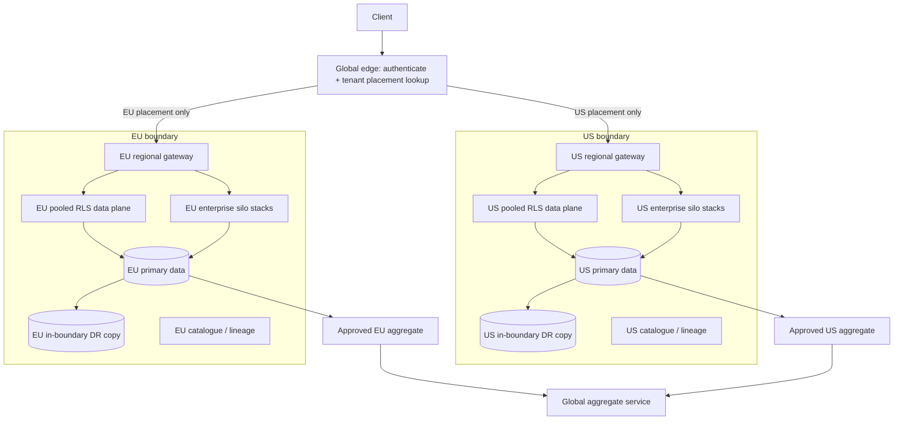

# Regional design and recovery assumptions

## Illustrative targets, not measured

- Small shared tenants: RPO <= 15 minutes; RTO <= 4 hours.
- Enterprise analytics: RPO <= 5 minutes; RTO <= 60 minutes.
- Prove these with timed recovery drills and telemetry.

## Failover checklist

1. Define scenario, tenant cohort, success criteria, and rollback.
2. Declare incident and timestamp start.
3. Fence old writers and prevent split-brain.
4. Confirm last durable/replicated event and replica lag.
5. Promote/restore only within approved residency boundary.
6. Validate identity, RLS, keys, schema, catalogue, routing, quotas.
7. Reconcile counts, checksums, event IDs, and derived tables.
8. Drain backlog and run tenant-level smoke tests.
9. Timestamp restoration and calculate actual RPO/RTO.
10. Preserve evidence, remediate, and schedule a repeat drill.

Design documentation only. No cloud infrastructure was provisioned or failed over.
