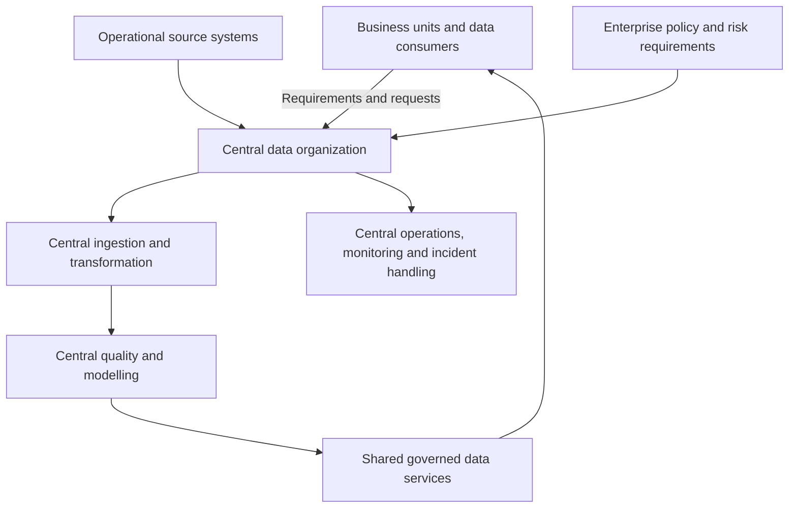
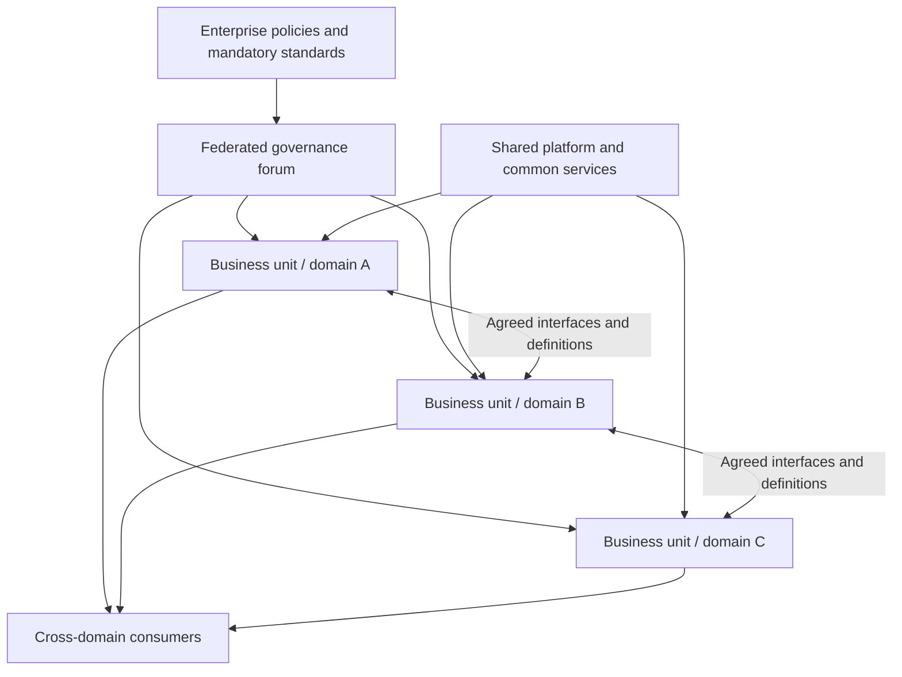
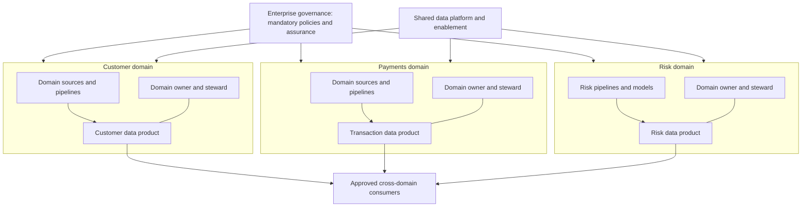
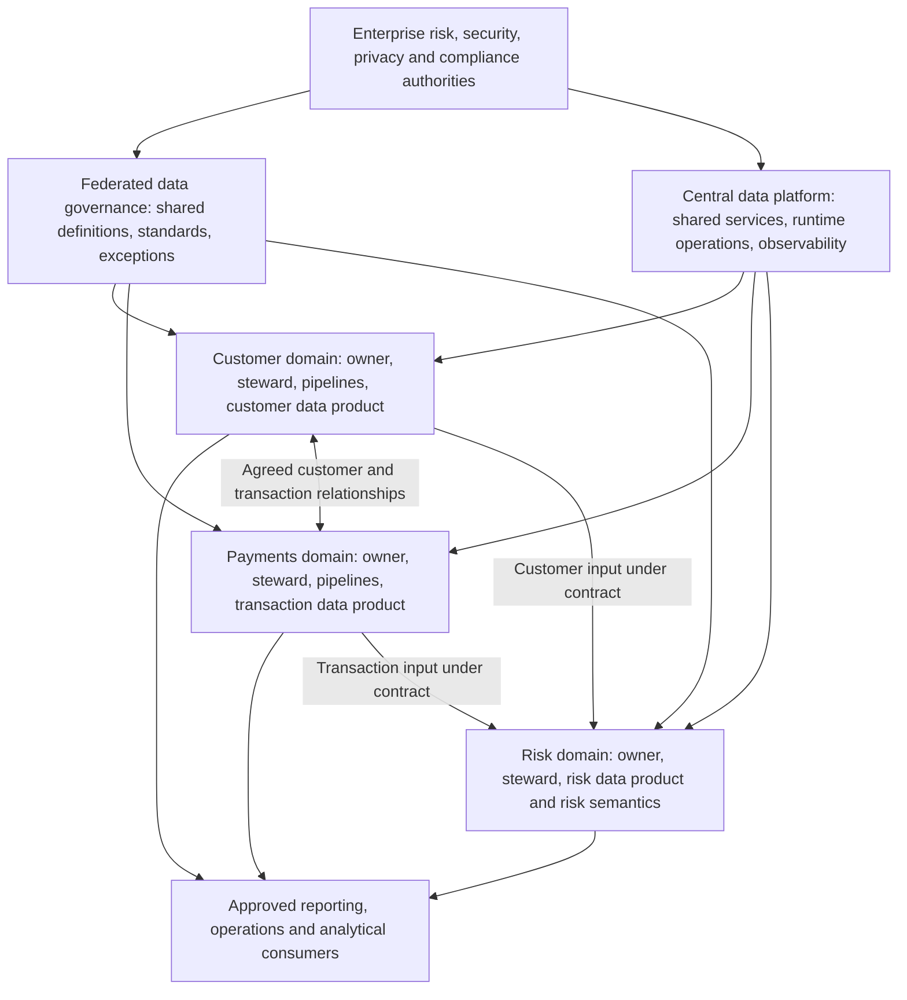

# Centralized, Federated, and Domain-Oriented Data Architectures

> **Module:** Stage 2D — Data Architecture  
> **Folder:** `03-Data-Architecture-Patterns-and-Reference-Architectures/`  
> **Target file:** `01-centralized-federated-and-domain-oriented-architectures.md`  
> **Scope:** Organizational architecture and operating models for data ownership, decision rights, governance, integration, and operations.  
>
> **Scenario note:** Northbridge Bank is fictional. All organizational conditions and examples below are illustrative assumptions for learning, not real requirements or universal targets.

## 1. Learning Objectives

By the end of this lesson, you should be able to:

1. Define centralized, federated, and domain-oriented data architectures without confusing them with technologies.
2. Draw each model and explain where ingestion, modelling, quality management, access decisions, and consumption responsibilities sit.
3. Distinguish data ownership, stewardship, governance, platform operation, and pipeline implementation.
4. Explain how decision authority, accountability, and operational work are distributed in each model.
5. Compare the models across integration, interoperability, speed, consistency, cost, risk, and organizational readiness.
6. Identify which standards need enterprise-wide control and where domains can reasonably choose local practices.
7. Diagnose failure modes and recognize evidence that an existing operating model is not working.
8. Evaluate how organizational size, maturity, regulation, geography, autonomy needs, staffing, and funding affect model selection.
9. Design a hybrid model that combines central platform and control capabilities with clearly accountable domain teams where justified.
10. Make a defensible recommendation for Northbridge Bank, including assumptions, prerequisites, rejected alternatives, risks, and conditions that would change the decision.

**Core principle:** choose an operating model to fit the organization’s requirements and capabilities; do not choose one because it is fashionable or because a technology product advertises support for it.

## 2. Why the Topic Matters in Real-World Data Architecture

Data architecture is not only a diagram of stores, pipelines, and interfaces. It also defines who can make decisions, who is accountable for meaning and quality, who operates shared capabilities, and how disagreements are resolved.

A technically sound platform can fail when its operating model is wrong:

- A central team may become a queue for every domain request and cannot keep up with business change.
- Federated teams may interpret common standards differently, or a committee may approve standards that nobody enforces.
- Domain teams may be told they own data without receiving the staff, budget, skills, or authority needed to maintain it.
- Consumers may combine similar-looking datasets whose definitions, identifiers, freshness, or access rules differ.
- A regulatory control may exist on paper but lack a named accountable owner, evidence trail, or escalation route.

The architecture must therefore connect **decision rights** (who may decide), **accountability** (who answers for outcomes), **execution** (who performs the work), and **assurance** (who checks that required controls work).

### 2.1 Terms to keep distinct

| Term | Meaning | Example |
|---|---|---|
| **Data owner** | The accountable business role for a data asset or domain, including its meaning, acceptable use, and risk decisions within delegated authority | Customer-domain executive accountable for the customer definition |
| **Data steward** | A role that maintains definitions, quality rules, metadata, issue triage, and policy implementation on behalf of the owner | Steward resolves inconsistent customer status values |
| **Data custodian / platform operator** | A role responsible for technical safeguarding and operation of the environment or service | Platform team operates storage, access-control mechanisms, monitoring, and backups |
| **Data producer** | A system, team, or process that creates or publishes data | Payments process emits transaction records |
| **Data consumer** | A person, team, or system that uses data for a defined purpose | Risk analytics consumes transaction data |
| **Governance** | Decision rights, policies, standards, accountability, exception handling, and assurance | Enterprise policy sets classification and access obligations |
| **Operating model** | The roles, responsibilities, decision paths, funding, processes, and interactions used to run the architecture | Central platform team plus domain data teams and a governance council |
| **Interoperability** | The ability of independently managed systems or domains to exchange and correctly interpret data | Agreed customer identifier and versioned transaction interface |

Ownership does not necessarily mean owning the physical database or writing every pipeline. A domain can be accountable for the meaning and quality of a data product while a central platform team operates the shared infrastructure. Conversely, a central team operating a database does not automatically have the business authority to define what a customer or a transaction means.

### 2.2 Pattern, reference architecture, and technology are different

A **pattern** describes a reusable arrangement of responsibilities and structures, including its conditions and trade-offs. A **reference architecture** makes that arrangement more concrete by showing logical components, responsibilities, and flows. An **implementation** selects and configures actual products and code.

Centralized, federated, and domain-oriented describe primarily how responsibilities and decision authority are organized. None of them requires a particular database, cloud provider, orchestration tool, or catalog. The same technology category can support different operating models, and the same operating model can use different technologies.

### 2.3 Why the choice is consequential

The model influences:

- **Time to change:** whether a domain waits for central delivery or can make decisions within agreed boundaries.
- **Consistency:** whether common definitions and controls are applied coherently across domains.
- **Accountability:** whether there is a clear person or role to resolve incorrect data and prioritize remediation.
- **Integration effort:** whether consumers can discover, interpret, access, and combine data predictably.
- **Risk management:** whether sensitive data use is controlled, auditable, and aligned with obligations.
- **Cost and skills:** whether expertise is shared efficiently or duplicated across teams.
- **Resilience:** whether one team, process, or capability becomes a bottleneck or a single point of operational failure.

No model wins on all dimensions. The task is to make the trade-offs explicit and acceptable for the specific organization.

## 3. Prerequisite Knowledge

This lesson assumes familiarity with the following concepts from earlier Stage 2D modules:

- **Business capabilities, domains, and data ownership (2D.1, Topic 3):** a domain groups related business responsibilities and knowledge; domain boundaries should reflect business meaning, not merely the current system layout.
- **Governance and decision rights (2D.1, Topic 5):** policies, standards, owners, stewardship, exceptions, and assurance.
- **Organizational constraints (2D.2, Topic 5):** staffing, budget, regulation, geography, legacy dependencies, delivery constraints, and risk.
- **Requirements and quality attributes:** requirements such as consistent definitions, controlled access, timely availability, and clear accountability should guide model selection.
- **Logical architecture diagrams:** boxes represent teams, capabilities, or services; arrows represent data or decision flows; boundaries represent responsibility or trust boundaries.

If these prerequisites are not yet secure, review them before attempting the advanced exercises. This lesson introduces the operating-model vocabulary needed here, but it does not replace the earlier modules.

### 3.1 A short vocabulary check

Before continuing, be able to answer:

1. Who is accountable for the business meaning of a data field?
2. How is a data owner different from a platform operator?
3. What is the difference between a policy and a technical enforcement mechanism?
4. Why can a dataset be technically available but not interoperable?
5. What is an organizational constraint, and how can it eliminate an otherwise attractive design?

## 4. Beginner-Level Learning Sequence

### 4.1 The three models in plain language

**Centralized architecture:** one central data organization makes most cross-enterprise data decisions and delivers or operates the main data capabilities for the organization. Business teams supply requirements and domain knowledge, but the central team carries much of the implementation and operational responsibility.

**Federated architecture:** a central governance body establishes a defined set of enterprise-wide rules and shared capabilities, while business units or domains retain specified decision rights and execution responsibilities. The boundaries of central and local authority must be explicit.

**Domain-oriented architecture:** business domains are directly accountable for the data they produce or publish, including its meaning, quality, and availability. Shared platform and enterprise governance capabilities may support or constrain them, but domain teams retain meaningful responsibility for their data.

These are patterns, not mutually exclusive labels for every part of an organization. An organization may centralize high-risk controls, federate enterprise standards, and assign data-product ownership to domains.

### 4.2 Pattern A — Centralized architecture

#### Structure



#### What the components do

- **Business units and consumers:** explain business questions, provide domain expertise, request access, and report data defects.
- **Central data organization:** prioritizes work, builds and operates shared ingestion and transformation, applies common models, and coordinates data access and quality remediation.
- **Enterprise policy and risk functions:** define mandatory requirements and oversee compliance. In a small organization these roles may be performed by the same people as the central data team, but policy authority should still be clear.
- **Shared governed data services:** publish datasets or interfaces for approved consumers.
- **Central operations:** monitor pipelines and service health, respond to incidents, and coordinate recovery.

#### Realistic flow

A business system produces customer updates. The central data organization ingests them, validates the records, applies a shared customer model, resolves or escalates quality defects with the source business owner, and publishes the approved data for reporting. A consumer requests access through the central process. The central organization operates the pipeline, but a business owner may still need to decide the correct interpretation of a disputed customer status.

#### Benefits and costs

Benefits can include consistent implementation, shared expertise, economies of scale, and a straightforward point of coordination. Costs include a potentially overloaded central queue, distance from domain meaning, slow prioritization, and a tendency for business units to treat quality as “the data team’s problem.”

Centralization works best when the organization is relatively small or homogeneous, domains have limited independent data needs, central capacity is adequate, and consistency or control is more valuable than local delivery autonomy. It is a poor fit when one central team must understand many rapidly changing, distinct domains and cannot be staffed to serve them.

### 4.3 Pattern B — Federated architecture

#### Structure



#### What the components do

- **Enterprise policy owners:** establish non-negotiable obligations such as classification, security, privacy, and audit requirements.
- **Federated governance forum:** agrees shared definitions, identifiers, interface conventions, quality expectations, and exception processes. It needs a defined mandate, decision process, and escalation path.
- **Business units or domains:** perform their assigned data work, nominate owners and stewards, and implement shared standards in their own context.
- **Shared platform team:** offers common capabilities where reuse improves reliability or reduces duplicated work.
- **Cross-domain consumers:** use published interfaces and resolve semantic or access questions through documented owner and escalation routes.

#### Realistic flow

The customer domain maintains its customer data. The payments domain maintains transaction data. A cross-domain governance group agrees how customer identifiers are represented and how data classifications are expressed. Each domain implements those rules in its own pipelines. A risk consumer obtains customer and transaction data through documented interfaces. If a local field conflicts with the shared definition, the domain steward investigates and the governance forum resolves a cross-domain definition dispute when needed.

#### Benefits and costs

Federation balances enterprise consistency with local context. It can distribute workload and decision-making while keeping common controls. Its costs are coordination, meetings, negotiated standards, and the risk of ambiguous accountability. It fails when the forum has no authority, exceptions are not tracked, standards are not tested or enforced, or every decision is sent to a committee.

Federation is viable when there are multiple meaningful business units, local variation is legitimate, and the organization can fund both domain execution and cross-domain coordination.

### 4.4 Pattern C — Domain-oriented architecture

#### Structure



#### What the components do

- **Domain teams:** own the business meaning and lifecycle of their published data, implement pipelines, monitor quality, and remediate defects within their authority.
- **Domain owner:** is accountable for the product’s purpose, definitions, acceptable use, and outcome.
- **Domain steward:** maintains metadata, rules, issue triage, and definition consistency.
- **Shared platform team:** reduces repeated infrastructure work through common capabilities, templates, deployment paths, monitoring, access mechanisms, and support.
- **Enterprise governance:** sets mandatory controls and verifies compliance without taking over every domain decision.
- **Consumers:** use published data products or interfaces and follow the documented contract and access process.

A **data product** here means a deliberately managed, consumable data asset or interface with an owner, defined semantics, quality expectations, access rules, documentation, and support arrangements. This definition does not mean that every domain-oriented architecture is a data mesh. Data mesh is a separate topic in this module and adds a more specific set of principles and operating expectations.

#### Realistic flow

The payments domain creates transaction data. Its team validates transaction identifiers, amount and status semantics, monitors freshness, and publishes an approved transaction interface with a named owner and documented limitations. The risk domain consumes it under an agreed contract. If a payment status is wrong, the payments domain investigates the source and pipeline; the risk domain reports the consumer impact and can apply a documented temporary safeguard, but it does not silently redefine the producer’s meaning.

#### Benefits and costs

Domain ownership can improve alignment with business meaning, accountability, and local change speed. It requires capable and funded domain teams, clear boundaries, reusable platform support, and enterprise rules that can be verified. Without these prerequisites, it can multiply pipelines, definitions, and operational burdens while leaving “ownership” nominal rather than real.

### 4.5 Who is called when data are wrong?

The first response should be routed by the defect’s location and meaning—not by a vague assumption that one team owns all data problems.

| Situation | Centralized model | Federated model | Domain-oriented model |
|---|---|---|---|
| A source business event is factually wrong | Central team detects or receives report; source business owner corrects the source fact | Responsible business unit/domain corrects the source fact; central coordination is used if cross-unit | Producing domain owner is accountable for remediation; source system owner performs source correction |
| A transformation pipeline corrupts values | Central pipeline operator fixes it and coordinates impact analysis | Team assigned to that pipeline fixes it; owner and steward assess semantic impact | Producing domain team fixes its pipeline and notifies consumers |
| A shared definition is ambiguous | Central data owner/authority resolves it with business input | Federated governance resolves cross-domain conflict; domain owner supplies context | Enterprise or cross-domain authority resolves conflicts that cross boundaries; local domain owns its own definition within those limits |
| Access is wrongly granted | Central access-control owner and relevant policy owner investigate | Responsible access approver and central control owner investigate | Domain approver may request or approve within delegated policy; central security/control owner investigates policy-control failure |
| A consumer misunderstands a documented field | Central steward clarifies and may improve documentation | Producer steward clarifies; forum intervenes if shared semantics are disputed | Producer steward clarifies; consumer team remains responsible for using the contract correctly |

**Accountability rule:** the named data owner remains accountable for the business meaning and accepted quality of the data asset within their delegated scope. The team that operates or builds a pipeline is accountable for its technical operation and defects. Policy owners remain accountable for the policies they own. These responsibilities may involve several people; an incident lead coordinates the response, but coordination does not erase the underlying accountabilities.

### 4.6 Beginner exercise: identify the model

For each description, identify the closest model and cite two pieces of evidence.

1. One enterprise team builds nearly all pipelines, defines common models, handles access requests, and operates the shared environment.
2. A council sets enterprise definitions and control requirements; business units build and operate their own pipelines within those rules.
3. Customer, payments, and risk teams each own published datasets and quality remediation, while using common platform services and mandatory security policies.

**Expected answers**

1. **Centralized:** most delivery and operations sit with one central team; business units mainly request and consume.
2. **Federated:** central governance defines common rules; business units retain execution responsibility.
3. **Domain-oriented:** accountability for domain data is local; shared platform and enterprise controls remain available.

These are “closest model” classifications. A real organization may contain hybrids, so explain which responsibilities—not just which boxes—support your classification.

## 5. Intermediate-Level Learning Sequence

### 5.1 Comparative model table

| Dimension | Centralized | Federated | Domain-oriented |
|---|---|---|---|
| **Decision authority** | Concentrated in central data leadership, with business input | Split explicitly between enterprise authorities and local units | Domain decisions are local within enterprise policies and cross-domain agreements |
| **Business ownership** | Often retained by business functions, but central team may own many data delivery decisions | Business units/domain owners hold defined responsibilities | Domain owner is accountable for the domain data asset and its published semantics |
| **Stewardship** | Central stewards may coordinate definitions and quality across the estate | Local stewards implement standards; central stewards coordinate shared semantics | Domain stewards work close to the data and escalate cross-domain conflicts |
| **Governance** | Central process can be consistent, but may become a bottleneck | Shared rules and negotiated decision rights; needs an empowered forum | Central mandatory policies plus domain-level implementation and assurance |
| **Standards** | Usually designed and implemented centrally | Enterprise-wide baseline with agreed local extensions | Enterprise baseline; domains choose local details where interoperability and controls are preserved |
| **Integration** | Central team can create common integration pathways; demand can queue | Domains integrate through agreed standards and interfaces | Consumers integrate through owned contracts; more responsibility falls on producers and consumers |
| **Operational responsibility** | Concentrated in central team | Allocated by service, pipeline, or domain agreement | Domain teams operate their data products; platform team operates shared capabilities |
| **Quality remediation** | Central team often fixes pipeline issues; business/source owners correct facts | Assigned unit fixes defects; cross-unit issues escalate through governance | Producing domain fixes product defects; consumer reports impact and follows contract |
| **Speed of local change** | Often lower when central queues are long | Moderate to high within delegated boundaries | Potentially high if domain teams have skills, capacity, and clear contracts |
| **Consistency** | Easier to coordinate, but still depends on correct business input and enforcement | Can be high if standards are clear and tested | Depends on common controls, contracts, metadata, and capable domains |
| **Cost profile** | Shared staffing and platforms; central bottleneck risk | Shared and local costs plus coordination overhead | Local staffing and duplicated effort risk; platform reuse can offset costs |
| **Best fit** | Smaller or homogeneous organization, limited local autonomy, strong central capability | Multiple units needing both common controls and local execution | Distinct business domains with genuine accountability and sufficient capability |
| **Characteristic failure** | Central backlog, detached semantics, “central team owns every problem” | Committee paralysis, inconsistent interpretation, unenforced standards | Nominal ownership, skills gaps, duplicated pipelines, incompatible contracts |

### 5.2 Ownership is not the same as stewardship or operation

A useful division of responsibility is:

- **Owner:** accountable for business meaning, acceptable quality, and prioritization within their authority.
- **Steward:** maintains definitions, metadata, quality rules, and issue workflow.
- **Producer/pipeline team:** implements and operates the data production path.
- **Platform team:** operates reusable infrastructure and platform services.
- **Policy/control owner:** defines mandatory rules and assures that they are followed.
- **Consumer:** uses data according to its contract, reports defects, and remains accountable for its own interpretation and downstream use.

One person may hold more than one role in a small organization. The roles should still be explicit, because otherwise incident resolution becomes a negotiation about who is responsible.

### 5.3 What should be common, and what can vary?

Standards should be centralized or governed enterprise-wide when inconsistency would create unacceptable security, regulatory, semantic, or interoperability risk. Local flexibility is appropriate when a choice is genuinely domain-specific and does not break a contract or mandatory control.

| Standard or decision | Typical governance level | Reason | Appropriate local flexibility |
|---|---|---|---|
| Data classification and handling rules | Central policy authority | Sensitive data must receive consistent protection and evidence | Domain can add stricter controls; cannot weaken the baseline without an approved exception |
| Identity, access, and audit requirements | Central security/control authority | Prevents incompatible access decisions and gaps in auditability | Domains may define approved role mappings or business approval paths within policy |
| Cross-domain identifiers and key semantics | Enterprise or cross-domain governance | Consumers need to know whether records refer to the same customer, account, or transaction | Domain-specific internal keys are acceptable if mappings and published interfaces are clear |
| Interface contracts and compatibility rules | Shared baseline; producer owns its contract | Consumers need stable semantics, versioning, and change notice | Domains can choose implementation details behind the contract |
| Business-specific quality thresholds | Domain owner, with enterprise minimums where needed | Quality expectations depend on use and risk | A domain can set stricter or more tailored checks; high-risk uses may need centrally mandated minimums |
| Internal pipeline layout and local modelling | Usually domain or delivery team | These choices can vary without harming consumers if outputs conform | Broad local flexibility, subject to security, lineage, retention, and contract requirements |
| Naming, metadata, and documentation conventions | Shared baseline | Discovery and interpretation require a minimum common vocabulary | Domain-specific terms may be added when definitions and mappings are documented |

**Practical test:** if a local choice can silently change the meaning, protection, or usability of data across boundaries, it probably needs a common rule or explicit contract. If it affects only an internal implementation and preserves the contract and controls, local choice is often reasonable.

### 5.4 Cross-domain integration and interoperability

Integration is more than moving bytes. A consumer needs to know what the data mean, who owns them, how fresh and complete they are, whether they can be used for the intended purpose, and how changes are communicated.

A sound cross-domain agreement should specify, proportionately to risk:

1. **Business meaning:** definitions, units, status values, grain, and known exclusions.
2. **Identity and relationships:** identifiers, mapping rules, and the meaning of joins.
3. **Contract:** fields or interface, schema/version, compatibility expectations, and change process.
4. **Quality and freshness:** checks, targets, known limitations, and how violations are communicated.
5. **Access and permitted use:** who can request access, who approves, and what use is allowed.
6. **Support and escalation:** producer contact, consumer responsibilities, incident severity, and response path.
7. **Lifecycle:** retention, correction, deletion, and handling of downstream copies when applicable.

The model changes who coordinates the agreement, not the need for the agreement.

- In a **centralized** model, the central team may design and maintain common integration pathways, but must still obtain business decisions from domain owners.
- In a **federated** model, the forum sets shared contract conventions and resolves cross-unit disputes; the designated producer owns its interface.
- In a **domain-oriented** model, each domain owns its published contract, while common governance ensures the contracts remain discoverable, secure, and interoperable.

### 5.5 Scenario fit: three organizational contexts

| Context | Centralized model | Federated model | Domain-oriented model |
|---|---|---|---|
| **Small organization** | Often practical when data work is limited and one team can serve the business | Can be unnecessarily heavy if there are few independent units | May work if domains are clear, but dedicated domain roles may be too expensive |
| **Regulated enterprise** | Useful for common controls and centralized services; risk of bottlenecks and weak local context | Often a strong candidate when central control must coexist with local execution, provided enforcement is real | Can work with strong mandatory controls, audit evidence, capable owners, and clear escalation; “domain autonomy” cannot override obligations |
| **Growing multi-product company** | Can start simply, but a central queue may become a constraint as products diverge | Useful transition when shared standards and local responsibilities need to be formalized | Attractive when product/domain teams have stable ownership, platform enablement, and capacity to operate data products |

No context dictates a single answer. A small company may need federation because of separate legal entities; a large company may remain centralized if its domains are homogeneous and its central team is effective. Explain the actual conditions rather than relying on company size as a proxy.

### 5.6 Northbridge Bank: customer, transaction, and risk data

**Illustrative assumptions:** Northbridge is a fictional mid-sized bank with separate customer, payments, and risk functions. It handles sensitive customer data, needs auditable access decisions, and has cross-domain analytical use cases. Its current staffing and platform maturity are not specified by the roadmap; any design below is therefore a recommendation to validate, not a factual description of a real bank.

| Data area | Centralized option | Federated option | Domain-oriented option |
|---|---|---|---|
| **Customer data** | Central team integrates and publishes a shared customer view; customer business owner validates semantics | Customer unit owns source meaning; common identity and classification standards are governed across units | Customer domain owns definitions, quality, and published customer data product; central identity/security controls apply |
| **Transaction data** | Central team builds transaction pipelines; payments business owner defines transaction meaning | Payments domain operates pipelines under common contract and control standards | Payments domain owns transaction semantics, quality, availability, and consumer contract |
| **Risk data** | Central team integrates inputs and delivers risk datasets; risk function defines risk interpretation | Risk unit owns risk calculations and usage definitions; shared input contracts and controls are agreed | Risk domain owns risk outputs and assumptions; upstream customer and transaction domains remain accountable for their own products |
| **Cross-domain dispute** | Central team coordinates, but business owners must resolve semantic questions | Governance forum handles shared definitions and escalation | Relevant domain owners resolve boundary issues through documented contracts and enterprise escalation |
| **Regulatory control** | Centralized policy and assurance are natural, with local implementation as assigned | Central authority sets policy; domains demonstrate compliance | Central authority sets and assures mandatory controls; domains implement them and provide evidence |

**Key distinction:** risk may be accountable for the meaning and suitability of a risk measure, but it should not become the unacknowledged owner of customer or transaction source facts. Likewise, the customer domain cannot unilaterally redefine a cross-domain identifier if doing so breaks enterprise reconciliation.

## 6. Advanced-Level Learning Sequence

### 6.1 The core trade-offs

#### Autonomy versus standardization

Local autonomy allows teams to respond to business needs without waiting for a central decision. Standardization reduces ambiguity and makes data safer and easier to combine. Excessive standardization can impose needless uniformity; insufficient standardization creates hidden incompatibilities.

**Decision method:** identify the consequence of variation. If variation changes regulatory handling, identity, security, shared semantics, or contract compatibility, constrain it. If variation is internal and reversible, allow it unless there is evidence that standardizing it adds value.

#### Local versus enterprise optimization

A domain may optimize its pipeline for its own use while increasing cost or risk for other domains. An enterprise may optimize for one common model while making a domain’s critical workflow slower or less expressive.

Use an enterprise-level decision when costs, risk, or semantics cross domain boundaries. Use local authority when the effect is local and the choice preserves common controls and published contracts. Make cross-domain externalities visible rather than assuming local or central optimization is inherently superior.

#### Speed versus consistency

Speed depends not only on decision location but also on queue size, skills, automation, and clarity of authority. A centralized team with strong self-service may be faster than an under-resourced domain team. A domain team with unclear standards may move quickly but create expensive downstream rework.

Measure both delivery lead time and the cost of defects, exceptions, rework, and consumer breakage.

### 6.2 Organizational prerequisites and operating costs

| Prerequisite | Centralized | Federated | Domain-oriented |
|---|---|---|---|
| **Staffing** | Adequate central capacity across business needs | Central governance capacity plus local implementers | Skilled domain teams plus platform enablement |
| **Funding** | Central budget and a transparent prioritization process | Shared funding for common capabilities and agreed local responsibilities | Clear domain funding for ongoing data ownership, not only initial delivery |
| **Decision rights** | Central authority must be clear; business owners retain decisions that require domain expertise | Written central/local boundaries and an empowered escalation path | Domain authority is real but bounded by enterprise policy and cross-domain contracts |
| **Platform maturity** | Central tooling and operations must serve multiple consumers reliably | Reusable shared capabilities reduce duplicated work | Platform must make secure, observable, repeatable domain delivery feasible |
| **Domain capability** | Business expertise must still be accessible to central teams | Local units need enough skill to implement common rules | Domains need product ownership, engineering, stewardship, quality operations, and support capacity |
| **Governance enforcement** | Central policies need evidence and exception handling | Forum decisions need owners, deadlines, tests, and consequences | Common controls must be measurable and enforced without relying only on voluntary compliance |
| **Escalation** | Clear path from central queue to business decision-makers | Defined route for local disagreement and enterprise-level conflict | Defined route for domain boundary disputes, policy exceptions, and cross-domain incidents |

Funding models matter. If domain teams are funded only to deliver business features, data quality and support work may be neglected. If central platform teams are funded only to build infrastructure but not to operate it, shared capabilities become unreliable. Budgets should make recurring ownership, maintenance, support, and control work visible.

### 6.3 Failure modes and their signals

| Model | Failure mode | Observable evidence | Likely response |
|---|---|---|---|
| Centralized | Central queue becomes a bottleneck | Requests age, urgent work repeatedly displaces planned work, and domains build shadow pipelines | Delegate safe decisions, create reusable self-service, improve prioritization, or move selected ownership closer to domains |
| Centralized | Central team lacks business context | Definitions are repeatedly disputed; business owners correct outputs late | Assign domain stewards/owners and require business sign-off on semantics |
| Centralized | Business units disengage from quality | Defects recur because source causes are not fixed | Make source owners accountable and track remediation at source |
| Federated | Committee paralysis | Decisions remain open, exceptions accumulate, and no one owns deadlines | Narrow the forum’s mandate, assign decision owners, define escalation and time limits |
| Federated | Standards are not enforced | Teams claim compliance but use incompatible fields or controls | Add conformance checks, evidence, ownership, and exception expiry |
| Federated | Central/local responsibility is ambiguous | Incidents bounce between teams | Publish a responsibility matrix and name a single incident coordinator per incident |
| Domain-oriented | Ownership without resources | Data products have no active steward, support rota, quality monitoring, or maintenance budget | Fund the complete lifecycle or reduce the number/scope of products |
| Domain-oriented | Duplicated pipelines and definitions | Similar data is rebuilt repeatedly with conflicting results | Reuse shared capabilities and agree shared definitions where value crosses boundaries |
| Domain-oriented | Unmanaged dependencies | A producer changes a field and downstream consumers fail unexpectedly | Require discoverable contracts, compatibility rules, change notices, and consumer impact analysis |
| Any model | Governance exists only on paper | Policies have no enforcement, evidence, exception route, or consequences | Assign control owners and test operational effectiveness |
| Any model | Model no longer fits the organization | Delivery delays, cost, control gaps, or ownership disputes persist despite local fixes | Reassess requirements, capabilities, and the operating model; consider a staged hybrid |

A single incident does not prove that a model is failing. Look for repeated patterns, trend data, root causes, and whether the problem can be corrected within the current model. Signals should be measured against agreed baselines; no universal threshold is implied here.

### 6.4 Organizational context that changes the decision

- **Size:** a small organization may not afford separate teams and councils. Larger scale can justify domain ownership, but size alone does not guarantee domain maturity.
- **Maturity:** domains need stable business boundaries, clear owners, operational discipline, and data skills. Low maturity often calls for simpler shared capabilities and gradual delegation.
- **Regulatory exposure:** mandatory control requirements may need central policy ownership, independent assurance, consistent evidence, and approved exceptions. They do not automatically require every pipeline to be centralized.
- **Geography:** regions may have different residency, language, legal, or operational constraints. The design should distinguish legitimate local variation from incompatible definitions.
- **Autonomy needs:** independent products or business units may need local change authority. That authority should be bounded by common contracts and controls.
- **Skills availability:** if domains cannot operate pipelines or manage incidents, domain ownership may create operational risk. Shared services, training, staged delegation, or retained central operation may be safer.
- **Mergers and acquisitions:** two units may have duplicate customer records, conflicting definitions, different controls, and separate funding. Establish interim mappings and decision rights before forcing a single model.
- **Funding incentives:** the architecture fails when responsibility is delegated without recurring budget or when the central team is measured only on delivery volume rather than reliability and consumer outcomes.

### 6.5 Hybrid designs

A **hybrid model** intentionally assigns different responsibilities to different levels. It is not an excuse for ambiguity: each boundary must state who decides, implements, operates, and escalates.

Common hybrid forms include:

1. **Central platform, domain-owned data products:** a shared platform team operates common infrastructure and delivery capabilities; domains own product semantics, quality, and support.
2. **Central control, federated implementation:** central security, classification, identity, audit, and enterprise data standards are mandatory; domains implement them in local pipelines.
3. **Central core/reference data plus domain analytics:** enterprise-managed identifiers or reference definitions are centrally governed, while domains create analytical views suited to their business needs.
4. **Risk-tiered ownership:** highly sensitive or legally constrained data may have tighter central approval and assurance, while lower-risk domain data has more delegated decision rights.
5. **Centralized operation with domain accountability:** where domain engineering skills are immature, central operators can run pipelines while named domain owners remain accountable for business meaning and quality priorities.

For each hybrid, document:
- which decisions are central, federated, and local;
- who owns each data asset and each technical service;
- which controls are mandatory and how they are tested;
- what the consumer contract promises;
- who pays for ongoing work;
- how exceptions, incidents, and cross-domain disputes are resolved.

### 6.6 Transition risk and migration strategy

Changing the operating model changes people, budgets, decision rights, service boundaries, and often the data contracts. It is not simply a platform migration.

**Risks include:**

- unclear interim ownership while teams and systems are split or consolidated;
- loss of historical context when central specialists or domain experts leave;
- duplicate pipelines during coexistence;
- inconsistent definitions during data migration;
- consumers breaking when contracts or access processes change;
- controls being weakened temporarily while responsibility moves;
- domain teams receiving duties before they have staff or platform support;
- a long transition whose dual-running cost is not funded.

**A safer staged approach:**

1. **Baseline the current state:** inventory critical data assets, owners, consumers, quality incidents, delivery lead times, access approvals, and recurring costs.
2. **Identify the actual failure:** state evidence, not a preference for a different model. Separate a capacity problem from a governance or skills problem.
3. **Choose a bounded pilot:** select a domain with a meaningful use case, a willing accountable owner, manageable dependencies, and measurable outcomes.
4. **Define decision rights and contracts first:** document owner, steward, operator, controls, interfaces, escalation, and funding before shifting responsibility.
5. **Provide shared capabilities and training:** do not delegate operational duties before teams can perform them safely.
6. **Run in parallel where necessary:** reconcile outputs and monitor consumer impact. Define exit criteria and a funded end date for dual-running.
7. **Verify controls and service quality:** check access, audit evidence, quality, freshness, incident handling, and contract compatibility.
8. **Expand or reverse based on evidence:** compare results with the baseline and retain a reversible path until the pilot demonstrates fit.

### 6.7 Evidence that the current model is failing

Useful indicators include:

- sustained growth in request age or delivery lead time;
- recurring quality defects with unresolved root causes;
- repeated consumer breakages after undocumented changes;
- large numbers of unapproved exceptions or duplicate datasets;
- ownership disputes that delay incident response;
- access approvals without a clear accountable approver or adequate evidence;
- platform services that domains avoid because they are unreliable or too restrictive;
- domain teams that have ownership labels but no time, budget, or skills to maintain data;
- duplicated spending or pipelines whose definitions disagree;
- repeated audit findings tied to unclear accountability or inconsistent controls.

Use a baseline and trend rather than an arbitrary threshold. A metric only becomes a signal when its definition, collection method, owner, and interpretation are clear.

### 6.8 Pattern cards

#### Pattern card 1 — Centralized

| Field | Assessment |
|---|---|
| **Problem addressed** | Coordinate data delivery, control, and shared definitions through one principal organization |
| **Structure** | Central data team handles most shared ingestion, transformation, governance implementation, and operations; business owners provide semantics and source decisions |
| **Forces improved** | Consistency, concentrated expertise, shared cost, straightforward coordination |
| **Forces weakened** | Local autonomy, responsiveness when central demand exceeds capacity, closeness to business context |
| **Prerequisites** | Sufficient central capacity, clear prioritization, access to domain experts, business accountability for source facts |
| **Failure modes** | Backlog, shadow pipelines, detached semantics, central team blamed for all defects |
| **Use when** | Organization is small/homogeneous or common control and centralized delivery are proportionate to the workload |
| **Avoid or reconsider when** | Independent domains have rapidly changing needs and central service cannot meet them |
| **Review signals** | Request age, recurring source defects, unapproved shadow work, consumer satisfaction, operational reliability |

#### Pattern card 2 — Federated

| Field | Assessment |
|---|---|
| **Problem addressed** | Preserve enterprise-wide rules while distributing execution and selected decisions |
| **Structure** | Central policy/standards authority and empowered cross-domain forum; local units implement standards and own assigned data responsibilities; shared platform capabilities may serve all |
| **Forces improved** | Balance of local context and common rules; distribution of workload |
| **Forces weakened** | Decision simplicity; coordination costs increase |
| **Prerequisites** | Explicit decision rights, capable local teams, empowered governance, enforcement and exception mechanisms |
| **Failure modes** | Committee paralysis, standards without conformance checks, disputed accountability |
| **Use when** | Multiple business units need meaningful local execution but must interoperate and comply with shared rules |
| **Avoid or reconsider when** | There is no real local capacity or no authority to resolve cross-unit decisions |
| **Review signals** | Decision age, overdue actions, exception count and age, conformance results, cross-unit incident resolution |

#### Pattern card 3 — Domain-oriented

| Field | Assessment |
|---|---|
| **Problem addressed** | Align data accountability and delivery with business domains that understand and use the data |
| **Structure** | Domain owners and teams build, publish, operate, and improve domain data; shared platform and enterprise governance establish reusable capabilities and mandatory controls |
| **Forces improved** | Business alignment, domain accountability, local change speed when capability exists |
| **Forces weakened** | Duplication risk, local optimization, consistency if contracts and controls are weak |
| **Prerequisites** | Funded domain teams, product/engineering/stewardship skills, shared platform, clear contracts, effective enterprise controls |
| **Failure modes** | Ownership without resources, duplicated pipelines, unmanaged dependencies, incompatible definitions |
| **Use when** | Domains are meaningful and capable of sustaining data assets over their lifecycle |
| **Avoid or stage gradually when** | Teams lack operational skills, ownership is nominal, or critical controls cannot yet be demonstrated |
| **Review signals** | Product ownership coverage, freshness/quality performance, contract breakages, duplication, on-call and remediation health |

### 6.9 Northbridge Bank recommendation

#### Recommendation

**Adopt a controlled hybrid: federated enterprise governance and centrally operated shared platform capabilities, with domain accountability for customer, transaction, and risk data products introduced in stages.**

This is a reference-architecture-level recommendation, not a technology selection. It is based on the illustrative assumptions that Northbridge is a mid-sized regulated bank with distinct business functions, cross-domain analytical needs, sensitive customer data, and a need for auditable control. The recommendation must be revisited if those assumptions are false.

#### Roadmap scenario facts and their architectural implications

The following case facts are illustrative assumptions from the module roadmap, not universal targets or claims about a real bank. Validate them with stakeholders before implementation.

| Scenario fact | Implication for the operating model |
|---|---|
| Retail, lending, cards, and risk have distinct business responsibilities; the central data team is about 25 people and can grow only modestly | Keep enterprise coordination and platform enablement central, but avoid making the central team the sole delivery queue. Delegate bounded work only where a domain has demonstrated capability. |
| Nightly extracts feed a warehouse, and a three-year-old data lake is poorly trusted | Assign accountable business owners and stewards for definitions and quality; establish ownership and remediation for existing assets before expanding decentralized delivery. A platform change alone will not restore trust. |
| Regulatory reporting is monthly/quarterly, reconciled, auditable, and due by T+2 business days | Keep a named accountable reporting function, end-to-end lineage, reconciliation evidence, controlled changes, and policy-based access. Domain teams may implement transformations, but the control owner must be able to evidence the result. |
| Fraud analytics needs card-event freshness at p95 ≤ 60 seconds from event to analyst tool during 08:00–22:00; historical features are also needed | The cards/payments domain should own event meaning and source-quality remediation; platform/engineering should operate shared runtime capabilities; fraud/risk consumers need an explicit freshness contract and escalation path. This operating-model lesson does not select a streaming technology. |
| Risk analytics needs daily exposure across large historical volumes; customer analytics is daily to weekly and mixes structured and semi-structured data; document/interaction data need search and retrieval | Use workload-specific ownership and contracts rather than force every domain into one delivery cadence. Assign semantic ownership to the relevant business domain and define cross-domain consumer responsibilities. |
| Analytical platform availability target is 99.5% monthly on business days | Name the service owner and operator, define the measurement window and exclusions, and make the target a proposed service commitment only after it is validated. |
| Personal data must remain in a specified jurisdiction; the core banking batch window ends at 02:30; existing identity services must be used; a regulatory milestone applies; domain engineering skills are uneven | Central control owners must govern residency, identity/access, and audit requirements. Schedule work around the source-system window and milestone. Use staged delegation, training, and central operational support where domain readiness is insufficient. |

These facts strengthen—but do not make automatic—the hybrid recommendation. The bank must validate the exact jurisdiction, regulatory interpretation, freshness measurement, availability calculation, and milestone with authorized stakeholders. The p95 and availability values are scenario assumptions, not independently established legal or business requirements.

#### Proposed responsibility structure



#### Why this hybrid fits the assumptions

- **Regulatory control:** mandatory policy and assurance remain centrally accountable, rather than depending on every domain to interpret high-risk obligations independently.
- **Business meaning:** customer and payments teams remain accountable for their source semantics and data quality; the risk domain owns the meaning and governance of risk outputs.
- **Operational consistency:** a central platform team offers reusable capabilities and common operational practices, reducing the chance that every domain independently rebuilds infrastructure.
- **Local change:** domains can improve data products within the enterprise control baseline and their published contracts.
- **Cross-domain interoperability:** the federated forum governs shared identifiers, contract conventions, and disputes that no single domain should decide unilaterally.
- **Staged readiness:** domains can receive ownership incrementally as staffing, stewardship, and operational practices are demonstrated.

#### Three standards or controls that should remain centrally governed

1. **Data classification, permitted handling, and retention/deletion policy.** A bank needs a consistent baseline for how sensitive data are treated and what lifecycle obligations apply. Domains may implement stricter rules, but must not silently weaken the baseline; exceptions require an authorized and recorded decision.
2. **Identity, access approval boundaries, and audit evidence.** The enterprise must define the minimum access-control and audit requirements so access is least-privilege, approvals are attributable, and investigations can reconstruct who accessed what and why. Domain approvers can make delegated business decisions within those rules.
3. **Cross-domain identity and interface compatibility baseline.** Shared identifiers and contract/versioning conventions are essential for joining customer, transaction, and risk data without silent semantic drift. Domains retain their internal models, but published mappings and interfaces must meet the common baseline.

These three are centrally governed because a local divergence could create enterprise-wide risk or make cross-domain data misleading. The exact policy content and legal obligations must be validated by Northbridge’s authorized control functions; this lesson does not assert a specific legal requirement.

#### Alternatives considered and rejected for the assumed context

| Alternative | Why it is not the first choice under the assumptions | Evidence that could change the decision |
|---|---|---|
| **Fully centralized data ownership and delivery** | Could make the central team a bottleneck and weaken domain accountability for business meaning, especially across customer, payments, and risk | A small, homogeneous estate with ample central capacity and low local change demand could justify more centralization |
| **Unconstrained domain autonomy** | Risks inconsistent identity, access, semantics, and audit practices; it is not appropriate to treat regulated controls as optional local choices | It would still require an enterprise control baseline, so “unconstrained” autonomy would not be accepted as stated |
| **Federation without domain accountability** | A governance forum alone cannot own day-to-day source quality or operate every pipeline; unclear execution can preserve current delays | If local teams lack skills, a temporary centrally operated model may be needed, but owners and a capacity-building plan remain necessary |

#### Prerequisites before rollout

- Named accountable owners for customer, transaction, and risk outputs, with explicit scope.
- Named stewards and engineering/operator roles, including who responds to incidents.
- Central policy owners and a governance forum with authority, deadlines, exception tracking, and escalation.
- A shared platform with adequate reliability, access controls, audit evidence, monitoring, and support.
- Written contracts for key cross-domain data, including meaning, quality/freshness expectations, access, versioning, and change notification.
- Recurring budget for platform operation and domain data-product maintenance.
- Baseline metrics for request lead time, quality defects, access-control findings, consumer breakages, duplication, and incident resolution.
- A pilot and rollback/coexistence plan; no domain should inherit production accountability before it has demonstrated readiness.

#### Revisit triggers

Reconsider the design if domain teams cannot sustain operations, the platform remains a bottleneck, standards are repeatedly violated, cross-domain definitions remain unresolved, audit findings persist, or the cost of the hybrid exceeds its benefits. Depending on the evidence, the response could be stronger central operation, narrower domain boundaries, improved platform enablement, or a more explicit federated decision process.

## 7. Industry-Application Exercises

Complete the exercises in order. Use the scenario facts provided and label any additional assumptions. Each output should show reasoning, not only a model name.

### Exercise 1 — Draw and explain the three models

**Task**

1. Reproduce one diagram for each model from memory.
2. Label who is responsible for ingestion, modelling, quality remediation, access control, business definitions, and operations.
3. Trace one customer-data flow from source to a reporting consumer.
4. Identify the first point of escalation if the data are incorrect.

**Expected output**

Three annotated diagrams and a short comparison. Each diagram must distinguish business accountability from technical operation and show how consumers obtain the data.

**Evaluation**

- All major roles appear.
- Arrows show plausible data or governance flows.
- The explanation does not imply that central platform operation automatically makes the platform team the business owner.
- The error route identifies both the accountable owner and the team expected to perform remediation.

### Exercise 2 — Responsibility matrix

**Task**

Create an RACI-style matrix for the recommended Northbridge hybrid. RACI means **Responsible** (does the work), **Accountable** (answerable for the outcome; normally one role per activity), **Consulted** (provides input), and **Informed** (receives updates). Treat the matrix below as a starting point and adapt it if you state a reason.

**Illustrative roles**

- **EO:** Enterprise control/policy owner
- **FG:** Federated governance forum
- **DO:** Domain data owner
- **DS:** Domain data steward
- **DE:** Domain engineering / pipeline team
- **PT:** Central platform team
- **CA:** Consumer / analytics team

| Activity | EO | FG | DO | DS | DE | PT | CA |
|---|---|---|---|---|---|---|---|
| Define classification and mandatory handling policy | A/R | C | C | I | I | C | I |
| Define shared identifiers and cross-domain semantics | C | A | C | R | C | C | C |
| Define domain business meaning and product purpose | I | C | A | R | C | I | C |
| Implement domain pipeline and transformations | I | I | A | C | R | C | I |
| Operate shared platform runtime and common services | C | I | C | I | C | A/R | I |
| Define domain quality rules and thresholds | C | C | A | R | R | C | C |
| Detect and remediate a domain pipeline defect | I | I | A | C | R | C | I |
| Approve business access within delegated policy | C | I | A/R* | C | I | C | I |
| Enforce technical access controls and retain audit evidence | A | C | C | I | C | R | I |
| Publish interface contract and change notice | I | C | A | R | R | C | C |
| Resolve a cross-domain semantic dispute | C | A | R | R | C | C | C |
| Report consumer impact and validate a correction | I | I | C | C | C | I | A/R |

\*The domain owner is accountable/responsible only where the organization has explicitly delegated that approval. Otherwise, the designated enterprise or risk authority is the approver.

**RACI interpretation notes**

- An activity can require several Responsible roles, but assign one Accountable role wherever practical.
- The table is illustrative; legal, security, and internal-control responsibilities must be confirmed by authorized Northbridge stakeholders.
- A platform team may implement access enforcement without being the policy owner.
- A consumer validates whether a correction fixes its use case, but should not silently change the producer’s business definition.
- If two roles appear accountable for the same outcome, clarify the boundary before rollout.

**Expected output:** final matrix, a one-paragraph explanation of three important assignments, and a list of unresolved role questions.

### Exercise 3 — Three centrally governed standards

**Task:** Select three enterprise standards or controls that should remain centrally governed in the assumed Northbridge design. For each, state:

1. the enterprise risk created by inconsistent local rules;
2. the central authority responsible for the rule;
3. what domains may decide locally;
4. how conformance and exceptions are evidenced.

**Expected output:** a table with one row per standard/control. The worked recommendation in Section 6.9 is an example; do not copy it without explaining the reasons.

### Exercise 4 — Central backlog and shadow pipelines

**Scenario:** A central team has a six-week backlog. Several domains are building unapproved shadow pipelines to meet delivery deadlines.

**Task:** Diagnose the likely operating-model mismatch. Distinguish capacity problems from unclear decision rights, weak self-service, and unmet domain needs. Propose an immediate containment plan and a longer-term operating-model change.

**Expected output**

- At least three hypotheses and what evidence would confirm each.
- Immediate steps to inventory and assess shadow pipelines, protect sensitive data, identify consumers, and avoid abrupt disruption.
- A future model with explicit ownership, platform enablement, access controls, and contract requirements.
- Two or more measurable signals to compare before and after the change.

**Worked reasoning**

The backlog is evidence of a service problem, not by itself proof that centralization is wrong. First measure request age, demand categories, capacity, and repeated work. Review shadow pipelines for access, quality, lineage, and duplicate definitions; do not simply shut them down without assessing business impact. Delegate safe, repeatable work or provide a governed self-service path. Move ownership to domains only where they have the people, skills, budget, and controls to sustain it. If most delays come from unclear requirements or poor prioritization, changing the model alone will not solve them.

### Exercise 5 — Merger and duplicate customer datasets

**Scenario:** After a merger, two business units each own a customer dataset. Their identifiers, status definitions, and access practices differ.

**Task:** Choose a model or hybrid for the transition. Explain how you would decide which definitions are shared, how the datasets remain traceable during coexistence, and who approves the target customer identity rules.

**Expected output**

- An interim responsibility map.
- A list of definition and identity conflicts.
- A governance decision process and accountable roles.
- A migration/coexistence plan with reconciliation, consumer communication, and rollback criteria.

**Worked reasoning**

Do not assume that either existing dataset is automatically authoritative. Assign a cross-unit decision owner and domain subject-matter experts. Establish mappings and preserve lineage to source records while reconciling duplicates. Central governance should set the decision process and mandatory control baseline; the customer business authority should approve business semantics. Keep both sources traceable during transition, test consumer impact, and move consumers only when reconciliation and contract criteria pass.

### Exercise 6 — Regulator requires one accountable function

**Scenario:** A regulator requires one accountable function for sensitive customer data.

**Task:** Explain how this constrains domain ownership. Distinguish accountability for enterprise policy/control from day-to-day domain data work.

**Expected output:** a responsibility diagram and a short explanation of what remains central, what may be delegated, and how evidence is collected.

**Worked reasoning**

The requirement means that the designated function must retain the accountability specified by the applicable obligation; it does not automatically mean that the function must write every pipeline or operate every store. Domains may perform approved implementation, stewardship, and remediation tasks if decision rights are clear and the accountable function can oversee them and obtain evidence. Confirm the precise obligation with the organization’s authorized legal/compliance stakeholders rather than inferring legal meaning from the scenario alone.

### Exercise 7 — Readiness and transition review

**Task:** Review an organization that wants domain-oriented ownership. Score readiness as **Ready**, **Partly ready**, or **Not ready** for each criterion: accountable owners, domain engineering skills, stewardship, recurring funding, shared platform, contract discipline, central policy enforcement, incident escalation, and consumer discovery. Support each rating with evidence or label it as an assumption.

Then identify two mismatches and propose a hybrid or staged transition.

**Expected output:** readiness table, two root-cause statements, transition sequence, and measurable exit criteria. Do not assign a readiness rating without stating its evidence or assumption.

### Exercise 8 — Compare models for three contexts

**Task:** Recommend a model for (a) a small organization, (b) a regulated enterprise, and (c) a growing multi-product company. For each, state the problem, requirements, constraints, candidate models, decision, rejected alternative, and one condition that would change the decision.

**Expected output:** a three-row comparison table and a paragraph explaining why size alone does not decide the architecture.

### Exercise 9 — Pattern recommendation for Northbridge

**Task:** Produce a short architecture decision record (ADR) for Northbridge using the illustrative assumptions in Section 6.9.

Include:
- context and problem;
- requirements and constraints;
- options considered;
- decision and scope;
- responsibility boundaries;
- three centrally governed controls;
- prerequisites, risks, and mitigations;
- rejected alternatives;
- metrics and revisit triggers.

**Expected output:** a reviewable ADR whose reasoning can be reproduced from the stated assumptions. Avoid selecting specific technology products.

## 8. Practical Scenarios and Case-Based Reasoning

This section provides worked answers to the roadmap’s required scenarios. Use them to check your reasoning after attempting the exercises.

### 8.1 Scenario A — Six-week central backlog and shadow pipelines

**Diagnosis:** The current service may be under-capacity, over-centralized for the demand, poorly prioritized, or lacking self-service. Shadow pipelines show that business demand is being met outside the governed path, but do not prove that domains are ready to own production data.

**Response:**

1. Inventory pipelines and consumers; classify data sensitivity and business criticality.
2. Check whether shadow work duplicates existing outputs, bypasses controls, or has no owner.
3. Protect critical use cases while routing new work through a temporary risk-reviewed process.
4. Measure request types, age, rework, central capacity, and domain readiness.
5. Delegate low-risk repeatable tasks or create approved self-service patterns; retain central control of mandatory policies.
6. Pilot domain ownership for a willing, capable domain and compare lead time, quality, control conformance, and operational cost.

**Decision:** move to a controlled hybrid only if evidence shows the central model cannot meet needs and domains can assume the required responsibilities. If the root cause is poor prioritization or weak central capability, fix that before redistributing ownership.

### 8.2 Scenario B — Merger creates two customer datasets

**Diagnosis:** There are competing data authorities, conflicting semantics, identity-matching problems, and potentially different access practices. A quick technical merge could conceal unresolved business decisions.

**Response:**

- Appoint an accountable customer-data decision authority and include both units’ subject-matter experts.
- Document source definitions, identifiers, quality issues, lawful/approved access, and critical consumers.
- Set an interim mapping and reconciliation process; retain source lineage and record unresolved matches.
- Agree the target identifier and business definitions through an authorized governance process.
- Version the shared interface and communicate migration timing to consumers.
- Reconcile totals and sample records, verify access controls, and define rollback conditions before switching consumers.

**Decision:** use a federated transition with central control over common identity and security requirements; converge toward one governed customer capability or a domain-owned customer product only after semantics and accountability are settled. The target form depends on the actual legal structure, source quality, and organizational capability.

### 8.3 Scenario C — One accountable function for sensitive customer data

**Diagnosis:** A non-delegable or explicitly assigned accountability requirement constrains decision rights. It does not necessarily dictate where every technical task runs.

**Response:**

- Confirm the exact requirement and named accountable function with authorized compliance/legal stakeholders.
- Map the function’s retained decisions, delegated implementation tasks, evidence requirements, and escalation rights.
- Allow domains to perform work only within documented delegation and controls.
- Test whether the accountable function can monitor access, quality, incidents, exceptions, and remediation across domains.
- Revisit the delegation if evidence cannot be obtained or controls are not effective.

**Decision:** centralize the accountability and mandatory control baseline as required; delegate implementation only where permitted and demonstrably controlled.

### 8.4 Additional challenge — Platform skills are missing

**Scenario:** Northbridge’s proposed hybrid requires platform skills it does not yet have.

**Answer:** Do not proceed with a full-scale domain rollout on the assumption that skills will appear later. Options include building a small central enablement team, retaining central pipeline operation while domain owners take responsibility for semantics and priorities, training selected domain engineers, or using a bounded external capability where appropriate. Keep accountability, security, support, and knowledge transfer explicit. Pilot only when the minimum operational and control prerequisites are met.

### 8.5 Additional challenge — A new rule moves a data class under central control

**Scenario:** A new regulatory or internal risk decision requires tighter central control of one data class.

**Answer:** Change only the relevant decision rights and control boundaries first; do not automatically centralize every domain’s data. Identify affected assets, owners, consumers, access decisions, contracts, and copies. Update policy, delegation, audit evidence, and incident escalation. Preserve domain accountability for business meaning where compatible with the new rule. Run a transition review and document any required exceptions or migration steps.

### 8.6 Practice-question coverage

The authoritative roadmap states that the module-level `practice-questions.md` is the designated assessment resource, and that it was empty when the roadmap was written. Therefore, this lesson does not claim to answer a separate, populated question bank. The exercises and worked scenarios above provide **topic-level practice coverage** for the known Topic 1 requirements:

- definitions and distinctions;
- pattern identification and diagram interpretation;
- responsibility and governance comparison;
- cross-domain standards and interoperability;
- organizational readiness and failure modes;
- scenario-based selection and hybrid reasoning;
- a defensible Northbridge recommendation.

When `practice-questions.md` is populated, answer its Topic 1 questions separately, closed-book first. Record each as correct, partly correct, or wrong, with a reason and a corrected answer. Do not mark the topic gate complete until those designated questions have been answered and corrected.

## 9. Expected Outputs and Deliverables

Produce and retain these artifacts as evidence of learning:

1. **Three pattern cards:** centralized, federated, and domain-oriented, each documenting the problem, structure, forces, prerequisites, failure modes, and verdict.
2. **Annotated diagrams:** one for each model, with responsibilities and data flows.
3. **Responsibility matrix:** RACI-style assignments for the recommended Northbridge hybrid, including standards, pipelines, quality remediation, access, definitions, operations, and escalation.
4. **Standards/control rationale:** three centrally governed standards or controls, including why central governance is necessary and what local flexibility remains.
5. **Northbridge hybrid recommendation:** assumptions, rationale, responsibility boundaries, prerequisites, risks, rejected alternatives, transition plan, metrics, and revisit triggers.
6. **Scenario answers:** completed responses to the central backlog, merger, and regulatory-accountability scenarios, plus the readiness and organizational-context exercises.
7. **Practice-question record:** answers to the Topic 1 questions in `practice-questions.md` once that designated question bank is available and populated.

Use a consistent template for each pattern card:

```text
Pattern:
Problem addressed:
Structure and responsibility boundaries:
Data flow:
Decision authority:
Benefits:
Costs and trade-offs:
Organizational prerequisites:
Failure modes:
Evidence to monitor:
Use when:
Avoid or reconsider when:
Assumptions:
Verdict:
```

Keep facts, assumptions, and recommendations distinct. If an organizational fact is unknown, mark it as an open question rather than inventing a value.

## 10. Common Mistakes and Misconceptions

1. **Treating the model as a technology product.** A platform may enable capabilities, but the operating model is about responsibility, authority, and work.
2. **Assuming centralized always means safer.** Centralization can improve consistency, but it can also concentrate failure, create queues, and detach implementation from business meaning.
3. **Assuming centralized always means slower.** A well-staffed central team with clear priorities and self-service may deliver efficiently.
4. **Assuming federation is automatically balanced.** It fails if decision rights are unclear, governance has no authority, or standards are not enforced.
5. **Assuming domain ownership automatically improves speed or quality.** It requires skills, capacity, recurring funding, stewardship, platform support, and clear contracts.
6. **Equating domain-oriented architecture with data mesh.** Domain-oriented ownership is broader; data mesh is a separate topic with additional principles and practices.
7. **Confusing ownership with operation.** The team running infrastructure is not automatically accountable for business semantics.
8. **Making a committee accountable for every task.** Governance should decide shared rules and resolve cross-domain issues, not become the default executor for all domain work.
9. **Giving every domain unlimited freedom.** Local choices must preserve mandatory controls and the meaning and compatibility of published interfaces.
10. **Centralizing all business meaning.** Central teams need domain input; technical control alone cannot decide what a business concept means.
11. **Ignoring consumer responsibility.** Consumers should follow contracts, report defects, and validate corrections; producers should not silently absorb every downstream interpretation error.
12. **Delegating responsibility without funding.** An owner without time, budget, authority, and operational support is only an owner on paper.
13. **Assuming a merger has one obvious source of truth.** Definitions, identity, quality, legal permissions, and lineage need explicit reconciliation.
14. **Using a single incident to justify a redesign.** Diagnose root causes and trends; a model change will not fix weak prioritization, unclear requirements, or missing skills by itself.
15. **Choosing by popularity or vendor marketing.** State requirements, constraints, options, trade-offs, and evidence before making the decision.
16. **Treating a RACI table as self-enforcing.** The organization must communicate the matrix, give roles authority, fund their duties, and verify that escalation works.
17. **Using invented thresholds as requirements.** Establish a baseline and agree targets with stakeholders; illustrative values are not universal rules.
18. **Making a hybrid ambiguous.** “Central and domain-owned” is incomplete unless each decision, control, operational task, and escalation route has a named owner.

## 11. Mastery Criteria

You have mastered this topic when you can demonstrate all of the following without relying on memorized labels alone.

### 11.1 Conceptual mastery

- Explain the three models accurately in plain language.
- Distinguish data ownership, stewardship, pipeline development, platform operation, policy ownership, and consumer responsibility.
- Explain why domain-oriented architecture is not synonymous with data mesh.
- Draw the three models and describe a realistic data flow through each.

### 11.2 Comparative and operational mastery

- Compare all three models across decision authority, ownership, stewardship, governance, standards, integration, accountability, and operations.
- Identify which standards should be common and justify the local choices that remain flexible.
- Explain who is accountable and who performs remediation for at least three different data-defect types.
- Identify at least two failure modes for each model and state observable evidence for each.

### 11.3 Architecture judgment

- Recommend a model for a small organization, a regulated enterprise, and a growing multi-product company, while stating conditions that could change each answer.
- Assess staffing, funding, platform maturity, domain capability, governance enforcement, escalation, and regulatory constraints.
- Explain a transition strategy that addresses coexistence, consumer impact, control continuity, training, and rollback.
- Distinguish evidence of a model mismatch from a local process or capacity issue.

### 11.4 Industry application

- Deliver three complete pattern cards and three annotated diagrams.
- Produce a coherent RACI-style matrix with clear accountability and no unexplained role conflicts.
- Justify three centrally governed Northbridge standards or controls.
- Recommend a hybrid for Northbridge based on explicit illustrative assumptions, and explain why the alternatives were rejected.
- Include prerequisites, risks, metrics, and revisit triggers.
- Answer the designated Topic 1 practice questions when available, correcting incomplete or incorrect answers.

### 11.5 Suggested review rubric

Use this rubric as a learning aid, not as a roadmap-mandated numerical threshold.

| Area | Strong evidence | Needs revision |
|---|---|---|
| Definitions and diagrams | Correct roles, flows, boundaries, and distinctions | Boxes/labels are present but authority or flows are misleading |
| Responsibility | Accountable owner and executing team are explicit for each activity | Multiple unclear accountabilities or unowned activities |
| Trade-offs | Benefits, costs, prerequisites, and failure modes are tied to context | Claims are universal or not connected to requirements |
| Governance | Common rules, local discretion, exceptions, and assurance are explained | Standards are aspirational or have no enforcement path |
| Scenario reasoning | Requirements, constraints, alternatives, decision, and reversal conditions are explicit | Model is selected by preference or company size alone |
| Northbridge recommendation | Hybrid design follows from assumptions and includes rejected options | Recommendation ignores regulation, domain skills, or funding |
| Evidence | Metrics have definitions, owners, and baselines or are clearly proposed | Invented thresholds are presented as established requirements |

## 12. Completion Gate

Do not mark this topic complete until each required item is demonstrably finished.

- [ ] I can define centralized, federated, and domain-oriented architectures and explain their differences without notes.
- [ ] I have drawn and annotated all three models, including responsibilities and data flows.
- [ ] I can explain who is accountable when data are wrong and who performs the correction for source, pipeline, semantic, and access defects.
- [ ] I have compared the models across decision authority, ownership, stewardship, governance, standards, integration, accountability, and operations.
- [ ] I have identified common enterprise standards and justified where local flexibility is appropriate.
- [ ] I have completed all three pattern cards.
- [ ] I have completed and reviewed the Northbridge RACI-style responsibility matrix.
- [ ] I have justified three centrally governed Northbridge standards or controls.
- [ ] I have completed the organizational-context and failure-mode exercises.
- [ ] I have answered the central-backlog, merger, and regulatory-accountability scenarios with explicit reasoning.
- [ ] I have produced the Northbridge hybrid recommendation, including assumptions, prerequisites, trade-offs, rejected alternatives, risks, transition steps, metrics, and revisit triggers.
- [ ] I have distinguished organizational architecture from technology selection and domain-oriented architecture from data mesh.
- [ ] I have answered and corrected the Topic 1 questions in `practice-questions.md` once that designated question bank is populated.
- [ ] I have reviewed my work against the mastery criteria and corrected gaps.

**Completion decision:** mark the topic complete only when the pattern cards and responsibility matrix have been reviewed, the recommendation names prerequisites and failure modes, and the designated Topic 1 practice questions have been answered and corrected. If the question bank remains empty, record that dependency explicitly rather than claiming the practice-question requirement is satisfied.
