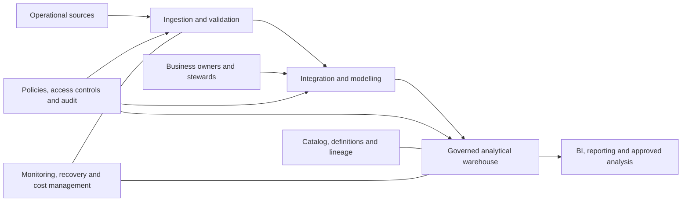
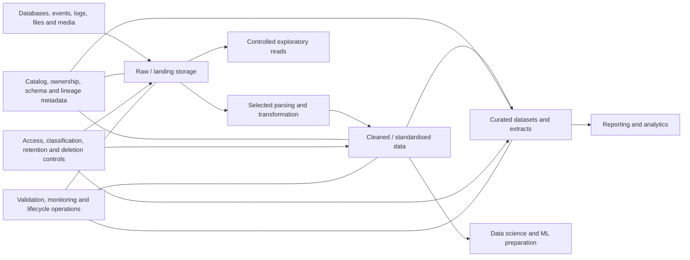
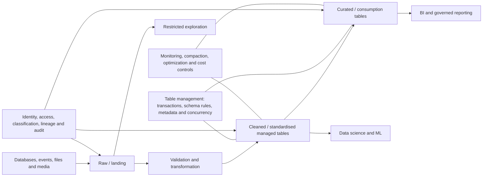

# Data Warehouse, Data Lake, and Lakehouse Patterns

> **Stage:** Stage 2D — Data Architecture  
> **Module:** `03-Data-Architecture-Patterns-and-Reference-Architectures/`  
> **Target file:** `02-data-warehouse-data-lake-and-lakehouse-patterns.md`  
> **Scope:** Logical analytical-storage patterns, workload fit, data lifecycle, governance, and architecture-level trade-offs. This is not a vendor configuration guide.
>
> **Scenario note:** Northbridge Bank is fictional. Any assumptions in this lesson are illustrative and must be validated against actual requirements. No numerical performance or cost benchmark is implied.

## 1. Learning Objectives

After completing this lesson, you should be able to:

1. Explain the purpose, defining characteristics, logical components, and data flows of a data warehouse, data lake, and lakehouse.
2. Distinguish structured, semi-structured, and unstructured data and explain how their characteristics affect analytical storage.
3. Explain schema-on-write and schema-on-read, including where modelling and validation happen and what risks each approach introduces.
4. Explain the separation of storage and compute and how independent scaling can affect cost, performance, concurrency, and operations.
5. Describe the neutral analytical layers **raw/landing → cleaned/standardised → curated/consumption**, including responsibilities and guarantees at each layer.
6. Match business intelligence, reporting, ad hoc analysis, data science, machine learning, regulatory reporting, document search, marketing segmentation, and operational analytics to candidate patterns.
7. Assess the implications of quality controls, metadata, lineage, governance, access control, retention, archival, deletion, reproducibility, and auditability.
8. Explain operational concerns including small files, compaction, concurrent writes and reads, performance management, and cost controls.
9. Compare a lake feeding a warehouse, a lakehouse consolidating workloads, and a warehouse retained for specialised governed workloads.
10. Evaluate architecture options using explicit requirements, constraints, assumptions, risks, and trade-offs rather than claiming one pattern is universally best.
11. Recommend an analytical architecture for Northbridge Bank, including what should not be moved, layer ownership, sensitive-data controls, migration and coexistence risks.
12. Produce reviewable pattern cards, a workload map, an option comparison, and a defensible recommendation.

## 2. Why the Topic Matters in Real-World Data Architecture

An analytical data architecture determines how data become trustworthy, discoverable, usable, and economically sustainable. A design that is too rigid can slow new analysis and make non-tabular data awkward to use. A design that accepts data without ownership, metadata, validation, or lifecycle controls can become a **data swamp**: storage exists, but users cannot reliably discover what the data mean, whether they are complete, whether they are current, or whether they are allowed to use them.

The three patterns address different problems:

- A **data warehouse** emphasizes integrated, modelled, governed analytical data and predictable analytical queries.
- A **data lake** emphasizes retaining data in diverse formats, often close to their source form, so different analytical uses can be developed without requiring every use to be modelled in advance.
- A **lakehouse** combines lake-style storage flexibility with warehouse-like management capabilities such as transactional table management, schema controls, and performance-oriented structures.

The names alone do not determine quality. A warehouse can contain incorrect definitions; a lake can be carefully governed; and a lakehouse can be poorly operated. Trust depends on ownership, data contracts, controls, metadata, operational practices, and the fit between workload and architecture.

### 2.1 Architecture pattern versus product

A **pattern** is a reusable logical arrangement of components, responsibilities, flows, and trade-offs. A **reference architecture** describes those components and relationships in a reusable but more concrete form. An **implementation** selects particular products, formats, services, and configurations.

A lakehouse is an architectural pattern, not inherently one vendor's product. Different implementations may provide different transaction, schema, concurrency, governance, and optimization capabilities. Do not assume that a system is a lakehouse merely because a vendor uses that label; evaluate the capabilities it actually provides and the operating responsibilities they create.

### 2.2 What the architecture must answer

For each workload, an architect should establish:

- What data types are involved, and where are they produced?
- What are the required freshness, latency, completeness, concurrency, and availability?
- Is the output a governed business measure, exploratory dataset, model-training input, or operational view?
- Who owns business meaning and quality, and who operates the technical path?
- Where are schema validation, modelling, access checks, and quality controls applied?
- How can a consumer trace an output back to its sources and transformation logic?
- How are retention, archival, correction, and deletion applied across derived copies?
- What happens when a schema changes, a pipeline fails, or two consumers need incompatible representations?
- Which costs arise from storage, compute, data movement, duplicated processing, operational support, and idle capacity?

The correct pattern follows from the answers. A popular platform or a promise of low storage cost is not a substitute for requirements analysis.

## 3. Prerequisite Knowledge

The authoritative roadmap identifies these prerequisites:

- **Stage 2 and Stage 2C data-engineering experience:** familiarity with batch pipelines and analytical tables, including warehouse/lakehouse concepts.
- **Stage 2D.2, Topics 3–4:** data volume, variety, freshness, latency, throughput, and availability requirements.
- **Topic 1 in this module:** the ownership and governance model for the stores and their data.

Helpful prior knowledge includes SQL, columnar files, table formats, metadata, lineage, classification, and basic pipeline operation. These help you understand examples but do not require choosing a particular implementation product.

### 3.1 Quick prerequisite check

Before proceeding, be able to explain:

1. The difference between an operational transaction workload and an analytical query workload.
2. Why a freshness requirement must be stated rather than guessed.
3. The difference between a business data owner and a platform operator.
4. Why a technically readable file is not necessarily trusted or approved for use.
5. Why volume alone is insufficient to choose a storage pattern.

If any answer is unclear, revisit the relevant prerequisite topic before making an advanced architecture decision.

## 4. Beginner-Level Learning Sequence

### 4.1 The three patterns in plain language

**Data warehouse:** a managed analytical environment where data from relevant sources are integrated and modelled into structures that support consistent reporting and analysis. Data is usually validated against an intended structure before being published for broad use. This is commonly described as **schema-on-write**.

**Data lake:** a storage environment that can retain diverse data formats, including raw or lightly processed records, files, events, documents, and media. Structure can be interpreted when a particular use reads the data, often called **schema-on-read**. This flexibility does not remove the need for quality, metadata, governance, or curated outputs.

**Lakehouse:** an analytical architecture that uses lake-style storage for varied data and adds warehouse-like management capabilities for data tables and workloads. Depending on the implementation, these may include transactional consistency for table changes, schema enforcement/evolution controls, metadata management, concurrency handling, and query performance structures. Capabilities vary and must be verified rather than assumed.

### 4.2 Structured, semi-structured, and unstructured data

| Data category | Meaning | Example | Architectural implication |
|---|---|---|---|
| **Structured** | Data follow a defined set of fields and types, often represented as rows and columns | Account balances with account ID, date, currency, and amount | Fits well with explicit schemas and analytical models; still needs semantic and quality validation |
| **Semi-structured** | Data carry labels or nested structure but may vary between records | JSON event with nested attributes; application log with optional fields | Requires rules for optional fields, type changes, nested data, and schema evolution |
| **Unstructured** | Content is not naturally represented by one fixed row-and-column schema | PDF statements, scanned forms, images, audio, free-text documents | Often retained as files or objects with metadata; analytical search may require extraction or indexing, which creates derived data and governance obligations |

A format does not decide the architecture by itself. Structured records can be stored in a lake, and a warehouse may expose structured representations extracted from documents. The question is what management, modelling, governance, and consumption capabilities the workload needs.

### 4.3 Schema-on-write versus schema-on-read

A **schema** defines the expected structure of data: fields, types, relationships, constraints, and sometimes business meaning.

- **Schema-on-write:** data are validated or transformed against a defined structure as they are written or published. A transaction record might be required to contain a valid transaction ID, a timestamp, currency, and amount before it enters a curated reporting table.
- **Schema-on-read:** data are stored with less upfront modelling, and a reader interprets or projects the structure needed for a particular analysis. An analyst may read a JSON event collection and extract only the fields relevant to a current question.

| Concern | Schema-on-write | Schema-on-read |
|---|---|---|
| Modelling effort | More work before broad consumption | More interpretation can be deferred to consumers or later transformations |
| Early rejection of invalid data | Easier to enforce at a controlled publication boundary | Invalid or unexpected values can remain in raw storage unless separate validation is applied |
| Flexibility | Changes require managed schema evolution and downstream impact analysis | New fields or uses can often be explored without remodelling all stored data |
| Consistency | Curated consumers can share validated structures and definitions | Different readers can interpret the same raw data differently |
| Risk | Upfront model may be wrong or too rigid | Repeated parsing, inconsistent semantics, and late discovery of quality problems |
| Appropriate use | Governed reporting, stable shared interfaces, critical business measures | Exploration, raw retention, changing source formats, diverse analytical questions |

These are tendencies, not absolute rules. A lake can apply strict validation in its cleaned and curated layers. A warehouse can allow schema evolution. A lakehouse can support both raw flexible data and validated tables.

### 4.4 Logical diagram: data warehouse



**Flow:** source data are ingested, validated and integrated into defined analytical structures. Business owners and stewards validate meanings and rules. Approved consumers query governed models. Policies, metadata, lineage, monitoring, and audit apply across the flow.

**What it guarantees:** the pattern intends to provide integrated, modelled, governed data for analytical use. It does not guarantee correctness merely because data reside in a warehouse. Quality rules, reconciliations, ownership, and operating controls must be implemented and monitored.

### 4.5 Logical diagram: data lake



**Flow:** diverse source data can be retained in raw/landing storage. Parsing, validation, standardisation, and curation are performed for known uses. Exploratory access to raw data may be allowed only under explicit access and handling rules.

**What it guarantees:** a lake provides a flexible place to retain and process varied data. It does not automatically guarantee discoverability, consistent semantics, transactional table behaviour, quality, or safe access. Those capabilities depend on governance and implementation.

### 4.6 Logical diagram: lakehouse



**Flow:** varied data are landed and transformed into managed tables. Warehouse-like table-management capabilities help make shared analytical tables more reliable for concurrent readers and writers. Curated outputs serve governed reporting, while cleaned data can support data science and ML.

**What it guarantees:** only the capabilities actually provided and configured by the chosen implementation. A lakehouse pattern aims to reduce the gap between flexible lake storage and managed analytical tables; it does not remove the need for semantic modelling, workload-specific tuning, access policies, or lifecycle controls.

### 4.7 Neutral analytical layers and their guarantees

Layer names vary between organizations. Use the neutral names **raw/landing**, **cleaned/standardised**, and **curated/consumption**. These are logical responsibilities, not a requirement to create exactly three physical storage locations.

| Layer | Purpose | Expected responsibilities | What it should not imply |
|---|---|---|---|
| **Raw / landing** | Preserve received source data or a controlled source-faithful representation for traceability and reprocessing | Record source, ingestion time, batch/event identity where applicable, schema/format metadata, access classification, retention, ingestion status, and integrity checks | “Raw” does not mean unrestricted, permanent, complete, or trustworthy for every analytical use |
| **Cleaned / standardised** | Make data usable under explicit technical and business rules | Parse formats, standardise types and units, validate required fields, handle duplicates, record rejected/quarantined records, apply approved corrections, preserve lineage | “Cleaned” does not mean all business semantics are universally correct or that all quality defects are solved |
| **Curated / consumption** | Publish data for a defined business or analytical purpose | Apply business definitions, integrate sources, document grain and metrics, test reconciliations, state freshness and known limitations, enforce consumer access, version interfaces | “Curated” does not mean suitable for every consumer or every purpose; each dataset has a defined contract |

#### Example: transaction data

- **Raw/landing:** retain the received transaction event with source and ingestion metadata; protect sensitive fields and restrict exploratory access.
- **Cleaned/standardised:** parse timestamps consistently, validate currency codes and required identifiers, and quarantine malformed records with a reason.
- **Curated/consumption:** publish a documented transaction fact table or reporting view with defined transaction status, reversal treatment, amount semantics, reconciliation rules, and approved access.

A source-faithful raw copy supports investigation and replay, but it must still have retention and deletion rules. A curated table may be more useful for reporting, but it should be traceable to source records and transformation versions.

### 4.8 Why an unmanaged lake becomes a data swamp

A lake becomes swamp-like when data are accumulated without enough metadata, ownership, quality information, access rules, or lifecycle management for users to interpret and trust them.

Common causes include:

- files have unclear names, schemas, owners, source systems, or ingestion dates;
- schema changes are not recorded and parsing assumptions differ across consumers;
- analysts build separate transformations with different definitions;
- data quality is not measured or visible;
- sensitive fields are copied into uncontrolled locations;
- there is no process for correcting, expiring, archiving, or deleting data and derived copies;
- old datasets remain discoverable without warning that they are stale or deprecated.

The remedy is not necessarily to move everything into a warehouse. Establish ownership, catalog and lineage metadata, access controls, quality checks, documented layers, discoverable contracts, and lifecycle policies. A lake can be well governed; an unmanaged warehouse can also contain untrustworthy data.

### 4.9 Beginner exercise: draw and place a dataset

**Task:** Draw the three patterns from memory. Then place each of these datasets in a plausible pattern and explain why:

1. Monthly reconciled account balances.
2. Raw application logs with changing fields.
3. A managed table built from transactions and customer records for repeated BI queries.

**Expected answer:**

1. A warehouse or a governed lakehouse curated table can fit; reconciliation, stable definitions, auditability, and repeatable reporting drive the choice.
2. A lake raw/landing layer is a natural candidate; preserve source context, restrict access, and parse/validate for specific uses.
3. A warehouse or lakehouse curated table can fit; repeated query patterns, concurrency, governance, and operational constraints decide between them.

A dataset can appear in more than one layer for different purposes. If so, explain the reason for the copy, the authoritative owner, and how lineage and lifecycle controls connect the copies.

## 5. Intermediate-Level Learning Sequence

### 5.1 Storage and compute are separate responsibilities

**Storage** retains data. **Compute** performs ingestion, transformation, indexing, aggregation, or queries. Some systems couple them tightly; others allow them to scale more independently.

Separating storage and compute can let an organization retain data without keeping expensive query capacity running continuously, or add compute temporarily for a large workload. It can also create costs and complexity that are easy to overlook: repeated scans, data movement, network transfer, metadata operations, idle compute, concurrent workload contention, and the operational work of coordinating independent services.

| Decision | Potential benefit | Potential cost or risk |
|---|---|---|
| Scale compute separately from storage | Allocate capacity by workload and schedule | More capacity controls and cost attribution are needed |
| Retain raw data in low-cost storage | Supports replay, new analysis, and historical investigation | Retention grows; discoverability, protection, and deletion become harder |
| Run multiple engines over shared data | Supports different query and processing needs | Engine compatibility, concurrency, metadata consistency, and access enforcement require care |
| Precompute aggregates or materialized results | Faster repeated queries and predictable dashboard performance | Extra storage, refresh work, and risk of stale or inconsistent results |
| Consolidate workloads on shared infrastructure | Potentially less duplication and fewer copies | Workload interference, noisy-neighbour effects, and complex capacity planning |

Do not assert that storage/compute separation always reduces total cost. It creates a choice about when and how to allocate compute; whether it saves money depends on workload shape, utilization, data movement, and operational discipline.

### 5.2 Workload fit

| Workload | Warehouse candidate | Lake candidate | Lakehouse candidate | Important requirements that can change the mapping |
|---|---|---|---|---|
| **BI and executive dashboards** | Strong candidate for stable, governed models and repeated SQL-style analytics | Possible for exploration, but a plain unmanaged lake may require extra modelling and performance work | Strong candidate when managed tables and shared data access meet the dashboard’s needs | Concurrency, latency, metric consistency, freshness, query predictability, skills |
| **Regulatory reporting** | Strong candidate where definitions, reconciliations, controls, and audit evidence are central | Useful as a traceable source archive or evidence layer, not automatically the final reporting authority | Can fit if the required controls, reproducibility, audit trail, and reconciliation are demonstrated | Applicable obligations, sign-off, immutable evidence needs, restatement rules, access and retention |
| **Ad hoc analysis** | Works well if the required model already exists; new questions may require modelling work | Flexible for exploratory use when metadata and access controls are adequate | Can support exploration over managed tables plus selected raw data | Analyst skills, discovery, schema variability, governance, repeated versus one-off use |
| **Data science and ML training** | Useful for curated features and stable analytical datasets | Useful for varied historical data and raw source retention | Useful when managed tables, repeatable snapshots, and multiple analytical consumers are needed | Reproducibility, label quality, dataset versioning, sensitive attributes, compute profile |
| **Document archive search** | Usually not the natural home for raw documents; may store structured metadata or extracted attributes | Strong candidate for document/object retention with metadata and lifecycle control | May manage extracted tables and metadata alongside source files, depending on implementation | Search/indexing requirements, document extraction, retention, deletion, legal hold, access filtering |
| **Marketing segmentation** | Strong candidate for governed customer attributes and repeatable segment definitions | Useful for exploration and source retention, but raw records need careful identity and consent handling | Useful if it can publish governed customer/segment tables while preserving lineage | Consent/purpose restrictions, freshness, identity resolution, access boundaries, reproducibility |
| **Operational analytics** | Good for governed historical reporting if latency targets allow | Good for retained event/log history and exploration | Can fit batch or near-real-time analytical tables if freshness and concurrency needs are met | Required latency, source-system impact, concurrency, incremental update behavior |
| **Unstructured media analysis** | Usually stores derived structured results rather than the primary media | Natural candidate for source media and associated metadata | May combine source media storage with managed derived tables, but processing/indexing is separate | Size, access, processing needs, derived artifacts, deletion propagation, reproducibility |

No row is an absolute rule. The correct choice depends on the workload’s requirements and the organization’s capabilities. A warehouse-only design can be appropriate when the data is primarily structured, governed analytical workloads are well understood, and the value of additional lake/lakehouse flexibility does not justify its complexity.

### 5.3 Northbridge Bank workload mapping

**Illustrative assumptions:** Northbridge is a fictional mid-sized bank with customer, transaction, risk, finance, and marketing functions. It handles sensitive customer data and needs controlled, auditable reporting. Actual data volumes, freshness targets, legal obligations, skills, and existing systems are unknown; the mappings below are candidates to validate, not established requirements.

| Workload | Initial candidate | Reason | What should not be moved by default | Requirements that could change the decision |
|---|---|---|---|---|
| **Regulatory reporting** | Governed warehouse or tightly managed lakehouse curated tables; retain controlled source evidence separately where required | Reconciled definitions, controlled transformations, access restrictions, lineage, and repeatable outputs are central | Do not move every raw source field into the reporting model if it is unnecessary for the approved report | Required audit evidence, sign-off, reporting restatements, historical reproducibility, concurrency, current warehouse capability |
| **Fraud-model training** | Lake or lakehouse for historical source/event data and versioned training datasets; curated governed tables for validated features and labels | Diverse history and iterative feature engineering may be valuable, while reproducibility and quality must be explicit | Do not copy all sensitive customer attributes or unvalidated labels merely because they are available | Training-data volume, replay needs, label maturity, access to sensitive fields, reproducibility, serving/training consistency |
| **Executive dashboards** | Warehouse or lakehouse curated tables | Stable business metrics, controlled definitions, repeated queries, and predictable access are important | Do not expose raw landing data directly as authoritative executive metrics | Dashboard freshness, concurrency, existing governed semantic models, latency and cost requirements |
| **Document archive search** | Lake/object-oriented storage for documents plus controlled metadata and search/indexing capabilities; curated metadata tables may sit in a warehouse/lakehouse | Documents are unstructured; document metadata and extracted fields can be analysed separately | Do not place document contents in a rigid warehouse table merely to call the warehouse the single platform | Search method, OCR/extraction needs, access filtering, retention/legal hold, deletion, search latency |
| **Marketing segmentation** | Governed warehouse or lakehouse curated customer/segment tables, with upstream source data controlled in its existing layer | Repeatable segments require defined customer identity, approved use, and reproducible rules | Do not copy restricted fields or reuse data for a new purpose without approval | Consent/purpose constraints, freshness, identity resolution, campaign delivery needs, access boundaries |

#### Ownership and layer responsibilities

| Layer or capability | Primary responsibility | Accountable role | Minimum evidence |
|---|---|---|---|
| Raw/landing ingestion | Capture data faithfully enough for the agreed use and preserve source/ingestion context | Source/domain data owner for meaning; ingestion operator for technical execution | Source identifier, ingestion time, schema/format, run status, access classification, retention rule |
| Cleaned/standardised | Validate and standardize types, keys, units, and known quality rules | Domain data owner; engineering team performs implementation | Validation results, rejected-record handling, transformation version, lineage |
| Curated/consumption | Publish a defined analytical output with stable semantics and known limitations | Business/data owner for meaning; delivery team for technical operation | Business definition, grain, quality tests, reconciliation, freshness, consumer contract, access approval |
| Shared platform | Operate storage/compute capabilities, monitoring, backup/recovery and common mechanisms | Platform service owner | Service health, access enforcement evidence, incident and change records, cost visibility |
| Enterprise controls | Set mandatory policy and assure conformance | Designated policy/control owner | Approved policy, evidence of enforcement, exception register, audit trail |
| Consumer use | Apply data correctly and report issues | Consumer’s accountable business/technical owner | Approved purpose, documented interpretation, usage records where required |

The source/domain owner remains accountable for business meaning and source correctness within their authority. The engineering team is responsible for defects in transformations it operates. The platform team operates shared technical services. A data consumer must not treat a dataset as authoritative for a purpose outside its contract.

### 5.4 Quality, metadata, and lineage by layer

| Control | Raw / landing | Cleaned / standardised | Curated / consumption |
|---|---|---|---|
| **Validation** | Validate transport/integrity, expected source, parseability where possible, and ingestion completeness | Apply field/type, duplicate, range, referential, and business-rule checks appropriate to the data | Validate business measures, reconciliation, grain, completeness, and consumer-specific acceptance |
| **Metadata** | Source, received time, format/schema, classification, owner, retention | Transformation version, quality status, rejected-record reason, lineage | Business definitions, intended use, owner, freshness, quality status, consumers, contract/version |
| **Lineage** | Identify source and ingestion run | Record transformations and upstream references | Trace published measures or records back through transformations to sources |
| **Access control** | Usually most restrictive for raw sensitive content | Grant access by approved use; mask or exclude fields when appropriate | Grant access according to the published purpose and consumer authorization |
| **Retention and deletion** | Define source-faithful copy lifetime and deletion process | Propagate deletion/correction as required; track derived records | Identify downstream tables, extracts, reports, and model datasets affected |
| **Auditability** | Preserve evidence of receipt and controlled changes | Record quality failures and remediation | Record publication versions, approvals, reconciliations, and material changes |

Metadata should be useful and maintained, not merely present. A catalog entry that says nothing about freshness, meaning, owner, or quality may not make a dataset trustworthy. Lineage should be detailed enough for the risk and use case; not every exploratory query requires the same evidence as a regulated report.

### 5.5 Sensitive customer data: required control questions

For Northbridge, controls should be defined with the authorized security, privacy, risk, and compliance functions. At minimum, the architecture must answer:

1. **Classification:** which data are sensitive, and what handling rules follow from that classification?
2. **Purpose and authorization:** which business purposes are approved, who may approve access, and how is access reviewed?
3. **Least privilege:** can users and workloads access only the data and fields they need?
4. **Protection:** where are encryption, masking, tokenization, or other approved protections required? The exact mechanism depends on the organization’s threat model and policy.
5. **Audit evidence:** can access, changes, approvals, exports, and relevant transformations be reconstructed as required?
6. **Residency and transfer:** are there geographic or transfer constraints for source data, derived data, backups, or extracts?
7. **Retention and deletion:** what is the approved retention period, what holds or exceptions apply, and how are deletions propagated across copies?
8. **Lineage and derivation:** which derived tables, reports, exports, features, and training datasets contain or depend on the sensitive data?
9. **Incident response:** who investigates an exposure, incorrect permission, or unauthorized copy, and how are affected consumers notified?
10. **Exception handling:** who can approve an exception, for what period, with what evidence and review date?

Controls apply to all relevant layers, temporary files, extracts, backups, search indexes, and derived datasets—not only the primary table. Do not infer that a raw layer is safe simply because it is not exposed to dashboard users.

### 5.6 Lifecycle: retention, archival, deletion, and reproducibility

A lifecycle policy defines how data move from active use to archival or deletion. It should state the owner, retention basis, triggers, exceptions, evidence, and impact on derived data.

- **Retention:** keep data for a justified period based on business needs and applicable obligations. Do not assume “keep everything forever” is acceptable.
- **Archival:** move data to a suitable lower-access or lower-cost state when it is no longer actively queried, while preserving retrieval and integrity where required.
- **Deletion:** identify all governed copies and derivatives that must be deleted or made inaccessible. This may include raw files, cleaned tables, curated outputs, extracts, caches, search indexes, replicas, and training datasets. Backups and legal holds require explicit policy-specific handling; do not promise immediate physical erasure where the system or obligation does not permit it.
- **Correction:** preserve the required history or audit evidence while correcting current views, according to the relevant business and control rules.
- **Reproducibility:** record source snapshots or versions, transformation logic versions, parameters, relevant reference data, and execution context needed to reproduce a report or training dataset to the required level.
- **Auditability:** preserve evidence of who changed or approved a dataset, which rules ran, what failed, and how a published result was produced.

**Important:** deleting a source row is not enough if a derived table, export, search index, or training dataset still contains the data. Define a propagation workflow, ownership, verification, and exception handling. Reproducibility requirements can conflict with deletion requirements; the organization must resolve that conflict through approved policy rather than silently retaining restricted personal data indefinitely.

### 5.7 Intermediate exercise: map Northbridge workloads

For each of the five required workloads, write a one-page decision note with:

1. business purpose and consumers;
2. data types and sources;
3. freshness, concurrency, auditability, and reproducibility needs;
4. candidate pattern and at least one alternative;
5. layer responsibilities and data owner;
6. access, retention, deletion, and lineage controls;
7. one condition that would change the mapping.

**Expected output:** five workload rows with a reasoned candidate, not five unsupported declarations. The table in Section 5.3 is a worked starting point; revise it if your stated assumptions differ.

## 6. Advanced-Level Learning Sequence

### 6.1 The major trade-offs

#### Cost versus performance

Low-cost storage may be appropriate for retained raw data, but total cost includes query compute, data scans, transformations, movement, copies, metadata operations, compaction, support, and incident recovery. A warehouse may incur higher managed compute or storage costs in some contexts but reduce engineering work for repeatable governed reporting. A lakehouse may reduce duplication in some architectures but add table-management and operations overhead.

Compare **total cost of ownership** rather than one storage price. Define which workloads run, how often, with what concurrency, how much data they scan, how often data are transformed, and what service level they need. Without those facts, cost conclusions are hypotheses.

#### Flexibility versus consistency

Keeping source-shaped data can preserve options for future analysis. But if every consumer independently parses and defines the same fields, results can diverge. Curated layers and shared contracts reduce semantic drift, at the cost of modelling and change management. The appropriate balance depends on whether the workload is exploratory or a shared business decision.

#### Openness versus integrated governance

Open storage and formats can increase portability and let different processing engines work over common data. They do not automatically provide consistent permissions, transactions, schema evolution, audit, or operational support across all engines. Integrated management capabilities may simplify some controls but can increase dependency on a particular implementation. Evaluate actual interoperability and governance requirements, not labels.

#### Time to ingest versus time to trust

Landing data quickly can support exploration and reduce upfront modelling delays. But a dataset is not ready for every consumer simply because it arrived. Publication should make its quality state, meaning, lineage, and approved use visible. A layered design lets raw retention and trusted consumption progress at different rates without pretending they are equivalent.

### 6.2 Small files, compaction, and metadata overhead

A workload that writes many tiny files can create overhead: more file listings and metadata operations, more scheduling and planning work, and less efficient scans. **Compaction** combines small files into larger files or reorganizes data to improve management and query efficiency.

Compaction is not free. It consumes compute, can compete with ingestion or queries, and must respect concurrent readers/writers and table-management semantics. Poorly scheduled compaction can cause contention or repeated rewriting. A sound design should define:

- why files become small and whether write batching can prevent it;
- which tables or layers need compaction and under what conditions;
- how compaction is coordinated with active writers/readers;
- how metadata and table state remain consistent;
- how resource usage and query impact are monitored;
- how the benefit is measured against the added compute and operational cost.

No universal file size or compaction schedule is prescribed here; the correct choice depends on the implementation, workload, and measured behavior.

### 6.3 Concurrency and performance management

**Concurrency** means multiple queries, jobs, or writers operate at the same time. A design must consider:

- simultaneous BI queries and large data-science jobs;
- concurrent ingestion, correction, and compaction;
- isolation between workloads and teams;
- consistent reads during writes and schema changes;
- queuing, resource contention, and noisy-neighbour effects;
- failure recovery and retry behaviour.

Warehouse and lakehouse implementations can provide different concurrency and transaction semantics. A plain lake based on files may require additional coordination and conventions for concurrent updates. Do not assume that sharing a storage location gives every engine a common view of writes, schema changes, or access rules.

Performance work should begin with workload requirements and measurements: query shape, scan volume, concurrency, freshness, and acceptable cost. Candidate controls include appropriate modelling, partitioning or clustering where supported, pre-aggregation, caching, incremental processing, workload separation, and capacity scheduling. Each can introduce trade-offs such as stale results, extra storage, maintenance, or more complex correctness guarantees.

### 6.4 Failure modes and diagnostic evidence

| Failure mode | Typical evidence | Why it happens | Corrective direction |
|---|---|---|---|
| Duplicate truths between lake and warehouse | Same metric differs by source, timestamp, or transformation | Parallel pipelines and unclear authority | Name the authoritative output per use, document definitions, reconcile, and retire redundant paths |
| Data swamp | Users cannot identify owner, meaning, quality, or freshness | Inadequate catalog, ownership, validation, and lifecycle management | Establish metadata minimums, quality status, contracts, and access governance |
| Uncontrolled copies | Sensitive data appear in extracts, notebooks, indexes, or unmanaged locations | Copy creation is easier than tracking and deletion | Inventory copies, enforce approved access paths, track lineage, and test deletion propagation |
| Pipeline sprawl | Many overlapping transformations and undocumented dependencies | Local solutions grow without shared ownership or reuse decisions | Inventory pipelines, assign owners, define reusable capabilities, remove redundant paths |
| Small-file overload | Growing planning/metadata overhead or poor scan efficiency | Excessively frequent small writes or unsuitable layout | Tune write patterns and compaction based on measured workload |
| Concurrency incidents | Failed writes, stale reads, contention, inconsistent snapshots | Shared data lacks adequate coordination or workload isolation | Verify transaction semantics, writer coordination, scheduling, and supported access patterns |
| Unbounded cost | Repeated full scans, idle compute, duplicate storage, uncontrolled retention | No workload-level cost ownership or lifecycle policy | Measure cost by workload, optimize high-value paths, set budgets/alerts, remove justified waste |
| Deletion gaps | Source removed but derivatives remain | Lineage and copy inventory are incomplete | Track derivations, automate propagation where possible, verify completion and record exceptions |
| Unreproducible report/model | Output cannot be reconstructed after source or logic changes | Versions, parameters, source snapshots, or reference data were not retained | Version the relevant inputs and logic at the level required by the use case |
| Product-driven design | Features are selected without a demonstrated need | Vendor claims or trends replace requirements | Re-run requirement-to-option comparison and remove unjustified components |

Treat these as diagnostic patterns, not proof that a particular technology or architecture is inherently defective. Establish a baseline and verify the root cause before changing the architecture.

### 6.5 Compare three architecture options

Use the same criteria for each option. The table below is a **qualitative decision matrix** for the illustrative Northbridge scenario, not a benchmark or universal ranking.

**Illustrative assumptions:** Northbridge needs controlled regulatory reporting, executive dashboards, fraud-model training, document archive search, and marketing segmentation. It has sensitive customer data. Its existing systems, workloads, skills, cost profile, and precise obligations are unknown.

Scoring key: **Strong fit**, **Conditional fit**, or **Weak fit** relative to the stated assumptions. These labels are judgments to validate, not measured performance results.

| Criterion | Option A: warehouse-only | Option B: lake feeding warehouse | Option C: lakehouse-centered with selected warehouse retention |
|---|---|---|---|
| Governed BI and executive dashboards | Strong fit | Strong fit | Strong fit if curated table semantics and concurrency meet needs |
| Reconciled regulatory reporting | Strong fit if controls and auditability are demonstrated | Strong fit in warehouse layer; lake may preserve source evidence | Conditional to strong fit depending on controls, reconciliation, and audit requirements |
| Diverse raw data and document retention | Conditional; often requires separate file/object storage anyway | Strong fit | Strong fit |
| Fraud-model training and historical exploration | Conditional; may be awkward or costly for varied raw data | Strong fit through lake data plus curated warehouse outputs | Strong fit if managed data and reproducibility needs are met |
| Shared data governance | Can be straightforward for warehouse-resident data; other stores still need controls | More boundaries to govern across lake and warehouse | Potentially consolidated table management, but still requires verified cross-layer controls |
| Duplicate-truth risk | Lower if one model truly serves all workloads; separate stores may still exist | Higher unless authority and reconciliation are explicit | Lower only if redundant pipelines are retired; can still occur |
| Operational complexity | Lower for a simple structured estate; may rise when varied data require extra systems | Higher due to two major environments and synchronization | Higher than a simple warehouse in some organizations due to table management, metadata, compaction, and concurrency duties |
| Migration and coexistence | Can be simple if existing warehouse already fits; difficult for varied sources and ML needs | Requires clear lake-to-warehouse contracts and lifecycle management | Requires capability validation, migration of tables and controls, and coexistence planning |
| Hybrid composition | May avoid unnecessary stores when one warehouse satisfies the workloads | Useful when varied/raw data and specialised governed reporting both have a clear role; introduces synchronization and duplicate-truth risks | Useful when shared managed tables meet several workloads, but specialist systems may remain; each boundary needs ownership and control continuity |
| Main reason to choose | Mostly structured, stable, governed analytical workloads; minimal value from added flexibility | Need broad raw retention and diverse analysis plus specialised governed warehouse workloads | Need varied data and managed analytical tables on a shared foundation, with demonstrated platform maturity |
| Main reason to reject | Important unstructured, exploratory, or ML workloads would require costly workarounds | Duplication, synchronization, and governance overhead exceed benefits | Team cannot operate the added capabilities, or a simpler warehouse already meets requirements |

#### How to use the matrix

1. Replace each qualitative label with evidence from requirements, current-state inventory, and capability assessment.
2. Weight criteria only when stakeholders have justified their relative importance.
3. Record unknowns and test sensitivity: would the choice change if the regulatory workload needed stronger evidence, the fraud team had much higher historical data volume, or the platform team lacked lakehouse operations skills?
4. Name the rejected alternatives and why they are rejected.
5. Revisit the choice when assumptions change.

A weighted score can help structure a discussion, but it is not objective truth. A mandatory regulatory constraint may eliminate an option regardless of its score on convenience or cost.

### 6.6 When warehouse-only is justified

A warehouse-only analytical design can be justified when:

- most important data are structured or can be represented in stable analytical models;
- the principal workloads are governed BI, reporting, and repeatable analytical queries;
- the warehouse can meet the required concurrency, freshness, availability, and audit needs;
- data science and other varied-data workloads do not justify a separate general-purpose lake or lakehouse capability;
- source archives and unstructured documents are handled by existing approved systems, with any required metadata exposed to analytics;
- the organization values a simpler operating model and has no evidenced need for broader flexibility.

**Do not** infer that warehouse-only means every operational source or every document must be physically loaded into warehouse tables. A warehouse-only analytical strategy may still reference source systems and retain records elsewhere where required.

### 6.7 When a lakehouse adds unnecessary complexity

A lakehouse may be a poor choice when:

- a conventional warehouse already meets the actual workloads and the proposed flexibility solves no demonstrated problem;
- the organization lacks the skills to operate table management, metadata, concurrency, compaction, and cost controls;
- there is no plan to assign ownership for raw, cleaned, and curated layers;
- the intended workload is small and stable enough that a simpler managed analytical store is sufficient;
- “consolidation” would leave critical requirements for regulatory evidence, concurrency, or access control unverified;
- migration would duplicate systems and controls for a long period without a funded retirement plan.

A lakehouse can also be appropriate for a broad set of workloads, but the decision must trace to requirements. Do not adopt it merely because it is described as combining the best of both worlds.

### 6.8 Combining patterns deliberately

A **hybrid analytical architecture** deliberately combines two or more storage patterns because different workloads have different control, modelling, data-type, or operational needs. In this lesson, *hybrid* means a purposeful combination of warehouse, lake, and/or lakehouse responsibilities; it does **not** automatically mean hybrid cloud or multi-cloud. Coexistence is justified only when each component serves a stated requirement, has an accountable owner, and has explicit rules for authoritative outputs, lineage, access, retention, deletion, reconciliation, and retirement. A hybrid design is not automatically more flexible or more resilient: every additional boundary can add synchronization, duplicated processing, and governance work.

#### Option 1 — Lake as landing zone feeding a warehouse

**Flow:** sources → raw/landing lake → validated transformations → governed warehouse models → BI/reporting.

**Why combine them:** preserve source-shaped data and support replay or new processing while using the warehouse for well-defined, governed analytical outputs.

**Costs and risks:** duplicate storage and transformation, synchronization delays, inconsistent definitions, separate access policies, and deletion propagation across both environments.

**Controls:** assign a source owner and an authoritative curated output; document contracts and lineage; reconcile key measures; inventory copies; define retention and deletion across both environments.

#### Option 2 — Lakehouse consolidating analytical workloads

**Flow:** sources → raw/landing → cleaned managed tables → curated tables → BI, data science, and other approved consumers.

**Why combine them:** share managed analytical data across workloads while retaining diverse data and table-management capabilities.

**Costs and risks:** more operational responsibility for table formats/metadata, small-file management, concurrency, workload isolation, performance, and platform support. Some specialist workloads may still require another store or serving layer.

**Controls:** validate required transaction and schema semantics; define table and product owners; monitor compaction and query cost; enforce access and lineage; prove workload requirements before migration.

#### Option 3 — Warehouse retained for specialised governed workloads

**Flow:** raw/cleaned lake or lakehouse data → governed transformations and reconciliations → specialised warehouse reporting models; other suitable workloads use managed lake/lakehouse tables.

**Why combine them:** keep a proven, tightly governed reporting environment where its controls, operational processes, or user contracts are valuable while allowing other workloads to use different storage patterns.

**Costs and risks:** two authoritative-looking locations, extra data movement, divergent definitions, duplicated access rules, and longer coexistence.

**Controls:** document which output is authoritative for each purpose; keep metric definitions aligned; maintain lineage and reconciliation; retire redundant pipelines where justified; set a review date for coexistence.

For every combination, apply the **parsimony test**: what requirement does each pattern serve, and what is the simplest alternative that would satisfy it? Remove any component with no stated requirement behind it.

### 6.9 Migration and coexistence

A migration is a change to data, interfaces, operational responsibilities, and control evidence—not only a copy operation.

**Migration steps:**

1. **Inventory:** list datasets, pipelines, owners, consumers, quality issues, access rules, retention obligations, lineage, and cost drivers.
2. **Classify workloads:** separate regulatory reporting, BI, exploration, ML training, document use, and operational analytics; record their distinct requirements.
3. **Establish authority:** name the source owner and authoritative curated output for each business measure or dataset.
4. **Define target layers and contracts:** specify schemas, meanings, quality rules, freshness, access, versioning, and failure handling.
5. **Map controls:** ensure classification, permissions, audit, lineage, retention, deletion, and reproducibility remain effective in both source and target during transition.
6. **Pilot a bounded workload:** choose a workload with clear acceptance tests and manageable dependencies.
7. **Run parallel validation where necessary:** compare counts, totals, key measures, edge cases, freshness, and access outcomes. Define the acceptance criteria before comparing.
8. **Cut over consumers deliberately:** communicate changes, update contracts and access, and monitor for breakage.
9. **Retire redundant paths:** stop old pipelines and remove copies only after consumers, evidence, retention, and rollback needs are addressed.
10. **Review the result:** compare quality, operational effort, cost, and consumer outcomes with the baseline.

**Coexistence risks:** two stores may disagree, data may be delayed between them, access controls may diverge, deletion may reach only one copy, and teams may not know which output is authoritative. Coexistence needs an owner, a purpose, reconciliation, a funded end condition, and explicit retirement criteria.

### 6.10 Advanced exercise: three-option decision

Use the matrix in Section 6.5 for Northbridge or a clearly described organization.

**Task**

1. State the business problem, workloads, freshness, concurrency, auditability, data types, and constraints.
2. Compare warehouse-only, lake-feeding-warehouse, and lakehouse-centered options using the same criteria.
3. Identify at least two risks for each option.
4. Explain which workloads or datasets will **not** move and why.
5. Recommend one option or a minimal combination.
6. State prerequisites, migration steps, controls, and one condition that would reverse your decision.

**Expected output:** a decision matrix plus a short architecture decision record (ADR). Every selected component must trace to a requirement; all assumptions must be labelled. No benchmark or invented threshold is acceptable as evidence.

## 7. Industry-Application Exercises

### Exercise 1 — Three pattern cards

**Task:** Complete a pattern card for the warehouse, lake, and lakehouse.

Use this template:

```text
Pattern:
Problem addressed:
Defining characteristics:
Logical components and data flow:
Data types and workload fit:
Schema and modelling approach:
Governance and operational controls:
Benefits:
Costs and trade-offs:
Organizational prerequisites:
Failure modes:
Evidence to monitor:
Use when:
Avoid or reconsider when:
Assumptions:
Verdict:
```

**Expected output:** three cards with distinct characteristics and explicit conditions. “Lakehouse is best because it combines both” is not a valid verdict without a requirement-based explanation.

### Exercise 2 — Northbridge workload-to-pattern map

**Task:** Complete the five workload mappings in Section 5.3. For each, state a primary candidate, a viable alternative, the reason for the choice, what should not be moved, and which requirement would change the choice.

**Expected output:** a five-row table with justified mappings for regulatory reporting, fraud-model training, executive dashboards, document archive search, and marketing segmentation.

### Exercise 3 — Layer responsibilities and ownership

**Task:** Draw the raw/landing → cleaned/standardised → curated/consumption flow for transaction data. For each layer, identify:

- accountable data owner;
- team performing pipeline work;
- validation and quality evidence;
- metadata and lineage;
- access classification and approval;
- retention, archival, correction, and deletion responsibilities;
- consumers allowed to use it and for which purposes.

**Expected output:** annotated diagram plus a responsibility table. Identify any role or control that cannot be assigned from the scenario and list it as an open question.

### Exercise 4 — Sensitive customer data controls

**Task:** For each of the three layers, describe the minimum controls for sensitive customer data. Include classification, least privilege, masking or approved protection, audit evidence, lineage, retention, deletion propagation, and incident escalation.

**Expected output:** a layer-by-control matrix and a deletion test plan. The plan must name relevant copies and state how successful deletion or a valid exception is verified.

### Exercise 5 — Diagnose a ten-year lake that analysts distrust

**Scenario:** Northbridge has a lake holding ten years of raw data, but analysts do not trust it.

**Task:** Identify likely causes, distinguish symptoms from root causes, and propose a remediation sequence without assuming that all data should move to a warehouse.

**Expected output:** at least five hypotheses with evidence to collect, a prioritized remediation plan, and measurable acceptance criteria.

**Worked direction:** inspect ownership, source metadata, schema history, quality status, freshness, lineage, access, and definitions. Build cleaned and curated outputs for high-value uses, document known limitations, and retire or quarantine obsolete data where appropriate. Keep raw data only under a justified lifecycle policy. Trust should be earned through evidence, not a label.

### Exercise 6 — Auditable monthly finance figures

**Scenario:** Finance needs fully reconciled, auditable monthly figures.

**Task:** Identify the characteristics that matter most and recommend a pattern or combination.

**Expected output:** a short decision note covering authoritative definitions, reconciliation, controlled transformations, lineage, access approval, close-period versioning, correction/restatement, and audit evidence.

**Worked direction:** a governed warehouse or tightly managed lakehouse curated layer may fit, with controlled source evidence retained where required. The exact choice depends on existing controls, required audit evidence, query workload, and operational capability. A plain raw lake alone is not sufficient merely because it retains source files.

### Exercise 7 — Fraud training and fresh features

**Scenario:** The fraud team needs historical training data and fresh features for model use.

**Task:** Separate historical training needs from fresh feature needs. Identify which data should be retained, cleaned, versioned, curated, or served through another architecture. Do not select a product.

**Expected output:** two workload paths, their freshness and reproducibility requirements, ownership, lineage, quality controls, and a list of unresolved questions.

**Worked direction:** a lake or lakehouse may retain diverse history and support versioned training datasets; curated managed tables can hold validated features and labels. Fresh serving may require a separate low-latency access pattern that is outside the storage-pattern choice alone. Avoid training on unvalidated or unauthorized fields. Record source snapshots, transformation logic, labels, and relevant reference data needed for reproducibility.

### Exercise 8 — Migration and coexistence plan

**Scenario:** Northbridge wants to migrate selected analytical workloads from a warehouse to a lakehouse but cannot stop reporting.

**Task:** Design a staged migration with parallel validation, controls, consumer communication, rollback, and retirement criteria.

**Expected output:** current-to-target map, workload scope, acceptance tests, cutover plan, control mapping, duplicate-truth controls, and explicit end conditions for coexistence.

### Exercise 9 — Architecture recommendation review

**Task:** Write an ADR with context, requirements, constraints, options, decision, consequences, rejected alternatives, assumptions, risks, migration plan, metrics, and revisit triggers.

**Reviewer challenge questions:**

1. Why is the selected option preferable to the simplest alternative?
2. Which requirement justifies every additional pattern or store?
3. What evidence would prove the current recommendation wrong?
4. How will the design prevent two outputs from both being treated as the authoritative source?
5. How will deletion be verified across derived copies?
6. What capability must exist before the organization can operate the design?

**Expected output:** a defensible ADR where every choice traces to a requirement and no option is declared universally superior.

## 8. Practical Scenarios and Case-Based Reasoning

This section gives worked reasoning for the roadmap’s required scenarios. Attempt each scenario before reading the answer.

### 8.1 Scenario A — Ten years of raw lake data that analysts distrust

**Likely forces**

- Missing or unreliable metadata means analysts cannot establish origin, meaning, or freshness.
- Schema changes may not be recorded, so the same field is parsed differently across teams.
- Quality rules and rejected-record handling may be absent or invisible.
- There may be no authoritative curated outputs, definitions, or named owners.
- Access, retention, and deletion may be unclear, increasing risk and reducing confidence.
- Historical raw data may be retained without a clear use, quality status, or lifecycle policy.

**Response**

1. Inventory critical datasets, owners, consumers, source systems, schema versions, and retention status.
2. Identify high-value analytical uses and the quality evidence each requires.
3. Establish minimum metadata and ownership requirements for continued publication.
4. Add validation and quarantine for malformed or unexpected records; record reasons rather than silently dropping data.
5. Build cleaned/standardised datasets and curated outputs for selected use cases, with definitions, lineage, and freshness status.
6. Restrict raw access according to classification and approved purpose.
7. Set retention and deletion rules for raw and derived copies.
8. Deprecate or remove obsolete datasets only after ownership, consumers, legal/control constraints, and lineage are checked.

**Decision:** improve trust and governance at the appropriate layers. Do not move all ten years of raw data into a warehouse by default; retain, archive, or delete data according to justified requirements.

### 8.2 Scenario B — Finance requires fully reconciled, auditable monthly figures

**Requirements to prioritize**

- approved business definitions and calculation rules;
- consistent reporting grain and treatment of reversals/corrections;
- reconciliation to authoritative sources;
- repeatable close-period results and controlled restatement;
- traceability from reported figures to source data and transformation versions;
- restricted access, approval evidence, and retention;
- documented issue handling and sign-off.

**Decision:** use a governed warehouse or a lakehouse curated layer only if the organization can demonstrate those controls. Retain source evidence in a controlled layer or source system when required. The architectural pattern is not itself proof of auditability; the controls and evidence are.

### 8.3 Scenario C — Fraud team needs historical training data and fresh features

**Separate the requirements**

- **Historical training:** stable snapshots, validated labels, point-in-time correctness, reproducible transformations, and governed access.
- **Fresh features:** an explicit freshness/latency target, operational availability, controlled updates, and consistency with training definitions where required.

**Decision:** a lake or lakehouse may support historical data and training preparation; curated managed tables can support validated features. A separate serving pattern may be needed for fresh access. The storage choice alone does not solve online serving, feature freshness, or model lifecycle concerns.

**Controls:** version source snapshots and transformations, preserve label provenance, document known leakage risks, and restrict sensitive fields. Validate whether data needed for training can be retained and reused for that purpose.

### 8.4 Scenario D — Three architecture options and the simplest acceptable design

**Question:** What if a lakehouse proposal includes a lake, a separate warehouse, several duplicate curated layers, and multiple query engines?

**Answer:** apply the parsimony test. For each component, name the requirement it serves and the simplest alternative. Keep a separate warehouse only if it provides a needed capability or control not adequately met elsewhere. Remove duplicate layers or engines that add no distinct requirement. Before consolidation, validate workload isolation, audit evidence, schema and transaction behavior, access controls, and operational skills.

### 8.5 Scenario E — Deletion request after data has been copied

**Question:** A source customer record is deleted or must no longer be used, but it exists in raw files, cleaned tables, a marketing segment, a search index, and a training dataset. What should happen?

**Answer:**

1. Identify the authorized deletion/correction instruction and any applicable holds or exceptions.
2. Use lineage and copy inventories to find direct and derived copies.
3. Assign an owner and workflow for each affected store or derivative.
4. Apply the approved action to each copy, including extracts and indexes where applicable.
5. Handle backups and historical reproducibility according to approved policy; do not invent a universal physical-erasure rule.
6. Verify the outcome, record evidence and exceptions, and notify affected owners/consumers where required.
7. Update the lineage/copy inventory if a missed derivative was discovered.

This scenario demonstrates why retention and deletion are architecture-wide responsibilities, not a single-table operation.

### 8.6 Practice-question coverage

The authoritative roadmap designates the module-level `practice-questions.md` as the assessment resource and notes that it was empty when the roadmap was authored. This lesson therefore provides topic-level exercises and worked scenarios for the known Module 2 scope; it does **not** claim to answer a separate populated question bank.

When `practice-questions.md` is populated, answer the Topic 2 questions closed-book, mark each correct/partly correct/wrong, record the reason, and correct and re-attempt incomplete answers. The expected question categories include pattern definitions, diagram interpretation, workload mapping, lifecycle and governance risks, option comparison, and defending a recommendation.

## 9. Expected Outputs and Deliverables

Produce these artifacts as evidence of learning:

1. **Warehouse pattern card** covering problem, structure, schema approach, workload fit, governance, trade-offs, prerequisites, failure modes, and verdict.
2. **Lake pattern card** with the same fields, explicitly covering raw retention, schema-on-read risks, metadata, and lifecycle.
3. **Lakehouse pattern card** with the same fields, explicitly identifying which table-management and governance capabilities must be verified.
4. **Three logical diagrams** showing components, data flows, control responsibilities, metadata, and consumers.
5. **Workload-to-pattern map** covering all five Northbridge workloads and documenting assumptions and decision-changing requirements.
6. **Layer responsibility table** assigning ownership, validation, metadata/lineage, access, and lifecycle duties to raw/landing, cleaned/standardised, and curated/consumption.
7. **Sensitive-data control matrix** covering classification, least privilege, protection, audit, lineage, retention, deletion, and incident response.
8. **Three-option comparison matrix** for warehouse-only, lake feeding warehouse, and lakehouse-centered with selected warehouse retention.
9. **Migration/coexistence plan** with parallel validation, consumer communication, rollback, deletion/retention continuity, and retirement criteria.
10. **Scenario answers** for the ten-year lake, finance reporting, and fraud training/fresh-feature cases.
11. **Practice-question record** for Topic 2 once the designated question bank is populated.

Every deliverable should separate **known facts**, **assumptions**, **open questions**, and **recommendations**. Where evidence is unavailable, state what must be measured or confirmed.

## 10. Common Mistakes and Misconceptions

1. **Treating a lake as a warehouse replacement in every situation.** The patterns serve different needs; choose by workload and controls.
2. **Treating a lakehouse as a vendor product.** It is a pattern whose actual capabilities depend on the implementation.
3. **Assuming schema-on-read removes modelling.** It moves some interpretation later; it does not remove semantic work or quality responsibility.
4. **Assuming schema-on-write guarantees correct data.** A structurally valid row can still be semantically wrong or unreconciled.
5. **Assuming raw data are inherently trustworthy.** Raw data may be incomplete, malformed, stale, duplicated, or unauthorized for a proposed use.
6. **Assuming a lake is always low cost.** Query scans, copies, compute, metadata operations, support, and lifecycle failures affect total cost.
7. **Assuming storage/compute separation automatically saves money.** It helps allocate resources independently but adds controls and can increase data movement or idle capacity.
8. **Assuming a lakehouse includes every required control by definition.** Verify transaction semantics, access enforcement, audit, schema evolution, concurrency, and deletion behavior.
9. **Publishing curated data without an owner or contract.** Consumers need meaning, freshness, quality expectations, and an escalation path.
10. **Ignoring small-file and compaction operations.** Frequent tiny writes can create metadata and query overhead; compaction adds compute and concurrency considerations.
11. **Ignoring concurrent writers and readers.** Shared storage alone does not guarantee consistent updates or identical behavior across processing engines.
12. **Creating duplicate truths across a lake and warehouse.** Define which output is authoritative for each use, reconcile it, and retire redundant paths where justified.
13. **Copying sensitive data without lineage.** Every copy expands the access, retention, deletion, and incident-response surface.
14. **Deleting only the source record.** Derived tables, exports, search indexes, and training datasets may still contain the data.
15. **Keeping everything forever for reproducibility.** Reproducibility must be reconciled with approved retention, deletion, and legal-hold policies.
16. **Assuming a warehouse is always more auditable.** Auditability depends on controls, lineage, reconciliations, versioning, and evidence.
17. **Assuming a lakehouse always simplifies architecture.** It can add table management, compaction, concurrency, skills, and operational complexity.
18. **Selecting by vendor marketing or popularity.** Every component should trace to a stated requirement and have an explicit trade-off.
19. **Ignoring ownership because the platform is shared.** Business owners remain accountable for meaning; platform operators are accountable for technical services.
20. **Using illustrative assumptions as measured facts.** Establish workload baselines and acceptance criteria with stakeholders; do not invent benchmarks.

## 11. Mastery Criteria

You have mastered this topic when you can demonstrate the following with reviewable evidence.

### 11.1 Pattern understanding

- Define warehouse, lake, and lakehouse accurately and distinguish their purposes.
- Explain structured, semi-structured, and unstructured data with suitable examples.
- Explain schema-on-write and schema-on-read, including where modelling effort and risk appear.
- Draw three logical diagrams whose flows and controls match the written explanation.
- Explain why a lake can become a swamp and how ownership, metadata, quality, and lifecycle management address the causes.

### 11.2 Workload reasoning

- Map regulatory reporting, fraud-model training, executive dashboards, document archive search, and marketing segmentation to candidate patterns.
- State the assumptions behind each mapping and identify at least one requirement that could change it.
- Explain when warehouse-only is justified and when a lakehouse adds unnecessary complexity.
- Compare at least three architecture options using consistent criteria and identify risks and rejected alternatives.

### 11.3 Governance and lifecycle

- Assign ownership and responsibilities for raw/landing, cleaned/standardised, and curated/consumption layers.
- Explain where validation, metadata, lineage, access control, and quality remediation occur.
- Provide a sensitive-data control matrix that covers classification, least privilege, audit, retention, deletion, and incident response.
- Explain how deletion and correction propagate across copies and derivatives.
- State what must be versioned or retained to reproduce a report or training dataset, and how this interacts with deletion obligations.

### 11.4 Operational and advanced judgment

- Explain small-file overhead, compaction costs, concurrency, performance management, and cost control.
- Diagnose duplicate truths, pipeline sprawl, ungoverned zones, uncontrolled copies, and deletion gaps using observable evidence.
- Compare lake-to-warehouse, lakehouse consolidation, and warehouse-retained-for-specialist-workloads combinations.
- Recommend a migration/coexistence plan with acceptance tests, rollback, control continuity, and retirement criteria.
- Make no unsupported universal-performance or cost claims.

### 11.5 Review rubric

| Area | Strong evidence | Needs revision |
|---|---|---|
| Pattern definitions | Clear differences in structure, purpose, and trade-offs | Patterns are treated as interchangeable labels |
| Diagrams | Components, flows, owners, controls, and consumers align | Diagram omits controls or contradicts the prose |
| Workload map | Reasoned choices, assumptions, alternatives, decision-changing requirements | One pattern is assigned to every workload without justification |
| Governance | Ownership, metadata, lineage, access, and lifecycle are explicit | Raw data or copies are treated as exempt from controls |
| Option comparison | Same criteria, risks, rejected options, sensitivity, no universal claim | Scoring is unsupported or options are compared unfairly |
| Operational readiness | Compaction, concurrency, monitoring, skills, and cost are addressed | Design assumes management capabilities without verification |
| Migration | Reconciliation, cutover, rollback, coexistence, deletion, and retirement are explicit | Migration is described as copying data only |
| Evidence | Assumptions and unknowns are labelled; acceptance criteria are testable | Illustrative values are presented as facts or benchmarks |

## 12. Completion Gate

Do not mark this topic complete until the evidence below is present and reviewed.

- [ ] I can explain warehouse, lake, and lakehouse patterns in plain language and distinguish them from implementation products.
- [ ] I have explained structured, semi-structured, and unstructured data with examples.
- [ ] I can explain schema-on-write and schema-on-read, including their benefits, costs, and failure risks.
- [ ] I have drawn and annotated the three logical architecture diagrams.
- [ ] I have documented raw/landing, cleaned/standardised, and curated/consumption responsibilities and guarantees.
- [ ] I can explain why a lake becomes a swamp and identify concrete controls to prevent it.
- [ ] I have completed the three pattern cards.
- [ ] I have mapped all five Northbridge workloads with reasons, assumptions, alternatives, and requirements that could change the choice.
- [ ] I have assigned data ownership and operational responsibilities across layers.
- [ ] I have completed the sensitive-customer-data control matrix.
- [ ] I have explained retention, archival, deletion, correction, reproducibility, and auditability across copies and derivatives.
- [ ] I can explain storage/compute separation, small files, compaction, concurrency, performance management, and cost controls.
- [ ] I have compared warehouse-only, lake feeding warehouse, and lakehouse-centered options using an explicit decision matrix.
- [ ] I have justified when warehouse-only is sufficient and when lakehouse complexity is not warranted.
- [ ] I have completed the ten-year-lake, finance-reporting, and fraud-training scenarios.
- [ ] I have produced a migration/coexistence plan with validation, rollback, controls, and retirement criteria.
- [ ] I have answered and corrected Topic 2 questions in `practice-questions.md` once that designated question bank is populated.
- [ ] I have reviewed all deliverables against the mastery criteria and corrected gaps.

**Completion decision:** the topic is complete only when the pattern cards and workload map are reviewed, the option comparison contains no unsupported universal-superiority claim, and the designated Topic 2 practice questions have been answered and corrected. If the question bank remains empty, record that dependency explicitly rather than claiming the assessment requirement has been met.
