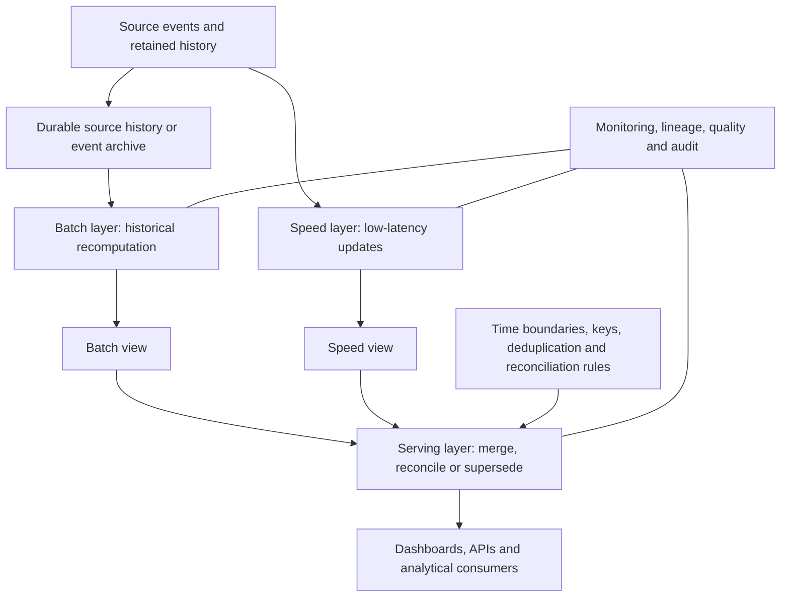
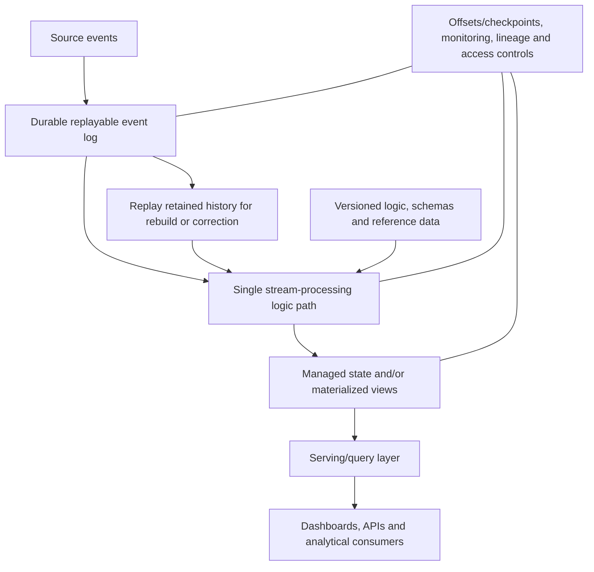

# Lambda and Kappa Architectures

> **Stage:** Stage 2D — Data Architecture  
> **Module:** `03-Data-Architecture-Patterns-and-Reference-Architectures/`  
> **Target file:** `03-lambda-and-kappa-architectures.md`  
> **Scope:** Architectural patterns for combining historical correctness and fresh analytical results. This lesson is technology-neutral and does not replace later streaming implementation modules.
>
> **Illustrative-scenario notice:** Northbridge Bank is fictional. Workloads, freshness targets, volumes, throughput, and recovery objectives in examples are assumptions for learning, not real requirements or performance benchmarks.

## 1. Learning Objectives

After completing this lesson, you should be able to:

1. Explain bounded batch processing and continuous stream processing, including the strengths and limitations of each.
2. Describe Lambda's batch, speed, and serving layers, their responsibilities, and how results reach consumers.
3. Describe Kappa's single stream-processing path over a durable, replayable event log and explain the prerequisites for useful replay.
4. Compare processing paths, source-of-truth decisions, serving behaviour, consistency, deployment, monitoring, recovery, and operating cost.
5. Explain event time, processing time, windows, late and out-of-order events, duplicate delivery, idempotence, and correction.
6. Distinguish delivery guarantees from business-level correctness and exactly-once effects.
7. Explain how replay depends on retained history, sustained throughput, ordering, dependencies, deterministic transformations, and versioned logic.
8. Calculate an illustrative replay duration with consistent units and compare it with a stated recovery objective.
9. Evaluate Lambda, Kappa, micro-batch, incremental batch, change-data capture (CDC), and periodic recomputation for Northbridge workloads.
10. Identify failure modes after a faulty deployment, prolonged outage, or missing source partition.
11. Recommend when Lambda or Kappa is justified—and when neither is required.
12. Produce reviewed pattern cards, a comparison table, a workload decision table, and a failure-mode/replay analysis.

## 2. Why the Topic Matters in Real-World Data Architecture

Many analytical systems face two different needs:

- **Freshness:** users want a result soon after a business event occurs.
- **Historical correctness:** users want the result to include late arrivals, corrections, replayed records, and the complete relevant history.

These needs can conflict. A continuous processing path can publish a result quickly, while a historical recomputation may produce a more complete or corrected result later. Lambda and Kappa are architectural approaches to this tension, but they are not default requirements for every system.

The central architecture question is not “Do we need real-time?” It is:

> What is the actual freshness target, what correctness and recovery properties are required, and what is the simplest design that satisfies them?

A dashboard that can refresh every ten minutes may need only micro-batch processing. A report produced each morning may need incremental batch and reconciliation. A high-volume event workload that requires low-latency updates and replay may justify a streaming-oriented design. Lambda or Kappa becomes relevant only when its specific structure solves a demonstrated problem.

### 2.1 Key vocabulary

- **Batch processing:** operates on a bounded collection of data, often on a schedule or when a batch is complete.
- **Stream processing:** continuously processes arriving events, often with a target latency lower than a scheduled batch.
- **Event:** a record that something happened, usually with an identifier and one or more timestamps.
- **Event log:** an ordered, retained sequence of events that can be read again while the relevant history remains available.
- **Serving layer:** the query-facing component that exposes results to downstream consumers.
- **Replay:** processing previously retained events again, often after a failure or logic change.
- **Reconciliation:** comparing outputs or counts/measures from different paths and resolving differences according to an explicit rule.
- **Source of truth:** the designated authoritative record or output for a stated business purpose. It is not automatically whichever component is fastest or most recent.

### 2.2 The source roadmap's intended progression

The authoritative roadmap places this topic after warehouse/lake/lakehouse patterns and after the requirements work on freshness, latency, throughput, and availability. Therefore, first establish workload requirements, then understand the storage and history available, and only then evaluate processing patterns.

The roadmap also explicitly warns that these patterns are frequently over-applied: many workloads need neither Lambda nor Kappa.

## 3. Prerequisite Knowledge

The roadmap identifies these prerequisites:

- **Stage 2D.2, Topic 4:** freshness, latency, throughput, and availability targets.
- **Stage 2B streaming topics:** familiarity with streaming concepts and processing.
- **Topic 2 in this module:** warehouse, lake, and lakehouse patterns, including analytical storage and data layers.

Helpful prior knowledge includes batch ingestion, CDC, event contracts, idempotency, deduplication, reconciliation, and data lifecycle controls. You do not need to know a particular broker or processing engine to reason at the architectural level.

### 3.1 Prerequisite check

Before proceeding, be able to answer:

1. What is the difference between event time and the time a processing system receives an event?
2. What does a freshness target measure, and how is it different from completeness?
3. What historical data are retained, and for how long?
4. What is the designated source of truth for a reporting measure?
5. What happens if a record is delivered twice or arrives after a report has been published?

If these are unclear, revisit the requirements, storage, and data integration prerequisites before selecting Lambda or Kappa.

## 4. Beginner-Level Learning Sequence

### 4.1 Batch processing and stream processing

**Batch processing** handles a bounded set of records. For example, a bank may load the prior day's card transactions at 01:00, validate them, reconcile totals, and publish a report after the batch completes.

**Stream processing** continuously handles events as they arrive. For example, a bank may update a provisional count of card transactions every few seconds as authorization events arrive.

| Dimension | Batch | Stream |
|---|---|---|
| Input | Bounded batch or selected interval | Continuing event flow |
| Typical trigger | Schedule, file arrival, or explicit run | Event arrival or continuous processing |
| Freshness | Often minutes to hours, but workload-dependent | Can be seconds or less, but no latency is guaranteed by the label |
| Completeness | Often easier to wait for a defined input set and reconcile it | Must explicitly handle late events, duplicates, gaps, and changing state |
| Recovery | Re-run a batch or recompute from retained inputs | Resume from a checkpoint/offset or replay retained history, subject to implementation |
| Typical complexity | Scheduling, incremental logic, backfills, dependencies | State, event-time semantics, ordering, late events, continuous operations |
| Common fit | Daily finance, scheduled reporting, periodic recomputation | Event monitoring, fresh aggregates, continuously updated views |

Neither approach is inherently more correct. Correctness depends on input completeness, event semantics, transformation logic, reconciliation, and controls.

### 4.2 Lambda architecture

**Lambda** separates processing into three logical layers:

1. **Batch layer:** retains or reads the relevant historical dataset and computes a comprehensive view. It is the path for historical recomputation and correction.
2. **Speed layer:** processes recent events to produce a low-latency view before the batch result catches up.
3. **Serving layer:** exposes queryable results and combines or reconciles the batch and speed views according to an explicit rule.

The traditional motivation is to offer a fast provisional answer while the batch layer produces a more complete historical answer. A Lambda implementation must define how the two paths overlap, how duplicates are avoided, and which output is authoritative at any point.

#### Lambda logical diagram

**Flow:** source events are available to the speed path for fresh results. The retained history feeds batch recomputation. Both views reach the serving layer, where a defined rule determines how to combine, reconcile, or supersede results.

**Source-of-truth considerations:** the source system or retained event history may be authoritative for what happened; the batch view may be authoritative for reconciled historical aggregates; the serving layer may expose a provisional combination. These roles must be documented. The source system is authoritative for business events where it is designated as such; a retained event log is a replay source only when capture completeness, ordering/identity semantics, and retention are verified. The speed view is not automatically authoritative simply because it is newer.

**Why two paths exist:** the speed path can meet a freshness requirement while a batch recomputation over a larger history handles late records, corrections, or full recomputation. The cost is maintaining and validating two processing paths and their reconciliation.

### 4.3 Kappa architecture

**Kappa** uses one principal stream-processing path over a durable, replayable event log. When processing logic changes or output must be rebuilt, retained events are replayed through the new logic, often into a new output version or controlled rebuild target.

Kappa aims to avoid maintaining separate batch and speed implementations of the same business logic. It does **not** mean batch work disappears: replaying a large historical log is a batch-like workload in resource and recovery terms, even if it uses the same stream-processing code path.

#### Kappa logical diagram

**Flow:** events are durably retained in a replayable log. A single principal processing path transforms events and updates state or materialized views. Consumers query the serving layer. To rebuild outputs, retained events are replayed through a controlled version of the processing logic.

**Kappa prerequisites and limitations:**

- The log must retain enough relevant history to satisfy reprocessing and recovery needs.
- The event format and schema history must remain interpretable.
- Replay throughput and dependent resources must be sufficient for the recovery objective.
- Transformations and reference inputs must be versioned enough to explain or reproduce results.
- Stateful operations, external side effects, event ordering, and corrections require explicit handling.
- A single code path does not eliminate operational complexity or guarantee exactly-once business effects.

### 4.4 How results reach the consumer

| Question | Lambda | Kappa |
|---|---|---|
| Where does the fresh result come from? | Speed-layer output | Current output of the stream-processing path |
| Where does the historical result come from? | Batch layer recomputes from retained history | Replay or rebuild through the same principal processing path |
| How are results served? | Serving layer merges, reconciles, or supersedes batch and speed views | Serving layer exposes the managed output/state from the stream path |
| How are historical corrections handled? | Batch recomputation can correct history; serving rules must resolve the speed view | Reprocess retained events with corrected/versioned logic and publish a rebuilt output |
| Main consistency challenge | Batch and speed paths may disagree or overlap | Replay, state rebuild, ordering, and output replacement must be controlled |
| Main architectural cost | Two paths and their reconciliation | Retained log, replay capacity, state management, and stream operations |

### 4.5 Beginner exercise: label the paths

**Task:** Redraw each diagram from memory and label:
- the source or retained history;
- the batch or stream processing path;
- the output/state;
- the serving component;
- where corrections are applied;
- the authoritative output for the relevant business purpose.

**Expected answer:** Lambda has separate batch and speed paths that meet at a serving/reconciliation boundary. Kappa has one principal stream-processing path and reuses retained event history for replay. Neither diagram should imply that the architecture automatically resolves duplicate events or guarantees business correctness.

## 5. Intermediate-Level Learning Sequence

### 5.1 Compare Lambda, Kappa, and simpler alternatives

| Approach | Processing structure | Main strength | Main cost/risk | Good candidate when | Avoid when |
|---|---|---|---|---|---|
| **Lambda** | Separate batch and speed paths plus serving/reconciliation | Fresh provisional outputs and historical recomputation can coexist | Duplicate business logic, divergent outputs, deployment/monitoring overhead, reconciliation complexity | A genuinely low-latency view and a separate authoritative historical recomputation are both required, and the two paths are justified | Freshness targets can be met by micro-batch/incremental batch, or two paths cannot be kept consistent |
| **Kappa** | One principal stream-processing path over retained replayable history | Reuse one main transformation path for live processing and replay | Log retention and replay capacity, state rebuild, schema/logic versioning, replay side effects, continuous operations | Sources provide replayable events and one path can meet live and recovery requirements | Sources only provide nightly files, history is unavailable, or simpler scheduled processing meets requirements |
| **Frequent micro-batch** | Process small bounded intervals on a schedule or trigger | Simpler operations while improving freshness over daily batch | Freshness bounded by interval and run duration; interval overlaps and late data still need handling | Minutes-level freshness is sufficient and event-by-event processing is unnecessary | A verified seconds-level target cannot be met |
| **Incremental batch** | Process only new or changed data per scheduled run | Avoids recomputing all history on each run | Watermarks, corrections, late data, and backfills need design | Scheduled reporting can be slightly delayed and incremental logic is reliable | Continuous low-latency updates are a real requirement |
| **CDC with a single downstream path** | Capture database changes and process them incrementally | Efficient change propagation without polling full tables | Source log retention, deletes, ordering, snapshots, schema changes, and reconciliation still matter | Source changes must flow with controlled lag and CDC is available | Change capture cannot cover needed sources or business events |
| **Periodic recomputation** | Recalculate a result on a defined schedule from retained data | Straightforward correctness model and recovery path | Results are stale between runs; full recomputation can be expensive | Consumers can wait for the scheduled result | The workload requires continuous fresh updates |
| **Plain batch** | Process a complete bounded dataset on a schedule | Often simplest and easiest to reconcile | Freshness is limited by schedule and processing duration | Daily/hourly outputs satisfy the requirement | A proven low-latency target cannot be met |

A workload can combine techniques without adopting the Lambda or Kappa pattern as a whole. For example, CDC can feed an incremental batch process. A stream may feed a provisional counter while a daily batch report remains the sole authoritative output; this does not automatically require a formal Lambda architecture unless the two views are deliberately combined as its serving model.

### 5.2 Northbridge workload decision table

**Illustrative assumptions only:** the targets below are hypothetical values used to teach the decision method. They are not real Northbridge requirements or service-level commitments. Replace them with requirements agreed by business, operations, risk, and compliance stakeholders.

| Workload | Illustrative freshness assumption | Candidate approach | Why this is a candidate | Questions that could change the choice |
|---|---|---|---|---|
| **Card-transaction fraud monitoring** | Provisional alert view within 5 seconds; reconciled historical totals within 1 hour | Kappa if replayable event history and a single path can meet the recovery and correctness needs; Lambda if a distinct batch-corrected result must coexist with a low-latency view | Fresh event-level updates and historical corrections may both matter | Is five seconds a real requirement? Are source events replayable? How are reversals, duplicates, late events, and alert corrections handled? What is the recovery objective? |
| **Executive transaction dashboard** | Refresh within 10 minutes | Micro-batch or incremental batch first; stream only if measured requirements justify it | A ten-minute target may not justify continuous stream operations | Is freshness measured from event occurrence or source availability? What are concurrency and completeness needs? Can scheduled updates satisfy users? |
| **Daily regulatory/finance reconciliation** | Final reconciled result by next business morning | Batch or incremental batch; Lambda only if a separate provisional result is genuinely needed | Auditable completeness and reconciliation dominate over immediate freshness | What evidence and sign-off are required? Are restatements needed? Does any consumer require a provisional view? |
| **Operational service-health metrics** | Current view within 30 seconds | Stream or micro-batch depending on the measured target and event volume | Continuous monitoring may need rapid updates, but some dashboards tolerate minute-level intervals | Is alerting safety-critical? What is tolerated delay? Are events replayable? Is the metric approximate or authoritative? |
| **Marketing segmentation** | Daily or hourly refresh | Incremental batch/CDC, with governed curated tables | Segments often tolerate scheduled refresh and require clear consent/purpose controls | Are triggers event-driven? What freshness is commercially necessary? How are corrections and suppression requests propagated? |
| **Nightly source-file ingestion** | Complete result by 06:00 | Scheduled batch, perhaps incremental batch | If the source only provides a nightly file, a stream pattern cannot create earlier source availability | Is there an upstream event/CDC source? What happens when a file is late or incomplete? Is partial output allowed? |

The table is not a fixed prescription. The correct approach depends on actual freshness, completeness, recovery, source availability, and governance requirements. Always ask whether the simpler option satisfies the stated target before proposing Lambda or Kappa.

### 5.3 Event time, processing time, and windows

An event may contain several times:

- **Event time:** when the event occurred in the business/source domain, as represented by the event timestamp.
- **Ingestion time:** when the platform accepted or persisted the event.
- **Processing time:** when a processing operator handled it.

These times differ when networks are delayed, devices buffer events, a source clock is wrong, a partition is unavailable, or a replay is underway.

**Windowing** groups events into intervals for an aggregation, such as transaction count per five-minute window. Common logical types include:
- **Tumbling windows:** fixed, adjacent intervals that do not overlap.
- **Sliding windows:** intervals that overlap as they advance.
- **Session windows:** intervals grouped by activity separated by an inactivity gap.

For business reporting, the architecture must state which time defines the window and what happens when events arrive late. A window based on processing time can group a delayed event differently from one based on event time.

**Late and out-of-order events:** an event with an earlier event timestamp may arrive after later events. The system may:
- wait for a defined lateness allowance before finalizing a result;
- revise previously published windows when late events arrive;
- route very late events to a correction/backfill process;
- reject them only if a documented business rule allows it.

Each choice affects freshness, correctness, and operational complexity. A “watermark” or lateness threshold is a policy about when the system believes it has seen enough events for a time range; it is not proof that no earlier event can ever arrive.

### 5.4 Duplicate delivery, idempotence, and exactly-once effects

A source or transport may deliver an event more than once, for example after a timeout and retry. If processing simply adds the amount on every delivery, a duplicate can inflate a total.

- **At-most-once delivery** may lose records rather than retry them.
- **At-least-once delivery** can retry and produce duplicates; consumers must tolerate this where duplicates are possible.
- **Exactly-once processing/effect** is a scoped claim about a particular processing boundary and its state/output transaction semantics. It must be defined precisely.

**Idempotence** means repeating the same operation has the same intended result as performing it once. A common design uses a stable event ID or source change key and a deduplication/idempotency record. For updates, the business key, event version, ordering, and correction semantics must also be defined.

A broker's delivery semantics do not automatically guarantee an exactly-once business effect across every downstream system. For example, updating a local state store and sending a payment instruction to an external system may not be one atomic transaction. End-to-end correctness requires explicit transaction boundaries, idempotent APIs or sinks where available, deduplication, reconciliation, and recovery procedures.

**Example:** If transaction event `T-884` for ₹500 is delivered twice, a correct transaction-count aggregate should count it once if both records represent the same business event. If the source later emits a valid reversal, that reversal is a distinct business event and should not be suppressed merely because it relates to the original transaction.

### 5.5 Reconciliation and source-of-truth rules

Lambda's separate views need a defined rule for overlap. For example, a speed view may cover recent event-time windows while the batch view provides a corrected result after a defined cutoff. The serving layer must know which windows or keys come from which view; blindly adding both views double-counts overlapping events.

A reconciliation rule should specify:

1. the business key and event identity;
2. the event-time range or partition covered by each path;
3. how duplicate events and reversals are handled;
4. which path is provisional and which output becomes authoritative;
5. when and how corrected results replace provisional results;
6. what happens when the paths disagree;
7. who approves or owns the business result;
8. how changes and corrections are audited.

Kappa has no separate batch and speed views in its core pattern, but it still needs reconciliation against sources or business totals, and controlled replacement of output after replay. A single path does not eliminate the need to validate its result.

### 5.6 Intermediate exercise: four workload decisions

**Task:** For at least four Northbridge workloads in Section 5.2:
- state an explicit freshness target and label it as an assumption;
- identify the correctness and recovery requirement;
- compare Lambda, Kappa, and at least one simpler alternative;
- state the source of truth;
- identify one assumption that could reverse the decision.

**Expected output:** a workload decision table with reasons. At least one workload should select a simpler alternative rather than Lambda or Kappa, unless your scenario assumptions explicitly justify both patterns for every workload.

## 6. Advanced-Level Learning Sequence

### 6.1 Replay and reprocessing

**Replay** re-reads retained events and processes them again. **Reprocessing** is broader: it can include replaying an event log, rebuilding from raw files, re-running a batch, or recomputing a materialized view.

Replay is constrained by:

- how much history is retained and whether it includes the required source events;
- whether schemas and serialization rules remain interpretable;
- sustained replay throughput under realistic resource and dependency limits;
- ordering and partitioning semantics needed by stateful computations;
- whether state stores, reference data, and external dependencies can be rebuilt;
- whether transformation logic is deterministic and versioned;
- whether outputs can be rebuilt separately and published atomically or safely;
- whether side effects are idempotent or suppressed during replay;
- how corrections and deletions must propagate to derived outputs.

**Deterministic transformation:** given the same inputs, logic version, reference data, and parameters, the transformation produces the same intended result. Nondeterminism can arise from unversioned reference tables, current-time lookups, random values, mutable external APIs, or undefined ordering. If a replay uses today's reference data rather than the reference data applicable to the original events, the output may legitimately differ—but the reason must be understood and documented.

A replay plan should name the input history, code/schema/reference-data versions, state rebuild method, output destination, validation criteria, and cutover method.

### 6.2 Replay-time calculation with explicit units

The roadmap supplies the relationship:

\[
\text{replay\_time} \approx
\frac{\text{retained\_volume}}{\text{sustained\_replay\_throughput}}
\]

This is a first-order estimate, not a performance guarantee. It assumes the stated sustained throughput can be maintained across the relevant data, and it excludes or simplifies startup, coordination, state rebuild, output validation, dependency waits, and cutover. Include these in a recovery plan where material.

**Illustrative example (decimal units throughout):**

- Retained event volume: \(30\ \text{TB}\)
- Sustained replay throughput: \(500\ \text{MB/s}\)
- Decimal convention: \(1\ \text{TB} = 1{,}000{,}000\ \text{MB}\)

**Step 1 — Convert the volume to MB**

\[
30\ \text{TB} \times 1{,}000{,}000\ \text{MB/TB}
= 30{,}000{,}000\ \text{MB}
\]

**Step 2 — Divide by sustained throughput**

\[
\frac{30{,}000{,}000\ \text{MB}}{500\ \text{MB/s}}
= 60{,}000\ \text{s}
\]

MB units cancel, leaving seconds.

**Step 3 — Convert seconds to hours**

\[
60{,}000\ \text{s} \div 3{,}600\ \text{s/hour}
= 16.666\ldots\ \text{hours}
\approx 16.7\ \text{hours}
\]

**Step 4 — Compare with an illustrative recovery objective**

Assume, only for this example, that the **Recovery Time Objective (RTO)** for rebuilding the affected analytical output is **12 hours**. The estimated replay alone is approximately **16.7 hours**, so the plan misses the RTO by:

\[
16.7 - 12 = 4.7\ \text{hours (approximately)}
\]

This is a design warning, not proof of actual platform performance. The estimate excludes validation and cutover, so total recovery could take longer. A defensible response could include testing higher sustained throughput, parallelizing independent partitions if semantics permit, reducing replay scope through checkpoints/snapshots, retaining precomputed state with a safe rebuild method, or revising the recovery objective with stakeholders. Any throughput improvement must be measured in the target environment; do not assume linear scaling.

### 6.3 Recovery targets: distinguish RPO, RTO, and freshness

- **Freshness target:** how old the data may be when a consumer sees it.
- **Recovery Time Objective (RTO):** how quickly a service or output must be restored after a disruption.
- **Recovery Point Objective (RPO):** the maximum acceptable period of data loss after a disruption, expressed in time. Checkpoints, replicated state, and retained source history are mechanisms that may help meet the RPO; they do not change its definition.

A replay estimate is relevant to RTO when the system must rebuild a result. It does not, by itself, prove that RPO is met. RPO depends on durable capture, acknowledged writes, retained source history, replication, and recovery semantics.

An architecture may meet a dashboard freshness target in normal operation but fail its RTO after a prolonged outage. It may also recover quickly from a checkpoint but lack enough source history to correct a three-week logic defect. State these cases separately.

### 6.4 Faulty deployment, prolonged outage, and missing partition

| Failure case | Lambda considerations | Kappa considerations | Controls and recovery evidence |
|---|---|---|---|
| **Faulty transformation deployment** | Speed path may publish incorrect provisional results while batch path may remain correct or also be affected. Roll back or fix the bad path, recompute affected historical outputs, reconcile and replace incorrect serving results. | A bad logic version may corrupt state or outputs. Stop or isolate the bad version, preserve the input log, rebuild a clean output with corrected/versioned logic, validate, then cut over. | Track deployed logic version, affected time/key range, source history, output versions, and downstream consumers; prevent replay side effects. |
| **Prolonged processing outage** | Speed results become stale; batch may still operate if independent. On recovery, catch up speed processing and reconcile against the historical path. | The consumer-facing result becomes stale while the single path is down. Resume from safe checkpoints/offsets or replay retained history; verify catch-up and state consistency. | Compare lag to the freshness target, confirm history retention covers the gap, calculate catch-up/replay time, validate before declaring recovery. |
| **Missing source partition or event gap** | Both speed and batch can be wrong if the source history is incomplete. Batch is not automatically correct merely because it is historical. Re-ingest the missing partition and recompute affected windows. | Replay cannot reconstruct events that were never retained. Recover the missing partition from an authoritative source, then process it with correct ordering/identity semantics and reconcile outputs. | Detect gaps using source counts, sequence/partition metadata, checksums, or business reconciliation where available; document completeness before publication. |
| **Late or out-of-order events** | Speed view may be provisional; batch recomputation can correct it, but the serving rule must define when the corrected result wins. | The stream path must handle allowed lateness, revise state/output, or route late events to a controlled correction process. | Define event-time windows, lateness policy, correction behavior, and audit trail. |
| **Replay exceeds recovery target** | Recompute the batch path may take too long; speed path can maintain fresh provisional output only if it is still healthy and serving rules permit. | A single path may remain unavailable or stale until replay catches up if the output must be rebuilt. | Test replay throughput; use checkpoints/snapshots only with a safe, validated restore path; quantify recovery rather than assuming it. |
| **Retention expires before defect is discovered** | Batch layer cannot correct history that is no longer available unless another approved source/archive exists. | Kappa cannot replay records no longer retained in the log; a raw archive or external source may be needed. | Align retention to defect-detection and recovery windows, not just normal processing needs. |

### 6.5 Cost and operational complexity

#### Lambda's additional responsibilities

- two code paths implementing overlapping business logic;
- consistency between batch and speed outputs;
- separate deployments, monitoring, alerting, testing, and capacity planning;
- serving logic to merge, reconcile, or supersede results;
- diagnosing differences between paths;
- managing retention and deletion across event history, batch outputs, speed state, and serving views.

The risk is not merely that code is duplicated. The same business rule may evolve differently in each path and silently produce different answers.

#### Kappa's responsibilities

- durable event-log retention and capacity;
- schema compatibility and history readability;
- replay throughput and state-rebuild planning;
- versioning code, reference data, and parameters;
- ensuring replay does not repeat external side effects;
- handling event-time, state, ordering, late data, and corrections;
- replacing outputs safely after replay;
- monitoring lag, completeness, processing failures, and cost.

Kappa can reduce duplicate business logic, but the stream path still requires robust operations. Replay may consume significant compute and compete with live processing; architecture must decide whether replay shares capacity, uses isolated capacity, or temporarily slows live processing.

### 6.6 Failure-mode analysis

| Failure mode | Symptom | Root cause to investigate | Preventive/detective controls | Recovery action |
|---|---|---|---|---|
| Divergent Lambda views | Dashboard differs from next-day report | Logic drift, overlap, different event-time rules, duplicate counting | Shared business definitions, contract tests, path reconciliation, version tracking | Correct logic, recompute affected range, reconcile and replace published view |
| Duplicate events inflate totals | Counts or amounts exceed source totals | Retry delivery treated as a new business event | Stable event IDs, idempotent sink, deduplication state, source reconciliation | Rebuild or compensate affected aggregate; audit corrected output |
| Late events omitted | Old windows do not reflect delayed transactions | Window closed too early or no late-event correction path | Event-time semantics, lateness policy, late-event metrics, correction path | Recompute/revise affected window and notify consumers if required |
| Out-of-order state corruption | Incorrect balance/state transition | Processing order differs from business order; no version/sequence rule | Per-key ordering where required, event versioning, invariant checks | Rebuild affected key/partition from authoritative history |
| Replay cannot finish in time | Recovery remains incomplete beyond RTO | Insufficient retained-history throughput or unaccounted dependencies | Replay estimates, load tests, retention checks, recovery exercises | Reduce safe replay scope, scale after measurement, restore from validated checkpoint, or revise target |
| Required history missing | Reprocessing cannot reproduce prior period | Retention too short, source gap, unrecorded schema | Retention design, source completeness checks, schema history, archival policy | Retrieve authoritative source/archive; disclose irrecoverable gaps |
| Nondeterministic replay | Rebuilt results differ unexpectedly | Mutable reference data, unversioned logic, current-time dependency, undefined ordering | Versioned code and inputs, deterministic contracts, reproducibility tests | Rebuild with correct versions and document intentional differences |
| Replay repeats side effects | Duplicate notifications, exports, or downstream actions | Replayed records trigger external actions again | Side-effect isolation, idempotency keys, replay mode, outbox/transaction design where appropriate | Stop duplicate actions, reconcile external state, compensate under approved process |
| Prolonged lag | Current result is too stale | Processing capacity below arrival rate, dependency failure, contention | Lag monitoring, throughput headroom, backpressure and recovery plans | Restore dependency/capacity and calculate catch-up time |
| Missing partition | Totals have a gap but pipeline appears healthy | Source partition was not captured or acknowledged | Partition/sequence completeness checks and business reconciliation | Re-ingest missing partition and recompute affected outputs |
| Deletion does not propagate | Derived output still exposes restricted data | Lineage/copy inventory incomplete | Data lineage, deletion workflow, derivative inventory and verification | Remove or correct derived copies under policy; record exceptions |
| Stream chosen without need | Operational burden rises without business benefit | “Real-time” assumed rather than measured | Requirements-first design, parsimony review, cost/benefit ADR | Move to micro-batch/incremental batch if it meets the requirement |

### 6.7 Choosing among Lambda, Kappa, and neither

Use this decision sequence:

1. **Write the requirement:** freshness, completeness, correctness, concurrency, recovery, and audit needs.
2. **Inspect the source:** continuous events, CDC, periodic files, or an existing database snapshot? What history can be retained and replayed?
3. **Test the simplest alternative:** batch, incremental batch, micro-batch, CDC, or periodic recomputation.
4. **Choose Lambda only if** separate low-latency and historical-recomputation paths are both needed and the organization can keep them consistent.
5. **Choose Kappa only if** a durable replayable event history and one principal stream-processing path can meet live, correction, and recovery requirements.
6. **Define correctness:** event identity, event time, duplicate handling, ordering, late events, reconciliation, and authoritative outputs.
7. **Calculate recovery:** estimate replay/recompute time, compare it with RTO, and test the assumptions.
8. **Record the decision:** document selected and rejected options, assumptions, failure modes, operating skills, and revisit triggers.

### 6.8 When neither pattern is justified

**Illustrative scenario:** Northbridge receives a complete transaction file every night at 01:00. Finance requires a reconciled report by 06:00 the same morning. No consumer needs interim figures, and business stakeholders accept that the report is not final before reconciliation completes.

A scheduled batch or incremental batch design is likely simpler than Lambda or Kappa:
- there is no stated need for a separate low-latency speed view;
- the source itself does not provide a continuous event feed;
- reconciliation can occur as part of the batch;
- replay can use retained files and versioned transformation logic;
- continuous stream operations would add cost without meeting an unmet requirement.

**What would change the decision?** If an approved fraud-monitoring use case required transaction events within seconds, the source made those events available continuously, and recovery requirements justified it, a stream-oriented design could be reconsidered for that workload. Do not impose the pattern on all workloads because one has a low-latency requirement.

### 6.9 Advanced exercise: replay and recovery analysis

**Task:** Choose a workload and state:
- retained volume and unit convention;
- sustained replay throughput and how it would be measured;
- recovery objective;
- whether the calculation includes state rebuild, validation, dependencies, and cutover;
- what history, schemas, logic, and reference data must be retained;
- what happens if the required history is missing;
- how external side effects are prevented during replay;
- which simpler alternative was evaluated.

Use:

\[
\text{replay time} \approx
\frac{\text{retained volume}}{\text{sustained replay throughput}}
\]

Show unit conversions and compare the result with the recovery objective. Mark all example numbers as assumptions and do not claim they are measured benchmarks.

## 7. Industry-Application Exercises

### Exercise 1 — Recommend a card-transaction analytics approach

**Task:** For the fictional Northbridge card-transaction workload, define illustrative freshness, history, replay, and recovery requirements. Compare Lambda, Kappa, and a simpler alternative.

**Required output:**
- requirements and assumptions;
- source event and retained-history inventory;
- candidate approach and rejected alternatives;
- event identity, duplicate handling, event-time, late-event, and correction rules;
- source-of-truth and reconciliation policy;
- replay calculation and recovery objective;
- ownership, monitoring, and operating responsibilities.

**Acceptance criteria:** each requirement has a stated value or an explicit open question; all values are labelled as assumptions until approved; the recommendation explains why the simpler alternatives do or do not meet the need.

### Exercise 2 — Define reconciliation between fast and accurate results

**Task:** Write the reconciliation rule for a hypothetical Lambda design that exposes provisional card-transaction counts and later reconciled counts.

Your rule must define:
1. keys and event identity;
2. time basis and window boundaries;
3. treatment of duplicates, reversals, and late events;
4. the provisional period and finalization condition;
5. which result a regulator or finance user sees;
6. how differences are measured and escalated;
7. how corrections are published and audited.

**Acceptance criteria:** a reviewer can determine the authoritative result for a given key/time range without guessing or adding overlapping views.

### Exercise 3 — Estimate replay time

**Task:** Use the worked calculation in Section 6.2 or select a new explicitly illustrative volume and throughput. Convert units consistently, show the division, convert seconds to a suitable time unit, and compare with a stated RTO.

**Acceptance criteria:** units cancel correctly; decimal and binary conventions are not mixed; the answer distinguishes estimated replay time from total recovery time; the calculation is not described as a benchmark.

### Exercise 4 — Failure-mode review

**Task:** Choose a faulty deployment, prolonged outage, missing partition, late-event defect, or retention failure. Compare how Lambda and Kappa would recover.

**Acceptance criteria:** identify the affected data range, available history, authoritative source, correction method, duplicate/side-effect risk, validation criteria, consumer notification, and conditions for declaring recovery complete.

### Exercise 5 — Decide when neither is required

**Task:** Describe a workload where scheduled batch, incremental batch, micro-batch, or CDC is sufficient. Compare at least two simpler alternatives with Lambda/Kappa and state which requirement is absent.

**Acceptance criteria:** the rejected pattern has a specific unmet need or unjustified complexity identified; the selected alternative still includes correctness, reconciliation, and recovery controls.

### Exercise 6 — Review an event-driven proposal

**Scenario:** A team proposes Kappa because “everything is a stream,” but the only source is a nightly file.

**Questions to answer:**
- What business requirement would streaming satisfy that batch does not?
- Does the source provide events continuously, or only after a nightly export?
- What history would be retained, and how would replay work?
- Is micro-batch or incremental batch sufficient?
- What operating costs and skills would a stream path add?

**Expected conclusion:** a nightly file does not, by itself, justify Kappa. Ask for the unmet requirement and source capability; choose a simpler pattern if it satisfies the stated target.

## 8. Practical Scenarios and Case-Based Reasoning

### 8.1 Scenario A — Dashboard needs data within ten minutes, fully accurate by next morning

**Illustrative assumptions:** a dashboard needs a provisional result within ten minutes; a reconciled result must be ready by the next morning. These are scenario assumptions, not actual Northbridge requirements.

**Reasoning:**

1. Establish whether “within ten minutes” means from business event time, source availability, or ingestion.
2. Ask whether users genuinely need a provisional result or can accept a ten-minute micro-batch.
3. Compare frequent micro-batch with incremental batch first.
4. If the business needs a continuous low-latency result during the day and a distinct historically reconciled result, Lambda may fit.
5. If a replayable event log and one principal processing path can meet the live and recovery requirements, Kappa may fit.
6. Define the serving rule so provisional results are not confused with reconciled results.

**Likely conclusion:** do not select Lambda solely because the final result is more accurate next morning. If a micro-batch meets the freshness target and the final batch reconciles the same outputs without a separate speed view, the simpler design may be sufficient.

### 8.2 Scenario B — Transformation bug corrupted three weeks of output

**Lambda recovery reasoning:**
- Determine whether the bug affected the speed path, batch path, or both.
- Identify the impacted event-time range and output keys.
- Fix and version the logic, then recompute affected history from retained source data.
- Reconcile the recomputed batch output with any speed output and downstream copies.
- Replace incorrect results using a controlled cutover and audit the correction.
- Check whether the speed path continues to publish bad results during recovery.

**Kappa recovery reasoning:**
- Stop or isolate the faulty logic and prevent new bad outputs.
- Preserve the retained event history and identify the faulty logic version.
- Replay the affected history with corrected, versioned logic into a clean output/state.
- Rebuild state and dependent aggregates as required; prevent external side effects during replay.
- Validate completeness, business invariants, and source reconciliation before cutover.

**Comparison:** Lambda may preserve a separate speed view while historical results are rebuilt, but only if that view is still valid and the serving rules are clear. Kappa may reduce duplicated logic, but a full replay can exceed recovery objectives. Neither approach can repair data that were never retained or captured.

### 8.3 Scenario C — “Kappa because everything is a stream,” but sources are nightly files

**Diagnosis:** the proposal starts with a pattern rather than a requirement. A nightly file does not supply new information throughout the day. Turning the file into an event log may still be possible, but it does not create fresher source data.

**Questions:**
- Is there an actual continuous source or CDC capability?
- What freshness target is unmet by nightly/incremental batch?
- Is there a need to replay history through one stream-processing path?
- Would periodic recomputation or micro-batch satisfy the requirement with fewer operational dependencies?
- Who will operate the log, retention, replay, schema evolution, and recovery?

**Likely conclusion:** scheduled or incremental batch is the default candidate until an unmet requirement justifies a different approach.

### 8.4 Scenario D — Faulty deployment after a prolonged outage

**Scenario:** the processing path was unavailable for six hours. On recovery, a new logic version is also found to have incorrectly handled reversal events.

**Required response:**
1. Preserve source history and identify which logic version processed each range.
2. Establish whether outputs contain missing events, duplicates, or incorrect reversal semantics.
3. Stop the faulty version from creating further incorrect outputs.
4. Estimate catch-up/replay time using retained volume and measured sustained throughput.
5. Rebuild the affected range with corrected logic and versioned reference inputs.
6. Verify source completeness, event identity, reversal handling, and aggregate reconciliation.
7. Publish corrected outputs using a controlled replacement procedure.
8. Notify owners of downstream reports or decisions affected by the incorrect interval.
9. Record the incident, correction, residual uncertainty, and prevention work.

**Decision point:** if replay cannot meet the recovery objective, a previously validated checkpoint or snapshot may help, but only if it can be restored consistently and the missing interval can be replayed safely. Do not assume a checkpoint fixes a logic defect if it contains state produced by the same faulty logic.

### 8.5 Scenario E — Missing partition and incomplete history

**Scenario:** a source partition covering part of the previous day was not captured. The pipeline is otherwise healthy.

**Reasoning:**
- Processing throughput cannot compensate for an event set that is absent.
- Replaying the captured log reproduces the gap rather than filling it.
- The missing partition must be recovered from an authoritative source or approved archive.
- Re-ingestion must preserve event identity and ordering semantics and avoid duplicating records already present.
- Affected state, windows, and aggregates must be recomputed or corrected.
- Completeness must be verified before declaring the output authoritative.

**Required evidence:** a source partition/sequence inventory, counts or checksums where available, re-ingestion record, deduplication results, reconciled business measures, and a record of any irrecoverable gap.

### 8.6 Practice-question coverage

The authoritative roadmap specifies a separate module-level `practice-questions.md` assessment resource and notes that the topic files and assessment file were empty when the roadmap was authored. This lesson therefore provides topic-level exercises and worked scenarios for the known Module 3 scope; it does **not** claim to answer a separate populated question bank.

When `practice-questions.md` is populated, answer the Topic 3 questions closed-book, mark each correct/partly correct/wrong, record why, correct incomplete answers, and re-attempt them. The relevant question categories are batch/stream definitions, Lambda/Kappa diagrams, path responsibilities, consistency/reconciliation, replay prerequisites and arithmetic, failure-mode recovery, and when a simpler design is sufficient.

## 9. Expected Outputs and Deliverables

Produce and review the following:

1. **Lambda pattern card** with problem, paths, responsibilities, serving semantics, source-of-truth rules, strengths, trade-offs, prerequisites, and failure modes.
2. **Kappa pattern card** with event-log requirements, one principal path, replay prerequisites, strengths, trade-offs, and failure modes.
3. **Comparison table** that includes Lambda, Kappa, and simpler alternatives.
4. **Workload decision table** covering at least four Northbridge workloads, with explicit illustrative freshness targets, reasons, assumptions, and decision-changing requirements.
5. **Reconciliation rule** for a two-path design, including event identity, time basis, provisional/final outputs, and authoritative ownership.
6. **Replay-time calculation** with volume/throughput units, conversion steps, an RTO comparison, and limitations.
7. **Failure-mode analysis** covering at least a faulty deployment, outage, missing partition, late/duplicate events, or replay failure.
8. **Architecture decision record (ADR)** naming the selected approach, simpler alternatives considered, assumptions, risks, operational prerequisites, and revisit triggers.
9. **Scenario answers** for the ten-minute dashboard/next-morning accuracy case, three-week logic bug, and nightly-file Kappa proposal.
10. **Topic 3 practice-question record** once the designated question bank is populated.

Separate known facts, assumptions, open questions, and recommendations. Do not present illustrative throughput as a benchmark or illustrative freshness as an approved service level.

## 10. Common Mistakes and Misconceptions

1. **Assuming any real-time need implies Lambda or Kappa.** Start with the required freshness and test simpler alternatives.
2. **Believing Kappa removes all batch concerns.** Replay is a large historical workload and needs capacity, state rebuilding, and controlled output replacement.
3. **Underestimating Lambda's two-path cost.** Duplicate logic, testing, monitoring, deployment, reconciliation, and serving semantics must all be maintained.
4. **Assuming the batch layer is always correct.** It can inherit missing source data, incorrect logic, incomplete retention, or bad reference inputs.
5. **Assuming the speed layer is authoritative because it is newer.** Freshness and correctness are different properties.
6. **Adding Lambda views together without overlap rules.** This can double-count the same events.
7. **Treating event time and processing time as interchangeable.** Late and out-of-order events can change window assignments and results.
8. **Assuming a watermark proves all events have arrived.** It is a lateness policy or estimate, not proof that no earlier event can arrive.
9. **Confusing delivery semantics with business correctness.** At-least-once delivery may duplicate records; exactly-once claims are scoped to specific processing/effect boundaries.
10. **Assuming a broker guarantees end-to-end exactly-once effects.** External side effects and downstream sinks need their own transaction/idempotence strategy.
11. **Ignoring event identity and reversals.** A duplicate delivery and a legitimate reversal are not the same event.
12. **Assuming replay is always possible.** History, schemas, dependencies, and source partitions may be missing or expired.
13. **Using unversioned reference data during replay.** The rebuilt result may differ for reasons unrelated to the event stream.
14. **Ignoring replay side effects.** Reprocessing can send duplicate notifications or trigger repeated downstream actions if not controlled.
15. **Mixing decimal and binary units in replay arithmetic.** State the convention and keep units consistent.
16. **Comparing replay time to freshness instead of recovery objective.** Replay estimates generally matter for recovery time; freshness is a separate normal-operation requirement.
17. **Ignoring validation and cutover time.** Replay throughput alone is not total recovery duration.
18. **Assuming a missing source partition can be recreated by replaying what remains.** Missing data must be recovered from an authoritative source or disclosed as a gap.
19. **Ignoring retention and deletion across outputs.** Logs, batch outputs, speed state, serving views, and derived copies all need lifecycle rules.
20. **Choosing Kappa for nightly files without an unmet requirement.** A single path is not valuable if it adds continuous operations without business benefit.

## 11. Mastery Criteria

### 11.1 Pattern understanding

- Explains batch and stream processing with concrete examples.
- Draws accurate Lambda and Kappa diagrams and describes how results reach consumers.
- Identifies where historical correction occurs in each design.
- Explains why Lambda has two processing paths and what the serving layer must resolve.
- Explains why Kappa requires retained replayable history and does not eliminate all batch concerns.

### 11.2 Correctness and time semantics

- Distinguishes event time, ingestion time, and processing time.
- Explains windowing and the consequences of late/out-of-order events.
- Defines duplicate handling, idempotence, and correction rules.
- Distinguishes delivery semantics from business-level exactly-once effects.
- Provides a reconciliation rule and names the authoritative result for the stated business purpose.

### 11.3 Replay and recovery

- Lists history, schema, logic, reference-data, ordering, state, and dependency prerequisites for replay.
- Calculates replay duration with consistent units and correct conversions.
- Compares the estimate with a stated RTO and notes omitted recovery work.
- Explains what happens after a faulty deployment, prolonged outage, and missing partition.
- States how replay side effects are prevented and how output correctness is verified.

### 11.4 Architecture selection

- Compares Lambda and Kappa with micro-batch, incremental batch, CDC, and periodic recomputation.
- Maps at least four Northbridge workloads using labelled assumptions and decision-changing requirements.
- Recommends a simpler alternative for at least one scenario where appropriate.
- Names operating skills, costs, failure modes, and conditions that would change the decision.
- Makes no unsupported universal claim about performance, correctness, or cost.

### 11.5 Review rubric

| Area | Strong evidence | Needs revision |
|---|---|---|
| Definitions and diagrams | Paths and responsibilities match the prose | Speed/batch paths or Kappa replay are misrepresented |
| Source of truth | Provisional and authoritative outputs are explicit | “Newest” or “batch” is assumed to mean correct |
| Event correctness | Identity, duplicates, late events, ordering, and correction are addressed | Delivery is equated with business correctness |
| Replay calculation | Units cancel correctly; assumptions and RTO comparison are clear | Mixed units, unsupported benchmark, or missing recovery overhead |
| Failure recovery | History gaps, logic versions, state, side effects, and validation are covered | Replay is assumed to fix missing data automatically |
| Alternatives | Simpler approaches are compared on the same requirements | Lambda/Kappa chosen from trend or “real-time” label |
| Governance and lifecycle | History, outputs, corrections, and deletions are covered | Copies and derived state are ignored |
| Evidence | Assumptions, open questions, and acceptance criteria are explicit | Illustrative values are presented as real requirements |

## 12. Completion Gate

Do not mark this topic complete until the following evidence is reviewed.

- [ ] I can explain batch and stream processing with concrete examples.
- [ ] I can draw and explain Lambda's batch, speed, and serving layers.
- [ ] I can draw and explain Kappa's single principal stream path and replayable log.
- [ ] I can identify where fresh, historical, corrected, and authoritative results come from.
- [ ] I have completed pattern cards for Lambda and Kappa.
- [ ] I have compared Lambda and Kappa with micro-batch, incremental batch, CDC, and periodic recomputation.
- [ ] I have mapped at least four Northbridge workloads using explicit illustrative freshness assumptions.
- [ ] I can explain event time, processing time, windows, late events, and out-of-order records.
- [ ] I have specified duplicate handling, idempotence, and correction semantics.
- [ ] I can distinguish delivery guarantees from end-to-end business effects.
- [ ] I have documented a reconciliation rule for a design with separate fast and historical results.
- [ ] I have completed a replay-time calculation with unit conversions and an RTO comparison.
- [ ] I have stated replay limitations, retained-history requirements, deterministic logic and versioning requirements.
- [ ] I have analyzed recovery from a faulty deployment, a prolonged outage, and a missing partition.
- [ ] I have explained why replaying retained records cannot restore events that were never captured.
- [ ] I have justified at least one scenario where neither Lambda nor Kappa is required.
- [ ] I have produced a failure-mode analysis and a defensible architecture decision record.
- [ ] I have answered and corrected Topic 3 questions in `practice-questions.md` once the designated question bank is populated.
- [ ] I have reviewed all deliverables against the mastery criteria and corrected gaps.

**Completion decision:** the topic is complete only when the two pattern cards, comparison table, failure-mode/replay analysis, and workload decision table are reviewed; the replay estimate is checked against a stated recovery objective; and at least one scenario justifies a simpler alternative. If the separate question bank remains empty, record that assessment dependency explicitly rather than claiming it has been completed.
