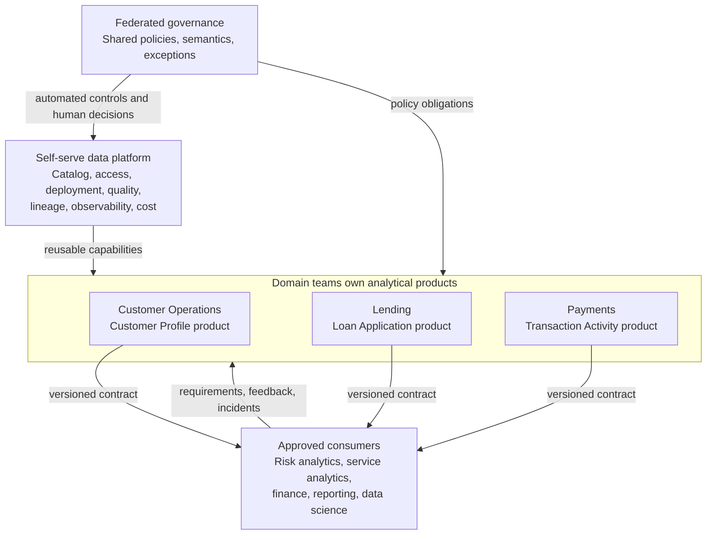

# 04 — Data Mesh Principles and Domain Data Products

**Roadmap location:** Stage 2D — Data Architecture / `03-Data-Architecture-Patterns-and-Reference-Architectures/`  
**Target filename:** `04-data-mesh-principles-and-domain-data-products.md`  
**Controlling specification:** `roadmap-Data-Architecture-Patterns-and-Reference-Architectures.md`, Module 4, sections 4.1–4.12  
**Case-study convention:** Northbridge Bank is fictional. All domain structures, targets, volumes, roles, and pilot thresholds in this lesson are illustrative assumptions—not claims about a real bank or statements of regulatory requirements.

---

## 1. Learning Objectives

By the end of this lesson, you should be able to:

1. Explain why a central data team can become a bottleneck as source systems, analytical questions, and consumers multiply.
2. Define data mesh accurately and explain its four principles:
   - domain-oriented ownership of analytical data;
   - data as a product;
   - a self-serve data platform;
   - federated computational governance.
3. Distinguish domain-oriented architecture from data mesh. Data mesh is a particular operating and architecture approach built around all four principles; it is not a synonym for any architecture organised around domains.
4. Explain why a database table, file, dashboard, or pipeline is not automatically a data product.
5. Specify a data product with accountable ownership, a consumer purpose, an interface and contract, discoverable metadata, documentation, quality controls, access rules, versioning, support, and measurable service expectations.
6. Map candidate Northbridge Bank domains and draw boundaries based on business capabilities, authoritative meaning, decision rights, and operational accountability.
7. Explain how consumers discover, request access to, integrate with, and receive change notifications for products owned by other domains.
8. Separate enterprise-wide mandatory policies from domain-level implementation choices, and explain which decisions can be automated and which require human judgement.
9. Explain how platform capabilities reduce repeated product-building effort while also introducing real build, run, support, security, and opportunity costs.
10. Evaluate readiness across domain capability, product ownership, skills, funding, incentives, platform maturity, governance, and executive sponsorship.
11. Diagnose mesh-washing, unclear accountability, duplicate ownership, incompatible contracts, underfunded domains, low adoption, and other failure modes.
12. Recommend either a bounded pilot, a smaller incremental approach, or no data-mesh adoption when the evidence does not justify the operating-model cost.
13. Produce a testable pilot plan with entry criteria, baseline measurements, success thresholds, exit criteria, and explicit stop conditions.

### Learning outputs

Your evidence of learning is not simply a diagram or a set of definitions. You should be able to deliver:

- a data mesh pattern card and a comparison with simpler alternatives;
- a conceptual domain/product/platform/governance diagram;
- at least two complete domain data product specifications;
- a governance responsibility matrix;
- a scored readiness assessment with evidence and risks;
- a bounded pilot plan with measurable success and stop criteria;
- written answers to the Module 4 practical scenarios and completion-gate questions.

---

## 2. Why the Topic Matters in Real-World Data Architecture

### 2.1 The scaling problem data mesh is trying to address

A common analytical architecture starts with a central data team. That team ingests source data, cleans it, defines shared models, operates pipelines, and serves dashboards, reports, data science, and other consumers. Centralisation can be effective: it concentrates scarce skills, makes standards easier to coordinate, and gives the organisation a clear place to start.

The difficulty appears when the number of source systems, business domains, consumers, and use cases grows faster than the central team can understand and support them.

Typical bottlenecks include:

- **Queueing:** each new request competes for the same engineering, modelling, and review capacity.
- **Distance from domain meaning:** a central team may not know the operational context behind a field, exception, correction, or business event as well as the domain that produces it.
- **Ambiguous accountability:** a central team publishes a dataset, but no one is clearly accountable for whether the underlying business meaning remains correct.
- **Repeated interpretation:** several consumers independently ask what a field means, whether it is complete, or how it should be joined.
- **Slow change:** consumers wait for the central team to understand a requirement, negotiate semantics, and change a pipeline.
- **Hidden downstream coupling:** a schema change in one shared table can silently break multiple reports, models, and extracts.
- **Unbalanced incentives:** central teams are measured on delivery volume or platform uptime while consumers need useful, reliable data products.

Centralisation itself is not a defect. A central team may be the right design for a small organisation, a small number of stable analytical datasets, or a highly constrained environment. The question is whether a single team can remain accountable for both deep domain meaning and all cross-enterprise data delivery as demand expands.

### 2.2 What data mesh means

Data mesh is an organisational and architectural approach to analytical data that combines four mutually reinforcing principles. It distributes ownership of analytical data to business domains, treats data products as consumer-facing services, provides a self-serve platform to reduce the cost of producing and operating those products, and coordinates enterprise-wide rules through federated computational governance.

It is **not**:

- a vendor product that can be installed;
- a synonym for a data lake, lakehouse, warehouse, data catalog, or microservices;
- a mandate to decentralise every database or every operational transaction;
- a reason to eliminate central platform, security, architecture, or governance capabilities;
- a guarantee that distributed ownership will improve quality or delivery speed.

The four principles must work together. Domain ownership without product discipline creates isolated datasets. Product definitions without a platform can make every domain reinvent access, deployment, observability, and quality tooling. A platform without ownership can become a new central bottleneck. Autonomy without shared governance can create incompatible semantics and unacceptable security risk.

### 2.3 The four principles in plain language

| Principle | Plain-language meaning | Evidence that it is real | What it is not |
|---|---|---|---|
| **1. Domain-oriented ownership** | The business domain with the strongest authority over the meaning and lifecycle of analytical data owns the product and its outcomes. | Named accountable owner, funded delivery and operations, domain expertise, clear change and incident responsibilities. | Giving every team a folder or database and calling it ownership. |
| **2. Data as a product** | Data is designed for identifiable consumers and comes with the interfaces, context, quality, access, and support needed to use it safely. | A published product specification, contract, discoverability metadata, quality evidence, version policy, and support path. | Calling a table a product because it exists or adding a catalog entry without accountability. |
| **3. Self-serve data platform** | A shared platform provides safe, repeatable capabilities so domains can publish and operate products without rebuilding common infrastructure each time. | Reusable templates, deployment paths, catalog registration, access controls, quality checks, lineage, observability, and cost visibility. | Merely renaming an infrastructure team “platform” or assuming a platform is free. |
| **4. Federated computational governance** | Domain and platform representatives agree on enterprise rules, while automation makes applicable rules consistent and testable across products. | Explicit decision rights, a policy set, automated controls, exception handling, audit evidence, and accountable humans. | Either one central committee approving every change manually or unconstrained local rules. |

### 2.4 Why a database table alone is not necessarily a data product

A table may contain useful values, but a consumer still needs to know:

- What business concept does it represent?
- Who is accountable for the meaning and correctness?
- Which rows and fields are included or excluded?
- How current is it, and how is freshness measured?
- What quality checks run, and what happens when they fail?
- Which consumers may access it and through what approval process?
- What is the supported schema and how are breaking changes handled?
- Where can a consumer find documentation, lineage, examples, and support?
- What happens if the product is late, unavailable, or incorrect?

A **data product** is therefore data plus the code or transformations, metadata, documentation, interfaces, quality controls, access arrangements, and service commitments that make the data usable and supportable by others. The precise implementation may be a table, API, event stream, file delivery, semantic model, or combination. The product is the managed consumer-facing capability, not only its storage object.

### 2.5 Relationship to the prerequisite lesson

The earlier lesson, **01-centralized-federated-and-domain-oriented-architectures.md**, establishes the broader architecture patterns. Use it to distinguish centralised, federated, and domain-oriented organisation. Data mesh builds on domain-oriented ownership but adds product thinking, a self-serve platform, and federated computational governance. A domain-oriented architecture can exist without being a data mesh.

The relevant upstream dependencies named by the roadmap are:

- Module 1 in this folder: centralized, federated, and domain-oriented architectures;
- Stage 2D.1 Topic 3: business capabilities, domains, and data ownership;
- Stage 2C Module 08: data mesh and data products;
- Stage 2D.2 Topic 4: freshness, latency, throughput, and availability targets.

Use the roadmap's domain and quality-attribute methods when making decisions. Do not substitute a tool choice for an ownership or operating-model decision.

### 2.6 Data mesh pattern card

| Field | Pattern card |
|---|---|
| **Pattern name** | Data mesh principles and domain data products |
| **Problem addressed** | Analytical data demand and domain complexity outgrow the capacity or domain knowledge of a single central delivery team. |
| **Core mechanism** | Domain-owned analytical data products, a self-serve platform, and federated governance with automated enforcement. |
| **Primary benefits sought** | Clearer accountability, improved domain meaning, more independent delivery, better consumer experience, reusable platform capabilities, and consistent cross-domain controls. |
| **Required organisational conditions** | Domains can own outcomes; owners have authority and funding; consumers are identifiable; common policies and semantics can be agreed; platform support is viable. |
| **Key components** | Domain teams; product owners; producers and consumers; product contracts; catalog/discovery; platform capabilities; policy and quality automation; federation for shared decisions. |
| **Trade-offs and costs** | More distributed operational responsibility, product lifecycle work, training, platform investment, governance coordination, possible duplication, and increased need for contract discipline. |
| **Main risks** | Nominal ownership, poor-quality products, inconsistent definitions, duplicated products, incompatible contracts, underfunded domains, weak governance, platform bottlenecks, and low consumer adoption. |
| **Use when** | Several domains have meaningful analytical responsibilities and the organisation can fund and govern reusable products across domain boundaries. |
| **Avoid or defer when** | There are few stable consumers, one team can serve needs effectively, domains lack authority or skills, the platform is not viable, or the proposed product model costs more than the value it unlocks. |
| **Success evidence** | Consumers discover and adopt products; service and quality targets are measured; domain owners resolve incidents; policy checks are automated; cross-domain change is managed; costs and benefits are visible. |
| **Non-goal** | Turning every dataset into a product or decentralising all operational systems. |

---

## 3. Prerequisite Knowledge

Before starting, confirm that you can explain the following without relying on tool names.

### 3.1 Architecture and domain prerequisites

- **Business capability:** a stable description of what the organisation must be able to do.
- **Domain:** an area of business knowledge and responsibility with meaningful boundaries, vocabulary, decisions, and data semantics.
- **Data ownership:** accountability for the definition, quality, permitted use, lifecycle, and change decisions for data. It is not merely administrative access to a database.
- **Centralised architecture:** a design in which important data delivery and decision-making are concentrated in a central team or platform.
- **Federated architecture:** shared decision-making and common standards across participating groups, with some decisions retained locally.
- **Domain-oriented architecture:** an architecture that recognises business domains as meaningful boundaries for ownership or responsibility.
- **Data consumer:** a person, team, or system that uses data to make a decision, operate a process, report, or build another product.
- **Data contract:** an explicit agreement about the meaning, structure, constraints, semantics, and expected behaviour of an interface.

### 3.2 Data product prerequisites

You should understand:

- schemas, field types, keys, identifiers, and constraints;
- data quality dimensions such as completeness, validity, uniqueness, consistency, and timeliness;
- freshness and availability as measurable service expectations;
- metadata, documentation, lineage, and discoverability;
- access control, classification, and least privilege;
- schema evolution, compatibility, deprecation, and consumer notification;
- incident ownership, support channels, and escalation.

### 3.3 Governance and platform prerequisites

You should be able to distinguish:

- policy definition from policy implementation;
- a human approval decision from an automated policy check;
- platform capabilities from product-specific business logic;
- a platform team's responsibility to enable and operate shared capabilities from a domain team's responsibility for its product;
- mandatory enterprise constraints from local implementation choices.

### 3.4 Prerequisite check

Answer each question before proceeding:

1. Why is the domain that knows a business concept often well placed to own its analytical product?
2. Why does this not mean the domain can ignore enterprise security, privacy, interoperability, or retention policies?
3. What is the difference between a table, a pipeline, and a product?
4. How would you measure whether a product is late?
5. What should happen when a schema change could break a consumer?
6. Which shared capabilities should the platform provide so domains do not have to reinvent them?

If you cannot answer these, revisit the prerequisite lesson and the relevant data-quality, governance, and quality-attribute topics.

---

## 4. Beginner-Level Learning Sequence

### 4.1 Step 1 — Understand the motivation using a simple example

Assume Northbridge Bank has a central analytics team. The lending team needs a reliable view of loan applications; the fraud team needs transaction and account signals; the customer-service team needs a consistent customer profile; and finance needs reconciled reporting.

Initially, a central team may build all four outputs. Over time, it receives more requests than it can handle. It also must repeatedly ask domain experts what fields mean and whether edge cases are valid. The problem is not simply that the central team is slow. The operating model places domain interpretation, product prioritisation, engineering, and operations into one queue.

A mesh-oriented response is to let capable domains own products for analytical use, give them reusable platform capabilities, and agree on common rules for safe cross-domain consumption. The central function does not disappear: it may become a platform provider, governance participant, architecture enabler, or owner of products for which central accountability remains appropriate.

### 4.2 Step 2 — Learn the four principles and their dependencies

**Principle 1: Domain-oriented ownership of analytical data**

A domain is accountable for the analytical products that represent concepts it is authoritative to define and maintain. For example, a Customer Operations domain may own a service-oriented customer profile, while a Lending domain owns application and lending-decision data. The domain must have named people, time, skills, funding, and decision rights to meet the commitment.

Ownership is not determined only by which system stores a field. A source-system team may own operational capture, while a different domain owns a curated analytical product for a defined use. The boundary must state who is authoritative for each meaning and who resolves disputes.

**Principle 2: Data as a product**

The producer designs for consumers, not only for the producer's own pipeline. A product has a purpose, supported interface, documentation, quality evidence, access process, version policy, support route, and service expectations. A consumer should be able to determine whether the product is appropriate before depending on it.

**Principle 3: Self-serve data platform**

The platform provides reusable capabilities that make the safe path easier than a bespoke path. Examples include a product template, catalog registration, access workflow, deployment and release process, standard quality checks, lineage capture, monitoring, incident signals, and cost attribution. It should reduce the marginal cost of creating and operating a product.

**Principle 4: Federated computational governance**

A federation of domain, platform, security, privacy, and other relevant representatives decides shared policies and resolves trade-offs. Policies that can be expressed unambiguously are implemented as automated checks. Humans remain accountable for ambiguous cases, exceptions, conflicting business interests, and decisions requiring judgement.

These principles reinforce one another. If a domain receives ownership but no funding, ownership is nominal. If a product has a contract but no discoverability, consumers will not find it. If a platform has reusable tooling but no clear policies, automation can reproduce inconsistency at scale. If governance is only a committee, routine delivery may remain slow.

### 4.3 Step 3 — Distinguish a dataset from a data product

Consider this hypothetical table:

`customer_profile(customer_id, name, segment, last_updated_at)`

As a table alone, it does not tell a consumer whether `segment` is a marketing category, a service category, or a risk classification. It does not explain which customer populations are included, whether `name` is current, whether `customer_id` is stable across systems, or who should be contacted when a quality check fails.

A product wraps the table in an explicit contract and operating commitment. It publishes a business description, schema, definitions, keys, quality checks, freshness expectation, access classification, lineage, change policy, and support route. It also has an accountable owner and an identified consumer purpose.

### 4.4 Step 4 — Illustrative product specification: Customer Profile

**Assumptions:** The following is a teaching example for a fictional bank. The targets and data fields are illustrative and must be validated with actual consumers, architecture, security, privacy, and business owners before implementation.

| Specification field | Illustrative value |
|---|---|
| **Product name** | Customer Profile — Analytical |
| **Accountable product owner** | Customer Operations domain; illustrative named role-holder: Asha Rao, Customer Profile Product Owner, accountable for product outcomes |
| **Producer / operator** | Customer Operations data team, supported by the shared platform |
| **Purpose** | Provide a governed, current profile for approved service analytics and customer-experience analysis |
| **Consumers** | Customer-service analytics; approved reporting; other domains with a justified use and approved access |
| **Not intended for** | Directly making a legally or financially consequential decision without a separately validated decision process |
| **Interface** | Versioned tabular interface with documented schema; exact physical implementation is an implementation choice |
| **Key** | Stable `customer_id` under an explicitly documented identity policy |
| **Example fields** | `customer_id`, `display_name`, `customer_status`, `profile_updated_at`, `source_as_of` |
| **Definitions** | Each field has a business definition, type, nullability, valid-value rules, and source/derivation notes |
| **Quality measures** | Illustrative: at least 99.5% of published rows have a non-null `customer_id`; duplicate `customer_id` rate below 0.1%; valid status values at least 99.9% |
| **Freshness expectation** | Illustrative: 95% of scheduled publications complete within 60 minutes of the agreed source cutoff |
| **Availability expectation** | Illustrative: the published interface is available for 99.5% of agreed consumption windows, measured monthly; excluded windows and measurement method must be documented |
| **Access rules** | Classified fields are exposed only to approved roles and approved purposes; access is least-privilege and auditable |
| **Discoverability** | Catalog entry contains owner, purpose, definitions, classification, schema, lineage, quality history, freshness, support contact, and access request path |
| **Versioning** | Additive compatible changes may be released under the current version after checks; breaking changes require a new version or agreed migration path |
| **Change notice** | Proposed breaking changes are announced to registered consumers at least 30 calendar days before planned retirement, unless an approved urgent exception applies |
| **Support** | Product support channel with severity definitions, triage owner, incident updates, and escalation route |
| **Incident accountability** | Product Owner coordinates consumer impact and resolution; platform team owns shared platform incidents; source owners are engaged for source defects |
| **Lifecycle** | Retention, correction, deletion, and access revocation follow approved enterprise policies and documented dependencies |
| **Cost visibility** | Monthly platform and product run cost is visible to the owner; shared platform costs are allocated using a documented method |
| **Acceptance gate** | Owner named; contract published; access reviewed; quality and freshness checks observable; consumer test passed; support and change policy documented |

The target values above are examples, not recommended universal thresholds. A product's quality and service expectations should reflect consumer use, business impact, source constraints, and the cost of meeting the target.

### 4.5 Step 5 — Draw the relationship between domains, products, platform, consumers, and governance



**How to read the diagram**

- Domain teams are accountable for product meaning, quality, documentation, change, and consumer support.
- The platform team makes common capabilities available and operates the platform itself. It does not automatically become the business owner of every product deployed on it.
- Federated governance defines shared policies and decision rights. It does not replace product ownership.
- Consumers state their needs, request access, use supported interfaces, and report defects or unmet service expectations.
- A product can depend on another product. That dependency must be visible in the contract, lineage, and change process.

### 4.6 Step 6 — Understand why data mesh is not a product you buy

A technology platform may support a mesh operating model, but installing it does not establish domain authority, product funding, consumer commitments, policy decision rights, or accountability. Those are organisational and architectural decisions.

An organisation can adopt the principles incrementally using existing infrastructure if it can provide the necessary capabilities and controls. Conversely, an organisation can buy sophisticated catalog and orchestration tools and still have no real mesh if no one owns product outcomes and consumers cannot rely on the published interfaces.

### 4.7 Beginner practice

Write a one-page specification for one product. Include:

1. one accountable domain owner;
2. at least two named consumer types;
3. purpose and explicit non-purpose;
4. interface and stable key;
5. field definitions and quality measures;
6. freshness and availability expectations;
7. access and classification rules;
8. versioning and change notice;
9. support and incident responsibilities;
10. catalog metadata and a measurable acceptance gate.

Then answer: **What evidence would prove that this is a supported product rather than a table with a name?**

**Beginner demonstration:** Explain all four principles, define a data product, and defend the difference between a product and a storage object.

---

## 5. Intermediate-Level Learning Sequence

### 5.1 Step 1 — Establish domain boundaries before assigning products

A domain boundary should reflect business responsibility and authoritative meaning, not only team charts or database schemas. Use the following questions:

1. Which business capability creates or maintains the meaning?
2. Which domain has the authority to define terms and resolve semantic disputes?
3. Which operational process or source is authoritative for each field?
4. Which domain is accountable for correction, quality, and lifecycle?
5. Which consumers need the data, and for what purpose?
6. Where do two domains use the same word to mean different things?
7. Is one shared concept actually several products for different purposes?
8. Does a product cross a boundary because it represents a legitimate composite, or because ownership is unclear?

**Illustrative Northbridge candidate domains**

| Candidate domain | Possible owned analytical products | Boundary caution |
|---|---|---|
| Customer Operations | Service-oriented customer profile; customer interaction summary | Does not automatically own every risk, lending, or payment attribute about a customer. |
| Lending | Loan application facts; loan lifecycle performance | Must distinguish application status, approved credit terms, and downstream accounting measures. |
| Payments | Transaction activity; payment lifecycle events | Must define event identifiers, reversals, duplicate handling, and status semantics. |
| Fraud and Financial Crime Analytics | Fraud case outcomes; approved analytical signals | Must distinguish investigative labels from proven outcomes and define permitted use. |
| Finance | Reconciled finance measures; reporting aggregates | Owns finance definitions and reconciliation responsibilities, not every raw operational source. |
| Risk | Risk exposure measures or risk feature products | Ownership and permitted use require explicit governance; avoid assuming all risk concepts have one owner. |

These are candidate boundaries for analysis, not claims about Northbridge's actual organisation. Validate them with business capability mapping, source ownership, decision rights, and consumer needs.

### 5.2 Step 2 — Resolve overlapping ownership of “customer”

Two teams may reasonably use “customer” while referring to different concepts:

- Customer Operations may own a profile for service interaction.
- Lending may own the customer attributes and relationships required to understand an application.
- Fraud Analytics may own a case-linked identity-resolution output for investigation.
- Finance may need a controlled customer or counterparty dimension for reconciled reporting.

Do not force these into one universal “customer table” without defining purpose and authority. Resolve overlap with a boundary record:

| Decision question | Required decision |
|---|---|
| What is the business concept? | State the precise concept and purpose, not only the label “customer.” |
| Who is authoritative? | Identify the domain accountable for each definition and correction. |
| What is shared? | Identify common identifiers, reference definitions, and minimum interoperability rules. |
| What remains local? | Document domain-specific attributes and semantics that must not be treated as universal. |
| What is the product boundary? | Decide whether to publish separate products, a composite product, or both with explicit lineage. |
| Who arbitrates disputes? | Name the federated governance forum or accountable decision owner and an escalation deadline. |

A useful resolution may be a shared identity policy plus distinct domain products, rather than one team taking ownership of all customer-related data. A common identifier must not be assumed to exist or to be safe for every use; its semantics and permitted use must be documented.

### 5.3 Step 3 — Define product contracts consumers can rely on

A product contract is the published agreement between producer and consumers. At minimum it should cover:

- **Identity:** stable product name, owner, domain, version, and intended purpose.
- **Interface:** schema, field types, keys, nullability, allowed values, units, time zone, and semantic definitions.
- **Population and scope:** inclusion/exclusion rules, granularity, and known limitations.
- **Quality:** checks, thresholds, measurement windows, exception handling, and visible history.
- **Freshness and availability:** how each is measured, the target, exclusions, and incident communication.
- **Security and permitted use:** classification, approval process, consumer roles, purpose limits, and auditability.
- **Lineage and dependencies:** upstream products or sources, transformations, and known downstream consumers where available.
- **Change management:** compatibility rules, versioning, notification, migration, deprecation, and emergency exceptions.
- **Support:** contact route, incident severity, response expectations, escalation, and status communication.
- **Lifecycle:** retention, correction, deletion, access revocation, and retirement responsibilities.
- **Economics:** material operating costs and the basis for allocating shared costs.

A contract is only useful if it is discoverable, current, enforced where possible, and owned by someone who can act when the contract is violated.

### 5.4 Step 4 — Specify a second product: Payment Transaction Activity

**Assumptions:** This fictional product is for approved internal analytics, not for initiating payments or making an unreviewed consequential decision. The service targets below are illustrative and require validation.

| Specification field | Illustrative value |
|---|---|
| **Product name** | Payment Transaction Activity — Analytical |
| **Accountable product owner** | Payments domain; illustrative named role-holder: Rohan Mehta, Payments Product Owner, accountable for product outcomes |
| **Producer / operator** | Payments data team operates product transformations and product-level checks; the shared platform team operates shared infrastructure and controls |
| **Purpose** | Provide a consistent analytical view of payment events and lifecycle status for approved operations and analytics |
| **Consumers** | Payments operations analytics; approved fraud analytics; finance reconciliation through a separately agreed contract |
| **Not intended for** | Initiating payments, replacing authoritative settlement/ledger records, or making an unreviewed consequential decision |
| **Interface** | Versioned append-oriented event or table interface; implementation selected according to source and consumer requirements |
| **Grain** | One record per defined payment lifecycle event, with explicit rules for corrections, reversals, and status transitions |
| **Identifiers** | `payment_id` and `event_id`; uniqueness scope and source-system mapping documented |
| **Time semantics** | Separate event occurrence time, source publication time, and product ingestion time; time zone and precision specified |
| **Required contract semantics** | Event types, amount and currency units, status transitions, reversal meaning, late-event handling, duplicate-delivery policy |
| **Quality measures** | Illustrative: duplicate `event_id` rate below 0.01%; required identifier completeness at least 99.99%; currency values belong to the documented reference set |
| **Freshness expectation** | Illustrative: 95% of eligible events become available within five minutes of source publication; exceptions and measurement points documented |
| **Availability expectation** | Illustrative: 99.5% during agreed consumer windows, measured monthly with defined exclusions |
| **Access rules** | Approved roles and purposes only; sensitive fields are minimized or excluded; access is logged and periodically reviewed under enterprise policy |
| **Discoverability** | Catalog entry includes event model, data dictionary, examples, quality history, lineage, known delays, access process, and support contact |
| **Versioning** | Additive compatible fields may be introduced under documented compatibility rules; semantic changes and breaking changes require versioning and consumer migration |
| **Change notice** | Registered consumers receive advance notice of breaking changes and deprecation dates under the published contract; urgent exceptions require an authorised decision and incident/change record |
| **Support** | Payments product support route; incident triage identifies whether the cause is source delay, product transformation, platform failure, or consumer misuse; response expectations are documented and funded |
| **Incident accountability** | The named Payments Product Owner coordinates consumer impact and resolution; the team responsible for the source, transformation, or shared platform performs the corrective action for its component |
| **Lifecycle** | Retention, correction, reversal handling, deletion, access revocation, archival where applicable, and retirement follow approved enterprise policies; propagation to downstream copies is documented |
| **Cost visibility** | Product and shared-platform run costs are visible to the product owner, with the allocation method and material assumptions documented |
| **Cross-domain dependency** | Fraud Analytics consumes an approved subset and records the consumed product version and event-time semantics |
| **Finance dependency** | Reconciliation uses a documented cutoff, reversal treatment, and reconciliation process; the analytical event stream alone is not assumed to be the official finance measure |
| **Acceptance gate** | Named owner and operator accepted; contract reviewed by at least one consumer; duplicate and late-event tests pass; access is approved; freshness and quality are observable; replay/correction and lifecycle behavior are documented; support and change policies are published |

This specification makes semantic and operational behaviour explicit. In particular, a consumer must not infer that every payment event is final, unique, ordered, or equivalent to a settled financial amount.

### 5.5 Step 5 — Discoverability and cross-domain interoperability

A catalog entry is useful only if it answers the consumer's first questions. Minimum discoverability metadata should include:

1. product name and stable identifier;
2. business purpose and non-purpose;
3. accountable owner and support route;
4. business definitions and technical schema;
5. granularity, keys, units, time semantics, and reference values;
6. data classification and access-request route;
7. quality checks, current measurements, and known limitations;
8. freshness/availability targets and recent service history;
9. lineage, upstream dependencies, and version;
10. change policy, deprecation status, and consumer notifications.

Cross-domain interoperability requires more than a shared catalog. Products need compatible identifiers, well-defined time and currency semantics, consistent units, explicit reference data, and agreement on the meaning of concepts used in joins. Governance should specify which semantics are globally mandatory and which can remain local.

**Example:** Payments publishes `event_time` as UTC event-occurrence time and `amount_minor_units` as an integer in the currency's minor unit. Fraud Analytics cannot safely interpret these fields if it assumes local processing time or major currency units. The contract and common semantic rules prevent this mismatch.

### 5.6 Step 6 — Define service expectations and accountability

Use the quality-attribute methods from Stage 2D.2 Topic 4. A service expectation must have a metric, measurement point, window, threshold, owner, and response when breached.

| Measure | Example definition | Accountability |
|---|---|---|
| Freshness | Time between the agreed source cutoff/publication and consumer availability; report percentile and measurement window | Product owner is accountable for product-level target; source and platform teams contribute to diagnosis |
| Availability | Percentage of agreed consumption intervals when the interface is usable | Product owner for product endpoint/interface; platform team for shared infrastructure availability |
| Completeness | Percentage of expected records or required fields present under an agreed denominator | Domain product owner defines the expected population and remediation |
| Validity | Percentage of records satisfying schema and business constraints | Domain product owner owns semantic rules; platform enables automated checks |
| Uniqueness | Duplicate rate for a specified key and scope | Product owner owns expected uniqueness semantics and correction |
| Incident response | Time to acknowledge, triage, communicate, and resolve by severity | Named support rota or accountable team; expectations must be realistic and funded |

A product can miss a target because of an upstream source, shared platform, consumer query, or product transformation. That does not justify ambiguous accountability. The product owner remains accountable for communicating impact and coordinating the response, while the responsible team owns the corrective action for its component.

### 5.7 Step 7 — Distinguish global policies from local implementation choices

**Illustrative globally mandatory policies** may include:

- minimum data classification and handling rules;
- approved access-control and audit requirements;
- common identifiers or semantic conventions where cross-domain integration depends on them;
- mandatory metadata fields and catalog registration;
- minimum quality, lineage, and incident evidence for specified product risk tiers;
- retention, correction, deletion, and access-revocation obligations established by the organisation's approved policies;
- minimum contract and change-notification requirements;
- a process for risk acceptance and time-bounded exceptions.

These examples are governance design choices, not claims that a specific law requires the exact controls or thresholds listed. Actual obligations must be established by the organisation's legal, privacy, security, risk, and compliance functions.

**Domain-level choices** may include:

- internal implementation language or transformation design;
- physical storage and partitioning choices within approved platform boundaries;
- domain-specific business rules not intended as enterprise semantics;
- product-specific quality targets above the required floor;
- release cadence, as long as the contract and service commitments are met;
- local workflow details and team practices.

**Decision rule:** centralise the *policy outcome* when consistency is required; allow local implementation where it does not violate that outcome. Avoid mandating every implementation detail merely because a shared standard exists.

### 5.8 Step 8 — Build a governance responsibility matrix

The matrix below is illustrative. Actual names and decision rights must be assigned by the organisation.

| Activity / decision | Domain product owner | Domain data team | Platform team | Federated governance | Security/privacy/risk specialists | Consumer |
|---|---|---|---|---|---|---|
| Define product purpose and intended consumers | **A** | R | C | I | C | C |
| Define domain semantics and quality meaning | **A** | R | C | C for shared semantics | C where risk applies | C |
| Implement product transformation and product-level checks | A | **R** | C / provides tooling | I | C where needed | I |
| Operate shared catalog, deployment, access workflow, observability | C | C | **A/R** | C | C | I |
| Approve and grant access to a product | A or delegated approver under policy | R for implementation | R for platform enforcement | I | C/A for policy-defined high-risk cases | R for request and purpose declaration |
| Define global policy and shared semantic standards | C | C | C | **A** through delegated federation | **C/A** for their formal control decisions | C |
| Implement policy-as-code and automated checks | C | R for product-specific rules | **R** for shared enforcement mechanisms | A for policy intent and acceptance | C/A for control interpretation | I |
| Approve a time-bounded policy exception | C | I | C | A for governance exceptions under delegated authority | A only where formal specialist control authority applies; otherwise C | I |
| Notify consumers of breaking change | **A** | R | C / enables workflow | I | C if access or risk impact | R for migration planning |
| Triage a product quality incident | **A** | R | R if platform-related | I; C for cross-domain issue | C if control breach suspected | R for impact details |
| Define consumer use and downstream requirements | C | I | I | I | C if use is restricted | **A/R** |
| Correct domain meaning or source-level defect | **A** for product outcome | R / coordinates | C | C if shared semantics disputed | C when relevant | I |
| Retire a product and migrate consumers | **A** | R | R for platform teardown and catalog status | C for shared dependency/policy impacts | C for lifecycle obligations | R for migration or documented exception |

**Legend:** A = accountable decision owner; R = responsible for doing the work; C = consulted; I = informed. A role can have both A and R, but each specific decision must have one clearly recorded final approver. For a policy exception, record whether the delegated federated-governance authority or a formal specialist control authority is the final approver; do not leave two competing approval paths. The matrix is a starting model, not a universal organisation chart. Where an activity involves formal legal or risk approval, the organisation's delegated authority prevails over this illustrative allocation.

### 5.9 Step 9 — Explain how the platform lowers cost, and what it costs

The platform lowers cost when a domain can reuse a well-supported capability instead of separately building, securing, operating, and maintaining it. Reusable capabilities may include:

- product templates and a paved path from development to publication;
- catalog registration and metadata validation;
- identity, access-request workflows, and policy enforcement;
- repeatable deployment, configuration, and rollback;
- schema and contract checks;
- standard quality tests and observability;
- lineage capture and dependency visibility;
- incident signals and operational dashboards;
- usage and cost attribution;
- secure sandbox or test environments;
- documented examples and platform support.

The platform also has costs: engineering and maintenance, infrastructure, reliability work, security review, upgrades, user support, training, documentation, and the opportunity cost of choosing which shared capabilities to build first. Domain product ownership has its own recurring cost for quality, support, incidents, versioning, documentation, and consumer relationships.

Do not call the platform “free” because costs are shared. Make costs visible and compare the platform's total cost with the duplicated effort, risk, and delivery delay it is expected to reduce. A platform that requires bespoke manual intervention for every product may not be reducing the marginal cost of product ownership.

### 5.10 Intermediate exercise

Produce three product specifications for candidate Northbridge domains. For each:

- identify the authoritative domain and accountable owner;
- define purpose, consumers, interface, semantics, and key;
- specify quality, freshness, availability, access, versioning, support, and lifecycle;
- identify at least one cross-domain dependency;
- list global policies that apply and local choices that remain open;
- state how the platform will enforce or observe each applicable policy.

Then write a consumer agreement for one dependency, including the contract version, expected service, change notice, incident communication, and migration responsibilities.

**Intermediate demonstration:** Present a domain/product model and show that consumers can discover, understand, access, combine, and safely depend on the products.

---

## 6. Advanced-Level Learning Sequence

### 6.1 Step 1 — Evaluate organisational readiness before changing the operating model

Data mesh requires sustained product ownership. Assess the organisation rather than assuming that the target architecture will create the capabilities it needs.

Consider at least these dimensions:

1. **Domain maturity:** boundaries are understood; authoritative sources and semantic decision rights are known.
2. **Product accountability:** named owners have time, authority, skills, and funding to maintain products beyond initial delivery.
3. **Consumer demand:** real consumers and valuable cross-domain use cases exist; product adoption can be measured.
4. **Platform maturity:** the shared platform has a supported, secure, observable paved path for building and operating products.
5. **Governance maturity:** mandatory policies, shared semantics, exceptions, and decision rights are explicit; controls can be tested.
6. **Skills:** domains have data modelling, engineering, quality, operations, documentation, and product-management capability or access to enablement.
7. **Funding and incentives:** budgets cover ongoing operations; teams are rewarded for useful, reliable products and consumption outcomes, not just publishing assets.
8. **Executive sponsorship:** leaders can resolve cross-domain disputes, fund common capabilities, and support changes to accountability.
9. **Operational maturity:** incidents, support, change, and lifecycle management are treated as normal work.
10. **Cost transparency:** product and platform costs can be observed sufficiently to compare the approach with alternatives.

Do not infer readiness from a successful proof of concept alone. A prototype may avoid the long-term costs of support, versioning, governance, and incident response. Assess the capability to operate products for their expected lifecycle.

### 6.2 Step 2 — Use a scored readiness assessment with evidence

Score each dimension from 0 to 3:

- **0 — Absent:** no reliable evidence; ownership or capability is missing.
- **1 — Ad hoc:** some activity exists but is person-dependent, inconsistent, or unfunded.
- **2 — Defined:** documented process and named roles exist; evidence shows they are used, but some gaps remain.
- **3 — Operational:** capability is funded, used repeatedly, measured, and improved; evidence is available.

| Dimension | Evidence required for a score of 2 or 3 | Score (0–3) |
|---|---|---:|
| Domain boundaries and authoritative meaning | Approved domain map, ownership decisions, and a path for semantic disputes | ___ |
| Product ownership and funding | Named accountable owners, allocated capacity, run budget, and lifecycle responsibilities | ___ |
| Consumer demand and adoption | Named pilot consumers, validated use cases, and baseline usage or delivery pain | ___ |
| Product contracts and quality | Contract template, measurable quality/freshness expectations, and test evidence | ___ |
| Self-serve platform | Working publication, access, quality, lineage, deployment, monitoring, and support path | ___ |
| Federated governance | Named representatives, decision rights, policy catalogue, exception process, and review cadence | ___ |
| Automated enforcement | Demonstrated policy/contract checks with auditable outcomes and a human escalation path | ___ |
| Skills and operating model | Skills inventory, training/enablement plan, on-call/support coverage, and product work in team capacity | ___ |
| Executive sponsorship and incentives | Sponsor with decision authority, agreed outcomes, and incentives that reward reliable consumption | ___ |
| Cost visibility and value measurement | Baseline effort/cost and a method to measure product, platform, and consumer outcomes | ___ |
| **Total** | Maximum 30 | **___ / 30** |

**Interpretation rule for this teaching assessment (an explicit pilot heuristic, not a universal benchmark):**

- **0–12:** do not launch a mesh programme. Address foundational gaps; use a central or federated model with explicit owners and improve the platform.
- **13–20:** consider a small, low-risk pilot only if the entry gates below are met. Do not announce enterprise-wide adoption.
- **21–30:** broader experimentation may be justified, but the pilot still needs to prove consumer value, sustainable operations, and policy enforcement.

**Non-negotiable gates override the total:** no pilot involving sensitive or consequential data should proceed without accountable ownership, approved access, a defined product purpose, a support path, and the applicable security/privacy/risk controls. If any gate is absent, the score does not compensate for it.

Record for every score: evidence link or artefact, assessor, date, confidence, gap, owner, and remediation deadline. A high score based only on interviews should be labelled provisional until operational evidence exists.

### 6.3 Step 3 — Analyse funding, incentives, and the operating model

A product needs both initial delivery and recurring capacity. The cost model should account for:

- product engineering and domain modelling;
- documentation and metadata maintenance;
- automated quality and contract checks;
- incident response and on-call coverage where required;
- consumer support and change coordination;
- access review and lifecycle obligations;
- platform usage and shared platform operating costs;
- migration, version overlap, and deprecation work.

A funding model that pays for publication but not maintenance creates abandoned products. A domain that is rewarded only for its own delivery may resist spending time on consumer needs. A central platform team measured only on infrastructure uptime may neglect product discoverability and usability. Governance participants who have no allocated time may leave decisions unresolved.

A workable operating model explicitly funds product lifecycle responsibilities, gives owners authority to prioritise fixes, provides platform capacity for reusable capabilities, and rewards adoption and service outcomes. Funding allocation may be central, domain-based, shared, or hybrid; the critical point is that responsibility and resources must match.

### 6.4 Step 4 — Make governance computational without pretending every decision is mechanical

**Good candidates for automation** include:

- required metadata and contract fields;
- schema compatibility checks;
- approved identifier, time-zone, unit, and reference-value conventions;
- access-control enforcement from approved roles and purpose attributes;
- classification labels and required controls;
- required quality tests and threshold alerts;
- lineage capture and dependency registration;
- required change notices and deprecation workflow;
- evidence that required checks ran and who approved an exception.

**Decisions that still require human judgement** include:

- whether a domain is authoritative for a contested business concept;
- whether two products should be merged or remain purpose-specific;
- whether a new consumer purpose is appropriate for a sensitive product;
- whether a risk trade-off or exception is acceptable;
- whether a quality threshold is fit for a consequential business use;
- whether an urgent change warrants an exception to normal notice periods;
- how to resolve conflicting priorities across domains;
- whether a product should be retired because its value no longer justifies its cost.

Automation should make approved decisions repeatable; it should not silently invent policy or replace accountable decision-makers. Every exception should have an approver, rationale, scope, expiry or review date, and evidence of remediation where applicable.

### 6.5 Step 5 — Analyse key failure modes

| Failure mode | Observable signal | Likely cause | Mitigation |
|---|---|---|---|
| Duplicate ownership | Two products claim to be authoritative for the same concept with conflicting values | Domain boundaries and decision rights are unclear | Publish a semantic ownership decision; separate distinct purposes; assign a dispute owner |
| Incompatible contracts | Consumers need bespoke mappings for keys, units, timestamps, or meanings | Shared semantics are not governed or contracts are incomplete | Establish minimal interoperability standards; automate contract checks; document justified local variations |
| Unsupported products | Products are published but defects, late data, or consumer questions go unanswered | Ownership is nominal or run work is unfunded | Require owner, support route, operational capacity, service targets, and incident evidence before production |
| Platform bottleneck | Every publication requires manual central intervention | Platform is incomplete, overly bespoke, or its team is underfunded | Prioritise the paved path, self-service access, templates, and platform support; measure manual steps per product |
| Governance either too heavy or absent | Routine changes wait for committees, or teams apply conflicting policies | Decision rights and automation boundaries are unclear | Federate policy decisions, automate deterministic controls, define risk-based human review |
| Mesh-washing | Team names change, but budgets, authority, contracts, platform capabilities, and accountability do not | Reorganisation is treated as adoption | Audit evidence of all four principles and actual consumer outcomes |
| Low adoption | Catalog has many assets but few active consumers | Products solve no validated need, are hard to access, or lack trust | Interview consumers, measure successful consumption, improve contracts, retire unused products |
| Product proliferation | Every table has a product owner and duplicate metadata | Product boundaries are too granular or incentives reward counting products | Define product-level criteria; group related tables behind one coherent interface where appropriate |
| Domain overload | Domain teams cannot maintain quality and support while doing operational work | Responsibilities were added without capacity or skills | Reduce scope, fund product work, use shared enablement, or keep central ownership temporarily |
| Inconsistent quality semantics | “Complete” or “fresh” means something different in each product | Metrics lack common definitions and measurement points | Standardise metric definitions where interoperability requires them; document domain-specific rules |
| Cost surprise | Product teams and consumers do not know operating costs | Shared services lack allocation and usage visibility | Track platform and product cost, allocate transparently, review value and retire low-value products |
| Governance automation gives false assurance | A green policy check is treated as proof that the business use is appropriate | Automated checks cover only machine-verifiable conditions | State control scope and limitations; preserve human purpose and risk decisions |

### 6.6 Step 6 — Distinguish real adoption from team renaming

A bank has not adopted data mesh merely because it renames a central team “platform” and calls analysts “domain data owners.” Look for changed behaviour and measurable evidence:

- domain owners have decision rights and recurring budgets;
- products have consumers, contracts, service targets, and support;
- consumers can discover products and request access through a consistent path;
- platform capabilities remove repeated work rather than moving it to another queue;
- global policies are agreed by a federation and enforced where practical;
- breaking changes are visible and managed;
- quality incidents have owners and corrective action;
- product adoption, service performance, and cost are measured;
- teams can decline or retire low-value products through a governed process.

If these conditions are absent, describe the current state accurately as a central or federated model with domain-oriented aspirations, not a functioning mesh.

### 6.7 Step 7 — Design a bounded pilot

A pilot should test the operating model, not just demonstrate that a platform can publish a table. Keep the scope small enough to observe end-to-end responsibility, but real enough to include consumers, support, governance, and lifecycle.

**Illustrative pilot:** Customer Profile — Analytical, produced by Customer Operations and consumed by one customer-service analytics team and one approved cross-domain consumer.

#### Entry criteria

Do not start production use until all of the following are true:

- a named domain product owner and technical operator are assigned;
- one primary consumer and at least one additional consumer have validated the use case;
- the product purpose, non-purpose, interface, semantics, and quality/freshness measures are agreed;
- data classification, access approval, and applicable security/privacy/risk controls are reviewed;
- the platform provides a working publication, catalog, access, monitoring, and support path;
- a baseline is recorded for current delivery lead time, manual effort, defects, freshness, consumer rework, and cost where measurable;
- incident and escalation responsibilities are agreed;
- the sponsor approves the bounded scope, time box, budget, success thresholds, and stop authority.

#### Scope boundaries

Included:

- one product with a defined purpose;
- one domain owner and one technical operating team;
- two named consumer teams;
- one supported interface and one documented version;
- minimum required quality, freshness, access, lineage, catalog, support, and change controls;
- one end-to-end product incident or controlled failure exercise;
- one consumer-driven contract-change exercise in a non-production environment.

Excluded unless separately approved:

- enterprise-wide reorganisation;
- migration of all customer data;
- replacement of all existing data platforms;
- every consumer or every customer-related domain;
- automatic use in consequential decisions without the required independent validation and approvals;
- a claim that one pilot proves enterprise-wide readiness.

#### Pilot timeline (illustrative 10-week time box)

| Period | Work | Evidence / gate |
|---|---|---|
| Weeks 1–2 | Validate consumers, domain boundary, ownership, baseline, access and risk constraints | Signed scope, named owner, baseline, approved purpose and access plan |
| Weeks 3–4 | Agree product contract and shared policies; prepare platform path and quality checks | Reviewed contract, catalog metadata, executable checks, documented support |
| Weeks 5–6 | Publish a non-production product; run consumer integration and compatibility tests | Consumer test results, quality/freshness measurement, lineage and access evidence |
| Weeks 7–8 | Run a limited production trial if approved; exercise incident and change notification | Incident record, change notice, measured service results, consumer feedback |
| Weeks 9–10 | Review costs, adoption, risks, and outcomes; decide expand, revise, or stop | Evidence pack, scorecard, decision record, accountable follow-up owners |

This schedule is a planning assumption, not a guarantee. If required controls, approvals, or platform capabilities are missing, extend or stop rather than bypassing them to meet the timeline.

#### Success criteria (illustrative, must be baselined and agreed before the pilot)

| Measure | Example threshold | How to measure |
|---|---|---|
| Accountability | 100% of required owner, operator, support, and escalation roles named and accepted | Signed responsibility record |
| Contract completeness | 100% of required contract fields approved before production | Contract checklist and approval evidence |
| Discoverability | Both named consumer teams can find and correctly explain the product using the catalog without private undocumented guidance | Observed consumer task and feedback |
| Access path | Approved consumers obtain access through the documented workflow; every grant is attributable and auditable | Access workflow and audit evidence |
| Quality | All mandatory checks execute; no unresolved critical quality failure at release; target thresholds agreed against baseline | Test history and incident register |
| Freshness | Meets the agreed product target in at least 95% of eligible measurement windows during the agreed trial period | Timestamped observations with exclusions disclosed |
| Compatibility | The planned compatible change passes automated checks; the simulated breaking change is blocked or follows the approved version/migration process | CI/check results and change record |
| Incident handling | A controlled incident is assigned, communicated, and closed according to the pilot's agreed severity expectations | Incident timeline and retrospective |
| Consumer value | At least one consumer uses the product for the stated use case and confirms it meets the agreed acceptance criteria | Consumer sign-off and usage evidence |
| Operational burden | Ongoing work is recorded and fits within the explicitly approved pilot capacity; no unowned recurring task remains | Time/capacity log and owner review |
| Cost transparency | Product and platform cost categories and allocation method are documented, even if estimates are still uncertain | Cost note with assumptions |
| Governance | All required automated checks produce auditable results; any exception has an approver, rationale, scope, and review/expiry date | Policy-check and exception records |

The 95% freshness threshold is an example only. It must be chosen before measurement based on the use case; do not tune the threshold after seeing results to declare success.

#### Exit criteria

At the end of the time box, choose one of three outcomes:

- **Expand cautiously:** all mandatory gates pass, success criteria are met or deviations are explicitly accepted by accountable owners, consumers confirm value, and the domain/platform can fund ongoing operation.
- **Revise and retest:** the use case is valuable, but specific remediable gaps remain with owners, deadlines, and a bounded second test.
- **Stop or revert:** the product is not valuable enough, required controls cannot be met, ownership is not sustainable, or the operating cost/risk is unjustified.

A successful pilot is evidence for a specific use case and operating model. It is not proof that all domains, products, or workloads should use a mesh.

#### Explicit stop criteria

Stop the pilot or suspend production consumption if any of the following occurs:

1. No accountable product owner or funded operational support can be maintained.
2. Required access, classification, privacy, security, or risk controls cannot be demonstrated.
3. A critical quality or semantic defect creates unacceptable consumer impact and cannot be contained within the agreed response window.
4. A consumer depends on undocumented fields or unsupported behaviour and the producer cannot establish a safe contract.
5. The platform requires persistent manual work that makes the proposed self-serve model infeasible within the approved capacity.
6. No named consumer uses the product by the agreed adoption checkpoint, and no validated replacement use case exists.
7. Costs materially exceed the approved envelope without an evidence-backed value case or authorised scope change.
8. The pilot exposes unresolved cross-domain ownership conflict that prevents safe use.
9. A policy exception has no authorised approver, defined scope, or expiry/review date.
10. The sponsor withdraws the funding or authority required to operate the product safely.

Stop criteria are controls, not signs of failure. Stopping an unsuitable design is a valid architecture outcome.

### 6.8 Step 8 — Decide when data mesh is unsuitable or premature

Data mesh is not the default target for every organisation or dataset. A simpler pattern may be better when:

- **Small scale:** few sources, few consumers, low change rate, and a central team can meet demand reliably.
- **Stable, narrow use case:** one well-defined analytical workload is served efficiently by a centrally managed product.
- **No real cross-domain demand:** the proposed products have no validated consumer or reuse case.
- **Weak domain capability:** teams lack the skills, authority, capacity, or funding to own ongoing data quality and support.
- **No viable self-serve platform:** each product still requires bespoke central engineering, deployment, access, and operations.
- **Unresolved semantics:** the organisation has not established authoritative definitions or identifiers for important shared concepts.
- **Governance is immature:** no one can agree on mandatory policy, decision rights, exceptions, or accountable control owners.
- **The product boundary is artificial:** a dataset is a temporary extract, a one-off analysis, or an internal intermediate artifact with no enduring consumer commitment.
- **The data is operationally simple and centrally governed:** a domain product model adds more roles and coordination than value.
- **Cost exceeds expected benefit:** product ownership, support, platform, and governance costs are greater than the reduced delivery delay, duplicated work, and risk.
- **A critical dependency is not ready:** the intended producer or consumer cannot safely meet the required contract, lifecycle, or access controls.
- **The organisation is changing rapidly:** domain boundaries, owners, or business meaning are so unstable that a mesh-wide commitment would lock in premature assumptions.

The correct response may be **incremental domain ownership**, a **federated central platform**, a **central product team with named domain stewards**, or a **small number of well-managed products**. These approaches can improve accountability without adopting a full mesh operating model.

A dataset does not need a separately managed product when it has no independent consumer contract, no distinct lifecycle, and no meaningful operational commitment beyond its parent product. Group related tables behind a coherent product interface when that is clearer and cheaper. Avoid product-count targets.

### 6.9 Step 9 — Analyse adoption risk and value with evidence

Before recommending broader adoption, compare the proposed approach with the current model on:

- consumer lead time from request to usable data;
- repeated engineering effort for similar products;
- quality incidents, rework, and time to correct defects;
- freshness and availability against agreed targets;
- number of consumers that successfully adopt a product;
- contract breaks and unplanned migrations;
- product and platform operating cost;
- manual steps per publication and per access request;
- time spent resolving ownership and semantic disputes;
- evidence of control compliance and quality of audit trail;
- domain-team capacity consumed by product lifecycle work.

Use a defined baseline and the same measurement definitions before and after. A decrease in central-team tickets is not enough if work has merely shifted to underfunded domain teams. An increase in catalog entries is not enough if consumers do not use them. A faster publication is not enough if quality, security, or downstream reliability deteriorates.

### 6.10 Advanced exercise

Create a readiness report and bounded pilot recommendation. Include:

- the scored assessment and evidence for each score;
- non-negotiable entry gates;
- a domain/product/platform/governance operating model;
- funding and capacity assumptions;
- policy automation boundaries and human decision rights;
- two product contracts and at least one cross-domain dependency;
- success, exit, and stop criteria;
- a comparison against a simpler central or federated alternative;
- the evidence that would cause you to expand, revise, or stop.

**Advanced demonstration:** Recommend a proportionate operating model, defend the cost and risk trade-offs, and identify when *not* to use data mesh.

---

## 7. Industry-Application Exercises

Complete the following exercises using the fictional Northbridge Bank context. Clearly label assumptions and separate proposed thresholds from established facts.

### Exercise 1 — Conceptual domain data product model

Create a diagram and table showing at least four candidate domains, their products, accountable owners, interfaces, primary consumers, governance controls, and service expectations.

**Required output:** one conceptual diagram, one product inventory, and a short rationale for each domain boundary. Include at least one product consumed by another domain and identify the contract version.

### Exercise 2 — Two complete product specifications

Complete the Customer Profile and Payment Transaction Activity specifications from Sections 4 and 5. Replace illustrative targets only when you can justify the replacement from the stated consumer need, measurement method, and cost/risk trade-off.

**Required output:** two product contracts, each with an owner, purpose, consumer, interface, semantics, quality measures, freshness/availability, access, versioning, support, lifecycle, and acceptance gate.

### Exercise 3 — Global policy versus domain choice

For each of the following, decide whether it should be global, domain-local, or a governed exception. Explain why:

- required catalog fields;
- business definition of a domain-specific status;
- access-control enforcement;
- timestamp representation used across products;
- a domain's internal transformation language;
- breaking-change notification;
- a product's domain-specific quality threshold;
- retention and deletion handling;
- approval for a new sensitive-data consumer purpose;
- a product-specific deployment schedule.

**Required output:** a policy table with decision owner, enforcement mechanism, exception path, and audit evidence. Do not invent regulatory mandates; refer to the organisation's approved obligations.

### Exercise 4 — Platform cost and capability assessment

Choose the minimum platform capabilities required for the proposed pilot. For each capability, estimate the work avoided, the cost to build or operate it, the operational owner, and the failure mode if it is absent.

**Required output:** a platform capability matrix and a short cost/value narrative. Include both product-team and platform-team costs.

### Exercise 5 — Readiness assessment

Score the organisation using the 0–3 model in Section 6.2. For every score, cite an artefact, interview evidence, or observed workflow. Mark assumptions and low-confidence evidence explicitly.

**Required output:** total score, non-negotiable gates, top five gaps, owners, remediation deadlines, and a recommendation to proceed, pilot conditionally, or defer.

### Exercise 6 — Bounded pilot and governance design

Write the pilot scope, baseline, entry criteria, success thresholds, exit criteria, stop criteria, roles, timeline, and budget/capacity assumptions. Define which controls are automated and which decisions require people.

**Required output:** a pilot charter and decision record. Include a plan for consumer feedback, contract changes, incident exercise, and final expand/revise/stop decision.

### Exercise 7 — Adoption risk review

Evaluate at least five risks from Section 6.5. For each, state a leading indicator, impact, accountable owner, mitigation, and the evidence that the mitigation works.

**Required output:** risk register and a decision rule for pausing expansion.

---

## 8. Practical Scenarios and Case-Based Reasoning

### Scenario 1 — The bank renames teams but changes nothing else

**Situation:** Northbridge renames its central data team “Data Platform” and changes analyst titles to “Domain Data Owners.” Budgets, decision rights, product contracts, support responsibilities, governance, and delivery workflows remain unchanged.

**Analysis:**

This is a rebranding, not demonstrated data-mesh adoption. It does not establish domain ownership, because domains may not have authority or funding to correct data and prioritise product work. It does not establish data as a product, because no consumer-facing contract or service commitment has been described. It does not establish a self-serve platform, because the workflow and capabilities have not changed. It does not establish federated computational governance, because decision rights and enforcement remain unchanged.

**Recommended response:**

1. Map actual ownership and decision rights, not job titles.
2. Identify one domain with a real consumer need and a willing owner.
3. Fund the product lifecycle and define support.
4. build the minimum reusable platform path and automate agreed checks.
5. Establish a federation with delegated policy decisions and explicit human escalation.
6. Measure consumer adoption, reliability, delivery effort, and cost against a baseline.

**Decision:** Do not declare enterprise-wide adoption. Run a bounded pilot only if the entry criteria are met; otherwise close foundational gaps first.

### Scenario 2 — A product schema change breaks three consumers

**Situation:** A domain renames a field and changes its type. Three downstream consumers fail because they depend on the previous schema.

**What should have prevented or reduced the impact:**

- a documented contract and supported version;
- schema compatibility checks in the publication/release path;
- a registry or catalog entry showing the current version and change policy;
- a consumer dependency record or notification mechanism;
- an agreed deprecation window and migration plan for breaking changes;
- integration tests for registered consumers where feasible;
- a controlled exception path for urgent changes;
- incident communication and rollback/forward-fix responsibilities.

**Response after the failure:**

1. Restore service or provide a safe compatibility layer if possible.
2. Notify affected consumers and record impact.
3. Identify whether the change was incorrectly classified as compatible.
4. Publish the corrected contract and migration instructions.
5. Update automated checks and consumer tests to prevent recurrence.
6. Review why the release gate failed and assign corrective actions.

The product owner remains accountable for coordinating product impact and communication. The team that introduced the incompatible change is responsible for the corrective implementation. The platform team owns the shared enforcement mechanism if it failed to execute as designed. Consumers remain responsible for planning migrations within the agreed contract.

### Scenario 3 — Two domains both claim ownership of “customer”

**Situation:** Customer Operations and Lending both publish a product called Customer Master and claim that it is authoritative. Their records disagree on status and identifier mapping.

**Analysis:**

The word “customer” is too broad to settle ownership. Determine the business concepts and use cases. Customer Operations may be authoritative for service profile semantics, while Lending may be authoritative for application-party roles or lending relationships. A shared identity or reference convention may be necessary, but it does not make every attribute owned by one domain.

**Resolution process:**

1. Enumerate the fields and decisions in dispute.
2. Trace each field to its authoritative business process and source.
3. Separate domain-specific meanings from truly shared definitions.
4. Decide whether to maintain distinct products, a shared reference product, or a composite product with explicit lineage.
5. Name one accountable owner for each definition and a federation escalation owner for unresolved cross-domain semantics.
6. Publish the decision, contracts, identifier mapping rules, and consumer migration plan.
7. Add contract tests for the shared semantics and review the decision after the pilot.

**Decision:** Do not merge products solely to remove duplicate names. Merge or standardise only where the business meaning, authority, and consumer need justify it.

### Scenario 4 — The platform team remains a bottleneck

**Situation:** Every domain product requires a platform engineer to create a catalog entry, deploy a pipeline, configure monitoring, and grant standard access. Product publication time is unchanged.

**Analysis:**

The self-serve principle has not yet reduced the marginal cost of product delivery. The platform may be incomplete, over-customised, under-resourced, or burdened with approvals that could be automated safely.

**Recommended response:**

- measure manual handoffs and time spent per product;
- identify repeatable steps and distinguish policy decisions from routine enforcement;
- create a paved path with templates and safe defaults;
- automate deterministic validation and routine access workflows within approved policies;
- retain human approval where purpose, risk, or exceptions require judgement;
- measure platform reliability and support load;
- avoid allowing every domain to bypass controls with bespoke infrastructure.

**Decision:** Improve the shared platform before expanding the number of products. If the platform economics remain poor, a central/federated model may be more appropriate.

### Scenario 5 — A product has no active consumers

**Situation:** A domain has published many products, but several have no recorded consumers and no validated use case.

**Analysis:**

Publication is not proof of value. Product lifecycle cost is recurring. Catalog inventory may be useful for discovery, but every inventory item does not need a separately managed product with its own service commitment.

**Recommended response:**

1. Check catalog and access telemetry, consumer interviews, and known dependencies.
2. Distinguish genuinely unused products from products consumed through untracked channels.
3. Ask whether the asset is an internal intermediate artifact that belongs inside another product.
4. Retire, consolidate, or downgrade unsupported assets through a documented lifecycle process.
5. Keep a separately managed product only when it has a distinct purpose, consumer contract, owner, and value proposition.

**Decision:** Do not use product count as an adoption KPI. Measure useful consumption, trust, reliability, and lifecycle cost.

### Scenario 6 — A governance rule is not fully automatable

**Situation:** A consumer requests access to a product containing sensitive attributes for a new analytical purpose. The access platform can verify identity and role, but it cannot determine whether the purpose is appropriate.

**Analysis:**

Automation can enforce approved access decisions, classification, and required evidence. It cannot independently invent the policy or make every contextual risk judgement. The request needs the human review required by the organisation's approved governance process.

**Recommended response:**

- capture consumer identity, purpose, requested fields, duration, and expected use;
- route the request to the delegated decision-maker;
- record approval or rejection, rationale, scope, and review/expiry where applicable;
- automate the resulting access grant and audit evidence;
- periodically review whether the policy can be made clearer without pretending the decision is purely technical.

**Decision:** Federated computational governance combines automated enforcement with accountable human decisions; it does not remove either.

### Scenario 7 — The readiness score is high but ownership is unfunded

**Situation:** The organisation scores 23/30, but domain teams have no allocated capacity for product incidents, documentation, or consumer support.

**Analysis:**

The total score does not override a non-negotiable gate. The organisation lacks sustainable ownership. A pilot that uses unpaid or invisible work will overstate the economics and create unsupported products.

**Recommended response:** Do not start production use until the sponsor funds and assigns the lifecycle responsibilities. A non-production discovery exercise may continue if it does not bypass access or risk controls, but it must not be presented as proof of operational readiness.

### Scenario 8 — Decide between mesh and a simpler design

**Situation:** One team owns three stable datasets for a single internal reporting group. There is little cross-domain reuse, the schema changes rarely, and a central team meets the required freshness and quality targets.

**Analysis:**

The problem does not yet justify a full mesh operating model. A central product with explicit ownership, contract, and service expectations may be cheaper and easier to govern. Domain product practices can still be applied where they improve clarity without creating unnecessary organisational overhead.

**Decision:** Keep the simpler architecture unless measurable demand, domain complexity, and central bottlenecks establish a case for more distributed ownership.

### Practice-question coverage

The roadmap specifies practical questions rather than a separate populated question bank in the Module 4 text available for this lesson. The following answers cover the explicit questions and scenarios listed in sections 4.4–4.8 and 4.12.

1. **Why is a table not a data product?** A table lacks, unless separately provided, an accountable owner, defined consumer purpose, contract, metadata, quality evidence, access process, version policy, support, and service commitments.
2. **Is data mesh a product you can buy?** No. Tools can support it, but ownership, product operating model, platform capabilities, and federated governance must be designed and operated.
3. **Who is accountable when a consumed product is late?** The product owner is accountable for communicating and coordinating the product-level incident. The source, transformation, or platform team responsible for the failing component performs the corrective action. The contract should define measurement and escalation.
4. **What global standards must every product meet?** The organisation must decide this through governance. Typical candidates include minimum metadata, access enforcement, classification, shared identifiers/semantics where needed, contract/change rules, quality evidence, lineage, and lifecycle controls. Exact obligations and thresholds must be established by the organisation, not invented in this lesson.
5. **For which Northbridge data would a product model not be justified?** One-off analysis, temporary intermediate outputs, datasets with no independent consumer contract, stable centrally served reporting data, or any data where product lifecycle cost exceeds the justified benefit.
6. **What would make the programme stop?** Loss of accountable/funded ownership; inability to demonstrate required controls; unresolved high-impact quality or semantic risk; no consumer adoption; persistent manual platform bottlenecks; unjustified cost; or no authorised exception path.
7. **How should a schema change that breaks three consumers be handled?** Use contract/version policy, compatibility checks, dependency visibility, notification, deprecation/migration, integration tests, and accountable incident response.
8. **How should two domains claiming “customer” be resolved?** Clarify business concepts and authoritative meanings, map fields to sources and decisions, separate domain-specific products where appropriate, define shared identifiers/semantics, and escalate unresolved conflicts through federated governance.
9. **How should the renamed-team scenario be evaluated?** By changed authority, funding, product contracts, platform capabilities, governance, and consumer outcomes—not titles.
10. **What makes a pilot recommendation credible?** A validated use case, baseline, entry gates, funded owners, measurable success criteria, explicit exit and stop conditions, and a comparison against simpler alternatives.

---

## 9. Expected Outputs and Deliverables

Complete the following package before claiming mastery.

### 9.1 Deliverable checklist

- [ ] **Data mesh pattern card:** problem, principles, components, prerequisites, benefits, costs, risks, suitability, and success evidence.
- [ ] **Conceptual diagram:** domains, products, platform, consumers, and federated governance.
- [ ] **Domain map:** candidate Northbridge domains, authoritative concepts, boundaries, and unresolved overlaps.
- [ ] **Product specification 1:** Customer Profile — Analytical.
- [ ] **Product specification 2:** Payment Transaction Activity — Analytical.
- [ ] **Product inventory:** at least three candidate products with owner, consumers, interface, quality, freshness, and support.
- [ ] **Interoperability agreement:** shared identifiers/semantics, version, dependency, change notice, and incident responsibilities.
- [ ] **Governance responsibility matrix:** accountability, execution, consultation, and information responsibilities.
- [ ] **Policy catalogue:** global requirements, domain-level choices, automation method, human decision point, and exception process.
- [ ] **Platform capability and cost matrix:** capability, owner, reusable value, build/run cost, and failure mode if absent.
- [ ] **Readiness assessment:** 0–3 scores, evidence, confidence, gates, gaps, owners, and recommendation.
- [ ] **Bounded pilot charter:** scope, entry criteria, baseline, timeline, success measures, exit criteria, and stop criteria.
- [ ] **Unsuitability analysis:** at least two cases where mesh is not justified and the simpler alternative.
- [ ] **Scenario responses:** all scenarios in Section 8 with explicit decisions and reasoning.
- [ ] **Practice-question coverage:** answers to the questions listed at the end of Section 8.
- [ ] **Decision record:** proceed, revise, defer, or stop, with evidence and accountable decision owner.

### 9.2 Suggested decision record format

```text
Decision title:
Date and decision owner:
Problem and validated consumer need:
Candidate domains and product boundaries:
Options considered:
  A. Current central model with explicit product contracts
  B. Federated model with shared platform and domain stewards
  C. Bounded data-mesh pilot
  D. Broader mesh adoption (only if evidence supports it)
Decision:
Rationale and evidence:
Assumptions and uncertainties:
Mandatory controls and non-negotiable gates:
Costs and capacity:
Success measures:
Stop / rollback conditions:
Risks and mitigations:
Review date:
```

### 9.3 What a credible package demonstrates

The package demonstrates that you can translate principles into operating responsibilities and testable interfaces. It should not be a list of technology components. It should answer who owns the meaning, who consumes it, what contract they rely on, what happens when the contract is broken, how common rules are enforced, how the product is funded, and why the approach is better than a simpler alternative.

---

## 10. Common Mistakes and Misconceptions

1. **Treating data mesh as a technology or vendor product.** Tools support the operating model; they do not create domain authority, product accountability, or governance.
2. **Assuming every organisation needs data mesh.** A central or federated model can be correct when it meets demand with lower cost and risk.
3. **Calling every table a product.** A product needs an independent purpose, consumer contract, owner, and lifecycle commitment. Some tables are implementation details of another product.
4. **Treating domain ownership as unlimited autonomy.** Domains must comply with enterprise-wide policies, security, privacy, interoperability, and applicable legal/regulatory obligations.
5. **Removing central governance instead of federating it.** Shared standards and cross-domain decisions remain necessary; the decision model and enforcement approach change.
6. **Confusing platform enablement with product accountability.** The platform team operates reusable capabilities; the domain remains accountable for product meaning and outcomes unless an explicit alternative is agreed.
7. **Defining a product without service expectations.** “High quality” and “near real time” are not measurable. Define metrics, measurement points, windows, thresholds, and response.
8. **Publishing contracts that are not enforced.** A document alone does not prevent breaking changes. Use automated checks where possible and a controlled human process where necessary.
9. **Over-standardising every implementation.** Standardise what must interoperate or satisfy common policy; allow local choices where they do not break shared contracts.
10. **Underestimating product lifecycle cost.** Documentation, support, quality, access reviews, incidents, versioning, and retirement all consume capacity.
11. **Underfunding domain teams.** Ownership without time, skills, authority, and operational support creates nominal accountability.
12. **Assuming the platform is free.** Shared capabilities have build, run, security, support, and opportunity costs; product teams also incur operating costs.
13. **Using catalog size as an adoption metric.** Measure successful consumption, trust, reliability, cost, and business outcomes instead.
14. **Ignoring cross-domain semantics.** Shared identifiers, time, units, currency, and business definitions must be explicit when consumers combine products.
15. **Making governance purely manual.** Routine, deterministic checks should be automated where practical; humans should focus on policy intent, exceptions, contested meaning, and risk decisions.
16. **Making governance purely automatic.** Automation cannot determine every business purpose or resolve every conflict; accountable humans remain necessary.
17. **Assuming a pilot proves enterprise readiness.** A pilot provides bounded evidence. Scale only after sustainable ownership, platform economics, controls, and consumer value are demonstrated.
18. **Changing thresholds after the fact.** Pilot measures and measurement methods must be agreed before evaluation to avoid declaring success by moving the goalposts.
19. **Ignoring data lifecycle duties.** Correction, deletion, retention, access revocation, and product retirement must propagate to dependent products according to approved policies.
20. **Using one universal customer product for every purpose.** Distinct domains may have legitimate different meanings; shared identifiers and explicit contracts may be better than forced consolidation.
21. **Treating the domain that stores a field as automatically authoritative.** Ownership should follow business meaning and decision rights, while documenting source and transformation responsibilities.
22. **Allowing product autonomy to hide cost or risk.** Make product and platform cost, service failures, exceptions, and consumer impact observable.
23. **Failing to define stop criteria.** A pilot without a credible way to stop can become a permanent, unsupported commitment.
24. **Calling a team “domain-oriented” without changing incentives.** Teams need measurable responsibilities for consumers and product lifecycle, not only new names or reporting lines.

---

## 11. Mastery Criteria

You have mastered this topic when you can produce evidence for all of the following.

### Conceptual mastery

- [ ] Explain the four principles accurately and show how each depends on the others.
- [ ] Explain the central-team bottleneck without claiming that centralisation is always wrong.
- [ ] Distinguish domain-oriented architecture from data mesh.
- [ ] Explain why a table alone is not a product and identify the responsibilities that turn data into a supported product.
- [ ] Explain why installing a platform does not create a mesh.

### Product and domain mastery

- [ ] Map at least three candidate domains and defend their boundaries using business meaning and accountability.
- [ ] Identify and resolve an overlapping-ownership scenario without forcing every concept into one universal product.
- [ ] Produce two product specifications with purpose, consumers, interface, semantics, quality, freshness/availability, access, versioning, support, and lifecycle.
- [ ] Define how consumers discover, request access to, use, and receive notice about products.
- [ ] Explain cross-domain interoperability using identifiers, semantics, units, time, and versioned contracts.

### Governance and platform mastery

- [ ] Separate mandatory global policy from domain-level implementation choice.
- [ ] Assign accountable and responsible roles without confusing platform operation with product ownership.
- [ ] Identify which controls are suitable for automation and which decisions require human judgement.
- [ ] Explain the platform's reusable capabilities and its build/run/support costs.
- [ ] Define a controlled exception path with scope, rationale, approver, and expiry/review.

### Readiness and decision mastery

- [ ] Score readiness with evidence rather than impressions alone.
- [ ] Identify non-negotiable gates that override a readiness score.
- [ ] Explain funding, incentives, domain skills, platform maturity, governance, and executive sponsorship as operating-model prerequisites.
- [ ] Recognise mesh-washing and distinguish it from real adoption.
- [ ] Identify at least two cases where mesh is unsuitable and recommend a simpler alternative.

### Pilot mastery

- [ ] Establish a baseline before the pilot.
- [ ] Define scope, entry criteria, owner roles, consumers, timeline, costs, and required controls.
- [ ] Define measurable success thresholds with explicit measurement methods.
- [ ] Define exit choices: expand, revise/retest, or stop/revert.
- [ ] Include explicit stop conditions for ownership, control, quality, adoption, platform burden, and cost.
- [ ] Explain what evidence would justify expansion and what evidence would invalidate the hypothesis.

### Assessment rubric

| Level | Evidence |
|---|---|
| **Beginner** | Explains four principles, data product definition, and the difference between a table and a product. |
| **Intermediate** | Produces complete product contracts, domain boundaries, interoperability rules, and a governance matrix. |
| **Advanced** | Uses evidence to assess readiness, compare alternatives, design policy enforcement, quantify costs and risks, and define a bounded pilot with valid stop conditions. |
| **Not yet mastered** | Relies on slogans or tools; cannot name accountable owners; uses unmeasurable quality claims; ignores cost, governance, or unsuitable cases; or proposes adoption without entry and stop criteria. |

---

## 12. Completion Gate

Do not mark Module 4 complete until every gate below is satisfied.

### Required completion checklist

- [ ] I can explain all four principles and the dependencies between them.
- [ ] I can distinguish data mesh from a vendor product, a lakehouse, and domain-oriented architecture alone.
- [ ] I have completed the pattern card and conceptual diagram.
- [ ] I have completed at least two product specifications with owners, interfaces, quality measures, service expectations, access rules, versioning, support, and lifecycle responsibilities.
- [ ] I have mapped candidate Northbridge domains and documented how overlapping ownership is resolved.
- [ ] I have defined discoverability metadata and a cross-domain contract.
- [ ] I have completed a governance responsibility matrix and separated automated checks from human decisions.
- [ ] I have identified platform capabilities and both platform and product ownership costs.
- [ ] I have scored readiness with evidence and checked all non-negotiable gates.
- [ ] I have described when data mesh is unsuitable and compared it with a simpler alternative.
- [ ] I have answered the practical scenarios and practice questions in Section 8.
- [ ] I have prepared a bounded pilot plan with baseline, entry criteria, measurable success criteria, exit criteria, and explicit stop conditions.
- [ ] I have documented assumptions, unknowns, and decisions that require confirmation by real business, platform, security, privacy, risk, or compliance stakeholders.
- [ ] I have made no unsupported claim that a pilot has run or that any target has been achieved.

### Final completion decision

Record one outcome:

- **Complete — ready for a bounded pilot recommendation:** all required artefacts are reviewed, owners and consumer needs are explicit, the readiness assessment is evidence-backed, and pilot entry/stop rules are testable.
- **Partially complete — remediate first:** one or more required artefacts, owners, controls, or evidence sources are missing.
- **Do not proceed with mesh adoption yet:** the readiness gates fail, the business case is weak, or a central/federated alternative meets the need at lower cost and risk.

The objective is not to maximise the number of products or to decentralise for its own sake. The objective is to make analytical data ownership, consumer usability, platform enablement, and enterprise governance explicit—and to adopt data mesh only when evidence shows that this combination is more valuable than a simpler design.
