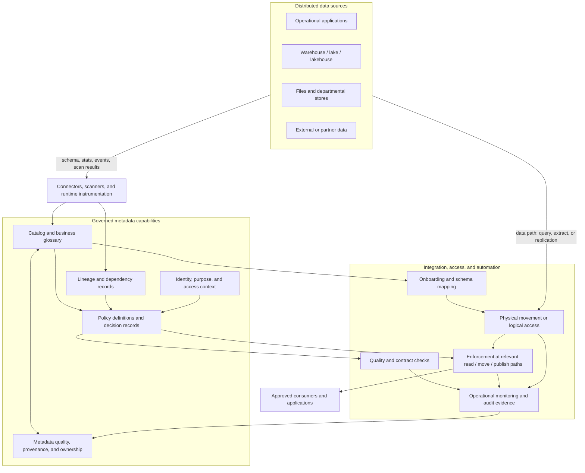
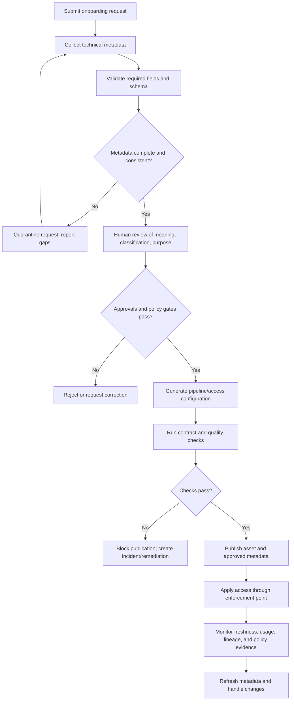
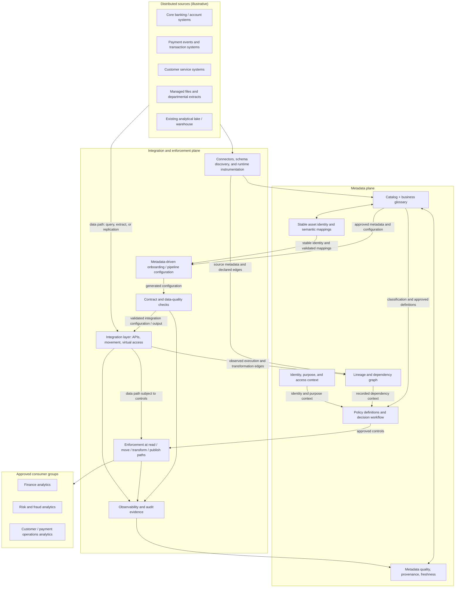

# 05 — Data Fabric and Metadata-Driven Architecture

**Roadmap location:** Stage 2D — Data Architecture / `03-Data-Architecture-Patterns-and-Reference-Architectures/`  
**Target filename:** `05-data-fabric-and-metadata-driven-architecture.md`  
**Authoritative learning specification:** `roadmap-Data-Architecture-Patterns-and-Reference-Architectures.md`, Module 5, sections 5.1–5.12  
**Case-study convention:** Northbridge Bank is fictional. All systems, datasets, responsibilities, targets, and design choices below are illustrative assumptions, not claims about a real organisation or statements of legal/regulatory requirements.

---

## 1. Learning Objectives

By the end of this lesson, you should be able to:

1. Define metadata and distinguish business, technical, operational, and security/classification metadata.
2. Explain data fabric as an architectural approach that uses metadata and automation to connect, discover, integrate, and govern data across distributed environments.
3. Explain metadata-driven architecture: system behaviour is controlled partly by explicit metadata and configuration instead of being entirely hard-coded in each pipeline or application.
4. Describe the responsibilities and limits of catalogs, business glossaries, lineage, semantic relationships, policy engines, and integration/access layers.
5. Explain how metadata can support discovery, trust assessment, onboarding, schema mapping, pipeline generation, access provisioning, quality checks, documentation, and audit evidence.
6. Distinguish logical/virtual access to data in place from physical data movement, and evaluate their performance, reliability, security, and cost trade-offs.
7. Define metadata ownership and quality expectations for completeness, accuracy, timeliness, lineage coverage, and change management.
8. Explain why metadata collection does not prove that metadata is correct, complete, current, or actively used.
9. Distinguish data fabric from data mesh and traditional integration by primary concern, ownership model, and implementation emphasis.
10. Explain how a fabric can complement a mesh without replacing domain accountability or federated governance.
11. Evaluate automation safeguards, approval gates, policy propagation, observability, failure recovery, and human decision points.
12. Propose a conceptual Northbridge Bank design with explicit dependencies, limitations, and a reasoned choice between virtual access and physical movement.

### Required learning evidence

- A data fabric/metadata-driven architecture pattern card.
- A comparison with data mesh and traditional integration.
- A conceptual architecture diagram.
- A metadata inventory with owners and quality expectations.
- A metadata-driven workflow example.
- A list of automation dependencies, limitations, and human approval points.
- Answers to the roadmap's practical scenarios and practice questions.

---

## 2. Why the Topic Matters in Real-World Data Architecture

### 2.1 The distributed-data problem

Enterprise data is rarely located in one place. Operational applications, analytical platforms, departmental stores, files, event systems, external data sources, and legacy systems may all hold data relevant to a business question. Copying everything into one location can simplify some workloads, but it can also create cost, delay, duplicate copies, and additional lifecycle obligations. Leaving everything where it is avoids some copying but can make discovery, access, integration, performance, and governance harder.

Metadata can help describe what exists, where it is, what it means, how it changes, how it is used, who owns it, and what controls apply. When metadata is reliable and actively used by systems, it can drive repeatable discovery, onboarding, integration, policy enforcement, quality checks, and audit evidence.

However, metadata can also become another unmaintained inventory. A catalog entry may be stale; a lineage graph may omit a manual spreadsheet; a classification may be wrong; a connector may fail to collect a schema change; a policy may be defined but not enforced at the actual access point. The value comes not from collecting metadata alone, but from governing its quality and using it to make controlled decisions.

### 2.2 What is a data fabric?

A **data fabric** is an architectural approach that uses metadata, integration/access capabilities, and automation to connect, discover, and govern data across distributed sources and environments. It is not one mandatory product or a single physical platform. Its implementation may combine catalog and glossary capabilities, lineage, policy enforcement, connectors, data movement, logical access, quality controls, and operational monitoring.

A fabric aims to reduce the effort required to understand and use distributed data while making policies and dependencies more visible. It can support both data left in place and data physically moved into analytical stores. It does not imply that all data must be virtualised or that all sources must be copied into one repository.

### 2.3 What is metadata-driven architecture?

A **metadata-driven architecture** makes selected system behaviour depend on explicit metadata and configuration. Instead of hard-coding every source, schema mapping, quality rule, destination, or access requirement separately, a controlled engine reads approved configuration and executes a standard process.

For example, an onboarding workflow may read an approved source definition containing a connection reference, schema, classification, owner, refresh expectation, and transformation mapping. It can then generate a pipeline skeleton, register the asset, apply standard quality checks, and request or provision access according to policy.

Metadata-driven does not mean “the system guesses everything.” The business meaning, classification, permitted purpose, mapping of ambiguous fields, and risk acceptance may require a human decision. Automation should execute approved definitions and surface uncertainty rather than inventing facts.

### 2.4 Why the architecture matters

A well-designed fabric can help an organisation:

- find relevant data without relying entirely on personal networks;
- understand ownership, definitions, quality history, and known limitations before use;
- assess the impact of schema or source changes through lineage;
- apply common policy controls across different sources and integration paths;
- reduce repeated pipeline and documentation work;
- automate routine onboarding and standard quality checks;
- preserve audit evidence about metadata, policy decisions, access, and processing;
- combine physical data movement with logical access according to workload needs.

These benefits depend on reliable source connectors, consistent identifiers, metadata ownership, policy decision rights, integration capabilities, and operational support. The fabric does not automatically resolve unclear business definitions, poor source quality, or conflicting ownership.

### 2.5 Metadata categories

Metadata is information about data and the processes that produce, govern, and consume it. The following categories are useful for architecture design.

| Category | What it describes | Concrete example | Typical owner or steward | Quality question |
|---|---|---|---|---|
| **Business metadata** | Meaning, purpose, domain, definitions, business owner, intended use, and business relationships | `customer_status` means the service status at a documented point in time; owner is Customer Operations | Business/domain owner or steward | Is the definition approved, understandable, and current? |
| **Technical metadata** | Schema, types, keys, format, location, interface, dependencies, and transformation details | `customer_id` is a string key; asset is published through a documented interface; schema version is 3 | Technical owner, data engineer, or connector/process that captures it | Does it match the actual deployed asset? |
| **Operational metadata** | Runs, timestamps, freshness, failures, usage, quality results, volume, latency, and service history | Last successful refresh, row count, quality-check result, observed publication delay | Product/platform operations | Is it timely, complete, and tied to the correct run and asset? |
| **Security/classification metadata** | Sensitivity, permitted purposes, access constraints, handling, retention category, and control requirements | `restricted` classification with approved-role access and audit requirement | Authorised data owner with security/privacy/risk input under policy | Is classification approved, propagated, and enforced at every relevant access path? |

These categories overlap in practice. For example, an owner name may be business metadata, while the identity of the technical operator is operational or technical metadata. The important point is that each field has a defined meaning, an accountable source, a quality expectation, and a known use.

### 2.6 What metadata can and cannot establish

| Metadata can help automate or support | Metadata cannot establish by itself |
|---|---|
| Discovering registered assets by name, definition, domain, or classification | That the data is correct simply because it is catalogued |
| Generating a pipeline from an approved, validated source and mapping definition | The true business meaning of an ambiguous field no one has defined |
| Running configured quality checks and recording results | That the chosen quality rules are sufficient for every business use |
| Applying an approved access policy through an enforcing control point | Whether a new purpose is appropriate if that requires contextual judgement |
| Showing recorded lineage and analysing likely downstream impact | Complete lineage for uninstrumented spreadsheets, manual transfers, or unsupported code |
| Generating documentation from verified schema and configuration | Accurate business documentation if the source definitions are wrong |
| Recording policy decisions and execution evidence | Legal or compliance approval that has not actually been given |
| Reusing a schema mapping after its assumptions are validated | Safe integration where source semantics, identifiers, units, or timing differ |

### 2.7 Data fabric / metadata-driven architecture pattern card

| Field | Pattern card |
|---|---|
| **Pattern name** | Data fabric and metadata-driven architecture |
| **Problem addressed** | Data are distributed across systems and teams; discovery, integration, policy application, lineage, and onboarding are expensive or inconsistent. |
| **Core mechanism** | Metadata management plus integration/access capabilities and automation that uses governed metadata to perform repeatable tasks. |
| **Primary concerns** | Discovery, connectivity, interoperability, policy visibility/enforcement, lineage, automation, and distributed-data usability. |
| **Typical components** | Catalog, business glossary, metadata repository/exchange, lineage collection, semantic relationships, policy engine, connectors, integration/access layer, quality checks, workflow/orchestration, observability, audit records. |
| **Potential benefits** | Less repeated integration work, improved discovery, more consistent controls, faster onboarding, clearer impact analysis, and reusable metadata-driven workflows. |
| **Prerequisites** | Metadata owners, stable identifiers, supported connectors, approved policy definitions, enforcement points, integration contracts, operational support, and quality controls. |
| **Trade-offs and costs** | Metadata platform and connector maintenance, scanning and lineage collection cost, integration complexity, policy integration, performance overhead, skills, and potential dependence on a shared metadata service. |
| **Main risks** | Stale or incorrect metadata, incomplete lineage, false confidence in automation, inconsistent policies across access paths, sensitive catalog metadata exposure, virtual query overload, and tool-specific metadata lock-in. |
| **Use when** | Many distributed sources and consumers need governed discovery, integration, and automation, and the organisation can keep metadata accurate and controls active. |
| **Avoid or limit when** | The problem is small and stable, metadata quality cannot be maintained, the necessary connectors or enforcement points are unavailable, or a fabric would add more complexity than value. |
| **Success evidence** | Consumers find and understand assets; metadata freshness and completeness are measured; policies are enforced at real control points; lineage coverage is known; onboarding effort falls without weakening controls. |
| **Non-goal** | Automatically guaranteeing data quality, semantic agreement, compliance, or security; replacing domain ownership; forcing all data into one tool or virtual layer. |

---

## 3. Prerequisite Knowledge

The roadmap identifies these dependencies:

- **Topics 1–4 in this folder:** centralized, federated, and domain-oriented architectures; warehouse/lake/lakehouse patterns; Lambda/Kappa architectures; data mesh and domain data products.
- **Stage 2D.1 Topic 5:** data architecture lifecycle and governance.
- **Stage 2C Module 08:** metadata-driven design.

### 3.1 Concepts to recall

Before continuing, you should be able to explain:

- the difference between a source system, an analytical store, a data product, and an integration pipeline;
- domain ownership and the difference between technical operation and business accountability;
- data quality dimensions and measurable service expectations;
- access control, classification, least privilege, and auditability;
- schema contracts, semantic definitions, versioning, and change management;
- data lineage as a representation of recorded dependencies and transformations;
- the difference between physical movement, replication, transformation, and logical/virtual access;
- why federated governance needs shared policy decisions and clear human decision rights.

### 3.2 Prerequisite check

Answer these before beginning the design exercises:

1. If a catalog lists an asset, what additional evidence would you need before trusting it?
2. Who should approve the business meaning of a field that has two conflicting interpretations?
3. Why might a physically copied dataset be safer or faster than a virtual query for some workloads?
4. Why is lineage incomplete if some transformation logic occurs in spreadsheets or manually run scripts?
5. What is the difference between defining a policy and enforcing it?
6. How can a data mesh use fabric capabilities without transferring product ownership to the platform team?

If these answers are unclear, revisit the relevant ownership, governance, data-product, and storage-pattern lessons first.

---

## 4. Beginner-Level Learning Sequence

### 4.1 Step 1 — Learn the key components

**Catalog**

A catalog helps people and systems find registered data assets and inspect their metadata. A useful entry contains a stable asset identity, business purpose, owner, schema, classification, lineage, quality/freshness information, access path, and support details. A catalog is a discovery and metadata service; it is not the owner of the data and does not prove the data are correct.

**Business glossary**

A glossary records approved business terms and their definitions, synonyms, relationships, and accountable stewards. It helps reduce semantic confusion across domains. It cannot resolve a disputed definition without a decision by the appropriate business authority.

**Lineage**

Lineage records where data came from and how it flows through sources, transformations, and outputs. It supports impact analysis, debugging, trust assessment, and policy propagation. Lineage quality depends on connector coverage, code parsing, instrumentation, metadata maintenance, and the capture of manual processes.

**Policy engine**

A policy engine evaluates rules against metadata, identity, purpose, resource, and context. It may help determine which checks or controls should apply. Enforcement only occurs when the relevant access or execution path is connected to an enforcing control point. A policy written in a repository but bypassed by an alternate path is not effective enforcement.

**Integration/access layer**

This layer connects consumers to data through movement, replication, transformation, APIs, query federation, or other approved access patterns. It may provide a consistent interface, but it cannot remove the underlying source's performance, availability, semantic, or security constraints.

**Metadata repository and exchange**

A repository stores metadata; exchange mechanisms allow metadata to be collected from or shared with multiple tools. Tool interoperability matters because a fabric can otherwise become a central catalog that cannot see or communicate with the systems where work actually happens.

**Semantic relationships**

Glossary terms, mappings, relationships, and, where justified, ontologies or knowledge graphs can describe how concepts relate. They are valuable when shared meaning is important, but should not be introduced as complex components without a clear use case and accountable maintainers.

### 4.2 Step 2 — Draw a simple logical fabric



**Diagram interpretation**

- Sources remain distributed. The diagram does not imply that every source is copied into a central store.
- Metadata capabilities describe and relate assets. They do not replace the underlying data.
- Automation consumes approved metadata to generate or configure repeatable actions.
- Policy definitions must be connected to actual enforcement points.
- Monitoring and audit records provide evidence of what ran, what was checked, and where controls failed.
- Metadata quality is itself managed: it needs owners, validation, refresh, and correction workflows.
- The arrows are conceptual, not a claim that enforcement is one central hop: controls must be applied at every relevant source, movement, transformation, and publication path.

### 4.3 Step 3 — Understand the metadata lifecycle

A metadata record has a lifecycle, just like the data asset it describes.

1. **Discover or register:** collect metadata from a connector, configuration, scan, or human entry.
2. **Validate:** check required fields, schema match, identity, allowed values, source, and freshness.
3. **Assign accountability:** identify the business owner, technical operator, and steward responsible for correcting the metadata.
4. **Approve meaning and classification:** obtain human approval when definitions, sensitivity, purpose, or risk cannot be inferred reliably.
5. **Publish:** make approved metadata discoverable to authorised users and systems.
6. **Use actively:** drive discovery, access, pipeline configuration, quality checks, lineage, documentation, or policy enforcement.
7. **Monitor:** measure completeness, correctness, freshness, use, failures, and lineage coverage.
8. **Change:** update metadata when schema, ownership, policy, source, or meaning changes.
9. **Retire:** mark the asset and metadata as retired, preserve required audit history, and remove stale discovery/access paths.

A scan that runs successfully proves only that a scan ran. It does not prove that the collected metadata is semantically correct, complete, or approved.

### 4.4 Step 4 — Learn the boundary between inference and approval

Some metadata can be collected mechanically with high confidence: a physical column name, type, file format, source endpoint, job run time, or observed row count. Other metadata may be inferred but need validation: a likely customer identifier, a possible personal-data field, a candidate mapping between two status codes, or a business definition suggested by a column name.

A safe workflow records provenance and confidence:

- **Observed:** collected from a source or execution record.
- **Inferred:** suggested by a tool or rule and accompanied by confidence/limitations.
- **Approved:** reviewed by an authorised human or delegated process.
- **Enforced:** a control is demonstrably applied at a relevant execution/access point.

Do not collapse these statuses into a single “complete” flag. For example, a model may infer that `birth_date` is sensitive, but the approved classification and required handling must follow the organisation's governance process. The inference can trigger review; it must not silently become the final policy decision unless the organisation has explicitly authorised that automated decision and validated its error risk.

### 4.5 Beginner exercise

Draw a fabric with at least three distributed sources, a catalog/glossary, lineage, policy capability, an integration/access layer, and two consumer types. For each arrow, explain what flows: data, metadata, a policy decision, an execution request, or audit evidence.

Then list five things the fabric can automate and five things it cannot safely decide without approved definitions or human judgement.

**Beginner demonstration:** Define the terms and components accurately, and explain why metadata collection is not the same as metadata quality or governance.

---

## 5. Intermediate-Level Learning Sequence

### 5.1 Step 1 — Design discovery around consumer questions

A catalog is useful when consumers can answer these questions without relying on undocumented personal knowledge:

- Does an asset exist for my use case?
- What business concept and population does it represent?
- Who owns its meaning and who operates it?
- What is its grain, schema, key, and semantic definition?
- What is its classification and how do I request access?
- What are its known quality issues and current freshness?
- What upstream sources and transformations produced it?
- What depends on it, and what could break if it changes?
- Is it a supported product, a raw source, a temporary asset, or a retired item?
- Where are examples, documentation, and support?

Discovery should not expose sensitive data to every catalog user. Metadata can itself reveal system topology, business activities, personal-data presence, or security-sensitive relationships. Apply access controls to metadata and lineage where necessary.

### 5.2 Step 2 — Minimum metadata inventory

The following is a conceptual baseline for governed assets. Requirements may vary by asset type and risk tier, but exceptions should be explicit.

| Metadata field | Category | Minimum expectation | Primary accountable owner | Validation / quality control |
|---|---|---|---|---|
| Stable asset ID and name | Technical | Unique, persistent identity; naming rules followed | Metadata/platform steward | Uniqueness check; identity mapping on rename |
| Business description and purpose | Business | Clear definition, scope, and non-purpose where needed | Business/domain owner | Human review; consumer comprehension check |
| Domain and accountable owner | Business | Named role/team with contact and escalation path | Domain leader or delegated owner | Required-field check; periodic owner confirmation |
| Technical operator | Technical/operational | Team accountable for runtime operation | Platform or product operator | Owner exists; support path tested |
| Schema and interface | Technical | Types, keys, nullability, format, version, interface location | Technical owner; connector may collect observed schema | Compare registered schema with observed schema |
| Grain and identifier semantics | Business/technical | Row/event meaning, key scope, units, time semantics | Domain owner with technical steward | Contract review; example records and tests |
| Source and transformation lineage | Technical/operational | Known upstream sources and transformations, with coverage limitations | Pipeline/product owner | Automated lineage capture plus declared manual edges |
| Classification and handling | Security/classification | Approved classification and required controls | Authorised data owner with security/privacy input | Approval workflow; policy consistency checks |
| Access rules and purpose | Security/classification | Permitted roles/purposes and request path | Data owner and delegated policy authority | Enforcement test at access point; audit record |
| Quality rules and results | Operational/business | Defined checks, denominator, threshold, run time, outcome | Product owner; platform supplies framework | Tests execute; results linked to asset and run |
| Freshness and availability | Operational | Target, measurement point/window, exclusions, current history | Product/service owner | Timestamp checks; monitoring and alert tests |
| Change/version policy | Technical/business | Compatibility, notification, deprecation, migration | Product owner | Release gate; consumer notification evidence |
| Usage and consumer dependencies | Operational | Known consumers, access/usage evidence where available | Product owner/platform steward | Compare telemetry, declared consumers, and lineage |
| Retention/lifecycle status | Business/security | Applicable policy reference, lifecycle state, retirement route | Data owner with governance specialists | Policy review; lifecycle checks |
| Metadata provenance and status | All | Source, collected/updated time, observed/inferred/approved state | Metadata steward and source owner | Freshness, provenance, and approval-state validation |
| Support and incident route | Operational | Contact, severity expectations, escalation path | Product/service owner | Periodic contact and incident-process test |

This inventory is a minimum conceptual baseline, not a claim that every field applies identically to every file, API, table, event stream, model feature, or temporary asset. Define risk-based profiles, but do not silently omit fields required for the asset's intended use.

### 5.3 Step 3 — Measure metadata quality

Metadata quality must be measurable. Useful dimensions include:

- **Completeness:** required fields populated, and required lineage edges captured.
- **Accuracy:** metadata agrees with the actual source, approved business definition, or deployed policy.
- **Timeliness/freshness:** metadata are updated within the agreed time after a schema, owner, classification, or pipeline change.
- **Consistency:** definitions and classifications do not conflict across tools or related assets.
- **Uniqueness/identity:** the same asset is not accidentally represented as unrelated duplicates, and renamed assets retain resolvable identity.
- **Provenance:** the source and collection/approval path are known.
- **Coverage:** the proportion of in-scope assets, transformations, consumers, and access paths represented.
- **Usability:** consumers can find, interpret, and apply the metadata correctly.

Example metrics (illustrative only):

| Metric | Definition example | Caveat |
|---|---|---|
| Required-field completeness | Assets with all required metadata fields / in-scope assets | High completeness does not prove field values are correct |
| Schema accuracy | Registered schemas matching observed deployed schemas / schemas checked | Scans may not observe all runtime paths or semantic meaning |
| Metadata freshness | Required metadata updated within the agreed interval / updates observed | The interval must reflect how quickly changes can affect consumers or policy |
| Lineage coverage | Known in-scope flows with validated lineage / all identified in-scope flows | The denominator is uncertain when manual flows are undiscovered; report that uncertainty |
| Owner confirmation | Assets whose owner confirmed accountability within the review period / assets requiring confirmation | A confirmation click does not prove the owner has capacity or authority |
| Policy enforcement coverage | In-scope access paths tested and shown to enforce applicable policy / all identified in-scope access paths | Unknown or untested access paths must not be treated as compliant |
| Metadata defect rate | Metadata records with validated defects / records sampled or checked | Report sampling method and severity, not only a single percentage |

Avoid vanity metrics such as number of catalog entries without denominator, quality, and usage context.

### 5.4 Step 4 — Metadata-driven workflow example: onboard a new source

**Illustrative scenario:** Northbridge Bank wants to make an account-activity source discoverable and available to an approved analytical consumer. This is a conceptual workflow, not a tested implementation.

#### Input metadata

An onboarding request contains:

- source identifier and connection reference;
- business purpose and accountable domain owner;
- technical operator and support route;
- observed schema or schema-discovery instructions;
- approved source-to-target mappings;
- asset classification and permitted purpose;
- required quality checks and thresholds;
- refresh/freshness expectation;
- selected delivery mode: physical movement or approved logical access;
- destination/interface profile and version policy;
- retention/lifecycle policy reference;
- named consumer or access role;
- required approvals and policy constraints.

Secrets are not stored as plain-text metadata. Connection references point to an approved secret-management mechanism. The workflow must not grant broad access merely because a source has been registered.

#### Workflow



#### What can be automated

- collecting observed schema, formats, source location, and run metadata;
- checking required metadata fields and allowed values;
- generating a pipeline or access configuration from approved templates;
- generating standard quality checks from approved rules;
- registering an asset and producing documentation from validated schema/configuration;
- running compatibility checks and recording execution evidence;
- applying approved access decisions through connected enforcement points;
- notifying owners when metadata become stale or a source schema changes.

#### What should not be silently automated

- inventing business meaning for an ambiguous field;
- approving a new use of sensitive data without the required authority;
- deciding that two conflicting domain definitions are equivalent;
- deciding that a risk exception is acceptable without delegated approval;
- assuming an inferred classification is correct without a validated decision process;
- publishing an asset whose required contract or control checks failed;
- representing incomplete lineage as complete.

#### Workflow acceptance evidence

The workflow is successful only if the resulting asset has a stable identity, approved owner and purpose, accurate schema/contract, applicable classification and access controls, quality evidence, lineage with known coverage, discoverable documentation, operational monitoring, and a tested support route.

### 5.5 Step 5 — Classification, policy propagation, and audit evidence

A classification label can inform which policies apply. For example, an approved classification may require restricted catalog visibility, limited access roles, purpose declaration, audit logging, masking or minimisation, and lifecycle controls. The exact control set must come from the organisation's approved governance policies; the lesson does not assert a universal regulatory mapping.

Policy propagation through lineage can help identify derived assets that may inherit restrictions or require review. But lineage-based propagation is only as complete as the lineage graph and policy model. It may also require nuanced decisions: a transformation that aggregates or de-identifies data may change the risk, while a simple rename does not. Do not assume every downstream asset has identical classification, or that a lower classification is justified automatically. Define a review and approval process for classification changes.

A useful audit record should capture:

- the asset and metadata version involved;
- the policy and rule version evaluated;
- the identity and purpose/context presented;
- the enforcement point and decision outcome;
- the timestamp and relevant execution/request identifier;
- any human approval, exception, rationale, scope, and expiry/review date;
- the check results and known limitations;
- the resulting access grant, pipeline run, publication, or rejection.

An audit log is evidence of a recorded action, not proof that the policy itself was correct or that every access path was covered.

### 5.6 Step 6 — Schema mapping and semantic relationships

Schema mapping aligns fields from different sources or targets. Metadata can help suggest mappings based on names, types, definitions, keys, sample distributions, and known relationships. It should not blindly equate fields because their names match.

For example, `status` in one source may mean an operational processing state, while `status` in another may mean a final business outcome. A valid mapping needs an approved semantic definition, value mapping, null and unknown handling, effective-time rules, and tests against representative records.

Semantic capabilities can range from a controlled glossary and mapping table to an ontology or knowledge graph. Choose the least complex capability that solves the actual problem. Shared semantic models require owners, versioning, change management, and a way to resolve disagreement.

### 5.7 Step 7 — Compare data fabric, data mesh, and traditional integration

| Dimension | Data fabric / metadata-driven architecture | Data mesh | Traditional integration |
|---|---|---|---|
| **Primary concern** | Connecting, discovering, integrating, and governing distributed data through metadata and automation | Domain ownership and product accountability for analytical data | Moving and transforming data between known systems to meet specific requirements |
| **Emphasis** | Technology-led and centrally enabled capabilities, with governance and ownership still required | Organisation-led, domain-oriented operating model supported by platform and federated governance | Often project-led, solution-specific interfaces and pipelines |
| **Ownership question** | Who owns the data and metadata, and who approves policies? The fabric does not answer this by itself. | Which domain owns each product and its consumer outcomes? | Ownership may be defined per source, pipeline, or target; it must be made explicit |
| **Metadata role** | Central capability: catalog, lineage, policy context, automation configuration | Essential support for product discovery, contracts, governance, and platform reuse; not the mesh's defining principle alone | Often embedded in project documentation or tool-specific configuration; can also be governed and reusable |
| **Integration style** | Can combine physical movement and logical/virtual access | Does not prescribe one integration technology; products may be exposed through multiple interfaces | Commonly uses point-to-point, batch, API, messaging, or shared-store patterns selected per project |
| **Governance emphasis** | Metadata-driven policy visibility and enforcement across access/integration paths | Federated decisions and computational enforcement of shared policies while domains own products | Governance may be central, project-specific, or inconsistent unless explicitly designed |
| **Main benefit sought** | Reduce repeated work and improve visibility/control across distributed assets | Improve domain accountability and consumer-facing product outcomes | Deliver a required data flow or interface for a specific system interaction |
| **Main failure mode** | Stale metadata, incomplete connectors/lineage, ineffective enforcement, performance issues | Nominal ownership, poor product contracts, weak funding, inconsistent governance | Duplicated logic, hidden dependencies, bespoke maintenance, weak shared metadata |
| **Can it coexist with the others?** | Yes; can support mesh products and traditional integrations | Yes; can use fabric capabilities and existing integration patterns | Yes; can be governed and metadata-driven, and need not be discarded wholesale |

These approaches are complementary rather than mutually exclusive. A mesh can use a fabric to improve discovery, lineage, access, and automated policy enforcement. A fabric can connect both centrally managed data and domain-owned products. Traditional integration can remain appropriate for a narrow, well-understood requirement. The architecture decision should follow the problem and constraints, not a label.

### 5.8 Step 8 — Logical/virtual access versus physical data movement

| Consideration | Logical/virtual access | Physical movement / replication |
|---|---|---|
| **How it works** | Queries or requests are routed to data in place, possibly through a federation or abstraction layer | Data are copied, replicated, transformed, or materialised into a target |
| **Potential advantages** | Less duplication; data can remain near the source; some use cases can see current source values | Predictable analytical performance; source workload can be isolated; historical snapshots and repeatable processing can be supported |
| **Potential costs/risks** | Runtime dependency on source availability, latency, query compatibility, network, and source capacity; complex joins may be slow | Storage and processing cost; replication delay; duplicate copies; reconciliation and lifecycle/deletion duties |
| **Freshness** | May reflect current source state, but source latency and cache behaviour still matter | Depends on replication schedule and pipeline completion; can be measured and controlled |
| **Performance** | Source systems may be overloaded by broad or repeated queries; pushdown may not work as expected | Workload can be tuned independently, but requires capacity and pipeline operations |
| **Security/governance** | Source-side controls may help, but federation layers must preserve identity and policy; alternate paths still need controls | Target access must be controlled; policies, classification, lineage, and lifecycle obligations must follow the copy |
| **Failure behaviour** | Source or network outage can make the virtual query unavailable | A previously materialised copy may remain available, but can become stale or incorrect |
| **Best fit** | Selective, low-volume, latency-tolerant exploration or access where source capacity and controls are suitable | Repeated large scans, predictable analytical workloads, historical analysis, source isolation, or stringent performance requirements |
| **Required checks** | Query plan, concurrency, source load, timeout, caching, access propagation, availability dependency | Replication lag, reconciliation, duplicate/correction handling, lineage, retention/deletion propagation, storage cost |

A virtual layer is not a free substitute for data movement. It relocates some work to query time and can couple consumer performance to source-system behaviour. Physical movement creates copies and lifecycle duties but can isolate workloads and improve predictability. Hybrid designs are often sensible: virtual access for selective discovery or low-volume use, and controlled materialisation for recurring or high-volume analytical workloads.

### 5.9 Intermediate exercise

For Northbridge, create a metadata inventory for at least six assets across three source types. Mark each field as observed, inferred, or approved. Identify which metadata drive discovery, which drive policy, and which drive pipeline generation. Propose one virtual-access use case and one physical-movement use case, each with a reasoned choice.

**Intermediate demonstration:** Explain how a catalog supports discovery, how lineage supports impact analysis, how metadata drives controlled automation, and why fabric, mesh, and traditional integration can coexist.

---

## 6. Advanced-Level Learning Sequence

### 6.1 Step 1 — Evaluate metadata quality as an operational control

Incorrect or stale metadata can create a larger blast radius than a single manual error because the same metadata may drive many workflows. A wrong schema mapping can generate bad pipelines; a wrong classification can trigger insufficient or excessive controls; stale lineage can hide a downstream impact; an incorrect owner can send incidents to an unaccountable team.

A robust design needs:

- **provenance:** where each metadata value came from;
- **state:** observed, inferred, approved, deprecated, or unknown;
- **owner:** who is accountable for correcting it;
- **freshness rule:** when it must be refreshed or reconfirmed;
- **validation:** automated structural checks and human semantic review where needed;
- **confidence/limitations:** uncertainty for inferred values;
- **change detection:** how source or policy changes invalidate dependent metadata;
- **quarantine/fail-safe behaviour:** what happens when required metadata is missing, contradictory, or stale;
- **audit history:** what changed, who/what changed it, and which workflows used it.

Do not use one global freshness threshold for every metadata type. A source schema used for automated pipeline generation may need prompt change detection; a business description may be reviewed on a periodic schedule; a sensitive-data classification may need a stricter approval and change process. The threshold should be based on the consequences of stale metadata.

### 6.2 Step 2 — Define minimum metadata and risk-based profiles

The minimum inventory in Section 5.2 should be adapted into profiles such as:

- **Basic discoverable asset:** stable ID, description, owner, technical schema, source, classification/status, and contact.
- **Governed analytical product:** basic fields plus purpose, grain, contract/version, lineage, quality/freshness evidence, access path, lifecycle, and support.
- **Automation-eligible asset:** governed product fields plus validated mappings, executable quality rules, approved destination/access configuration, explicit policy status, and failure/rollback behaviour.
- **High-risk or sensitive asset:** applicable additional approvals, restricted metadata visibility, purpose-bound access, stronger audit evidence, and lifecycle checks according to the organisation's approved policies.

Profiles should be explicit and machine-checkable where possible. A missing required field should cause a clear outcome: reject, quarantine, request human review, or permit a limited non-production workflow. It should not silently default to “approved.”

### 6.3 Step 3 — Interoperability across metadata tools

A fabric can depend on multiple catalogs, transformation tools, query engines, orchestration systems, access managers, and source platforms. If each keeps incompatible metadata, the architecture may produce several partial inventories rather than a coherent view.

Design for:

- stable asset identifiers and mappings between tool-specific IDs;
- shared definitions for core metadata fields and statuses;
- explicit source of truth for owner, classification, schema, and policy;
- documented exchange mechanisms and update frequency;
- schema/version compatibility for metadata interfaces;
- provenance when values are copied or reconciled;
- conflict-resolution rules when sources disagree;
- graceful handling of connector outages and delayed metadata;
- an exit/export strategy to reduce dependence on one metadata repository.

Do not assume every tool must store all metadata in one canonical database. A federated metadata architecture can be valid if it defines identity, authority, exchange, freshness, and conflict resolution. The goal is usable consistency, not centralisation for its own sake.

### 6.4 Step 4 — Apply policy consistently across heterogeneous paths

A policy is effective only if all relevant paths are identified and the required control is enforced. For example, a catalog may show a restricted classification, but users could still access an underlying file directly if the storage permissions are not integrated with the policy model. A virtual query engine may enforce one access path while an export pipeline creates an uncontrolled copy.

For each policy, document:

1. **Intent:** what outcome is required and why.
2. **Scope:** which assets, fields, consumers, purposes, and environments it covers.
3. **Authority:** who approved the policy and who can grant exceptions.
4. **Metadata inputs:** which classifications, identities, purposes, lineage edges, or resource attributes are required.
5. **Enforcement point:** where the rule is actually applied.
6. **Coverage:** all identified access and movement paths that must enforce it.
7. **Evidence:** logs or test results showing decision and enforcement outcomes.
8. **Failure mode:** deny, quarantine, alert, or safe fallback when metadata or policy service is unavailable.
9. **Drift detection:** how policy versions and actual configurations are compared.
10. **Exception lifecycle:** approver, rationale, scope, expiry/review, and remediation.

Fail-safe behaviour depends on context. For a sensitive access grant, missing classification may require denial or quarantine. For a non-sensitive discovery search, a missing optional description may merely reduce ranking or trust. Do not apply one failure policy indiscriminately.

### 6.5 Step 5 — Understand automation confidence and approval gates

Automation should be selected according to repeatability, consequence, and uncertainty.

| Task | Suitable automation | Required guardrail / human point |
|---|---|---|
| Collect physical schema and source metadata | Connector/scan with versioned results | Validate connector coverage and reconcile schema drift |
| Check required catalog fields | Deterministic validation | Human owner resolves missing or ambiguous meaning |
| Suggest schema mappings | Rule-based or assisted suggestions | Review ambiguous mappings, units, keys, and business semantics |
| Generate standard pipeline configuration | Approved templates and validated metadata | Review new sources, nonstandard transformations, destructive operations, and release exceptions |
| Run quality rules | Automated tests and thresholds | Humans define appropriate rules and resolve business exceptions |
| Infer potential sensitive fields | Detection rules or models with confidence and evidence | Approved classification process decides final treatment where required |
| Provision access | Automate after an approved decision using the policy enforcement point | Human or delegated authority approves new purposes and risk exceptions where policy requires |
| Propagate policy through lineage | Rule-driven impact identification | Review transformations that may change risk/classification and gaps in lineage |
| Generate documentation | Templates populated from validated metadata | Owner reviews business definitions, limitations, and intended use |
| Record audit evidence | Automatic event/log capture | Governance verifies completeness, retention, access, and integrity of evidence |
| Retire an asset | Workflow automation for notices and access removal | Accountable owner confirms dependencies, retention, replacement, and consumer migration |

A model's confidence score is not an approval. It is an input to a decision rule. If the cost of a false classification or incorrect mapping is high, use stricter thresholds, a human review gate, or do not automate that decision.

### 6.6 Step 6 — Security and privacy implications of metadata itself

Metadata may expose sensitive information even when the underlying data values are not displayed. Examples include:

- the existence of a high-risk dataset or investigation workflow;
- names of individuals or teams associated with sensitive business processes;
- schema fields that reveal the presence of personal or financial attributes;
- lineage showing dependencies between systems;
- query history or usage patterns that reveal user behaviour;
- connection endpoints, environment names, or architecture topology.

Therefore:

- classify metadata according to its content and exposure risk;
- restrict catalog and lineage visibility where needed;
- avoid storing secrets in metadata; use secure references;
- apply least privilege to catalog administration and policy configuration;
- audit metadata reads and changes where risk warrants it;
- protect policy definitions and enforcement logs against tampering;
- review exports, caches, and copies of metadata;
- ensure catalog search does not reveal more information than the user is authorised to see.

A fabric should make controls more coherent, not create a new broad-access map of the organisation's sensitive data.

### 6.7 Step 7 — Evaluate logical access and operational limits

Virtualisation or federation can simplify access, but it does not eliminate source-system limits. Before using logical access, evaluate:

- query concurrency and source workload budget;
- supported query operations and pushdown behaviour;
- network latency and data transfer volume;
- source availability and maintenance windows;
- timeout, cancellation, retry, and circuit-breaker behaviour;
- caching semantics and stale-result handling;
- identity propagation and row/column-level controls;
- observability of queries, source load, and failure causes;
- whether the source can support the consumer's query pattern;
- whether consumers need historical snapshots or repeatable results.

A fabric should be able to refuse or constrain virtual access when the source cannot meet the workload's latency, concurrency, security, or availability requirements. Materialise data into a controlled analytical store when predictable repeated access, heavy joins, large scans, historical reproducibility, or source isolation justifies the additional copy and lifecycle cost.

### 6.8 Step 8 — Conceptual Northbridge Bank design

**Illustrative assumptions:** Northbridge has multiple operational and analytical systems, a mix of batch and interactive consumers, and a need to improve discovery, lineage, and control consistency. These are teaching assumptions, not facts about a real bank.

#### Conceptual architecture



#### Component responsibilities

- **Source systems:** remain authoritative for their operational data and expose approved interfaces or supported extraction paths.
- **Connectors/schema discovery:** collect technical and operational metadata; report connector coverage and failures.
- **Catalog and glossary:** publish approved descriptions, ownership, schema, classification status, access path, and semantic definitions.
- **Lineage/dependency graph:** records observed and declared source-to-output relationships, including known manual gaps.
- **Metadata quality and provenance:** validates required fields, freshness, identity, owner confirmation, and the observed/inferred/approved state.
- **Policy decision workflow:** records policy intent, decision rights, approvals, exceptions, and the metadata inputs required for enforcement.
- **Integration layer:** selects physical movement or logical access based on workload and control requirements.
- **Enforcement points:** apply approved access and execution rules where the data are read, moved, transformed, or published.
- **Quality and contract checks:** validate schemas, required fields, business constraints, and product expectations.
- **Observability/audit:** captures runs, policy outcomes, quality results, lineage gaps, source load, and incidents.
- **Consumers:** use approved interfaces and report unmet needs, defects, and contract issues.

The arrows simplify the logical view. Enforcement is not necessarily a single centralized hop: the actual source read, data movement, transformation, and target publication paths must all be covered or explicitly recorded as gaps.

#### Explicit dependencies and limitations

1. **Metadata ownership and accuracy:** business owners and technical stewards must keep definitions, classifications, and ownership current. A central catalog cannot invent authoritative meaning.
2. **Connector coverage:** sources, transformation engines, APIs, files, and scripts need supported metadata collection or declared/manual lineage. Unsupported connectors create known blind spots.
3. **Stable asset identity and semantic agreement:** cross-tool integration requires identifiers, schema versions, and shared definitions. Similar field names do not prove equivalent meaning.
4. **Enforcement coverage:** policies must be connected to every relevant access and movement path. A catalog label alone does not prevent direct access or uncontrolled exports.
5. **Operational availability:** automated onboarding and policy checks depend on metadata services, connectors, identity services, and orchestration. Failure behaviour must be defined.
6. **Performance:** virtual access can overload sources or fail latency targets; high-volume or repeated analytical workloads may need materialisation.
7. **Lineage completeness:** manual spreadsheets and ad hoc scripts may remain outside automatic capture; coverage must be measured and gaps declared.
8. **Human governance:** sensitive purpose approvals, ambiguous classification, semantic disputes, and exceptions require authorised decision-makers.
9. **Cost and support:** connector maintenance, scans, metadata storage, lineage processing, platform operations, training, and incident handling require funding.
10. **Security of metadata:** catalog and lineage visibility may itself need controls and auditing.

#### Three example dependency paths

- **Discovery path:** accurate business description + stable asset ID + current owner + valid schema → useful catalog search → consumer validates purpose and requests access.
- **Policy path:** approved classification + identity/purpose context + current lineage where relevant → policy evaluation → enforcement at the actual access point → auditable decision.
- **Pipeline path:** approved source definition + validated mapping + target profile + quality rules → generated configuration → contract/quality tests → controlled publication and monitoring.

Each path fails if a critical input is missing or wrong. The architecture must detect and surface the failure rather than treating a metadata record as sufficient evidence.

### 6.9 Step 9 — What must remain manual, and why

The goal is not to eliminate human decisions. Keep accountable human review for:

- approving contested business definitions and semantic mappings;
- assigning or changing authoritative ownership;
- approving sensitive or consequential purposes where policy requires it;
- resolving conflicting metadata sources;
- approving policy exceptions and risk acceptance;
- deciding whether transformations change classification or permitted use;
- accepting material service-level or quality exceptions;
- resolving lineage gaps that automation cannot observe;
- deciding whether a product or source should be retired or replaced;
- approving changes whose business impact cannot be determined reliably from metadata alone.

Manual does not mean undocumented. Record the decision, authority, rationale, scope, date, evidence, and review/expiry where appropriate. Over time, repeated decisions may reveal a rule that can be standardised and automated safely.

### 6.10 Step 10 — Failure modes and recovery

| Failure mode | Detection signal | Safe response | Recovery / prevention |
|---|---|---|---|
| Stale schema metadata | Observed schema differs from registered schema | Block automated generation or publication if the change is material; alert owner | Refresh metadata, review compatibility, rerun checks, notify consumers |
| Incorrect classification | Conflicting labels, failed review, or policy test exposes mismatch | Restrict or quarantine affected access as defined by policy | Correct classification, review all derived assets through lineage, preserve audit history |
| Missing lineage | Source/output observed but dependency edge absent | Mark lineage as incomplete; do not claim full impact analysis | Add connector/instrumentation or declared manual edge; report coverage gap |
| Connector outage | Scan/metadata refresh misses expected run | Mark metadata stale and expose last-success time | Retry with bounded backoff, alert owner, reconcile after recovery |
| Policy service unavailable | Enforcement cannot evaluate required policy | Apply defined fail-closed or restricted fallback for sensitive operations; do not bypass control | Restore service, reconcile failed requests, verify policy version and audit completeness |
| Incorrect schema mapping | Contract or semantic validation fails | Quarantine output or block release | Human review, corrected mapping, regression tests, lineage/consumer impact review |
| Virtual query overload | Source latency/concurrency exceeds agreed limit | Throttle, reject, or cancel expensive queries; protect source workload | Tune query, cache/materialise, isolate workload, revise access design |
| Conflicting metadata sources | Owner, classification, or schema sources disagree | Mark conflict and suspend automation that depends on the disputed value | Resolve source-of-truth and reconciliation rules; document decision |
| Sensitive catalog exposure | Access review or audit finds unauthorised metadata visibility | Restrict access and investigate exposure | Fix catalog policy, review logs, assess metadata copies and downstream exposure |
| Automation drift | Generated configuration differs from approved metadata/policy version | Block deployment or revert to known-good version | Reconcile configuration, rerun controls, add drift detection and release evidence |

### 6.11 Advanced exercise

Assess a proposed Northbridge fabric design. Score metadata completeness, accuracy, freshness, lineage coverage, policy enforcement coverage, connector support, source performance, human decision rights, and operational readiness. Identify at least three dependencies and three failure modes. State what remains manual and why. Recommend virtual access, physical movement, or a hybrid approach for two different workloads.

**Advanced demonstration:** Identify dependencies and limits in a conceptual design and explain how the architecture fails safely when metadata or enforcement is unavailable.

---

## 7. Industry-Application Exercises

Complete the following exercises using fictional Northbridge Bank data and systems. Mark all assumptions and do not represent illustrative targets as real operational facts.

### Exercise 1 — Metadata taxonomy and inventory

Create an inventory of at least six assets across three source types. Include business, technical, operational, and security/classification metadata. For every field, record:

- definition and category;
- source of the metadata;
- accountable owner/steward;
- observed, inferred, or approved status;
- required freshness;
- validation method;
- what happens if it is missing or stale.

**Deliverable:** metadata inventory and quality-control table.

### Exercise 2 — Catalog and lineage design

Draw how a consumer discovers an asset and follows lineage to its sources and transformations. Include at least one known manual step such as a spreadsheet or ad hoc script.

**Deliverable:** conceptual catalog/lineage diagram, coverage measure, known gaps, and a plan to improve coverage.

### Exercise 3 — Metadata-driven onboarding

Define a workflow that uses metadata to onboard a new source, generate or configure an integration path, apply quality checks, publish documentation, request or provision access, and record audit evidence.

**Deliverable:** workflow diagram, required input metadata, automated checks, human approvals, rejection paths, recovery steps, and acceptance criteria.

### Exercise 4 — Classification and policy propagation

Choose a hypothetical classification and describe the policy controls it should trigger under an explicitly labelled fictional policy. Trace the policy through a source, transformation, published asset, and consumer access path. Identify where human review is required.

**Deliverable:** classification-to-policy matrix, enforcement points, audit evidence, and limitations of lineage-based propagation.

### Exercise 5 — Virtual versus physical access

Choose two workloads with different requirements: for example, selective operational lookup and repeated high-volume analytical reporting. Compare virtual access and physical movement for freshness, latency, source load, availability, historical reproducibility, security, cost, and lifecycle obligations.

**Deliverable:** decision matrix and a short architecture decision record (ADR) for each workload.

### Exercise 6 — Fabric, mesh, and traditional integration comparison

Use the same stated Northbridge requirement to compare:
- a traditional point integration;
- a fabric-enabled integration/discovery approach;
- a domain-owned product approach supported by fabric capabilities.

**Deliverable:** comparison table, ownership decisions, costs/risks, and a recommendation that explains why the alternatives are not mutually exclusive.

### Exercise 7 — Automation boundary and failure recovery

For ten tasks, decide whether the task is automated, human-approved, or hybrid. Include a confidence or validation rule, failure behaviour, audit evidence, and a recovery path.

**Deliverable:** automation-control matrix with at least one case where automation must stop rather than guess.

---

## 8. Practical Scenarios and Case-Based Reasoning

### Scenario 1 — A vendor promises “automatic governance”

**Situation:** A vendor says its fabric platform provides automatic governance across all enterprise data.

**Questions to ask:**

1. What does “governance” mean in this claim: cataloging, classification, policy definition, enforcement, lineage, access approval, audit evidence, or all of these?
2. Which sources, file types, query engines, pipelines, APIs, and transformation languages are supported?
3. What proportion of assets and access paths can it discover and enforce against? How is the denominator measured?
4. Can it distinguish observed metadata from inferred and human-approved metadata?
5. How does it handle ambiguous business terms, conflicting owners, and uncertain classification?
6. Where are policies actually enforced, and can a user bypass them through direct source access, exports, or another pipeline?
7. How are identities, purposes, and permissions propagated across heterogeneous systems?
8. What happens if the metadata repository, connector, identity service, or policy engine is unavailable?
9. What audit evidence is produced, protected, retained, and accessible to authorised reviewers?
10. What are the performance, connector maintenance, scan, storage, and operating costs?
11. How are schema changes, lineage gaps, false positives, false negatives, and metadata drift detected?
12. Which decisions still require a human, and how are exceptions recorded?

**Reasoned response:** Treat the claim as a hypothesis to validate, not as an architectural fact. Require a bounded evaluation against representative sources, explicit coverage measures, tested enforcement paths, failure behaviour, audit evidence, and known limitations. A product demonstration cannot establish enterprise-wide coverage or policy correctness.

### Scenario 2 — The catalog reports lineage for only 60% of flows

**Situation:** The catalog shows lineage for 60% of identified flows; the rest are spreadsheets, manual transfers, and ad hoc scripts.

**Analysis:**

The catalog cannot support a claim of complete impact analysis. The missing 40% may include important dependencies and control paths. Even the 60% with recorded lineage may contain errors, so reported coverage should distinguish “recorded” from “validated.”

**Recommended response:**

1. Define the denominator: all in-scope flows identified by an inventory, not only flows the catalog can see.
2. Categorise gaps by source, tool, manual process, business criticality, and sensitivity.
3. Add supported connectors and instrumentation where cost-effective.
4. Register manual flows with named owners and declared lineage until they can be instrumented.
5. Validate representative lineage edges against deployed pipelines and consumer outputs.
6. Mark impact analysis as partial when relevant paths are unknown.
7. Prioritise critical/high-risk flows, but report coverage and exceptions honestly.
8. Define an improvement target, owner, and review date.

**Decision:** Do not assume the catalog is authoritative merely because it displays a graph. Use it as a governed representation with explicit coverage and confidence.

### Scenario 3 — Analysts overload a remote source through virtual access

**Situation:** Analysts query a remote operational system through a virtual layer. Concurrent joins and scans cause source latency to exceed the agreed limit.

**Analysis:**

Logical access moves some work to query time. It does not eliminate computation, network transfer, source concurrency, or availability dependencies. The source was not necessarily designed for unbounded analytical workloads.

**Recommended response:**

- throttle or reject expensive queries according to an agreed source workload budget;
- inspect query plans and pushdown behaviour;
- add caching only with explicit freshness and invalidation semantics;
- materialise repeated/high-volume analytical data into a controlled analytical store;
- isolate operational and analytical workloads where required;
- preserve lineage, classification, access controls, reconciliation, and lifecycle obligations for the copied data;
- update the architecture decision record with measured evidence and triggers for reconsideration.

**Decision:** Use virtual access only when the source, query pattern, and service requirements support it. Move data when source protection, predictable performance, historical reproducibility, or repeated high-volume use justifies the additional copy and operating cost.

### Scenario 4 — Automated schema mapping equates two fields with the same name

**Situation:** An onboarding engine maps `status` from two systems because the column names and data types match. Downstream reports then mix a processing state with a final business outcome.

**Analysis:** Name and type similarity are weak evidence of semantic equivalence. The mapping requires approved business definitions, valid-value mapping, temporal semantics, and representative tests.

**Response:** Block or quarantine the ambiguous mapping, request domain-owner review, document the approved mapping, add contract tests, and retain provenance for the mapping decision. Do not silently publish a generated pipeline just because technical validation passed.

### Scenario 5 — Classification metadata is stale

**Situation:** A source is reclassified, but the catalog and downstream derived assets still show the previous label.

**Analysis:** Classification is not effective if policy decisions and enforcement points use stale metadata. Lineage may help find affected assets, but incomplete lineage means the impact set may be incomplete.

**Response:** Trigger change detection, restrict or quarantine affected access according to approved policy, identify downstream assets from lineage and owner declarations, update classifications and enforcement configuration, verify the actual access paths, and record the correction. Review why the propagation process did not detect or enforce the change.

### Scenario 6 — A catalog entry is complete but the data are wrong

**Situation:** An asset has an owner, description, schema, classification, lineage, and a “green” quality status, but the business values are incorrect because the configured rule checks only nulls and types.

**Analysis:** Metadata completeness and execution success are not proof of semantic quality. The owner and consumers must define business-relevant checks, expected populations, reconciliation rules, and known limitations.

**Response:** Correct the quality specification, add business constraints and reconciliation tests, re-evaluate historical outputs where necessary, and distinguish “technical validation passed” from “business quality accepted.” Record the scope of the assurance and any unresolved limitations.

### Scenario 7 — The metadata service is unavailable

**Situation:** A pipeline tries to read policy and mapping metadata, but the central metadata service is unavailable.

**Analysis:** The architecture needs explicit failure behaviour. Blindly proceeding with stale or missing policy may create unsafe access or incorrect output; failing every non-critical task may create unnecessary disruption.

**Response:** Define risk-tiered behaviour in advance. Sensitive access or publication requiring a current policy may fail closed or quarantine. A non-critical workflow may use a versioned last-known-good configuration only if that behaviour is explicitly approved, bounded, auditable, and safe. Alert owners, record the metadata version used, and reconcile actions after recovery.

### Scenario 8 — The fabric and mesh teams disagree on ownership

**Situation:** The platform team says that because an asset is registered in the fabric catalog, the platform team owns it. The domain team says it owns the business meaning.

**Analysis:** Catalog administration is not data ownership. The platform team may own metadata services, connectors, policy enforcement mechanisms, and platform reliability. The domain owner remains accountable for business meaning and product outcomes unless a separate ownership decision explicitly assigns responsibility differently.

**Response:** Document separate responsibilities for the asset's business meaning, technical operation, metadata record, shared platform, policy decision, and access enforcement. Resolve ambiguous ownership through the organisation's governance process and reflect the decision in metadata.

### Practice-question coverage

The roadmap specifies questions and scenarios in Module 5. The answers below cover those prompts.

1. **What can metadata automate?** Repeatable tasks whose inputs and rules are sufficiently defined: discovery, schema validation, pipeline configuration, standard quality checks, documentation generation, access provisioning after approval, lineage capture where supported, and audit logging.
2. **What can metadata not supply on its own?** Undefined business meaning, authoritative ownership, a justified sensitive-data purpose, a risk exception, or proof that a policy is correct. These require approved definitions and accountable decisions.
3. **What happens when metadata are wrong or missing?** Automation can generate incorrect mappings, apply the wrong policy, hide dependencies, or publish unreliable outputs. The design should validate provenance and freshness, block/quarantine critical actions, surface uncertainty, alert owners, and record recovery.
4. **Which approach addresses ownership most directly?** Data mesh explicitly emphasises domain ownership and product accountability. A fabric improves distributed discovery/integration/governance capabilities but does not assign ownership by itself. Traditional integration must also define ownership, even if it is often handled per project.
5. **What would a fabric not solve for Northbridge?** It cannot resolve an undefined or disputed business term without an accountable decision; it cannot create missing source data; it cannot guarantee complete lineage for uninstrumented flows; it cannot make an overloaded source meet performance targets by virtualising it; and it cannot ensure policy enforcement at unconnected access paths.
6. **Where would virtual access be refused in favour of copying data?** For high-volume repeated scans, heavy joins, strict source-isolation needs, historical reproducibility, or workloads whose latency/concurrency exceeds the source's supported budget—provided copying is permitted and lifecycle controls are designed.
7. **What do you ask a vendor claiming automatic governance?** Define the control claimed, source/connector coverage, inference versus approval, real enforcement points, bypass paths, failure behaviour, evidence, accuracy/coverage measures, operating costs, and human decision points.
8. **What follows from only 60% lineage coverage?** Impact analysis is partial; define the denominator, validate recorded lineage, inventory manual gaps, prioritise critical flows, and report the uncertainty rather than claiming full coverage.
9. **What does virtual-query overload show?** The virtual layer did not remove source compute and availability constraints. Query patterns, concurrency, source budget, caching, throttling, and materialisation need to be considered.
10. **What must already be true for a fabric to work?** Metadata must have owners and quality controls; relevant sources and execution paths must be discoverable or their gaps declared; policy definitions and decision rights must exist; enforcement points must be connected; integration modes must fit workload needs; and operations must be funded.
11. **How do fabric and mesh relate?** Fabric provides metadata and automation capabilities; mesh defines domain-oriented product ownership and a federated operating model. They can complement each other.
12. **Why isn't a complete catalog enough?** A catalog describes assets but does not itself guarantee correctness, currentness, policy enforcement, source quality, consumer understanding, or operational accountability.

---

## 9. Expected Outputs and Deliverables

Complete this package before claiming mastery.

### 9.1 Required deliverables

- [ ] **Pattern card:** problem, core mechanism, components, benefits, costs, prerequisites, risks, suitability, and success evidence.
- [ ] **Comparison matrix:** data fabric vs data mesh vs traditional integration.
- [ ] **Conceptual architecture diagram:** sources, metadata plane, integration/access and enforcement plane, consumers, monitoring, and audit evidence.
- [ ] **Metadata inventory:** business, technical, operational, and security/classification metadata with owner, provenance, status, freshness, validation, and failure behaviour.
- [ ] **Metadata quality model:** completeness, accuracy, freshness, consistency, provenance, lineage coverage, and usability.
- [ ] **Metadata-driven workflow:** onboarding, schema mapping, quality checks, access provisioning, publication, monitoring, and failure/recovery paths.
- [ ] **Policy matrix:** classification/purpose inputs, policy owner, enforcement point, approval gate, audit evidence, and exception lifecycle.
- [ ] **Virtual-versus-physical decision matrix:** at least two workloads and a reasoned choice for each.
- [ ] **Automation boundary matrix:** what is automated, what needs human approval, and what must stop on uncertainty.
- [ ] **Northbridge conceptual design:** component responsibilities and at least three explicit dependencies or limitations.
- [ ] **Scenario answers:** all scenarios in Section 8 with decisions and reasoning.
- [ ] **Practice-question answers:** all twelve questions in Section 8.
- [ ] **Completion review:** evidence that the design is not claiming unsupported automation, complete lineage, or untested controls.

### 9.2 Suggested metadata inventory template

```text
Asset ID:
Asset name:
Business purpose and non-purpose:
Domain:
Accountable business owner:
Technical operator:
Metadata steward:
Source / interface:
Schema and version:
Grain / key / semantic definitions:
Classification and permitted purpose:
Access request path / enforcement point:
Upstream and downstream lineage:
Metadata provenance:
Metadata status: observed / inferred / approved / deprecated / unknown
Last observed / last approved / freshness target:
Quality rules and latest results:
Known gaps and limitations:
Retention / lifecycle state:
Support / incident route:
Validation and failure behaviour:
Review date:
```

### 9.3 Suggested architecture decision record

```text
Decision title:
Decision owner and date:
Business problem and consumers:
Relevant assets and metadata:
Options considered:
  A. Traditional integration
  B. Fabric-enabled physical movement
  C. Fabric-enabled logical/virtual access
  D. Hybrid approach
Required policy and control outcomes:
Metadata prerequisites and quality risks:
Performance and availability constraints:
Security and lifecycle implications:
Costs and operational responsibilities:
Decision and rationale:
Rejected alternatives and reasons:
Dependencies and limitations:
Success measures:
Failure / rollback conditions:
Review triggers:
```

### 9.4 What a credible design demonstrates

A credible design makes it clear which metadata are authoritative, who maintains them, how they are validated, what actions they drive, where policies are enforced, what evidence is retained, what happens when a critical dependency fails, and which decisions remain with accountable humans. It also states what the design cannot see or guarantee.

---

## 10. Common Mistakes and Misconceptions

1. **Believing a fabric solves data quality, integration, or governance automatically.** It provides capabilities; results depend on data, policies, ownership, enforcement, and operations.
2. **Treating a catalog as the same as ownership.** Catalog administrators do not automatically own business meaning, source correctness, or product outcomes.
3. **Assuming collected metadata are accurate.** Collection proves that a value was observed, not that it is semantically correct or approved.
4. **Confusing metadata completeness with data quality.** A complete catalog entry can describe incorrect data.
5. **Treating data fabric and data mesh as competitors.** Fabric emphasises metadata-driven connection and governance; mesh emphasises domain ownership and products. They can be combined.
6. **Treating traditional integration as obsolete.** Point integrations and physical movement remain appropriate for bounded requirements; they can also use governed metadata.
7. **Assuming metadata can define business meaning.** Tools may suggest a definition, but ambiguous or contested meaning requires an accountable decision.
8. **Equating policy definition with policy enforcement.** Controls must be connected to actual access, movement, transformation, and publication paths.
9. **Assuming lineage is complete because a graph is displayed.** Manual scripts, spreadsheets, unsupported engines, and hidden dependencies can create gaps.
10. **Ignoring metadata freshness.** A stale owner, schema, classification, or mapping can misdirect decisions or automate unsafe behaviour.
11. **Using inferred classification as final approval.** Detection can trigger review; the approved decision and enforcement must follow the organisation's process.
12. **Ignoring metadata security.** Catalogs and lineage may reveal sensitive system topology, business processes, or data attributes.
13. **Assuming virtual access is free or always current.** It adds runtime dependencies, source load, network costs, query latency, and availability coupling.
14. **Assuming physical copies are automatically safe.** Copies create replication lag, reconciliation, retention, deletion, access, and lineage obligations.
15. **Over-automating ambiguous mappings.** Similar names or types do not establish semantic equivalence.
16. **Failing to define safe failure behaviour.** The system must know whether to deny, quarantine, alert, retry, or use an approved last-known-good configuration.
17. **Ignoring policy drift.** A policy can change while a pipeline, role, or access path remains configured under an old version.
18. **Relying on one central metadata store without interoperability.** If tools cannot exchange stable IDs, schemas, and lineage, the fabric may become another silo.
19. **Reporting lineage coverage without a denominator.** “60% covered” is meaningful only when the in-scope flow population and unknown gaps are described.
20. **Using metadata counts as the main success measure.** Measure correctness, freshness, policy enforcement, consumer usability, operational effort, and outcomes.
21. **Failing to distinguish observed, inferred, approved, and enforced states.** These statuses represent different levels of evidence and must not be collapsed.
22. **Assuming all policies should be centralised as implementation details.** Standardise required outcomes; allow local choices when they do not violate common policy or interoperability.
23. **Failing to record manual steps.** Unregistered spreadsheets and ad hoc scripts are lineage and governance gaps, not harmless exceptions.
24. **Introducing semantic technologies without a clear need.** A controlled glossary and mapping table may be enough; ontology or knowledge graph capabilities require a use case and ongoing ownership.
25. **Treating a successful demonstration as proof of production readiness.** Validate connector coverage, failure behaviour, policy enforcement, performance, audit evidence, and operating costs in a bounded evaluation.

---

## 11. Mastery Criteria

You have mastered this topic when you can demonstrate the following with artefacts and reasoned explanations.

### Conceptual mastery

- [ ] Define metadata, data fabric, and metadata-driven architecture without marketing claims.
- [ ] Explain business, technical, operational, and security/classification metadata using concrete examples.
- [ ] Distinguish metadata collection from metadata correctness and active use.
- [ ] Explain the responsibilities and limitations of catalogs, glossaries, lineage, policy engines, semantic relationships, and integration/access layers.
- [ ] Explain what metadata can automate and what requires approved meaning, policy, or human judgement.

### Design mastery

- [ ] Produce a conceptual architecture diagram with consistent component responsibilities and flows.
- [ ] Define a metadata inventory with owners, provenance, status, freshness, validation, and failure behaviour.
- [ ] Explain how catalog discovery and lineage-based impact analysis work and where they are incomplete.
- [ ] Show a metadata-driven workflow for onboarding, schema mapping, pipeline configuration, access, quality, documentation, and audit evidence.
- [ ] Distinguish policy definition, policy decision, enforcement, and audit evidence.
- [ ] Compare virtual access and physical movement for different workloads using explicit constraints.

### Governance and operational mastery

- [ ] Define metadata quality measures for completeness, accuracy, freshness, consistency, provenance, lineage coverage, and usability.
- [ ] Identify enforcement points and test coverage across access and movement paths.
- [ ] Explain failure behaviour when metadata, connectors, policy services, or sources are unavailable.
- [ ] Explain how sensitive metadata is protected.
- [ ] Identify at least three dependencies or limitations in the Northbridge design.
- [ ] Identify decisions that must remain manual and explain why.

### Pattern-selection mastery

- [ ] Compare fabric, mesh, and traditional integration by primary concern, ownership, operating model, metadata role, and failure modes.
- [ ] Explain how fabric can support a mesh without taking over domain product accountability.
- [ ] Recommend a simpler or hybrid design when the full fabric adds unnecessary complexity.
- [ ] State rejected alternatives and the conditions that would change the recommendation.

### Assessment rubric

| Level | Evidence |
|---|---|
| **Beginner** | Defines metadata categories and fabric/metadata-driven architecture; explains the main components and automation boundaries. |
| **Intermediate** | Produces a metadata inventory, discovery/lineage design, onboarding workflow, policy mapping, and virtual-vs-physical comparison. |
| **Advanced** | Evaluates metadata quality and interoperability, defines safe automation and failure behaviour, addresses security/performance limits, and justifies a conceptual design with explicit dependencies. |
| **Not yet mastered** | Assumes tools guarantee correctness or governance; cannot name owners or enforcement points; claims complete lineage without evidence; ignores virtual-access limits; or treats fabric and mesh as interchangeable. |

---

## 12. Completion Gate

Do not mark Module 5 complete until every required item below is satisfied.

### Required completion checklist

- [ ] I can define metadata and explain all four categories with examples.
- [ ] I can explain data fabric and metadata-driven architecture without treating either as a vendor product.
- [ ] I can explain the roles and limits of catalog, glossary, lineage, semantic relationships, policy engine, and integration/access layer.
- [ ] I have completed the pattern card and the fabric/mesh/traditional integration comparison.
- [ ] I have created the conceptual architecture diagram and explained every important flow.
- [ ] I have completed a metadata inventory with owners, provenance, status, freshness, validation, and failure behaviour.
- [ ] I have defined metadata quality measures and a way to report lineage and enforcement coverage honestly.
- [ ] I have completed a metadata-driven onboarding workflow with approval gates, quality checks, documentation, access, monitoring, and recovery.
- [ ] I have distinguished policy definition, approval, enforcement, and audit evidence.
- [ ] I have compared logical/virtual access and physical movement for at least two workloads.
- [ ] I have explained metadata security, source performance, connector gaps, stale metadata, and automation failure modes.
- [ ] I have proposed a conceptual Northbridge design with at least three explicit dependencies or limitations.
- [ ] I have answered all practical scenarios and practice questions in Section 8.
- [ ] I have identified what must remain manual and why.
- [ ] I have made no unsupported claim that a real catalog, policy engine, connector, or pipeline was tested.

### Final completion decision

Record one outcome:

- **Complete — design is reviewable:** all required artefacts are present, dependencies and limitations are explicit, and automation boundaries are testable.
- **Partially complete — remediate first:** metadata ownership, quality, enforcement coverage, lineage, workflow, or failure behaviour remains underspecified.
- **Do not proceed with the proposed fabric scope yet:** the organisation cannot maintain metadata quality, connect policy to enforcement, support the required connectors, or meet workload requirements; use a narrower or simpler architecture until these gaps are addressed.

The objective is not to centralise every dataset or automate every decision. It is to make distributed data discoverable and governable through reliable metadata, to automate repeatable work where the inputs and rules are trustworthy, and to preserve accountable human judgement where meaning, risk, or policy requires it.
