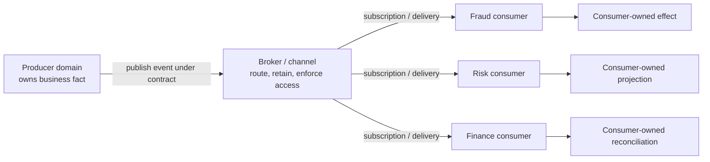
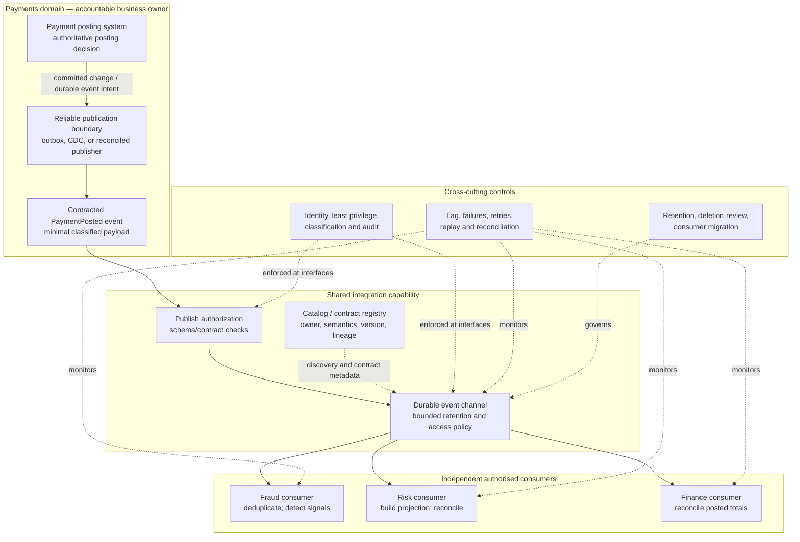

# Event-Driven and Data-Sharing Patterns

**Roadmap location:** Stage 2D — Data Architecture / `03-Data-Architecture-Patterns-and-Reference-Architectures/`  
**Target filename:** `06-event-driven-and-data-sharing-patterns.md`  
**Controlling specification:** `roadmap-Data-Architecture-Patterns-and-Reference-Architectures.md`, Module 6, sections 6.1–6.12  
**Scope boundary:** Architecture patterns and decision-making. Product-specific streaming engineering and broker configuration belong to later integration/streaming modules.  
**Case-study convention:** Northbridge Bank is fictional. All volumes, freshness targets, roles, policies, and business details are illustrative assumptions, not facts about a real organisation or statements of regulatory requirements.

---

## 1. Learning Objectives

By the end of this lesson, you should be able to:

1. Define an event and explain the responsibilities of a producer, broker or channel, and consumer.
2. Distinguish an event, command, state transfer, and change event using business examples.
3. Explain asynchronous communication and temporal decoupling without assuming that asynchronous means real-time.
4. Compare file/batch exports, API/query access, shared databases, event publication, and managed data sharing.
5. Select request-based or event-based integration based on explicit freshness, consistency, availability, coupling, volume, and consumer requirements.
6. Specify an event/data-sharing contract with semantics, identity, timestamps, classification, ownership, versioning, and compatibility rules.
7. Explain delivery semantics, duplicates, ordering scope, replay, retries, idempotence, retention, and failure recovery.
8. Distinguish transport-level delivery guarantees from end-to-end business correctness.
9. Evaluate security, privacy, deletion, retention, access control, data ownership, and operational complexity.
10. Explain how events may serve as the input path in Kappa architecture while distinguishing an event log from an analytical table or data product.
11. Produce pattern cards, an integration comparison, a decision table, a conceptual architecture, and a risk analysis.
12. Defend a recommendation and explain when a simpler integration pattern is preferable.

### Evidence of learning

A satisfactory submission contains a justified pattern choice, a diagram whose participants and data flows agree with its contract, explicit contract ownership and compatibility rules, a retention/privacy rationale, and written answers to the practical scenarios. A list of technology names or generic pros and cons is not sufficient.

---

## 2. Why the Topic Matters in Real-World Data Architecture

Systems need to exchange facts, requests, records, and analytical data. The interaction pattern affects freshness, runtime coupling, failure propagation, ownership, security, and the cost of change. A poor choice can create brittle point-to-point dependencies, stale copies, hidden database coupling, or event streams that no team can safely change.

The architecture question is not “Should everything become an event?” It is:

> Given the consumer's actual need, which sharing mechanism provides the required freshness, correctness, availability, governance, and cost with the least unjustified complexity?

An API may be best when a caller needs a current answer and can handle request-time failure. A daily file can be ideal for bulk analytical loads. Managed data sharing may fit governed cross-domain analytical consumption. Event publication is useful when multiple independent consumers need to react to a business fact without the producer coordinating each consumer at runtime. Direct shared-database access is often risky because consumers become coupled to the producer's physical schema, workload, and availability.

### 2.1 Events as facts, not disguised remote procedure calls

An **event** records that something happened: “payment posted,” “customer address changed,” or “card transaction authorised.” It should describe a fact that has occurred, not ask a receiver to perform an action.

A **command** asks for an action: “post this payment” or “block this card.” A command can be rejected, delayed, or fail; an event normally describes an accepted fact. A command named `PaymentPosted` is misleading if it actually means “please post a payment.”

A **state transfer** shares a representation of current state, such as a customer profile snapshot. A **change event** describes a change to a record, such as a customer's address changing from one value to another. A change event may be an event, but its semantics, source, and completeness must be made clear.

### 2.2 What asynchronous communication changes

With synchronous request/response, the caller normally waits for a response and is affected by the callee's runtime availability, latency, and capacity. With asynchronous publication, the producer can hand a message to a durable channel and continue without waiting for each consumer to finish.

This creates **temporal decoupling**: producer and consumer need not be available at the same moment. It does not remove all coupling. They still depend on shared meaning, contracts, permissions, routing, retention, and operational service levels. Async flows can also be harder to trace and can produce eventual consistency.

### 2.3 Relationship to the preceding architecture lessons

- **Ownership and domain-oriented architecture:** the domain that owns the business meaning should be accountable for its published contract and communicate changes.
- **Data products and data mesh:** an event feed can be an interface of a data product, but publishing an event alone does not make a complete data product. Consumers still need meaning, documentation, quality expectations, support, discoverability, access rules, and a named owner.
- **Lambda/Kappa:** a durable event log can be the input to a Kappa-style single stream-processing path when continuous processing and replay are justified. Event-driven integration is broader than Kappa; many event consumers simply trigger workflows or update operational projections.
- **Requirements and constraints:** use the stated freshness, latency, availability, throughput, retention, and recovery requirements before selecting the pattern.

---

## 3. Prerequisite Knowledge

The roadmap identifies prior knowledge from Modules 1, 3, and 4 of this pattern module; requirements and constraints in Stage 2D.2, Topics 3–5; and earlier work on storage, data products, and Lambda/Kappa. In practical terms, you should understand:

- Architecture boundaries, business domains, ownership, and data-product contracts.
- Batch, warehouse, lake, and lakehouse patterns.
- Freshness, latency, throughput, availability, and data-quality requirements.
- The distinction between operational records, analytical tables, and retained event history.
- The basics of asynchronous processing, replay, idempotence, and eventual consistency.

### 3.1 Prerequisite check

Answer these before continuing:

1. Who owns the business meaning of a customer status or posted payment?
2. How does a freshness target differ from completeness or correctness?
3. What is the difference between an authoritative operational record and an analytical copy?
4. If a consumer is unavailable for six hours, what determines whether it can catch up?
5. Why is replaying a retained event not necessarily safe when the consumer sends an external notification?

If you cannot answer these, revisit ownership, data-product, storage, requirements, and Lambda/Kappa lessons. No vendor-specific broker knowledge is required for this architecture-level module.

---

## 4. Beginner-Level Learning Sequence

### 4.1 Define an event

An event is a record of a fact that occurred, normally with an identity, a type, a time, and a payload or reference to relevant data. A well-designed event makes its meaning explicit and avoids ambiguous field names.

Illustrative business events:

- `PaymentPosted`: a payment has been successfully posted to an account.
- `CardTransactionAuthorised`: a card transaction has received an authorisation decision.
- `CustomerAddressChanged`: the authoritative customer address changed.
- `LoanApplicationSubmitted`: a loan application was submitted.

An event does not necessarily mean the action is final forever. A later event may reverse, correct, or supersede it. The contract must explain business semantics such as “posted,” “authorised,” “settled,” “cancelled,” and “reversed.”

### 4.2 Identify the participants

- **Producer:** the system or domain that owns the fact and publishes it. It is accountable for event meaning, required fields, access classification, and contract evolution.
- **Broker/channel:** the logical transport and distribution boundary. It routes and may retain events, controls who can publish or subscribe, and exposes delivery/retention properties. A broker does not decide the truth of the business event or guarantee correct business effects in every downstream system.
- **Consumer:** a system or domain that subscribes and interprets the contract. It owns its processing, deduplication/idempotence, recovery, local effects, and any consumer-specific transformation.
- **Contract owner:** accountable for the published meaning and compatibility policy. Often this is the producer domain, with platform and governance teams providing standards and controls.
- **Platform/security operators:** manage shared capabilities, access enforcement, monitoring, retention controls, and incident processes. They do not automatically own the business meaning.

### 4.3 Conceptual event-driven flow



**Interpretation:** the producer publishes a fact under a defined interface. Each authorised consumer has an independent responsibility and may process at a different pace. The producer does not normally wait for every consumer to complete. Delivery can be repeated, and the diagram does not imply that consumers share one database, that all deliveries are globally ordered, or that every downstream effect happens exactly once.

**Publication-boundary caveat:** this simplified diagram starts at the publication interface; it does not prove that a committed business transaction and publication to the channel are atomic. If the source transaction commits but publication fails, consumers can miss a business fact; if publication happens before a transaction is durable, consumers can observe a fact that is later rolled back. The design must choose and document a reliable publication/recovery mechanism appropriate to the source, such as a transactional outbox, change-data capture (CDC) with understood capture semantics, or reconciliation that detects and repairs gaps. These options are not interchangeable: an outbox records publication intent within the business transaction, CDC captures source changes according to its configuration and source semantics, and reconciliation is a detection/repair control. Retries should preserve the same event identity for the same event occurrence. Product-specific implementation belongs to later integration modules.

### 4.4 Event, command, state transfer, and change event

| Message kind | Purpose | Example | Key question |
|---|---|---|---|
| Event | Record a fact that happened | `PaymentPosted` | What happened, and when? |
| Command | Request that an action be performed | `PostPayment` | Who is being asked to do what? |
| State transfer | Share a representation of current state | `CustomerProfileSnapshot` | What is the current state as represented at this time? |
| Change event | Describe a record change | `CustomerAddressChanged` | Which entity changed, and what change is represented? |

**Example:** `PostPayment` is a command sent to the payment domain. If the domain accepts and commits the payment, it may publish `PaymentPosted`. A downstream finance consumer should not infer that a command succeeded merely because it was sent. A `CustomerProfileSnapshot` is not a complete change history; a `CustomerAddressChanged` event may omit unrelated profile fields and should not be mistaken for a full customer record.

### 4.5 Explain asynchronous communication

In a synchronous request, the caller typically waits for the target system. If the target is unavailable, the caller may fail or retry. In an asynchronous flow, the producer can publish to a channel and a consumer can process later, provided the channel retains the event and the contract allows the delay.

Benefits can include reduced runtime availability coupling and easier fan-out to multiple consumers. Costs include delayed visibility, retries, duplicates, ordering constraints, replay decisions, monitoring needs, and more complicated debugging.

**Temporal decoupling is not absolute independence.** The producer and consumer remain coupled through event semantics, schema, permissions, retention, service expectations, and shared operational processes.

### 4.6 Introduce the major sharing approaches

#### Pattern card A — Event-driven integration

- **Purpose:** publish business facts or record changes for independent consumers.
- **Best fit:** multiple consumers react to changes; the producer should not coordinate every consumer at runtime; bounded delay is acceptable.
- **Typical freshness:** seconds to minutes, depending on design and operating conditions—not an inherent guarantee.
- **Ownership:** producer owns the event contract; each consumer owns its reaction and side effects.
- **Strengths:** fan-out, temporal decoupling, incremental updates, opportunity for replay.
- **Risks:** duplicates, ordering scope, lag, schema drift, event sprawl, retained sensitive data, operational burden.
- **Avoid when:** one caller needs an immediate authoritative answer, a scheduled export is sufficient, or no one can own the contract and operational lifecycle.

#### Pattern card B — API or query access

- **Purpose:** allow a consumer to request a response or query current data through a defined interface.
- **Best fit:** current state is needed on demand, the request has a clear response, and runtime dependency is acceptable.
- **Strengths:** explicit request/response semantics, controlled interface, potentially current data.
- **Risks:** availability and latency coupling, load on source, rate limits, cascading failures, repeated queries, versioned API contracts.
- **Controls:** authentication and authorisation, bounded timeouts, quotas, caching rules where appropriate, pagination, API versioning, and service-level expectations.
- **Avoid when:** a large population of consumers needs every change continuously and repeated polling would create unnecessary load.

#### Pattern card C — File or batch export

- **Purpose:** share a bounded snapshot or incremental extract at a scheduled or agreed interval.
- **Best fit:** bulk transfer, scheduled analytics, downstream processing that tolerates known staleness.
- **Strengths:** simple operational model, efficient bulk movement, clear delivery boundaries, easy reconciliation when manifests and checksums are defined.
- **Risks:** freshness lag, file loss/duplication, manual handling, inconsistent extracts, ambiguous schema changes, insecure storage or transfer.
- **Controls:** manifest, schema and version, completeness marker, row counts/checksums, encryption, access expiry, atomic publication, retry/reconciliation rules.
- **Avoid when:** a consumer needs an immediate decision and batch delay violates the requirement.

#### Pattern card D — Shared database access

- **Purpose:** allow multiple systems to read or write the same database or schema.
- **Best fit:** narrow, deliberately governed cases where shared ownership and transaction boundaries are explicit; it is rarely the default cross-domain integration pattern.
- **Strengths:** direct access to committed state, no separate publication path required for simple cases.
- **Risks:** strong schema and workload coupling, accidental writes, contention, privilege sprawl, unclear ownership, release coordination, availability coupling, and impact from unbounded queries.
- **Controls if justified:** named owner, read-only views or dedicated interfaces, least privilege, workload isolation, schema-change process, query limits, audit, and explicit support boundaries.
- **Avoid when:** independent domains need autonomy or consumers can be served by a stable API, export, event, or managed product interface.

#### Pattern card E — Managed data sharing / data-product interface

- **Purpose:** expose a governed, documented dataset or analytical interface to authorised consumers through a managed platform or product boundary.
- **Best fit:** cross-domain analytical consumption where consumers need discoverability, stable semantics, access workflows, and product-level expectations.
- **Strengths:** clearer ownership, discoverability, governed access, reusable semantics, explicit quality and freshness expectations.
- **Risks:** governance and platform overhead, confusing a platform feature with product accountability, hidden copies or query costs, unclear refresh semantics.
- **Controls:** owner, data contract, catalog metadata, access policy, quality/freshness SLOs, lineage, version/deprecation rules, usage monitoring, support and cost allocation.
- **Avoid when:** the dataset is a one-off transfer and the overhead of a managed product is disproportionate.

### 4.7 Beginner exercise: payment posted

Draw one producer, one broker/channel, and three consumers for `PaymentPosted`. Label who owns the event meaning, who authorises each consumer, what the channel retains, and what each consumer does. Explain why the event is not a command and why the consumers do not automatically receive a globally ordered, exactly-once business effect.

**Checkpoint:** you can define the participants and message types without confusing the publication mechanism with business truth or downstream correctness.

---

## 5. Intermediate-Level Learning Sequence

### 5.1 Request-based versus event-based integration

Request-based integration is commonly pull-oriented: a consumer asks a provider for a response. Event-based integration is commonly publication-oriented: a producer publishes a fact and consumers decide how to react. Neither is universally superior.

| Criterion | API / request-response | Event publication | Batch/file transfer | Shared database | Managed data sharing |
|---|---|---|---|---|---|
| Interaction | Consumer requests a response | Producer publishes; consumer subscribes | Producer sends a bounded extract | Consumer reads/writes shared physical store | Consumer accesses a governed product/interface |
| Freshness | Potentially current at request time | Potentially seconds/minutes; depends on lag | Usually scheduled; hours/days may be acceptable | Potentially current committed state | Depends on refresh or query mode |
| Runtime coupling | Caller depends on provider response | Reduced temporal coupling; contract remains | Low runtime coupling after delivery | High schema/workload/availability coupling | Contract/platform coupling |
| Fan-out | Caller or gateway coordinates multiple calls | Natural fan-out to multiple consumers | Multiple recipients need distribution controls | Multiple readers may compete for resources | Governed access to multiple consumers |
| Failure mode | Timeout, unavailable provider, partial request | Delivery retry, duplicate, lag, poison message | Missing, late, duplicate, partial, or malformed file | Locking, resource contention, schema break | Access, freshness, platform, contract, or cost issue |
| Consistency | Response reflects provider's chosen consistency model | Often eventual across consumers | Snapshot/interval consistency must be specified | Database transaction semantics, but shared use may still be confusing | Defined by product refresh/query semantics |
| Bulk efficiency | Often poor for large extracts unless designed for it | Good for incremental facts; not always ideal for full snapshots | Often strong for large bounded data | May overload source when used for bulk extraction | Depends on platform and data layout |
| Contract surface | API request/response schema | Event schema and business semantics | File format, manifest, partitioning, delivery semantics | Physical schema and implicit usage | Product schema, meaning, policy, quality, freshness |
| Best fit | Need a response/current state | Multiple consumers react to a fact | Scheduled bulk or analytical loads | Narrow, controlled shared-state cases | Reusable, governed analytical consumption |
| Main risk | Availability and latency coupling | Contract drift, replay/ordering/duplicates | Staleness and delivery handling | Hidden coupling and unsafe access | Governance overhead or unclear product ownership |

The table is a conceptual comparison, not a guarantee about every implementation. A well-designed API can support bulk reads; a managed product may use files, tables, APIs, or events underneath; and an event consumer may call an API for enrichment. Architecture patterns can be combined when each role is explicit.

### 5.2 Pull versus push; full versus incremental; raw versus curated

- **Pull:** the consumer initiates a query or download. It controls when it reads but may create repeated load or miss changes if it lacks a correct cursor/watermark.
- **Push:** the producer or platform sends updates to consumers. This can improve timeliness but requires delivery, retry, subscription, and access controls.
- **Full snapshot:** a complete representation at a defined point or interval. It is often easy for a consumer to reason about but may be costly to transfer.
- **Incremental feed:** only changes or new facts are shared. It can be efficient, but consumers need reliable identity, ordering/correction semantics, and a way to reconcile gaps.
- **Raw data:** close to the source representation; it may preserve detail but pushes interpretation and quality burden to consumers.
- **Curated data:** applies documented business definitions, quality rules, and transformations; it can be easier to consume but requires ownership and change governance.

### 5.3 Discovering and interpreting shared data

A consumer must be able to discover more than a channel name or table name. A usable interface should identify:

- business purpose and meaning of the data;
- authoritative producer and accountable contract owner;
- field definitions, units, allowed values, nullability, keys, timestamps, and time zone conventions;
- whether data represents a fact, current state, a change, or a correction;
- freshness, completeness, availability, retention, and support expectations;
- classification, permitted purposes, access-request path, and prohibited uses;
- schema/version policy, compatibility promise, deprecation process, and change notification;
- lineage, quality status, known limitations, and consumer examples.

A catalog can make the interface discoverable, but metadata being present does not prove it is accurate. Ownership, freshness, completeness, and correctness of metadata need their own checks.

### 5.4 Event contracts: meaning before encoding

A contract is a documented agreement between producer and consumers. It includes more than a JSON shape. It defines business semantics, required and optional fields, identifiers, time meanings, classification, ownership, compatibility rules, error/correction behavior, and operational expectations.

A contract should answer:

1. What business fact does this message represent?
2. Under what condition is it emitted, and when is it considered committed?
3. What is the stable event identity and business entity key?
4. Which timestamp is event time, and what does it mean?
5. Does the payload contain a full state, a delta, or a reference?
6. Which fields are required, optional, nullable, or restricted?
7. How are duplicates, corrections, reversals, and late events represented?
8. Who owns the contract and approves breaking changes?
9. Which compatibility policy applies, and how are consumers notified?
10. How long is the event retained, who can access it, and how is sensitive data handled?

### 5.5 Sample event contract

The following is an illustrative contract for a fictional bank. It is a conceptual schema, not a production schema or a recommendation for a specific serialization format.

```yaml
contract_name: northbridge.payment-posted
business_event: PaymentPosted
purpose: >
  Record that the payment domain has committed a payment posting.
contract_version: 1.0.0
contract_owner:
  domain: Payments
  accountable_role: Payments Data Product Owner
  change_approval: Payments owner plus designated consumer-impact review
producers:
  - payment-posting domain service
consumers:
  - fraud analytics
  - risk analytics
  - finance reconciliation
delivery_expectation:
  semantic_model: at-least-once may occur; consumers must tolerate duplicates
  ordering: no global ordering promise; per-payment ordering only if explicitly provided by the channel
  replay: allowed within approved retention and access policy
retention:
  illustrative_period: 14 days
  rationale: operational recovery window assumed for this exercise
  sensitive_payload: minimise fields; do not include full account credentials or unnecessary customer identifiers
compatibility:
  within_major_version: additive optional fields only; existing field meaning and type remain stable
  breaking_change: new major version or new contract name, consumer review, migration window, and published retirement date
  removal: only after known consumers are migrated or explicitly waived
fields:
  - name: event_id
    type: string
    required: true
    meaning: unique identifier for this published event occurrence
  - name: event_type
    type: string
    required: true
    value: PaymentPosted
  - name: contract_version
    type: string
    required: true
    meaning: schema/contract version, not the payment's business version
  - name: occurred_at
    type: timestamp
    required: true
    meaning: time the payment posting was committed in the producer domain
  - name: published_at
    type: timestamp
    required: true
    meaning: time the producer published the event
  - name: payment_id
    type: string
    required: true
    classification: restricted business identifier
  - name: account_reference
    type: string
    required: true
    classification: restricted business identifier; token/reference preferred over raw account number
  - name: amount
    type: decimal
    required: true
    meaning: posted amount in the currency specified by currency_code
  - name: currency_code
    type: string
    required: true
    meaning: currency identifier according to the organisation's agreed code list
  - name: posting_status
    type: string
    required: true
    allowed_values: [POSTED]
  - name: correction_of_event_id
    type: string
    required: false
    meaning: prior event being corrected, when applicable
security:
  access: explicit consumer allow-list; least privilege; audit access
  purpose_limitation: fraud, risk, and finance use cases approved for this contract
  prohibited: credentials, authentication secrets, unnecessary direct customer identifiers
```

#### Contract interpretation and versioning rules

- `event_id` identifies one logical event occurrence and must remain stable across redelivery or publication retries of that same occurrence; `payment_id` identifies the business payment. They are not interchangeable. A distinct correction or reversal is a new event occurrence with its own `event_id` and an explicit relationship to the event or business record it corrects. Recreating the same event during recovery must not mint a new identity merely because it is being retried.
- `occurred_at` and `published_at` answer different questions. The difference helps reveal publication delay. Consumers should not silently substitute processing time for either.
- A schema version is not a business entity version. If consumers need ordering or correction detection for one payment, the contract must define a separate business sequence/version or correction relationship.
- Additive optional fields are usually easier to introduce than changing the meaning or type of an existing field. Compatibility depends on actual consumer behavior and the schema format; “additive” alone does not guarantee safety.
- A removed field, renamed field, changed unit, changed nullability, changed meaning, or changed key can be breaking even if the encoding still parses.
- The producer/contract owner publishes change notes and a migration window. Consumers test compatibility and report dependencies; the owner must not assume all consumers are known unless the platform's subscription inventory is demonstrably complete.
- A consumer may reject unknown fields or interpret optional fields differently. Therefore, compatibility policy must state the supported reader/writer expectations and test them.
- Contract review does not replace business validation. A syntactically valid event may still be semantically wrong.

### 5.6 Data-sharing ownership model

| Responsibility | Accountable party | Typical supporting party |
|---|---|---|
| Business definition and source truth | Owning business domain | Data governance / business SMEs |
| Event or product contract | Producer/contract owner | Architecture and platform teams |
| Publishing correctness | Producer domain | Producer operations / quality engineering |
| Broker/channel service and platform access controls | Platform owner | Security / SRE |
| Consumer interpretation and idempotent processing | Consumer owner | Consumer engineering / operations |
| Consumer authorization | Data owner or delegated policy authority | Security / privacy / platform |
| Retention policy and deletion handling | Data owner with policy authority | Legal/privacy/security and platform operators as applicable |
| Compatibility tests and migration | Producer and affected consumers | Contract registry / CI controls |
| Incident response and reconciliation | Named producer and consumer operational owners | Shared incident process |

The organization must name real roles for its context. The table is a starting responsibility model, not a universal legal or governance assignment.

### 5.7 Intermediate Northbridge scenarios

**Scenario A — Three teams need customer changes.** Assume one fraud use case needs relevant changes within seconds, while risk reporting and marketing analytics need a daily extract. A defensible design is an event feed with a narrow, purpose-approved payload for the low-latency consumer, plus scheduled curated exports for the two daily consumers. This avoids forcing all consumers into the lowest-latency, highest-operational-cost path. The daily extract should have a manifest, completeness marker, schema version, and reconciliation process. The event contract owner remains accountable for meaning; each consumer owns processing and access approvals.

**Scenario B — Producer removes a field.** Prevent breakage with a named contract owner, a published compatibility policy, schema/consumer tests, a deprecation notice, consumer inventory, usage/lag telemetry, a migration window, and a retirement decision. If a field's meaning must change, create a new version or contract rather than silently repurposing it. A catalog entry alone is insufficient if consumers are not discoverable or tests are not enforced.

**Scenario C — Reprocess last week's events; a downstream action sends customer notifications.** Replaying can repeat side effects. Separate replayable analytical/state-building work from non-repeatable actions; use stable event IDs and idempotency keys; record processed-event state; make notification dispatch deduplicate at the business boundary; provide a replay mode that suppresses or explicitly re-authorises external effects; and audit the replay. Idempotency reduces duplicates but does not resolve every race or partial-failure case.

**Checkpoint:** you can compare alternatives against requirements, specify contract ownership, and explain how consumer expectations and change control reduce integration risk.

---

## 6. Advanced-Level Learning Sequence

### 6.1 Delivery semantics: understand the boundary of each guarantee

- **At-most-once:** a message may be lost, but the delivery mechanism does not intentionally redeliver it under the stated semantics. This may be acceptable for some expendable signals but is usually unsuitable for financial facts without reconciliation or another recovery mechanism.
- **At-least-once:** the system retries delivery until acknowledgement or another defined terminal condition, so a message may be delivered more than once. Eventual delivery is conditional on the configured retry/retention envelope, service recovery, and the absence of terminal discard or expiry; duplicates are possible and must be tolerated.
- **At-most-once processing / at-least-once processing:** delivery and processing are separate. A consumer may receive a message but fail before committing its result, or commit a result but fail before acknowledging the message.
- **Effectively-once business outcome:** the system design prevents duplicate business effects for a defined operation through idempotency, unique constraints, deduplication, transaction boundaries, reconciliation, or other controls. This is a property of the end-to-end design and its boundaries, not something to infer from a broker label.
- **Exactly-once claims:** any such claim must specify scope, state, sinks, external side effects, failure model, and assumptions. A transport or processing guarantee does not automatically ensure one bank posting, one customer notification, or one correct ledger entry across multiple independent systems.

A useful reasoning chain is: **delivery → consumer processing → local state commit → acknowledgement → external side effect**. Failure between any two steps can create a duplicate, loss, or inconsistent outcome unless the design addresses that boundary.

### 6.2 Duplicate delivery and idempotence

A duplicate can occur after a timeout, acknowledgement loss, retry, consumer restart, replay, or ambiguous partial failure. The consumer should be designed around the possibility rather than treating duplicates as impossible.

**Idempotent operation:** applying the same operation more than once produces the same intended final effect as applying it once, within a defined scope. For example, an upsert keyed by a stable payment ID may be idempotent if it replaces the same representation rather than incrementing a total on every delivery. “Add 100 to the balance” is not idempotent unless the operation has deduplication or transaction semantics that prevent repeat application.

Common controls:

- Stable `event_id` and business key.
- Consumer-side processed-event record or unique constraint.
- Idempotency key at the boundary of an external action.
- Explicit correction/reversal semantics.
- Atomic commit of the consumer's state and processed-event marker where possible.
- Reconciliation against the authoritative source for high-consequence business records.

Idempotence is not a substitute for correct event semantics, and a deduplication cache with a shorter lifetime than the replay horizon may not protect against older duplicates.

### 6.3 Ordering and causal relationships

Do not assume a single global order across all events or consumers. Ordering may be guaranteed only within a key, partition, channel, or producer scope. Cross-entity operations can arrive in different orders, and independent consumers may process at different speeds.

The contract should state:

- which entity or key defines the ordering scope;
- whether a sequence number or business version exists;
- how stale or out-of-order updates are detected;
- whether consumers can apply updates independently;
- how corrections, reversals, and late-arriving facts are represented;
- how consumers recover if an expected sequence is missing.

For current-state projections, a consumer may ignore an older version when a later version is already applied, but only if version semantics are reliable. For financial facts, dropping an event simply because it arrived later than expected may be incorrect. Ordering policy must follow business semantics, not convenience.

### 6.4 Retry, poison messages, backpressure, and recovery

Retries are useful for transient failures but can amplify load or block progress when used without bounds. A **poison message** repeatedly fails because it is malformed, violates an assumption, or triggers a deterministic processing error.

A conceptual failure policy should define:

1. Which errors are transient and which are permanent.
2. Retry count/backoff and maximum retry age.
3. How a permanently failing event is isolated (for example, a dead-letter/quarantine path) without silently losing accountability.
4. Who investigates and how the original payload, error, contract version, and trace context are protected and retained.
5. Whether later events for the same entity may proceed when one event fails.
6. How a quarantined event is corrected and reintroduced.
7. How lag, failure rate, retry volume, and oldest unprocessed event are monitored.
8. How to reconcile consumer state after a prolonged outage or a gap.
9. How replay is authorised and separated from production side effects.

**Backpressure** occurs when producers or channels deliver faster than a consumer can process. A design needs an explicit response: allow lag within a defined budget, reduce/shape load, scale capacity, use bounded buffering, or apply an agreed degradation policy. A growing backlog is not merely a performance metric; it changes freshness and possibly retention/recovery feasibility.

### 6.5 Replay and retention are coupled

Replay means processing retained history again. It can rebuild an analytical projection, recover a consumer after outage, correct a bug, or support a new consumer. Replay is possible only while the required events and dependencies remain available and the contract remains interpretable.

Before promising replay, verify:

- the retention period covers the outage/reprocessing horizon;
- the consumer can process the retained backlog fast enough;
- the relevant schema/contract versions and transformation logic are available;
- ordering, deduplication, and correction semantics are preserved;
- referenced external data is still available or its historical version is retained;
- access remains authorised for replay, including old payloads;
- downstream side effects can be suppressed, deduplicated, or explicitly approved;
- replay is observable, bounded, and reversible where possible.

An event log is not the same thing as an analytical table. The log preserves a sequence of events within its retention and ordering model. An analytical table or data product is a derived representation with its own grain, schema, quality rules, refresh semantics, lineage, and retention. A table may be rebuilt from an event log only if the required history, transformations, reference data, and semantics are available.

### 6.6 Conceptual replay-time estimate

Use the earlier Lambda/Kappa lesson's capacity reasoning. If a retained backlog contains \(N\) events, the consumer can sustainably process \(R_c\) events/second, and new events continue to arrive at \(R_i\) events/second, catch-up is feasible only when \(R_c > R_i\). Ignoring startup and variable work, approximate catch-up time is:

\[
T_{\text{catch-up}} \approx \frac{N}{R_c - R_i}
\]

Illustrative example: assume a consumer has 3,600,000 events to catch up on, processes 2,000 events/second, and new events arrive at 500 events/second. Net catch-up capacity is 1,500 events/second, so catch-up takes approximately 2,400 seconds, or 40 minutes. This is an arithmetic illustration, not a throughput claim. Real estimates must account for payload size, processing cost, retries, partition/key skew, external dependencies, and sink capacity.

If \(R_c \leq R_i\), the consumer cannot catch up under those assumptions, no matter how long it runs. The architecture needs a capacity, load, or recovery-plan change.

### 6.7 Contract evolution and ownership

Schema compatibility is contextual. Common conceptual categories are:

- **Backward compatibility:** newer consumers can read data written using an earlier schema, under the defined compatibility model.
- **Forward compatibility:** older consumers can read data written using a newer schema, under the defined compatibility model.
- **Full compatibility:** both directions are supported for the specified versions and format.

These labels must be tied to a specific schema format, reader/writer behavior, and policy. They do not prove that business meaning is compatible. Changing `amount` from gross to net can be a semantic breaking change even if its type remains decimal.

A disciplined change lifecycle includes:

1. Contract owner proposes the change and states the business reason.
2. Impact analysis identifies known consumers, versions, and critical uses.
3. Compatibility checks and representative consumer tests run.
4. A migration path, parallel period or new major version is agreed where needed.
5. Consumers receive a dated notice and have a way to ask questions.
6. Adoption and remaining use of the old version are measured.
7. Retirement occurs only after migration evidence or an explicit, accountable exception.
8. The catalog, documentation, examples, lineage and operational runbooks are updated.

**Ownership rule:** the producer owns the published business meaning and compatibility policy; the consumer owns safe interpretation and local effects. Neither side can unilaterally assume the other has met its obligations.

### 6.8 Security, privacy, retention, and deletion

Events may be copied to multiple consumers, retained in a channel, placed in dead-letter storage, captured in logs, or included in replay backups. Each copy and derived output can expand exposure and make deletion more complicated.

Use data minimisation: publish only fields needed for the approved purpose. Prefer stable references or tokens over unnecessary direct identifiers where the consumer can resolve them through an authorised path. Classify fields and the event as a whole; a single sensitive field may determine access restrictions.

A conceptual policy should state:

- approved purposes and authorised consumer identities;
- field-level or event-level classification;
- least-privilege publish/subscribe rights and access audit;
- encryption and secure transport/storage expectations at the platform level;
- retention period by data class and operational purpose;
- whether replay is permitted and who can approve it;
- how deletion/correction requests are propagated to live stores, derived products, caches, dead-letter stores, and backups where applicable;
- what immutable audit evidence must remain, if any, and who determines its allowed scope;
- handling of data subject or business-record deletion where the organisation's applicable policy requires it;
- how to prevent sensitive payloads from leaking into traces, exception messages, or support tickets;
- cross-domain sharing review and incident response.

This lesson does **not** prescribe a regulatory retention period or claim that one universal deletion rule applies. The organisation must determine applicable legal, contractual, business, security, and records-management requirements with the appropriate authorities. If immutable logs cannot be edited in place, options may include shorter retention, payload minimisation, tokenisation, tombstone/correction events, key-based cryptographic erasure where appropriate, rebuilding derived stores, or restricted access pending expiry. Each option has limits and requires policy review; a tombstone does not automatically erase copies already exported to consumers.

### 6.9 Conceptual Northbridge event/data-sharing architecture

All systems, roles, and policies in this diagram are illustrative assumptions.



**Design interpretation**

- The payment posting system is authoritative for whether a payment was posted. The publication boundary must ensure that committed facts are eventually represented in the channel without exposing rolled-back facts; the diagram intentionally leaves the mechanism choice open.
- The architecture decision must state whether it uses a transactional outbox, CDC, or another reliable publication/reconciliation mechanism, how gaps are detected, and how failed publication is retried or repaired. The diagram does not imply that a broker transaction automatically shares an atomic transaction with the source database.
- The contract is owned by the Payments domain. The platform enforces agreed technical controls but does not replace business accountability.
- Consumers are independently authorised and own their processing, idempotency, reconciliation, and downstream effects.
- Catalog/registry metadata supports discovery and change management. It does not guarantee that a consumer has read or understood the contract.
- Monitoring must include end-to-end business checks where required; broker delivery metrics alone cannot prove that finance totals are correct.
- Retention and deletion rules cover the channel and copies/derived data under each owner's control. The exact policy must be decided with the relevant organisational authorities.

### 6.10 Event-driven integration and Kappa architecture

**Event-driven integration** is an interaction pattern: producers publish facts and consumers react asynchronously. It may support notifications, operational workflows, search projections, risk signals, or data sharing. It does not require a continuous analytical engine or a single stream-processing path.

**Kappa architecture** is an analytical processing pattern that uses a durable, replayable event log as the primary input to a stream-processing path, with historical recomputation performed by replaying retained events through the relevant processing logic. Kappa is justified only when its operational and replay properties meet actual requirements.

| Question | Event-driven integration | Kappa architecture |
|---|---|---|
| Main concern | How systems communicate and react to facts | How an analytical result is continuously computed and rebuilt |
| Required shape | Producer, contract, channel/interface, consumers | Durable event history plus a stream-processing path and serving/output model |
| Replay role | Optional, scoped by consumer and retention | Central to rebuilding/recomputing when designed and retained for it |
| Consumer type | Operational or analytical; may simply trigger a task | Usually processing pipeline producing an analytical view/output |
| Does it imply real-time? | No | Continuous processing is central, but actual freshness depends on the system |
| Does it imply exactly-once business effects? | No | No; end-to-end correctness still needs explicit design |
| Can it be used without the other? | Yes | Kappa commonly uses event-log concepts, but it is a separate architectural decision |

A payment-posted event consumed by fraud alerting is event-driven integration. If a retained event log feeds a single stream-processing path that continuously builds a risk aggregate and can replay history to rebuild that aggregate, that processing design may be Kappa-like. The same event feed can also serve batch extracts or APIs; using events does not force every consumer into Kappa.

### 6.11 Integration decision table

Choose a pattern from requirements and constraints, not from fashion.

| Requirement or condition | Candidate pattern | Why it may fit | Risks / conditions to state |
|---|---|---|---|
| One caller needs an authoritative answer before continuing | API / request-response | Direct answer and explicit failure semantics | Provider availability, timeout, latency, load, consistency model |
| Many consumers must react independently to a business fact | Event publication | Fan-out and temporal decoupling | Contract ownership, access, lag, duplicates, ordering, retention |
| Large analytical dataset can be refreshed nightly | Batch/file export or managed data product | Efficient bounded transfer and clear reconciliation point | Staleness, completeness manifest, schema and secure transfer |
| Consumer needs current analytical data across a domain boundary with governed discovery | Managed data sharing/product interface | Reusable semantics, access workflow, quality/freshness expectations | Product owner, platform cost, refresh semantics and lineage |
| A few tightly controlled services require shared transactional state | Shared database may be considered | Could fit a deliberately bounded common transaction boundary | Strong coupling; least privilege, schema control, workload isolation and explicit ownership required |
| A consumer needs incremental changes but not second-level freshness | CDC/incremental batch or scheduled delta | May meet target with less operational complexity | Watermark correctness, gap detection, late updates, reconciliation |
| External action must occur once in business terms | Command/API or event-triggered workflow with business idempotency controls | Explicit action boundary and outcome handling | Delivery guarantee alone is insufficient; idempotency, transaction/outbox or reconciliation may be needed |
| Consumers need different freshness levels | Combine event feed and scheduled curated sharing | Avoids forcing every consumer into the most expensive path | Define canonical meaning and reconciliation across interfaces |
| No consumer needs low latency, fan-out, or replay | Batch or API may be simpler | Avoids unnecessary broker/consumer operations | Confirm the simpler option meets the target and failure requirements |
| Contract has no accountable owner or sensitive-data policy | Do not publish broadly yet | Unowned contracts create unmanaged risk | Assign owner, define purpose, classify data and establish retention/access rules first |

### 6.12 When event-driven architecture is unnecessary or inferior

Avoid event-driven integration when:

- a scheduled extract meets the freshness requirement and is materially simpler;
- a caller needs a synchronous decision and must know whether the request succeeded;
- the producer cannot define a stable business event or name an accountable contract owner;
- consumers cannot tolerate eventual consistency and no reconciliation strategy exists;
- the event adds no independent value over a well-defined API or product interface;
- the event would expose sensitive fields to many consumers without a valid purpose and enforceable access controls;
- replay is advertised but history, dependencies, capacity, or side-effect controls are missing;
- the organization cannot operate and observe the channel and consumers reliably;
- the design turns every event into a remote command, creating a distributed monolith with hidden temporal dependencies.

**Advanced checkpoint:** you can trace failure across delivery, processing, commit, acknowledgement, and side effect; explain the exact scope of each guarantee; and justify the simplest pattern that satisfies the requirements.

---

## 7. Industry-Application Exercises

All exercises use the fictional Northbridge Bank scenario. Treat all numeric targets as illustrative assumptions that must be validated in a real architecture engagement.

### Exercise 1 — Pattern cards

Complete a one-page card for each of the five patterns in Section 4. For each, document:

- business purpose and data shape;
- producer/provider and consumer responsibilities;
- interface/contract and owner;
- freshness and availability expectations;
- security and access model;
- consistency and recovery behavior;
- operational cost and main failure modes;
- conditions under which the pattern should not be selected.

**Acceptance test:** the card states a plausible non-use case, not just benefits.

### Exercise 2 — Integration comparison

Use the table in Section 5.1 and score each approach for the following fictional use cases:

1. Fraud analytics needs a transaction-authorisation signal within a few seconds.
2. Finance receives a complete daily transaction extract for reconciliation.
3. A servicing application needs the current address for one customer before completing a workflow.
4. Risk analysts need a documented, curated customer-risk dataset with access approvals and freshness expectations.
5. A legacy application directly reads another domain's tables.

For each score, state the assumption, not just a number. Identify at least one combination of patterns and explain why it is not redundant.

### Exercise 3 — Contract review

Review the `PaymentPosted` sample contract and identify:

- fields needed to identify an event occurrence versus a business entity;
- why event time and publication time differ;
- fields that may require stricter access than a generic event feed;
- at least three possible breaking changes;
- the contract owner and the consumer's obligations;
- what is not yet defined for a production deployment.

Expected production follow-ups might include a precise currency code list, timestamp precision/time-zone standard, payload size limits, correction/reversal semantics, ordering key, exact compatibility tooling, consumer inventory, and approved retention policy. Do not silently assume these details.

### Exercise 4 — Failure and risk analysis

For each failure below, state detection, immediate response, recovery, owner, and prevention:

| Failure | Required reasoning |
|---|---|
| Source business transaction commits but event publication fails | Explain the outbox/CDC/reconciliation choice, gap detection, retry or repair, and how duplicate publication is made safe |
| Consumer commits an effect but acknowledgement is lost | Explain how redelivery is detected and how the effect remains idempotent |
| Consumer is offline for six hours | Check retention, lag, catch-up capacity, freshness impact, and replay safety |
| Producer changes an existing field's meaning | Explain contract governance and semantic compatibility controls |
| One event fails on every retry | Define quarantine/dead-letter handling, alerting, investigation, and safe reintroduction |
| Consumer receives events out of order | State ordering scope, entity/version semantics, and reconciliation |
| Sensitive payload is copied to logs and dead-letter storage | Trace copies, restrict access, define retention/deletion handling, and reduce future exposure |
| Replay re-sends customer notifications | Separate analytical replay from side effects; specify idempotency or replay suppression |

### Exercise 5 — Conceptual architecture design

Create an architecture for card transaction events shared with fraud, risk, and finance. Your diagram and accompanying notes must identify:

- source of truth and event publication point;
- contract name, owner, event identity, timestamps, key, and classification;
- broker/channel role and retention;
- consumer responsibilities and independent access controls;
- duplicate/ordering/replay rules;
- freshness and availability assumptions;
- monitoring, reconciliation, and incident ownership;
- privacy, retention, deletion, and change-management controls;
- at least two alternatives rejected and the requirement that made them less suitable.

Do not specify vendor products, broker tuning, streaming framework configuration, or infrastructure implementation; those belong to later modules.

### Exercise 6 — Retention/privacy policy rationale

Write a short policy rationale for a proposed event retention period. Address:

1. What recovery, consumer outage, replay, and audit purposes require history?
2. What is the longest supported outage/reprocessing window?
3. Can consumers catch up before retention expires?
4. Which fields are genuinely required?
5. Which consumers and purposes are authorised?
6. What copies exist outside the channel?
7. How are corrections, deletion requests, derived outputs, dead-letter payloads, and backups handled under the organisation's applicable policy?
8. Who approves exceptions and reviews the policy?

Use an explicitly illustrative period for the exercise and state that the actual period must be validated by the organisation's applicable requirements and risk owners.

### Exercise 7 — Architecture defence

Present a five-minute recommendation to a review panel. Include the requirement set, candidate patterns, rejected alternatives, accepted trade-offs, contract owner, compatibility policy, retention rule, and revisit conditions. A recommendation is not complete if it omits the reason a pattern was not selected.

---

## 8. Practical Scenarios and Case-Based Reasoning

### 8.1 Scenario: three teams want customer-change data

**Assumptions:** Fraud monitoring needs a subset of customer changes within seconds; risk reporting and marketing analytics consume approved customer attributes once per day. The data owner permits the use cases but not unrestricted sharing of every customer field.

**Recommended design:**

- Publish a narrowly scoped, access-controlled customer-change event for the approved low-latency consumer. Include a stable entity reference, event identity, event type, occurrence/publication timestamps, contract version, and only the fields required for the approved use.
- Provide daily curated exports or a managed data product for risk reporting and marketing analytics. Include schema version, snapshot time, completeness marker, quality status, and delivery/reconciliation controls.
- Use one authoritative domain owner for definitions and contract evolution. Assign separate consumer owners and approvals.
- Maintain catalog metadata, lineage, field classification, freshness expectations, and an inventory of consumers.
- Make clear whether the event is a partial change or full state. Consumers that require a full current profile should use an authorised query/product interface or a separately defined snapshot; they must not treat a delta as a full record.

**Why not one pattern for all?** A single event stream for all consumers may impose unnecessary operational complexity and broad data exposure on daily consumers. A daily file for fraud may violate the assumed freshness requirement. A direct shared database could create schema and workload coupling.

**Revisit if:** daily consumers later need low latency, event payloads cannot be minimised, source update semantics are ambiguous, or platform costs exceed the value of the feed.

### 8.2 Scenario: a producer removes a field

**Failure:** A consumer expects `customer_segment`, but the producer removes it in a release.

**Controls that should have helped:**

1. The contract owner defines a compatibility policy and a deprecation process.
2. A consumer inventory identifies active dependents, with explicit confidence limits.
3. Contract/schema checks and representative consumer tests run before release.
4. The change notice states the reason, new representation, migration path, and retirement date.
5. Usage and version telemetry show whether the old contract remains in use.
6. A breaking change uses a new major contract version or new contract name rather than silently changing the existing interface.
7. Consumer migration is verified before retirement or is explicitly waived by an accountable owner.
8. Catalog, documentation, examples, lineage, and support runbooks are updated.

**Important limitation:** syntactic schema compatibility cannot prove semantic compatibility. Changing units or business meaning can break consumers without changing the field's type. Conversely, adding an optional field can still break a consumer whose parser rejects unknown fields. The actual reader/writer behavior and contract policy must be tested.

### 8.3 Scenario: reprocess last week's events while notifications are downstream

**Risk:** Replay may reproduce customer-visible side effects, not just rebuild a data projection.

**Recommended controls:**

- Define whether replay rebuilds state, re-evaluates decisions, or repeats external actions. These are different operations.
- Use stable event IDs and business keys; store processed IDs or versions where appropriate.
- Make notification dispatch idempotent using a stable business-action key and a deduplication boundary.
- Provide an explicit replay mode that disables external effects by default or requires separately approved side-effect behavior.
- Keep replay runs identifiable and auditable; record input range, contract versions, code/logic version, operator/approver, output destination, and exceptions.
- Reconcile output against an authoritative source or a known baseline.
- Check access and retention policy before reading old events, including events that contain fields no longer needed for the current purpose.

**Do not conclude:** “The broker supports replay, therefore replay is safe.” Replayability is a transport/history capability; safety depends on consumer logic, side effects, dependencies, and policy.

### 8.4 Scenario: the consumer is unavailable for six hours

Assume the channel retains events for 24 hours, and the consumer has a measured sustainable capacity above the arrival rate. Those are illustrative assumptions, not performance facts.

1. Check that the events and referenced data needed for the outage are still retained.
2. Calculate backlog and net catch-up capacity; \(R_c\) must exceed \(R_i\) for the backlog to shrink.
3. Confirm that the consumer's contract and transformation versions remain available.
4. Verify duplicate and ordering handling before resuming.
5. Monitor the oldest unprocessed event and lag until the consumer meets the freshness target.
6. Reconcile output to detect gaps or repeated effects.
7. Confirm that no side effects are repeated during catch-up.

If retention is shorter than the outage plus catch-up window, the architecture needs a separate recovery source or a different retention/capacity plan.

### 8.5 Scenario: sensitive data in retained logs

Assume a consumer reports that an event payload with unnecessary direct identifiers was copied into a channel, a dead-letter queue, and troubleshooting logs.

**Immediate response:** restrict access to affected copies, follow the organisation's incident process, identify affected fields/consumers/copies, preserve only evidence required under approved policy, and engage designated security/privacy/data owners. Do not invent a legal deadline or assert a universal deletion rule.

**Corrective design:** minimise future payloads, use references/tokens where suitable, prevent sensitive fields from entering exception logs, enforce least privilege, shorten retention where justified, define deletion/correction propagation, and test that derived products and dead-letter paths follow the policy. Review whether a tombstone, reprocessing, restricted access, key deletion, or expiry is appropriate; none automatically removes all external copies.

### 8.6 Scenario: virtual query versus physical movement

A consumer may query a managed source through an interface instead of receiving a physical copy. Virtual access can reduce duplication and improve current-state access, but it shifts runtime dependency, query cost, and availability pressure to the source/platform. Physical movement can isolate consumers and support repeatable analytical processing, but creates copies with lineage, freshness, access, and deletion responsibilities. Decide from latency, source capacity, consumer workload, outage behavior, history needs, and data lifecycle requirements—not from an assumption that virtual or physical is always superior.

### 8.7 Scenario: when a simple batch export wins

Assume a finance consumer needs a complete daily dataset by 06:00, with no need for intra-day updates. A well-controlled nightly export with schema/version, manifest, completeness marker, encrypted transfer, access controls, and reconciliation may be simpler than operating a continuously consumed event feed. Event publication may still be justified for other use cases, but it should not be added solely because the organisation has a broker.

---

## 9. Expected Outputs and Deliverables

Complete and retain these artefacts as evidence of mastery.

### 9.1 Pattern cards

One card for each:

- event-driven integration;
- API/query access;
- file/batch export;
- shared database access;
- managed data sharing/data-product interface.

Each card must contain purpose, interface, ownership, fit, freshness, consistency, security, failure modes, operations, and non-fit conditions.

### 9.2 Integration comparison

A filled comparison table that evaluates all five approaches against at least five explicit requirements. The rationale must connect the score/choice to a stated assumption or constraint.

### 9.3 Conceptual architecture and contract

Submit:

- a conceptual event/data-sharing architecture diagram;
- a sample contract with event identity, business key, timestamps, version, classification, owner, consumers, compatibility, access, retention, and correction/replay rules;
- an explanation of what the diagram does and does not guarantee.

The sample contract in Section 5.5 and diagram in Section 6.9 are a reference example; adapt them to your scenario and label assumptions.

### 9.4 Decision and risk records

Provide:

- a sharing decision table with requirement-to-pattern rationale;
- a failure-mode table with detection, response, recovery, owner, and prevention;
- a retention/privacy policy rationale;
- a change/deprecation workflow;
- answers to the practical scenarios and the practice-question categories below.

### 9.5 Practice-question coverage

The roadmap's practice-question guidance expects conceptual understanding, pattern identification, pattern comparison, diagram interpretation, ownership analysis, scenario-based selection, quality-attribute trade-offs, operational/governance risks, combining patterns, and defending a recommendation. Use these questions to test those categories.

1. **Conceptual:** Define an event, command, state transfer, and change event. Give one example of each.
2. **Pattern identification:** Given a producer, broker, and three consumers, identify each responsibility and name two assumptions the diagram does not establish.
3. **Pattern comparison:** Compare event publication, API access, and batch export for freshness, runtime coupling, and failure behavior.
4. **Diagram interpretation:** Identify where contract ownership, authorisation, retention, and consumer idempotency appear in the Section 6.9 diagram. Name one control not represented in enough detail.
5. **Ownership:** Who owns event meaning? Who owns consumer side effects? Who approves access and retention? Explain why platform ownership is not identical to business-data ownership.
6. **Scenario selection:** Choose an approach for a low-latency fraud signal and a daily finance extract. State the requirement that rules out the alternative for each.
7. **Quality attributes:** Explain how reducing runtime coupling can increase eventual-consistency and observability complexity.
8. **Operational risk:** Trace a failure after a consumer commits a state change but before it acknowledges the message. Explain the duplicate risk and an idempotency control.
9. **Governance risk:** Explain why retaining a full customer payload for replay can conflict with data minimisation and deletion requirements.
10. **Combining patterns:** Propose a design using events for change notification, an API for authoritative current state, and a batch product for analytics. Explain which system is authoritative for each purpose.
11. **Kappa relationship:** Explain when a durable event log is part of a Kappa analytical design and why an ordinary event-driven notification flow is not automatically Kappa.
12. **Architecture defence:** Recommend a pattern for a stated scenario, reject at least two alternatives, name assumptions, identify failure modes, and state what evidence would make you revisit the choice.

**Answer rubric:** each answer should state the requirement, reasoning, consequence, and limitation. Mark it correct, partly correct, or incorrect; correct weak answers and retry them after a delay. For diagrams, identify components, boundaries, ownership, flows, and missing controls. Distinguish source facts from assumptions.

---

## 10. Common Mistakes and Misconceptions

1. **Treating every integration as an event problem.** Use events only when asynchronous fan-out, temporal decoupling, or retained change history provides value beyond a simpler interface.
2. **Calling a command an event.** “Please block this card” is a request; “card blocked” is a fact after the relevant action succeeds.
3. **Assuming asynchronous means real-time.** Consumer lag, retries, outages, and throughput limits affect freshness.
4. **Assuming a broker gives end-to-end exactly-once business effects.** Transport semantics do not cover every transaction, external side effect, or reconciliation boundary.
5. **Assuming delivery once means processing once.** Failure between commit and acknowledgement can lead to redelivery.
6. **Ignoring ordering scope.** Ordering may apply only within a key or partition; cross-entity causal order may not exist.
7. **Using a change event as a complete snapshot.** A delta may not include unchanged fields; the contract must define the payload shape.
8. **Publishing without a contract owner.** Consumers cannot safely plan for semantic changes if no accountable party approves them.
9. **Equating schema compatibility with semantic compatibility.** A field can retain its type while changing meaning or units.
10. **Directly sharing a database without controls.** Physical schema, query load, privilege, availability, and release timing create hidden coupling.
11. **Treating catalog presence as contract quality.** Metadata can be stale, incomplete, or wrong.
12. **Calling an event log an analytical product.** Logs, derived tables, and curated data products have different semantics and lifecycle requirements.
13. **Replaying without considering side effects.** Rebuild operations and external business actions need separate handling.
14. **Keeping all events forever “just in case.”** Retention increases exposure, cost, and deletion complexity; justify it against recovery needs.
15. **Assuming a tombstone deletes all copies.** Consumers may already have copied or transformed data; deletion responsibilities must be explicit.
16. **Overusing event choreography for long workflows.** If no one can explain the workflow state, compensation, ownership, or failure recovery, the system may become a distributed monolith.
17. **Ignoring backpressure and consumer lag.** A queue can delay rather than eliminate a capacity problem.
18. **Selecting a pattern before requirements.** Architecture choices should follow freshness, consistency, availability, security, cost, and ownership needs.

---

## 11. Mastery Criteria

You have mastered this topic when you can demonstrate all of the following without relying on vendor-specific terminology:

- Define events, commands, state transfers, and change events precisely.
- Draw and explain a producer/channel/consumer flow with ownership boundaries.
- Compare event, API, batch, shared-database, and managed-sharing approaches using explicit requirements.
- State why the chosen pattern fits and why at least two alternatives do not.
- Specify a contract with business semantics, identity, timestamps, versioning, owner, access, compatibility, retention, and correction behavior.
- Explain at-least-once delivery, duplicate handling, ordering scope, replay, retry, poison-message handling, and backpressure.
- Distinguish delivery guarantees from end-to-end business correctness and identify side-effect risks.
- Explain how contract evolution is proposed, tested, communicated, migrated, and retired.
- Address privacy, sensitive fields, authorised purpose, copies, retention, deletion, dead-letter payloads, and derived products without inventing legal rules.
- Explain the relationship between event-driven integration and Kappa architecture.
- Identify when event-driven architecture is unnecessarily complex or inferior to a batch or request-based alternative.
- Produce a diagram and contract that agree with each other and a risk analysis that identifies owners and recovery actions.

### Self-assessment scale

| Rating | Evidence |
|---|---|
| Not yet competent | Definitions are confused; choice is based on trend or technology preference; major ownership/security/failure risks are missing. |
| Developing | Defines patterns and compares basic trade-offs but leaves contract or recovery details vague. |
| Competent | Selects based on stated requirements, documents ownership and compatibility, and handles duplicates, replay, and privacy at pattern level. |
| Advanced | Evaluates failure boundaries, operational feasibility, consumer impact, retention/deletion, and rejected alternatives; states assumptions and revisit triggers. |
| Industry-ready for this module | Defends a coherent design with traceable requirements, contract and policy ownership, failure/recovery rules, and reviewable deliverables; does not claim guarantees unsupported by the design. |

---

## 12. Completion Gate

Do not mark Module 6 complete until every required item is checked and reviewed.

- [ ] I can distinguish event, command, state transfer, and change event with correct business examples.
- [ ] I can draw an event-driven flow and explain producer, broker/channel, consumer, contract owner, and platform responsibilities.
- [ ] I have compared event, API/query, file/batch, shared database, and managed data-sharing patterns.
- [ ] My pattern selection follows explicit freshness, consistency, availability, volume, security, ownership, and cost requirements.
- [ ] I have documented a sample event contract, including identity, timestamps, key, classification, owner, version, and compatibility policy.
- [ ] I have addressed source-commit/publication failure, duplicate delivery, ordering scope, retries, idempotence, replay, poison messages, backpressure, and failure recovery.
- [ ] I have explained why broker delivery semantics do not automatically guarantee end-to-end business correctness.
- [ ] I have written a retention/privacy rationale that covers access, sensitive fields, replay, copies, deletion, and applicable policy ownership.
- [ ] My conceptual diagram and sample contract agree; no diagram implies guarantees absent from the contract.
- [ ] I have completed the three roadmap scenarios: mixed freshness needs, breaking field removal, and replay with downstream customer notifications.
- [ ] I have answered the twelve practice questions and corrected weak answers.
- [ ] I can explain when event-driven architecture is unnecessary and distinguish it from Kappa analytical processing.
- [ ] I have recorded assumptions, rejected alternatives, risks, owners, and conditions for revisiting the decision.

**Completion standard:** the integration comparison and conceptual design have been reviewed; the design states the contract owner, compatibility rule, and retention rule; and Topic 6 practice questions have been answered and corrected.

---

## Appendix A — Review checklist for an architecture design

Use this checklist during peer review. A “yes” requires evidence in the design, not merely a statement.

| Review question | Evidence expected |
|---|---|
| Is the business need explicit? | Consumer purpose, freshness target, correctness and availability needs |
| Is the chosen pattern the simplest fit? | Comparison with API, batch, event, shared-data alternatives as applicable |
| Is the source of truth named? | System/domain accountable for the business fact |
| Is the contract owner named? | Role/domain and change-approval process |
| Are semantics clear? | Event versus command, full state versus delta, correction/reversal rules |
| Are identity and time clear? | Event ID, business key, timestamp meanings, ordering/version if needed |
| Is compatibility governed? | Supported change types, testing, notice, migration, retirement |
| Are delivery/failure assumptions explicit? | Source-commit/publication gap, duplicates, retry, ordering, lag, poison message, replay, reconciliation |
| Are business effects protected? | Idempotency or equivalent controls at effect boundaries |
| Is retention justified? | Recovery horizon, throughput, costs, authorised purpose, review owner |
| Are access and privacy handled? | Classification, least privilege, payload minimisation, copy/deletion handling |
| Is operations accountable? | Alerts, SLOs, on-call/escalation, incident and reconciliation owners |
| Is the diagram honest? | No implicit exactly-once, global ordering, unlimited replay, or universal availability |
| Is there a revisit trigger? | Conditions that invalidate the decision or justify a different pattern |

## Appendix B — Scope boundary

This lesson intentionally remains at architecture-pattern level. It does not prescribe a broker, event schema registry product, stream processor, cloud service, partitioning strategy, retry configuration, infrastructure-as-code, or production deployment topology. Those details belong in later integration, platform, cloud, streaming, governance, metadata, and operational modules identified by the roadmap. The purpose here is to make the pattern choice, responsibilities, contracts, and risks clear before implementation technology is selected.
