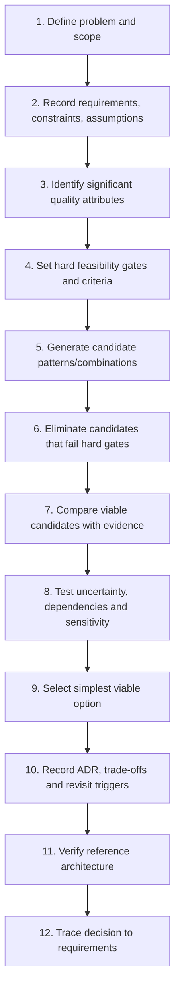
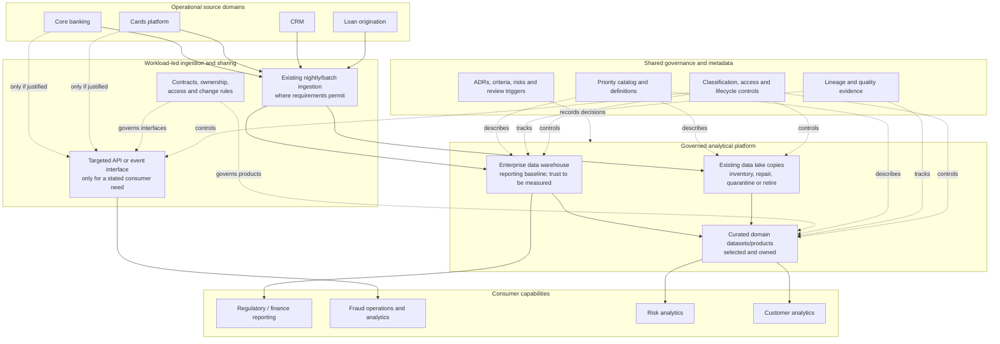

# Selecting and Combining Architecture Patterns

**Roadmap location:** Stage 2D — Data Architecture / `03-Data-Architecture-Patterns-and-Reference-Architectures/`  
**Target filename:** `07-selecting-and-combining-architecture-patterns.md`  
**Controlling specification:** `roadmap-Data-Architecture-Patterns-and-Reference-Architectures.md`, Module 7, sections 7.1–7.12  
**Prerequisites:** Modules 1–6 in this folder and Stage 2D.2, especially requirements, constraints, assumptions, risks, trade-offs, decision criteria, and Architecture Decision Records (ADRs).  
**Scope:** Reference-architecture-level decision-making. Vendor-specific service selection, physical implementation, detailed sizing, and deployment configuration belong in later modules.  
**Case-study convention:** Northbridge Bank is fictional. Facts explicitly supplied by the roadmap are identified as such. All additional targets, weights, scores, costs, timelines, and estimates are illustrative assumptions for learning, not verified measurements or claims about a real bank.

---

## 1. Learning Objectives

By the end of this lesson, you should be able to:

1. Define a business problem and decision boundary before naming architecture patterns.
2. Translate requirements, quality attributes, constraints, and risks into explicit decision criteria.
3. Separate mandatory feasibility gates from preferences that may be scored.
4. Generate a fair set of candidate patterns and combinations, then eliminate candidates that violate hard constraints.
5. Compare viable alternatives using consistent criteria, evidence, explicit weights where useful, and documented rationale.
6. Explain why numerical scoring supports judgement but does not establish objective truth.
7. Evaluate warehouse, lake, lakehouse, Lambda, Kappa, domain-oriented, data mesh, data fabric, metadata-driven, event-driven, and data-sharing patterns at their appropriate architectural levels.
8. Identify pattern dependencies, compatibility, tensions, duplicated capabilities, organisational prerequisites, and operational failure modes.
9. Use sensitivity analysis to test whether a recommendation survives plausible changes in weights, assumptions, costs, or constraints.
10. Select the simplest viable architecture that satisfies the requirements, and remove patterns that lack a distinct requirement.
11. Produce a complete ADR with context, decision, alternatives, consequences, assumptions, ownership, and revisit triggers.
12. Produce a conceptual reference architecture whose components, boundaries, data flows, and controls trace to the recommendation.
13. Build an auditable traceability chain from requirements to criteria, options, decision, and completion evidence.

### Required evidence

A learner must be able to show—not merely assert—the problem definition, hard gates, criteria, candidate set, comparison matrix, sensitivity analysis, combination rationale, parsimony review, ADR, reference-architecture view, rejected alternatives, and requirement traceability. Every recommended pattern must have a stated purpose and a requirement it serves.

---

## 2. Why the Topic Matters in Real-World Data Architecture

The preceding six topics describe architecture patterns and their trade-offs. This module turns that knowledge into a decision. The most common failure is not always choosing a bad pattern in isolation; it is choosing a fashionable combination whose parts have incompatible assumptions, require skills the organisation lacks, duplicate capabilities, or introduce more operating burden than the problem justifies.

A data warehouse, data lake, lakehouse, Lambda, Kappa, domain-oriented architecture, data mesh, data fabric, metadata-driven controls, event-driven integration, and managed data sharing address different concerns. Some patterns are largely orthogonal and can coexist. Others overlap, depend on one another, or create tensions that must be made explicit.

For example:

- **Operating model and ownership:** centralized, federated, or domain-oriented structures determine who is accountable for data meaning, delivery, and governance.
- **Analytical storage:** warehouse, lake, and lakehouse patterns address different workload, data-shape, governance, and lifecycle needs.
- **Processing:** Lambda and Kappa address specific freshness/history/reprocessing needs; neither is automatically required by a real-time-sounding requirement.
- **Product and governance model:** data mesh depends on domain ownership, data as a product, a self-service platform, and federated computational governance.
- **Metadata and integration control:** data fabric and metadata-driven approaches depend on useful, accurate metadata, connector coverage, policy enforcement, and accountable metadata ownership.
- **Interaction:** event, API, batch, shared-database, and managed-sharing patterns define how consumers obtain or react to data.

The architecture decision must begin with the business need, not the names of patterns or products.

### 2.1 The decision principle

> Select a pattern only when a requirement, constraint, risk treatment, or operating need justifies it. Prefer the least complex viable option, and document the conditions under which the decision would change.

A “simple” option is not automatically best: it must satisfy mandatory requirements and be operationally feasible. A complex option is not automatically wrong: complexity may be justified by a material need for freshness, independent domain ownership, governed cross-domain sharing, or replay. The decision must show the evidence.

### 2.2 What makes a decision auditable?

A reviewer should be able to reconstruct:

1. What problem was being solved and what was outside scope.
2. Which requirements and constraints were treated as mandatory.
3. How requirements became decision criteria.
4. Which options were considered and why any were eliminated.
5. What evidence supported each rating.
6. Which weights were used, why they were chosen, and how uncertainty was tested.
7. Which patterns were combined and what each contributes.
8. What alternatives were rejected and what trade-offs were accepted.
9. Who owns the decision and its implementation consequences.
10. What evidence or changed condition would trigger a review.

If a reviewer cannot follow this chain, the recommendation is not yet defensible.

---

## 3. Prerequisite Knowledge

The roadmap specifies Modules 1–6 in this folder and all of Stage 2D.2, especially Topics 5–7. Use the following as the decision foundation.

### 3.1 Prerequisite map

| Prerequisite | What it contributes to Module 7 |
|---|---|
| Module 1 — Centralized, federated and domain-oriented architectures | Ownership, decision authority, governance model, organisational readiness |
| Module 2 — Warehouse, lake and lakehouse patterns | Analytical storage and workload fit, governance and lifecycle implications |
| Module 3 — Lambda and Kappa | Freshness, historical correctness, replay, duplicated logic, processing complexity |
| Module 4 — Data mesh and data products | Domain accountability, product interfaces, self-service and federated governance prerequisites |
| Module 5 — Data fabric and metadata-driven architecture | Discovery, lineage, metadata quality, policy and automation dependencies |
| Module 6 — Event-driven and data-sharing patterns | Event/API/batch/shared-data choices, contract ownership, replay, consumer coupling |
| Stage 2D.2 Topic 3 — Volume, velocity, variety and growth | Capacity, growth and scale assumptions |
| Stage 2D.2 Topic 4 — Latency, throughput, freshness and availability | Measurable quality targets and service expectations |
| Stage 2D.2 Topic 5 — Constraints, assumptions, dependencies and risks | Hard gates, uncertainty, external dependencies and risk treatment |
| Stage 2D.2 Topic 6 — Architecture trade-offs and decision criteria | Criteria construction, comparison and sensitivity analysis |
| Stage 2D.2 Topic 7 — ADRs | Decision record, alternatives, consequences and revisit conditions |

### 3.2 Prerequisite check

Before making a pattern recommendation, answer:

- What business outcome must improve?
- Which requirements are mandatory, measurable, and testable?
- What is the current authoritative source for each critical business fact?
- What freshness, completeness, correctness, availability, and recovery targets apply?
- Which data classes have special access, retention, or governance constraints?
- Who owns each domain's data meaning and who operates the platform?
- Which skills, funding, support model, and organisational responsibilities actually exist?
- Which assumptions have evidence, and which are only hypotheses?

If these are unknown, record the gaps and use discovery or a bounded experiment. Do not convert missing information into a silent assumption.

---

## 4. Beginner-Level Learning Sequence

### 4.1 Start with a problem statement, not a pattern

A problem statement should identify the affected decision or capability, the current limitation, the desired outcome, and the boundaries of the decision.

**Weak:** “We need a lakehouse, mesh, fabric, and real-time platform.”

**Stronger:** “Northbridge needs more trusted and timely data for regulatory reporting, fraud detection, risk analytics, and customer analytics, while reducing the central data team's delivery bottleneck and improving accountability and discoverability.”

The stronger statement identifies outcomes but does not predetermine a solution. The roadmap's fictional Northbridge scenario provides the starting facts; detailed targets and current-state measurements must be gathered or labelled as assumptions.

### 4.2 Define the decision boundary

A decision boundary says what is being decided now and what is not.

Example boundary for this lesson:

- **In scope:** target ownership model, analytical storage direction, processing pattern where needed, metadata/discovery approach, and cross-system data-sharing pattern.
- **Out of scope:** selection of a particular cloud vendor, broker product, database engine, exact infrastructure topology, detailed network design, or production configuration.
- **Decision horizon:** a conceptual reference architecture and a staged recommendation; not a claim that every future workload must use the same pattern.
- **Interfaces:** identify where systems/domains exchange data and who owns those interfaces.

A decision with an overly broad boundary often turns into a catalogue of technologies. A decision with an overly narrow boundary can hide cross-pattern dependencies.

### 4.3 Translate the problem into requirements

Requirements should state an outcome and, where possible, how to verify it. Distinguish:

- **Functional requirements:** what capability is needed, such as producing a governed daily reporting dataset.
- **Quality attributes:** how well the capability must operate, such as freshness, correctness, availability, performance, auditability, and maintainability.
- **Constraints:** conditions the design must obey, such as a binding policy, budget ceiling, existing platform dependency, or skill limitation.
- **Assumptions:** propositions used temporarily because evidence is incomplete.
- **Risks:** uncertain events that could harm the outcome, with likelihood, impact, and treatment.
- **Dependencies:** other capabilities, owners, platforms, or decisions required for success.

Do not treat a preference as a hard constraint unless the decision owner confirms that it is mandatory.

### 4.4 Problem-to-pattern mapping table

The mapping below is a starting point for candidate generation, not an automatic decision rule.

| Observed problem or requirement | Candidate pattern(s) to investigate | Why it may fit | What must still be tested |
|---|---|---|---|
| Consistent, governed analytical reporting over structured data | Data warehouse; possibly lakehouse | Curated models and controlled reporting semantics may fit | Source reconciliation, history, freshness, governance, workload/cost |
| Diverse raw data must be retained for exploration and future uses | Data lake; possibly lakehouse | Flexible storage may support varied data | Metadata, quality, access, lifecycle, and risk of an untrusted “swamp” |
| Shared analytical tables need stronger table management and governed access across workloads | Lakehouse | Could combine lake flexibility with managed analytical tables | Table/metadata governance, compute governance, quality, skills, costs |
| Fresh results and historical recomputation are both required | Incremental batch, micro-batch, Kappa, or Lambda as candidates | Different processing models address different freshness/replay needs | Measured freshness, correctness, replay duration, duplication and operational cost |
| Central team is a bottleneck, but domains have accountable skills | Federated/domain-oriented ownership; assess data mesh readiness | Could distribute responsibility while retaining shared rules | Actual domain ownership, funding, platform self-service, governance maturity |
| Data is hard to find or interpret across many systems | Catalog, metadata-driven controls, potentially data fabric | Discovery, lineage, semantics and policy may be improved | Metadata accuracy, coverage, connector support, ownership and enforcement |
| Many independent consumers need to react to a business fact | Event-driven integration | Fan-out and temporal decoupling may help | Contract ownership, delivery, idempotence, ordering, retention, security |
| One caller needs an authoritative answer now | API/query access | Request/response may match the interaction | Availability coupling, latency, source load, consistency |
| Large analytical transfer can be scheduled | Batch/file export or managed analytical sharing | May be simpler and efficient | Freshness tolerance, completeness, security, schema and reconciliation |
| Cross-domain analytics requires documented semantics, access approval, and quality expectations | Managed data product/sharing interface; potentially mesh principles | Product-level accountability may improve reuse | Readiness, ownership, support, platform capability, cost |
| Organisation proposes several overlapping tools or patterns | Parsimony review and simpler candidates | Removing redundancy can reduce risk and cost | Whether each retained pattern serves a unique requirement |

**Important:** one problem can map to several candidate patterns, and one architecture can contain multiple patterns across different axes. The mapping identifies where to investigate; requirements, feasibility, evidence, and trade-offs determine the decision.

### 4.5 Distinguish pattern axes

Patterns operate at different levels and should not be treated as mutually exclusive choices from a single list.

| Architectural axis | Examples | Primary decision |
|---|---|---|
| Ownership and operating model | Centralized, federated, domain-oriented; data mesh operating principles | Who owns data meaning, delivery, and governance? |
| Analytical storage | Warehouse, lake, lakehouse | Where and in what form are analytical data stored and served? |
| Processing | Batch/incremental batch, Lambda, Kappa | How are data processed over time and corrected/replayed? |
| Metadata and integration control | Catalog/metadata-driven architecture, data fabric capabilities | How are data discovered, related, governed, and accessed? |
| Interaction and sharing | API, batch/file, event publication, managed sharing, controlled database interface | How does a consumer obtain or react to data? |
| Decision and governance | ADRs, standards, controls, review process | How are choices justified, recorded, and revisited? |

The axes can be combined, but combination is not mandatory. For example, a domain-oriented ownership model can publish curated warehouse tables through a managed interface and use an event only for a specific low-latency notification.

### 4.6 The repeatable selection sequence



At every step, preserve the evidence. If new evidence changes a hard gate, return to candidate viability rather than attempting to hide the issue inside a score.

### 4.7 Simple comparison example

Suppose an internal report is needed once each morning and can tolerate a daily refresh. Three candidates are a scheduled export, API polling every minute, and event publication. If there is no requirement for sub-day freshness or continuous reactions, a scheduled export may satisfy the requirement with fewer operating components. API polling and event publication remain legitimate patterns in other contexts, but their additional complexity is not justified by this requirement alone.

**Beginner checkpoint:** you can turn a business problem into candidate patterns without treating the first plausible pattern as the answer.

---

## 5. Intermediate-Level Learning Sequence

### 5.1 Separate hard gates from weighted preferences

A **hard gate** is a mandatory condition. If an option fails it and there is no accepted mitigation or waiver, the option is not viable. Examples might include a binding data-access policy, a non-negotiable recovery requirement, a prohibited hosting boundary, or an approved budget ceiling. A preference is important but can be traded against other criteria.

Do not bury a hard constraint inside weighted scoring. A high score on cost or flexibility must not compensate for violating a mandatory access rule.

#### Illustrative feasibility gates for Northbridge

These are decision-process examples, not real regulatory requirements:

| Gate | Example test | Evidence needed | Result if failed |
|---|---|---|---|
| G1 — Data control | Can restricted reporting data remain under the required access and audit controls? | Policy owner confirmation and control mapping | Eliminate or redesign the option |
| G2 — Business correctness | Can reporting outputs be reconciled to authoritative sources? | Reconciliation design and owner | Eliminate until a credible control exists |
| G3 — Freshness | Can each consumer's stated freshness target be met? | Architecture reasoning, workload evidence, or bounded test | Eliminate or revise scope/target through governance |
| G4 — Operational ownership | Is there an accountable owner and a credible support model? | Named roles, skills, on-call/incident plan | Not production-viable until addressed |
| G5 — Financial feasibility | Is the option within the approved funding boundary? | Estimate with assumptions and uncertainty | Eliminate or seek an explicit funding decision |

Gate criteria should be set by the decision owner and relevant risk authorities before candidate scoring. They must be measurable enough to test, not vague labels such as “secure” or “scalable.”

### 5.2 Build criteria from requirements

Criteria should describe the dimensions along which viable options differ. Avoid double-counting the same concern under multiple names. For example, “low operating cost,” “low support burden,” and “simple operations” may overlap; define their boundaries or consolidate them.

For this example, the criteria are:

| ID | Criterion | Requirement connection | Rating interpretation |
|---|---|---|---|
| C1 | Governance and auditability | Consistent, governed reporting and controlled access | Higher means controls, ownership and evidence are easier to enforce |
| C2 | Data trust and reconciliation | Reliable reporting, risk and finance interpretation | Higher means clearer authority, quality checks and reconciliation |
| C3 | Freshness fit | Timely data for fraud, risk and customer analytics | Higher means the option can meet the distinct consumer freshness needs without unnecessary over-engineering |
| C4 | Ownership and accountability | Reduce bottlenecks and improve accountability | Higher means responsibility is clear and feasible for current domain/platform maturity |
| C5 | Discoverability and reuse | Improve data discovery and interpretation | Higher means consumers can find, understand, request, and safely reuse data |
| C6 | Operational feasibility | Support, skills, reliability, incident response | Higher means lower operational risk and a more credible support model |
| C7 | Cost and complexity | Deliver value without unjustified platform burden | Higher means lower total cost/complexity for the required outcome |
| C8 | Change resilience | Manage schema, domain, and consumer change | Higher means boundaries and contracts make change impact more visible and manageable |

These criteria are illustrative. A real decision should derive its criteria from approved requirements and may add or remove criteria. Record the reason for every criterion and weight before scoring options.

### 5.3 Generate candidates fairly

A candidate should be a coherent architecture option at the chosen decision boundary, not a random bundle of fashionable patterns. Include a simpler baseline and at least one plausible alternative that a reasonable architect might select.

For Northbridge, the roadmap supplies the following scenario facts:

- Northbridge is a fictional mid-sized retail and business bank.
- It has a core banking system, cards platform, CRM, and loan origination system.
- Nightly extracts feed an enterprise data warehouse.
- A data lake created three years ago holds copies of some sources and is poorly trusted.
- Four business domains—retail, lending, cards, and risk—have analysts and some engineering capability.
- A central data team of about 25 people serves the organisation and has a long backlog.
- The business needs consistent, governed, timely data for regulatory reporting, fraud detection, risk analytics, and customer analytics, while reducing the central team's bottleneck and improving accountability and discoverability.
- Stakeholders named by the roadmap include the chief data officer, domain heads, fraud operations, finance, regulatory reporting, compliance, security, internal audit, data science, and platform/engineering roles.

The above are scenario facts as specified by the roadmap; they remain fictional scenario details, not real-bank facts.

**Additional assumptions used below** (for teaching only):

- Regulatory reporting has a strict need for controlled definitions, reconciliation, and traceable changes.
- Fraud has a lower-latency need than nightly reporting; the exact target is not yet measured.
- Risk and customer analytics can use curated analytical data at a scheduled or agreed refresh, unless discovery establishes a stricter target.
- Domains have some capacity to own definitions, but their ability to run production-grade data products is unproven.
- Existing warehouse and lake costs, quality metrics, lineage coverage, source availability, and exact budget are unknown.
- No new regulatory rule, hosting restriction, or retention period is invented in this lesson; such constraints must be confirmed by the relevant authorities.

### 5.4 Candidate options

The candidates below are alternatives for comparison, not a claim that every pattern is mutually exclusive. Each is described at a consistent reference-architecture level.

| Candidate | Description | Why a reasonable architect might consider it | Key conditions / risks |
|---|---|---|---|
| A — Improve centralized baseline | Keep central ownership; repair warehouse/lake trust, data definitions, access, reconciliation, and documentation; use the simplest interface needed per consumer | Lowest organisational change; uses existing warehouse and central team | May preserve backlog bottleneck; must prove the central model can meet timeliness and delivery demand |
| B — Federated/domain-oriented hybrid | Retain central standards, risk controls, and shared platform responsibilities; give domains explicit ownership for selected data definitions/products; publish curated data through governed interfaces | Balances domain knowledge and enterprise consistency; can be staged | Requires real domain ownership, clear decision rights, and central platform support |
| C — Full data mesh-style operating model | Adopt all four mesh principles: domain ownership, data as a product, self-service platform, federated computational governance | Could scale product ownership and reduce central queues if maturity supports it | Highest organisational/platform prerequisite burden; “declaring” products without funding, support, and governance fails |
| D — Metadata/fabric-heavy programme | Invest broadly in catalog, lineage, semantic relationships, policy automation, and cross-system access as a data-fabric/metadata-driven initiative | Could improve discoverability and control across dispersed data | Metadata quality and connector coverage may be weak; fabric does not repair source semantics or ownership automatically |
| E — Combined hybrid with lakehouse, event, metadata and mesh elements | Build a combined domain-oriented operating model, lakehouse analytical core, event integration for low-latency needs, metadata/fabric capabilities, and mesh-style product operating model | Potentially addresses several goals at once | High complexity; may duplicate governance, processing, integration, and product capabilities; requires evidence that each element is needed |
| F — Simple workload-led hybrid | Keep/repair governed warehouse for reporting; improve only the existing lake where it has a proven workload; introduce domain ownership for a small number of high-value datasets; use event or API interfaces only where requirements demand; improve catalog/lineage incrementally | Separates concerns, reuses existing assets, and allows staged investment | Benefits depend on a disciplined scope, clear ownership, and avoiding an unbounded platform programme |

Candidates A, B, C, D, E, and F are compared below. Candidate F is not automatically best because it is called “simple”; it must still pass hard gates and demonstrate that its narrower scope meets requirements. Candidate E is not a straw man: it may be justified if requirements and readiness evidence support the combined capabilities.

#### Candidate cost, failure-mode, and organisational-prerequisite profile

The scenario provides no monetary estimates, so this table records **cost drivers and relative exposure**, not invented currency totals. Each candidate must receive a quantified low/base/high estimate before an actual approval; the estimate should include build, migration, licensing/platform, run, support, training, opportunity cost, and decommissioning where applicable.

| Candidate | Principal cost drivers (current estimate status) | Material failure modes | Organisational prerequisites | What must be evidenced before approval |
|---|---|---|---|---|
| A — Central baseline | Lowest expected transition cost; central-team remediation and backlog opportunity cost are unknown | Central bottleneck persists; freshness misses; existing quality issues are carried forward | Central team has capacity and clear service priorities; business/data owners resolve quality issues | Throughput/backlog baseline, reconciliation results, consumer-specific freshness test, cost range |
| B — Federated hybrid | Moderate transition cost: domain capacity, contracts, shared platform and governance; amount unknown | Nominal ownership, inconsistent definitions, unclear escalation, support gaps | Named domain owners, decision rights, central platform support, funded capacity | Domain readiness assessment, support/on-call plan, cost range, pilot outcomes |
| C — Full mesh | High organisational and platform change cost; self-service platform, product teams and governance investment unknown | Products without service levels; duplicated platform capability; inconsistent governance; unfunded domain operations | All mesh principles operationally supported, including self-service and federated computational governance | Evidence for each principle, product economics, platform maturity, domain support and cost range |
| D — Fabric-heavy | High initial tooling/integration/metadata remediation cost; connector and stewardship effort unknown | Automates incorrect/stale metadata; incomplete lineage; policy appears enforced but is not; connector gaps | Accountable metadata owners, semantics/stewardship, connector and policy-control ownership | Metadata coverage/quality sample, enforcement tests, connector gap analysis and cost range |
| E — Broad combination | Highest expected cost/complexity exposure from overlapping platform, storage, processing, governance and integration capabilities; quantify rather than assume exact cost | Duplicated logic, conflicting ownership, complex incident diagnosis, unproven prerequisites, scope expansion | Mature domain operations, platform engineering, governance, streaming/data-product support, cross-team incident model | Requirement-to-pattern map for every component, overlap analysis, full lifecycle cost range and integrated operating model |
| F — Workload-led hybrid | Moderate and staged cost; reuses existing assets but still requires remediation, metadata, ownership and selective interfaces | Transitional duplication; pilot becomes permanent; targeted interface lacks contract/support; legacy trust problems persist | Decision owner, funded bounded pilot, named data/product owners, central controls and platform support | Workload-level freshness/trust evidence, cost range, stop criteria, owners and pilot review date |

These are relative hypotheses based on scope, not measured costs. If evidence contradicts them, update the candidate profile and rerun the comparison rather than preserving the initial judgement.

### 5.5 Eliminate non-viable options before scoring

Hard-gate assessment is separate from weighted scoring. In this illustrative exercise, no evidence proves that an option fails a binding regulatory rule, so do not fabricate a regulatory elimination. Instead, identify readiness gaps and conditional viability.

| Candidate | Gate assessment using currently known facts | Decision for comparison |
|---|---|---|
| A — Improve centralized baseline | Potentially viable; must demonstrate that the central team can address the backlog and different freshness needs | Keep as a baseline candidate |
| B — Federated/domain-oriented hybrid | Potentially viable; domain production ownership and support capability need confirmation | Keep, conditional on named owners and staged readiness checks |
| C — Full mesh-style model | Not yet evidenced as feasible because self-service platform, product ownership, and federated governance maturity are unproven | Do not approve full rollout now; keep a bounded pilot as a future option |
| D — Fabric-heavy programme | Not yet evidenced as feasible because metadata quality, connector coverage, policy enforcement, and metadata ownership are unknown | Keep only as an incremental capability candidate; reject a broad programme until evidence exists |
| E — Combined platform/mesh/fabric/event/lakehouse | Not demonstrated feasible as a single programme: several prerequisite capabilities and distinct requirements are unproven | Do not select as the initial target; retain individual elements for requirement-led evaluation |
| F — Simple workload-led hybrid | Potentially viable; requires target freshness and data-trust evidence plus owners for selected datasets | Keep as a leading candidate for detailed comparison |

The gate decision is **“not yet demonstrated viable”**, not “technically impossible.” If discovery supplies evidence or the decision owner accepts a documented mitigation, the candidate set can change. This distinction avoids falsely presenting missing evidence as a proven failure.

#### Gate-result register: explicit status and reason

| Candidate | Current gate status | Specific reason / missing evidence | Required next action |
|---|---|---|---|
| A — Central baseline | **Conditional / unproven for G3 and G4** | Nightly extracts may not meet the fraud target (target unknown); central backlog makes delivery/support capacity uncertain | Confirm target and measure current freshness; validate central-team throughput and named ownership |
| B — Federated hybrid | **Conditional / unproven for G4 and G5** | Domain product-support capacity and cost/funding are not established | Name owners, document on-call/support, and obtain lifecycle cost range |
| C — Full mesh | **Not approved for initial rollout; readiness gate unmet** | Self-service platform, product operating capacity, and federated governance are not demonstrated; not a claim of policy violation | Demonstrate all required operating capabilities through readiness evidence and a bounded pilot |
| D — Fabric-heavy | **Not approved as a broad programme; readiness gate unmet** | Metadata quality, connector coverage, and actual policy enforcement are unknown | Sample metadata and test controls before scoring a broad programme as feasible |
| E — Broad combination | **Not approved as initial target; multiple feasibility claims unproven** | No distinct requirement is established for each added pattern; lifecycle cost and support model are unknown | Justify every component against a requirement and re-evaluate cost, skills, dependencies, and gates |
| F — Workload-led hybrid | **Conditional / unproven for G3, G4, and G5** | Freshness targets, pilot support capacity, and budget remain unknown | Validate targets, name accountable roles, and approve a bounded costed pilot |

No candidate is recorded as failing a confirmed binding regulatory gate because the supplied scenario does not specify such a rule. A candidate can nevertheless be excluded from initial approval because a required capability or prerequisite has not been demonstrated. That status must remain visible in the ADR.

### 5.6 Rating scale and evidence rules

Use a simple 1–5 scale:

| Score | Meaning |
|---:|---|
| 1 | Poor fit; material weaknesses against the criterion |
| 2 | Weak fit; significant mitigation required |
| 3 | Adequate/conditional fit; notable trade-offs remain |
| 4 | Strong fit; manageable and understood trade-offs |
| 5 | Very strong fit for this requirement and context |

A rating must have a reason and evidence status. Evidence can be:

- **S — Source fact:** stated in the authoritative scenario or roadmap.
- **A — Assumption:** explicitly introduced for this exercise.
- **I — Inference:** reasoned consequence from facts/assumptions, to be validated.
- **E — Evidence needed:** unknown until discovery, measurement, or a bounded test.

Do not score an unknown as though it were measured. Where evidence is weak, use a range or mark the rating provisional and define how to validate it. Scores are comparative judgements; they are not measurements of architecture quality in an objective unit.

### 5.7 Illustrative weighted comparison matrix

The weights below are **illustrative assumptions**, fixed before scoring for this exercise. They sum to 100%. In a real decision, the decision owner and relevant stakeholders must agree the weights before rating candidates.

| Criterion | Weight | A Central baseline | B Federated hybrid | C Full mesh | D Fabric-heavy | E Broad combination | F Workload-led hybrid |
|---|---:|---:|---:|---:|---:|---:|---:|
| C1 Governance and auditability | 20% | 4 | 4 | 3 | 4 | 4 | 4 |
| C2 Trust and reconciliation | 20% | 3 | 4 | 3 | 3 | 4 | 4 |
| C3 Freshness fit | 15% | 2 | 4 | 4 | 3 | 5 | 4 |
| C4 Ownership/accountability | 15% | 2 | 4 | 5 | 2 | 4 | 4 |
| C5 Discoverability/reuse | 10% | 2 | 4 | 4 | 5 | 5 | 3 |
| C6 Operational feasibility | 10% | 4 | 3 | 2 | 2 | 1 | 4 |
| C7 Cost/complexity | 5% | 4 | 3 | 2 | 2 | 1 | 4 |
| C8 Change resilience | 5% | 2 | 4 | 4 | 3 | 4 | 4 |
| **Weighted total / 5** | **100%** | **2.90** | **3.85** | **3.45** | **3.10** | **3.80** | **3.90** |

**Calculation:** for each candidate, multiply each criterion score by its weight as a decimal, then sum the weighted scores. Example for Candidate F:

\[
(4 \times 0.20)+(4 \times 0.20)+(4 \times 0.15)+(4 \times 0.15)+(3 \times 0.10)+(4 \times 0.10)+(4 \times 0.05)+(4 \times 0.05)=3.90
\]

All matrix scores are illustrative assumptions based on the stated scenario and judgement, not empirical findings. They are intentionally close for B and F; a 0.05 difference is not a meaningful proof of superiority. The matrix is a conversation aid and a way to expose reasoning, not an automatic decision engine.

#### Why each candidate receives these provisional ratings

| Candidate | Rationale for illustrative ratings | Evidence gaps that could change the result |
|---|---|---|
| A — Central baseline | Stronger near-term governance and operational familiarity are plausible because the central team and warehouse already exist (S); freshness and accountability are weaker if the backlog persists (S/I) | Actual backlog causes, delivery throughput, warehouse quality, and whether targeted central improvements can resolve bottlenecks |
| B — Federated hybrid | Can improve domain accountability while retaining central standards (I); needs owner capacity and operating support (E) | Named product owners, funding, service/support model, governance decision rights, readiness of each domain |
| C — Full mesh | Strong autonomy/product orientation potential (I); readiness and operational feasibility are low until self-service platform and governance maturity are demonstrated (E) | Evidence of four principles, platform capabilities, product economics, domain support, adoption incentives |
| D — Fabric-heavy | Could improve discovery and policy automation if metadata is reliable (I); broad investment is risky while metadata coverage and ownership are unknown (E) | Catalog/lineage coverage, semantic quality, connector gaps, automated policy enforcement, metadata ownership |
| E — Broad combination | Could score highly on capability coverage (I) but has high duplication and operational burden (I) | Which requirement needs each added pattern; capability overlap; costs, skills, support model, integration boundaries |
| F — Workload-led hybrid | Reuses existing assets while introducing ownership and interfaces where they have a defined purpose (I); staged scope controls complexity (I) | Confirm freshness needs, establish quality baseline, choose first domain products, prove operational feasibility |

### 5.8 Interpreting the matrix responsibly

1. **Hard gates are not compensated by a high score.** If an option violates a binding policy or cannot meet a mandatory target, it is out unless the constraint is formally changed or a credible mitigation passes review.
2. **The score is conditional on assumptions.** If domain readiness is much lower than assumed, B and F may need to remain centrally operated for longer.
3. **Close scores are ties for practical purposes.** F at 3.90 and B at 3.85 are too close to justify claiming that the arithmetic proves one superior. Use operational evidence, sensitivity, reversibility, and stakeholder judgement.
4. **Avoid double-counting.** If operational feasibility already captures support burden, do not also score “support simplicity” as an independent full-weight criterion without explaining the distinction.
5. **A score needs a rationale.** The number alone is not evidence. Each rating should be supported by facts, assumptions, or a validation plan.
6. **The decision owner remains accountable.** A weighted matrix does not transfer responsibility to a spreadsheet.

### 5.9 Combination rationale: choose by axis and purpose

The leading option for this illustrative scenario is **Candidate F — a staged, workload-led hybrid**, with the following bounded responsibilities:

| Architecture concern | Selected direction | Requirement served | Dependency / condition | What it does not imply |
|---|---|---|---|---|
| Ownership | Federated/domain-oriented ownership for selected high-value datasets, while central governance and platform responsibilities remain explicit | Reduce bottleneck and improve accountability | Named domain owners, capacity, decision rights, and central support | Not an immediate full data mesh reorganisation |
| Reporting storage | Retain and improve the existing enterprise warehouse for governed reporting; evaluate lakehouse only for a demonstrated workload gap | Consistent, governed, reconcilable reporting | Quality baseline, lineage, reconciliation, access and lifecycle controls | Not a mandate to migrate everything to a lakehouse |
| Existing data lake | Assess and repair only where a defined workload needs it; retire or quarantine untrusted copies when ownership/utility cannot be established | Reuse useful data while reducing untrusted copies | Inventory, ownership, quality and lifecycle decisions | Not a commitment to preserve every historical copy |
| Processing | Keep nightly/batch processing for consumers whose needs it meets; add incremental or continuous processing only when a measured freshness target requires it | Different workloads have different freshness needs | Baseline freshness, source capability, reconciliation and operational support | Not automatic Lambda or Kappa adoption |
| Interaction | Use batch/managed sharing for scheduled analytical consumers; use event or API interfaces only for specific interaction needs | Bulk analytics and targeted lower-latency access | Contract owner, consumer inventory, access and recovery rules | Not an event bus for every integration |
| Metadata | Improve catalog, lineage, definitions, classification and ownership incrementally; automate policies only where metadata quality and controls justify it | Discoverability and governance | Metadata owner, quality measures, connector coverage, enforcement tests | Not a broad data-fabric programme by label alone |
| Product practice | Treat selected domain datasets as products with contracts, quality/freshness expectations, access and support | Reuse and accountability | Product owner and resourcing; platform capabilities can be phased | Not proof that full mesh is already feasible |
| Decision governance | ADRs, requirement traceability, explicit review triggers | Defensible decisions and controlled change | Named decision owner and review process | Not a substitute for operating controls |

### 5.10 Compatibility, dependencies, and tensions

| Combination or interaction | Compatibility / dependency | Main tension or failure mode | Control |
|---|---|---|---|
| Domain ownership + central governance | Compatible when decision rights are explicit | Domains interpret common terms differently or central team becomes a bottleneck again | Shared definitions for cross-domain concepts, delegated decisions, escalation path |
| Domain data products + data mesh | Mesh depends on more than products: self-service platform and federated computational governance also matter | “Mesh-washing”: products are named without ownership, service levels, funding, or platform support | Readiness assessment and bounded pilot before organisational rollout |
| Data fabric + metadata-driven controls | Compatible when metadata is accurate and policies can be enforced | Catalog/lineage exists but is stale, incomplete, or merely descriptive | Metadata ownership, freshness/completeness/accuracy measures, enforcement tests |
| Lakehouse + governed reporting | Can be compatible if table management, semantics, access and reconciliation are strong | Migrating storage without fixing definitions or data quality | Demonstrate a workload gap and preserve report-level reconciliation |
| Kappa + event-driven sharing | Related but distinct: Kappa uses a durable replayable log for an analytical processing path; events can also trigger simple consumers | Treating all event use as a Kappa requirement; inadequate retention or replay capacity | Specify analytical rebuild need, replay horizon, throughput and sink behavior |
| Lambda + domain-oriented delivery | Technically possible but can multiply duplicated logic across domains | Two processing paths and reconciliation burden are multiplied by multiple teams | Require evidence of the need for both paths; assign ownership and parity checks |
| Shared database + domain autonomy | Often in tension because consumers depend on physical schema, workload and availability | A domain cannot change independently without coordinating all readers | Prefer a stable API/product interface; if shared DB remains, isolate views, privileges, workload and schema change process |
| Event-driven + privacy controls | Compatible only when access and retention cover payloads and copies | Broad fan-out makes sensitive data hard to control/delete | Payload minimisation, purpose-based access, bounded retention, copy inventory |
| Metadata automation + weak ownership | Incompatible in practice because rules lack accountable semantics | Automation scales incorrect metadata or bad policies | Assign owners and quality checks before expanding automation |
| Warehouse + lake | Can coexist for distinct workloads | Duplicate copies, unclear source of truth, inconsistent definitions | State the authoritative purpose for each store, lineage, reconciliation and lifecycle rules |

### 5.11 Organisational readiness and operational conditions

An architecture is not viable merely because it is technically plausible. Assess the following before committing to a rollout.

| Readiness dimension | Questions | Evidence to seek |
|---|---|---|
| Domain ownership | Who owns business meaning and approves changes? | Named accountable owner and delegated decision rights |
| Skills and capacity | Can the domain build, test, document, support, and evolve its interface? | Capacity plan, skills assessment, support/on-call arrangements |
| Central platform | Can the platform provide safe self-service without becoming a new bottleneck? | Service catalogue, support model, access automation, observability |
| Governance | Which policies are mandatory and who resolves conflicts? | Decision rights, control mapping, exception process |
| Data quality | Is there a baseline and a reconciliation strategy? | Quality measures, issue ownership, remediation process |
| Metadata | Are definitions, lineage, classification and owners accurate? | Coverage and freshness metrics, stewardship process |
| Security/privacy | Are purposes, access, retention and copies understood? | Data classification, access reviews, retention/deletion process |
| Cost | Are build, run, support, migration, and opportunity costs visible? | Estimate ranges, owners, funding, cost allocation |
| Reliability | Who responds to failed pipelines, stale data, contract breaks, and consumer lag? | Monitoring, SLOs, escalation and incident exercises |
| Change management | Can consumers be identified, notified, migrated, and supported? | Consumer inventory, contract tests, version/deprecation policy |

If a prerequisite is missing, the response need not be “never use this pattern.” Options include a staged rollout, central operation of an early product, a bounded pilot, training/funding, a temporary manual control, or a simpler pattern. The decision record must state the mitigation, owner, due condition, and risk if it is not delivered.

### 5.12 Intermediate checkpoint

You can compare options fairly, explain why an option is eliminated or retained, name dependencies and tensions, and show how the recommended combination serves specific requirements without implying that every pattern is required.

---

## 6. Advanced-Level Learning Sequence

### 6.1 Sensitivity analysis: test whether the decision is robust

A recommendation should not depend on a fragile weight or an unsupported assumption without acknowledging that fragility. Sensitivity analysis asks: **What plausible change would alter the ranking or viability of the options?**

Use at least three kinds of sensitivity:

1. **Weight sensitivity:** vary the relative importance of criteria while keeping candidate ratings fixed.
2. **Assumption sensitivity:** change a key assumption, such as domain readiness or the true freshness requirement, and re-rate affected options.
3. **Constraint sensitivity:** introduce or change a mandatory condition. This is not just a score change; it can remove a candidate from the viable set.

#### Scenario 1 — Lower readiness for domain ownership

Assume discovery finds that domains can define data meaning but cannot yet support production-grade products, and the central platform cannot provide self-service support. Candidate B/F operational-feasibility and ownership ratings must be lowered or the option made conditional on a staged transition. The appropriate response may be to keep central operation while establishing domain owners and piloting one product, rather than declaring full domain autonomy.

#### Scenario 2 — Fraud requires very low latency

Assume validated discovery establishes a strict near-real-time fraud target that nightly extracts cannot meet. Candidate A may fail the freshness gate for the fraud use case. A targeted event or incremental path may become mandatory for that use case, while daily reporting remains batch-oriented. This does **not** imply that all data must move to Kappa or Lambda; the processing architecture must be justified by the freshness and history requirements.

#### Scenario 3 — A new policy requires central control of a data class

If the relevant policy authority confirms that a data class must be centrally controlled, a purely domain-autonomous model for that class may fail a hard gate. The design can preserve domain ownership for other data while placing the constrained class under central approval, storage, or serving controls. The exact control must be confirmed with the appropriate authority; this example does not invent a regulatory rule.

#### Scenario 4 — Metadata quality is substantially lower than expected

If lineage and business definitions are incomplete, a fabric-heavy programme may not deliver its promised automation. The choice should shift toward metadata ownership, quality remediation, and a small number of high-value catalog/lineage use cases before automated cross-system policies are expanded.

### 6.2 Illustrative weight sensitivity

The following arithmetic is an **illustrative calculation using the provisional scores from Section 5.7**, not an empirical evaluation. Consider a revised stakeholder view that values operational feasibility and cost more heavily. To make the change transparent, the new weights are:

| Criterion | Base weight | Operational simplicity emphasis |
|---|---:|---:|
| C1 Governance and auditability | 20% | 15% |
| C2 Trust and reconciliation | 20% | 15% |
| C3 Freshness fit | 15% | 10% |
| C4 Ownership/accountability | 15% | 10% |
| C5 Discoverability/reuse | 10% | 5% |
| C6 Operational feasibility | 10% | 20% |
| C7 Cost/complexity | 5% | 20% |
| C8 Change resilience | 5% | 5% |
| **Total** | **100%** | **100%** |

Using the same candidate scores, the illustrative recalculated totals are:

| Candidate | Base weights | Operational simplicity emphasis | Interpretation |
|---|---:|---:|---|
| A — Central baseline | 2.90 | 3.25 | Improves relatively because it has assumed near-term operational familiarity, but still has bottleneck/freshness concerns |
| B — Federated hybrid | 3.85 | 3.60 | Loses relative preference because domain operating capability has not been proven |
| C — Full mesh | 3.45 | 3.00 | Loses because platform and product operating burden are assumed high |
| D — Fabric-heavy | 3.10 | 2.75 | Loses because broad platform and metadata burden are assumed high |
| E — Broad combination | 3.80 | 2.95 | Loses substantially under high cost/operational emphasis |
| F — Workload-led hybrid | 3.90 | 3.95 | Remains competitive because staged scope and reuse are assumed to limit complexity |

**Calculation note:** the scores are weighted sums of the Section 5.7 ratings. A difference between the base and sensitivity columns indicates dependence on stakeholder priorities. The sensitivity scenario does not prove that the new weights are correct; it shows what follows if those priorities are accepted.

The key learning is not the specific winner. It is that a recommendation should disclose how stakeholder priorities influence it. If a modest weight change reverses the decision, treat the options as close and seek better evidence, consider a reversible pilot, or defer the irreversible commitment.

#### Assumption and constraint sensitivity: explicit viability changes

The following checks are qualitative and conditional because the scenario does not supply measured targets or operational data. They do **not** fabricate revised empirical scores.

| Change tested | Candidates affected | Does the decision change? | Required response |
|---|---|---|---|
| **Assumption:** domain production readiness is materially lower than expected | B and F lose near-term scope; C becomes still less ready | The staged direction can remain, but domain-operated products should be delayed or centrally operated until readiness is evidenced; the central baseline becomes a stronger interim option | Reassess G4, reduce pilot scope, and assign readiness actions/owners before rescoring |
| **Assumption:** metadata accuracy and lineage coverage are materially worse than expected | D and metadata-heavy parts of E become less viable; F's automation scope narrows | A broad fabric-heavy investment should not proceed; manual stewardship and quality remediation become prerequisites | Sample metadata, set quality thresholds, and rerun ratings after evidence |
| **Constraint:** a validated fraud freshness target cannot be met by nightly batch | A fails G3 for the fraud workload unless its design changes; other batch workloads may still pass | The overall decision must add a targeted lower-latency path for fraud, not convert every workload to event streaming or Kappa | Define the consumer contract, security/access controls, failure recovery, support owner and cost; assess the redesigned candidate explicitly |
| **Constraint:** a confirmed binding policy requires central approval for a particular data class | Domain-autonomous handling of that class may fail G1; other classes need not be affected | Central control is added at that boundary; the wider ownership model changes only if the policy scope requires it | Obtain policy-owner interpretation, map controls, and rerun gates for affected candidates |

This table distinguishes **assumption sensitivity** (ratings and scope may change as beliefs change) from **constraint sensitivity** (an option may become non-viable and must be redesigned or removed). The decision is robust only if it remains feasible and acceptable under plausible changes, not merely because its base score is highest.

### 6.3 Do not confuse weight sensitivity with feasibility

Weights represent the relative value of preferences. Hard constraints determine whether an option is allowed or capable of meeting a mandatory requirement.

- If the budget cap is mandatory and a candidate exceeds it, a high score elsewhere does not rescue it.
- If a target is negotiable, the decision owner may consider changing it through the appropriate process.
- If the target is mandatory but evidence is missing, mark the candidate **unproven**, define the validation work, and do not claim it has passed.
- If an option fails a hard gate but can be redesigned, assess the redesigned candidate explicitly rather than giving the original candidate a high score.

### 6.4 Uncertainty, evidence gaps, and staged decisions

Use an uncertainty register:

| Item | Type | Current confidence | Decision impact | Validation action | Owner / trigger |
|---|---|---|---|---|---|
| Fraud freshness target | Requirement gap until confirmed | Low | May change interaction/processing pattern | Confirm with fraud operations and risk owner; measure current delay | Business owner before target architecture approval |
| Warehouse reporting trust | Evidence gap | Low/medium | Could justify remediation or replacement | Profile critical reports, reconcile to authoritative sources, record exceptions | Reporting/data owner |
| Domain production readiness | Assumption | Low | May block full mesh/domain-operated products | Assess ownership, capacity, support and platform capability | Domain heads and platform lead |
| Catalog/lineage coverage | Evidence gap | Low | Affects fabric/automation value | Sample critical datasets and test metadata accuracy | Metadata owner |
| Total cost of candidate options | Estimate gap | Low | Could reverse ranking | Estimate build, run, migration, support, and opportunity cost as ranges | Finance/platform owner |
| Existing lake usefulness | Evidence gap | Low | Affects keep, repair, or retire decision | Inventory copies, owners, consumers, quality, and retention | Data platform and domain owners |

A staged decision is useful when uncertainty is material and the step is reversible. A pilot should have a bounded scope, measurable success criteria, exit/stop criteria, a named owner, and a decision date. “Pilot” must not become a permanent unowned production system.

### 6.5 Parsimony review: remove what is not justified

Parsimony means selecting the smallest set of patterns that satisfies the requirements and constraints. It is not a demand for the fewest components regardless of quality. Each included pattern must have a distinct job.

#### Over-engineered proposal to challenge

Suppose an initial proposal includes:

1. A complete data mesh transformation.
2. A data fabric programme with broad automated access.
3. A lakehouse migration of all analytical data.
4. Lambda processing for every workload.
5. Kappa processing in parallel for the same event sources.
6. An event bus for every cross-system exchange.
7. A separate warehouse retained for all reports without a stated authority boundary.

This is not automatically coherent. It may duplicate batch/stream logic, metadata/catalog functions, governance, serving layers, and integration contracts. It also assumes platform and domain maturity that has not been demonstrated.

#### Pattern-by-pattern parsimony test

| Proposed element | Requirement claimed | Evidence currently available | Decision |
|---|---|---|---|
| Federated/domain-oriented ownership for selected products | Reduce central bottleneck and improve accountability | Roadmap states central backlog and domains have analysts/some engineering (scenario facts); full production readiness remains unknown | **Keep in staged form**, with named owners and readiness gates |
| Data mesh as full operating-model transformation | Scale product ownership across domains | Full self-service platform and federated governance readiness are not demonstrated | **Remove from initial target**; reconsider after a successful bounded pilot |
| Existing warehouse improvement | Governed, consistent reporting | Existing warehouse already receives nightly extracts (scenario fact); trust/reconciliation needs must be measured | **Keep as baseline** while validating quality and workload fit |
| Move all data to a lakehouse | Improve analytical platform | No evidence that all workloads require migration or that the warehouse is unsuitable | **Remove**; evaluate lakehouse only for a demonstrated gap |
| Keep the existing lake as-is | Preserve flexibility | Lake copies are described as poorly trusted (scenario fact) | **Do not keep blindly**; inventory, repair, quarantine, or retire by use/owner evidence |
| Lambda for all workloads | Low latency and historical correctness | Freshness requirements differ; exact targets are not supplied | **Remove as universal pattern**; consider only if a workload requires separate batch and speed paths |
| Kappa for all event sources | Replayable continuous analytical processing | No evidence that all workloads need continuous processing or event-log replay | **Remove as universal pattern**; consider only for a defined replayable analytical use case |
| Event publication for every integration | Reduce coupling | Different consumers may need request/response or scheduled bulk data | **Remove as universal rule**; select event/API/batch per interface |
| Incremental catalog, lineage, ownership metadata | Improve discoverability and governance | Poorly trusted copies and cross-domain consumers make discovery/ownership a stated need | **Keep**, but begin with high-value datasets and measurable metadata quality |
| Broad data-fabric automation immediately | Automate cross-system discovery and policy | Metadata quality, connector coverage and enforcement are unknown | **Remove from initial programme**; automate only after metadata and controls are verified |
| Managed interfaces for selected datasets | Governed reuse and discoverability | Business goals include accountability and discoverability; product boundaries can make ownership explicit | **Keep selectively**, subject to product owner, contract, quality and access readiness |

**Parsimony conclusion:** the initial reference architecture should not mandate full mesh, broad fabric automation, universal lakehouse migration, universal Lambda/Kappa, or an event bus for every exchange. It should retain the existing warehouse as a governed reporting baseline while validating it; improve or retire lake copies based on evidence; establish domain ownership for selected high-value data; improve metadata and access controls incrementally; and choose event, API, batch, or managed sharing per consumer requirement.

This is a conditional recommendation, not a claim that the removed patterns are inherently bad. Each can return to the candidate set when a specific requirement and readiness evidence justify it.

### 6.6 Pattern compatibility and conflict analysis

A combination can be technically possible but operationally unwise. Evaluate it at three levels:

1. **Conceptual compatibility:** do the patterns solve distinct concerns without contradictory assumptions?
2. **Dependency feasibility:** are the required platform, metadata, governance, skills, and operational capabilities available?
3. **Lifecycle compatibility:** can ownership, schema evolution, security, retention, incidents, costs, and deprecation be managed coherently across the combination?

Examples:

- A lakehouse may be combined with a warehouse if the workloads and authoritative responsibilities are explicit. Two stores with duplicated definitions and no reconciliation boundary create confusion, not value.
- Data mesh and data fabric are not synonyms. Mesh addresses ownership/product/platform/governance principles; fabric emphasizes metadata-enabled discovery, integration, and policy capabilities. They can complement one another, but fabric does not provide domain accountability and mesh does not automatically provide metadata automation.
- Lambda and Kappa are different processing architectures. Combining both for the same workload can duplicate logic and reconciliation. Do so only when the distinct requirements and operating model justify it.
- Event-driven integration can coexist with APIs and batch sharing. An event may announce a change while an API serves current state and a daily product supports analytics. This is coherent when the roles are documented.
- Federated governance and domain ownership can coexist when the boundaries between mandatory enterprise rules and domain decisions are explicit.
- Metadata automation depends on accurate metadata and policy ownership. Automation over incorrect definitions can scale the error.

### 6.7 Complete Architecture Decision Record (ADR)

The following ADR is a worked example for the recommended **staged, workload-led hybrid**. All additional targets, scores, and proposed steps are illustrative assumptions. It is not an approved decision for a real organisation.

# ADR-NB-007: Adopt a staged, workload-led hybrid data architecture

**Status:** Proposed for review (illustrative)  
**Decision owner:** Chief Data Officer (role specified in the roadmap scenario; actual approval is hypothetical)  
**Contributors:** Retail, lending, cards, and risk domain representatives; fraud operations; finance/reporting; compliance; security; internal audit; data science; platform/engineering.  
**Date:** Illustrative only  
**Review trigger:** after the first bounded domain-product pilot, after freshness and data-trust baselines are measured, or when a mandatory policy/requirement changes.

#### Context

Northbridge is described by the roadmap as a fictional mid-sized retail and business bank with a core banking system, cards platform, CRM, and loan origination system. Nightly extracts feed an enterprise data warehouse. A three-year-old data lake contains copies of some sources and is poorly trusted. Four domains—retail, lending, cards, and risk—have analysts and some engineering capability. A central data team of about 25 people serves the organisation and has a long backlog. The business needs consistent, governed, timely data for regulatory reporting, fraud detection, risk analytics, and customer analytics, while reducing the central team's bottleneck and improving accountability and discoverability.

The roadmap does not provide measured freshness targets, warehouse quality baselines, lineage coverage, domain production readiness, a budget, or detailed regulatory controls. Those are decision gaps, not facts.

#### Decision

Adopt a staged, workload-led hybrid reference architecture:

1. Retain and assess the existing enterprise warehouse as the initial governed reporting baseline. Improve definitions, reconciliation, access, lineage, and operational ownership where evidence shows a gap.
2. Inventory the existing lake's data copies, owners, consumers, quality, and lifecycle. Repair useful assets and quarantine or retire unowned/untrusted copies under an approved process.
3. Establish explicit domain ownership and product-style contracts for a small number of high-value datasets. Keep central governance and shared platform responsibilities explicit. Do not commit to a full data mesh transformation until readiness is demonstrated.
4. Establish a minimum metadata baseline for priority datasets: owner, business meaning, classification, lineage, quality status, freshness expectation, access path, and support contact. Expand automation only after metadata quality and policy enforcement are tested.
5. Choose data sharing per use case: batch or managed curated sharing for scheduled analytics; API/query access when a consumer needs an authoritative current response; event publication only where a defined low-latency or independent-reaction requirement justifies it.
6. Continue batch processing where it meets requirements. Consider incremental, Lambda, or Kappa processing only after measured freshness and replay needs show that simpler processing is insufficient.
7. Record the architecture in ADRs and trace each pattern to a requirement, owner, dependency, risk, and revisit trigger.

#### Decision drivers and criteria

The decision is driven by governed reporting, trustworthy/reconcilable data, consumer-specific freshness, clearer accountability, discoverability/reuse, operational feasibility, cost/complexity, and change resilience. The illustrative criteria and weights are listed in Section 5.2–5.7. They must be confirmed by the decision owner before an actual approval.

#### Alternatives considered

- **A — Improve centralized baseline only:** retains near-term familiarity and governance, but may leave the central bottleneck and domain accountability problems unresolved.
- **B — Federated/domain-oriented hybrid:** a close contender and part of the chosen direction; its scope is staged to match proven readiness.
- **C — Full data mesh transformation:** deferred because the self-service platform, product ownership, and federated governance prerequisites have not been demonstrated.
- **D — Broad data fabric/metadata automation programme:** not selected as an initial programme because metadata quality, connector coverage, ownership, and enforcement readiness are unknown. Incremental metadata work is included.
- **E — Broad mesh + fabric + lakehouse + Lambda/Kappa + event-driven combination:** rejected as the initial target because the available scenario facts do not establish a distinct requirement for every pattern, and the combined operational burden is not justified.
- **F — Staged workload-led hybrid:** selected as the most defensible initial direction under the current assumptions, with explicit validation and revisit conditions.

#### Consequences — positive

- Reuses the existing warehouse while trust and workload fit are measured.
- Makes ownership and consumer contracts explicit for selected datasets.
- Allows different consumers to use different sharing mechanisms when their needs differ.
- Creates a controlled path to improve metadata and discoverability without assuming all metadata is already reliable.
- Reduces the risk of a large irreversible platform/operating-model transformation before readiness is known.
- Provides a clear way to revisit the choice as requirements and evidence change.

#### Consequences — negative / accepted trade-offs

- The architecture may temporarily retain multiple stores and batch flows while the inventory is assessed.
- A staged model can create transitional boundaries that need documentation and reconciliation.
- Domain product ownership requires real capacity and may expose skills gaps.
- Incremental metadata work may deliver less automation in the short term than a broad fabric programme.
- A targeted event path, if required, adds contract, access, lag, replay, and consumer-operation responsibilities.
- Keeping the warehouse as a baseline is not a permanent commitment; evidence may show that some workloads should move or be redesigned.

#### Assumptions and unresolved questions

- The exact freshness targets for fraud, reporting, risk, and customer analytics are not yet known.
- The warehouse can remain a baseline while critical-report trust and reconciliation are assessed.
- Domain leaders can nominate accountable owners for a small pilot, but production support capacity must be validated.
- A central platform team can support shared controls during the transition; its actual capacity is unknown.
- Budget, total cost, lineage coverage, source-system capabilities, and detailed policy constraints require discovery.
- No regulatory or retention requirement is invented in this ADR; the relevant authorities must confirm applicable controls.

#### Risks and mitigations

| Risk | Mitigation | Owner to assign |
|---|---|---|
| Domain product ownership becomes nominal rather than operational | Require named owner, funded capacity, support contact, quality/freshness expectations and exit criteria | Domain head / CDO delegate |
| Existing warehouse continues to produce untrusted data | Establish critical-report baseline, source reconciliation, quality issue ownership and remediation plan | Reporting/data owner |
| Lake copies remain unowned | Inventory consumers and owners; quarantine/retire only through approved lifecycle review | Data platform and domain owners |
| Metadata is inaccurate or stale | Assign metadata owners, measure coverage/freshness, sample-check definitions and lineage | Metadata/governance owner |
| Event path is added without need or safe operations | Require a documented freshness/consumer requirement, contract owner, idempotency, retention and support plan | Producer domain and platform owner |
| Scope expands into a broad platform programme | Enforce ADR review and parsimony test for each added pattern | Architecture review authority |
| Policy change invalidates domain access | Reassess the affected data class as a hard gate and adjust ownership/access boundaries | Relevant policy authority and data owner |

#### Revisit conditions

Reopen this ADR if any of the following occurs:

- A confirmed mandatory requirement cannot be met by the selected approach.
- Measured fraud freshness needs cannot be met with the current processing path.
- Reconciliation shows the warehouse cannot reliably support critical reporting without a major redesign.
- Domain readiness and self-service platform capability are demonstrated strongly enough to justify a broader mesh operating model.
- Metadata coverage/quality and policy enforcement reach agreed thresholds that justify more extensive fabric automation.
- Cost estimates or operational evidence show that another candidate is materially more viable.
- A binding policy or regulatory requirement changes ownership, access, retention, or hosting conditions.
- The bounded pilot fails its success criteria or reveals an unacceptable operational burden.

#### Approval and evidence required before implementation

- Confirm requirements and hard gates with business, reporting, risk, security, compliance, and relevant policy owners.
- Complete the warehouse/lake trust and ownership baseline.
- Confirm candidate criteria and weights before final scoring.
- Nominate accountable domain/product owners and platform support roles.
- Approve the first pilot scope, measures, stop criteria, budget, and review date.
- Validate the reference architecture and all access, retention, and incident responsibilities.
- Record approval or rejection with a dated decision status.

### 6.8 Conceptual reference architecture view

This diagram is consistent with the ADR above. It is a reference-architecture view, not a deployment topology. All proposed flows and responsibilities beyond the roadmap facts are design recommendations/illustrative assumptions.



#### Diagram interpretation

- Existing sources and the nightly warehouse feed are roadmap facts; the exact target flow and responsibility assignments are proposed architecture choices.
- The warehouse remains a baseline for governed reporting while trust and reconciliation are measured. This does not declare it permanently optimal.
- The lake is not assumed trustworthy simply because it exists. Copies require owners, known purpose, quality, access, and lifecycle decisions.
- Targeted API/event interfaces are conditional: they are introduced only if a specific consumer requirement cannot be met adequately by the simpler path.
- Curated domain datasets/products have accountable owners and documented interfaces; they do not automatically imply a full data mesh operating model.
- Catalog, lineage, quality, access, and lifecycle controls apply across relevant assets. The diagram does not imply that metadata are already complete or automatically enforced.
- The drawing is conceptual: it does not specify vendor products, physical networks, exact compute, or deployment topology.

### 6.9 Traceability chain: requirements → criteria → options → decision

A defensible recommendation has an explicit traceability chain. The example below is illustrative; validate targets and controls with actual stakeholders.

| Requirement / need | Type and evidence status | Decision criterion | Options considered | Decision and rationale | Validation / owner |
|---|---|---|---|---|---|
| Consistent, governed reporting | Roadmap business problem (source fact) | C1 governance; C2 trust/reconciliation | Central baseline, federated hybrid, broad combination | Retain/improve warehouse baseline; measure trust and reconcile critical reports before migration decisions | Reporting/data owner; baseline and exceptions |
| Reduce central bottleneck and improve accountability | Roadmap business problem (source fact) | C4 ownership; C6 operations | Central-only, federated hybrid, full mesh | Staged domain ownership for selected datasets; full mesh deferred until readiness proven | CDO/domain heads; named owners and capacity |
| Timely fraud data | Roadmap business need; exact target unknown | C3 freshness; hard gate once target confirmed | Batch, API, event, incremental processing | Do not choose the low-latency mechanism until target is measured; add targeted event/API if batch fails the gate | Fraud operations; validated freshness target |
| Improve discoverability | Roadmap business problem (source fact) | C5 discoverability; C1 governance | Metadata improvements, fabric-heavy programme, managed products | Prioritise owner/definition/classification/lineage metadata for critical datasets; broad automation deferred pending quality evidence | Metadata owner; coverage and quality metrics |
| Keep costs and operating burden feasible | Constraint not yet quantified | C6 operational feasibility; C7 cost/complexity | All candidates; staged option | Select staged workload-led scope; no large programme until estimate and readiness evidence exist | Platform/finance; cost range and support plan |
| Preserve appropriate controls for sensitive or regulated data | Constraint must be confirmed with relevant authorities; no specific rule invented | G1 data control; C1 governance | Central controls, federated controls, managed interfaces | Treat applicable policy as a hard gate; design per confirmed data class and purpose | Security/compliance/policy owner; control mapping |
| Make a pattern decision reviewable | Architecture governance need | C8 change resilience; ADR completeness | Informal choice, documented ADR | Record decision, rejected options, consequences, owners and revisit triggers | Decision owner; approved ADR |

This table makes the uncertainty visible. A requirement can be source-supported while its measurable target remains unknown. A recommendation can therefore be conditional, but it must say what evidence will resolve the condition.

#### Traceability spot-checks

These are design-time trace checks against the illustrative recommendation, not evidence of implementation or independent approval.

**Recommendation → requirement (three samples):**

| Recommendation element | Requirement it serves | Trace result / remaining validation |
|---|---|---|
| Retain and remediate the warehouse as reporting baseline | Consistent, governed and reconcilable regulatory/finance reporting | Trace is explicit; actual report reconciliation remains to be measured |
| Establish selected domain-owned products with contracts | Reduce central bottleneck and improve accountability/reuse | Trace is explicit; named owners and production capacity remain to be confirmed |
| Add event/API only for a proven freshness or interaction need | Timely fraud/consumer access without unnecessary operational burden | Trace is explicit; target and interface choice remain conditional on discovery |

**Requirement → decision (three samples):**

| Requirement | Criterion / gate | Decision element | Trace result / remaining validation |
|---|---|---|---|
| Governed reporting | C1/C2 and G2 | Keep warehouse baseline, measure trust, reconcile critical outputs | Complete as a design trace; evidence required before production approval |
| Reduce bottleneck/accountability | C4/C6 | Stage selected domain ownership; defer full mesh until readiness | Complete as a design trace; readiness evidence required |
| Timely fraud data | C3/G3 | Keep batch if it passes; otherwise add a targeted lower-latency path | Complete as a conditional trace; measured target required |

The reviewer should repeat this test with three randomly selected recommendation elements and three requirements after stakeholder facts and scores are final. The tables above demonstrate a traceable method, but they are not a substitute for that future review.

### 6.10 Revisit conditions and decision reversibility

A decision should state what evidence would change it. Examples include:

- If batch meets all validated freshness targets, do not add an event path just because it is available.
- If fraud's target is confirmed to be below the feasible batch delay, select a targeted lower-latency pattern and define its contract and operating controls.
- If domains cannot support production products, retain central operation while building readiness; do not pretend a product owner title creates operational capability.
- If the warehouse meets governance, trust, and workload requirements after remediation, a broad lakehouse migration may be unnecessary.
- If the warehouse cannot meet a required workload or governance target, compare a lakehouse or other alternative against the same criteria and hard gates.
- If metadata quality and enforcement are proven across priority assets, expand automation; if not, invest in ownership and data quality first.
- If a new binding policy changes the acceptable access or ownership model, re-run the feasibility gates for affected data classes.

Prefer reversible steps where uncertainty is high. A pilot or incremental rollout should have an owner, budget, success measures, stop conditions, and a date at which a decision is made. Reversibility does not mean avoiding accountability; it means making the cost of learning explicit.

### 6.11 Advanced checkpoint

You can explain the difference between a hard gate and a weighted preference, show how the ranking responds to changed assumptions, identify missing evidence, justify every pattern retained, remove at least one unnecessary pattern, and write a decision that another architect can audit.

---

## 7. Industry-Application Exercises

All exercises use the fictional Northbridge Bank scenario. Keep the roadmap facts distinct from additional assumptions. Any target, score, cost, staffing number, or estimated timeline you introduce must be labelled illustrative.

### Exercise 1 — Problem definition and boundary

Write a one-page decision brief that includes:

- the business problem in outcome language;
- affected stakeholders and consumers;
- in-scope and out-of-scope decisions;
- known facts from the roadmap;
- requirements needing measurement;
- hard constraints that must be confirmed;
- assumptions, dependencies, and risks;
- decision owner and approval path.

**Acceptance criteria:** the brief does not name a preferred technology in the problem statement, and unknown targets are marked unknown rather than invented.

### Exercise 2 — Problem-to-pattern axis map

For each of ten requirements, identify the primary architectural axis and two candidate patterns. Include at least one requirement for ownership, storage, processing, metadata, and interaction.

For every mapping, answer:

1. What problem does the pattern address?
2. What condition would make it a poor fit?
3. What evidence is needed to decide?

### Exercise 3 — Candidate comparison matrix

Reproduce or adapt Section 5.7. Confirm criteria and weights before scoring. Add an evidence note for each score, marking it as source fact, assumption, inference, or evidence needed.

**Acceptance criteria:**

- At least four plausible candidates are compared fairly.
- Hard-gate failures are recorded before scoring.
- Ratings use the same scale and criteria.
- Close scores are treated as uncertain rather than as proof.
- At least one candidate is a simple baseline.
- At least one viable candidate is not a preselected favourite.

### Exercise 4 — Sensitivity analysis

Perform three sensitivity tests:

1. Change the weights for cost and operational feasibility.
2. Change one key assumption about domain readiness.
3. Introduce a newly confirmed mandatory constraint.

State which results are arithmetic comparisons, which are qualitative re-ratings, and which are hard-gate eliminations. Identify whether the recommendation changes and what evidence would settle the uncertainty.

### Exercise 5 — Combination rationale and compatibility review

For every pattern in your proposed combination, document:

- requirement served;
- architectural axis;
- owner;
- prerequisite/dependency;
- interface with other patterns;
- operational responsibility;
- failure mode;
- simplest alternative;
- reason the alternative is insufficient;
- condition for removing the pattern later.

**Acceptance criteria:** no pattern remains merely because it is part of a vendor bundle or common reference architecture.

### Exercise 6 — Parsimony review

Start from a deliberately elaborate proposal containing at least five patterns. Remove at least one pattern and explain why its removal does not violate a mandatory requirement. For every removed pattern, state what new evidence would justify reintroducing it.

### Exercise 7 — ADR and reference architecture

Produce a complete ADR and a conceptual diagram. The diagram, candidate matrix, and ADR must agree on:

- chosen ownership model;
- storage and processing responsibilities;
- event/API/batch/managed-sharing boundaries;
- metadata and governance controls;
- data ownership and support;
- rejected alternatives and accepted trade-offs;
- assumptions and revisit conditions.

### Exercise 8 — Vendor bundle challenge

A vendor proposes a platform bundle that includes lakehouse, fabric, mesh-oriented features, event integration, and continuous processing.

Do not accept or reject the bundle by label. Ask:

- Which distinct requirements does each feature satisfy?
- Which capabilities are already provided by current systems?
- What are the dependencies and operational prerequisites?
- What is duplicated?
- What is the total build/run/support/migration cost range?
- Which claims require a proof of concept or reference check?
- Can the organisation buy or build only the capability that is justified?
- What are the exit and portability implications?

### Exercise 9 — Organisational readiness challenge

The preferred combination requires platform skills the bank does not currently have.

Develop three options: build capability, obtain temporary external support with knowledge transfer, or reduce scope/use a simpler pattern. Compare them on time, cost, risk, ownership, and long-term sustainability. State which prerequisite is a hard gate and which can be delivered through a staged mitigation.

### Exercise 10 — Changed-control challenge

A relevant authority confirms that one data class must be centrally controlled.

Identify which parts of a domain-oriented architecture need to change, which can remain domain-owned, and which interfaces require new approval or audit controls. Do not invent the content of the rule; treat the authority's confirmed requirement as the constraint and trace it through the gate, criteria, candidate assessment, ADR, and diagram.

---

## 8. Practical Scenarios and Case-Based Reasoning

### 8.1 Scenario A — A vendor proposes lakehouse + fabric + mesh

**Question:** How do you separate the business problem from vendor marketing?

**Method:**

1. Ask which business outcomes are currently failing: reporting trust, discovery, domain accountability, latency, access, or something else.
2. Map each proposed capability to one or more requirements.
3. Identify which capabilities overlap with existing warehouse, lake, catalog, integration, and governance functions.
4. Test hard constraints and prerequisites before scoring.
5. Compare the bundle against a simpler candidate using the same criteria.
6. Ask for evidence of metadata quality, connector coverage, access enforcement, product ownership, operational cost, and migration burden.
7. Select only the components that satisfy a demonstrated requirement.

**Defensible answer:** do not accept or reject the bundle because it is bundled. In Northbridge's current evidence state, a broad combined programme is not yet justified. Improve the trust/ownership baseline and validate specific gaps first; revisit the additional capabilities when requirements and readiness evidence support them.

### 8.2 Scenario B — The recommendation requires platform skills the bank lacks

**Question:** What are the options?

**Option 1 — Build capability internally.** Appropriate when the capability is strategically important and there is time and budget for durable ownership. Risk: the central bottleneck may worsen during training and recruitment.

**Option 2 — Temporary external support with knowledge transfer.** Appropriate when a time-limited skill gap can be bridged and the bank can retain ownership. Risk: vendor dependency if runbooks, decision rights, and transfer outcomes are not explicit.

**Option 3 — Reduce scope and use a simpler pattern.** Appropriate when the complex capability is not mandatory or when the target cannot be met safely yet. Risk: some benefits may be delayed; the decision must state the accepted trade-off.

**Recommended reasoning:** first determine whether the missing capability is a hard feasibility gate. If yes, do not launch a production design that depends on it until a credible mitigation is funded and owned. If the capability is only a preference, compare the simpler option fairly and stage the more complex capability only if later evidence justifies it.

### 8.3 Scenario C — A new regulation or policy requires central control of a data class

**Question:** Which parts of an existing domain-oriented design change?

**Method:**

1. Obtain the exact applicable requirement from the responsible authority; do not infer details from the word “regulation.”
2. Treat the confirmed requirement as a hard gate for the affected data class.
3. Identify the data assets, copies, consumers, interfaces, and operations in scope.
4. Reassess candidate ownership and access patterns for that class.
5. Preserve domain autonomy for unaffected data where compatible.
6. Update access policy, data product/event contracts, metadata, lineage, ADRs, and support/approval boundaries.
7. Test the new control and document exceptions through the proper governance process.

**Defensible answer:** the entire architecture need not become centralized if the constraint applies only to one data class. Central control and domain-oriented ownership can coexist if boundaries, permissions, accountability, and interfaces are explicit.

### 8.4 Scenario D — The central team wants every consumer on events

**Question:** Is event-driven integration the default answer?

No. First classify the consumer need:

- If the consumer needs a current authoritative response, assess an API/query interface.
- If it needs a complete daily dataset, assess batch or managed analytical sharing.
- If it needs to react to each business fact independently, assess event publication.
- If it needs reusable governed analytical data, assess a data-product interface.
- If shared-database access is proposed, expose the schema, workload, security, and change coupling and compare safer alternatives.

An event feed may serve a low-latency consumer while a daily extract serves a reporting consumer. This is a valid combination when the event's distinct requirement and the extract's role are documented. Do not publish all fields to all consumers merely to standardise on one mechanism.

### 8.5 Scenario E — The data lake is poorly trusted

The roadmap says the existing lake holds copies of some sources and is poorly trusted. That is a reason to investigate, not enough evidence to declare that the lake must be replaced.

A defensible response:

1. Inventory data, owners, consumers, lineage, age, quality, access, and lifecycle.
2. Identify which workloads still depend on each dataset.
3. Establish whether the trust issue is caused by ingestion, semantics, transformations, access, missing metadata, stale copies, or lack of ownership.
4. Repair valuable assets with accountable owners.
5. Quarantine or retire copies that have no legitimate use or cannot meet policy, following an approved lifecycle process.
6. Compare lakehouse or warehouse changes only where a specific workload/control gap remains.

This avoids confusing a data-quality/ownership problem with a storage-pattern problem.

### 8.6 Scenario F — The score changes after weights are revised

If stakeholders place more weight on operational simplicity and cost, the illustrative sensitivity analysis makes the central baseline more attractive and the broad combination less attractive. This does not automatically make the central baseline the final answer. Check whether it meets hard freshness and accountability requirements. If not, it remains non-viable for those needs even if it scores well on cost.

If two viable candidates remain close, prefer more evidence, a reversible pilot, and explicit review triggers over false numerical precision.

### 8.7 Scenario G — A low-latency fraud requirement appears

If the fraud target is confirmed and batch cannot meet it, the target architecture should add the least complex interface/processing pattern that satisfies the requirement. An event-driven path may be appropriate for transaction signals. Whether the analytical processing needs Kappa or Lambda is a separate question: it depends on continuous analytical computation, history, replay, and correctness requirements. An event notification alone does not require Kappa.

### 8.8 Scenario H — Full mesh seems attractive but domain readiness is weak

Do not equate an organisational aspiration with present capability. Keep the long-term possibility open, but begin with explicit domain owners for a small number of products, central platform support, minimum contracts and quality expectations, and a readiness review. Scale only when the pilot shows that domains can operate the product, not merely define it.

### 8.9 Scenario I — The same dataset is published in warehouse, lake, and product layers

Multiple representations can be justified if each has a distinct purpose, ownership, lineage, quality expectations, and refresh contract. They become harmful when there are several conflicting “authoritative” definitions, no reconciliation, or no lifecycle owner.

For every representation, state whether it is authoritative for a business purpose, derived, cached, or historical. Document how changes propagate and which copy consumers should use.

---

## 9. Expected Outputs and Deliverables

The roadmap expects a problem-to-pattern table, candidate comparison matrix with sensitivity notes, combination rationale and parsimony review, ADR, and answers to Topic 7 practice questions. The full project should also contain the traceability and reference-architecture evidence below.

### 9.1 Deliverable checklist

| Deliverable | Minimum required content | Review test |
|---|---|---|
| Problem statement and decision boundary | Business outcomes, scope, stakeholders, known facts, unknowns | No predetermined technology in the problem statement |
| Problem-to-pattern table and axis map | Problems, candidate patterns, fit conditions and disqualifying conditions | Mapping does not pretend to decide automatically |
| Feasibility gates | Mandatory constraints, evidence and elimination/mitigation rules | Hard gates are separate from weighted preferences |
| Candidate comparison matrix | Same criteria, scale, weights, ratings, evidence notes and rationale | No straw-man alternatives; close scores treated cautiously |
| Sensitivity analysis | Weight, assumption, and constraint changes | States whether ranking or viability changes and why |
| Combination rationale | Purpose, requirement, dependencies, tensions, owner and operating burden per pattern | Every retained pattern has a distinct job |
| Parsimony review | Considered-but-removed pattern(s), rationale and reintroduction conditions | At least one unnecessary pattern is removed |
| ADR | Context, decision, alternatives, consequences, assumptions, risks, owner and revisit triggers | Consistent with matrix and diagram |
| Conceptual reference architecture | Components, responsibilities, data flows, metadata/governance, interfaces | No unsupported guarantee or unexplained component |
| Traceability matrix | Requirements → criteria → candidates → decision → validation | Every recommendation traces to a requirement |
| Practice-question answers | Conceptual, comparison, scenario, diagram, risk, and defence answers | Answers are reviewed, corrected, and retained |
| Completion evidence | Checklist, reviewer comments, unresolved gaps and next decision | No false claim of production validation |

### 9.2 Practice-question coverage

The roadmap's practice guidance expects conceptual understanding, pattern identification, pattern comparison, diagram interpretation, organisational/ownership analysis, scenario-based selection, quality-attribute trade-offs, operational/governance risks, combining patterns, and defending a recommendation.

1. **Conceptual understanding:** Why should a problem statement precede pattern selection?  
   **Expected answer:** a pattern is a means, not the business outcome. A technology-led problem statement predetermines the solution and prevents fair comparison.

2. **Pattern identification:** Which architectural axis does a data warehouse primarily address, and which does domain-oriented architecture address?  
   **Expected answer:** warehouse is primarily analytical storage; domain-oriented architecture is ownership/operating model. They can coexist because they address different concerns.

3. **Pattern comparison:** Why compare a centralized baseline with a federated hybrid?  
   **Expected answer:** the centralized baseline may have stronger near-term operational familiarity and governance; the hybrid may improve accountability but requires domain readiness. Both must be scored against the same criteria.

4. **Diagram interpretation:** What must a reference architecture show beyond boxes and arrows?  
   **Expected answer:** ownership, authoritative purpose, interface boundaries, access/governance controls, critical dependencies, and any assumptions or missing details.

5. **Ownership analysis:** What is the risk of naming data products without funding or support?  
   **Expected answer:** nominal ownership does not provide quality remediation, contract evolution, incident response, consumer support, or accountability in practice.

6. **Scenario-based selection:** When can nightly batch be preferable to an event feed?  
   **Expected answer:** when the validated freshness target is met by batch and event operations would add unjustified complexity; a different consumer may still require events.

7. **Quality-attribute trade-off:** How can greater domain autonomy conflict with consistency?  
   **Expected answer:** domains can move faster but may define shared terms differently. Explicit enterprise semantics, interfaces, delegated decision rights, and governance are needed.

8. **Operational/governance risk:** Why is a broad fabric programme risky when metadata quality is unknown?  
   **Expected answer:** automation can propagate incomplete or incorrect metadata/policies; ownership and quality need to be established and tested first.

9. **Combining patterns:** Can a data warehouse, domain products, and event-driven integration coexist?  
   **Expected answer:** yes, if each serves a distinct requirement and boundaries are clear—for example, warehouse for governed reporting, products for reusable curated datasets, events for a specific low-latency consumer.

10. **Architecture defence:** What makes the Northbridge recommendation defensible?  
    **Expected answer:** it starts with roadmap facts, labels assumptions, compares plausible alternatives, distinguishes gates from preferences, records uncertainties, removes unjustified patterns, and states revisit conditions.

11. **Sensitivity:** What should happen when a small change in weights reverses the ranking?  
    **Expected answer:** treat the options as close, test key assumptions, gather better evidence, and consider a reversible pilot rather than claiming score precision.

12. **Parsimony:** Which pattern should be removed first from an over-engineered proposal?  
    **Expected answer:** remove the pattern that has no distinct requirement, whose capability is duplicated, or whose prerequisite is unproven—provided removal does not violate a hard constraint. State what evidence would justify restoring it.

13. **Constraint change:** What happens when a new mandatory control applies to one data class?  
    **Expected answer:** rerun feasibility for affected options and assets; adjust that class's ownership/access boundary without automatically centralising unrelated data.

14. **ADR review:** Which parts must be present to revisit the decision later?  
    **Expected answer:** context, drivers/criteria, selected option, rejected alternatives, consequences, assumptions, risks, owner, approval status, and revisit triggers.

### 9.3 How to review your answers

Answer closed-book first. For each answer, mark **correct**, **partly correct**, or **incorrect**, then write a one-sentence reason and correct it. A correct scenario answer states the requirements used, constraints, candidates, elimination reasons, choice, accepted trade-offs, and assumptions. A diagram answer identifies elements, pattern roles, flows, owners, and at least one missing or risky control.

---

## 10. Common Mistakes and Misconceptions

1. **Selecting by popularity or vendor positioning.** A pattern must serve an identified requirement.
2. **Comparing a favoured option with straw men.** Include plausible alternatives and use the same criteria.
3. **Starting with weights before requirements.** Criteria and weights should follow decision needs, not be adjusted to force a desired winner.
4. **Mixing hard constraints with preferences.** A weighted score cannot compensate for a mandatory policy failure.
5. **Treating weighted scores as objective truth.** Ratings and weights contain judgement and uncertainty; use evidence and sensitivity.
6. **Scoring unknowns as facts.** Mark evidence gaps and define validation actions.
7. **Using overlapping criteria without boundaries.** Double-counting cost, complexity, and operations can distort results.
8. **Combining patterns because they are orthogonal.** Orthogonality means they may address different axes, not that every combination is useful.
9. **Assuming one architecture pattern must govern every workload.** Different data classes and consumers can need different paths.
10. **Treating a data lake problem as automatically a lakehouse problem.** The root cause may be ownership, quality, semantics, lineage, or lifecycle.
11. **Treating every freshness need as Lambda or Kappa.** Validate the target and assess incremental batch, micro-batch, API, or targeted event patterns first.
12. **Equating data mesh with domain-oriented architecture.** Mesh has additional data-product, self-service platform, and federated computational governance principles.
13. **Equating data fabric with data mesh.** Fabric emphasizes metadata-enabled discovery/integration/policy capabilities; it does not replace ownership and operating-model decisions.
14. **Assuming a catalog creates governance.** Metadata requires owners, quality measures, and enforceable controls.
15. **Assuming an event bus reduces every form of coupling.** It may reduce runtime coupling while increasing contract, replay, observability, and consumer-operation obligations.
16. **Ignoring organisational readiness.** Technical feasibility does not prove that teams can fund, operate, govern, and evolve the design.
17. **Ignoring total lifecycle cost.** Include migration, platform, support, training, governance, incidents, decommissioning, and opportunity cost—not just purchase price.
18. **Failing to record rejected alternatives.** Without them, future reviewers cannot understand the decision's boundary or trade-offs.
19. **Leaving out revisit conditions.** Decisions should change when their assumptions or constraints change.
20. **Producing an inconsistent ADR and diagram.** The selected ownership, storage, processing, and interaction patterns must match across all artefacts.
21. **Treating a pilot as production readiness.** A pilot needs explicit scope, exit criteria, support ownership, and a review decision.
22. **Keeping unnecessary complexity because it has already been proposed.** Parsimony is a quality control, not a criticism of the people who proposed the initial option.

---

## 11. Mastery Criteria

You have mastered Module 7 when you can demonstrate the following with reviewable evidence.

### 11.1 Decision method

- Define the problem and decision boundary without naming a predetermined solution.
- Translate business needs into measurable requirements, quality attributes, constraints, assumptions, risks, and dependencies.
- Identify hard feasibility gates and keep them separate from weighted preferences.
- Establish criteria and weights before scoring.
- Generate and fairly compare viable candidates, including a simple baseline.
- Explain the evidence basis and uncertainty for each rating.
- Perform sensitivity analysis for weights, assumptions, and constraints.
- Choose the simplest viable option and record why alternatives were rejected.

### 11.2 Pattern knowledge and combinations

- Place patterns on the correct architectural axis.
- Explain the purpose and limits of warehouse, lake, lakehouse, Lambda, Kappa, domain-oriented, mesh, fabric, metadata-driven, event-driven, and data-sharing patterns.
- Identify dependencies, organisational prerequisites, overlapping capabilities, and tensions.
- Justify every pattern in a combined architecture with a distinct requirement.
- Remove at least one unnecessary pattern and state what evidence would justify reintroducing it.
- Explain how different data classes and workloads may use different patterns under a coherent governance model.

### 11.3 Decision documentation

- Produce an ADR with context, decision, alternatives, trade-offs, consequences, assumptions, risks, owner, and revisit triggers.
- Draw a reference architecture that agrees with the ADR and matrix.
- Trace every recommended pattern to a requirement and a validation action.
- State unresolved evidence gaps without pretending that they have been resolved.
- Identify the authority responsible for approving mandatory constraints and exceptions.

### 11.4 Performance rubric

| Level | Demonstrated capability |
|---|---|
| Not yet competent | Names patterns but chooses by popularity; confuses gates with scores; lacks ownership, evidence, or alternatives |
| Developing | Can compare basic options but criteria, assumptions, dependencies, or ADR consequences are incomplete |
| Competent | Uses requirement-derived criteria, fair comparisons, hard gates, basic sensitivity, and documented trade-offs |
| Advanced | Tests uncertainty, identifies pattern tensions and readiness gaps, removes unjustified complexity, and creates traceable ADR/reference architecture |
| Industry-ready for this module | Another architect can independently reconstruct the reasoning, challenge the assumptions, understand accepted risks, and identify exactly what would trigger reconsideration |

---

## 12. Completion Gate

Do not mark Module 7 complete until all items below are checked and reviewed.

- [ ] The problem statement and decision boundary are explicit and do not assume a preferred technology.
- [ ] Roadmap facts are distinguished from additional assumptions, estimates, scores, and inferences.
- [ ] Requirements, quality attributes, constraints, assumptions, risks, and dependencies are documented.
- [ ] Mandatory feasibility gates are defined and assessed before weighted scoring.
- [ ] The problem-to-pattern table and architectural-axis map are complete.
- [ ] The candidate set includes a simple baseline and fair plausible alternatives.
- [ ] The comparison matrix uses consistent criteria, a defined scale, pre-agreed illustrative or approved weights, evidence notes, and rationale.
- [ ] Unknowns are marked as unknown; no score is presented as empirical without evidence.
- [ ] Sensitivity analysis tests weights, at least one assumption, and a changed hard constraint.
- [ ] The combination rationale identifies each pattern's requirement, role, owner, dependencies, tensions, and operational implications.
- [ ] The parsimony review identifies and removes at least one considered-but-unnecessary pattern.
- [ ] The ADR records context, decision, alternatives, trade-offs, consequences, assumptions, risks, owner, approval status, and revisit conditions.
- [ ] The conceptual reference architecture is consistent with the comparison matrix and ADR.
- [ ] The traceability chain links requirements to criteria, criteria to candidates, and the decision back to requirements.
- [ ] Rejected alternatives and their elimination/rejection reasons are recorded.
- [ ] The topic's practice questions have been answered, marked, corrected, and retained.
- [ ] No production validation, independent review, regulatory determination, or real-system measurement is claimed without evidence.

**Completion standard from the roadmap:** the comparison matrix, combination rationale, and ADR are complete; every recommended pattern traces to a requirement; the parsimony review shows at least one considered-and-removed pattern; and Topic 7 practice questions have been answered and corrected.

---

## Appendix A — Reusable candidate evaluation template

Copy this for each candidate combination.

| Field | Entry |
|---|---|
| Candidate ID/name | |
| Business purpose | |
| Requirements served | |
| Architectural axes covered | |
| Hard gates passed / failed / unproven | |
| Assumptions | |
| Required dependencies | |
| Organisational readiness | |
| Evidence available | |
| Evidence gaps and validation plan | |
| Criteria ratings and rationale | |
| Cost/complexity range and basis | |
| Security/governance/retention implications | |
| Failure modes and operating ownership | |
| Compatibility/tensions with other patterns | |
| Rejected or removed elements | |
| Conditions for reconsideration | |

## Appendix B — Reusable ADR outline

```markdown
# ADR-<ID>: <Decision title>

- Status: Proposed / Accepted / Rejected / Superseded
- Decision owner:
- Contributors:
- Date:
- Review date or trigger:

## Context
Business problem, scope, known facts, requirements, constraints, assumptions,
dependencies, risks, and evidence gaps.

## Decision drivers and criteria
Requirement-derived criteria, hard gates, weights if used, and rating scale.

## Options considered
Viable candidates, gate results, comparison evidence, and rejected alternatives.

## Decision
Selected option, boundaries, and requirement-to-pattern traceability.

## Consequences
Positive outcomes, accepted trade-offs, new responsibilities, costs, risks,
and operational implications.

## Assumptions and unresolved questions
Each assumption, confidence, impact, validation action, and owner.

## Risks and mitigations
Risk, impact, control, owner, and residual risk.

## Revisit conditions
Measurable changes that require reassessment.

## Approval and validation evidence
Decision status, approvals, test/measurement results, and outstanding actions.
```

## Appendix C — Scope boundary

This module makes architecture decisions at the reference-architecture level. It does not prescribe a vendor platform, cloud service, broker, database engine, exact physical topology, infrastructure configuration, or production performance result. Those choices follow only after the decision criteria, constraints, pattern responsibilities, and validation plan are clear. A pattern recommendation is a reasoned, conditional decision—not a universal truth or a substitute for implementation evidence.
